# Drilling.Common/Recipe/CShotCoordinatePlanBuilder.cs

| 항목 | 내용 |
| --- | --- |
| 원본 저장소 | https://github.com/kjuws10-rgb/A3Drilling.git |
| 원본 Commit | 334b3599651b2e8e0181fd4459bafaf3cddafff3 |
| 원본 SHA256 | 18c6b5e5afc1fdb76dafc1fd6bc33a810af4a84492b53c686eef336adb989831 |
| 파일 분류 | code |
| 원본 크기/행 | 71,390 bytes / 1,431 physical lines |
| 인코딩 | utf-8-sig |
| 검토 범위 | 구문/부분 의미 분석에서 추출한 사실. 동작·물리 단위·실장비 합격을 보증하지 않습니다. |
| 원본 링크 | [고정 Commit 원본](https://github.com/kjuws10-rgb/A3Drilling/blob/334b3599651b2e8e0181fd4459bafaf3cddafff3/Drilling.Common/Recipe/CShotCoordinatePlanBuilder.cs) |

## 파일의 역할과 읽는 순서

프로그램의 시작·구성·공유 타입 또는 빌드 연결에 사용됩니다. 아래 실제 선언·참조와 원본 근거를 확인합니다.

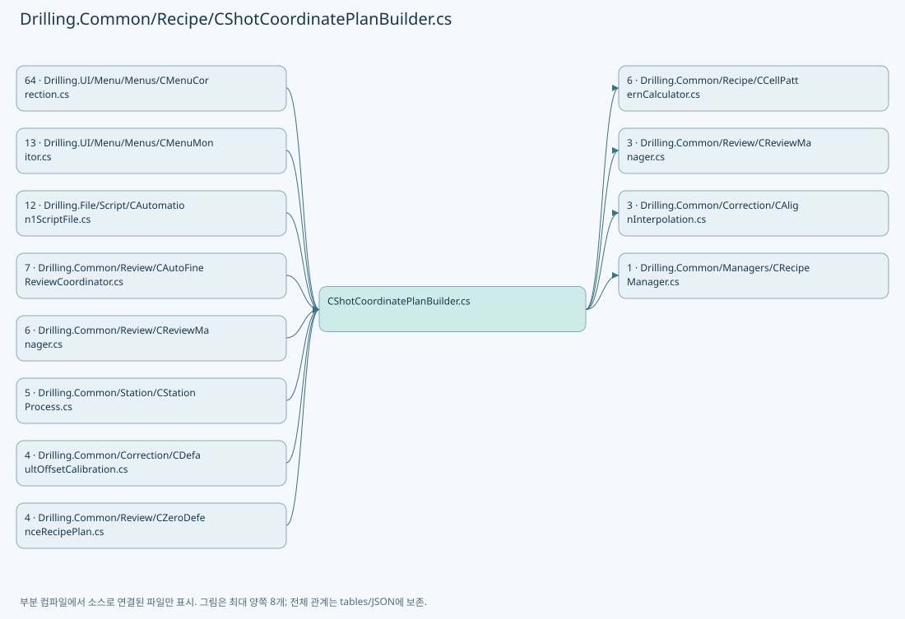

## 네임스페이스·타입·상속

| 타입 | 구분 | 원본 범위 | 선언/상속 |
| --- | --- | --- | --- |
| CShotCoordinatePlanBuilder | ClassDeclaration | 9–654 | CShotCoordinatePlanBuilder |
| ST_ALIGN_SHOT_OFFSET | RecordDeclaration | 656–656 | ST_ALIGN_SHOT_OFFSET |
| CAlignShotOffsetData | ClassDeclaration | 657–788 | CAlignShotOffsetData |
| ST_RECIPE_SHOT_MASKING_RESULT | RecordDeclaration | 790–809 | ST_RECIPE_SHOT_MASKING_RESULT |
| CRecipeShotMaskingPlan | ClassDeclaration | 811–1134 | CRecipeShotMaskingPlan |
| ST_MASKING_POINT | RecordStructDeclaration | 1040–1046 | ST_MASKING_POINT |
| ST_EDGE_CORNER_MASKING_AREA | RecordDeclaration | 1048–1054 | ST_EDGE_CORNER_MASKING_AREA |
| ST_MODEL_PATTERN_AREA | RecordDeclaration | 1056–1065 | ST_MODEL_PATTERN_AREA |
| ST_MODEL_MASKING_AREA | RecordDeclaration | 1066–1075 | ST_MODEL_MASKING_AREA |
| ST_MASKING_RECT | RecordStructDeclaration | 1077–1093 | ST_MASKING_RECT |
| ST_MASKING_HOLE_AREA | RecordDeclaration | 1095–1101 | ST_MASKING_HOLE_AREA |
| ST_EDGE_MASKING_AREA | RecordDeclaration | 1103–1133 | ST_EDGE_MASKING_AREA |
| CReviewOffsetData | ClassDeclaration | 1137–1217 | CReviewOffsetData |
| CReviewOffsetValidationException | ClassDeclaration | 1219–1229 | CReviewOffsetValidationException: IOException |
| ST_SCANNER_AXIS_TRANSFORM | RecordStructDeclaration | 1231–1252 | ST_SCANNER_AXIS_TRANSFORM |
| CScannerAxisTransform | ClassDeclaration | 1254–1350 | CScannerAxisTransform |
| ST_HEAD_SHOT_POINT | RecordDeclaration | 1352–1389 | ST_HEAD_SHOT_POINT |
| ST_SHOT_COORDINATE_PLAN | RecordDeclaration | 1391–1391 | ST_SHOT_COORDINATE_PLAN |
| ST_DESIGN_SHOT_POINT | RecordDeclaration | 1392–1411 | ST_DESIGN_SHOT_POINT |
| ST_HEAD_ASSIGNMENT_CANDIDATE | RecordStructDeclaration | 1413–1413 | ST_HEAD_ASSIGNMENT_CANDIDATE |
| ST_PREPARED_SHOT_POINT | RecordDeclaration | 1414–1430 | ST_PREPARED_SHOT_POINT |

## 멤버 빠른 목록

| 이름 | 종류 | 범위 | 서명 |
| --- | --- | --- | --- |
| Build | MethodDeclaration | L11–202 | Drilling.Common.Recipe.ST_SHOT_COORDINATE_PLAN Drilling.Common.Recipe.CShotCoordinatePlanBuilder.Build(System.Collections.Generic.IReadOnlyDictionary<string, string>) |
| SelectHeadNo | LocalFunctionStatement | L37–40 | int SelectHeadNo(int) |
| SelectValue | LocalFunctionStatement | L42–45 | int SelectValue(int) |
| SelectItem | LocalFunctionStatement | L192–198 | Drilling.Common.Recipe.ST_HEAD_SHOT_POINT SelectItem(Drilling.Common.Recipe.ST_HEAD_SHOT_POINT, int) |
| ReadOffsetScale | MethodDeclaration | L204–211 | double Drilling.Common.Recipe.CShotCoordinatePlanBuilder.ReadOffsetScale(System.Collections.Generic.IReadOnlyDictionary<string, string>, string) |
| BuildDesignShots | MethodDeclaration | L215–221 | System.Collections.Generic.IReadOnlyList<Drilling.Common.Recipe.ST_DESIGN_SHOT_POINT> Drilling.Common.Recipe.CShotCoordinatePlanBuilder.BuildDesignShots(System.Collections.Generic.IReadOnlyDictionary<string, string>) |
| BuildDesignShots | MethodDeclaration | L223–286 | System.Collections.Generic.IReadOnlyList<Drilling.Common.Recipe.ST_DESIGN_SHOT_POINT> Drilling.Common.Recipe.CShotCoordinatePlanBuilder.BuildDesignShots(System.Collections.Generic.IReadOnlyDictionary<string, string>, int) |
| OrderShots | MethodDeclaration | L288–351 | System.Collections.Generic.IReadOnlyList<Drilling.Common.Recipe.ST_HEAD_SHOT_POINT> Drilling.Common.Recipe.CShotCoordinatePlanBuilder.OrderShots(System.Collections.Generic.IReadOnlyList<Drilling.Common.Recipe.ST_HEAD_SHOT_POINT>, double) |
| SelectGroupKey | LocalFunctionStatement | L290–293 | double SelectGroupKey(Drilling.Common.Recipe.ST_HEAD_SHOT_POINT) |
| SelectDescendingRowKey | LocalFunctionStatement | L296–299 | double SelectDescendingRowKey(System.Linq.IGrouping<double, Drilling.Common.Recipe.ST_HEAD_SHOT_POINT>) |
| SelectAscendingRowKey | LocalFunctionStatement | L301–304 | double SelectAscendingRowKey(System.Linq.IGrouping<double, Drilling.Common.Recipe.ST_HEAD_SHOT_POINT>) |
| SelectHeadNo | LocalFunctionStatement | L308–311 | int SelectHeadNo(Drilling.Common.Recipe.ST_HEAD_SHOT_POINT) |
| SelectHeadGroupKey | LocalFunctionStatement | L313–316 | int SelectHeadGroupKey(System.Linq.IGrouping<int, Drilling.Common.Recipe.ST_HEAD_SHOT_POINT>) |
| SelectScannerGx | LocalFunctionStatement | L318–321 | double SelectScannerGx(Drilling.Common.Recipe.ST_HEAD_SHOT_POINT) |
| SelectScannerGy | LocalFunctionStatement | L323–326 | double SelectScannerGy(Drilling.Common.Recipe.ST_HEAD_SHOT_POINT) |
| SelectCellNo | LocalFunctionStatement | L328–331 | int SelectCellNo(Drilling.Common.Recipe.ST_HEAD_SHOT_POINT) |
| SelectCellShotNo | LocalFunctionStatement | L333–336 | int SelectCellShotNo(Drilling.Common.Recipe.ST_HEAD_SHOT_POINT) |
| UseScannerGyForMachiningSort | MethodDeclaration | L353–374 | bool Drilling.Common.Recipe.CShotCoordinatePlanBuilder.UseScannerGyForMachiningSort(System.Collections.Generic.IReadOnlyList<Drilling.Common.Recipe.ST_HEAD_SHOT_POINT>) |
| AssignHeadNo | MethodDeclaration | L376–409 | int Drilling.Common.Recipe.CShotCoordinatePlanBuilder.AssignHeadNo(double, System.Collections.Generic.IReadOnlyList<int>, System.Collections.Generic.IReadOnlyDictionary<string, string>, System.Collections.Generic.IReadOnlyDictionary<int, int>, double) |
| SelectItem | LocalFunctionStatement | L388–395 | Drilling.Common.Recipe.ST_HEAD_ASSIGNMENT_CANDIDATE? SelectItem(int) |
| IsHasValue | LocalFunctionStatement | L397–400 | bool IsHasValue(Drilling.Common.Recipe.ST_HEAD_ASSIGNMENT_CANDIDATE?) |
| SelectHead | LocalFunctionStatement | L402–405 | Drilling.Common.Recipe.ST_HEAD_ASSIGNMENT_CANDIDATE SelectHead(Drilling.Common.Recipe.ST_HEAD_ASSIGNMENT_CANDIDATE?) |
| SelectHeadCandidate | MethodDeclaration | L411–429 | int Drilling.Common.Recipe.CShotCoordinatePlanBuilder.SelectHeadCandidate(System.Collections.Generic.IReadOnlyList<Drilling.Common.Recipe.ST_HEAD_ASSIGNMENT_CANDIDATE>, System.Collections.Generic.IReadOnlyDictionary<int, int>) |
| SelectDistance | LocalFunctionStatement | L413–416 | double SelectDistance(Drilling.Common.Recipe.ST_HEAD_ASSIGNMENT_CANDIDATE) |
| SelectValue | LocalFunctionStatement | L418–421 | int SelectValue(Drilling.Common.Recipe.ST_HEAD_ASSIGNMENT_CANDIDATE) |
| SelectHeadNo | LocalFunctionStatement | L423–426 | int SelectHeadNo(Drilling.Common.Recipe.ST_HEAD_ASSIGNMENT_CANDIDATE) |
| BuildActiveHeadNumbers | MethodDeclaration | L431–448 | System.Collections.Generic.IReadOnlyList<int> Drilling.Common.Recipe.CShotCoordinatePlanBuilder.BuildActiveHeadNumbers(System.Collections.Generic.IReadOnlyDictionary<string, string>, int) |
| ReadHeadUse | MethodDeclaration | L450–453 | bool Drilling.Common.Recipe.CShotCoordinatePlanBuilder.ReadHeadUse(System.Collections.Generic.IReadOnlyDictionary<string, string>, int) |
| ReadHeadCenterX | MethodDeclaration | L455–462 | double Drilling.Common.Recipe.CShotCoordinatePlanBuilder.ReadHeadCenterX(System.Collections.Generic.IReadOnlyDictionary<string, string>, int, double) |
| ReadHeadCenterY | MethodDeclaration | L464–475 | double Drilling.Common.Recipe.CShotCoordinatePlanBuilder.ReadHeadCenterY(System.Collections.Generic.IReadOnlyDictionary<string, string>, int) |
| ReadHeadDefaultOffset | MethodDeclaration | L477–480 | double Drilling.Common.Recipe.CShotCoordinatePlanBuilder.ReadHeadDefaultOffset(System.Collections.Generic.IReadOnlyDictionary<string, string>, int, string) |
| ReadFirstBeamOffset | MethodDeclaration | L482–485 | double Drilling.Common.Recipe.CShotCoordinatePlanBuilder.ReadFirstBeamOffset(System.Collections.Generic.IReadOnlyDictionary<string, string>, int, string) |
| ReadHeadEncoderScale | MethodDeclaration | L487–490 | double Drilling.Common.Recipe.CShotCoordinatePlanBuilder.ReadHeadEncoderScale(System.Collections.Generic.IReadOnlyDictionary<string, string>, int, double) |
| ConvertRecipeYToStageY | MethodDeclaration | L492–495 | double Drilling.Common.Recipe.CShotCoordinatePlanBuilder.ConvertRecipeYToStageY(double) |
| ApplyScannerAxis | MethodDeclaration | L497–500 | double Drilling.Common.Recipe.CShotCoordinatePlanBuilder.ApplyScannerAxis(double, double, double) |
| ReadScannerReferenceOffsetX | MethodDeclaration | L502–507 | double Drilling.Common.Recipe.CShotCoordinatePlanBuilder.ReadScannerReferenceOffsetX(System.Collections.Generic.IReadOnlyDictionary<string, string>) |
| ReadDirection | MethodDeclaration | L509–543 | double Drilling.Common.Recipe.CShotCoordinatePlanBuilder.ReadDirection(System.Collections.Generic.IReadOnlyDictionary<string, string>, double, params string[]) |
| ShouldIncludeItem | LocalFunctionStatement | L511–514 | bool ShouldIncludeItem(string) |
| NormalizeDirection | MethodDeclaration | L545–553 | double Drilling.Common.Recipe.CShotCoordinatePlanBuilder.NormalizeDirection(double, string) |
| ToShotKey | MethodDeclaration | L555–558 | string Drilling.Common.Recipe.CShotCoordinatePlanBuilder.ToShotKey(int, int) |
| ReadDouble | MethodDeclaration | L560–576 | double Drilling.Common.Recipe.CShotCoordinatePlanBuilder.ReadDouble(System.Collections.Generic.IReadOnlyDictionary<string, string>, double, params string[]) |
| ShouldIncludeItem | LocalFunctionStatement | L562–565 | bool ShouldIncludeItem(string) |
| ReadNullableDouble | MethodDeclaration | L578–594 | double? Drilling.Common.Recipe.CShotCoordinatePlanBuilder.ReadNullableDouble(System.Collections.Generic.IReadOnlyDictionary<string, string>, params string[]) |
| ShouldIncludeItem | LocalFunctionStatement | L580–583 | bool ShouldIncludeItem(string) |
| ReadInt | MethodDeclaration | L596–622 | int Drilling.Common.Recipe.CShotCoordinatePlanBuilder.ReadInt(System.Collections.Generic.IReadOnlyDictionary<string, string>, int, params string[]) |
| ShouldIncludeItem | LocalFunctionStatement | L598–601 | bool ShouldIncludeItem(string) |
| ReadBool | MethodDeclaration | L624–653 | bool Drilling.Common.Recipe.CShotCoordinatePlanBuilder.ReadBool(System.Collections.Generic.IReadOnlyDictionary<string, string>, bool, params string[]) |
| ShouldIncludeItem | LocalFunctionStatement | L626–629 | bool ShouldIncludeItem(string) |
| MaximumAbsoluteOffset | FieldDeclaration | L659–659 | double Drilling.Common.Recipe.CAlignShotOffsetData.MaximumAbsoluteOffset |
| ParameterPattern | FieldDeclaration | L660–660 | System.Text.RegularExpressions.Regex Drilling.Common.Recipe.CAlignShotOffsetData.ParameterPattern |
| IsParameterKey | MethodDeclaration | L661–661 | bool Drilling.Common.Recipe.CAlignShotOffsetData.IsParameterKey(string) |
| ParameterKey | MethodDeclaration | L662–662 | string Drilling.Common.Recipe.CAlignShotOffsetData.ParameterKey(int, string, string) |
| RoundValue | MethodDeclaration | L663–670 | double Drilling.Common.Recipe.CAlignShotOffsetData.RoundValue(double) |
| FormatValue | MethodDeclaration | L672–672 | string Drilling.Common.Recipe.CAlignShotOffsetData.FormatValue(double) |
| ReadValue | MethodDeclaration | L673–680 | double Drilling.Common.Recipe.CAlignShotOffsetData.ReadValue(System.Collections.Generic.IReadOnlyDictionary<string, string>, string) |
| Calculate | MethodDeclaration | L682–706 | System.Collections.Generic.IReadOnlyList<Drilling.Common.Recipe.ST_ALIGN_SHOT_OFFSET> Drilling.Common.Recipe.CAlignShotOffsetData.Calculate(Drilling.Common.Managers.ST_RECIPE_DEFINITION, Drilling.Common.Correction.CAlignInterpolation, Drilling.Common.Managers.ST_ALIGN_KEY_MARGINS) |
| ZeroValues | MethodDeclaration | L708–715 | System.Collections.Generic.IReadOnlyList<Drilling.Common.Recipe.ST_ALIGN_SHOT_OFFSET> Drilling.Common.Recipe.CAlignShotOffsetData.ZeroValues(Drilling.Common.Managers.ST_RECIPE_DEFINITION, Drilling.Common.Managers.ST_ALIGN_KEY_MARGINS) |
| BuildDesignParameters | MethodDeclaration | L717–728 | System.Collections.Generic.Dictionary<string, string> Drilling.Common.Recipe.CAlignShotOffsetData.BuildDesignParameters(Drilling.Common.Managers.ST_RECIPE_DEFINITION, Drilling.Common.Managers.ST_ALIGN_KEY_MARGINS) |
| Apply | MethodDeclaration | L730–773 | Drilling.Common.Managers.ST_RECIPE_DEFINITION Drilling.Common.Recipe.CAlignShotOffsetData.Apply(Drilling.Common.Managers.ST_RECIPE_DEFINITION, System.Collections.Generic.IReadOnlyList<Drilling.Common.Recipe.ST_ALIGN_SHOT_OFFSET>) |
| Add | LocalFunctionStatement | L743–772 | void Add(Drilling.Common.Recipe.ST_ALIGN_SHOT_OFFSET, string, double) |
| RetainUneditedOffsets | MethodDeclaration | L777–787 | Drilling.Common.Managers.ST_RECIPE_DEFINITION Drilling.Common.Recipe.CAlignShotOffsetData.RetainUneditedOffsets(Drilling.Common.Managers.ST_RECIPE_DEFINITION, Drilling.Common.Managers.ST_RECIPE_DEFINITION?) |
| Empty | PropertyDeclaration | L792–792 | Drilling.Common.Recipe.ST_RECIPE_SHOT_MASKING_RESULT Drilling.Common.Recipe.ST_RECIPE_SHOT_MASKING_RESULT.Empty |
| get_Empty | GetAccessorDeclaration | L792–792 | Drilling.Common.Recipe.ST_RECIPE_SHOT_MASKING_RESULT Drilling.Common.Recipe.ST_RECIPE_SHOT_MASKING_RESULT.Empty.get |
| IsMasked | PropertyDeclaration | L794–800 | bool Drilling.Common.Recipe.ST_RECIPE_SHOT_MASKING_RESULT.IsMasked |
| get_IsMasked | GetAccessorDeclaration | L796–799 | bool Drilling.Common.Recipe.ST_RECIPE_SHOT_MASKING_RESULT.IsMasked.get |
| ShouldSkipLaser | PropertyDeclaration | L802–808 | bool Drilling.Common.Recipe.ST_RECIPE_SHOT_MASKING_RESULT.ShouldSkipLaser |
| get_ShouldSkipLaser | GetAccessorDeclaration | L804–807 | bool Drilling.Common.Recipe.ST_RECIPE_SHOT_MASKING_RESULT.ShouldSkipLaser.get |
| MaximumCellModelTypeCount | FieldDeclaration | L813–813 | int Drilling.Common.Recipe.CRecipeShotMaskingPlan.MaximumCellModelTypeCount |
| MaximumMaskingHoleCount | FieldDeclaration | L814–814 | int Drilling.Common.Recipe.CRecipeShotMaskingPlan.MaximumMaskingHoleCount |
| Epsilon | FieldDeclaration | L815–815 | double Drilling.Common.Recipe.CRecipeShotMaskingPlan.Epsilon |
| _models | FieldDeclaration | L816–816 | System.Collections.Generic.IReadOnlyDictionary<int, Drilling.Common.Recipe.CRecipeShotMaskingPlan.ST_MODEL_MASKING_AREA> Drilling.Common.Recipe.CRecipeShotMaskingPlan._models |
| _modelPatterns | FieldDeclaration | L817–817 | System.Collections.Generic.IReadOnlyDictionary<int, Drilling.Common.Recipe.CRecipeShotMaskingPlan.ST_MODEL_PATTERN_AREA> Drilling.Common.Recipe.CRecipeShotMaskingPlan._modelPatterns |
| _cellModelTypes | FieldDeclaration | L818–818 | System.Collections.Generic.IReadOnlyDictionary<int, int> Drilling.Common.Recipe.CRecipeShotMaskingPlan._cellModelTypes |
| _modelTypeCount | FieldDeclaration | L819–819 | int Drilling.Common.Recipe.CRecipeShotMaskingPlan._modelTypeCount |
| _splitBeamCount | FieldDeclaration | L820–820 | int Drilling.Common.Recipe.CRecipeShotMaskingPlan._splitBeamCount |
| .ctor | ConstructorDeclaration | L821–834 | Drilling.Common.Recipe.CRecipeShotMaskingPlan.CRecipeShotMaskingPlan(System.Collections.Generic.IReadOnlyDictionary<int, Drilling.Common.Recipe.CRecipeShotMaskingPlan.ST_MODEL_MASKING_AREA>, System.Collections.Generic.IReadOnlyDictionary<int, Drilling.Common.Recipe.CRecipeShotMaskingPlan.ST_MODEL_PATTERN_AREA>, System.Collections.Generic.IReadOnlyDictionary<int, int>, int, int) |
| Build | MethodDeclaration | L836–874 | Drilling.Common.Recipe.CRecipeShotMaskingPlan Drilling.Common.Recipe.CRecipeShotMaskingPlan.Build(System.Collections.Generic.IReadOnlyDictionary<string, string>) |
| EvaluateShot | MethodDeclaration | L876–933 | Drilling.Common.Recipe.ST_RECIPE_SHOT_MASKING_RESULT Drilling.Common.Recipe.CRecipeShotMaskingPlan.EvaluateShot(Drilling.Common.Recipe.ST_HEAD_SHOT_POINT) |
| GetModelType | MethodDeclaration | L935–938 | int Drilling.Common.Recipe.CRecipeShotMaskingPlan.GetModelType(int) |
| IsChessSkipped | MethodDeclaration | L940–949 | bool Drilling.Common.Recipe.CRecipeShotMaskingPlan.IsChessSkipped(Drilling.Common.Recipe.ST_HEAD_SHOT_POINT, Drilling.Common.Recipe.CRecipeShotMaskingPlan.ST_MODEL_PATTERN_AREA) |
| BuildModel | MethodDeclaration | L951–971 | Drilling.Common.Recipe.CRecipeShotMaskingPlan.ST_MODEL_MASKING_AREA Drilling.Common.Recipe.CRecipeShotMaskingPlan.BuildModel(System.Collections.Generic.IReadOnlyDictionary<string, string>, int) |
| BuildEdge | MethodDeclaration | L973–997 | Drilling.Common.Recipe.CRecipeShotMaskingPlan.ST_EDGE_MASKING_AREA? Drilling.Common.Recipe.CRecipeShotMaskingPlan.BuildEdge(System.Collections.Generic.IReadOnlyDictionary<string, string>, string) |
| ReadInt | MethodDeclaration | L999–1020 | int Drilling.Common.Recipe.CRecipeShotMaskingPlan.ReadInt(System.Collections.Generic.IReadOnlyDictionary<string, string>, int, params string[]) |
| ReadDouble | MethodDeclaration | L1022–1033 | double Drilling.Common.Recipe.CRecipeShotMaskingPlan.ReadDouble(System.Collections.Generic.IReadOnlyDictionary<string, string>, double, params string[]) |
| PositiveModulo | MethodDeclaration | L1035–1038 | int Drilling.Common.Recipe.CRecipeShotMaskingPlan.PositiveModulo(int, int) |
| FromPositiveOffset | MethodDeclaration | L1042–1045 | Drilling.Common.Recipe.CRecipeShotMaskingPlan.ST_MASKING_POINT Drilling.Common.Recipe.CRecipeShotMaskingPlan.ST_MASKING_POINT.FromPositiveOffset(double, double) |
| Touches | MethodDeclaration | L1050–1053 | bool Drilling.Common.Recipe.CRecipeShotMaskingPlan.ST_EDGE_CORNER_MASKING_AREA.Touches(Drilling.Common.Recipe.CRecipeShotMaskingPlan.ST_MASKING_RECT) |
| HasMasking | PropertyDeclaration | L1068–1074 | bool Drilling.Common.Recipe.CRecipeShotMaskingPlan.ST_MODEL_MASKING_AREA.HasMasking |
| get_HasMasking | GetAccessorDeclaration | L1070–1073 | bool Drilling.Common.Recipe.CRecipeShotMaskingPlan.ST_MODEL_MASKING_AREA.HasMasking.get |
| FromCenter | MethodDeclaration | L1079–1082 | Drilling.Common.Recipe.CRecipeShotMaskingPlan.ST_MASKING_RECT Drilling.Common.Recipe.CRecipeShotMaskingPlan.ST_MASKING_RECT.FromCenter(double, double, double) |
| FromCorners | MethodDeclaration | L1084–1087 | Drilling.Common.Recipe.CRecipeShotMaskingPlan.ST_MASKING_RECT Drilling.Common.Recipe.CRecipeShotMaskingPlan.ST_MASKING_RECT.FromCorners(double, double, double, double) |
| Intersects | MethodDeclaration | L1089–1092 | bool Drilling.Common.Recipe.CRecipeShotMaskingPlan.ST_MASKING_RECT.Intersects(Drilling.Common.Recipe.CRecipeShotMaskingPlan.ST_MASKING_RECT) |
| Intersects | MethodDeclaration | L1097–1100 | bool Drilling.Common.Recipe.CRecipeShotMaskingPlan.ST_MASKING_HOLE_AREA.Intersects(Drilling.Common.Recipe.CRecipeShotMaskingPlan.ST_MASKING_RECT) |
| Create | MethodDeclaration | L1105–1122 | Drilling.Common.Recipe.CRecipeShotMaskingPlan.ST_EDGE_CORNER_MASKING_AREA? Drilling.Common.Recipe.CRecipeShotMaskingPlan.ST_EDGE_MASKING_AREA.Create(int, int, double, double) |
| AddCorner | MethodDeclaration | L1124–1132 | void Drilling.Common.Recipe.CRecipeShotMaskingPlan.ST_EDGE_MASKING_AREA.AddCorner(System.Collections.Generic.List<Drilling.Common.Recipe.CRecipeShotMaskingPlan.ST_MASKING_RECT>, double, double, double, double) |
| IsParameterKey | MethodDeclaration | L1139–1155 | bool Drilling.Common.Recipe.CReviewOffsetData.IsParameterKey(string) |
| RemoveFromParameters | MethodDeclaration | L1157–1161 | void Drilling.Common.Recipe.CReviewOffsetData.RemoveFromParameters(System.Collections.Generic.IDictionary<string, string>) |
| ValidateRows | MethodDeclaration | L1163–1188 | Drilling.Common.Review.ST_REVIEW_OFFSET_ROW[] Drilling.Common.Recipe.CReviewOffsetData.ValidateRows(System.Collections.Generic.IReadOnlyList<Drilling.Common.Review.ST_REVIEW_OFFSET_ROW>, string, System.Collections.Generic.IReadOnlyList<int>?, System.Threading.CancellationToken) |
| ApplyToParameters | MethodDeclaration | L1190–1203 | void Drilling.Common.Recipe.CReviewOffsetData.ApplyToParameters(System.Collections.Generic.IDictionary<string, string>, Drilling.Common.Review.ST_REVIEW_OFFSET_FILE_DATA) |
| IsDesignCoordinate | MethodDeclaration | L1205–1213 | bool Drilling.Common.Recipe.CReviewOffsetData.IsDesignCoordinate(System.Collections.Generic.IReadOnlyDictionary<string, string>, string) |
| ToScanner | MethodDeclaration | L1215–1215 | (double X, double Y) Drilling.Common.Recipe.CReviewOffsetData.ToScanner(System.Collections.Generic.IReadOnlyDictionary<string, string>, int, double, double, bool) |
| ToDesign | MethodDeclaration | L1216–1216 | (double X, double Y) Drilling.Common.Recipe.CReviewOffsetData.ToDesign(System.Collections.Generic.IReadOnlyDictionary<string, string>, int, double, double, bool) |
| FilePath | PropertyDeclaration | L1221–1221 | string Drilling.Common.Recipe.CReviewOffsetValidationException.FilePath |
| get_FilePath | GetAccessorDeclaration | L1221–1221 | string Drilling.Common.Recipe.CReviewOffsetValidationException.FilePath.get |
| RowNumber | PropertyDeclaration | L1222–1222 | int Drilling.Common.Recipe.CReviewOffsetValidationException.RowNumber |
| get_RowNumber | GetAccessorDeclaration | L1222–1222 | int Drilling.Common.Recipe.CReviewOffsetValidationException.RowNumber.get |
| .ctor | ConstructorDeclaration | L1224–1228 | Drilling.Common.Recipe.CReviewOffsetValidationException.CReviewOffsetValidationException(string, int, string) |
| Apply | MethodDeclaration | L1233–1251 | (double X, double Y) Drilling.Common.Recipe.ST_SCANNER_AXIS_TRANSFORM.Apply(double, double) |
| ReadStageDirection | MethodDeclaration | L1256–1256 | double Drilling.Common.Recipe.CScannerAxisTransform.ReadStageDirection(System.Collections.Generic.IReadOnlyDictionary<string, string>) |
| CreateDefault | MethodDeclaration | L1257–1260 | Drilling.Common.Recipe.ST_SCANNER_AXIS_TRANSFORM Drilling.Common.Recipe.CScannerAxisTransform.CreateDefault(int) |
| Read | MethodDeclaration | L1262–1267 | Drilling.Common.Recipe.ST_SCANNER_AXIS_TRANSFORM Drilling.Common.Recipe.CScannerAxisTransform.Read(System.Collections.Generic.IReadOnlyDictionary<string, string>, int) |
| Read | MethodDeclaration | L1269–1274 | Drilling.Common.Recipe.ST_SCANNER_AXIS_TRANSFORM Drilling.Common.Recipe.CScannerAxisTransform.Read(System.Collections.Generic.IReadOnlyList<Drilling.Common.Managers.ST_SYSTEM_PARAMETER>, int) |
| DesignOffsetToScanner | MethodDeclaration | L1276–1281 | (double X, double Y) Drilling.Common.Recipe.CScannerAxisTransform.DesignOffsetToScanner(System.Collections.Generic.IReadOnlyList<Drilling.Common.Managers.ST_SYSTEM_PARAMETER>, int, double, double) |
| DesignOffsetToScanner | MethodDeclaration | L1283–1288 | (double X, double Y) Drilling.Common.Recipe.CScannerAxisTransform.DesignOffsetToScanner(System.Collections.Generic.IReadOnlyDictionary<string, string>, int, double, double) |
| Format | MethodDeclaration | L1290–1293 | string Drilling.Common.Recipe.CScannerAxisTransform.Format(Drilling.Common.Recipe.ST_SCANNER_AXIS_TRANSFORM) |
| ScannerOffsetToDesign | MethodDeclaration | L1295–1305 | (double X, double Y) Drilling.Common.Recipe.CScannerAxisTransform.ScannerOffsetToDesign(System.Collections.Generic.IReadOnlyDictionary<string, string>, int, double, double) |
| ReadOnOff | MethodDeclaration | L1307–1310 | bool Drilling.Common.Recipe.CScannerAxisTransform.ReadOnOff(System.Collections.Generic.IReadOnlyDictionary<string, string>, bool, string) |
| ReadOnOff | MethodDeclaration | L1312–1323 | bool Drilling.Common.Recipe.CScannerAxisTransform.ReadOnOff(System.Collections.Generic.IReadOnlyList<Drilling.Common.Managers.ST_SYSTEM_PARAMETER>, bool, string) |
| ParseOnOff | MethodDeclaration | L1325–1344 | bool Drilling.Common.Recipe.CScannerAxisTransform.ParseOnOff(string?, bool, string) |
| FormatOnOff | MethodDeclaration | L1346–1349 | string Drilling.Common.Recipe.CScannerAxisTransform.FormatOnOff(bool) |
| AlignOffsetX | PropertyDeclaration | L1385–1385 | double Drilling.Common.Recipe.ST_HEAD_SHOT_POINT.AlignOffsetX |
| get_AlignOffsetX | GetAccessorDeclaration | L1385–1385 | double Drilling.Common.Recipe.ST_HEAD_SHOT_POINT.AlignOffsetX.get |
| set_AlignOffsetX | InitAccessorDeclaration | L1385–1385 | void Drilling.Common.Recipe.ST_HEAD_SHOT_POINT.AlignOffsetX.init |
| AlignOffsetY | PropertyDeclaration | L1386–1386 | double Drilling.Common.Recipe.ST_HEAD_SHOT_POINT.AlignOffsetY |
| get_AlignOffsetY | GetAccessorDeclaration | L1386–1386 | double Drilling.Common.Recipe.ST_HEAD_SHOT_POINT.AlignOffsetY.get |
| set_AlignOffsetY | InitAccessorDeclaration | L1386–1386 | void Drilling.Common.Recipe.ST_HEAD_SHOT_POINT.AlignOffsetY.init |
| AlignScannerOffsetX | PropertyDeclaration | L1387–1387 | double Drilling.Common.Recipe.ST_HEAD_SHOT_POINT.AlignScannerOffsetX |
| get_AlignScannerOffsetX | GetAccessorDeclaration | L1387–1387 | double Drilling.Common.Recipe.ST_HEAD_SHOT_POINT.AlignScannerOffsetX.get |
| set_AlignScannerOffsetX | InitAccessorDeclaration | L1387–1387 | void Drilling.Common.Recipe.ST_HEAD_SHOT_POINT.AlignScannerOffsetX.init |
| AlignScannerOffsetY | PropertyDeclaration | L1388–1388 | double Drilling.Common.Recipe.ST_HEAD_SHOT_POINT.AlignScannerOffsetY |
| get_AlignScannerOffsetY | GetAccessorDeclaration | L1388–1388 | double Drilling.Common.Recipe.ST_HEAD_SHOT_POINT.AlignScannerOffsetY.get |
| set_AlignScannerOffsetY | InitAccessorDeclaration | L1388–1388 | void Drilling.Common.Recipe.ST_HEAD_SHOT_POINT.AlignScannerOffsetY.init |
| ReviewOffsetIsDesign | PropertyDeclaration | L1410–1410 | bool Drilling.Common.Recipe.ST_DESIGN_SHOT_POINT.ReviewOffsetIsDesign |
| get_ReviewOffsetIsDesign | GetAccessorDeclaration | L1410–1410 | bool Drilling.Common.Recipe.ST_DESIGN_SHOT_POINT.ReviewOffsetIsDesign.get |
| set_ReviewOffsetIsDesign | InitAccessorDeclaration | L1410–1410 | void Drilling.Common.Recipe.ST_DESIGN_SHOT_POINT.ReviewOffsetIsDesign.init |

## 멤버별 상세 계약·호출·처리 해설

### MethodDeclaration `Build` · L11–202

[Drilling.Common/Recipe/CShotCoordinatePlanBuilder.cs:11–202](https://github.com/kjuws10-rgb/A3Drilling/blob/334b3599651b2e8e0181fd4459bafaf3cddafff3/Drilling.Common/Recipe/CShotCoordinatePlanBuilder.cs#L11-L202)

| 항목 | 실제 추출 값 |
| --- | --- |
| 서명 | Drilling.Common.Recipe.ST_SHOT_COORDINATE_PLAN Drilling.Common.Recipe.CShotCoordinatePlanBuilder.Build(System.Collections.Generic.IReadOnlyDictionary<string, string>) |
| 접근/수식자 | Public / public, static |
| 반환/값 타입 | Drilling.Common.Recipe.ST_SHOT_COORDINATE_PLAN |
| 소속 타입 | NamedType:Drilling.Common.Recipe.CShotCoordinatePlanBuilder |

입력 계약:

| 이름 | 타입 | 전달 | 선택/기본값 |
| --- | --- | --- | --- |
| parameters | System.Collections.Generic.IReadOnlyDictionary<string, string> | None | False /  |

정적 호출자로 확인된 위치:

| 호출 파일/행 | 호출 표현식 | 런타임 분기 가능 |
| --- | --- | --- |
| [Drilling.Common/Review/CAutoFineReviewCoordinator.cs:229–229](https://github.com/kjuws10-rgb/A3Drilling/blob/334b3599651b2e8e0181fd4459bafaf3cddafff3/Drilling.Common/Review/CAutoFineReviewCoordinator.cs#L229-L229) | CShotCoordinatePlanBuilder.Build | False |
| [Drilling.Common/Review/CReviewManager.cs:518–518](https://github.com/kjuws10-rgb/A3Drilling/blob/334b3599651b2e8e0181fd4459bafaf3cddafff3/Drilling.Common/Review/CReviewManager.cs#L518-L518) | CShotCoordinatePlanBuilder.Build | False |
| [Drilling.Common/Review/CZeroDefenceRecipePlan.cs:26–26](https://github.com/kjuws10-rgb/A3Drilling/blob/334b3599651b2e8e0181fd4459bafaf3cddafff3/Drilling.Common/Review/CZeroDefenceRecipePlan.cs#L26-L26) | CShotCoordinatePlanBuilder.Build | False |
| [Drilling.Common/Station/CStationProcess.cs:1611–1611](https://github.com/kjuws10-rgb/A3Drilling/blob/334b3599651b2e8e0181fd4459bafaf3cddafff3/Drilling.Common/Station/CStationProcess.cs#L1611-L1611) | CShotCoordinatePlanBuilder.Build | False |
| [Drilling.UI/CRootView.cs:1830–1830](https://github.com/kjuws10-rgb/A3Drilling/blob/334b3599651b2e8e0181fd4459bafaf3cddafff3/Drilling.UI/CRootView.cs#L1830-L1830) | CShotCoordinatePlanBuilder.Build | False |
| [Drilling.UI/Menu/Menus/CMenuCorrection.ReviewData.Display.cs:344–344](https://github.com/kjuws10-rgb/A3Drilling/blob/334b3599651b2e8e0181fd4459bafaf3cddafff3/Drilling.UI/Menu/Menus/CMenuCorrection.ReviewData.Display.cs#L344-L344) | CShotCoordinatePlanBuilder.Build | False |
| [Drilling.UI/Menu/Menus/CMenuCorrection.cs:784–784](https://github.com/kjuws10-rgb/A3Drilling/blob/334b3599651b2e8e0181fd4459bafaf3cddafff3/Drilling.UI/Menu/Menus/CMenuCorrection.cs#L784-L784) | CShotCoordinatePlanBuilder.Build | False |
| [Drilling.UI/Menu/Menus/CMenuCorrection.cs:5769–5769](https://github.com/kjuws10-rgb/A3Drilling/blob/334b3599651b2e8e0181fd4459bafaf3cddafff3/Drilling.UI/Menu/Menus/CMenuCorrection.cs#L5769-L5769) | CShotCoordinatePlanBuilder.Build | False |
| [Drilling.UI/Menu/Menus/CMenuCorrection.cs:6238–6238](https://github.com/kjuws10-rgb/A3Drilling/blob/334b3599651b2e8e0181fd4459bafaf3cddafff3/Drilling.UI/Menu/Menus/CMenuCorrection.cs#L6238-L6238) | CShotCoordinatePlanBuilder.Build | False |
| [Drilling.UI/Menu/Menus/CMenuCorrection.cs:7795–7795](https://github.com/kjuws10-rgb/A3Drilling/blob/334b3599651b2e8e0181fd4459bafaf3cddafff3/Drilling.UI/Menu/Menus/CMenuCorrection.cs#L7795-L7795) | CShotCoordinatePlanBuilder.Build | False |
| [Drilling.UI/Menu/Menus/CMenuMonitor.cs:3129–3129](https://github.com/kjuws10-rgb/A3Drilling/blob/334b3599651b2e8e0181fd4459bafaf3cddafff3/Drilling.UI/Menu/Menus/CMenuMonitor.cs#L3129-L3129) | CShotCoordinatePlanBuilder.Build | False |
| [Drilling.UI/Menu/Menus/CMenuRecipe.cs:2728–2728](https://github.com/kjuws10-rgb/A3Drilling/blob/334b3599651b2e8e0181fd4459bafaf3cddafff3/Drilling.UI/Menu/Menus/CMenuRecipe.cs#L2728-L2728) | CShotCoordinatePlanBuilder.Build | False |

호출하는 대상과 해석 범위:

| 원본 행 | 표현식 | 분석 상태 | 대상/소스 위치 |
| --- | --- | --- | --- |
| 13 | ArgumentNullException.ThrowIfNull | resolved | void System.ArgumentNullException.ThrowIfNull(object?, string?) |
| 15 | CAlignKeyMarginSettings.Read | resolved | Drilling.Common.Managers.ST_ALIGN_KEY_MARGINS Drilling.Common.Managers.CAlignKeyMarginSettings.Read(System.Collections.Generic.IReadOnlyDictionary<string, string>) · Drilling.Common/Managers/CAlignKeyMarginSettings.cs:21 |
| 16 | Math.Clamp | resolved | int System.Math.Clamp(int, int, int) |
| 16 | ReadInt | resolved | int Drilling.Common.Recipe.CShotCoordinatePlanBuilder.ReadInt(System.Collections.Generic.IReadOnlyDictionary<string, string>, int, params string[]) · Drilling.Common/Recipe/CShotCoordinatePlanBuilder.cs:596 |
| 17 | ReadInt | resolved | int Drilling.Common.Recipe.CShotCoordinatePlanBuilder.ReadInt(System.Collections.Generic.IReadOnlyDictionary<string, string>, int, params string[]) · Drilling.Common/Recipe/CShotCoordinatePlanBuilder.cs:596 |
| 20 | new InvalidOperationException | resolved | System.InvalidOperationException.InvalidOperationException(string?) |
| 23 | BuildActiveHeadNumbers | resolved | System.Collections.Generic.IReadOnlyList<int> Drilling.Common.Recipe.CShotCoordinatePlanBuilder.BuildActiveHeadNumbers(System.Collections.Generic.IReadOnlyDictionary<string, string>, int) · Drilling.Common/Recipe/CShotCoordinatePlanBuilder.cs:431 |
| 24 | activeHeadNos.ToHashSet | resolved | System.Collections.Generic.HashSet<int> System.Collections.Generic.IEnumerable<int>.ToHashSet<int>() |
| 25 | Enumerable.Range(1, headCount).ToArray | resolved | int[] System.Collections.Generic.IEnumerable<int>.ToArray<int>() |
| 25 | Enumerable.Range | resolved | System.Collections.Generic.IEnumerable<int> System.Linq.Enumerable.Range(int, int) |
| 26 | ReadDouble | resolved | double Drilling.Common.Recipe.CShotCoordinatePlanBuilder.ReadDouble(System.Collections.Generic.IReadOnlyDictionary<string, string>, double, params string[]) · Drilling.Common/Recipe/CShotCoordinatePlanBuilder.cs:560 |
| 27 | ReadDouble | resolved | double Drilling.Common.Recipe.CShotCoordinatePlanBuilder.ReadDouble(System.Collections.Generic.IReadOnlyDictionary<string, string>, double, params string[]) · Drilling.Common/Recipe/CShotCoordinatePlanBuilder.cs:560 |
| 28 | ReadDouble | resolved | double Drilling.Common.Recipe.CShotCoordinatePlanBuilder.ReadDouble(System.Collections.Generic.IReadOnlyDictionary<string, string>, double, params string[]) · Drilling.Common/Recipe/CShotCoordinatePlanBuilder.cs:560 |
| 29 | ReadDirection | resolved | double Drilling.Common.Recipe.CShotCoordinatePlanBuilder.ReadDirection(System.Collections.Generic.IReadOnlyDictionary<string, string>, double, params string[]) · Drilling.Common/Recipe/CShotCoordinatePlanBuilder.cs:509 |
| 30 | Math.Abs | resolved | double System.Math.Abs(double) |
| 30 | ReadDouble | resolved | double Drilling.Common.Recipe.CShotCoordinatePlanBuilder.ReadDouble(System.Collections.Generic.IReadOnlyDictionary<string, string>, double, params string[]) · Drilling.Common/Recipe/CShotCoordinatePlanBuilder.cs:560 |
| 32 | ReadScannerReferenceOffsetX | resolved | double Drilling.Common.Recipe.CShotCoordinatePlanBuilder.ReadScannerReferenceOffsetX(System.Collections.Generic.IReadOnlyDictionary<string, string>) · Drilling.Common/Recipe/CShotCoordinatePlanBuilder.cs:502 |
| 33 | ReadDouble | resolved | double Drilling.Common.Recipe.CShotCoordinatePlanBuilder.ReadDouble(System.Collections.Generic.IReadOnlyDictionary<string, string>, double, params string[]) · Drilling.Common/Recipe/CShotCoordinatePlanBuilder.cs:560 |
| 34 | ReadDouble | resolved | double Drilling.Common.Recipe.CShotCoordinatePlanBuilder.ReadDouble(System.Collections.Generic.IReadOnlyDictionary<string, string>, double, params string[]) · Drilling.Common/Recipe/CShotCoordinatePlanBuilder.cs:560 |
| 35 | ReadOffsetScale | resolved | double Drilling.Common.Recipe.CShotCoordinatePlanBuilder.ReadOffsetScale(System.Collections.Generic.IReadOnlyDictionary<string, string>, string) · Drilling.Common/Recipe/CShotCoordinatePlanBuilder.cs:204 |
| 36 | ReadOffsetScale | resolved | double Drilling.Common.Recipe.CShotCoordinatePlanBuilder.ReadOffsetScale(System.Collections.Generic.IReadOnlyDictionary<string, string>, string) · Drilling.Common/Recipe/CShotCoordinatePlanBuilder.cs:204 |
| 47 | assignmentHeadNos.ToDictionary | resolved | System.Collections.Generic.Dictionary<int, int> System.Collections.Generic.IEnumerable<int>.ToDictionary<int, int, int>(System.Func<int, int>, System.Func<int, int>) |
| 48 | BuildDesignShots | resolved | System.Collections.Generic.IReadOnlyList<Drilling.Common.Recipe.ST_DESIGN_SHOT_POINT> Drilling.Common.Recipe.CShotCoordinatePlanBuilder.BuildDesignShots(System.Collections.Generic.IReadOnlyDictionary<string, string>, int) · Drilling.Common/Recipe/CShotCoordinatePlanBuilder.cs:223 |
| 49 | new List<ST_PREPARED_SHOT_POINT> | resolved | System.Collections.Generic.List<Drilling.Common.Recipe.ST_PREPARED_SHOT_POINT>.List(int) |
| 54 | AssignHeadNo | resolved | int Drilling.Common.Recipe.CShotCoordinatePlanBuilder.AssignHeadNo(double, System.Collections.Generic.IReadOnlyList<int>, System.Collections.Generic.IReadOnlyDictionary<string, string>, System.Collections.Generic.IReadOnlyDictionary<int, int>, double) · Drilling.Common/Recipe/CShotCoordinatePlanBuilder.cs:376 |
| 55 | activeHeadSet.Contains | resolved | bool System.Collections.Generic.HashSet<int>.Contains(int) |
| 61 | ReadHeadCenterX | resolved | double Drilling.Common.Recipe.CShotCoordinatePlanBuilder.ReadHeadCenterX(System.Collections.Generic.IReadOnlyDictionary<string, string>, int, double) · Drilling.Common/Recipe/CShotCoordinatePlanBuilder.cs:455 |
| 62 | ReadHeadCenterY | resolved | double Drilling.Common.Recipe.CShotCoordinatePlanBuilder.ReadHeadCenterY(System.Collections.Generic.IReadOnlyDictionary<string, string>, int) · Drilling.Common/Recipe/CShotCoordinatePlanBuilder.cs:464 |
| 63 | CScannerAxisTransform.Read | resolved | Drilling.Common.Recipe.ST_SCANNER_AXIS_TRANSFORM Drilling.Common.Recipe.CScannerAxisTransform.Read(System.Collections.Generic.IReadOnlyDictionary<string, string>, int) · Drilling.Common/Recipe/CShotCoordinatePlanBuilder.cs:1262 |
| 64 | ReadHeadDefaultOffset | resolved | double Drilling.Common.Recipe.CShotCoordinatePlanBuilder.ReadHeadDefaultOffset(System.Collections.Generic.IReadOnlyDictionary<string, string>, int, string) · Drilling.Common/Recipe/CShotCoordinatePlanBuilder.cs:477 |
| 65 | ReadHeadDefaultOffset | resolved | double Drilling.Common.Recipe.CShotCoordinatePlanBuilder.ReadHeadDefaultOffset(System.Collections.Generic.IReadOnlyDictionary<string, string>, int, string) · Drilling.Common/Recipe/CShotCoordinatePlanBuilder.cs:477 |
| 66 | ReadFirstBeamOffset | resolved | double Drilling.Common.Recipe.CShotCoordinatePlanBuilder.ReadFirstBeamOffset(System.Collections.Generic.IReadOnlyDictionary<string, string>, int, string) · Drilling.Common/Recipe/CShotCoordinatePlanBuilder.cs:482 |
| 67 | ReadFirstBeamOffset | resolved | double Drilling.Common.Recipe.CShotCoordinatePlanBuilder.ReadFirstBeamOffset(System.Collections.Generic.IReadOnlyDictionary<string, string>, int, string) · Drilling.Common/Recipe/CShotCoordinatePlanBuilder.cs:482 |
| 68 | ReadHeadEncoderScale | resolved | double Drilling.Common.Recipe.CShotCoordinatePlanBuilder.ReadHeadEncoderScale(System.Collections.Generic.IReadOnlyDictionary<string, string>, int, double) · Drilling.Common/Recipe/CShotCoordinatePlanBuilder.cs:487 |
| 71 | ConvertRecipeYToStageY | resolved | double Drilling.Common.Recipe.CShotCoordinatePlanBuilder.ConvertRecipeYToStageY(double) · Drilling.Common/Recipe/CShotCoordinatePlanBuilder.cs:492 |
| 73 | preparedShots.Add | resolved | void System.Collections.Generic.List<Drilling.Common.Recipe.ST_PREPARED_SHOT_POINT>.Add(Drilling.Common.Recipe.ST_PREPARED_SHOT_POINT) |
| 73 | new ST_PREPARED_SHOT_POINT | resolved | Drilling.Common.Recipe.ST_PREPARED_SHOT_POINT.ST_PREPARED_SHOT_POINT(int, Drilling.Common.Recipe.ST_DESIGN_SHOT_POINT, int, double, Drilling.Common.Recipe.ST_SCANNER_AXIS_TRANSFORM, double, double, double, double, double, double, double, double, double, double) · Drilling.Common/Recipe/CShotCoordinatePlanBuilder.cs:1414 |
| 115 | Math.Abs | resolved | double System.Math.Abs(double) |
| 119 | new List<ST_HEAD_SHOT_POINT> | resolved | System.Collections.Generic.List<Drilling.Common.Recipe.ST_HEAD_SHOT_POINT>.List(int) |
| 125 | Math.Abs | resolved | double System.Math.Abs(double) |
| 130 | Math.Abs | resolved | double System.Math.Abs(double) |
| 135 | ApplyScannerAxis | resolved | double Drilling.Common.Recipe.CShotCoordinatePlanBuilder.ApplyScannerAxis(double, double, double) · Drilling.Common/Recipe/CShotCoordinatePlanBuilder.cs:497 |
| 139 | preparedShot.ScannerTransform.Apply | resolved | (double X, double Y) Drilling.Common.Recipe.ST_SCANNER_AXIS_TRANSFORM.Apply(double, double) · Drilling.Common/Recipe/CShotCoordinatePlanBuilder.cs:1233 |
| 140 | preparedShot.ScannerTransform.Apply | resolved | (double X, double Y) Drilling.Common.Recipe.ST_SCANNER_AXIS_TRANSFORM.Apply(double, double) · Drilling.Common/Recipe/CShotCoordinatePlanBuilder.cs:1233 |
| 141 | preparedShot.ScannerTransform.Apply | resolved | (double X, double Y) Drilling.Common.Recipe.ST_SCANNER_AXIS_TRANSFORM.Apply(double, double) · Drilling.Common/Recipe/CShotCoordinatePlanBuilder.cs:1233 |
| 141 | ConvertRecipeYToStageY | resolved | double Drilling.Common.Recipe.CShotCoordinatePlanBuilder.ConvertRecipeYToStageY(double) · Drilling.Common/Recipe/CShotCoordinatePlanBuilder.cs:492 |
| 142 | preparedShot.ScannerTransform.Apply | resolved | (double X, double Y) Drilling.Common.Recipe.ST_SCANNER_AXIS_TRANSFORM.Apply(double, double) · Drilling.Common/Recipe/CShotCoordinatePlanBuilder.cs:1233 |
| 142 | ConvertRecipeYToStageY | resolved | double Drilling.Common.Recipe.CShotCoordinatePlanBuilder.ConvertRecipeYToStageY(double) · Drilling.Common/Recipe/CShotCoordinatePlanBuilder.cs:492 |
| 144 | CScannerAxisTransform.DesignOffsetToScanner | resolved | (double X, double Y) Drilling.Common.Recipe.CScannerAxisTransform.DesignOffsetToScanner(System.Collections.Generic.IReadOnlyDictionary<string, string>, int, double, double) · Drilling.Common/Recipe/CShotCoordinatePlanBuilder.cs:1283 |
| 145 | CReviewOffsetData.ToScanner | resolved | (double X, double Y) Drilling.Common.Recipe.CReviewOffsetData.ToScanner(System.Collections.Generic.IReadOnlyDictionary<string, string>, int, double, double, bool) · Drilling.Common/Recipe/CShotCoordinatePlanBuilder.cs:1215 |
| 149 | preparedShot.ScannerTransform.Apply | resolved | (double X, double Y) Drilling.Common.Recipe.ST_SCANNER_AXIS_TRANSFORM.Apply(double, double) · Drilling.Common/Recipe/CShotCoordinatePlanBuilder.cs:1233 |
| 157 | Math.Abs | resolved | double System.Math.Abs(double) |
| 158 | calculatedShots.Add | resolved | void System.Collections.Generic.List<Drilling.Common.Recipe.ST_HEAD_SHOT_POINT>.Add(Drilling.Common.Recipe.ST_HEAD_SHOT_POINT) |
| 158 | new ST_HEAD_SHOT_POINT | resolved | Drilling.Common.Recipe.ST_HEAD_SHOT_POINT.ST_HEAD_SHOT_POINT(int, string, int, int, int, int, int, int, int, double, double, double, double, double, double, double, double, double, double, double, double, double, double, double, double, double, double, double, double, double) · Drilling.Common/Recipe/CShotCoordinatePlanBuilder.cs:1352 |
| 200 | OrderShots(calculatedShots, stageScanDirectionY).Select(SelectItem).ToArray | resolved | Drilling.Common.Recipe.ST_HEAD_SHOT_POINT[] System.Collections.Generic.IEnumerable<Drilling.Common.Recipe.ST_HEAD_SHOT_POINT>.ToArray<Drilling.Common.Recipe.ST_HEAD_SHOT_POINT>() |
| 200 | OrderShots(calculatedShots, stageScanDirectionY).Select | resolved | System.Collections.Generic.IEnumerable<Drilling.Common.Recipe.ST_HEAD_SHOT_POINT> System.Collections.Generic.IEnumerable<Drilling.Common.Recipe.ST_HEAD_SHOT_POINT>.Select<Drilling.Common.Recipe.ST_HEAD_SHOT_POINT, Drilling.Common.Recipe.ST_HEAD_SHOT_POINT>(System.Func<Drilling.Common.Recipe.ST_HEAD_SHOT_POINT, int, Drilling.Common.Recipe.ST_HEAD_SHOT_POINT>) |
| 200 | OrderShots | resolved | System.Collections.Generic.IReadOnlyList<Drilling.Common.Recipe.ST_HEAD_SHOT_POINT> Drilling.Common.Recipe.CShotCoordinatePlanBuilder.OrderShots(System.Collections.Generic.IReadOnlyList<Drilling.Common.Recipe.ST_HEAD_SHOT_POINT>, double) · Drilling.Common/Recipe/CShotCoordinatePlanBuilder.cs:288 |
| 201 | new ST_SHOT_COORDINATE_PLAN | resolved | Drilling.Common.Recipe.ST_SHOT_COORDINATE_PLAN.ST_SHOT_COORDINATE_PLAN(int, int, double, double, double, System.Collections.Generic.IReadOnlyList<Drilling.Common.Recipe.ST_HEAD_SHOT_POINT>) · Drilling.Common/Recipe/CShotCoordinatePlanBuilder.cs:1391 |

본문의 실제 연산·분기·예외·반환 순서(원문 위치 순):

| 원본 행 | 종류 | 주석 해설 |
| --- | --- | --- |
| 13 | call | 함수·델리게이트 또는 객체 생성자를 호출합니다: ArgumentNullException.ThrowIfNull(parameters) |
| 15 | call | 함수·델리게이트 또는 객체 생성자를 호출합니다: CAlignKeyMarginSettings.Read(parameters) |
| 15 | local-declaration | 지역 변수를 선언합니다: var alignKeyMargins = CAlignKeyMarginSettings.Read(parameters); |
| 15 | variable-initializer | 변수의 초기값을 지정합니다: alignKeyMargins = CAlignKeyMarginSettings.Read(parameters) |
| 16 | call | 함수·델리게이트 또는 객체 생성자를 호출합니다: Math.Clamp(ReadInt(parameters, 8, "HEAD_COUNT"), 1, 8) |
| 16 | call | 함수·델리게이트 또는 객체 생성자를 호출합니다: ReadInt(parameters, 8, "HEAD_COUNT") |
| 16 | local-declaration | 지역 변수를 선언합니다: var headCount = Math.Clamp(ReadInt(parameters, 8, "HEAD_COUNT"), 1, 8); |
| 16 | variable-initializer | 변수의 초기값을 지정합니다: headCount = Math.Clamp(ReadInt(parameters, 8, "HEAD_COUNT"), 1, 8) |
| 17 | call | 함수·델리게이트 또는 객체 생성자를 호출합니다: ReadInt(parameters, 0, "MAX_CELL_NUMBER") |
| 17 | local-declaration | 지역 변수를 선언합니다: var cellCount = ReadInt(parameters, 0, "MAX_CELL_NUMBER"); |
| 17 | variable-initializer | 변수의 초기값을 지정합니다: cellCount = ReadInt(parameters, 0, "MAX_CELL_NUMBER") |
| 18 | if | 조건에 따라 분기합니다: if (cellCount < CCellPatternCalculator.MinCellCount) |
| 20 | call | 함수·델리게이트 또는 객체 생성자를 호출합니다: new InvalidOperationException($"MAX_CELL_NUMBER must be greater than or equal to {CCellPatternCalculator.MinCellCount}. Current value: {cellCount}") |
| 20 | throw | 예외를 발생/전달합니다: throw new InvalidOperationException($"MAX_CELL_NUMBER must be greater than or equal to {CCellPatternCalculator.MinCellCount}. Current value: {cellCount}"); |
| 23 | call | 함수·델리게이트 또는 객체 생성자를 호출합니다: BuildActiveHeadNumbers(parameters, headCount) |
| 23 | local-declaration | 지역 변수를 선언합니다: var activeHeadNos = BuildActiveHeadNumbers(parameters, headCount); |
| 23 | variable-initializer | 변수의 초기값을 지정합니다: activeHeadNos = BuildActiveHeadNumbers(parameters, headCount) |
| 24 | call | 함수·델리게이트 또는 객체 생성자를 호출합니다: activeHeadNos.ToHashSet() |
| 24 | local-declaration | 지역 변수를 선언합니다: var activeHeadSet = activeHeadNos.ToHashSet(); |
| 24 | variable-initializer | 변수의 초기값을 지정합니다: activeHeadSet = activeHeadNos.ToHashSet() |
| 25 | call | 함수·델리게이트 또는 객체 생성자를 호출합니다: Enumerable.Range(1, headCount).ToArray() |
| 25 | call | 함수·델리게이트 또는 객체 생성자를 호출합니다: Enumerable.Range(1, headCount) |
| 25 | local-declaration | 지역 변수를 선언합니다: var assignmentHeadNos = Enumerable.Range(1, headCount).ToArray(); |
| 25 | variable-initializer | 변수의 초기값을 지정합니다: assignmentHeadNos = Enumerable.Range(1, headCount).ToArray() |
| 26 | call | 함수·델리게이트 또는 객체 생성자를 호출합니다: ReadDouble(parameters, 0.0, "GLASS_SIZE_X") |
| 26 | local-declaration | 지역 변수를 선언합니다: var glassSizeX = ReadDouble(parameters, 0.0, "GLASS_SIZE_X"); |
| 26 | variable-initializer | 변수의 초기값을 지정합니다: glassSizeX = ReadDouble(parameters, 0.0, "GLASS_SIZE_X") |
| 27 | call | 함수·델리게이트 또는 객체 생성자를 호출합니다: ReadDouble(parameters, 0.0, "GLASS_SIZE_Y") |
| 27 | local-declaration | 지역 변수를 선언합니다: var glassSizeY = ReadDouble(parameters, 0.0, "GLASS_SIZE_Y"); |
| 27 | variable-initializer | 변수의 초기값을 지정합니다: glassSizeY = ReadDouble(parameters, 0.0, "GLASS_SIZE_Y") |
| 28 | call | 함수·델리게이트 또는 객체 생성자를 호출합니다: ReadDouble(parameters, 16000.0, "SCAN_ENCODER_SCALE") |
| 28 | local-declaration | 지역 변수를 선언합니다: var encoderScale = ReadDouble(parameters, 16000.0, "SCAN_ENCODER_SCALE"); |
| 28 | variable-initializer | 변수의 초기값을 지정합니다: encoderScale = ReadDouble(parameters, 16000.0, "SCAN_ENCODER_SCALE") |
| 29 | call | 함수·델리게이트 또는 객체 생성자를 호출합니다: ReadDirection(parameters, -1.0, "STAGE_SCAN_DIRECTION_Y") |
| 29 | local-declaration | 지역 변수를 선언합니다: var stageScanDirectionY = ReadDirection(parameters, -1.0, "STAGE_SCAN_DIRECTION_Y"); |
| 29 | variable-initializer | 변수의 초기값을 지정합니다: stageScanDirectionY = ReadDirection(parameters, -1.0, "STAGE_SCAN_DIRECTION_Y") |
| 30 | call | 함수·델리게이트 또는 객체 생성자를 호출합니다: Math.Abs(ReadDouble(parameters, 0.0, "SCAN_START_DELAY_LENGTH_Y")) |
| 30 | call | 함수·델리게이트 또는 객체 생성자를 호출합니다: ReadDouble(parameters, 0.0, "SCAN_START_DELAY_LENGTH_Y") |
| 30 | local-declaration | 지역 변수를 선언합니다: var scanStartDelayLengthY = Math.Abs(ReadDouble(parameters, 0.0, "SCAN_START_DELAY_LENGTH_Y")); |
| 30 | variable-initializer | 변수의 초기값을 지정합니다: scanStartDelayLengthY = Math.Abs(ReadDouble(parameters, 0.0, "SCAN_START_DELAY_LENGTH_Y")) |
| 31 | local-declaration | 지역 변수를 선언합니다: var akMarginY = alignKeyMargins.Y; |
| 31 | variable-initializer | 변수의 초기값을 지정합니다: akMarginY = alignKeyMargins.Y |
| 32 | call | 함수·델리게이트 또는 객체 생성자를 호출합니다: ReadScannerReferenceOffsetX(parameters) |
| 32 | local-declaration | 지역 변수를 선언합니다: var scannerReferenceOffsetX = ReadScannerReferenceOffsetX(parameters); |
| 32 | variable-initializer | 변수의 초기값을 지정합니다: scannerReferenceOffsetX = ReadScannerReferenceOffsetX(parameters) |
| 33 | call | 함수·델리게이트 또는 객체 생성자를 호출합니다: ReadDouble(parameters, 0.0, "SHIFT_OFFSET_X") |
| 33 | local-declaration | 지역 변수를 선언합니다: var shiftOffsetX = ReadDouble(parameters, 0.0, "SHIFT_OFFSET_X"); |
| 33 | variable-initializer | 변수의 초기값을 지정합니다: shiftOffsetX = ReadDouble(parameters, 0.0, "SHIFT_OFFSET_X") |
| 34 | call | 함수·델리게이트 또는 객체 생성자를 호출합니다: ReadDouble(parameters, 0.0, "SHIFT_OFFSET_Y") |
| 34 | local-declaration | 지역 변수를 선언합니다: var shiftOffsetY = ReadDouble(parameters, 0.0, "SHIFT_OFFSET_Y"); |
| 34 | variable-initializer | 변수의 초기값을 지정합니다: shiftOffsetY = ReadDouble(parameters, 0.0, "SHIFT_OFFSET_Y") |
| 35 | call | 함수·델리게이트 또는 객체 생성자를 호출합니다: ReadOffsetScale(parameters, "REVIEW_OFFSET_SCALE") |
| 35 | local-declaration | 지역 변수를 선언합니다: var reviewOffsetScale = ReadOffsetScale(parameters, "REVIEW_OFFSET_SCALE"); |
| 35 | variable-initializer | 변수의 초기값을 지정합니다: reviewOffsetScale = ReadOffsetScale(parameters, "REVIEW_OFFSET_SCALE") |
| 36 | call | 함수·델리게이트 또는 객체 생성자를 호출합니다: ReadOffsetScale(parameters, "ALIGN_OFFSET_SCALE") |
| 36 | local-declaration | 지역 변수를 선언합니다: var alignOffsetScale = ReadOffsetScale(parameters, "ALIGN_OFFSET_SCALE"); |
| 36 | variable-initializer | 변수의 초기값을 지정합니다: alignOffsetScale = ReadOffsetScale(parameters, "ALIGN_OFFSET_SCALE") |
| 47 | call | 함수·델리게이트 또는 객체 생성자를 호출합니다: assignmentHeadNos.ToDictionary(SelectHeadNo, SelectValue) |
| 47 | local-declaration | 지역 변수를 선언합니다: var assignedHeadCounts = assignmentHeadNos.ToDictionary(SelectHeadNo, SelectValue); |
| 47 | variable-initializer | 변수의 초기값을 지정합니다: assignedHeadCounts = assignmentHeadNos.ToDictionary(SelectHeadNo, SelectValue) |
| 48 | call | 함수·델리게이트 또는 객체 생성자를 호출합니다: BuildDesignShots(parameters, cellCount) |
| 48 | local-declaration | 지역 변수를 선언합니다: var designShots = BuildDesignShots(parameters, cellCount); |
| 48 | variable-initializer | 변수의 초기값을 지정합니다: designShots = BuildDesignShots(parameters, cellCount) |
| 49 | call | 함수·델리게이트 또는 객체 생성자를 호출합니다: new List<ST_PREPARED_SHOT_POINT>(designShots.Count) |
| 49 | local-declaration | 지역 변수를 선언합니다: var preparedShots = new List<ST_PREPARED_SHOT_POINT>(designShots.Count); |
| 49 | variable-initializer | 변수의 초기값을 지정합니다: preparedShots = new List<ST_PREPARED_SHOT_POINT>(designShots.Count) |
| 50 | variable-initializer | 변수의 초기값을 지정합니다: index = 0 |
| 50 | for | 초기화·조건·증감이 있는 반복입니다: for (var index = 0; index < designShots.Count; index++) |
| 52 | local-declaration | 지역 변수를 선언합니다: var designShot = designShots[index]; |
| 52 | variable-initializer | 변수의 초기값을 지정합니다: designShot = designShots[index] |
| 53 | local-declaration | 지역 변수를 선언합니다: var scannerReferenceX = designShot.DesignX + scannerReferenceOffsetX; |
| 53 | variable-initializer | 변수의 초기값을 지정합니다: scannerReferenceX = designShot.DesignX + scannerReferenceOffsetX |
| 54 | call | 함수·델리게이트 또는 객체 생성자를 호출합니다: AssignHeadNo(scannerReferenceX, assignmentHeadNos, parameters, assignedHeadCounts, alignKeyMargins.X) |
| 54 | local-declaration | 지역 변수를 선언합니다: var headNo = AssignHeadNo(scannerReferenceX, assignmentHeadNos, parameters, assignedHeadCounts, alignKeyMargins.X); |
| 54 | variable-initializer | 변수의 초기값을 지정합니다: headNo = AssignHeadNo(scannerReferenceX, assignmentHeadNos, parameters, assignedHeadCounts, alignKeyMargins.X) |
| 55 | call | 함수·델리게이트 또는 객체 생성자를 호출합니다: activeHeadSet.Contains(headNo) |
| 55 | if | 조건에 따라 분기합니다: if (headNo <= 0 &#124;&#124; !activeHeadSet.Contains(headNo)) |
| 57 | continue | 다음 반복으로 진행합니다: continue; |
| 61 | call | 함수·델리게이트 또는 객체 생성자를 호출합니다: ReadHeadCenterX(parameters, headNo, alignKeyMargins.X) |
| 61 | local-declaration | 지역 변수를 선언합니다: var headCenterX = ReadHeadCenterX(parameters, headNo, alignKeyMargins.X); |
| 61 | variable-initializer | 변수의 초기값을 지정합니다: headCenterX = ReadHeadCenterX(parameters, headNo, alignKeyMargins.X) |
| 62 | call | 함수·델리게이트 또는 객체 생성자를 호출합니다: ReadHeadCenterY(parameters, headNo) |
| 62 | local-declaration | 지역 변수를 선언합니다: var headCenterY = ReadHeadCenterY(parameters, headNo); |
| 62 | variable-initializer | 변수의 초기값을 지정합니다: headCenterY = ReadHeadCenterY(parameters, headNo) |
| 63 | call | 함수·델리게이트 또는 객체 생성자를 호출합니다: CScannerAxisTransform.Read(parameters, headNo) |
| 63 | local-declaration | 지역 변수를 선언합니다: var scannerTransform = CScannerAxisTransform.Read(parameters, headNo); |
| 63 | variable-initializer | 변수의 초기값을 지정합니다: scannerTransform = CScannerAxisTransform.Read(parameters, headNo) |
| 64 | call | 함수·델리게이트 또는 객체 생성자를 호출합니다: ReadHeadDefaultOffset(parameters, headNo, "X") |
| 64 | local-declaration | 지역 변수를 선언합니다: var headDefaultOffsetX = ReadHeadDefaultOffset(parameters, headNo, "X"); |
| 64 | variable-initializer | 변수의 초기값을 지정합니다: headDefaultOffsetX = ReadHeadDefaultOffset(parameters, headNo, "X") |
| 65 | call | 함수·델리게이트 또는 객체 생성자를 호출합니다: ReadHeadDefaultOffset(parameters, headNo, "Y") |
| 65 | local-declaration | 지역 변수를 선언합니다: var headDefaultOffsetY = ReadHeadDefaultOffset(parameters, headNo, "Y"); |
| 65 | variable-initializer | 변수의 초기값을 지정합니다: headDefaultOffsetY = ReadHeadDefaultOffset(parameters, headNo, "Y") |
| 66 | call | 함수·델리게이트 또는 객체 생성자를 호출합니다: ReadFirstBeamOffset(parameters, headNo, "X") |
| 66 | local-declaration | 지역 변수를 선언합니다: var firstBeamOffsetX = ReadFirstBeamOffset(parameters, headNo, "X"); |
| 66 | variable-initializer | 변수의 초기값을 지정합니다: firstBeamOffsetX = ReadFirstBeamOffset(parameters, headNo, "X") |
| 67 | call | 함수·델리게이트 또는 객체 생성자를 호출합니다: ReadFirstBeamOffset(parameters, headNo, "Y") |
| 67 | local-declaration | 지역 변수를 선언합니다: var firstBeamOffsetY = ReadFirstBeamOffset(parameters, headNo, "Y"); |
| 67 | variable-initializer | 변수의 초기값을 지정합니다: firstBeamOffsetY = ReadFirstBeamOffset(parameters, headNo, "Y") |
| 68 | call | 함수·델리게이트 또는 객체 생성자를 호출합니다: ReadHeadEncoderScale(parameters, headNo, encoderScale) |
| 68 | local-declaration | 지역 변수를 선언합니다: var headEncoderScale = ReadHeadEncoderScale(parameters, headNo, encoderScale); |
| 68 | variable-initializer | 변수의 초기값을 지정합니다: headEncoderScale = ReadHeadEncoderScale(parameters, headNo, encoderScale) |
| 69 | local-declaration | 지역 변수를 선언합니다: var stageShotX = scannerReferenceX; |
| 69 | variable-initializer | 변수의 초기값을 지정합니다: stageShotX = scannerReferenceX |
| 70 | local-declaration | 지역 변수를 선언합니다: var designDistanceYFromAlignKey = designShot.DesignY - akMarginY; |
| 70 | variable-initializer | 변수의 초기값을 지정합니다: designDistanceYFromAlignKey = designShot.DesignY - akMarginY |
| 71 | call | 함수·델리게이트 또는 객체 생성자를 호출합니다: ConvertRecipeYToStageY(designDistanceYFromAlignKey) |
| 71 | local-declaration | 지역 변수를 선언합니다: var stageShotY = ConvertRecipeYToStageY(designDistanceYFromAlignKey); |
| 71 | variable-initializer | 변수의 초기값을 지정합니다: stageShotY = ConvertRecipeYToStageY(designDistanceYFromAlignKey) |
| 72 | local-declaration | 지역 변수를 선언합니다: var shotStageY = headCenterY + stageShotY; |
| 72 | variable-initializer | 변수의 초기값을 지정합니다: shotStageY = headCenterY + stageShotY |
| 73 | call | 함수·델리게이트 또는 객체 생성자를 호출합니다: preparedShots.Add(new ST_PREPARED_SHOT_POINT( index, designShot, headNo, headCenterX, scannerTransform, headDefaultOffsetX, headDefaultOffsetY, firstBeamOffsetX, firstBeamOffsetY, stageShotX, shotStageY, designDistanceYF… |
| 73 | call | 함수·델리게이트 또는 객체 생성자를 호출합니다: new ST_PREPARED_SHOT_POINT( index, designShot, headNo, headCenterX, scannerTransform, headDefaultOffsetX, headDefaultOffsetY, firstBeamOffsetX, firstBeamOffsetY, stageShotX, shotStageY, designDistanceYFromAlignKey, shotS… |
| 92 | local-declaration | 지역 변수를 선언합니다: var firstShotStageY = 0.0; |
| 92 | variable-initializer | 변수의 초기값을 지정합니다: firstShotStageY = 0.0 |
| 93 | local-declaration | 지역 변수를 선언합니다: var firstShotDesignDistanceY = 0.0; |
| 93 | variable-initializer | 변수의 초기값을 지정합니다: firstShotDesignDistanceY = 0.0 |
| 94 | if | 조건에 따라 분기합니다: if (preparedShots.Count > 0) |
| 96 | local-declaration | 지역 변수를 선언합니다: var firstShot = preparedShots[0]; |
| 96 | variable-initializer | 변수의 초기값을 지정합니다: firstShot = preparedShots[0] |
| 97 | assignment | 값을 대상에 대입합니다: firstShotStageY = firstShot.ShotStageY |
| 98 | variable-initializer | 변수의 초기값을 지정합니다: index = 1 |
| 98 | for | 초기화·조건·증감이 있는 반복입니다: for (var index = 1; index < preparedShots.Count; index++) |
| 100 | local-declaration | 지역 변수를 선언합니다: var preparedShot = preparedShots[index]; |
| 100 | variable-initializer | 변수의 초기값을 지정합니다: preparedShot = preparedShots[index] |
| 101 | local-declaration | 지역 변수를 선언합니다: var shotStageY = preparedShot.ShotStageY; |
| 101 | variable-initializer | 변수의 초기값을 지정합니다: shotStageY = preparedShot.ShotStageY |
| 102 | if | 조건에 따라 분기합니다: if (stageScanDirectionY < 0.0 && shotStageY > firstShotStageY) |
| 104 | assignment | 값을 대상에 대입합니다: firstShot = preparedShot |
| 105 | assignment | 값을 대상에 대입합니다: firstShotStageY = shotStageY |
| 107 | else | 앞 조건이 거짓인 경로입니다: else |
| 107 | if | 조건에 따라 분기합니다: if (stageScanDirectionY >= 0.0 && shotStageY < firstShotStageY) |
| 109 | assignment | 값을 대상에 대입합니다: firstShot = preparedShot |
| 110 | assignment | 값을 대상에 대입합니다: firstShotStageY = shotStageY |
| 114 | assignment | 값을 대상에 대입합니다: firstShotStageY = firstShot.ShotStageY |
| 115 | assignment | 값을 대상에 대입합니다: firstShotDesignDistanceY = Math.Abs(firstShot.DesignDistanceYFromAlignKey) |
| 115 | call | 함수·델리게이트 또는 객체 생성자를 호출합니다: Math.Abs(firstShot.DesignDistanceYFromAlignKey) |
| 118 | local-declaration | 지역 변수를 선언합니다: var scanStartStageY = firstShotStageY - (stageScanDirectionY * scanStartDelayLengthY); |
| 118 | variable-initializer | 변수의 초기값을 지정합니다: scanStartStageY = firstShotStageY - (stageScanDirectionY * scanStartDelayLengthY) |
| 119 | call | 함수·델리게이트 또는 객체 생성자를 호출합니다: new List<ST_HEAD_SHOT_POINT>(preparedShots.Count) |
| 119 | local-declaration | 지역 변수를 선언합니다: var calculatedShots = new List<ST_HEAD_SHOT_POINT>(preparedShots.Count); |
| 119 | variable-initializer | 변수의 초기값을 지정합니다: calculatedShots = new List<ST_HEAD_SHOT_POINT>(preparedShots.Count) |
| 120 | variable-initializer | 변수의 초기값을 지정합니다: index = 0 |
| 120 | for | 초기화·조건·증감이 있는 반복입니다: for (var index = 0; index < preparedShots.Count; index++) |
| 122 | local-declaration | 지역 변수를 선언합니다: var preparedShot = preparedShots[index]; |
| 122 | variable-initializer | 변수의 초기값을 지정합니다: preparedShot = preparedShots[index] |
| 123 | local-declaration | 지역 변수를 선언합니다: var baseStageWaitDistanceY = ((preparedShot.ShotStageY - scanStartStageY) * stageScanDirectionY) + firstShotDesignDistanceY; |
| 123 | variable-initializer | 변수의 초기값을 지정합니다: baseStageWaitDistanceY = ((preparedShot.ShotStageY - scanStartStageY) * stageScanDirectionY) + firstShotDesignDistanceY |
| 124 | local-declaration | 지역 변수를 선언합니다: var stageWaitDistanceY = baseStageWaitDistanceY - shiftOffsetY; |
| 124 | variable-initializer | 변수의 초기값을 지정합니다: stageWaitDistanceY = baseStageWaitDistanceY - shiftOffsetY |
| 125 | call | 함수·델리게이트 또는 객체 생성자를 호출합니다: Math.Abs(stageWaitDistanceY) |
| 125 | if | 조건에 따라 분기합니다: if (stageWaitDistanceY < 0.0 && Math.Abs(stageWaitDistanceY) <= 0.000001) |
| 127 | assignment | 값을 대상에 대입합니다: stageWaitDistanceY = 0.0 |
| 130 | call | 함수·델리게이트 또는 객체 생성자를 호출합니다: Math.Abs(baseStageWaitDistanceY) |
| 130 | if | 조건에 따라 분기합니다: if (baseStageWaitDistanceY < 0.0 && Math.Abs(baseStageWaitDistanceY) <= 0.000001) |
| 132 | assignment | 값을 대상에 대입합니다: baseStageWaitDistanceY = 0.0 |
| 135 | call | 함수·델리게이트 또는 객체 생성자를 호출합니다: ApplyScannerAxis(preparedShot.StageShotX, preparedShot.HeadCenterX, 0.0) |
| 135 | local-declaration | 지역 변수를 선언합니다: var baseScannerX = ApplyScannerAxis(preparedShot.StageShotX, preparedShot.HeadCenterX, 0.0); |
| 135 | variable-initializer | 변수의 초기값을 지정합니다: baseScannerX = ApplyScannerAxis(preparedShot.StageShotX, preparedShot.HeadCenterX, 0.0) |
| 137 | local-declaration | 지역 변수를 선언합니다: var baseScannerY = -(stageWaitDistanceY * stageScanDirectionY); |
| 137 | variable-initializer | 변수의 초기값을 지정합니다: baseScannerY = -(stageWaitDistanceY * stageScanDirectionY) |
| 138 | local-declaration | 지역 변수를 선언합니다: var noShiftBaseScannerY = -(baseStageWaitDistanceY * stageScanDirectionY); |
| 138 | variable-initializer | 변수의 초기값을 지정합니다: noShiftBaseScannerY = -(baseStageWaitDistanceY * stageScanDirectionY) |
| 139 | call | 함수·델리게이트 또는 객체 생성자를 호출합니다: preparedShot.ScannerTransform.Apply(baseScannerX, baseScannerY) |
| 139 | local-declaration | 지역 변수를 선언합니다: var scannerBase = preparedShot.ScannerTransform.Apply(baseScannerX, baseScannerY); |
| 139 | variable-initializer | 변수의 초기값을 지정합니다: scannerBase = preparedShot.ScannerTransform.Apply(baseScannerX, baseScannerY) |
| 140 | call | 함수·델리게이트 또는 객체 생성자를 호출합니다: preparedShot.ScannerTransform.Apply(baseScannerX, noShiftBaseScannerY) |
| 140 | local-declaration | 지역 변수를 선언합니다: var noShiftScannerBase = preparedShot.ScannerTransform.Apply(baseScannerX, noShiftBaseScannerY); |
| 140 | variable-initializer | 변수의 초기값을 지정합니다: noShiftScannerBase = preparedShot.ScannerTransform.Apply(baseScannerX, noShiftBaseScannerY) |
| 141 | call | 함수·델리게이트 또는 객체 생성자를 호출합니다: preparedShot.ScannerTransform.Apply(preparedShot.HeadDefaultOffsetX, ConvertRecipeYToStageY(preparedShot.HeadDefaultOffsetY)) |
| 141 | call | 함수·델리게이트 또는 객체 생성자를 호출합니다: ConvertRecipeYToStageY(preparedShot.HeadDefaultOffsetY) |
| 141 | local-declaration | 지역 변수를 선언합니다: var headDefaultScannerOffset = preparedShot.ScannerTransform.Apply(preparedShot.HeadDefaultOffsetX, ConvertRecipeYToStageY(preparedShot.HeadDefaultOffsetY)); |
| 141 | variable-initializer | 변수의 초기값을 지정합니다: headDefaultScannerOffset = preparedShot.ScannerTransform.Apply(preparedShot.HeadDefaultOffsetX, ConvertRecipeYToStageY(preparedShot.HeadDefaultOffsetY)) |
| 142 | call | 함수·델리게이트 또는 객체 생성자를 호출합니다: preparedShot.ScannerTransform.Apply(preparedShot.FirstBeamOffsetX, ConvertRecipeYToStageY(preparedShot.FirstBeamOffsetY)) |
| 142 | call | 함수·델리게이트 또는 객체 생성자를 호출합니다: ConvertRecipeYToStageY(preparedShot.FirstBeamOffsetY) |
| 142 | local-declaration | 지역 변수를 선언합니다: var firstBeamScannerOffset = preparedShot.ScannerTransform.Apply(preparedShot.FirstBeamOffsetX, ConvertRecipeYToStageY(preparedShot.FirstBeamOffsetY)); |
| 142 | variable-initializer | 변수의 초기값을 지정합니다: firstBeamScannerOffset = preparedShot.ScannerTransform.Apply(preparedShot.FirstBeamOffsetX, ConvertRecipeYToStageY(preparedShot.FirstBeamOffsetY)) |
| 144 | call | 함수·델리게이트 또는 객체 생성자를 호출합니다: CScannerAxisTransform.DesignOffsetToScanner(parameters, preparedShot.HeadNo, preparedShot.DesignShot.AlignOffsetX, preparedShot.DesignShot.AlignOffsetY) |
| 144 | local-declaration | 지역 변수를 선언합니다: var alignScannerOffset = CScannerAxisTransform.DesignOffsetToScanner(parameters, preparedShot.HeadNo, preparedShot.DesignShot.AlignOffsetX, preparedShot.DesignShot.AlignOffsetY); |
| 144 | variable-initializer | 변수의 초기값을 지정합니다: alignScannerOffset = CScannerAxisTransform.DesignOffsetToScanner(parameters, preparedShot.HeadNo, preparedShot.DesignShot.AlignOffsetX, preparedShot.DesignShot.AlignOffsetY) |
| 145 | call | 함수·델리게이트 또는 객체 생성자를 호출합니다: CReviewOffsetData.ToScanner(parameters, preparedShot.HeadNo, preparedShot.DesignShot.ReviewOffsetX, preparedShot.DesignShot.ReviewOffsetY, preparedShot.DesignShot.ReviewOffsetIsDesign) |
| 145 | local-declaration | 지역 변수를 선언합니다: var reviewScannerOffset = CReviewOffsetData.ToScanner(parameters, preparedShot.HeadNo, preparedShot.DesignShot.ReviewOffsetX, preparedShot.DesignShot.ReviewOffsetY, preparedShot.DesignShot.ReviewOffsetIsDesign); |
| 145 | variable-initializer | 변수의 초기값을 지정합니다: reviewScannerOffset = CReviewOffsetData.ToScanner(parameters, preparedShot.HeadNo, preparedShot.DesignShot.ReviewOffsetX, preparedShot.DesignShot.ReviewOffsetY, preparedShot.DesignShot.ReviewOffsetIsDesign) |
| 147 | assignment | 값을 대상에 대입합니다: alignScannerOffset = (alignScannerOffset.X * alignOffsetScale, alignScannerOffset.Y * alignOffsetScale) |
| 148 | assignment | 값을 대상에 대입합니다: reviewScannerOffset = (reviewScannerOffset.X * reviewOffsetScale, reviewScannerOffset.Y * reviewOffsetScale) |
| 149 | call | 함수·델리게이트 또는 객체 생성자를 호출합니다: preparedShot.ScannerTransform.Apply(shiftOffsetX, 0.0) |
| 149 | local-declaration | 지역 변수를 선언합니다: var shiftScannerOffsetXOnly = preparedShot.ScannerTransform.Apply(shiftOffsetX, 0.0); |
| 149 | variable-initializer | 변수의 초기값을 지정합니다: shiftScannerOffsetXOnly = preparedShot.ScannerTransform.Apply(shiftOffsetX, 0.0) |
| 150 | local-declaration | 지역 변수를 선언합니다: var shiftScannerOffsetX = (scannerBase.X - noShiftScannerBase.X) + shiftScannerOffsetXOnly.X; |
| 150 | variable-initializer | 변수의 초기값을 지정합니다: shiftScannerOffsetX = (scannerBase.X - noShiftScannerBase.X) + shiftScannerOffsetXOnly.X |
| 151 | local-declaration | 지역 변수를 선언합니다: var shiftScannerOffsetY = (scannerBase.Y - noShiftScannerBase.Y) + shiftScannerOffsetXOnly.Y; |
| 151 | variable-initializer | 변수의 초기값을 지정합니다: shiftScannerOffsetY = (scannerBase.Y - noShiftScannerBase.Y) + shiftScannerOffsetXOnly.Y |
| 153 | local-declaration | 지역 변수를 선언합니다: var finalScannerOffsetX = preparedShot.DesignShot.RecipeOffsetX + headDefaultScannerOffset.X + firstBeamScannerOffset.X + reviewScannerOffset.X + alignScannerOffset.X; |
| 153 | variable-initializer | 변수의 초기값을 지정합니다: finalScannerOffsetX = preparedShot.DesignShot.RecipeOffsetX + headDefaultScannerOffset.X + firstBeamScannerOffset.X + reviewScannerOffset.X + alignScannerOffset.X |
| 154 | local-declaration | 지역 변수를 선언합니다: var finalScannerOffsetY = preparedShot.DesignShot.RecipeOffsetY + headDefaultScannerOffset.Y + firstBeamScannerOffset.Y + reviewScannerOffset.Y + alignScannerOffset.Y; |
| 154 | variable-initializer | 변수의 초기값을 지정합니다: finalScannerOffsetY = preparedShot.DesignShot.RecipeOffsetY + headDefaultScannerOffset.Y + firstBeamScannerOffset.Y + reviewScannerOffset.Y + alignScannerOffset.Y |
| 155 | local-declaration | 지역 변수를 선언합니다: var scannerGx = scannerBase.X + finalScannerOffsetX + shiftScannerOffsetXOnly.X; |
| 155 | variable-initializer | 변수의 초기값을 지정합니다: scannerGx = scannerBase.X + finalScannerOffsetX + shiftScannerOffsetXOnly.X |
| 156 | local-declaration | 지역 변수를 선언합니다: var scannerGy = scannerBase.Y + finalScannerOffsetY + shiftScannerOffsetXOnly.Y; |
| 156 | variable-initializer | 변수의 초기값을 지정합니다: scannerGy = scannerBase.Y + finalScannerOffsetY + shiftScannerOffsetXOnly.Y |
| 157 | call | 함수·델리게이트 또는 객체 생성자를 호출합니다: Math.Abs(preparedShot.EncoderScale) |
| 157 | local-declaration | 지역 변수를 선언합니다: var encoderWaitPosition = stageWaitDistanceY * Math.Abs(preparedShot.EncoderScale) * stageScanDirectionY; |
| 157 | variable-initializer | 변수의 초기값을 지정합니다: encoderWaitPosition = stageWaitDistanceY * Math.Abs(preparedShot.EncoderScale) * stageScanDirectionY |
| 158 | call | 함수·델리게이트 또는 객체 생성자를 호출합니다: calculatedShots.Add(new ST_HEAD_SHOT_POINT( preparedShot.Index + 1, preparedShot.DesignShot.ShotKey, preparedShot.HeadNo, preparedShot.DesignShot.CellNo, preparedShot.DesignShot.CellShotNo, preparedShot.DesignShot.GroupC… |
| 158 | call | 함수·델리게이트 또는 객체 생성자를 호출합니다: new ST_HEAD_SHOT_POINT( preparedShot.Index + 1, preparedShot.DesignShot.ShotKey, preparedShot.HeadNo, preparedShot.DesignShot.CellNo, preparedShot.DesignShot.CellShotNo, preparedShot.DesignShot.GroupColumn, preparedShot.… |
| 189 | assignment | 값을 대상에 대입합니다: AlignOffsetX = preparedShot.DesignShot.AlignOffsetX |
| 189 | assignment | 값을 대상에 대입합니다: AlignOffsetY = preparedShot.DesignShot.AlignOffsetY |
| 189 | assignment | 값을 대상에 대입합니다: AlignScannerOffsetX = alignScannerOffset.X |
| 189 | assignment | 값을 대상에 대입합니다: AlignScannerOffsetY = alignScannerOffset.Y |
| 200 | call | 함수·델리게이트 또는 객체 생성자를 호출합니다: OrderShots(calculatedShots, stageScanDirectionY).Select(SelectItem).ToArray() |
| 200 | call | 함수·델리게이트 또는 객체 생성자를 호출합니다: OrderShots(calculatedShots, stageScanDirectionY).Select(SelectItem) |
| 200 | call | 함수·델리게이트 또는 객체 생성자를 호출합니다: OrderShots(calculatedShots, stageScanDirectionY) |
| 200 | local-declaration | 지역 변수를 선언합니다: var shots = OrderShots(calculatedShots, stageScanDirectionY).Select(SelectItem).ToArray(); |
| 200 | variable-initializer | 변수의 초기값을 지정합니다: shots = OrderShots(calculatedShots, stageScanDirectionY).Select(SelectItem).ToArray() |
| 201 | call | 함수·델리게이트 또는 객체 생성자를 호출합니다: new ST_SHOT_COORDINATE_PLAN(headCount, cellCount, glassSizeX, glassSizeY, encoderScale, shots) |
| 201 | return | 호출자에게 값 또는 제어를 반환합니다: return new ST_SHOT_COORDINATE_PLAN(headCount, cellCount, glassSizeX, glassSizeY, encoderScale, shots); |

제어 구문의 포함 구조(실제 실행 순서/CFG가 아닌 구문 탐색 그림):

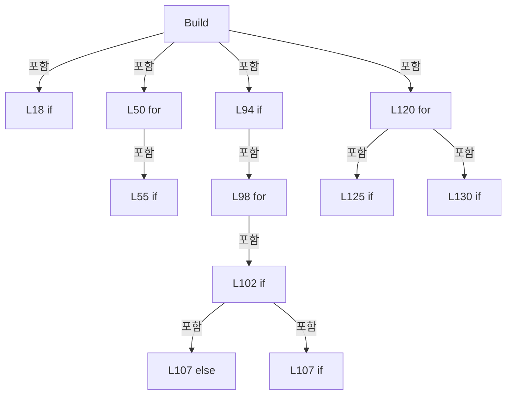

변경 전 점검: 입력/반환 타입, 위 호출자, 예외/취소 경로, 공유 상태와 저장·전송 소비자를 함께 확인합니다. 값의 단위나 물리 방향을 이름만으로 확정하지 않습니다.

### LocalFunctionStatement `SelectHeadNo` · L37–40

[Drilling.Common/Recipe/CShotCoordinatePlanBuilder.cs:37–40](https://github.com/kjuws10-rgb/A3Drilling/blob/334b3599651b2e8e0181fd4459bafaf3cddafff3/Drilling.Common/Recipe/CShotCoordinatePlanBuilder.cs#L37-L40)

| 항목 | 실제 추출 값 |
| --- | --- |
| 서명 | int SelectHeadNo(int) |
| 접근/수식자 | Private /  |
| 반환/값 타입 | int |
| 소속 타입 | NamedType:Drilling.Common.Recipe.CShotCoordinatePlanBuilder |

입력 계약:

| 이름 | 타입 | 전달 | 선택/기본값 |
| --- | --- | --- | --- |
| headNo | int | None | False /  |

현재 부분 분석에서 직접 연결된 호출자는 없습니다. XAML/이벤트/인터페이스·델리게이트·외부 진입을 추가 확인해야 하며, 미사용으로 판정한 것이 아닙니다.

본문의 실제 연산·분기·예외·반환 순서(원문 위치 순):

| 원본 행 | 종류 | 주석 해설 |
| --- | --- | --- |
| 39 | return | 호출자에게 값 또는 제어를 반환합니다: return headNo; |

변경 전 점검: 입력/반환 타입, 위 호출자, 예외/취소 경로, 공유 상태와 저장·전송 소비자를 함께 확인합니다. 값의 단위나 물리 방향을 이름만으로 확정하지 않습니다.

### LocalFunctionStatement `SelectValue` · L42–45

[Drilling.Common/Recipe/CShotCoordinatePlanBuilder.cs:42–45](https://github.com/kjuws10-rgb/A3Drilling/blob/334b3599651b2e8e0181fd4459bafaf3cddafff3/Drilling.Common/Recipe/CShotCoordinatePlanBuilder.cs#L42-L45)

| 항목 | 실제 추출 값 |
| --- | --- |
| 서명 | int SelectValue(int) |
| 접근/수식자 | Private /  |
| 반환/값 타입 | int |
| 소속 타입 | NamedType:Drilling.Common.Recipe.CShotCoordinatePlanBuilder |

입력 계약:

| 이름 | 타입 | 전달 | 선택/기본값 |
| --- | --- | --- | --- |
| arg0 | int | None | False /  |

현재 부분 분석에서 직접 연결된 호출자는 없습니다. XAML/이벤트/인터페이스·델리게이트·외부 진입을 추가 확인해야 하며, 미사용으로 판정한 것이 아닙니다.

본문의 실제 연산·분기·예외·반환 순서(원문 위치 순):

| 원본 행 | 종류 | 주석 해설 |
| --- | --- | --- |
| 44 | return | 호출자에게 값 또는 제어를 반환합니다: return 0; |

변경 전 점검: 입력/반환 타입, 위 호출자, 예외/취소 경로, 공유 상태와 저장·전송 소비자를 함께 확인합니다. 값의 단위나 물리 방향을 이름만으로 확정하지 않습니다.

### LocalFunctionStatement `SelectItem` · L192–198

[Drilling.Common/Recipe/CShotCoordinatePlanBuilder.cs:192–198](https://github.com/kjuws10-rgb/A3Drilling/blob/334b3599651b2e8e0181fd4459bafaf3cddafff3/Drilling.Common/Recipe/CShotCoordinatePlanBuilder.cs#L192-L198)

| 항목 | 실제 추출 값 |
| --- | --- |
| 서명 | Drilling.Common.Recipe.ST_HEAD_SHOT_POINT SelectItem(Drilling.Common.Recipe.ST_HEAD_SHOT_POINT, int) |
| 접근/수식자 | Private /  |
| 반환/값 타입 | Drilling.Common.Recipe.ST_HEAD_SHOT_POINT |
| 소속 타입 | NamedType:Drilling.Common.Recipe.CShotCoordinatePlanBuilder |

입력 계약:

| 이름 | 타입 | 전달 | 선택/기본값 |
| --- | --- | --- | --- |
| shot | Drilling.Common.Recipe.ST_HEAD_SHOT_POINT | None | False /  |
| index | int | None | False /  |

현재 부분 분석에서 직접 연결된 호출자는 없습니다. XAML/이벤트/인터페이스·델리게이트·외부 진입을 추가 확인해야 하며, 미사용으로 판정한 것이 아닙니다.

본문의 실제 연산·분기·예외·반환 순서(원문 위치 순):

| 원본 행 | 종류 | 주석 해설 |
| --- | --- | --- |
| 194 | return | 호출자에게 값 또는 제어를 반환합니다: return shot with { SequenceNo = index + 1 }; |
| 196 | assignment | 값을 대상에 대입합니다: SequenceNo = index + 1 |

변경 전 점검: 입력/반환 타입, 위 호출자, 예외/취소 경로, 공유 상태와 저장·전송 소비자를 함께 확인합니다. 값의 단위나 물리 방향을 이름만으로 확정하지 않습니다.

### MethodDeclaration `ReadOffsetScale` · L204–211

[Drilling.Common/Recipe/CShotCoordinatePlanBuilder.cs:204–211](https://github.com/kjuws10-rgb/A3Drilling/blob/334b3599651b2e8e0181fd4459bafaf3cddafff3/Drilling.Common/Recipe/CShotCoordinatePlanBuilder.cs#L204-L211)

| 항목 | 실제 추출 값 |
| --- | --- |
| 서명 | double Drilling.Common.Recipe.CShotCoordinatePlanBuilder.ReadOffsetScale(System.Collections.Generic.IReadOnlyDictionary<string, string>, string) |
| 접근/수식자 | Private / private, static |
| 반환/값 타입 | double |
| 소속 타입 | NamedType:Drilling.Common.Recipe.CShotCoordinatePlanBuilder |

입력 계약:

| 이름 | 타입 | 전달 | 선택/기본값 |
| --- | --- | --- | --- |
| parameters | System.Collections.Generic.IReadOnlyDictionary<string, string> | None | False /  |
| key | string | None | False /  |

정적 호출자로 확인된 위치:

| 호출 파일/행 | 호출 표현식 | 런타임 분기 가능 |
| --- | --- | --- |
| [Drilling.Common/Recipe/CShotCoordinatePlanBuilder.cs:35–35](https://github.com/kjuws10-rgb/A3Drilling/blob/334b3599651b2e8e0181fd4459bafaf3cddafff3/Drilling.Common/Recipe/CShotCoordinatePlanBuilder.cs#L35-L35) | ReadOffsetScale | False |
| [Drilling.Common/Recipe/CShotCoordinatePlanBuilder.cs:36–36](https://github.com/kjuws10-rgb/A3Drilling/blob/334b3599651b2e8e0181fd4459bafaf3cddafff3/Drilling.Common/Recipe/CShotCoordinatePlanBuilder.cs#L36-L36) | ReadOffsetScale | False |

호출하는 대상과 해석 범위:

| 원본 행 | 표현식 | 분석 상태 | 대상/소스 위치 |
| --- | --- | --- | --- |
| 206 | parameters.TryGetValue | resolved · 동적 구현 선택 가능 | bool System.Collections.Generic.IReadOnlyDictionary<string, string>.TryGetValue(string, out string) |
| 208 | int.TryParse | resolved | bool int.TryParse(string?, System.Globalization.NumberStyles, System.IFormatProvider?, out int) |
| 209 | new InvalidOperationException | resolved | System.InvalidOperationException.InvalidOperationException(string?) |

본문의 실제 연산·분기·예외·반환 순서(원문 위치 순):

| 원본 행 | 종류 | 주석 해설 |
| --- | --- | --- |
| 206 | call | 함수·델리게이트 또는 객체 생성자를 호출합니다: parameters.TryGetValue(key, out var text) |
| 206 | if | 조건에 따라 분기합니다: if (!parameters.TryGetValue(key, out var text)) |
| 207 | return | 호출자에게 값 또는 제어를 반환합니다: return 1.0; |
| 208 | call | 함수·델리게이트 또는 객체 생성자를 호출합니다: int.TryParse(text, NumberStyles.Integer, CultureInfo.InvariantCulture, out var percent) |
| 208 | if | 조건에 따라 분기합니다: if (!int.TryParse(text, NumberStyles.Integer, CultureInfo.InvariantCulture, out var percent) &#124;&#124; percent < 0) |
| 209 | call | 함수·델리게이트 또는 객체 생성자를 호출합니다: new InvalidOperationException($"{key}: 0 이상의 정수(%)를 입력해 주세요.") |
| 209 | throw | 예외를 발생/전달합니다: throw new InvalidOperationException($"{key}: 0 이상의 정수(%)를 입력해 주세요."); |
| 210 | return | 호출자에게 값 또는 제어를 반환합니다: return percent / 100.0; |

제어 구문의 포함 구조(실제 실행 순서/CFG가 아닌 구문 탐색 그림):

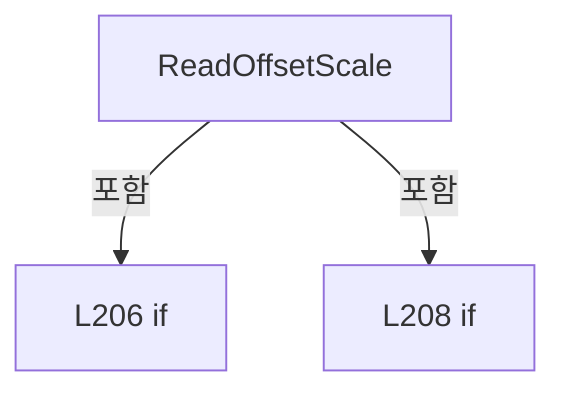

변경 전 점검: 입력/반환 타입, 위 호출자, 예외/취소 경로, 공유 상태와 저장·전송 소비자를 함께 확인합니다. 값의 단위나 물리 방향을 이름만으로 확정하지 않습니다.

### MethodDeclaration `BuildDesignShots` · L215–221

[Drilling.Common/Recipe/CShotCoordinatePlanBuilder.cs:215–221](https://github.com/kjuws10-rgb/A3Drilling/blob/334b3599651b2e8e0181fd4459bafaf3cddafff3/Drilling.Common/Recipe/CShotCoordinatePlanBuilder.cs#L215-L221)

| 항목 | 실제 추출 값 |
| --- | --- |
| 서명 | System.Collections.Generic.IReadOnlyList<Drilling.Common.Recipe.ST_DESIGN_SHOT_POINT> Drilling.Common.Recipe.CShotCoordinatePlanBuilder.BuildDesignShots(System.Collections.Generic.IReadOnlyDictionary<string, string>) |
| 접근/수식자 | Public / public, static |
| 반환/값 타입 | System.Collections.Generic.IReadOnlyList<Drilling.Common.Recipe.ST_DESIGN_SHOT_POINT> |
| 소속 타입 | NamedType:Drilling.Common.Recipe.CShotCoordinatePlanBuilder |

입력 계약:

| 이름 | 타입 | 전달 | 선택/기본값 |
| --- | --- | --- | --- |
| parameters | System.Collections.Generic.IReadOnlyDictionary<string, string> | None | False /  |

정적 호출자로 확인된 위치:

| 호출 파일/행 | 호출 표현식 | 런타임 분기 가능 |
| --- | --- | --- |
| [Drilling.Common/Recipe/CShotCoordinatePlanBuilder.cs:690–690](https://github.com/kjuws10-rgb/A3Drilling/blob/334b3599651b2e8e0181fd4459bafaf3cddafff3/Drilling.Common/Recipe/CShotCoordinatePlanBuilder.cs#L690-L690) | CShotCoordinatePlanBuilder.BuildDesignShots | False |
| [Drilling.Common/Recipe/CShotCoordinatePlanBuilder.cs:714–714](https://github.com/kjuws10-rgb/A3Drilling/blob/334b3599651b2e8e0181fd4459bafaf3cddafff3/Drilling.Common/Recipe/CShotCoordinatePlanBuilder.cs#L714-L714) | CShotCoordinatePlanBuilder.BuildDesignShots | False |
| [Drilling.UI/Menu/Menus/CMenuCorrection.ReviewData.Display.cs:340–340](https://github.com/kjuws10-rgb/A3Drilling/blob/334b3599651b2e8e0181fd4459bafaf3cddafff3/Drilling.UI/Menu/Menus/CMenuCorrection.ReviewData.Display.cs#L340-L340) | CShotCoordinatePlanBuilder.BuildDesignShots | False |
| [Drilling.UI/Menu/Menus/CMenuCorrection.cs:5767–5767](https://github.com/kjuws10-rgb/A3Drilling/blob/334b3599651b2e8e0181fd4459bafaf3cddafff3/Drilling.UI/Menu/Menus/CMenuCorrection.cs#L5767-L5767) | CShotCoordinatePlanBuilder.BuildDesignShots | False |
| [Drilling.UI/Menu/Menus/CMenuCorrection.cs:7798–7798](https://github.com/kjuws10-rgb/A3Drilling/blob/334b3599651b2e8e0181fd4459bafaf3cddafff3/Drilling.UI/Menu/Menus/CMenuCorrection.cs#L7798-L7798) | CShotCoordinatePlanBuilder.BuildDesignShots | False |

호출하는 대상과 해석 범위:

| 원본 행 | 표현식 | 분석 상태 | 대상/소스 위치 |
| --- | --- | --- | --- |
| 217 | ReadInt | resolved | int Drilling.Common.Recipe.CShotCoordinatePlanBuilder.ReadInt(System.Collections.Generic.IReadOnlyDictionary<string, string>, int, params string[]) · Drilling.Common/Recipe/CShotCoordinatePlanBuilder.cs:596 |
| 219 | new InvalidOperationException | resolved | System.InvalidOperationException.InvalidOperationException(string?) |
| 220 | BuildDesignShots | resolved | System.Collections.Generic.IReadOnlyList<Drilling.Common.Recipe.ST_DESIGN_SHOT_POINT> Drilling.Common.Recipe.CShotCoordinatePlanBuilder.BuildDesignShots(System.Collections.Generic.IReadOnlyDictionary<string, string>, int) · Drilling.Common/Recipe/CShotCoordinatePlanBuilder.cs:223 |

본문의 실제 연산·분기·예외·반환 순서(원문 위치 순):

| 원본 행 | 종류 | 주석 해설 |
| --- | --- | --- |
| 217 | call | 함수·델리게이트 또는 객체 생성자를 호출합니다: ReadInt(parameters, 0, "MAX_CELL_NUMBER") |
| 217 | local-declaration | 지역 변수를 선언합니다: var cellCount = ReadInt(parameters, 0, "MAX_CELL_NUMBER"); |
| 217 | variable-initializer | 변수의 초기값을 지정합니다: cellCount = ReadInt(parameters, 0, "MAX_CELL_NUMBER") |
| 218 | if | 조건에 따라 분기합니다: if (cellCount < CCellPatternCalculator.MinCellCount) |
| 219 | call | 함수·델리게이트 또는 객체 생성자를 호출합니다: new InvalidOperationException("MAX_CELL_NUMBER must be greater than or equal to 1.") |
| 219 | throw | 예외를 발생/전달합니다: throw new InvalidOperationException("MAX_CELL_NUMBER must be greater than or equal to 1."); |
| 220 | call | 함수·델리게이트 또는 객체 생성자를 호출합니다: BuildDesignShots(parameters, cellCount) |
| 220 | return | 호출자에게 값 또는 제어를 반환합니다: return BuildDesignShots(parameters, cellCount); |

제어 구문의 포함 구조(실제 실행 순서/CFG가 아닌 구문 탐색 그림):

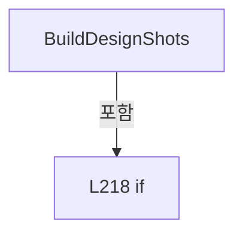

변경 전 점검: 입력/반환 타입, 위 호출자, 예외/취소 경로, 공유 상태와 저장·전송 소비자를 함께 확인합니다. 값의 단위나 물리 방향을 이름만으로 확정하지 않습니다.

### MethodDeclaration `BuildDesignShots` · L223–286

[Drilling.Common/Recipe/CShotCoordinatePlanBuilder.cs:223–286](https://github.com/kjuws10-rgb/A3Drilling/blob/334b3599651b2e8e0181fd4459bafaf3cddafff3/Drilling.Common/Recipe/CShotCoordinatePlanBuilder.cs#L223-L286)

| 항목 | 실제 추출 값 |
| --- | --- |
| 서명 | System.Collections.Generic.IReadOnlyList<Drilling.Common.Recipe.ST_DESIGN_SHOT_POINT> Drilling.Common.Recipe.CShotCoordinatePlanBuilder.BuildDesignShots(System.Collections.Generic.IReadOnlyDictionary<string, string>, int) |
| 접근/수식자 | Private / private, static |
| 반환/값 타입 | System.Collections.Generic.IReadOnlyList<Drilling.Common.Recipe.ST_DESIGN_SHOT_POINT> |
| 소속 타입 | NamedType:Drilling.Common.Recipe.CShotCoordinatePlanBuilder |

입력 계약:

| 이름 | 타입 | 전달 | 선택/기본값 |
| --- | --- | --- | --- |
| parameters | System.Collections.Generic.IReadOnlyDictionary<string, string> | None | False /  |
| cellCount | int | None | False /  |

정적 호출자로 확인된 위치:

| 호출 파일/행 | 호출 표현식 | 런타임 분기 가능 |
| --- | --- | --- |
| [Drilling.Common/Recipe/CShotCoordinatePlanBuilder.cs:48–48](https://github.com/kjuws10-rgb/A3Drilling/blob/334b3599651b2e8e0181fd4459bafaf3cddafff3/Drilling.Common/Recipe/CShotCoordinatePlanBuilder.cs#L48-L48) | BuildDesignShots | False |
| [Drilling.Common/Recipe/CShotCoordinatePlanBuilder.cs:220–220](https://github.com/kjuws10-rgb/A3Drilling/blob/334b3599651b2e8e0181fd4459bafaf3cddafff3/Drilling.Common/Recipe/CShotCoordinatePlanBuilder.cs#L220-L220) | BuildDesignShots | False |

호출하는 대상과 해석 범위:

| 원본 행 | 표현식 | 분석 상태 | 대상/소스 위치 |
| --- | --- | --- | --- |
| 225 | CAlignKeyMarginSettings.Read | resolved | Drilling.Common.Managers.ST_ALIGN_KEY_MARGINS Drilling.Common.Managers.CAlignKeyMarginSettings.Read(System.Collections.Generic.IReadOnlyDictionary<string, string>) · Drilling.Common/Managers/CAlignKeyMarginSettings.cs:21 |
| 226 | ReadDouble | resolved | double Drilling.Common.Recipe.CShotCoordinatePlanBuilder.ReadDouble(System.Collections.Generic.IReadOnlyDictionary<string, string>, double, params string[]) · Drilling.Common/Recipe/CShotCoordinatePlanBuilder.cs:560 |
| 227 | ReadInt | resolved | int Drilling.Common.Recipe.CShotCoordinatePlanBuilder.ReadInt(System.Collections.Generic.IReadOnlyDictionary<string, string>, int, params string[]) · Drilling.Common/Recipe/CShotCoordinatePlanBuilder.cs:596 |
| 228 | CRecipeModelPixelCountReader.ReadModelTypeCount | resolved | int Drilling.Common.Recipe.CRecipeModelPixelCountReader.ReadModelTypeCount(System.Collections.Generic.IReadOnlyDictionary<string, string>) · Drilling.Common/Recipe/CCellPatternCalculator.cs:428 |
| 229 | new List<ST_DESIGN_SHOT_POINT> | resolved | System.Collections.Generic.List<Drilling.Common.Recipe.ST_DESIGN_SHOT_POINT>.List() |
| 232 | CRecipeModelPixelCountReader.ReadCellModelType | resolved | int Drilling.Common.Recipe.CRecipeModelPixelCountReader.ReadCellModelType(System.Collections.Generic.IReadOnlyDictionary<string, string>, int, int) · Drilling.Common/Recipe/CCellPatternCalculator.cs:433 |
| 233 | CRecipeModelPixelCountReader.ReadPatternForModel | resolved | Drilling.Common.Recipe.ST_RECIPE_MODEL_PATTERN Drilling.Common.Recipe.CRecipeModelPixelCountReader.ReadPatternForModel(System.Collections.Generic.IReadOnlyDictionary<string, string>, int) · Drilling.Common/Recipe/CCellPatternCalculator.cs:455 |
| 234 | CCellPatternCalculator.Calculate | resolved | Drilling.Common.Recipe.ST_CELL_PATTERN_LAYOUT Drilling.Common.Recipe.CCellPatternCalculator.Calculate(Drilling.Common.Recipe.ST_CELL_PATTERN_DEFINITION) · Drilling.Common/Recipe/CCellPatternCalculator.cs:65 |
| 234 | new ST_CELL_PATTERN_DEFINITION | resolved | Drilling.Common.Recipe.ST_CELL_PATTERN_DEFINITION.ST_CELL_PATTERN_DEFINITION(int, double, double, double, double, int, int, int, int, double, double) · Drilling.Common/Recipe/CCellPatternCalculator.cs:277 |
| 236 | ReadDouble | resolved | double Drilling.Common.Recipe.CShotCoordinatePlanBuilder.ReadDouble(System.Collections.Generic.IReadOnlyDictionary<string, string>, double, params string[]) · Drilling.Common/Recipe/CShotCoordinatePlanBuilder.cs:560 |
| 237 | ReadDouble | resolved | double Drilling.Common.Recipe.CShotCoordinatePlanBuilder.ReadDouble(System.Collections.Generic.IReadOnlyDictionary<string, string>, double, params string[]) · Drilling.Common/Recipe/CShotCoordinatePlanBuilder.cs:560 |
| 238 | ReadDouble | resolved | double Drilling.Common.Recipe.CShotCoordinatePlanBuilder.ReadDouble(System.Collections.Generic.IReadOnlyDictionary<string, string>, double, params string[]) · Drilling.Common/Recipe/CShotCoordinatePlanBuilder.cs:560 |
| 249 | new InvalidOperationException | resolved | System.InvalidOperationException.InvalidOperationException(string?) |
| 255 | new InvalidOperationException | resolved | System.InvalidOperationException.InvalidOperationException(string?) |
| 260 | CReviewShotNameFormatter.ToMatrixName | resolved | string Drilling.Common.Review.CReviewShotNameFormatter.ToMatrixName(int, int) · Drilling.Common/Review/CReviewManager.cs:4141 |
| 265 | designShots.Add | resolved | void System.Collections.Generic.List<Drilling.Common.Recipe.ST_DESIGN_SHOT_POINT>.Add(Drilling.Common.Recipe.ST_DESIGN_SHOT_POINT) |
| 265 | new ST_DESIGN_SHOT_POINT | resolved | Drilling.Common.Recipe.ST_DESIGN_SHOT_POINT.ST_DESIGN_SHOT_POINT(string, int, int, int, int, int, int, double, double, double, double, double, double, double, double) · Drilling.Common/Recipe/CShotCoordinatePlanBuilder.cs:1392 |
| 266 | ToShotKey | resolved | string Drilling.Common.Recipe.CShotCoordinatePlanBuilder.ToShotKey(int, int) · Drilling.Common/Recipe/CShotCoordinatePlanBuilder.cs:555 |
| 275 | ReadDouble | resolved | double Drilling.Common.Recipe.CShotCoordinatePlanBuilder.ReadDouble(System.Collections.Generic.IReadOnlyDictionary<string, string>, double, params string[]) · Drilling.Common/Recipe/CShotCoordinatePlanBuilder.cs:560 |
| 276 | ReadDouble | resolved | double Drilling.Common.Recipe.CShotCoordinatePlanBuilder.ReadDouble(System.Collections.Generic.IReadOnlyDictionary<string, string>, double, params string[]) · Drilling.Common/Recipe/CShotCoordinatePlanBuilder.cs:560 |
| 277 | ReadDouble | resolved | double Drilling.Common.Recipe.CShotCoordinatePlanBuilder.ReadDouble(System.Collections.Generic.IReadOnlyDictionary<string, string>, double, params string[]) · Drilling.Common/Recipe/CShotCoordinatePlanBuilder.cs:560 |
| 278 | ReadDouble | resolved | double Drilling.Common.Recipe.CShotCoordinatePlanBuilder.ReadDouble(System.Collections.Generic.IReadOnlyDictionary<string, string>, double, params string[]) · Drilling.Common/Recipe/CShotCoordinatePlanBuilder.cs:560 |
| 279 | CAlignShotOffsetData.ReadValue | resolved | double Drilling.Common.Recipe.CAlignShotOffsetData.ReadValue(System.Collections.Generic.IReadOnlyDictionary<string, string>, string) · Drilling.Common/Recipe/CShotCoordinatePlanBuilder.cs:673 |
| 280 | CAlignShotOffsetData.ReadValue | resolved | double Drilling.Common.Recipe.CAlignShotOffsetData.ReadValue(System.Collections.Generic.IReadOnlyDictionary<string, string>, string) · Drilling.Common/Recipe/CShotCoordinatePlanBuilder.cs:673 |
| 281 | CReviewOffsetData.IsDesignCoordinate | resolved | bool Drilling.Common.Recipe.CReviewOffsetData.IsDesignCoordinate(System.Collections.Generic.IReadOnlyDictionary<string, string>, string) · Drilling.Common/Recipe/CShotCoordinatePlanBuilder.cs:1205 |

본문의 실제 연산·분기·예외·반환 순서(원문 위치 순):

| 원본 행 | 종류 | 주석 해설 |
| --- | --- | --- |
| 225 | call | 함수·델리게이트 또는 객체 생성자를 호출합니다: CAlignKeyMarginSettings.Read(parameters) |
| 225 | local-declaration | 지역 변수를 선언합니다: var alignKeyMargins = CAlignKeyMarginSettings.Read(parameters); |
| 225 | variable-initializer | 변수의 초기값을 지정합니다: alignKeyMargins = CAlignKeyMarginSettings.Read(parameters) |
| 226 | call | 함수·델리게이트 또는 객체 생성자를 호출합니다: ReadDouble(parameters, 0.09, "PIXEL_SIZE") |
| 226 | local-declaration | 지역 변수를 선언합니다: var pixelSize = ReadDouble(parameters, 0.09, "PIXEL_SIZE"); |
| 226 | variable-initializer | 변수의 초기값을 지정합니다: pixelSize = ReadDouble(parameters, 0.09, "PIXEL_SIZE") |
| 227 | call | 함수·델리게이트 또는 객체 생성자를 호출합니다: ReadInt(parameters, 1, "SPLITED_BEAM_COUNT") |
| 227 | local-declaration | 지역 변수를 선언합니다: var splitBeamCount = ReadInt(parameters, 1, "SPLITED_BEAM_COUNT"); |
| 227 | variable-initializer | 변수의 초기값을 지정합니다: splitBeamCount = ReadInt(parameters, 1, "SPLITED_BEAM_COUNT") |
| 228 | call | 함수·델리게이트 또는 객체 생성자를 호출합니다: CRecipeModelPixelCountReader.ReadModelTypeCount(parameters) |
| 228 | local-declaration | 지역 변수를 선언합니다: var modelTypeCount = CRecipeModelPixelCountReader.ReadModelTypeCount(parameters); |
| 228 | variable-initializer | 변수의 초기값을 지정합니다: modelTypeCount = CRecipeModelPixelCountReader.ReadModelTypeCount(parameters) |
| 229 | call | 함수·델리게이트 또는 객체 생성자를 호출합니다: new List<ST_DESIGN_SHOT_POINT>() |
| 229 | local-declaration | 지역 변수를 선언합니다: var designShots = new List<ST_DESIGN_SHOT_POINT>(); |
| 229 | variable-initializer | 변수의 초기값을 지정합니다: designShots = new List<ST_DESIGN_SHOT_POINT>() |
| 230 | variable-initializer | 변수의 초기값을 지정합니다: cellNo = 1 |
| 230 | for | 초기화·조건·증감이 있는 반복입니다: for (var cellNo = 1; cellNo <= cellCount; cellNo++) |
| 232 | call | 함수·델리게이트 또는 객체 생성자를 호출합니다: CRecipeModelPixelCountReader.ReadCellModelType(parameters, cellNo, modelTypeCount) |
| 232 | local-declaration | 지역 변수를 선언합니다: var modelType = CRecipeModelPixelCountReader.ReadCellModelType(parameters, cellNo, modelTypeCount); |
| 232 | variable-initializer | 변수의 초기값을 지정합니다: modelType = CRecipeModelPixelCountReader.ReadCellModelType(parameters, cellNo, modelTypeCount) |
| 233 | call | 함수·델리게이트 또는 객체 생성자를 호출합니다: CRecipeModelPixelCountReader.ReadPatternForModel(parameters, modelType) |
| 233 | local-declaration | 지역 변수를 선언합니다: var modelPattern = CRecipeModelPixelCountReader.ReadPatternForModel(parameters, modelType); |
| 233 | variable-initializer | 변수의 초기값을 지정합니다: modelPattern = CRecipeModelPixelCountReader.ReadPatternForModel(parameters, modelType) |
| 234 | call | 함수·델리게이트 또는 객체 생성자를 호출합니다: CCellPatternCalculator.Calculate(new ST_CELL_PATTERN_DEFINITION( cellNo, ReadDouble(parameters, 0.0, $"CELL{cellNo}_ALIGN_TO_1ST_PIXEL_X"), ReadDouble(parameters, 0.0, $"CELL{cellNo}_ALIGN_TO_1ST_PIXEL_Y"), ReadDouble(pa… |
| 234 | call | 함수·델리게이트 또는 객체 생성자를 호출합니다: new ST_CELL_PATTERN_DEFINITION( cellNo, ReadDouble(parameters, 0.0, $"CELL{cellNo}_ALIGN_TO_1ST_PIXEL_X"), ReadDouble(parameters, 0.0, $"CELL{cellNo}_ALIGN_TO_1ST_PIXEL_Y"), ReadDouble(parameters, 0.0, $"CELL{cellNo}_ROT… |
| 234 | local-declaration | 지역 변수를 선언합니다: var result = CCellPatternCalculator.Calculate(new ST_CELL_PATTERN_DEFINITION( cellNo, ReadDouble(parameters, 0.0, $"CELL{cellNo}_ALIGN_TO_1ST_PIXEL_X"), ReadDouble(parameters, 0.0, $"CELL{cellNo}_ALIGN_TO_1ST_PIXEL_Y"), ReadDouble |
| 234 | variable-initializer | 변수의 초기값을 지정합니다: result = CCellPatternCalculator.Calculate(new ST_CELL_PATTERN_DEFINITION( cellNo, ReadDouble(parameters, 0.0, $"CELL{cellNo}_ALIGN_TO_1ST_PIXEL_X"), ReadDouble(parameters, 0.0, $"CELL{cellNo}_ALIGN_TO_1ST_PIXEL_Y"), ReadDouble(par |
| 236 | call | 함수·델리게이트 또는 객체 생성자를 호출합니다: ReadDouble(parameters, 0.0, $"CELL{cellNo}_ALIGN_TO_1ST_PIXEL_X") |
| 237 | call | 함수·델리게이트 또는 객체 생성자를 호출합니다: ReadDouble(parameters, 0.0, $"CELL{cellNo}_ALIGN_TO_1ST_PIXEL_Y") |
| 238 | call | 함수·델리게이트 또는 객체 생성자를 호출합니다: ReadDouble(parameters, 0.0, $"CELL{cellNo}_ROTATION") |
| 247 | if | 조건에 따라 분기합니다: if (!result.IsValid) |
| 249 | call | 함수·델리게이트 또는 객체 생성자를 호출합니다: new InvalidOperationException(result.ValidationMessage) |
| 249 | throw | 예외를 발생/전달합니다: throw new InvalidOperationException(result.ValidationMessage); |
| 252 | local-declaration | 지역 변수를 선언합니다: var totalShotGroupCount = (long)designShots.Count + result.ShotCenters.Count; |
| 252 | variable-initializer | 변수의 초기값을 지정합니다: totalShotGroupCount = (long)designShots.Count + result.ShotCenters.Count |
| 253 | if | 조건에 따라 분기합니다: if (totalShotGroupCount > CCellPatternCalculator.MaxTotalShotGroupCount) |
| 255 | call | 함수·델리게이트 또는 객체 생성자를 호출합니다: new InvalidOperationException($"Shot Group Count {totalShotGroupCount:N0} exceeds the total limit " + $"{CCellPatternCalculator.MaxTotalShotGroupCount:N0}.") |
| 255 | throw | 예외를 발생/전달합니다: throw new InvalidOperationException($"Shot Group Count {totalShotGroupCount:N0} exceeds the total limit " + $"{CCellPatternCalculator.MaxTotalShotGroupCount:N0}."); |
| 258 | foreach | 컬렉션 요소를 순회합니다: foreach (var shotCenter in result.ShotCenters) |
| 260 | call | 함수·델리게이트 또는 객체 생성자를 호출합니다: CReviewShotNameFormatter.ToMatrixName(shotCenter.CellShotNo, result.GroupCountX) |
| 260 | local-declaration | 지역 변수를 선언합니다: var shotGroupName = CReviewShotNameFormatter.ToMatrixName(shotCenter.CellShotNo, result.GroupCountX); |
| 260 | variable-initializer | 변수의 초기값을 지정합니다: shotGroupName = CReviewShotNameFormatter.ToMatrixName(shotCenter.CellShotNo, result.GroupCountX) |
| 261 | local-declaration | 지역 변수를 선언합니다: var recipeOffsetPrefix = $"CELL{cellNo}_{shotGroupName}_RECIPE_OFFSET_"; |
| 261 | variable-initializer | 변수의 초기값을 지정합니다: recipeOffsetPrefix = $"CELL{cellNo}_{shotGroupName}_RECIPE_OFFSET_" |
| 262 | local-declaration | 지역 변수를 선언합니다: var reviewOffsetPrefix = $"CELL{cellNo}_{shotGroupName}_REVIEW_OFFSET_"; |
| 262 | variable-initializer | 변수의 초기값을 지정합니다: reviewOffsetPrefix = $"CELL{cellNo}_{shotGroupName}_REVIEW_OFFSET_" |
| 263 | local-declaration | 지역 변수를 선언합니다: var alignOffsetPrefix = $"CELL{cellNo}_{shotGroupName}_ALIGN_OFFSET_"; |
| 263 | variable-initializer | 변수의 초기값을 지정합니다: alignOffsetPrefix = $"CELL{cellNo}_{shotGroupName}_ALIGN_OFFSET_" |
| 265 | call | 함수·델리게이트 또는 객체 생성자를 호출합니다: designShots.Add(new ST_DESIGN_SHOT_POINT( ToShotKey(cellNo, shotCenter.CellShotNo), cellNo, shotCenter.CellShotNo, shotCenter.GroupColumn, shotCenter.GroupRow, result.GroupCountX, result.GroupCountY, shotCenter.DesignX, … |
| 265 | call | 함수·델리게이트 또는 객체 생성자를 호출합니다: new ST_DESIGN_SHOT_POINT( ToShotKey(cellNo, shotCenter.CellShotNo), cellNo, shotCenter.CellShotNo, shotCenter.GroupColumn, shotCenter.GroupRow, result.GroupCountX, result.GroupCountY, shotCenter.DesignX, shotCenter.Desig… |
| 266 | call | 함수·델리게이트 또는 객체 생성자를 호출합니다: ToShotKey(cellNo, shotCenter.CellShotNo) |
| 275 | call | 함수·델리게이트 또는 객체 생성자를 호출합니다: ReadDouble(parameters, 0.0, $"{recipeOffsetPrefix}X") |
| 276 | call | 함수·델리게이트 또는 객체 생성자를 호출합니다: ReadDouble(parameters, 0.0, $"{recipeOffsetPrefix}Y") |
| 277 | call | 함수·델리게이트 또는 객체 생성자를 호출합니다: ReadDouble(parameters, 0.0, $"{reviewOffsetPrefix}X") |
| 278 | call | 함수·델리게이트 또는 객체 생성자를 호출합니다: ReadDouble(parameters, 0.0, $"{reviewOffsetPrefix}Y") |
| 279 | call | 함수·델리게이트 또는 객체 생성자를 호출합니다: CAlignShotOffsetData.ReadValue(parameters, $"{alignOffsetPrefix}X") |
| 280 | call | 함수·델리게이트 또는 객체 생성자를 호출합니다: CAlignShotOffsetData.ReadValue(parameters, $"{alignOffsetPrefix}Y") |
| 281 | assignment | 값을 대상에 대입합니다: ReviewOffsetIsDesign = CReviewOffsetData.IsDesignCoordinate(parameters, reviewOffsetPrefix) |
| 281 | call | 함수·델리게이트 또는 객체 생성자를 호출합니다: CReviewOffsetData.IsDesignCoordinate(parameters, reviewOffsetPrefix) |
| 285 | return | 호출자에게 값 또는 제어를 반환합니다: return designShots; |

제어 구문의 포함 구조(실제 실행 순서/CFG가 아닌 구문 탐색 그림):

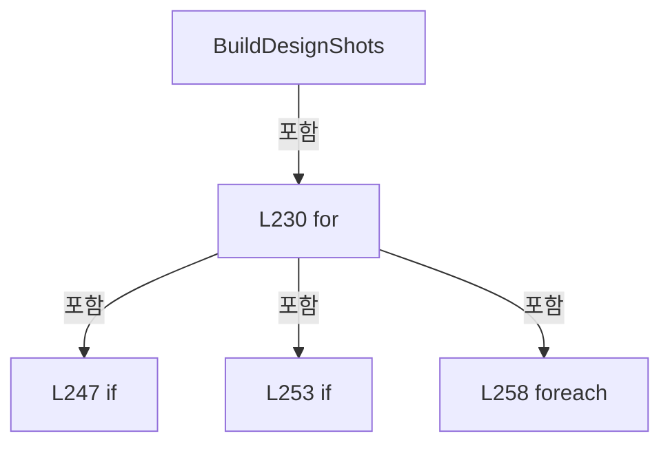

변경 전 점검: 입력/반환 타입, 위 호출자, 예외/취소 경로, 공유 상태와 저장·전송 소비자를 함께 확인합니다. 값의 단위나 물리 방향을 이름만으로 확정하지 않습니다.

### MethodDeclaration `OrderShots` · L288–351

[Drilling.Common/Recipe/CShotCoordinatePlanBuilder.cs:288–351](https://github.com/kjuws10-rgb/A3Drilling/blob/334b3599651b2e8e0181fd4459bafaf3cddafff3/Drilling.Common/Recipe/CShotCoordinatePlanBuilder.cs#L288-L351)

| 항목 | 실제 추출 값 |
| --- | --- |
| 서명 | System.Collections.Generic.IReadOnlyList<Drilling.Common.Recipe.ST_HEAD_SHOT_POINT> Drilling.Common.Recipe.CShotCoordinatePlanBuilder.OrderShots(System.Collections.Generic.IReadOnlyList<Drilling.Common.Recipe.ST_HEAD_SHOT_POINT>, double) |
| 접근/수식자 | Private / private, static |
| 반환/값 타입 | System.Collections.Generic.IReadOnlyList<Drilling.Common.Recipe.ST_HEAD_SHOT_POINT> |
| 소속 타입 | NamedType:Drilling.Common.Recipe.CShotCoordinatePlanBuilder |

입력 계약:

| 이름 | 타입 | 전달 | 선택/기본값 |
| --- | --- | --- | --- |
| shots | System.Collections.Generic.IReadOnlyList<Drilling.Common.Recipe.ST_HEAD_SHOT_POINT> | None | False /  |
| stageScanDirectionY | double | None | False /  |

정적 호출자로 확인된 위치:

| 호출 파일/행 | 호출 표현식 | 런타임 분기 가능 |
| --- | --- | --- |
| [Drilling.Common/Recipe/CShotCoordinatePlanBuilder.cs:200–200](https://github.com/kjuws10-rgb/A3Drilling/blob/334b3599651b2e8e0181fd4459bafaf3cddafff3/Drilling.Common/Recipe/CShotCoordinatePlanBuilder.cs#L200-L200) | OrderShots | False |

호출하는 대상과 해석 범위:

| 원본 행 | 표현식 | 분석 상태 | 대상/소스 위치 |
| --- | --- | --- | --- |
| 295 | shots.GroupBy(SelectGroupKey).ToArray | resolved | System.Linq.IGrouping<double, Drilling.Common.Recipe.ST_HEAD_SHOT_POINT>[] System.Collections.Generic.IEnumerable<System.Linq.IGrouping<double, Drilling.Common.Recipe.ST_HEAD_SHOT_POINT>>.ToArray<System.Linq.IGrouping<double, Drilling.Common.Recipe.ST_HEAD_SHOT_POINT>>() |
| 295 | shots.GroupBy | resolved | System.Collections.Generic.IEnumerable<System.Linq.IGrouping<double, Drilling.Common.Recipe.ST_HEAD_SHOT_POINT>> System.Collections.Generic.IEnumerable<Drilling.Common.Recipe.ST_HEAD_SHOT_POINT>.GroupBy<Drilling.Common.Recipe.ST_HEAD_SHOT_POINT, double>(System.Func<Drilling.Common.Recipe.ST_HEAD_SHOT_POINT, double>) |
| 306 | (stageScanDirectionY < 0.0 ? rows.OrderByDescending(SelectDescendingRowKey) : rows.OrderBy(SelectAscendingRowKey)).ToArray | resolved | System.Linq.IGrouping<double, Drilling.Common.Recipe.ST_HEAD_SHOT_POINT>[] System.Collections.Generic.IEnumerable<System.Linq.IGrouping<double, Drilling.Common.Recipe.ST_HEAD_SHOT_POINT>>.ToArray<System.Linq.IGrouping<double, Drilling.Common.Recipe.ST_HEAD_SHOT_POINT>>() |
| 306 | rows.OrderByDescending | resolved | System.Linq.IOrderedEnumerable<System.Linq.IGrouping<double, Drilling.Common.Recipe.ST_HEAD_SHOT_POINT>> System.Collections.Generic.IEnumerable<System.Linq.IGrouping<double, Drilling.Common.Recipe.ST_HEAD_SHOT_POINT>>.OrderByDescending<System.Linq.IGrouping<double, Drilling.Common.Recipe.ST_HEAD_SHOT_POINT>, double>(System.Func<System.Linq.IGrouping<double, Drilling.Common.Recipe.ST_HEAD_SHOT_POINT>, double>) |
| 306 | rows.OrderBy | resolved | System.Linq.IOrderedEnumerable<System.Linq.IGrouping<double, Drilling.Common.Recipe.ST_HEAD_SHOT_POINT>> System.Collections.Generic.IEnumerable<System.Linq.IGrouping<double, Drilling.Common.Recipe.ST_HEAD_SHOT_POINT>>.OrderBy<System.Linq.IGrouping<double, Drilling.Common.Recipe.ST_HEAD_SHOT_POINT>, double>(System.Func<System.Linq.IGrouping<double, Drilling.Common.Recipe.ST_HEAD_SHOT_POINT>, double>) |
| 307 | new List<ST_HEAD_SHOT_POINT> | resolved | System.Collections.Generic.List<Drilling.Common.Recipe.ST_HEAD_SHOT_POINT>.List(int) |
| 340 | row.GroupBy(SelectHeadNo).OrderBy | resolved | System.Linq.IOrderedEnumerable<System.Linq.IGrouping<int, Drilling.Common.Recipe.ST_HEAD_SHOT_POINT>> System.Collections.Generic.IEnumerable<System.Linq.IGrouping<int, Drilling.Common.Recipe.ST_HEAD_SHOT_POINT>>.OrderBy<System.Linq.IGrouping<int, Drilling.Common.Recipe.ST_HEAD_SHOT_POINT>, int>(System.Func<System.Linq.IGrouping<int, Drilling.Common.Recipe.ST_HEAD_SHOT_POINT>, int>) |
| 340 | row.GroupBy | resolved | System.Collections.Generic.IEnumerable<System.Linq.IGrouping<int, Drilling.Common.Recipe.ST_HEAD_SHOT_POINT>> System.Collections.Generic.IEnumerable<Drilling.Common.Recipe.ST_HEAD_SHOT_POINT>.GroupBy<Drilling.Common.Recipe.ST_HEAD_SHOT_POINT, int>(System.Func<Drilling.Common.Recipe.ST_HEAD_SHOT_POINT, int>) |
| 343 | headGroup.ToArray | resolved | Drilling.Common.Recipe.ST_HEAD_SHOT_POINT[] System.Collections.Generic.IEnumerable<Drilling.Common.Recipe.ST_HEAD_SHOT_POINT>.ToArray<Drilling.Common.Recipe.ST_HEAD_SHOT_POINT>() |
| 345 | UseScannerGyForMachiningSort | resolved | bool Drilling.Common.Recipe.CShotCoordinatePlanBuilder.UseScannerGyForMachiningSort(System.Collections.Generic.IReadOnlyList<Drilling.Common.Recipe.ST_HEAD_SHOT_POINT>) · Drilling.Common/Recipe/CShotCoordinatePlanBuilder.cs:353 |
| 345 | headRowShots.OrderBy(SelectScannerGy).ThenBy(SelectCellNo).ThenBy | resolved | System.Linq.IOrderedEnumerable<Drilling.Common.Recipe.ST_HEAD_SHOT_POINT> System.Linq.IOrderedEnumerable<Drilling.Common.Recipe.ST_HEAD_SHOT_POINT>.ThenBy<Drilling.Common.Recipe.ST_HEAD_SHOT_POINT, int>(System.Func<Drilling.Common.Recipe.ST_HEAD_SHOT_POINT, int>) |
| 345 | headRowShots.OrderBy(SelectScannerGy).ThenBy | resolved | System.Linq.IOrderedEnumerable<Drilling.Common.Recipe.ST_HEAD_SHOT_POINT> System.Linq.IOrderedEnumerable<Drilling.Common.Recipe.ST_HEAD_SHOT_POINT>.ThenBy<Drilling.Common.Recipe.ST_HEAD_SHOT_POINT, int>(System.Func<Drilling.Common.Recipe.ST_HEAD_SHOT_POINT, int>) |
| 345 | headRowShots.OrderBy | resolved | System.Linq.IOrderedEnumerable<Drilling.Common.Recipe.ST_HEAD_SHOT_POINT> System.Collections.Generic.IEnumerable<Drilling.Common.Recipe.ST_HEAD_SHOT_POINT>.OrderBy<Drilling.Common.Recipe.ST_HEAD_SHOT_POINT, double>(System.Func<Drilling.Common.Recipe.ST_HEAD_SHOT_POINT, double>) |
| 345 | headRowShots.OrderBy(SelectScannerGx).ThenBy(SelectCellNo).ThenBy | resolved | System.Linq.IOrderedEnumerable<Drilling.Common.Recipe.ST_HEAD_SHOT_POINT> System.Linq.IOrderedEnumerable<Drilling.Common.Recipe.ST_HEAD_SHOT_POINT>.ThenBy<Drilling.Common.Recipe.ST_HEAD_SHOT_POINT, int>(System.Func<Drilling.Common.Recipe.ST_HEAD_SHOT_POINT, int>) |
| 345 | headRowShots.OrderBy(SelectScannerGx).ThenBy | resolved | System.Linq.IOrderedEnumerable<Drilling.Common.Recipe.ST_HEAD_SHOT_POINT> System.Linq.IOrderedEnumerable<Drilling.Common.Recipe.ST_HEAD_SHOT_POINT>.ThenBy<Drilling.Common.Recipe.ST_HEAD_SHOT_POINT, int>(System.Func<Drilling.Common.Recipe.ST_HEAD_SHOT_POINT, int>) |
| 345 | headRowShots.OrderBy | resolved | System.Linq.IOrderedEnumerable<Drilling.Common.Recipe.ST_HEAD_SHOT_POINT> System.Collections.Generic.IEnumerable<Drilling.Common.Recipe.ST_HEAD_SHOT_POINT>.OrderBy<Drilling.Common.Recipe.ST_HEAD_SHOT_POINT, double>(System.Func<Drilling.Common.Recipe.ST_HEAD_SHOT_POINT, double>) |
| 346 | orderedShots.AddRange | resolved | void System.Collections.Generic.List<Drilling.Common.Recipe.ST_HEAD_SHOT_POINT>.AddRange(System.Collections.Generic.IEnumerable<Drilling.Common.Recipe.ST_HEAD_SHOT_POINT>) |

본문의 실제 연산·분기·예외·반환 순서(원문 위치 순):

| 원본 행 | 종류 | 주석 해설 |
| --- | --- | --- |
| 295 | call | 함수·델리게이트 또는 객체 생성자를 호출합니다: shots.GroupBy(SelectGroupKey).ToArray() |
| 295 | call | 함수·델리게이트 또는 객체 생성자를 호출합니다: shots.GroupBy(SelectGroupKey) |
| 295 | local-declaration | 지역 변수를 선언합니다: var rows = shots.GroupBy(SelectGroupKey).ToArray(); |
| 295 | variable-initializer | 변수의 초기값을 지정합니다: rows = shots.GroupBy(SelectGroupKey).ToArray() |
| 306 | call | 함수·델리게이트 또는 객체 생성자를 호출합니다: (stageScanDirectionY < 0.0 ? rows.OrderByDescending(SelectDescendingRowKey) : rows.OrderBy(SelectAscendingRowKey)).ToArray() |
| 306 | call | 함수·델리게이트 또는 객체 생성자를 호출합니다: rows.OrderByDescending(SelectDescendingRowKey) |
| 306 | call | 함수·델리게이트 또는 객체 생성자를 호출합니다: rows.OrderBy(SelectAscendingRowKey) |
| 306 | conditional-expression | 조건에 따라 결과식을 선택합니다: stageScanDirectionY < 0.0 ? rows.OrderByDescending(SelectDescendingRowKey) : rows.OrderBy(SelectAscendingRowKey) |
| 306 | local-declaration | 지역 변수를 선언합니다: var orderedRows = (stageScanDirectionY < 0.0 ? rows.OrderByDescending(SelectDescendingRowKey) : rows.OrderBy(SelectAscendingRowKey)).ToArray(); |
| 306 | variable-initializer | 변수의 초기값을 지정합니다: orderedRows = (stageScanDirectionY < 0.0 ? rows.OrderByDescending(SelectDescendingRowKey) : rows.OrderBy(SelectAscendingRowKey)).ToArray() |
| 307 | call | 함수·델리게이트 또는 객체 생성자를 호출합니다: new List<ST_HEAD_SHOT_POINT>(shots.Count) |
| 307 | local-declaration | 지역 변수를 선언합니다: var orderedShots = new List<ST_HEAD_SHOT_POINT>(shots.Count); |
| 307 | variable-initializer | 변수의 초기값을 지정합니다: orderedShots = new List<ST_HEAD_SHOT_POINT>(shots.Count) |
| 338 | foreach | 컬렉션 요소를 순회합니다: foreach (var row in orderedRows) |
| 340 | call | 함수·델리게이트 또는 객체 생성자를 호출합니다: row.GroupBy(SelectHeadNo).OrderBy(SelectHeadGroupKey) |
| 340 | call | 함수·델리게이트 또는 객체 생성자를 호출합니다: row.GroupBy(SelectHeadNo) |
| 340 | local-declaration | 지역 변수를 선언합니다: var headGroups = row.GroupBy(SelectHeadNo).OrderBy(SelectHeadGroupKey); |
| 340 | variable-initializer | 변수의 초기값을 지정합니다: headGroups = row.GroupBy(SelectHeadNo).OrderBy(SelectHeadGroupKey) |
| 341 | foreach | 컬렉션 요소를 순회합니다: foreach (var headGroup in headGroups) |
| 343 | call | 함수·델리게이트 또는 객체 생성자를 호출합니다: headGroup.ToArray() |
| 343 | local-declaration | 지역 변수를 선언합니다: var headRowShots = headGroup.ToArray(); |
| 343 | variable-initializer | 변수의 초기값을 지정합니다: headRowShots = headGroup.ToArray() |
| 345 | call | 함수·델리게이트 또는 객체 생성자를 호출합니다: UseScannerGyForMachiningSort(headRowShots) |
| 345 | call | 함수·델리게이트 또는 객체 생성자를 호출합니다: headRowShots.OrderBy(SelectScannerGy).ThenBy(SelectCellNo).ThenBy(SelectCellShotNo) |
| 345 | call | 함수·델리게이트 또는 객체 생성자를 호출합니다: headRowShots.OrderBy(SelectScannerGy).ThenBy(SelectCellNo) |
| 345 | call | 함수·델리게이트 또는 객체 생성자를 호출합니다: headRowShots.OrderBy(SelectScannerGy) |
| 345 | call | 함수·델리게이트 또는 객체 생성자를 호출합니다: headRowShots.OrderBy(SelectScannerGx).ThenBy(SelectCellNo).ThenBy(SelectCellShotNo) |
| 345 | call | 함수·델리게이트 또는 객체 생성자를 호출합니다: headRowShots.OrderBy(SelectScannerGx).ThenBy(SelectCellNo) |
| 345 | call | 함수·델리게이트 또는 객체 생성자를 호출합니다: headRowShots.OrderBy(SelectScannerGx) |
| 345 | conditional-expression | 조건에 따라 결과식을 선택합니다: UseScannerGyForMachiningSort(headRowShots) ? headRowShots.OrderBy(SelectScannerGy).ThenBy(SelectCellNo).ThenBy(SelectCellShotNo) : headRowShots.OrderBy(SelectScannerGx).ThenBy(SelectCellNo).ThenBy(SelectCellShotNo) |
| 345 | local-declaration | 지역 변수를 선언합니다: var rowShots = UseScannerGyForMachiningSort(headRowShots) ? headRowShots.OrderBy(SelectScannerGy).ThenBy(SelectCellNo).ThenBy(SelectCellShotNo) : headRowShots.OrderBy(SelectScannerGx).ThenBy(SelectCellNo).ThenBy(SelectCellShotNo); |
| 345 | variable-initializer | 변수의 초기값을 지정합니다: rowShots = UseScannerGyForMachiningSort(headRowShots) ? headRowShots.OrderBy(SelectScannerGy).ThenBy(SelectCellNo).ThenBy(SelectCellShotNo) : headRowShots.OrderBy(SelectScannerGx).ThenBy(SelectCellNo).ThenBy(SelectCellShotNo) |
| 346 | call | 함수·델리게이트 또는 객체 생성자를 호출합니다: orderedShots.AddRange(rowShots) |
| 350 | return | 호출자에게 값 또는 제어를 반환합니다: return orderedShots; |

제어 구문의 포함 구조(실제 실행 순서/CFG가 아닌 구문 탐색 그림):

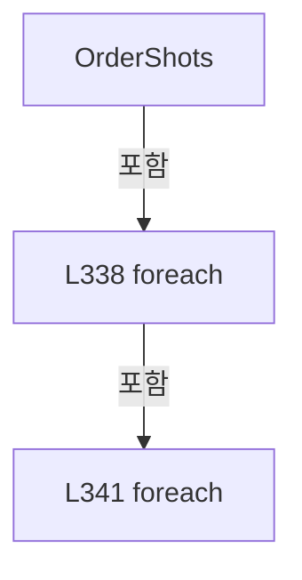

변경 전 점검: 입력/반환 타입, 위 호출자, 예외/취소 경로, 공유 상태와 저장·전송 소비자를 함께 확인합니다. 값의 단위나 물리 방향을 이름만으로 확정하지 않습니다.

### LocalFunctionStatement `SelectGroupKey` · L290–293

[Drilling.Common/Recipe/CShotCoordinatePlanBuilder.cs:290–293](https://github.com/kjuws10-rgb/A3Drilling/blob/334b3599651b2e8e0181fd4459bafaf3cddafff3/Drilling.Common/Recipe/CShotCoordinatePlanBuilder.cs#L290-L293)

| 항목 | 실제 추출 값 |
| --- | --- |
| 서명 | double SelectGroupKey(Drilling.Common.Recipe.ST_HEAD_SHOT_POINT) |
| 접근/수식자 | Private /  |
| 반환/값 타입 | double |
| 소속 타입 | NamedType:Drilling.Common.Recipe.CShotCoordinatePlanBuilder |

입력 계약:

| 이름 | 타입 | 전달 | 선택/기본값 |
| --- | --- | --- | --- |
| shot | Drilling.Common.Recipe.ST_HEAD_SHOT_POINT | None | False /  |

현재 부분 분석에서 직접 연결된 호출자는 없습니다. XAML/이벤트/인터페이스·델리게이트·외부 진입을 추가 확인해야 하며, 미사용으로 판정한 것이 아닙니다.

호출하는 대상과 해석 범위:

| 원본 행 | 표현식 | 분석 상태 | 대상/소스 위치 |
| --- | --- | --- | --- |
| 292 | Math.Round | resolved | double System.Math.Round(double, int) |

본문의 실제 연산·분기·예외·반환 순서(원문 위치 순):

| 원본 행 | 종류 | 주석 해설 |
| --- | --- | --- |
| 292 | call | 함수·델리게이트 또는 객체 생성자를 호출합니다: Math.Round(shot.EncoderWaitPosition, 6) |
| 292 | return | 호출자에게 값 또는 제어를 반환합니다: return Math.Round(shot.EncoderWaitPosition, 6); |

변경 전 점검: 입력/반환 타입, 위 호출자, 예외/취소 경로, 공유 상태와 저장·전송 소비자를 함께 확인합니다. 값의 단위나 물리 방향을 이름만으로 확정하지 않습니다.

### LocalFunctionStatement `SelectDescendingRowKey` · L296–299

[Drilling.Common/Recipe/CShotCoordinatePlanBuilder.cs:296–299](https://github.com/kjuws10-rgb/A3Drilling/blob/334b3599651b2e8e0181fd4459bafaf3cddafff3/Drilling.Common/Recipe/CShotCoordinatePlanBuilder.cs#L296-L299)

| 항목 | 실제 추출 값 |
| --- | --- |
| 서명 | double SelectDescendingRowKey(System.Linq.IGrouping<double, Drilling.Common.Recipe.ST_HEAD_SHOT_POINT>) |
| 접근/수식자 | Private /  |
| 반환/값 타입 | double |
| 소속 타입 | NamedType:Drilling.Common.Recipe.CShotCoordinatePlanBuilder |

입력 계약:

| 이름 | 타입 | 전달 | 선택/기본값 |
| --- | --- | --- | --- |
| row | System.Linq.IGrouping<double, Drilling.Common.Recipe.ST_HEAD_SHOT_POINT> | None | False /  |

현재 부분 분석에서 직접 연결된 호출자는 없습니다. XAML/이벤트/인터페이스·델리게이트·외부 진입을 추가 확인해야 하며, 미사용으로 판정한 것이 아닙니다.

본문의 실제 연산·분기·예외·반환 순서(원문 위치 순):

| 원본 행 | 종류 | 주석 해설 |
| --- | --- | --- |
| 298 | return | 호출자에게 값 또는 제어를 반환합니다: return row.Key; |

변경 전 점검: 입력/반환 타입, 위 호출자, 예외/취소 경로, 공유 상태와 저장·전송 소비자를 함께 확인합니다. 값의 단위나 물리 방향을 이름만으로 확정하지 않습니다.

### LocalFunctionStatement `SelectAscendingRowKey` · L301–304

[Drilling.Common/Recipe/CShotCoordinatePlanBuilder.cs:301–304](https://github.com/kjuws10-rgb/A3Drilling/blob/334b3599651b2e8e0181fd4459bafaf3cddafff3/Drilling.Common/Recipe/CShotCoordinatePlanBuilder.cs#L301-L304)

| 항목 | 실제 추출 값 |
| --- | --- |
| 서명 | double SelectAscendingRowKey(System.Linq.IGrouping<double, Drilling.Common.Recipe.ST_HEAD_SHOT_POINT>) |
| 접근/수식자 | Private /  |
| 반환/값 타입 | double |
| 소속 타입 | NamedType:Drilling.Common.Recipe.CShotCoordinatePlanBuilder |

입력 계약:

| 이름 | 타입 | 전달 | 선택/기본값 |
| --- | --- | --- | --- |
| row | System.Linq.IGrouping<double, Drilling.Common.Recipe.ST_HEAD_SHOT_POINT> | None | False /  |

현재 부분 분석에서 직접 연결된 호출자는 없습니다. XAML/이벤트/인터페이스·델리게이트·외부 진입을 추가 확인해야 하며, 미사용으로 판정한 것이 아닙니다.

본문의 실제 연산·분기·예외·반환 순서(원문 위치 순):

| 원본 행 | 종류 | 주석 해설 |
| --- | --- | --- |
| 303 | return | 호출자에게 값 또는 제어를 반환합니다: return row.Key; |

변경 전 점검: 입력/반환 타입, 위 호출자, 예외/취소 경로, 공유 상태와 저장·전송 소비자를 함께 확인합니다. 값의 단위나 물리 방향을 이름만으로 확정하지 않습니다.

### LocalFunctionStatement `SelectHeadNo` · L308–311

[Drilling.Common/Recipe/CShotCoordinatePlanBuilder.cs:308–311](https://github.com/kjuws10-rgb/A3Drilling/blob/334b3599651b2e8e0181fd4459bafaf3cddafff3/Drilling.Common/Recipe/CShotCoordinatePlanBuilder.cs#L308-L311)

| 항목 | 실제 추출 값 |
| --- | --- |
| 서명 | int SelectHeadNo(Drilling.Common.Recipe.ST_HEAD_SHOT_POINT) |
| 접근/수식자 | Private /  |
| 반환/값 타입 | int |
| 소속 타입 | NamedType:Drilling.Common.Recipe.CShotCoordinatePlanBuilder |

입력 계약:

| 이름 | 타입 | 전달 | 선택/기본값 |
| --- | --- | --- | --- |
| shot | Drilling.Common.Recipe.ST_HEAD_SHOT_POINT | None | False /  |

현재 부분 분석에서 직접 연결된 호출자는 없습니다. XAML/이벤트/인터페이스·델리게이트·외부 진입을 추가 확인해야 하며, 미사용으로 판정한 것이 아닙니다.

본문의 실제 연산·분기·예외·반환 순서(원문 위치 순):

| 원본 행 | 종류 | 주석 해설 |
| --- | --- | --- |
| 310 | return | 호출자에게 값 또는 제어를 반환합니다: return shot.HeadNo; |

변경 전 점검: 입력/반환 타입, 위 호출자, 예외/취소 경로, 공유 상태와 저장·전송 소비자를 함께 확인합니다. 값의 단위나 물리 방향을 이름만으로 확정하지 않습니다.

### LocalFunctionStatement `SelectHeadGroupKey` · L313–316

[Drilling.Common/Recipe/CShotCoordinatePlanBuilder.cs:313–316](https://github.com/kjuws10-rgb/A3Drilling/blob/334b3599651b2e8e0181fd4459bafaf3cddafff3/Drilling.Common/Recipe/CShotCoordinatePlanBuilder.cs#L313-L316)

| 항목 | 실제 추출 값 |
| --- | --- |
| 서명 | int SelectHeadGroupKey(System.Linq.IGrouping<int, Drilling.Common.Recipe.ST_HEAD_SHOT_POINT>) |
| 접근/수식자 | Private /  |
| 반환/값 타입 | int |
| 소속 타입 | NamedType:Drilling.Common.Recipe.CShotCoordinatePlanBuilder |

입력 계약:

| 이름 | 타입 | 전달 | 선택/기본값 |
| --- | --- | --- | --- |
| headGroup | System.Linq.IGrouping<int, Drilling.Common.Recipe.ST_HEAD_SHOT_POINT> | None | False /  |

현재 부분 분석에서 직접 연결된 호출자는 없습니다. XAML/이벤트/인터페이스·델리게이트·외부 진입을 추가 확인해야 하며, 미사용으로 판정한 것이 아닙니다.

본문의 실제 연산·분기·예외·반환 순서(원문 위치 순):

| 원본 행 | 종류 | 주석 해설 |
| --- | --- | --- |
| 315 | return | 호출자에게 값 또는 제어를 반환합니다: return headGroup.Key; |

변경 전 점검: 입력/반환 타입, 위 호출자, 예외/취소 경로, 공유 상태와 저장·전송 소비자를 함께 확인합니다. 값의 단위나 물리 방향을 이름만으로 확정하지 않습니다.

### LocalFunctionStatement `SelectScannerGx` · L318–321

[Drilling.Common/Recipe/CShotCoordinatePlanBuilder.cs:318–321](https://github.com/kjuws10-rgb/A3Drilling/blob/334b3599651b2e8e0181fd4459bafaf3cddafff3/Drilling.Common/Recipe/CShotCoordinatePlanBuilder.cs#L318-L321)

| 항목 | 실제 추출 값 |
| --- | --- |
| 서명 | double SelectScannerGx(Drilling.Common.Recipe.ST_HEAD_SHOT_POINT) |
| 접근/수식자 | Private /  |
| 반환/값 타입 | double |
| 소속 타입 | NamedType:Drilling.Common.Recipe.CShotCoordinatePlanBuilder |

입력 계약:

| 이름 | 타입 | 전달 | 선택/기본값 |
| --- | --- | --- | --- |
| shot | Drilling.Common.Recipe.ST_HEAD_SHOT_POINT | None | False /  |

현재 부분 분석에서 직접 연결된 호출자는 없습니다. XAML/이벤트/인터페이스·델리게이트·외부 진입을 추가 확인해야 하며, 미사용으로 판정한 것이 아닙니다.

본문의 실제 연산·분기·예외·반환 순서(원문 위치 순):

| 원본 행 | 종류 | 주석 해설 |
| --- | --- | --- |
| 320 | return | 호출자에게 값 또는 제어를 반환합니다: return shot.ScannerGx; |

변경 전 점검: 입력/반환 타입, 위 호출자, 예외/취소 경로, 공유 상태와 저장·전송 소비자를 함께 확인합니다. 값의 단위나 물리 방향을 이름만으로 확정하지 않습니다.

### LocalFunctionStatement `SelectScannerGy` · L323–326

[Drilling.Common/Recipe/CShotCoordinatePlanBuilder.cs:323–326](https://github.com/kjuws10-rgb/A3Drilling/blob/334b3599651b2e8e0181fd4459bafaf3cddafff3/Drilling.Common/Recipe/CShotCoordinatePlanBuilder.cs#L323-L326)

| 항목 | 실제 추출 값 |
| --- | --- |
| 서명 | double SelectScannerGy(Drilling.Common.Recipe.ST_HEAD_SHOT_POINT) |
| 접근/수식자 | Private /  |
| 반환/값 타입 | double |
| 소속 타입 | NamedType:Drilling.Common.Recipe.CShotCoordinatePlanBuilder |

입력 계약:

| 이름 | 타입 | 전달 | 선택/기본값 |
| --- | --- | --- | --- |
| shot | Drilling.Common.Recipe.ST_HEAD_SHOT_POINT | None | False /  |

현재 부분 분석에서 직접 연결된 호출자는 없습니다. XAML/이벤트/인터페이스·델리게이트·외부 진입을 추가 확인해야 하며, 미사용으로 판정한 것이 아닙니다.

본문의 실제 연산·분기·예외·반환 순서(원문 위치 순):

| 원본 행 | 종류 | 주석 해설 |
| --- | --- | --- |
| 325 | return | 호출자에게 값 또는 제어를 반환합니다: return shot.ScannerGy; |

변경 전 점검: 입력/반환 타입, 위 호출자, 예외/취소 경로, 공유 상태와 저장·전송 소비자를 함께 확인합니다. 값의 단위나 물리 방향을 이름만으로 확정하지 않습니다.

### LocalFunctionStatement `SelectCellNo` · L328–331

[Drilling.Common/Recipe/CShotCoordinatePlanBuilder.cs:328–331](https://github.com/kjuws10-rgb/A3Drilling/blob/334b3599651b2e8e0181fd4459bafaf3cddafff3/Drilling.Common/Recipe/CShotCoordinatePlanBuilder.cs#L328-L331)

| 항목 | 실제 추출 값 |
| --- | --- |
| 서명 | int SelectCellNo(Drilling.Common.Recipe.ST_HEAD_SHOT_POINT) |
| 접근/수식자 | Private /  |
| 반환/값 타입 | int |
| 소속 타입 | NamedType:Drilling.Common.Recipe.CShotCoordinatePlanBuilder |

입력 계약:

| 이름 | 타입 | 전달 | 선택/기본값 |
| --- | --- | --- | --- |
| shot | Drilling.Common.Recipe.ST_HEAD_SHOT_POINT | None | False /  |

현재 부분 분석에서 직접 연결된 호출자는 없습니다. XAML/이벤트/인터페이스·델리게이트·외부 진입을 추가 확인해야 하며, 미사용으로 판정한 것이 아닙니다.

본문의 실제 연산·분기·예외·반환 순서(원문 위치 순):

| 원본 행 | 종류 | 주석 해설 |
| --- | --- | --- |
| 330 | return | 호출자에게 값 또는 제어를 반환합니다: return shot.CellNo; |

변경 전 점검: 입력/반환 타입, 위 호출자, 예외/취소 경로, 공유 상태와 저장·전송 소비자를 함께 확인합니다. 값의 단위나 물리 방향을 이름만으로 확정하지 않습니다.

### LocalFunctionStatement `SelectCellShotNo` · L333–336

[Drilling.Common/Recipe/CShotCoordinatePlanBuilder.cs:333–336](https://github.com/kjuws10-rgb/A3Drilling/blob/334b3599651b2e8e0181fd4459bafaf3cddafff3/Drilling.Common/Recipe/CShotCoordinatePlanBuilder.cs#L333-L336)

| 항목 | 실제 추출 값 |
| --- | --- |
| 서명 | int SelectCellShotNo(Drilling.Common.Recipe.ST_HEAD_SHOT_POINT) |
| 접근/수식자 | Private /  |
| 반환/값 타입 | int |
| 소속 타입 | NamedType:Drilling.Common.Recipe.CShotCoordinatePlanBuilder |

입력 계약:

| 이름 | 타입 | 전달 | 선택/기본값 |
| --- | --- | --- | --- |
| shot | Drilling.Common.Recipe.ST_HEAD_SHOT_POINT | None | False /  |

현재 부분 분석에서 직접 연결된 호출자는 없습니다. XAML/이벤트/인터페이스·델리게이트·외부 진입을 추가 확인해야 하며, 미사용으로 판정한 것이 아닙니다.

본문의 실제 연산·분기·예외·반환 순서(원문 위치 순):

| 원본 행 | 종류 | 주석 해설 |
| --- | --- | --- |
| 335 | return | 호출자에게 값 또는 제어를 반환합니다: return shot.CellShotNo; |

변경 전 점검: 입력/반환 타입, 위 호출자, 예외/취소 경로, 공유 상태와 저장·전송 소비자를 함께 확인합니다. 값의 단위나 물리 방향을 이름만으로 확정하지 않습니다.

### MethodDeclaration `UseScannerGyForMachiningSort` · L353–374

[Drilling.Common/Recipe/CShotCoordinatePlanBuilder.cs:353–374](https://github.com/kjuws10-rgb/A3Drilling/blob/334b3599651b2e8e0181fd4459bafaf3cddafff3/Drilling.Common/Recipe/CShotCoordinatePlanBuilder.cs#L353-L374)

| 항목 | 실제 추출 값 |
| --- | --- |
| 서명 | bool Drilling.Common.Recipe.CShotCoordinatePlanBuilder.UseScannerGyForMachiningSort(System.Collections.Generic.IReadOnlyList<Drilling.Common.Recipe.ST_HEAD_SHOT_POINT>) |
| 접근/수식자 | Private / private, static |
| 반환/값 타입 | bool |
| 소속 타입 | NamedType:Drilling.Common.Recipe.CShotCoordinatePlanBuilder |

입력 계약:

| 이름 | 타입 | 전달 | 선택/기본값 |
| --- | --- | --- | --- |
| shots | System.Collections.Generic.IReadOnlyList<Drilling.Common.Recipe.ST_HEAD_SHOT_POINT> | None | False /  |

정적 호출자로 확인된 위치:

| 호출 파일/행 | 호출 표현식 | 런타임 분기 가능 |
| --- | --- | --- |
| [Drilling.Common/Recipe/CShotCoordinatePlanBuilder.cs:345–345](https://github.com/kjuws10-rgb/A3Drilling/blob/334b3599651b2e8e0181fd4459bafaf3cddafff3/Drilling.Common/Recipe/CShotCoordinatePlanBuilder.cs#L345-L345) | UseScannerGyForMachiningSort | False |

호출하는 대상과 해석 범위:

| 원본 행 | 표현식 | 분석 상태 | 대상/소스 위치 |
| --- | --- | --- | --- |
| 367 | Math.Min | resolved | double System.Math.Min(double, double) |
| 368 | Math.Max | resolved | double System.Math.Max(double, double) |
| 369 | Math.Min | resolved | double System.Math.Min(double, double) |
| 370 | Math.Max | resolved | double System.Math.Max(double, double) |

본문의 실제 연산·분기·예외·반환 순서(원문 위치 순):

| 원본 행 | 종류 | 주석 해설 |
| --- | --- | --- |
| 355 | if | 조건에 따라 분기합니다: if (shots.Count <= 1) |
| 357 | return | 호출자에게 값 또는 제어를 반환합니다: return false; |
| 360 | local-declaration | 지역 변수를 선언합니다: var minGx = shots[0].ScannerGx; |
| 360 | variable-initializer | 변수의 초기값을 지정합니다: minGx = shots[0].ScannerGx |
| 361 | local-declaration | 지역 변수를 선언합니다: var maxGx = shots[0].ScannerGx; |
| 361 | variable-initializer | 변수의 초기값을 지정합니다: maxGx = shots[0].ScannerGx |
| 362 | local-declaration | 지역 변수를 선언합니다: var minGy = shots[0].ScannerGy; |
| 362 | variable-initializer | 변수의 초기값을 지정합니다: minGy = shots[0].ScannerGy |
| 363 | local-declaration | 지역 변수를 선언합니다: var maxGy = shots[0].ScannerGy; |
| 363 | variable-initializer | 변수의 초기값을 지정합니다: maxGy = shots[0].ScannerGy |
| 364 | variable-initializer | 변수의 초기값을 지정합니다: index = 1 |
| 364 | for | 초기화·조건·증감이 있는 반복입니다: for (var index = 1; index < shots.Count; index++) |
| 366 | local-declaration | 지역 변수를 선언합니다: var shot = shots[index]; |
| 366 | variable-initializer | 변수의 초기값을 지정합니다: shot = shots[index] |
| 367 | assignment | 값을 대상에 대입합니다: minGx = Math.Min(minGx, shot.ScannerGx) |
| 367 | call | 함수·델리게이트 또는 객체 생성자를 호출합니다: Math.Min(minGx, shot.ScannerGx) |
| 368 | assignment | 값을 대상에 대입합니다: maxGx = Math.Max(maxGx, shot.ScannerGx) |
| 368 | call | 함수·델리게이트 또는 객체 생성자를 호출합니다: Math.Max(maxGx, shot.ScannerGx) |
| 369 | assignment | 값을 대상에 대입합니다: minGy = Math.Min(minGy, shot.ScannerGy) |
| 369 | call | 함수·델리게이트 또는 객체 생성자를 호출합니다: Math.Min(minGy, shot.ScannerGy) |
| 370 | assignment | 값을 대상에 대입합니다: maxGy = Math.Max(maxGy, shot.ScannerGy) |
| 370 | call | 함수·델리게이트 또는 객체 생성자를 호출합니다: Math.Max(maxGy, shot.ScannerGy) |
| 373 | return | 호출자에게 값 또는 제어를 반환합니다: return maxGy - minGy > maxGx - minGx; |

제어 구문의 포함 구조(실제 실행 순서/CFG가 아닌 구문 탐색 그림):

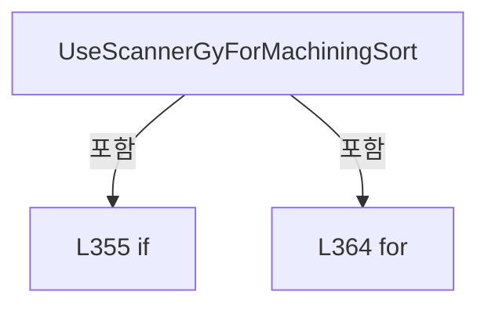

변경 전 점검: 입력/반환 타입, 위 호출자, 예외/취소 경로, 공유 상태와 저장·전송 소비자를 함께 확인합니다. 값의 단위나 물리 방향을 이름만으로 확정하지 않습니다.

### MethodDeclaration `AssignHeadNo` · L376–409

[Drilling.Common/Recipe/CShotCoordinatePlanBuilder.cs:376–409](https://github.com/kjuws10-rgb/A3Drilling/blob/334b3599651b2e8e0181fd4459bafaf3cddafff3/Drilling.Common/Recipe/CShotCoordinatePlanBuilder.cs#L376-L409)

| 항목 | 실제 추출 값 |
| --- | --- |
| 서명 | int Drilling.Common.Recipe.CShotCoordinatePlanBuilder.AssignHeadNo(double, System.Collections.Generic.IReadOnlyList<int>, System.Collections.Generic.IReadOnlyDictionary<string, string>, System.Collections.Generic.IReadOnlyDictionary<int, int>, double) |
| 접근/수식자 | Private / private, static |
| 반환/값 타입 | int |
| 소속 타입 | NamedType:Drilling.Common.Recipe.CShotCoordinatePlanBuilder |

입력 계약:

| 이름 | 타입 | 전달 | 선택/기본값 |
| --- | --- | --- | --- |
| designX | double | None | False /  |
| assignmentHeadNos | System.Collections.Generic.IReadOnlyList<int> | None | False /  |
| parameters | System.Collections.Generic.IReadOnlyDictionary<string, string> | None | False /  |
| assignedHeadCounts | System.Collections.Generic.IReadOnlyDictionary<int, int> | None | False /  |
| akMarginX | double | None | False /  |

정적 호출자로 확인된 위치:

| 호출 파일/행 | 호출 표현식 | 런타임 분기 가능 |
| --- | --- | --- |
| [Drilling.Common/Recipe/CShotCoordinatePlanBuilder.cs:54–54](https://github.com/kjuws10-rgb/A3Drilling/blob/334b3599651b2e8e0181fd4459bafaf3cddafff3/Drilling.Common/Recipe/CShotCoordinatePlanBuilder.cs#L54-L54) | AssignHeadNo | False |

호출하는 대상과 해석 범위:

| 원본 행 | 표현식 | 분석 상태 | 대상/소스 위치 |
| --- | --- | --- | --- |
| 407 | assignmentHeadNos.Select(SelectItem).Where(IsHasValue).Select(SelectHead).ToArray | resolved | Drilling.Common.Recipe.ST_HEAD_ASSIGNMENT_CANDIDATE[] System.Collections.Generic.IEnumerable<Drilling.Common.Recipe.ST_HEAD_ASSIGNMENT_CANDIDATE>.ToArray<Drilling.Common.Recipe.ST_HEAD_ASSIGNMENT_CANDIDATE>() |
| 407 | assignmentHeadNos.Select(SelectItem).Where(IsHasValue).Select | resolved | System.Collections.Generic.IEnumerable<Drilling.Common.Recipe.ST_HEAD_ASSIGNMENT_CANDIDATE> System.Collections.Generic.IEnumerable<Drilling.Common.Recipe.ST_HEAD_ASSIGNMENT_CANDIDATE?>.Select<Drilling.Common.Recipe.ST_HEAD_ASSIGNMENT_CANDIDATE?, Drilling.Common.Recipe.ST_HEAD_ASSIGNMENT_CANDIDATE>(System.Func<Drilling.Common.Recipe.ST_HEAD_ASSIGNMENT_CANDIDATE?, Drilling.Common.Recipe.ST_HEAD_ASSIGNMENT_CANDIDATE>) |
| 407 | assignmentHeadNos.Select(SelectItem).Where | resolved | System.Collections.Generic.IEnumerable<Drilling.Common.Recipe.ST_HEAD_ASSIGNMENT_CANDIDATE?> System.Collections.Generic.IEnumerable<Drilling.Common.Recipe.ST_HEAD_ASSIGNMENT_CANDIDATE?>.Where<Drilling.Common.Recipe.ST_HEAD_ASSIGNMENT_CANDIDATE?>(System.Func<Drilling.Common.Recipe.ST_HEAD_ASSIGNMENT_CANDIDATE?, bool>) |
| 407 | assignmentHeadNos.Select | resolved | System.Collections.Generic.IEnumerable<Drilling.Common.Recipe.ST_HEAD_ASSIGNMENT_CANDIDATE?> System.Collections.Generic.IEnumerable<int>.Select<int, Drilling.Common.Recipe.ST_HEAD_ASSIGNMENT_CANDIDATE?>(System.Func<int, Drilling.Common.Recipe.ST_HEAD_ASSIGNMENT_CANDIDATE?>) |
| 408 | SelectHeadCandidate | resolved | int Drilling.Common.Recipe.CShotCoordinatePlanBuilder.SelectHeadCandidate(System.Collections.Generic.IReadOnlyList<Drilling.Common.Recipe.ST_HEAD_ASSIGNMENT_CANDIDATE>, System.Collections.Generic.IReadOnlyDictionary<int, int>) · Drilling.Common/Recipe/CShotCoordinatePlanBuilder.cs:411 |

본문의 실제 연산·분기·예외·반환 순서(원문 위치 순):

| 원본 행 | 종류 | 주석 해설 |
| --- | --- | --- |
| 383 | if | 조건에 따라 분기합니다: if (assignmentHeadNos.Count <= 0) |
| 385 | return | 호출자에게 값 또는 제어를 반환합니다: return 0; |
| 407 | call | 함수·델리게이트 또는 객체 생성자를 호출합니다: assignmentHeadNos.Select(SelectItem).Where(IsHasValue).Select(SelectHead).ToArray() |
| 407 | call | 함수·델리게이트 또는 객체 생성자를 호출합니다: assignmentHeadNos.Select(SelectItem).Where(IsHasValue).Select(SelectHead) |
| 407 | call | 함수·델리게이트 또는 객체 생성자를 호출합니다: assignmentHeadNos.Select(SelectItem).Where(IsHasValue) |
| 407 | call | 함수·델리게이트 또는 객체 생성자를 호출합니다: assignmentHeadNos.Select(SelectItem) |
| 407 | local-declaration | 지역 변수를 선언합니다: var candidates = assignmentHeadNos.Select(SelectItem).Where(IsHasValue).Select(SelectHead).ToArray(); |
| 407 | variable-initializer | 변수의 초기값을 지정합니다: candidates = assignmentHeadNos.Select(SelectItem).Where(IsHasValue).Select(SelectHead).ToArray() |
| 408 | call | 함수·델리게이트 또는 객체 생성자를 호출합니다: SelectHeadCandidate(candidates, assignedHeadCounts) |
| 408 | conditional-expression | 조건에 따라 결과식을 선택합니다: candidates.Length == 0 ? 0 : SelectHeadCandidate(candidates, assignedHeadCounts) |
| 408 | return | 호출자에게 값 또는 제어를 반환합니다: return candidates.Length == 0 ? 0 : SelectHeadCandidate(candidates, assignedHeadCounts); |

제어 구문의 포함 구조(실제 실행 순서/CFG가 아닌 구문 탐색 그림):

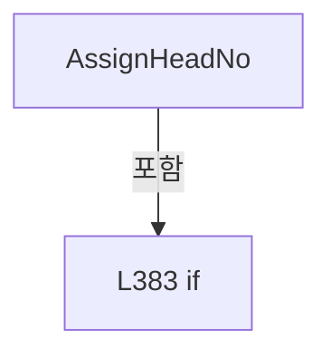

변경 전 점검: 입력/반환 타입, 위 호출자, 예외/취소 경로, 공유 상태와 저장·전송 소비자를 함께 확인합니다. 값의 단위나 물리 방향을 이름만으로 확정하지 않습니다.

### LocalFunctionStatement `SelectItem` · L388–395

[Drilling.Common/Recipe/CShotCoordinatePlanBuilder.cs:388–395](https://github.com/kjuws10-rgb/A3Drilling/blob/334b3599651b2e8e0181fd4459bafaf3cddafff3/Drilling.Common/Recipe/CShotCoordinatePlanBuilder.cs#L388-L395)

| 항목 | 실제 추출 값 |
| --- | --- |
| 서명 | Drilling.Common.Recipe.ST_HEAD_ASSIGNMENT_CANDIDATE? SelectItem(int) |
| 접근/수식자 | Private /  |
| 반환/값 타입 | Drilling.Common.Recipe.ST_HEAD_ASSIGNMENT_CANDIDATE? |
| 소속 타입 | NamedType:Drilling.Common.Recipe.CShotCoordinatePlanBuilder |

입력 계약:

| 이름 | 타입 | 전달 | 선택/기본값 |
| --- | --- | --- | --- |
| headNo | int | None | False /  |

현재 부분 분석에서 직접 연결된 호출자는 없습니다. XAML/이벤트/인터페이스·델리게이트·외부 진입을 추가 확인해야 하며, 미사용으로 판정한 것이 아닙니다.

호출하는 대상과 해석 범위:

| 원본 행 | 표현식 | 분석 상태 | 대상/소스 위치 |
| --- | --- | --- | --- |
| 390 | ReadHeadCenterX | resolved | double Drilling.Common.Recipe.CShotCoordinatePlanBuilder.ReadHeadCenterX(System.Collections.Generic.IReadOnlyDictionary<string, string>, int, double) · Drilling.Common/Recipe/CShotCoordinatePlanBuilder.cs:455 |
| 391 | ReadNullableDouble | resolved | double? Drilling.Common.Recipe.CShotCoordinatePlanBuilder.ReadNullableDouble(System.Collections.Generic.IReadOnlyDictionary<string, string>, params string[]) · Drilling.Common/Recipe/CShotCoordinatePlanBuilder.cs:578 |
| 394 | new ST_HEAD_ASSIGNMENT_CANDIDATE | resolved | Drilling.Common.Recipe.ST_HEAD_ASSIGNMENT_CANDIDATE.ST_HEAD_ASSIGNMENT_CANDIDATE(int, double) · Drilling.Common/Recipe/CShotCoordinatePlanBuilder.cs:1413 |
| 394 | Math.Abs | resolved | double System.Math.Abs(double) |

본문의 실제 연산·분기·예외·반환 순서(원문 위치 순):

| 원본 행 | 종류 | 주석 해설 |
| --- | --- | --- |
| 390 | call | 함수·델리게이트 또는 객체 생성자를 호출합니다: ReadHeadCenterX(parameters, headNo, akMarginX) |
| 390 | local-declaration | 지역 변수를 선언합니다: var centerX = ReadHeadCenterX(parameters, headNo, akMarginX); |
| 390 | variable-initializer | 변수의 초기값을 지정합니다: centerX = ReadHeadCenterX(parameters, headNo, akMarginX) |
| 391 | call | 함수·델리게이트 또는 객체 생성자를 호출합니다: ReadNullableDouble(parameters, $"H{headNo:00}_SCAN_FIELD_WIDTH_X", $"H{headNo:00}_HEAD_FIELD_WIDTH_X") |
| 391 | local-declaration | 지역 변수를 선언합니다: var widthX = ReadNullableDouble(parameters, $"H{headNo:00}_SCAN_FIELD_WIDTH_X", $"H{headNo:00}_HEAD_FIELD_WIDTH_X") ?? 110.0; |
| 391 | variable-initializer | 변수의 초기값을 지정합니다: widthX = ReadNullableDouble(parameters, $"H{headNo:00}_SCAN_FIELD_WIDTH_X", $"H{headNo:00}_HEAD_FIELD_WIDTH_X") ?? 110.0 |
| 392 | assignment | 값을 대상에 대입합니다: widthX = widthX > 0.0 ? widthX : 110.0 |
| 392 | conditional-expression | 조건에 따라 결과식을 선택합니다: widthX > 0.0 ? widthX : 110.0 |
| 393 | local-declaration | 지역 변수를 선언합니다: var halfWidth = widthX / 2.0; |
| 393 | variable-initializer | 변수의 초기값을 지정합니다: halfWidth = widthX / 2.0 |
| 394 | call | 함수·델리게이트 또는 객체 생성자를 호출합니다: new ST_HEAD_ASSIGNMENT_CANDIDATE(headNo, Math.Abs(designX - centerX)) |
| 394 | call | 함수·델리게이트 또는 객체 생성자를 호출합니다: Math.Abs(designX - centerX) |
| 394 | conditional-expression | 조건에 따라 결과식을 선택합니다: designX >= centerX - halfWidth && designX <= centerX + halfWidth ? new ST_HEAD_ASSIGNMENT_CANDIDATE(headNo, Math.Abs(designX - centerX)) : (ST_HEAD_ASSIGNMENT_CANDIDATE? )null |
| 394 | return | 호출자에게 값 또는 제어를 반환합니다: return designX >= centerX - halfWidth && designX <= centerX + halfWidth ? new ST_HEAD_ASSIGNMENT_CANDIDATE(headNo, Math.Abs(designX - centerX)) : (ST_HEAD_ASSIGNMENT_CANDIDATE? )null; |

변경 전 점검: 입력/반환 타입, 위 호출자, 예외/취소 경로, 공유 상태와 저장·전송 소비자를 함께 확인합니다. 값의 단위나 물리 방향을 이름만으로 확정하지 않습니다.

### LocalFunctionStatement `IsHasValue` · L397–400

[Drilling.Common/Recipe/CShotCoordinatePlanBuilder.cs:397–400](https://github.com/kjuws10-rgb/A3Drilling/blob/334b3599651b2e8e0181fd4459bafaf3cddafff3/Drilling.Common/Recipe/CShotCoordinatePlanBuilder.cs#L397-L400)

| 항목 | 실제 추출 값 |
| --- | --- |
| 서명 | bool IsHasValue(Drilling.Common.Recipe.ST_HEAD_ASSIGNMENT_CANDIDATE?) |
| 접근/수식자 | Private /  |
| 반환/값 타입 | bool |
| 소속 타입 | NamedType:Drilling.Common.Recipe.CShotCoordinatePlanBuilder |

입력 계약:

| 이름 | 타입 | 전달 | 선택/기본값 |
| --- | --- | --- | --- |
| candidate | Drilling.Common.Recipe.ST_HEAD_ASSIGNMENT_CANDIDATE? | None | False /  |

현재 부분 분석에서 직접 연결된 호출자는 없습니다. XAML/이벤트/인터페이스·델리게이트·외부 진입을 추가 확인해야 하며, 미사용으로 판정한 것이 아닙니다.

본문의 실제 연산·분기·예외·반환 순서(원문 위치 순):

| 원본 행 | 종류 | 주석 해설 |
| --- | --- | --- |
| 399 | return | 호출자에게 값 또는 제어를 반환합니다: return candidate.HasValue; |

변경 전 점검: 입력/반환 타입, 위 호출자, 예외/취소 경로, 공유 상태와 저장·전송 소비자를 함께 확인합니다. 값의 단위나 물리 방향을 이름만으로 확정하지 않습니다.

### LocalFunctionStatement `SelectHead` · L402–405

[Drilling.Common/Recipe/CShotCoordinatePlanBuilder.cs:402–405](https://github.com/kjuws10-rgb/A3Drilling/blob/334b3599651b2e8e0181fd4459bafaf3cddafff3/Drilling.Common/Recipe/CShotCoordinatePlanBuilder.cs#L402-L405)

| 항목 | 실제 추출 값 |
| --- | --- |
| 서명 | Drilling.Common.Recipe.ST_HEAD_ASSIGNMENT_CANDIDATE SelectHead(Drilling.Common.Recipe.ST_HEAD_ASSIGNMENT_CANDIDATE?) |
| 접근/수식자 | Private /  |
| 반환/값 타입 | Drilling.Common.Recipe.ST_HEAD_ASSIGNMENT_CANDIDATE |
| 소속 타입 | NamedType:Drilling.Common.Recipe.CShotCoordinatePlanBuilder |

입력 계약:

| 이름 | 타입 | 전달 | 선택/기본값 |
| --- | --- | --- | --- |
| candidate | Drilling.Common.Recipe.ST_HEAD_ASSIGNMENT_CANDIDATE? | None | False /  |

현재 부분 분석에서 직접 연결된 호출자는 없습니다. XAML/이벤트/인터페이스·델리게이트·외부 진입을 추가 확인해야 하며, 미사용으로 판정한 것이 아닙니다.

본문의 실제 연산·분기·예외·반환 순서(원문 위치 순):

| 원본 행 | 종류 | 주석 해설 |
| --- | --- | --- |
| 404 | return | 호출자에게 값 또는 제어를 반환합니다: return candidate!.Value; |

변경 전 점검: 입력/반환 타입, 위 호출자, 예외/취소 경로, 공유 상태와 저장·전송 소비자를 함께 확인합니다. 값의 단위나 물리 방향을 이름만으로 확정하지 않습니다.

### MethodDeclaration `SelectHeadCandidate` · L411–429

[Drilling.Common/Recipe/CShotCoordinatePlanBuilder.cs:411–429](https://github.com/kjuws10-rgb/A3Drilling/blob/334b3599651b2e8e0181fd4459bafaf3cddafff3/Drilling.Common/Recipe/CShotCoordinatePlanBuilder.cs#L411-L429)

| 항목 | 실제 추출 값 |
| --- | --- |
| 서명 | int Drilling.Common.Recipe.CShotCoordinatePlanBuilder.SelectHeadCandidate(System.Collections.Generic.IReadOnlyList<Drilling.Common.Recipe.ST_HEAD_ASSIGNMENT_CANDIDATE>, System.Collections.Generic.IReadOnlyDictionary<int, int>) |
| 접근/수식자 | Private / private, static |
| 반환/값 타입 | int |
| 소속 타입 | NamedType:Drilling.Common.Recipe.CShotCoordinatePlanBuilder |

입력 계약:

| 이름 | 타입 | 전달 | 선택/기본값 |
| --- | --- | --- | --- |
| candidates | System.Collections.Generic.IReadOnlyList<Drilling.Common.Recipe.ST_HEAD_ASSIGNMENT_CANDIDATE> | None | False /  |
| assignedHeadCounts | System.Collections.Generic.IReadOnlyDictionary<int, int> | None | False /  |

정적 호출자로 확인된 위치:

| 호출 파일/행 | 호출 표현식 | 런타임 분기 가능 |
| --- | --- | --- |
| [Drilling.Common/Recipe/CShotCoordinatePlanBuilder.cs:408–408](https://github.com/kjuws10-rgb/A3Drilling/blob/334b3599651b2e8e0181fd4459bafaf3cddafff3/Drilling.Common/Recipe/CShotCoordinatePlanBuilder.cs#L408-L408) | SelectHeadCandidate | False |

호출하는 대상과 해석 범위:

| 원본 행 | 표현식 | 분석 상태 | 대상/소스 위치 |
| --- | --- | --- | --- |
| 428 | candidates.OrderBy(SelectDistance).ThenBy(SelectValue).ThenBy(SelectHeadNo).First | resolved | Drilling.Common.Recipe.ST_HEAD_ASSIGNMENT_CANDIDATE System.Collections.Generic.IEnumerable<Drilling.Common.Recipe.ST_HEAD_ASSIGNMENT_CANDIDATE>.First<Drilling.Common.Recipe.ST_HEAD_ASSIGNMENT_CANDIDATE>() |
| 428 | candidates.OrderBy(SelectDistance).ThenBy(SelectValue).ThenBy | resolved | System.Linq.IOrderedEnumerable<Drilling.Common.Recipe.ST_HEAD_ASSIGNMENT_CANDIDATE> System.Linq.IOrderedEnumerable<Drilling.Common.Recipe.ST_HEAD_ASSIGNMENT_CANDIDATE>.ThenBy<Drilling.Common.Recipe.ST_HEAD_ASSIGNMENT_CANDIDATE, int>(System.Func<Drilling.Common.Recipe.ST_HEAD_ASSIGNMENT_CANDIDATE, int>) |
| 428 | candidates.OrderBy(SelectDistance).ThenBy | resolved | System.Linq.IOrderedEnumerable<Drilling.Common.Recipe.ST_HEAD_ASSIGNMENT_CANDIDATE> System.Linq.IOrderedEnumerable<Drilling.Common.Recipe.ST_HEAD_ASSIGNMENT_CANDIDATE>.ThenBy<Drilling.Common.Recipe.ST_HEAD_ASSIGNMENT_CANDIDATE, int>(System.Func<Drilling.Common.Recipe.ST_HEAD_ASSIGNMENT_CANDIDATE, int>) |
| 428 | candidates.OrderBy | resolved | System.Linq.IOrderedEnumerable<Drilling.Common.Recipe.ST_HEAD_ASSIGNMENT_CANDIDATE> System.Collections.Generic.IEnumerable<Drilling.Common.Recipe.ST_HEAD_ASSIGNMENT_CANDIDATE>.OrderBy<Drilling.Common.Recipe.ST_HEAD_ASSIGNMENT_CANDIDATE, double>(System.Func<Drilling.Common.Recipe.ST_HEAD_ASSIGNMENT_CANDIDATE, double>) |

본문의 실제 연산·분기·예외·반환 순서(원문 위치 순):

| 원본 행 | 종류 | 주석 해설 |
| --- | --- | --- |
| 428 | call | 함수·델리게이트 또는 객체 생성자를 호출합니다: candidates.OrderBy(SelectDistance).ThenBy(SelectValue).ThenBy(SelectHeadNo).First() |
| 428 | call | 함수·델리게이트 또는 객체 생성자를 호출합니다: candidates.OrderBy(SelectDistance).ThenBy(SelectValue).ThenBy(SelectHeadNo) |
| 428 | call | 함수·델리게이트 또는 객체 생성자를 호출합니다: candidates.OrderBy(SelectDistance).ThenBy(SelectValue) |
| 428 | call | 함수·델리게이트 또는 객체 생성자를 호출합니다: candidates.OrderBy(SelectDistance) |
| 428 | return | 호출자에게 값 또는 제어를 반환합니다: return candidates.OrderBy(SelectDistance).ThenBy(SelectValue).ThenBy(SelectHeadNo).First().HeadNo; |

변경 전 점검: 입력/반환 타입, 위 호출자, 예외/취소 경로, 공유 상태와 저장·전송 소비자를 함께 확인합니다. 값의 단위나 물리 방향을 이름만으로 확정하지 않습니다.

### LocalFunctionStatement `SelectDistance` · L413–416

[Drilling.Common/Recipe/CShotCoordinatePlanBuilder.cs:413–416](https://github.com/kjuws10-rgb/A3Drilling/blob/334b3599651b2e8e0181fd4459bafaf3cddafff3/Drilling.Common/Recipe/CShotCoordinatePlanBuilder.cs#L413-L416)

| 항목 | 실제 추출 값 |
| --- | --- |
| 서명 | double SelectDistance(Drilling.Common.Recipe.ST_HEAD_ASSIGNMENT_CANDIDATE) |
| 접근/수식자 | Private /  |
| 반환/값 타입 | double |
| 소속 타입 | NamedType:Drilling.Common.Recipe.CShotCoordinatePlanBuilder |

입력 계약:

| 이름 | 타입 | 전달 | 선택/기본값 |
| --- | --- | --- | --- |
| candidate | Drilling.Common.Recipe.ST_HEAD_ASSIGNMENT_CANDIDATE | None | False /  |

현재 부분 분석에서 직접 연결된 호출자는 없습니다. XAML/이벤트/인터페이스·델리게이트·외부 진입을 추가 확인해야 하며, 미사용으로 판정한 것이 아닙니다.

본문의 실제 연산·분기·예외·반환 순서(원문 위치 순):

| 원본 행 | 종류 | 주석 해설 |
| --- | --- | --- |
| 415 | return | 호출자에게 값 또는 제어를 반환합니다: return candidate.Distance; |

변경 전 점검: 입력/반환 타입, 위 호출자, 예외/취소 경로, 공유 상태와 저장·전송 소비자를 함께 확인합니다. 값의 단위나 물리 방향을 이름만으로 확정하지 않습니다.

### LocalFunctionStatement `SelectValue` · L418–421

[Drilling.Common/Recipe/CShotCoordinatePlanBuilder.cs:418–421](https://github.com/kjuws10-rgb/A3Drilling/blob/334b3599651b2e8e0181fd4459bafaf3cddafff3/Drilling.Common/Recipe/CShotCoordinatePlanBuilder.cs#L418-L421)

| 항목 | 실제 추출 값 |
| --- | --- |
| 서명 | int SelectValue(Drilling.Common.Recipe.ST_HEAD_ASSIGNMENT_CANDIDATE) |
| 접근/수식자 | Private /  |
| 반환/값 타입 | int |
| 소속 타입 | NamedType:Drilling.Common.Recipe.CShotCoordinatePlanBuilder |

입력 계약:

| 이름 | 타입 | 전달 | 선택/기본값 |
| --- | --- | --- | --- |
| candidate | Drilling.Common.Recipe.ST_HEAD_ASSIGNMENT_CANDIDATE | None | False /  |

현재 부분 분석에서 직접 연결된 호출자는 없습니다. XAML/이벤트/인터페이스·델리게이트·외부 진입을 추가 확인해야 하며, 미사용으로 판정한 것이 아닙니다.

호출하는 대상과 해석 범위:

| 원본 행 | 표현식 | 분석 상태 | 대상/소스 위치 |
| --- | --- | --- | --- |
| 420 | assignedHeadCounts.TryGetValue | resolved · 동적 구현 선택 가능 | bool System.Collections.Generic.IReadOnlyDictionary<int, int>.TryGetValue(int, out int) |

본문의 실제 연산·분기·예외·반환 순서(원문 위치 순):

| 원본 행 | 종류 | 주석 해설 |
| --- | --- | --- |
| 420 | call | 함수·델리게이트 또는 객체 생성자를 호출합니다: assignedHeadCounts.TryGetValue(candidate.HeadNo, out var count) |
| 420 | conditional-expression | 조건에 따라 결과식을 선택합니다: assignedHeadCounts.TryGetValue(candidate.HeadNo, out var count) ? count : 0 |
| 420 | return | 호출자에게 값 또는 제어를 반환합니다: return assignedHeadCounts.TryGetValue(candidate.HeadNo, out var count) ? count : 0; |

변경 전 점검: 입력/반환 타입, 위 호출자, 예외/취소 경로, 공유 상태와 저장·전송 소비자를 함께 확인합니다. 값의 단위나 물리 방향을 이름만으로 확정하지 않습니다.

### LocalFunctionStatement `SelectHeadNo` · L423–426

[Drilling.Common/Recipe/CShotCoordinatePlanBuilder.cs:423–426](https://github.com/kjuws10-rgb/A3Drilling/blob/334b3599651b2e8e0181fd4459bafaf3cddafff3/Drilling.Common/Recipe/CShotCoordinatePlanBuilder.cs#L423-L426)

| 항목 | 실제 추출 값 |
| --- | --- |
| 서명 | int SelectHeadNo(Drilling.Common.Recipe.ST_HEAD_ASSIGNMENT_CANDIDATE) |
| 접근/수식자 | Private /  |
| 반환/값 타입 | int |
| 소속 타입 | NamedType:Drilling.Common.Recipe.CShotCoordinatePlanBuilder |

입력 계약:

| 이름 | 타입 | 전달 | 선택/기본값 |
| --- | --- | --- | --- |
| candidate | Drilling.Common.Recipe.ST_HEAD_ASSIGNMENT_CANDIDATE | None | False /  |

현재 부분 분석에서 직접 연결된 호출자는 없습니다. XAML/이벤트/인터페이스·델리게이트·외부 진입을 추가 확인해야 하며, 미사용으로 판정한 것이 아닙니다.

본문의 실제 연산·분기·예외·반환 순서(원문 위치 순):

| 원본 행 | 종류 | 주석 해설 |
| --- | --- | --- |
| 425 | return | 호출자에게 값 또는 제어를 반환합니다: return candidate.HeadNo; |

변경 전 점검: 입력/반환 타입, 위 호출자, 예외/취소 경로, 공유 상태와 저장·전송 소비자를 함께 확인합니다. 값의 단위나 물리 방향을 이름만으로 확정하지 않습니다.

### MethodDeclaration `BuildActiveHeadNumbers` · L431–448

[Drilling.Common/Recipe/CShotCoordinatePlanBuilder.cs:431–448](https://github.com/kjuws10-rgb/A3Drilling/blob/334b3599651b2e8e0181fd4459bafaf3cddafff3/Drilling.Common/Recipe/CShotCoordinatePlanBuilder.cs#L431-L448)

| 항목 | 실제 추출 값 |
| --- | --- |
| 서명 | System.Collections.Generic.IReadOnlyList<int> Drilling.Common.Recipe.CShotCoordinatePlanBuilder.BuildActiveHeadNumbers(System.Collections.Generic.IReadOnlyDictionary<string, string>, int) |
| 접근/수식자 | Private / private, static |
| 반환/값 타입 | System.Collections.Generic.IReadOnlyList<int> |
| 소속 타입 | NamedType:Drilling.Common.Recipe.CShotCoordinatePlanBuilder |

입력 계약:

| 이름 | 타입 | 전달 | 선택/기본값 |
| --- | --- | --- | --- |
| parameters | System.Collections.Generic.IReadOnlyDictionary<string, string> | None | False /  |
| headCount | int | None | False /  |

정적 호출자로 확인된 위치:

| 호출 파일/행 | 호출 표현식 | 런타임 분기 가능 |
| --- | --- | --- |
| [Drilling.Common/Recipe/CShotCoordinatePlanBuilder.cs:23–23](https://github.com/kjuws10-rgb/A3Drilling/blob/334b3599651b2e8e0181fd4459bafaf3cddafff3/Drilling.Common/Recipe/CShotCoordinatePlanBuilder.cs#L23-L23) | BuildActiveHeadNumbers | False |

호출하는 대상과 해석 범위:

| 원본 행 | 표현식 | 분석 상태 | 대상/소스 위치 |
| --- | --- | --- | --- |
| 433 | new List<int> | resolved | System.Collections.Generic.List<int>.List(int) |
| 436 | ReadHeadUse | resolved | bool Drilling.Common.Recipe.CShotCoordinatePlanBuilder.ReadHeadUse(System.Collections.Generic.IReadOnlyDictionary<string, string>, int) · Drilling.Common/Recipe/CShotCoordinatePlanBuilder.cs:450 |
| 438 | activeHeadNos.Add | resolved | void System.Collections.Generic.List<int>.Add(int) |
| 444 | new InvalidOperationException | resolved | System.InvalidOperationException.InvalidOperationException(string?) |

본문의 실제 연산·분기·예외·반환 순서(원문 위치 순):

| 원본 행 | 종류 | 주석 해설 |
| --- | --- | --- |
| 433 | call | 함수·델리게이트 또는 객체 생성자를 호출합니다: new List<int>(headCount) |
| 433 | local-declaration | 지역 변수를 선언합니다: var activeHeadNos = new List<int>(headCount); |
| 433 | variable-initializer | 변수의 초기값을 지정합니다: activeHeadNos = new List<int>(headCount) |
| 434 | variable-initializer | 변수의 초기값을 지정합니다: headNo = 1 |
| 434 | for | 초기화·조건·증감이 있는 반복입니다: for (var headNo = 1; headNo <= headCount; headNo++) |
| 436 | call | 함수·델리게이트 또는 객체 생성자를 호출합니다: ReadHeadUse(parameters, headNo) |
| 436 | if | 조건에 따라 분기합니다: if (ReadHeadUse(parameters, headNo)) |
| 438 | call | 함수·델리게이트 또는 객체 생성자를 호출합니다: activeHeadNos.Add(headNo) |
| 442 | if | 조건에 따라 분기합니다: if (activeHeadNos.Count == 0) |
| 444 | call | 함수·델리게이트 또는 객체 생성자를 호출합니다: new InvalidOperationException("At least one head must be enabled. Check Hxx_USE option settings.") |
| 444 | throw | 예외를 발생/전달합니다: throw new InvalidOperationException("At least one head must be enabled. Check Hxx_USE option settings."); |
| 447 | return | 호출자에게 값 또는 제어를 반환합니다: return activeHeadNos; |

제어 구문의 포함 구조(실제 실행 순서/CFG가 아닌 구문 탐색 그림):

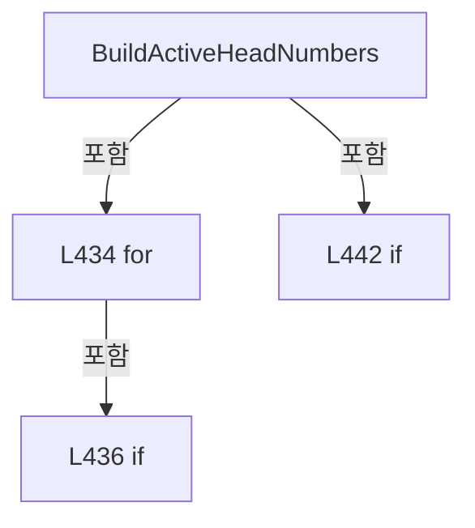

변경 전 점검: 입력/반환 타입, 위 호출자, 예외/취소 경로, 공유 상태와 저장·전송 소비자를 함께 확인합니다. 값의 단위나 물리 방향을 이름만으로 확정하지 않습니다.

### MethodDeclaration `ReadHeadUse` · L450–453

[Drilling.Common/Recipe/CShotCoordinatePlanBuilder.cs:450–453](https://github.com/kjuws10-rgb/A3Drilling/blob/334b3599651b2e8e0181fd4459bafaf3cddafff3/Drilling.Common/Recipe/CShotCoordinatePlanBuilder.cs#L450-L453)

| 항목 | 실제 추출 값 |
| --- | --- |
| 서명 | bool Drilling.Common.Recipe.CShotCoordinatePlanBuilder.ReadHeadUse(System.Collections.Generic.IReadOnlyDictionary<string, string>, int) |
| 접근/수식자 | Private / private, static |
| 반환/값 타입 | bool |
| 소속 타입 | NamedType:Drilling.Common.Recipe.CShotCoordinatePlanBuilder |

입력 계약:

| 이름 | 타입 | 전달 | 선택/기본값 |
| --- | --- | --- | --- |
| parameters | System.Collections.Generic.IReadOnlyDictionary<string, string> | None | False /  |
| headNo | int | None | False /  |

정적 호출자로 확인된 위치:

| 호출 파일/행 | 호출 표현식 | 런타임 분기 가능 |
| --- | --- | --- |
| [Drilling.Common/Recipe/CShotCoordinatePlanBuilder.cs:436–436](https://github.com/kjuws10-rgb/A3Drilling/blob/334b3599651b2e8e0181fd4459bafaf3cddafff3/Drilling.Common/Recipe/CShotCoordinatePlanBuilder.cs#L436-L436) | ReadHeadUse | False |

호출하는 대상과 해석 범위:

| 원본 행 | 표현식 | 분석 상태 | 대상/소스 위치 |
| --- | --- | --- | --- |
| 452 | ReadBool | resolved | bool Drilling.Common.Recipe.CShotCoordinatePlanBuilder.ReadBool(System.Collections.Generic.IReadOnlyDictionary<string, string>, bool, params string[]) · Drilling.Common/Recipe/CShotCoordinatePlanBuilder.cs:624 |

본문의 실제 연산·분기·예외·반환 순서(원문 위치 순):

| 원본 행 | 종류 | 주석 해설 |
| --- | --- | --- |
| 452 | call | 함수·델리게이트 또는 객체 생성자를 호출합니다: ReadBool(parameters, true, $"H{headNo:00}_USE") |
| 452 | return | 호출자에게 값 또는 제어를 반환합니다: return ReadBool(parameters, true, $"H{headNo:00}_USE"); |

변경 전 점검: 입력/반환 타입, 위 호출자, 예외/취소 경로, 공유 상태와 저장·전송 소비자를 함께 확인합니다. 값의 단위나 물리 방향을 이름만으로 확정하지 않습니다.

### MethodDeclaration `ReadHeadCenterX` · L455–462

[Drilling.Common/Recipe/CShotCoordinatePlanBuilder.cs:455–462](https://github.com/kjuws10-rgb/A3Drilling/blob/334b3599651b2e8e0181fd4459bafaf3cddafff3/Drilling.Common/Recipe/CShotCoordinatePlanBuilder.cs#L455-L462)

| 항목 | 실제 추출 값 |
| --- | --- |
| 서명 | double Drilling.Common.Recipe.CShotCoordinatePlanBuilder.ReadHeadCenterX(System.Collections.Generic.IReadOnlyDictionary<string, string>, int, double) |
| 접근/수식자 | Private / private, static |
| 반환/값 타입 | double |
| 소속 타입 | NamedType:Drilling.Common.Recipe.CShotCoordinatePlanBuilder |

입력 계약:

| 이름 | 타입 | 전달 | 선택/기본값 |
| --- | --- | --- | --- |
| parameters | System.Collections.Generic.IReadOnlyDictionary<string, string> | None | False /  |
| headNo | int | None | False /  |
| akMarginX | double | None | False /  |

정적 호출자로 확인된 위치:

| 호출 파일/행 | 호출 표현식 | 런타임 분기 가능 |
| --- | --- | --- |
| [Drilling.Common/Recipe/CShotCoordinatePlanBuilder.cs:61–61](https://github.com/kjuws10-rgb/A3Drilling/blob/334b3599651b2e8e0181fd4459bafaf3cddafff3/Drilling.Common/Recipe/CShotCoordinatePlanBuilder.cs#L61-L61) | ReadHeadCenterX | False |
| [Drilling.Common/Recipe/CShotCoordinatePlanBuilder.cs:390–390](https://github.com/kjuws10-rgb/A3Drilling/blob/334b3599651b2e8e0181fd4459bafaf3cddafff3/Drilling.Common/Recipe/CShotCoordinatePlanBuilder.cs#L390-L390) | ReadHeadCenterX | False |

호출하는 대상과 해석 범위:

| 원본 행 | 표현식 | 분석 상태 | 대상/소스 위치 |
| --- | --- | --- | --- |
| 459 | ReadDouble | resolved | double Drilling.Common.Recipe.CShotCoordinatePlanBuilder.ReadDouble(System.Collections.Generic.IReadOnlyDictionary<string, string>, double, params string[]) · Drilling.Common/Recipe/CShotCoordinatePlanBuilder.cs:560 |
| 460 | ReadDouble | resolved | double Drilling.Common.Recipe.CShotCoordinatePlanBuilder.ReadDouble(System.Collections.Generic.IReadOnlyDictionary<string, string>, double, params string[]) · Drilling.Common/Recipe/CShotCoordinatePlanBuilder.cs:560 |

본문의 실제 연산·분기·예외·반환 순서(원문 위치 순):

| 원본 행 | 종류 | 주석 해설 |
| --- | --- | --- |
| 457 | local-declaration | 지역 변수를 선언합니다: const double fallbackHead1PositionX = -5.0; |
| 457 | variable-initializer | 변수의 초기값을 지정합니다: fallbackHead1PositionX = -5.0 |
| 458 | local-declaration | 지역 변수를 선언합니다: const double fallbackHeadGapX = 200.0; |
| 458 | variable-initializer | 변수의 초기값을 지정합니다: fallbackHeadGapX = 200.0 |
| 459 | call | 함수·델리게이트 또는 객체 생성자를 호출합니다: ReadDouble(parameters, fallbackHead1PositionX, "H01_AK_POSITION_X") |
| 459 | local-declaration | 지역 변수를 선언합니다: var head1PositionX = ReadDouble(parameters, fallbackHead1PositionX, "H01_AK_POSITION_X"); |
| 459 | variable-initializer | 변수의 초기값을 지정합니다: head1PositionX = ReadDouble(parameters, fallbackHead1PositionX, "H01_AK_POSITION_X") |
| 460 | call | 함수·델리게이트 또는 객체 생성자를 호출합니다: ReadDouble(parameters, fallbackHeadGapX, "HeadGapX") |
| 460 | local-declaration | 지역 변수를 선언합니다: var headGapX = ReadDouble(parameters, fallbackHeadGapX, "HeadGapX"); |
| 460 | variable-initializer | 변수의 초기값을 지정합니다: headGapX = ReadDouble(parameters, fallbackHeadGapX, "HeadGapX") |
| 461 | return | 호출자에게 값 또는 제어를 반환합니다: return akMarginX + head1PositionX + ((headNo - 1) * headGapX); |

변경 전 점검: 입력/반환 타입, 위 호출자, 예외/취소 경로, 공유 상태와 저장·전송 소비자를 함께 확인합니다. 값의 단위나 물리 방향을 이름만으로 확정하지 않습니다.

### MethodDeclaration `ReadHeadCenterY` · L464–475

[Drilling.Common/Recipe/CShotCoordinatePlanBuilder.cs:464–475](https://github.com/kjuws10-rgb/A3Drilling/blob/334b3599651b2e8e0181fd4459bafaf3cddafff3/Drilling.Common/Recipe/CShotCoordinatePlanBuilder.cs#L464-L475)

| 항목 | 실제 추출 값 |
| --- | --- |
| 서명 | double Drilling.Common.Recipe.CShotCoordinatePlanBuilder.ReadHeadCenterY(System.Collections.Generic.IReadOnlyDictionary<string, string>, int) |
| 접근/수식자 | Private / private, static |
| 반환/값 타입 | double |
| 소속 타입 | NamedType:Drilling.Common.Recipe.CShotCoordinatePlanBuilder |

입력 계약:

| 이름 | 타입 | 전달 | 선택/기본값 |
| --- | --- | --- | --- |
| parameters | System.Collections.Generic.IReadOnlyDictionary<string, string> | None | False /  |
| headNo | int | None | False /  |

정적 호출자로 확인된 위치:

| 호출 파일/행 | 호출 표현식 | 런타임 분기 가능 |
| --- | --- | --- |
| [Drilling.Common/Recipe/CShotCoordinatePlanBuilder.cs:62–62](https://github.com/kjuws10-rgb/A3Drilling/blob/334b3599651b2e8e0181fd4459bafaf3cddafff3/Drilling.Common/Recipe/CShotCoordinatePlanBuilder.cs#L62-L62) | ReadHeadCenterY | False |

호출하는 대상과 해석 범위:

| 원본 행 | 표현식 | 분석 상태 | 대상/소스 위치 |
| --- | --- | --- | --- |
| 466 | ReadNullableDouble | resolved | double? Drilling.Common.Recipe.CShotCoordinatePlanBuilder.ReadNullableDouble(System.Collections.Generic.IReadOnlyDictionary<string, string>, params string[]) · Drilling.Common/Recipe/CShotCoordinatePlanBuilder.cs:578 |
| 472 | ReadDouble | resolved | double Drilling.Common.Recipe.CShotCoordinatePlanBuilder.ReadDouble(System.Collections.Generic.IReadOnlyDictionary<string, string>, double, params string[]) · Drilling.Common/Recipe/CShotCoordinatePlanBuilder.cs:560 |
| 473 | ReadDouble | resolved | double Drilling.Common.Recipe.CShotCoordinatePlanBuilder.ReadDouble(System.Collections.Generic.IReadOnlyDictionary<string, string>, double, params string[]) · Drilling.Common/Recipe/CShotCoordinatePlanBuilder.cs:560 |

본문의 실제 연산·분기·예외·반환 순서(원문 위치 순):

| 원본 행 | 종류 | 주석 해설 |
| --- | --- | --- |
| 466 | call | 함수·델리게이트 또는 객체 생성자를 호출합니다: ReadNullableDouble(parameters, $"H{headNo:00}_AK_POSITION_Y") |
| 466 | local-declaration | 지역 변수를 선언합니다: var explicitHeadY = ReadNullableDouble(parameters, $"H{headNo:00}_AK_POSITION_Y"); |
| 466 | variable-initializer | 변수의 초기값을 지정합니다: explicitHeadY = ReadNullableDouble(parameters, $"H{headNo:00}_AK_POSITION_Y") |
| 467 | if | 조건에 따라 분기합니다: if (explicitHeadY.HasValue) |
| 469 | return | 호출자에게 값 또는 제어를 반환합니다: return explicitHeadY.Value; |
| 472 | call | 함수·델리게이트 또는 객체 생성자를 호출합니다: ReadDouble(parameters, 0.0, "REVIEW_TO_HEAD1_GAP_Y") |
| 472 | local-declaration | 지역 변수를 선언합니다: var head1CenterY = ReadDouble(parameters, 0.0, "REVIEW_TO_HEAD1_GAP_Y"); |
| 472 | variable-initializer | 변수의 초기값을 지정합니다: head1CenterY = ReadDouble(parameters, 0.0, "REVIEW_TO_HEAD1_GAP_Y") |
| 473 | call | 함수·델리게이트 또는 객체 생성자를 호출합니다: ReadDouble(parameters, 0.0, "HeadGapY") |
| 473 | local-declaration | 지역 변수를 선언합니다: var headGapY = ReadDouble(parameters, 0.0, "HeadGapY"); |
| 473 | variable-initializer | 변수의 초기값을 지정합니다: headGapY = ReadDouble(parameters, 0.0, "HeadGapY") |
| 474 | conditional-expression | 조건에 따라 결과식을 선택합니다: headNo % 2 == 0 ? head1CenterY + headGapY : head1CenterY |
| 474 | return | 호출자에게 값 또는 제어를 반환합니다: return headNo % 2 == 0 ? head1CenterY + headGapY : head1CenterY; |

제어 구문의 포함 구조(실제 실행 순서/CFG가 아닌 구문 탐색 그림):

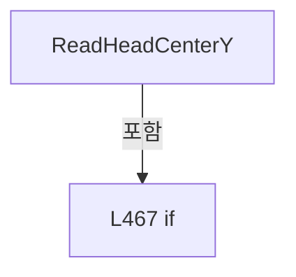

변경 전 점검: 입력/반환 타입, 위 호출자, 예외/취소 경로, 공유 상태와 저장·전송 소비자를 함께 확인합니다. 값의 단위나 물리 방향을 이름만으로 확정하지 않습니다.

### MethodDeclaration `ReadHeadDefaultOffset` · L477–480

[Drilling.Common/Recipe/CShotCoordinatePlanBuilder.cs:477–480](https://github.com/kjuws10-rgb/A3Drilling/blob/334b3599651b2e8e0181fd4459bafaf3cddafff3/Drilling.Common/Recipe/CShotCoordinatePlanBuilder.cs#L477-L480)

| 항목 | 실제 추출 값 |
| --- | --- |
| 서명 | double Drilling.Common.Recipe.CShotCoordinatePlanBuilder.ReadHeadDefaultOffset(System.Collections.Generic.IReadOnlyDictionary<string, string>, int, string) |
| 접근/수식자 | Private / private, static |
| 반환/값 타입 | double |
| 소속 타입 | NamedType:Drilling.Common.Recipe.CShotCoordinatePlanBuilder |

입력 계약:

| 이름 | 타입 | 전달 | 선택/기본값 |
| --- | --- | --- | --- |
| parameters | System.Collections.Generic.IReadOnlyDictionary<string, string> | None | False /  |
| headNo | int | None | False /  |
| axis | string | None | False /  |

정적 호출자로 확인된 위치:

| 호출 파일/행 | 호출 표현식 | 런타임 분기 가능 |
| --- | --- | --- |
| [Drilling.Common/Recipe/CShotCoordinatePlanBuilder.cs:64–64](https://github.com/kjuws10-rgb/A3Drilling/blob/334b3599651b2e8e0181fd4459bafaf3cddafff3/Drilling.Common/Recipe/CShotCoordinatePlanBuilder.cs#L64-L64) | ReadHeadDefaultOffset | False |
| [Drilling.Common/Recipe/CShotCoordinatePlanBuilder.cs:65–65](https://github.com/kjuws10-rgb/A3Drilling/blob/334b3599651b2e8e0181fd4459bafaf3cddafff3/Drilling.Common/Recipe/CShotCoordinatePlanBuilder.cs#L65-L65) | ReadHeadDefaultOffset | False |

호출하는 대상과 해석 범위:

| 원본 행 | 표현식 | 분석 상태 | 대상/소스 위치 |
| --- | --- | --- | --- |
| 479 | ReadDouble | resolved | double Drilling.Common.Recipe.CShotCoordinatePlanBuilder.ReadDouble(System.Collections.Generic.IReadOnlyDictionary<string, string>, double, params string[]) · Drilling.Common/Recipe/CShotCoordinatePlanBuilder.cs:560 |

본문의 실제 연산·분기·예외·반환 순서(원문 위치 순):

| 원본 행 | 종류 | 주석 해설 |
| --- | --- | --- |
| 479 | call | 함수·델리게이트 또는 객체 생성자를 호출합니다: ReadDouble(parameters, 0.0, $"H{headNo:00}_DEFAULT_OFFSET_{axis}") |
| 479 | return | 호출자에게 값 또는 제어를 반환합니다: return ReadDouble(parameters, 0.0, $"H{headNo:00}_DEFAULT_OFFSET_{axis}"); |

변경 전 점검: 입력/반환 타입, 위 호출자, 예외/취소 경로, 공유 상태와 저장·전송 소비자를 함께 확인합니다. 값의 단위나 물리 방향을 이름만으로 확정하지 않습니다.

### MethodDeclaration `ReadFirstBeamOffset` · L482–485

[Drilling.Common/Recipe/CShotCoordinatePlanBuilder.cs:482–485](https://github.com/kjuws10-rgb/A3Drilling/blob/334b3599651b2e8e0181fd4459bafaf3cddafff3/Drilling.Common/Recipe/CShotCoordinatePlanBuilder.cs#L482-L485)

| 항목 | 실제 추출 값 |
| --- | --- |
| 서명 | double Drilling.Common.Recipe.CShotCoordinatePlanBuilder.ReadFirstBeamOffset(System.Collections.Generic.IReadOnlyDictionary<string, string>, int, string) |
| 접근/수식자 | Private / private, static |
| 반환/값 타입 | double |
| 소속 타입 | NamedType:Drilling.Common.Recipe.CShotCoordinatePlanBuilder |

입력 계약:

| 이름 | 타입 | 전달 | 선택/기본값 |
| --- | --- | --- | --- |
| parameters | System.Collections.Generic.IReadOnlyDictionary<string, string> | None | False /  |
| headNo | int | None | False /  |
| axis | string | None | False /  |

정적 호출자로 확인된 위치:

| 호출 파일/행 | 호출 표현식 | 런타임 분기 가능 |
| --- | --- | --- |
| [Drilling.Common/Recipe/CShotCoordinatePlanBuilder.cs:66–66](https://github.com/kjuws10-rgb/A3Drilling/blob/334b3599651b2e8e0181fd4459bafaf3cddafff3/Drilling.Common/Recipe/CShotCoordinatePlanBuilder.cs#L66-L66) | ReadFirstBeamOffset | False |
| [Drilling.Common/Recipe/CShotCoordinatePlanBuilder.cs:67–67](https://github.com/kjuws10-rgb/A3Drilling/blob/334b3599651b2e8e0181fd4459bafaf3cddafff3/Drilling.Common/Recipe/CShotCoordinatePlanBuilder.cs#L67-L67) | ReadFirstBeamOffset | False |

호출하는 대상과 해석 범위:

| 원본 행 | 표현식 | 분석 상태 | 대상/소스 위치 |
| --- | --- | --- | --- |
| 484 | ReadDouble | resolved | double Drilling.Common.Recipe.CShotCoordinatePlanBuilder.ReadDouble(System.Collections.Generic.IReadOnlyDictionary<string, string>, double, params string[]) · Drilling.Common/Recipe/CShotCoordinatePlanBuilder.cs:560 |

본문의 실제 연산·분기·예외·반환 순서(원문 위치 순):

| 원본 행 | 종류 | 주석 해설 |
| --- | --- | --- |
| 484 | call | 함수·델리게이트 또는 객체 생성자를 호출합니다: ReadDouble(parameters, 0.0, $"H{headNo:00}_FIRST_BEAM_OFFSET_{axis}") |
| 484 | return | 호출자에게 값 또는 제어를 반환합니다: return ReadDouble(parameters, 0.0, $"H{headNo:00}_FIRST_BEAM_OFFSET_{axis}"); |

변경 전 점검: 입력/반환 타입, 위 호출자, 예외/취소 경로, 공유 상태와 저장·전송 소비자를 함께 확인합니다. 값의 단위나 물리 방향을 이름만으로 확정하지 않습니다.

### MethodDeclaration `ReadHeadEncoderScale` · L487–490

[Drilling.Common/Recipe/CShotCoordinatePlanBuilder.cs:487–490](https://github.com/kjuws10-rgb/A3Drilling/blob/334b3599651b2e8e0181fd4459bafaf3cddafff3/Drilling.Common/Recipe/CShotCoordinatePlanBuilder.cs#L487-L490)

| 항목 | 실제 추출 값 |
| --- | --- |
| 서명 | double Drilling.Common.Recipe.CShotCoordinatePlanBuilder.ReadHeadEncoderScale(System.Collections.Generic.IReadOnlyDictionary<string, string>, int, double) |
| 접근/수식자 | Private / private, static |
| 반환/값 타입 | double |
| 소속 타입 | NamedType:Drilling.Common.Recipe.CShotCoordinatePlanBuilder |

입력 계약:

| 이름 | 타입 | 전달 | 선택/기본값 |
| --- | --- | --- | --- |
| parameters | System.Collections.Generic.IReadOnlyDictionary<string, string> | None | False /  |
| headNo | int | None | False /  |
| defaultValue | double | None | False /  |

정적 호출자로 확인된 위치:

| 호출 파일/행 | 호출 표현식 | 런타임 분기 가능 |
| --- | --- | --- |
| [Drilling.Common/Recipe/CShotCoordinatePlanBuilder.cs:68–68](https://github.com/kjuws10-rgb/A3Drilling/blob/334b3599651b2e8e0181fd4459bafaf3cddafff3/Drilling.Common/Recipe/CShotCoordinatePlanBuilder.cs#L68-L68) | ReadHeadEncoderScale | False |

호출하는 대상과 해석 범위:

| 원본 행 | 표현식 | 분석 상태 | 대상/소스 위치 |
| --- | --- | --- | --- |
| 489 | ReadDouble | resolved | double Drilling.Common.Recipe.CShotCoordinatePlanBuilder.ReadDouble(System.Collections.Generic.IReadOnlyDictionary<string, string>, double, params string[]) · Drilling.Common/Recipe/CShotCoordinatePlanBuilder.cs:560 |

본문의 실제 연산·분기·예외·반환 순서(원문 위치 순):

| 원본 행 | 종류 | 주석 해설 |
| --- | --- | --- |
| 489 | call | 함수·델리게이트 또는 객체 생성자를 호출합니다: ReadDouble(parameters, defaultValue, $"H{headNo:00}_ENCODER_SCALE", "SCAN_ENCODER_SCALE") |
| 489 | return | 호출자에게 값 또는 제어를 반환합니다: return ReadDouble(parameters, defaultValue, $"H{headNo:00}_ENCODER_SCALE", "SCAN_ENCODER_SCALE"); |

변경 전 점검: 입력/반환 타입, 위 호출자, 예외/취소 경로, 공유 상태와 저장·전송 소비자를 함께 확인합니다. 값의 단위나 물리 방향을 이름만으로 확정하지 않습니다.

### MethodDeclaration `ConvertRecipeYToStageY` · L492–495

[Drilling.Common/Recipe/CShotCoordinatePlanBuilder.cs:492–495](https://github.com/kjuws10-rgb/A3Drilling/blob/334b3599651b2e8e0181fd4459bafaf3cddafff3/Drilling.Common/Recipe/CShotCoordinatePlanBuilder.cs#L492-L495)

| 항목 | 실제 추출 값 |
| --- | --- |
| 서명 | double Drilling.Common.Recipe.CShotCoordinatePlanBuilder.ConvertRecipeYToStageY(double) |
| 접근/수식자 | Private / private, static |
| 반환/값 타입 | double |
| 소속 타입 | NamedType:Drilling.Common.Recipe.CShotCoordinatePlanBuilder |

입력 계약:

| 이름 | 타입 | 전달 | 선택/기본값 |
| --- | --- | --- | --- |
| recipeY | double | None | False /  |

정적 호출자로 확인된 위치:

| 호출 파일/행 | 호출 표현식 | 런타임 분기 가능 |
| --- | --- | --- |
| [Drilling.Common/Recipe/CShotCoordinatePlanBuilder.cs:71–71](https://github.com/kjuws10-rgb/A3Drilling/blob/334b3599651b2e8e0181fd4459bafaf3cddafff3/Drilling.Common/Recipe/CShotCoordinatePlanBuilder.cs#L71-L71) | ConvertRecipeYToStageY | False |
| [Drilling.Common/Recipe/CShotCoordinatePlanBuilder.cs:141–141](https://github.com/kjuws10-rgb/A3Drilling/blob/334b3599651b2e8e0181fd4459bafaf3cddafff3/Drilling.Common/Recipe/CShotCoordinatePlanBuilder.cs#L141-L141) | ConvertRecipeYToStageY | False |
| [Drilling.Common/Recipe/CShotCoordinatePlanBuilder.cs:142–142](https://github.com/kjuws10-rgb/A3Drilling/blob/334b3599651b2e8e0181fd4459bafaf3cddafff3/Drilling.Common/Recipe/CShotCoordinatePlanBuilder.cs#L142-L142) | ConvertRecipeYToStageY | False |

본문의 실제 연산·분기·예외·반환 순서(원문 위치 순):

| 원본 행 | 종류 | 주석 해설 |
| --- | --- | --- |
| 494 | return | 호출자에게 값 또는 제어를 반환합니다: return -recipeY; |

변경 전 점검: 입력/반환 타입, 위 호출자, 예외/취소 경로, 공유 상태와 저장·전송 소비자를 함께 확인합니다. 값의 단위나 물리 방향을 이름만으로 확정하지 않습니다.

### MethodDeclaration `ApplyScannerAxis` · L497–500

[Drilling.Common/Recipe/CShotCoordinatePlanBuilder.cs:497–500](https://github.com/kjuws10-rgb/A3Drilling/blob/334b3599651b2e8e0181fd4459bafaf3cddafff3/Drilling.Common/Recipe/CShotCoordinatePlanBuilder.cs#L497-L500)

| 항목 | 실제 추출 값 |
| --- | --- |
| 서명 | double Drilling.Common.Recipe.CShotCoordinatePlanBuilder.ApplyScannerAxis(double, double, double) |
| 접근/수식자 | Private / private, static |
| 반환/값 타입 | double |
| 소속 타입 | NamedType:Drilling.Common.Recipe.CShotCoordinatePlanBuilder |

입력 계약:

| 이름 | 타입 | 전달 | 선택/기본값 |
| --- | --- | --- | --- |
| designPosition | double | None | False /  |
| stageStartPosition | double | None | False /  |
| offset | double | None | False /  |

정적 호출자로 확인된 위치:

| 호출 파일/행 | 호출 표현식 | 런타임 분기 가능 |
| --- | --- | --- |
| [Drilling.Common/Recipe/CShotCoordinatePlanBuilder.cs:135–135](https://github.com/kjuws10-rgb/A3Drilling/blob/334b3599651b2e8e0181fd4459bafaf3cddafff3/Drilling.Common/Recipe/CShotCoordinatePlanBuilder.cs#L135-L135) | ApplyScannerAxis | False |

본문의 실제 연산·분기·예외·반환 순서(원문 위치 순):

| 원본 행 | 종류 | 주석 해설 |
| --- | --- | --- |
| 499 | return | 호출자에게 값 또는 제어를 반환합니다: return (designPosition - stageStartPosition) + offset; |

변경 전 점검: 입력/반환 타입, 위 호출자, 예외/취소 경로, 공유 상태와 저장·전송 소비자를 함께 확인합니다. 값의 단위나 물리 방향을 이름만으로 확정하지 않습니다.

### MethodDeclaration `ReadScannerReferenceOffsetX` · L502–507

[Drilling.Common/Recipe/CShotCoordinatePlanBuilder.cs:502–507](https://github.com/kjuws10-rgb/A3Drilling/blob/334b3599651b2e8e0181fd4459bafaf3cddafff3/Drilling.Common/Recipe/CShotCoordinatePlanBuilder.cs#L502-L507)

| 항목 | 실제 추출 값 |
| --- | --- |
| 서명 | double Drilling.Common.Recipe.CShotCoordinatePlanBuilder.ReadScannerReferenceOffsetX(System.Collections.Generic.IReadOnlyDictionary<string, string>) |
| 접근/수식자 | Private / private, static |
| 반환/값 타입 | double |
| 소속 타입 | NamedType:Drilling.Common.Recipe.CShotCoordinatePlanBuilder |

입력 계약:

| 이름 | 타입 | 전달 | 선택/기본값 |
| --- | --- | --- | --- |
| parameters | System.Collections.Generic.IReadOnlyDictionary<string, string> | None | False /  |

정적 호출자로 확인된 위치:

| 호출 파일/행 | 호출 표현식 | 런타임 분기 가능 |
| --- | --- | --- |
| [Drilling.Common/Recipe/CShotCoordinatePlanBuilder.cs:32–32](https://github.com/kjuws10-rgb/A3Drilling/blob/334b3599651b2e8e0181fd4459bafaf3cddafff3/Drilling.Common/Recipe/CShotCoordinatePlanBuilder.cs#L32-L32) | ReadScannerReferenceOffsetX | False |

호출하는 대상과 해석 범위:

| 원본 행 | 표현식 | 분석 상태 | 대상/소스 위치 |
| --- | --- | --- | --- |
| 504 | ReadDouble | resolved | double Drilling.Common.Recipe.CShotCoordinatePlanBuilder.ReadDouble(System.Collections.Generic.IReadOnlyDictionary<string, string>, double, params string[]) · Drilling.Common/Recipe/CShotCoordinatePlanBuilder.cs:560 |
| 505 | ReadDouble | resolved | double Drilling.Common.Recipe.CShotCoordinatePlanBuilder.ReadDouble(System.Collections.Generic.IReadOnlyDictionary<string, string>, double, params string[]) · Drilling.Common/Recipe/CShotCoordinatePlanBuilder.cs:560 |

본문의 실제 연산·분기·예외·반환 순서(원문 위치 순):

| 원본 행 | 종류 | 주석 해설 |
| --- | --- | --- |
| 504 | call | 함수·델리게이트 또는 객체 생성자를 호출합니다: ReadDouble(parameters, 0.0, "ESC_EDGE_TO_GLASS_EDGE", "ESC_EDGE_TO_GLASS_EDGE_X") |
| 504 | local-declaration | 지역 변수를 선언합니다: var escEdgeToGlassEdge = ReadDouble(parameters, 0.0, "ESC_EDGE_TO_GLASS_EDGE", "ESC_EDGE_TO_GLASS_EDGE_X"); |
| 504 | variable-initializer | 변수의 초기값을 지정합니다: escEdgeToGlassEdge = ReadDouble(parameters, 0.0, "ESC_EDGE_TO_GLASS_EDGE", "ESC_EDGE_TO_GLASS_EDGE_X") |
| 505 | call | 함수·델리게이트 또는 객체 생성자를 호출합니다: ReadDouble(parameters, 0.0, "GLASS_CENTER_TO_SCANNER_CENTER", "GLASS_CENTER_TO_SCANNER_CENTER_X") |
| 505 | local-declaration | 지역 변수를 선언합니다: var glassCenterToScannerCenter = ReadDouble(parameters, 0.0, "GLASS_CENTER_TO_SCANNER_CENTER", "GLASS_CENTER_TO_SCANNER_CENTER_X"); |
| 505 | variable-initializer | 변수의 초기값을 지정합니다: glassCenterToScannerCenter = ReadDouble(parameters, 0.0, "GLASS_CENTER_TO_SCANNER_CENTER", "GLASS_CENTER_TO_SCANNER_CENTER_X") |
| 506 | return | 호출자에게 값 또는 제어를 반환합니다: return escEdgeToGlassEdge + glassCenterToScannerCenter; |

변경 전 점검: 입력/반환 타입, 위 호출자, 예외/취소 경로, 공유 상태와 저장·전송 소비자를 함께 확인합니다. 값의 단위나 물리 방향을 이름만으로 확정하지 않습니다.

### MethodDeclaration `ReadDirection` · L509–543

[Drilling.Common/Recipe/CShotCoordinatePlanBuilder.cs:509–543](https://github.com/kjuws10-rgb/A3Drilling/blob/334b3599651b2e8e0181fd4459bafaf3cddafff3/Drilling.Common/Recipe/CShotCoordinatePlanBuilder.cs#L509-L543)

| 항목 | 실제 추출 값 |
| --- | --- |
| 서명 | double Drilling.Common.Recipe.CShotCoordinatePlanBuilder.ReadDirection(System.Collections.Generic.IReadOnlyDictionary<string, string>, double, params string[]) |
| 접근/수식자 | Internal / internal, static |
| 반환/값 타입 | double |
| 소속 타입 | NamedType:Drilling.Common.Recipe.CShotCoordinatePlanBuilder |

입력 계약:

| 이름 | 타입 | 전달 | 선택/기본값 |
| --- | --- | --- | --- |
| parameters | System.Collections.Generic.IReadOnlyDictionary<string, string> | None | False /  |
| defaultValue | double | None | False /  |
| keys | string[] | None | False /  |

정적 호출자로 확인된 위치:

| 호출 파일/행 | 호출 표현식 | 런타임 분기 가능 |
| --- | --- | --- |
| [Drilling.Common/Recipe/CShotCoordinatePlanBuilder.cs:29–29](https://github.com/kjuws10-rgb/A3Drilling/blob/334b3599651b2e8e0181fd4459bafaf3cddafff3/Drilling.Common/Recipe/CShotCoordinatePlanBuilder.cs#L29-L29) | ReadDirection | False |
| [Drilling.Common/Recipe/CShotCoordinatePlanBuilder.cs:1256–1256](https://github.com/kjuws10-rgb/A3Drilling/blob/334b3599651b2e8e0181fd4459bafaf3cddafff3/Drilling.Common/Recipe/CShotCoordinatePlanBuilder.cs#L1256-L1256) | CShotCoordinatePlanBuilder.ReadDirection | False |
| [Drilling.Common/Recipe/CShotCoordinatePlanBuilder.cs:1285–1285](https://github.com/kjuws10-rgb/A3Drilling/blob/334b3599651b2e8e0181fd4459bafaf3cddafff3/Drilling.Common/Recipe/CShotCoordinatePlanBuilder.cs#L1285-L1285) | CShotCoordinatePlanBuilder.ReadDirection | False |
| [Drilling.Common/Recipe/CShotCoordinatePlanBuilder.cs:1304–1304](https://github.com/kjuws10-rgb/A3Drilling/blob/334b3599651b2e8e0181fd4459bafaf3cddafff3/Drilling.Common/Recipe/CShotCoordinatePlanBuilder.cs#L1304-L1304) | CShotCoordinatePlanBuilder.ReadDirection | False |
| [Drilling.Common/Review/CReviewManager.cs:517–517](https://github.com/kjuws10-rgb/A3Drilling/blob/334b3599651b2e8e0181fd4459bafaf3cddafff3/Drilling.Common/Review/CReviewManager.cs#L517-L517) | CShotCoordinatePlanBuilder.ReadDirection | False |

호출하는 대상과 해석 범위:

| 원본 행 | 표현식 | 분석 상태 | 대상/소스 위치 |
| --- | --- | --- | --- |
| 516 | keys.Where | resolved | System.Collections.Generic.IEnumerable<string> System.Collections.Generic.IEnumerable<string>.Where<string>(System.Func<string, bool>) |
| 518 | parameters.TryGetValue | resolved · 동적 구현 선택 가능 | bool System.Collections.Generic.IReadOnlyDictionary<string, string>.TryGetValue(string, out string) |
| 518 | string.IsNullOrWhiteSpace | resolved | bool string.IsNullOrWhiteSpace(string?) |
| 523 | value.Trim().ToUpperInvariant | resolved | string string.ToUpperInvariant() |
| 523 | value.Trim | resolved | string string.Trim() |
| 524 | double.TryParse | resolved | bool double.TryParse(string?, System.Globalization.NumberStyles, System.IFormatProvider?, out double) |
| 526 | NormalizeDirection | resolved | double Drilling.Common.Recipe.CShotCoordinatePlanBuilder.NormalizeDirection(double, string) · Drilling.Common/Recipe/CShotCoordinatePlanBuilder.cs:545 |
| 539 | new InvalidOperationException | resolved | System.InvalidOperationException.InvalidOperationException(string?) |
| 542 | NormalizeDirection | resolved | double Drilling.Common.Recipe.CShotCoordinatePlanBuilder.NormalizeDirection(double, string) · Drilling.Common/Recipe/CShotCoordinatePlanBuilder.cs:545 |

본문의 실제 연산·분기·예외·반환 순서(원문 위치 순):

| 원본 행 | 종류 | 주석 해설 |
| --- | --- | --- |
| 516 | call | 함수·델리게이트 또는 객체 생성자를 호출합니다: keys.Where(ShouldIncludeItem) |
| 516 | foreach | 컬렉션 요소를 순회합니다: foreach (var key in keys.Where(ShouldIncludeItem)) |
| 518 | call | 함수·델리게이트 또는 객체 생성자를 호출합니다: parameters.TryGetValue(key, out var value) |
| 518 | call | 함수·델리게이트 또는 객체 생성자를 호출합니다: string.IsNullOrWhiteSpace(value) |
| 518 | if | 조건에 따라 분기합니다: if (!parameters.TryGetValue(key, out var value) &#124;&#124; string.IsNullOrWhiteSpace(value)) |
| 520 | continue | 다음 반복으로 진행합니다: continue; |
| 523 | call | 함수·델리게이트 또는 객체 생성자를 호출합니다: value.Trim().ToUpperInvariant() |
| 523 | call | 함수·델리게이트 또는 객체 생성자를 호출합니다: value.Trim() |
| 523 | local-declaration | 지역 변수를 선언합니다: var normalized = value.Trim().ToUpperInvariant(); |
| 523 | variable-initializer | 변수의 초기값을 지정합니다: normalized = value.Trim().ToUpperInvariant() |
| 524 | call | 함수·델리게이트 또는 객체 생성자를 호출합니다: double.TryParse(normalized, NumberStyles.Any, CultureInfo.InvariantCulture, out var number) |
| 524 | if | 조건에 따라 분기합니다: if (double.TryParse(normalized, NumberStyles.Any, CultureInfo.InvariantCulture, out var number)) |
| 526 | call | 함수·델리게이트 또는 객체 생성자를 호출합니다: NormalizeDirection(number, key) |
| 526 | return | 호출자에게 값 또는 제어를 반환합니다: return NormalizeDirection(number, key); |
| 529 | if | 조건에 따라 분기합니다: if (normalized is "-" or "-1" or "REVERSE" or "REV" or "NEGATIVE" or "MINUS") |
| 531 | return | 호출자에게 값 또는 제어를 반환합니다: return -1.0; |
| 534 | if | 조건에 따라 분기합니다: if (normalized is "+" or "+1" or "FORWARD" or "FWD" or "POSITIVE" or "PLUS") |
| 536 | return | 호출자에게 값 또는 제어를 반환합니다: return 1.0; |
| 539 | call | 함수·델리게이트 또는 객체 생성자를 호출합니다: new InvalidOperationException($"Invalid direction value. {key}={value}") |
| 539 | throw | 예외를 발생/전달합니다: throw new InvalidOperationException($"Invalid direction value. {key}={value}"); |
| 542 | call | 함수·델리게이트 또는 객체 생성자를 호출합니다: NormalizeDirection(defaultValue, "DEFAULT_DIRECTION") |
| 542 | return | 호출자에게 값 또는 제어를 반환합니다: return NormalizeDirection(defaultValue, "DEFAULT_DIRECTION"); |

제어 구문의 포함 구조(실제 실행 순서/CFG가 아닌 구문 탐색 그림):

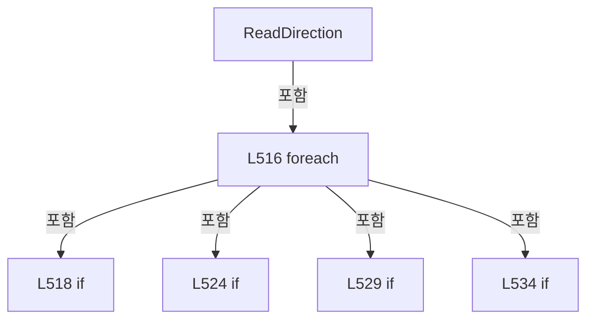

변경 전 점검: 입력/반환 타입, 위 호출자, 예외/취소 경로, 공유 상태와 저장·전송 소비자를 함께 확인합니다. 값의 단위나 물리 방향을 이름만으로 확정하지 않습니다.

### LocalFunctionStatement `ShouldIncludeItem` · L511–514

[Drilling.Common/Recipe/CShotCoordinatePlanBuilder.cs:511–514](https://github.com/kjuws10-rgb/A3Drilling/blob/334b3599651b2e8e0181fd4459bafaf3cddafff3/Drilling.Common/Recipe/CShotCoordinatePlanBuilder.cs#L511-L514)

| 항목 | 실제 추출 값 |
| --- | --- |
| 서명 | bool ShouldIncludeItem(string) |
| 접근/수식자 | Private /  |
| 반환/값 타입 | bool |
| 소속 타입 | NamedType:Drilling.Common.Recipe.CShotCoordinatePlanBuilder |

입력 계약:

| 이름 | 타입 | 전달 | 선택/기본값 |
| --- | --- | --- | --- |
| key | string | None | False /  |

현재 부분 분석에서 직접 연결된 호출자는 없습니다. XAML/이벤트/인터페이스·델리게이트·외부 진입을 추가 확인해야 하며, 미사용으로 판정한 것이 아닙니다.

호출하는 대상과 해석 범위:

| 원본 행 | 표현식 | 분석 상태 | 대상/소스 위치 |
| --- | --- | --- | --- |
| 513 | string.IsNullOrWhiteSpace | resolved | bool string.IsNullOrWhiteSpace(string?) |

본문의 실제 연산·분기·예외·반환 순서(원문 위치 순):

| 원본 행 | 종류 | 주석 해설 |
| --- | --- | --- |
| 513 | call | 함수·델리게이트 또는 객체 생성자를 호출합니다: string.IsNullOrWhiteSpace(key) |
| 513 | return | 호출자에게 값 또는 제어를 반환합니다: return !string.IsNullOrWhiteSpace(key); |

변경 전 점검: 입력/반환 타입, 위 호출자, 예외/취소 경로, 공유 상태와 저장·전송 소비자를 함께 확인합니다. 값의 단위나 물리 방향을 이름만으로 확정하지 않습니다.

### MethodDeclaration `NormalizeDirection` · L545–553

[Drilling.Common/Recipe/CShotCoordinatePlanBuilder.cs:545–553](https://github.com/kjuws10-rgb/A3Drilling/blob/334b3599651b2e8e0181fd4459bafaf3cddafff3/Drilling.Common/Recipe/CShotCoordinatePlanBuilder.cs#L545-L553)

| 항목 | 실제 추출 값 |
| --- | --- |
| 서명 | double Drilling.Common.Recipe.CShotCoordinatePlanBuilder.NormalizeDirection(double, string) |
| 접근/수식자 | Private / private, static |
| 반환/값 타입 | double |
| 소속 타입 | NamedType:Drilling.Common.Recipe.CShotCoordinatePlanBuilder |

입력 계약:

| 이름 | 타입 | 전달 | 선택/기본값 |
| --- | --- | --- | --- |
| value | double | None | False /  |
| key | string | None | False /  |

정적 호출자로 확인된 위치:

| 호출 파일/행 | 호출 표현식 | 런타임 분기 가능 |
| --- | --- | --- |
| [Drilling.Common/Recipe/CShotCoordinatePlanBuilder.cs:526–526](https://github.com/kjuws10-rgb/A3Drilling/blob/334b3599651b2e8e0181fd4459bafaf3cddafff3/Drilling.Common/Recipe/CShotCoordinatePlanBuilder.cs#L526-L526) | NormalizeDirection | False |
| [Drilling.Common/Recipe/CShotCoordinatePlanBuilder.cs:542–542](https://github.com/kjuws10-rgb/A3Drilling/blob/334b3599651b2e8e0181fd4459bafaf3cddafff3/Drilling.Common/Recipe/CShotCoordinatePlanBuilder.cs#L542-L542) | NormalizeDirection | False |

호출하는 대상과 해석 범위:

| 원본 행 | 표현식 | 분석 상태 | 대상/소스 위치 |
| --- | --- | --- | --- |
| 547 | double.IsFinite | resolved | bool double.IsFinite(double) |
| 549 | new InvalidOperationException | resolved | System.InvalidOperationException.InvalidOperationException(string?) |

본문의 실제 연산·분기·예외·반환 순서(원문 위치 순):

| 원본 행 | 종류 | 주석 해설 |
| --- | --- | --- |
| 547 | call | 함수·델리게이트 또는 객체 생성자를 호출합니다: double.IsFinite(value) |
| 547 | if | 조건에 따라 분기합니다: if (!double.IsFinite(value) &#124;&#124; (value != -1.0 && value != 1.0)) |
| 549 | call | 함수·델리게이트 또는 객체 생성자를 호출합니다: new InvalidOperationException($"Direction setting {key} must be -1 or +1. Current value: {value}") |
| 549 | throw | 예외를 발생/전달합니다: throw new InvalidOperationException($"Direction setting {key} must be -1 or +1. Current value: {value}"); |
| 552 | return | 호출자에게 값 또는 제어를 반환합니다: return value; |

제어 구문의 포함 구조(실제 실행 순서/CFG가 아닌 구문 탐색 그림):


변경 전 점검: 입력/반환 타입, 위 호출자, 예외/취소 경로, 공유 상태와 저장·전송 소비자를 함께 확인합니다. 값의 단위나 물리 방향을 이름만으로 확정하지 않습니다.

### MethodDeclaration `ToShotKey` · L555–558

[Drilling.Common/Recipe/CShotCoordinatePlanBuilder.cs:555–558](https://github.com/kjuws10-rgb/A3Drilling/blob/334b3599651b2e8e0181fd4459bafaf3cddafff3/Drilling.Common/Recipe/CShotCoordinatePlanBuilder.cs#L555-L558)

| 항목 | 실제 추출 값 |
| --- | --- |
| 서명 | string Drilling.Common.Recipe.CShotCoordinatePlanBuilder.ToShotKey(int, int) |
| 접근/수식자 | Private / private, static |
| 반환/값 타입 | string |
| 소속 타입 | NamedType:Drilling.Common.Recipe.CShotCoordinatePlanBuilder |

입력 계약:

| 이름 | 타입 | 전달 | 선택/기본값 |
| --- | --- | --- | --- |
| cellNo | int | None | False /  |
| cellShotNo | int | None | False /  |

정적 호출자로 확인된 위치:

| 호출 파일/행 | 호출 표현식 | 런타임 분기 가능 |
| --- | --- | --- |
| [Drilling.Common/Recipe/CShotCoordinatePlanBuilder.cs:266–266](https://github.com/kjuws10-rgb/A3Drilling/blob/334b3599651b2e8e0181fd4459bafaf3cddafff3/Drilling.Common/Recipe/CShotCoordinatePlanBuilder.cs#L266-L266) | ToShotKey | False |

호출하는 대상과 해석 범위:

| 원본 행 | 표현식 | 분석 상태 | 대상/소스 위치 |
| --- | --- | --- | --- |
| 557 | Math.Max | resolved | int System.Math.Max(int, int) |
| 557 | Math.Max | resolved | int System.Math.Max(int, int) |

본문의 실제 연산·분기·예외·반환 순서(원문 위치 순):

| 원본 행 | 종류 | 주석 해설 |
| --- | --- | --- |
| 557 | call | 함수·델리게이트 또는 객체 생성자를 호출합니다: Math.Max(1, cellNo) |
| 557 | call | 함수·델리게이트 또는 객체 생성자를 호출합니다: Math.Max(1, cellShotNo) |
| 557 | return | 호출자에게 값 또는 제어를 반환합니다: return $"CELL{Math.Max(1, cellNo):000}_SHOT{Math.Max(1, cellShotNo):0000}"; |

변경 전 점검: 입력/반환 타입, 위 호출자, 예외/취소 경로, 공유 상태와 저장·전송 소비자를 함께 확인합니다. 값의 단위나 물리 방향을 이름만으로 확정하지 않습니다.

### MethodDeclaration `ReadDouble` · L560–576

[Drilling.Common/Recipe/CShotCoordinatePlanBuilder.cs:560–576](https://github.com/kjuws10-rgb/A3Drilling/blob/334b3599651b2e8e0181fd4459bafaf3cddafff3/Drilling.Common/Recipe/CShotCoordinatePlanBuilder.cs#L560-L576)

| 항목 | 실제 추출 값 |
| --- | --- |
| 서명 | double Drilling.Common.Recipe.CShotCoordinatePlanBuilder.ReadDouble(System.Collections.Generic.IReadOnlyDictionary<string, string>, double, params string[]) |
| 접근/수식자 | Private / private, static |
| 반환/값 타입 | double |
| 소속 타입 | NamedType:Drilling.Common.Recipe.CShotCoordinatePlanBuilder |

입력 계약:

| 이름 | 타입 | 전달 | 선택/기본값 |
| --- | --- | --- | --- |
| parameters | System.Collections.Generic.IReadOnlyDictionary<string, string> | None | False /  |
| defaultValue | double | None | False /  |
| keys | string[] | None | False /  |

정적 호출자로 확인된 위치:

| 호출 파일/행 | 호출 표현식 | 런타임 분기 가능 |
| --- | --- | --- |
| [Drilling.Common/Recipe/CShotCoordinatePlanBuilder.cs:26–26](https://github.com/kjuws10-rgb/A3Drilling/blob/334b3599651b2e8e0181fd4459bafaf3cddafff3/Drilling.Common/Recipe/CShotCoordinatePlanBuilder.cs#L26-L26) | ReadDouble | False |
| [Drilling.Common/Recipe/CShotCoordinatePlanBuilder.cs:27–27](https://github.com/kjuws10-rgb/A3Drilling/blob/334b3599651b2e8e0181fd4459bafaf3cddafff3/Drilling.Common/Recipe/CShotCoordinatePlanBuilder.cs#L27-L27) | ReadDouble | False |
| [Drilling.Common/Recipe/CShotCoordinatePlanBuilder.cs:28–28](https://github.com/kjuws10-rgb/A3Drilling/blob/334b3599651b2e8e0181fd4459bafaf3cddafff3/Drilling.Common/Recipe/CShotCoordinatePlanBuilder.cs#L28-L28) | ReadDouble | False |
| [Drilling.Common/Recipe/CShotCoordinatePlanBuilder.cs:30–30](https://github.com/kjuws10-rgb/A3Drilling/blob/334b3599651b2e8e0181fd4459bafaf3cddafff3/Drilling.Common/Recipe/CShotCoordinatePlanBuilder.cs#L30-L30) | ReadDouble | False |
| [Drilling.Common/Recipe/CShotCoordinatePlanBuilder.cs:33–33](https://github.com/kjuws10-rgb/A3Drilling/blob/334b3599651b2e8e0181fd4459bafaf3cddafff3/Drilling.Common/Recipe/CShotCoordinatePlanBuilder.cs#L33-L33) | ReadDouble | False |
| [Drilling.Common/Recipe/CShotCoordinatePlanBuilder.cs:34–34](https://github.com/kjuws10-rgb/A3Drilling/blob/334b3599651b2e8e0181fd4459bafaf3cddafff3/Drilling.Common/Recipe/CShotCoordinatePlanBuilder.cs#L34-L34) | ReadDouble | False |
| [Drilling.Common/Recipe/CShotCoordinatePlanBuilder.cs:226–226](https://github.com/kjuws10-rgb/A3Drilling/blob/334b3599651b2e8e0181fd4459bafaf3cddafff3/Drilling.Common/Recipe/CShotCoordinatePlanBuilder.cs#L226-L226) | ReadDouble | False |
| [Drilling.Common/Recipe/CShotCoordinatePlanBuilder.cs:236–236](https://github.com/kjuws10-rgb/A3Drilling/blob/334b3599651b2e8e0181fd4459bafaf3cddafff3/Drilling.Common/Recipe/CShotCoordinatePlanBuilder.cs#L236-L236) | ReadDouble | False |
| [Drilling.Common/Recipe/CShotCoordinatePlanBuilder.cs:237–237](https://github.com/kjuws10-rgb/A3Drilling/blob/334b3599651b2e8e0181fd4459bafaf3cddafff3/Drilling.Common/Recipe/CShotCoordinatePlanBuilder.cs#L237-L237) | ReadDouble | False |
| [Drilling.Common/Recipe/CShotCoordinatePlanBuilder.cs:238–238](https://github.com/kjuws10-rgb/A3Drilling/blob/334b3599651b2e8e0181fd4459bafaf3cddafff3/Drilling.Common/Recipe/CShotCoordinatePlanBuilder.cs#L238-L238) | ReadDouble | False |
| [Drilling.Common/Recipe/CShotCoordinatePlanBuilder.cs:275–275](https://github.com/kjuws10-rgb/A3Drilling/blob/334b3599651b2e8e0181fd4459bafaf3cddafff3/Drilling.Common/Recipe/CShotCoordinatePlanBuilder.cs#L275-L275) | ReadDouble | False |
| [Drilling.Common/Recipe/CShotCoordinatePlanBuilder.cs:276–276](https://github.com/kjuws10-rgb/A3Drilling/blob/334b3599651b2e8e0181fd4459bafaf3cddafff3/Drilling.Common/Recipe/CShotCoordinatePlanBuilder.cs#L276-L276) | ReadDouble | False |
| [Drilling.Common/Recipe/CShotCoordinatePlanBuilder.cs:277–277](https://github.com/kjuws10-rgb/A3Drilling/blob/334b3599651b2e8e0181fd4459bafaf3cddafff3/Drilling.Common/Recipe/CShotCoordinatePlanBuilder.cs#L277-L277) | ReadDouble | False |
| [Drilling.Common/Recipe/CShotCoordinatePlanBuilder.cs:278–278](https://github.com/kjuws10-rgb/A3Drilling/blob/334b3599651b2e8e0181fd4459bafaf3cddafff3/Drilling.Common/Recipe/CShotCoordinatePlanBuilder.cs#L278-L278) | ReadDouble | False |
| [Drilling.Common/Recipe/CShotCoordinatePlanBuilder.cs:459–459](https://github.com/kjuws10-rgb/A3Drilling/blob/334b3599651b2e8e0181fd4459bafaf3cddafff3/Drilling.Common/Recipe/CShotCoordinatePlanBuilder.cs#L459-L459) | ReadDouble | False |
| [Drilling.Common/Recipe/CShotCoordinatePlanBuilder.cs:460–460](https://github.com/kjuws10-rgb/A3Drilling/blob/334b3599651b2e8e0181fd4459bafaf3cddafff3/Drilling.Common/Recipe/CShotCoordinatePlanBuilder.cs#L460-L460) | ReadDouble | False |
| [Drilling.Common/Recipe/CShotCoordinatePlanBuilder.cs:472–472](https://github.com/kjuws10-rgb/A3Drilling/blob/334b3599651b2e8e0181fd4459bafaf3cddafff3/Drilling.Common/Recipe/CShotCoordinatePlanBuilder.cs#L472-L472) | ReadDouble | False |
| [Drilling.Common/Recipe/CShotCoordinatePlanBuilder.cs:473–473](https://github.com/kjuws10-rgb/A3Drilling/blob/334b3599651b2e8e0181fd4459bafaf3cddafff3/Drilling.Common/Recipe/CShotCoordinatePlanBuilder.cs#L473-L473) | ReadDouble | False |
| [Drilling.Common/Recipe/CShotCoordinatePlanBuilder.cs:479–479](https://github.com/kjuws10-rgb/A3Drilling/blob/334b3599651b2e8e0181fd4459bafaf3cddafff3/Drilling.Common/Recipe/CShotCoordinatePlanBuilder.cs#L479-L479) | ReadDouble | False |
| [Drilling.Common/Recipe/CShotCoordinatePlanBuilder.cs:484–484](https://github.com/kjuws10-rgb/A3Drilling/blob/334b3599651b2e8e0181fd4459bafaf3cddafff3/Drilling.Common/Recipe/CShotCoordinatePlanBuilder.cs#L484-L484) | ReadDouble | False |
| [Drilling.Common/Recipe/CShotCoordinatePlanBuilder.cs:489–489](https://github.com/kjuws10-rgb/A3Drilling/blob/334b3599651b2e8e0181fd4459bafaf3cddafff3/Drilling.Common/Recipe/CShotCoordinatePlanBuilder.cs#L489-L489) | ReadDouble | False |
| [Drilling.Common/Recipe/CShotCoordinatePlanBuilder.cs:504–504](https://github.com/kjuws10-rgb/A3Drilling/blob/334b3599651b2e8e0181fd4459bafaf3cddafff3/Drilling.Common/Recipe/CShotCoordinatePlanBuilder.cs#L504-L504) | ReadDouble | False |
| [Drilling.Common/Recipe/CShotCoordinatePlanBuilder.cs:505–505](https://github.com/kjuws10-rgb/A3Drilling/blob/334b3599651b2e8e0181fd4459bafaf3cddafff3/Drilling.Common/Recipe/CShotCoordinatePlanBuilder.cs#L505-L505) | ReadDouble | False |

호출하는 대상과 해석 범위:

| 원본 행 | 표현식 | 분석 상태 | 대상/소스 위치 |
| --- | --- | --- | --- |
| 567 | keys.Where | resolved | System.Collections.Generic.IEnumerable<string> System.Collections.Generic.IEnumerable<string>.Where<string>(System.Func<string, bool>) |
| 569 | parameters.TryGetValue | resolved · 동적 구현 선택 가능 | bool System.Collections.Generic.IReadOnlyDictionary<string, string>.TryGetValue(string, out string) |
| 569 | double.TryParse | resolved | bool double.TryParse(string?, System.Globalization.NumberStyles, System.IFormatProvider?, out double) |

본문의 실제 연산·분기·예외·반환 순서(원문 위치 순):

| 원본 행 | 종류 | 주석 해설 |
| --- | --- | --- |
| 567 | call | 함수·델리게이트 또는 객체 생성자를 호출합니다: keys.Where(ShouldIncludeItem) |
| 567 | foreach | 컬렉션 요소를 순회합니다: foreach (var key in keys.Where(ShouldIncludeItem)) |
| 569 | call | 함수·델리게이트 또는 객체 생성자를 호출합니다: parameters.TryGetValue(key, out var value) |
| 569 | call | 함수·델리게이트 또는 객체 생성자를 호출합니다: double.TryParse(value, NumberStyles.Any, CultureInfo.InvariantCulture, out var result) |
| 569 | if | 조건에 따라 분기합니다: if (parameters.TryGetValue(key, out var value) && double.TryParse(value, NumberStyles.Any, CultureInfo.InvariantCulture, out var result)) |
| 571 | return | 호출자에게 값 또는 제어를 반환합니다: return result; |
| 575 | return | 호출자에게 값 또는 제어를 반환합니다: return defaultValue; |

제어 구문의 포함 구조(실제 실행 순서/CFG가 아닌 구문 탐색 그림):

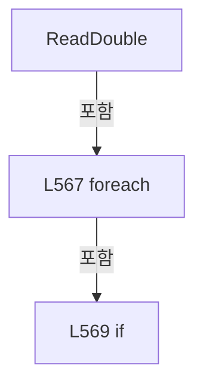

변경 전 점검: 입력/반환 타입, 위 호출자, 예외/취소 경로, 공유 상태와 저장·전송 소비자를 함께 확인합니다. 값의 단위나 물리 방향을 이름만으로 확정하지 않습니다.

### LocalFunctionStatement `ShouldIncludeItem` · L562–565

[Drilling.Common/Recipe/CShotCoordinatePlanBuilder.cs:562–565](https://github.com/kjuws10-rgb/A3Drilling/blob/334b3599651b2e8e0181fd4459bafaf3cddafff3/Drilling.Common/Recipe/CShotCoordinatePlanBuilder.cs#L562-L565)

| 항목 | 실제 추출 값 |
| --- | --- |
| 서명 | bool ShouldIncludeItem(string) |
| 접근/수식자 | Private /  |
| 반환/값 타입 | bool |
| 소속 타입 | NamedType:Drilling.Common.Recipe.CShotCoordinatePlanBuilder |

입력 계약:

| 이름 | 타입 | 전달 | 선택/기본값 |
| --- | --- | --- | --- |
| key | string | None | False /  |

현재 부분 분석에서 직접 연결된 호출자는 없습니다. XAML/이벤트/인터페이스·델리게이트·외부 진입을 추가 확인해야 하며, 미사용으로 판정한 것이 아닙니다.

호출하는 대상과 해석 범위:

| 원본 행 | 표현식 | 분석 상태 | 대상/소스 위치 |
| --- | --- | --- | --- |
| 564 | string.IsNullOrWhiteSpace | resolved | bool string.IsNullOrWhiteSpace(string?) |

본문의 실제 연산·분기·예외·반환 순서(원문 위치 순):

| 원본 행 | 종류 | 주석 해설 |
| --- | --- | --- |
| 564 | call | 함수·델리게이트 또는 객체 생성자를 호출합니다: string.IsNullOrWhiteSpace(key) |
| 564 | return | 호출자에게 값 또는 제어를 반환합니다: return !string.IsNullOrWhiteSpace(key); |

변경 전 점검: 입력/반환 타입, 위 호출자, 예외/취소 경로, 공유 상태와 저장·전송 소비자를 함께 확인합니다. 값의 단위나 물리 방향을 이름만으로 확정하지 않습니다.

### MethodDeclaration `ReadNullableDouble` · L578–594

[Drilling.Common/Recipe/CShotCoordinatePlanBuilder.cs:578–594](https://github.com/kjuws10-rgb/A3Drilling/blob/334b3599651b2e8e0181fd4459bafaf3cddafff3/Drilling.Common/Recipe/CShotCoordinatePlanBuilder.cs#L578-L594)

| 항목 | 실제 추출 값 |
| --- | --- |
| 서명 | double? Drilling.Common.Recipe.CShotCoordinatePlanBuilder.ReadNullableDouble(System.Collections.Generic.IReadOnlyDictionary<string, string>, params string[]) |
| 접근/수식자 | Private / private, static |
| 반환/값 타입 | double? |
| 소속 타입 | NamedType:Drilling.Common.Recipe.CShotCoordinatePlanBuilder |

입력 계약:

| 이름 | 타입 | 전달 | 선택/기본값 |
| --- | --- | --- | --- |
| parameters | System.Collections.Generic.IReadOnlyDictionary<string, string> | None | False /  |
| keys | string[] | None | False /  |

정적 호출자로 확인된 위치:

| 호출 파일/행 | 호출 표현식 | 런타임 분기 가능 |
| --- | --- | --- |
| [Drilling.Common/Recipe/CShotCoordinatePlanBuilder.cs:391–391](https://github.com/kjuws10-rgb/A3Drilling/blob/334b3599651b2e8e0181fd4459bafaf3cddafff3/Drilling.Common/Recipe/CShotCoordinatePlanBuilder.cs#L391-L391) | ReadNullableDouble | False |
| [Drilling.Common/Recipe/CShotCoordinatePlanBuilder.cs:466–466](https://github.com/kjuws10-rgb/A3Drilling/blob/334b3599651b2e8e0181fd4459bafaf3cddafff3/Drilling.Common/Recipe/CShotCoordinatePlanBuilder.cs#L466-L466) | ReadNullableDouble | False |

호출하는 대상과 해석 범위:

| 원본 행 | 표현식 | 분석 상태 | 대상/소스 위치 |
| --- | --- | --- | --- |
| 585 | keys.Where | resolved | System.Collections.Generic.IEnumerable<string> System.Collections.Generic.IEnumerable<string>.Where<string>(System.Func<string, bool>) |
| 587 | parameters.TryGetValue | resolved · 동적 구현 선택 가능 | bool System.Collections.Generic.IReadOnlyDictionary<string, string>.TryGetValue(string, out string) |
| 587 | double.TryParse | resolved | bool double.TryParse(string?, System.Globalization.NumberStyles, System.IFormatProvider?, out double) |

본문의 실제 연산·분기·예외·반환 순서(원문 위치 순):

| 원본 행 | 종류 | 주석 해설 |
| --- | --- | --- |
| 585 | call | 함수·델리게이트 또는 객체 생성자를 호출합니다: keys.Where(ShouldIncludeItem) |
| 585 | foreach | 컬렉션 요소를 순회합니다: foreach (var key in keys.Where(ShouldIncludeItem)) |
| 587 | call | 함수·델리게이트 또는 객체 생성자를 호출합니다: parameters.TryGetValue(key, out var value) |
| 587 | call | 함수·델리게이트 또는 객체 생성자를 호출합니다: double.TryParse(value, NumberStyles.Any, CultureInfo.InvariantCulture, out var result) |
| 587 | if | 조건에 따라 분기합니다: if (parameters.TryGetValue(key, out var value) && double.TryParse(value, NumberStyles.Any, CultureInfo.InvariantCulture, out var result)) |
| 589 | return | 호출자에게 값 또는 제어를 반환합니다: return result; |
| 593 | return | 호출자에게 값 또는 제어를 반환합니다: return null; |

제어 구문의 포함 구조(실제 실행 순서/CFG가 아닌 구문 탐색 그림):

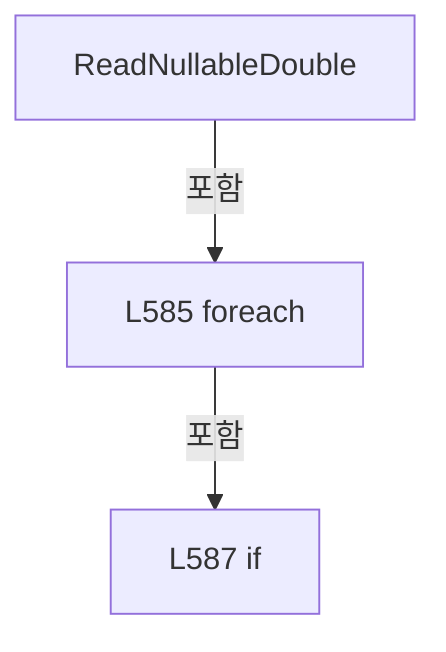

변경 전 점검: 입력/반환 타입, 위 호출자, 예외/취소 경로, 공유 상태와 저장·전송 소비자를 함께 확인합니다. 값의 단위나 물리 방향을 이름만으로 확정하지 않습니다.

### LocalFunctionStatement `ShouldIncludeItem` · L580–583

[Drilling.Common/Recipe/CShotCoordinatePlanBuilder.cs:580–583](https://github.com/kjuws10-rgb/A3Drilling/blob/334b3599651b2e8e0181fd4459bafaf3cddafff3/Drilling.Common/Recipe/CShotCoordinatePlanBuilder.cs#L580-L583)

| 항목 | 실제 추출 값 |
| --- | --- |
| 서명 | bool ShouldIncludeItem(string) |
| 접근/수식자 | Private /  |
| 반환/값 타입 | bool |
| 소속 타입 | NamedType:Drilling.Common.Recipe.CShotCoordinatePlanBuilder |

입력 계약:

| 이름 | 타입 | 전달 | 선택/기본값 |
| --- | --- | --- | --- |
| key | string | None | False /  |

현재 부분 분석에서 직접 연결된 호출자는 없습니다. XAML/이벤트/인터페이스·델리게이트·외부 진입을 추가 확인해야 하며, 미사용으로 판정한 것이 아닙니다.

호출하는 대상과 해석 범위:

| 원본 행 | 표현식 | 분석 상태 | 대상/소스 위치 |
| --- | --- | --- | --- |
| 582 | string.IsNullOrWhiteSpace | resolved | bool string.IsNullOrWhiteSpace(string?) |

본문의 실제 연산·분기·예외·반환 순서(원문 위치 순):

| 원본 행 | 종류 | 주석 해설 |
| --- | --- | --- |
| 582 | call | 함수·델리게이트 또는 객체 생성자를 호출합니다: string.IsNullOrWhiteSpace(key) |
| 582 | return | 호출자에게 값 또는 제어를 반환합니다: return !string.IsNullOrWhiteSpace(key); |

변경 전 점검: 입력/반환 타입, 위 호출자, 예외/취소 경로, 공유 상태와 저장·전송 소비자를 함께 확인합니다. 값의 단위나 물리 방향을 이름만으로 확정하지 않습니다.

### MethodDeclaration `ReadInt` · L596–622

[Drilling.Common/Recipe/CShotCoordinatePlanBuilder.cs:596–622](https://github.com/kjuws10-rgb/A3Drilling/blob/334b3599651b2e8e0181fd4459bafaf3cddafff3/Drilling.Common/Recipe/CShotCoordinatePlanBuilder.cs#L596-L622)

| 항목 | 실제 추출 값 |
| --- | --- |
| 서명 | int Drilling.Common.Recipe.CShotCoordinatePlanBuilder.ReadInt(System.Collections.Generic.IReadOnlyDictionary<string, string>, int, params string[]) |
| 접근/수식자 | Private / private, static |
| 반환/값 타입 | int |
| 소속 타입 | NamedType:Drilling.Common.Recipe.CShotCoordinatePlanBuilder |

입력 계약:

| 이름 | 타입 | 전달 | 선택/기본값 |
| --- | --- | --- | --- |
| parameters | System.Collections.Generic.IReadOnlyDictionary<string, string> | None | False /  |
| defaultValue | int | None | False /  |
| keys | string[] | None | False /  |

정적 호출자로 확인된 위치:

| 호출 파일/행 | 호출 표현식 | 런타임 분기 가능 |
| --- | --- | --- |
| [Drilling.Common/Recipe/CShotCoordinatePlanBuilder.cs:16–16](https://github.com/kjuws10-rgb/A3Drilling/blob/334b3599651b2e8e0181fd4459bafaf3cddafff3/Drilling.Common/Recipe/CShotCoordinatePlanBuilder.cs#L16-L16) | ReadInt | False |
| [Drilling.Common/Recipe/CShotCoordinatePlanBuilder.cs:17–17](https://github.com/kjuws10-rgb/A3Drilling/blob/334b3599651b2e8e0181fd4459bafaf3cddafff3/Drilling.Common/Recipe/CShotCoordinatePlanBuilder.cs#L17-L17) | ReadInt | False |
| [Drilling.Common/Recipe/CShotCoordinatePlanBuilder.cs:217–217](https://github.com/kjuws10-rgb/A3Drilling/blob/334b3599651b2e8e0181fd4459bafaf3cddafff3/Drilling.Common/Recipe/CShotCoordinatePlanBuilder.cs#L217-L217) | ReadInt | False |
| [Drilling.Common/Recipe/CShotCoordinatePlanBuilder.cs:227–227](https://github.com/kjuws10-rgb/A3Drilling/blob/334b3599651b2e8e0181fd4459bafaf3cddafff3/Drilling.Common/Recipe/CShotCoordinatePlanBuilder.cs#L227-L227) | ReadInt | False |

호출하는 대상과 해석 범위:

| 원본 행 | 표현식 | 분석 상태 | 대상/소스 위치 |
| --- | --- | --- | --- |
| 603 | keys.Where | resolved | System.Collections.Generic.IEnumerable<string> System.Collections.Generic.IEnumerable<string>.Where<string>(System.Func<string, bool>) |
| 605 | parameters.TryGetValue | resolved · 동적 구현 선택 가능 | bool System.Collections.Generic.IReadOnlyDictionary<string, string>.TryGetValue(string, out string) |
| 610 | int.TryParse | resolved | bool int.TryParse(string?, System.Globalization.NumberStyles, System.IFormatProvider?, out int) |
| 615 | double.TryParse | resolved | bool double.TryParse(string?, System.Globalization.NumberStyles, System.IFormatProvider?, out double) |
| 617 | Math.Round | resolved | double System.Math.Round(double) |

본문의 실제 연산·분기·예외·반환 순서(원문 위치 순):

| 원본 행 | 종류 | 주석 해설 |
| --- | --- | --- |
| 603 | call | 함수·델리게이트 또는 객체 생성자를 호출합니다: keys.Where(ShouldIncludeItem) |
| 603 | foreach | 컬렉션 요소를 순회합니다: foreach (var key in keys.Where(ShouldIncludeItem)) |
| 605 | call | 함수·델리게이트 또는 객체 생성자를 호출합니다: parameters.TryGetValue(key, out var value) |
| 605 | if | 조건에 따라 분기합니다: if (!parameters.TryGetValue(key, out var value)) |
| 607 | continue | 다음 반복으로 진행합니다: continue; |
| 610 | call | 함수·델리게이트 또는 객체 생성자를 호출합니다: int.TryParse(value, NumberStyles.Integer, CultureInfo.InvariantCulture, out var intResult) |
| 610 | if | 조건에 따라 분기합니다: if (int.TryParse(value, NumberStyles.Integer, CultureInfo.InvariantCulture, out var intResult)) |
| 612 | return | 호출자에게 값 또는 제어를 반환합니다: return intResult; |
| 615 | call | 함수·델리게이트 또는 객체 생성자를 호출합니다: double.TryParse(value, NumberStyles.Any, CultureInfo.InvariantCulture, out var doubleResult) |
| 615 | if | 조건에 따라 분기합니다: if (double.TryParse(value, NumberStyles.Any, CultureInfo.InvariantCulture, out var doubleResult)) |
| 617 | call | 함수·델리게이트 또는 객체 생성자를 호출합니다: Math.Round(doubleResult) |
| 617 | return | 호출자에게 값 또는 제어를 반환합니다: return (int)Math.Round(doubleResult); |
| 621 | return | 호출자에게 값 또는 제어를 반환합니다: return defaultValue; |

제어 구문의 포함 구조(실제 실행 순서/CFG가 아닌 구문 탐색 그림):

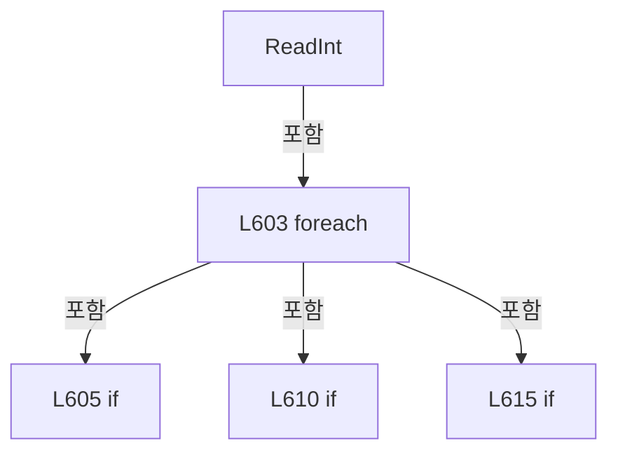

변경 전 점검: 입력/반환 타입, 위 호출자, 예외/취소 경로, 공유 상태와 저장·전송 소비자를 함께 확인합니다. 값의 단위나 물리 방향을 이름만으로 확정하지 않습니다.

### LocalFunctionStatement `ShouldIncludeItem` · L598–601

[Drilling.Common/Recipe/CShotCoordinatePlanBuilder.cs:598–601](https://github.com/kjuws10-rgb/A3Drilling/blob/334b3599651b2e8e0181fd4459bafaf3cddafff3/Drilling.Common/Recipe/CShotCoordinatePlanBuilder.cs#L598-L601)

| 항목 | 실제 추출 값 |
| --- | --- |
| 서명 | bool ShouldIncludeItem(string) |
| 접근/수식자 | Private /  |
| 반환/값 타입 | bool |
| 소속 타입 | NamedType:Drilling.Common.Recipe.CShotCoordinatePlanBuilder |

입력 계약:

| 이름 | 타입 | 전달 | 선택/기본값 |
| --- | --- | --- | --- |
| key | string | None | False /  |

현재 부분 분석에서 직접 연결된 호출자는 없습니다. XAML/이벤트/인터페이스·델리게이트·외부 진입을 추가 확인해야 하며, 미사용으로 판정한 것이 아닙니다.

호출하는 대상과 해석 범위:

| 원본 행 | 표현식 | 분석 상태 | 대상/소스 위치 |
| --- | --- | --- | --- |
| 600 | string.IsNullOrWhiteSpace | resolved | bool string.IsNullOrWhiteSpace(string?) |

본문의 실제 연산·분기·예외·반환 순서(원문 위치 순):

| 원본 행 | 종류 | 주석 해설 |
| --- | --- | --- |
| 600 | call | 함수·델리게이트 또는 객체 생성자를 호출합니다: string.IsNullOrWhiteSpace(key) |
| 600 | return | 호출자에게 값 또는 제어를 반환합니다: return !string.IsNullOrWhiteSpace(key); |

변경 전 점검: 입력/반환 타입, 위 호출자, 예외/취소 경로, 공유 상태와 저장·전송 소비자를 함께 확인합니다. 값의 단위나 물리 방향을 이름만으로 확정하지 않습니다.

### MethodDeclaration `ReadBool` · L624–653

[Drilling.Common/Recipe/CShotCoordinatePlanBuilder.cs:624–653](https://github.com/kjuws10-rgb/A3Drilling/blob/334b3599651b2e8e0181fd4459bafaf3cddafff3/Drilling.Common/Recipe/CShotCoordinatePlanBuilder.cs#L624-L653)

| 항목 | 실제 추출 값 |
| --- | --- |
| 서명 | bool Drilling.Common.Recipe.CShotCoordinatePlanBuilder.ReadBool(System.Collections.Generic.IReadOnlyDictionary<string, string>, bool, params string[]) |
| 접근/수식자 | Private / private, static |
| 반환/값 타입 | bool |
| 소속 타입 | NamedType:Drilling.Common.Recipe.CShotCoordinatePlanBuilder |

입력 계약:

| 이름 | 타입 | 전달 | 선택/기본값 |
| --- | --- | --- | --- |
| parameters | System.Collections.Generic.IReadOnlyDictionary<string, string> | None | False /  |
| defaultValue | bool | None | False /  |
| keys | string[] | None | False /  |

정적 호출자로 확인된 위치:

| 호출 파일/행 | 호출 표현식 | 런타임 분기 가능 |
| --- | --- | --- |
| [Drilling.Common/Recipe/CShotCoordinatePlanBuilder.cs:452–452](https://github.com/kjuws10-rgb/A3Drilling/blob/334b3599651b2e8e0181fd4459bafaf3cddafff3/Drilling.Common/Recipe/CShotCoordinatePlanBuilder.cs#L452-L452) | ReadBool | False |

호출하는 대상과 해석 범위:

| 원본 행 | 표현식 | 분석 상태 | 대상/소스 위치 |
| --- | --- | --- | --- |
| 631 | keys.Where | resolved | System.Collections.Generic.IEnumerable<string> System.Collections.Generic.IEnumerable<string>.Where<string>(System.Func<string, bool>) |
| 633 | parameters.TryGetValue | resolved · 동적 구현 선택 가능 | bool System.Collections.Generic.IReadOnlyDictionary<string, string>.TryGetValue(string, out string) |
| 633 | string.IsNullOrWhiteSpace | resolved | bool string.IsNullOrWhiteSpace(string?) |
| 638 | value.Trim().ToUpperInvariant | resolved | string string.ToUpperInvariant() |
| 638 | value.Trim | resolved | string string.Trim() |

본문의 실제 연산·분기·예외·반환 순서(원문 위치 순):

| 원본 행 | 종류 | 주석 해설 |
| --- | --- | --- |
| 631 | call | 함수·델리게이트 또는 객체 생성자를 호출합니다: keys.Where(ShouldIncludeItem) |
| 631 | foreach | 컬렉션 요소를 순회합니다: foreach (var key in keys.Where(ShouldIncludeItem)) |
| 633 | call | 함수·델리게이트 또는 객체 생성자를 호출합니다: parameters.TryGetValue(key, out var value) |
| 633 | call | 함수·델리게이트 또는 객체 생성자를 호출합니다: string.IsNullOrWhiteSpace(value) |
| 633 | if | 조건에 따라 분기합니다: if (!parameters.TryGetValue(key, out var value) &#124;&#124; string.IsNullOrWhiteSpace(value)) |
| 635 | continue | 다음 반복으로 진행합니다: continue; |
| 638 | call | 함수·델리게이트 또는 객체 생성자를 호출합니다: value.Trim().ToUpperInvariant() |
| 638 | call | 함수·델리게이트 또는 객체 생성자를 호출합니다: value.Trim() |
| 638 | local-declaration | 지역 변수를 선언합니다: var normalized = value.Trim().ToUpperInvariant(); |
| 638 | variable-initializer | 변수의 초기값을 지정합니다: normalized = value.Trim().ToUpperInvariant() |
| 639 | if | 조건에 따라 분기합니다: if (normalized is "1" or "Y" or "YES" or "TRUE" or "ON" or "USE") |
| 641 | return | 호출자에게 값 또는 제어를 반환합니다: return true; |
| 644 | if | 조건에 따라 분기합니다: if (normalized is "0" or "N" or "NO" or "FALSE" or "OFF" or "SKIP" or "UNUSEsc") |
| 646 | return | 호출자에게 값 또는 제어를 반환합니다: return false; |
| 649 | return | 호출자에게 값 또는 제어를 반환합니다: return defaultValue; |
| 652 | return | 호출자에게 값 또는 제어를 반환합니다: return defaultValue; |

제어 구문의 포함 구조(실제 실행 순서/CFG가 아닌 구문 탐색 그림):

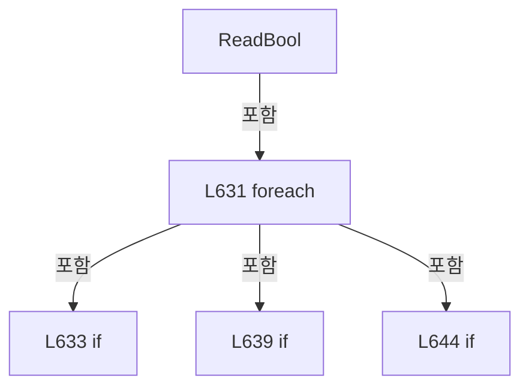

변경 전 점검: 입력/반환 타입, 위 호출자, 예외/취소 경로, 공유 상태와 저장·전송 소비자를 함께 확인합니다. 값의 단위나 물리 방향을 이름만으로 확정하지 않습니다.

### LocalFunctionStatement `ShouldIncludeItem` · L626–629

[Drilling.Common/Recipe/CShotCoordinatePlanBuilder.cs:626–629](https://github.com/kjuws10-rgb/A3Drilling/blob/334b3599651b2e8e0181fd4459bafaf3cddafff3/Drilling.Common/Recipe/CShotCoordinatePlanBuilder.cs#L626-L629)

| 항목 | 실제 추출 값 |
| --- | --- |
| 서명 | bool ShouldIncludeItem(string) |
| 접근/수식자 | Private /  |
| 반환/값 타입 | bool |
| 소속 타입 | NamedType:Drilling.Common.Recipe.CShotCoordinatePlanBuilder |

입력 계약:

| 이름 | 타입 | 전달 | 선택/기본값 |
| --- | --- | --- | --- |
| key | string | None | False /  |

현재 부분 분석에서 직접 연결된 호출자는 없습니다. XAML/이벤트/인터페이스·델리게이트·외부 진입을 추가 확인해야 하며, 미사용으로 판정한 것이 아닙니다.

호출하는 대상과 해석 범위:

| 원본 행 | 표현식 | 분석 상태 | 대상/소스 위치 |
| --- | --- | --- | --- |
| 628 | string.IsNullOrWhiteSpace | resolved | bool string.IsNullOrWhiteSpace(string?) |

본문의 실제 연산·분기·예외·반환 순서(원문 위치 순):

| 원본 행 | 종류 | 주석 해설 |
| --- | --- | --- |
| 628 | call | 함수·델리게이트 또는 객체 생성자를 호출합니다: string.IsNullOrWhiteSpace(key) |
| 628 | return | 호출자에게 값 또는 제어를 반환합니다: return !string.IsNullOrWhiteSpace(key); |

변경 전 점검: 입력/반환 타입, 위 호출자, 예외/취소 경로, 공유 상태와 저장·전송 소비자를 함께 확인합니다. 값의 단위나 물리 방향을 이름만으로 확정하지 않습니다.

### FieldDeclaration `MaximumAbsoluteOffset` · L659–659

[Drilling.Common/Recipe/CShotCoordinatePlanBuilder.cs:659–659](https://github.com/kjuws10-rgb/A3Drilling/blob/334b3599651b2e8e0181fd4459bafaf3cddafff3/Drilling.Common/Recipe/CShotCoordinatePlanBuilder.cs#L659-L659)

| 항목 | 실제 추출 값 |
| --- | --- |
| 서명 | double Drilling.Common.Recipe.CAlignShotOffsetData.MaximumAbsoluteOffset |
| 접근/수식자 | Private / private, const |
| 반환/값 타입 | double |
| 소속 타입 | NamedType:Drilling.Common.Recipe.CAlignShotOffsetData |

현재 부분 분석에서 직접 연결된 호출자는 없습니다. XAML/이벤트/인터페이스·델리게이트·외부 진입을 추가 확인해야 하며, 미사용으로 판정한 것이 아닙니다.

본문의 실제 연산·분기·예외·반환 순서(원문 위치 순):

| 원본 행 | 종류 | 주석 해설 |
| --- | --- | --- |
| 659 | variable-initializer | 변수의 초기값을 지정합니다: MaximumAbsoluteOffset = 100000 |

변경 전 점검: 입력/반환 타입, 위 호출자, 예외/취소 경로, 공유 상태와 저장·전송 소비자를 함께 확인합니다. 값의 단위나 물리 방향을 이름만으로 확정하지 않습니다.

### FieldDeclaration `ParameterPattern` · L660–660

[Drilling.Common/Recipe/CShotCoordinatePlanBuilder.cs:660–660](https://github.com/kjuws10-rgb/A3Drilling/blob/334b3599651b2e8e0181fd4459bafaf3cddafff3/Drilling.Common/Recipe/CShotCoordinatePlanBuilder.cs#L660-L660)

| 항목 | 실제 추출 값 |
| --- | --- |
| 서명 | System.Text.RegularExpressions.Regex Drilling.Common.Recipe.CAlignShotOffsetData.ParameterPattern |
| 접근/수식자 | Private / private, static, readonly |
| 반환/값 타입 | System.Text.RegularExpressions.Regex |
| 소속 타입 | NamedType:Drilling.Common.Recipe.CAlignShotOffsetData |

현재 부분 분석에서 직접 연결된 호출자는 없습니다. XAML/이벤트/인터페이스·델리게이트·외부 진입을 추가 확인해야 하며, 미사용으로 판정한 것이 아닙니다.

호출하는 대상과 해석 범위:

| 원본 행 | 표현식 | 분석 상태 | 대상/소스 위치 |
| --- | --- | --- | --- |
| 660 | new | resolved | System.Text.RegularExpressions.Regex.Regex(string, System.Text.RegularExpressions.RegexOptions) |

본문의 실제 연산·분기·예외·반환 순서(원문 위치 순):

| 원본 행 | 종류 | 주석 해설 |
| --- | --- | --- |
| 660 | call | 함수·델리게이트 또는 객체 생성자를 호출합니다: new(@"^CELL[1-9][0-9]*_[A-Z]+[1-9][0-9]*_ALIGN_OFFSET_[XY]$", RegexOptions.Compiled &#124; RegexOptions.CultureInvariant &#124; RegexOptions.IgnoreCase) |
| 660 | variable-initializer | 변수의 초기값을 지정합니다: ParameterPattern = new(@"^CELL[1-9][0-9]*_[A-Z]+[1-9][0-9]*_ALIGN_OFFSET_[XY]$", RegexOptions.Compiled &#124; RegexOptions.CultureInvariant &#124; RegexOptions.IgnoreCase) |

변경 전 점검: 입력/반환 타입, 위 호출자, 예외/취소 경로, 공유 상태와 저장·전송 소비자를 함께 확인합니다. 값의 단위나 물리 방향을 이름만으로 확정하지 않습니다.

### MethodDeclaration `IsParameterKey` · L661–661

[Drilling.Common/Recipe/CShotCoordinatePlanBuilder.cs:661–661](https://github.com/kjuws10-rgb/A3Drilling/blob/334b3599651b2e8e0181fd4459bafaf3cddafff3/Drilling.Common/Recipe/CShotCoordinatePlanBuilder.cs#L661-L661)

| 항목 | 실제 추출 값 |
| --- | --- |
| 서명 | bool Drilling.Common.Recipe.CAlignShotOffsetData.IsParameterKey(string) |
| 접근/수식자 | Public / public, static |
| 반환/값 타입 | bool |
| 소속 타입 | NamedType:Drilling.Common.Recipe.CAlignShotOffsetData |

입력 계약:

| 이름 | 타입 | 전달 | 선택/기본값 |
| --- | --- | --- | --- |
| key | string | None | False /  |

정적 호출자로 확인된 위치:

| 호출 파일/행 | 호출 표현식 | 런타임 분기 가능 |
| --- | --- | --- |
| [Drilling.Common/Correction/CAlignInterpolation.cs:367–367](https://github.com/kjuws10-rgb/A3Drilling/blob/334b3599651b2e8e0181fd4459bafaf3cddafff3/Drilling.Common/Correction/CAlignInterpolation.cs#L367-L367) | CAlignShotOffsetData.IsParameterKey | False |
| [Drilling.Common/Recipe/CShotCoordinatePlanBuilder.cs:723–723](https://github.com/kjuws10-rgb/A3Drilling/blob/334b3599651b2e8e0181fd4459bafaf3cddafff3/Drilling.Common/Recipe/CShotCoordinatePlanBuilder.cs#L723-L723) | IsParameterKey | False |
| [Drilling.Common/Recipe/CShotCoordinatePlanBuilder.cs:748–748](https://github.com/kjuws10-rgb/A3Drilling/blob/334b3599651b2e8e0181fd4459bafaf3cddafff3/Drilling.Common/Recipe/CShotCoordinatePlanBuilder.cs#L748-L748) | IsParameterKey | False |
| [Drilling.Common/Recipe/CShotCoordinatePlanBuilder.cs:782–782](https://github.com/kjuws10-rgb/A3Drilling/blob/334b3599651b2e8e0181fd4459bafaf3cddafff3/Drilling.Common/Recipe/CShotCoordinatePlanBuilder.cs#L782-L782) | IsParameterKey | False |
| [Drilling.File/JHMI/CJhmiRecipeFile.cs:773–773](https://github.com/kjuws10-rgb/A3Drilling/blob/334b3599651b2e8e0181fd4459bafaf3cddafff3/Drilling.File/JHMI/CJhmiRecipeFile.cs#L773-L773) | CAlignShotOffsetData.IsParameterKey | False |

호출하는 대상과 해석 범위:

| 원본 행 | 표현식 | 분석 상태 | 대상/소스 위치 |
| --- | --- | --- | --- |
| 661 | ParameterPattern.IsMatch | resolved | bool System.Text.RegularExpressions.Regex.IsMatch(string) |

본문의 실제 연산·분기·예외·반환 순서(원문 위치 순):

| 원본 행 | 종류 | 주석 해설 |
| --- | --- | --- |
| 661 | call | 함수·델리게이트 또는 객체 생성자를 호출합니다: ParameterPattern.IsMatch(key) |

변경 전 점검: 입력/반환 타입, 위 호출자, 예외/취소 경로, 공유 상태와 저장·전송 소비자를 함께 확인합니다. 값의 단위나 물리 방향을 이름만으로 확정하지 않습니다.

### MethodDeclaration `ParameterKey` · L662–662

[Drilling.Common/Recipe/CShotCoordinatePlanBuilder.cs:662–662](https://github.com/kjuws10-rgb/A3Drilling/blob/334b3599651b2e8e0181fd4459bafaf3cddafff3/Drilling.Common/Recipe/CShotCoordinatePlanBuilder.cs#L662-L662)

| 항목 | 실제 추출 값 |
| --- | --- |
| 서명 | string Drilling.Common.Recipe.CAlignShotOffsetData.ParameterKey(int, string, string) |
| 접근/수식자 | Public / public, static |
| 반환/값 타입 | string |
| 소속 타입 | NamedType:Drilling.Common.Recipe.CAlignShotOffsetData |

입력 계약:

| 이름 | 타입 | 전달 | 선택/기본값 |
| --- | --- | --- | --- |
| cellNo | int | None | False /  |
| shotName | string | None | False /  |
| axis | string | None | False /  |

정적 호출자로 확인된 위치:

| 호출 파일/행 | 호출 표현식 | 런타임 분기 가능 |
| --- | --- | --- |
| [Drilling.Common/Recipe/CShotCoordinatePlanBuilder.cs:747–747](https://github.com/kjuws10-rgb/A3Drilling/blob/334b3599651b2e8e0181fd4459bafaf3cddafff3/Drilling.Common/Recipe/CShotCoordinatePlanBuilder.cs#L747-L747) | ParameterKey | False |
| [Drilling.UI/Menu/Menus/CMenuCorrection.cs:2960–2960](https://github.com/kjuws10-rgb/A3Drilling/blob/334b3599651b2e8e0181fd4459bafaf3cddafff3/Drilling.UI/Menu/Menus/CMenuCorrection.cs#L2960-L2960) | CAlignShotOffsetData.ParameterKey | False |
| [Drilling.UI/Menu/Menus/CMenuCorrection.cs:2960–2960](https://github.com/kjuws10-rgb/A3Drilling/blob/334b3599651b2e8e0181fd4459bafaf3cddafff3/Drilling.UI/Menu/Menus/CMenuCorrection.cs#L2960-L2960) | CAlignShotOffsetData.ParameterKey | False |

변경 전 점검: 입력/반환 타입, 위 호출자, 예외/취소 경로, 공유 상태와 저장·전송 소비자를 함께 확인합니다. 값의 단위나 물리 방향을 이름만으로 확정하지 않습니다.

### MethodDeclaration `RoundValue` · L663–670

[Drilling.Common/Recipe/CShotCoordinatePlanBuilder.cs:663–670](https://github.com/kjuws10-rgb/A3Drilling/blob/334b3599651b2e8e0181fd4459bafaf3cddafff3/Drilling.Common/Recipe/CShotCoordinatePlanBuilder.cs#L663-L670)

| 항목 | 실제 추출 값 |
| --- | --- |
| 서명 | double Drilling.Common.Recipe.CAlignShotOffsetData.RoundValue(double) |
| 접근/수식자 | Public / public, static |
| 반환/값 타입 | double |
| 소속 타입 | NamedType:Drilling.Common.Recipe.CAlignShotOffsetData |

입력 계약:

| 이름 | 타입 | 전달 | 선택/기본값 |
| --- | --- | --- | --- |
| value | double | None | False /  |

정적 호출자로 확인된 위치:

| 호출 파일/행 | 호출 표현식 | 런타임 분기 가능 |
| --- | --- | --- |
| [Drilling.Common/Correction/CAlignInterpolation.cs:171–171](https://github.com/kjuws10-rgb/A3Drilling/blob/334b3599651b2e8e0181fd4459bafaf3cddafff3/Drilling.Common/Correction/CAlignInterpolation.cs#L171-L171) | CAlignShotOffsetData.RoundValue | False |
| [Drilling.Common/Recipe/CShotCoordinatePlanBuilder.cs:672–672](https://github.com/kjuws10-rgb/A3Drilling/blob/334b3599651b2e8e0181fd4459bafaf3cddafff3/Drilling.Common/Recipe/CShotCoordinatePlanBuilder.cs#L672-L672) | RoundValue | False |
| [Drilling.Common/Recipe/CShotCoordinatePlanBuilder.cs:679–679](https://github.com/kjuws10-rgb/A3Drilling/blob/334b3599651b2e8e0181fd4459bafaf3cddafff3/Drilling.Common/Recipe/CShotCoordinatePlanBuilder.cs#L679-L679) | RoundValue | False |
| [Drilling.Common/Recipe/CShotCoordinatePlanBuilder.cs:702–702](https://github.com/kjuws10-rgb/A3Drilling/blob/334b3599651b2e8e0181fd4459bafaf3cddafff3/Drilling.Common/Recipe/CShotCoordinatePlanBuilder.cs#L702-L702) | RoundValue | False |
| [Drilling.Common/Recipe/CShotCoordinatePlanBuilder.cs:702–702](https://github.com/kjuws10-rgb/A3Drilling/blob/334b3599651b2e8e0181fd4459bafaf3cddafff3/Drilling.Common/Recipe/CShotCoordinatePlanBuilder.cs#L702-L702) | RoundValue | False |
| [Drilling.Common/Review/CAutoFineReviewCoordinator.cs:137–137](https://github.com/kjuws10-rgb/A3Drilling/blob/334b3599651b2e8e0181fd4459bafaf3cddafff3/Drilling.Common/Review/CAutoFineReviewCoordinator.cs#L137-L137) | CAlignShotOffsetData.RoundValue | False |
| [Drilling.Common/Review/CAutoFineReviewCoordinator.cs:137–137](https://github.com/kjuws10-rgb/A3Drilling/blob/334b3599651b2e8e0181fd4459bafaf3cddafff3/Drilling.Common/Review/CAutoFineReviewCoordinator.cs#L137-L137) | CAlignShotOffsetData.RoundValue | False |
| [Drilling.UI/Menu/Menus/CMenuCorrection.ReviewData.Offset.cs:325–325](https://github.com/kjuws10-rgb/A3Drilling/blob/334b3599651b2e8e0181fd4459bafaf3cddafff3/Drilling.UI/Menu/Menus/CMenuCorrection.ReviewData.Offset.cs#L325-L325) | CAlignShotOffsetData.RoundValue | False |
| [Drilling.UI/Menu/Menus/CMenuCorrection.ReviewData.Offset.cs:326–326](https://github.com/kjuws10-rgb/A3Drilling/blob/334b3599651b2e8e0181fd4459bafaf3cddafff3/Drilling.UI/Menu/Menus/CMenuCorrection.ReviewData.Offset.cs#L326-L326) | CAlignShotOffsetData.RoundValue | False |
| [Drilling.UI/Menu/Menus/CMenuCorrection.cs:2954–2954](https://github.com/kjuws10-rgb/A3Drilling/blob/334b3599651b2e8e0181fd4459bafaf3cddafff3/Drilling.UI/Menu/Menus/CMenuCorrection.cs#L2954-L2954) | CAlignShotOffsetData.RoundValue | False |
| [Drilling.UI/Menu/Menus/CMenuCorrection.cs:2954–2954](https://github.com/kjuws10-rgb/A3Drilling/blob/334b3599651b2e8e0181fd4459bafaf3cddafff3/Drilling.UI/Menu/Menus/CMenuCorrection.cs#L2954-L2954) | CAlignShotOffsetData.RoundValue | False |
| [Drilling.UI/Menu/Menus/CMenuCorrection.cs:3206–3206](https://github.com/kjuws10-rgb/A3Drilling/blob/334b3599651b2e8e0181fd4459bafaf3cddafff3/Drilling.UI/Menu/Menus/CMenuCorrection.cs#L3206-L3206) | CAlignShotOffsetData.RoundValue | False |
| [Drilling.UI/Menu/Menus/CMenuCorrection.cs:3206–3206](https://github.com/kjuws10-rgb/A3Drilling/blob/334b3599651b2e8e0181fd4459bafaf3cddafff3/Drilling.UI/Menu/Menus/CMenuCorrection.cs#L3206-L3206) | CAlignShotOffsetData.RoundValue | False |
| [Drilling.UI/Menu/Menus/CMenuCorrection.cs:5879–5879](https://github.com/kjuws10-rgb/A3Drilling/blob/334b3599651b2e8e0181fd4459bafaf3cddafff3/Drilling.UI/Menu/Menus/CMenuCorrection.cs#L5879-L5879) | CAlignShotOffsetData.RoundValue | False |
| [Drilling.UI/Menu/Menus/CMenuCorrection.cs:5880–5880](https://github.com/kjuws10-rgb/A3Drilling/blob/334b3599651b2e8e0181fd4459bafaf3cddafff3/Drilling.UI/Menu/Menus/CMenuCorrection.cs#L5880-L5880) | CAlignShotOffsetData.RoundValue | False |
| [Drilling.UI/Menu/Menus/CMenuCorrection.cs:6089–6089](https://github.com/kjuws10-rgb/A3Drilling/blob/334b3599651b2e8e0181fd4459bafaf3cddafff3/Drilling.UI/Menu/Menus/CMenuCorrection.cs#L6089-L6089) | CAlignShotOffsetData.RoundValue | False |
| [Drilling.UI/Menu/Menus/CMenuCorrection.cs:7331–7331](https://github.com/kjuws10-rgb/A3Drilling/blob/334b3599651b2e8e0181fd4459bafaf3cddafff3/Drilling.UI/Menu/Menus/CMenuCorrection.cs#L7331-L7331) | CAlignShotOffsetData.RoundValue | False |

호출하는 대상과 해석 범위:

| 원본 행 | 표현식 | 분석 상태 | 대상/소스 위치 |
| --- | --- | --- | --- |
| 665 | double.IsFinite | resolved | bool double.IsFinite(double) |
| 665 | Math.Abs | resolved | double System.Math.Abs(double) |
| 666 | new InvalidOperationException | resolved | System.InvalidOperationException.InvalidOperationException(string?) |
| 668 | Math.Round | resolved | decimal System.Math.Round(decimal, int, System.MidpointRounding) |

본문의 실제 연산·분기·예외·반환 순서(원문 위치 순):

| 원본 행 | 종류 | 주석 해설 |
| --- | --- | --- |
| 665 | call | 함수·델리게이트 또는 객체 생성자를 호출합니다: double.IsFinite(value) |
| 665 | call | 함수·델리게이트 또는 객체 생성자를 호출합니다: Math.Abs(value) |
| 665 | if | 조건에 따라 분기합니다: if (!double.IsFinite(value) &#124;&#124; Math.Abs(value) > MaximumAbsoluteOffset) |
| 666 | call | 함수·델리게이트 또는 객체 생성자를 호출합니다: new InvalidOperationException("Align Offset은 -100000~100000 mm 범위의 유한한 값이어야 합니다.") |
| 666 | throw | 예외를 발생/전달합니다: throw new InvalidOperationException("Align Offset은 -100000~100000 mm 범위의 유한한 값이어야 합니다."); |
| 668 | call | 함수·델리게이트 또는 객체 생성자를 호출합니다: Math.Round((decimal)value, 3, MidpointRounding.AwayFromZero) |
| 668 | local-declaration | 지역 변수를 선언합니다: var rounded = (double)Math.Round((decimal)value, 3, MidpointRounding.AwayFromZero); |
| 668 | variable-initializer | 변수의 초기값을 지정합니다: rounded = (double)Math.Round((decimal)value, 3, MidpointRounding.AwayFromZero) |
| 669 | conditional-expression | 조건에 따라 결과식을 선택합니다: rounded == 0 ? 0 : rounded |
| 669 | return | 호출자에게 값 또는 제어를 반환합니다: return rounded == 0 ? 0 : rounded; |

제어 구문의 포함 구조(실제 실행 순서/CFG가 아닌 구문 탐색 그림):

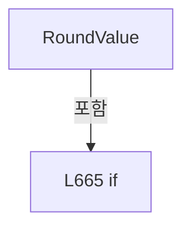

변경 전 점검: 입력/반환 타입, 위 호출자, 예외/취소 경로, 공유 상태와 저장·전송 소비자를 함께 확인합니다. 값의 단위나 물리 방향을 이름만으로 확정하지 않습니다.

### MethodDeclaration `FormatValue` · L672–672

[Drilling.Common/Recipe/CShotCoordinatePlanBuilder.cs:672–672](https://github.com/kjuws10-rgb/A3Drilling/blob/334b3599651b2e8e0181fd4459bafaf3cddafff3/Drilling.Common/Recipe/CShotCoordinatePlanBuilder.cs#L672-L672)

| 항목 | 실제 추출 값 |
| --- | --- |
| 서명 | string Drilling.Common.Recipe.CAlignShotOffsetData.FormatValue(double) |
| 접근/수식자 | Public / public, static |
| 반환/값 타입 | string |
| 소속 타입 | NamedType:Drilling.Common.Recipe.CAlignShotOffsetData |

입력 계약:

| 이름 | 타입 | 전달 | 선택/기본값 |
| --- | --- | --- | --- |
| value | double | None | False /  |

정적 호출자로 확인된 위치:

| 호출 파일/행 | 호출 표현식 | 런타임 분기 가능 |
| --- | --- | --- |
| [Drilling.Common/Recipe/CShotCoordinatePlanBuilder.cs:750–750](https://github.com/kjuws10-rgb/A3Drilling/blob/334b3599651b2e8e0181fd4459bafaf3cddafff3/Drilling.Common/Recipe/CShotCoordinatePlanBuilder.cs#L750-L750) | FormatValue | False |
| [Drilling.File/Correction/CAlignOffsetLogFile.cs:158–158](https://github.com/kjuws10-rgb/A3Drilling/blob/334b3599651b2e8e0181fd4459bafaf3cddafff3/Drilling.File/Correction/CAlignOffsetLogFile.cs#L158-L158) | CAlignShotOffsetData.FormatValue | False |
| [Drilling.File/Script/CAutomation1ScriptFile.cs:307–307](https://github.com/kjuws10-rgb/A3Drilling/blob/334b3599651b2e8e0181fd4459bafaf3cddafff3/Drilling.File/Script/CAutomation1ScriptFile.cs#L307-L307) | CAlignShotOffsetData.FormatValue | False |
| [Drilling.File/Script/CAutomation1ScriptFile.cs:309–309](https://github.com/kjuws10-rgb/A3Drilling/blob/334b3599651b2e8e0181fd4459bafaf3cddafff3/Drilling.File/Script/CAutomation1ScriptFile.cs#L309-L309) | CAlignShotOffsetData.FormatValue | False |

호출하는 대상과 해석 범위:

| 원본 행 | 표현식 | 분석 상태 | 대상/소스 위치 |
| --- | --- | --- | --- |
| 672 | RoundValue(value).ToString | resolved | string double.ToString(string?, System.IFormatProvider?) |
| 672 | RoundValue | resolved | double Drilling.Common.Recipe.CAlignShotOffsetData.RoundValue(double) · Drilling.Common/Recipe/CShotCoordinatePlanBuilder.cs:663 |

본문의 실제 연산·분기·예외·반환 순서(원문 위치 순):

| 원본 행 | 종류 | 주석 해설 |
| --- | --- | --- |
| 672 | call | 함수·델리게이트 또는 객체 생성자를 호출합니다: RoundValue(value).ToString("0.000", CultureInfo.InvariantCulture) |
| 672 | call | 함수·델리게이트 또는 객체 생성자를 호출합니다: RoundValue(value) |

변경 전 점검: 입력/반환 타입, 위 호출자, 예외/취소 경로, 공유 상태와 저장·전송 소비자를 함께 확인합니다. 값의 단위나 물리 방향을 이름만으로 확정하지 않습니다.

### MethodDeclaration `ReadValue` · L673–680

[Drilling.Common/Recipe/CShotCoordinatePlanBuilder.cs:673–680](https://github.com/kjuws10-rgb/A3Drilling/blob/334b3599651b2e8e0181fd4459bafaf3cddafff3/Drilling.Common/Recipe/CShotCoordinatePlanBuilder.cs#L673-L680)

| 항목 | 실제 추출 값 |
| --- | --- |
| 서명 | double Drilling.Common.Recipe.CAlignShotOffsetData.ReadValue(System.Collections.Generic.IReadOnlyDictionary<string, string>, string) |
| 접근/수식자 | Public / public, static |
| 반환/값 타입 | double |
| 소속 타입 | NamedType:Drilling.Common.Recipe.CAlignShotOffsetData |

입력 계약:

| 이름 | 타입 | 전달 | 선택/기본값 |
| --- | --- | --- | --- |
| parameters | System.Collections.Generic.IReadOnlyDictionary<string, string> | None | False /  |
| key | string | None | False /  |

정적 호출자로 확인된 위치:

| 호출 파일/행 | 호출 표현식 | 런타임 분기 가능 |
| --- | --- | --- |
| [Drilling.Common/Recipe/CShotCoordinatePlanBuilder.cs:279–279](https://github.com/kjuws10-rgb/A3Drilling/blob/334b3599651b2e8e0181fd4459bafaf3cddafff3/Drilling.Common/Recipe/CShotCoordinatePlanBuilder.cs#L279-L279) | CAlignShotOffsetData.ReadValue | False |
| [Drilling.Common/Recipe/CShotCoordinatePlanBuilder.cs:280–280](https://github.com/kjuws10-rgb/A3Drilling/blob/334b3599651b2e8e0181fd4459bafaf3cddafff3/Drilling.Common/Recipe/CShotCoordinatePlanBuilder.cs#L280-L280) | CAlignShotOffsetData.ReadValue | False |
| [Drilling.UI/Menu/Menus/CMenuCorrection.cs:2960–2960](https://github.com/kjuws10-rgb/A3Drilling/blob/334b3599651b2e8e0181fd4459bafaf3cddafff3/Drilling.UI/Menu/Menus/CMenuCorrection.cs#L2960-L2960) | CAlignShotOffsetData.ReadValue | False |
| [Drilling.UI/Menu/Menus/CMenuCorrection.cs:2960–2960](https://github.com/kjuws10-rgb/A3Drilling/blob/334b3599651b2e8e0181fd4459bafaf3cddafff3/Drilling.UI/Menu/Menus/CMenuCorrection.cs#L2960-L2960) | CAlignShotOffsetData.ReadValue | False |

호출하는 대상과 해석 범위:

| 원본 행 | 표현식 | 분석 상태 | 대상/소스 위치 |
| --- | --- | --- | --- |
| 675 | parameters.TryGetValue | resolved · 동적 구현 선택 가능 | bool System.Collections.Generic.IReadOnlyDictionary<string, string>.TryGetValue(string, out string) |
| 677 | double.TryParse | resolved | bool double.TryParse(string?, System.Globalization.NumberStyles, System.IFormatProvider?, out double) |
| 677 | double.IsFinite | resolved | bool double.IsFinite(double) |
| 677 | Math.Abs | resolved | double System.Math.Abs(double) |
| 678 | new InvalidOperationException | resolved | System.InvalidOperationException.InvalidOperationException(string?) |
| 679 | RoundValue | resolved | double Drilling.Common.Recipe.CAlignShotOffsetData.RoundValue(double) · Drilling.Common/Recipe/CShotCoordinatePlanBuilder.cs:663 |

본문의 실제 연산·분기·예외·반환 순서(원문 위치 순):

| 원본 행 | 종류 | 주석 해설 |
| --- | --- | --- |
| 675 | call | 함수·델리게이트 또는 객체 생성자를 호출합니다: parameters.TryGetValue(key, out var text) |
| 675 | if | 조건에 따라 분기합니다: if (!parameters.TryGetValue(key, out var text)) |
| 676 | return | 호출자에게 값 또는 제어를 반환합니다: return 0; |
| 677 | call | 함수·델리게이트 또는 객체 생성자를 호출합니다: double.TryParse(text, NumberStyles.Float, CultureInfo.InvariantCulture, out var value) |
| 677 | call | 함수·델리게이트 또는 객체 생성자를 호출합니다: double.IsFinite(value) |
| 677 | call | 함수·델리게이트 또는 객체 생성자를 호출합니다: Math.Abs(value) |
| 677 | if | 조건에 따라 분기합니다: if (!double.TryParse(text, NumberStyles.Float, CultureInfo.InvariantCulture, out var value) &#124;&#124; !double.IsFinite(value) &#124;&#124; Math.Abs(value) > MaximumAbsoluteOffset) |
| 678 | call | 함수·델리게이트 또는 객체 생성자를 호출합니다: new InvalidOperationException($"{key}의 Align Offset은 -100000~100000 mm 범위의 유한한 값이어야 합니다.") |
| 678 | throw | 예외를 발생/전달합니다: throw new InvalidOperationException($"{key}의 Align Offset은 -100000~100000 mm 범위의 유한한 값이어야 합니다."); |
| 679 | call | 함수·델리게이트 또는 객체 생성자를 호출합니다: RoundValue(value) |
| 679 | return | 호출자에게 값 또는 제어를 반환합니다: return RoundValue(value); |

제어 구문의 포함 구조(실제 실행 순서/CFG가 아닌 구문 탐색 그림):

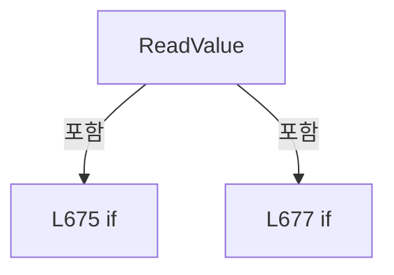

변경 전 점검: 입력/반환 타입, 위 호출자, 예외/취소 경로, 공유 상태와 저장·전송 소비자를 함께 확인합니다. 값의 단위나 물리 방향을 이름만으로 확정하지 않습니다.

### MethodDeclaration `Calculate` · L682–706

[Drilling.Common/Recipe/CShotCoordinatePlanBuilder.cs:682–706](https://github.com/kjuws10-rgb/A3Drilling/blob/334b3599651b2e8e0181fd4459bafaf3cddafff3/Drilling.Common/Recipe/CShotCoordinatePlanBuilder.cs#L682-L706)

| 항목 | 실제 추출 값 |
| --- | --- |
| 서명 | System.Collections.Generic.IReadOnlyList<Drilling.Common.Recipe.ST_ALIGN_SHOT_OFFSET> Drilling.Common.Recipe.CAlignShotOffsetData.Calculate(Drilling.Common.Managers.ST_RECIPE_DEFINITION, Drilling.Common.Correction.CAlignInterpolation, Drilling.Common.Managers.ST_ALIGN_KEY_MARGINS) |
| 접근/수식자 | Public / public, static |
| 반환/값 타입 | System.Collections.Generic.IReadOnlyList<Drilling.Common.Recipe.ST_ALIGN_SHOT_OFFSET> |
| 소속 타입 | NamedType:Drilling.Common.Recipe.CAlignShotOffsetData |

입력 계약:

| 이름 | 타입 | 전달 | 선택/기본값 |
| --- | --- | --- | --- |
| recipe | Drilling.Common.Managers.ST_RECIPE_DEFINITION | None | False /  |
| model | Drilling.Common.Correction.CAlignInterpolation | None | False /  |
| alignKeyMargins | Drilling.Common.Managers.ST_ALIGN_KEY_MARGINS | None | False /  |

정적 호출자로 확인된 위치:

| 호출 파일/행 | 호출 표현식 | 런타임 분기 가능 |
| --- | --- | --- |
| [Drilling.Common/Correction/CAlignInterpolation.cs:339–339](https://github.com/kjuws10-rgb/A3Drilling/blob/334b3599651b2e8e0181fd4459bafaf3cddafff3/Drilling.Common/Correction/CAlignInterpolation.cs#L339-L339) | CAlignShotOffsetData.Calculate | False |
| [Drilling.UI/Menu/Menus/CMenuCorrection.cs:2920–2920](https://github.com/kjuws10-rgb/A3Drilling/blob/334b3599651b2e8e0181fd4459bafaf3cddafff3/Drilling.UI/Menu/Menus/CMenuCorrection.cs#L2920-L2920) | CAlignShotOffsetData.Calculate | False |

호출하는 대상과 해석 범위:

| 원본 행 | 표현식 | 분석 상태 | 대상/소스 위치 |
| --- | --- | --- | --- |
| 687 | model.ValidateMeasurements | resolved | void Drilling.Common.Correction.CAlignInterpolation.ValidateMeasurements() · Drilling.Common/Correction/CAlignInterpolation.cs:65 |
| 689 | BuildDesignParameters | resolved | System.Collections.Generic.Dictionary<string, string> Drilling.Common.Recipe.CAlignShotOffsetData.BuildDesignParameters(Drilling.Common.Managers.ST_RECIPE_DEFINITION, Drilling.Common.Managers.ST_ALIGN_KEY_MARGINS) · Drilling.Common/Recipe/CShotCoordinatePlanBuilder.cs:717 |
| 690 | CShotCoordinatePlanBuilder.BuildDesignShots | resolved | System.Collections.Generic.IReadOnlyList<Drilling.Common.Recipe.ST_DESIGN_SHOT_POINT> Drilling.Common.Recipe.CShotCoordinatePlanBuilder.BuildDesignShots(System.Collections.Generic.IReadOnlyDictionary<string, string>) · Drilling.Common/Recipe/CShotCoordinatePlanBuilder.cs:215 |
| 692 | new InvalidOperationException | resolved | System.InvalidOperationException.InvalidOperationException(string?) |
| 693 | new List<ST_ALIGN_SHOT_OFFSET> | resolved | System.Collections.Generic.List<Drilling.Common.Recipe.ST_ALIGN_SHOT_OFFSET>.List(int) |
| 696 | CReviewShotNameFormatter.ToMatrixName | resolved | string Drilling.Common.Review.CReviewShotNameFormatter.ToMatrixName(int, int) · Drilling.Common/Review/CReviewManager.cs:4141 |
| 697 | model.Contains | resolved | bool Drilling.Common.Correction.CAlignInterpolation.Contains(double, double) · Drilling.Common/Correction/CAlignInterpolation.cs:55 |
| 698 | new InvalidOperationException | resolved | System.InvalidOperationException.InvalidOperationException(string?) |
| 699 | model.Evaluate | resolved | Drilling.Common.Correction.ST_ALIGN_CORRECTION Drilling.Common.Correction.CAlignInterpolation.Evaluate(double, double) · Drilling.Common/Correction/CAlignInterpolation.cs:74 |
| 700 | Math.Abs | resolved | double System.Math.Abs(double) |
| 700 | Math.Abs | resolved | double System.Math.Abs(double) |
| 701 | new InvalidOperationException | resolved | System.InvalidOperationException.InvalidOperationException(string?) |
| 702 | values.Add | resolved | void System.Collections.Generic.List<Drilling.Common.Recipe.ST_ALIGN_SHOT_OFFSET>.Add(Drilling.Common.Recipe.ST_ALIGN_SHOT_OFFSET) |
| 702 | new | resolved | Drilling.Common.Recipe.ST_ALIGN_SHOT_OFFSET.ST_ALIGN_SHOT_OFFSET(int, int, string, double, double, double, double) · Drilling.Common/Recipe/CShotCoordinatePlanBuilder.cs:656 |
| 702 | RoundValue | resolved | double Drilling.Common.Recipe.CAlignShotOffsetData.RoundValue(double) · Drilling.Common/Recipe/CShotCoordinatePlanBuilder.cs:663 |
| 702 | RoundValue | resolved | double Drilling.Common.Recipe.CAlignShotOffsetData.RoundValue(double) · Drilling.Common/Recipe/CShotCoordinatePlanBuilder.cs:663 |

본문의 실제 연산·분기·예외·반환 순서(원문 위치 순):

| 원본 행 | 종류 | 주석 해설 |
| --- | --- | --- |
| 687 | call | 함수·델리게이트 또는 객체 생성자를 호출합니다: model.ValidateMeasurements() |
| 689 | call | 함수·델리게이트 또는 객체 생성자를 호출합니다: BuildDesignParameters(recipe, alignKeyMargins) |
| 689 | local-declaration | 지역 변수를 선언합니다: var parameters = BuildDesignParameters(recipe, alignKeyMargins); |
| 689 | variable-initializer | 변수의 초기값을 지정합니다: parameters = BuildDesignParameters(recipe, alignKeyMargins) |
| 690 | call | 함수·델리게이트 또는 객체 생성자를 호출합니다: CShotCoordinatePlanBuilder.BuildDesignShots(parameters) |
| 690 | local-declaration | 지역 변수를 선언합니다: var shots = CShotCoordinatePlanBuilder.BuildDesignShots(parameters); |
| 690 | variable-initializer | 변수의 초기값을 지정합니다: shots = CShotCoordinatePlanBuilder.BuildDesignShots(parameters) |
| 691 | if | 조건에 따라 분기합니다: if (shots.Count == 0) |
| 692 | call | 함수·델리게이트 또는 객체 생성자를 호출합니다: new InvalidOperationException("적용할 Shot이 없습니다.") |
| 692 | throw | 예외를 발생/전달합니다: throw new InvalidOperationException("적용할 Shot이 없습니다."); |
| 693 | call | 함수·델리게이트 또는 객체 생성자를 호출합니다: new List<ST_ALIGN_SHOT_OFFSET>(shots.Count) |
| 693 | local-declaration | 지역 변수를 선언합니다: var values = new List<ST_ALIGN_SHOT_OFFSET>(shots.Count); |
| 693 | variable-initializer | 변수의 초기값을 지정합니다: values = new List<ST_ALIGN_SHOT_OFFSET>(shots.Count) |
| 694 | foreach | 컬렉션 요소를 순회합니다: foreach (var shot in shots) |
| 696 | call | 함수·델리게이트 또는 객체 생성자를 호출합니다: CReviewShotNameFormatter.ToMatrixName(shot.CellShotNo, shot.GroupCountX) |
| 696 | local-declaration | 지역 변수를 선언합니다: var name = CReviewShotNameFormatter.ToMatrixName(shot.CellShotNo, shot.GroupCountX); |
| 696 | variable-initializer | 변수의 초기값을 지정합니다: name = CReviewShotNameFormatter.ToMatrixName(shot.CellShotNo, shot.GroupCountX) |
| 697 | call | 함수·델리게이트 또는 객체 생성자를 호출합니다: model.Contains(shot.DesignX, shot.DesignY) |
| 697 | if | 조건에 따라 분기합니다: if (!model.Contains(shot.DesignX, shot.DesignY)) |
| 698 | call | 함수·델리게이트 또는 객체 생성자를 호출합니다: new InvalidOperationException($"Cell{shot.CellNo} / {name} (X {shot.DesignX:0.###}, Y {shot.DesignY:0.###})가 선택 키의 보간 범위 밖에 있습니다. 전체 Shot 적용을 취소합니다.") |
| 698 | throw | 예외를 발생/전달합니다: throw new InvalidOperationException($"Cell{shot.CellNo} / {name} (X {shot.DesignX:0.###}, Y {shot.DesignY:0.###})가 선택 키의 보간 범위 밖에 있습니다. 전체 Shot 적용을 취소합니다."); |
| 699 | call | 함수·델리게이트 또는 객체 생성자를 호출합니다: model.Evaluate(shot.DesignX, shot.DesignY) |
| 699 | local-declaration | 지역 변수를 선언합니다: var correction = model.Evaluate(shot.DesignX, shot.DesignY); |
| 699 | variable-initializer | 변수의 초기값을 지정합니다: correction = model.Evaluate(shot.DesignX, shot.DesignY) |
| 700 | call | 함수·델리게이트 또는 객체 생성자를 호출합니다: Math.Abs(correction.X) |
| 700 | call | 함수·델리게이트 또는 객체 생성자를 호출합니다: Math.Abs(correction.Y) |
| 700 | if | 조건에 따라 분기합니다: if (Math.Abs(correction.X) > MaximumAbsoluteOffset &#124;&#124; Math.Abs(correction.Y) > MaximumAbsoluteOffset) |
| 701 | call | 함수·델리게이트 또는 객체 생성자를 호출합니다: new InvalidOperationException($"Cell{shot.CellNo} / {name}의 계산값이 레시피 Offset 저장 범위를 벗어납니다.") |
| 701 | throw | 예외를 발생/전달합니다: throw new InvalidOperationException($"Cell{shot.CellNo} / {name}의 계산값이 레시피 Offset 저장 범위를 벗어납니다."); |
| 702 | call | 함수·델리게이트 또는 객체 생성자를 호출합니다: values.Add(new(shot.CellNo, shot.CellShotNo, name, shot.DesignX, shot.DesignY, RoundValue(correction.X), RoundValue(correction.Y))) |
| 702 | call | 함수·델리게이트 또는 객체 생성자를 호출합니다: new(shot.CellNo, shot.CellShotNo, name, shot.DesignX, shot.DesignY, RoundValue(correction.X), RoundValue(correction.Y)) |
| 702 | call | 함수·델리게이트 또는 객체 생성자를 호출합니다: RoundValue(correction.X) |
| 702 | call | 함수·델리게이트 또는 객체 생성자를 호출합니다: RoundValue(correction.Y) |
| 705 | return | 호출자에게 값 또는 제어를 반환합니다: return values; |

제어 구문의 포함 구조(실제 실행 순서/CFG가 아닌 구문 탐색 그림):

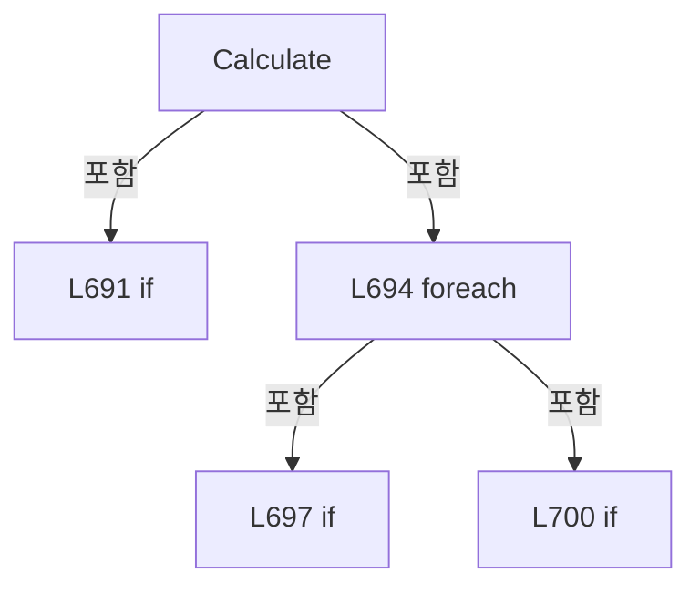

변경 전 점검: 입력/반환 타입, 위 호출자, 예외/취소 경로, 공유 상태와 저장·전송 소비자를 함께 확인합니다. 값의 단위나 물리 방향을 이름만으로 확정하지 않습니다.

### MethodDeclaration `ZeroValues` · L708–715

[Drilling.Common/Recipe/CShotCoordinatePlanBuilder.cs:708–715](https://github.com/kjuws10-rgb/A3Drilling/blob/334b3599651b2e8e0181fd4459bafaf3cddafff3/Drilling.Common/Recipe/CShotCoordinatePlanBuilder.cs#L708-L715)

| 항목 | 실제 추출 값 |
| --- | --- |
| 서명 | System.Collections.Generic.IReadOnlyList<Drilling.Common.Recipe.ST_ALIGN_SHOT_OFFSET> Drilling.Common.Recipe.CAlignShotOffsetData.ZeroValues(Drilling.Common.Managers.ST_RECIPE_DEFINITION, Drilling.Common.Managers.ST_ALIGN_KEY_MARGINS) |
| 접근/수식자 | Public / public, static |
| 반환/값 타입 | System.Collections.Generic.IReadOnlyList<Drilling.Common.Recipe.ST_ALIGN_SHOT_OFFSET> |
| 소속 타입 | NamedType:Drilling.Common.Recipe.CAlignShotOffsetData |

입력 계약:

| 이름 | 타입 | 전달 | 선택/기본값 |
| --- | --- | --- | --- |
| recipe | Drilling.Common.Managers.ST_RECIPE_DEFINITION | None | False /  |
| alignKeyMargins | Drilling.Common.Managers.ST_ALIGN_KEY_MARGINS | None | False /  |

정적 호출자로 확인된 위치:

| 호출 파일/행 | 호출 표현식 | 런타임 분기 가능 |
| --- | --- | --- |
| [Drilling.UI/Menu/Menus/CMenuCorrection.cs:2921–2921](https://github.com/kjuws10-rgb/A3Drilling/blob/334b3599651b2e8e0181fd4459bafaf3cddafff3/Drilling.UI/Menu/Menus/CMenuCorrection.cs#L2921-L2921) | CAlignShotOffsetData.ZeroValues | False |

호출하는 대상과 해석 범위:

| 원본 행 | 표현식 | 분석 상태 | 대상/소스 위치 |
| --- | --- | --- | --- |
| 713 | BuildDesignParameters | resolved | System.Collections.Generic.Dictionary<string, string> Drilling.Common.Recipe.CAlignShotOffsetData.BuildDesignParameters(Drilling.Common.Managers.ST_RECIPE_DEFINITION, Drilling.Common.Managers.ST_ALIGN_KEY_MARGINS) · Drilling.Common/Recipe/CShotCoordinatePlanBuilder.cs:717 |
| 714 | CShotCoordinatePlanBuilder.BuildDesignShots(parameters).Select(shot => new ST_ALIGN_SHOT_OFFSET(shot.CellNo, shot.CellShotNo, CReviewShotNameFormatter.ToMatrixName(shot.CellShotNo, shot.GroupCountX), shot.DesignX, shot.DesignY, 0, 0)).ToArray | resolved | Drilling.Common.Recipe.ST_ALIGN_SHOT_OFFSET[] System.Collections.Generic.IEnumerable<Drilling.Common.Recipe.ST_ALIGN_SHOT_OFFSET>.ToArray<Drilling.Common.Recipe.ST_ALIGN_SHOT_OFFSET>() |
| 714 | CShotCoordinatePlanBuilder.BuildDesignShots(parameters).Select | resolved | System.Collections.Generic.IEnumerable<Drilling.Common.Recipe.ST_ALIGN_SHOT_OFFSET> System.Collections.Generic.IEnumerable<Drilling.Common.Recipe.ST_DESIGN_SHOT_POINT>.Select<Drilling.Common.Recipe.ST_DESIGN_SHOT_POINT, Drilling.Common.Recipe.ST_ALIGN_SHOT_OFFSET>(System.Func<Drilling.Common.Recipe.ST_DESIGN_SHOT_POINT, Drilling.Common.Recipe.ST_ALIGN_SHOT_OFFSET>) |
| 714 | CShotCoordinatePlanBuilder.BuildDesignShots | resolved | System.Collections.Generic.IReadOnlyList<Drilling.Common.Recipe.ST_DESIGN_SHOT_POINT> Drilling.Common.Recipe.CShotCoordinatePlanBuilder.BuildDesignShots(System.Collections.Generic.IReadOnlyDictionary<string, string>) · Drilling.Common/Recipe/CShotCoordinatePlanBuilder.cs:215 |
| 714 | new ST_ALIGN_SHOT_OFFSET | resolved | Drilling.Common.Recipe.ST_ALIGN_SHOT_OFFSET.ST_ALIGN_SHOT_OFFSET(int, int, string, double, double, double, double) · Drilling.Common/Recipe/CShotCoordinatePlanBuilder.cs:656 |
| 714 | CReviewShotNameFormatter.ToMatrixName | resolved | string Drilling.Common.Review.CReviewShotNameFormatter.ToMatrixName(int, int) · Drilling.Common/Review/CReviewManager.cs:4141 |

본문의 실제 연산·분기·예외·반환 순서(원문 위치 순):

| 원본 행 | 종류 | 주석 해설 |
| --- | --- | --- |
| 713 | call | 함수·델리게이트 또는 객체 생성자를 호출합니다: BuildDesignParameters(recipe, alignKeyMargins) |
| 713 | local-declaration | 지역 변수를 선언합니다: var parameters = BuildDesignParameters(recipe, alignKeyMargins); |
| 713 | variable-initializer | 변수의 초기값을 지정합니다: parameters = BuildDesignParameters(recipe, alignKeyMargins) |
| 714 | call | 함수·델리게이트 또는 객체 생성자를 호출합니다: CShotCoordinatePlanBuilder.BuildDesignShots(parameters).Select(shot => new ST_ALIGN_SHOT_OFFSET(shot.CellNo, shot.CellShotNo, CReviewShotNameFormatter.ToMatrixName(shot.CellShotNo, shot.GroupCountX), shot.DesignX, shot.D… |
| 714 | call | 함수·델리게이트 또는 객체 생성자를 호출합니다: CShotCoordinatePlanBuilder.BuildDesignShots(parameters).Select(shot => new ST_ALIGN_SHOT_OFFSET(shot.CellNo, shot.CellShotNo, CReviewShotNameFormatter.ToMatrixName(shot.CellShotNo, shot.GroupCountX), shot.DesignX, shot.D… |
| 714 | call | 함수·델리게이트 또는 객체 생성자를 호출합니다: CShotCoordinatePlanBuilder.BuildDesignShots(parameters) |
| 714 | call | 함수·델리게이트 또는 객체 생성자를 호출합니다: new ST_ALIGN_SHOT_OFFSET(shot.CellNo, shot.CellShotNo, CReviewShotNameFormatter.ToMatrixName(shot.CellShotNo, shot.GroupCountX), shot.DesignX, shot.DesignY, 0, 0) |
| 714 | call | 함수·델리게이트 또는 객체 생성자를 호출합니다: CReviewShotNameFormatter.ToMatrixName(shot.CellShotNo, shot.GroupCountX) |
| 714 | return | 호출자에게 값 또는 제어를 반환합니다: return CShotCoordinatePlanBuilder.BuildDesignShots(parameters).Select(shot => new ST_ALIGN_SHOT_OFFSET(shot.CellNo, shot.CellShotNo, CReviewShotNameFormatter.ToMatrixName(shot.CellShotNo, shot.GroupCountX), shot.DesignX, shot.Desi |

변경 전 점검: 입력/반환 타입, 위 호출자, 예외/취소 경로, 공유 상태와 저장·전송 소비자를 함께 확인합니다. 값의 단위나 물리 방향을 이름만으로 확정하지 않습니다.

### MethodDeclaration `BuildDesignParameters` · L717–728

[Drilling.Common/Recipe/CShotCoordinatePlanBuilder.cs:717–728](https://github.com/kjuws10-rgb/A3Drilling/blob/334b3599651b2e8e0181fd4459bafaf3cddafff3/Drilling.Common/Recipe/CShotCoordinatePlanBuilder.cs#L717-L728)

| 항목 | 실제 추출 값 |
| --- | --- |
| 서명 | System.Collections.Generic.Dictionary<string, string> Drilling.Common.Recipe.CAlignShotOffsetData.BuildDesignParameters(Drilling.Common.Managers.ST_RECIPE_DEFINITION, Drilling.Common.Managers.ST_ALIGN_KEY_MARGINS) |
| 접근/수식자 | Private / private, static |
| 반환/값 타입 | System.Collections.Generic.Dictionary<string, string> |
| 소속 타입 | NamedType:Drilling.Common.Recipe.CAlignShotOffsetData |

입력 계약:

| 이름 | 타입 | 전달 | 선택/기본값 |
| --- | --- | --- | --- |
| recipe | Drilling.Common.Managers.ST_RECIPE_DEFINITION | None | False /  |
| alignKeyMargins | Drilling.Common.Managers.ST_ALIGN_KEY_MARGINS | None | False /  |

정적 호출자로 확인된 위치:

| 호출 파일/행 | 호출 표현식 | 런타임 분기 가능 |
| --- | --- | --- |
| [Drilling.Common/Recipe/CShotCoordinatePlanBuilder.cs:689–689](https://github.com/kjuws10-rgb/A3Drilling/blob/334b3599651b2e8e0181fd4459bafaf3cddafff3/Drilling.Common/Recipe/CShotCoordinatePlanBuilder.cs#L689-L689) | BuildDesignParameters | False |
| [Drilling.Common/Recipe/CShotCoordinatePlanBuilder.cs:713–713](https://github.com/kjuws10-rgb/A3Drilling/blob/334b3599651b2e8e0181fd4459bafaf3cddafff3/Drilling.Common/Recipe/CShotCoordinatePlanBuilder.cs#L713-L713) | BuildDesignParameters | False |

호출하는 대상과 해석 범위:

| 원본 행 | 표현식 | 분석 상태 | 대상/소스 위치 |
| --- | --- | --- | --- |
| 722 | recipe.Parameters .Where(parameter => !IsParameterKey(parameter.Key)) .ToDictionary | resolved | System.Collections.Generic.Dictionary<string, string> System.Collections.Generic.IEnumerable<Drilling.Common.Managers.ST_RECIPE_PARAMETER>.ToDictionary<Drilling.Common.Managers.ST_RECIPE_PARAMETER, string, string>(System.Func<Drilling.Common.Managers.ST_RECIPE_PARAMETER, string>, System.Func<Drilling.Common.Managers.ST_RECIPE_PARAMETER, string>, System.Collections.Generic.IEqualityComparer<string>?) |
| 722 | recipe.Parameters .Where | resolved | System.Collections.Generic.IEnumerable<Drilling.Common.Managers.ST_RECIPE_PARAMETER> System.Collections.Generic.IEnumerable<Drilling.Common.Managers.ST_RECIPE_PARAMETER>.Where<Drilling.Common.Managers.ST_RECIPE_PARAMETER>(System.Func<Drilling.Common.Managers.ST_RECIPE_PARAMETER, bool>) |
| 723 | IsParameterKey | resolved | bool Drilling.Common.Recipe.CAlignShotOffsetData.IsParameterKey(string) · Drilling.Common/Recipe/CShotCoordinatePlanBuilder.cs:661 |
| 725 | alignKeyMargins.X.ToString | resolved | string double.ToString(string?, System.IFormatProvider?) |
| 726 | alignKeyMargins.Y.ToString | resolved | string double.ToString(string?, System.IFormatProvider?) |

본문의 실제 연산·분기·예외·반환 순서(원문 위치 순):

| 원본 행 | 종류 | 주석 해설 |
| --- | --- | --- |
| 722 | call | 함수·델리게이트 또는 객체 생성자를 호출합니다: recipe.Parameters .Where(parameter => !IsParameterKey(parameter.Key)) |
| 722 | call | 함수·델리게이트 또는 객체 생성자를 호출합니다: recipe.Parameters .Where(parameter => !IsParameterKey(parameter.Key)) .ToDictionary(parameter => parameter.Key, parameter => parameter.Value, StringComparer.OrdinalIgnoreCase) |
| 722 | local-declaration | 지역 변수를 선언합니다: var parameters = recipe.Parameters .Where(parameter => !IsParameterKey(parameter.Key)) .ToDictionary(parameter => parameter.Key, parameter => parameter.Value, StringComparer.OrdinalIgnoreCase); |
| 722 | variable-initializer | 변수의 초기값을 지정합니다: parameters = recipe.Parameters .Where(parameter => !IsParameterKey(parameter.Key)) .ToDictionary(parameter => parameter.Key, parameter => parameter.Value, StringComparer.OrdinalIgnoreCase) |
| 723 | call | 함수·델리게이트 또는 객체 생성자를 호출합니다: IsParameterKey(parameter.Key) |
| 725 | assignment | 값을 대상에 대입합니다: parameters[CAlignKeyMarginSettings.MarginXKey] = alignKeyMargins.X.ToString("R", CultureInfo.InvariantCulture) |
| 725 | call | 함수·델리게이트 또는 객체 생성자를 호출합니다: alignKeyMargins.X.ToString("R", CultureInfo.InvariantCulture) |
| 726 | assignment | 값을 대상에 대입합니다: parameters[CAlignKeyMarginSettings.MarginYKey] = alignKeyMargins.Y.ToString("R", CultureInfo.InvariantCulture) |
| 726 | call | 함수·델리게이트 또는 객체 생성자를 호출합니다: alignKeyMargins.Y.ToString("R", CultureInfo.InvariantCulture) |
| 727 | return | 호출자에게 값 또는 제어를 반환합니다: return parameters; |

변경 전 점검: 입력/반환 타입, 위 호출자, 예외/취소 경로, 공유 상태와 저장·전송 소비자를 함께 확인합니다. 값의 단위나 물리 방향을 이름만으로 확정하지 않습니다.

### MethodDeclaration `Apply` · L730–773

[Drilling.Common/Recipe/CShotCoordinatePlanBuilder.cs:730–773](https://github.com/kjuws10-rgb/A3Drilling/blob/334b3599651b2e8e0181fd4459bafaf3cddafff3/Drilling.Common/Recipe/CShotCoordinatePlanBuilder.cs#L730-L773)

| 항목 | 실제 추출 값 |
| --- | --- |
| 서명 | Drilling.Common.Managers.ST_RECIPE_DEFINITION Drilling.Common.Recipe.CAlignShotOffsetData.Apply(Drilling.Common.Managers.ST_RECIPE_DEFINITION, System.Collections.Generic.IReadOnlyList<Drilling.Common.Recipe.ST_ALIGN_SHOT_OFFSET>) |
| 접근/수식자 | Public / public, static |
| 반환/값 타입 | Drilling.Common.Managers.ST_RECIPE_DEFINITION |
| 소속 타입 | NamedType:Drilling.Common.Recipe.CAlignShotOffsetData |

입력 계약:

| 이름 | 타입 | 전달 | 선택/기본값 |
| --- | --- | --- | --- |
| recipe | Drilling.Common.Managers.ST_RECIPE_DEFINITION | None | False /  |
| offsets | System.Collections.Generic.IReadOnlyList<Drilling.Common.Recipe.ST_ALIGN_SHOT_OFFSET> | None | False /  |

정적 호출자로 확인된 위치:

| 호출 파일/행 | 호출 표현식 | 런타임 분기 가능 |
| --- | --- | --- |
| [Drilling.Common/Managers/CRecipeManager.cs:103–103](https://github.com/kjuws10-rgb/A3Drilling/blob/334b3599651b2e8e0181fd4459bafaf3cddafff3/Drilling.Common/Managers/CRecipeManager.cs#L103-L103) | CAlignShotOffsetData.Apply | False |
| [Drilling.UI/Menu/Menus/CMenuCorrection.cs:2967–2967](https://github.com/kjuws10-rgb/A3Drilling/blob/334b3599651b2e8e0181fd4459bafaf3cddafff3/Drilling.UI/Menu/Menus/CMenuCorrection.cs#L2967-L2967) | CAlignShotOffsetData.Apply | False |

호출하는 대상과 해석 범위:

| 원본 행 | 표현식 | 분석 상태 | 대상/소스 위치 |
| --- | --- | --- | --- |
| 732 | recipe.Parameters.ToDictionary | resolved | System.Collections.Generic.Dictionary<string, Drilling.Common.Managers.ST_RECIPE_PARAMETER> System.Collections.Generic.IEnumerable<Drilling.Common.Managers.ST_RECIPE_PARAMETER>.ToDictionary<Drilling.Common.Managers.ST_RECIPE_PARAMETER, string>(System.Func<Drilling.Common.Managers.ST_RECIPE_PARAMETER, string>, System.Collections.Generic.IEqualityComparer<string>?) |
| 735 | Add | resolved | void Add(Drilling.Common.Recipe.ST_ALIGN_SHOT_OFFSET, string, double) · Drilling.Common/Recipe/CShotCoordinatePlanBuilder.cs:743 |
| 736 | Add | resolved | void Add(Drilling.Common.Recipe.ST_ALIGN_SHOT_OFFSET, string, double) · Drilling.Common/Recipe/CShotCoordinatePlanBuilder.cs:743 |
| 741 | parameters.Values.ToArray | resolved | Drilling.Common.Managers.ST_RECIPE_PARAMETER[] System.Collections.Generic.IEnumerable<Drilling.Common.Managers.ST_RECIPE_PARAMETER>.ToArray<Drilling.Common.Managers.ST_RECIPE_PARAMETER>() |

본문의 실제 연산·분기·예외·반환 순서(원문 위치 순):

| 원본 행 | 종류 | 주석 해설 |
| --- | --- | --- |
| 732 | call | 함수·델리게이트 또는 객체 생성자를 호출합니다: recipe.Parameters.ToDictionary(parameter => parameter.Key, StringComparer.OrdinalIgnoreCase) |
| 732 | local-declaration | 지역 변수를 선언합니다: var parameters = recipe.Parameters.ToDictionary(parameter => parameter.Key, StringComparer.OrdinalIgnoreCase); |
| 732 | variable-initializer | 변수의 초기값을 지정합니다: parameters = recipe.Parameters.ToDictionary(parameter => parameter.Key, StringComparer.OrdinalIgnoreCase) |
| 733 | foreach | 컬렉션 요소를 순회합니다: foreach (var offset in offsets) |
| 735 | call | 함수·델리게이트 또는 객체 생성자를 호출합니다: Add(offset, "X", offset.X) |
| 736 | call | 함수·델리게이트 또는 객체 생성자를 호출합니다: Add(offset, "Y", offset.Y) |
| 739 | return | 호출자에게 값 또는 제어를 반환합니다: return recipe with { Parameters = parameters.Values.ToArray() }; |
| 741 | assignment | 값을 대상에 대입합니다: Parameters = parameters.Values.ToArray() |
| 741 | call | 함수·델리게이트 또는 객체 생성자를 호출합니다: parameters.Values.ToArray() |

제어 구문의 포함 구조(실제 실행 순서/CFG가 아닌 구문 탐색 그림):

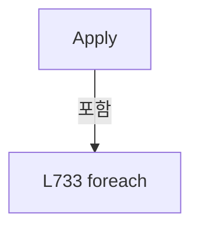

변경 전 점검: 입력/반환 타입, 위 호출자, 예외/취소 경로, 공유 상태와 저장·전송 소비자를 함께 확인합니다. 값의 단위나 물리 방향을 이름만으로 확정하지 않습니다.

### LocalFunctionStatement `Add` · L743–772

[Drilling.Common/Recipe/CShotCoordinatePlanBuilder.cs:743–772](https://github.com/kjuws10-rgb/A3Drilling/blob/334b3599651b2e8e0181fd4459bafaf3cddafff3/Drilling.Common/Recipe/CShotCoordinatePlanBuilder.cs#L743-L772)

| 항목 | 실제 추출 값 |
| --- | --- |
| 서명 | void Add(Drilling.Common.Recipe.ST_ALIGN_SHOT_OFFSET, string, double) |
| 접근/수식자 | Private /  |
| 반환/값 타입 | void |
| 소속 타입 | NamedType:Drilling.Common.Recipe.CAlignShotOffsetData |

입력 계약:

| 이름 | 타입 | 전달 | 선택/기본값 |
| --- | --- | --- | --- |
| offset | Drilling.Common.Recipe.ST_ALIGN_SHOT_OFFSET | None | False /  |
| axis | string | None | False /  |
| value | double | None | False /  |

정적 호출자로 확인된 위치:

| 호출 파일/행 | 호출 표현식 | 런타임 분기 가능 |
| --- | --- | --- |
| [Drilling.Common/Recipe/CShotCoordinatePlanBuilder.cs:735–735](https://github.com/kjuws10-rgb/A3Drilling/blob/334b3599651b2e8e0181fd4459bafaf3cddafff3/Drilling.Common/Recipe/CShotCoordinatePlanBuilder.cs#L735-L735) | Add | False |
| [Drilling.Common/Recipe/CShotCoordinatePlanBuilder.cs:736–736](https://github.com/kjuws10-rgb/A3Drilling/blob/334b3599651b2e8e0181fd4459bafaf3cddafff3/Drilling.Common/Recipe/CShotCoordinatePlanBuilder.cs#L736-L736) | Add | False |

호출하는 대상과 해석 범위:

| 원본 행 | 표현식 | 분석 상태 | 대상/소스 위치 |
| --- | --- | --- | --- |
| 745 | double.IsFinite | resolved | bool double.IsFinite(double) |
| 745 | Math.Abs | resolved | double System.Math.Abs(double) |
| 746 | new InvalidOperationException | resolved | System.InvalidOperationException.InvalidOperationException(string?) |
| 747 | ParameterKey | resolved | string Drilling.Common.Recipe.CAlignShotOffsetData.ParameterKey(int, string, string) · Drilling.Common/Recipe/CShotCoordinatePlanBuilder.cs:662 |
| 748 | IsParameterKey | resolved | bool Drilling.Common.Recipe.CAlignShotOffsetData.IsParameterKey(string) · Drilling.Common/Recipe/CShotCoordinatePlanBuilder.cs:661 |
| 749 | new InvalidOperationException | resolved | System.InvalidOperationException.InvalidOperationException(string?) |
| 750 | FormatValue | resolved | string Drilling.Common.Recipe.CAlignShotOffsetData.FormatValue(double) · Drilling.Common/Recipe/CShotCoordinatePlanBuilder.cs:672 |
| 751 | parameters.TryGetValue | resolved | bool System.Collections.Generic.Dictionary<string, Drilling.Common.Managers.ST_RECIPE_PARAMETER>.TryGetValue(string, out Drilling.Common.Managers.ST_RECIPE_PARAMETER) |
| 756 | new ST_RECIPE_PARAMETER | resolved | Drilling.Common.Managers.ST_RECIPE_PARAMETER.ST_RECIPE_PARAMETER(string, string, string, string, string, string, string, string, string, bool, bool, int, Drilling.Common.Managers.EN_RECIPE_DATA_TYPE, double, double, double, System.Collections.Generic.IReadOnlyDictionary<string, string>?) · Drilling.Common/Managers/CRecipeManager.cs:357 |

본문의 실제 연산·분기·예외·반환 순서(원문 위치 순):

| 원본 행 | 종류 | 주석 해설 |
| --- | --- | --- |
| 745 | call | 함수·델리게이트 또는 객체 생성자를 호출합니다: double.IsFinite(value) |
| 745 | call | 함수·델리게이트 또는 객체 생성자를 호출합니다: Math.Abs(value) |
| 745 | if | 조건에 따라 분기합니다: if (!double.IsFinite(value) &#124;&#124; Math.Abs(value) > MaximumAbsoluteOffset) |
| 746 | call | 함수·델리게이트 또는 객체 생성자를 호출합니다: new InvalidOperationException("유효하지 않은 Align Offset입니다.") |
| 746 | throw | 예외를 발생/전달합니다: throw new InvalidOperationException("유효하지 않은 Align Offset입니다."); |
| 747 | call | 함수·델리게이트 또는 객체 생성자를 호출합니다: ParameterKey(offset.CellNo, offset.ShotName, axis) |
| 747 | local-declaration | 지역 변수를 선언합니다: var key = ParameterKey(offset.CellNo, offset.ShotName, axis); |
| 747 | variable-initializer | 변수의 초기값을 지정합니다: key = ParameterKey(offset.CellNo, offset.ShotName, axis) |
| 748 | call | 함수·델리게이트 또는 객체 생성자를 호출합니다: IsParameterKey(key) |
| 748 | if | 조건에 따라 분기합니다: if (!IsParameterKey(key)) |
| 749 | call | 함수·델리게이트 또는 객체 생성자를 호출합니다: new InvalidOperationException("Shot Align Offset 항목을 확인하세요.") |
| 749 | throw | 예외를 발생/전달합니다: throw new InvalidOperationException("Shot Align Offset 항목을 확인하세요."); |
| 750 | call | 함수·델리게이트 또는 객체 생성자를 호출합니다: FormatValue(value) |
| 750 | local-declaration | 지역 변수를 선언합니다: var text = FormatValue(value); |
| 750 | variable-initializer | 변수의 초기값을 지정합니다: text = FormatValue(value) |
| 751 | call | 함수·델리게이트 또는 객체 생성자를 호출합니다: parameters.TryGetValue(key, out var existing) |
| 751 | assignment | 값을 대상에 대입합니다: parameters[key] = parameters.TryGetValue(key, out var existing) ? existing with { Value = text } : new ST_RECIPE_PARAMETER( $"Shot Group {offset.ShotName} Align Offset {axis}", text, "mm", "-100000 - 100000", "0.000", "CELL", "SHO |
| 751 | conditional-expression | 조건에 따라 결과식을 선택합니다: parameters.TryGetValue(key, out var existing) ? existing with { Value = text } : new ST_RECIPE_PARAMETER( $"Shot Group {offset.ShotName} Align Offset {axis}", text, "mm", "-100000 - 100000", "0.000", "CELL", "SHOT_GROUP", key, "De |
| 753 | assignment | 값을 대상에 대입합니다: Value = text |
| 756 | call | 함수·델리게이트 또는 객체 생성자를 호출합니다: new ST_RECIPE_PARAMETER( $"Shot Group {offset.ShotName} Align Offset {axis}", text, "mm", "-100000 - 100000", "0.000", "CELL", "SHOT_GROUP", key, "Design-coordinate align correction; head direction is applied at script g… |

제어 구문의 포함 구조(실제 실행 순서/CFG가 아닌 구문 탐색 그림):

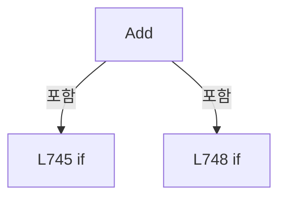

변경 전 점검: 입력/반환 타입, 위 호출자, 예외/취소 경로, 공유 상태와 저장·전송 소비자를 함께 확인합니다. 값의 단위나 물리 방향을 이름만으로 확정하지 않습니다.

### MethodDeclaration `RetainUneditedOffsets` · L777–787

[Drilling.Common/Recipe/CShotCoordinatePlanBuilder.cs:777–787](https://github.com/kjuws10-rgb/A3Drilling/blob/334b3599651b2e8e0181fd4459bafaf3cddafff3/Drilling.Common/Recipe/CShotCoordinatePlanBuilder.cs#L777-L787)

| 항목 | 실제 추출 값 |
| --- | --- |
| 서명 | Drilling.Common.Managers.ST_RECIPE_DEFINITION Drilling.Common.Recipe.CAlignShotOffsetData.RetainUneditedOffsets(Drilling.Common.Managers.ST_RECIPE_DEFINITION, Drilling.Common.Managers.ST_RECIPE_DEFINITION?) |
| 접근/수식자 | Public / public, static |
| 반환/값 타입 | Drilling.Common.Managers.ST_RECIPE_DEFINITION |
| 소속 타입 | NamedType:Drilling.Common.Recipe.CAlignShotOffsetData |

입력 계약:

| 이름 | 타입 | 전달 | 선택/기본값 |
| --- | --- | --- | --- |
| edited | Drilling.Common.Managers.ST_RECIPE_DEFINITION | None | False /  |
| saved | Drilling.Common.Managers.ST_RECIPE_DEFINITION? | None | False /  |

정적 호출자로 확인된 위치:

| 호출 파일/행 | 호출 표현식 | 런타임 분기 가능 |
| --- | --- | --- |
| [Drilling.Common/Managers/CRecipeManager.cs:153–153](https://github.com/kjuws10-rgb/A3Drilling/blob/334b3599651b2e8e0181fd4459bafaf3cddafff3/Drilling.Common/Managers/CRecipeManager.cs#L153-L153) | global::Drilling.Common.Recipe.CAlignShotOffsetData.RetainUneditedOffsets | False |

호출하는 대상과 해석 범위:

| 원본 행 | 표현식 | 분석 상태 | 대상/소스 위치 |
| --- | --- | --- | --- |
| 781 | edited.Parameters.Select(parameter => parameter.Key).ToHashSet | resolved | System.Collections.Generic.HashSet<string> System.Collections.Generic.IEnumerable<string>.ToHashSet<string>(System.Collections.Generic.IEqualityComparer<string>?) |
| 781 | edited.Parameters.Select | resolved | System.Collections.Generic.IEnumerable<string> System.Collections.Generic.IEnumerable<Drilling.Common.Managers.ST_RECIPE_PARAMETER>.Select<Drilling.Common.Managers.ST_RECIPE_PARAMETER, string>(System.Func<Drilling.Common.Managers.ST_RECIPE_PARAMETER, string>) |
| 782 | saved.Parameters.Where(parameter => IsParameterKey(parameter.Key) && !keys.Contains(parameter.Key)).ToArray | resolved | Drilling.Common.Managers.ST_RECIPE_PARAMETER[] System.Collections.Generic.IEnumerable<Drilling.Common.Managers.ST_RECIPE_PARAMETER>.ToArray<Drilling.Common.Managers.ST_RECIPE_PARAMETER>() |
| 782 | saved.Parameters.Where | resolved | System.Collections.Generic.IEnumerable<Drilling.Common.Managers.ST_RECIPE_PARAMETER> System.Collections.Generic.IEnumerable<Drilling.Common.Managers.ST_RECIPE_PARAMETER>.Where<Drilling.Common.Managers.ST_RECIPE_PARAMETER>(System.Func<Drilling.Common.Managers.ST_RECIPE_PARAMETER, bool>) |
| 782 | IsParameterKey | resolved | bool Drilling.Common.Recipe.CAlignShotOffsetData.IsParameterKey(string) · Drilling.Common/Recipe/CShotCoordinatePlanBuilder.cs:661 |
| 782 | keys.Contains | resolved | bool System.Collections.Generic.HashSet<string>.Contains(string) |
| 785 | edited.Parameters.Concat(retained).ToArray | resolved | Drilling.Common.Managers.ST_RECIPE_PARAMETER[] System.Collections.Generic.IEnumerable<Drilling.Common.Managers.ST_RECIPE_PARAMETER>.ToArray<Drilling.Common.Managers.ST_RECIPE_PARAMETER>() |
| 785 | edited.Parameters.Concat | resolved | System.Collections.Generic.IEnumerable<Drilling.Common.Managers.ST_RECIPE_PARAMETER> System.Collections.Generic.IEnumerable<Drilling.Common.Managers.ST_RECIPE_PARAMETER>.Concat<Drilling.Common.Managers.ST_RECIPE_PARAMETER>(System.Collections.Generic.IEnumerable<Drilling.Common.Managers.ST_RECIPE_PARAMETER>) |

본문의 실제 연산·분기·예외·반환 순서(원문 위치 순):

| 원본 행 | 종류 | 주석 해설 |
| --- | --- | --- |
| 779 | if | 조건에 따라 분기합니다: if (saved is null) |
| 780 | return | 호출자에게 값 또는 제어를 반환합니다: return edited; |
| 781 | call | 함수·델리게이트 또는 객체 생성자를 호출합니다: edited.Parameters.Select(parameter => parameter.Key).ToHashSet(StringComparer.OrdinalIgnoreCase) |
| 781 | call | 함수·델리게이트 또는 객체 생성자를 호출합니다: edited.Parameters.Select(parameter => parameter.Key) |
| 781 | local-declaration | 지역 변수를 선언합니다: var keys = edited.Parameters.Select(parameter => parameter.Key).ToHashSet(StringComparer.OrdinalIgnoreCase); |
| 781 | variable-initializer | 변수의 초기값을 지정합니다: keys = edited.Parameters.Select(parameter => parameter.Key).ToHashSet(StringComparer.OrdinalIgnoreCase) |
| 782 | call | 함수·델리게이트 또는 객체 생성자를 호출합니다: saved.Parameters.Where(parameter => IsParameterKey(parameter.Key) && !keys.Contains(parameter.Key)).ToArray() |
| 782 | call | 함수·델리게이트 또는 객체 생성자를 호출합니다: saved.Parameters.Where(parameter => IsParameterKey(parameter.Key) && !keys.Contains(parameter.Key)) |
| 782 | call | 함수·델리게이트 또는 객체 생성자를 호출합니다: IsParameterKey(parameter.Key) |
| 782 | call | 함수·델리게이트 또는 객체 생성자를 호출합니다: keys.Contains(parameter.Key) |
| 782 | local-declaration | 지역 변수를 선언합니다: var retained = saved.Parameters.Where(parameter => IsParameterKey(parameter.Key) && !keys.Contains(parameter.Key)).ToArray(); |
| 782 | variable-initializer | 변수의 초기값을 지정합니다: retained = saved.Parameters.Where(parameter => IsParameterKey(parameter.Key) && !keys.Contains(parameter.Key)).ToArray() |
| 783 | conditional-expression | 조건에 따라 결과식을 선택합니다: retained.Length == 0 ? edited : edited with { Parameters = edited.Parameters.Concat(retained).ToArray() } |
| 783 | return | 호출자에게 값 또는 제어를 반환합니다: return retained.Length == 0 ? edited : edited with { Parameters = edited.Parameters.Concat(retained).ToArray() }; |
| 785 | assignment | 값을 대상에 대입합니다: Parameters = edited.Parameters.Concat(retained).ToArray() |
| 785 | call | 함수·델리게이트 또는 객체 생성자를 호출합니다: edited.Parameters.Concat(retained).ToArray() |
| 785 | call | 함수·델리게이트 또는 객체 생성자를 호출합니다: edited.Parameters.Concat(retained) |

제어 구문의 포함 구조(실제 실행 순서/CFG가 아닌 구문 탐색 그림):

```mermaid
flowchart TD
 M["RetainUneditedOffsets"]
 N0["L779 if"]
 M -->|포함| N0
```

변경 전 점검: 입력/반환 타입, 위 호출자, 예외/취소 경로, 공유 상태와 저장·전송 소비자를 함께 확인합니다. 값의 단위나 물리 방향을 이름만으로 확정하지 않습니다.

### PropertyDeclaration `Empty` · L792–792

[Drilling.Common/Recipe/CShotCoordinatePlanBuilder.cs:792–792](https://github.com/kjuws10-rgb/A3Drilling/blob/334b3599651b2e8e0181fd4459bafaf3cddafff3/Drilling.Common/Recipe/CShotCoordinatePlanBuilder.cs#L792-L792)

| 항목 | 실제 추출 값 |
| --- | --- |
| 서명 | Drilling.Common.Recipe.ST_RECIPE_SHOT_MASKING_RESULT Drilling.Common.Recipe.ST_RECIPE_SHOT_MASKING_RESULT.Empty |
| 접근/수식자 | Public / public, static |
| 반환/값 타입 | Drilling.Common.Recipe.ST_RECIPE_SHOT_MASKING_RESULT |
| 소속 타입 | NamedType:Drilling.Common.Recipe.ST_RECIPE_SHOT_MASKING_RESULT |

현재 부분 분석에서 직접 연결된 호출자는 없습니다. XAML/이벤트/인터페이스·델리게이트·외부 진입을 추가 확인해야 하며, 미사용으로 판정한 것이 아닙니다.

호출하는 대상과 해석 범위:

| 원본 행 | 표현식 | 분석 상태 | 대상/소스 위치 |
| --- | --- | --- | --- |
| 792 | new | resolved | Drilling.Common.Recipe.ST_RECIPE_SHOT_MASKING_RESULT.ST_RECIPE_SHOT_MASKING_RESULT(System.Collections.Generic.IReadOnlyList<int>, System.Collections.Generic.IReadOnlyList<int>, bool, bool) · Drilling.Common/Recipe/CShotCoordinatePlanBuilder.cs:790 |

본문의 실제 연산·분기·예외·반환 순서(원문 위치 순):

| 원본 행 | 종류 | 주석 해설 |
| --- | --- | --- |
| 792 | call | 함수·델리게이트 또는 객체 생성자를 호출합니다: new([], [], false) |

변경 전 점검: 입력/반환 타입, 위 호출자, 예외/취소 경로, 공유 상태와 저장·전송 소비자를 함께 확인합니다. 값의 단위나 물리 방향을 이름만으로 확정하지 않습니다.

### GetAccessorDeclaration `get_Empty` · L792–792

[Drilling.Common/Recipe/CShotCoordinatePlanBuilder.cs:792–792](https://github.com/kjuws10-rgb/A3Drilling/blob/334b3599651b2e8e0181fd4459bafaf3cddafff3/Drilling.Common/Recipe/CShotCoordinatePlanBuilder.cs#L792-L792)

| 항목 | 실제 추출 값 |
| --- | --- |
| 서명 | Drilling.Common.Recipe.ST_RECIPE_SHOT_MASKING_RESULT Drilling.Common.Recipe.ST_RECIPE_SHOT_MASKING_RESULT.Empty.get |
| 접근/수식자 | Public / get |
| 반환/값 타입 | Drilling.Common.Recipe.ST_RECIPE_SHOT_MASKING_RESULT |
| 소속 타입 | NamedType:Drilling.Common.Recipe.ST_RECIPE_SHOT_MASKING_RESULT |

현재 부분 분석에서 직접 연결된 호출자는 없습니다. XAML/이벤트/인터페이스·델리게이트·외부 진입을 추가 확인해야 하며, 미사용으로 판정한 것이 아닙니다.

변경 전 점검: 입력/반환 타입, 위 호출자, 예외/취소 경로, 공유 상태와 저장·전송 소비자를 함께 확인합니다. 값의 단위나 물리 방향을 이름만으로 확정하지 않습니다.

### PropertyDeclaration `IsMasked` · L794–800

[Drilling.Common/Recipe/CShotCoordinatePlanBuilder.cs:794–800](https://github.com/kjuws10-rgb/A3Drilling/blob/334b3599651b2e8e0181fd4459bafaf3cddafff3/Drilling.Common/Recipe/CShotCoordinatePlanBuilder.cs#L794-L800)

| 항목 | 실제 추출 값 |
| --- | --- |
| 서명 | bool Drilling.Common.Recipe.ST_RECIPE_SHOT_MASKING_RESULT.IsMasked |
| 접근/수식자 | Public / public |
| 반환/값 타입 | bool |
| 소속 타입 | NamedType:Drilling.Common.Recipe.ST_RECIPE_SHOT_MASKING_RESULT |

현재 부분 분석에서 직접 연결된 호출자는 없습니다. XAML/이벤트/인터페이스·델리게이트·외부 진입을 추가 확인해야 하며, 미사용으로 판정한 것이 아닙니다.

변경 전 점검: 입력/반환 타입, 위 호출자, 예외/취소 경로, 공유 상태와 저장·전송 소비자를 함께 확인합니다. 값의 단위나 물리 방향을 이름만으로 확정하지 않습니다.

### GetAccessorDeclaration `get_IsMasked` · L796–799

[Drilling.Common/Recipe/CShotCoordinatePlanBuilder.cs:796–799](https://github.com/kjuws10-rgb/A3Drilling/blob/334b3599651b2e8e0181fd4459bafaf3cddafff3/Drilling.Common/Recipe/CShotCoordinatePlanBuilder.cs#L796-L799)

| 항목 | 실제 추출 값 |
| --- | --- |
| 서명 | bool Drilling.Common.Recipe.ST_RECIPE_SHOT_MASKING_RESULT.IsMasked.get |
| 접근/수식자 | Public / get |
| 반환/값 타입 | bool |
| 소속 타입 | NamedType:Drilling.Common.Recipe.ST_RECIPE_SHOT_MASKING_RESULT |

현재 부분 분석에서 직접 연결된 호출자는 없습니다. XAML/이벤트/인터페이스·델리게이트·외부 진입을 추가 확인해야 하며, 미사용으로 판정한 것이 아닙니다.

본문의 실제 연산·분기·예외·반환 순서(원문 위치 순):

| 원본 행 | 종류 | 주석 해설 |
| --- | --- | --- |
| 798 | return | 호출자에게 값 또는 제어를 반환합니다: return BeamNumbers.Count > 0; |

변경 전 점검: 입력/반환 타입, 위 호출자, 예외/취소 경로, 공유 상태와 저장·전송 소비자를 함께 확인합니다. 값의 단위나 물리 방향을 이름만으로 확정하지 않습니다.

### PropertyDeclaration `ShouldSkipLaser` · L802–808

[Drilling.Common/Recipe/CShotCoordinatePlanBuilder.cs:802–808](https://github.com/kjuws10-rgb/A3Drilling/blob/334b3599651b2e8e0181fd4459bafaf3cddafff3/Drilling.Common/Recipe/CShotCoordinatePlanBuilder.cs#L802-L808)

| 항목 | 실제 추출 값 |
| --- | --- |
| 서명 | bool Drilling.Common.Recipe.ST_RECIPE_SHOT_MASKING_RESULT.ShouldSkipLaser |
| 접근/수식자 | Public / public |
| 반환/값 타입 | bool |
| 소속 타입 | NamedType:Drilling.Common.Recipe.ST_RECIPE_SHOT_MASKING_RESULT |

현재 부분 분석에서 직접 연결된 호출자는 없습니다. XAML/이벤트/인터페이스·델리게이트·외부 진입을 추가 확인해야 하며, 미사용으로 판정한 것이 아닙니다.

변경 전 점검: 입력/반환 타입, 위 호출자, 예외/취소 경로, 공유 상태와 저장·전송 소비자를 함께 확인합니다. 값의 단위나 물리 방향을 이름만으로 확정하지 않습니다.

### GetAccessorDeclaration `get_ShouldSkipLaser` · L804–807

[Drilling.Common/Recipe/CShotCoordinatePlanBuilder.cs:804–807](https://github.com/kjuws10-rgb/A3Drilling/blob/334b3599651b2e8e0181fd4459bafaf3cddafff3/Drilling.Common/Recipe/CShotCoordinatePlanBuilder.cs#L804-L807)

| 항목 | 실제 추출 값 |
| --- | --- |
| 서명 | bool Drilling.Common.Recipe.ST_RECIPE_SHOT_MASKING_RESULT.ShouldSkipLaser.get |
| 접근/수식자 | Public / get |
| 반환/값 타입 | bool |
| 소속 타입 | NamedType:Drilling.Common.Recipe.ST_RECIPE_SHOT_MASKING_RESULT |

현재 부분 분석에서 직접 연결된 호출자는 없습니다. XAML/이벤트/인터페이스·델리게이트·외부 진입을 추가 확인해야 하며, 미사용으로 판정한 것이 아닙니다.

본문의 실제 연산·분기·예외·반환 순서(원문 위치 순):

| 원본 행 | 종류 | 주석 해설 |
| --- | --- | --- |
| 806 | return | 호출자에게 값 또는 제어를 반환합니다: return IsMasked &#124;&#124; IsChessSkipped; |

변경 전 점검: 입력/반환 타입, 위 호출자, 예외/취소 경로, 공유 상태와 저장·전송 소비자를 함께 확인합니다. 값의 단위나 물리 방향을 이름만으로 확정하지 않습니다.

### FieldDeclaration `MaximumCellModelTypeCount` · L813–813

[Drilling.Common/Recipe/CShotCoordinatePlanBuilder.cs:813–813](https://github.com/kjuws10-rgb/A3Drilling/blob/334b3599651b2e8e0181fd4459bafaf3cddafff3/Drilling.Common/Recipe/CShotCoordinatePlanBuilder.cs#L813-L813)

| 항목 | 실제 추출 값 |
| --- | --- |
| 서명 | int Drilling.Common.Recipe.CRecipeShotMaskingPlan.MaximumCellModelTypeCount |
| 접근/수식자 | Private / private, const |
| 반환/값 타입 | int |
| 소속 타입 | NamedType:Drilling.Common.Recipe.CRecipeShotMaskingPlan |

현재 부분 분석에서 직접 연결된 호출자는 없습니다. XAML/이벤트/인터페이스·델리게이트·외부 진입을 추가 확인해야 하며, 미사용으로 판정한 것이 아닙니다.

본문의 실제 연산·분기·예외·반환 순서(원문 위치 순):

| 원본 행 | 종류 | 주석 해설 |
| --- | --- | --- |
| 813 | variable-initializer | 변수의 초기값을 지정합니다: MaximumCellModelTypeCount = 5 |

변경 전 점검: 입력/반환 타입, 위 호출자, 예외/취소 경로, 공유 상태와 저장·전송 소비자를 함께 확인합니다. 값의 단위나 물리 방향을 이름만으로 확정하지 않습니다.

### FieldDeclaration `MaximumMaskingHoleCount` · L814–814

[Drilling.Common/Recipe/CShotCoordinatePlanBuilder.cs:814–814](https://github.com/kjuws10-rgb/A3Drilling/blob/334b3599651b2e8e0181fd4459bafaf3cddafff3/Drilling.Common/Recipe/CShotCoordinatePlanBuilder.cs#L814-L814)

| 항목 | 실제 추출 값 |
| --- | --- |
| 서명 | int Drilling.Common.Recipe.CRecipeShotMaskingPlan.MaximumMaskingHoleCount |
| 접근/수식자 | Private / private, const |
| 반환/값 타입 | int |
| 소속 타입 | NamedType:Drilling.Common.Recipe.CRecipeShotMaskingPlan |

현재 부분 분석에서 직접 연결된 호출자는 없습니다. XAML/이벤트/인터페이스·델리게이트·외부 진입을 추가 확인해야 하며, 미사용으로 판정한 것이 아닙니다.

본문의 실제 연산·분기·예외·반환 순서(원문 위치 순):

| 원본 행 | 종류 | 주석 해설 |
| --- | --- | --- |
| 814 | variable-initializer | 변수의 초기값을 지정합니다: MaximumMaskingHoleCount = 3 |

변경 전 점검: 입력/반환 타입, 위 호출자, 예외/취소 경로, 공유 상태와 저장·전송 소비자를 함께 확인합니다. 값의 단위나 물리 방향을 이름만으로 확정하지 않습니다.

### FieldDeclaration `Epsilon` · L815–815

[Drilling.Common/Recipe/CShotCoordinatePlanBuilder.cs:815–815](https://github.com/kjuws10-rgb/A3Drilling/blob/334b3599651b2e8e0181fd4459bafaf3cddafff3/Drilling.Common/Recipe/CShotCoordinatePlanBuilder.cs#L815-L815)

| 항목 | 실제 추출 값 |
| --- | --- |
| 서명 | double Drilling.Common.Recipe.CRecipeShotMaskingPlan.Epsilon |
| 접근/수식자 | Private / private, const |
| 반환/값 타입 | double |
| 소속 타입 | NamedType:Drilling.Common.Recipe.CRecipeShotMaskingPlan |

현재 부분 분석에서 직접 연결된 호출자는 없습니다. XAML/이벤트/인터페이스·델리게이트·외부 진입을 추가 확인해야 하며, 미사용으로 판정한 것이 아닙니다.

본문의 실제 연산·분기·예외·반환 순서(원문 위치 순):

| 원본 행 | 종류 | 주석 해설 |
| --- | --- | --- |
| 815 | variable-initializer | 변수의 초기값을 지정합니다: Epsilon = 0.000000001 |

변경 전 점검: 입력/반환 타입, 위 호출자, 예외/취소 경로, 공유 상태와 저장·전송 소비자를 함께 확인합니다. 값의 단위나 물리 방향을 이름만으로 확정하지 않습니다.

### FieldDeclaration `_models` · L816–816

[Drilling.Common/Recipe/CShotCoordinatePlanBuilder.cs:816–816](https://github.com/kjuws10-rgb/A3Drilling/blob/334b3599651b2e8e0181fd4459bafaf3cddafff3/Drilling.Common/Recipe/CShotCoordinatePlanBuilder.cs#L816-L816)

| 항목 | 실제 추출 값 |
| --- | --- |
| 서명 | System.Collections.Generic.IReadOnlyDictionary<int, Drilling.Common.Recipe.CRecipeShotMaskingPlan.ST_MODEL_MASKING_AREA> Drilling.Common.Recipe.CRecipeShotMaskingPlan._models |
| 접근/수식자 | Private / private, readonly |
| 반환/값 타입 | System.Collections.Generic.IReadOnlyDictionary<int, Drilling.Common.Recipe.CRecipeShotMaskingPlan.ST_MODEL_MASKING_AREA> |
| 소속 타입 | NamedType:Drilling.Common.Recipe.CRecipeShotMaskingPlan |

현재 부분 분석에서 직접 연결된 호출자는 없습니다. XAML/이벤트/인터페이스·델리게이트·외부 진입을 추가 확인해야 하며, 미사용으로 판정한 것이 아닙니다.

변경 전 점검: 입력/반환 타입, 위 호출자, 예외/취소 경로, 공유 상태와 저장·전송 소비자를 함께 확인합니다. 값의 단위나 물리 방향을 이름만으로 확정하지 않습니다.

### FieldDeclaration `_modelPatterns` · L817–817

[Drilling.Common/Recipe/CShotCoordinatePlanBuilder.cs:817–817](https://github.com/kjuws10-rgb/A3Drilling/blob/334b3599651b2e8e0181fd4459bafaf3cddafff3/Drilling.Common/Recipe/CShotCoordinatePlanBuilder.cs#L817-L817)

| 항목 | 실제 추출 값 |
| --- | --- |
| 서명 | System.Collections.Generic.IReadOnlyDictionary<int, Drilling.Common.Recipe.CRecipeShotMaskingPlan.ST_MODEL_PATTERN_AREA> Drilling.Common.Recipe.CRecipeShotMaskingPlan._modelPatterns |
| 접근/수식자 | Private / private, readonly |
| 반환/값 타입 | System.Collections.Generic.IReadOnlyDictionary<int, Drilling.Common.Recipe.CRecipeShotMaskingPlan.ST_MODEL_PATTERN_AREA> |
| 소속 타입 | NamedType:Drilling.Common.Recipe.CRecipeShotMaskingPlan |

현재 부분 분석에서 직접 연결된 호출자는 없습니다. XAML/이벤트/인터페이스·델리게이트·외부 진입을 추가 확인해야 하며, 미사용으로 판정한 것이 아닙니다.

변경 전 점검: 입력/반환 타입, 위 호출자, 예외/취소 경로, 공유 상태와 저장·전송 소비자를 함께 확인합니다. 값의 단위나 물리 방향을 이름만으로 확정하지 않습니다.

### FieldDeclaration `_cellModelTypes` · L818–818

[Drilling.Common/Recipe/CShotCoordinatePlanBuilder.cs:818–818](https://github.com/kjuws10-rgb/A3Drilling/blob/334b3599651b2e8e0181fd4459bafaf3cddafff3/Drilling.Common/Recipe/CShotCoordinatePlanBuilder.cs#L818-L818)

| 항목 | 실제 추출 값 |
| --- | --- |
| 서명 | System.Collections.Generic.IReadOnlyDictionary<int, int> Drilling.Common.Recipe.CRecipeShotMaskingPlan._cellModelTypes |
| 접근/수식자 | Private / private, readonly |
| 반환/값 타입 | System.Collections.Generic.IReadOnlyDictionary<int, int> |
| 소속 타입 | NamedType:Drilling.Common.Recipe.CRecipeShotMaskingPlan |

현재 부분 분석에서 직접 연결된 호출자는 없습니다. XAML/이벤트/인터페이스·델리게이트·외부 진입을 추가 확인해야 하며, 미사용으로 판정한 것이 아닙니다.

변경 전 점검: 입력/반환 타입, 위 호출자, 예외/취소 경로, 공유 상태와 저장·전송 소비자를 함께 확인합니다. 값의 단위나 물리 방향을 이름만으로 확정하지 않습니다.

### FieldDeclaration `_modelTypeCount` · L819–819

[Drilling.Common/Recipe/CShotCoordinatePlanBuilder.cs:819–819](https://github.com/kjuws10-rgb/A3Drilling/blob/334b3599651b2e8e0181fd4459bafaf3cddafff3/Drilling.Common/Recipe/CShotCoordinatePlanBuilder.cs#L819-L819)

| 항목 | 실제 추출 값 |
| --- | --- |
| 서명 | int Drilling.Common.Recipe.CRecipeShotMaskingPlan._modelTypeCount |
| 접근/수식자 | Private / private, readonly |
| 반환/값 타입 | int |
| 소속 타입 | NamedType:Drilling.Common.Recipe.CRecipeShotMaskingPlan |

현재 부분 분석에서 직접 연결된 호출자는 없습니다. XAML/이벤트/인터페이스·델리게이트·외부 진입을 추가 확인해야 하며, 미사용으로 판정한 것이 아닙니다.

변경 전 점검: 입력/반환 타입, 위 호출자, 예외/취소 경로, 공유 상태와 저장·전송 소비자를 함께 확인합니다. 값의 단위나 물리 방향을 이름만으로 확정하지 않습니다.

### FieldDeclaration `_splitBeamCount` · L820–820

[Drilling.Common/Recipe/CShotCoordinatePlanBuilder.cs:820–820](https://github.com/kjuws10-rgb/A3Drilling/blob/334b3599651b2e8e0181fd4459bafaf3cddafff3/Drilling.Common/Recipe/CShotCoordinatePlanBuilder.cs#L820-L820)

| 항목 | 실제 추출 값 |
| --- | --- |
| 서명 | int Drilling.Common.Recipe.CRecipeShotMaskingPlan._splitBeamCount |
| 접근/수식자 | Private / private, readonly |
| 반환/값 타입 | int |
| 소속 타입 | NamedType:Drilling.Common.Recipe.CRecipeShotMaskingPlan |

현재 부분 분석에서 직접 연결된 호출자는 없습니다. XAML/이벤트/인터페이스·델리게이트·외부 진입을 추가 확인해야 하며, 미사용으로 판정한 것이 아닙니다.

변경 전 점검: 입력/반환 타입, 위 호출자, 예외/취소 경로, 공유 상태와 저장·전송 소비자를 함께 확인합니다. 값의 단위나 물리 방향을 이름만으로 확정하지 않습니다.

### ConstructorDeclaration `.ctor` · L821–834

[Drilling.Common/Recipe/CShotCoordinatePlanBuilder.cs:821–834](https://github.com/kjuws10-rgb/A3Drilling/blob/334b3599651b2e8e0181fd4459bafaf3cddafff3/Drilling.Common/Recipe/CShotCoordinatePlanBuilder.cs#L821-L834)

| 항목 | 실제 추출 값 |
| --- | --- |
| 서명 | Drilling.Common.Recipe.CRecipeShotMaskingPlan.CRecipeShotMaskingPlan(System.Collections.Generic.IReadOnlyDictionary<int, Drilling.Common.Recipe.CRecipeShotMaskingPlan.ST_MODEL_MASKING_AREA>, System.Collections.Generic.IReadOnlyDictionary<int, Drilling.Common.Recipe.CRecipeShotMaskingPlan.ST_MODEL_PATTERN_AREA>, System.Collections.Generic.IReadOnlyDictionary<int, int>, int, int) |
| 접근/수식자 | Private / private |
| 반환/값 타입 | void |
| 소속 타입 | NamedType:Drilling.Common.Recipe.CRecipeShotMaskingPlan |

입력 계약:

| 이름 | 타입 | 전달 | 선택/기본값 |
| --- | --- | --- | --- |
| models | System.Collections.Generic.IReadOnlyDictionary<int, Drilling.Common.Recipe.CRecipeShotMaskingPlan.ST_MODEL_MASKING_AREA> | None | False /  |
| modelPatterns | System.Collections.Generic.IReadOnlyDictionary<int, Drilling.Common.Recipe.CRecipeShotMaskingPlan.ST_MODEL_PATTERN_AREA> | None | False /  |
| cellModelTypes | System.Collections.Generic.IReadOnlyDictionary<int, int> | None | False /  |
| modelTypeCount | int | None | False /  |
| splitBeamCount | int | None | False /  |

정적 호출자로 확인된 위치:

| 호출 파일/행 | 호출 표현식 | 런타임 분기 가능 |
| --- | --- | --- |
| [Drilling.Common/Recipe/CShotCoordinatePlanBuilder.cs:873–873](https://github.com/kjuws10-rgb/A3Drilling/blob/334b3599651b2e8e0181fd4459bafaf3cddafff3/Drilling.Common/Recipe/CShotCoordinatePlanBuilder.cs#L873-L873) | new CRecipeShotMaskingPlan | False |

본문의 실제 연산·분기·예외·반환 순서(원문 위치 순):

| 원본 행 | 종류 | 주석 해설 |
| --- | --- | --- |
| 829 | assignment | 값을 대상에 대입합니다: _models = models |
| 830 | assignment | 값을 대상에 대입합니다: _modelPatterns = modelPatterns |
| 831 | assignment | 값을 대상에 대입합니다: _cellModelTypes = cellModelTypes |
| 832 | assignment | 값을 대상에 대입합니다: _modelTypeCount = modelTypeCount |
| 833 | assignment | 값을 대상에 대입합니다: _splitBeamCount = splitBeamCount |

변경 전 점검: 입력/반환 타입, 위 호출자, 예외/취소 경로, 공유 상태와 저장·전송 소비자를 함께 확인합니다. 값의 단위나 물리 방향을 이름만으로 확정하지 않습니다.

### MethodDeclaration `Build` · L836–874

[Drilling.Common/Recipe/CShotCoordinatePlanBuilder.cs:836–874](https://github.com/kjuws10-rgb/A3Drilling/blob/334b3599651b2e8e0181fd4459bafaf3cddafff3/Drilling.Common/Recipe/CShotCoordinatePlanBuilder.cs#L836-L874)

| 항목 | 실제 추출 값 |
| --- | --- |
| 서명 | Drilling.Common.Recipe.CRecipeShotMaskingPlan Drilling.Common.Recipe.CRecipeShotMaskingPlan.Build(System.Collections.Generic.IReadOnlyDictionary<string, string>) |
| 접근/수식자 | Public / public, static |
| 반환/값 타입 | Drilling.Common.Recipe.CRecipeShotMaskingPlan |
| 소속 타입 | NamedType:Drilling.Common.Recipe.CRecipeShotMaskingPlan |

입력 계약:

| 이름 | 타입 | 전달 | 선택/기본값 |
| --- | --- | --- | --- |
| parameters | System.Collections.Generic.IReadOnlyDictionary<string, string> | None | False /  |

정적 호출자로 확인된 위치:

| 호출 파일/행 | 호출 표현식 | 런타임 분기 가능 |
| --- | --- | --- |
| [Drilling.Common/Review/CAutoFineReviewCoordinator.cs:228–228](https://github.com/kjuws10-rgb/A3Drilling/blob/334b3599651b2e8e0181fd4459bafaf3cddafff3/Drilling.Common/Review/CAutoFineReviewCoordinator.cs#L228-L228) | CRecipeShotMaskingPlan.Build | False |
| [Drilling.Common/Review/CReviewManager.cs:560–560](https://github.com/kjuws10-rgb/A3Drilling/blob/334b3599651b2e8e0181fd4459bafaf3cddafff3/Drilling.Common/Review/CReviewManager.cs#L560-L560) | CRecipeShotMaskingPlan.Build | False |
| [Drilling.Common/Review/CZeroDefenceRecipePlan.cs:28–28](https://github.com/kjuws10-rgb/A3Drilling/blob/334b3599651b2e8e0181fd4459bafaf3cddafff3/Drilling.Common/Review/CZeroDefenceRecipePlan.cs#L28-L28) | CRecipeShotMaskingPlan.Build | False |
| [Drilling.Common/Station/CStationProcess.cs:1612–1612](https://github.com/kjuws10-rgb/A3Drilling/blob/334b3599651b2e8e0181fd4459bafaf3cddafff3/Drilling.Common/Station/CStationProcess.cs#L1612-L1612) | CRecipeShotMaskingPlan.Build | False |
| [Drilling.File/Script/CAutomation1ScriptFile.cs:57–57](https://github.com/kjuws10-rgb/A3Drilling/blob/334b3599651b2e8e0181fd4459bafaf3cddafff3/Drilling.File/Script/CAutomation1ScriptFile.cs#L57-L57) | CRecipeShotMaskingPlan.Build | False |
| [Drilling.File/Script/CAutomation1ScriptFile.cs:180–180](https://github.com/kjuws10-rgb/A3Drilling/blob/334b3599651b2e8e0181fd4459bafaf3cddafff3/Drilling.File/Script/CAutomation1ScriptFile.cs#L180-L180) | CRecipeShotMaskingPlan.Build | False |
| [Drilling.File/Script/CAutomation1ScriptFile.cs:516–516](https://github.com/kjuws10-rgb/A3Drilling/blob/334b3599651b2e8e0181fd4459bafaf3cddafff3/Drilling.File/Script/CAutomation1ScriptFile.cs#L516-L516) | CRecipeShotMaskingPlan.Build | False |
| [Drilling.UI/CRootView.cs:1831–1831](https://github.com/kjuws10-rgb/A3Drilling/blob/334b3599651b2e8e0181fd4459bafaf3cddafff3/Drilling.UI/CRootView.cs#L1831-L1831) | CRecipeShotMaskingPlan.Build | False |
| [Drilling.UI/Menu/Menus/CMenuCorrection.ReviewData.Display.cs:347–347](https://github.com/kjuws10-rgb/A3Drilling/blob/334b3599651b2e8e0181fd4459bafaf3cddafff3/Drilling.UI/Menu/Menus/CMenuCorrection.ReviewData.Display.cs#L347-L347) | CRecipeShotMaskingPlan.Build | False |
| [Drilling.UI/Menu/Menus/CMenuCorrection.cs:806–806](https://github.com/kjuws10-rgb/A3Drilling/blob/334b3599651b2e8e0181fd4459bafaf3cddafff3/Drilling.UI/Menu/Menus/CMenuCorrection.cs#L806-L806) | CRecipeShotMaskingPlan.Build | False |
| [Drilling.UI/Menu/Menus/CMenuCorrection.cs:5770–5770](https://github.com/kjuws10-rgb/A3Drilling/blob/334b3599651b2e8e0181fd4459bafaf3cddafff3/Drilling.UI/Menu/Menus/CMenuCorrection.cs#L5770-L5770) | CRecipeShotMaskingPlan.Build | False |
| [Drilling.UI/Menu/Menus/CMenuCorrection.cs:6245–6245](https://github.com/kjuws10-rgb/A3Drilling/blob/334b3599651b2e8e0181fd4459bafaf3cddafff3/Drilling.UI/Menu/Menus/CMenuCorrection.cs#L6245-L6245) | CRecipeShotMaskingPlan.Build | False |
| [Drilling.UI/Menu/Menus/CMenuCorrection.cs:7796–7796](https://github.com/kjuws10-rgb/A3Drilling/blob/334b3599651b2e8e0181fd4459bafaf3cddafff3/Drilling.UI/Menu/Menus/CMenuCorrection.cs#L7796-L7796) | CRecipeShotMaskingPlan.Build | False |
| [Drilling.UI/Menu/Menus/CMenuMonitor.cs:3639–3639](https://github.com/kjuws10-rgb/A3Drilling/blob/334b3599651b2e8e0181fd4459bafaf3cddafff3/Drilling.UI/Menu/Menus/CMenuMonitor.cs#L3639-L3639) | CRecipeShotMaskingPlan.Build | False |

호출하는 대상과 해석 범위:

| 원본 행 | 표현식 | 분석 상태 | 대상/소스 위치 |
| --- | --- | --- | --- |
| 838 | ArgumentNullException.ThrowIfNull | resolved | void System.ArgumentNullException.ThrowIfNull(object?, string?) |
| 839 | Math.Clamp | resolved | int System.Math.Clamp(int, int, int) |
| 839 | ReadInt | resolved | int Drilling.Common.Recipe.CRecipeShotMaskingPlan.ReadInt(System.Collections.Generic.IReadOnlyDictionary<string, string>, int, params string[]) · Drilling.Common/Recipe/CShotCoordinatePlanBuilder.cs:999 |
| 840 | ReadDouble | resolved | double Drilling.Common.Recipe.CRecipeShotMaskingPlan.ReadDouble(System.Collections.Generic.IReadOnlyDictionary<string, string>, double, params string[]) · Drilling.Common/Recipe/CShotCoordinatePlanBuilder.cs:1022 |
| 841 | ReadInt | resolved | int Drilling.Common.Recipe.CRecipeShotMaskingPlan.ReadInt(System.Collections.Generic.IReadOnlyDictionary<string, string>, int, params string[]) · Drilling.Common/Recipe/CShotCoordinatePlanBuilder.cs:999 |
| 842 | new Dictionary<int, ST_MODEL_MASKING_AREA> | resolved | System.Collections.Generic.Dictionary<int, Drilling.Common.Recipe.CRecipeShotMaskingPlan.ST_MODEL_MASKING_AREA>.Dictionary() |
| 843 | new Dictionary<int, ST_MODEL_PATTERN_AREA> | resolved | System.Collections.Generic.Dictionary<int, Drilling.Common.Recipe.CRecipeShotMaskingPlan.ST_MODEL_PATTERN_AREA>.Dictionary() |
| 846 | CRecipeModelPixelCountReader.ReadPatternForModel | resolved | Drilling.Common.Recipe.ST_RECIPE_MODEL_PATTERN Drilling.Common.Recipe.CRecipeModelPixelCountReader.ReadPatternForModel(System.Collections.Generic.IReadOnlyDictionary<string, string>, int) · Drilling.Common/Recipe/CCellPatternCalculator.cs:455 |
| 849 | new ST_MODEL_PATTERN_AREA | resolved | Drilling.Common.Recipe.CRecipeShotMaskingPlan.ST_MODEL_PATTERN_AREA.ST_MODEL_PATTERN_AREA(int, int, double, int, int, double, double, double) · Drilling.Common/Recipe/CShotCoordinatePlanBuilder.cs:1056 |
| 853 | Math.Clamp | resolved | int System.Math.Clamp(int, int, int) |
| 854 | Math.Clamp | resolved | int System.Math.Clamp(int, int, int) |
| 857 | Math.Max | resolved | int System.Math.Max(int, int) |
| 859 | BuildModel | resolved | Drilling.Common.Recipe.CRecipeShotMaskingPlan.ST_MODEL_MASKING_AREA Drilling.Common.Recipe.CRecipeShotMaskingPlan.BuildModel(System.Collections.Generic.IReadOnlyDictionary<string, string>, int) · Drilling.Common/Recipe/CShotCoordinatePlanBuilder.cs:951 |
| 866 | Math.Max | resolved | int System.Math.Max(int, int) |
| 866 | ReadInt | resolved | int Drilling.Common.Recipe.CRecipeShotMaskingPlan.ReadInt(System.Collections.Generic.IReadOnlyDictionary<string, string>, int, params string[]) · Drilling.Common/Recipe/CShotCoordinatePlanBuilder.cs:999 |
| 867 | new Dictionary<int, int> | resolved | System.Collections.Generic.Dictionary<int, int>.Dictionary(int) |
| 870 | Math.Clamp | resolved | int System.Math.Clamp(int, int, int) |
| 870 | ReadInt | resolved | int Drilling.Common.Recipe.CRecipeShotMaskingPlan.ReadInt(System.Collections.Generic.IReadOnlyDictionary<string, string>, int, params string[]) · Drilling.Common/Recipe/CShotCoordinatePlanBuilder.cs:999 |
| 873 | new CRecipeShotMaskingPlan | resolved | Drilling.Common.Recipe.CRecipeShotMaskingPlan.CRecipeShotMaskingPlan(System.Collections.Generic.IReadOnlyDictionary<int, Drilling.Common.Recipe.CRecipeShotMaskingPlan.ST_MODEL_MASKING_AREA>, System.Collections.Generic.IReadOnlyDictionary<int, Drilling.Common.Recipe.CRecipeShotMaskingPlan.ST_MODEL_PATTERN_AREA>, System.Collections.Generic.IReadOnlyDictionary<int, int>, int, int) · Drilling.Common/Recipe/CShotCoordinatePlanBuilder.cs:821 |

본문의 실제 연산·분기·예외·반환 순서(원문 위치 순):

| 원본 행 | 종류 | 주석 해설 |
| --- | --- | --- |
| 838 | call | 함수·델리게이트 또는 객체 생성자를 호출합니다: ArgumentNullException.ThrowIfNull(parameters) |
| 839 | call | 함수·델리게이트 또는 객체 생성자를 호출합니다: Math.Clamp(ReadInt(parameters, 1, "CELL_MODEL_TYPE_COUNT"), 1, MaximumCellModelTypeCount) |
| 839 | call | 함수·델리게이트 또는 객체 생성자를 호출합니다: ReadInt(parameters, 1, "CELL_MODEL_TYPE_COUNT") |
| 839 | local-declaration | 지역 변수를 선언합니다: var modelTypeCount = Math.Clamp(ReadInt(parameters, 1, "CELL_MODEL_TYPE_COUNT"), 1, MaximumCellModelTypeCount); |
| 839 | variable-initializer | 변수의 초기값을 지정합니다: modelTypeCount = Math.Clamp(ReadInt(parameters, 1, "CELL_MODEL_TYPE_COUNT"), 1, MaximumCellModelTypeCount) |
| 840 | call | 함수·델리게이트 또는 객체 생성자를 호출합니다: ReadDouble(parameters, 0.09, "PIXEL_SIZE") |
| 840 | local-declaration | 지역 변수를 선언합니다: var pixelSize = ReadDouble(parameters, 0.09, "PIXEL_SIZE"); |
| 840 | variable-initializer | 변수의 초기값을 지정합니다: pixelSize = ReadDouble(parameters, 0.09, "PIXEL_SIZE") |
| 841 | call | 함수·델리게이트 또는 객체 생성자를 호출합니다: ReadInt(parameters, 1, "SPLITED_BEAM_COUNT") |
| 841 | local-declaration | 지역 변수를 선언합니다: var splitBeamCount = ReadInt(parameters, 1, "SPLITED_BEAM_COUNT"); |
| 841 | variable-initializer | 변수의 초기값을 지정합니다: splitBeamCount = ReadInt(parameters, 1, "SPLITED_BEAM_COUNT") |
| 842 | call | 함수·델리게이트 또는 객체 생성자를 호출합니다: new Dictionary<int, ST_MODEL_MASKING_AREA>() |
| 842 | local-declaration | 지역 변수를 선언합니다: var models = new Dictionary<int, ST_MODEL_MASKING_AREA>(); |
| 842 | variable-initializer | 변수의 초기값을 지정합니다: models = new Dictionary<int, ST_MODEL_MASKING_AREA>() |
| 843 | call | 함수·델리게이트 또는 객체 생성자를 호출합니다: new Dictionary<int, ST_MODEL_PATTERN_AREA>() |
| 843 | local-declaration | 지역 변수를 선언합니다: var modelPatterns = new Dictionary<int, ST_MODEL_PATTERN_AREA>(); |
| 843 | variable-initializer | 변수의 초기값을 지정합니다: modelPatterns = new Dictionary<int, ST_MODEL_PATTERN_AREA>() |
| 844 | variable-initializer | 변수의 초기값을 지정합니다: modelType = 1 |
| 844 | for | 초기화·조건·증감이 있는 반복입니다: for (var modelType = 1; modelType <= modelTypeCount; modelType++) |
| 846 | call | 함수·델리게이트 또는 객체 생성자를 호출합니다: CRecipeModelPixelCountReader.ReadPatternForModel(parameters, modelType) |
| 846 | local-declaration | 지역 변수를 선언합니다: var modelPattern = CRecipeModelPixelCountReader.ReadPatternForModel(parameters, modelType); |
| 846 | variable-initializer | 변수의 초기값을 지정합니다: modelPattern = CRecipeModelPixelCountReader.ReadPatternForModel(parameters, modelType) |
| 847 | local-declaration | 지역 변수를 선언합니다: var groupPitchMillimeters = pixelSize * modelPattern.ProcessPitch; |
| 847 | variable-initializer | 변수의 초기값을 지정합니다: groupPitchMillimeters = pixelSize * modelPattern.ProcessPitch |
| 848 | conditional-expression | 조건에 따라 결과식을 선택합니다: splitBeamCount <= 0 ? 0.0 : groupPitchMillimeters / splitBeamCount |
| 848 | local-declaration | 지역 변수를 선언합니다: var beamPitchMillimeters = splitBeamCount <= 0 ? 0.0 : groupPitchMillimeters / splitBeamCount; |
| 848 | variable-initializer | 변수의 초기값을 지정합니다: beamPitchMillimeters = splitBeamCount <= 0 ? 0.0 : groupPitchMillimeters / splitBeamCount |
| 849 | assignment | 값을 대상에 대입합니다: modelPatterns[modelType] = new ST_MODEL_PATTERN_AREA( modelPattern.PixelCountX, modelPattern.PixelCountY, pixelSize, Math.Clamp(modelPattern.Chess, 1, 4), Math.Clamp(modelPattern.ChessType, 0, 1), groupPitchMillimeters, beamPitchM |
| 849 | call | 함수·델리게이트 또는 객체 생성자를 호출합니다: new ST_MODEL_PATTERN_AREA( modelPattern.PixelCountX, modelPattern.PixelCountY, pixelSize, Math.Clamp(modelPattern.Chess, 1, 4), Math.Clamp(modelPattern.ChessType, 0, 1), groupPitchMillimeters, beamPitchMillimeters, beamP… |
| 853 | call | 함수·델리게이트 또는 객체 생성자를 호출합니다: Math.Clamp(modelPattern.Chess, 1, 4) |
| 854 | call | 함수·델리게이트 또는 객체 생성자를 호출합니다: Math.Clamp(modelPattern.ChessType, 0, 1) |
| 857 | call | 함수·델리게이트 또는 객체 생성자를 호출합니다: Math.Max(1, splitBeamCount) |
| 859 | call | 함수·델리게이트 또는 객체 생성자를 호출합니다: BuildModel(parameters, modelType) |
| 859 | local-declaration | 지역 변수를 선언합니다: var model = BuildModel(parameters, modelType); |
| 859 | variable-initializer | 변수의 초기값을 지정합니다: model = BuildModel(parameters, modelType) |
| 860 | if | 조건에 따라 분기합니다: if (model.HasMasking) |
| 862 | assignment | 값을 대상에 대입합니다: models[modelType] = model |
| 866 | call | 함수·델리게이트 또는 객체 생성자를 호출합니다: Math.Max(CCellPatternCalculator.MinCellCount, ReadInt(parameters, CCellPatternCalculator.MinCellCount, "MAX_CELL_NUMBER")) |
| 866 | call | 함수·델리게이트 또는 객체 생성자를 호출합니다: ReadInt(parameters, CCellPatternCalculator.MinCellCount, "MAX_CELL_NUMBER") |
| 866 | local-declaration | 지역 변수를 선언합니다: var cellCount = Math.Max(CCellPatternCalculator.MinCellCount, ReadInt(parameters, CCellPatternCalculator.MinCellCount, "MAX_CELL_NUMBER")); |
| 866 | variable-initializer | 변수의 초기값을 지정합니다: cellCount = Math.Max(CCellPatternCalculator.MinCellCount, ReadInt(parameters, CCellPatternCalculator.MinCellCount, "MAX_CELL_NUMBER")) |
| 867 | call | 함수·델리게이트 또는 객체 생성자를 호출합니다: new Dictionary<int, int>(cellCount) |
| 867 | local-declaration | 지역 변수를 선언합니다: var cellModelTypes = new Dictionary<int, int>(cellCount); |
| 867 | variable-initializer | 변수의 초기값을 지정합니다: cellModelTypes = new Dictionary<int, int>(cellCount) |
| 868 | variable-initializer | 변수의 초기값을 지정합니다: cellNo = 1 |
| 868 | for | 초기화·조건·증감이 있는 반복입니다: for (var cellNo = 1; cellNo <= cellCount; cellNo++) |
| 870 | assignment | 값을 대상에 대입합니다: cellModelTypes[cellNo] = Math.Clamp(ReadInt(parameters, 1, $"CELL{cellNo}_MODEL_TYPE"), 1, modelTypeCount) |
| 870 | call | 함수·델리게이트 또는 객체 생성자를 호출합니다: Math.Clamp(ReadInt(parameters, 1, $"CELL{cellNo}_MODEL_TYPE"), 1, modelTypeCount) |
| 870 | call | 함수·델리게이트 또는 객체 생성자를 호출합니다: ReadInt(parameters, 1, $"CELL{cellNo}_MODEL_TYPE") |
| 873 | call | 함수·델리게이트 또는 객체 생성자를 호출합니다: new CRecipeShotMaskingPlan(models, modelPatterns, cellModelTypes, modelTypeCount, splitBeamCount) |
| 873 | return | 호출자에게 값 또는 제어를 반환합니다: return new CRecipeShotMaskingPlan(models, modelPatterns, cellModelTypes, modelTypeCount, splitBeamCount); |

제어 구문의 포함 구조(실제 실행 순서/CFG가 아닌 구문 탐색 그림):

```mermaid
flowchart TD
 M["Build"]
 N0["L844 for"]
 M -->|포함| N0
 N1["L860 if"]
 N0 -->|포함| N1
 N2["L868 for"]
 M -->|포함| N2
```

변경 전 점검: 입력/반환 타입, 위 호출자, 예외/취소 경로, 공유 상태와 저장·전송 소비자를 함께 확인합니다. 값의 단위나 물리 방향을 이름만으로 확정하지 않습니다.

### MethodDeclaration `EvaluateShot` · L876–933

[Drilling.Common/Recipe/CShotCoordinatePlanBuilder.cs:876–933](https://github.com/kjuws10-rgb/A3Drilling/blob/334b3599651b2e8e0181fd4459bafaf3cddafff3/Drilling.Common/Recipe/CShotCoordinatePlanBuilder.cs#L876-L933)

| 항목 | 실제 추출 값 |
| --- | --- |
| 서명 | Drilling.Common.Recipe.ST_RECIPE_SHOT_MASKING_RESULT Drilling.Common.Recipe.CRecipeShotMaskingPlan.EvaluateShot(Drilling.Common.Recipe.ST_HEAD_SHOT_POINT) |
| 접근/수식자 | Public / public |
| 반환/값 타입 | Drilling.Common.Recipe.ST_RECIPE_SHOT_MASKING_RESULT |
| 소속 타입 | NamedType:Drilling.Common.Recipe.CRecipeShotMaskingPlan |

입력 계약:

| 이름 | 타입 | 전달 | 선택/기본값 |
| --- | --- | --- | --- |
| point | Drilling.Common.Recipe.ST_HEAD_SHOT_POINT | None | False /  |

정적 호출자로 확인된 위치:

| 호출 파일/행 | 호출 표현식 | 런타임 분기 가능 |
| --- | --- | --- |
| [Drilling.Common/Review/CAutoFineReviewCoordinator.cs:238–238](https://github.com/kjuws10-rgb/A3Drilling/blob/334b3599651b2e8e0181fd4459bafaf3cddafff3/Drilling.Common/Review/CAutoFineReviewCoordinator.cs#L238-L238) | masking.EvaluateShot | False |
| [Drilling.Common/Review/CReviewManager.cs:564–564](https://github.com/kjuws10-rgb/A3Drilling/blob/334b3599651b2e8e0181fd4459bafaf3cddafff3/Drilling.Common/Review/CReviewManager.cs#L564-L564) | maskingPlan.EvaluateShot | False |
| [Drilling.Common/Review/CZeroDefenceRecipePlan.cs:64–64](https://github.com/kjuws10-rgb/A3Drilling/blob/334b3599651b2e8e0181fd4459bafaf3cddafff3/Drilling.Common/Review/CZeroDefenceRecipePlan.cs#L64-L64) | _mask.EvaluateShot | False |
| [Drilling.Common/Review/CZeroDefenceRecipePlan.cs:65–65](https://github.com/kjuws10-rgb/A3Drilling/blob/334b3599651b2e8e0181fd4459bafaf3cddafff3/Drilling.Common/Review/CZeroDefenceRecipePlan.cs#L65-L65) | _mask.EvaluateShot | False |
| [Drilling.Common/Station/CStationProcess.cs:1613–1613](https://github.com/kjuws10-rgb/A3Drilling/blob/334b3599651b2e8e0181fd4459bafaf3cddafff3/Drilling.Common/Station/CStationProcess.cs#L1613-L1613) | shotMaskingPlan.EvaluateShot | False |
| [Drilling.File/Script/CAutomation1ScriptFile.cs:66–66](https://github.com/kjuws10-rgb/A3Drilling/blob/334b3599651b2e8e0181fd4459bafaf3cddafff3/Drilling.File/Script/CAutomation1ScriptFile.cs#L66-L66) | shotMaskingPlan.EvaluateShot | False |
| [Drilling.File/Script/CAutomation1ScriptFile.cs:319–319](https://github.com/kjuws10-rgb/A3Drilling/blob/334b3599651b2e8e0181fd4459bafaf3cddafff3/Drilling.File/Script/CAutomation1ScriptFile.cs#L319-L319) | maskingPlan.EvaluateShot | False |
| [Drilling.File/Script/CAutomation1ScriptFile.cs:547–547](https://github.com/kjuws10-rgb/A3Drilling/blob/334b3599651b2e8e0181fd4459bafaf3cddafff3/Drilling.File/Script/CAutomation1ScriptFile.cs#L547-L547) | maskingPlan.EvaluateShot | False |
| [Drilling.UI/CRootView.cs:1839–1839](https://github.com/kjuws10-rgb/A3Drilling/blob/334b3599651b2e8e0181fd4459bafaf3cddafff3/Drilling.UI/CRootView.cs#L1839-L1839) | maskingPlan.EvaluateShot | False |
| [Drilling.UI/Menu/Menus/CMenuCorrection.ReviewData.Display.cs:361–361](https://github.com/kjuws10-rgb/A3Drilling/blob/334b3599651b2e8e0181fd4459bafaf3cddafff3/Drilling.UI/Menu/Menus/CMenuCorrection.ReviewData.Display.cs#L361-L361) | maskingPlan.EvaluateShot | False |
| [Drilling.UI/Menu/Menus/CMenuCorrection.cs:809–809](https://github.com/kjuws10-rgb/A3Drilling/blob/334b3599651b2e8e0181fd4459bafaf3cddafff3/Drilling.UI/Menu/Menus/CMenuCorrection.cs#L809-L809) | maskingPlan.EvaluateShot | False |
| [Drilling.UI/Menu/Menus/CMenuCorrection.cs:5810–5810](https://github.com/kjuws10-rgb/A3Drilling/blob/334b3599651b2e8e0181fd4459bafaf3cddafff3/Drilling.UI/Menu/Menus/CMenuCorrection.cs#L5810-L5810) | _maskingPlan.EvaluateShot | False |
| [Drilling.UI/Menu/Menus/CMenuCorrection.cs:6255–6255](https://github.com/kjuws10-rgb/A3Drilling/blob/334b3599651b2e8e0181fd4459bafaf3cddafff3/Drilling.UI/Menu/Menus/CMenuCorrection.cs#L6255-L6255) | masking.EvaluateShot | False |
| [Drilling.UI/Menu/Menus/CMenuCorrection.cs:7801–7801](https://github.com/kjuws10-rgb/A3Drilling/blob/334b3599651b2e8e0181fd4459bafaf3cddafff3/Drilling.UI/Menu/Menus/CMenuCorrection.cs#L7801-L7801) | masking.EvaluateShot | False |
| [Drilling.UI/Menu/Menus/CMenuMonitor.cs:3667–3667](https://github.com/kjuws10-rgb/A3Drilling/blob/334b3599651b2e8e0181fd4459bafaf3cddafff3/Drilling.UI/Menu/Menus/CMenuMonitor.cs#L3667-L3667) | shotMaskingPlan.EvaluateShot | False |

호출하는 대상과 해석 범위:

| 원본 행 | 표현식 | 분석 상태 | 대상/소스 위치 |
| --- | --- | --- | --- |
| 878 | GetModelType | resolved | int Drilling.Common.Recipe.CRecipeShotMaskingPlan.GetModelType(int) · Drilling.Common/Recipe/CShotCoordinatePlanBuilder.cs:935 |
| 879 | _modelPatterns.TryGetValue | resolved · 동적 구현 선택 가능 | bool System.Collections.Generic.IReadOnlyDictionary<int, Drilling.Common.Recipe.CRecipeShotMaskingPlan.ST_MODEL_PATTERN_AREA>.TryGetValue(int, out Drilling.Common.Recipe.CRecipeShotMaskingPlan.ST_MODEL_PATTERN_AREA) |
| 879 | new ST_MODEL_PATTERN_AREA | resolved | Drilling.Common.Recipe.CRecipeShotMaskingPlan.ST_MODEL_PATTERN_AREA.ST_MODEL_PATTERN_AREA(int, int, double, int, int, double, double, double) · Drilling.Common/Recipe/CShotCoordinatePlanBuilder.cs:1056 |
| 880 | IsChessSkipped | resolved | bool Drilling.Common.Recipe.CRecipeShotMaskingPlan.IsChessSkipped(Drilling.Common.Recipe.ST_HEAD_SHOT_POINT, Drilling.Common.Recipe.CRecipeShotMaskingPlan.ST_MODEL_PATTERN_AREA) · Drilling.Common/Recipe/CShotCoordinatePlanBuilder.cs:940 |
| 881 | double.IsFinite | resolved | bool double.IsFinite(double) |
| 881 | double.IsFinite | resolved | bool double.IsFinite(double) |
| 883 | new ST_RECIPE_SHOT_MASKING_RESULT | resolved | Drilling.Common.Recipe.ST_RECIPE_SHOT_MASKING_RESULT.ST_RECIPE_SHOT_MASKING_RESULT(System.Collections.Generic.IReadOnlyList<int>, System.Collections.Generic.IReadOnlyList<int>, bool, bool) · Drilling.Common/Recipe/CShotCoordinatePlanBuilder.cs:790 |
| 886 | _models.TryGetValue | resolved · 동적 구현 선택 가능 | bool System.Collections.Generic.IReadOnlyDictionary<int, Drilling.Common.Recipe.CRecipeShotMaskingPlan.ST_MODEL_MASKING_AREA>.TryGetValue(int, out Drilling.Common.Recipe.CRecipeShotMaskingPlan.ST_MODEL_MASKING_AREA) |
| 888 | new ST_RECIPE_SHOT_MASKING_RESULT | resolved | Drilling.Common.Recipe.ST_RECIPE_SHOT_MASKING_RESULT.ST_RECIPE_SHOT_MASKING_RESULT(System.Collections.Generic.IReadOnlyList<int>, System.Collections.Generic.IReadOnlyList<int>, bool, bool) · Drilling.Common/Recipe/CShotCoordinatePlanBuilder.cs:790 |
| 891 | .Create | resolved | Drilling.Common.Recipe.CRecipeShotMaskingPlan.ST_EDGE_CORNER_MASKING_AREA? Drilling.Common.Recipe.CRecipeShotMaskingPlan.ST_EDGE_MASKING_AREA.Create(int, int, double, double) · Drilling.Common/Recipe/CShotCoordinatePlanBuilder.cs:1105 |
| 892 | new List<int> | resolved | System.Collections.Generic.List<int>.List() |
| 893 | new SortedSet<int> | resolved | System.Collections.Generic.SortedSet<int>.SortedSet() |
| 907 | ST_MASKING_RECT.FromCenter | resolved | Drilling.Common.Recipe.CRecipeShotMaskingPlan.ST_MASKING_RECT Drilling.Common.Recipe.CRecipeShotMaskingPlan.ST_MASKING_RECT.FromCenter(double, double, double) · Drilling.Common/Recipe/CShotCoordinatePlanBuilder.cs:1079 |
| 911 | hole.Intersects | resolved | bool Drilling.Common.Recipe.CRecipeShotMaskingPlan.ST_MASKING_HOLE_AREA.Intersects(Drilling.Common.Recipe.CRecipeShotMaskingPlan.ST_MASKING_RECT) · Drilling.Common/Recipe/CShotCoordinatePlanBuilder.cs:1097 |
| 916 | maskedHoleNumbers.Add | resolved | bool System.Collections.Generic.SortedSet<int>.Add(int) |
| 921 | edgeArea.Touches | resolved | bool Drilling.Common.Recipe.CRecipeShotMaskingPlan.ST_EDGE_CORNER_MASKING_AREA.Touches(Drilling.Common.Recipe.CRecipeShotMaskingPlan.ST_MASKING_RECT) · Drilling.Common/Recipe/CShotCoordinatePlanBuilder.cs:1050 |
| 927 | maskedBeamNumbers.Add | resolved | void System.Collections.Generic.List<int>.Add(int) |
| 932 | new ST_RECIPE_SHOT_MASKING_RESULT | resolved | Drilling.Common.Recipe.ST_RECIPE_SHOT_MASKING_RESULT.ST_RECIPE_SHOT_MASKING_RESULT(System.Collections.Generic.IReadOnlyList<int>, System.Collections.Generic.IReadOnlyList<int>, bool, bool) · Drilling.Common/Recipe/CShotCoordinatePlanBuilder.cs:790 |
| 932 | maskedHoleNumbers.ToArray | resolved | int[] System.Collections.Generic.IEnumerable<int>.ToArray<int>() |

본문의 실제 연산·분기·예외·반환 순서(원문 위치 순):

| 원본 행 | 종류 | 주석 해설 |
| --- | --- | --- |
| 878 | call | 함수·델리게이트 또는 객체 생성자를 호출합니다: GetModelType(point.CellNo) |
| 878 | local-declaration | 지역 변수를 선언합니다: var modelType = GetModelType(point.CellNo); |
| 878 | variable-initializer | 변수의 초기값을 지정합니다: modelType = GetModelType(point.CellNo) |
| 879 | call | 함수·델리게이트 또는 객체 생성자를 호출합니다: _modelPatterns.TryGetValue(modelType, out var pattern) |
| 879 | call | 함수·델리게이트 또는 객체 생성자를 호출합니다: new ST_MODEL_PATTERN_AREA(0, 0, 0.0, 1, 1, 0.0, 0.0, 0.0) |
| 879 | conditional-expression | 조건에 따라 결과식을 선택합니다: _modelPatterns.TryGetValue(modelType, out var pattern) ? pattern : new ST_MODEL_PATTERN_AREA(0, 0, 0.0, 1, 1, 0.0, 0.0, 0.0) |
| 879 | local-declaration | 지역 변수를 선언합니다: var modelPattern = _modelPatterns.TryGetValue(modelType, out var pattern) ? pattern : new ST_MODEL_PATTERN_AREA(0, 0, 0.0, 1, 1, 0.0, 0.0, 0.0); |
| 879 | variable-initializer | 변수의 초기값을 지정합니다: modelPattern = _modelPatterns.TryGetValue(modelType, out var pattern) ? pattern : new ST_MODEL_PATTERN_AREA(0, 0, 0.0, 1, 1, 0.0, 0.0, 0.0) |
| 880 | call | 함수·델리게이트 또는 객체 생성자를 호출합니다: IsChessSkipped(point, modelPattern) |
| 880 | local-declaration | 지역 변수를 선언합니다: var isChessSkipped = IsChessSkipped(point, modelPattern); |
| 880 | variable-initializer | 변수의 초기값을 지정합니다: isChessSkipped = IsChessSkipped(point, modelPattern) |
| 881 | call | 함수·델리게이트 또는 객체 생성자를 호출합니다: double.IsFinite(modelPattern.BeamPitchMillimeters) |
| 881 | call | 함수·델리게이트 또는 객체 생성자를 호출합니다: double.IsFinite(modelPattern.GroupPitchMillimeters) |
| 881 | if | 조건에 따라 분기합니다: if (_splitBeamCount <= 0 &#124;&#124; !double.IsFinite(modelPattern.BeamPitchMillimeters) &#124;&#124; modelPattern.BeamPitchMillimeters <= 0.0 &#124;&#124; !double.IsFinite(modelPattern.GroupPitchMillimeters)) |
| 883 | call | 함수·델리게이트 또는 객체 생성자를 호출합니다: new ST_RECIPE_SHOT_MASKING_RESULT([], [], false, true) |
| 883 | conditional-expression | 조건에 따라 결과식을 선택합니다: isChessSkipped ? new ST_RECIPE_SHOT_MASKING_RESULT([], [], false, true) : ST_RECIPE_SHOT_MASKING_RESULT.Empty |
| 883 | return | 호출자에게 값 또는 제어를 반환합니다: return isChessSkipped ? new ST_RECIPE_SHOT_MASKING_RESULT([], [], false, true) : ST_RECIPE_SHOT_MASKING_RESULT.Empty; |
| 886 | call | 함수·델리게이트 또는 객체 생성자를 호출합니다: _models.TryGetValue(modelType, out var model) |
| 886 | if | 조건에 따라 분기합니다: if (!_models.TryGetValue(modelType, out var model)) |
| 888 | call | 함수·델리게이트 또는 객체 생성자를 호출합니다: new ST_RECIPE_SHOT_MASKING_RESULT([], [], false, true) |
| 888 | conditional-expression | 조건에 따라 결과식을 선택합니다: isChessSkipped ? new ST_RECIPE_SHOT_MASKING_RESULT([], [], false, true) : ST_RECIPE_SHOT_MASKING_RESULT.Empty |
| 888 | return | 호출자에게 값 또는 제어를 반환합니다: return isChessSkipped ? new ST_RECIPE_SHOT_MASKING_RESULT([], [], false, true) : ST_RECIPE_SHOT_MASKING_RESULT.Empty; |
| 891 | call | 함수·델리게이트 또는 객체 생성자를 호출합니다: .Create(modelPattern.PixelCountX, modelPattern.PixelCountY, modelPattern.PixelSizeMillimeters, modelPattern.BeamHalfSpanMillimeters) |
| 891 | local-declaration | 지역 변수를 선언합니다: var edgeArea = model.Edge?.Create(modelPattern.PixelCountX, modelPattern.PixelCountY, modelPattern.PixelSizeMillimeters, modelPattern.BeamHalfSpanMillimeters); |
| 891 | variable-initializer | 변수의 초기값을 지정합니다: edgeArea = model.Edge?.Create(modelPattern.PixelCountX, modelPattern.PixelCountY, modelPattern.PixelSizeMillimeters, modelPattern.BeamHalfSpanMillimeters) |
| 892 | call | 함수·델리게이트 또는 객체 생성자를 호출합니다: new List<int>() |
| 892 | local-declaration | 지역 변수를 선언합니다: var maskedBeamNumbers = new List<int>(); |
| 892 | variable-initializer | 변수의 초기값을 지정합니다: maskedBeamNumbers = new List<int>() |
| 893 | call | 함수·델리게이트 또는 객체 생성자를 호출합니다: new SortedSet<int>() |
| 893 | local-declaration | 지역 변수를 선언합니다: var maskedHoleNumbers = new SortedSet<int>(); |
| 893 | variable-initializer | 변수의 초기값을 지정합니다: maskedHoleNumbers = new SortedSet<int>() |
| 894 | local-declaration | 지역 변수를 선언합니다: var isEdgeMasked = false; |
| 894 | variable-initializer | 변수의 초기값을 지정합니다: isEdgeMasked = false |
| 895 | local-declaration | 지역 변수를 선언합니다: var beamHalfSpan = modelPattern.BeamPitchMillimeters / 2.0; |
| 895 | variable-initializer | 변수의 초기값을 지정합니다: beamHalfSpan = modelPattern.BeamPitchMillimeters / 2.0 |
| 896 | local-declaration | 지역 변수를 선언합니다: var centerIndex = (_splitBeamCount - 1) / 2.0; |
| 896 | variable-initializer | 변수의 초기값을 지정합니다: centerIndex = (_splitBeamCount - 1) / 2.0 |
| 901 | local-declaration | 지역 변수를 선언합니다: var centerX = point.GroupColumn * modelPattern.GroupPitchMillimeters; |
| 901 | variable-initializer | 변수의 초기값을 지정합니다: centerX = point.GroupColumn * modelPattern.GroupPitchMillimeters |
| 902 | local-declaration | 지역 변수를 선언합니다: var centerY = point.GroupRow * modelPattern.GroupPitchMillimeters; |
| 902 | variable-initializer | 변수의 초기값을 지정합니다: centerY = point.GroupRow * modelPattern.GroupPitchMillimeters |
| 903 | variable-initializer | 변수의 초기값을 지정합니다: row = 0 |
| 903 | for | 초기화·조건·증감이 있는 반복입니다: for (var row = 0; row < _splitBeamCount; row++) |
| 905 | variable-initializer | 변수의 초기값을 지정합니다: column = 0 |
| 905 | for | 초기화·조건·증감이 있는 반복입니다: for (var column = 0; column < _splitBeamCount; column++) |
| 907 | call | 함수·델리게이트 또는 객체 생성자를 호출합니다: ST_MASKING_RECT.FromCenter(centerX + ((column - centerIndex) * modelPattern.BeamPitchMillimeters), centerY + ((row - centerIndex) * modelPattern.BeamPitchMillimeters), beamHalfSpan) |
| 907 | local-declaration | 지역 변수를 선언합니다: var beamBounds = ST_MASKING_RECT.FromCenter(centerX + ((column - centerIndex) * modelPattern.BeamPitchMillimeters), centerY + ((row - centerIndex) * modelPattern.BeamPitchMillimeters), beamHalfSpan); |
| 907 | variable-initializer | 변수의 초기값을 지정합니다: beamBounds = ST_MASKING_RECT.FromCenter(centerX + ((column - centerIndex) * modelPattern.BeamPitchMillimeters), centerY + ((row - centerIndex) * modelPattern.BeamPitchMillimeters), beamHalfSpan) |
| 908 | local-declaration | 지역 변수를 선언합니다: var isHoleMasked = false; |
| 908 | variable-initializer | 변수의 초기값을 지정합니다: isHoleMasked = false |
| 909 | foreach | 컬렉션 요소를 순회합니다: foreach (var hole in model.Holes) |
| 911 | call | 함수·델리게이트 또는 객체 생성자를 호출합니다: hole.Intersects(beamBounds) |
| 911 | if | 조건에 따라 분기합니다: if (!hole.Intersects(beamBounds)) |
| 913 | continue | 다음 반복으로 진행합니다: continue; |
| 916 | call | 함수·델리게이트 또는 객체 생성자를 호출합니다: maskedHoleNumbers.Add(hole.HoleNo) |
| 917 | assignment | 값을 대상에 대입합니다: isHoleMasked = true |
| 918 | break | 해당 반복/분기 구간을 종료합니다: break; |
| 921 | call | 함수·델리게이트 또는 객체 생성자를 호출합니다: edgeArea.Touches(beamBounds) |
| 921 | local-declaration | 지역 변수를 선언합니다: var isOutsideEdge = edgeArea is not null && edgeArea.Touches(beamBounds); |
| 921 | variable-initializer | 변수의 초기값을 지정합니다: isOutsideEdge = edgeArea is not null && edgeArea.Touches(beamBounds) |
| 922 | if | 조건에 따라 분기합니다: if (!isHoleMasked && !isOutsideEdge) |
| 924 | continue | 다음 반복으로 진행합니다: continue; |
| 927 | call | 함수·델리게이트 또는 객체 생성자를 호출합니다: maskedBeamNumbers.Add((row * _splitBeamCount) + column + 1) |
| 928 | assignment | 값을 대상에 대입합니다: isEdgeMasked = isEdgeMasked &#124;&#124; isOutsideEdge |
| 932 | call | 함수·델리게이트 또는 객체 생성자를 호출합니다: new ST_RECIPE_SHOT_MASKING_RESULT(maskedBeamNumbers, maskedHoleNumbers.ToArray(), isEdgeMasked, isChessSkipped) |
| 932 | call | 함수·델리게이트 또는 객체 생성자를 호출합니다: maskedHoleNumbers.ToArray() |
| 932 | conditional-expression | 조건에 따라 결과식을 선택합니다: maskedBeamNumbers.Count == 0 && !isChessSkipped ? ST_RECIPE_SHOT_MASKING_RESULT.Empty : new ST_RECIPE_SHOT_MASKING_RESULT(maskedBeamNumbers, maskedHoleNumbers.ToArray(), isEdgeMasked, isChessSkipped) |
| 932 | return | 호출자에게 값 또는 제어를 반환합니다: return maskedBeamNumbers.Count == 0 && !isChessSkipped ? ST_RECIPE_SHOT_MASKING_RESULT.Empty : new ST_RECIPE_SHOT_MASKING_RESULT(maskedBeamNumbers, maskedHoleNumbers.ToArray(), isEdgeMasked, isChessSkipped); |

제어 구문의 포함 구조(실제 실행 순서/CFG가 아닌 구문 탐색 그림):

```mermaid
flowchart TD
 M["EvaluateShot"]
 N0["L881 if"]
 M -->|포함| N0
 N1["L886 if"]
 M -->|포함| N1
 N2["L903 for"]
 M -->|포함| N2
 N3["L905 for"]
 N2 -->|포함| N3
 N4["L909 foreach"]
 N3 -->|포함| N4
 N5["L911 if"]
 N4 -->|포함| N5
 N6["L922 if"]
 N3 -->|포함| N6
```

변경 전 점검: 입력/반환 타입, 위 호출자, 예외/취소 경로, 공유 상태와 저장·전송 소비자를 함께 확인합니다. 값의 단위나 물리 방향을 이름만으로 확정하지 않습니다.

### MethodDeclaration `GetModelType` · L935–938

[Drilling.Common/Recipe/CShotCoordinatePlanBuilder.cs:935–938](https://github.com/kjuws10-rgb/A3Drilling/blob/334b3599651b2e8e0181fd4459bafaf3cddafff3/Drilling.Common/Recipe/CShotCoordinatePlanBuilder.cs#L935-L938)

| 항목 | 실제 추출 값 |
| --- | --- |
| 서명 | int Drilling.Common.Recipe.CRecipeShotMaskingPlan.GetModelType(int) |
| 접근/수식자 | Private / private |
| 반환/값 타입 | int |
| 소속 타입 | NamedType:Drilling.Common.Recipe.CRecipeShotMaskingPlan |

입력 계약:

| 이름 | 타입 | 전달 | 선택/기본값 |
| --- | --- | --- | --- |
| cellNo | int | None | False /  |

정적 호출자로 확인된 위치:

| 호출 파일/행 | 호출 표현식 | 런타임 분기 가능 |
| --- | --- | --- |
| [Drilling.Common/Recipe/CShotCoordinatePlanBuilder.cs:878–878](https://github.com/kjuws10-rgb/A3Drilling/blob/334b3599651b2e8e0181fd4459bafaf3cddafff3/Drilling.Common/Recipe/CShotCoordinatePlanBuilder.cs#L878-L878) | GetModelType | False |

호출하는 대상과 해석 범위:

| 원본 행 | 표현식 | 분석 상태 | 대상/소스 위치 |
| --- | --- | --- | --- |
| 937 | _cellModelTypes.TryGetValue | resolved · 동적 구현 선택 가능 | bool System.Collections.Generic.IReadOnlyDictionary<int, int>.TryGetValue(int, out int) |
| 937 | Math.Clamp | resolved | int System.Math.Clamp(int, int, int) |

본문의 실제 연산·분기·예외·반환 순서(원문 위치 순):

| 원본 행 | 종류 | 주석 해설 |
| --- | --- | --- |
| 937 | call | 함수·델리게이트 또는 객체 생성자를 호출합니다: _cellModelTypes.TryGetValue(cellNo, out var cellModelType) |
| 937 | call | 함수·델리게이트 또는 객체 생성자를 호출합니다: Math.Clamp(cellModelType, 1, _modelTypeCount) |
| 937 | conditional-expression | 조건에 따라 결과식을 선택합니다: _cellModelTypes.TryGetValue(cellNo, out var cellModelType) ? Math.Clamp(cellModelType, 1, _modelTypeCount) : 1 |
| 937 | return | 호출자에게 값 또는 제어를 반환합니다: return _cellModelTypes.TryGetValue(cellNo, out var cellModelType) ? Math.Clamp(cellModelType, 1, _modelTypeCount) : 1; |

변경 전 점검: 입력/반환 타입, 위 호출자, 예외/취소 경로, 공유 상태와 저장·전송 소비자를 함께 확인합니다. 값의 단위나 물리 방향을 이름만으로 확정하지 않습니다.

### MethodDeclaration `IsChessSkipped` · L940–949

[Drilling.Common/Recipe/CShotCoordinatePlanBuilder.cs:940–949](https://github.com/kjuws10-rgb/A3Drilling/blob/334b3599651b2e8e0181fd4459bafaf3cddafff3/Drilling.Common/Recipe/CShotCoordinatePlanBuilder.cs#L940-L949)

| 항목 | 실제 추출 값 |
| --- | --- |
| 서명 | bool Drilling.Common.Recipe.CRecipeShotMaskingPlan.IsChessSkipped(Drilling.Common.Recipe.ST_HEAD_SHOT_POINT, Drilling.Common.Recipe.CRecipeShotMaskingPlan.ST_MODEL_PATTERN_AREA) |
| 접근/수식자 | Private / private, static |
| 반환/값 타입 | bool |
| 소속 타입 | NamedType:Drilling.Common.Recipe.CRecipeShotMaskingPlan |

입력 계약:

| 이름 | 타입 | 전달 | 선택/기본값 |
| --- | --- | --- | --- |
| point | Drilling.Common.Recipe.ST_HEAD_SHOT_POINT | None | False /  |
| modelPattern | Drilling.Common.Recipe.CRecipeShotMaskingPlan.ST_MODEL_PATTERN_AREA | None | False /  |

정적 호출자로 확인된 위치:

| 호출 파일/행 | 호출 표현식 | 런타임 분기 가능 |
| --- | --- | --- |
| [Drilling.Common/Recipe/CShotCoordinatePlanBuilder.cs:880–880](https://github.com/kjuws10-rgb/A3Drilling/blob/334b3599651b2e8e0181fd4459bafaf3cddafff3/Drilling.Common/Recipe/CShotCoordinatePlanBuilder.cs#L880-L880) | IsChessSkipped | False |

호출하는 대상과 해석 범위:

| 원본 행 | 표현식 | 분석 상태 | 대상/소스 위치 |
| --- | --- | --- | --- |
| 948 | PositiveModulo | resolved | int Drilling.Common.Recipe.CRecipeShotMaskingPlan.PositiveModulo(int, int) · Drilling.Common/Recipe/CShotCoordinatePlanBuilder.cs:1035 |
| 948 | PositiveModulo | resolved | int Drilling.Common.Recipe.CRecipeShotMaskingPlan.PositiveModulo(int, int) · Drilling.Common/Recipe/CShotCoordinatePlanBuilder.cs:1035 |
| 948 | PositiveModulo | resolved | int Drilling.Common.Recipe.CRecipeShotMaskingPlan.PositiveModulo(int, int) · Drilling.Common/Recipe/CShotCoordinatePlanBuilder.cs:1035 |

본문의 실제 연산·분기·예외·반환 순서(원문 위치 순):

| 원본 행 | 종류 | 주석 해설 |
| --- | --- | --- |
| 943 | if | 조건에 따라 분기합니다: if (modelPattern.Chess <= 1) |
| 945 | return | 호출자에게 값 또는 제어를 반환합니다: return false; |
| 948 | call | 함수·델리게이트 또는 객체 생성자를 호출합니다: PositiveModulo(point.GroupColumn, modelPattern.Chess) |
| 948 | call | 함수·델리게이트 또는 객체 생성자를 호출합니다: PositiveModulo(point.GroupRow, modelPattern.Chess) |
| 948 | call | 함수·델리게이트 또는 객체 생성자를 호출합니다: PositiveModulo(point.GroupColumn - point.GroupRow, modelPattern.Chess) |
| 948 | conditional-expression | 조건에 따라 결과식을 선택합니다: modelPattern.ChessType == 0 ? PositiveModulo(point.GroupColumn, modelPattern.Chess) != 0 &#124;&#124; PositiveModulo(point.GroupRow, modelPattern.Chess) != 0 : PositiveModulo(point.GroupColumn - point.GroupRow, modelPattern.Chess) != 0 |
| 948 | return | 호출자에게 값 또는 제어를 반환합니다: return modelPattern.ChessType == 0 ? PositiveModulo(point.GroupColumn, modelPattern.Chess) != 0 &#124;&#124; PositiveModulo(point.GroupRow, modelPattern.Chess) != 0 : PositiveModulo(point.GroupColumn - point.GroupRow, modelPattern.Chess) != |

제어 구문의 포함 구조(실제 실행 순서/CFG가 아닌 구문 탐색 그림):

```mermaid
flowchart TD
 M["IsChessSkipped"]
 N0["L943 if"]
 M -->|포함| N0
```

변경 전 점검: 입력/반환 타입, 위 호출자, 예외/취소 경로, 공유 상태와 저장·전송 소비자를 함께 확인합니다. 값의 단위나 물리 방향을 이름만으로 확정하지 않습니다.

### MethodDeclaration `BuildModel` · L951–971

[Drilling.Common/Recipe/CShotCoordinatePlanBuilder.cs:951–971](https://github.com/kjuws10-rgb/A3Drilling/blob/334b3599651b2e8e0181fd4459bafaf3cddafff3/Drilling.Common/Recipe/CShotCoordinatePlanBuilder.cs#L951-L971)

| 항목 | 실제 추출 값 |
| --- | --- |
| 서명 | Drilling.Common.Recipe.CRecipeShotMaskingPlan.ST_MODEL_MASKING_AREA Drilling.Common.Recipe.CRecipeShotMaskingPlan.BuildModel(System.Collections.Generic.IReadOnlyDictionary<string, string>, int) |
| 접근/수식자 | Private / private, static |
| 반환/값 타입 | Drilling.Common.Recipe.CRecipeShotMaskingPlan.ST_MODEL_MASKING_AREA |
| 소속 타입 | NamedType:Drilling.Common.Recipe.CRecipeShotMaskingPlan |

입력 계약:

| 이름 | 타입 | 전달 | 선택/기본값 |
| --- | --- | --- | --- |
| parameters | System.Collections.Generic.IReadOnlyDictionary<string, string> | None | False /  |
| modelType | int | None | False /  |

정적 호출자로 확인된 위치:

| 호출 파일/행 | 호출 표현식 | 런타임 분기 가능 |
| --- | --- | --- |
| [Drilling.Common/Recipe/CShotCoordinatePlanBuilder.cs:859–859](https://github.com/kjuws10-rgb/A3Drilling/blob/334b3599651b2e8e0181fd4459bafaf3cddafff3/Drilling.Common/Recipe/CShotCoordinatePlanBuilder.cs#L859-L859) | BuildModel | False |

호출하는 대상과 해석 범위:

| 원본 행 | 표현식 | 분석 상태 | 대상/소스 위치 |
| --- | --- | --- | --- |
| 953 | Math.Clamp | resolved | int System.Math.Clamp(int, int, int) |
| 954 | Math.Clamp | resolved | int System.Math.Clamp(int, int, int) |
| 954 | ReadInt | resolved | int Drilling.Common.Recipe.CRecipeShotMaskingPlan.ReadInt(System.Collections.Generic.IReadOnlyDictionary<string, string>, int, params string[]) · Drilling.Common/Recipe/CShotCoordinatePlanBuilder.cs:999 |
| 955 | new List<ST_MASKING_HOLE_AREA> | resolved | System.Collections.Generic.List<Drilling.Common.Recipe.CRecipeShotMaskingPlan.ST_MASKING_HOLE_AREA>.List(int) |
| 958 | ReadDouble | resolved | double Drilling.Common.Recipe.CRecipeShotMaskingPlan.ReadDouble(System.Collections.Generic.IReadOnlyDictionary<string, string>, double, params string[]) · Drilling.Common/Recipe/CShotCoordinatePlanBuilder.cs:1022 |
| 959 | ReadDouble | resolved | double Drilling.Common.Recipe.CRecipeShotMaskingPlan.ReadDouble(System.Collections.Generic.IReadOnlyDictionary<string, string>, double, params string[]) · Drilling.Common/Recipe/CShotCoordinatePlanBuilder.cs:1022 |
| 960 | ReadDouble | resolved | double Drilling.Common.Recipe.CRecipeShotMaskingPlan.ReadDouble(System.Collections.Generic.IReadOnlyDictionary<string, string>, double, params string[]) · Drilling.Common/Recipe/CShotCoordinatePlanBuilder.cs:1022 |
| 961 | ReadDouble | resolved | double Drilling.Common.Recipe.CRecipeShotMaskingPlan.ReadDouble(System.Collections.Generic.IReadOnlyDictionary<string, string>, double, params string[]) · Drilling.Common/Recipe/CShotCoordinatePlanBuilder.cs:1022 |
| 962 | double.IsFinite | resolved | bool double.IsFinite(double) |
| 962 | double.IsFinite | resolved | bool double.IsFinite(double) |
| 962 | double.IsFinite | resolved | bool double.IsFinite(double) |
| 962 | double.IsFinite | resolved | bool double.IsFinite(double) |
| 967 | holes.Add | resolved | void System.Collections.Generic.List<Drilling.Common.Recipe.CRecipeShotMaskingPlan.ST_MASKING_HOLE_AREA>.Add(Drilling.Common.Recipe.CRecipeShotMaskingPlan.ST_MASKING_HOLE_AREA) |
| 967 | new ST_MASKING_HOLE_AREA | resolved | Drilling.Common.Recipe.CRecipeShotMaskingPlan.ST_MASKING_HOLE_AREA.ST_MASKING_HOLE_AREA(int, double, double, double, double) · Drilling.Common/Recipe/CShotCoordinatePlanBuilder.cs:1095 |
| 970 | new ST_MODEL_MASKING_AREA | resolved | Drilling.Common.Recipe.CRecipeShotMaskingPlan.ST_MODEL_MASKING_AREA.ST_MODEL_MASKING_AREA(System.Collections.Generic.IReadOnlyList<Drilling.Common.Recipe.CRecipeShotMaskingPlan.ST_MASKING_HOLE_AREA>, Drilling.Common.Recipe.CRecipeShotMaskingPlan.ST_EDGE_MASKING_AREA?) · Drilling.Common/Recipe/CShotCoordinatePlanBuilder.cs:1066 |
| 970 | BuildEdge | resolved | Drilling.Common.Recipe.CRecipeShotMaskingPlan.ST_EDGE_MASKING_AREA? Drilling.Common.Recipe.CRecipeShotMaskingPlan.BuildEdge(System.Collections.Generic.IReadOnlyDictionary<string, string>, string) · Drilling.Common/Recipe/CShotCoordinatePlanBuilder.cs:973 |

본문의 실제 연산·분기·예외·반환 순서(원문 위치 순):

| 원본 행 | 종류 | 주석 해설 |
| --- | --- | --- |
| 953 | call | 함수·델리게이트 또는 객체 생성자를 호출합니다: Math.Clamp(modelType, 1, MaximumCellModelTypeCount) |
| 953 | local-declaration | 지역 변수를 선언합니다: var prefix = $"MODEL{Math.Clamp(modelType, 1, MaximumCellModelTypeCount)}_"; |
| 953 | variable-initializer | 변수의 초기값을 지정합니다: prefix = $"MODEL{Math.Clamp(modelType, 1, MaximumCellModelTypeCount)}_" |
| 954 | call | 함수·델리게이트 또는 객체 생성자를 호출합니다: Math.Clamp(ReadInt(parameters, 0, $"{prefix}MASKING_HOLE_NUMBER"), 0, MaximumMaskingHoleCount) |
| 954 | call | 함수·델리게이트 또는 객체 생성자를 호출합니다: ReadInt(parameters, 0, $"{prefix}MASKING_HOLE_NUMBER") |
| 954 | local-declaration | 지역 변수를 선언합니다: var holeCount = Math.Clamp(ReadInt(parameters, 0, $"{prefix}MASKING_HOLE_NUMBER"), 0, MaximumMaskingHoleCount); |
| 954 | variable-initializer | 변수의 초기값을 지정합니다: holeCount = Math.Clamp(ReadInt(parameters, 0, $"{prefix}MASKING_HOLE_NUMBER"), 0, MaximumMaskingHoleCount) |
| 955 | call | 함수·델리게이트 또는 객체 생성자를 호출합니다: new List<ST_MASKING_HOLE_AREA>(holeCount) |
| 955 | local-declaration | 지역 변수를 선언합니다: var holes = new List<ST_MASKING_HOLE_AREA>(holeCount); |
| 955 | variable-initializer | 변수의 초기값을 지정합니다: holes = new List<ST_MASKING_HOLE_AREA>(holeCount) |
| 956 | variable-initializer | 변수의 초기값을 지정합니다: holeNo = 1 |
| 956 | for | 초기화·조건·증감이 있는 반복입니다: for (var holeNo = 1; holeNo <= holeCount; holeNo++) |
| 958 | call | 함수·델리게이트 또는 객체 생성자를 호출합니다: ReadDouble(parameters, double.NaN, $"{prefix}MASKING_HOLE{holeNo}_X") |
| 958 | local-declaration | 지역 변수를 선언합니다: var x = ReadDouble(parameters, double.NaN, $"{prefix}MASKING_HOLE{holeNo}_X"); |
| 958 | variable-initializer | 변수의 초기값을 지정합니다: x = ReadDouble(parameters, double.NaN, $"{prefix}MASKING_HOLE{holeNo}_X") |
| 959 | call | 함수·델리게이트 또는 객체 생성자를 호출합니다: ReadDouble(parameters, double.NaN, $"{prefix}MASKING_HOLE{holeNo}_Y") |
| 959 | local-declaration | 지역 변수를 선언합니다: var y = ReadDouble(parameters, double.NaN, $"{prefix}MASKING_HOLE{holeNo}_Y"); |
| 959 | variable-initializer | 변수의 초기값을 지정합니다: y = ReadDouble(parameters, double.NaN, $"{prefix}MASKING_HOLE{holeNo}_Y") |
| 960 | call | 함수·델리게이트 또는 객체 생성자를 호출합니다: ReadDouble(parameters, 0.0, $"{prefix}MASKING_HOLE{holeNo}_SIZE_X") |
| 960 | local-declaration | 지역 변수를 선언합니다: var sizeX = ReadDouble(parameters, 0.0, $"{prefix}MASKING_HOLE{holeNo}_SIZE_X"); |
| 960 | variable-initializer | 변수의 초기값을 지정합니다: sizeX = ReadDouble(parameters, 0.0, $"{prefix}MASKING_HOLE{holeNo}_SIZE_X") |
| 961 | call | 함수·델리게이트 또는 객체 생성자를 호출합니다: ReadDouble(parameters, 0.0, $"{prefix}MASKING_HOLE{holeNo}_SIZE_Y") |
| 961 | local-declaration | 지역 변수를 선언합니다: var sizeY = ReadDouble(parameters, 0.0, $"{prefix}MASKING_HOLE{holeNo}_SIZE_Y"); |
| 961 | variable-initializer | 변수의 초기값을 지정합니다: sizeY = ReadDouble(parameters, 0.0, $"{prefix}MASKING_HOLE{holeNo}_SIZE_Y") |
| 962 | call | 함수·델리게이트 또는 객체 생성자를 호출합니다: double.IsFinite(x) |
| 962 | call | 함수·델리게이트 또는 객체 생성자를 호출합니다: double.IsFinite(y) |
| 962 | call | 함수·델리게이트 또는 객체 생성자를 호출합니다: double.IsFinite(sizeX) |
| 962 | call | 함수·델리게이트 또는 객체 생성자를 호출합니다: double.IsFinite(sizeY) |
| 962 | if | 조건에 따라 분기합니다: if (!double.IsFinite(x) &#124;&#124; !double.IsFinite(y) &#124;&#124; !double.IsFinite(sizeX) &#124;&#124; !double.IsFinite(sizeY) &#124;&#124; sizeX <= 0.0 &#124;&#124; sizeY <= 0.0) |
| 964 | continue | 다음 반복으로 진행합니다: continue; |
| 967 | call | 함수·델리게이트 또는 객체 생성자를 호출합니다: holes.Add(new ST_MASKING_HOLE_AREA(holeNo, x, y, sizeX, sizeY)) |
| 967 | call | 함수·델리게이트 또는 객체 생성자를 호출합니다: new ST_MASKING_HOLE_AREA(holeNo, x, y, sizeX, sizeY) |
| 970 | call | 함수·델리게이트 또는 객체 생성자를 호출합니다: new ST_MODEL_MASKING_AREA(holes, BuildEdge(parameters, prefix)) |
| 970 | call | 함수·델리게이트 또는 객체 생성자를 호출합니다: BuildEdge(parameters, prefix) |
| 970 | return | 호출자에게 값 또는 제어를 반환합니다: return new ST_MODEL_MASKING_AREA(holes, BuildEdge(parameters, prefix)); |

제어 구문의 포함 구조(실제 실행 순서/CFG가 아닌 구문 탐색 그림):

```mermaid
flowchart TD
 M["BuildModel"]
 N0["L956 for"]
 M -->|포함| N0
 N1["L962 if"]
 N0 -->|포함| N1
```

변경 전 점검: 입력/반환 타입, 위 호출자, 예외/취소 경로, 공유 상태와 저장·전송 소비자를 함께 확인합니다. 값의 단위나 물리 방향을 이름만으로 확정하지 않습니다.

### MethodDeclaration `BuildEdge` · L973–997

[Drilling.Common/Recipe/CShotCoordinatePlanBuilder.cs:973–997](https://github.com/kjuws10-rgb/A3Drilling/blob/334b3599651b2e8e0181fd4459bafaf3cddafff3/Drilling.Common/Recipe/CShotCoordinatePlanBuilder.cs#L973-L997)

| 항목 | 실제 추출 값 |
| --- | --- |
| 서명 | Drilling.Common.Recipe.CRecipeShotMaskingPlan.ST_EDGE_MASKING_AREA? Drilling.Common.Recipe.CRecipeShotMaskingPlan.BuildEdge(System.Collections.Generic.IReadOnlyDictionary<string, string>, string) |
| 접근/수식자 | Private / private, static |
| 반환/값 타입 | Drilling.Common.Recipe.CRecipeShotMaskingPlan.ST_EDGE_MASKING_AREA? |
| 소속 타입 | NamedType:Drilling.Common.Recipe.CRecipeShotMaskingPlan |

입력 계약:

| 이름 | 타입 | 전달 | 선택/기본값 |
| --- | --- | --- | --- |
| parameters | System.Collections.Generic.IReadOnlyDictionary<string, string> | None | False /  |
| prefix | string | None | False /  |

정적 호출자로 확인된 위치:

| 호출 파일/행 | 호출 표현식 | 런타임 분기 가능 |
| --- | --- | --- |
| [Drilling.Common/Recipe/CShotCoordinatePlanBuilder.cs:970–970](https://github.com/kjuws10-rgb/A3Drilling/blob/334b3599651b2e8e0181fd4459bafaf3cddafff3/Drilling.Common/Recipe/CShotCoordinatePlanBuilder.cs#L970-L970) | BuildEdge | False |

호출하는 대상과 해석 범위:

| 원본 행 | 표현식 | 분석 상태 | 대상/소스 위치 |
| --- | --- | --- | --- |
| 976 | ST_MASKING_POINT.FromPositiveOffset | resolved | Drilling.Common.Recipe.CRecipeShotMaskingPlan.ST_MASKING_POINT Drilling.Common.Recipe.CRecipeShotMaskingPlan.ST_MASKING_POINT.FromPositiveOffset(double, double) · Drilling.Common/Recipe/CShotCoordinatePlanBuilder.cs:1042 |
| 976 | ReadDouble | resolved | double Drilling.Common.Recipe.CRecipeShotMaskingPlan.ReadDouble(System.Collections.Generic.IReadOnlyDictionary<string, string>, double, params string[]) · Drilling.Common/Recipe/CShotCoordinatePlanBuilder.cs:1022 |
| 976 | ReadDouble | resolved | double Drilling.Common.Recipe.CRecipeShotMaskingPlan.ReadDouble(System.Collections.Generic.IReadOnlyDictionary<string, string>, double, params string[]) · Drilling.Common/Recipe/CShotCoordinatePlanBuilder.cs:1022 |
| 977 | ST_MASKING_POINT.FromPositiveOffset | resolved | Drilling.Common.Recipe.CRecipeShotMaskingPlan.ST_MASKING_POINT Drilling.Common.Recipe.CRecipeShotMaskingPlan.ST_MASKING_POINT.FromPositiveOffset(double, double) · Drilling.Common/Recipe/CShotCoordinatePlanBuilder.cs:1042 |
| 977 | ReadDouble | resolved | double Drilling.Common.Recipe.CRecipeShotMaskingPlan.ReadDouble(System.Collections.Generic.IReadOnlyDictionary<string, string>, double, params string[]) · Drilling.Common/Recipe/CShotCoordinatePlanBuilder.cs:1022 |
| 977 | ReadDouble | resolved | double Drilling.Common.Recipe.CRecipeShotMaskingPlan.ReadDouble(System.Collections.Generic.IReadOnlyDictionary<string, string>, double, params string[]) · Drilling.Common/Recipe/CShotCoordinatePlanBuilder.cs:1022 |
| 978 | ST_MASKING_POINT.FromPositiveOffset | resolved | Drilling.Common.Recipe.CRecipeShotMaskingPlan.ST_MASKING_POINT Drilling.Common.Recipe.CRecipeShotMaskingPlan.ST_MASKING_POINT.FromPositiveOffset(double, double) · Drilling.Common/Recipe/CShotCoordinatePlanBuilder.cs:1042 |
| 978 | ReadDouble | resolved | double Drilling.Common.Recipe.CRecipeShotMaskingPlan.ReadDouble(System.Collections.Generic.IReadOnlyDictionary<string, string>, double, params string[]) · Drilling.Common/Recipe/CShotCoordinatePlanBuilder.cs:1022 |
| 978 | ReadDouble | resolved | double Drilling.Common.Recipe.CRecipeShotMaskingPlan.ReadDouble(System.Collections.Generic.IReadOnlyDictionary<string, string>, double, params string[]) · Drilling.Common/Recipe/CShotCoordinatePlanBuilder.cs:1022 |
| 979 | ST_MASKING_POINT.FromPositiveOffset | resolved | Drilling.Common.Recipe.CRecipeShotMaskingPlan.ST_MASKING_POINT Drilling.Common.Recipe.CRecipeShotMaskingPlan.ST_MASKING_POINT.FromPositiveOffset(double, double) · Drilling.Common/Recipe/CShotCoordinatePlanBuilder.cs:1042 |
| 979 | ReadDouble | resolved | double Drilling.Common.Recipe.CRecipeShotMaskingPlan.ReadDouble(System.Collections.Generic.IReadOnlyDictionary<string, string>, double, params string[]) · Drilling.Common/Recipe/CShotCoordinatePlanBuilder.cs:1022 |
| 979 | ReadDouble | resolved | double Drilling.Common.Recipe.CRecipeShotMaskingPlan.ReadDouble(System.Collections.Generic.IReadOnlyDictionary<string, string>, double, params string[]) · Drilling.Common/Recipe/CShotCoordinatePlanBuilder.cs:1022 |
| 991 | values.All | resolved | bool System.Collections.Generic.IEnumerable<double>.All<double>(System.Func<double, bool>) |
| 991 | Math.Abs | resolved | double System.Math.Abs(double) |
| 996 | values.Any | resolved | bool System.Collections.Generic.IEnumerable<double>.Any<double>(System.Func<double, bool>) |
| 996 | double.IsFinite | resolved | bool double.IsFinite(double) |
| 996 | new ST_EDGE_MASKING_AREA | resolved | Drilling.Common.Recipe.CRecipeShotMaskingPlan.ST_EDGE_MASKING_AREA.ST_EDGE_MASKING_AREA(Drilling.Common.Recipe.CRecipeShotMaskingPlan.ST_MASKING_POINT, Drilling.Common.Recipe.CRecipeShotMaskingPlan.ST_MASKING_POINT, Drilling.Common.Recipe.CRecipeShotMaskingPlan.ST_MASKING_POINT, Drilling.Common.Recipe.CRecipeShotMaskingPlan.ST_MASKING_POINT) · Drilling.Common/Recipe/CShotCoordinatePlanBuilder.cs:1103 |

본문의 실제 연산·분기·예외·반환 순서(원문 위치 순):

| 원본 행 | 종류 | 주석 해설 |
| --- | --- | --- |
| 975 | local-declaration | 지역 변수를 선언합니다: const double tolerance = 0.001; |
| 975 | variable-initializer | 변수의 초기값을 지정합니다: tolerance = 0.001 |
| 976 | call | 함수·델리게이트 또는 객체 생성자를 호출합니다: ST_MASKING_POINT.FromPositiveOffset(ReadDouble(parameters, 0.0, $"{prefix}CELL_UP_LEFT_ROUND_X"), ReadDouble(parameters, 0.0, $"{prefix}CELL_UP_LEFT_ROUND_Y")) |
| 976 | call | 함수·델리게이트 또는 객체 생성자를 호출합니다: ReadDouble(parameters, 0.0, $"{prefix}CELL_UP_LEFT_ROUND_X") |
| 976 | call | 함수·델리게이트 또는 객체 생성자를 호출합니다: ReadDouble(parameters, 0.0, $"{prefix}CELL_UP_LEFT_ROUND_Y") |
| 976 | local-declaration | 지역 변수를 선언합니다: var upLeft = ST_MASKING_POINT.FromPositiveOffset(ReadDouble(parameters, 0.0, $"{prefix}CELL_UP_LEFT_ROUND_X"), ReadDouble(parameters, 0.0, $"{prefix}CELL_UP_LEFT_ROUND_Y")); |
| 976 | variable-initializer | 변수의 초기값을 지정합니다: upLeft = ST_MASKING_POINT.FromPositiveOffset(ReadDouble(parameters, 0.0, $"{prefix}CELL_UP_LEFT_ROUND_X"), ReadDouble(parameters, 0.0, $"{prefix}CELL_UP_LEFT_ROUND_Y")) |
| 977 | call | 함수·델리게이트 또는 객체 생성자를 호출합니다: ST_MASKING_POINT.FromPositiveOffset(ReadDouble(parameters, 0.0, $"{prefix}CELL_UP_RIGHT_ROUND_X"), ReadDouble(parameters, 0.0, $"{prefix}CELL_UP_RIGHT_ROUND_Y")) |
| 977 | call | 함수·델리게이트 또는 객체 생성자를 호출합니다: ReadDouble(parameters, 0.0, $"{prefix}CELL_UP_RIGHT_ROUND_X") |
| 977 | call | 함수·델리게이트 또는 객체 생성자를 호출합니다: ReadDouble(parameters, 0.0, $"{prefix}CELL_UP_RIGHT_ROUND_Y") |
| 977 | local-declaration | 지역 변수를 선언합니다: var upRight = ST_MASKING_POINT.FromPositiveOffset(ReadDouble(parameters, 0.0, $"{prefix}CELL_UP_RIGHT_ROUND_X"), ReadDouble(parameters, 0.0, $"{prefix}CELL_UP_RIGHT_ROUND_Y")); |
| 977 | variable-initializer | 변수의 초기값을 지정합니다: upRight = ST_MASKING_POINT.FromPositiveOffset(ReadDouble(parameters, 0.0, $"{prefix}CELL_UP_RIGHT_ROUND_X"), ReadDouble(parameters, 0.0, $"{prefix}CELL_UP_RIGHT_ROUND_Y")) |
| 978 | call | 함수·델리게이트 또는 객체 생성자를 호출합니다: ST_MASKING_POINT.FromPositiveOffset(ReadDouble(parameters, 0.0, $"{prefix}CELL_DOWN_LEFT_ROUND_X"), ReadDouble(parameters, 0.0, $"{prefix}CELL_DOWN_LEFT_ROUND_Y")) |
| 978 | call | 함수·델리게이트 또는 객체 생성자를 호출합니다: ReadDouble(parameters, 0.0, $"{prefix}CELL_DOWN_LEFT_ROUND_X") |
| 978 | call | 함수·델리게이트 또는 객체 생성자를 호출합니다: ReadDouble(parameters, 0.0, $"{prefix}CELL_DOWN_LEFT_ROUND_Y") |
| 978 | local-declaration | 지역 변수를 선언합니다: var downLeft = ST_MASKING_POINT.FromPositiveOffset(ReadDouble(parameters, 0.0, $"{prefix}CELL_DOWN_LEFT_ROUND_X"), ReadDouble(parameters, 0.0, $"{prefix}CELL_DOWN_LEFT_ROUND_Y")); |
| 978 | variable-initializer | 변수의 초기값을 지정합니다: downLeft = ST_MASKING_POINT.FromPositiveOffset(ReadDouble(parameters, 0.0, $"{prefix}CELL_DOWN_LEFT_ROUND_X"), ReadDouble(parameters, 0.0, $"{prefix}CELL_DOWN_LEFT_ROUND_Y")) |
| 979 | call | 함수·델리게이트 또는 객체 생성자를 호출합니다: ST_MASKING_POINT.FromPositiveOffset(ReadDouble(parameters, 0.0, $"{prefix}CELL_DOWN_RIGHT_ROUND_X"), ReadDouble(parameters, 0.0, $"{prefix}CELL_DOWN_RIGHT_ROUND_Y")) |
| 979 | call | 함수·델리게이트 또는 객체 생성자를 호출합니다: ReadDouble(parameters, 0.0, $"{prefix}CELL_DOWN_RIGHT_ROUND_X") |
| 979 | call | 함수·델리게이트 또는 객체 생성자를 호출합니다: ReadDouble(parameters, 0.0, $"{prefix}CELL_DOWN_RIGHT_ROUND_Y") |
| 979 | local-declaration | 지역 변수를 선언합니다: var downRight = ST_MASKING_POINT.FromPositiveOffset(ReadDouble(parameters, 0.0, $"{prefix}CELL_DOWN_RIGHT_ROUND_X"), ReadDouble(parameters, 0.0, $"{prefix}CELL_DOWN_RIGHT_ROUND_Y")); |
| 979 | variable-initializer | 변수의 초기값을 지정합니다: downRight = ST_MASKING_POINT.FromPositiveOffset(ReadDouble(parameters, 0.0, $"{prefix}CELL_DOWN_RIGHT_ROUND_X"), ReadDouble(parameters, 0.0, $"{prefix}CELL_DOWN_RIGHT_ROUND_Y")) |
| 980 | local-declaration | 지역 변수를 선언합니다: var values = new[] { upLeft.X, upLeft.Y, upRight.X, upRight.Y, downLeft.X, downLeft.Y, downRight.X, downRight.Y }; |
| 980 | variable-initializer | 변수의 초기값을 지정합니다: values = new[] { upLeft.X, upLeft.Y, upRight.X, upRight.Y, downLeft.X, downLeft.Y, downRight.X, downRight.Y } |
| 991 | call | 함수·델리게이트 또는 객체 생성자를 호출합니다: values.All(value => Math.Abs(value) <= tolerance) |
| 991 | call | 함수·델리게이트 또는 객체 생성자를 호출합니다: Math.Abs(value) |
| 991 | if | 조건에 따라 분기합니다: if (values.All(value => Math.Abs(value) <= tolerance)) |
| 993 | return | 호출자에게 값 또는 제어를 반환합니다: return null; |
| 996 | call | 함수·델리게이트 또는 객체 생성자를 호출합니다: values.Any(value => !double.IsFinite(value)) |
| 996 | call | 함수·델리게이트 또는 객체 생성자를 호출합니다: double.IsFinite(value) |
| 996 | call | 함수·델리게이트 또는 객체 생성자를 호출합니다: new ST_EDGE_MASKING_AREA(upLeft, upRight, downLeft, downRight) |
| 996 | conditional-expression | 조건에 따라 결과식을 선택합니다: values.Any(value => !double.IsFinite(value)) ? null : new ST_EDGE_MASKING_AREA(upLeft, upRight, downLeft, downRight) |
| 996 | return | 호출자에게 값 또는 제어를 반환합니다: return values.Any(value => !double.IsFinite(value)) ? null : new ST_EDGE_MASKING_AREA(upLeft, upRight, downLeft, downRight); |

제어 구문의 포함 구조(실제 실행 순서/CFG가 아닌 구문 탐색 그림):

```mermaid
flowchart TD
 M["BuildEdge"]
 N0["L991 if"]
 M -->|포함| N0
```

변경 전 점검: 입력/반환 타입, 위 호출자, 예외/취소 경로, 공유 상태와 저장·전송 소비자를 함께 확인합니다. 값의 단위나 물리 방향을 이름만으로 확정하지 않습니다.

### MethodDeclaration `ReadInt` · L999–1020

[Drilling.Common/Recipe/CShotCoordinatePlanBuilder.cs:999–1020](https://github.com/kjuws10-rgb/A3Drilling/blob/334b3599651b2e8e0181fd4459bafaf3cddafff3/Drilling.Common/Recipe/CShotCoordinatePlanBuilder.cs#L999-L1020)

| 항목 | 실제 추출 값 |
| --- | --- |
| 서명 | int Drilling.Common.Recipe.CRecipeShotMaskingPlan.ReadInt(System.Collections.Generic.IReadOnlyDictionary<string, string>, int, params string[]) |
| 접근/수식자 | Private / private, static |
| 반환/값 타입 | int |
| 소속 타입 | NamedType:Drilling.Common.Recipe.CRecipeShotMaskingPlan |

입력 계약:

| 이름 | 타입 | 전달 | 선택/기본값 |
| --- | --- | --- | --- |
| parameters | System.Collections.Generic.IReadOnlyDictionary<string, string> | None | False /  |
| defaultValue | int | None | False /  |
| keys | string[] | None | False /  |

정적 호출자로 확인된 위치:

| 호출 파일/행 | 호출 표현식 | 런타임 분기 가능 |
| --- | --- | --- |
| [Drilling.Common/Recipe/CShotCoordinatePlanBuilder.cs:839–839](https://github.com/kjuws10-rgb/A3Drilling/blob/334b3599651b2e8e0181fd4459bafaf3cddafff3/Drilling.Common/Recipe/CShotCoordinatePlanBuilder.cs#L839-L839) | ReadInt | False |
| [Drilling.Common/Recipe/CShotCoordinatePlanBuilder.cs:841–841](https://github.com/kjuws10-rgb/A3Drilling/blob/334b3599651b2e8e0181fd4459bafaf3cddafff3/Drilling.Common/Recipe/CShotCoordinatePlanBuilder.cs#L841-L841) | ReadInt | False |
| [Drilling.Common/Recipe/CShotCoordinatePlanBuilder.cs:866–866](https://github.com/kjuws10-rgb/A3Drilling/blob/334b3599651b2e8e0181fd4459bafaf3cddafff3/Drilling.Common/Recipe/CShotCoordinatePlanBuilder.cs#L866-L866) | ReadInt | False |
| [Drilling.Common/Recipe/CShotCoordinatePlanBuilder.cs:870–870](https://github.com/kjuws10-rgb/A3Drilling/blob/334b3599651b2e8e0181fd4459bafaf3cddafff3/Drilling.Common/Recipe/CShotCoordinatePlanBuilder.cs#L870-L870) | ReadInt | False |
| [Drilling.Common/Recipe/CShotCoordinatePlanBuilder.cs:954–954](https://github.com/kjuws10-rgb/A3Drilling/blob/334b3599651b2e8e0181fd4459bafaf3cddafff3/Drilling.Common/Recipe/CShotCoordinatePlanBuilder.cs#L954-L954) | ReadInt | False |

호출하는 대상과 해석 범위:

| 원본 행 | 표현식 | 분석 상태 | 대상/소스 위치 |
| --- | --- | --- | --- |
| 1003 | parameters.TryGetValue | resolved · 동적 구현 선택 가능 | bool System.Collections.Generic.IReadOnlyDictionary<string, string>.TryGetValue(string, out string) |
| 1008 | int.TryParse | resolved | bool int.TryParse(string?, System.Globalization.NumberStyles, System.IFormatProvider?, out int) |
| 1013 | double.TryParse | resolved | bool double.TryParse(string?, System.Globalization.NumberStyles, System.IFormatProvider?, out double) |
| 1015 | Math.Round | resolved | double System.Math.Round(double) |

본문의 실제 연산·분기·예외·반환 순서(원문 위치 순):

| 원본 행 | 종류 | 주석 해설 |
| --- | --- | --- |
| 1001 | foreach | 컬렉션 요소를 순회합니다: foreach (var key in keys) |
| 1003 | call | 함수·델리게이트 또는 객체 생성자를 호출합니다: parameters.TryGetValue(key, out var value) |
| 1003 | if | 조건에 따라 분기합니다: if (!parameters.TryGetValue(key, out var value)) |
| 1005 | continue | 다음 반복으로 진행합니다: continue; |
| 1008 | call | 함수·델리게이트 또는 객체 생성자를 호출합니다: int.TryParse(value, NumberStyles.Integer, CultureInfo.InvariantCulture, out var intResult) |
| 1008 | if | 조건에 따라 분기합니다: if (int.TryParse(value, NumberStyles.Integer, CultureInfo.InvariantCulture, out var intResult)) |
| 1010 | return | 호출자에게 값 또는 제어를 반환합니다: return intResult; |
| 1013 | call | 함수·델리게이트 또는 객체 생성자를 호출합니다: double.TryParse(value, NumberStyles.Float, CultureInfo.InvariantCulture, out var doubleResult) |
| 1013 | if | 조건에 따라 분기합니다: if (double.TryParse(value, NumberStyles.Float, CultureInfo.InvariantCulture, out var doubleResult)) |
| 1015 | call | 함수·델리게이트 또는 객체 생성자를 호출합니다: Math.Round(doubleResult) |
| 1015 | return | 호출자에게 값 또는 제어를 반환합니다: return (int)Math.Round(doubleResult); |
| 1019 | return | 호출자에게 값 또는 제어를 반환합니다: return defaultValue; |

제어 구문의 포함 구조(실제 실행 순서/CFG가 아닌 구문 탐색 그림):

```mermaid
flowchart TD
 M["ReadInt"]
 N0["L1001 foreach"]
 M -->|포함| N0
 N1["L1003 if"]
 N0 -->|포함| N1
 N2["L1008 if"]
 N0 -->|포함| N2
 N3["L1013 if"]
 N0 -->|포함| N3
```

변경 전 점검: 입력/반환 타입, 위 호출자, 예외/취소 경로, 공유 상태와 저장·전송 소비자를 함께 확인합니다. 값의 단위나 물리 방향을 이름만으로 확정하지 않습니다.

### MethodDeclaration `ReadDouble` · L1022–1033

[Drilling.Common/Recipe/CShotCoordinatePlanBuilder.cs:1022–1033](https://github.com/kjuws10-rgb/A3Drilling/blob/334b3599651b2e8e0181fd4459bafaf3cddafff3/Drilling.Common/Recipe/CShotCoordinatePlanBuilder.cs#L1022-L1033)

| 항목 | 실제 추출 값 |
| --- | --- |
| 서명 | double Drilling.Common.Recipe.CRecipeShotMaskingPlan.ReadDouble(System.Collections.Generic.IReadOnlyDictionary<string, string>, double, params string[]) |
| 접근/수식자 | Private / private, static |
| 반환/값 타입 | double |
| 소속 타입 | NamedType:Drilling.Common.Recipe.CRecipeShotMaskingPlan |

입력 계약:

| 이름 | 타입 | 전달 | 선택/기본값 |
| --- | --- | --- | --- |
| parameters | System.Collections.Generic.IReadOnlyDictionary<string, string> | None | False /  |
| defaultValue | double | None | False /  |
| keys | string[] | None | False /  |

정적 호출자로 확인된 위치:

| 호출 파일/행 | 호출 표현식 | 런타임 분기 가능 |
| --- | --- | --- |
| [Drilling.Common/Recipe/CShotCoordinatePlanBuilder.cs:840–840](https://github.com/kjuws10-rgb/A3Drilling/blob/334b3599651b2e8e0181fd4459bafaf3cddafff3/Drilling.Common/Recipe/CShotCoordinatePlanBuilder.cs#L840-L840) | ReadDouble | False |
| [Drilling.Common/Recipe/CShotCoordinatePlanBuilder.cs:958–958](https://github.com/kjuws10-rgb/A3Drilling/blob/334b3599651b2e8e0181fd4459bafaf3cddafff3/Drilling.Common/Recipe/CShotCoordinatePlanBuilder.cs#L958-L958) | ReadDouble | False |
| [Drilling.Common/Recipe/CShotCoordinatePlanBuilder.cs:959–959](https://github.com/kjuws10-rgb/A3Drilling/blob/334b3599651b2e8e0181fd4459bafaf3cddafff3/Drilling.Common/Recipe/CShotCoordinatePlanBuilder.cs#L959-L959) | ReadDouble | False |
| [Drilling.Common/Recipe/CShotCoordinatePlanBuilder.cs:960–960](https://github.com/kjuws10-rgb/A3Drilling/blob/334b3599651b2e8e0181fd4459bafaf3cddafff3/Drilling.Common/Recipe/CShotCoordinatePlanBuilder.cs#L960-L960) | ReadDouble | False |
| [Drilling.Common/Recipe/CShotCoordinatePlanBuilder.cs:961–961](https://github.com/kjuws10-rgb/A3Drilling/blob/334b3599651b2e8e0181fd4459bafaf3cddafff3/Drilling.Common/Recipe/CShotCoordinatePlanBuilder.cs#L961-L961) | ReadDouble | False |
| [Drilling.Common/Recipe/CShotCoordinatePlanBuilder.cs:976–976](https://github.com/kjuws10-rgb/A3Drilling/blob/334b3599651b2e8e0181fd4459bafaf3cddafff3/Drilling.Common/Recipe/CShotCoordinatePlanBuilder.cs#L976-L976) | ReadDouble | False |
| [Drilling.Common/Recipe/CShotCoordinatePlanBuilder.cs:976–976](https://github.com/kjuws10-rgb/A3Drilling/blob/334b3599651b2e8e0181fd4459bafaf3cddafff3/Drilling.Common/Recipe/CShotCoordinatePlanBuilder.cs#L976-L976) | ReadDouble | False |
| [Drilling.Common/Recipe/CShotCoordinatePlanBuilder.cs:977–977](https://github.com/kjuws10-rgb/A3Drilling/blob/334b3599651b2e8e0181fd4459bafaf3cddafff3/Drilling.Common/Recipe/CShotCoordinatePlanBuilder.cs#L977-L977) | ReadDouble | False |
| [Drilling.Common/Recipe/CShotCoordinatePlanBuilder.cs:977–977](https://github.com/kjuws10-rgb/A3Drilling/blob/334b3599651b2e8e0181fd4459bafaf3cddafff3/Drilling.Common/Recipe/CShotCoordinatePlanBuilder.cs#L977-L977) | ReadDouble | False |
| [Drilling.Common/Recipe/CShotCoordinatePlanBuilder.cs:978–978](https://github.com/kjuws10-rgb/A3Drilling/blob/334b3599651b2e8e0181fd4459bafaf3cddafff3/Drilling.Common/Recipe/CShotCoordinatePlanBuilder.cs#L978-L978) | ReadDouble | False |
| [Drilling.Common/Recipe/CShotCoordinatePlanBuilder.cs:978–978](https://github.com/kjuws10-rgb/A3Drilling/blob/334b3599651b2e8e0181fd4459bafaf3cddafff3/Drilling.Common/Recipe/CShotCoordinatePlanBuilder.cs#L978-L978) | ReadDouble | False |
| [Drilling.Common/Recipe/CShotCoordinatePlanBuilder.cs:979–979](https://github.com/kjuws10-rgb/A3Drilling/blob/334b3599651b2e8e0181fd4459bafaf3cddafff3/Drilling.Common/Recipe/CShotCoordinatePlanBuilder.cs#L979-L979) | ReadDouble | False |
| [Drilling.Common/Recipe/CShotCoordinatePlanBuilder.cs:979–979](https://github.com/kjuws10-rgb/A3Drilling/blob/334b3599651b2e8e0181fd4459bafaf3cddafff3/Drilling.Common/Recipe/CShotCoordinatePlanBuilder.cs#L979-L979) | ReadDouble | False |

호출하는 대상과 해석 범위:

| 원본 행 | 표현식 | 분석 상태 | 대상/소스 위치 |
| --- | --- | --- | --- |
| 1026 | parameters.TryGetValue | resolved · 동적 구현 선택 가능 | bool System.Collections.Generic.IReadOnlyDictionary<string, string>.TryGetValue(string, out string) |
| 1026 | double.TryParse | resolved | bool double.TryParse(string?, System.Globalization.NumberStyles, System.IFormatProvider?, out double) |

본문의 실제 연산·분기·예외·반환 순서(원문 위치 순):

| 원본 행 | 종류 | 주석 해설 |
| --- | --- | --- |
| 1024 | foreach | 컬렉션 요소를 순회합니다: foreach (var key in keys) |
| 1026 | call | 함수·델리게이트 또는 객체 생성자를 호출합니다: parameters.TryGetValue(key, out var value) |
| 1026 | call | 함수·델리게이트 또는 객체 생성자를 호출합니다: double.TryParse(value, NumberStyles.Float, CultureInfo.InvariantCulture, out var result) |
| 1026 | if | 조건에 따라 분기합니다: if (parameters.TryGetValue(key, out var value) && double.TryParse(value, NumberStyles.Float, CultureInfo.InvariantCulture, out var result)) |
| 1028 | return | 호출자에게 값 또는 제어를 반환합니다: return result; |
| 1032 | return | 호출자에게 값 또는 제어를 반환합니다: return defaultValue; |

제어 구문의 포함 구조(실제 실행 순서/CFG가 아닌 구문 탐색 그림):

```mermaid
flowchart TD
 M["ReadDouble"]
 N0["L1024 foreach"]
 M -->|포함| N0
 N1["L1026 if"]
 N0 -->|포함| N1
```

변경 전 점검: 입력/반환 타입, 위 호출자, 예외/취소 경로, 공유 상태와 저장·전송 소비자를 함께 확인합니다. 값의 단위나 물리 방향을 이름만으로 확정하지 않습니다.

### MethodDeclaration `PositiveModulo` · L1035–1038

[Drilling.Common/Recipe/CShotCoordinatePlanBuilder.cs:1035–1038](https://github.com/kjuws10-rgb/A3Drilling/blob/334b3599651b2e8e0181fd4459bafaf3cddafff3/Drilling.Common/Recipe/CShotCoordinatePlanBuilder.cs#L1035-L1038)

| 항목 | 실제 추출 값 |
| --- | --- |
| 서명 | int Drilling.Common.Recipe.CRecipeShotMaskingPlan.PositiveModulo(int, int) |
| 접근/수식자 | Private / private, static |
| 반환/값 타입 | int |
| 소속 타입 | NamedType:Drilling.Common.Recipe.CRecipeShotMaskingPlan |

입력 계약:

| 이름 | 타입 | 전달 | 선택/기본값 |
| --- | --- | --- | --- |
| value | int | None | False /  |
| divisor | int | None | False /  |

정적 호출자로 확인된 위치:

| 호출 파일/행 | 호출 표현식 | 런타임 분기 가능 |
| --- | --- | --- |
| [Drilling.Common/Recipe/CShotCoordinatePlanBuilder.cs:948–948](https://github.com/kjuws10-rgb/A3Drilling/blob/334b3599651b2e8e0181fd4459bafaf3cddafff3/Drilling.Common/Recipe/CShotCoordinatePlanBuilder.cs#L948-L948) | PositiveModulo | False |
| [Drilling.Common/Recipe/CShotCoordinatePlanBuilder.cs:948–948](https://github.com/kjuws10-rgb/A3Drilling/blob/334b3599651b2e8e0181fd4459bafaf3cddafff3/Drilling.Common/Recipe/CShotCoordinatePlanBuilder.cs#L948-L948) | PositiveModulo | False |
| [Drilling.Common/Recipe/CShotCoordinatePlanBuilder.cs:948–948](https://github.com/kjuws10-rgb/A3Drilling/blob/334b3599651b2e8e0181fd4459bafaf3cddafff3/Drilling.Common/Recipe/CShotCoordinatePlanBuilder.cs#L948-L948) | PositiveModulo | False |

본문의 실제 연산·분기·예외·반환 순서(원문 위치 순):

| 원본 행 | 종류 | 주석 해설 |
| --- | --- | --- |
| 1037 | return | 호출자에게 값 또는 제어를 반환합니다: return ((value % divisor) + divisor) % divisor; |

변경 전 점검: 입력/반환 타입, 위 호출자, 예외/취소 경로, 공유 상태와 저장·전송 소비자를 함께 확인합니다. 값의 단위나 물리 방향을 이름만으로 확정하지 않습니다.

### MethodDeclaration `FromPositiveOffset` · L1042–1045

[Drilling.Common/Recipe/CShotCoordinatePlanBuilder.cs:1042–1045](https://github.com/kjuws10-rgb/A3Drilling/blob/334b3599651b2e8e0181fd4459bafaf3cddafff3/Drilling.Common/Recipe/CShotCoordinatePlanBuilder.cs#L1042-L1045)

| 항목 | 실제 추출 값 |
| --- | --- |
| 서명 | Drilling.Common.Recipe.CRecipeShotMaskingPlan.ST_MASKING_POINT Drilling.Common.Recipe.CRecipeShotMaskingPlan.ST_MASKING_POINT.FromPositiveOffset(double, double) |
| 접근/수식자 | Public / public, static |
| 반환/값 타입 | Drilling.Common.Recipe.CRecipeShotMaskingPlan.ST_MASKING_POINT |
| 소속 타입 | NamedType:Drilling.Common.Recipe.CRecipeShotMaskingPlan.ST_MASKING_POINT |

입력 계약:

| 이름 | 타입 | 전달 | 선택/기본값 |
| --- | --- | --- | --- |
| x | double | None | False /  |
| y | double | None | False /  |

정적 호출자로 확인된 위치:

| 호출 파일/행 | 호출 표현식 | 런타임 분기 가능 |
| --- | --- | --- |
| [Drilling.Common/Recipe/CShotCoordinatePlanBuilder.cs:976–976](https://github.com/kjuws10-rgb/A3Drilling/blob/334b3599651b2e8e0181fd4459bafaf3cddafff3/Drilling.Common/Recipe/CShotCoordinatePlanBuilder.cs#L976-L976) | ST_MASKING_POINT.FromPositiveOffset | False |
| [Drilling.Common/Recipe/CShotCoordinatePlanBuilder.cs:977–977](https://github.com/kjuws10-rgb/A3Drilling/blob/334b3599651b2e8e0181fd4459bafaf3cddafff3/Drilling.Common/Recipe/CShotCoordinatePlanBuilder.cs#L977-L977) | ST_MASKING_POINT.FromPositiveOffset | False |
| [Drilling.Common/Recipe/CShotCoordinatePlanBuilder.cs:978–978](https://github.com/kjuws10-rgb/A3Drilling/blob/334b3599651b2e8e0181fd4459bafaf3cddafff3/Drilling.Common/Recipe/CShotCoordinatePlanBuilder.cs#L978-L978) | ST_MASKING_POINT.FromPositiveOffset | False |
| [Drilling.Common/Recipe/CShotCoordinatePlanBuilder.cs:979–979](https://github.com/kjuws10-rgb/A3Drilling/blob/334b3599651b2e8e0181fd4459bafaf3cddafff3/Drilling.Common/Recipe/CShotCoordinatePlanBuilder.cs#L979-L979) | ST_MASKING_POINT.FromPositiveOffset | False |

호출하는 대상과 해석 범위:

| 원본 행 | 표현식 | 분석 상태 | 대상/소스 위치 |
| --- | --- | --- | --- |
| 1044 | new ST_MASKING_POINT | resolved | Drilling.Common.Recipe.CRecipeShotMaskingPlan.ST_MASKING_POINT.ST_MASKING_POINT(double, double) · Drilling.Common/Recipe/CShotCoordinatePlanBuilder.cs:1040 |
| 1044 | Math.Abs | resolved | double System.Math.Abs(double) |
| 1044 | Math.Abs | resolved | double System.Math.Abs(double) |

본문의 실제 연산·분기·예외·반환 순서(원문 위치 순):

| 원본 행 | 종류 | 주석 해설 |
| --- | --- | --- |
| 1044 | call | 함수·델리게이트 또는 객체 생성자를 호출합니다: new ST_MASKING_POINT(Math.Abs(x), Math.Abs(y)) |
| 1044 | call | 함수·델리게이트 또는 객체 생성자를 호출합니다: Math.Abs(x) |
| 1044 | call | 함수·델리게이트 또는 객체 생성자를 호출합니다: Math.Abs(y) |
| 1044 | return | 호출자에게 값 또는 제어를 반환합니다: return new ST_MASKING_POINT(Math.Abs(x), Math.Abs(y)); |

변경 전 점검: 입력/반환 타입, 위 호출자, 예외/취소 경로, 공유 상태와 저장·전송 소비자를 함께 확인합니다. 값의 단위나 물리 방향을 이름만으로 확정하지 않습니다.

### MethodDeclaration `Touches` · L1050–1053

[Drilling.Common/Recipe/CShotCoordinatePlanBuilder.cs:1050–1053](https://github.com/kjuws10-rgb/A3Drilling/blob/334b3599651b2e8e0181fd4459bafaf3cddafff3/Drilling.Common/Recipe/CShotCoordinatePlanBuilder.cs#L1050-L1053)

| 항목 | 실제 추출 값 |
| --- | --- |
| 서명 | bool Drilling.Common.Recipe.CRecipeShotMaskingPlan.ST_EDGE_CORNER_MASKING_AREA.Touches(Drilling.Common.Recipe.CRecipeShotMaskingPlan.ST_MASKING_RECT) |
| 접근/수식자 | Public / public |
| 반환/값 타입 | bool |
| 소속 타입 | NamedType:Drilling.Common.Recipe.CRecipeShotMaskingPlan.ST_EDGE_CORNER_MASKING_AREA |

입력 계약:

| 이름 | 타입 | 전달 | 선택/기본값 |
| --- | --- | --- | --- |
| bounds | Drilling.Common.Recipe.CRecipeShotMaskingPlan.ST_MASKING_RECT | None | False /  |

정적 호출자로 확인된 위치:

| 호출 파일/행 | 호출 표현식 | 런타임 분기 가능 |
| --- | --- | --- |
| [Drilling.Common/Recipe/CShotCoordinatePlanBuilder.cs:921–921](https://github.com/kjuws10-rgb/A3Drilling/blob/334b3599651b2e8e0181fd4459bafaf3cddafff3/Drilling.Common/Recipe/CShotCoordinatePlanBuilder.cs#L921-L921) | edgeArea.Touches | False |

호출하는 대상과 해석 범위:

| 원본 행 | 표현식 | 분석 상태 | 대상/소스 위치 |
| --- | --- | --- | --- |
| 1052 | Bounds.Any | resolved | bool System.Collections.Generic.IEnumerable<Drilling.Common.Recipe.CRecipeShotMaskingPlan.ST_MASKING_RECT>.Any<Drilling.Common.Recipe.CRecipeShotMaskingPlan.ST_MASKING_RECT>(System.Func<Drilling.Common.Recipe.CRecipeShotMaskingPlan.ST_MASKING_RECT, bool>) |
| 1052 | area.Intersects | resolved | bool Drilling.Common.Recipe.CRecipeShotMaskingPlan.ST_MASKING_RECT.Intersects(Drilling.Common.Recipe.CRecipeShotMaskingPlan.ST_MASKING_RECT) · Drilling.Common/Recipe/CShotCoordinatePlanBuilder.cs:1089 |

본문의 실제 연산·분기·예외·반환 순서(원문 위치 순):

| 원본 행 | 종류 | 주석 해설 |
| --- | --- | --- |
| 1052 | call | 함수·델리게이트 또는 객체 생성자를 호출합니다: Bounds.Any(area => area.Intersects(bounds)) |
| 1052 | call | 함수·델리게이트 또는 객체 생성자를 호출합니다: area.Intersects(bounds) |
| 1052 | return | 호출자에게 값 또는 제어를 반환합니다: return Bounds.Any(area => area.Intersects(bounds)); |

변경 전 점검: 입력/반환 타입, 위 호출자, 예외/취소 경로, 공유 상태와 저장·전송 소비자를 함께 확인합니다. 값의 단위나 물리 방향을 이름만으로 확정하지 않습니다.

### PropertyDeclaration `HasMasking` · L1068–1074

[Drilling.Common/Recipe/CShotCoordinatePlanBuilder.cs:1068–1074](https://github.com/kjuws10-rgb/A3Drilling/blob/334b3599651b2e8e0181fd4459bafaf3cddafff3/Drilling.Common/Recipe/CShotCoordinatePlanBuilder.cs#L1068-L1074)

| 항목 | 실제 추출 값 |
| --- | --- |
| 서명 | bool Drilling.Common.Recipe.CRecipeShotMaskingPlan.ST_MODEL_MASKING_AREA.HasMasking |
| 접근/수식자 | Public / public |
| 반환/값 타입 | bool |
| 소속 타입 | NamedType:Drilling.Common.Recipe.CRecipeShotMaskingPlan.ST_MODEL_MASKING_AREA |

현재 부분 분석에서 직접 연결된 호출자는 없습니다. XAML/이벤트/인터페이스·델리게이트·외부 진입을 추가 확인해야 하며, 미사용으로 판정한 것이 아닙니다.

변경 전 점검: 입력/반환 타입, 위 호출자, 예외/취소 경로, 공유 상태와 저장·전송 소비자를 함께 확인합니다. 값의 단위나 물리 방향을 이름만으로 확정하지 않습니다.

### GetAccessorDeclaration `get_HasMasking` · L1070–1073

[Drilling.Common/Recipe/CShotCoordinatePlanBuilder.cs:1070–1073](https://github.com/kjuws10-rgb/A3Drilling/blob/334b3599651b2e8e0181fd4459bafaf3cddafff3/Drilling.Common/Recipe/CShotCoordinatePlanBuilder.cs#L1070-L1073)

| 항목 | 실제 추출 값 |
| --- | --- |
| 서명 | bool Drilling.Common.Recipe.CRecipeShotMaskingPlan.ST_MODEL_MASKING_AREA.HasMasking.get |
| 접근/수식자 | Public / get |
| 반환/값 타입 | bool |
| 소속 타입 | NamedType:Drilling.Common.Recipe.CRecipeShotMaskingPlan.ST_MODEL_MASKING_AREA |

현재 부분 분석에서 직접 연결된 호출자는 없습니다. XAML/이벤트/인터페이스·델리게이트·외부 진입을 추가 확인해야 하며, 미사용으로 판정한 것이 아닙니다.

본문의 실제 연산·분기·예외·반환 순서(원문 위치 순):

| 원본 행 | 종류 | 주석 해설 |
| --- | --- | --- |
| 1072 | return | 호출자에게 값 또는 제어를 반환합니다: return Holes.Count > 0 &#124;&#124; Edge is not null; |

변경 전 점검: 입력/반환 타입, 위 호출자, 예외/취소 경로, 공유 상태와 저장·전송 소비자를 함께 확인합니다. 값의 단위나 물리 방향을 이름만으로 확정하지 않습니다.

### MethodDeclaration `FromCenter` · L1079–1082

[Drilling.Common/Recipe/CShotCoordinatePlanBuilder.cs:1079–1082](https://github.com/kjuws10-rgb/A3Drilling/blob/334b3599651b2e8e0181fd4459bafaf3cddafff3/Drilling.Common/Recipe/CShotCoordinatePlanBuilder.cs#L1079-L1082)

| 항목 | 실제 추출 값 |
| --- | --- |
| 서명 | Drilling.Common.Recipe.CRecipeShotMaskingPlan.ST_MASKING_RECT Drilling.Common.Recipe.CRecipeShotMaskingPlan.ST_MASKING_RECT.FromCenter(double, double, double) |
| 접근/수식자 | Public / public, static |
| 반환/값 타입 | Drilling.Common.Recipe.CRecipeShotMaskingPlan.ST_MASKING_RECT |
| 소속 타입 | NamedType:Drilling.Common.Recipe.CRecipeShotMaskingPlan.ST_MASKING_RECT |

입력 계약:

| 이름 | 타입 | 전달 | 선택/기본값 |
| --- | --- | --- | --- |
| x | double | None | False /  |
| y | double | None | False /  |
| halfSpan | double | None | False /  |

정적 호출자로 확인된 위치:

| 호출 파일/행 | 호출 표현식 | 런타임 분기 가능 |
| --- | --- | --- |
| [Drilling.Common/Recipe/CShotCoordinatePlanBuilder.cs:907–907](https://github.com/kjuws10-rgb/A3Drilling/blob/334b3599651b2e8e0181fd4459bafaf3cddafff3/Drilling.Common/Recipe/CShotCoordinatePlanBuilder.cs#L907-L907) | ST_MASKING_RECT.FromCenter | False |

호출하는 대상과 해석 범위:

| 원본 행 | 표현식 | 분석 상태 | 대상/소스 위치 |
| --- | --- | --- | --- |
| 1081 | new ST_MASKING_RECT | resolved | Drilling.Common.Recipe.CRecipeShotMaskingPlan.ST_MASKING_RECT.ST_MASKING_RECT(double, double, double, double) · Drilling.Common/Recipe/CShotCoordinatePlanBuilder.cs:1077 |

본문의 실제 연산·분기·예외·반환 순서(원문 위치 순):

| 원본 행 | 종류 | 주석 해설 |
| --- | --- | --- |
| 1081 | call | 함수·델리게이트 또는 객체 생성자를 호출합니다: new ST_MASKING_RECT(x - halfSpan, x + halfSpan, y - halfSpan, y + halfSpan) |
| 1081 | return | 호출자에게 값 또는 제어를 반환합니다: return new ST_MASKING_RECT(x - halfSpan, x + halfSpan, y - halfSpan, y + halfSpan); |

변경 전 점검: 입력/반환 타입, 위 호출자, 예외/취소 경로, 공유 상태와 저장·전송 소비자를 함께 확인합니다. 값의 단위나 물리 방향을 이름만으로 확정하지 않습니다.

### MethodDeclaration `FromCorners` · L1084–1087

[Drilling.Common/Recipe/CShotCoordinatePlanBuilder.cs:1084–1087](https://github.com/kjuws10-rgb/A3Drilling/blob/334b3599651b2e8e0181fd4459bafaf3cddafff3/Drilling.Common/Recipe/CShotCoordinatePlanBuilder.cs#L1084-L1087)

| 항목 | 실제 추출 값 |
| --- | --- |
| 서명 | Drilling.Common.Recipe.CRecipeShotMaskingPlan.ST_MASKING_RECT Drilling.Common.Recipe.CRecipeShotMaskingPlan.ST_MASKING_RECT.FromCorners(double, double, double, double) |
| 접근/수식자 | Public / public, static |
| 반환/값 타입 | Drilling.Common.Recipe.CRecipeShotMaskingPlan.ST_MASKING_RECT |
| 소속 타입 | NamedType:Drilling.Common.Recipe.CRecipeShotMaskingPlan.ST_MASKING_RECT |

입력 계약:

| 이름 | 타입 | 전달 | 선택/기본값 |
| --- | --- | --- | --- |
| left | double | None | False /  |
| right | double | None | False /  |
| top | double | None | False /  |
| bottom | double | None | False /  |

정적 호출자로 확인된 위치:

| 호출 파일/행 | 호출 표현식 | 런타임 분기 가능 |
| --- | --- | --- |
| [Drilling.Common/Recipe/CShotCoordinatePlanBuilder.cs:1131–1131](https://github.com/kjuws10-rgb/A3Drilling/blob/334b3599651b2e8e0181fd4459bafaf3cddafff3/Drilling.Common/Recipe/CShotCoordinatePlanBuilder.cs#L1131-L1131) | ST_MASKING_RECT.FromCorners | False |

호출하는 대상과 해석 범위:

| 원본 행 | 표현식 | 분석 상태 | 대상/소스 위치 |
| --- | --- | --- | --- |
| 1086 | new ST_MASKING_RECT | resolved | Drilling.Common.Recipe.CRecipeShotMaskingPlan.ST_MASKING_RECT.ST_MASKING_RECT(double, double, double, double) · Drilling.Common/Recipe/CShotCoordinatePlanBuilder.cs:1077 |
| 1086 | Math.Min | resolved | double System.Math.Min(double, double) |
| 1086 | Math.Max | resolved | double System.Math.Max(double, double) |
| 1086 | Math.Min | resolved | double System.Math.Min(double, double) |
| 1086 | Math.Max | resolved | double System.Math.Max(double, double) |

본문의 실제 연산·분기·예외·반환 순서(원문 위치 순):

| 원본 행 | 종류 | 주석 해설 |
| --- | --- | --- |
| 1086 | call | 함수·델리게이트 또는 객체 생성자를 호출합니다: new ST_MASKING_RECT(Math.Min(left, right), Math.Max(left, right), Math.Min(top, bottom), Math.Max(top, bottom)) |
| 1086 | call | 함수·델리게이트 또는 객체 생성자를 호출합니다: Math.Min(left, right) |
| 1086 | call | 함수·델리게이트 또는 객체 생성자를 호출합니다: Math.Max(left, right) |
| 1086 | call | 함수·델리게이트 또는 객체 생성자를 호출합니다: Math.Min(top, bottom) |
| 1086 | call | 함수·델리게이트 또는 객체 생성자를 호출합니다: Math.Max(top, bottom) |
| 1086 | return | 호출자에게 값 또는 제어를 반환합니다: return new ST_MASKING_RECT(Math.Min(left, right), Math.Max(left, right), Math.Min(top, bottom), Math.Max(top, bottom)); |

변경 전 점검: 입력/반환 타입, 위 호출자, 예외/취소 경로, 공유 상태와 저장·전송 소비자를 함께 확인합니다. 값의 단위나 물리 방향을 이름만으로 확정하지 않습니다.

### MethodDeclaration `Intersects` · L1089–1092

[Drilling.Common/Recipe/CShotCoordinatePlanBuilder.cs:1089–1092](https://github.com/kjuws10-rgb/A3Drilling/blob/334b3599651b2e8e0181fd4459bafaf3cddafff3/Drilling.Common/Recipe/CShotCoordinatePlanBuilder.cs#L1089-L1092)

| 항목 | 실제 추출 값 |
| --- | --- |
| 서명 | bool Drilling.Common.Recipe.CRecipeShotMaskingPlan.ST_MASKING_RECT.Intersects(Drilling.Common.Recipe.CRecipeShotMaskingPlan.ST_MASKING_RECT) |
| 접근/수식자 | Public / public |
| 반환/값 타입 | bool |
| 소속 타입 | NamedType:Drilling.Common.Recipe.CRecipeShotMaskingPlan.ST_MASKING_RECT |

입력 계약:

| 이름 | 타입 | 전달 | 선택/기본값 |
| --- | --- | --- | --- |
| other | Drilling.Common.Recipe.CRecipeShotMaskingPlan.ST_MASKING_RECT | None | False /  |

정적 호출자로 확인된 위치:

| 호출 파일/행 | 호출 표현식 | 런타임 분기 가능 |
| --- | --- | --- |
| [Drilling.Common/Recipe/CShotCoordinatePlanBuilder.cs:1052–1052](https://github.com/kjuws10-rgb/A3Drilling/blob/334b3599651b2e8e0181fd4459bafaf3cddafff3/Drilling.Common/Recipe/CShotCoordinatePlanBuilder.cs#L1052-L1052) | area.Intersects | False |
| [Drilling.Common/Recipe/CShotCoordinatePlanBuilder.cs:1099–1099](https://github.com/kjuws10-rgb/A3Drilling/blob/334b3599651b2e8e0181fd4459bafaf3cddafff3/Drilling.Common/Recipe/CShotCoordinatePlanBuilder.cs#L1099-L1099) | new ST_MASKING_RECT(X, X + SizeX, Y, Y + SizeY).Intersects | False |

본문의 실제 연산·분기·예외·반환 순서(원문 위치 순):

| 원본 행 | 종류 | 주석 해설 |
| --- | --- | --- |
| 1091 | return | 호출자에게 값 또는 제어를 반환합니다: return Left <= other.Right + Epsilon && Right >= other.Left - Epsilon && Top <= other.Bottom + Epsilon && Bottom >= other.Top - Epsilon; |

변경 전 점검: 입력/반환 타입, 위 호출자, 예외/취소 경로, 공유 상태와 저장·전송 소비자를 함께 확인합니다. 값의 단위나 물리 방향을 이름만으로 확정하지 않습니다.

### MethodDeclaration `Intersects` · L1097–1100

[Drilling.Common/Recipe/CShotCoordinatePlanBuilder.cs:1097–1100](https://github.com/kjuws10-rgb/A3Drilling/blob/334b3599651b2e8e0181fd4459bafaf3cddafff3/Drilling.Common/Recipe/CShotCoordinatePlanBuilder.cs#L1097-L1100)

| 항목 | 실제 추출 값 |
| --- | --- |
| 서명 | bool Drilling.Common.Recipe.CRecipeShotMaskingPlan.ST_MASKING_HOLE_AREA.Intersects(Drilling.Common.Recipe.CRecipeShotMaskingPlan.ST_MASKING_RECT) |
| 접근/수식자 | Public / public |
| 반환/값 타입 | bool |
| 소속 타입 | NamedType:Drilling.Common.Recipe.CRecipeShotMaskingPlan.ST_MASKING_HOLE_AREA |

입력 계약:

| 이름 | 타입 | 전달 | 선택/기본값 |
| --- | --- | --- | --- |
| bounds | Drilling.Common.Recipe.CRecipeShotMaskingPlan.ST_MASKING_RECT | None | False /  |

정적 호출자로 확인된 위치:

| 호출 파일/행 | 호출 표현식 | 런타임 분기 가능 |
| --- | --- | --- |
| [Drilling.Common/Recipe/CShotCoordinatePlanBuilder.cs:911–911](https://github.com/kjuws10-rgb/A3Drilling/blob/334b3599651b2e8e0181fd4459bafaf3cddafff3/Drilling.Common/Recipe/CShotCoordinatePlanBuilder.cs#L911-L911) | hole.Intersects | False |

호출하는 대상과 해석 범위:

| 원본 행 | 표현식 | 분석 상태 | 대상/소스 위치 |
| --- | --- | --- | --- |
| 1099 | new ST_MASKING_RECT(X, X + SizeX, Y, Y + SizeY).Intersects | resolved | bool Drilling.Common.Recipe.CRecipeShotMaskingPlan.ST_MASKING_RECT.Intersects(Drilling.Common.Recipe.CRecipeShotMaskingPlan.ST_MASKING_RECT) · Drilling.Common/Recipe/CShotCoordinatePlanBuilder.cs:1089 |
| 1099 | new ST_MASKING_RECT | resolved | Drilling.Common.Recipe.CRecipeShotMaskingPlan.ST_MASKING_RECT.ST_MASKING_RECT(double, double, double, double) · Drilling.Common/Recipe/CShotCoordinatePlanBuilder.cs:1077 |

본문의 실제 연산·분기·예외·반환 순서(원문 위치 순):

| 원본 행 | 종류 | 주석 해설 |
| --- | --- | --- |
| 1099 | call | 함수·델리게이트 또는 객체 생성자를 호출합니다: new ST_MASKING_RECT(X, X + SizeX, Y, Y + SizeY).Intersects(bounds) |
| 1099 | call | 함수·델리게이트 또는 객체 생성자를 호출합니다: new ST_MASKING_RECT(X, X + SizeX, Y, Y + SizeY) |
| 1099 | return | 호출자에게 값 또는 제어를 반환합니다: return new ST_MASKING_RECT(X, X + SizeX, Y, Y + SizeY).Intersects(bounds); |

변경 전 점검: 입력/반환 타입, 위 호출자, 예외/취소 경로, 공유 상태와 저장·전송 소비자를 함께 확인합니다. 값의 단위나 물리 방향을 이름만으로 확정하지 않습니다.

### MethodDeclaration `Create` · L1105–1122

[Drilling.Common/Recipe/CShotCoordinatePlanBuilder.cs:1105–1122](https://github.com/kjuws10-rgb/A3Drilling/blob/334b3599651b2e8e0181fd4459bafaf3cddafff3/Drilling.Common/Recipe/CShotCoordinatePlanBuilder.cs#L1105-L1122)

| 항목 | 실제 추출 값 |
| --- | --- |
| 서명 | Drilling.Common.Recipe.CRecipeShotMaskingPlan.ST_EDGE_CORNER_MASKING_AREA? Drilling.Common.Recipe.CRecipeShotMaskingPlan.ST_EDGE_MASKING_AREA.Create(int, int, double, double) |
| 접근/수식자 | Public / public |
| 반환/값 타입 | Drilling.Common.Recipe.CRecipeShotMaskingPlan.ST_EDGE_CORNER_MASKING_AREA? |
| 소속 타입 | NamedType:Drilling.Common.Recipe.CRecipeShotMaskingPlan.ST_EDGE_MASKING_AREA |

입력 계약:

| 이름 | 타입 | 전달 | 선택/기본값 |
| --- | --- | --- | --- |
| pixelCountX | int | None | False /  |
| pixelCountY | int | None | False /  |
| pixelSizeMillimeters | double | None | False /  |
| firstDoeCenterOffsetMillimeters | double | None | False /  |

정적 호출자로 확인된 위치:

| 호출 파일/행 | 호출 표현식 | 런타임 분기 가능 |
| --- | --- | --- |
| [Drilling.Common/Recipe/CShotCoordinatePlanBuilder.cs:891–891](https://github.com/kjuws10-rgb/A3Drilling/blob/334b3599651b2e8e0181fd4459bafaf3cddafff3/Drilling.Common/Recipe/CShotCoordinatePlanBuilder.cs#L891-L891) | .Create | False |

호출하는 대상과 해석 범위:

| 원본 행 | 표현식 | 분석 상태 | 대상/소스 위치 |
| --- | --- | --- | --- |
| 1107 | double.IsFinite | resolved | bool double.IsFinite(double) |
| 1107 | double.IsFinite | resolved | bool double.IsFinite(double) |
| 1114 | Math.Max | resolved | int System.Math.Max(int, int) |
| 1115 | Math.Max | resolved | int System.Math.Max(int, int) |
| 1116 | new List<ST_MASKING_RECT> | resolved | System.Collections.Generic.List<Drilling.Common.Recipe.CRecipeShotMaskingPlan.ST_MASKING_RECT>.List(int) |
| 1117 | AddCorner | resolved | void Drilling.Common.Recipe.CRecipeShotMaskingPlan.ST_EDGE_MASKING_AREA.AddCorner(System.Collections.Generic.List<Drilling.Common.Recipe.CRecipeShotMaskingPlan.ST_MASKING_RECT>, double, double, double, double) · Drilling.Common/Recipe/CShotCoordinatePlanBuilder.cs:1124 |
| 1118 | AddCorner | resolved | void Drilling.Common.Recipe.CRecipeShotMaskingPlan.ST_EDGE_MASKING_AREA.AddCorner(System.Collections.Generic.List<Drilling.Common.Recipe.CRecipeShotMaskingPlan.ST_MASKING_RECT>, double, double, double, double) · Drilling.Common/Recipe/CShotCoordinatePlanBuilder.cs:1124 |
| 1119 | AddCorner | resolved | void Drilling.Common.Recipe.CRecipeShotMaskingPlan.ST_EDGE_MASKING_AREA.AddCorner(System.Collections.Generic.List<Drilling.Common.Recipe.CRecipeShotMaskingPlan.ST_MASKING_RECT>, double, double, double, double) · Drilling.Common/Recipe/CShotCoordinatePlanBuilder.cs:1124 |
| 1120 | AddCorner | resolved | void Drilling.Common.Recipe.CRecipeShotMaskingPlan.ST_EDGE_MASKING_AREA.AddCorner(System.Collections.Generic.List<Drilling.Common.Recipe.CRecipeShotMaskingPlan.ST_MASKING_RECT>, double, double, double, double) · Drilling.Common/Recipe/CShotCoordinatePlanBuilder.cs:1124 |
| 1121 | new ST_EDGE_CORNER_MASKING_AREA | resolved | Drilling.Common.Recipe.CRecipeShotMaskingPlan.ST_EDGE_CORNER_MASKING_AREA.ST_EDGE_CORNER_MASKING_AREA(System.Collections.Generic.IReadOnlyList<Drilling.Common.Recipe.CRecipeShotMaskingPlan.ST_MASKING_RECT>) · Drilling.Common/Recipe/CShotCoordinatePlanBuilder.cs:1048 |

본문의 실제 연산·분기·예외·반환 순서(원문 위치 순):

| 원본 행 | 종류 | 주석 해설 |
| --- | --- | --- |
| 1107 | call | 함수·델리게이트 또는 객체 생성자를 호출합니다: double.IsFinite(pixelSizeMillimeters) |
| 1107 | call | 함수·델리게이트 또는 객체 생성자를 호출합니다: double.IsFinite(firstDoeCenterOffsetMillimeters) |
| 1107 | if | 조건에 따라 분기합니다: if (pixelCountX <= 0 &#124;&#124; pixelCountY <= 0 &#124;&#124; !double.IsFinite(pixelSizeMillimeters) &#124;&#124; pixelSizeMillimeters <= 0.0 &#124;&#124; !double.IsFinite(firstDoeCenterOffsetMillimeters) &#124;&#124; firstDoeCenterOffsetMillimeters < 0.0) |
| 1109 | return | 호출자에게 값 또는 제어를 반환합니다: return null; |
| 1112 | local-declaration | 지역 변수를 선언합니다: var leftPixelX = -firstDoeCenterOffsetMillimeters; |
| 1112 | variable-initializer | 변수의 초기값을 지정합니다: leftPixelX = -firstDoeCenterOffsetMillimeters |
| 1113 | local-declaration | 지역 변수를 선언합니다: var topPixelY = -firstDoeCenterOffsetMillimeters; |
| 1113 | variable-initializer | 변수의 초기값을 지정합니다: topPixelY = -firstDoeCenterOffsetMillimeters |
| 1114 | call | 함수·델리게이트 또는 객체 생성자를 호출합니다: Math.Max(0, pixelCountX - 1) |
| 1114 | local-declaration | 지역 변수를 선언합니다: var rightPixelX = leftPixelX + (Math.Max(0, pixelCountX - 1) * pixelSizeMillimeters); |
| 1114 | variable-initializer | 변수의 초기값을 지정합니다: rightPixelX = leftPixelX + (Math.Max(0, pixelCountX - 1) * pixelSizeMillimeters) |
| 1115 | call | 함수·델리게이트 또는 객체 생성자를 호출합니다: Math.Max(0, pixelCountY - 1) |
| 1115 | local-declaration | 지역 변수를 선언합니다: var bottomPixelY = topPixelY + (Math.Max(0, pixelCountY - 1) * pixelSizeMillimeters); |
| 1115 | variable-initializer | 변수의 초기값을 지정합니다: bottomPixelY = topPixelY + (Math.Max(0, pixelCountY - 1) * pixelSizeMillimeters) |
| 1116 | call | 함수·델리게이트 또는 객체 생성자를 호출합니다: new List<ST_MASKING_RECT>(4) |
| 1116 | local-declaration | 지역 변수를 선언합니다: var bounds = new List<ST_MASKING_RECT>(4); |
| 1116 | variable-initializer | 변수의 초기값을 지정합니다: bounds = new List<ST_MASKING_RECT>(4) |
| 1117 | call | 함수·델리게이트 또는 객체 생성자를 호출합니다: AddCorner(bounds, leftPixelX, leftPixelX + UpLeft.X, topPixelY, topPixelY + UpLeft.Y) |
| 1118 | call | 함수·델리게이트 또는 객체 생성자를 호출합니다: AddCorner(bounds, rightPixelX - UpRight.X, rightPixelX, topPixelY, topPixelY + UpRight.Y) |
| 1119 | call | 함수·델리게이트 또는 객체 생성자를 호출합니다: AddCorner(bounds, leftPixelX, leftPixelX + DownLeft.X, bottomPixelY - DownLeft.Y, bottomPixelY) |
| 1120 | call | 함수·델리게이트 또는 객체 생성자를 호출합니다: AddCorner(bounds, rightPixelX - DownRight.X, rightPixelX, bottomPixelY - DownRight.Y, bottomPixelY) |
| 1121 | call | 함수·델리게이트 또는 객체 생성자를 호출합니다: new ST_EDGE_CORNER_MASKING_AREA(bounds) |
| 1121 | conditional-expression | 조건에 따라 결과식을 선택합니다: bounds.Count == 0 ? null : new ST_EDGE_CORNER_MASKING_AREA(bounds) |
| 1121 | return | 호출자에게 값 또는 제어를 반환합니다: return bounds.Count == 0 ? null : new ST_EDGE_CORNER_MASKING_AREA(bounds); |

제어 구문의 포함 구조(실제 실행 순서/CFG가 아닌 구문 탐색 그림):

```mermaid
flowchart TD
 M["Create"]
 N0["L1107 if"]
 M -->|포함| N0
```

변경 전 점검: 입력/반환 타입, 위 호출자, 예외/취소 경로, 공유 상태와 저장·전송 소비자를 함께 확인합니다. 값의 단위나 물리 방향을 이름만으로 확정하지 않습니다.

### MethodDeclaration `AddCorner` · L1124–1132

[Drilling.Common/Recipe/CShotCoordinatePlanBuilder.cs:1124–1132](https://github.com/kjuws10-rgb/A3Drilling/blob/334b3599651b2e8e0181fd4459bafaf3cddafff3/Drilling.Common/Recipe/CShotCoordinatePlanBuilder.cs#L1124-L1132)

| 항목 | 실제 추출 값 |
| --- | --- |
| 서명 | void Drilling.Common.Recipe.CRecipeShotMaskingPlan.ST_EDGE_MASKING_AREA.AddCorner(System.Collections.Generic.List<Drilling.Common.Recipe.CRecipeShotMaskingPlan.ST_MASKING_RECT>, double, double, double, double) |
| 접근/수식자 | Private / private, static |
| 반환/값 타입 | void |
| 소속 타입 | NamedType:Drilling.Common.Recipe.CRecipeShotMaskingPlan.ST_EDGE_MASKING_AREA |

입력 계약:

| 이름 | 타입 | 전달 | 선택/기본값 |
| --- | --- | --- | --- |
| bounds | System.Collections.Generic.List<Drilling.Common.Recipe.CRecipeShotMaskingPlan.ST_MASKING_RECT> | None | False /  |
| left | double | None | False /  |
| right | double | None | False /  |
| top | double | None | False /  |
| bottom | double | None | False /  |

정적 호출자로 확인된 위치:

| 호출 파일/행 | 호출 표현식 | 런타임 분기 가능 |
| --- | --- | --- |
| [Drilling.Common/Recipe/CShotCoordinatePlanBuilder.cs:1117–1117](https://github.com/kjuws10-rgb/A3Drilling/blob/334b3599651b2e8e0181fd4459bafaf3cddafff3/Drilling.Common/Recipe/CShotCoordinatePlanBuilder.cs#L1117-L1117) | AddCorner | False |
| [Drilling.Common/Recipe/CShotCoordinatePlanBuilder.cs:1118–1118](https://github.com/kjuws10-rgb/A3Drilling/blob/334b3599651b2e8e0181fd4459bafaf3cddafff3/Drilling.Common/Recipe/CShotCoordinatePlanBuilder.cs#L1118-L1118) | AddCorner | False |
| [Drilling.Common/Recipe/CShotCoordinatePlanBuilder.cs:1119–1119](https://github.com/kjuws10-rgb/A3Drilling/blob/334b3599651b2e8e0181fd4459bafaf3cddafff3/Drilling.Common/Recipe/CShotCoordinatePlanBuilder.cs#L1119-L1119) | AddCorner | False |
| [Drilling.Common/Recipe/CShotCoordinatePlanBuilder.cs:1120–1120](https://github.com/kjuws10-rgb/A3Drilling/blob/334b3599651b2e8e0181fd4459bafaf3cddafff3/Drilling.Common/Recipe/CShotCoordinatePlanBuilder.cs#L1120-L1120) | AddCorner | False |

호출하는 대상과 해석 범위:

| 원본 행 | 표현식 | 분석 상태 | 대상/소스 위치 |
| --- | --- | --- | --- |
| 1126 | double.IsFinite | resolved | bool double.IsFinite(double) |
| 1126 | double.IsFinite | resolved | bool double.IsFinite(double) |
| 1126 | double.IsFinite | resolved | bool double.IsFinite(double) |
| 1126 | double.IsFinite | resolved | bool double.IsFinite(double) |
| 1126 | Math.Abs | resolved | double System.Math.Abs(double) |
| 1126 | Math.Abs | resolved | double System.Math.Abs(double) |
| 1131 | bounds.Add | resolved | void System.Collections.Generic.List<Drilling.Common.Recipe.CRecipeShotMaskingPlan.ST_MASKING_RECT>.Add(Drilling.Common.Recipe.CRecipeShotMaskingPlan.ST_MASKING_RECT) |
| 1131 | ST_MASKING_RECT.FromCorners | resolved | Drilling.Common.Recipe.CRecipeShotMaskingPlan.ST_MASKING_RECT Drilling.Common.Recipe.CRecipeShotMaskingPlan.ST_MASKING_RECT.FromCorners(double, double, double, double) · Drilling.Common/Recipe/CShotCoordinatePlanBuilder.cs:1084 |

본문의 실제 연산·분기·예외·반환 순서(원문 위치 순):

| 원본 행 | 종류 | 주석 해설 |
| --- | --- | --- |
| 1126 | call | 함수·델리게이트 또는 객체 생성자를 호출합니다: double.IsFinite(left) |
| 1126 | call | 함수·델리게이트 또는 객체 생성자를 호출합니다: double.IsFinite(right) |
| 1126 | call | 함수·델리게이트 또는 객체 생성자를 호출합니다: double.IsFinite(top) |
| 1126 | call | 함수·델리게이트 또는 객체 생성자를 호출합니다: double.IsFinite(bottom) |
| 1126 | call | 함수·델리게이트 또는 객체 생성자를 호출합니다: Math.Abs(right - left) |
| 1126 | call | 함수·델리게이트 또는 객체 생성자를 호출합니다: Math.Abs(bottom - top) |
| 1126 | if | 조건에 따라 분기합니다: if (!double.IsFinite(left) &#124;&#124; !double.IsFinite(right) &#124;&#124; !double.IsFinite(top) &#124;&#124; !double.IsFinite(bottom) &#124;&#124; Math.Abs(right - left) <= Epsilon &#124;&#124; Math.Abs(bottom - top) <= Epsilon) |
| 1128 | return | 호출자에게 값 또는 제어를 반환합니다: return; |
| 1131 | call | 함수·델리게이트 또는 객체 생성자를 호출합니다: bounds.Add(ST_MASKING_RECT.FromCorners(left, right, top, bottom)) |
| 1131 | call | 함수·델리게이트 또는 객체 생성자를 호출합니다: ST_MASKING_RECT.FromCorners(left, right, top, bottom) |

제어 구문의 포함 구조(실제 실행 순서/CFG가 아닌 구문 탐색 그림):

```mermaid
flowchart TD
 M["AddCorner"]
 N0["L1126 if"]
 M -->|포함| N0
```

변경 전 점검: 입력/반환 타입, 위 호출자, 예외/취소 경로, 공유 상태와 저장·전송 소비자를 함께 확인합니다. 값의 단위나 물리 방향을 이름만으로 확정하지 않습니다.

### MethodDeclaration `IsParameterKey` · L1139–1155

[Drilling.Common/Recipe/CShotCoordinatePlanBuilder.cs:1139–1155](https://github.com/kjuws10-rgb/A3Drilling/blob/334b3599651b2e8e0181fd4459bafaf3cddafff3/Drilling.Common/Recipe/CShotCoordinatePlanBuilder.cs#L1139-L1155)

| 항목 | 실제 추출 값 |
| --- | --- |
| 서명 | bool Drilling.Common.Recipe.CReviewOffsetData.IsParameterKey(string) |
| 접근/수식자 | Public / public, static |
| 반환/값 타입 | bool |
| 소속 타입 | NamedType:Drilling.Common.Recipe.CReviewOffsetData |

입력 계약:

| 이름 | 타입 | 전달 | 선택/기본값 |
| --- | --- | --- | --- |
| key | string | None | False /  |

정적 호출자로 확인된 위치:

| 호출 파일/행 | 호출 표현식 | 런타임 분기 가능 |
| --- | --- | --- |
| [Drilling.UI/Menu/Menus/CMenuCorrection.cs:7622–7622](https://github.com/kjuws10-rgb/A3Drilling/blob/334b3599651b2e8e0181fd4459bafaf3cddafff3/Drilling.UI/Menu/Menus/CMenuCorrection.cs#L7622-L7622) | CReviewOffsetData.IsParameterKey | False |
| [Drilling.UI/Menu/Menus/CMenuCorrection.cs:7990–7990](https://github.com/kjuws10-rgb/A3Drilling/blob/334b3599651b2e8e0181fd4459bafaf3cddafff3/Drilling.UI/Menu/Menus/CMenuCorrection.cs#L7990-L7990) | CReviewOffsetData.IsParameterKey | False |

호출하는 대상과 해석 범위:

| 원본 행 | 표현식 | 분석 상태 | 대상/소스 위치 |
| --- | --- | --- | --- |
| 1141 | key.Equals | resolved | bool string.Equals(string?, System.StringComparison) |
| 1141 | key.Equals | resolved | bool string.Equals(string?, System.StringComparison) |
| 1143 | key.StartsWith | resolved | bool string.StartsWith(string, System.StringComparison) |
| 1145 | key.IndexOf | resolved | int string.IndexOf(char, int) |
| 1146 | int.TryParse | resolved | bool int.TryParse(System.ReadOnlySpan<char>, System.Globalization.NumberStyles, System.IFormatProvider?, out int) |
| 1146 | key.AsSpan | resolved | System.ReadOnlySpan<char> string?.AsSpan(int, int) |
| 1149 | key.LastIndexOf | resolved | int string.LastIndexOf(string, System.StringComparison) |
| 1153 | key.AsSpan | resolved | System.ReadOnlySpan<char> string?.AsSpan(int) |
| 1154 | field.Equals | resolved | bool System.ReadOnlySpan<char>.Equals(System.ReadOnlySpan<char>, System.StringComparison) |
| 1154 | field.Equals | resolved | bool System.ReadOnlySpan<char>.Equals(System.ReadOnlySpan<char>, System.StringComparison) |
| 1154 | field.Equals | resolved | bool System.ReadOnlySpan<char>.Equals(System.ReadOnlySpan<char>, System.StringComparison) |

본문의 실제 연산·분기·예외·반환 순서(원문 위치 순):

| 원본 행 | 종류 | 주석 해설 |
| --- | --- | --- |
| 1141 | call | 함수·델리게이트 또는 객체 생성자를 호출합니다: key.Equals("REVIEW_OFFSET_X", StringComparison.OrdinalIgnoreCase) |
| 1141 | call | 함수·델리게이트 또는 객체 생성자를 호출합니다: key.Equals("REVIEW_OFFSET_Y", StringComparison.OrdinalIgnoreCase) |
| 1141 | if | 조건에 따라 분기합니다: if (key.Equals("REVIEW_OFFSET_X", StringComparison.OrdinalIgnoreCase) &#124;&#124; key.Equals("REVIEW_OFFSET_Y", StringComparison.OrdinalIgnoreCase)) |
| 1142 | return | 호출자에게 값 또는 제어를 반환합니다: return true; |
| 1143 | call | 함수·델리게이트 또는 객체 생성자를 호출합니다: key.StartsWith("CELL", StringComparison.OrdinalIgnoreCase) |
| 1143 | if | 조건에 따라 분기합니다: if (!key.StartsWith("CELL", StringComparison.OrdinalIgnoreCase)) |
| 1144 | return | 호출자에게 값 또는 제어를 반환합니다: return false; |
| 1145 | call | 함수·델리게이트 또는 객체 생성자를 호출합니다: key.IndexOf('_', 4) |
| 1145 | local-declaration | 지역 변수를 선언합니다: var separator = key.IndexOf('_', 4); |
| 1145 | variable-initializer | 변수의 초기값을 지정합니다: separator = key.IndexOf('_', 4) |
| 1146 | call | 함수·델리게이트 또는 객체 생성자를 호출합니다: int.TryParse(key.AsSpan(4, separator - 4), NumberStyles.None, CultureInfo.InvariantCulture, out var cellNo) |
| 1146 | call | 함수·델리게이트 또는 객체 생성자를 호출합니다: key.AsSpan(4, separator - 4) |
| 1146 | if | 조건에 따라 분기합니다: if (separator < 5 &#124;&#124; !int.TryParse(key.AsSpan(4, separator - 4), NumberStyles.None, CultureInfo.InvariantCulture, out var cellNo) &#124;&#124; cellNo <= 0) |
| 1147 | return | 호출자에게 값 또는 제어를 반환합니다: return false; |
| 1148 | local-declaration | 지역 변수를 선언합니다: const string marker = "_REVIEW_OFFSET_"; |
| 1148 | variable-initializer | 변수의 초기값을 지정합니다: marker = "_REVIEW_OFFSET_" |
| 1149 | call | 함수·델리게이트 또는 객체 생성자를 호출합니다: key.LastIndexOf(marker, StringComparison.OrdinalIgnoreCase) |
| 1149 | local-declaration | 지역 변수를 선언합니다: var markerAt = key.LastIndexOf(marker, StringComparison.OrdinalIgnoreCase); |
| 1149 | variable-initializer | 변수의 초기값을 지정합니다: markerAt = key.LastIndexOf(marker, StringComparison.OrdinalIgnoreCase) |
| 1151 | if | 조건에 따라 분기합니다: if (markerAt <= separator + 1) |
| 1152 | return | 호출자에게 값 또는 제어를 반환합니다: return false; |
| 1153 | call | 함수·델리게이트 또는 객체 생성자를 호출합니다: key.AsSpan(markerAt + marker.Length) |
| 1153 | local-declaration | 지역 변수를 선언합니다: var field = key.AsSpan(markerAt + marker.Length); |
| 1153 | variable-initializer | 변수의 초기값을 지정합니다: field = key.AsSpan(markerAt + marker.Length) |
| 1154 | call | 함수·델리게이트 또는 객체 생성자를 호출합니다: field.Equals("X", StringComparison.OrdinalIgnoreCase) |
| 1154 | call | 함수·델리게이트 또는 객체 생성자를 호출합니다: field.Equals("Y", StringComparison.OrdinalIgnoreCase) |
| 1154 | call | 함수·델리게이트 또는 객체 생성자를 호출합니다: field.Equals("SPACE", StringComparison.OrdinalIgnoreCase) |
| 1154 | return | 호출자에게 값 또는 제어를 반환합니다: return field.Equals("X", StringComparison.OrdinalIgnoreCase) &#124;&#124; field.Equals("Y", StringComparison.OrdinalIgnoreCase) &#124;&#124; field.Equals("SPACE", StringComparison.OrdinalIgnoreCase); |

제어 구문의 포함 구조(실제 실행 순서/CFG가 아닌 구문 탐색 그림):

```mermaid
flowchart TD
 M["IsParameterKey"]
 N0["L1141 if"]
 M -->|포함| N0
 N1["L1143 if"]
 M -->|포함| N1
 N2["L1146 if"]
 M -->|포함| N2
 N3["L1151 if"]
 M -->|포함| N3
```

변경 전 점검: 입력/반환 타입, 위 호출자, 예외/취소 경로, 공유 상태와 저장·전송 소비자를 함께 확인합니다. 값의 단위나 물리 방향을 이름만으로 확정하지 않습니다.

### MethodDeclaration `RemoveFromParameters` · L1157–1161

[Drilling.Common/Recipe/CShotCoordinatePlanBuilder.cs:1157–1161](https://github.com/kjuws10-rgb/A3Drilling/blob/334b3599651b2e8e0181fd4459bafaf3cddafff3/Drilling.Common/Recipe/CShotCoordinatePlanBuilder.cs#L1157-L1161)

| 항목 | 실제 추출 값 |
| --- | --- |
| 서명 | void Drilling.Common.Recipe.CReviewOffsetData.RemoveFromParameters(System.Collections.Generic.IDictionary<string, string>) |
| 접근/수식자 | Public / public, static |
| 반환/값 타입 | void |
| 소속 타입 | NamedType:Drilling.Common.Recipe.CReviewOffsetData |

입력 계약:

| 이름 | 타입 | 전달 | 선택/기본값 |
| --- | --- | --- | --- |
| parameters | System.Collections.Generic.IDictionary<string, string> | None | False /  |

정적 호출자로 확인된 위치:

| 호출 파일/행 | 호출 표현식 | 런타임 분기 가능 |
| --- | --- | --- |
| [Drilling.Common/Recipe/CShotCoordinatePlanBuilder.cs:1195–1195](https://github.com/kjuws10-rgb/A3Drilling/blob/334b3599651b2e8e0181fd4459bafaf3cddafff3/Drilling.Common/Recipe/CShotCoordinatePlanBuilder.cs#L1195-L1195) | RemoveFromParameters | False |
| [Drilling.Common/Station/CStationProcess.cs:1555–1555](https://github.com/kjuws10-rgb/A3Drilling/blob/334b3599651b2e8e0181fd4459bafaf3cddafff3/Drilling.Common/Station/CStationProcess.cs#L1555-L1555) | CReviewOffsetData.RemoveFromParameters | False |
| [Drilling.UI/Menu/Menus/CMenuCorrection.cs:4355–4355](https://github.com/kjuws10-rgb/A3Drilling/blob/334b3599651b2e8e0181fd4459bafaf3cddafff3/Drilling.UI/Menu/Menus/CMenuCorrection.cs#L4355-L4355) | CReviewOffsetData.RemoveFromParameters | False |

호출하는 대상과 해석 범위:

| 원본 행 | 표현식 | 분석 상태 | 대상/소스 위치 |
| --- | --- | --- | --- |
| 1159 | parameters.Keys.Where(IsParameterKey).ToArray | resolved | string[] System.Collections.Generic.IEnumerable<string>.ToArray<string>() |
| 1159 | parameters.Keys.Where | resolved | System.Collections.Generic.IEnumerable<string> System.Collections.Generic.IEnumerable<string>.Where<string>(System.Func<string, bool>) |
| 1160 | parameters.Remove | resolved · 동적 구현 선택 가능 | bool System.Collections.Generic.IDictionary<string, string>.Remove(string) |

본문의 실제 연산·분기·예외·반환 순서(원문 위치 순):

| 원본 행 | 종류 | 주석 해설 |
| --- | --- | --- |
| 1159 | call | 함수·델리게이트 또는 객체 생성자를 호출합니다: parameters.Keys.Where(IsParameterKey).ToArray() |
| 1159 | call | 함수·델리게이트 또는 객체 생성자를 호출합니다: parameters.Keys.Where(IsParameterKey) |
| 1159 | foreach | 컬렉션 요소를 순회합니다: foreach (var key in parameters.Keys.Where(IsParameterKey).ToArray()) |
| 1160 | call | 함수·델리게이트 또는 객체 생성자를 호출합니다: parameters.Remove(key) |

제어 구문의 포함 구조(실제 실행 순서/CFG가 아닌 구문 탐색 그림):

```mermaid
flowchart TD
 M["RemoveFromParameters"]
 N0["L1159 foreach"]
 M -->|포함| N0
```

변경 전 점검: 입력/반환 타입, 위 호출자, 예외/취소 경로, 공유 상태와 저장·전송 소비자를 함께 확인합니다. 값의 단위나 물리 방향을 이름만으로 확정하지 않습니다.

### MethodDeclaration `ValidateRows` · L1163–1188

[Drilling.Common/Recipe/CShotCoordinatePlanBuilder.cs:1163–1188](https://github.com/kjuws10-rgb/A3Drilling/blob/334b3599651b2e8e0181fd4459bafaf3cddafff3/Drilling.Common/Recipe/CShotCoordinatePlanBuilder.cs#L1163-L1188)

| 항목 | 실제 추출 값 |
| --- | --- |
| 서명 | Drilling.Common.Review.ST_REVIEW_OFFSET_ROW[] Drilling.Common.Recipe.CReviewOffsetData.ValidateRows(System.Collections.Generic.IReadOnlyList<Drilling.Common.Review.ST_REVIEW_OFFSET_ROW>, string, System.Collections.Generic.IReadOnlyList<int>?, System.Threading.CancellationToken) |
| 접근/수식자 | Public / public, static |
| 반환/값 타입 | Drilling.Common.Review.ST_REVIEW_OFFSET_ROW[] |
| 소속 타입 | NamedType:Drilling.Common.Recipe.CReviewOffsetData |

입력 계약:

| 이름 | 타입 | 전달 | 선택/기본값 |
| --- | --- | --- | --- |
| rows | System.Collections.Generic.IReadOnlyList<Drilling.Common.Review.ST_REVIEW_OFFSET_ROW> | None | False /  |
| source | string | None | False /  |
| lineNumbers | System.Collections.Generic.IReadOnlyList<int>? | None | True / null |
| token | System.Threading.CancellationToken | None | True / null |

정적 호출자로 확인된 위치:

| 호출 파일/행 | 호출 표현식 | 런타임 분기 가능 |
| --- | --- | --- |
| [Drilling.Common/Recipe/CShotCoordinatePlanBuilder.cs:1193–1193](https://github.com/kjuws10-rgb/A3Drilling/blob/334b3599651b2e8e0181fd4459bafaf3cddafff3/Drilling.Common/Recipe/CShotCoordinatePlanBuilder.cs#L1193-L1193) | ValidateRows | False |
| [Drilling.File/ReviewOffset/CReviewOffsetFile.cs:239–240](https://github.com/kjuws10-rgb/A3Drilling/blob/334b3599651b2e8e0181fd4459bafaf3cddafff3/Drilling.File/ReviewOffset/CReviewOffsetFile.cs#L239-L240) | CReviewOffsetData.ValidateRows | False |
| [Drilling.File/ReviewOffset/CReviewOffsetFile.cs:725–725](https://github.com/kjuws10-rgb/A3Drilling/blob/334b3599651b2e8e0181fd4459bafaf3cddafff3/Drilling.File/ReviewOffset/CReviewOffsetFile.cs#L725-L725) | CReviewOffsetData.ValidateRows | False |

호출하는 대상과 해석 범위:

| 원본 행 | 표현식 | 분석 상태 | 대상/소스 위치 |
| --- | --- | --- | --- |
| 1166 | new Dictionary<(int Cell, string Shot), int> | resolved | System.Collections.Generic.Dictionary<(int Cell, string Shot), int>.Dictionary(int) |
| 1169 | token.ThrowIfCancellationRequested | resolved | void System.Threading.CancellationToken.ThrowIfCancellationRequested() |
| 1173 | new CReviewOffsetValidationException | resolved | Drilling.Common.Recipe.CReviewOffsetValidationException.CReviewOffsetValidationException(string, int, string) · Drilling.Common/Recipe/CShotCoordinatePlanBuilder.cs:1224 |
| 1174 | (row.ShotId ?? "").Trim().Replace('-', '_').Replace('.', '_').ToUpperInvariant | resolved | string string.ToUpperInvariant() |
| 1174 | (row.ShotId ?? "").Trim().Replace('-', '_').Replace | resolved | string string.Replace(char, char) |
| 1174 | (row.ShotId ?? "").Trim().Replace | resolved | string string.Replace(char, char) |
| 1174 | (row.ShotId ?? "").Trim | resolved | string string.Trim() |
| 1176 | new CReviewOffsetValidationException | resolved | Drilling.Common.Recipe.CReviewOffsetValidationException.CReviewOffsetValidationException(string, int, string) · Drilling.Common/Recipe/CShotCoordinatePlanBuilder.cs:1224 |
| 1177 | double.IsFinite | resolved | bool double.IsFinite(double) |
| 1177 | double.IsFinite | resolved | bool double.IsFinite(double) |
| 1178 | new CReviewOffsetValidationException | resolved | Drilling.Common.Recipe.CReviewOffsetValidationException.CReviewOffsetValidationException(string, int, string) · Drilling.Common/Recipe/CShotCoordinatePlanBuilder.cs:1224 |
| 1179 | seen.TryAdd | resolved | bool System.Collections.Generic.Dictionary<(int Cell, string Shot), int>.TryAdd((int Cell, string Shot), int) |
| 1180 | new CReviewOffsetValidationException | resolved | Drilling.Common.Recipe.CReviewOffsetValidationException.CReviewOffsetValidationException(string, int, string) · Drilling.Common/Recipe/CShotCoordinatePlanBuilder.cs:1224 |

본문의 실제 연산·분기·예외·반환 순서(원문 위치 순):

| 원본 행 | 종류 | 주석 해설 |
| --- | --- | --- |
| 1165 | local-declaration | 지역 변수를 선언합니다: var normalized = new ST_REVIEW_OFFSET_ROW[rows.Count]; |
| 1165 | variable-initializer | 변수의 초기값을 지정합니다: normalized = new ST_REVIEW_OFFSET_ROW[rows.Count] |
| 1166 | call | 함수·델리게이트 또는 객체 생성자를 호출합니다: new Dictionary<(int Cell, string Shot), int>(rows.Count) |
| 1166 | local-declaration | 지역 변수를 선언합니다: var seen = new Dictionary<(int Cell, string Shot), int>(rows.Count); |
| 1166 | variable-initializer | 변수의 초기값을 지정합니다: seen = new Dictionary<(int Cell, string Shot), int>(rows.Count) |
| 1167 | variable-initializer | 변수의 초기값을 지정합니다: index = 0 |
| 1167 | for | 초기화·조건·증감이 있는 반복입니다: for (var index = 0; index < rows.Count; index++) |
| 1169 | call | 함수·델리게이트 또는 객체 생성자를 호출합니다: token.ThrowIfCancellationRequested() |
| 1170 | local-declaration | 지역 변수를 선언합니다: var line = lineNumbers?[index] ?? index + 2; |
| 1170 | variable-initializer | 변수의 초기값을 지정합니다: line = lineNumbers?[index] ?? index + 2 |
| 1171 | local-declaration | 지역 변수를 선언합니다: var row = rows[index]; |
| 1171 | variable-initializer | 변수의 초기값을 지정합니다: row = rows[index] |
| 1172 | if | 조건에 따라 분기합니다: if (row is null) |
| 1173 | call | 함수·델리게이트 또는 객체 생성자를 호출합니다: new CReviewOffsetValidationException(source, line, "Offset 행이 비어 있습니다.") |
| 1173 | throw | 예외를 발생/전달합니다: throw new CReviewOffsetValidationException(source, line, "Offset 행이 비어 있습니다."); |
| 1174 | call | 함수·델리게이트 또는 객체 생성자를 호출합니다: (row.ShotId ?? "").Trim().Replace('-', '_').Replace('.', '_').ToUpperInvariant() |
| 1174 | call | 함수·델리게이트 또는 객체 생성자를 호출합니다: (row.ShotId ?? "").Trim().Replace('-', '_').Replace('.', '_') |
| 1174 | call | 함수·델리게이트 또는 객체 생성자를 호출합니다: (row.ShotId ?? "").Trim().Replace('-', '_') |
| 1174 | call | 함수·델리게이트 또는 객체 생성자를 호출합니다: (row.ShotId ?? "").Trim() |
| 1174 | local-declaration | 지역 변수를 선언합니다: var shot = (row.ShotId ?? "").Trim().Replace('-', '_').Replace('.', '_').ToUpperInvariant(); |
| 1174 | variable-initializer | 변수의 초기값을 지정합니다: shot = (row.ShotId ?? "").Trim().Replace('-', '_').Replace('.', '_').ToUpperInvariant() |
| 1175 | if | 조건에 따라 분기합니다: if (row.CellId <= 0 &#124;&#124; shot.Length == 0) |
| 1176 | call | 함수·델리게이트 또는 객체 생성자를 호출합니다: new CReviewOffsetValidationException(source, line, "Cell 번호는 1 이상이고 Shot 이름은 비어 있지 않아야 합니다.") |
| 1176 | throw | 예외를 발생/전달합니다: throw new CReviewOffsetValidationException(source, line, "Cell 번호는 1 이상이고 Shot 이름은 비어 있지 않아야 합니다."); |
| 1177 | call | 함수·델리게이트 또는 객체 생성자를 호출합니다: double.IsFinite(row.ReviewOffsetX) |
| 1177 | call | 함수·델리게이트 또는 객체 생성자를 호출합니다: double.IsFinite(row.ReviewOffsetY) |
| 1177 | if | 조건에 따라 분기합니다: if (!double.IsFinite(row.ReviewOffsetX) &#124;&#124; !double.IsFinite(row.ReviewOffsetY)) |
| 1178 | call | 함수·델리게이트 또는 객체 생성자를 호출합니다: new CReviewOffsetValidationException(source, line, $"Cell{row.CellId} / {shot}: Offset X/Y에 NaN 또는 무한대를 사용할 수 없습니다.") |
| 1178 | throw | 예외를 발생/전달합니다: throw new CReviewOffsetValidationException(source, line, $"Cell{row.CellId} / {shot}: Offset X/Y에 NaN 또는 무한대를 사용할 수 없습니다."); |
| 1179 | call | 함수·델리게이트 또는 객체 생성자를 호출합니다: seen.TryAdd((row.CellId, shot), line) |
| 1179 | if | 조건에 따라 분기합니다: if (!seen.TryAdd((row.CellId, shot), line)) |
| 1180 | call | 함수·델리게이트 또는 객체 생성자를 호출합니다: new CReviewOffsetValidationException(source, line, $"Cell{row.CellId} / {shot}이 중복되어 있습니다. 최초 행: {seen[(row.CellId, shot)]}.") |
| 1180 | throw | 예외를 발생/전달합니다: throw new CReviewOffsetValidationException(source, line, $"Cell{row.CellId} / {shot}이 중복되어 있습니다. 최초 행: {seen[(row.CellId, shot)]}."); |
| 1181 | assignment | 값을 대상에 대입합니다: normalized[index] = row.ShotId == shot ? row : row with { ShotId = shot } |
| 1181 | conditional-expression | 조건에 따라 결과식을 선택합니다: row.ShotId == shot ? row : row with { ShotId = shot } |
| 1183 | assignment | 값을 대상에 대입합니다: ShotId = shot |
| 1187 | return | 호출자에게 값 또는 제어를 반환합니다: return normalized; |

제어 구문의 포함 구조(실제 실행 순서/CFG가 아닌 구문 탐색 그림):

```mermaid
flowchart TD
 M["ValidateRows"]
 N0["L1167 for"]
 M -->|포함| N0
 N1["L1172 if"]
 N0 -->|포함| N1
 N2["L1175 if"]
 N0 -->|포함| N2
 N3["L1177 if"]
 N0 -->|포함| N3
 N4["L1179 if"]
 N0 -->|포함| N4
```

변경 전 점검: 입력/반환 타입, 위 호출자, 예외/취소 경로, 공유 상태와 저장·전송 소비자를 함께 확인합니다. 값의 단위나 물리 방향을 이름만으로 확정하지 않습니다.

### MethodDeclaration `ApplyToParameters` · L1190–1203

[Drilling.Common/Recipe/CShotCoordinatePlanBuilder.cs:1190–1203](https://github.com/kjuws10-rgb/A3Drilling/blob/334b3599651b2e8e0181fd4459bafaf3cddafff3/Drilling.Common/Recipe/CShotCoordinatePlanBuilder.cs#L1190-L1203)

| 항목 | 실제 추출 값 |
| --- | --- |
| 서명 | void Drilling.Common.Recipe.CReviewOffsetData.ApplyToParameters(System.Collections.Generic.IDictionary<string, string>, Drilling.Common.Review.ST_REVIEW_OFFSET_FILE_DATA) |
| 접근/수식자 | Public / public, static |
| 반환/값 타입 | void |
| 소속 타입 | NamedType:Drilling.Common.Recipe.CReviewOffsetData |

입력 계약:

| 이름 | 타입 | 전달 | 선택/기본값 |
| --- | --- | --- | --- |
| parameters | System.Collections.Generic.IDictionary<string, string> | None | False /  |
| file | Drilling.Common.Review.ST_REVIEW_OFFSET_FILE_DATA | None | False /  |

정적 호출자로 확인된 위치:

| 호출 파일/행 | 호출 표현식 | 런타임 분기 가능 |
| --- | --- | --- |
| [Drilling.Common/Station/CStationProcess.cs:1563–1563](https://github.com/kjuws10-rgb/A3Drilling/blob/334b3599651b2e8e0181fd4459bafaf3cddafff3/Drilling.Common/Station/CStationProcess.cs#L1563-L1563) | CReviewOffsetData.ApplyToParameters | False |
| [Drilling.UI/Menu/Menus/CMenuCorrection.ReviewData.Offset.cs:232–232](https://github.com/kjuws10-rgb/A3Drilling/blob/334b3599651b2e8e0181fd4459bafaf3cddafff3/Drilling.UI/Menu/Menus/CMenuCorrection.ReviewData.Offset.cs#L232-L232) | CReviewOffsetData.ApplyToParameters | False |
| [Drilling.UI/Menu/Menus/CMenuCorrection.cs:1115–1115](https://github.com/kjuws10-rgb/A3Drilling/blob/334b3599651b2e8e0181fd4459bafaf3cddafff3/Drilling.UI/Menu/Menus/CMenuCorrection.cs#L1115-L1115) | CReviewOffsetData.ApplyToParameters | False |
| [Drilling.UI/Menu/Menus/CMenuCorrection.cs:4289–4289](https://github.com/kjuws10-rgb/A3Drilling/blob/334b3599651b2e8e0181fd4459bafaf3cddafff3/Drilling.UI/Menu/Menus/CMenuCorrection.cs#L4289-L4289) | CReviewOffsetData.ApplyToParameters | False |

호출하는 대상과 해석 범위:

| 원본 행 | 표현식 | 분석 상태 | 대상/소스 위치 |
| --- | --- | --- | --- |
| 1193 | ValidateRows | resolved | Drilling.Common.Review.ST_REVIEW_OFFSET_ROW[] Drilling.Common.Recipe.CReviewOffsetData.ValidateRows(System.Collections.Generic.IReadOnlyList<Drilling.Common.Review.ST_REVIEW_OFFSET_ROW>, string, System.Collections.Generic.IReadOnlyList<int>?, System.Threading.CancellationToken) · Drilling.Common/Recipe/CShotCoordinatePlanBuilder.cs:1163 |
| 1193 | string.IsNullOrWhiteSpace | resolved | bool string.IsNullOrWhiteSpace(string?) |
| 1195 | RemoveFromParameters | resolved | void Drilling.Common.Recipe.CReviewOffsetData.RemoveFromParameters(System.Collections.Generic.IDictionary<string, string>) · Drilling.Common/Recipe/CShotCoordinatePlanBuilder.cs:1157 |
| 1199 | row.ReviewOffsetX.ToString | resolved | string double.ToString(string?, System.IFormatProvider?) |
| 1200 | row.ReviewOffsetY.ToString | resolved | string double.ToString(string?, System.IFormatProvider?) |

본문의 실제 연산·분기·예외·반환 순서(원문 위치 순):

| 원본 행 | 종류 | 주석 해설 |
| --- | --- | --- |
| 1193 | call | 함수·델리게이트 또는 객체 생성자를 호출합니다: ValidateRows(file.Rows, string.IsNullOrWhiteSpace(file.FilePath) ? file.FileName : file.FilePath) |
| 1193 | call | 함수·델리게이트 또는 객체 생성자를 호출합니다: string.IsNullOrWhiteSpace(file.FilePath) |
| 1193 | conditional-expression | 조건에 따라 결과식을 선택합니다: string.IsNullOrWhiteSpace(file.FilePath) ? file.FileName : file.FilePath |
| 1193 | local-declaration | 지역 변수를 선언합니다: var rows = ValidateRows(file.Rows, string.IsNullOrWhiteSpace(file.FilePath) ? file.FileName : file.FilePath); |
| 1193 | variable-initializer | 변수의 초기값을 지정합니다: rows = ValidateRows(file.Rows, string.IsNullOrWhiteSpace(file.FilePath) ? file.FileName : file.FilePath) |
| 1195 | call | 함수·델리게이트 또는 객체 생성자를 호출합니다: RemoveFromParameters(parameters) |
| 1196 | foreach | 컬렉션 요소를 순회합니다: foreach (var row in rows) |
| 1198 | local-declaration | 지역 변수를 선언합니다: var prefix = $"CELL{row.CellId}_{row.ShotId}_REVIEW_OFFSET_"; |
| 1198 | variable-initializer | 변수의 초기값을 지정합니다: prefix = $"CELL{row.CellId}_{row.ShotId}_REVIEW_OFFSET_" |
| 1199 | assignment | 값을 대상에 대입합니다: parameters[$"{prefix}X"] = row.ReviewOffsetX.ToString("R", CultureInfo.InvariantCulture) |
| 1199 | call | 함수·델리게이트 또는 객체 생성자를 호출합니다: row.ReviewOffsetX.ToString("R", CultureInfo.InvariantCulture) |
| 1200 | assignment | 값을 대상에 대입합니다: parameters[$"{prefix}Y"] = row.ReviewOffsetY.ToString("R", CultureInfo.InvariantCulture) |
| 1200 | call | 함수·델리게이트 또는 객체 생성자를 호출합니다: row.ReviewOffsetY.ToString("R", CultureInfo.InvariantCulture) |
| 1201 | assignment | 값을 대상에 대입합니다: parameters[$"{prefix}SPACE"] = row.IsDesignCoordinate ? "DESIGN" : "SCANNER" |
| 1201 | conditional-expression | 조건에 따라 결과식을 선택합니다: row.IsDesignCoordinate ? "DESIGN" : "SCANNER" |

제어 구문의 포함 구조(실제 실행 순서/CFG가 아닌 구문 탐색 그림):

```mermaid
flowchart TD
 M["ApplyToParameters"]
 N0["L1196 foreach"]
 M -->|포함| N0
```

변경 전 점검: 입력/반환 타입, 위 호출자, 예외/취소 경로, 공유 상태와 저장·전송 소비자를 함께 확인합니다. 값의 단위나 물리 방향을 이름만으로 확정하지 않습니다.

### MethodDeclaration `IsDesignCoordinate` · L1205–1213

[Drilling.Common/Recipe/CShotCoordinatePlanBuilder.cs:1205–1213](https://github.com/kjuws10-rgb/A3Drilling/blob/334b3599651b2e8e0181fd4459bafaf3cddafff3/Drilling.Common/Recipe/CShotCoordinatePlanBuilder.cs#L1205-L1213)

| 항목 | 실제 추출 값 |
| --- | --- |
| 서명 | bool Drilling.Common.Recipe.CReviewOffsetData.IsDesignCoordinate(System.Collections.Generic.IReadOnlyDictionary<string, string>, string) |
| 접근/수식자 | Public / public, static |
| 반환/값 타입 | bool |
| 소속 타입 | NamedType:Drilling.Common.Recipe.CReviewOffsetData |

입력 계약:

| 이름 | 타입 | 전달 | 선택/기본값 |
| --- | --- | --- | --- |
| parameters | System.Collections.Generic.IReadOnlyDictionary<string, string> | None | False /  |
| prefix | string | None | False /  |

정적 호출자로 확인된 위치:

| 호출 파일/행 | 호출 표현식 | 런타임 분기 가능 |
| --- | --- | --- |
| [Drilling.Common/Recipe/CShotCoordinatePlanBuilder.cs:281–281](https://github.com/kjuws10-rgb/A3Drilling/blob/334b3599651b2e8e0181fd4459bafaf3cddafff3/Drilling.Common/Recipe/CShotCoordinatePlanBuilder.cs#L281-L281) | CReviewOffsetData.IsDesignCoordinate | False |
| [Drilling.UI/Menu/Menus/CMenuCorrection.cs:7609–7609](https://github.com/kjuws10-rgb/A3Drilling/blob/334b3599651b2e8e0181fd4459bafaf3cddafff3/Drilling.UI/Menu/Menus/CMenuCorrection.cs#L7609-L7609) | CReviewOffsetData.IsDesignCoordinate | False |
| [Drilling.UI/Menu/Menus/CMenuCorrection.cs:8072–8072](https://github.com/kjuws10-rgb/A3Drilling/blob/334b3599651b2e8e0181fd4459bafaf3cddafff3/Drilling.UI/Menu/Menus/CMenuCorrection.cs#L8072-L8072) | CReviewOffsetData.IsDesignCoordinate | False |

호출하는 대상과 해석 범위:

| 원본 행 | 표현식 | 분석 상태 | 대상/소스 위치 |
| --- | --- | --- | --- |
| 1207 | parameters.GetValueOrDefault($"{prefix}SPACE", "SCANNER").Trim().ToUpperInvariant | resolved | string string.ToUpperInvariant() |
| 1207 | parameters.GetValueOrDefault($"{prefix}SPACE", "SCANNER").Trim | resolved | string string.Trim() |
| 1207 | parameters.GetValueOrDefault | resolved | string System.Collections.Generic.IReadOnlyDictionary<string, string>.GetValueOrDefault<string, string>(string, string) |
| 1212 | new InvalidOperationException | resolved | System.InvalidOperationException.InvalidOperationException(string?) |

본문의 실제 연산·분기·예외·반환 순서(원문 위치 순):

| 원본 행 | 종류 | 주석 해설 |
| --- | --- | --- |
| 1207 | call | 함수·델리게이트 또는 객체 생성자를 호출합니다: parameters.GetValueOrDefault($"{prefix}SPACE", "SCANNER").Trim().ToUpperInvariant() |
| 1207 | call | 함수·델리게이트 또는 객체 생성자를 호출합니다: parameters.GetValueOrDefault($"{prefix}SPACE", "SCANNER").Trim() |
| 1207 | call | 함수·델리게이트 또는 객체 생성자를 호출합니다: parameters.GetValueOrDefault($"{prefix}SPACE", "SCANNER") |
| 1207 | local-declaration | 지역 변수를 선언합니다: var space = parameters.GetValueOrDefault($"{prefix}SPACE", "SCANNER").Trim().ToUpperInvariant(); |
| 1207 | variable-initializer | 변수의 초기값을 지정합니다: space = parameters.GetValueOrDefault($"{prefix}SPACE", "SCANNER").Trim().ToUpperInvariant() |
| 1208 | return | 호출자에게 값 또는 제어를 반환합니다: return space switch { "DESIGN" => true, "SCANNER" => false, _ => throw new InvalidOperationException($"Invalid Review Offset coordinate space: {space}")}; |
| 1208 | switch-expression | 값별 결과식을 선택합니다: space switch { "DESIGN" => true, "SCANNER" => false, _ => throw new InvalidOperationException($"Invalid Review Offset coordinate space: {space}")} |
| 1212 | call | 함수·델리게이트 또는 객체 생성자를 호출합니다: new InvalidOperationException($"Invalid Review Offset coordinate space: {space}") |
| 1212 | throw | 예외를 발생/전달합니다: throw new InvalidOperationException($"Invalid Review Offset coordinate space: {space}") |

제어 구문의 포함 구조(실제 실행 순서/CFG가 아닌 구문 탐색 그림):

```mermaid
flowchart TD
 M["IsDesignCoordinate"]
 N0["L1208 switch-expression"]
 M -->|포함| N0
```

변경 전 점검: 입력/반환 타입, 위 호출자, 예외/취소 경로, 공유 상태와 저장·전송 소비자를 함께 확인합니다. 값의 단위나 물리 방향을 이름만으로 확정하지 않습니다.

### MethodDeclaration `ToScanner` · L1215–1215

[Drilling.Common/Recipe/CShotCoordinatePlanBuilder.cs:1215–1215](https://github.com/kjuws10-rgb/A3Drilling/blob/334b3599651b2e8e0181fd4459bafaf3cddafff3/Drilling.Common/Recipe/CShotCoordinatePlanBuilder.cs#L1215-L1215)

| 항목 | 실제 추출 값 |
| --- | --- |
| 서명 | (double X, double Y) Drilling.Common.Recipe.CReviewOffsetData.ToScanner(System.Collections.Generic.IReadOnlyDictionary<string, string>, int, double, double, bool) |
| 접근/수식자 | Public / public, static |
| 반환/값 타입 | (double X, double Y) |
| 소속 타입 | NamedType:Drilling.Common.Recipe.CReviewOffsetData |

입력 계약:

| 이름 | 타입 | 전달 | 선택/기본값 |
| --- | --- | --- | --- |
| parameters | System.Collections.Generic.IReadOnlyDictionary<string, string> | None | False /  |
| headNo | int | None | False /  |
| x | double | None | False /  |
| y | double | None | False /  |
| isDesign | bool | None | False /  |

정적 호출자로 확인된 위치:

| 호출 파일/행 | 호출 표현식 | 런타임 분기 가능 |
| --- | --- | --- |
| [Drilling.Common/Recipe/CShotCoordinatePlanBuilder.cs:145–145](https://github.com/kjuws10-rgb/A3Drilling/blob/334b3599651b2e8e0181fd4459bafaf3cddafff3/Drilling.Common/Recipe/CShotCoordinatePlanBuilder.cs#L145-L145) | CReviewOffsetData.ToScanner | False |
| [Drilling.UI/Menu/Menus/CMenuCorrection.cs:1930–1930](https://github.com/kjuws10-rgb/A3Drilling/blob/334b3599651b2e8e0181fd4459bafaf3cddafff3/Drilling.UI/Menu/Menus/CMenuCorrection.cs#L1930-L1930) | CReviewOffsetData.ToScanner | False |
| [Drilling.UI/Menu/Menus/CMenuCorrection.cs:2079–2079](https://github.com/kjuws10-rgb/A3Drilling/blob/334b3599651b2e8e0181fd4459bafaf3cddafff3/Drilling.UI/Menu/Menus/CMenuCorrection.cs#L2079-L2079) | CReviewOffsetData.ToScanner | False |
| [Drilling.UI/Menu/Menus/CMenuCorrection.cs:5872–5872](https://github.com/kjuws10-rgb/A3Drilling/blob/334b3599651b2e8e0181fd4459bafaf3cddafff3/Drilling.UI/Menu/Menus/CMenuCorrection.cs#L5872-L5872) | CReviewOffsetData.ToScanner | False |

호출하는 대상과 해석 범위:

| 원본 행 | 표현식 | 분석 상태 | 대상/소스 위치 |
| --- | --- | --- | --- |
| 1215 | CScannerAxisTransform.DesignOffsetToScanner | resolved | (double X, double Y) Drilling.Common.Recipe.CScannerAxisTransform.DesignOffsetToScanner(System.Collections.Generic.IReadOnlyDictionary<string, string>, int, double, double) · Drilling.Common/Recipe/CShotCoordinatePlanBuilder.cs:1283 |

본문의 실제 연산·분기·예외·반환 순서(원문 위치 순):

| 원본 행 | 종류 | 주석 해설 |
| --- | --- | --- |
| 1215 | call | 함수·델리게이트 또는 객체 생성자를 호출합니다: CScannerAxisTransform.DesignOffsetToScanner(parameters, headNo, x, y) |
| 1215 | conditional-expression | 조건에 따라 결과식을 선택합니다: isDesign ? CScannerAxisTransform.DesignOffsetToScanner(parameters, headNo, x, y) : (x, y) |

변경 전 점검: 입력/반환 타입, 위 호출자, 예외/취소 경로, 공유 상태와 저장·전송 소비자를 함께 확인합니다. 값의 단위나 물리 방향을 이름만으로 확정하지 않습니다.

### MethodDeclaration `ToDesign` · L1216–1216

[Drilling.Common/Recipe/CShotCoordinatePlanBuilder.cs:1216–1216](https://github.com/kjuws10-rgb/A3Drilling/blob/334b3599651b2e8e0181fd4459bafaf3cddafff3/Drilling.Common/Recipe/CShotCoordinatePlanBuilder.cs#L1216-L1216)

| 항목 | 실제 추출 값 |
| --- | --- |
| 서명 | (double X, double Y) Drilling.Common.Recipe.CReviewOffsetData.ToDesign(System.Collections.Generic.IReadOnlyDictionary<string, string>, int, double, double, bool) |
| 접근/수식자 | Public / public, static |
| 반환/값 타입 | (double X, double Y) |
| 소속 타입 | NamedType:Drilling.Common.Recipe.CReviewOffsetData |

입력 계약:

| 이름 | 타입 | 전달 | 선택/기본값 |
| --- | --- | --- | --- |
| parameters | System.Collections.Generic.IReadOnlyDictionary<string, string> | None | False /  |
| headNo | int | None | False /  |
| x | double | None | False /  |
| y | double | None | False /  |
| isDesign | bool | None | False /  |

정적 호출자로 확인된 위치:

| 호출 파일/행 | 호출 표현식 | 런타임 분기 가능 |
| --- | --- | --- |
| [Drilling.Common/Review/CAutoFineReviewCoordinator.cs:134–134](https://github.com/kjuws10-rgb/A3Drilling/blob/334b3599651b2e8e0181fd4459bafaf3cddafff3/Drilling.Common/Review/CAutoFineReviewCoordinator.cs#L134-L134) | CReviewOffsetData.ToDesign | False |
| [Drilling.UI/Menu/Menus/CMenuCorrection.ReviewData.Offset.cs:324–324](https://github.com/kjuws10-rgb/A3Drilling/blob/334b3599651b2e8e0181fd4459bafaf3cddafff3/Drilling.UI/Menu/Menus/CMenuCorrection.ReviewData.Offset.cs#L324-L324) | CReviewOffsetData.ToDesign | False |
| [Drilling.UI/Menu/Menus/CMenuCorrection.cs:3205–3205](https://github.com/kjuws10-rgb/A3Drilling/blob/334b3599651b2e8e0181fd4459bafaf3cddafff3/Drilling.UI/Menu/Menus/CMenuCorrection.cs#L3205-L3205) | CReviewOffsetData.ToDesign | False |
| [Drilling.UI/Menu/Menus/CMenuCorrection.cs:4108–4108](https://github.com/kjuws10-rgb/A3Drilling/blob/334b3599651b2e8e0181fd4459bafaf3cddafff3/Drilling.UI/Menu/Menus/CMenuCorrection.cs#L4108-L4108) | CReviewOffsetData.ToDesign | False |
| [Drilling.UI/Menu/Menus/CMenuCorrection.cs:7609–7609](https://github.com/kjuws10-rgb/A3Drilling/blob/334b3599651b2e8e0181fd4459bafaf3cddafff3/Drilling.UI/Menu/Menus/CMenuCorrection.cs#L7609-L7609) | CReviewOffsetData.ToDesign | False |
| [Drilling.UI/Menu/Menus/CMenuCorrection.cs:8072–8072](https://github.com/kjuws10-rgb/A3Drilling/blob/334b3599651b2e8e0181fd4459bafaf3cddafff3/Drilling.UI/Menu/Menus/CMenuCorrection.cs#L8072-L8072) | CReviewOffsetData.ToDesign | False |

호출하는 대상과 해석 범위:

| 원본 행 | 표현식 | 분석 상태 | 대상/소스 위치 |
| --- | --- | --- | --- |
| 1216 | CScannerAxisTransform.ScannerOffsetToDesign | resolved | (double X, double Y) Drilling.Common.Recipe.CScannerAxisTransform.ScannerOffsetToDesign(System.Collections.Generic.IReadOnlyDictionary<string, string>, int, double, double) · Drilling.Common/Recipe/CShotCoordinatePlanBuilder.cs:1295 |

본문의 실제 연산·분기·예외·반환 순서(원문 위치 순):

| 원본 행 | 종류 | 주석 해설 |
| --- | --- | --- |
| 1216 | call | 함수·델리게이트 또는 객체 생성자를 호출합니다: CScannerAxisTransform.ScannerOffsetToDesign(parameters, headNo, x, y) |
| 1216 | conditional-expression | 조건에 따라 결과식을 선택합니다: isDesign ? (x, y) : CScannerAxisTransform.ScannerOffsetToDesign(parameters, headNo, x, y) |

변경 전 점검: 입력/반환 타입, 위 호출자, 예외/취소 경로, 공유 상태와 저장·전송 소비자를 함께 확인합니다. 값의 단위나 물리 방향을 이름만으로 확정하지 않습니다.

### PropertyDeclaration `FilePath` · L1221–1221

[Drilling.Common/Recipe/CShotCoordinatePlanBuilder.cs:1221–1221](https://github.com/kjuws10-rgb/A3Drilling/blob/334b3599651b2e8e0181fd4459bafaf3cddafff3/Drilling.Common/Recipe/CShotCoordinatePlanBuilder.cs#L1221-L1221)

| 항목 | 실제 추출 값 |
| --- | --- |
| 서명 | string Drilling.Common.Recipe.CReviewOffsetValidationException.FilePath |
| 접근/수식자 | Public / public |
| 반환/값 타입 | string |
| 소속 타입 | NamedType:Drilling.Common.Recipe.CReviewOffsetValidationException |

현재 부분 분석에서 직접 연결된 호출자는 없습니다. XAML/이벤트/인터페이스·델리게이트·외부 진입을 추가 확인해야 하며, 미사용으로 판정한 것이 아닙니다.

변경 전 점검: 입력/반환 타입, 위 호출자, 예외/취소 경로, 공유 상태와 저장·전송 소비자를 함께 확인합니다. 값의 단위나 물리 방향을 이름만으로 확정하지 않습니다.

### GetAccessorDeclaration `get_FilePath` · L1221–1221

[Drilling.Common/Recipe/CShotCoordinatePlanBuilder.cs:1221–1221](https://github.com/kjuws10-rgb/A3Drilling/blob/334b3599651b2e8e0181fd4459bafaf3cddafff3/Drilling.Common/Recipe/CShotCoordinatePlanBuilder.cs#L1221-L1221)

| 항목 | 실제 추출 값 |
| --- | --- |
| 서명 | string Drilling.Common.Recipe.CReviewOffsetValidationException.FilePath.get |
| 접근/수식자 | Public / get |
| 반환/값 타입 | string |
| 소속 타입 | NamedType:Drilling.Common.Recipe.CReviewOffsetValidationException |

현재 부분 분석에서 직접 연결된 호출자는 없습니다. XAML/이벤트/인터페이스·델리게이트·외부 진입을 추가 확인해야 하며, 미사용으로 판정한 것이 아닙니다.

변경 전 점검: 입력/반환 타입, 위 호출자, 예외/취소 경로, 공유 상태와 저장·전송 소비자를 함께 확인합니다. 값의 단위나 물리 방향을 이름만으로 확정하지 않습니다.

### PropertyDeclaration `RowNumber` · L1222–1222

[Drilling.Common/Recipe/CShotCoordinatePlanBuilder.cs:1222–1222](https://github.com/kjuws10-rgb/A3Drilling/blob/334b3599651b2e8e0181fd4459bafaf3cddafff3/Drilling.Common/Recipe/CShotCoordinatePlanBuilder.cs#L1222-L1222)

| 항목 | 실제 추출 값 |
| --- | --- |
| 서명 | int Drilling.Common.Recipe.CReviewOffsetValidationException.RowNumber |
| 접근/수식자 | Public / public |
| 반환/값 타입 | int |
| 소속 타입 | NamedType:Drilling.Common.Recipe.CReviewOffsetValidationException |

현재 부분 분석에서 직접 연결된 호출자는 없습니다. XAML/이벤트/인터페이스·델리게이트·외부 진입을 추가 확인해야 하며, 미사용으로 판정한 것이 아닙니다.

변경 전 점검: 입력/반환 타입, 위 호출자, 예외/취소 경로, 공유 상태와 저장·전송 소비자를 함께 확인합니다. 값의 단위나 물리 방향을 이름만으로 확정하지 않습니다.

### GetAccessorDeclaration `get_RowNumber` · L1222–1222

[Drilling.Common/Recipe/CShotCoordinatePlanBuilder.cs:1222–1222](https://github.com/kjuws10-rgb/A3Drilling/blob/334b3599651b2e8e0181fd4459bafaf3cddafff3/Drilling.Common/Recipe/CShotCoordinatePlanBuilder.cs#L1222-L1222)

| 항목 | 실제 추출 값 |
| --- | --- |
| 서명 | int Drilling.Common.Recipe.CReviewOffsetValidationException.RowNumber.get |
| 접근/수식자 | Public / get |
| 반환/값 타입 | int |
| 소속 타입 | NamedType:Drilling.Common.Recipe.CReviewOffsetValidationException |

현재 부분 분석에서 직접 연결된 호출자는 없습니다. XAML/이벤트/인터페이스·델리게이트·외부 진입을 추가 확인해야 하며, 미사용으로 판정한 것이 아닙니다.

변경 전 점검: 입력/반환 타입, 위 호출자, 예외/취소 경로, 공유 상태와 저장·전송 소비자를 함께 확인합니다. 값의 단위나 물리 방향을 이름만으로 확정하지 않습니다.

### ConstructorDeclaration `.ctor` · L1224–1228

[Drilling.Common/Recipe/CShotCoordinatePlanBuilder.cs:1224–1228](https://github.com/kjuws10-rgb/A3Drilling/blob/334b3599651b2e8e0181fd4459bafaf3cddafff3/Drilling.Common/Recipe/CShotCoordinatePlanBuilder.cs#L1224-L1228)

| 항목 | 실제 추출 값 |
| --- | --- |
| 서명 | Drilling.Common.Recipe.CReviewOffsetValidationException.CReviewOffsetValidationException(string, int, string) |
| 접근/수식자 | Public / public |
| 반환/값 타입 | void |
| 소속 타입 | NamedType:Drilling.Common.Recipe.CReviewOffsetValidationException |

입력 계약:

| 이름 | 타입 | 전달 | 선택/기본값 |
| --- | --- | --- | --- |
| source | string | None | False /  |
| rowNumber | int | None | False /  |
| reason | string | None | False /  |

정적 호출자로 확인된 위치:

| 호출 파일/행 | 호출 표현식 | 런타임 분기 가능 |
| --- | --- | --- |
| [Drilling.Common/Recipe/CShotCoordinatePlanBuilder.cs:1173–1173](https://github.com/kjuws10-rgb/A3Drilling/blob/334b3599651b2e8e0181fd4459bafaf3cddafff3/Drilling.Common/Recipe/CShotCoordinatePlanBuilder.cs#L1173-L1173) | new CReviewOffsetValidationException | False |
| [Drilling.Common/Recipe/CShotCoordinatePlanBuilder.cs:1176–1176](https://github.com/kjuws10-rgb/A3Drilling/blob/334b3599651b2e8e0181fd4459bafaf3cddafff3/Drilling.Common/Recipe/CShotCoordinatePlanBuilder.cs#L1176-L1176) | new CReviewOffsetValidationException | False |
| [Drilling.Common/Recipe/CShotCoordinatePlanBuilder.cs:1178–1178](https://github.com/kjuws10-rgb/A3Drilling/blob/334b3599651b2e8e0181fd4459bafaf3cddafff3/Drilling.Common/Recipe/CShotCoordinatePlanBuilder.cs#L1178-L1178) | new CReviewOffsetValidationException | False |
| [Drilling.Common/Recipe/CShotCoordinatePlanBuilder.cs:1180–1180](https://github.com/kjuws10-rgb/A3Drilling/blob/334b3599651b2e8e0181fd4459bafaf3cddafff3/Drilling.Common/Recipe/CShotCoordinatePlanBuilder.cs#L1180-L1180) | new CReviewOffsetValidationException | False |
| [Drilling.File/ReviewOffset/CReviewOffsetFile.cs:722–722](https://github.com/kjuws10-rgb/A3Drilling/blob/334b3599651b2e8e0181fd4459bafaf3cddafff3/Drilling.File/ReviewOffset/CReviewOffsetFile.cs#L722-L722) | new CReviewOffsetValidationException | False |
| [Drilling.File/ReviewOffset/CReviewOffsetFile.cs:735–735](https://github.com/kjuws10-rgb/A3Drilling/blob/334b3599651b2e8e0181fd4459bafaf3cddafff3/Drilling.File/ReviewOffset/CReviewOffsetFile.cs#L735-L735) | new CReviewOffsetValidationException | False |

본문의 실제 연산·분기·예외·반환 순서(원문 위치 순):

| 원본 행 | 종류 | 주석 해설 |
| --- | --- | --- |
| 1224 | conditional-expression | 조건에 따라 결과식을 선택합니다: rowNumber > 0 ? $"행: {rowNumber}\n" : "" |
| 1226 | assignment | 값을 대상에 대입합니다: FilePath = source |
| 1227 | assignment | 값을 대상에 대입합니다: RowNumber = rowNumber |

변경 전 점검: 입력/반환 타입, 위 호출자, 예외/취소 경로, 공유 상태와 저장·전송 소비자를 함께 확인합니다. 값의 단위나 물리 방향을 이름만으로 확정하지 않습니다.

### MethodDeclaration `Apply` · L1233–1251

[Drilling.Common/Recipe/CShotCoordinatePlanBuilder.cs:1233–1251](https://github.com/kjuws10-rgb/A3Drilling/blob/334b3599651b2e8e0181fd4459bafaf3cddafff3/Drilling.Common/Recipe/CShotCoordinatePlanBuilder.cs#L1233-L1251)

| 항목 | 실제 추출 값 |
| --- | --- |
| 서명 | (double X, double Y) Drilling.Common.Recipe.ST_SCANNER_AXIS_TRANSFORM.Apply(double, double) |
| 접근/수식자 | Public / public |
| 반환/값 타입 | (double X, double Y) |
| 소속 타입 | NamedType:Drilling.Common.Recipe.ST_SCANNER_AXIS_TRANSFORM |

입력 계약:

| 이름 | 타입 | 전달 | 선택/기본값 |
| --- | --- | --- | --- |
| x | double | None | False /  |
| y | double | None | False /  |

정적 호출자로 확인된 위치:

| 호출 파일/행 | 호출 표현식 | 런타임 분기 가능 |
| --- | --- | --- |
| [Drilling.Common/Correction/CDefaultOffsetCalibration.cs:156–156](https://github.com/kjuws10-rgb/A3Drilling/blob/334b3599651b2e8e0181fd4459bafaf3cddafff3/Drilling.Common/Correction/CDefaultOffsetCalibration.cs#L156-L156) | transform.Apply | False |
| [Drilling.Common/Recipe/CShotCoordinatePlanBuilder.cs:139–139](https://github.com/kjuws10-rgb/A3Drilling/blob/334b3599651b2e8e0181fd4459bafaf3cddafff3/Drilling.Common/Recipe/CShotCoordinatePlanBuilder.cs#L139-L139) | preparedShot.ScannerTransform.Apply | False |
| [Drilling.Common/Recipe/CShotCoordinatePlanBuilder.cs:140–140](https://github.com/kjuws10-rgb/A3Drilling/blob/334b3599651b2e8e0181fd4459bafaf3cddafff3/Drilling.Common/Recipe/CShotCoordinatePlanBuilder.cs#L140-L140) | preparedShot.ScannerTransform.Apply | False |
| [Drilling.Common/Recipe/CShotCoordinatePlanBuilder.cs:141–141](https://github.com/kjuws10-rgb/A3Drilling/blob/334b3599651b2e8e0181fd4459bafaf3cddafff3/Drilling.Common/Recipe/CShotCoordinatePlanBuilder.cs#L141-L141) | preparedShot.ScannerTransform.Apply | False |
| [Drilling.Common/Recipe/CShotCoordinatePlanBuilder.cs:142–142](https://github.com/kjuws10-rgb/A3Drilling/blob/334b3599651b2e8e0181fd4459bafaf3cddafff3/Drilling.Common/Recipe/CShotCoordinatePlanBuilder.cs#L142-L142) | preparedShot.ScannerTransform.Apply | False |
| [Drilling.Common/Recipe/CShotCoordinatePlanBuilder.cs:149–149](https://github.com/kjuws10-rgb/A3Drilling/blob/334b3599651b2e8e0181fd4459bafaf3cddafff3/Drilling.Common/Recipe/CShotCoordinatePlanBuilder.cs#L149-L149) | preparedShot.ScannerTransform.Apply | False |
| [Drilling.Common/Recipe/CShotCoordinatePlanBuilder.cs:1287–1287](https://github.com/kjuws10-rgb/A3Drilling/blob/334b3599651b2e8e0181fd4459bafaf3cddafff3/Drilling.Common/Recipe/CShotCoordinatePlanBuilder.cs#L1287-L1287) | Read(parameters, headNo).Apply | False |
| [Drilling.Common/Review/CReviewManager.cs:3714–3714](https://github.com/kjuws10-rgb/A3Drilling/blob/334b3599651b2e8e0181fd4459bafaf3cddafff3/Drilling.Common/Review/CReviewManager.cs#L3714-L3714) | scannerAxisTransform.Apply | False |
| [Drilling.File/Script/CAutomation1ScriptFile.cs:870–870](https://github.com/kjuws10-rgb/A3Drilling/blob/334b3599651b2e8e0181fd4459bafaf3cddafff3/Drilling.File/Script/CAutomation1ScriptFile.cs#L870-L870) | CScannerAxisTransform.Read(common, head.HeadNo).Apply | False |
| [Drilling.File/Script/CAutomation1ScriptFile.cs:938–938](https://github.com/kjuws10-rgb/A3Drilling/blob/334b3599651b2e8e0181fd4459bafaf3cddafff3/Drilling.File/Script/CAutomation1ScriptFile.cs#L938-L938) | transform.Apply | False |
| [Drilling.UI/Menu/Menus/CMenuCorrection.cs:7263–7263](https://github.com/kjuws10-rgb/A3Drilling/blob/334b3599651b2e8e0181fd4459bafaf3cddafff3/Drilling.UI/Menu/Menus/CMenuCorrection.cs#L7263-L7263) | CScannerAxisTransform.Read(_parameters, shot.HeadNo).Apply | False |
| [Drilling.UI/Menu/Menus/CMenuCorrection.cs:7267–7267](https://github.com/kjuws10-rgb/A3Drilling/blob/334b3599651b2e8e0181fd4459bafaf3cddafff3/Drilling.UI/Menu/Menus/CMenuCorrection.cs#L7267-L7267) | CScannerAxisTransform.Read(_parameters, shot.HeadNo).Apply | False |
| [Drilling.UI/Menu/Menus/CMenuMonitor.cs:3454–3454](https://github.com/kjuws10-rgb/A3Drilling/blob/334b3599651b2e8e0181fd4459bafaf3cddafff3/Drilling.UI/Menu/Menus/CMenuMonitor.cs#L3454-L3454) | scannerTransform.Apply | False |
| [Drilling.UI/Menu/Menus/CMenuMonitor.cs:3455–3455](https://github.com/kjuws10-rgb/A3Drilling/blob/334b3599651b2e8e0181fd4459bafaf3cddafff3/Drilling.UI/Menu/Menus/CMenuMonitor.cs#L3455-L3455) | scannerTransform.Apply | False |
| [Drilling.UI/Menu/Menus/CMenuMonitor.cs:3891–3891](https://github.com/kjuws10-rgb/A3Drilling/blob/334b3599651b2e8e0181fd4459bafaf3cddafff3/Drilling.UI/Menu/Menus/CMenuMonitor.cs#L3891-L3891) | transform.Apply | False |
| [Drilling.UI/Menu/Menus/CMenuMonitor.cs:3892–3892](https://github.com/kjuws10-rgb/A3Drilling/blob/334b3599651b2e8e0181fd4459bafaf3cddafff3/Drilling.UI/Menu/Menus/CMenuMonitor.cs#L3892-L3892) | transform.Apply | False |

본문의 실제 연산·분기·예외·반환 순서(원문 위치 순):

| 원본 행 | 종류 | 주석 해설 |
| --- | --- | --- |
| 1235 | if | 조건에 따라 분기합니다: if (XyFlip) |
| 1237 | assignment | 값을 대상에 대입합니다: (x, y) = (y, x) |
| 1240 | if | 조건에 따라 분기합니다: if (XFlip) |
| 1242 | assignment | 값을 대상에 대입합니다: x = -x |
| 1245 | if | 조건에 따라 분기합니다: if (YFlip) |
| 1247 | assignment | 값을 대상에 대입합니다: y = -y |
| 1250 | return | 호출자에게 값 또는 제어를 반환합니다: return (x, y); |

제어 구문의 포함 구조(실제 실행 순서/CFG가 아닌 구문 탐색 그림):

```mermaid
flowchart TD
 M["Apply"]
 N0["L1235 if"]
 M -->|포함| N0
 N1["L1240 if"]
 M -->|포함| N1
 N2["L1245 if"]
 M -->|포함| N2
```

변경 전 점검: 입력/반환 타입, 위 호출자, 예외/취소 경로, 공유 상태와 저장·전송 소비자를 함께 확인합니다. 값의 단위나 물리 방향을 이름만으로 확정하지 않습니다.

### MethodDeclaration `ReadStageDirection` · L1256–1256

[Drilling.Common/Recipe/CShotCoordinatePlanBuilder.cs:1256–1256](https://github.com/kjuws10-rgb/A3Drilling/blob/334b3599651b2e8e0181fd4459bafaf3cddafff3/Drilling.Common/Recipe/CShotCoordinatePlanBuilder.cs#L1256-L1256)

| 항목 | 실제 추출 값 |
| --- | --- |
| 서명 | double Drilling.Common.Recipe.CScannerAxisTransform.ReadStageDirection(System.Collections.Generic.IReadOnlyDictionary<string, string>) |
| 접근/수식자 | Public / public, static |
| 반환/값 타입 | double |
| 소속 타입 | NamedType:Drilling.Common.Recipe.CScannerAxisTransform |

입력 계약:

| 이름 | 타입 | 전달 | 선택/기본값 |
| --- | --- | --- | --- |
| parameters | System.Collections.Generic.IReadOnlyDictionary<string, string> | None | False /  |

정적 호출자로 확인된 위치:

| 호출 파일/행 | 호출 표현식 | 런타임 분기 가능 |
| --- | --- | --- |
| [Drilling.Common/Correction/CDefaultOffsetCalibration.cs:110–110](https://github.com/kjuws10-rgb/A3Drilling/blob/334b3599651b2e8e0181fd4459bafaf3cddafff3/Drilling.Common/Correction/CDefaultOffsetCalibration.cs#L110-L110) | CScannerAxisTransform.ReadStageDirection | False |
| [Drilling.Common/Correction/CDefaultOffsetCalibration.cs:251–251](https://github.com/kjuws10-rgb/A3Drilling/blob/334b3599651b2e8e0181fd4459bafaf3cddafff3/Drilling.Common/Correction/CDefaultOffsetCalibration.cs#L251-L251) | CScannerAxisTransform.ReadStageDirection | False |
| [Drilling.Common/Review/CAutoFineReviewCoordinator.cs:227–227](https://github.com/kjuws10-rgb/A3Drilling/blob/334b3599651b2e8e0181fd4459bafaf3cddafff3/Drilling.Common/Review/CAutoFineReviewCoordinator.cs#L227-L227) | CScannerAxisTransform.ReadStageDirection | False |
| [Drilling.UI/Menu/Menus/CMenuCorrection.cs:3894–3894](https://github.com/kjuws10-rgb/A3Drilling/blob/334b3599651b2e8e0181fd4459bafaf3cddafff3/Drilling.UI/Menu/Menus/CMenuCorrection.cs#L3894-L3894) | CScannerAxisTransform.ReadStageDirection | False |
| [Drilling.UI/Menu/Menus/CMenuCorrection.cs:6265–6265](https://github.com/kjuws10-rgb/A3Drilling/blob/334b3599651b2e8e0181fd4459bafaf3cddafff3/Drilling.UI/Menu/Menus/CMenuCorrection.cs#L6265-L6265) | CScannerAxisTransform.ReadStageDirection | False |
| [Drilling.UI/Menu/Menus/CMenuCorrection.cs:6341–6341](https://github.com/kjuws10-rgb/A3Drilling/blob/334b3599651b2e8e0181fd4459bafaf3cddafff3/Drilling.UI/Menu/Menus/CMenuCorrection.cs#L6341-L6341) | CScannerAxisTransform.ReadStageDirection | False |
| [Drilling.UI/Menu/Menus/CMenuCorrection.cs:7458–7458](https://github.com/kjuws10-rgb/A3Drilling/blob/334b3599651b2e8e0181fd4459bafaf3cddafff3/Drilling.UI/Menu/Menus/CMenuCorrection.cs#L7458-L7458) | CScannerAxisTransform.ReadStageDirection | False |
| [Drilling.UI/Menu/Menus/CMenuCorrection.cs:7494–7494](https://github.com/kjuws10-rgb/A3Drilling/blob/334b3599651b2e8e0181fd4459bafaf3cddafff3/Drilling.UI/Menu/Menus/CMenuCorrection.cs#L7494-L7494) | CScannerAxisTransform.ReadStageDirection | False |
| [Drilling.UI/Menu/Menus/CMenuReview.cs:6056–6056](https://github.com/kjuws10-rgb/A3Drilling/blob/334b3599651b2e8e0181fd4459bafaf3cddafff3/Drilling.UI/Menu/Menus/CMenuReview.cs#L6056-L6056) | CScannerAxisTransform.ReadStageDirection | False |

호출하는 대상과 해석 범위:

| 원본 행 | 표현식 | 분석 상태 | 대상/소스 위치 |
| --- | --- | --- | --- |
| 1256 | CShotCoordinatePlanBuilder.ReadDirection | resolved | double Drilling.Common.Recipe.CShotCoordinatePlanBuilder.ReadDirection(System.Collections.Generic.IReadOnlyDictionary<string, string>, double, params string[]) · Drilling.Common/Recipe/CShotCoordinatePlanBuilder.cs:509 |

본문의 실제 연산·분기·예외·반환 순서(원문 위치 순):

| 원본 행 | 종류 | 주석 해설 |
| --- | --- | --- |
| 1256 | call | 함수·델리게이트 또는 객체 생성자를 호출합니다: CShotCoordinatePlanBuilder.ReadDirection(parameters, -1.0, "STAGE_SCAN_DIRECTION_Y") |

변경 전 점검: 입력/반환 타입, 위 호출자, 예외/취소 경로, 공유 상태와 저장·전송 소비자를 함께 확인합니다. 값의 단위나 물리 방향을 이름만으로 확정하지 않습니다.

### MethodDeclaration `CreateDefault` · L1257–1260

[Drilling.Common/Recipe/CShotCoordinatePlanBuilder.cs:1257–1260](https://github.com/kjuws10-rgb/A3Drilling/blob/334b3599651b2e8e0181fd4459bafaf3cddafff3/Drilling.Common/Recipe/CShotCoordinatePlanBuilder.cs#L1257-L1260)

| 항목 | 실제 추출 값 |
| --- | --- |
| 서명 | Drilling.Common.Recipe.ST_SCANNER_AXIS_TRANSFORM Drilling.Common.Recipe.CScannerAxisTransform.CreateDefault(int) |
| 접근/수식자 | Public / public, static |
| 반환/값 타입 | Drilling.Common.Recipe.ST_SCANNER_AXIS_TRANSFORM |
| 소속 타입 | NamedType:Drilling.Common.Recipe.CScannerAxisTransform |

입력 계약:

| 이름 | 타입 | 전달 | 선택/기본값 |
| --- | --- | --- | --- |
| headNo | int | None | False /  |

정적 호출자로 확인된 위치:

| 호출 파일/행 | 호출 표현식 | 런타임 분기 가능 |
| --- | --- | --- |
| [Drilling.Common/Recipe/CShotCoordinatePlanBuilder.cs:1265–1265](https://github.com/kjuws10-rgb/A3Drilling/blob/334b3599651b2e8e0181fd4459bafaf3cddafff3/Drilling.Common/Recipe/CShotCoordinatePlanBuilder.cs#L1265-L1265) | CreateDefault | False |
| [Drilling.Common/Recipe/CShotCoordinatePlanBuilder.cs:1272–1272](https://github.com/kjuws10-rgb/A3Drilling/blob/334b3599651b2e8e0181fd4459bafaf3cddafff3/Drilling.Common/Recipe/CShotCoordinatePlanBuilder.cs#L1272-L1272) | CreateDefault | False |

호출하는 대상과 해석 범위:

| 원본 행 | 표현식 | 분석 상태 | 대상/소스 위치 |
| --- | --- | --- | --- |
| 1259 | new ST_SCANNER_AXIS_TRANSFORM | resolved | Drilling.Common.Recipe.ST_SCANNER_AXIS_TRANSFORM.ST_SCANNER_AXIS_TRANSFORM(bool, bool, bool) · Drilling.Common/Recipe/CShotCoordinatePlanBuilder.cs:1231 |

본문의 실제 연산·분기·예외·반환 순서(원문 위치 순):

| 원본 행 | 종류 | 주석 해설 |
| --- | --- | --- |
| 1259 | call | 함수·델리게이트 또는 객체 생성자를 호출합니다: new ST_SCANNER_AXIS_TRANSFORM(false, false, false) |
| 1259 | return | 호출자에게 값 또는 제어를 반환합니다: return new ST_SCANNER_AXIS_TRANSFORM(false, false, false); |

변경 전 점검: 입력/반환 타입, 위 호출자, 예외/취소 경로, 공유 상태와 저장·전송 소비자를 함께 확인합니다. 값의 단위나 물리 방향을 이름만으로 확정하지 않습니다.

### MethodDeclaration `Read` · L1262–1267

[Drilling.Common/Recipe/CShotCoordinatePlanBuilder.cs:1262–1267](https://github.com/kjuws10-rgb/A3Drilling/blob/334b3599651b2e8e0181fd4459bafaf3cddafff3/Drilling.Common/Recipe/CShotCoordinatePlanBuilder.cs#L1262-L1267)

| 항목 | 실제 추출 값 |
| --- | --- |
| 서명 | Drilling.Common.Recipe.ST_SCANNER_AXIS_TRANSFORM Drilling.Common.Recipe.CScannerAxisTransform.Read(System.Collections.Generic.IReadOnlyDictionary<string, string>, int) |
| 접근/수식자 | Public / public, static |
| 반환/값 타입 | Drilling.Common.Recipe.ST_SCANNER_AXIS_TRANSFORM |
| 소속 타입 | NamedType:Drilling.Common.Recipe.CScannerAxisTransform |

입력 계약:

| 이름 | 타입 | 전달 | 선택/기본값 |
| --- | --- | --- | --- |
| parameters | System.Collections.Generic.IReadOnlyDictionary<string, string> | None | False /  |
| headNo | int | None | False /  |

정적 호출자로 확인된 위치:

| 호출 파일/행 | 호출 표현식 | 런타임 분기 가능 |
| --- | --- | --- |
| [Drilling.Common/Correction/CDefaultOffsetCalibration.cs:152–152](https://github.com/kjuws10-rgb/A3Drilling/blob/334b3599651b2e8e0181fd4459bafaf3cddafff3/Drilling.Common/Correction/CDefaultOffsetCalibration.cs#L152-L152) | CScannerAxisTransform.Read | False |
| [Drilling.Common/Recipe/CShotCoordinatePlanBuilder.cs:63–63](https://github.com/kjuws10-rgb/A3Drilling/blob/334b3599651b2e8e0181fd4459bafaf3cddafff3/Drilling.Common/Recipe/CShotCoordinatePlanBuilder.cs#L63-L63) | CScannerAxisTransform.Read | False |
| [Drilling.Common/Recipe/CShotCoordinatePlanBuilder.cs:1287–1287](https://github.com/kjuws10-rgb/A3Drilling/blob/334b3599651b2e8e0181fd4459bafaf3cddafff3/Drilling.Common/Recipe/CShotCoordinatePlanBuilder.cs#L1287-L1287) | Read | False |
| [Drilling.Common/Recipe/CShotCoordinatePlanBuilder.cs:1297–1297](https://github.com/kjuws10-rgb/A3Drilling/blob/334b3599651b2e8e0181fd4459bafaf3cddafff3/Drilling.Common/Recipe/CShotCoordinatePlanBuilder.cs#L1297-L1297) | Read | False |
| [Drilling.File/Script/CAutomation1ScriptFile.cs:870–870](https://github.com/kjuws10-rgb/A3Drilling/blob/334b3599651b2e8e0181fd4459bafaf3cddafff3/Drilling.File/Script/CAutomation1ScriptFile.cs#L870-L870) | CScannerAxisTransform.Read | False |
| [Drilling.File/Script/CAutomation1ScriptFile.cs:913–913](https://github.com/kjuws10-rgb/A3Drilling/blob/334b3599651b2e8e0181fd4459bafaf3cddafff3/Drilling.File/Script/CAutomation1ScriptFile.cs#L913-L913) | CScannerAxisTransform.Read | False |
| [Drilling.UI/Menu/Menus/CMenuCorrection.cs:5881–5881](https://github.com/kjuws10-rgb/A3Drilling/blob/334b3599651b2e8e0181fd4459bafaf3cddafff3/Drilling.UI/Menu/Menus/CMenuCorrection.cs#L5881-L5881) | CScannerAxisTransform.Read | False |
| [Drilling.UI/Menu/Menus/CMenuCorrection.cs:7244–7244](https://github.com/kjuws10-rgb/A3Drilling/blob/334b3599651b2e8e0181fd4459bafaf3cddafff3/Drilling.UI/Menu/Menus/CMenuCorrection.cs#L7244-L7244) | CScannerAxisTransform.Read | False |
| [Drilling.UI/Menu/Menus/CMenuCorrection.cs:7263–7263](https://github.com/kjuws10-rgb/A3Drilling/blob/334b3599651b2e8e0181fd4459bafaf3cddafff3/Drilling.UI/Menu/Menus/CMenuCorrection.cs#L7263-L7263) | CScannerAxisTransform.Read | False |
| [Drilling.UI/Menu/Menus/CMenuCorrection.cs:7267–7267](https://github.com/kjuws10-rgb/A3Drilling/blob/334b3599651b2e8e0181fd4459bafaf3cddafff3/Drilling.UI/Menu/Menus/CMenuCorrection.cs#L7267-L7267) | CScannerAxisTransform.Read | False |
| [Drilling.UI/Menu/Menus/CMenuMonitor.cs:3452–3452](https://github.com/kjuws10-rgb/A3Drilling/blob/334b3599651b2e8e0181fd4459bafaf3cddafff3/Drilling.UI/Menu/Menus/CMenuMonitor.cs#L3452-L3452) | CScannerAxisTransform.Read | False |
| [Drilling.UI/Menu/Menus/CMenuMonitor.cs:3854–3854](https://github.com/kjuws10-rgb/A3Drilling/blob/334b3599651b2e8e0181fd4459bafaf3cddafff3/Drilling.UI/Menu/Menus/CMenuMonitor.cs#L3854-L3854) | CScannerAxisTransform.Read | False |

호출하는 대상과 해석 범위:

| 원본 행 | 표현식 | 분석 상태 | 대상/소스 위치 |
| --- | --- | --- | --- |
| 1264 | ArgumentNullException.ThrowIfNull | resolved | void System.ArgumentNullException.ThrowIfNull(object?, string?) |
| 1265 | CreateDefault | resolved | Drilling.Common.Recipe.ST_SCANNER_AXIS_TRANSFORM Drilling.Common.Recipe.CScannerAxisTransform.CreateDefault(int) · Drilling.Common/Recipe/CShotCoordinatePlanBuilder.cs:1257 |
| 1266 | new ST_SCANNER_AXIS_TRANSFORM | resolved | Drilling.Common.Recipe.ST_SCANNER_AXIS_TRANSFORM.ST_SCANNER_AXIS_TRANSFORM(bool, bool, bool) · Drilling.Common/Recipe/CShotCoordinatePlanBuilder.cs:1231 |
| 1266 | ReadOnOff | resolved | bool Drilling.Common.Recipe.CScannerAxisTransform.ReadOnOff(System.Collections.Generic.IReadOnlyDictionary<string, string>, bool, string) · Drilling.Common/Recipe/CShotCoordinatePlanBuilder.cs:1307 |
| 1266 | ReadOnOff | resolved | bool Drilling.Common.Recipe.CScannerAxisTransform.ReadOnOff(System.Collections.Generic.IReadOnlyDictionary<string, string>, bool, string) · Drilling.Common/Recipe/CShotCoordinatePlanBuilder.cs:1307 |
| 1266 | ReadOnOff | resolved | bool Drilling.Common.Recipe.CScannerAxisTransform.ReadOnOff(System.Collections.Generic.IReadOnlyDictionary<string, string>, bool, string) · Drilling.Common/Recipe/CShotCoordinatePlanBuilder.cs:1307 |

본문의 실제 연산·분기·예외·반환 순서(원문 위치 순):

| 원본 행 | 종류 | 주석 해설 |
| --- | --- | --- |
| 1264 | call | 함수·델리게이트 또는 객체 생성자를 호출합니다: ArgumentNullException.ThrowIfNull(parameters) |
| 1265 | call | 함수·델리게이트 또는 객체 생성자를 호출합니다: CreateDefault(headNo) |
| 1265 | local-declaration | 지역 변수를 선언합니다: var defaults = CreateDefault(headNo); |
| 1265 | variable-initializer | 변수의 초기값을 지정합니다: defaults = CreateDefault(headNo) |
| 1266 | call | 함수·델리게이트 또는 객체 생성자를 호출합니다: new ST_SCANNER_AXIS_TRANSFORM(ReadOnOff(parameters, defaults.XyFlip, $"H{headNo:00}_SCANNER_XY_FLIP"), ReadOnOff(parameters, defaults.XFlip, $"H{headNo:00}_SCANNER_X_FLIP"), ReadOnOff(parameters, defaults.YFlip, $"H{head… |
| 1266 | call | 함수·델리게이트 또는 객체 생성자를 호출합니다: ReadOnOff(parameters, defaults.XyFlip, $"H{headNo:00}_SCANNER_XY_FLIP") |
| 1266 | call | 함수·델리게이트 또는 객체 생성자를 호출합니다: ReadOnOff(parameters, defaults.XFlip, $"H{headNo:00}_SCANNER_X_FLIP") |
| 1266 | call | 함수·델리게이트 또는 객체 생성자를 호출합니다: ReadOnOff(parameters, defaults.YFlip, $"H{headNo:00}_SCANNER_Y_FLIP") |
| 1266 | return | 호출자에게 값 또는 제어를 반환합니다: return new ST_SCANNER_AXIS_TRANSFORM(ReadOnOff(parameters, defaults.XyFlip, $"H{headNo:00}_SCANNER_XY_FLIP"), ReadOnOff(parameters, defaults.XFlip, $"H{headNo:00}_SCANNER_X_FLIP"), ReadOnOff(parameters, defaults.YFlip, $"H{headNo: |

변경 전 점검: 입력/반환 타입, 위 호출자, 예외/취소 경로, 공유 상태와 저장·전송 소비자를 함께 확인합니다. 값의 단위나 물리 방향을 이름만으로 확정하지 않습니다.

### MethodDeclaration `Read` · L1269–1274

[Drilling.Common/Recipe/CShotCoordinatePlanBuilder.cs:1269–1274](https://github.com/kjuws10-rgb/A3Drilling/blob/334b3599651b2e8e0181fd4459bafaf3cddafff3/Drilling.Common/Recipe/CShotCoordinatePlanBuilder.cs#L1269-L1274)

| 항목 | 실제 추출 값 |
| --- | --- |
| 서명 | Drilling.Common.Recipe.ST_SCANNER_AXIS_TRANSFORM Drilling.Common.Recipe.CScannerAxisTransform.Read(System.Collections.Generic.IReadOnlyList<Drilling.Common.Managers.ST_SYSTEM_PARAMETER>, int) |
| 접근/수식자 | Public / public, static |
| 반환/값 타입 | Drilling.Common.Recipe.ST_SCANNER_AXIS_TRANSFORM |
| 소속 타입 | NamedType:Drilling.Common.Recipe.CScannerAxisTransform |

입력 계약:

| 이름 | 타입 | 전달 | 선택/기본값 |
| --- | --- | --- | --- |
| settings | System.Collections.Generic.IReadOnlyList<Drilling.Common.Managers.ST_SYSTEM_PARAMETER> | None | False /  |
| headNo | int | None | False /  |

정적 호출자로 확인된 위치:

| 호출 파일/행 | 호출 표현식 | 런타임 분기 가능 |
| --- | --- | --- |
| [Drilling.Common/Review/CReviewManager.cs:478–478](https://github.com/kjuws10-rgb/A3Drilling/blob/334b3599651b2e8e0181fd4459bafaf3cddafff3/Drilling.Common/Review/CReviewManager.cs#L478-L478) | CScannerAxisTransform.Read | False |
| [Drilling.UI/Menu/Menus/CMenuCorrection.cs:2352–2352](https://github.com/kjuws10-rgb/A3Drilling/blob/334b3599651b2e8e0181fd4459bafaf3cddafff3/Drilling.UI/Menu/Menus/CMenuCorrection.cs#L2352-L2352) | CScannerAxisTransform.Read | False |

호출하는 대상과 해석 범위:

| 원본 행 | 표현식 | 분석 상태 | 대상/소스 위치 |
| --- | --- | --- | --- |
| 1271 | ArgumentNullException.ThrowIfNull | resolved | void System.ArgumentNullException.ThrowIfNull(object?, string?) |
| 1272 | CreateDefault | resolved | Drilling.Common.Recipe.ST_SCANNER_AXIS_TRANSFORM Drilling.Common.Recipe.CScannerAxisTransform.CreateDefault(int) · Drilling.Common/Recipe/CShotCoordinatePlanBuilder.cs:1257 |
| 1273 | new ST_SCANNER_AXIS_TRANSFORM | resolved | Drilling.Common.Recipe.ST_SCANNER_AXIS_TRANSFORM.ST_SCANNER_AXIS_TRANSFORM(bool, bool, bool) · Drilling.Common/Recipe/CShotCoordinatePlanBuilder.cs:1231 |
| 1273 | ReadOnOff | resolved | bool Drilling.Common.Recipe.CScannerAxisTransform.ReadOnOff(System.Collections.Generic.IReadOnlyList<Drilling.Common.Managers.ST_SYSTEM_PARAMETER>, bool, string) · Drilling.Common/Recipe/CShotCoordinatePlanBuilder.cs:1312 |
| 1273 | ReadOnOff | resolved | bool Drilling.Common.Recipe.CScannerAxisTransform.ReadOnOff(System.Collections.Generic.IReadOnlyList<Drilling.Common.Managers.ST_SYSTEM_PARAMETER>, bool, string) · Drilling.Common/Recipe/CShotCoordinatePlanBuilder.cs:1312 |
| 1273 | ReadOnOff | resolved | bool Drilling.Common.Recipe.CScannerAxisTransform.ReadOnOff(System.Collections.Generic.IReadOnlyList<Drilling.Common.Managers.ST_SYSTEM_PARAMETER>, bool, string) · Drilling.Common/Recipe/CShotCoordinatePlanBuilder.cs:1312 |

본문의 실제 연산·분기·예외·반환 순서(원문 위치 순):

| 원본 행 | 종류 | 주석 해설 |
| --- | --- | --- |
| 1271 | call | 함수·델리게이트 또는 객체 생성자를 호출합니다: ArgumentNullException.ThrowIfNull(settings) |
| 1272 | call | 함수·델리게이트 또는 객체 생성자를 호출합니다: CreateDefault(headNo) |
| 1272 | local-declaration | 지역 변수를 선언합니다: var defaults = CreateDefault(headNo); |
| 1272 | variable-initializer | 변수의 초기값을 지정합니다: defaults = CreateDefault(headNo) |
| 1273 | call | 함수·델리게이트 또는 객체 생성자를 호출합니다: new ST_SCANNER_AXIS_TRANSFORM(ReadOnOff(settings, defaults.XyFlip, $"H{headNo:00}_SCANNER_XY_FLIP"), ReadOnOff(settings, defaults.XFlip, $"H{headNo:00}_SCANNER_X_FLIP"), ReadOnOff(settings, defaults.YFlip, $"H{headNo:00}… |
| 1273 | call | 함수·델리게이트 또는 객체 생성자를 호출합니다: ReadOnOff(settings, defaults.XyFlip, $"H{headNo:00}_SCANNER_XY_FLIP") |
| 1273 | call | 함수·델리게이트 또는 객체 생성자를 호출합니다: ReadOnOff(settings, defaults.XFlip, $"H{headNo:00}_SCANNER_X_FLIP") |
| 1273 | call | 함수·델리게이트 또는 객체 생성자를 호출합니다: ReadOnOff(settings, defaults.YFlip, $"H{headNo:00}_SCANNER_Y_FLIP") |
| 1273 | return | 호출자에게 값 또는 제어를 반환합니다: return new ST_SCANNER_AXIS_TRANSFORM(ReadOnOff(settings, defaults.XyFlip, $"H{headNo:00}_SCANNER_XY_FLIP"), ReadOnOff(settings, defaults.XFlip, $"H{headNo:00}_SCANNER_X_FLIP"), ReadOnOff(settings, defaults.YFlip, $"H{headNo:00}_SC |

변경 전 점검: 입력/반환 타입, 위 호출자, 예외/취소 경로, 공유 상태와 저장·전송 소비자를 함께 확인합니다. 값의 단위나 물리 방향을 이름만으로 확정하지 않습니다.

### MethodDeclaration `DesignOffsetToScanner` · L1276–1281

[Drilling.Common/Recipe/CShotCoordinatePlanBuilder.cs:1276–1281](https://github.com/kjuws10-rgb/A3Drilling/blob/334b3599651b2e8e0181fd4459bafaf3cddafff3/Drilling.Common/Recipe/CShotCoordinatePlanBuilder.cs#L1276-L1281)

| 항목 | 실제 추출 값 |
| --- | --- |
| 서명 | (double X, double Y) Drilling.Common.Recipe.CScannerAxisTransform.DesignOffsetToScanner(System.Collections.Generic.IReadOnlyList<Drilling.Common.Managers.ST_SYSTEM_PARAMETER>, int, double, double) |
| 접근/수식자 | Public / public, static |
| 반환/값 타입 | (double X, double Y) |
| 소속 타입 | NamedType:Drilling.Common.Recipe.CScannerAxisTransform |

입력 계약:

| 이름 | 타입 | 전달 | 선택/기본값 |
| --- | --- | --- | --- |
| settings | System.Collections.Generic.IReadOnlyList<Drilling.Common.Managers.ST_SYSTEM_PARAMETER> | None | False /  |
| headNo | int | None | False /  |
| offsetX | double | None | False /  |
| offsetY | double | None | False /  |

정적 호출자로 확인된 위치:

| 호출 파일/행 | 호출 표현식 | 런타임 분기 가능 |
| --- | --- | --- |
| [Drilling.UI/Menu/Menus/CMenuManual.cs:4249–4249](https://github.com/kjuws10-rgb/A3Drilling/blob/334b3599651b2e8e0181fd4459bafaf3cddafff3/Drilling.UI/Menu/Menus/CMenuManual.cs#L4249-L4249) | CScannerAxisTransform.DesignOffsetToScanner | False |

호출하는 대상과 해석 범위:

| 원본 행 | 표현식 | 분석 상태 | 대상/소스 위치 |
| --- | --- | --- | --- |
| 1278 | ArgumentNullException.ThrowIfNull | resolved | void System.ArgumentNullException.ThrowIfNull(object?, string?) |
| 1279 | settings.GroupBy(setting => string.IsNullOrWhiteSpace(setting.Key) ? setting.Name : setting.Key, StringComparer.OrdinalIgnoreCase).ToDictionary | resolved | System.Collections.Generic.Dictionary<string, string> System.Collections.Generic.IEnumerable<System.Linq.IGrouping<string, Drilling.Common.Managers.ST_SYSTEM_PARAMETER>>.ToDictionary<System.Linq.IGrouping<string, Drilling.Common.Managers.ST_SYSTEM_PARAMETER>, string, string>(System.Func<System.Linq.IGrouping<string, Drilling.Common.Managers.ST_SYSTEM_PARAMETER>, string>, System.Func<System.Linq.IGrouping<string, Drilling.Common.Managers.ST_SYSTEM_PARAMETER>, string>, System.Collections.Generic.IEqualityComparer<string>?) |
| 1279 | settings.GroupBy | resolved | System.Collections.Generic.IEnumerable<System.Linq.IGrouping<string, Drilling.Common.Managers.ST_SYSTEM_PARAMETER>> System.Collections.Generic.IEnumerable<Drilling.Common.Managers.ST_SYSTEM_PARAMETER>.GroupBy<Drilling.Common.Managers.ST_SYSTEM_PARAMETER, string>(System.Func<Drilling.Common.Managers.ST_SYSTEM_PARAMETER, string>, System.Collections.Generic.IEqualityComparer<string>?) |
| 1279 | string.IsNullOrWhiteSpace | resolved | bool string.IsNullOrWhiteSpace(string?) |
| 1279 | group.Last | resolved | Drilling.Common.Managers.ST_SYSTEM_PARAMETER System.Collections.Generic.IEnumerable<Drilling.Common.Managers.ST_SYSTEM_PARAMETER>.Last<Drilling.Common.Managers.ST_SYSTEM_PARAMETER>() |
| 1280 | DesignOffsetToScanner | resolved | (double X, double Y) Drilling.Common.Recipe.CScannerAxisTransform.DesignOffsetToScanner(System.Collections.Generic.IReadOnlyDictionary<string, string>, int, double, double) · Drilling.Common/Recipe/CShotCoordinatePlanBuilder.cs:1283 |

본문의 실제 연산·분기·예외·반환 순서(원문 위치 순):

| 원본 행 | 종류 | 주석 해설 |
| --- | --- | --- |
| 1278 | call | 함수·델리게이트 또는 객체 생성자를 호출합니다: ArgumentNullException.ThrowIfNull(settings) |
| 1279 | call | 함수·델리게이트 또는 객체 생성자를 호출합니다: settings.GroupBy(setting => string.IsNullOrWhiteSpace(setting.Key) ? setting.Name : setting.Key, StringComparer.OrdinalIgnoreCase).ToDictionary(group => group.Key, group => group.Last().Value, StringComparer.OrdinalIgnor… |
| 1279 | call | 함수·델리게이트 또는 객체 생성자를 호출합니다: settings.GroupBy(setting => string.IsNullOrWhiteSpace(setting.Key) ? setting.Name : setting.Key, StringComparer.OrdinalIgnoreCase) |
| 1279 | call | 함수·델리게이트 또는 객체 생성자를 호출합니다: string.IsNullOrWhiteSpace(setting.Key) |
| 1279 | call | 함수·델리게이트 또는 객체 생성자를 호출합니다: group.Last() |
| 1279 | conditional-expression | 조건에 따라 결과식을 선택합니다: string.IsNullOrWhiteSpace(setting.Key) ? setting.Name : setting.Key |
| 1279 | local-declaration | 지역 변수를 선언합니다: var parameters = settings.GroupBy(setting => string.IsNullOrWhiteSpace(setting.Key) ? setting.Name : setting.Key, StringComparer.OrdinalIgnoreCase).ToDictionary(group => group.Key, group => group.Last().Value, StringComparer.Ordin |
| 1279 | variable-initializer | 변수의 초기값을 지정합니다: parameters = settings.GroupBy(setting => string.IsNullOrWhiteSpace(setting.Key) ? setting.Name : setting.Key, StringComparer.OrdinalIgnoreCase).ToDictionary(group => group.Key, group => group.Last().Value, StringComparer.OrdinalIg |
| 1280 | call | 함수·델리게이트 또는 객체 생성자를 호출합니다: DesignOffsetToScanner(parameters, headNo, offsetX, offsetY) |
| 1280 | return | 호출자에게 값 또는 제어를 반환합니다: return DesignOffsetToScanner(parameters, headNo, offsetX, offsetY); |

변경 전 점검: 입력/반환 타입, 위 호출자, 예외/취소 경로, 공유 상태와 저장·전송 소비자를 함께 확인합니다. 값의 단위나 물리 방향을 이름만으로 확정하지 않습니다.

### MethodDeclaration `DesignOffsetToScanner` · L1283–1288

[Drilling.Common/Recipe/CShotCoordinatePlanBuilder.cs:1283–1288](https://github.com/kjuws10-rgb/A3Drilling/blob/334b3599651b2e8e0181fd4459bafaf3cddafff3/Drilling.Common/Recipe/CShotCoordinatePlanBuilder.cs#L1283-L1288)

| 항목 | 실제 추출 값 |
| --- | --- |
| 서명 | (double X, double Y) Drilling.Common.Recipe.CScannerAxisTransform.DesignOffsetToScanner(System.Collections.Generic.IReadOnlyDictionary<string, string>, int, double, double) |
| 접근/수식자 | Public / public, static |
| 반환/값 타입 | (double X, double Y) |
| 소속 타입 | NamedType:Drilling.Common.Recipe.CScannerAxisTransform |

입력 계약:

| 이름 | 타입 | 전달 | 선택/기본값 |
| --- | --- | --- | --- |
| parameters | System.Collections.Generic.IReadOnlyDictionary<string, string> | None | False /  |
| headNo | int | None | False /  |
| offsetX | double | None | False /  |
| offsetY | double | None | False /  |

정적 호출자로 확인된 위치:

| 호출 파일/행 | 호출 표현식 | 런타임 분기 가능 |
| --- | --- | --- |
| [Drilling.Common/Recipe/CShotCoordinatePlanBuilder.cs:144–144](https://github.com/kjuws10-rgb/A3Drilling/blob/334b3599651b2e8e0181fd4459bafaf3cddafff3/Drilling.Common/Recipe/CShotCoordinatePlanBuilder.cs#L144-L144) | CScannerAxisTransform.DesignOffsetToScanner | False |
| [Drilling.Common/Recipe/CShotCoordinatePlanBuilder.cs:1215–1215](https://github.com/kjuws10-rgb/A3Drilling/blob/334b3599651b2e8e0181fd4459bafaf3cddafff3/Drilling.Common/Recipe/CShotCoordinatePlanBuilder.cs#L1215-L1215) | CScannerAxisTransform.DesignOffsetToScanner | False |
| [Drilling.Common/Recipe/CShotCoordinatePlanBuilder.cs:1280–1280](https://github.com/kjuws10-rgb/A3Drilling/blob/334b3599651b2e8e0181fd4459bafaf3cddafff3/Drilling.Common/Recipe/CShotCoordinatePlanBuilder.cs#L1280-L1280) | DesignOffsetToScanner | False |
| [Drilling.UI/CRootView.cs:1805–1805](https://github.com/kjuws10-rgb/A3Drilling/blob/334b3599651b2e8e0181fd4459bafaf3cddafff3/Drilling.UI/CRootView.cs#L1805-L1805) | CScannerAxisTransform.DesignOffsetToScanner | False |

호출하는 대상과 해석 범위:

| 원본 행 | 표현식 | 분석 상태 | 대상/소스 위치 |
| --- | --- | --- | --- |
| 1285 | CShotCoordinatePlanBuilder.ReadDirection | resolved | double Drilling.Common.Recipe.CShotCoordinatePlanBuilder.ReadDirection(System.Collections.Generic.IReadOnlyDictionary<string, string>, double, params string[]) · Drilling.Common/Recipe/CShotCoordinatePlanBuilder.cs:509 |
| 1287 | Read(parameters, headNo).Apply | resolved | (double X, double Y) Drilling.Common.Recipe.ST_SCANNER_AXIS_TRANSFORM.Apply(double, double) · Drilling.Common/Recipe/CShotCoordinatePlanBuilder.cs:1233 |
| 1287 | Read | resolved | Drilling.Common.Recipe.ST_SCANNER_AXIS_TRANSFORM Drilling.Common.Recipe.CScannerAxisTransform.Read(System.Collections.Generic.IReadOnlyDictionary<string, string>, int) · Drilling.Common/Recipe/CShotCoordinatePlanBuilder.cs:1262 |

본문의 실제 연산·분기·예외·반환 순서(원문 위치 순):

| 원본 행 | 종류 | 주석 해설 |
| --- | --- | --- |
| 1285 | call | 함수·델리게이트 또는 객체 생성자를 호출합니다: CShotCoordinatePlanBuilder.ReadDirection(parameters, -1.0, "STAGE_SCAN_DIRECTION_Y") |
| 1285 | local-declaration | 지역 변수를 선언합니다: var stageDirectionY = CShotCoordinatePlanBuilder.ReadDirection(parameters, -1.0, "STAGE_SCAN_DIRECTION_Y"); |
| 1285 | variable-initializer | 변수의 초기값을 지정합니다: stageDirectionY = CShotCoordinatePlanBuilder.ReadDirection(parameters, -1.0, "STAGE_SCAN_DIRECTION_Y") |
| 1287 | call | 함수·델리게이트 또는 객체 생성자를 호출합니다: Read(parameters, headNo).Apply(offsetX, offsetY * stageDirectionY) |
| 1287 | call | 함수·델리게이트 또는 객체 생성자를 호출합니다: Read(parameters, headNo) |
| 1287 | return | 호출자에게 값 또는 제어를 반환합니다: return Read(parameters, headNo).Apply(offsetX, offsetY * stageDirectionY); |

변경 전 점검: 입력/반환 타입, 위 호출자, 예외/취소 경로, 공유 상태와 저장·전송 소비자를 함께 확인합니다. 값의 단위나 물리 방향을 이름만으로 확정하지 않습니다.

### MethodDeclaration `Format` · L1290–1293

[Drilling.Common/Recipe/CShotCoordinatePlanBuilder.cs:1290–1293](https://github.com/kjuws10-rgb/A3Drilling/blob/334b3599651b2e8e0181fd4459bafaf3cddafff3/Drilling.Common/Recipe/CShotCoordinatePlanBuilder.cs#L1290-L1293)

| 항목 | 실제 추출 값 |
| --- | --- |
| 서명 | string Drilling.Common.Recipe.CScannerAxisTransform.Format(Drilling.Common.Recipe.ST_SCANNER_AXIS_TRANSFORM) |
| 접근/수식자 | Public / public, static |
| 반환/값 타입 | string |
| 소속 타입 | NamedType:Drilling.Common.Recipe.CScannerAxisTransform |

입력 계약:

| 이름 | 타입 | 전달 | 선택/기본값 |
| --- | --- | --- | --- |
| transform | Drilling.Common.Recipe.ST_SCANNER_AXIS_TRANSFORM | None | False /  |

정적 호출자로 확인된 위치:

| 호출 파일/행 | 호출 표현식 | 런타임 분기 가능 |
| --- | --- | --- |
| [Drilling.UI/Menu/Menus/CMenuCorrection.cs:2308–2308](https://github.com/kjuws10-rgb/A3Drilling/blob/334b3599651b2e8e0181fd4459bafaf3cddafff3/Drilling.UI/Menu/Menus/CMenuCorrection.cs#L2308-L2308) | CScannerAxisTransform.Format | False |
| [Drilling.UI/Menu/Menus/CMenuCorrection.cs:5881–5881](https://github.com/kjuws10-rgb/A3Drilling/blob/334b3599651b2e8e0181fd4459bafaf3cddafff3/Drilling.UI/Menu/Menus/CMenuCorrection.cs#L5881-L5881) | CScannerAxisTransform.Format | False |
| [Drilling.UI/Menu/Menus/CMenuCorrection.cs:7244–7244](https://github.com/kjuws10-rgb/A3Drilling/blob/334b3599651b2e8e0181fd4459bafaf3cddafff3/Drilling.UI/Menu/Menus/CMenuCorrection.cs#L7244-L7244) | CScannerAxisTransform.Format | False |

호출하는 대상과 해석 범위:

| 원본 행 | 표현식 | 분석 상태 | 대상/소스 위치 |
| --- | --- | --- | --- |
| 1292 | FormatOnOff | resolved | string Drilling.Common.Recipe.CScannerAxisTransform.FormatOnOff(bool) · Drilling.Common/Recipe/CShotCoordinatePlanBuilder.cs:1346 |
| 1292 | FormatOnOff | resolved | string Drilling.Common.Recipe.CScannerAxisTransform.FormatOnOff(bool) · Drilling.Common/Recipe/CShotCoordinatePlanBuilder.cs:1346 |
| 1292 | FormatOnOff | resolved | string Drilling.Common.Recipe.CScannerAxisTransform.FormatOnOff(bool) · Drilling.Common/Recipe/CShotCoordinatePlanBuilder.cs:1346 |

본문의 실제 연산·분기·예외·반환 순서(원문 위치 순):

| 원본 행 | 종류 | 주석 해설 |
| --- | --- | --- |
| 1292 | call | 함수·델리게이트 또는 객체 생성자를 호출합니다: FormatOnOff(transform.XFlip) |
| 1292 | call | 함수·델리게이트 또는 객체 생성자를 호출합니다: FormatOnOff(transform.YFlip) |
| 1292 | call | 함수·델리게이트 또는 객체 생성자를 호출합니다: FormatOnOff(transform.XyFlip) |
| 1292 | return | 호출자에게 값 또는 제어를 반환합니다: return $"X {FormatOnOff(transform.XFlip)} / " + $"Y {FormatOnOff(transform.YFlip)} / " + $"XY {FormatOnOff(transform.XyFlip)}"; |

변경 전 점검: 입력/반환 타입, 위 호출자, 예외/취소 경로, 공유 상태와 저장·전송 소비자를 함께 확인합니다. 값의 단위나 물리 방향을 이름만으로 확정하지 않습니다.

### MethodDeclaration `ScannerOffsetToDesign` · L1295–1305

[Drilling.Common/Recipe/CShotCoordinatePlanBuilder.cs:1295–1305](https://github.com/kjuws10-rgb/A3Drilling/blob/334b3599651b2e8e0181fd4459bafaf3cddafff3/Drilling.Common/Recipe/CShotCoordinatePlanBuilder.cs#L1295-L1305)

| 항목 | 실제 추출 값 |
| --- | --- |
| 서명 | (double X, double Y) Drilling.Common.Recipe.CScannerAxisTransform.ScannerOffsetToDesign(System.Collections.Generic.IReadOnlyDictionary<string, string>, int, double, double) |
| 접근/수식자 | Public / public, static |
| 반환/값 타입 | (double X, double Y) |
| 소속 타입 | NamedType:Drilling.Common.Recipe.CScannerAxisTransform |

입력 계약:

| 이름 | 타입 | 전달 | 선택/기본값 |
| --- | --- | --- | --- |
| parameters | System.Collections.Generic.IReadOnlyDictionary<string, string> | None | False /  |
| headNo | int | None | False /  |
| offsetX | double | None | False /  |
| offsetY | double | None | False /  |

정적 호출자로 확인된 위치:

| 호출 파일/행 | 호출 표현식 | 런타임 분기 가능 |
| --- | --- | --- |
| [Drilling.Common/Recipe/CShotCoordinatePlanBuilder.cs:1216–1216](https://github.com/kjuws10-rgb/A3Drilling/blob/334b3599651b2e8e0181fd4459bafaf3cddafff3/Drilling.Common/Recipe/CShotCoordinatePlanBuilder.cs#L1216-L1216) | CScannerAxisTransform.ScannerOffsetToDesign | False |
| [Drilling.UI/Menu/Menus/CMenuCorrection.cs:2516–2516](https://github.com/kjuws10-rgb/A3Drilling/blob/334b3599651b2e8e0181fd4459bafaf3cddafff3/Drilling.UI/Menu/Menus/CMenuCorrection.cs#L2516-L2516) | CScannerAxisTransform.ScannerOffsetToDesign | False |
| [Drilling.UI/Menu/Menus/CMenuCorrection.cs:5869–5869](https://github.com/kjuws10-rgb/A3Drilling/blob/334b3599651b2e8e0181fd4459bafaf3cddafff3/Drilling.UI/Menu/Menus/CMenuCorrection.cs#L5869-L5869) | CScannerAxisTransform.ScannerOffsetToDesign | False |
| [Drilling.UI/Menu/Menus/CMenuCorrection.cs:7250–7250](https://github.com/kjuws10-rgb/A3Drilling/blob/334b3599651b2e8e0181fd4459bafaf3cddafff3/Drilling.UI/Menu/Menus/CMenuCorrection.cs#L7250-L7250) | CScannerAxisTransform.ScannerOffsetToDesign | False |
| [Drilling.UI/Menu/Menus/CMenuCorrection.cs:7254–7254](https://github.com/kjuws10-rgb/A3Drilling/blob/334b3599651b2e8e0181fd4459bafaf3cddafff3/Drilling.UI/Menu/Menus/CMenuCorrection.cs#L7254-L7254) | CScannerAxisTransform.ScannerOffsetToDesign | False |
| [Drilling.UI/Menu/Menus/CMenuCorrection.cs:7271–7271](https://github.com/kjuws10-rgb/A3Drilling/blob/334b3599651b2e8e0181fd4459bafaf3cddafff3/Drilling.UI/Menu/Menus/CMenuCorrection.cs#L7271-L7271) | CScannerAxisTransform.ScannerOffsetToDesign | False |
| [Drilling.UI/Menu/Menus/CMenuMonitor.cs:3456–3460](https://github.com/kjuws10-rgb/A3Drilling/blob/334b3599651b2e8e0181fd4459bafaf3cddafff3/Drilling.UI/Menu/Menus/CMenuMonitor.cs#L3456-L3460) | CScannerAxisTransform.ScannerOffsetToDesign | False |
| [Drilling.UI/Menu/Menus/CMenuMonitor.cs:3461–3465](https://github.com/kjuws10-rgb/A3Drilling/blob/334b3599651b2e8e0181fd4459bafaf3cddafff3/Drilling.UI/Menu/Menus/CMenuMonitor.cs#L3461-L3465) | CScannerAxisTransform.ScannerOffsetToDesign | False |
| [Drilling.UI/Menu/Menus/CMenuMonitor.cs:3501–3505](https://github.com/kjuws10-rgb/A3Drilling/blob/334b3599651b2e8e0181fd4459bafaf3cddafff3/Drilling.UI/Menu/Menus/CMenuMonitor.cs#L3501-L3505) | CScannerAxisTransform.ScannerOffsetToDesign | False |
| [Drilling.UI/Menu/Menus/CMenuMonitor.cs:3506–3510](https://github.com/kjuws10-rgb/A3Drilling/blob/334b3599651b2e8e0181fd4459bafaf3cddafff3/Drilling.UI/Menu/Menus/CMenuMonitor.cs#L3506-L3510) | CScannerAxisTransform.ScannerOffsetToDesign | False |

호출하는 대상과 해석 범위:

| 원본 행 | 표현식 | 분석 상태 | 대상/소스 위치 |
| --- | --- | --- | --- |
| 1297 | Read | resolved | Drilling.Common.Recipe.ST_SCANNER_AXIS_TRANSFORM Drilling.Common.Recipe.CScannerAxisTransform.Read(System.Collections.Generic.IReadOnlyDictionary<string, string>, int) · Drilling.Common/Recipe/CShotCoordinatePlanBuilder.cs:1262 |
| 1304 | CShotCoordinatePlanBuilder.ReadDirection | resolved | double Drilling.Common.Recipe.CShotCoordinatePlanBuilder.ReadDirection(System.Collections.Generic.IReadOnlyDictionary<string, string>, double, params string[]) · Drilling.Common/Recipe/CShotCoordinatePlanBuilder.cs:509 |

본문의 실제 연산·분기·예외·반환 순서(원문 위치 순):

| 원본 행 | 종류 | 주석 해설 |
| --- | --- | --- |
| 1297 | call | 함수·델리게이트 또는 객체 생성자를 호출합니다: Read(parameters, headNo) |
| 1297 | local-declaration | 지역 변수를 선언합니다: var transform = Read(parameters, headNo); |
| 1297 | variable-initializer | 변수의 초기값을 지정합니다: transform = Read(parameters, headNo) |
| 1298 | if | 조건에 따라 분기합니다: if (transform.XFlip) |
| 1299 | assignment | 값을 대상에 대입합니다: offsetX = -offsetX |
| 1300 | if | 조건에 따라 분기합니다: if (transform.YFlip) |
| 1301 | assignment | 값을 대상에 대입합니다: offsetY = -offsetY |
| 1302 | if | 조건에 따라 분기합니다: if (transform.XyFlip) |
| 1303 | assignment | 값을 대상에 대입합니다: (offsetX, offsetY) = (offsetY, offsetX) |
| 1304 | call | 함수·델리게이트 또는 객체 생성자를 호출합니다: CShotCoordinatePlanBuilder.ReadDirection(parameters, -1.0, "STAGE_SCAN_DIRECTION_Y") |
| 1304 | return | 호출자에게 값 또는 제어를 반환합니다: return (offsetX, offsetY / CShotCoordinatePlanBuilder.ReadDirection(parameters, -1.0, "STAGE_SCAN_DIRECTION_Y")); |

제어 구문의 포함 구조(실제 실행 순서/CFG가 아닌 구문 탐색 그림):

```mermaid
flowchart TD
 M["ScannerOffsetToDesign"]
 N0["L1298 if"]
 M -->|포함| N0
 N1["L1300 if"]
 M -->|포함| N1
 N2["L1302 if"]
 M -->|포함| N2
```

변경 전 점검: 입력/반환 타입, 위 호출자, 예외/취소 경로, 공유 상태와 저장·전송 소비자를 함께 확인합니다. 값의 단위나 물리 방향을 이름만으로 확정하지 않습니다.

### MethodDeclaration `ReadOnOff` · L1307–1310

[Drilling.Common/Recipe/CShotCoordinatePlanBuilder.cs:1307–1310](https://github.com/kjuws10-rgb/A3Drilling/blob/334b3599651b2e8e0181fd4459bafaf3cddafff3/Drilling.Common/Recipe/CShotCoordinatePlanBuilder.cs#L1307-L1310)

| 항목 | 실제 추출 값 |
| --- | --- |
| 서명 | bool Drilling.Common.Recipe.CScannerAxisTransform.ReadOnOff(System.Collections.Generic.IReadOnlyDictionary<string, string>, bool, string) |
| 접근/수식자 | Private / private, static |
| 반환/값 타입 | bool |
| 소속 타입 | NamedType:Drilling.Common.Recipe.CScannerAxisTransform |

입력 계약:

| 이름 | 타입 | 전달 | 선택/기본값 |
| --- | --- | --- | --- |
| parameters | System.Collections.Generic.IReadOnlyDictionary<string, string> | None | False /  |
| defaultValue | bool | None | False /  |
| key | string | None | False /  |

정적 호출자로 확인된 위치:

| 호출 파일/행 | 호출 표현식 | 런타임 분기 가능 |
| --- | --- | --- |
| [Drilling.Common/Recipe/CShotCoordinatePlanBuilder.cs:1266–1266](https://github.com/kjuws10-rgb/A3Drilling/blob/334b3599651b2e8e0181fd4459bafaf3cddafff3/Drilling.Common/Recipe/CShotCoordinatePlanBuilder.cs#L1266-L1266) | ReadOnOff | False |
| [Drilling.Common/Recipe/CShotCoordinatePlanBuilder.cs:1266–1266](https://github.com/kjuws10-rgb/A3Drilling/blob/334b3599651b2e8e0181fd4459bafaf3cddafff3/Drilling.Common/Recipe/CShotCoordinatePlanBuilder.cs#L1266-L1266) | ReadOnOff | False |
| [Drilling.Common/Recipe/CShotCoordinatePlanBuilder.cs:1266–1266](https://github.com/kjuws10-rgb/A3Drilling/blob/334b3599651b2e8e0181fd4459bafaf3cddafff3/Drilling.Common/Recipe/CShotCoordinatePlanBuilder.cs#L1266-L1266) | ReadOnOff | False |

호출하는 대상과 해석 범위:

| 원본 행 | 표현식 | 분석 상태 | 대상/소스 위치 |
| --- | --- | --- | --- |
| 1309 | parameters.TryGetValue | resolved · 동적 구현 선택 가능 | bool System.Collections.Generic.IReadOnlyDictionary<string, string>.TryGetValue(string, out string) |
| 1309 | ParseOnOff | resolved | bool Drilling.Common.Recipe.CScannerAxisTransform.ParseOnOff(string?, bool, string) · Drilling.Common/Recipe/CShotCoordinatePlanBuilder.cs:1325 |

본문의 실제 연산·분기·예외·반환 순서(원문 위치 순):

| 원본 행 | 종류 | 주석 해설 |
| --- | --- | --- |
| 1309 | call | 함수·델리게이트 또는 객체 생성자를 호출합니다: parameters.TryGetValue(key, out var value) |
| 1309 | call | 함수·델리게이트 또는 객체 생성자를 호출합니다: ParseOnOff(value, defaultValue, key) |
| 1309 | conditional-expression | 조건에 따라 결과식을 선택합니다: parameters.TryGetValue(key, out var value) ? ParseOnOff(value, defaultValue, key) : defaultValue |
| 1309 | return | 호출자에게 값 또는 제어를 반환합니다: return parameters.TryGetValue(key, out var value) ? ParseOnOff(value, defaultValue, key) : defaultValue; |

변경 전 점검: 입력/반환 타입, 위 호출자, 예외/취소 경로, 공유 상태와 저장·전송 소비자를 함께 확인합니다. 값의 단위나 물리 방향을 이름만으로 확정하지 않습니다.

### MethodDeclaration `ReadOnOff` · L1312–1323

[Drilling.Common/Recipe/CShotCoordinatePlanBuilder.cs:1312–1323](https://github.com/kjuws10-rgb/A3Drilling/blob/334b3599651b2e8e0181fd4459bafaf3cddafff3/Drilling.Common/Recipe/CShotCoordinatePlanBuilder.cs#L1312-L1323)

| 항목 | 실제 추출 값 |
| --- | --- |
| 서명 | bool Drilling.Common.Recipe.CScannerAxisTransform.ReadOnOff(System.Collections.Generic.IReadOnlyList<Drilling.Common.Managers.ST_SYSTEM_PARAMETER>, bool, string) |
| 접근/수식자 | Private / private, static |
| 반환/값 타입 | bool |
| 소속 타입 | NamedType:Drilling.Common.Recipe.CScannerAxisTransform |

입력 계약:

| 이름 | 타입 | 전달 | 선택/기본값 |
| --- | --- | --- | --- |
| settings | System.Collections.Generic.IReadOnlyList<Drilling.Common.Managers.ST_SYSTEM_PARAMETER> | None | False /  |
| defaultValue | bool | None | False /  |
| key | string | None | False /  |

정적 호출자로 확인된 위치:

| 호출 파일/행 | 호출 표현식 | 런타임 분기 가능 |
| --- | --- | --- |
| [Drilling.Common/Recipe/CShotCoordinatePlanBuilder.cs:1273–1273](https://github.com/kjuws10-rgb/A3Drilling/blob/334b3599651b2e8e0181fd4459bafaf3cddafff3/Drilling.Common/Recipe/CShotCoordinatePlanBuilder.cs#L1273-L1273) | ReadOnOff | False |
| [Drilling.Common/Recipe/CShotCoordinatePlanBuilder.cs:1273–1273](https://github.com/kjuws10-rgb/A3Drilling/blob/334b3599651b2e8e0181fd4459bafaf3cddafff3/Drilling.Common/Recipe/CShotCoordinatePlanBuilder.cs#L1273-L1273) | ReadOnOff | False |
| [Drilling.Common/Recipe/CShotCoordinatePlanBuilder.cs:1273–1273](https://github.com/kjuws10-rgb/A3Drilling/blob/334b3599651b2e8e0181fd4459bafaf3cddafff3/Drilling.Common/Recipe/CShotCoordinatePlanBuilder.cs#L1273-L1273) | ReadOnOff | False |

호출하는 대상과 해석 범위:

| 원본 행 | 표현식 | 분석 상태 | 대상/소스 위치 |
| --- | --- | --- | --- |
| 1316 | setting.Key.Equals | resolved | bool string.Equals(string?, System.StringComparison) |
| 1316 | setting.Name.Equals | resolved | bool string.Equals(string?, System.StringComparison) |
| 1318 | ParseOnOff | resolved | bool Drilling.Common.Recipe.CScannerAxisTransform.ParseOnOff(string?, bool, string) · Drilling.Common/Recipe/CShotCoordinatePlanBuilder.cs:1325 |

본문의 실제 연산·분기·예외·반환 순서(원문 위치 순):

| 원본 행 | 종류 | 주석 해설 |
| --- | --- | --- |
| 1314 | foreach | 컬렉션 요소를 순회합니다: foreach (var setting in settings) |
| 1316 | call | 함수·델리게이트 또는 객체 생성자를 호출합니다: setting.Key.Equals(key, StringComparison.OrdinalIgnoreCase) |
| 1316 | call | 함수·델리게이트 또는 객체 생성자를 호출합니다: setting.Name.Equals(key, StringComparison.OrdinalIgnoreCase) |
| 1316 | if | 조건에 따라 분기합니다: if (setting.Key.Equals(key, StringComparison.OrdinalIgnoreCase) &#124;&#124; setting.Name.Equals(key, StringComparison.OrdinalIgnoreCase)) |
| 1318 | call | 함수·델리게이트 또는 객체 생성자를 호출합니다: ParseOnOff(setting.Value, defaultValue, key) |
| 1318 | return | 호출자에게 값 또는 제어를 반환합니다: return ParseOnOff(setting.Value, defaultValue, key); |
| 1322 | return | 호출자에게 값 또는 제어를 반환합니다: return defaultValue; |

제어 구문의 포함 구조(실제 실행 순서/CFG가 아닌 구문 탐색 그림):

```mermaid
flowchart TD
 M["ReadOnOff"]
 N0["L1314 foreach"]
 M -->|포함| N0
 N1["L1316 if"]
 N0 -->|포함| N1
```

변경 전 점검: 입력/반환 타입, 위 호출자, 예외/취소 경로, 공유 상태와 저장·전송 소비자를 함께 확인합니다. 값의 단위나 물리 방향을 이름만으로 확정하지 않습니다.

### MethodDeclaration `ParseOnOff` · L1325–1344

[Drilling.Common/Recipe/CShotCoordinatePlanBuilder.cs:1325–1344](https://github.com/kjuws10-rgb/A3Drilling/blob/334b3599651b2e8e0181fd4459bafaf3cddafff3/Drilling.Common/Recipe/CShotCoordinatePlanBuilder.cs#L1325-L1344)

| 항목 | 실제 추출 값 |
| --- | --- |
| 서명 | bool Drilling.Common.Recipe.CScannerAxisTransform.ParseOnOff(string?, bool, string) |
| 접근/수식자 | Private / private, static |
| 반환/값 타입 | bool |
| 소속 타입 | NamedType:Drilling.Common.Recipe.CScannerAxisTransform |

입력 계약:

| 이름 | 타입 | 전달 | 선택/기본값 |
| --- | --- | --- | --- |
| value | string? | None | False /  |
| defaultValue | bool | None | False /  |
| key | string | None | False /  |

정적 호출자로 확인된 위치:

| 호출 파일/행 | 호출 표현식 | 런타임 분기 가능 |
| --- | --- | --- |
| [Drilling.Common/Recipe/CShotCoordinatePlanBuilder.cs:1309–1309](https://github.com/kjuws10-rgb/A3Drilling/blob/334b3599651b2e8e0181fd4459bafaf3cddafff3/Drilling.Common/Recipe/CShotCoordinatePlanBuilder.cs#L1309-L1309) | ParseOnOff | False |
| [Drilling.Common/Recipe/CShotCoordinatePlanBuilder.cs:1318–1318](https://github.com/kjuws10-rgb/A3Drilling/blob/334b3599651b2e8e0181fd4459bafaf3cddafff3/Drilling.Common/Recipe/CShotCoordinatePlanBuilder.cs#L1318-L1318) | ParseOnOff | False |

호출하는 대상과 해석 범위:

| 원본 행 | 표현식 | 분석 상태 | 대상/소스 위치 |
| --- | --- | --- | --- |
| 1327 | string.IsNullOrWhiteSpace | resolved | bool string.IsNullOrWhiteSpace(string?) |
| 1332 | value.Trim().ToUpperInvariant | resolved | string string.ToUpperInvariant() |
| 1332 | value.Trim | resolved | string string.Trim() |
| 1343 | new InvalidOperationException | resolved | System.InvalidOperationException.InvalidOperationException(string?) |

본문의 실제 연산·분기·예외·반환 순서(원문 위치 순):

| 원본 행 | 종류 | 주석 해설 |
| --- | --- | --- |
| 1327 | call | 함수·델리게이트 또는 객체 생성자를 호출합니다: string.IsNullOrWhiteSpace(value) |
| 1327 | if | 조건에 따라 분기합니다: if (string.IsNullOrWhiteSpace(value)) |
| 1329 | return | 호출자에게 값 또는 제어를 반환합니다: return defaultValue; |
| 1332 | call | 함수·델리게이트 또는 객체 생성자를 호출합니다: value.Trim().ToUpperInvariant() |
| 1332 | call | 함수·델리게이트 또는 객체 생성자를 호출합니다: value.Trim() |
| 1332 | local-declaration | 지역 변수를 선언합니다: var normalized = value.Trim().ToUpperInvariant(); |
| 1332 | variable-initializer | 변수의 초기값을 지정합니다: normalized = value.Trim().ToUpperInvariant() |
| 1333 | if | 조건에 따라 분기합니다: if (normalized is "ON" or "TRUE" or "1" or "YES") |
| 1335 | return | 호출자에게 값 또는 제어를 반환합니다: return true; |
| 1338 | if | 조건에 따라 분기합니다: if (normalized is "OFF" or "FALSE" or "0" or "NO") |
| 1340 | return | 호출자에게 값 또는 제어를 반환합니다: return false; |
| 1343 | call | 함수·델리게이트 또는 객체 생성자를 호출합니다: new InvalidOperationException($"Scanner axis flip setting {key} must be ON or OFF. Current value: {value}") |
| 1343 | throw | 예외를 발생/전달합니다: throw new InvalidOperationException($"Scanner axis flip setting {key} must be ON or OFF. Current value: {value}"); |

제어 구문의 포함 구조(실제 실행 순서/CFG가 아닌 구문 탐색 그림):

```mermaid
flowchart TD
 M["ParseOnOff"]
 N0["L1327 if"]
 M -->|포함| N0
 N1["L1333 if"]
 M -->|포함| N1
 N2["L1338 if"]
 M -->|포함| N2
```

변경 전 점검: 입력/반환 타입, 위 호출자, 예외/취소 경로, 공유 상태와 저장·전송 소비자를 함께 확인합니다. 값의 단위나 물리 방향을 이름만으로 확정하지 않습니다.

### MethodDeclaration `FormatOnOff` · L1346–1349

[Drilling.Common/Recipe/CShotCoordinatePlanBuilder.cs:1346–1349](https://github.com/kjuws10-rgb/A3Drilling/blob/334b3599651b2e8e0181fd4459bafaf3cddafff3/Drilling.Common/Recipe/CShotCoordinatePlanBuilder.cs#L1346-L1349)

| 항목 | 실제 추출 값 |
| --- | --- |
| 서명 | string Drilling.Common.Recipe.CScannerAxisTransform.FormatOnOff(bool) |
| 접근/수식자 | Private / private, static |
| 반환/값 타입 | string |
| 소속 타입 | NamedType:Drilling.Common.Recipe.CScannerAxisTransform |

입력 계약:

| 이름 | 타입 | 전달 | 선택/기본값 |
| --- | --- | --- | --- |
| value | bool | None | False /  |

정적 호출자로 확인된 위치:

| 호출 파일/행 | 호출 표현식 | 런타임 분기 가능 |
| --- | --- | --- |
| [Drilling.Common/Recipe/CShotCoordinatePlanBuilder.cs:1292–1292](https://github.com/kjuws10-rgb/A3Drilling/blob/334b3599651b2e8e0181fd4459bafaf3cddafff3/Drilling.Common/Recipe/CShotCoordinatePlanBuilder.cs#L1292-L1292) | FormatOnOff | False |
| [Drilling.Common/Recipe/CShotCoordinatePlanBuilder.cs:1292–1292](https://github.com/kjuws10-rgb/A3Drilling/blob/334b3599651b2e8e0181fd4459bafaf3cddafff3/Drilling.Common/Recipe/CShotCoordinatePlanBuilder.cs#L1292-L1292) | FormatOnOff | False |
| [Drilling.Common/Recipe/CShotCoordinatePlanBuilder.cs:1292–1292](https://github.com/kjuws10-rgb/A3Drilling/blob/334b3599651b2e8e0181fd4459bafaf3cddafff3/Drilling.Common/Recipe/CShotCoordinatePlanBuilder.cs#L1292-L1292) | FormatOnOff | False |

본문의 실제 연산·분기·예외·반환 순서(원문 위치 순):

| 원본 행 | 종류 | 주석 해설 |
| --- | --- | --- |
| 1348 | conditional-expression | 조건에 따라 결과식을 선택합니다: value ? "ON" : "OFF" |
| 1348 | return | 호출자에게 값 또는 제어를 반환합니다: return value ? "ON" : "OFF"; |

변경 전 점검: 입력/반환 타입, 위 호출자, 예외/취소 경로, 공유 상태와 저장·전송 소비자를 함께 확인합니다. 값의 단위나 물리 방향을 이름만으로 확정하지 않습니다.

### PropertyDeclaration `AlignOffsetX` · L1385–1385

[Drilling.Common/Recipe/CShotCoordinatePlanBuilder.cs:1385–1385](https://github.com/kjuws10-rgb/A3Drilling/blob/334b3599651b2e8e0181fd4459bafaf3cddafff3/Drilling.Common/Recipe/CShotCoordinatePlanBuilder.cs#L1385-L1385)

| 항목 | 실제 추출 값 |
| --- | --- |
| 서명 | double Drilling.Common.Recipe.ST_HEAD_SHOT_POINT.AlignOffsetX |
| 접근/수식자 | Public / public |
| 반환/값 타입 | double |
| 소속 타입 | NamedType:Drilling.Common.Recipe.ST_HEAD_SHOT_POINT |

현재 부분 분석에서 직접 연결된 호출자는 없습니다. XAML/이벤트/인터페이스·델리게이트·외부 진입을 추가 확인해야 하며, 미사용으로 판정한 것이 아닙니다.

변경 전 점검: 입력/반환 타입, 위 호출자, 예외/취소 경로, 공유 상태와 저장·전송 소비자를 함께 확인합니다. 값의 단위나 물리 방향을 이름만으로 확정하지 않습니다.

### GetAccessorDeclaration `get_AlignOffsetX` · L1385–1385

[Drilling.Common/Recipe/CShotCoordinatePlanBuilder.cs:1385–1385](https://github.com/kjuws10-rgb/A3Drilling/blob/334b3599651b2e8e0181fd4459bafaf3cddafff3/Drilling.Common/Recipe/CShotCoordinatePlanBuilder.cs#L1385-L1385)

| 항목 | 실제 추출 값 |
| --- | --- |
| 서명 | double Drilling.Common.Recipe.ST_HEAD_SHOT_POINT.AlignOffsetX.get |
| 접근/수식자 | Public / get |
| 반환/값 타입 | double |
| 소속 타입 | NamedType:Drilling.Common.Recipe.ST_HEAD_SHOT_POINT |

현재 부분 분석에서 직접 연결된 호출자는 없습니다. XAML/이벤트/인터페이스·델리게이트·외부 진입을 추가 확인해야 하며, 미사용으로 판정한 것이 아닙니다.

변경 전 점검: 입력/반환 타입, 위 호출자, 예외/취소 경로, 공유 상태와 저장·전송 소비자를 함께 확인합니다. 값의 단위나 물리 방향을 이름만으로 확정하지 않습니다.

### InitAccessorDeclaration `set_AlignOffsetX` · L1385–1385

[Drilling.Common/Recipe/CShotCoordinatePlanBuilder.cs:1385–1385](https://github.com/kjuws10-rgb/A3Drilling/blob/334b3599651b2e8e0181fd4459bafaf3cddafff3/Drilling.Common/Recipe/CShotCoordinatePlanBuilder.cs#L1385-L1385)

| 항목 | 실제 추출 값 |
| --- | --- |
| 서명 | void Drilling.Common.Recipe.ST_HEAD_SHOT_POINT.AlignOffsetX.init |
| 접근/수식자 | Public / init |
| 반환/값 타입 | void |
| 소속 타입 | NamedType:Drilling.Common.Recipe.ST_HEAD_SHOT_POINT |

입력 계약:

| 이름 | 타입 | 전달 | 선택/기본값 |
| --- | --- | --- | --- |
| value | double | None | False /  |

현재 부분 분석에서 직접 연결된 호출자는 없습니다. XAML/이벤트/인터페이스·델리게이트·외부 진입을 추가 확인해야 하며, 미사용으로 판정한 것이 아닙니다.

변경 전 점검: 입력/반환 타입, 위 호출자, 예외/취소 경로, 공유 상태와 저장·전송 소비자를 함께 확인합니다. 값의 단위나 물리 방향을 이름만으로 확정하지 않습니다.

### PropertyDeclaration `AlignOffsetY` · L1386–1386

[Drilling.Common/Recipe/CShotCoordinatePlanBuilder.cs:1386–1386](https://github.com/kjuws10-rgb/A3Drilling/blob/334b3599651b2e8e0181fd4459bafaf3cddafff3/Drilling.Common/Recipe/CShotCoordinatePlanBuilder.cs#L1386-L1386)

| 항목 | 실제 추출 값 |
| --- | --- |
| 서명 | double Drilling.Common.Recipe.ST_HEAD_SHOT_POINT.AlignOffsetY |
| 접근/수식자 | Public / public |
| 반환/값 타입 | double |
| 소속 타입 | NamedType:Drilling.Common.Recipe.ST_HEAD_SHOT_POINT |

현재 부분 분석에서 직접 연결된 호출자는 없습니다. XAML/이벤트/인터페이스·델리게이트·외부 진입을 추가 확인해야 하며, 미사용으로 판정한 것이 아닙니다.

변경 전 점검: 입력/반환 타입, 위 호출자, 예외/취소 경로, 공유 상태와 저장·전송 소비자를 함께 확인합니다. 값의 단위나 물리 방향을 이름만으로 확정하지 않습니다.

### GetAccessorDeclaration `get_AlignOffsetY` · L1386–1386

[Drilling.Common/Recipe/CShotCoordinatePlanBuilder.cs:1386–1386](https://github.com/kjuws10-rgb/A3Drilling/blob/334b3599651b2e8e0181fd4459bafaf3cddafff3/Drilling.Common/Recipe/CShotCoordinatePlanBuilder.cs#L1386-L1386)

| 항목 | 실제 추출 값 |
| --- | --- |
| 서명 | double Drilling.Common.Recipe.ST_HEAD_SHOT_POINT.AlignOffsetY.get |
| 접근/수식자 | Public / get |
| 반환/값 타입 | double |
| 소속 타입 | NamedType:Drilling.Common.Recipe.ST_HEAD_SHOT_POINT |

현재 부분 분석에서 직접 연결된 호출자는 없습니다. XAML/이벤트/인터페이스·델리게이트·외부 진입을 추가 확인해야 하며, 미사용으로 판정한 것이 아닙니다.

변경 전 점검: 입력/반환 타입, 위 호출자, 예외/취소 경로, 공유 상태와 저장·전송 소비자를 함께 확인합니다. 값의 단위나 물리 방향을 이름만으로 확정하지 않습니다.

### InitAccessorDeclaration `set_AlignOffsetY` · L1386–1386

[Drilling.Common/Recipe/CShotCoordinatePlanBuilder.cs:1386–1386](https://github.com/kjuws10-rgb/A3Drilling/blob/334b3599651b2e8e0181fd4459bafaf3cddafff3/Drilling.Common/Recipe/CShotCoordinatePlanBuilder.cs#L1386-L1386)

| 항목 | 실제 추출 값 |
| --- | --- |
| 서명 | void Drilling.Common.Recipe.ST_HEAD_SHOT_POINT.AlignOffsetY.init |
| 접근/수식자 | Public / init |
| 반환/값 타입 | void |
| 소속 타입 | NamedType:Drilling.Common.Recipe.ST_HEAD_SHOT_POINT |

입력 계약:

| 이름 | 타입 | 전달 | 선택/기본값 |
| --- | --- | --- | --- |
| value | double | None | False /  |

현재 부분 분석에서 직접 연결된 호출자는 없습니다. XAML/이벤트/인터페이스·델리게이트·외부 진입을 추가 확인해야 하며, 미사용으로 판정한 것이 아닙니다.

변경 전 점검: 입력/반환 타입, 위 호출자, 예외/취소 경로, 공유 상태와 저장·전송 소비자를 함께 확인합니다. 값의 단위나 물리 방향을 이름만으로 확정하지 않습니다.

### PropertyDeclaration `AlignScannerOffsetX` · L1387–1387

[Drilling.Common/Recipe/CShotCoordinatePlanBuilder.cs:1387–1387](https://github.com/kjuws10-rgb/A3Drilling/blob/334b3599651b2e8e0181fd4459bafaf3cddafff3/Drilling.Common/Recipe/CShotCoordinatePlanBuilder.cs#L1387-L1387)

| 항목 | 실제 추출 값 |
| --- | --- |
| 서명 | double Drilling.Common.Recipe.ST_HEAD_SHOT_POINT.AlignScannerOffsetX |
| 접근/수식자 | Public / public |
| 반환/값 타입 | double |
| 소속 타입 | NamedType:Drilling.Common.Recipe.ST_HEAD_SHOT_POINT |

현재 부분 분석에서 직접 연결된 호출자는 없습니다. XAML/이벤트/인터페이스·델리게이트·외부 진입을 추가 확인해야 하며, 미사용으로 판정한 것이 아닙니다.

변경 전 점검: 입력/반환 타입, 위 호출자, 예외/취소 경로, 공유 상태와 저장·전송 소비자를 함께 확인합니다. 값의 단위나 물리 방향을 이름만으로 확정하지 않습니다.

### GetAccessorDeclaration `get_AlignScannerOffsetX` · L1387–1387

[Drilling.Common/Recipe/CShotCoordinatePlanBuilder.cs:1387–1387](https://github.com/kjuws10-rgb/A3Drilling/blob/334b3599651b2e8e0181fd4459bafaf3cddafff3/Drilling.Common/Recipe/CShotCoordinatePlanBuilder.cs#L1387-L1387)

| 항목 | 실제 추출 값 |
| --- | --- |
| 서명 | double Drilling.Common.Recipe.ST_HEAD_SHOT_POINT.AlignScannerOffsetX.get |
| 접근/수식자 | Public / get |
| 반환/값 타입 | double |
| 소속 타입 | NamedType:Drilling.Common.Recipe.ST_HEAD_SHOT_POINT |

현재 부분 분석에서 직접 연결된 호출자는 없습니다. XAML/이벤트/인터페이스·델리게이트·외부 진입을 추가 확인해야 하며, 미사용으로 판정한 것이 아닙니다.

변경 전 점검: 입력/반환 타입, 위 호출자, 예외/취소 경로, 공유 상태와 저장·전송 소비자를 함께 확인합니다. 값의 단위나 물리 방향을 이름만으로 확정하지 않습니다.

### InitAccessorDeclaration `set_AlignScannerOffsetX` · L1387–1387

[Drilling.Common/Recipe/CShotCoordinatePlanBuilder.cs:1387–1387](https://github.com/kjuws10-rgb/A3Drilling/blob/334b3599651b2e8e0181fd4459bafaf3cddafff3/Drilling.Common/Recipe/CShotCoordinatePlanBuilder.cs#L1387-L1387)

| 항목 | 실제 추출 값 |
| --- | --- |
| 서명 | void Drilling.Common.Recipe.ST_HEAD_SHOT_POINT.AlignScannerOffsetX.init |
| 접근/수식자 | Public / init |
| 반환/값 타입 | void |
| 소속 타입 | NamedType:Drilling.Common.Recipe.ST_HEAD_SHOT_POINT |

입력 계약:

| 이름 | 타입 | 전달 | 선택/기본값 |
| --- | --- | --- | --- |
| value | double | None | False /  |

현재 부분 분석에서 직접 연결된 호출자는 없습니다. XAML/이벤트/인터페이스·델리게이트·외부 진입을 추가 확인해야 하며, 미사용으로 판정한 것이 아닙니다.

변경 전 점검: 입력/반환 타입, 위 호출자, 예외/취소 경로, 공유 상태와 저장·전송 소비자를 함께 확인합니다. 값의 단위나 물리 방향을 이름만으로 확정하지 않습니다.

### PropertyDeclaration `AlignScannerOffsetY` · L1388–1388

[Drilling.Common/Recipe/CShotCoordinatePlanBuilder.cs:1388–1388](https://github.com/kjuws10-rgb/A3Drilling/blob/334b3599651b2e8e0181fd4459bafaf3cddafff3/Drilling.Common/Recipe/CShotCoordinatePlanBuilder.cs#L1388-L1388)

| 항목 | 실제 추출 값 |
| --- | --- |
| 서명 | double Drilling.Common.Recipe.ST_HEAD_SHOT_POINT.AlignScannerOffsetY |
| 접근/수식자 | Public / public |
| 반환/값 타입 | double |
| 소속 타입 | NamedType:Drilling.Common.Recipe.ST_HEAD_SHOT_POINT |

현재 부분 분석에서 직접 연결된 호출자는 없습니다. XAML/이벤트/인터페이스·델리게이트·외부 진입을 추가 확인해야 하며, 미사용으로 판정한 것이 아닙니다.

변경 전 점검: 입력/반환 타입, 위 호출자, 예외/취소 경로, 공유 상태와 저장·전송 소비자를 함께 확인합니다. 값의 단위나 물리 방향을 이름만으로 확정하지 않습니다.

### GetAccessorDeclaration `get_AlignScannerOffsetY` · L1388–1388

[Drilling.Common/Recipe/CShotCoordinatePlanBuilder.cs:1388–1388](https://github.com/kjuws10-rgb/A3Drilling/blob/334b3599651b2e8e0181fd4459bafaf3cddafff3/Drilling.Common/Recipe/CShotCoordinatePlanBuilder.cs#L1388-L1388)

| 항목 | 실제 추출 값 |
| --- | --- |
| 서명 | double Drilling.Common.Recipe.ST_HEAD_SHOT_POINT.AlignScannerOffsetY.get |
| 접근/수식자 | Public / get |
| 반환/값 타입 | double |
| 소속 타입 | NamedType:Drilling.Common.Recipe.ST_HEAD_SHOT_POINT |

현재 부분 분석에서 직접 연결된 호출자는 없습니다. XAML/이벤트/인터페이스·델리게이트·외부 진입을 추가 확인해야 하며, 미사용으로 판정한 것이 아닙니다.

변경 전 점검: 입력/반환 타입, 위 호출자, 예외/취소 경로, 공유 상태와 저장·전송 소비자를 함께 확인합니다. 값의 단위나 물리 방향을 이름만으로 확정하지 않습니다.

### InitAccessorDeclaration `set_AlignScannerOffsetY` · L1388–1388

[Drilling.Common/Recipe/CShotCoordinatePlanBuilder.cs:1388–1388](https://github.com/kjuws10-rgb/A3Drilling/blob/334b3599651b2e8e0181fd4459bafaf3cddafff3/Drilling.Common/Recipe/CShotCoordinatePlanBuilder.cs#L1388-L1388)

| 항목 | 실제 추출 값 |
| --- | --- |
| 서명 | void Drilling.Common.Recipe.ST_HEAD_SHOT_POINT.AlignScannerOffsetY.init |
| 접근/수식자 | Public / init |
| 반환/값 타입 | void |
| 소속 타입 | NamedType:Drilling.Common.Recipe.ST_HEAD_SHOT_POINT |

입력 계약:

| 이름 | 타입 | 전달 | 선택/기본값 |
| --- | --- | --- | --- |
| value | double | None | False /  |

현재 부분 분석에서 직접 연결된 호출자는 없습니다. XAML/이벤트/인터페이스·델리게이트·외부 진입을 추가 확인해야 하며, 미사용으로 판정한 것이 아닙니다.

변경 전 점검: 입력/반환 타입, 위 호출자, 예외/취소 경로, 공유 상태와 저장·전송 소비자를 함께 확인합니다. 값의 단위나 물리 방향을 이름만으로 확정하지 않습니다.

### PropertyDeclaration `ReviewOffsetIsDesign` · L1410–1410

[Drilling.Common/Recipe/CShotCoordinatePlanBuilder.cs:1410–1410](https://github.com/kjuws10-rgb/A3Drilling/blob/334b3599651b2e8e0181fd4459bafaf3cddafff3/Drilling.Common/Recipe/CShotCoordinatePlanBuilder.cs#L1410-L1410)

| 항목 | 실제 추출 값 |
| --- | --- |
| 서명 | bool Drilling.Common.Recipe.ST_DESIGN_SHOT_POINT.ReviewOffsetIsDesign |
| 접근/수식자 | Public / public |
| 반환/값 타입 | bool |
| 소속 타입 | NamedType:Drilling.Common.Recipe.ST_DESIGN_SHOT_POINT |

현재 부분 분석에서 직접 연결된 호출자는 없습니다. XAML/이벤트/인터페이스·델리게이트·외부 진입을 추가 확인해야 하며, 미사용으로 판정한 것이 아닙니다.

변경 전 점검: 입력/반환 타입, 위 호출자, 예외/취소 경로, 공유 상태와 저장·전송 소비자를 함께 확인합니다. 값의 단위나 물리 방향을 이름만으로 확정하지 않습니다.

### GetAccessorDeclaration `get_ReviewOffsetIsDesign` · L1410–1410

[Drilling.Common/Recipe/CShotCoordinatePlanBuilder.cs:1410–1410](https://github.com/kjuws10-rgb/A3Drilling/blob/334b3599651b2e8e0181fd4459bafaf3cddafff3/Drilling.Common/Recipe/CShotCoordinatePlanBuilder.cs#L1410-L1410)

| 항목 | 실제 추출 값 |
| --- | --- |
| 서명 | bool Drilling.Common.Recipe.ST_DESIGN_SHOT_POINT.ReviewOffsetIsDesign.get |
| 접근/수식자 | Public / get |
| 반환/값 타입 | bool |
| 소속 타입 | NamedType:Drilling.Common.Recipe.ST_DESIGN_SHOT_POINT |

현재 부분 분석에서 직접 연결된 호출자는 없습니다. XAML/이벤트/인터페이스·델리게이트·외부 진입을 추가 확인해야 하며, 미사용으로 판정한 것이 아닙니다.

변경 전 점검: 입력/반환 타입, 위 호출자, 예외/취소 경로, 공유 상태와 저장·전송 소비자를 함께 확인합니다. 값의 단위나 물리 방향을 이름만으로 확정하지 않습니다.

### InitAccessorDeclaration `set_ReviewOffsetIsDesign` · L1410–1410

[Drilling.Common/Recipe/CShotCoordinatePlanBuilder.cs:1410–1410](https://github.com/kjuws10-rgb/A3Drilling/blob/334b3599651b2e8e0181fd4459bafaf3cddafff3/Drilling.Common/Recipe/CShotCoordinatePlanBuilder.cs#L1410-L1410)

| 항목 | 실제 추출 값 |
| --- | --- |
| 서명 | void Drilling.Common.Recipe.ST_DESIGN_SHOT_POINT.ReviewOffsetIsDesign.init |
| 접근/수식자 | Public / init |
| 반환/값 타입 | void |
| 소속 타입 | NamedType:Drilling.Common.Recipe.ST_DESIGN_SHOT_POINT |

입력 계약:

| 이름 | 타입 | 전달 | 선택/기본값 |
| --- | --- | --- | --- |
| value | bool | None | False /  |

현재 부분 분석에서 직접 연결된 호출자는 없습니다. XAML/이벤트/인터페이스·델리게이트·외부 진입을 추가 확인해야 하며, 미사용으로 판정한 것이 아닙니다.

변경 전 점검: 입력/반환 타입, 위 호출자, 예외/취소 경로, 공유 상태와 저장·전송 소비자를 함께 확인합니다. 값의 단위나 물리 방향을 이름만으로 확정하지 않습니다.

## 구문·바인딩 한계

전체 WPF/벤더 SDK/프로젝트별 빌드 조건을 로드한 정식 빌드가 아닙니다. `resolved`는 이 부분 컴파일에서의 심볼 연결이며 virtual/interface/delegate/이벤트/Reflection/XAML의 실제 런타임 구현을 확정하지 않습니다. `candidate`와 `unresolved`는 후속 확인 대상으로 남깁니다.

## 원문 전체 주석 해설본

[원본 모든 행과 행별 해설 보기](../../../annotated/Drilling.Common/Recipe/CShotCoordinatePlanBuilder.cs.annotated.txt)

원본을 빠뜨리거나 임의로 줄이지 않았습니다. `L000001 |` 표시는 원본 행 번호, `// 해설`은 별도 설명입니다. 실행용 소스가 아닌 문서입니다.

## 수정·재검증 체크

- 원본 Commit과 현재 작업 파일 SHA가 같은지 먼저 확인합니다. 다르면 이 문서를 과거 버전 자료로 취급합니다.
- 선언·직접 호출·이벤트/인터페이스 경계·설정 소비를 함께 확인합니다. 정적 연결의 빈 곳을 정상 경로로 추정하지 않습니다.
- 저장 형식/단위/식별자·재시도·취소·예외·롤백에 영향을 주는 변경은 상세 해설장과 호출자를 다시 검토합니다.
- 도구의 구문 추출과 별도 정적 추적 해설, 실제 빌드·시뮬레이션·실장비 검증 결과를 분리합니다.
