# Drilling.Common/Review/CAutoFineReviewCoordinator.cs

| 항목 | 내용 |
| --- | --- |
| 원본 저장소 | https://github.com/kjuws10-rgb/A3Drilling.git |
| 원본 Commit | 5aee8e58439c9b455cae7c9593c9be986c3e682e |
| 원본 SHA256 | cbec891538df2b5f03145cbef16bb783bce4b76f6a4c1c78eb6fba7aad934999 |
| 파일 분류 | code |
| 원본 크기/행 | 28,688 bytes / 456 physical lines |
| 인코딩 | utf-8-sig |
| 검토 범위 | 구문/부분 의미 분석에서 추출한 사실. 동작·물리 단위·실장비 합격을 보증하지 않습니다. |
| 원본 링크 | [고정 Commit 원본](https://github.com/kjuws10-rgb/A3Drilling/blob/5aee8e58439c9b455cae7c9593c9be986c3e682e/Drilling.Common/Review/CAutoFineReviewCoordinator.cs) |

## 파일의 역할과 읽는 순서

리뷰 계획·측정·결과 해석 계층입니다. 물리 이동 좌표와 Vision 식별 패킷, 측정 저장의 역할을 별도로 확인합니다.

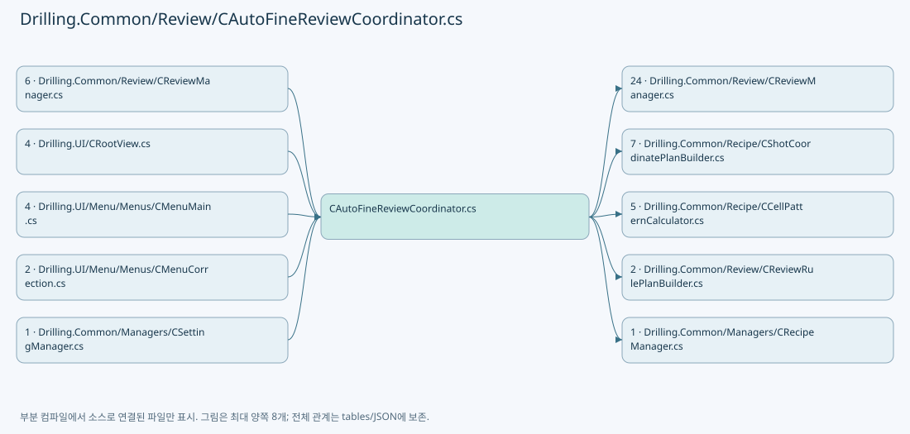

## 네임스페이스·타입·상속

| 타입 | 구분 | 원본 범위 | 선언/상속 |
| --- | --- | --- | --- |
| CAutoFineReviewCoordinator | ClassDeclaration | 10–338 | CAutoFineReviewCoordinator |
| ST_AUTO_REVIEW_OPTIONS | RecordDeclaration | 340–343 | ST_AUTO_REVIEW_OPTIONS |
| ST_AUTO_REVIEW_INPUT | RecordDeclaration | 345–350 | ST_AUTO_REVIEW_INPUT |
| ST_AUTO_FINE_PLAN | RecordDeclaration | 351–354 | ST_AUTO_FINE_PLAN |
| ST_FINE_REVIEW_CONTEXT | RecordDeclaration | 356–361 | ST_FINE_REVIEW_CONTEXT |
| ST_FINE_REVIEW_MONITOR | RecordDeclaration | 362–370 | ST_FINE_REVIEW_MONITOR |
| CFineReviewMonitorStore | ClassDeclaration | 372–455 | CFineReviewMonitorStore |

## 멤버 빠른 목록

| 이름 | 종류 | 범위 | 서명 |
| --- | --- | --- | --- |
| _prepared | FieldDeclaration | L18–18 | Drilling.Common.Review.ST_AUTO_FINE_PLAN? Drilling.Common.Review.CAutoFineReviewCoordinator._prepared |
| _result | FieldDeclaration | L19–19 | Drilling.Common.Review.ST_FINE_REVIEW_SNAPSHOT? Drilling.Common.Review.CAutoFineReviewCoordinator._result |
| _saved | FieldDeclaration | L20–20 | bool Drilling.Common.Review.CAutoFineReviewCoordinator._saved |
| _saveGate | FieldDeclaration | L21–21 | System.Threading.SemaphoreSlim Drilling.Common.Review.CAutoFineReviewCoordinator._saveGate |
| Outcome | PropertyDeclaration | L22–22 | string Drilling.Common.Review.CAutoFineReviewCoordinator.Outcome |
| get_Outcome | GetAccessorDeclaration | L22–22 | string Drilling.Common.Review.CAutoFineReviewCoordinator.Outcome.get |
| set_Outcome | SetAccessorDeclaration | L22–22 | void Drilling.Common.Review.CAutoFineReviewCoordinator.Outcome.set |
| FollowUpInspectionCompleted | PropertyDeclaration | L25–27 | bool Drilling.Common.Review.CAutoFineReviewCoordinator.FollowUpInspectionCompleted |
| Prepare | MethodDeclaration | L29–41 | System.Threading.Tasks.Task Drilling.Common.Review.CAutoFineReviewCoordinator.Prepare(System.Threading.CancellationToken) |
| Measure | MethodDeclaration | L43–76 | System.Threading.Tasks.Task Drilling.Common.Review.CAutoFineReviewCoordinator.Measure(System.Threading.CancellationToken) |
| Save | MethodDeclaration | L78–92 | System.Threading.Tasks.Task Drilling.Common.Review.CAutoFineReviewCoordinator.Save(System.Threading.CancellationToken) |
| SaveCore | MethodDeclaration | L94–167 | System.Threading.Tasks.Task Drilling.Common.Review.CAutoFineReviewCoordinator.SaveCore(System.Threading.CancellationToken) |
| ValidateMeasurements | MethodDeclaration | L169–197 | Drilling.Common.Review.ST_REVIEW_PLAN_POINT[] Drilling.Common.Review.CAutoFineReviewCoordinator.ValidateMeasurements(Drilling.Common.Review.ST_AUTO_FINE_PLAN, Drilling.Common.Review.ST_FINE_REVIEW_SNAPSHOT) |
| Identity | LocalFunctionStatement | L196–196 | (string Key, int Head, int Cell, int Shot, int Beam) Identity(Drilling.Common.Review.ST_REVIEW_PLAN_POINT) |
| Normalize | MethodDeclaration | L199–199 | string Drilling.Common.Review.CAutoFineReviewCoordinator.Normalize(string) |
| BuildPlan | MethodDeclaration | L201–312 | Drilling.Common.Review.ST_AUTO_FINE_PLAN Drilling.Common.Review.CAutoFineReviewCoordinator.BuildPlan(Drilling.Common.Review.ST_AUTO_REVIEW_INPUT, System.Collections.Generic.IReadOnlyList<Drilling.Common.Managers.ST_SYSTEM_PARAMETER>) |
| Tolerance | LocalFunctionStatement | L311–311 | double Tolerance(string) |
| FindTopmostCells | MethodDeclaration | L314–336 | System.Collections.Generic.HashSet<int> Drilling.Common.Review.CAutoFineReviewCoordinator.FindTopmostCells(System.Collections.Generic.IReadOnlyDictionary<string, string>) |
| Read | LocalFunctionStatement | L316–316 | double Read(string, double) |
| BeamNo | FieldDeclaration | L342–342 | int Drilling.Common.Review.ST_AUTO_REVIEW_OPTIONS.BeamNo |
| ZeroLineFollowUp | PropertyDeclaration | L347–347 | bool Drilling.Common.Review.ST_AUTO_REVIEW_INPUT.ZeroLineFollowUp |
| get_ZeroLineFollowUp | GetAccessorDeclaration | L347–347 | bool Drilling.Common.Review.ST_AUTO_REVIEW_INPUT.ZeroLineFollowUp.get |
| set_ZeroLineFollowUp | InitAccessorDeclaration | L347–347 | void Drilling.Common.Review.ST_AUTO_REVIEW_INPUT.ZeroLineFollowUp.init |
| ZeroLineRunId | PropertyDeclaration | L348–348 | System.Guid? Drilling.Common.Review.ST_AUTO_REVIEW_INPUT.ZeroLineRunId |
| get_ZeroLineRunId | GetAccessorDeclaration | L348–348 | System.Guid? Drilling.Common.Review.ST_AUTO_REVIEW_INPUT.ZeroLineRunId.get |
| set_ZeroLineRunId | InitAccessorDeclaration | L348–348 | void Drilling.Common.Review.ST_AUTO_REVIEW_INPUT.ZeroLineRunId.init |
| ZeroLineSavedAt | PropertyDeclaration | L349–349 | System.DateTimeOffset? Drilling.Common.Review.ST_AUTO_REVIEW_INPUT.ZeroLineSavedAt |
| get_ZeroLineSavedAt | GetAccessorDeclaration | L349–349 | System.DateTimeOffset? Drilling.Common.Review.ST_AUTO_REVIEW_INPUT.ZeroLineSavedAt.get |
| set_ZeroLineSavedAt | InitAccessorDeclaration | L349–349 | void Drilling.Common.Review.ST_AUTO_REVIEW_INPUT.ZeroLineSavedAt.init |
| ZeroLineFollowUp | PropertyDeclaration | L353–353 | bool Drilling.Common.Review.ST_AUTO_FINE_PLAN.ZeroLineFollowUp |
| get_ZeroLineFollowUp | GetAccessorDeclaration | L353–353 | bool Drilling.Common.Review.ST_AUTO_FINE_PLAN.ZeroLineFollowUp.get |
| set_ZeroLineFollowUp | InitAccessorDeclaration | L353–353 | void Drilling.Common.Review.ST_AUTO_FINE_PLAN.ZeroLineFollowUp.init |
| ZeroLineFollowUp | PropertyDeclaration | L358–358 | bool Drilling.Common.Review.ST_FINE_REVIEW_CONTEXT.ZeroLineFollowUp |
| get_ZeroLineFollowUp | GetAccessorDeclaration | L358–358 | bool Drilling.Common.Review.ST_FINE_REVIEW_CONTEXT.ZeroLineFollowUp.get |
| set_ZeroLineFollowUp | InitAccessorDeclaration | L358–358 | void Drilling.Common.Review.ST_FINE_REVIEW_CONTEXT.ZeroLineFollowUp.init |
| ZeroLineRunId | PropertyDeclaration | L359–359 | System.Guid? Drilling.Common.Review.ST_FINE_REVIEW_CONTEXT.ZeroLineRunId |
| get_ZeroLineRunId | GetAccessorDeclaration | L359–359 | System.Guid? Drilling.Common.Review.ST_FINE_REVIEW_CONTEXT.ZeroLineRunId.get |
| set_ZeroLineRunId | InitAccessorDeclaration | L359–359 | void Drilling.Common.Review.ST_FINE_REVIEW_CONTEXT.ZeroLineRunId.init |
| ZeroLineSavedAt | PropertyDeclaration | L360–360 | System.DateTimeOffset? Drilling.Common.Review.ST_FINE_REVIEW_CONTEXT.ZeroLineSavedAt |
| get_ZeroLineSavedAt | GetAccessorDeclaration | L360–360 | System.DateTimeOffset? Drilling.Common.Review.ST_FINE_REVIEW_CONTEXT.ZeroLineSavedAt.get |
| set_ZeroLineSavedAt | InitAccessorDeclaration | L360–360 | void Drilling.Common.Review.ST_FINE_REVIEW_CONTEXT.ZeroLineSavedAt.init |
| _gate | FieldDeclaration | L374–374 | object Drilling.Common.Review.CFineReviewMonitorStore._gate |
| _latest | FieldDeclaration | L375–375 | Drilling.Common.Review.ST_FINE_REVIEW_MONITOR? Drilling.Common.Review.CFineReviewMonitorStore._latest |
| _revision | FieldDeclaration | L376–376 | long Drilling.Common.Review.CFineReviewMonitorStore._revision |
| GetSnapshot | MethodDeclaration | L377–381 | Drilling.Common.Review.ST_FINE_REVIEW_MONITOR? Drilling.Common.Review.CFineReviewMonitorStore.GetSnapshot() |
| Begin | MethodDeclaration | L383–401 | System.Guid Drilling.Common.Review.CFineReviewMonitorStore.Begin(Drilling.Common.Review.ST_FINE_REVIEW_REQUEST, int) |
| Stage | MethodDeclaration | L403–403 | System.Guid Drilling.Common.Review.CFineReviewMonitorStore.Stage(Drilling.Common.Review.ST_FINE_REVIEW_REQUEST, int) |
| Replace | MethodDeclaration | L404–432 | System.Guid Drilling.Common.Review.CFineReviewMonitorStore.Replace(Drilling.Common.Review.ST_FINE_REVIEW_REQUEST, int, Drilling.Common.Review.EN_REVIEW_SEQUENCE_STATE, string) |
| Publish | MethodDeclaration | L434–443 | void Drilling.Common.Review.CFineReviewMonitorStore.Publish(Drilling.Common.Review.ST_FINE_REVIEW_SNAPSHOT) |
| MarkOffsetSaved | MethodDeclaration | L445–454 | void Drilling.Common.Review.CFineReviewMonitorStore.MarkOffsetSaved(System.Guid, string) |

## 멤버별 상세 계약·호출·처리 해설

### FieldDeclaration `_prepared` · L18–18

[Drilling.Common/Review/CAutoFineReviewCoordinator.cs:18–18](https://github.com/kjuws10-rgb/A3Drilling/blob/5aee8e58439c9b455cae7c9593c9be986c3e682e/Drilling.Common/Review/CAutoFineReviewCoordinator.cs#L18-L18)

| 항목 | 실제 추출 값 |
| --- | --- |
| 서명 | Drilling.Common.Review.ST_AUTO_FINE_PLAN? Drilling.Common.Review.CAutoFineReviewCoordinator._prepared |
| 접근/수식자 | Private / private |
| 반환/값 타입 | Drilling.Common.Review.ST_AUTO_FINE_PLAN? |
| 소속 타입 | NamedType:Drilling.Common.Review.CAutoFineReviewCoordinator |

현재 부분 분석에서 직접 연결된 호출자는 없습니다. XAML/이벤트/인터페이스·델리게이트·외부 진입을 추가 확인해야 하며, 미사용으로 판정한 것이 아닙니다.

변경 전 점검: 입력/반환 타입, 위 호출자, 예외/취소 경로, 공유 상태와 저장·전송 소비자를 함께 확인합니다. 값의 단위나 물리 방향을 이름만으로 확정하지 않습니다.

### FieldDeclaration `_result` · L19–19

[Drilling.Common/Review/CAutoFineReviewCoordinator.cs:19–19](https://github.com/kjuws10-rgb/A3Drilling/blob/5aee8e58439c9b455cae7c9593c9be986c3e682e/Drilling.Common/Review/CAutoFineReviewCoordinator.cs#L19-L19)

| 항목 | 실제 추출 값 |
| --- | --- |
| 서명 | Drilling.Common.Review.ST_FINE_REVIEW_SNAPSHOT? Drilling.Common.Review.CAutoFineReviewCoordinator._result |
| 접근/수식자 | Private / private |
| 반환/값 타입 | Drilling.Common.Review.ST_FINE_REVIEW_SNAPSHOT? |
| 소속 타입 | NamedType:Drilling.Common.Review.CAutoFineReviewCoordinator |

현재 부분 분석에서 직접 연결된 호출자는 없습니다. XAML/이벤트/인터페이스·델리게이트·외부 진입을 추가 확인해야 하며, 미사용으로 판정한 것이 아닙니다.

변경 전 점검: 입력/반환 타입, 위 호출자, 예외/취소 경로, 공유 상태와 저장·전송 소비자를 함께 확인합니다. 값의 단위나 물리 방향을 이름만으로 확정하지 않습니다.

### FieldDeclaration `_saved` · L20–20

[Drilling.Common/Review/CAutoFineReviewCoordinator.cs:20–20](https://github.com/kjuws10-rgb/A3Drilling/blob/5aee8e58439c9b455cae7c9593c9be986c3e682e/Drilling.Common/Review/CAutoFineReviewCoordinator.cs#L20-L20)

| 항목 | 실제 추출 값 |
| --- | --- |
| 서명 | bool Drilling.Common.Review.CAutoFineReviewCoordinator._saved |
| 접근/수식자 | Private / private |
| 반환/값 타입 | bool |
| 소속 타입 | NamedType:Drilling.Common.Review.CAutoFineReviewCoordinator |

현재 부분 분석에서 직접 연결된 호출자는 없습니다. XAML/이벤트/인터페이스·델리게이트·외부 진입을 추가 확인해야 하며, 미사용으로 판정한 것이 아닙니다.

변경 전 점검: 입력/반환 타입, 위 호출자, 예외/취소 경로, 공유 상태와 저장·전송 소비자를 함께 확인합니다. 값의 단위나 물리 방향을 이름만으로 확정하지 않습니다.

### FieldDeclaration `_saveGate` · L21–21

[Drilling.Common/Review/CAutoFineReviewCoordinator.cs:21–21](https://github.com/kjuws10-rgb/A3Drilling/blob/5aee8e58439c9b455cae7c9593c9be986c3e682e/Drilling.Common/Review/CAutoFineReviewCoordinator.cs#L21-L21)

| 항목 | 실제 추출 값 |
| --- | --- |
| 서명 | System.Threading.SemaphoreSlim Drilling.Common.Review.CAutoFineReviewCoordinator._saveGate |
| 접근/수식자 | Private / private, readonly |
| 반환/값 타입 | System.Threading.SemaphoreSlim |
| 소속 타입 | NamedType:Drilling.Common.Review.CAutoFineReviewCoordinator |

현재 부분 분석에서 직접 연결된 호출자는 없습니다. XAML/이벤트/인터페이스·델리게이트·외부 진입을 추가 확인해야 하며, 미사용으로 판정한 것이 아닙니다.

호출하는 대상과 해석 범위:

| 원본 행 | 표현식 | 분석 상태 | 대상/소스 위치 |
| --- | --- | --- | --- |
| 21 | new | resolved | System.Threading.SemaphoreSlim.SemaphoreSlim(int, int) |

본문의 실제 연산·분기·예외·반환 순서(원문 위치 순):

| 원본 행 | 종류 | 주석 해설 |
| --- | --- | --- |
| 21 | call | 함수·델리게이트 또는 객체 생성자를 호출합니다: new(1, 1) |
| 21 | variable-initializer | 변수의 초기값을 지정합니다: _saveGate = new(1, 1) |

변경 전 점검: 입력/반환 타입, 위 호출자, 예외/취소 경로, 공유 상태와 저장·전송 소비자를 함께 확인합니다. 값의 단위나 물리 방향을 이름만으로 확정하지 않습니다.

### PropertyDeclaration `Outcome` · L22–22

[Drilling.Common/Review/CAutoFineReviewCoordinator.cs:22–22](https://github.com/kjuws10-rgb/A3Drilling/blob/5aee8e58439c9b455cae7c9593c9be986c3e682e/Drilling.Common/Review/CAutoFineReviewCoordinator.cs#L22-L22)

| 항목 | 실제 추출 값 |
| --- | --- |
| 서명 | string Drilling.Common.Review.CAutoFineReviewCoordinator.Outcome |
| 접근/수식자 | Public / public |
| 반환/값 타입 | string |
| 소속 타입 | NamedType:Drilling.Common.Review.CAutoFineReviewCoordinator |

현재 부분 분석에서 직접 연결된 호출자는 없습니다. XAML/이벤트/인터페이스·델리게이트·외부 진입을 추가 확인해야 하며, 미사용으로 판정한 것이 아닙니다.

변경 전 점검: 입력/반환 타입, 위 호출자, 예외/취소 경로, 공유 상태와 저장·전송 소비자를 함께 확인합니다. 값의 단위나 물리 방향을 이름만으로 확정하지 않습니다.

### GetAccessorDeclaration `get_Outcome` · L22–22

[Drilling.Common/Review/CAutoFineReviewCoordinator.cs:22–22](https://github.com/kjuws10-rgb/A3Drilling/blob/5aee8e58439c9b455cae7c9593c9be986c3e682e/Drilling.Common/Review/CAutoFineReviewCoordinator.cs#L22-L22)

| 항목 | 실제 추출 값 |
| --- | --- |
| 서명 | string Drilling.Common.Review.CAutoFineReviewCoordinator.Outcome.get |
| 접근/수식자 | Public / get |
| 반환/값 타입 | string |
| 소속 타입 | NamedType:Drilling.Common.Review.CAutoFineReviewCoordinator |

현재 부분 분석에서 직접 연결된 호출자는 없습니다. XAML/이벤트/인터페이스·델리게이트·외부 진입을 추가 확인해야 하며, 미사용으로 판정한 것이 아닙니다.

변경 전 점검: 입력/반환 타입, 위 호출자, 예외/취소 경로, 공유 상태와 저장·전송 소비자를 함께 확인합니다. 값의 단위나 물리 방향을 이름만으로 확정하지 않습니다.

### SetAccessorDeclaration `set_Outcome` · L22–22

[Drilling.Common/Review/CAutoFineReviewCoordinator.cs:22–22](https://github.com/kjuws10-rgb/A3Drilling/blob/5aee8e58439c9b455cae7c9593c9be986c3e682e/Drilling.Common/Review/CAutoFineReviewCoordinator.cs#L22-L22)

| 항목 | 실제 추출 값 |
| --- | --- |
| 서명 | void Drilling.Common.Review.CAutoFineReviewCoordinator.Outcome.set |
| 접근/수식자 | Private / private, set |
| 반환/값 타입 | void |
| 소속 타입 | NamedType:Drilling.Common.Review.CAutoFineReviewCoordinator |

입력 계약:

| 이름 | 타입 | 전달 | 선택/기본값 |
| --- | --- | --- | --- |
| value | string | None | False /  |

현재 부분 분석에서 직접 연결된 호출자는 없습니다. XAML/이벤트/인터페이스·델리게이트·외부 진입을 추가 확인해야 하며, 미사용으로 판정한 것이 아닙니다.

변경 전 점검: 입력/반환 타입, 위 호출자, 예외/취소 경로, 공유 상태와 저장·전송 소비자를 함께 확인합니다. 값의 단위나 물리 방향을 이름만으로 확정하지 않습니다.

### PropertyDeclaration `FollowUpInspectionCompleted` · L25–27

[Drilling.Common/Review/CAutoFineReviewCoordinator.cs:25–27](https://github.com/kjuws10-rgb/A3Drilling/blob/5aee8e58439c9b455cae7c9593c9be986c3e682e/Drilling.Common/Review/CAutoFineReviewCoordinator.cs#L25-L27)

| 항목 | 실제 추출 값 |
| --- | --- |
| 서명 | bool Drilling.Common.Review.CAutoFineReviewCoordinator.FollowUpInspectionCompleted |
| 접근/수식자 | Public / public |
| 반환/값 타입 | bool |
| 소속 타입 | NamedType:Drilling.Common.Review.CAutoFineReviewCoordinator |

현재 부분 분석에서 직접 연결된 호출자는 없습니다. XAML/이벤트/인터페이스·델리게이트·외부 진입을 추가 확인해야 하며, 미사용으로 판정한 것이 아닙니다.

호출하는 대상과 해석 범위:

| 원본 행 | 표현식 | 분석 상태 | 대상/소스 위치 |
| --- | --- | --- | --- |
| 27 | string.IsNullOrWhiteSpace | resolved | bool string.IsNullOrWhiteSpace(string?) |

본문의 실제 연산·분기·예외·반환 순서(원문 위치 순):

| 원본 행 | 종류 | 주석 해설 |
| --- | --- | --- |
| 27 | call | 함수·델리게이트 또는 객체 생성자를 호출합니다: string.IsNullOrWhiteSpace(result.ResultFilePath) |

변경 전 점검: 입력/반환 타입, 위 호출자, 예외/취소 경로, 공유 상태와 저장·전송 소비자를 함께 확인합니다. 값의 단위나 물리 방향을 이름만으로 확정하지 않습니다.

### MethodDeclaration `Prepare` · L29–41

[Drilling.Common/Review/CAutoFineReviewCoordinator.cs:29–41](https://github.com/kjuws10-rgb/A3Drilling/blob/5aee8e58439c9b455cae7c9593c9be986c3e682e/Drilling.Common/Review/CAutoFineReviewCoordinator.cs#L29-L41)

| 항목 | 실제 추출 값 |
| --- | --- |
| 서명 | System.Threading.Tasks.Task Drilling.Common.Review.CAutoFineReviewCoordinator.Prepare(System.Threading.CancellationToken) |
| 접근/수식자 | Public / public, async |
| 반환/값 타입 | System.Threading.Tasks.Task |
| 소속 타입 | NamedType:Drilling.Common.Review.CAutoFineReviewCoordinator |

입력 계약:

| 이름 | 타입 | 전달 | 선택/기본값 |
| --- | --- | --- | --- |
| token | System.Threading.CancellationToken | None | False /  |

현재 부분 분석에서 직접 연결된 호출자는 없습니다. XAML/이벤트/인터페이스·델리게이트·외부 진입을 추가 확인해야 하며, 미사용으로 판정한 것이 아닙니다.

호출하는 대상과 해석 범위:

| 원본 행 | 표현식 | 분석 상태 | 대상/소스 위치 |
| --- | --- | --- | --- |
| 34 | capture(token).ConfigureAwait | resolved | System.Runtime.CompilerServices.ConfiguredTaskAwaitable<Drilling.Common.Review.ST_AUTO_REVIEW_INPUT> System.Threading.Tasks.Task<Drilling.Common.Review.ST_AUTO_REVIEW_INPUT>.ConfigureAwait(bool) |
| 34 | capture | resolved · 동적 구현 선택 가능 | System.Threading.Tasks.Task<Drilling.Common.Review.ST_AUTO_REVIEW_INPUT> System.Func<System.Threading.CancellationToken, System.Threading.Tasks.Task<Drilling.Common.Review.ST_AUTO_REVIEW_INPUT>>.Invoke(System.Threading.CancellationToken) |
| 35 | token.ThrowIfCancellationRequested | resolved | void System.Threading.CancellationToken.ThrowIfCancellationRequested() |
| 36 | review.CreateZeroLineFollowUpPlan | resolved | Drilling.Common.Review.ST_AUTO_FINE_PLAN Drilling.Common.Review.CReviewManager.CreateZeroLineFollowUpPlan(Drilling.Common.Review.ST_AUTO_REVIEW_INPUT, System.Threading.CancellationToken) · Drilling.Common/Review/CReviewManager.cs:2514 |
| 36 | review.CreateAutoFinePlan | resolved | Drilling.Common.Review.ST_AUTO_FINE_PLAN Drilling.Common.Review.CReviewManager.CreateAutoFinePlan(Drilling.Common.Review.ST_AUTO_REVIEW_INPUT, System.Threading.CancellationToken) · Drilling.Common/Review/CReviewManager.cs:2496 |
| 40 | review.RecordAutoFineLog | resolved | void Drilling.Common.Review.CReviewManager.RecordAutoFineLog(string, string) · Drilling.Common/Review/CReviewManager.cs:2469 |

본문의 실제 연산·분기·예외·반환 순서(원문 위치 순):

| 원본 행 | 종류 | 주석 해설 |
| --- | --- | --- |
| 31 | assignment | 값을 대상에 대입합니다: _prepared = null |
| 32 | assignment | 값을 대상에 대입합니다: _result = null |
| 33 | assignment | 값을 대상에 대입합니다: _saved = false |
| 34 | await | 비동기 완료를 기다립니다: await capture(token).ConfigureAwait(false) |
| 34 | call | 함수·델리게이트 또는 객체 생성자를 호출합니다: capture(token).ConfigureAwait(false) |
| 34 | call | 함수·델리게이트 또는 객체 생성자를 호출합니다: capture(token) |
| 34 | local-declaration | 지역 변수를 선언합니다: var input = await capture(token).ConfigureAwait(false); |
| 34 | variable-initializer | 변수의 초기값을 지정합니다: input = await capture(token).ConfigureAwait(false) |
| 35 | call | 함수·델리게이트 또는 객체 생성자를 호출합니다: token.ThrowIfCancellationRequested() |
| 36 | assignment | 값을 대상에 대입합니다: _prepared = input.ZeroLineFollowUp ? review.CreateZeroLineFollowUpPlan(input, token) : review.CreateAutoFinePlan(input, token) |
| 36 | call | 함수·델리게이트 또는 객체 생성자를 호출합니다: review.CreateZeroLineFollowUpPlan(input, token) |
| 36 | call | 함수·델리게이트 또는 객체 생성자를 호출합니다: review.CreateAutoFinePlan(input, token) |
| 36 | conditional-expression | 조건에 따라 결과식을 선택합니다: input.ZeroLineFollowUp ? review.CreateZeroLineFollowUpPlan(input, token) : review.CreateAutoFinePlan(input, token) |
| 37 | assignment | 값을 대상에 대입합니다: Outcome = input.ZeroLineFollowUp ? $"{input.GlassId} / {input.Recipe.Name} / 0선 FollowUp · 맨 위 Cell 가운데 행 · Beam 11 / IOF 1 Line · 재시도 없음 · 검사만 수행 / 보정 미적용 · 계획 확정" : $"{input.GlassId} / {input.Recipe.Name} / Beam 11 / {input.Opti |
| 37 | conditional-expression | 조건에 따라 결과식을 선택합니다: input.ZeroLineFollowUp ? $"{input.GlassId} / {input.Recipe.Name} / 0선 FollowUp · 맨 위 Cell 가운데 행 · Beam 11 / IOF 1 Line · 재시도 없음 · 검사만 수행 / 보정 미적용 · 계획 확정" : $"{input.GlassId} / {input.Recipe.Name} / Beam 11 / {input.Options.Method |
| 39 | conditional-expression | 조건에 따라 결과식을 선택합니다: input.Options.ImmediateRetry ? "ON" : "OFF" |
| 40 | call | 함수·델리게이트 또는 객체 생성자를 호출합니다: review.RecordAutoFineLog("AUTO_REVIEW_PLAN", Outcome) |

변경 전 점검: 입력/반환 타입, 위 호출자, 예외/취소 경로, 공유 상태와 저장·전송 소비자를 함께 확인합니다. 값의 단위나 물리 방향을 이름만으로 확정하지 않습니다.

### MethodDeclaration `Measure` · L43–76

[Drilling.Common/Review/CAutoFineReviewCoordinator.cs:43–76](https://github.com/kjuws10-rgb/A3Drilling/blob/5aee8e58439c9b455cae7c9593c9be986c3e682e/Drilling.Common/Review/CAutoFineReviewCoordinator.cs#L43-L76)

| 항목 | 실제 추출 값 |
| --- | --- |
| 서명 | System.Threading.Tasks.Task Drilling.Common.Review.CAutoFineReviewCoordinator.Measure(System.Threading.CancellationToken) |
| 접근/수식자 | Public / public, async |
| 반환/값 타입 | System.Threading.Tasks.Task |
| 소속 타입 | NamedType:Drilling.Common.Review.CAutoFineReviewCoordinator |

입력 계약:

| 이름 | 타입 | 전달 | 선택/기본값 |
| --- | --- | --- | --- |
| token | System.Threading.CancellationToken | None | False /  |

정적 호출자로 확인된 위치:

| 호출 파일/행 | 호출 표현식 | 런타임 분기 가능 |
| --- | --- | --- |
| [Drilling.UI/CRootView.cs:2813–2813](https://github.com/kjuws10-rgb/A3Drilling/blob/5aee8e58439c9b455cae7c9593c9be986c3e682e/Drilling.UI/CRootView.cs#L2813-L2813) | _autoFineReview.Measure | False |

호출하는 대상과 해석 범위:

| 원본 행 | 표현식 | 분석 상태 | 대상/소스 위치 |
| --- | --- | --- | --- |
| 45 | new InvalidOperationException | resolved | System.InvalidOperationException.InvalidOperationException(string?) |
| 47 | review.StartFineCorrection(plan.Request, _ => { }, token, simulationMeasurement).ConfigureAwait | resolved | System.Runtime.CompilerServices.ConfiguredTaskAwaitable<Drilling.Common.Review.ST_FINE_REVIEW_SNAPSHOT> System.Threading.Tasks.Task<Drilling.Common.Review.ST_FINE_REVIEW_SNAPSHOT>.ConfigureAwait(bool) |
| 47 | review.StartFineCorrection | resolved | System.Threading.Tasks.Task<Drilling.Common.Review.ST_FINE_REVIEW_SNAPSHOT> Drilling.Common.Review.CReviewManager.StartFineCorrection(Drilling.Common.Review.ST_FINE_REVIEW_REQUEST, System.Action<Drilling.Common.Review.ST_FINE_REVIEW_SNAPSHOT>, System.Threading.CancellationToken, System.Func<System.Collections.Generic.IReadOnlyList<Drilling.Common.Review.ST_REVIEW_PLAN_POINT>, System.Threading.CancellationToken, System.Threading.Tasks.Task<System.Collections.Generic.IReadOnlyList<Drilling.Common.Interface.Vision.ST_VISION_MARK_FIND>>>?) · Drilling.Common/Review/CReviewManager.cs:2521 |
| 50 | token.ThrowIfCancellationRequested | resolved | void System.Threading.CancellationToken.ThrowIfCancellationRequested() |
| 52 | new InvalidOperationException | resolved | System.InvalidOperationException.InvalidOperationException(string?) |
| 53 | string.IsNullOrWhiteSpace | resolved | bool string.IsNullOrWhiteSpace(string?) |
| 54 | new IOException | resolved | System.IO.IOException.IOException(string?) |
| 55 | ValidateMeasurements | resolved | Drilling.Common.Review.ST_REVIEW_PLAN_POINT[] Drilling.Common.Review.CAutoFineReviewCoordinator.ValidateMeasurements(Drilling.Common.Review.ST_AUTO_FINE_PLAN, Drilling.Common.Review.ST_FINE_REVIEW_SNAPSHOT) · Drilling.Common/Review/CAutoFineReviewCoordinator.cs:169 |
| 56 | measured.Count | resolved | int System.Collections.Generic.IEnumerable<Drilling.Common.Review.ST_REVIEW_PLAN_POINT>.Count<Drilling.Common.Review.ST_REVIEW_PLAN_POINT>(System.Func<Drilling.Common.Review.ST_REVIEW_PLAN_POINT, bool>) |
| 58 | review.RecordAutoFineLog | resolved | void Drilling.Common.Review.CReviewManager.RecordAutoFineLog(string, string) · Drilling.Common/Review/CReviewManager.cs:2469 |
| 63 | review.FineMonitor.Publish | resolved | void Drilling.Common.Review.CFineReviewMonitorStore.Publish(Drilling.Common.Review.ST_FINE_REVIEW_SNAPSHOT) · Drilling.Common/Review/CAutoFineReviewCoordinator.cs:434 |
| 64 | review.RecordAutoFineLog | resolved | void Drilling.Common.Review.CReviewManager.RecordAutoFineLog(string, string) · Drilling.Common/Review/CReviewManager.cs:2469 |
| 71 | review.RecordAutoFineLog | resolved | void Drilling.Common.Review.CReviewManager.RecordAutoFineLog(string, string) · Drilling.Common/Review/CReviewManager.cs:2469 |
| 74 | new InvalidDataException | resolved | System.IO.InvalidDataException.InvalidDataException(string?) |

본문의 실제 연산·분기·예외·반환 순서(원문 위치 순):

| 원본 행 | 종류 | 주석 해설 |
| --- | --- | --- |
| 45 | call | 함수·델리게이트 또는 객체 생성자를 호출합니다: new InvalidOperationException("AUTO Review 계획이 없습니다.") |
| 45 | local-declaration | 지역 변수를 선언합니다: var plan = _prepared ?? throw new InvalidOperationException("AUTO Review 계획이 없습니다."); |
| 45 | throw | 예외를 발생/전달합니다: throw new InvalidOperationException("AUTO Review 계획이 없습니다.") |
| 45 | variable-initializer | 변수의 초기값을 지정합니다: plan = _prepared ?? throw new InvalidOperationException("AUTO Review 계획이 없습니다.") |
| 46 | assignment | 값을 대상에 대입합니다: _result = null |
| 47 | await | 비동기 완료를 기다립니다: await review.StartFineCorrection(plan.Request, _ => { }, token, simulationMeasurement).ConfigureAwait(false) |
| 47 | call | 함수·델리게이트 또는 객체 생성자를 호출합니다: review.StartFineCorrection(plan.Request, _ => { }, token, simulationMeasurement).ConfigureAwait(false) |
| 47 | call | 함수·델리게이트 또는 객체 생성자를 호출합니다: review.StartFineCorrection(plan.Request, _ => { }, token, simulationMeasurement) |
| 47 | local-declaration | 지역 변수를 선언합니다: var result = await review.StartFineCorrection(plan.Request, _ => { }, token, simulationMeasurement).ConfigureAwait(false); |
| 47 | variable-initializer | 변수의 초기값을 지정합니다: result = await review.StartFineCorrection(plan.Request, _ => { }, token, simulationMeasurement).ConfigureAwait(false) |
| 50 | call | 함수·델리게이트 또는 객체 생성자를 호출합니다: token.ThrowIfCancellationRequested() |
| 51 | if | 조건에 따라 분기합니다: if (result.State != EN_REVIEW_SEQUENCE_STATE.Completed) |
| 52 | call | 함수·델리게이트 또는 객체 생성자를 호출합니다: new InvalidOperationException($"AUTO Review가 정상 완료되지 않았습니다: {result.Message}") |
| 52 | throw | 예외를 발생/전달합니다: throw new InvalidOperationException($"AUTO Review가 정상 완료되지 않았습니다: {result.Message}"); |
| 53 | call | 함수·델리게이트 또는 객체 생성자를 호출합니다: string.IsNullOrWhiteSpace(result.ResultFilePath) |
| 53 | if | 조건에 따라 분기합니다: if (result.ResultSaveError.Length > 0 &#124;&#124; string.IsNullOrWhiteSpace(result.ResultFilePath)) |
| 54 | call | 함수·델리게이트 또는 객체 생성자를 호출합니다: new IOException($"AUTO Review 결과 저장을 확인할 수 없습니다: {result.ResultSaveError}") |
| 54 | throw | 예외를 발생/전달합니다: throw new IOException($"AUTO Review 결과 저장을 확인할 수 없습니다: {result.ResultSaveError}"); |
| 55 | call | 함수·델리게이트 또는 객체 생성자를 호출합니다: ValidateMeasurements(plan, result) |
| 55 | local-declaration | 지역 변수를 선언합니다: var measured = ValidateMeasurements(plan, result); |
| 55 | variable-initializer | 변수의 초기값을 지정합니다: measured = ValidateMeasurements(plan, result) |
| 56 | call | 함수·델리게이트 또는 객체 생성자를 호출합니다: measured.Count(point => point.State == EN_REVIEW_POINT_STATE.Ng) |
| 56 | local-declaration | 지역 변수를 선언합니다: var ng = measured.Count(point => point.State == EN_REVIEW_POINT_STATE.Ng); |
| 56 | variable-initializer | 변수의 초기값을 지정합니다: ng = measured.Count(point => point.State == EN_REVIEW_POINT_STATE.Ng) |
| 57 | conditional-expression | 조건에 따라 결과식을 선택합니다: plan.Request.Method == EN_FINE_INSPECTION_METHOD.Flying ? "IOF" : "PtoP" |
| 57 | local-declaration | 지역 변수를 선언합니다: var method = plan.Request.Method == EN_FINE_INSPECTION_METHOD.Flying ? "IOF" : "PtoP"; |
| 57 | variable-initializer | 변수의 초기값을 지정합니다: method = plan.Request.Method == EN_FINE_INSPECTION_METHOD.Flying ? "IOF" : "PtoP" |
| 58 | call | 함수·델리게이트 또는 객체 생성자를 호출합니다: review.RecordAutoFineLog("AUTO_REVIEW_RESULT", $"FINE {method} 검사 결과 · {measured.Length:N0}개 검사 / OK {measured.Length - ng:N0} / NG {ng:N0} · Beam {ST_AUTO_REVIEW_OPTIONS.BeamNo}") |
| 59 | if | 조건에 따라 분기합니다: if (plan.ZeroLineFollowUp) |
| 61 | assignment | 값을 대상에 대입합니다: Outcome = $"0선 FollowUp IOF 1 Line · 검사 {measured.Length:N0}개 완료 / OK {measured.Length - ng:N0} / NG {ng:N0}개 · 결과 저장 완료 / 보정 미적용" |
| 62 | assignment | 값을 대상에 대입합니다: result = result with { Message = Outcome } |
| 62 | assignment | 값을 대상에 대입합니다: Message = Outcome |
| 63 | call | 함수·델리게이트 또는 객체 생성자를 호출합니다: review.FineMonitor.Publish(result) |
| 64 | call | 함수·델리게이트 또는 객체 생성자를 호출합니다: review.RecordAutoFineLog("ZERO_LINE_FOLLOWUP_RESULT", Outcome) |
| 66 | assignment | 값을 대상에 대입합니다: _result = result |
| 67 | if | 조건에 따라 분기합니다: if (ng > 0) |
| 69 | if | 조건에 따라 분기합니다: if (!plan.ZeroLineFollowUp) |
| 70 | assignment | 값을 대상에 대입합니다: Outcome = $"검사 {measured.Length:N0}개 완료 / NG {ng:N0}개 · 보정 전체 미적용 · 기존 Review Offset 유지" |
| 71 | call | 함수·델리게이트 또는 객체 생성자를 호출합니다: review.RecordAutoFineLog("AUTO_REVIEW_NG", Outcome) |
| 74 | call | 함수·델리게이트 또는 객체 생성자를 호출합니다: new InvalidDataException(Outcome) |
| 74 | throw | 예외를 발생/전달합니다: throw new InvalidDataException(Outcome); |

제어 구문의 포함 구조(실제 실행 순서/CFG가 아닌 구문 탐색 그림):

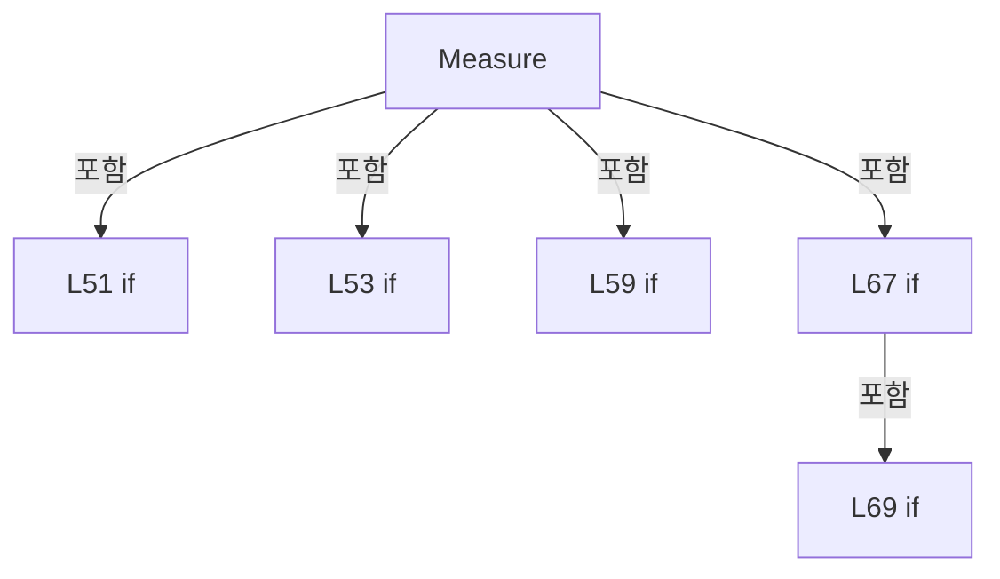

변경 전 점검: 입력/반환 타입, 위 호출자, 예외/취소 경로, 공유 상태와 저장·전송 소비자를 함께 확인합니다. 값의 단위나 물리 방향을 이름만으로 확정하지 않습니다.

### MethodDeclaration `Save` · L78–92

[Drilling.Common/Review/CAutoFineReviewCoordinator.cs:78–92](https://github.com/kjuws10-rgb/A3Drilling/blob/5aee8e58439c9b455cae7c9593c9be986c3e682e/Drilling.Common/Review/CAutoFineReviewCoordinator.cs#L78-L92)

| 항목 | 실제 추출 값 |
| --- | --- |
| 서명 | System.Threading.Tasks.Task Drilling.Common.Review.CAutoFineReviewCoordinator.Save(System.Threading.CancellationToken) |
| 접근/수식자 | Public / public, async |
| 반환/값 타입 | System.Threading.Tasks.Task |
| 소속 타입 | NamedType:Drilling.Common.Review.CAutoFineReviewCoordinator |

입력 계약:

| 이름 | 타입 | 전달 | 선택/기본값 |
| --- | --- | --- | --- |
| token | System.Threading.CancellationToken | None | False /  |

정적 호출자로 확인된 위치:

| 호출 파일/행 | 호출 표현식 | 런타임 분기 가능 |
| --- | --- | --- |
| [Drilling.UI/CRootView.cs:2825–2825](https://github.com/kjuws10-rgb/A3Drilling/blob/5aee8e58439c9b455cae7c9593c9be986c3e682e/Drilling.UI/CRootView.cs#L2825-L2825) | _autoFineReview.Save | False |

호출하는 대상과 해석 범위:

| 원본 행 | 표현식 | 분석 상태 | 대상/소스 위치 |
| --- | --- | --- | --- |
| 80 | _saveGate.WaitAsync(token).ConfigureAwait | resolved | System.Runtime.CompilerServices.ConfiguredTaskAwaitable System.Threading.Tasks.Task.ConfigureAwait(bool) |
| 80 | _saveGate.WaitAsync | resolved | System.Threading.Tasks.Task System.Threading.SemaphoreSlim.WaitAsync(System.Threading.CancellationToken) |
| 86 | SaveCore(token).ConfigureAwait | resolved | System.Runtime.CompilerServices.ConfiguredTaskAwaitable System.Threading.Tasks.Task.ConfigureAwait(bool) |
| 86 | SaveCore | resolved | System.Threading.Tasks.Task Drilling.Common.Review.CAutoFineReviewCoordinator.SaveCore(System.Threading.CancellationToken) · Drilling.Common/Review/CAutoFineReviewCoordinator.cs:94 |
| 90 | _saveGate.Release | resolved | int System.Threading.SemaphoreSlim.Release() |

본문의 실제 연산·분기·예외·반환 순서(원문 위치 순):

| 원본 행 | 종류 | 주석 해설 |
| --- | --- | --- |
| 80 | await | 비동기 완료를 기다립니다: await _saveGate.WaitAsync(token).ConfigureAwait(false) |
| 80 | call | 함수·델리게이트 또는 객체 생성자를 호출합니다: _saveGate.WaitAsync(token).ConfigureAwait(false) |
| 80 | call | 함수·델리게이트 또는 객체 생성자를 호출합니다: _saveGate.WaitAsync(token) |
| 81 | try | 예외 처리 범위입니다: try |
| 84 | if | 조건에 따라 분기합니다: if (_saved) |
| 85 | return | 호출자에게 값 또는 제어를 반환합니다: return; |
| 86 | await | 비동기 완료를 기다립니다: await SaveCore(token).ConfigureAwait(false) |
| 86 | call | 함수·델리게이트 또는 객체 생성자를 호출합니다: SaveCore(token).ConfigureAwait(false) |
| 86 | call | 함수·델리게이트 또는 객체 생성자를 호출합니다: SaveCore(token) |
| 88 | finally | 종료 정리 구간입니다: finally |
| 90 | call | 함수·델리게이트 또는 객체 생성자를 호출합니다: _saveGate.Release() |

제어 구문의 포함 구조(실제 실행 순서/CFG가 아닌 구문 탐색 그림):

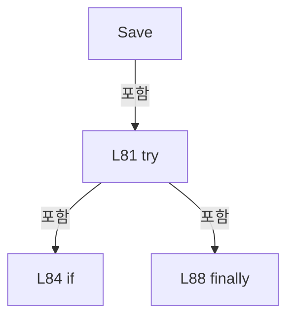

변경 전 점검: 입력/반환 타입, 위 호출자, 예외/취소 경로, 공유 상태와 저장·전송 소비자를 함께 확인합니다. 값의 단위나 물리 방향을 이름만으로 확정하지 않습니다.

### MethodDeclaration `SaveCore` · L94–167

[Drilling.Common/Review/CAutoFineReviewCoordinator.cs:94–167](https://github.com/kjuws10-rgb/A3Drilling/blob/5aee8e58439c9b455cae7c9593c9be986c3e682e/Drilling.Common/Review/CAutoFineReviewCoordinator.cs#L94-L167)

| 항목 | 실제 추출 값 |
| --- | --- |
| 서명 | System.Threading.Tasks.Task Drilling.Common.Review.CAutoFineReviewCoordinator.SaveCore(System.Threading.CancellationToken) |
| 접근/수식자 | Private / private, async |
| 반환/값 타입 | System.Threading.Tasks.Task |
| 소속 타입 | NamedType:Drilling.Common.Review.CAutoFineReviewCoordinator |

입력 계약:

| 이름 | 타입 | 전달 | 선택/기본값 |
| --- | --- | --- | --- |
| token | System.Threading.CancellationToken | None | False /  |

정적 호출자로 확인된 위치:

| 호출 파일/행 | 호출 표현식 | 런타임 분기 가능 |
| --- | --- | --- |
| [Drilling.Common/Review/CAutoFineReviewCoordinator.cs:86–86](https://github.com/kjuws10-rgb/A3Drilling/blob/5aee8e58439c9b455cae7c9593c9be986c3e682e/Drilling.Common/Review/CAutoFineReviewCoordinator.cs#L86-L86) | SaveCore | False |

호출하는 대상과 해석 범위:

| 원본 행 | 표현식 | 분석 상태 | 대상/소스 위치 |
| --- | --- | --- | --- |
| 96 | new InvalidOperationException | resolved | System.InvalidOperationException.InvalidOperationException(string?) |
| 97 | new InvalidOperationException | resolved | System.InvalidOperationException.InvalidOperationException(string?) |
| 98 | token.ThrowIfCancellationRequested | resolved | void System.Threading.CancellationToken.ThrowIfCancellationRequested() |
| 99 | string.IsNullOrWhiteSpace | resolved | bool string.IsNullOrWhiteSpace(string?) |
| 100 | new InvalidOperationException | resolved | System.InvalidOperationException.InvalidOperationException(string?) |
| 101 | ValidateMeasurements | resolved | Drilling.Common.Review.ST_REVIEW_PLAN_POINT[] Drilling.Common.Review.CAutoFineReviewCoordinator.ValidateMeasurements(Drilling.Common.Review.ST_AUTO_FINE_PLAN, Drilling.Common.Review.ST_FINE_REVIEW_SNAPSHOT) · Drilling.Common/Review/CAutoFineReviewCoordinator.cs:169 |
| 102 | measured.Count | resolved | int System.Collections.Generic.IEnumerable<Drilling.Common.Review.ST_REVIEW_PLAN_POINT>.Count<Drilling.Common.Review.ST_REVIEW_PLAN_POINT>(System.Func<Drilling.Common.Review.ST_REVIEW_PLAN_POINT, bool>) |
| 107 | review.RecordAutoFineLog | resolved | void Drilling.Common.Review.CReviewManager.RecordAutoFineLog(string, string) · Drilling.Common/Review/CReviewManager.cs:2469 |
| 108 | new InvalidDataException | resolved | System.IO.InvalidDataException.InvalidDataException(string?) |
| 117 | review.RecordAutoFineLog | resolved | void Drilling.Common.Review.CReviewManager.RecordAutoFineLog(string, string) · Drilling.Common/Review/CReviewManager.cs:2469 |
| 121 | CReviewManager.CalculateFineOffsets | resolved | System.Collections.Generic.IReadOnlyList<Drilling.Common.Review.ST_FINE_OFFSET_DELTA> Drilling.Common.Review.CReviewManager.CalculateFineOffsets(System.Collections.Generic.IReadOnlyList<Drilling.Common.Review.ST_REVIEW_PLAN_POINT>, System.Collections.Generic.IReadOnlyList<Drilling.Common.Review.ST_REVIEW_PLAN_POINT>, Drilling.Common.Review.EN_VISION_FLIP_TYPE) · Drilling.Common/Review/CReviewManager.cs:3416 |
| 122 | offsets.LoadLatest(plan.Request.Plan.RecipeId, token).ConfigureAwait | resolved | System.Runtime.CompilerServices.ConfiguredTaskAwaitable<Drilling.Common.Review.ST_REVIEW_OFFSET_FILE_DATA> System.Threading.Tasks.Task<Drilling.Common.Review.ST_REVIEW_OFFSET_FILE_DATA>.ConfigureAwait(bool) |
| 122 | offsets.LoadLatest | resolved | System.Threading.Tasks.Task<Drilling.Common.Review.ST_REVIEW_OFFSET_FILE_DATA> Drilling.Common.Review.CReviewOffsetFileBase.LoadLatest(string, System.Threading.CancellationToken) · Drilling.Common/Review/CReviewManager.cs:4139 |
| 123 | latest.RecipeId.Equals | resolved | bool string.Equals(string?, System.StringComparison) |
| 124 | new InvalidDataException | resolved | System.IO.InvalidDataException.InvalidDataException(string?) |
| 125 | latest.Rows.ToDictionary | resolved | System.Collections.Generic.Dictionary<(int CellId, string), Drilling.Common.Review.ST_REVIEW_OFFSET_ROW> System.Collections.Generic.IEnumerable<Drilling.Common.Review.ST_REVIEW_OFFSET_ROW>.ToDictionary<Drilling.Common.Review.ST_REVIEW_OFFSET_ROW, (int CellId, string)>(System.Func<Drilling.Common.Review.ST_REVIEW_OFFSET_ROW, (int CellId, string)>) |
| 125 | Normalize | resolved | string Drilling.Common.Review.CAutoFineReviewCoordinator.Normalize(string) · Drilling.Common/Review/CAutoFineReviewCoordinator.cs:199 |
| 128 | token.ThrowIfCancellationRequested | resolved | void System.Threading.CancellationToken.ThrowIfCancellationRequested() |
| 130 | Normalize | resolved | string Drilling.Common.Review.CAutoFineReviewCoordinator.Normalize(string) · Drilling.Common/Review/CAutoFineReviewCoordinator.cs:199 |
| 130 | CReviewShotNameFormatter.ToMatrixName | resolved | string Drilling.Common.Review.CReviewShotNameFormatter.ToMatrixName(int, int) · Drilling.Common/Review/CReviewManager.cs:3897 |
| 131 | rows.GetValueOrDefault | resolved | Drilling.Common.Review.ST_REVIEW_OFFSET_ROW? System.Collections.Generic.IReadOnlyDictionary<(int, string), Drilling.Common.Review.ST_REVIEW_OFFSET_ROW>.GetValueOrDefault<(int, string), Drilling.Common.Review.ST_REVIEW_OFFSET_ROW>((int, string)) |
| 132 | CReviewOffsetData.ToDesign | resolved | (double X, double Y) Drilling.Common.Recipe.CReviewOffsetData.ToDesign(System.Collections.Generic.IReadOnlyDictionary<string, string>, int, double, double, bool) · Drilling.Common/Recipe/CShotCoordinatePlanBuilder.cs:1193 |
| 133 | double.IsFinite | resolved | bool double.IsFinite(double) |
| 133 | double.IsFinite | resolved | bool double.IsFinite(double) |
| 134 | new InvalidDataException | resolved | System.IO.InvalidDataException.InvalidDataException(string?) |
| 135 | new | resolved | Drilling.Common.Review.ST_REVIEW_OFFSET_ROW.ST_REVIEW_OFFSET_ROW(int, string, double, double) · Drilling.Common/Review/CReviewManager.cs:4099 |
| 135 | CAlignShotOffsetData.RoundValue | resolved | double Drilling.Common.Recipe.CAlignShotOffsetData.RoundValue(double) · Drilling.Common/Recipe/CShotCoordinatePlanBuilder.cs:659 |
| 135 | CAlignShotOffsetData.RoundValue | resolved | double Drilling.Common.Recipe.CAlignShotOffsetData.RoundValue(double) · Drilling.Common/Recipe/CShotCoordinatePlanBuilder.cs:659 |
| 144 | offsets.SaveNewFromSource( plan.Request.Plan.RecipeId, rows.Values.OrderBy(row => row.CellId).ThenBy(row => row.ShotId).ToArray(), result.ResultFilePath, allowDuplicate: false, token).ConfigureAwait | resolved | System.Runtime.CompilerServices.ConfiguredTaskAwaitable<Drilling.Common.Review.ST_REVIEW_OFFSET_FILE_DATA> System.Threading.Tasks.Task<Drilling.Common.Review.ST_REVIEW_OFFSET_FILE_DATA>.ConfigureAwait(bool) |
| 144 | offsets.SaveNewFromSource | resolved | System.Threading.Tasks.Task<Drilling.Common.Review.ST_REVIEW_OFFSET_FILE_DATA> Drilling.Common.Review.CReviewOffsetFileBase.SaveNewFromSource(string, System.Collections.Generic.IReadOnlyList<Drilling.Common.Review.ST_REVIEW_OFFSET_ROW>, string, bool, System.Threading.CancellationToken) · Drilling.Common/Review/CReviewManager.cs:4145 |
| 146 | rows.Values.OrderBy(row => row.CellId).ThenBy(row => row.ShotId).ToArray | resolved | Drilling.Common.Review.ST_REVIEW_OFFSET_ROW[] System.Collections.Generic.IEnumerable<Drilling.Common.Review.ST_REVIEW_OFFSET_ROW>.ToArray<Drilling.Common.Review.ST_REVIEW_OFFSET_ROW>() |
| 146 | rows.Values.OrderBy(row => row.CellId).ThenBy | resolved | System.Linq.IOrderedEnumerable<Drilling.Common.Review.ST_REVIEW_OFFSET_ROW> System.Linq.IOrderedEnumerable<Drilling.Common.Review.ST_REVIEW_OFFSET_ROW>.ThenBy<Drilling.Common.Review.ST_REVIEW_OFFSET_ROW, string>(System.Func<Drilling.Common.Review.ST_REVIEW_OFFSET_ROW, string>) |
| 146 | rows.Values.OrderBy | resolved | System.Linq.IOrderedEnumerable<Drilling.Common.Review.ST_REVIEW_OFFSET_ROW> System.Collections.Generic.IEnumerable<Drilling.Common.Review.ST_REVIEW_OFFSET_ROW>.OrderBy<Drilling.Common.Review.ST_REVIEW_OFFSET_ROW, int>(System.Func<Drilling.Common.Review.ST_REVIEW_OFFSET_ROW, int>) |
| 154 | existing.AppliedAt.ToLocalTime | resolved | System.DateTimeOffset System.DateTimeOffset.ToLocalTime() |
| 158 | review.RecordAutoFineLog | resolved | void Drilling.Common.Review.CReviewManager.RecordAutoFineLog(string, string) · Drilling.Common/Review/CReviewManager.cs:2469 |
| 159 | .Invoke | resolved · 동적 구현 선택 가능 | void System.Action<Drilling.Common.Review.CReviewOffsetDuplicateSourceException>.Invoke(Drilling.Common.Review.CReviewOffsetDuplicateSourceException) |
| 160 | new InvalidDataException | resolved | System.IO.InvalidDataException.InvalidDataException(string?, System.Exception?) |
| 164 | review.FineMonitor.MarkOffsetSaved | resolved | void Drilling.Common.Review.CFineReviewMonitorStore.MarkOffsetSaved(System.Guid, string) · Drilling.Common/Review/CAutoFineReviewCoordinator.cs:445 |
| 166 | review.RecordAutoFineLog | resolved | void Drilling.Common.Review.CReviewManager.RecordAutoFineLog(string, string) · Drilling.Common/Review/CReviewManager.cs:2469 |

본문의 실제 연산·분기·예외·반환 순서(원문 위치 순):

| 원본 행 | 종류 | 주석 해설 |
| --- | --- | --- |
| 96 | call | 함수·델리게이트 또는 객체 생성자를 호출합니다: new InvalidOperationException("AUTO Review 계획이 없습니다.") |
| 96 | local-declaration | 지역 변수를 선언합니다: var plan = _prepared ?? throw new InvalidOperationException("AUTO Review 계획이 없습니다."); |
| 96 | throw | 예외를 발생/전달합니다: throw new InvalidOperationException("AUTO Review 계획이 없습니다.") |
| 96 | variable-initializer | 변수의 초기값을 지정합니다: plan = _prepared ?? throw new InvalidOperationException("AUTO Review 계획이 없습니다.") |
| 97 | call | 함수·델리게이트 또는 객체 생성자를 호출합니다: new InvalidOperationException("AUTO Review 검사 결과가 없습니다.") |
| 97 | local-declaration | 지역 변수를 선언합니다: var result = _result ?? throw new InvalidOperationException("AUTO Review 검사 결과가 없습니다."); |
| 97 | throw | 예외를 발생/전달합니다: throw new InvalidOperationException("AUTO Review 검사 결과가 없습니다.") |
| 97 | variable-initializer | 변수의 초기값을 지정합니다: result = _result ?? throw new InvalidOperationException("AUTO Review 검사 결과가 없습니다.") |
| 98 | call | 함수·델리게이트 또는 객체 생성자를 호출합니다: token.ThrowIfCancellationRequested() |
| 99 | call | 함수·델리게이트 또는 객체 생성자를 호출합니다: string.IsNullOrWhiteSpace(result.ResultFilePath) |
| 99 | if | 조건에 따라 분기합니다: if (result.State != EN_REVIEW_SEQUENCE_STATE.Completed &#124;&#124; result.ResultSaveError.Length > 0 &#124;&#124; string.IsNullOrWhiteSpace(result.ResultFilePath)) |
| 100 | call | 함수·델리게이트 또는 객체 생성자를 호출합니다: new InvalidOperationException("정상 완료 및 결과 파일 저장이 확인된 검사만 보정에 사용할 수 있습니다.") |
| 100 | throw | 예외를 발생/전달합니다: throw new InvalidOperationException("정상 완료 및 결과 파일 저장이 확인된 검사만 보정에 사용할 수 있습니다."); |
| 101 | call | 함수·델리게이트 또는 객체 생성자를 호출합니다: ValidateMeasurements(plan, result) |
| 101 | local-declaration | 지역 변수를 선언합니다: var measured = ValidateMeasurements(plan, result); |
| 101 | variable-initializer | 변수의 초기값을 지정합니다: measured = ValidateMeasurements(plan, result) |
| 102 | call | 함수·델리게이트 또는 객체 생성자를 호출합니다: measured.Count(point => point.State == EN_REVIEW_POINT_STATE.Ng) |
| 102 | local-declaration | 지역 변수를 선언합니다: var ng = measured.Count(point => point.State == EN_REVIEW_POINT_STATE.Ng); |
| 102 | variable-initializer | 변수의 초기값을 지정합니다: ng = measured.Count(point => point.State == EN_REVIEW_POINT_STATE.Ng) |
| 103 | if | 조건에 따라 분기합니다: if (ng > 0) |
| 106 | assignment | 값을 대상에 대입합니다: Outcome = $"검사 {measured.Length:N0}개 완료 / NG {ng:N0}개 · 보정 전체 미적용 · 기존 Review Offset 유지" |
| 107 | call | 함수·델리게이트 또는 객체 생성자를 호출합니다: review.RecordAutoFineLog("AUTO_REVIEW_NG", Outcome) |
| 108 | call | 함수·델리게이트 또는 객체 생성자를 호출합니다: new InvalidDataException(Outcome) |
| 108 | throw | 예외를 발생/전달합니다: throw new InvalidDataException(Outcome); |
| 111 | if | 조건에 따라 분기합니다: if (plan.ZeroLineFollowUp) |
| 115 | assignment | 값을 대상에 대입합니다: _saved = true |
| 116 | assignment | 값을 대상에 대입합니다: Outcome = $"0선 FollowUp IOF 1 Line · 전체 OK / {measured.Length:N0}개 결과 저장 완료 · 검사만 수행 / 기존 Review Offset 유지" |
| 117 | call | 함수·델리게이트 또는 객체 생성자를 호출합니다: review.RecordAutoFineLog("ZERO_LINE_FOLLOWUP_COMPLETE", Outcome) |
| 118 | return | 호출자에게 값 또는 제어를 반환합니다: return; |
| 121 | call | 함수·델리게이트 또는 객체 생성자를 호출합니다: CReviewManager.CalculateFineOffsets(plan.OffsetTargets, measured, plan.Request.Plan.VisionFlipType) |
| 121 | local-declaration | 지역 변수를 선언합니다: var deltas = CReviewManager.CalculateFineOffsets(plan.OffsetTargets, measured, plan.Request.Plan.VisionFlipType); |
| 121 | variable-initializer | 변수의 초기값을 지정합니다: deltas = CReviewManager.CalculateFineOffsets(plan.OffsetTargets, measured, plan.Request.Plan.VisionFlipType) |
| 122 | await | 비동기 완료를 기다립니다: await offsets.LoadLatest(plan.Request.Plan.RecipeId, token).ConfigureAwait(false) |
| 122 | call | 함수·델리게이트 또는 객체 생성자를 호출합니다: offsets.LoadLatest(plan.Request.Plan.RecipeId, token).ConfigureAwait(false) |
| 122 | call | 함수·델리게이트 또는 객체 생성자를 호출합니다: offsets.LoadLatest(plan.Request.Plan.RecipeId, token) |
| 122 | local-declaration | 지역 변수를 선언합니다: var latest = await offsets.LoadLatest(plan.Request.Plan.RecipeId, token).ConfigureAwait(false); |
| 122 | variable-initializer | 변수의 초기값을 지정합니다: latest = await offsets.LoadLatest(plan.Request.Plan.RecipeId, token).ConfigureAwait(false) |
| 123 | call | 함수·델리게이트 또는 객체 생성자를 호출합니다: latest.RecipeId.Equals(plan.Request.Plan.RecipeId, StringComparison.OrdinalIgnoreCase) |
| 123 | if | 조건에 따라 분기합니다: if (!latest.RecipeId.Equals(plan.Request.Plan.RecipeId, StringComparison.OrdinalIgnoreCase)) |
| 124 | call | 함수·델리게이트 또는 객체 생성자를 호출합니다: new InvalidDataException("기존 Review Offset의 Recipe ID가 일치하지 않습니다.") |
| 124 | throw | 예외를 발생/전달합니다: throw new InvalidDataException("기존 Review Offset의 Recipe ID가 일치하지 않습니다."); |
| 125 | call | 함수·델리게이트 또는 객체 생성자를 호출합니다: latest.Rows.ToDictionary(row => (row.CellId, Normalize(row.ShotId))) |
| 125 | call | 함수·델리게이트 또는 객체 생성자를 호출합니다: Normalize(row.ShotId) |
| 125 | local-declaration | 지역 변수를 선언합니다: var rows = latest.Rows.ToDictionary(row => (row.CellId, Normalize(row.ShotId))); |
| 125 | variable-initializer | 변수의 초기값을 지정합니다: rows = latest.Rows.ToDictionary(row => (row.CellId, Normalize(row.ShotId))) |
| 126 | foreach | 컬렉션 요소를 순회합니다: foreach (var delta in deltas) |
| 128 | call | 함수·델리게이트 또는 객체 생성자를 호출합니다: token.ThrowIfCancellationRequested() |
| 129 | local-declaration | 지역 변수를 선언합니다: var shot = delta.Shot; |
| 129 | variable-initializer | 변수의 초기값을 지정합니다: shot = delta.Shot |
| 130 | call | 함수·델리게이트 또는 객체 생성자를 호출합니다: Normalize(CReviewShotNameFormatter.ToMatrixName(shot.ShotNo, shot.PixelCountX)) |
| 130 | call | 함수·델리게이트 또는 객체 생성자를 호출합니다: CReviewShotNameFormatter.ToMatrixName(shot.ShotNo, shot.PixelCountX) |
| 130 | local-declaration | 지역 변수를 선언합니다: var key = (shot.CellNo, Normalize(CReviewShotNameFormatter.ToMatrixName(shot.ShotNo, shot.PixelCountX))); |
| 130 | variable-initializer | 변수의 초기값을 지정합니다: key = (shot.CellNo, Normalize(CReviewShotNameFormatter.ToMatrixName(shot.ShotNo, shot.PixelCountX))) |
| 131 | call | 함수·델리게이트 또는 객체 생성자를 호출합니다: rows.GetValueOrDefault(key) |
| 131 | local-declaration | 지역 변수를 선언합니다: var previous = rows.GetValueOrDefault(key); |
| 131 | variable-initializer | 변수의 초기값을 지정합니다: previous = rows.GetValueOrDefault(key) |
| 132 | call | 함수·델리게이트 또는 객체 생성자를 호출합니다: CReviewOffsetData.ToDesign(plan.Parameters, shot.HeadNo, previous.ReviewOffsetX, previous.ReviewOffsetY, previous.IsDesignCoordinate) |
| 132 | conditional-expression | 조건에 따라 결과식을 선택합니다: previous is null ? (X: 0d, Y: 0d) : CReviewOffsetData.ToDesign(plan.Parameters, shot.HeadNo, previous.ReviewOffsetX, previous.ReviewOffsetY, previous.IsDesignCoordinate) |
| 132 | local-declaration | 지역 변수를 선언합니다: var design = previous is null ? (X: 0d, Y: 0d) : CReviewOffsetData.ToDesign(plan.Parameters, shot.HeadNo, previous.ReviewOffsetX, previous.ReviewOffsetY, previous.IsDesignCoordinate); |
| 132 | variable-initializer | 변수의 초기값을 지정합니다: design = previous is null ? (X: 0d, Y: 0d) : CReviewOffsetData.ToDesign(plan.Parameters, shot.HeadNo, previous.ReviewOffsetX, previous.ReviewOffsetY, previous.IsDesignCoordinate) |
| 133 | call | 함수·델리게이트 또는 객체 생성자를 호출합니다: double.IsFinite(design.X) |
| 133 | call | 함수·델리게이트 또는 객체 생성자를 호출합니다: double.IsFinite(design.Y) |
| 133 | if | 조건에 따라 분기합니다: if (!double.IsFinite(design.X) &#124;&#124; !double.IsFinite(design.Y)) |
| 134 | call | 함수·델리게이트 또는 객체 생성자를 호출합니다: new InvalidDataException("기존 Review Offset 값이 유효하지 않습니다.") |
| 134 | throw | 예외를 발생/전달합니다: throw new InvalidDataException("기존 Review Offset 값이 유효하지 않습니다."); |
| 135 | call | 함수·델리게이트 또는 객체 생성자를 호출합니다: CAlignShotOffsetData.RoundValue(design.X + delta.X) |
| 135 | call | 함수·델리게이트 또는 객체 생성자를 호출합니다: CAlignShotOffsetData.RoundValue(design.Y + delta.Y) |
| 135 | assignment | 값을 대상에 대입합니다: rows[key] = new(shot.CellNo, key.Item2, CAlignShotOffsetData.RoundValue(design.X + delta.X), CAlignShotOffsetData.RoundValue(design.Y + delta.Y)) { IsDesignCoordinate = true } |
| 135 | call | 함수·델리게이트 또는 객체 생성자를 호출합니다: new(shot.CellNo, key.Item2, CAlignShotOffsetData.RoundValue(design.X + delta.X), CAlignShotOffsetData.RoundValue(design.Y + delta.Y)) { IsDesignCoordinate = true } |
| 137 | assignment | 값을 대상에 대입합니다: IsDesignCoordinate = true |
| 141 | local-declaration | 지역 변수를 선언합니다: ST_REVIEW_OFFSET_FILE_DATA saved; |
| 142 | try | 예외 처리 범위입니다: try |
| 144 | assignment | 값을 대상에 대입합니다: saved = await offsets.SaveNewFromSource( plan.Request.Plan.RecipeId, rows.Values.OrderBy(row => row.CellId).ThenBy(row => row.ShotId).ToArray(), result.ResultFilePath, allowDuplicate: false, token).ConfigureAwait(false) |
| 144 | await | 비동기 완료를 기다립니다: await offsets.SaveNewFromSource( plan.Request.Plan.RecipeId, rows.Values.OrderBy(row => row.CellId).ThenBy(row => row.ShotId).ToArray(), result.ResultFilePath, allowDuplicate: false, token).ConfigureAwait(false) |
| 144 | call | 함수·델리게이트 또는 객체 생성자를 호출합니다: offsets.SaveNewFromSource( plan.Request.Plan.RecipeId, rows.Values.OrderBy(row => row.CellId).ThenBy(row => row.ShotId).ToArray(), result.ResultFilePath, allowDuplicate: false, token).ConfigureAwait(false) |
| 144 | call | 함수·델리게이트 또는 객체 생성자를 호출합니다: offsets.SaveNewFromSource( plan.Request.Plan.RecipeId, rows.Values.OrderBy(row => row.CellId).ThenBy(row => row.ShotId).ToArray(), result.ResultFilePath, allowDuplicate: false, token) |
| 146 | call | 함수·델리게이트 또는 객체 생성자를 호출합니다: rows.Values.OrderBy(row => row.CellId).ThenBy(row => row.ShotId).ToArray() |
| 146 | call | 함수·델리게이트 또는 객체 생성자를 호출합니다: rows.Values.OrderBy(row => row.CellId).ThenBy(row => row.ShotId) |
| 146 | call | 함수·델리게이트 또는 객체 생성자를 호출합니다: rows.Values.OrderBy(row => row.CellId) |
| 151 | catch | 지정 예외를 처리합니다: catch (CReviewOffsetDuplicateSourceException duplicate) |
| 153 | local-declaration | 지역 변수를 선언합니다: var existing = duplicate.ExistingApplication; |
| 153 | variable-initializer | 변수의 초기값을 지정합니다: existing = duplicate.ExistingApplication |
| 154 | call | 함수·델리게이트 또는 객체 생성자를 호출합니다: existing.AppliedAt.ToLocalTime() |
| 154 | local-declaration | 지역 변수를 선언합니다: var appliedAt = existing.AppliedAt.ToLocalTime(); |
| 154 | variable-initializer | 변수의 초기값을 지정합니다: appliedAt = existing.AppliedAt.ToLocalTime() |
| 155 | assignment | 값을 대상에 대입합니다: Outcome = $"{appliedAt:yyyy년 MM월 dd일} 이력에 동일한 Review Result가 있어 " + $"자동 Review Offset 적용을 NG 처리했습니다. Source={existing.SourceResultFile} / " + $"기존 Offset={existing.OffsetFile}" |
| 158 | call | 함수·델리게이트 또는 객체 생성자를 호출합니다: review.RecordAutoFineLog("AUTO_REVIEW_OFFSET_DUPLICATE_SOURCE", Outcome) |
| 159 | call | 함수·델리게이트 또는 객체 생성자를 호출합니다: .Invoke(duplicate) |
| 160 | call | 함수·델리게이트 또는 객체 생성자를 호출합니다: new InvalidDataException(Outcome, duplicate) |
| 160 | throw | 예외를 발생/전달합니다: throw new InvalidDataException(Outcome, duplicate); |
| 163 | assignment | 값을 대상에 대입합니다: _saved = true |
| 164 | call | 함수·델리게이트 또는 객체 생성자를 호출합니다: review.FineMonitor.MarkOffsetSaved(result.RunId, saved.FileName) |
| 165 | assignment | 값을 대상에 대입합니다: Outcome = $"전체 OK · {deltas.Count:N0} Shots FINE 누적 보정 저장 · 다음 Glass에 적용 / {saved.FileName}" |
| 166 | call | 함수·델리게이트 또는 객체 생성자를 호출합니다: review.RecordAutoFineLog("AUTO_REVIEW_OFFSET_SAVED", Outcome) |

제어 구문의 포함 구조(실제 실행 순서/CFG가 아닌 구문 탐색 그림):

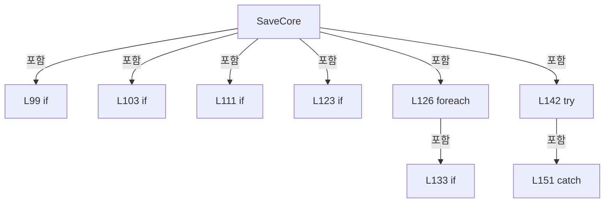

변경 전 점검: 입력/반환 타입, 위 호출자, 예외/취소 경로, 공유 상태와 저장·전송 소비자를 함께 확인합니다. 값의 단위나 물리 방향을 이름만으로 확정하지 않습니다.

### MethodDeclaration `ValidateMeasurements` · L169–197

[Drilling.Common/Review/CAutoFineReviewCoordinator.cs:169–197](https://github.com/kjuws10-rgb/A3Drilling/blob/5aee8e58439c9b455cae7c9593c9be986c3e682e/Drilling.Common/Review/CAutoFineReviewCoordinator.cs#L169-L197)

| 항목 | 실제 추출 값 |
| --- | --- |
| 서명 | Drilling.Common.Review.ST_REVIEW_PLAN_POINT[] Drilling.Common.Review.CAutoFineReviewCoordinator.ValidateMeasurements(Drilling.Common.Review.ST_AUTO_FINE_PLAN, Drilling.Common.Review.ST_FINE_REVIEW_SNAPSHOT) |
| 접근/수식자 | Private / private, static |
| 반환/값 타입 | Drilling.Common.Review.ST_REVIEW_PLAN_POINT[] |
| 소속 타입 | NamedType:Drilling.Common.Review.CAutoFineReviewCoordinator |

입력 계약:

| 이름 | 타입 | 전달 | 선택/기본값 |
| --- | --- | --- | --- |
| plan | Drilling.Common.Review.ST_AUTO_FINE_PLAN | None | False /  |
| result | Drilling.Common.Review.ST_FINE_REVIEW_SNAPSHOT | None | False /  |

정적 호출자로 확인된 위치:

| 호출 파일/행 | 호출 표현식 | 런타임 분기 가능 |
| --- | --- | --- |
| [Drilling.Common/Review/CAutoFineReviewCoordinator.cs:55–55](https://github.com/kjuws10-rgb/A3Drilling/blob/5aee8e58439c9b455cae7c9593c9be986c3e682e/Drilling.Common/Review/CAutoFineReviewCoordinator.cs#L55-L55) | ValidateMeasurements | False |
| [Drilling.Common/Review/CAutoFineReviewCoordinator.cs:101–101](https://github.com/kjuws10-rgb/A3Drilling/blob/5aee8e58439c9b455cae7c9593c9be986c3e682e/Drilling.Common/Review/CAutoFineReviewCoordinator.cs#L101-L101) | ValidateMeasurements | False |

호출하는 대상과 해석 범위:

| 원본 행 | 표현식 | 분석 상태 | 대상/소스 위치 |
| --- | --- | --- | --- |
| 174 | result.Lines.SelectMany(line => line.Points).ToArray | resolved | Drilling.Common.Review.ST_REVIEW_PLAN_POINT[] System.Collections.Generic.IEnumerable<Drilling.Common.Review.ST_REVIEW_PLAN_POINT>.ToArray<Drilling.Common.Review.ST_REVIEW_PLAN_POINT>() |
| 174 | result.Lines.SelectMany | resolved | System.Collections.Generic.IEnumerable<Drilling.Common.Review.ST_REVIEW_PLAN_POINT> System.Collections.Generic.IEnumerable<Drilling.Common.Review.ST_FINE_REVIEW_LINE>.SelectMany<Drilling.Common.Review.ST_FINE_REVIEW_LINE, Drilling.Common.Review.ST_REVIEW_PLAN_POINT>(System.Func<Drilling.Common.Review.ST_FINE_REVIEW_LINE, System.Collections.Generic.IEnumerable<Drilling.Common.Review.ST_REVIEW_PLAN_POINT>>) |
| 175 | string.Equals | resolved | bool string.Equals(string?, string?, System.StringComparison) |
| 176 | new InvalidOperationException | resolved | System.InvalidOperationException.InvalidOperationException(string?) |
| 178 | new InvalidOperationException | resolved | System.InvalidOperationException.InvalidOperationException(string?) |
| 179 | new HashSet<(string Key, int Head, int Cell, int Shot, int Beam)> | resolved | System.Collections.Generic.HashSet<(string Key, int Head, int Cell, int Shot, int Beam)>.HashSet() |
| 182 | string.IsNullOrWhiteSpace | resolved | bool string.IsNullOrWhiteSpace(string?) |
| 182 | pending.Add | resolved | bool System.Collections.Generic.HashSet<(string Key, int Head, int Cell, int Shot, int Beam)>.Add((string Key, int Head, int Cell, int Shot, int Beam)) |
| 182 | Identity | resolved | (string Key, int Head, int Cell, int Shot, int Beam) Identity(Drilling.Common.Review.ST_REVIEW_PLAN_POINT) · Drilling.Common/Review/CAutoFineReviewCoordinator.cs:196 |
| 183 | new InvalidOperationException | resolved | System.InvalidOperationException.InvalidOperationException(string?) |
| 189 | string.IsNullOrWhiteSpace | resolved | bool string.IsNullOrWhiteSpace(string?) |
| 189 | pending.Remove | resolved | bool System.Collections.Generic.HashSet<(string Key, int Head, int Cell, int Shot, int Beam)>.Remove((string Key, int Head, int Cell, int Shot, int Beam)) |
| 189 | Identity | resolved | (string Key, int Head, int Cell, int Shot, int Beam) Identity(Drilling.Common.Review.ST_REVIEW_PLAN_POINT) · Drilling.Common/Review/CAutoFineReviewCoordinator.cs:196 |
| 190 | new InvalidOperationException | resolved | System.InvalidOperationException.InvalidOperationException(string?) |
| 192 | new InvalidOperationException | resolved | System.InvalidOperationException.InvalidOperationException(string?) |

본문의 실제 연산·분기·예외·반환 순서(원문 위치 순):

| 원본 행 | 종류 | 주석 해설 |
| --- | --- | --- |
| 173 | local-declaration | 지역 변수를 선언합니다: var expected = plan.Request.Plan.Points; |
| 173 | variable-initializer | 변수의 초기값을 지정합니다: expected = plan.Request.Plan.Points |
| 174 | call | 함수·델리게이트 또는 객체 생성자를 호출합니다: result.Lines.SelectMany(line => line.Points).ToArray() |
| 174 | call | 함수·델리게이트 또는 객체 생성자를 호출합니다: result.Lines.SelectMany(line => line.Points) |
| 174 | local-declaration | 지역 변수를 선언합니다: var measured = result.Lines.SelectMany(line => line.Points).ToArray(); |
| 174 | variable-initializer | 변수의 초기값을 지정합니다: measured = result.Lines.SelectMany(line => line.Points).ToArray() |
| 175 | call | 함수·델리게이트 또는 객체 생성자를 호출합니다: string.Equals(result.RecipeId, plan.Request.Plan.RecipeId, StringComparison.OrdinalIgnoreCase) |
| 175 | if | 조건에 따라 분기합니다: if (!string.Equals(result.RecipeId, plan.Request.Plan.RecipeId, StringComparison.OrdinalIgnoreCase)) |
| 176 | call | 함수·델리게이트 또는 객체 생성자를 호출합니다: new InvalidOperationException("AUTO Review 결과의 Recipe ID가 검사 계획과 일치하지 않습니다.") |
| 176 | throw | 예외를 발생/전달합니다: throw new InvalidOperationException("AUTO Review 결과의 Recipe ID가 검사 계획과 일치하지 않습니다."); |
| 177 | if | 조건에 따라 분기합니다: if (expected.Count == 0 &#124;&#124; measured.Length != expected.Count) |
| 178 | call | 함수·델리게이트 또는 객체 생성자를 호출합니다: new InvalidOperationException($"AUTO Review 검사점 개수가 일치하지 않습니다: 계획 {expected.Count:N0}개 / 결과 {measured.Length:N0}개.") |
| 178 | throw | 예외를 발생/전달합니다: throw new InvalidOperationException($"AUTO Review 검사점 개수가 일치하지 않습니다: 계획 {expected.Count:N0}개 / 결과 {measured.Length:N0}개."); |
| 179 | call | 함수·델리게이트 또는 객체 생성자를 호출합니다: new HashSet<(string Key, int Head, int Cell, int Shot, int Beam)>() |
| 179 | local-declaration | 지역 변수를 선언합니다: var pending = new HashSet<(string Key, int Head, int Cell, int Shot, int Beam)>(); |
| 179 | variable-initializer | 변수의 초기값을 지정합니다: pending = new HashSet<(string Key, int Head, int Cell, int Shot, int Beam)>() |
| 180 | foreach | 컬렉션 요소를 순회합니다: foreach (var point in expected) |
| 182 | call | 함수·델리게이트 또는 객체 생성자를 호출합니다: string.IsNullOrWhiteSpace(point.ShotKey) |
| 182 | call | 함수·델리게이트 또는 객체 생성자를 호출합니다: pending.Add(Identity(point)) |
| 182 | call | 함수·델리게이트 또는 객체 생성자를 호출합니다: Identity(point) |
| 182 | if | 조건에 따라 분기합니다: if (string.IsNullOrWhiteSpace(point.ShotKey) &#124;&#124; !pending.Add(Identity(point))) |
| 183 | call | 함수·델리게이트 또는 객체 생성자를 호출합니다: new InvalidOperationException("AUTO Review 검사 계획에 비어 있거나 중복된 검사점이 있습니다.") |
| 183 | throw | 예외를 발생/전달합니다: throw new InvalidOperationException("AUTO Review 검사 계획에 비어 있거나 중복된 검사점이 있습니다."); |
| 186 | foreach | 컬렉션 요소를 순회합니다: foreach (var point in measured) |
| 189 | call | 함수·델리게이트 또는 객체 생성자를 호출합니다: string.IsNullOrWhiteSpace(point.ShotKey) |
| 189 | call | 함수·델리게이트 또는 객체 생성자를 호출합니다: pending.Remove(Identity(point)) |
| 189 | call | 함수·델리게이트 또는 객체 생성자를 호출합니다: Identity(point) |
| 189 | if | 조건에 따라 분기합니다: if (string.IsNullOrWhiteSpace(point.ShotKey) &#124;&#124; !pending.Remove(Identity(point))) |
| 190 | call | 함수·델리게이트 또는 객체 생성자를 호출합니다: new InvalidOperationException($"AUTO Review 결과가 중복되었거나 검사 계획과 일치하지 않습니다: " + $"Head {point.HeadNo} / Cell {point.CellNo} / Shot {point.ShotNo} / {point.ShotKey} / Beam {point.BeamNo}.") |
| 190 | throw | 예외를 발생/전달합니다: throw new InvalidOperationException($"AUTO Review 결과가 중복되었거나 검사 계획과 일치하지 않습니다: " + $"Head {point.HeadNo} / Cell {point.CellNo} / Shot {point.ShotNo} / {point.ShotKey} / Beam {point.BeamNo}."); |
| 191 | if | 조건에 따라 분기합니다: if (point.State is not (EN_REVIEW_POINT_STATE.Ok or EN_REVIEW_POINT_STATE.Ng)) |
| 192 | call | 함수·델리게이트 또는 객체 생성자를 호출합니다: new InvalidOperationException("미검사 또는 유효하지 않은 결과가 있어 Review COMPLETE 및 보정 저장을 진행할 수 없습니다.") |
| 192 | throw | 예외를 발생/전달합니다: throw new InvalidOperationException("미검사 또는 유효하지 않은 결과가 있어 Review COMPLETE 및 보정 저장을 진행할 수 없습니다."); |
| 195 | return | 호출자에게 값 또는 제어를 반환합니다: return measured; |

제어 구문의 포함 구조(실제 실행 순서/CFG가 아닌 구문 탐색 그림):

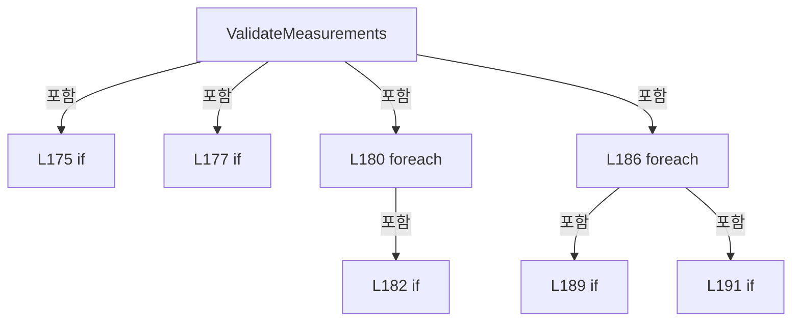

변경 전 점검: 입력/반환 타입, 위 호출자, 예외/취소 경로, 공유 상태와 저장·전송 소비자를 함께 확인합니다. 값의 단위나 물리 방향을 이름만으로 확정하지 않습니다.

### LocalFunctionStatement `Identity` · L196–196

[Drilling.Common/Review/CAutoFineReviewCoordinator.cs:196–196](https://github.com/kjuws10-rgb/A3Drilling/blob/5aee8e58439c9b455cae7c9593c9be986c3e682e/Drilling.Common/Review/CAutoFineReviewCoordinator.cs#L196-L196)

| 항목 | 실제 추출 값 |
| --- | --- |
| 서명 | (string Key, int Head, int Cell, int Shot, int Beam) Identity(Drilling.Common.Review.ST_REVIEW_PLAN_POINT) |
| 접근/수식자 | Private / static |
| 반환/값 타입 | (string Key, int Head, int Cell, int Shot, int Beam) |
| 소속 타입 | NamedType:Drilling.Common.Review.CAutoFineReviewCoordinator |

입력 계약:

| 이름 | 타입 | 전달 | 선택/기본값 |
| --- | --- | --- | --- |
| point | Drilling.Common.Review.ST_REVIEW_PLAN_POINT | None | False /  |

정적 호출자로 확인된 위치:

| 호출 파일/행 | 호출 표현식 | 런타임 분기 가능 |
| --- | --- | --- |
| [Drilling.Common/Review/CAutoFineReviewCoordinator.cs:182–182](https://github.com/kjuws10-rgb/A3Drilling/blob/5aee8e58439c9b455cae7c9593c9be986c3e682e/Drilling.Common/Review/CAutoFineReviewCoordinator.cs#L182-L182) | Identity | False |
| [Drilling.Common/Review/CAutoFineReviewCoordinator.cs:189–189](https://github.com/kjuws10-rgb/A3Drilling/blob/5aee8e58439c9b455cae7c9593c9be986c3e682e/Drilling.Common/Review/CAutoFineReviewCoordinator.cs#L189-L189) | Identity | False |

호출하는 대상과 해석 범위:

| 원본 행 | 표현식 | 분석 상태 | 대상/소스 위치 |
| --- | --- | --- | --- |
| 196 | point.ShotKey.Trim().ToUpperInvariant | resolved | string string.ToUpperInvariant() |
| 196 | point.ShotKey.Trim | resolved | string string.Trim() |

본문의 실제 연산·분기·예외·반환 순서(원문 위치 순):

| 원본 행 | 종류 | 주석 해설 |
| --- | --- | --- |
| 196 | call | 함수·델리게이트 또는 객체 생성자를 호출합니다: point.ShotKey.Trim().ToUpperInvariant() |
| 196 | call | 함수·델리게이트 또는 객체 생성자를 호출합니다: point.ShotKey.Trim() |

변경 전 점검: 입력/반환 타입, 위 호출자, 예외/취소 경로, 공유 상태와 저장·전송 소비자를 함께 확인합니다. 값의 단위나 물리 방향을 이름만으로 확정하지 않습니다.

### MethodDeclaration `Normalize` · L199–199

[Drilling.Common/Review/CAutoFineReviewCoordinator.cs:199–199](https://github.com/kjuws10-rgb/A3Drilling/blob/5aee8e58439c9b455cae7c9593c9be986c3e682e/Drilling.Common/Review/CAutoFineReviewCoordinator.cs#L199-L199)

| 항목 | 실제 추출 값 |
| --- | --- |
| 서명 | string Drilling.Common.Review.CAutoFineReviewCoordinator.Normalize(string) |
| 접근/수식자 | Private / private, static |
| 반환/값 타입 | string |
| 소속 타입 | NamedType:Drilling.Common.Review.CAutoFineReviewCoordinator |

입력 계약:

| 이름 | 타입 | 전달 | 선택/기본값 |
| --- | --- | --- | --- |
| text | string | None | False /  |

정적 호출자로 확인된 위치:

| 호출 파일/행 | 호출 표현식 | 런타임 분기 가능 |
| --- | --- | --- |
| [Drilling.Common/Review/CAutoFineReviewCoordinator.cs:125–125](https://github.com/kjuws10-rgb/A3Drilling/blob/5aee8e58439c9b455cae7c9593c9be986c3e682e/Drilling.Common/Review/CAutoFineReviewCoordinator.cs#L125-L125) | Normalize | False |
| [Drilling.Common/Review/CAutoFineReviewCoordinator.cs:130–130](https://github.com/kjuws10-rgb/A3Drilling/blob/5aee8e58439c9b455cae7c9593c9be986c3e682e/Drilling.Common/Review/CAutoFineReviewCoordinator.cs#L130-L130) | Normalize | False |

호출하는 대상과 해석 범위:

| 원본 행 | 표현식 | 분석 상태 | 대상/소스 위치 |
| --- | --- | --- | --- |
| 199 | text.Trim().Replace("-", "_", StringComparison.Ordinal).Replace(".", "_", StringComparison.Ordinal).ToUpperInvariant | resolved | string string.ToUpperInvariant() |
| 199 | text.Trim().Replace("-", "_", StringComparison.Ordinal).Replace | resolved | string string.Replace(string, string?, System.StringComparison) |
| 199 | text.Trim().Replace | resolved | string string.Replace(string, string?, System.StringComparison) |
| 199 | text.Trim | resolved | string string.Trim() |

본문의 실제 연산·분기·예외·반환 순서(원문 위치 순):

| 원본 행 | 종류 | 주석 해설 |
| --- | --- | --- |
| 199 | call | 함수·델리게이트 또는 객체 생성자를 호출합니다: text.Trim().Replace("-", "_", StringComparison.Ordinal).Replace(".", "_", StringComparison.Ordinal).ToUpperInvariant() |
| 199 | call | 함수·델리게이트 또는 객체 생성자를 호출합니다: text.Trim().Replace("-", "_", StringComparison.Ordinal).Replace(".", "_", StringComparison.Ordinal) |
| 199 | call | 함수·델리게이트 또는 객체 생성자를 호출합니다: text.Trim().Replace("-", "_", StringComparison.Ordinal) |
| 199 | call | 함수·델리게이트 또는 객체 생성자를 호출합니다: text.Trim() |

변경 전 점검: 입력/반환 타입, 위 호출자, 예외/취소 경로, 공유 상태와 저장·전송 소비자를 함께 확인합니다. 값의 단위나 물리 방향을 이름만으로 확정하지 않습니다.

### MethodDeclaration `BuildPlan` · L201–312

[Drilling.Common/Review/CAutoFineReviewCoordinator.cs:201–312](https://github.com/kjuws10-rgb/A3Drilling/blob/5aee8e58439c9b455cae7c9593c9be986c3e682e/Drilling.Common/Review/CAutoFineReviewCoordinator.cs#L201-L312)

| 항목 | 실제 추출 값 |
| --- | --- |
| 서명 | Drilling.Common.Review.ST_AUTO_FINE_PLAN Drilling.Common.Review.CAutoFineReviewCoordinator.BuildPlan(Drilling.Common.Review.ST_AUTO_REVIEW_INPUT, System.Collections.Generic.IReadOnlyList<Drilling.Common.Managers.ST_SYSTEM_PARAMETER>) |
| 접근/수식자 | Public / public, static |
| 반환/값 타입 | Drilling.Common.Review.ST_AUTO_FINE_PLAN |
| 소속 타입 | NamedType:Drilling.Common.Review.CAutoFineReviewCoordinator |

입력 계약:

| 이름 | 타입 | 전달 | 선택/기본값 |
| --- | --- | --- | --- |
| input | Drilling.Common.Review.ST_AUTO_REVIEW_INPUT | None | False /  |
| settings | System.Collections.Generic.IReadOnlyList<Drilling.Common.Managers.ST_SYSTEM_PARAMETER> | None | False /  |

정적 호출자로 확인된 위치:

| 호출 파일/행 | 호출 표현식 | 런타임 분기 가능 |
| --- | --- | --- |
| [Drilling.Common/Review/CReviewManager.cs:2500–2500](https://github.com/kjuws10-rgb/A3Drilling/blob/5aee8e58439c9b455cae7c9593c9be986c3e682e/Drilling.Common/Review/CReviewManager.cs#L2500-L2500) | CAutoFineReviewCoordinator.BuildPlan | False |

호출하는 대상과 해석 범위:

| 원본 행 | 표현식 | 분석 상태 | 대상/소스 위치 |
| --- | --- | --- | --- |
| 206 | new | resolved | Drilling.Common.Review.ST_AUTO_REVIEW_OPTIONS.ST_AUTO_REVIEW_OPTIONS(int, Drilling.Common.Review.EN_FINE_INSPECTION_METHOD, int, bool) · Drilling.Common/Review/CAutoFineReviewCoordinator.cs:340 |
| 208 | new InvalidOperationException | resolved | System.InvalidOperationException.InvalidOperationException(string?) |
| 209 | input.Recipe.Parameters.Where(item => item.Key.Length > 0).GroupBy(item => item.Key, StringComparer.OrdinalIgnoreCase).ToDictionary | resolved | System.Collections.Generic.Dictionary<string, string> System.Collections.Generic.IEnumerable<System.Linq.IGrouping<string, Drilling.Common.Managers.ST_RECIPE_PARAMETER>>.ToDictionary<System.Linq.IGrouping<string, Drilling.Common.Managers.ST_RECIPE_PARAMETER>, string, string>(System.Func<System.Linq.IGrouping<string, Drilling.Common.Managers.ST_RECIPE_PARAMETER>, string>, System.Func<System.Linq.IGrouping<string, Drilling.Common.Managers.ST_RECIPE_PARAMETER>, string>, System.Collections.Generic.IEqualityComparer<string>?) |
| 209 | input.Recipe.Parameters.Where(item => item.Key.Length > 0).GroupBy | resolved | System.Collections.Generic.IEnumerable<System.Linq.IGrouping<string, Drilling.Common.Managers.ST_RECIPE_PARAMETER>> System.Collections.Generic.IEnumerable<Drilling.Common.Managers.ST_RECIPE_PARAMETER>.GroupBy<Drilling.Common.Managers.ST_RECIPE_PARAMETER, string>(System.Func<Drilling.Common.Managers.ST_RECIPE_PARAMETER, string>, System.Collections.Generic.IEqualityComparer<string>?) |
| 209 | input.Recipe.Parameters.Where | resolved | System.Collections.Generic.IEnumerable<Drilling.Common.Managers.ST_RECIPE_PARAMETER> System.Collections.Generic.IEnumerable<Drilling.Common.Managers.ST_RECIPE_PARAMETER>.Where<Drilling.Common.Managers.ST_RECIPE_PARAMETER>(System.Func<Drilling.Common.Managers.ST_RECIPE_PARAMETER, bool>) |
| 209 | group.Last | resolved | Drilling.Common.Managers.ST_RECIPE_PARAMETER System.Collections.Generic.IEnumerable<Drilling.Common.Managers.ST_RECIPE_PARAMETER>.Last<Drilling.Common.Managers.ST_RECIPE_PARAMETER>() |
| 210 | settings.Where | resolved | System.Collections.Generic.IEnumerable<Drilling.Common.Managers.ST_SYSTEM_PARAMETER> System.Collections.Generic.IEnumerable<Drilling.Common.Managers.ST_SYSTEM_PARAMETER>.Where<Drilling.Common.Managers.ST_SYSTEM_PARAMETER>(System.Func<Drilling.Common.Managers.ST_SYSTEM_PARAMETER, bool>) |
| 213 | parameters.ContainsKey | resolved | bool System.Collections.Generic.Dictionary<string, string>.ContainsKey(string) |
| 218 | new ReadOnlyDictionary<string, string> | resolved | System.Collections.ObjectModel.ReadOnlyDictionary<string, string>.ReadOnlyDictionary(System.Collections.Generic.IDictionary<string, string>) |
| 221 | parameters.Select(pair => new ST_RECIPE_PARAMETER(pair.Key, pair.Value, "", "", pair.Value, Key: pair.Key)).ToArray | resolved | Drilling.Common.Managers.ST_RECIPE_PARAMETER[] System.Collections.Generic.IEnumerable<Drilling.Common.Managers.ST_RECIPE_PARAMETER>.ToArray<Drilling.Common.Managers.ST_RECIPE_PARAMETER>() |
| 221 | parameters.Select | resolved | System.Collections.Generic.IEnumerable<Drilling.Common.Managers.ST_RECIPE_PARAMETER> System.Collections.Generic.IEnumerable<System.Collections.Generic.KeyValuePair<string, string>>.Select<System.Collections.Generic.KeyValuePair<string, string>, Drilling.Common.Managers.ST_RECIPE_PARAMETER>(System.Func<System.Collections.Generic.KeyValuePair<string, string>, Drilling.Common.Managers.ST_RECIPE_PARAMETER>) |
| 221 | new ST_RECIPE_PARAMETER | resolved | Drilling.Common.Managers.ST_RECIPE_PARAMETER.ST_RECIPE_PARAMETER(string, string, string, string, string, string, string, string, string, bool, bool, int, Drilling.Common.Managers.EN_RECIPE_DATA_TYPE, double, double, double, System.Collections.Generic.IReadOnlyDictionary<string, string>?) · Drilling.Common/Managers/CRecipeManager.cs:355 |
| 223 | CReviewManager.CreateShotBeamPositionCalculator | resolved | System.Func<Drilling.Common.Review.ST_REVIEW_PLAN_POINT, int, Drilling.Common.Review.ST_REVIEW_BEAM_POSITION> Drilling.Common.Review.CReviewManager.CreateShotBeamPositionCalculator(Drilling.Common.Managers.ST_RECIPE_DEFINITION, double, double, double) · Drilling.Common/Review/CReviewManager.cs:151 |
| 223 | CScannerAxisTransform.ReadStageDirection | resolved | double Drilling.Common.Recipe.CScannerAxisTransform.ReadStageDirection(System.Collections.Generic.IReadOnlyDictionary<string, string>) · Drilling.Common/Recipe/CShotCoordinatePlanBuilder.cs:1233 |
| 224 | CRecipeShotMaskingPlan.Build | resolved | Drilling.Common.Recipe.CRecipeShotMaskingPlan Drilling.Common.Recipe.CRecipeShotMaskingPlan.Build(System.Collections.Generic.IReadOnlyDictionary<string, string>) · Drilling.Common/Recipe/CShotCoordinatePlanBuilder.cs:813 |
| 225 | CShotCoordinatePlanBuilder.Build | resolved | Drilling.Common.Recipe.ST_SHOT_COORDINATE_PLAN Drilling.Common.Recipe.CShotCoordinatePlanBuilder.Build(System.Collections.Generic.IReadOnlyDictionary<string, string>) · Drilling.Common/Recipe/CShotCoordinatePlanBuilder.cs:11 |
| 226 | shots.Select(shot => new ST_REVIEW_PLAN_POINT( shot.SequenceNo, shot.ShotKey, shot.HeadNo, shot.CellNo, shot.CellShotNo, shot.GroupCountX, shot.GroupCountY, shot.HeadNo > 0 && !masking.EvaluateShot(shot).ShouldSkipLaser, shot.DesignX, shot.DesignY, 0, 0, 0, 0, EN_REVIEW_POINT_STATE.Ready, "WAIT" ) { BeamNo = ST_AUTO_REVIEW_OPTIONS.BeamNo }).ToArray | resolved | Drilling.Common.Review.ST_REVIEW_PLAN_POINT[] System.Collections.Generic.IEnumerable<Drilling.Common.Review.ST_REVIEW_PLAN_POINT>.ToArray<Drilling.Common.Review.ST_REVIEW_PLAN_POINT>() |
| 226 | shots.Select | resolved | System.Collections.Generic.IEnumerable<Drilling.Common.Review.ST_REVIEW_PLAN_POINT> System.Collections.Generic.IEnumerable<Drilling.Common.Recipe.ST_HEAD_SHOT_POINT>.Select<Drilling.Common.Recipe.ST_HEAD_SHOT_POINT, Drilling.Common.Review.ST_REVIEW_PLAN_POINT>(System.Func<Drilling.Common.Recipe.ST_HEAD_SHOT_POINT, Drilling.Common.Review.ST_REVIEW_PLAN_POINT>) |
| 226 | new ST_REVIEW_PLAN_POINT | resolved | Drilling.Common.Review.ST_REVIEW_PLAN_POINT.ST_REVIEW_PLAN_POINT(int, string, int, int, int, int, int, bool, double, double, double, double, double, double, Drilling.Common.Review.EN_REVIEW_POINT_STATE, string) · Drilling.Common/Review/CReviewManager.cs:3862 |
| 234 | masking.EvaluateShot | resolved | Drilling.Common.Recipe.ST_RECIPE_SHOT_MASKING_RESULT Drilling.Common.Recipe.CRecipeShotMaskingPlan.EvaluateShot(Drilling.Common.Recipe.ST_HEAD_SHOT_POINT) · Drilling.Common/Recipe/CShotCoordinatePlanBuilder.cs:853 |
| 244 | all.Where(point => point.Use).ToArray | resolved | Drilling.Common.Review.ST_REVIEW_PLAN_POINT[] System.Collections.Generic.IEnumerable<Drilling.Common.Review.ST_REVIEW_PLAN_POINT>.ToArray<Drilling.Common.Review.ST_REVIEW_PLAN_POINT>() |
| 244 | all.Where | resolved | System.Collections.Generic.IEnumerable<Drilling.Common.Review.ST_REVIEW_PLAN_POINT> System.Collections.Generic.IEnumerable<Drilling.Common.Review.ST_REVIEW_PLAN_POINT>.Where<Drilling.Common.Review.ST_REVIEW_PLAN_POINT>(System.Func<Drilling.Common.Review.ST_REVIEW_PLAN_POINT, bool>) |
| 246 | new InvalidOperationException | resolved | System.InvalidOperationException.InvalidOperationException(string?) |
| 247 | new ST_REVIEW_PLAN | resolved | Drilling.Common.Review.ST_REVIEW_PLAN.ST_REVIEW_PLAN(string, int, double, double, Drilling.Common.Review.EN_VISION_FLIP_TYPE, System.DateTimeOffset, System.Collections.Generic.IReadOnlyList<Drilling.Common.Review.ST_REVIEW_PLAN_POINT>) · Drilling.Common/Review/CReviewManager.cs:3921 |
| 249 | targets.Select(point => point.CellNo).Distinct().Count | resolved | int System.Collections.Generic.IEnumerable<int>.Count<int>() |
| 249 | targets.Select(point => point.CellNo).Distinct | resolved | System.Collections.Generic.IEnumerable<int> System.Collections.Generic.IEnumerable<int>.Distinct<int>() |
| 249 | targets.Select | resolved | System.Collections.Generic.IEnumerable<int> System.Collections.Generic.IEnumerable<Drilling.Common.Review.ST_REVIEW_PLAN_POINT>.Select<Drilling.Common.Review.ST_REVIEW_PLAN_POINT, int>(System.Func<Drilling.Common.Review.ST_REVIEW_PLAN_POINT, int>) |
| 250 | Tolerance | resolved | double Tolerance(string) · Drilling.Common/Review/CAutoFineReviewCoordinator.cs:311 |
| 251 | Tolerance | resolved | double Tolerance(string) · Drilling.Common/Review/CAutoFineReviewCoordinator.cs:311 |
| 252 | CReviewManager.ParseVisionFlipType | resolved | Drilling.Common.Review.EN_VISION_FLIP_TYPE Drilling.Common.Review.CReviewManager.ParseVisionFlipType(string?, string?, string?) · Drilling.Common/Review/CReviewManager.cs:3543 |
| 252 | parameters.GetValueOrDefault | resolved | string? System.Collections.Generic.IReadOnlyDictionary<string, string>.GetValueOrDefault<string, string>(string) |
| 252 | parameters.GetValueOrDefault | resolved | string? System.Collections.Generic.IReadOnlyDictionary<string, string>.GetValueOrDefault<string, string>(string) |
| 252 | parameters.GetValueOrDefault | resolved | string? System.Collections.Generic.IReadOnlyDictionary<string, string>.GetValueOrDefault<string, string>(string) |
| 256 | CReviewRulePlanBuilder.Build(source, new(EN_REVIEW_CORRECTION_RULE.Fine, EN_REVIEW_CORRECTION_SCOPE.HeadCell, ST_AUTO_REVIEW_OPTIONS.BeamNo, "", EN_REVIEW_REFERENCE_LINE.First, input.Options.LineCount)).ShotKeys.ToHashSet | resolved | System.Collections.Generic.HashSet<string> System.Collections.Generic.IEnumerable<string>.ToHashSet<string>(System.Collections.Generic.IEqualityComparer<string>?) |
| 256 | CReviewRulePlanBuilder.Build | resolved | Drilling.Common.Review.ST_REVIEW_RULE_PLAN Drilling.Common.Review.CReviewRulePlanBuilder.Build(Drilling.Common.Review.ST_REVIEW_PLAN, Drilling.Common.Review.ST_REVIEW_RULE_CONFIGURATION) · Drilling.Common/Review/CReviewRulePlanBuilder.cs:5 |
| 256 | new | resolved | Drilling.Common.Review.ST_REVIEW_RULE_CONFIGURATION.ST_REVIEW_RULE_CONFIGURATION(Drilling.Common.Review.EN_REVIEW_CORRECTION_RULE, Drilling.Common.Review.EN_REVIEW_CORRECTION_SCOPE, int, string, Drilling.Common.Review.EN_REVIEW_REFERENCE_LINE, int) · Drilling.Common/Review/CReviewRulePlanBuilder.cs:524 |
| 257 | FindTopmostCells | resolved | System.Collections.Generic.HashSet<int> Drilling.Common.Review.CAutoFineReviewCoordinator.FindTopmostCells(System.Collections.Generic.IReadOnlyDictionary<string, string>) · Drilling.Common/Review/CAutoFineReviewCoordinator.cs:314 |
| 258 | all.Select(point => point.CellNo).Distinct().ToDictionary | resolved | System.Collections.Generic.Dictionary<int, int> System.Collections.Generic.IEnumerable<int>.ToDictionary<int, int, int>(System.Func<int, int>, System.Func<int, int>) |
| 258 | all.Select(point => point.CellNo).Distinct | resolved | System.Collections.Generic.IEnumerable<int> System.Collections.Generic.IEnumerable<int>.Distinct<int>() |
| 258 | all.Select | resolved | System.Collections.Generic.IEnumerable<int> System.Collections.Generic.IEnumerable<Drilling.Common.Review.ST_REVIEW_PLAN_POINT>.Select<Drilling.Common.Review.ST_REVIEW_PLAN_POINT, int>(System.Func<Drilling.Common.Review.ST_REVIEW_PLAN_POINT, int>) |
| 258 | CRecipeModelPixelCountReader.ReadCellModelType | resolved | int Drilling.Common.Recipe.CRecipeModelPixelCountReader.ReadCellModelType(System.Collections.Generic.IReadOnlyDictionary<string, string>, int, int) · Drilling.Common/Recipe/CCellPatternCalculator.cs:433 |
| 259 | models.Values.GroupBy(model => model).ToDictionary | resolved | System.Collections.Generic.Dictionary<int, int> System.Collections.Generic.IEnumerable<System.Linq.IGrouping<int, int>>.ToDictionary<System.Linq.IGrouping<int, int>, int, int>(System.Func<System.Linq.IGrouping<int, int>, int>, System.Func<System.Linq.IGrouping<int, int>, int>) |
| 259 | models.Values.GroupBy | resolved | System.Collections.Generic.IEnumerable<System.Linq.IGrouping<int, int>> System.Collections.Generic.IEnumerable<int>.GroupBy<int, int>(System.Func<int, int>) |
| 259 | group.Count | resolved | int System.Collections.Generic.IEnumerable<int>.Count<int>() |
| 260 | new List<ST_FINE_REVIEW_LINE> | resolved | System.Collections.Generic.List<Drilling.Common.Review.ST_FINE_REVIEW_LINE>.List() |
| 261 | targets.Where(point => selected.Contains(point.ShotKey) && (topCells is null &#124;&#124; topCells.Contains(point.CellNo))).GroupBy(point => models[point.CellNo]).OrderByDescending(group => modelCounts[group.Key]).ThenBy | resolved | System.Linq.IOrderedEnumerable<System.Linq.IGrouping<int, Drilling.Common.Review.ST_REVIEW_PLAN_POINT>> System.Linq.IOrderedEnumerable<System.Linq.IGrouping<int, Drilling.Common.Review.ST_REVIEW_PLAN_POINT>>.ThenBy<System.Linq.IGrouping<int, Drilling.Common.Review.ST_REVIEW_PLAN_POINT>, int>(System.Func<System.Linq.IGrouping<int, Drilling.Common.Review.ST_REVIEW_PLAN_POINT>, int>) |
| 261 | targets.Where(point => selected.Contains(point.ShotKey) && (topCells is null &#124;&#124; topCells.Contains(point.CellNo))).GroupBy(point => models[point.CellNo]).OrderByDescending | resolved | System.Linq.IOrderedEnumerable<System.Linq.IGrouping<int, Drilling.Common.Review.ST_REVIEW_PLAN_POINT>> System.Collections.Generic.IEnumerable<System.Linq.IGrouping<int, Drilling.Common.Review.ST_REVIEW_PLAN_POINT>>.OrderByDescending<System.Linq.IGrouping<int, Drilling.Common.Review.ST_REVIEW_PLAN_POINT>, int>(System.Func<System.Linq.IGrouping<int, Drilling.Common.Review.ST_REVIEW_PLAN_POINT>, int>) |
| 261 | targets.Where(point => selected.Contains(point.ShotKey) && (topCells is null &#124;&#124; topCells.Contains(point.CellNo))).GroupBy | resolved | System.Collections.Generic.IEnumerable<System.Linq.IGrouping<int, Drilling.Common.Review.ST_REVIEW_PLAN_POINT>> System.Collections.Generic.IEnumerable<Drilling.Common.Review.ST_REVIEW_PLAN_POINT>.GroupBy<Drilling.Common.Review.ST_REVIEW_PLAN_POINT, int>(System.Func<Drilling.Common.Review.ST_REVIEW_PLAN_POINT, int>) |
| 261 | targets.Where | resolved | System.Collections.Generic.IEnumerable<Drilling.Common.Review.ST_REVIEW_PLAN_POINT> System.Collections.Generic.IEnumerable<Drilling.Common.Review.ST_REVIEW_PLAN_POINT>.Where<Drilling.Common.Review.ST_REVIEW_PLAN_POINT>(System.Func<Drilling.Common.Review.ST_REVIEW_PLAN_POINT, bool>) |
| 261 | selected.Contains | resolved | bool System.Collections.Generic.HashSet<string>.Contains(string) |
| 261 | topCells.Contains | resolved | bool System.Collections.Generic.HashSet<int>.Contains(int) |
| 264 | model.GroupBy(point => Math.Round(point.DesignY, 6)).OrderBy | resolved | System.Linq.IOrderedEnumerable<System.Linq.IGrouping<double, Drilling.Common.Review.ST_REVIEW_PLAN_POINT>> System.Collections.Generic.IEnumerable<System.Linq.IGrouping<double, Drilling.Common.Review.ST_REVIEW_PLAN_POINT>>.OrderBy<System.Linq.IGrouping<double, Drilling.Common.Review.ST_REVIEW_PLAN_POINT>, double>(System.Func<System.Linq.IGrouping<double, Drilling.Common.Review.ST_REVIEW_PLAN_POINT>, double>) |
| 264 | model.GroupBy | resolved | System.Collections.Generic.IEnumerable<System.Linq.IGrouping<double, Drilling.Common.Review.ST_REVIEW_PLAN_POINT>> System.Collections.Generic.IEnumerable<Drilling.Common.Review.ST_REVIEW_PLAN_POINT>.GroupBy<Drilling.Common.Review.ST_REVIEW_PLAN_POINT, double>(System.Func<Drilling.Common.Review.ST_REVIEW_PLAN_POINT, double>) |
| 264 | Math.Round | resolved | double System.Math.Round(double, int) |
| 267 | (leftToRight ? line.OrderBy(point => point.DesignX) : line.OrderByDescending(point => point.DesignX)).ThenBy(point => point.CellNo).ThenBy(point => point.ShotNo).Select(point => { var position = calculate(point, ST_AUTO_REVIEW_OPTIONS.BeamNo); return point with { ReviewTargetX = position.ReviewX, ReviewTargetY = position.StageY }; }).ToArray | resolved | Drilling.Common.Review.ST_REVIEW_PLAN_POINT[] System.Collections.Generic.IEnumerable<Drilling.Common.Review.ST_REVIEW_PLAN_POINT>.ToArray<Drilling.Common.Review.ST_REVIEW_PLAN_POINT>() |
| 267 | (leftToRight ? line.OrderBy(point => point.DesignX) : line.OrderByDescending(point => point.DesignX)).ThenBy(point => point.CellNo).ThenBy(point => point.ShotNo).Select | resolved | System.Collections.Generic.IEnumerable<Drilling.Common.Review.ST_REVIEW_PLAN_POINT> System.Collections.Generic.IEnumerable<Drilling.Common.Review.ST_REVIEW_PLAN_POINT>.Select<Drilling.Common.Review.ST_REVIEW_PLAN_POINT, Drilling.Common.Review.ST_REVIEW_PLAN_POINT>(System.Func<Drilling.Common.Review.ST_REVIEW_PLAN_POINT, Drilling.Common.Review.ST_REVIEW_PLAN_POINT>) |
| 267 | (leftToRight ? line.OrderBy(point => point.DesignX) : line.OrderByDescending(point => point.DesignX)).ThenBy(point => point.CellNo).ThenBy | resolved | System.Linq.IOrderedEnumerable<Drilling.Common.Review.ST_REVIEW_PLAN_POINT> System.Linq.IOrderedEnumerable<Drilling.Common.Review.ST_REVIEW_PLAN_POINT>.ThenBy<Drilling.Common.Review.ST_REVIEW_PLAN_POINT, int>(System.Func<Drilling.Common.Review.ST_REVIEW_PLAN_POINT, int>) |
| 267 | (leftToRight ? line.OrderBy(point => point.DesignX) : line.OrderByDescending(point => point.DesignX)).ThenBy | resolved | System.Linq.IOrderedEnumerable<Drilling.Common.Review.ST_REVIEW_PLAN_POINT> System.Linq.IOrderedEnumerable<Drilling.Common.Review.ST_REVIEW_PLAN_POINT>.ThenBy<Drilling.Common.Review.ST_REVIEW_PLAN_POINT, int>(System.Func<Drilling.Common.Review.ST_REVIEW_PLAN_POINT, int>) |
| 267 | line.OrderBy | resolved | System.Linq.IOrderedEnumerable<Drilling.Common.Review.ST_REVIEW_PLAN_POINT> System.Collections.Generic.IEnumerable<Drilling.Common.Review.ST_REVIEW_PLAN_POINT>.OrderBy<Drilling.Common.Review.ST_REVIEW_PLAN_POINT, double>(System.Func<Drilling.Common.Review.ST_REVIEW_PLAN_POINT, double>) |
| 267 | line.OrderByDescending | resolved | System.Linq.IOrderedEnumerable<Drilling.Common.Review.ST_REVIEW_PLAN_POINT> System.Collections.Generic.IEnumerable<Drilling.Common.Review.ST_REVIEW_PLAN_POINT>.OrderByDescending<Drilling.Common.Review.ST_REVIEW_PLAN_POINT, double>(System.Func<Drilling.Common.Review.ST_REVIEW_PLAN_POINT, double>) |
| 269 | calculate | resolved · 동적 구현 선택 가능 | Drilling.Common.Review.ST_REVIEW_BEAM_POSITION System.Func<Drilling.Common.Review.ST_REVIEW_PLAN_POINT, int, Drilling.Common.Review.ST_REVIEW_BEAM_POSITION>.Invoke(Drilling.Common.Review.ST_REVIEW_PLAN_POINT, int) |
| 276 | lines.Add | resolved | void System.Collections.Generic.List<Drilling.Common.Review.ST_FINE_REVIEW_LINE>.Add(Drilling.Common.Review.ST_FINE_REVIEW_LINE) |
| 276 | new | resolved | Drilling.Common.Review.ST_FINE_REVIEW_LINE.ST_FINE_REVIEW_LINE(string, int, int, System.Collections.Generic.IReadOnlyList<Drilling.Common.Review.ST_REVIEW_PLAN_POINT>, Drilling.Common.Review.EN_FINE_REVIEW_LINE_STATE) · Drilling.Common/Review/CReviewManager.cs:4192 |
| 276 | line.Key.ToString | resolved | string double.ToString(string?, System.IFormatProvider?) |
| 276 | Array.AsReadOnly | resolved | System.Collections.ObjectModel.ReadOnlyCollection<Drilling.Common.Review.ST_REVIEW_PLAN_POINT> System.Array.AsReadOnly<Drilling.Common.Review.ST_REVIEW_PLAN_POINT>(Drilling.Common.Review.ST_REVIEW_PLAN_POINT[]) |
| 281 | new InvalidOperationException | resolved | System.InvalidOperationException.InvalidOperationException(string?) |
| 284 | lines.SelectMany(line => line.Points).OrderBy(point => point.DesignX).ThenBy(point => point.CellNo).ThenBy(point => point.ShotNo).ToArray | resolved | Drilling.Common.Review.ST_REVIEW_PLAN_POINT[] System.Collections.Generic.IEnumerable<Drilling.Common.Review.ST_REVIEW_PLAN_POINT>.ToArray<Drilling.Common.Review.ST_REVIEW_PLAN_POINT>() |
| 284 | lines.SelectMany(line => line.Points).OrderBy(point => point.DesignX).ThenBy(point => point.CellNo).ThenBy | resolved | System.Linq.IOrderedEnumerable<Drilling.Common.Review.ST_REVIEW_PLAN_POINT> System.Linq.IOrderedEnumerable<Drilling.Common.Review.ST_REVIEW_PLAN_POINT>.ThenBy<Drilling.Common.Review.ST_REVIEW_PLAN_POINT, int>(System.Func<Drilling.Common.Review.ST_REVIEW_PLAN_POINT, int>) |
| 284 | lines.SelectMany(line => line.Points).OrderBy(point => point.DesignX).ThenBy | resolved | System.Linq.IOrderedEnumerable<Drilling.Common.Review.ST_REVIEW_PLAN_POINT> System.Linq.IOrderedEnumerable<Drilling.Common.Review.ST_REVIEW_PLAN_POINT>.ThenBy<Drilling.Common.Review.ST_REVIEW_PLAN_POINT, int>(System.Func<Drilling.Common.Review.ST_REVIEW_PLAN_POINT, int>) |
| 284 | lines.SelectMany(line => line.Points).OrderBy | resolved | System.Linq.IOrderedEnumerable<Drilling.Common.Review.ST_REVIEW_PLAN_POINT> System.Collections.Generic.IEnumerable<Drilling.Common.Review.ST_REVIEW_PLAN_POINT>.OrderBy<Drilling.Common.Review.ST_REVIEW_PLAN_POINT, double>(System.Func<Drilling.Common.Review.ST_REVIEW_PLAN_POINT, double>) |
| 284 | lines.SelectMany | resolved | System.Collections.Generic.IEnumerable<Drilling.Common.Review.ST_REVIEW_PLAN_POINT> System.Collections.Generic.IEnumerable<Drilling.Common.Review.ST_FINE_REVIEW_LINE>.SelectMany<Drilling.Common.Review.ST_FINE_REVIEW_LINE, Drilling.Common.Review.ST_REVIEW_PLAN_POINT>(System.Func<Drilling.Common.Review.ST_FINE_REVIEW_LINE, System.Collections.Generic.IEnumerable<Drilling.Common.Review.ST_REVIEW_PLAN_POINT>>) |
| 287 | points.Max | resolved | double System.Collections.Generic.IEnumerable<Drilling.Common.Review.ST_REVIEW_PLAN_POINT>.Max<Drilling.Common.Review.ST_REVIEW_PLAN_POINT>(System.Func<Drilling.Common.Review.ST_REVIEW_PLAN_POINT, double>) |
| 287 | points.Min | resolved | double System.Collections.Generic.IEnumerable<Drilling.Common.Review.ST_REVIEW_PLAN_POINT>.Min<Drilling.Common.Review.ST_REVIEW_PLAN_POINT>(System.Func<Drilling.Common.Review.ST_REVIEW_PLAN_POINT, double>) |
| 288 | points.Max | resolved | double System.Collections.Generic.IEnumerable<Drilling.Common.Review.ST_REVIEW_PLAN_POINT>.Max<Drilling.Common.Review.ST_REVIEW_PLAN_POINT>(System.Func<Drilling.Common.Review.ST_REVIEW_PLAN_POINT, double>) |
| 288 | points.Min | resolved | double System.Collections.Generic.IEnumerable<Drilling.Common.Review.ST_REVIEW_PLAN_POINT>.Min<Drilling.Common.Review.ST_REVIEW_PLAN_POINT>(System.Func<Drilling.Common.Review.ST_REVIEW_PLAN_POINT, double>) |
| 289 | new InvalidOperationException | resolved | System.InvalidOperationException.InvalidOperationException(string?) |
| 290 | lines.Select(line => line.ModelNo).Distinct().ToArray | resolved | int[] System.Collections.Generic.IEnumerable<int>.ToArray<int>() |
| 290 | lines.Select(line => line.ModelNo).Distinct | resolved | System.Collections.Generic.IEnumerable<int> System.Collections.Generic.IEnumerable<int>.Distinct<int>() |
| 290 | lines.Select | resolved | System.Collections.Generic.IEnumerable<int> System.Collections.Generic.IEnumerable<Drilling.Common.Review.ST_FINE_REVIEW_LINE>.Select<Drilling.Common.Review.ST_FINE_REVIEW_LINE, int>(System.Func<Drilling.Common.Review.ST_FINE_REVIEW_LINE, int>) |
| 291 | new | resolved | Drilling.Common.Review.ST_FINE_REVIEW_LINE.ST_FINE_REVIEW_LINE(string, int, int, System.Collections.Generic.IReadOnlyList<Drilling.Common.Review.ST_REVIEW_PLAN_POINT>, Drilling.Common.Review.EN_FINE_REVIEW_LINE_STATE) · Drilling.Common/Review/CReviewManager.cs:4192 |
| 291 | Array.AsReadOnly | resolved | System.Collections.ObjectModel.ReadOnlyCollection<Drilling.Common.Review.ST_REVIEW_PLAN_POINT> System.Array.AsReadOnly<Drilling.Common.Review.ST_REVIEW_PLAN_POINT>(Drilling.Common.Review.ST_REVIEW_PLAN_POINT[]) |
| 295 | Array.AsReadOnly | resolved | System.Collections.ObjectModel.ReadOnlyCollection<Drilling.Common.Review.ST_REVIEW_PLAN_POINT> System.Array.AsReadOnly<Drilling.Common.Review.ST_REVIEW_PLAN_POINT>(Drilling.Common.Review.ST_REVIEW_PLAN_POINT[]) |
| 295 | lines.SelectMany(line => line.Points).ToArray | resolved | Drilling.Common.Review.ST_REVIEW_PLAN_POINT[] System.Collections.Generic.IEnumerable<Drilling.Common.Review.ST_REVIEW_PLAN_POINT>.ToArray<Drilling.Common.Review.ST_REVIEW_PLAN_POINT>() |
| 295 | lines.SelectMany | resolved | System.Collections.Generic.IEnumerable<Drilling.Common.Review.ST_REVIEW_PLAN_POINT> System.Collections.Generic.IEnumerable<Drilling.Common.Review.ST_FINE_REVIEW_LINE>.SelectMany<Drilling.Common.Review.ST_FINE_REVIEW_LINE, Drilling.Common.Review.ST_REVIEW_PLAN_POINT>(System.Func<Drilling.Common.Review.ST_FINE_REVIEW_LINE, System.Collections.Generic.IEnumerable<Drilling.Common.Review.ST_REVIEW_PLAN_POINT>>) |
| 298 | new ST_FINE_REVIEW_REQUEST | resolved | Drilling.Common.Review.ST_FINE_REVIEW_REQUEST.ST_FINE_REVIEW_REQUEST(Drilling.Common.Review.ST_REVIEW_PLAN, System.Collections.Generic.IReadOnlyList<Drilling.Common.Review.ST_FINE_REVIEW_LINE>, Drilling.Common.Review.EN_FINE_INSPECTION_METHOD, int, bool) · Drilling.Common/Review/CReviewManager.cs:4193 |
| 298 | lines.AsReadOnly | resolved | System.Collections.ObjectModel.ReadOnlyCollection<Drilling.Common.Review.ST_FINE_REVIEW_LINE> System.Collections.Generic.List<Drilling.Common.Review.ST_FINE_REVIEW_LINE>.AsReadOnly() |
| 303 | new | resolved | Drilling.Common.Review.ST_FINE_REVIEW_CONTEXT.ST_FINE_REVIEW_CONTEXT(string, string, string, int, System.Collections.Generic.IReadOnlyDictionary<string, string>) · Drilling.Common/Review/CAutoFineReviewCoordinator.cs:356 |
| 310 | new | resolved | Drilling.Common.Review.ST_AUTO_FINE_PLAN.ST_AUTO_FINE_PLAN(Drilling.Common.Review.ST_FINE_REVIEW_REQUEST, System.Collections.Generic.IReadOnlyList<Drilling.Common.Review.ST_REVIEW_PLAN_POINT>, System.Collections.Generic.IReadOnlyDictionary<string, string>) · Drilling.Common/Review/CAutoFineReviewCoordinator.cs:351 |
| 310 | Array.Empty<ST_REVIEW_PLAN_POINT> | resolved | Drilling.Common.Review.ST_REVIEW_PLAN_POINT[] System.Array.Empty<Drilling.Common.Review.ST_REVIEW_PLAN_POINT>() |
| 310 | Array.AsReadOnly | resolved | System.Collections.ObjectModel.ReadOnlyCollection<Drilling.Common.Review.ST_REVIEW_PLAN_POINT> System.Array.AsReadOnly<Drilling.Common.Review.ST_REVIEW_PLAN_POINT>(Drilling.Common.Review.ST_REVIEW_PLAN_POINT[]) |

본문의 실제 연산·분기·예외·반환 순서(원문 위치 순):

| 원본 행 | 종류 | 주석 해설 |
| --- | --- | --- |
| 205 | if | 조건에 따라 분기합니다: if (input.ZeroLineFollowUp) |
| 206 | assignment | 값을 대상에 대입합니다: input = input with { Options = new(1, EN_FINE_INSPECTION_METHOD.Flying, 1, false) } |
| 206 | assignment | 값을 대상에 대입합니다: Options = new(1, EN_FINE_INSPECTION_METHOD.Flying, 1, false) |
| 206 | call | 함수·델리게이트 또는 객체 생성자를 호출합니다: new(1, EN_FINE_INSPECTION_METHOD.Flying, 1, false) |
| 207 | if | 조건에 따라 분기합니다: if (input.Options.LineCount is not (1 or 3 or 5 or 7) &#124;&#124; input.Options.Method is not (EN_FINE_INSPECTION_METHOD.Flying or EN_FINE_INSPECTION_METHOD.PtoP) &#124;&#124; input.Options.CountMismatchRetries is < 1 or > 3) |
| 208 | call | 함수·델리게이트 또는 객체 생성자를 호출합니다: new InvalidOperationException("AUTO Review 검사 방식 또는 라인 수가 올바르지 않습니다.") |
| 208 | throw | 예외를 발생/전달합니다: throw new InvalidOperationException("AUTO Review 검사 방식 또는 라인 수가 올바르지 않습니다."); |
| 209 | call | 함수·델리게이트 또는 객체 생성자를 호출합니다: input.Recipe.Parameters.Where(item => item.Key.Length > 0).GroupBy(item => item.Key, StringComparer.OrdinalIgnoreCase).ToDictionary(group => group.Key, group => group.Last().Value, StringComparer.OrdinalIgnoreCase) |
| 209 | call | 함수·델리게이트 또는 객체 생성자를 호출합니다: input.Recipe.Parameters.Where(item => item.Key.Length > 0).GroupBy(item => item.Key, StringComparer.OrdinalIgnoreCase) |
| 209 | call | 함수·델리게이트 또는 객체 생성자를 호출합니다: input.Recipe.Parameters.Where(item => item.Key.Length > 0) |
| 209 | call | 함수·델리게이트 또는 객체 생성자를 호출합니다: group.Last() |
| 209 | local-declaration | 지역 변수를 선언합니다: var parameters = input.Recipe.Parameters.Where(item => item.Key.Length > 0).GroupBy(item => item.Key, StringComparer.OrdinalIgnoreCase).ToDictionary(group => group.Key, group => group.Last().Value, StringComparer.OrdinalIgnoreCase |
| 209 | variable-initializer | 변수의 초기값을 지정합니다: parameters = input.Recipe.Parameters.Where(item => item.Key.Length > 0).GroupBy(item => item.Key, StringComparer.OrdinalIgnoreCase).ToDictionary(group => group.Key, group => group.Last().Value, StringComparer.OrdinalIgnoreCase) |
| 210 | call | 함수·델리게이트 또는 객체 생성자를 호출합니다: settings.Where(item => item.Key.Length > 0) |
| 210 | foreach | 컬렉션 요소를 순회합니다: foreach (var setting in settings.Where(item => item.Key.Length > 0)) |
| 213 | call | 함수·델리게이트 또는 객체 생성자를 호출합니다: parameters.ContainsKey(setting.Key) |
| 213 | if | 조건에 따라 분기합니다: if (!input.ZeroLineFollowUp &#124;&#124; !parameters.ContainsKey(setting.Key)) |
| 214 | assignment | 값을 대상에 대입합니다: parameters[setting.Key] = setting.Value |
| 216 | assignment | 값을 대상에 대입합니다: parameters["SHIFT_OFFSET_X"] = "0.000000" |
| 217 | assignment | 값을 대상에 대입합니다: parameters["SHIFT_OFFSET_Y"] = "0.000000" |
| 218 | call | 함수·델리게이트 또는 객체 생성자를 호출합니다: new ReadOnlyDictionary<string, string>(parameters) |
| 218 | local-declaration | 지역 변수를 선언합니다: var frozen = new ReadOnlyDictionary<string, string>(parameters); |
| 218 | variable-initializer | 변수의 초기값을 지정합니다: frozen = new ReadOnlyDictionary<string, string>(parameters) |
| 219 | local-declaration | 지역 변수를 선언합니다: var effectiveRecipe = input.Recipe with { Parameters = parameters.Select(pair => new ST_RECIPE_PARAMETER(pair.Key, pair.Value, "", "", pair.Value, Key: pair.Key)).ToArray() }; |
| 219 | variable-initializer | 변수의 초기값을 지정합니다: effectiveRecipe = input.Recipe with { Parameters = parameters.Select(pair => new ST_RECIPE_PARAMETER(pair.Key, pair.Value, "", "", pair.Value, Key: pair.Key)).ToArray() } |
| 221 | assignment | 값을 대상에 대입합니다: Parameters = parameters.Select(pair => new ST_RECIPE_PARAMETER(pair.Key, pair.Value, "", "", pair.Value, Key: pair.Key)).ToArray() |
| 221 | call | 함수·델리게이트 또는 객체 생성자를 호출합니다: parameters.Select(pair => new ST_RECIPE_PARAMETER(pair.Key, pair.Value, "", "", pair.Value, Key: pair.Key)).ToArray() |
| 221 | call | 함수·델리게이트 또는 객체 생성자를 호출합니다: parameters.Select(pair => new ST_RECIPE_PARAMETER(pair.Key, pair.Value, "", "", pair.Value, Key: pair.Key)) |
| 221 | call | 함수·델리게이트 또는 객체 생성자를 호출합니다: new ST_RECIPE_PARAMETER(pair.Key, pair.Value, "", "", pair.Value, Key: pair.Key) |
| 223 | call | 함수·델리게이트 또는 객체 생성자를 호출합니다: CReviewManager.CreateShotBeamPositionCalculator(effectiveRecipe, CScannerAxisTransform.ReadStageDirection(frozen)) |
| 223 | call | 함수·델리게이트 또는 객체 생성자를 호출합니다: CScannerAxisTransform.ReadStageDirection(frozen) |
| 223 | local-declaration | 지역 변수를 선언합니다: var calculate = CReviewManager.CreateShotBeamPositionCalculator(effectiveRecipe, CScannerAxisTransform.ReadStageDirection(frozen)); |
| 223 | variable-initializer | 변수의 초기값을 지정합니다: calculate = CReviewManager.CreateShotBeamPositionCalculator(effectiveRecipe, CScannerAxisTransform.ReadStageDirection(frozen)) |
| 224 | call | 함수·델리게이트 또는 객체 생성자를 호출합니다: CRecipeShotMaskingPlan.Build(frozen) |
| 224 | local-declaration | 지역 변수를 선언합니다: var masking = CRecipeShotMaskingPlan.Build(frozen); |
| 224 | variable-initializer | 변수의 초기값을 지정합니다: masking = CRecipeShotMaskingPlan.Build(frozen) |
| 225 | call | 함수·델리게이트 또는 객체 생성자를 호출합니다: CShotCoordinatePlanBuilder.Build(frozen) |
| 225 | local-declaration | 지역 변수를 선언합니다: var shots = CShotCoordinatePlanBuilder.Build(frozen).Shots; |
| 225 | variable-initializer | 변수의 초기값을 지정합니다: shots = CShotCoordinatePlanBuilder.Build(frozen).Shots |
| 226 | call | 함수·델리게이트 또는 객체 생성자를 호출합니다: shots.Select(shot => new ST_REVIEW_PLAN_POINT( shot.SequenceNo, shot.ShotKey, shot.HeadNo, shot.CellNo, shot.CellShotNo, shot.GroupCountX, shot.GroupCountY, shot.HeadNo > 0 && !masking.EvaluateShot(shot).ShouldSkipLaser,… |
| 226 | call | 함수·델리게이트 또는 객체 생성자를 호출합니다: shots.Select(shot => new ST_REVIEW_PLAN_POINT( shot.SequenceNo, shot.ShotKey, shot.HeadNo, shot.CellNo, shot.CellShotNo, shot.GroupCountX, shot.GroupCountY, shot.HeadNo > 0 && !masking.EvaluateShot(shot).ShouldSkipLaser,… |
| 226 | call | 함수·델리게이트 또는 객체 생성자를 호출합니다: new ST_REVIEW_PLAN_POINT( shot.SequenceNo, shot.ShotKey, shot.HeadNo, shot.CellNo, shot.CellShotNo, shot.GroupCountX, shot.GroupCountY, shot.HeadNo > 0 && !masking.EvaluateShot(shot).ShouldSkipLaser, shot.DesignX, shot.D… |
| 226 | local-declaration | 지역 변수를 선언합니다: var all = shots.Select(shot => new ST_REVIEW_PLAN_POINT( shot.SequenceNo, shot.ShotKey, shot.HeadNo, shot.CellNo, shot.CellShotNo, shot.GroupCountX, shot.GroupCountY, shot.HeadNo > 0 && !masking.EvaluateShot(shot).ShouldSkipLaser, |
| 226 | variable-initializer | 변수의 초기값을 지정합니다: all = shots.Select(shot => new ST_REVIEW_PLAN_POINT( shot.SequenceNo, shot.ShotKey, shot.HeadNo, shot.CellNo, shot.CellShotNo, shot.GroupCountX, shot.GroupCountY, shot.HeadNo > 0 && !masking.EvaluateShot(shot).ShouldSkipLaser, sho |
| 234 | call | 함수·델리게이트 또는 객체 생성자를 호출합니다: masking.EvaluateShot(shot) |
| 243 | assignment | 값을 대상에 대입합니다: BeamNo = ST_AUTO_REVIEW_OPTIONS.BeamNo |
| 244 | call | 함수·델리게이트 또는 객체 생성자를 호출합니다: all.Where(point => point.Use).ToArray() |
| 244 | call | 함수·델리게이트 또는 객체 생성자를 호출합니다: all.Where(point => point.Use) |
| 244 | local-declaration | 지역 변수를 선언합니다: var targets = all.Where(point => point.Use).ToArray(); |
| 244 | variable-initializer | 변수의 초기값을 지정합니다: targets = all.Where(point => point.Use).ToArray() |
| 245 | if | 조건에 따라 분기합니다: if (targets.Length == 0) |
| 246 | call | 함수·델리게이트 또는 객체 생성자를 호출합니다: new InvalidOperationException("AUTO Review 검사 대상 Shot이 없습니다.") |
| 246 | throw | 예외를 발생/전달합니다: throw new InvalidOperationException("AUTO Review 검사 대상 Shot이 없습니다."); |
| 247 | call | 함수·델리게이트 또는 객체 생성자를 호출합니다: new ST_REVIEW_PLAN( input.Recipe.Id, targets.Select(point => point.CellNo).Distinct().Count(), Tolerance("REVIEW_TOLERANCE_X"), Tolerance("REVIEW_TOLERANCE_Y"), CReviewManager.ParseVisionFlipType(parameters.GetValueOrDef… |
| 247 | local-declaration | 지역 변수를 선언합니다: var source = new ST_REVIEW_PLAN( input.Recipe.Id, targets.Select(point => point.CellNo).Distinct().Count(), Tolerance("REVIEW_TOLERANCE_X"), Tolerance("REVIEW_TOLERANCE_Y"), CReviewManager.ParseVisionFlipType(parameters.GetValueOr |
| 247 | variable-initializer | 변수의 초기값을 지정합니다: source = new ST_REVIEW_PLAN( input.Recipe.Id, targets.Select(point => point.CellNo).Distinct().Count(), Tolerance("REVIEW_TOLERANCE_X"), Tolerance("REVIEW_TOLERANCE_Y"), CReviewManager.ParseVisionFlipType(parameters.GetValueOrDefa |
| 249 | call | 함수·델리게이트 또는 객체 생성자를 호출합니다: targets.Select(point => point.CellNo).Distinct().Count() |
| 249 | call | 함수·델리게이트 또는 객체 생성자를 호출합니다: targets.Select(point => point.CellNo).Distinct() |
| 249 | call | 함수·델리게이트 또는 객체 생성자를 호출합니다: targets.Select(point => point.CellNo) |
| 250 | call | 함수·델리게이트 또는 객체 생성자를 호출합니다: Tolerance("REVIEW_TOLERANCE_X") |
| 251 | call | 함수·델리게이트 또는 객체 생성자를 호출합니다: Tolerance("REVIEW_TOLERANCE_Y") |
| 252 | call | 함수·델리게이트 또는 객체 생성자를 호출합니다: CReviewManager.ParseVisionFlipType(parameters.GetValueOrDefault("VisionXFlip"), parameters.GetValueOrDefault("VisionYFlip"), parameters.GetValueOrDefault("VisionXyFlip")) |
| 252 | call | 함수·델리게이트 또는 객체 생성자를 호출합니다: parameters.GetValueOrDefault("VisionXFlip") |
| 252 | call | 함수·델리게이트 또는 객체 생성자를 호출합니다: parameters.GetValueOrDefault("VisionYFlip") |
| 252 | call | 함수·델리게이트 또는 객체 생성자를 호출합니다: parameters.GetValueOrDefault("VisionXyFlip") |
| 256 | call | 함수·델리게이트 또는 객체 생성자를 호출합니다: CReviewRulePlanBuilder.Build(source, new(EN_REVIEW_CORRECTION_RULE.Fine, EN_REVIEW_CORRECTION_SCOPE.HeadCell, ST_AUTO_REVIEW_OPTIONS.BeamNo, "", EN_REVIEW_REFERENCE_LINE.First, input.Options.LineCount)).ShotKeys.ToHashSe… |
| 256 | call | 함수·델리게이트 또는 객체 생성자를 호출합니다: CReviewRulePlanBuilder.Build(source, new(EN_REVIEW_CORRECTION_RULE.Fine, EN_REVIEW_CORRECTION_SCOPE.HeadCell, ST_AUTO_REVIEW_OPTIONS.BeamNo, "", EN_REVIEW_REFERENCE_LINE.First, input.Options.LineCount)) |
| 256 | call | 함수·델리게이트 또는 객체 생성자를 호출합니다: new(EN_REVIEW_CORRECTION_RULE.Fine, EN_REVIEW_CORRECTION_SCOPE.HeadCell, ST_AUTO_REVIEW_OPTIONS.BeamNo, "", EN_REVIEW_REFERENCE_LINE.First, input.Options.LineCount) |
| 256 | local-declaration | 지역 변수를 선언합니다: var selected = CReviewRulePlanBuilder.Build(source, new(EN_REVIEW_CORRECTION_RULE.Fine, EN_REVIEW_CORRECTION_SCOPE.HeadCell, ST_AUTO_REVIEW_OPTIONS.BeamNo, "", EN_REVIEW_REFERENCE_LINE.First, input.Options.LineCount)).ShotKeys.ToH |
| 256 | variable-initializer | 변수의 초기값을 지정합니다: selected = CReviewRulePlanBuilder.Build(source, new(EN_REVIEW_CORRECTION_RULE.Fine, EN_REVIEW_CORRECTION_SCOPE.HeadCell, ST_AUTO_REVIEW_OPTIONS.BeamNo, "", EN_REVIEW_REFERENCE_LINE.First, input.Options.LineCount)).ShotKeys.ToHashS |
| 257 | call | 함수·델리게이트 또는 객체 생성자를 호출합니다: FindTopmostCells(frozen) |
| 257 | conditional-expression | 조건에 따라 결과식을 선택합니다: input.ZeroLineFollowUp ? FindTopmostCells(frozen) : null |
| 257 | local-declaration | 지역 변수를 선언합니다: var topCells = input.ZeroLineFollowUp ? FindTopmostCells(frozen) : null; |
| 257 | variable-initializer | 변수의 초기값을 지정합니다: topCells = input.ZeroLineFollowUp ? FindTopmostCells(frozen) : null |
| 258 | call | 함수·델리게이트 또는 객체 생성자를 호출합니다: all.Select(point => point.CellNo).Distinct().ToDictionary(cell => cell, cell => CRecipeModelPixelCountReader.ReadCellModelType(parameters, cell)) |
| 258 | call | 함수·델리게이트 또는 객체 생성자를 호출합니다: all.Select(point => point.CellNo).Distinct() |
| 258 | call | 함수·델리게이트 또는 객체 생성자를 호출합니다: all.Select(point => point.CellNo) |
| 258 | call | 함수·델리게이트 또는 객체 생성자를 호출합니다: CRecipeModelPixelCountReader.ReadCellModelType(parameters, cell) |
| 258 | local-declaration | 지역 변수를 선언합니다: var models = all.Select(point => point.CellNo).Distinct().ToDictionary(cell => cell, cell => CRecipeModelPixelCountReader.ReadCellModelType(parameters, cell)); |
| 258 | variable-initializer | 변수의 초기값을 지정합니다: models = all.Select(point => point.CellNo).Distinct().ToDictionary(cell => cell, cell => CRecipeModelPixelCountReader.ReadCellModelType(parameters, cell)) |
| 259 | call | 함수·델리게이트 또는 객체 생성자를 호출합니다: models.Values.GroupBy(model => model).ToDictionary(group => group.Key, group => group.Count()) |
| 259 | call | 함수·델리게이트 또는 객체 생성자를 호출합니다: models.Values.GroupBy(model => model) |
| 259 | call | 함수·델리게이트 또는 객체 생성자를 호출합니다: group.Count() |
| 259 | local-declaration | 지역 변수를 선언합니다: var modelCounts = models.Values.GroupBy(model => model).ToDictionary(group => group.Key, group => group.Count()); |
| 259 | variable-initializer | 변수의 초기값을 지정합니다: modelCounts = models.Values.GroupBy(model => model).ToDictionary(group => group.Key, group => group.Count()) |
| 260 | call | 함수·델리게이트 또는 객체 생성자를 호출합니다: new List<ST_FINE_REVIEW_LINE>() |
| 260 | local-declaration | 지역 변수를 선언합니다: var lines = new List<ST_FINE_REVIEW_LINE>(); |
| 260 | variable-initializer | 변수의 초기값을 지정합니다: lines = new List<ST_FINE_REVIEW_LINE>() |
| 261 | call | 함수·델리게이트 또는 객체 생성자를 호출합니다: targets.Where(point => selected.Contains(point.ShotKey) && (topCells is null &#124;&#124; topCells.Contains(point.CellNo))).GroupBy(point => models[point.CellNo]).OrderByDescending(group => modelCounts[group.Key]).ThenBy(group => … |
| 261 | call | 함수·델리게이트 또는 객체 생성자를 호출합니다: targets.Where(point => selected.Contains(point.ShotKey) && (topCells is null &#124;&#124; topCells.Contains(point.CellNo))).GroupBy(point => models[point.CellNo]).OrderByDescending(group => modelCounts[group.Key]) |
| 261 | call | 함수·델리게이트 또는 객체 생성자를 호출합니다: targets.Where(point => selected.Contains(point.ShotKey) && (topCells is null &#124;&#124; topCells.Contains(point.CellNo))).GroupBy(point => models[point.CellNo]) |
| 261 | call | 함수·델리게이트 또는 객체 생성자를 호출합니다: targets.Where(point => selected.Contains(point.ShotKey) && (topCells is null &#124;&#124; topCells.Contains(point.CellNo))) |
| 261 | call | 함수·델리게이트 또는 객체 생성자를 호출합니다: selected.Contains(point.ShotKey) |
| 261 | call | 함수·델리게이트 또는 객체 생성자를 호출합니다: topCells.Contains(point.CellNo) |
| 261 | foreach | 컬렉션 요소를 순회합니다: foreach (var model in targets.Where(point => selected.Contains(point.ShotKey) && (topCells is null &#124;&#124; topCells.Contains(point.CellNo))).GroupBy(point => models[point.CellNo]).OrderByDescending(group => modelCounts[group.Key]).Then |
| 263 | local-declaration | 지역 변수를 선언합니다: var row = 0; |
| 263 | variable-initializer | 변수의 초기값을 지정합니다: row = 0 |
| 264 | call | 함수·델리게이트 또는 객체 생성자를 호출합니다: model.GroupBy(point => Math.Round(point.DesignY, 6)).OrderBy(group => group.Key) |
| 264 | call | 함수·델리게이트 또는 객체 생성자를 호출합니다: model.GroupBy(point => Math.Round(point.DesignY, 6)) |
| 264 | call | 함수·델리게이트 또는 객체 생성자를 호출합니다: Math.Round(point.DesignY, 6) |
| 264 | foreach | 컬렉션 요소를 순회합니다: foreach (var line in model.GroupBy(point => Math.Round(point.DesignY, 6)).OrderBy(group => group.Key)) |
| 266 | local-declaration | 지역 변수를 선언합니다: var leftToRight = row++ % 2 == 0; |
| 266 | variable-initializer | 변수의 초기값을 지정합니다: leftToRight = row++ % 2 == 0 |
| 267 | call | 함수·델리게이트 또는 객체 생성자를 호출합니다: (leftToRight ? line.OrderBy(point => point.DesignX) : line.OrderByDescending(point => point.DesignX)).ThenBy(point => point.CellNo).ThenBy(point => point.ShotNo) |
| 267 | call | 함수·델리게이트 또는 객체 생성자를 호출합니다: (leftToRight ? line.OrderBy(point => point.DesignX) : line.OrderByDescending(point => point.DesignX)).ThenBy(point => point.CellNo) |
| 267 | call | 함수·델리게이트 또는 객체 생성자를 호출합니다: line.OrderBy(point => point.DesignX) |
| 267 | call | 함수·델리게이트 또는 객체 생성자를 호출합니다: line.OrderByDescending(point => point.DesignX) |
| 267 | conditional-expression | 조건에 따라 결과식을 선택합니다: leftToRight ? line.OrderBy(point => point.DesignX) : line.OrderByDescending(point => point.DesignX) |
| 267 | call | 함수·델리게이트 또는 객체 생성자를 호출합니다: (leftToRight ? line.OrderBy(point => point.DesignX) : line.OrderByDescending(point => point.DesignX)).ThenBy(point => point.CellNo).ThenBy(point => point.ShotNo).Select(point => { var position = calculate(point, ST_AUTO_… |
| 267 | call | 함수·델리게이트 또는 객체 생성자를 호출합니다: (leftToRight ? line.OrderBy(point => point.DesignX) : line.OrderByDescending(point => point.DesignX)).ThenBy(point => point.CellNo).ThenBy(point => point.ShotNo).Select(point => { var position = calculate(point, ST_AUTO_… |
| 267 | local-declaration | 지역 변수를 선언합니다: var points = (leftToRight ? line.OrderBy(point => point.DesignX) : line.OrderByDescending(point => point.DesignX)).ThenBy(point => point.CellNo).ThenBy(point => point.ShotNo).Select(point => { var position = calculate(point, ST_AU |
| 267 | variable-initializer | 변수의 초기값을 지정합니다: points = (leftToRight ? line.OrderBy(point => point.DesignX) : line.OrderByDescending(point => point.DesignX)).ThenBy(point => point.CellNo).ThenBy(point => point.ShotNo).Select(point => { var position = calculate(point, ST_AUTO_R |
| 269 | call | 함수·델리게이트 또는 객체 생성자를 호출합니다: calculate(point, ST_AUTO_REVIEW_OPTIONS.BeamNo) |
| 269 | local-declaration | 지역 변수를 선언합니다: var position = calculate(point, ST_AUTO_REVIEW_OPTIONS.BeamNo); |
| 269 | variable-initializer | 변수의 초기값을 지정합니다: position = calculate(point, ST_AUTO_REVIEW_OPTIONS.BeamNo) |
| 270 | return | 호출자에게 값 또는 제어를 반환합니다: return point with { ReviewTargetX = position.ReviewX, ReviewTargetY = position.StageY }; |
| 272 | assignment | 값을 대상에 대입합니다: ReviewTargetX = position.ReviewX |
| 273 | assignment | 값을 대상에 대입합니다: ReviewTargetY = position.StageY |
| 276 | call | 함수·델리게이트 또는 객체 생성자를 호출합니다: lines.Add(new($"B11:{model.Key}:{line.Key.ToString("R", CultureInfo.InvariantCulture)}", lines.Count + 1, model.Key, Array.AsReadOnly(points))) |
| 276 | call | 함수·델리게이트 또는 객체 생성자를 호출합니다: new($"B11:{model.Key}:{line.Key.ToString("R", CultureInfo.InvariantCulture)}", lines.Count + 1, model.Key, Array.AsReadOnly(points)) |
| 276 | call | 함수·델리게이트 또는 객체 생성자를 호출합니다: line.Key.ToString("R", CultureInfo.InvariantCulture) |
| 276 | call | 함수·델리게이트 또는 객체 생성자를 호출합니다: Array.AsReadOnly(points) |
| 280 | if | 조건에 따라 분기합니다: if (lines.Count == 0) |
| 281 | call | 함수·델리게이트 또는 객체 생성자를 호출합니다: new InvalidOperationException("AUTO FINE 검사 라인을 만들 수 없습니다.") |
| 281 | throw | 예외를 발생/전달합니다: throw new InvalidOperationException("AUTO FINE 검사 라인을 만들 수 없습니다."); |
| 282 | if | 조건에 따라 분기합니다: if (input.ZeroLineFollowUp) |
| 284 | call | 함수·델리게이트 또는 객체 생성자를 호출합니다: lines.SelectMany(line => line.Points).OrderBy(point => point.DesignX).ThenBy(point => point.CellNo).ThenBy(point => point.ShotNo).ToArray() |
| 284 | call | 함수·델리게이트 또는 객체 생성자를 호출합니다: lines.SelectMany(line => line.Points).OrderBy(point => point.DesignX).ThenBy(point => point.CellNo).ThenBy(point => point.ShotNo) |
| 284 | call | 함수·델리게이트 또는 객체 생성자를 호출합니다: lines.SelectMany(line => line.Points).OrderBy(point => point.DesignX).ThenBy(point => point.CellNo) |
| 284 | call | 함수·델리게이트 또는 객체 생성자를 호출합니다: lines.SelectMany(line => line.Points).OrderBy(point => point.DesignX) |
| 284 | call | 함수·델리게이트 또는 객체 생성자를 호출합니다: lines.SelectMany(line => line.Points) |
| 284 | local-declaration | 지역 변수를 선언합니다: var points = lines.SelectMany(line => line.Points).OrderBy(point => point.DesignX).ThenBy(point => point.CellNo).ThenBy(point => point.ShotNo).ToArray(); |
| 284 | variable-initializer | 변수의 초기값을 지정합니다: points = lines.SelectMany(line => line.Points).OrderBy(point => point.DesignX).ThenBy(point => point.CellNo).ThenBy(point => point.ShotNo).ToArray() |
| 287 | call | 함수·델리게이트 또는 객체 생성자를 호출합니다: points.Max(point => point.ReviewTargetY) |
| 287 | call | 함수·델리게이트 또는 객체 생성자를 호출합니다: points.Min(point => point.ReviewTargetY) |
| 287 | if | 조건에 따라 분기합니다: if (points.Max(point => point.ReviewTargetY) - points.Min(point => point.ReviewTargetY) > .0005 &#124;&#124; points.Max(point => point.DesignY) - points.Min(point => point.DesignY) > .000001) |
| 288 | call | 함수·델리게이트 또는 객체 생성자를 호출합니다: points.Max(point => point.DesignY) |
| 288 | call | 함수·델리게이트 또는 객체 생성자를 호출합니다: points.Min(point => point.DesignY) |
| 289 | call | 함수·델리게이트 또는 객체 생성자를 호출합니다: new InvalidOperationException("맨 위 Cell들의 가운데 행이 서로 다른 Y 위치여서 0선 FollowUp IOF 한 줄을 만들 수 없습니다. Cell 배치와 Beam 좌표를 확인해 주세요.") |
| 289 | throw | 예외를 발생/전달합니다: throw new InvalidOperationException("맨 위 Cell들의 가운데 행이 서로 다른 Y 위치여서 0선 FollowUp IOF 한 줄을 만들 수 없습니다. Cell 배치와 Beam 좌표를 확인해 주세요."); |
| 290 | call | 함수·델리게이트 또는 객체 생성자를 호출합니다: lines.Select(line => line.ModelNo).Distinct().ToArray() |
| 290 | call | 함수·델리게이트 또는 객체 생성자를 호출합니다: lines.Select(line => line.ModelNo).Distinct() |
| 290 | call | 함수·델리게이트 또는 객체 생성자를 호출합니다: lines.Select(line => line.ModelNo) |
| 290 | local-declaration | 지역 변수를 선언합니다: var modelNos = lines.Select(line => line.ModelNo).Distinct().ToArray(); |
| 290 | variable-initializer | 변수의 초기값을 지정합니다: modelNos = lines.Select(line => line.ModelNo).Distinct().ToArray() |
| 291 | assignment | 값을 대상에 대입합니다: lines = [new("ZERO_FOLLOWUP:TOP_MIDDLE:B11", 1, modelNos.Length == 1 ? modelNos[0] : 0, Array.AsReadOnly(points))] |
| 291 | call | 함수·델리게이트 또는 객체 생성자를 호출합니다: new("ZERO_FOLLOWUP:TOP_MIDDLE:B11", 1, modelNos.Length == 1 ? modelNos[0] : 0, Array.AsReadOnly(points)) |
| 291 | call | 함수·델리게이트 또는 객체 생성자를 호출합니다: Array.AsReadOnly(points) |
| 291 | conditional-expression | 조건에 따라 결과식을 선택합니다: modelNos.Length == 1 ? modelNos[0] : 0 |
| 293 | local-declaration | 지역 변수를 선언합니다: var plan = source with { Points = Array.AsReadOnly(lines.SelectMany(line => line.Points).ToArray()), InspectionMethod = input.ZeroLineFollowUp ? "IOF" : source.InspectionMethod }; |
| 293 | variable-initializer | 변수의 초기값을 지정합니다: plan = source with { Points = Array.AsReadOnly(lines.SelectMany(line => line.Points).ToArray()), InspectionMethod = input.ZeroLineFollowUp ? "IOF" : source.InspectionMethod } |
| 295 | assignment | 값을 대상에 대입합니다: Points = Array.AsReadOnly(lines.SelectMany(line => line.Points).ToArray()) |
| 295 | call | 함수·델리게이트 또는 객체 생성자를 호출합니다: Array.AsReadOnly(lines.SelectMany(line => line.Points).ToArray()) |
| 295 | call | 함수·델리게이트 또는 객체 생성자를 호출합니다: lines.SelectMany(line => line.Points).ToArray() |
| 295 | call | 함수·델리게이트 또는 객체 생성자를 호출합니다: lines.SelectMany(line => line.Points) |
| 296 | assignment | 값을 대상에 대입합니다: InspectionMethod = input.ZeroLineFollowUp ? "IOF" : source.InspectionMethod |
| 296 | conditional-expression | 조건에 따라 결과식을 선택합니다: input.ZeroLineFollowUp ? "IOF" : source.InspectionMethod |
| 298 | call | 함수·델리게이트 또는 객체 생성자를 호출합니다: lines.AsReadOnly() |
| 298 | call | 함수·델리게이트 또는 객체 생성자를 호출합니다: new ST_FINE_REVIEW_REQUEST(plan, lines.AsReadOnly(), input.Options.Method) { StopOnNgLine = false, CountMismatchRetries = input.ZeroLineFollowUp ? 0 : input.Options.CountMismatchRetries, ImmediateRetry = input.Options.Im… |
| 298 | local-declaration | 지역 변수를 선언합니다: var request = new ST_FINE_REVIEW_REQUEST(plan, lines.AsReadOnly(), input.Options.Method) { StopOnNgLine = false, CountMismatchRetries = input.ZeroLineFollowUp ? 0 : input.Options.CountMismatchRetries, ImmediateRetry = input.Option |
| 298 | variable-initializer | 변수의 초기값을 지정합니다: request = new ST_FINE_REVIEW_REQUEST(plan, lines.AsReadOnly(), input.Options.Method) { StopOnNgLine = false, CountMismatchRetries = input.ZeroLineFollowUp ? 0 : input.Options.CountMismatchRetries, ImmediateRetry = input.Options.Im |
| 300 | assignment | 값을 대상에 대입합니다: StopOnNgLine = false |
| 301 | assignment | 값을 대상에 대입합니다: CountMismatchRetries = input.ZeroLineFollowUp ? 0 : input.Options.CountMismatchRetries |
| 301 | conditional-expression | 조건에 따라 결과식을 선택합니다: input.ZeroLineFollowUp ? 0 : input.Options.CountMismatchRetries |
| 302 | assignment | 값을 대상에 대입합니다: ImmediateRetry = input.Options.ImmediateRetry |
| 303 | assignment | 값을 대상에 대입합니다: Context = new(input.Recipe.Name, input.GlassId, "AUTO", input.Options.LineCount, frozen) { ZeroLineFollowUp = input.ZeroLineFollowUp, ZeroLineRunId = input.ZeroLineRunId, ZeroLineSavedAt = input.ZeroLineSavedAt } |
| 303 | call | 함수·델리게이트 또는 객체 생성자를 호출합니다: new(input.Recipe.Name, input.GlassId, "AUTO", input.Options.LineCount, frozen) { ZeroLineFollowUp = input.ZeroLineFollowUp, ZeroLineRunId = input.ZeroLineRunId, ZeroLineSavedAt = input.ZeroLineSavedAt } |
| 305 | assignment | 값을 대상에 대입합니다: ZeroLineFollowUp = input.ZeroLineFollowUp |
| 306 | assignment | 값을 대상에 대입합니다: ZeroLineRunId = input.ZeroLineRunId |
| 307 | assignment | 값을 대상에 대입합니다: ZeroLineSavedAt = input.ZeroLineSavedAt |
| 310 | assignment | 값을 대상에 대입합니다: ZeroLineFollowUp = input.ZeroLineFollowUp |
| 310 | call | 함수·델리게이트 또는 객체 생성자를 호출합니다: new(request, input.ZeroLineFollowUp ? Array.Empty<ST_REVIEW_PLAN_POINT>() : Array.AsReadOnly(targets), frozen) { ZeroLineFollowUp = input.ZeroLineFollowUp } |
| 310 | call | 함수·델리게이트 또는 객체 생성자를 호출합니다: Array.Empty<ST_REVIEW_PLAN_POINT>() |
| 310 | call | 함수·델리게이트 또는 객체 생성자를 호출합니다: Array.AsReadOnly(targets) |
| 310 | conditional-expression | 조건에 따라 결과식을 선택합니다: input.ZeroLineFollowUp ? Array.Empty<ST_REVIEW_PLAN_POINT>() : Array.AsReadOnly(targets) |
| 310 | return | 호출자에게 값 또는 제어를 반환합니다: return new(request, input.ZeroLineFollowUp ? Array.Empty<ST_REVIEW_PLAN_POINT>() : Array.AsReadOnly(targets), frozen) { ZeroLineFollowUp = input.ZeroLineFollowUp }; |

제어 구문의 포함 구조(실제 실행 순서/CFG가 아닌 구문 탐색 그림):

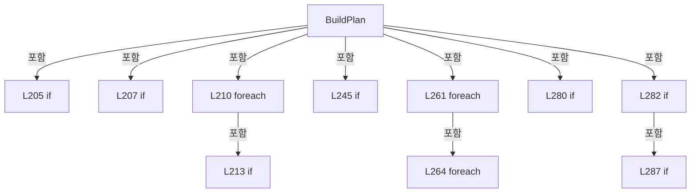

변경 전 점검: 입력/반환 타입, 위 호출자, 예외/취소 경로, 공유 상태와 저장·전송 소비자를 함께 확인합니다. 값의 단위나 물리 방향을 이름만으로 확정하지 않습니다.

### LocalFunctionStatement `Tolerance` · L311–311

[Drilling.Common/Review/CAutoFineReviewCoordinator.cs:311–311](https://github.com/kjuws10-rgb/A3Drilling/blob/5aee8e58439c9b455cae7c9593c9be986c3e682e/Drilling.Common/Review/CAutoFineReviewCoordinator.cs#L311-L311)

| 항목 | 실제 추출 값 |
| --- | --- |
| 서명 | double Tolerance(string) |
| 접근/수식자 | Private /  |
| 반환/값 타입 | double |
| 소속 타입 | NamedType:Drilling.Common.Review.CAutoFineReviewCoordinator |

입력 계약:

| 이름 | 타입 | 전달 | 선택/기본값 |
| --- | --- | --- | --- |
| key | string | None | False /  |

정적 호출자로 확인된 위치:

| 호출 파일/행 | 호출 표현식 | 런타임 분기 가능 |
| --- | --- | --- |
| [Drilling.Common/Review/CAutoFineReviewCoordinator.cs:250–250](https://github.com/kjuws10-rgb/A3Drilling/blob/5aee8e58439c9b455cae7c9593c9be986c3e682e/Drilling.Common/Review/CAutoFineReviewCoordinator.cs#L250-L250) | Tolerance | False |
| [Drilling.Common/Review/CAutoFineReviewCoordinator.cs:251–251](https://github.com/kjuws10-rgb/A3Drilling/blob/5aee8e58439c9b455cae7c9593c9be986c3e682e/Drilling.Common/Review/CAutoFineReviewCoordinator.cs#L251-L251) | Tolerance | False |

호출하는 대상과 해석 범위:

| 원본 행 | 표현식 | 분석 상태 | 대상/소스 위치 |
| --- | --- | --- | --- |
| 311 | double.TryParse | resolved | bool double.TryParse(string?, System.Globalization.NumberStyles, System.IFormatProvider?, out double) |
| 311 | parameters.GetValueOrDefault | resolved | string System.Collections.Generic.IReadOnlyDictionary<string, string>.GetValueOrDefault<string, string>(string, string) |
| 311 | double.IsFinite | resolved | bool double.IsFinite(double) |
| 311 | new InvalidOperationException | resolved | System.InvalidOperationException.InvalidOperationException(string?) |

본문의 실제 연산·분기·예외·반환 순서(원문 위치 순):

| 원본 행 | 종류 | 주석 해설 |
| --- | --- | --- |
| 311 | call | 함수·델리게이트 또는 객체 생성자를 호출합니다: double.TryParse(parameters.GetValueOrDefault(key, "0.03"), NumberStyles.Float, CultureInfo.InvariantCulture, out var value) |
| 311 | call | 함수·델리게이트 또는 객체 생성자를 호출합니다: parameters.GetValueOrDefault(key, "0.03") |
| 311 | call | 함수·델리게이트 또는 객체 생성자를 호출합니다: double.IsFinite(value) |
| 311 | call | 함수·델리게이트 또는 객체 생성자를 호출합니다: new InvalidOperationException($"{key} 설정을 확인해 주세요.") |
| 311 | conditional-expression | 조건에 따라 결과식을 선택합니다: double.TryParse(parameters.GetValueOrDefault(key, "0.03"), NumberStyles.Float, CultureInfo.InvariantCulture, out var value) && double.IsFinite(value) && value >= 0 ? value : throw new InvalidOperationException($"{key} 설정을 확인해 주세요. |
| 311 | throw | 예외를 발생/전달합니다: throw new InvalidOperationException($"{key} 설정을 확인해 주세요.") |

변경 전 점검: 입력/반환 타입, 위 호출자, 예외/취소 경로, 공유 상태와 저장·전송 소비자를 함께 확인합니다. 값의 단위나 물리 방향을 이름만으로 확정하지 않습니다.

### MethodDeclaration `FindTopmostCells` · L314–336

[Drilling.Common/Review/CAutoFineReviewCoordinator.cs:314–336](https://github.com/kjuws10-rgb/A3Drilling/blob/5aee8e58439c9b455cae7c9593c9be986c3e682e/Drilling.Common/Review/CAutoFineReviewCoordinator.cs#L314-L336)

| 항목 | 실제 추출 값 |
| --- | --- |
| 서명 | System.Collections.Generic.HashSet<int> Drilling.Common.Review.CAutoFineReviewCoordinator.FindTopmostCells(System.Collections.Generic.IReadOnlyDictionary<string, string>) |
| 접근/수식자 | Private / private, static |
| 반환/값 타입 | System.Collections.Generic.HashSet<int> |
| 소속 타입 | NamedType:Drilling.Common.Review.CAutoFineReviewCoordinator |

입력 계약:

| 이름 | 타입 | 전달 | 선택/기본값 |
| --- | --- | --- | --- |
| parameters | System.Collections.Generic.IReadOnlyDictionary<string, string> | None | False /  |

정적 호출자로 확인된 위치:

| 호출 파일/행 | 호출 표현식 | 런타임 분기 가능 |
| --- | --- | --- |
| [Drilling.Common/Review/CAutoFineReviewCoordinator.cs:257–257](https://github.com/kjuws10-rgb/A3Drilling/blob/5aee8e58439c9b455cae7c9593c9be986c3e682e/Drilling.Common/Review/CAutoFineReviewCoordinator.cs#L257-L257) | FindTopmostCells | False |

호출하는 대상과 해석 범위:

| 원본 행 | 표현식 | 분석 상태 | 대상/소스 위치 |
| --- | --- | --- | --- |
| 317 | new List<(int Cell, double MinimumY)> | resolved | System.Collections.Generic.List<(int Cell, double MinimumY)>.List() |
| 318 | Read | resolved | double Read(string, double) · Drilling.Common/Review/CAutoFineReviewCoordinator.cs:316 |
| 321 | CRecipeModelPixelCountReader.ReadPatternForCell | resolved | Drilling.Common.Recipe.ST_RECIPE_MODEL_PATTERN Drilling.Common.Recipe.CRecipeModelPixelCountReader.ReadPatternForCell(System.Collections.Generic.IReadOnlyDictionary<string, string>, int) · Drilling.Common/Recipe/CCellPatternCalculator.cs:444 |
| 322 | new ST_CELL_PATTERN_DEFINITION | resolved | Drilling.Common.Recipe.ST_CELL_PATTERN_DEFINITION.ST_CELL_PATTERN_DEFINITION(int, double, double, double, double, int, int, int, int, double, double) · Drilling.Common/Recipe/CCellPatternCalculator.cs:277 |
| 322 | Read | resolved | double Read(string, double) · Drilling.Common/Review/CAutoFineReviewCoordinator.cs:316 |
| 322 | Read | resolved | double Read(string, double) · Drilling.Common/Review/CAutoFineReviewCoordinator.cs:316 |
| 322 | Read | resolved | double Read(string, double) · Drilling.Common/Review/CAutoFineReviewCoordinator.cs:316 |
| 322 | Read | resolved | double Read(string, double) · Drilling.Common/Review/CAutoFineReviewCoordinator.cs:316 |
| 322 | Read | resolved | double Read(string, double) · Drilling.Common/Review/CAutoFineReviewCoordinator.cs:316 |
| 322 | Read | resolved | double Read(string, double) · Drilling.Common/Review/CAutoFineReviewCoordinator.cs:316 |
| 322 | Read | resolved | double Read(string, double) · Drilling.Common/Review/CAutoFineReviewCoordinator.cs:316 |
| 323 | CCellPatternCalculator.Calculate | resolved | Drilling.Common.Recipe.ST_CELL_PATTERN_LAYOUT Drilling.Common.Recipe.CCellPatternCalculator.Calculate(Drilling.Common.Recipe.ST_CELL_PATTERN_DEFINITION, bool) · Drilling.Common/Recipe/CCellPatternCalculator.cs:66 |
| 325 | new InvalidOperationException | resolved | System.InvalidOperationException.InvalidOperationException(string?) |
| 328 | new[] { (0, 0), (layout.GroupCountX - 1, 0), (0, layout.GroupCountY - 1), (layout.GroupCountX - 1, layout.GroupCountY - 1) } .Min | resolved | double System.Collections.Generic.IEnumerable<(int, int)>.Min<(int, int)>(System.Func<(int, int), double>) |
| 329 | CCellPatternCalculator.CalculateShotCenter | resolved | Drilling.Common.Recipe.ST_SHOT_GROUP_CENTER Drilling.Common.Recipe.CCellPatternCalculator.CalculateShotCenter(Drilling.Common.Recipe.ST_CELL_PATTERN_DEFINITION, int, int, Drilling.Common.Recipe.ST_CELL_PATTERN_LAYOUT) · Drilling.Common/Recipe/CCellPatternCalculator.cs:224 |
| 330 | ranges.Add | resolved | void System.Collections.Generic.List<(int Cell, double MinimumY)>.Add((int Cell, double MinimumY)) |
| 333 | new InvalidOperationException | resolved | System.InvalidOperationException.InvalidOperationException(string?) |
| 334 | ranges.Min | resolved | double System.Collections.Generic.IEnumerable<(int Cell, double MinimumY)>.Min<(int Cell, double MinimumY)>(System.Func<(int Cell, double MinimumY), double>) |
| 335 | ranges.Where(range => Math.Abs(range.MinimumY - firstY) <= .000001).Select(range => range.Cell).ToHashSet | resolved | System.Collections.Generic.HashSet<int> System.Collections.Generic.IEnumerable<int>.ToHashSet<int>() |
| 335 | ranges.Where(range => Math.Abs(range.MinimumY - firstY) <= .000001).Select | resolved | System.Collections.Generic.IEnumerable<int> System.Collections.Generic.IEnumerable<(int Cell, double MinimumY)>.Select<(int Cell, double MinimumY), int>(System.Func<(int Cell, double MinimumY), int>) |
| 335 | ranges.Where | resolved | System.Collections.Generic.IEnumerable<(int Cell, double MinimumY)> System.Collections.Generic.IEnumerable<(int Cell, double MinimumY)>.Where<(int Cell, double MinimumY)>(System.Func<(int Cell, double MinimumY), bool>) |
| 335 | Math.Abs | resolved | double System.Math.Abs(double) |

본문의 실제 연산·분기·예외·반환 순서(원문 위치 순):

| 원본 행 | 종류 | 주석 해설 |
| --- | --- | --- |
| 317 | call | 함수·델리게이트 또는 객체 생성자를 호출합니다: new List<(int Cell, double MinimumY)>() |
| 317 | local-declaration | 지역 변수를 선언합니다: var ranges = new List<(int Cell, double MinimumY)>(); |
| 317 | variable-initializer | 변수의 초기값을 지정합니다: ranges = new List<(int Cell, double MinimumY)>() |
| 318 | call | 함수·델리게이트 또는 객체 생성자를 호출합니다: Read("MAX_CELL_NUMBER") |
| 318 | local-declaration | 지역 변수를 선언합니다: var cellCount = (int)Read("MAX_CELL_NUMBER"); |
| 318 | variable-initializer | 변수의 초기값을 지정합니다: cellCount = (int)Read("MAX_CELL_NUMBER") |
| 319 | variable-initializer | 변수의 초기값을 지정합니다: cellNo = 1 |
| 319 | for | 초기화·조건·증감이 있는 반복입니다: for (var cellNo = 1; cellNo <= cellCount; cellNo++) |
| 321 | call | 함수·델리게이트 또는 객체 생성자를 호출합니다: CRecipeModelPixelCountReader.ReadPatternForCell(parameters, cellNo) |
| 321 | local-declaration | 지역 변수를 선언합니다: var pattern = CRecipeModelPixelCountReader.ReadPatternForCell(parameters, cellNo); |
| 321 | variable-initializer | 변수의 초기값을 지정합니다: pattern = CRecipeModelPixelCountReader.ReadPatternForCell(parameters, cellNo) |
| 322 | call | 함수·델리게이트 또는 객체 생성자를 호출합니다: new ST_CELL_PATTERN_DEFINITION(cellNo, Read($"CELL{cellNo}_ALIGN_TO_1ST_PIXEL_X"), Read($"CELL{cellNo}_ALIGN_TO_1ST_PIXEL_Y"), Read($"CELL{cellNo}_ROTATION"), Read("PIXEL_SIZE", .09), pattern.PixelCountX, pattern.PixelCo… |
| 322 | call | 함수·델리게이트 또는 객체 생성자를 호출합니다: Read($"CELL{cellNo}_ALIGN_TO_1ST_PIXEL_X") |
| 322 | call | 함수·델리게이트 또는 객체 생성자를 호출합니다: Read($"CELL{cellNo}_ALIGN_TO_1ST_PIXEL_Y") |
| 322 | call | 함수·델리게이트 또는 객체 생성자를 호출합니다: Read($"CELL{cellNo}_ROTATION") |
| 322 | call | 함수·델리게이트 또는 객체 생성자를 호출합니다: Read("PIXEL_SIZE", .09) |
| 322 | call | 함수·델리게이트 또는 객체 생성자를 호출합니다: Read("SPLITED_BEAM_COUNT", 1) |
| 322 | call | 함수·델리게이트 또는 객체 생성자를 호출합니다: Read("AK_MARGIN_X") |
| 322 | call | 함수·델리게이트 또는 객체 생성자를 호출합니다: Read("AK_MARGIN_Y") |
| 322 | local-declaration | 지역 변수를 선언합니다: var definition = new ST_CELL_PATTERN_DEFINITION(cellNo, Read($"CELL{cellNo}_ALIGN_TO_1ST_PIXEL_X"), Read($"CELL{cellNo}_ALIGN_TO_1ST_PIXEL_Y"), Read($"CELL{cellNo}_ROTATION"), Read("PIXEL_SIZE", .09), pattern.PixelCountX, pattern. |
| 322 | variable-initializer | 변수의 초기값을 지정합니다: definition = new ST_CELL_PATTERN_DEFINITION(cellNo, Read($"CELL{cellNo}_ALIGN_TO_1ST_PIXEL_X"), Read($"CELL{cellNo}_ALIGN_TO_1ST_PIXEL_Y"), Read($"CELL{cellNo}_ROTATION"), Read("PIXEL_SIZE", .09), pattern.PixelCountX, pattern.Pixe |
| 323 | call | 함수·델리게이트 또는 객체 생성자를 호출합니다: CCellPatternCalculator.Calculate(definition, includeShotCenters: false) |
| 323 | local-declaration | 지역 변수를 선언합니다: var layout = CCellPatternCalculator.Calculate(definition, includeShotCenters: false); |
| 323 | variable-initializer | 변수의 초기값을 지정합니다: layout = CCellPatternCalculator.Calculate(definition, includeShotCenters: false) |
| 324 | if | 조건에 따라 분기합니다: if (!layout.IsValid) |
| 325 | call | 함수·델리게이트 또는 객체 생성자를 호출합니다: new InvalidOperationException(layout.ValidationMessage) |
| 325 | throw | 예외를 발생/전달합니다: throw new InvalidOperationException(layout.ValidationMessage); |
| 328 | call | 함수·델리게이트 또는 객체 생성자를 호출합니다: new[] { (0, 0), (layout.GroupCountX - 1, 0), (0, layout.GroupCountY - 1), (layout.GroupCountX - 1, layout.GroupCountY - 1) } .Min(corner => CCellPatternCalculator.CalculateShotCenter(definition, corner.Item1, corner.Item… |
| 328 | local-declaration | 지역 변수를 선언합니다: var minimumY = new[] { (0, 0), (layout.GroupCountX - 1, 0), (0, layout.GroupCountY - 1), (layout.GroupCountX - 1, layout.GroupCountY - 1) } .Min(corner => CCellPatternCalculator.CalculateShotCenter(definition, corner.Item1, corner |
| 328 | variable-initializer | 변수의 초기값을 지정합니다: minimumY = new[] { (0, 0), (layout.GroupCountX - 1, 0), (0, layout.GroupCountY - 1), (layout.GroupCountX - 1, layout.GroupCountY - 1) } .Min(corner => CCellPatternCalculator.CalculateShotCenter(definition, corner.Item1, corner.Ite |
| 329 | call | 함수·델리게이트 또는 객체 생성자를 호출합니다: CCellPatternCalculator.CalculateShotCenter(definition, corner.Item1, corner.Item2, layout) |
| 330 | call | 함수·델리게이트 또는 객체 생성자를 호출합니다: ranges.Add((cellNo, minimumY)) |
| 332 | if | 조건에 따라 분기합니다: if (ranges.Count == 0) |
| 333 | call | 함수·델리게이트 또는 객체 생성자를 호출합니다: new InvalidOperationException("0선 FollowUp의 Cell 배치를 확인할 수 없습니다.") |
| 333 | throw | 예외를 발생/전달합니다: throw new InvalidOperationException("0선 FollowUp의 Cell 배치를 확인할 수 없습니다."); |
| 334 | call | 함수·델리게이트 또는 객체 생성자를 호출합니다: ranges.Min(range => range.MinimumY) |
| 334 | local-declaration | 지역 변수를 선언합니다: var firstY = ranges.Min(range => range.MinimumY); |
| 334 | variable-initializer | 변수의 초기값을 지정합니다: firstY = ranges.Min(range => range.MinimumY) |
| 335 | call | 함수·델리게이트 또는 객체 생성자를 호출합니다: ranges.Where(range => Math.Abs(range.MinimumY - firstY) <= .000001).Select(range => range.Cell).ToHashSet() |
| 335 | call | 함수·델리게이트 또는 객체 생성자를 호출합니다: ranges.Where(range => Math.Abs(range.MinimumY - firstY) <= .000001).Select(range => range.Cell) |
| 335 | call | 함수·델리게이트 또는 객체 생성자를 호출합니다: ranges.Where(range => Math.Abs(range.MinimumY - firstY) <= .000001) |
| 335 | call | 함수·델리게이트 또는 객체 생성자를 호출합니다: Math.Abs(range.MinimumY - firstY) |
| 335 | return | 호출자에게 값 또는 제어를 반환합니다: return ranges.Where(range => Math.Abs(range.MinimumY - firstY) <= .000001).Select(range => range.Cell).ToHashSet(); |

제어 구문의 포함 구조(실제 실행 순서/CFG가 아닌 구문 탐색 그림):

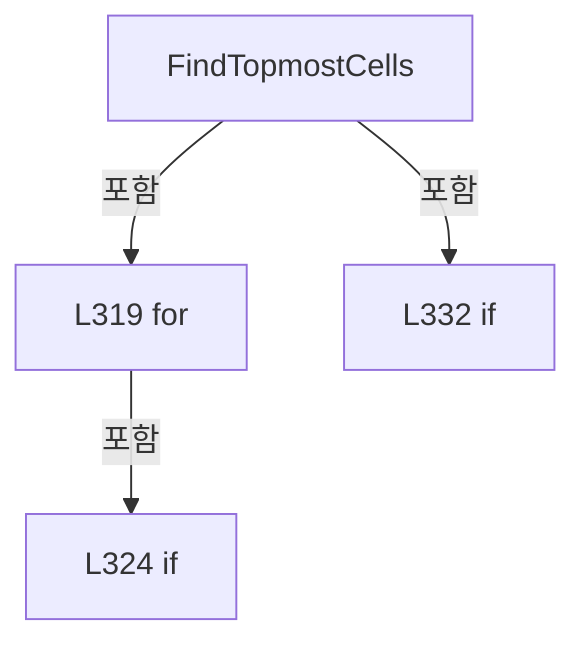

변경 전 점검: 입력/반환 타입, 위 호출자, 예외/취소 경로, 공유 상태와 저장·전송 소비자를 함께 확인합니다. 값의 단위나 물리 방향을 이름만으로 확정하지 않습니다.

### LocalFunctionStatement `Read` · L316–316

[Drilling.Common/Review/CAutoFineReviewCoordinator.cs:316–316](https://github.com/kjuws10-rgb/A3Drilling/blob/5aee8e58439c9b455cae7c9593c9be986c3e682e/Drilling.Common/Review/CAutoFineReviewCoordinator.cs#L316-L316)

| 항목 | 실제 추출 값 |
| --- | --- |
| 서명 | double Read(string, double) |
| 접근/수식자 | Private /  |
| 반환/값 타입 | double |
| 소속 타입 | NamedType:Drilling.Common.Review.CAutoFineReviewCoordinator |

입력 계약:

| 이름 | 타입 | 전달 | 선택/기본값 |
| --- | --- | --- | --- |
| key | string | None | False /  |
| fallback | double | None | True / 0 |

정적 호출자로 확인된 위치:

| 호출 파일/행 | 호출 표현식 | 런타임 분기 가능 |
| --- | --- | --- |
| [Drilling.Common/Review/CAutoFineReviewCoordinator.cs:318–318](https://github.com/kjuws10-rgb/A3Drilling/blob/5aee8e58439c9b455cae7c9593c9be986c3e682e/Drilling.Common/Review/CAutoFineReviewCoordinator.cs#L318-L318) | Read | False |
| [Drilling.Common/Review/CAutoFineReviewCoordinator.cs:322–322](https://github.com/kjuws10-rgb/A3Drilling/blob/5aee8e58439c9b455cae7c9593c9be986c3e682e/Drilling.Common/Review/CAutoFineReviewCoordinator.cs#L322-L322) | Read | False |
| [Drilling.Common/Review/CAutoFineReviewCoordinator.cs:322–322](https://github.com/kjuws10-rgb/A3Drilling/blob/5aee8e58439c9b455cae7c9593c9be986c3e682e/Drilling.Common/Review/CAutoFineReviewCoordinator.cs#L322-L322) | Read | False |
| [Drilling.Common/Review/CAutoFineReviewCoordinator.cs:322–322](https://github.com/kjuws10-rgb/A3Drilling/blob/5aee8e58439c9b455cae7c9593c9be986c3e682e/Drilling.Common/Review/CAutoFineReviewCoordinator.cs#L322-L322) | Read | False |
| [Drilling.Common/Review/CAutoFineReviewCoordinator.cs:322–322](https://github.com/kjuws10-rgb/A3Drilling/blob/5aee8e58439c9b455cae7c9593c9be986c3e682e/Drilling.Common/Review/CAutoFineReviewCoordinator.cs#L322-L322) | Read | False |
| [Drilling.Common/Review/CAutoFineReviewCoordinator.cs:322–322](https://github.com/kjuws10-rgb/A3Drilling/blob/5aee8e58439c9b455cae7c9593c9be986c3e682e/Drilling.Common/Review/CAutoFineReviewCoordinator.cs#L322-L322) | Read | False |
| [Drilling.Common/Review/CAutoFineReviewCoordinator.cs:322–322](https://github.com/kjuws10-rgb/A3Drilling/blob/5aee8e58439c9b455cae7c9593c9be986c3e682e/Drilling.Common/Review/CAutoFineReviewCoordinator.cs#L322-L322) | Read | False |
| [Drilling.Common/Review/CAutoFineReviewCoordinator.cs:322–322](https://github.com/kjuws10-rgb/A3Drilling/blob/5aee8e58439c9b455cae7c9593c9be986c3e682e/Drilling.Common/Review/CAutoFineReviewCoordinator.cs#L322-L322) | Read | False |

호출하는 대상과 해석 범위:

| 원본 행 | 표현식 | 분석 상태 | 대상/소스 위치 |
| --- | --- | --- | --- |
| 316 | double.TryParse | resolved | bool double.TryParse(string?, System.Globalization.NumberStyles, System.IFormatProvider?, out double) |
| 316 | parameters.GetValueOrDefault | resolved | string? System.Collections.Generic.IReadOnlyDictionary<string, string>.GetValueOrDefault<string, string>(string) |

본문의 실제 연산·분기·예외·반환 순서(원문 위치 순):

| 원본 행 | 종류 | 주석 해설 |
| --- | --- | --- |
| 316 | call | 함수·델리게이트 또는 객체 생성자를 호출합니다: double.TryParse(parameters.GetValueOrDefault(key), NumberStyles.Float, CultureInfo.InvariantCulture, out var value) |
| 316 | call | 함수·델리게이트 또는 객체 생성자를 호출합니다: parameters.GetValueOrDefault(key) |
| 316 | conditional-expression | 조건에 따라 결과식을 선택합니다: double.TryParse(parameters.GetValueOrDefault(key), NumberStyles.Float, CultureInfo.InvariantCulture, out var value) ? value : fallback |

변경 전 점검: 입력/반환 타입, 위 호출자, 예외/취소 경로, 공유 상태와 저장·전송 소비자를 함께 확인합니다. 값의 단위나 물리 방향을 이름만으로 확정하지 않습니다.

### FieldDeclaration `BeamNo` · L342–342

[Drilling.Common/Review/CAutoFineReviewCoordinator.cs:342–342](https://github.com/kjuws10-rgb/A3Drilling/blob/5aee8e58439c9b455cae7c9593c9be986c3e682e/Drilling.Common/Review/CAutoFineReviewCoordinator.cs#L342-L342)

| 항목 | 실제 추출 값 |
| --- | --- |
| 서명 | int Drilling.Common.Review.ST_AUTO_REVIEW_OPTIONS.BeamNo |
| 접근/수식자 | Public / public, const |
| 반환/값 타입 | int |
| 소속 타입 | NamedType:Drilling.Common.Review.ST_AUTO_REVIEW_OPTIONS |

현재 부분 분석에서 직접 연결된 호출자는 없습니다. XAML/이벤트/인터페이스·델리게이트·외부 진입을 추가 확인해야 하며, 미사용으로 판정한 것이 아닙니다.

본문의 실제 연산·분기·예외·반환 순서(원문 위치 순):

| 원본 행 | 종류 | 주석 해설 |
| --- | --- | --- |
| 342 | variable-initializer | 변수의 초기값을 지정합니다: BeamNo = 11 |

변경 전 점검: 입력/반환 타입, 위 호출자, 예외/취소 경로, 공유 상태와 저장·전송 소비자를 함께 확인합니다. 값의 단위나 물리 방향을 이름만으로 확정하지 않습니다.

### PropertyDeclaration `ZeroLineFollowUp` · L347–347

[Drilling.Common/Review/CAutoFineReviewCoordinator.cs:347–347](https://github.com/kjuws10-rgb/A3Drilling/blob/5aee8e58439c9b455cae7c9593c9be986c3e682e/Drilling.Common/Review/CAutoFineReviewCoordinator.cs#L347-L347)

| 항목 | 실제 추출 값 |
| --- | --- |
| 서명 | bool Drilling.Common.Review.ST_AUTO_REVIEW_INPUT.ZeroLineFollowUp |
| 접근/수식자 | Public / public |
| 반환/값 타입 | bool |
| 소속 타입 | NamedType:Drilling.Common.Review.ST_AUTO_REVIEW_INPUT |

현재 부분 분석에서 직접 연결된 호출자는 없습니다. XAML/이벤트/인터페이스·델리게이트·외부 진입을 추가 확인해야 하며, 미사용으로 판정한 것이 아닙니다.

변경 전 점검: 입력/반환 타입, 위 호출자, 예외/취소 경로, 공유 상태와 저장·전송 소비자를 함께 확인합니다. 값의 단위나 물리 방향을 이름만으로 확정하지 않습니다.

### GetAccessorDeclaration `get_ZeroLineFollowUp` · L347–347

[Drilling.Common/Review/CAutoFineReviewCoordinator.cs:347–347](https://github.com/kjuws10-rgb/A3Drilling/blob/5aee8e58439c9b455cae7c9593c9be986c3e682e/Drilling.Common/Review/CAutoFineReviewCoordinator.cs#L347-L347)

| 항목 | 실제 추출 값 |
| --- | --- |
| 서명 | bool Drilling.Common.Review.ST_AUTO_REVIEW_INPUT.ZeroLineFollowUp.get |
| 접근/수식자 | Public / get |
| 반환/값 타입 | bool |
| 소속 타입 | NamedType:Drilling.Common.Review.ST_AUTO_REVIEW_INPUT |

현재 부분 분석에서 직접 연결된 호출자는 없습니다. XAML/이벤트/인터페이스·델리게이트·외부 진입을 추가 확인해야 하며, 미사용으로 판정한 것이 아닙니다.

변경 전 점검: 입력/반환 타입, 위 호출자, 예외/취소 경로, 공유 상태와 저장·전송 소비자를 함께 확인합니다. 값의 단위나 물리 방향을 이름만으로 확정하지 않습니다.

### InitAccessorDeclaration `set_ZeroLineFollowUp` · L347–347

[Drilling.Common/Review/CAutoFineReviewCoordinator.cs:347–347](https://github.com/kjuws10-rgb/A3Drilling/blob/5aee8e58439c9b455cae7c9593c9be986c3e682e/Drilling.Common/Review/CAutoFineReviewCoordinator.cs#L347-L347)

| 항목 | 실제 추출 값 |
| --- | --- |
| 서명 | void Drilling.Common.Review.ST_AUTO_REVIEW_INPUT.ZeroLineFollowUp.init |
| 접근/수식자 | Public / init |
| 반환/값 타입 | void |
| 소속 타입 | NamedType:Drilling.Common.Review.ST_AUTO_REVIEW_INPUT |

입력 계약:

| 이름 | 타입 | 전달 | 선택/기본값 |
| --- | --- | --- | --- |
| value | bool | None | False /  |

현재 부분 분석에서 직접 연결된 호출자는 없습니다. XAML/이벤트/인터페이스·델리게이트·외부 진입을 추가 확인해야 하며, 미사용으로 판정한 것이 아닙니다.

변경 전 점검: 입력/반환 타입, 위 호출자, 예외/취소 경로, 공유 상태와 저장·전송 소비자를 함께 확인합니다. 값의 단위나 물리 방향을 이름만으로 확정하지 않습니다.

### PropertyDeclaration `ZeroLineRunId` · L348–348

[Drilling.Common/Review/CAutoFineReviewCoordinator.cs:348–348](https://github.com/kjuws10-rgb/A3Drilling/blob/5aee8e58439c9b455cae7c9593c9be986c3e682e/Drilling.Common/Review/CAutoFineReviewCoordinator.cs#L348-L348)

| 항목 | 실제 추출 값 |
| --- | --- |
| 서명 | System.Guid? Drilling.Common.Review.ST_AUTO_REVIEW_INPUT.ZeroLineRunId |
| 접근/수식자 | Public / public |
| 반환/값 타입 | System.Guid? |
| 소속 타입 | NamedType:Drilling.Common.Review.ST_AUTO_REVIEW_INPUT |

현재 부분 분석에서 직접 연결된 호출자는 없습니다. XAML/이벤트/인터페이스·델리게이트·외부 진입을 추가 확인해야 하며, 미사용으로 판정한 것이 아닙니다.

변경 전 점검: 입력/반환 타입, 위 호출자, 예외/취소 경로, 공유 상태와 저장·전송 소비자를 함께 확인합니다. 값의 단위나 물리 방향을 이름만으로 확정하지 않습니다.

### GetAccessorDeclaration `get_ZeroLineRunId` · L348–348

[Drilling.Common/Review/CAutoFineReviewCoordinator.cs:348–348](https://github.com/kjuws10-rgb/A3Drilling/blob/5aee8e58439c9b455cae7c9593c9be986c3e682e/Drilling.Common/Review/CAutoFineReviewCoordinator.cs#L348-L348)

| 항목 | 실제 추출 값 |
| --- | --- |
| 서명 | System.Guid? Drilling.Common.Review.ST_AUTO_REVIEW_INPUT.ZeroLineRunId.get |
| 접근/수식자 | Public / get |
| 반환/값 타입 | System.Guid? |
| 소속 타입 | NamedType:Drilling.Common.Review.ST_AUTO_REVIEW_INPUT |

현재 부분 분석에서 직접 연결된 호출자는 없습니다. XAML/이벤트/인터페이스·델리게이트·외부 진입을 추가 확인해야 하며, 미사용으로 판정한 것이 아닙니다.

변경 전 점검: 입력/반환 타입, 위 호출자, 예외/취소 경로, 공유 상태와 저장·전송 소비자를 함께 확인합니다. 값의 단위나 물리 방향을 이름만으로 확정하지 않습니다.

### InitAccessorDeclaration `set_ZeroLineRunId` · L348–348

[Drilling.Common/Review/CAutoFineReviewCoordinator.cs:348–348](https://github.com/kjuws10-rgb/A3Drilling/blob/5aee8e58439c9b455cae7c9593c9be986c3e682e/Drilling.Common/Review/CAutoFineReviewCoordinator.cs#L348-L348)

| 항목 | 실제 추출 값 |
| --- | --- |
| 서명 | void Drilling.Common.Review.ST_AUTO_REVIEW_INPUT.ZeroLineRunId.init |
| 접근/수식자 | Public / init |
| 반환/값 타입 | void |
| 소속 타입 | NamedType:Drilling.Common.Review.ST_AUTO_REVIEW_INPUT |

입력 계약:

| 이름 | 타입 | 전달 | 선택/기본값 |
| --- | --- | --- | --- |
| value | System.Guid? | None | False /  |

현재 부분 분석에서 직접 연결된 호출자는 없습니다. XAML/이벤트/인터페이스·델리게이트·외부 진입을 추가 확인해야 하며, 미사용으로 판정한 것이 아닙니다.

변경 전 점검: 입력/반환 타입, 위 호출자, 예외/취소 경로, 공유 상태와 저장·전송 소비자를 함께 확인합니다. 값의 단위나 물리 방향을 이름만으로 확정하지 않습니다.

### PropertyDeclaration `ZeroLineSavedAt` · L349–349

[Drilling.Common/Review/CAutoFineReviewCoordinator.cs:349–349](https://github.com/kjuws10-rgb/A3Drilling/blob/5aee8e58439c9b455cae7c9593c9be986c3e682e/Drilling.Common/Review/CAutoFineReviewCoordinator.cs#L349-L349)

| 항목 | 실제 추출 값 |
| --- | --- |
| 서명 | System.DateTimeOffset? Drilling.Common.Review.ST_AUTO_REVIEW_INPUT.ZeroLineSavedAt |
| 접근/수식자 | Public / public |
| 반환/값 타입 | System.DateTimeOffset? |
| 소속 타입 | NamedType:Drilling.Common.Review.ST_AUTO_REVIEW_INPUT |

현재 부분 분석에서 직접 연결된 호출자는 없습니다. XAML/이벤트/인터페이스·델리게이트·외부 진입을 추가 확인해야 하며, 미사용으로 판정한 것이 아닙니다.

변경 전 점검: 입력/반환 타입, 위 호출자, 예외/취소 경로, 공유 상태와 저장·전송 소비자를 함께 확인합니다. 값의 단위나 물리 방향을 이름만으로 확정하지 않습니다.

### GetAccessorDeclaration `get_ZeroLineSavedAt` · L349–349

[Drilling.Common/Review/CAutoFineReviewCoordinator.cs:349–349](https://github.com/kjuws10-rgb/A3Drilling/blob/5aee8e58439c9b455cae7c9593c9be986c3e682e/Drilling.Common/Review/CAutoFineReviewCoordinator.cs#L349-L349)

| 항목 | 실제 추출 값 |
| --- | --- |
| 서명 | System.DateTimeOffset? Drilling.Common.Review.ST_AUTO_REVIEW_INPUT.ZeroLineSavedAt.get |
| 접근/수식자 | Public / get |
| 반환/값 타입 | System.DateTimeOffset? |
| 소속 타입 | NamedType:Drilling.Common.Review.ST_AUTO_REVIEW_INPUT |

현재 부분 분석에서 직접 연결된 호출자는 없습니다. XAML/이벤트/인터페이스·델리게이트·외부 진입을 추가 확인해야 하며, 미사용으로 판정한 것이 아닙니다.

변경 전 점검: 입력/반환 타입, 위 호출자, 예외/취소 경로, 공유 상태와 저장·전송 소비자를 함께 확인합니다. 값의 단위나 물리 방향을 이름만으로 확정하지 않습니다.

### InitAccessorDeclaration `set_ZeroLineSavedAt` · L349–349

[Drilling.Common/Review/CAutoFineReviewCoordinator.cs:349–349](https://github.com/kjuws10-rgb/A3Drilling/blob/5aee8e58439c9b455cae7c9593c9be986c3e682e/Drilling.Common/Review/CAutoFineReviewCoordinator.cs#L349-L349)

| 항목 | 실제 추출 값 |
| --- | --- |
| 서명 | void Drilling.Common.Review.ST_AUTO_REVIEW_INPUT.ZeroLineSavedAt.init |
| 접근/수식자 | Public / init |
| 반환/값 타입 | void |
| 소속 타입 | NamedType:Drilling.Common.Review.ST_AUTO_REVIEW_INPUT |

입력 계약:

| 이름 | 타입 | 전달 | 선택/기본값 |
| --- | --- | --- | --- |
| value | System.DateTimeOffset? | None | False /  |

현재 부분 분석에서 직접 연결된 호출자는 없습니다. XAML/이벤트/인터페이스·델리게이트·외부 진입을 추가 확인해야 하며, 미사용으로 판정한 것이 아닙니다.

변경 전 점검: 입력/반환 타입, 위 호출자, 예외/취소 경로, 공유 상태와 저장·전송 소비자를 함께 확인합니다. 값의 단위나 물리 방향을 이름만으로 확정하지 않습니다.

### PropertyDeclaration `ZeroLineFollowUp` · L353–353

[Drilling.Common/Review/CAutoFineReviewCoordinator.cs:353–353](https://github.com/kjuws10-rgb/A3Drilling/blob/5aee8e58439c9b455cae7c9593c9be986c3e682e/Drilling.Common/Review/CAutoFineReviewCoordinator.cs#L353-L353)

| 항목 | 실제 추출 값 |
| --- | --- |
| 서명 | bool Drilling.Common.Review.ST_AUTO_FINE_PLAN.ZeroLineFollowUp |
| 접근/수식자 | Public / public |
| 반환/값 타입 | bool |
| 소속 타입 | NamedType:Drilling.Common.Review.ST_AUTO_FINE_PLAN |

현재 부분 분석에서 직접 연결된 호출자는 없습니다. XAML/이벤트/인터페이스·델리게이트·외부 진입을 추가 확인해야 하며, 미사용으로 판정한 것이 아닙니다.

변경 전 점검: 입력/반환 타입, 위 호출자, 예외/취소 경로, 공유 상태와 저장·전송 소비자를 함께 확인합니다. 값의 단위나 물리 방향을 이름만으로 확정하지 않습니다.

### GetAccessorDeclaration `get_ZeroLineFollowUp` · L353–353

[Drilling.Common/Review/CAutoFineReviewCoordinator.cs:353–353](https://github.com/kjuws10-rgb/A3Drilling/blob/5aee8e58439c9b455cae7c9593c9be986c3e682e/Drilling.Common/Review/CAutoFineReviewCoordinator.cs#L353-L353)

| 항목 | 실제 추출 값 |
| --- | --- |
| 서명 | bool Drilling.Common.Review.ST_AUTO_FINE_PLAN.ZeroLineFollowUp.get |
| 접근/수식자 | Public / get |
| 반환/값 타입 | bool |
| 소속 타입 | NamedType:Drilling.Common.Review.ST_AUTO_FINE_PLAN |

현재 부분 분석에서 직접 연결된 호출자는 없습니다. XAML/이벤트/인터페이스·델리게이트·외부 진입을 추가 확인해야 하며, 미사용으로 판정한 것이 아닙니다.

변경 전 점검: 입력/반환 타입, 위 호출자, 예외/취소 경로, 공유 상태와 저장·전송 소비자를 함께 확인합니다. 값의 단위나 물리 방향을 이름만으로 확정하지 않습니다.

### InitAccessorDeclaration `set_ZeroLineFollowUp` · L353–353

[Drilling.Common/Review/CAutoFineReviewCoordinator.cs:353–353](https://github.com/kjuws10-rgb/A3Drilling/blob/5aee8e58439c9b455cae7c9593c9be986c3e682e/Drilling.Common/Review/CAutoFineReviewCoordinator.cs#L353-L353)

| 항목 | 실제 추출 값 |
| --- | --- |
| 서명 | void Drilling.Common.Review.ST_AUTO_FINE_PLAN.ZeroLineFollowUp.init |
| 접근/수식자 | Public / init |
| 반환/값 타입 | void |
| 소속 타입 | NamedType:Drilling.Common.Review.ST_AUTO_FINE_PLAN |

입력 계약:

| 이름 | 타입 | 전달 | 선택/기본값 |
| --- | --- | --- | --- |
| value | bool | None | False /  |

현재 부분 분석에서 직접 연결된 호출자는 없습니다. XAML/이벤트/인터페이스·델리게이트·외부 진입을 추가 확인해야 하며, 미사용으로 판정한 것이 아닙니다.

변경 전 점검: 입력/반환 타입, 위 호출자, 예외/취소 경로, 공유 상태와 저장·전송 소비자를 함께 확인합니다. 값의 단위나 물리 방향을 이름만으로 확정하지 않습니다.

### PropertyDeclaration `ZeroLineFollowUp` · L358–358

[Drilling.Common/Review/CAutoFineReviewCoordinator.cs:358–358](https://github.com/kjuws10-rgb/A3Drilling/blob/5aee8e58439c9b455cae7c9593c9be986c3e682e/Drilling.Common/Review/CAutoFineReviewCoordinator.cs#L358-L358)

| 항목 | 실제 추출 값 |
| --- | --- |
| 서명 | bool Drilling.Common.Review.ST_FINE_REVIEW_CONTEXT.ZeroLineFollowUp |
| 접근/수식자 | Public / public |
| 반환/값 타입 | bool |
| 소속 타입 | NamedType:Drilling.Common.Review.ST_FINE_REVIEW_CONTEXT |

현재 부분 분석에서 직접 연결된 호출자는 없습니다. XAML/이벤트/인터페이스·델리게이트·외부 진입을 추가 확인해야 하며, 미사용으로 판정한 것이 아닙니다.

변경 전 점검: 입력/반환 타입, 위 호출자, 예외/취소 경로, 공유 상태와 저장·전송 소비자를 함께 확인합니다. 값의 단위나 물리 방향을 이름만으로 확정하지 않습니다.

### GetAccessorDeclaration `get_ZeroLineFollowUp` · L358–358

[Drilling.Common/Review/CAutoFineReviewCoordinator.cs:358–358](https://github.com/kjuws10-rgb/A3Drilling/blob/5aee8e58439c9b455cae7c9593c9be986c3e682e/Drilling.Common/Review/CAutoFineReviewCoordinator.cs#L358-L358)

| 항목 | 실제 추출 값 |
| --- | --- |
| 서명 | bool Drilling.Common.Review.ST_FINE_REVIEW_CONTEXT.ZeroLineFollowUp.get |
| 접근/수식자 | Public / get |
| 반환/값 타입 | bool |
| 소속 타입 | NamedType:Drilling.Common.Review.ST_FINE_REVIEW_CONTEXT |

현재 부분 분석에서 직접 연결된 호출자는 없습니다. XAML/이벤트/인터페이스·델리게이트·외부 진입을 추가 확인해야 하며, 미사용으로 판정한 것이 아닙니다.

변경 전 점검: 입력/반환 타입, 위 호출자, 예외/취소 경로, 공유 상태와 저장·전송 소비자를 함께 확인합니다. 값의 단위나 물리 방향을 이름만으로 확정하지 않습니다.

### InitAccessorDeclaration `set_ZeroLineFollowUp` · L358–358

[Drilling.Common/Review/CAutoFineReviewCoordinator.cs:358–358](https://github.com/kjuws10-rgb/A3Drilling/blob/5aee8e58439c9b455cae7c9593c9be986c3e682e/Drilling.Common/Review/CAutoFineReviewCoordinator.cs#L358-L358)

| 항목 | 실제 추출 값 |
| --- | --- |
| 서명 | void Drilling.Common.Review.ST_FINE_REVIEW_CONTEXT.ZeroLineFollowUp.init |
| 접근/수식자 | Public / init |
| 반환/값 타입 | void |
| 소속 타입 | NamedType:Drilling.Common.Review.ST_FINE_REVIEW_CONTEXT |

입력 계약:

| 이름 | 타입 | 전달 | 선택/기본값 |
| --- | --- | --- | --- |
| value | bool | None | False /  |

현재 부분 분석에서 직접 연결된 호출자는 없습니다. XAML/이벤트/인터페이스·델리게이트·외부 진입을 추가 확인해야 하며, 미사용으로 판정한 것이 아닙니다.

변경 전 점검: 입력/반환 타입, 위 호출자, 예외/취소 경로, 공유 상태와 저장·전송 소비자를 함께 확인합니다. 값의 단위나 물리 방향을 이름만으로 확정하지 않습니다.

### PropertyDeclaration `ZeroLineRunId` · L359–359

[Drilling.Common/Review/CAutoFineReviewCoordinator.cs:359–359](https://github.com/kjuws10-rgb/A3Drilling/blob/5aee8e58439c9b455cae7c9593c9be986c3e682e/Drilling.Common/Review/CAutoFineReviewCoordinator.cs#L359-L359)

| 항목 | 실제 추출 값 |
| --- | --- |
| 서명 | System.Guid? Drilling.Common.Review.ST_FINE_REVIEW_CONTEXT.ZeroLineRunId |
| 접근/수식자 | Public / public |
| 반환/값 타입 | System.Guid? |
| 소속 타입 | NamedType:Drilling.Common.Review.ST_FINE_REVIEW_CONTEXT |

현재 부분 분석에서 직접 연결된 호출자는 없습니다. XAML/이벤트/인터페이스·델리게이트·외부 진입을 추가 확인해야 하며, 미사용으로 판정한 것이 아닙니다.

변경 전 점검: 입력/반환 타입, 위 호출자, 예외/취소 경로, 공유 상태와 저장·전송 소비자를 함께 확인합니다. 값의 단위나 물리 방향을 이름만으로 확정하지 않습니다.

### GetAccessorDeclaration `get_ZeroLineRunId` · L359–359

[Drilling.Common/Review/CAutoFineReviewCoordinator.cs:359–359](https://github.com/kjuws10-rgb/A3Drilling/blob/5aee8e58439c9b455cae7c9593c9be986c3e682e/Drilling.Common/Review/CAutoFineReviewCoordinator.cs#L359-L359)

| 항목 | 실제 추출 값 |
| --- | --- |
| 서명 | System.Guid? Drilling.Common.Review.ST_FINE_REVIEW_CONTEXT.ZeroLineRunId.get |
| 접근/수식자 | Public / get |
| 반환/값 타입 | System.Guid? |
| 소속 타입 | NamedType:Drilling.Common.Review.ST_FINE_REVIEW_CONTEXT |

현재 부분 분석에서 직접 연결된 호출자는 없습니다. XAML/이벤트/인터페이스·델리게이트·외부 진입을 추가 확인해야 하며, 미사용으로 판정한 것이 아닙니다.

변경 전 점검: 입력/반환 타입, 위 호출자, 예외/취소 경로, 공유 상태와 저장·전송 소비자를 함께 확인합니다. 값의 단위나 물리 방향을 이름만으로 확정하지 않습니다.

### InitAccessorDeclaration `set_ZeroLineRunId` · L359–359

[Drilling.Common/Review/CAutoFineReviewCoordinator.cs:359–359](https://github.com/kjuws10-rgb/A3Drilling/blob/5aee8e58439c9b455cae7c9593c9be986c3e682e/Drilling.Common/Review/CAutoFineReviewCoordinator.cs#L359-L359)

| 항목 | 실제 추출 값 |
| --- | --- |
| 서명 | void Drilling.Common.Review.ST_FINE_REVIEW_CONTEXT.ZeroLineRunId.init |
| 접근/수식자 | Public / init |
| 반환/값 타입 | void |
| 소속 타입 | NamedType:Drilling.Common.Review.ST_FINE_REVIEW_CONTEXT |

입력 계약:

| 이름 | 타입 | 전달 | 선택/기본값 |
| --- | --- | --- | --- |
| value | System.Guid? | None | False /  |

현재 부분 분석에서 직접 연결된 호출자는 없습니다. XAML/이벤트/인터페이스·델리게이트·외부 진입을 추가 확인해야 하며, 미사용으로 판정한 것이 아닙니다.

변경 전 점검: 입력/반환 타입, 위 호출자, 예외/취소 경로, 공유 상태와 저장·전송 소비자를 함께 확인합니다. 값의 단위나 물리 방향을 이름만으로 확정하지 않습니다.

### PropertyDeclaration `ZeroLineSavedAt` · L360–360

[Drilling.Common/Review/CAutoFineReviewCoordinator.cs:360–360](https://github.com/kjuws10-rgb/A3Drilling/blob/5aee8e58439c9b455cae7c9593c9be986c3e682e/Drilling.Common/Review/CAutoFineReviewCoordinator.cs#L360-L360)

| 항목 | 실제 추출 값 |
| --- | --- |
| 서명 | System.DateTimeOffset? Drilling.Common.Review.ST_FINE_REVIEW_CONTEXT.ZeroLineSavedAt |
| 접근/수식자 | Public / public |
| 반환/값 타입 | System.DateTimeOffset? |
| 소속 타입 | NamedType:Drilling.Common.Review.ST_FINE_REVIEW_CONTEXT |

현재 부분 분석에서 직접 연결된 호출자는 없습니다. XAML/이벤트/인터페이스·델리게이트·외부 진입을 추가 확인해야 하며, 미사용으로 판정한 것이 아닙니다.

변경 전 점검: 입력/반환 타입, 위 호출자, 예외/취소 경로, 공유 상태와 저장·전송 소비자를 함께 확인합니다. 값의 단위나 물리 방향을 이름만으로 확정하지 않습니다.

### GetAccessorDeclaration `get_ZeroLineSavedAt` · L360–360

[Drilling.Common/Review/CAutoFineReviewCoordinator.cs:360–360](https://github.com/kjuws10-rgb/A3Drilling/blob/5aee8e58439c9b455cae7c9593c9be986c3e682e/Drilling.Common/Review/CAutoFineReviewCoordinator.cs#L360-L360)

| 항목 | 실제 추출 값 |
| --- | --- |
| 서명 | System.DateTimeOffset? Drilling.Common.Review.ST_FINE_REVIEW_CONTEXT.ZeroLineSavedAt.get |
| 접근/수식자 | Public / get |
| 반환/값 타입 | System.DateTimeOffset? |
| 소속 타입 | NamedType:Drilling.Common.Review.ST_FINE_REVIEW_CONTEXT |

현재 부분 분석에서 직접 연결된 호출자는 없습니다. XAML/이벤트/인터페이스·델리게이트·외부 진입을 추가 확인해야 하며, 미사용으로 판정한 것이 아닙니다.

변경 전 점검: 입력/반환 타입, 위 호출자, 예외/취소 경로, 공유 상태와 저장·전송 소비자를 함께 확인합니다. 값의 단위나 물리 방향을 이름만으로 확정하지 않습니다.

### InitAccessorDeclaration `set_ZeroLineSavedAt` · L360–360

[Drilling.Common/Review/CAutoFineReviewCoordinator.cs:360–360](https://github.com/kjuws10-rgb/A3Drilling/blob/5aee8e58439c9b455cae7c9593c9be986c3e682e/Drilling.Common/Review/CAutoFineReviewCoordinator.cs#L360-L360)

| 항목 | 실제 추출 값 |
| --- | --- |
| 서명 | void Drilling.Common.Review.ST_FINE_REVIEW_CONTEXT.ZeroLineSavedAt.init |
| 접근/수식자 | Public / init |
| 반환/값 타입 | void |
| 소속 타입 | NamedType:Drilling.Common.Review.ST_FINE_REVIEW_CONTEXT |

입력 계약:

| 이름 | 타입 | 전달 | 선택/기본값 |
| --- | --- | --- | --- |
| value | System.DateTimeOffset? | None | False /  |

현재 부분 분석에서 직접 연결된 호출자는 없습니다. XAML/이벤트/인터페이스·델리게이트·외부 진입을 추가 확인해야 하며, 미사용으로 판정한 것이 아닙니다.

변경 전 점검: 입력/반환 타입, 위 호출자, 예외/취소 경로, 공유 상태와 저장·전송 소비자를 함께 확인합니다. 값의 단위나 물리 방향을 이름만으로 확정하지 않습니다.

### FieldDeclaration `_gate` · L374–374

[Drilling.Common/Review/CAutoFineReviewCoordinator.cs:374–374](https://github.com/kjuws10-rgb/A3Drilling/blob/5aee8e58439c9b455cae7c9593c9be986c3e682e/Drilling.Common/Review/CAutoFineReviewCoordinator.cs#L374-L374)

| 항목 | 실제 추출 값 |
| --- | --- |
| 서명 | object Drilling.Common.Review.CFineReviewMonitorStore._gate |
| 접근/수식자 | Private / private, readonly |
| 반환/값 타입 | object |
| 소속 타입 | NamedType:Drilling.Common.Review.CFineReviewMonitorStore |

현재 부분 분석에서 직접 연결된 호출자는 없습니다. XAML/이벤트/인터페이스·델리게이트·외부 진입을 추가 확인해야 하며, 미사용으로 판정한 것이 아닙니다.

호출하는 대상과 해석 범위:

| 원본 행 | 표현식 | 분석 상태 | 대상/소스 위치 |
| --- | --- | --- | --- |
| 374 | new | resolved | object.Object() |

본문의 실제 연산·분기·예외·반환 순서(원문 위치 순):

| 원본 행 | 종류 | 주석 해설 |
| --- | --- | --- |
| 374 | call | 함수·델리게이트 또는 객체 생성자를 호출합니다: new() |
| 374 | variable-initializer | 변수의 초기값을 지정합니다: _gate = new() |

변경 전 점검: 입력/반환 타입, 위 호출자, 예외/취소 경로, 공유 상태와 저장·전송 소비자를 함께 확인합니다. 값의 단위나 물리 방향을 이름만으로 확정하지 않습니다.

### FieldDeclaration `_latest` · L375–375

[Drilling.Common/Review/CAutoFineReviewCoordinator.cs:375–375](https://github.com/kjuws10-rgb/A3Drilling/blob/5aee8e58439c9b455cae7c9593c9be986c3e682e/Drilling.Common/Review/CAutoFineReviewCoordinator.cs#L375-L375)

| 항목 | 실제 추출 값 |
| --- | --- |
| 서명 | Drilling.Common.Review.ST_FINE_REVIEW_MONITOR? Drilling.Common.Review.CFineReviewMonitorStore._latest |
| 접근/수식자 | Private / private |
| 반환/값 타입 | Drilling.Common.Review.ST_FINE_REVIEW_MONITOR? |
| 소속 타입 | NamedType:Drilling.Common.Review.CFineReviewMonitorStore |

현재 부분 분석에서 직접 연결된 호출자는 없습니다. XAML/이벤트/인터페이스·델리게이트·외부 진입을 추가 확인해야 하며, 미사용으로 판정한 것이 아닙니다.

변경 전 점검: 입력/반환 타입, 위 호출자, 예외/취소 경로, 공유 상태와 저장·전송 소비자를 함께 확인합니다. 값의 단위나 물리 방향을 이름만으로 확정하지 않습니다.

### FieldDeclaration `_revision` · L376–376

[Drilling.Common/Review/CAutoFineReviewCoordinator.cs:376–376](https://github.com/kjuws10-rgb/A3Drilling/blob/5aee8e58439c9b455cae7c9593c9be986c3e682e/Drilling.Common/Review/CAutoFineReviewCoordinator.cs#L376-L376)

| 항목 | 실제 추출 값 |
| --- | --- |
| 서명 | long Drilling.Common.Review.CFineReviewMonitorStore._revision |
| 접근/수식자 | Private / private |
| 반환/값 타입 | long |
| 소속 타입 | NamedType:Drilling.Common.Review.CFineReviewMonitorStore |

현재 부분 분석에서 직접 연결된 호출자는 없습니다. XAML/이벤트/인터페이스·델리게이트·외부 진입을 추가 확인해야 하며, 미사용으로 판정한 것이 아닙니다.

변경 전 점검: 입력/반환 타입, 위 호출자, 예외/취소 경로, 공유 상태와 저장·전송 소비자를 함께 확인합니다. 값의 단위나 물리 방향을 이름만으로 확정하지 않습니다.

### MethodDeclaration `GetSnapshot` · L377–381

[Drilling.Common/Review/CAutoFineReviewCoordinator.cs:377–381](https://github.com/kjuws10-rgb/A3Drilling/blob/5aee8e58439c9b455cae7c9593c9be986c3e682e/Drilling.Common/Review/CAutoFineReviewCoordinator.cs#L377-L381)

| 항목 | 실제 추출 값 |
| --- | --- |
| 서명 | Drilling.Common.Review.ST_FINE_REVIEW_MONITOR? Drilling.Common.Review.CFineReviewMonitorStore.GetSnapshot() |
| 접근/수식자 | Public / public |
| 반환/값 타입 | Drilling.Common.Review.ST_FINE_REVIEW_MONITOR? |
| 소속 타입 | NamedType:Drilling.Common.Review.CFineReviewMonitorStore |

정적 호출자로 확인된 위치:

| 호출 파일/행 | 호출 표현식 | 런타임 분기 가능 |
| --- | --- | --- |
| [Drilling.UI/Menu/Menus/CMenuMain.cs:151–151](https://github.com/kjuws10-rgb/A3Drilling/blob/5aee8e58439c9b455cae7c9593c9be986c3e682e/Drilling.UI/Menu/Menus/CMenuMain.cs#L151-L151) | .FineMonitor.GetSnapshot | False |
| [Drilling.UI/Menu/Menus/CMenuMain.cs:2440–2440](https://github.com/kjuws10-rgb/A3Drilling/blob/5aee8e58439c9b455cae7c9593c9be986c3e682e/Drilling.UI/Menu/Menus/CMenuMain.cs#L2440-L2440) | _store.GetSnapshot | False |

본문의 실제 연산·분기·예외·반환 순서(원문 위치 순):

| 원본 행 | 종류 | 주석 해설 |
| --- | --- | --- |
| 379 | lock | 공유 상태의 임계 구역에 진입합니다: lock (_gate) |
| 380 | return | 호출자에게 값 또는 제어를 반환합니다: return _latest; |

제어 구문의 포함 구조(실제 실행 순서/CFG가 아닌 구문 탐색 그림):

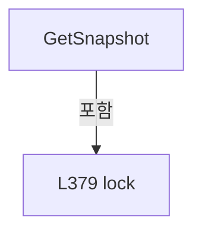

변경 전 점검: 입력/반환 타입, 위 호출자, 예외/취소 경로, 공유 상태와 저장·전송 소비자를 함께 확인합니다. 값의 단위나 물리 방향을 이름만으로 확정하지 않습니다.

### MethodDeclaration `Begin` · L383–401

[Drilling.Common/Review/CAutoFineReviewCoordinator.cs:383–401](https://github.com/kjuws10-rgb/A3Drilling/blob/5aee8e58439c9b455cae7c9593c9be986c3e682e/Drilling.Common/Review/CAutoFineReviewCoordinator.cs#L383-L401)

| 항목 | 실제 추출 값 |
| --- | --- |
| 서명 | System.Guid Drilling.Common.Review.CFineReviewMonitorStore.Begin(Drilling.Common.Review.ST_FINE_REVIEW_REQUEST, int) |
| 접근/수식자 | Internal / internal |
| 반환/값 타입 | System.Guid |
| 소속 타입 | NamedType:Drilling.Common.Review.CFineReviewMonitorStore |

입력 계약:

| 이름 | 타입 | 전달 | 선택/기본값 |
| --- | --- | --- | --- |
| request | Drilling.Common.Review.ST_FINE_REVIEW_REQUEST | None | False /  |
| stageDeviceNo | int | None | False /  |

정적 호출자로 확인된 위치:

| 호출 파일/행 | 호출 표현식 | 런타임 분기 가능 |
| --- | --- | --- |
| [Drilling.Common/Review/CReviewManager.cs:2566–2566](https://github.com/kjuws10-rgb/A3Drilling/blob/5aee8e58439c9b455cae7c9593c9be986c3e682e/Drilling.Common/Review/CReviewManager.cs#L2566-L2566) | FineMonitor.Begin | False |

호출하는 대상과 해석 범위:

| 원본 행 | 표현식 | 분석 상태 | 대상/소스 위치 |
| --- | --- | --- | --- |
| 400 | Replace | resolved | System.Guid Drilling.Common.Review.CFineReviewMonitorStore.Replace(Drilling.Common.Review.ST_FINE_REVIEW_REQUEST, int, Drilling.Common.Review.EN_REVIEW_SEQUENCE_STATE, string) · Drilling.Common/Review/CAutoFineReviewCoordinator.cs:404 |

본문의 실제 연산·분기·예외·반환 순서(원문 위치 순):

| 원본 행 | 종류 | 주석 해설 |
| --- | --- | --- |
| 385 | lock | 공유 상태의 임계 구역에 진입합니다: lock (_gate) |
| 386 | if | 조건에 따라 분기합니다: if (_latest is { } staged && staged.RunId == request.PreparedMonitorRunId && staged.Progress.State == EN_REVIEW_SEQUENCE_STATE.Idle) |
| 388 | assignment | 값을 대상에 대입합니다: _latest = staged with { Revision = ++_revision, Progress = staged.Progress with { State = EN_REVIEW_SEQUENCE_STATE.Running, Message = "FINE 검사 시작" } } |
| 390 | assignment | 값을 대상에 대입합니다: Revision = ++_revision |
| 391 | assignment | 값을 대상에 대입합니다: Progress = staged.Progress with { State = EN_REVIEW_SEQUENCE_STATE.Running, Message = "FINE 검사 시작" } |
| 393 | assignment | 값을 대상에 대입합니다: State = EN_REVIEW_SEQUENCE_STATE.Running |
| 394 | assignment | 값을 대상에 대입합니다: Message = "FINE 검사 시작" |
| 397 | return | 호출자에게 값 또는 제어를 반환합니다: return staged.RunId; |
| 400 | call | 함수·델리게이트 또는 객체 생성자를 호출합니다: Replace(request, stageDeviceNo, EN_REVIEW_SEQUENCE_STATE.Running, "검사 준비 중") |
| 400 | return | 호출자에게 값 또는 제어를 반환합니다: return Replace(request, stageDeviceNo, EN_REVIEW_SEQUENCE_STATE.Running, "검사 준비 중"); |

제어 구문의 포함 구조(실제 실행 순서/CFG가 아닌 구문 탐색 그림):

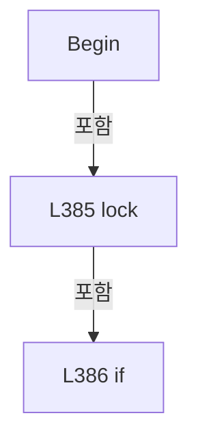

변경 전 점검: 입력/반환 타입, 위 호출자, 예외/취소 경로, 공유 상태와 저장·전송 소비자를 함께 확인합니다. 값의 단위나 물리 방향을 이름만으로 확정하지 않습니다.

### MethodDeclaration `Stage` · L403–403

[Drilling.Common/Review/CAutoFineReviewCoordinator.cs:403–403](https://github.com/kjuws10-rgb/A3Drilling/blob/5aee8e58439c9b455cae7c9593c9be986c3e682e/Drilling.Common/Review/CAutoFineReviewCoordinator.cs#L403-L403)

| 항목 | 실제 추출 값 |
| --- | --- |
| 서명 | System.Guid Drilling.Common.Review.CFineReviewMonitorStore.Stage(Drilling.Common.Review.ST_FINE_REVIEW_REQUEST, int) |
| 접근/수식자 | Internal / internal |
| 반환/값 타입 | System.Guid |
| 소속 타입 | NamedType:Drilling.Common.Review.CFineReviewMonitorStore |

입력 계약:

| 이름 | 타입 | 전달 | 선택/기본값 |
| --- | --- | --- | --- |
| request | Drilling.Common.Review.ST_FINE_REVIEW_REQUEST | None | False /  |
| stageDeviceNo | int | None | False /  |

정적 호출자로 확인된 위치:

| 호출 파일/행 | 호출 표현식 | 런타임 분기 가능 |
| --- | --- | --- |
| [Drilling.Common/Review/CReviewManager.cs:2502–2502](https://github.com/kjuws10-rgb/A3Drilling/blob/5aee8e58439c9b455cae7c9593c9be986c3e682e/Drilling.Common/Review/CReviewManager.cs#L2502-L2502) | FineMonitor.Stage | False |

호출하는 대상과 해석 범위:

| 원본 행 | 표현식 | 분석 상태 | 대상/소스 위치 |
| --- | --- | --- | --- |
| 403 | Replace | resolved | System.Guid Drilling.Common.Review.CFineReviewMonitorStore.Replace(Drilling.Common.Review.ST_FINE_REVIEW_REQUEST, int, Drilling.Common.Review.EN_REVIEW_SEQUENCE_STATE, string) · Drilling.Common/Review/CAutoFineReviewCoordinator.cs:404 |

본문의 실제 연산·분기·예외·반환 순서(원문 위치 순):

| 원본 행 | 종류 | 주석 해설 |
| --- | --- | --- |
| 403 | call | 함수·델리게이트 또는 객체 생성자를 호출합니다: Replace(request, stageDeviceNo, EN_REVIEW_SEQUENCE_STATE.Idle, "검사 계획 확정 · Stage Review START 대기") |

변경 전 점검: 입력/반환 타입, 위 호출자, 예외/취소 경로, 공유 상태와 저장·전송 소비자를 함께 확인합니다. 값의 단위나 물리 방향을 이름만으로 확정하지 않습니다.

### MethodDeclaration `Replace` · L404–432

[Drilling.Common/Review/CAutoFineReviewCoordinator.cs:404–432](https://github.com/kjuws10-rgb/A3Drilling/blob/5aee8e58439c9b455cae7c9593c9be986c3e682e/Drilling.Common/Review/CAutoFineReviewCoordinator.cs#L404-L432)

| 항목 | 실제 추출 값 |
| --- | --- |
| 서명 | System.Guid Drilling.Common.Review.CFineReviewMonitorStore.Replace(Drilling.Common.Review.ST_FINE_REVIEW_REQUEST, int, Drilling.Common.Review.EN_REVIEW_SEQUENCE_STATE, string) |
| 접근/수식자 | Private / private |
| 반환/값 타입 | System.Guid |
| 소속 타입 | NamedType:Drilling.Common.Review.CFineReviewMonitorStore |

입력 계약:

| 이름 | 타입 | 전달 | 선택/기본값 |
| --- | --- | --- | --- |
| request | Drilling.Common.Review.ST_FINE_REVIEW_REQUEST | None | False /  |
| stageDeviceNo | int | None | False /  |
| state | Drilling.Common.Review.EN_REVIEW_SEQUENCE_STATE | None | False /  |
| message | string | None | False /  |

정적 호출자로 확인된 위치:

| 호출 파일/행 | 호출 표현식 | 런타임 분기 가능 |
| --- | --- | --- |
| [Drilling.Common/Review/CAutoFineReviewCoordinator.cs:400–400](https://github.com/kjuws10-rgb/A3Drilling/blob/5aee8e58439c9b455cae7c9593c9be986c3e682e/Drilling.Common/Review/CAutoFineReviewCoordinator.cs#L400-L400) | Replace | False |
| [Drilling.Common/Review/CAutoFineReviewCoordinator.cs:403–403](https://github.com/kjuws10-rgb/A3Drilling/blob/5aee8e58439c9b455cae7c9593c9be986c3e682e/Drilling.Common/Review/CAutoFineReviewCoordinator.cs#L403-L403) | Replace | False |

호출하는 대상과 해석 범위:

| 원본 행 | 표현식 | 분석 상태 | 대상/소스 위치 |
| --- | --- | --- | --- |
| 412 | new ReadOnlyDictionary<string, string> | resolved | System.Collections.ObjectModel.ReadOnlyDictionary<string, string>.ReadOnlyDictionary(System.Collections.Generic.IDictionary<string, string>) |
| 412 | new Dictionary<string, string> | resolved | System.Collections.Generic.Dictionary<string, string>.Dictionary(System.Collections.Generic.IEnumerable<System.Collections.Generic.KeyValuePair<string, string>>, System.Collections.Generic.IEqualityComparer<string>?) |
| 420 | Array.AsReadOnly | resolved | System.Collections.ObjectModel.ReadOnlyCollection<Drilling.Common.Review.ST_REVIEW_PLAN_POINT> System.Array.AsReadOnly<Drilling.Common.Review.ST_REVIEW_PLAN_POINT>(Drilling.Common.Review.ST_REVIEW_PLAN_POINT[]) |
| 420 | request.Plan.Points.ToArray | resolved | Drilling.Common.Review.ST_REVIEW_PLAN_POINT[] System.Collections.Generic.IEnumerable<Drilling.Common.Review.ST_REVIEW_PLAN_POINT>.ToArray<Drilling.Common.Review.ST_REVIEW_PLAN_POINT>() |
| 422 | Array.AsReadOnly | resolved | System.Collections.ObjectModel.ReadOnlyCollection<Drilling.Common.Review.ST_FINE_REVIEW_LINE> System.Array.AsReadOnly<Drilling.Common.Review.ST_FINE_REVIEW_LINE>(Drilling.Common.Review.ST_FINE_REVIEW_LINE[]) |
| 422 | request.Lines.Select(line => line with { Points = Array.AsReadOnly(line.Points.ToArray()) }).ToArray | resolved | Drilling.Common.Review.ST_FINE_REVIEW_LINE[] System.Collections.Generic.IEnumerable<Drilling.Common.Review.ST_FINE_REVIEW_LINE>.ToArray<Drilling.Common.Review.ST_FINE_REVIEW_LINE>() |
| 422 | request.Lines.Select | resolved | System.Collections.Generic.IEnumerable<Drilling.Common.Review.ST_FINE_REVIEW_LINE> System.Collections.Generic.IEnumerable<Drilling.Common.Review.ST_FINE_REVIEW_LINE>.Select<Drilling.Common.Review.ST_FINE_REVIEW_LINE, Drilling.Common.Review.ST_FINE_REVIEW_LINE>(System.Func<Drilling.Common.Review.ST_FINE_REVIEW_LINE, Drilling.Common.Review.ST_FINE_REVIEW_LINE>) |
| 422 | Array.AsReadOnly | resolved | System.Collections.ObjectModel.ReadOnlyCollection<Drilling.Common.Review.ST_REVIEW_PLAN_POINT> System.Array.AsReadOnly<Drilling.Common.Review.ST_REVIEW_PLAN_POINT>(Drilling.Common.Review.ST_REVIEW_PLAN_POINT[]) |
| 422 | line.Points.ToArray | resolved | Drilling.Common.Review.ST_REVIEW_PLAN_POINT[] System.Collections.Generic.IEnumerable<Drilling.Common.Review.ST_REVIEW_PLAN_POINT>.ToArray<Drilling.Common.Review.ST_REVIEW_PLAN_POINT>() |
| 424 | Guid.NewGuid | resolved | System.Guid System.Guid.NewGuid() |
| 425 | new ST_FINE_REVIEW_SNAPSHOT | resolved | Drilling.Common.Review.ST_FINE_REVIEW_SNAPSHOT.ST_FINE_REVIEW_SNAPSHOT(string, System.Collections.Generic.IReadOnlyList<Drilling.Common.Review.ST_FINE_REVIEW_LINE>, Drilling.Common.Review.EN_REVIEW_SEQUENCE_STATE, string, bool) · Drilling.Common/Review/CReviewManager.cs:4203 |
| 430 | new | resolved | Drilling.Common.Review.ST_FINE_REVIEW_MONITOR.ST_FINE_REVIEW_MONITOR(System.Guid, long, Drilling.Common.Review.ST_FINE_REVIEW_REQUEST, Drilling.Common.Review.ST_FINE_REVIEW_SNAPSHOT, int, System.DateTimeOffset, string) · Drilling.Common/Review/CAutoFineReviewCoordinator.cs:362 |

본문의 실제 연산·분기·예외·반환 순서(원문 위치 순):

| 원본 행 | 종류 | 주석 해설 |
| --- | --- | --- |
| 406 | local-declaration | 지역 변수를 선언합니다: var context = request.Context; |
| 406 | variable-initializer | 변수의 초기값을 지정합니다: context = request.Context |
| 407 | if | 조건에 따라 분기합니다: if (context is not null) |
| 408 | assignment | 값을 대상에 대입합니다: request = request with { Context = context with { Parameters = new ReadOnlyDictionary<string, string>(new Dictionary<string, string>(context.Parameters, StringComparer.OrdinalIgnoreCase)) } } |
| 410 | assignment | 값을 대상에 대입합니다: Context = context with { Parameters = new ReadOnlyDictionary<string, string>(new Dictionary<string, string>(context.Parameters, StringComparer.OrdinalIgnoreCase)) } |
| 412 | assignment | 값을 대상에 대입합니다: Parameters = new ReadOnlyDictionary<string, string>(new Dictionary<string, string>(context.Parameters, StringComparer.OrdinalIgnoreCase)) |
| 412 | call | 함수·델리게이트 또는 객체 생성자를 호출합니다: new ReadOnlyDictionary<string, string>(new Dictionary<string, string>(context.Parameters, StringComparer.OrdinalIgnoreCase)) |
| 412 | call | 함수·델리게이트 또는 객체 생성자를 호출합니다: new Dictionary<string, string>(context.Parameters, StringComparer.OrdinalIgnoreCase) |
| 416 | assignment | 값을 대상에 대입합니다: request = request with { Plan = request.Plan with { Points = Array.AsReadOnly(request.Plan.Points.ToArray()) }, Lines = Array.AsReadOnly(request.Lines.Select(line => line with { Points = Array.AsReadOnly(line.Points.ToArray()) }). |
| 418 | assignment | 값을 대상에 대입합니다: Plan = request.Plan with { Points = Array.AsReadOnly(request.Plan.Points.ToArray()) } |
| 420 | assignment | 값을 대상에 대입합니다: Points = Array.AsReadOnly(request.Plan.Points.ToArray()) |
| 420 | call | 함수·델리게이트 또는 객체 생성자를 호출합니다: Array.AsReadOnly(request.Plan.Points.ToArray()) |
| 420 | call | 함수·델리게이트 또는 객체 생성자를 호출합니다: request.Plan.Points.ToArray() |
| 422 | assignment | 값을 대상에 대입합니다: Lines = Array.AsReadOnly(request.Lines.Select(line => line with { Points = Array.AsReadOnly(line.Points.ToArray()) }).ToArray()) |
| 422 | assignment | 값을 대상에 대입합니다: Points = Array.AsReadOnly(line.Points.ToArray()) |
| 422 | call | 함수·델리게이트 또는 객체 생성자를 호출합니다: Array.AsReadOnly(request.Lines.Select(line => line with { Points = Array.AsReadOnly(line.Points.ToArray()) }).ToArray()) |
| 422 | call | 함수·델리게이트 또는 객체 생성자를 호출합니다: request.Lines.Select(line => line with { Points = Array.AsReadOnly(line.Points.ToArray()) }).ToArray() |
| 422 | call | 함수·델리게이트 또는 객체 생성자를 호출합니다: request.Lines.Select(line => line with { Points = Array.AsReadOnly(line.Points.ToArray()) }) |
| 422 | call | 함수·델리게이트 또는 객체 생성자를 호출합니다: Array.AsReadOnly(line.Points.ToArray()) |
| 422 | call | 함수·델리게이트 또는 객체 생성자를 호출합니다: line.Points.ToArray() |
| 424 | call | 함수·델리게이트 또는 객체 생성자를 호출합니다: Guid.NewGuid() |
| 424 | local-declaration | 지역 변수를 선언합니다: var id = Guid.NewGuid(); |
| 424 | variable-initializer | 변수의 초기값을 지정합니다: id = Guid.NewGuid() |
| 425 | call | 함수·델리게이트 또는 객체 생성자를 호출합니다: new ST_FINE_REVIEW_SNAPSHOT(request.Plan.RecipeId, request.Lines, state, message) { RunId = id } |
| 425 | local-declaration | 지역 변수를 선언합니다: var initial = new ST_FINE_REVIEW_SNAPSHOT(request.Plan.RecipeId, request.Lines, state, message) { RunId = id }; |
| 425 | variable-initializer | 변수의 초기값을 지정합니다: initial = new ST_FINE_REVIEW_SNAPSHOT(request.Plan.RecipeId, request.Lines, state, message) { RunId = id } |
| 427 | assignment | 값을 대상에 대입합니다: RunId = id |
| 429 | lock | 공유 상태의 임계 구역에 진입합니다: lock (_gate) |
| 430 | assignment | 값을 대상에 대입합니다: _latest = new(id, ++_revision, request, initial, stageDeviceNo, DateTimeOffset.Now) |
| 430 | call | 함수·델리게이트 또는 객체 생성자를 호출합니다: new(id, ++_revision, request, initial, stageDeviceNo, DateTimeOffset.Now) |
| 431 | return | 호출자에게 값 또는 제어를 반환합니다: return id; |

제어 구문의 포함 구조(실제 실행 순서/CFG가 아닌 구문 탐색 그림):

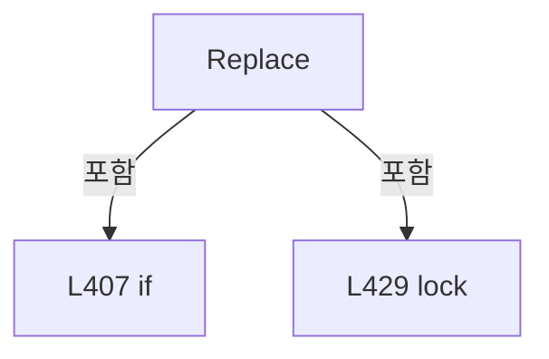

변경 전 점검: 입력/반환 타입, 위 호출자, 예외/취소 경로, 공유 상태와 저장·전송 소비자를 함께 확인합니다. 값의 단위나 물리 방향을 이름만으로 확정하지 않습니다.

### MethodDeclaration `Publish` · L434–443

[Drilling.Common/Review/CAutoFineReviewCoordinator.cs:434–443](https://github.com/kjuws10-rgb/A3Drilling/blob/5aee8e58439c9b455cae7c9593c9be986c3e682e/Drilling.Common/Review/CAutoFineReviewCoordinator.cs#L434-L443)

| 항목 | 실제 추출 값 |
| --- | --- |
| 서명 | void Drilling.Common.Review.CFineReviewMonitorStore.Publish(Drilling.Common.Review.ST_FINE_REVIEW_SNAPSHOT) |
| 접근/수식자 | Internal / internal |
| 반환/값 타입 | void |
| 소속 타입 | NamedType:Drilling.Common.Review.CFineReviewMonitorStore |

입력 계약:

| 이름 | 타입 | 전달 | 선택/기본값 |
| --- | --- | --- | --- |
| snapshot | Drilling.Common.Review.ST_FINE_REVIEW_SNAPSHOT | None | False /  |

정적 호출자로 확인된 위치:

| 호출 파일/행 | 호출 표현식 | 런타임 분기 가능 |
| --- | --- | --- |
| [Drilling.Common/Review/CAutoFineReviewCoordinator.cs:63–63](https://github.com/kjuws10-rgb/A3Drilling/blob/5aee8e58439c9b455cae7c9593c9be986c3e682e/Drilling.Common/Review/CAutoFineReviewCoordinator.cs#L63-L63) | review.FineMonitor.Publish | False |
| [Drilling.Common/Review/CReviewManager.cs:2555–2555](https://github.com/kjuws10-rgb/A3Drilling/blob/5aee8e58439c9b455cae7c9593c9be986c3e682e/Drilling.Common/Review/CReviewManager.cs#L2555-L2555) | FineMonitor.Publish | False |
| [Drilling.Common/Review/CReviewManager.cs:2922–2922](https://github.com/kjuws10-rgb/A3Drilling/blob/5aee8e58439c9b455cae7c9593c9be986c3e682e/Drilling.Common/Review/CReviewManager.cs#L2922-L2922) | FineMonitor.Publish | False |

본문의 실제 연산·분기·예외·반환 순서(원문 위치 순):

| 원본 행 | 종류 | 주석 해설 |
| --- | --- | --- |
| 436 | lock | 공유 상태의 임계 구역에 진입합니다: lock (_gate) |
| 437 | if | 조건에 따라 분기합니다: if (_latest is { } latest && latest.RunId == snapshot.RunId) |
| 438 | assignment | 값을 대상에 대입합니다: _latest = latest with { Revision = ++_revision, Progress = snapshot } |
| 440 | assignment | 값을 대상에 대입합니다: Revision = ++_revision |
| 441 | assignment | 값을 대상에 대입합니다: Progress = snapshot |

제어 구문의 포함 구조(실제 실행 순서/CFG가 아닌 구문 탐색 그림):

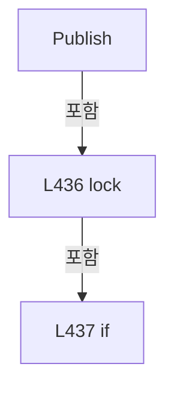

변경 전 점검: 입력/반환 타입, 위 호출자, 예외/취소 경로, 공유 상태와 저장·전송 소비자를 함께 확인합니다. 값의 단위나 물리 방향을 이름만으로 확정하지 않습니다.

### MethodDeclaration `MarkOffsetSaved` · L445–454

[Drilling.Common/Review/CAutoFineReviewCoordinator.cs:445–454](https://github.com/kjuws10-rgb/A3Drilling/blob/5aee8e58439c9b455cae7c9593c9be986c3e682e/Drilling.Common/Review/CAutoFineReviewCoordinator.cs#L445-L454)

| 항목 | 실제 추출 값 |
| --- | --- |
| 서명 | void Drilling.Common.Review.CFineReviewMonitorStore.MarkOffsetSaved(System.Guid, string) |
| 접근/수식자 | Public / public |
| 반환/값 타입 | void |
| 소속 타입 | NamedType:Drilling.Common.Review.CFineReviewMonitorStore |

입력 계약:

| 이름 | 타입 | 전달 | 선택/기본값 |
| --- | --- | --- | --- |
| runId | System.Guid | None | False /  |
| file | string | None | False /  |

정적 호출자로 확인된 위치:

| 호출 파일/행 | 호출 표현식 | 런타임 분기 가능 |
| --- | --- | --- |
| [Drilling.Common/Review/CAutoFineReviewCoordinator.cs:164–164](https://github.com/kjuws10-rgb/A3Drilling/blob/5aee8e58439c9b455cae7c9593c9be986c3e682e/Drilling.Common/Review/CAutoFineReviewCoordinator.cs#L164-L164) | review.FineMonitor.MarkOffsetSaved | False |
| [Drilling.UI/Menu/Menus/CMenuCorrection.cs:3074–3074](https://github.com/kjuws10-rgb/A3Drilling/blob/5aee8e58439c9b455cae7c9593c9be986c3e682e/Drilling.UI/Menu/Menus/CMenuCorrection.cs#L3074-L3074) | .FineMonitor.MarkOffsetSaved | False |

호출하는 대상과 해석 범위:

| 원본 행 | 표현식 | 분석 상태 | 대상/소스 위치 |
| --- | --- | --- | --- |
| 448 | string.IsNullOrWhiteSpace | resolved | bool string.IsNullOrWhiteSpace(string?) |

본문의 실제 연산·분기·예외·반환 순서(원문 위치 순):

| 원본 행 | 종류 | 주석 해설 |
| --- | --- | --- |
| 447 | lock | 공유 상태의 임계 구역에 진입합니다: lock (_gate) |
| 448 | call | 함수·델리게이트 또는 객체 생성자를 호출합니다: string.IsNullOrWhiteSpace(file) |
| 448 | if | 조건에 따라 분기합니다: if (_latest is { } latest && latest.RunId == runId && !string.IsNullOrWhiteSpace(file)) |
| 449 | assignment | 값을 대상에 대입합니다: _latest = latest with { Revision = ++_revision, OffsetFile = file } |
| 451 | assignment | 값을 대상에 대입합니다: Revision = ++_revision |
| 452 | assignment | 값을 대상에 대입합니다: OffsetFile = file |

제어 구문의 포함 구조(실제 실행 순서/CFG가 아닌 구문 탐색 그림):

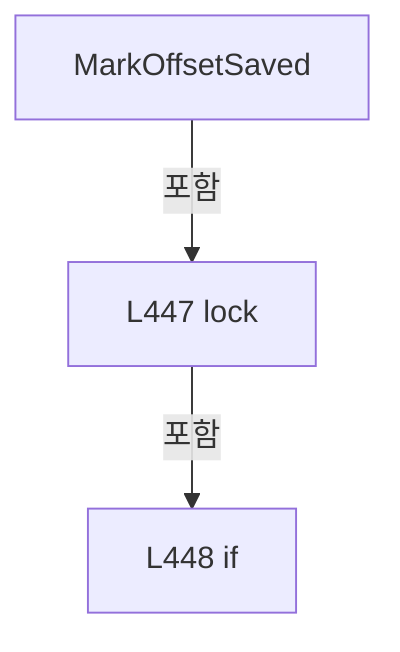

변경 전 점검: 입력/반환 타입, 위 호출자, 예외/취소 경로, 공유 상태와 저장·전송 소비자를 함께 확인합니다. 값의 단위나 물리 방향을 이름만으로 확정하지 않습니다.

## 구문·바인딩 한계

전체 WPF/벤더 SDK/프로젝트별 빌드 조건을 로드한 정식 빌드가 아닙니다. `resolved`는 이 부분 컴파일에서의 심볼 연결이며 virtual/interface/delegate/이벤트/Reflection/XAML의 실제 런타임 구현을 확정하지 않습니다. `candidate`와 `unresolved`는 후속 확인 대상으로 남깁니다.

## 원문 전체 주석 해설본

[원본 모든 행과 행별 해설 보기](../../../annotated/Drilling.Common/Review/CAutoFineReviewCoordinator.cs.annotated.txt)

원본을 빠뜨리거나 임의로 줄이지 않았습니다. `L000001 |` 표시는 원본 행 번호, `// 해설`은 별도 설명입니다. 실행용 소스가 아닌 문서입니다.

## 수정·재검증 체크

- 원본 Commit과 현재 작업 파일 SHA가 같은지 먼저 확인합니다. 다르면 이 문서를 과거 버전 자료로 취급합니다.
- 선언·직접 호출·이벤트/인터페이스 경계·설정 소비를 함께 확인합니다. 정적 연결의 빈 곳을 정상 경로로 추정하지 않습니다.
- 저장 형식/단위/식별자·재시도·취소·예외·롤백에 영향을 주는 변경은 상세 해설장과 호출자를 다시 검토합니다.
- 도구의 구문 추출과 별도 정적 추적 해설, 실제 빌드·시뮬레이션·실장비 검증 결과를 분리합니다.
