# Drilling.Common/Review/CReviewManager.cs

| 항목 | 내용 |
| --- | --- |
| 원본 저장소 | https://github.com/kjuws10-rgb/A3Drilling.git |
| 원본 Commit | 5aee8e58439c9b455cae7c9593c9be986c3e682e |
| 원본 SHA256 | a843c40992761081173cd7fd16892559a4204436fecb756ebd0787c25683bf86 |
| 파일 분류 | code |
| 원본 크기/행 | 232,626 bytes / 4,359 physical lines |
| 인코딩 | utf-8-sig |
| 검토 범위 | 구문/부분 의미 분석에서 추출한 사실. 동작·물리 단위·실장비 합격을 보증하지 않습니다. |
| 원본 링크 | [고정 Commit 원본](https://github.com/kjuws10-rgb/A3Drilling/blob/5aee8e58439c9b455cae7c9593c9be986c3e682e/Drilling.Common/Review/CReviewManager.cs) |

## 파일의 역할과 읽는 순서

리뷰 계획·측정·결과 해석 계층입니다. 물리 이동 좌표와 Vision 식별 패킷, 측정 저장의 역할을 별도로 확인합니다.

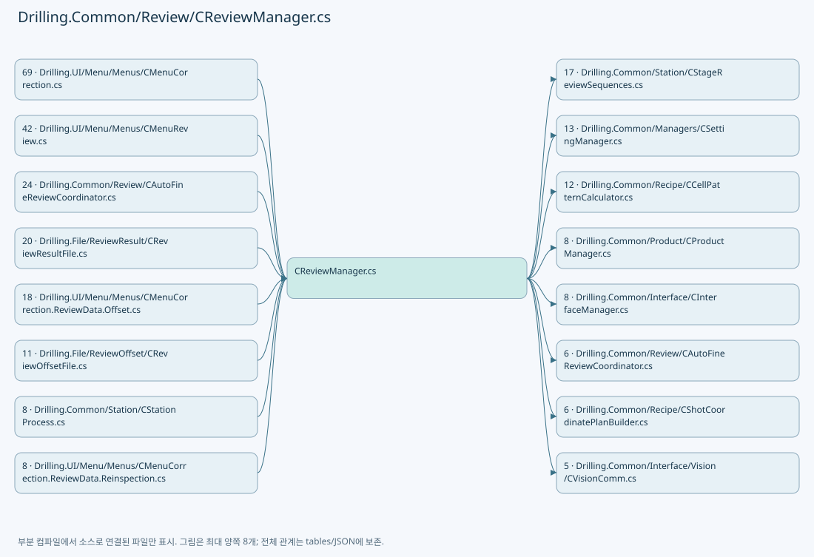

## 네임스페이스·타입·상속

| 타입 | 구분 | 원본 범위 | 선언/상속 |
| --- | --- | --- | --- |
| CReviewManager | ClassDeclaration | 17–3574 | CReviewManager: IReviewManager |
| CLazyReviewPointList | ClassDeclaration | 861–909 | CLazyReviewPointList: IReadOnlyList<ST_REVIEW_PLAN_POINT>, IReviewPointListInfo, IReviewCellPointSource |
| ST_REVIEW_MEASURE_RESULT | RecordDeclaration | 1083–1089 | ST_REVIEW_MEASURE_RESULT |
| EN_PRODUCT_REVIEW_UPDATE_OUTCOME | EnumDeclaration | 1091–1097 | EN_PRODUCT_REVIEW_UPDATE_OUTCOME |
| ST_PRODUCT_REVIEW_UPDATE_RESULT | RecordDeclaration | 1099–1103 | ST_PRODUCT_REVIEW_UPDATE_RESULT |
| ST_REVIEW_HEAD_LAYOUT | RecordDeclaration | 1150–1156 | ST_REVIEW_HEAD_LAYOUT |
| ST_REVIEW_HEAD_FIELD | RecordDeclaration | 1158–1158 | ST_REVIEW_HEAD_FIELD |
| ST_REVIEW_COORDINATE_SETTINGS | RecordDeclaration | 1159–1159 | ST_REVIEW_COORDINATE_SETTINGS |
| CReviewStageMotion | ClassDeclaration | 2382–2414 | CReviewStageMotion: IDisposable |
| DefaultInspectionSession | ClassDeclaration | 2994–3034 | DefaultInspectionSession: IDisposable |
| ZeroLineVisionSession | ClassDeclaration | 3330–3413 | ZeroLineVisionSession: IDisposable |
| ST_FINE_OFFSET_DELTA | RecordDeclaration | 3576–3576 | ST_FINE_OFFSET_DELTA |
| CFlyingCountMismatchException | ClassDeclaration | 3577–3577 | CFlyingCountMismatchException: InvalidOperationException("Vision 촬영 개수 불일치 / " + response) |
| EN_VISION_FLIP_TYPE | EnumDeclaration | 3578–3585 | EN_VISION_FLIP_TYPE |
| ST_REVIEW_COORDINATE_OFFSET | RecordStructDeclaration | 3587–3587 | ST_REVIEW_COORDINATE_OFFSET |
| ST_REVIEW_COORDINATE_FORMULA | RecordStructDeclaration | 3588–3588 | ST_REVIEW_COORDINATE_FORMULA |
| ST_REVIEW_FAILURE_MESSAGE | RecordDeclaration | 3589–3602 | ST_REVIEW_FAILURE_MESSAGE |
| CReviewFailureMessageBuilder | ClassDeclaration | 3604–3786 | CReviewFailureMessageBuilder |
| ST_REVIEW_FAILURE_PART | RecordDeclaration | 3785–3785 | ST_REVIEW_FAILURE_PART |
| ST_BEAM_INSPECTION_SNAPSHOT | RecordDeclaration | 3788–3798 | ST_BEAM_INSPECTION_SNAPSHOT |
| ST_BEAM_INSPECTION_RESULT_BEAM | RecordDeclaration | 3801–3804 | ST_BEAM_INSPECTION_RESULT_BEAM |
| ST_BEAM_INSPECTION_RESULT_SHOT | RecordDeclaration | 3806–3806 | ST_BEAM_INSPECTION_RESULT_SHOT |
| ST_BEAM_INSPECTION_RESULT_FILE_DATA | RecordDeclaration | 3807–3811 | ST_BEAM_INSPECTION_RESULT_FILE_DATA |
| IReviewPointListInfo | InterfaceDeclaration | 3812–3815 | IReviewPointListInfo |
| ST_REVIEW_CELL_POINT_RANGE | RecordStructDeclaration | 3823–3823 | ST_REVIEW_CELL_POINT_RANGE |
| IReviewCellPointSource | InterfaceDeclaration | 3824–3829 | IReviewCellPointSource |
| EN_REVIEW_POINT_STATE | EnumDeclaration | 3831–3838 | EN_REVIEW_POINT_STATE |
| EN_REVIEW_SEQUENCE_STATE | EnumDeclaration | 3840–3848 | EN_REVIEW_SEQUENCE_STATE |
| EN_REVIEW_RULE_TYPE | EnumDeclaration | 3850–3859 | EN_REVIEW_RULE_TYPE |
| ST_REVIEW_SEQUENCE_STATUS | RecordDeclaration | 3861–3861 | ST_REVIEW_SEQUENCE_STATUS |
| ST_REVIEW_PLAN_POINT | RecordDeclaration | 3862–3885 | ST_REVIEW_PLAN_POINT |
| ST_REVIEW_BEAM_POSITION | RecordDeclaration | 3887–3887 | ST_REVIEW_BEAM_POSITION |
| ST_REVIEW_HEAD_SCOPE | RecordDeclaration | 3894–3894 | ST_REVIEW_HEAD_SCOPE |
| CReviewShotNameFormatter | ClassDeclaration | 3895–3919 | CReviewShotNameFormatter |
| ST_REVIEW_PLAN | RecordDeclaration | 3921–3999 | ST_REVIEW_PLAN |
| CReviewPointCache | ClassDeclaration | 3995–3998 | CReviewPointCache |
| ST_REVIEW_CORRECTION_PLAN | RecordDeclaration | 4001–4007 | ST_REVIEW_CORRECTION_PLAN |
| ST_REVIEW_RESULT_DATA | RecordDeclaration | 4008–4013 | ST_REVIEW_RESULT_DATA |
| ST_REVIEW_RESULT_FILE_ROW | RecordDeclaration | 4015–4023 | ST_REVIEW_RESULT_FILE_ROW |
| ST_REVIEW_RESULT_FILE_DATA | RecordDeclaration | 4024–4041 | ST_REVIEW_RESULT_FILE_DATA |
| ST_REVIEW_REINSPECTION_UPDATE | RecordDeclaration | 4043–4053 | ST_REVIEW_REINSPECTION_UPDATE |
| IReviewResultFile | InterfaceDeclaration | 4055–4061 | IReviewResultFile |
| ST_REVIEW_RESULT_CATALOG_ITEM | RecordDeclaration | 4063–4075 | ST_REVIEW_RESULT_CATALOG_ITEM |
| CReviewResultFileBase | ClassDeclaration | 4080–4097 | CReviewResultFileBase: IReviewResultFile |
| ST_REVIEW_OFFSET_ROW | RecordDeclaration | 4099–4103 | ST_REVIEW_OFFSET_ROW |
| ST_REVIEW_OFFSET_FILE_DATA | RecordDeclaration | 4105–4111 | ST_REVIEW_OFFSET_FILE_DATA |
| ST_REVIEW_OFFSET_ROLLBACK_RESULT | RecordDeclaration | 4113–4118 | ST_REVIEW_OFFSET_ROLLBACK_RESULT |
| ST_REVIEW_OFFSET_SOURCE_APPLICATION | RecordDeclaration | 4120–4124 | ST_REVIEW_OFFSET_SOURCE_APPLICATION |
| CReviewOffsetDuplicateSourceException | ClassDeclaration | 4126–4133 | CReviewOffsetDuplicateSourceException: InvalidOperationException( $"{existingApplication.AppliedAt:yyyy-MM-dd} 적용 이력에 동일한 Review Result가 있습니다: " + existingApplication.SourceResultFile) |
| CReviewOffsetFileBase | ClassDeclaration | 4135–4155 | CReviewOffsetFileBase |
| IReviewManager | InterfaceDeclaration | 4157–4175 | IReviewManager |
| EN_FINE_INSPECTION_METHOD | EnumDeclaration | 4177–4181 | EN_FINE_INSPECTION_METHOD |
| EN_FINE_REVIEW_LINE_STATE | EnumDeclaration | 4183–4190 | EN_FINE_REVIEW_LINE_STATE |
| ST_FINE_REVIEW_LINE | RecordDeclaration | 4192–4192 | ST_FINE_REVIEW_LINE |
| ST_FINE_REVIEW_REQUEST | RecordDeclaration | 4193–4201 | ST_FINE_REVIEW_REQUEST |
| ST_FINE_REVIEW_SNAPSHOT | RecordDeclaration | 4203–4208 | ST_FINE_REVIEW_SNAPSHOT |
| ST_FINE_REVIEW_RESULT_DATA | RecordDeclaration | 4210–4215 | ST_FINE_REVIEW_RESULT_DATA |
| EN_ONE_SHOT_ACTION | EnumDeclaration | 4217–4222 | EN_ONE_SHOT_ACTION |
| EN_ONE_SHOT_METHOD | EnumDeclaration | 4224–4228 | EN_ONE_SHOT_METHOD |
| ST_ONE_SHOT_RESULT | RecordDeclaration | 4230–4236 | ST_ONE_SHOT_RESULT |
| ST_ONE_SHOT_RESULT_DATA | RecordDeclaration | 4237–4237 | ST_ONE_SHOT_RESULT_DATA |
| ST_ROUGH_REVIEW_SNAPSHOT | RecordDeclaration | 4238–4242 | ST_ROUGH_REVIEW_SNAPSHOT |
| ST_ROUGH_REVIEW_RESULT_DATA | RecordDeclaration | 4244–4255 | ST_ROUGH_REVIEW_RESULT_DATA |
| ST_ROUGH_REVIEW_MEASUREMENT | RecordDeclaration | 4257–4260 | ST_ROUGH_REVIEW_MEASUREMENT |
| ST_REVIEW_MOTION_PARAMETERS | RecordDeclaration | 4261–4278 | ST_REVIEW_MOTION_PARAMETERS |
| CReviewRuntimePoints | ClassDeclaration | 4282–4358 | CReviewRuntimePoints: IReadOnlyList<ST_REVIEW_PLAN_POINT> |
| Index | ClassDeclaration | 4284–4307 | Index |
| Selection | ClassDeclaration | 4345–4357 | Selection: IReadOnlyList<ST_REVIEW_PLAN_POINT> |

## 멤버 빠른 목록

| 이름 | 종류 | 범위 | 서명 |
| --- | --- | --- | --- |
| DefaultReviewBeamNo | FieldDeclaration | L26–26 | int Drilling.Common.Review.CReviewManager.DefaultReviewBeamNo |
| MaxHeadCount | FieldDeclaration | L27–27 | int Drilling.Common.Review.CReviewManager.MaxHeadCount |
| DefaultHeadCount | FieldDeclaration | L28–28 | int Drilling.Common.Review.CReviewManager.DefaultHeadCount |
| DefaultCellCount | FieldDeclaration | L29–29 | int Drilling.Common.Review.CReviewManager.DefaultCellCount |
| IofInspectionType | FieldDeclaration | L30–30 | int Drilling.Common.Review.CReviewManager.IofInspectionType |
| ReviewSequenceRowTolerance | FieldDeclaration | L31–31 | double Drilling.Common.Review.CReviewManager.ReviewSequenceRowTolerance |
| RecipeParameterIndexes | FieldDeclaration | L32–32 | System.Runtime.CompilerServices.ConditionalWeakTable<Drilling.Common.Managers.ST_RECIPE_DEFINITION, System.Collections.Generic.Dictionary<string, string>> Drilling.Common.Review.CReviewManager.RecipeParameterIndexes |
| _sequenceLock | FieldDeclaration | L33–33 | System.Threading.SemaphoreSlim Drilling.Common.Review.CReviewManager._sequenceLock |
| _stateLock | FieldDeclaration | L34–34 | object Drilling.Common.Review.CReviewManager._stateLock |
| _stopRequested | FieldDeclaration | L35–35 | int Drilling.Common.Review.CReviewManager._stopRequested |
| _sequenceState | FieldDeclaration | L36–36 | int Drilling.Common.Review.CReviewManager._sequenceState |
| _currentPlan | FieldDeclaration | L37–37 | Drilling.Common.Review.ST_REVIEW_PLAN? Drilling.Common.Review.CReviewManager._currentPlan |
| _currentPoint | FieldDeclaration | L38–38 | Drilling.Common.Review.ST_REVIEW_PLAN_POINT? Drilling.Common.Review.CReviewManager._currentPoint |
| _lastMeasuredPoint | FieldDeclaration | L39–39 | Drilling.Common.Review.ST_REVIEW_PLAN_POINT? Drilling.Common.Review.CReviewManager._lastMeasuredPoint |
| _reviewProductId | FieldDeclaration | L40–40 | string? Drilling.Common.Review.CReviewManager._reviewProductId |
| _reviewStageMotion | FieldDeclaration | L41–41 | Drilling.Common.Review.CReviewManager.CReviewStageMotion? Drilling.Common.Review.CReviewManager._reviewStageMotion |
| _interruptedReviewPlan | FieldDeclaration | L42–42 | Drilling.Common.Review.ST_REVIEW_PLAN? Drilling.Common.Review.CReviewManager._interruptedReviewPlan |
| _interruptedReviewProductId | FieldDeclaration | L43–43 | string? Drilling.Common.Review.CReviewManager._interruptedReviewProductId |
| FineMonitor | PropertyDeclaration | L44–44 | Drilling.Common.Review.CFineReviewMonitorStore Drilling.Common.Review.CReviewManager.FineMonitor |
| get_FineMonitor | GetAccessorDeclaration | L44–44 | Drilling.Common.Review.CFineReviewMonitorStore Drilling.Common.Review.CReviewManager.FineMonitor.get |
| LastSavedResultPath | PropertyDeclaration | L47–47 | string? Drilling.Common.Review.CReviewManager.LastSavedResultPath |
| get_LastSavedResultPath | GetAccessorDeclaration | L47–47 | string? Drilling.Common.Review.CReviewManager.LastSavedResultPath.get |
| set_LastSavedResultPath | SetAccessorDeclaration | L47–47 | void Drilling.Common.Review.CReviewManager.LastSavedResultPath.set |
| CameraResolution | PropertyDeclaration | L48–48 | double Drilling.Common.Review.CReviewManager.CameraResolution |
| CurrentPlan | PropertyDeclaration | L50–59 | Drilling.Common.Review.ST_REVIEW_PLAN? Drilling.Common.Review.CReviewManager.CurrentPlan |
| get_CurrentPlan | GetAccessorDeclaration | L52–58 | Drilling.Common.Review.ST_REVIEW_PLAN? Drilling.Common.Review.CReviewManager.CurrentPlan.get |
| SequenceState | PropertyDeclaration | L61–61 | Drilling.Common.Review.EN_REVIEW_SEQUENCE_STATE Drilling.Common.Review.CReviewManager.SequenceState |
| get_SequenceState | GetAccessorDeclaration | L61–61 | Drilling.Common.Review.EN_REVIEW_SEQUENCE_STATE Drilling.Common.Review.CReviewManager.SequenceState.get |
| set_SequenceState | SetAccessorDeclaration | L61–61 | void Drilling.Common.Review.CReviewManager.SequenceState.set |
| IsStopRequested | PropertyDeclaration | L62–62 | bool Drilling.Common.Review.CReviewManager.IsStopRequested |
| CreatePlan | MethodDeclaration | L64–67 | Drilling.Common.Review.ST_REVIEW_PLAN Drilling.Common.Review.CReviewManager.CreatePlan(Drilling.Common.Managers.ST_RECIPE_DEFINITION, System.Collections.Generic.IReadOnlyCollection<string>) |
| CreatePlan | MethodDeclaration | L69–72 | Drilling.Common.Review.ST_REVIEW_PLAN Drilling.Common.Review.CReviewManager.CreatePlan(Drilling.Common.Managers.ST_RECIPE_DEFINITION, System.Collections.Generic.IReadOnlyCollection<string>, int) |
| CreatePlan | MethodDeclaration | L74–114 | Drilling.Common.Review.ST_REVIEW_PLAN Drilling.Common.Review.CReviewManager.CreatePlan(Drilling.Common.Managers.ST_RECIPE_DEFINITION, System.Collections.Generic.IReadOnlyCollection<string>, int, double, double) |
| CurrentPoint | PropertyDeclaration | L116–125 | Drilling.Common.Review.ST_REVIEW_PLAN_POINT? Drilling.Common.Review.CReviewManager.CurrentPoint |
| get_CurrentPoint | GetAccessorDeclaration | L118–124 | Drilling.Common.Review.ST_REVIEW_PLAN_POINT? Drilling.Common.Review.CReviewManager.CurrentPoint.get |
| LastMeasuredPoint | PropertyDeclaration | L127–136 | Drilling.Common.Review.ST_REVIEW_PLAN_POINT? Drilling.Common.Review.CReviewManager.LastMeasuredPoint |
| get_LastMeasuredPoint | GetAccessorDeclaration | L129–135 | Drilling.Common.Review.ST_REVIEW_PLAN_POINT? Drilling.Common.Review.CReviewManager.LastMeasuredPoint.get |
| GetShotBeamPositions | MethodDeclaration | L138–148 | System.Collections.Generic.IReadOnlyList<Drilling.Common.Review.ST_REVIEW_BEAM_POSITION> Drilling.Common.Review.CReviewManager.GetShotBeamPositions(Drilling.Common.Managers.ST_RECIPE_DEFINITION, Drilling.Common.Review.ST_REVIEW_PLAN_POINT, double, double, double) |
| CreateShotBeamPositionCalculator | MethodDeclaration | L151–193 | System.Func<Drilling.Common.Review.ST_REVIEW_PLAN_POINT, int, Drilling.Common.Review.ST_REVIEW_BEAM_POSITION> Drilling.Common.Review.CReviewManager.CreateShotBeamPositionCalculator(Drilling.Common.Managers.ST_RECIPE_DEFINITION, double, double, double) |
| CreateAllPlan | MethodDeclaration | L195–198 | Drilling.Common.Review.ST_REVIEW_PLAN Drilling.Common.Review.CReviewManager.CreateAllPlan(Drilling.Common.Managers.ST_RECIPE_DEFINITION, int) |
| CreateAllPlan | MethodDeclaration | L200–209 | Drilling.Common.Review.ST_REVIEW_PLAN Drilling.Common.Review.CReviewManager.CreateAllPlan(Drilling.Common.Managers.ST_RECIPE_DEFINITION, int, double, double) |
| ApplyShiftOffset | MethodDeclaration | L211–236 | Drilling.Common.Review.ST_REVIEW_PLAN Drilling.Common.Review.CReviewManager.ApplyShiftOffset(Drilling.Common.Review.ST_REVIEW_PLAN, double, double) |
| Apply | LocalFunctionStatement | L217–224 | Drilling.Common.Review.ST_REVIEW_PLAN_POINT Apply(Drilling.Common.Review.ST_REVIEW_PLAN_POINT) |
| GetHeadScopes | MethodDeclaration | L243–246 | System.Collections.Generic.IReadOnlyList<Drilling.Common.Review.ST_REVIEW_HEAD_SCOPE> Drilling.Common.Review.CReviewManager.GetHeadScopes(Drilling.Common.Managers.ST_RECIPE_DEFINITION) |
| Start | MethodDeclaration | L248–251 | System.Threading.Tasks.Task<Drilling.Common.Review.ST_REVIEW_SEQUENCE_STATUS> Drilling.Common.Review.CReviewManager.Start(Drilling.Common.Review.ST_REVIEW_PLAN, string?, System.Action<Drilling.Common.Review.ST_REVIEW_PLAN>?, System.Threading.CancellationToken) |
| Start | MethodDeclaration | L253–399 | System.Threading.Tasks.Task<Drilling.Common.Review.ST_REVIEW_SEQUENCE_STATUS> Drilling.Common.Review.CReviewManager.Start(Drilling.Common.Review.ST_REVIEW_PLAN, string?, Drilling.Common.Product.ST_PRODUCT_REVIEW_DATA?, bool, System.Action<Drilling.Common.Review.ST_REVIEW_PLAN>?, System.Threading.CancellationToken) |
| Stop | MethodDeclaration | L401–411 | void Drilling.Common.Review.CReviewManager.Stop() |
| FindIncompleteProductReview | MethodDeclaration | L413–424 | System.Threading.Tasks.Task<Drilling.Common.Product.ST_PRODUCT_REVIEW_DATA?> Drilling.Common.Review.CReviewManager.FindIncompleteProductReview(Drilling.Common.Review.ST_REVIEW_PLAN, string, System.Threading.CancellationToken) |
| GetScannerAxisTransform | MethodDeclaration | L426–434 | Drilling.Common.Recipe.ST_SCANNER_AXIS_TRANSFORM Drilling.Common.Review.CReviewManager.GetScannerAxisTransform(int) |
| RetryRemaining | MethodDeclaration | L436–454 | System.Threading.Tasks.Task<Drilling.Common.Review.ST_REVIEW_SEQUENCE_STATUS> Drilling.Common.Review.CReviewManager.RetryRemaining(System.Action<Drilling.Common.Review.ST_REVIEW_PLAN>?, System.Threading.CancellationToken) |
| CreatePlanCore | MethodDeclaration | L456–508 | Drilling.Common.Review.ST_REVIEW_PLAN Drilling.Common.Review.CReviewManager.CreatePlanCore(Drilling.Common.Managers.ST_RECIPE_DEFINITION, System.Func<Drilling.Common.Review.ST_REVIEW_PLAN_POINT, bool>, int, bool, double, double) |
| BuildReviewExcludedShots | MethodDeclaration | L510–526 | System.Collections.Generic.IReadOnlyDictionary<string, string> Drilling.Common.Review.CReviewManager.BuildReviewExcludedShots(System.Collections.Generic.IReadOnlyDictionary<string, string>, System.Collections.Generic.IReadOnlyList<Drilling.Common.Recipe.ST_HEAD_SHOT_POINT>) |
| BuildRuntimeCoordinateParameters | MethodDeclaration | L528–552 | System.Collections.Generic.IReadOnlyDictionary<string, string> Drilling.Common.Review.CReviewManager.BuildRuntimeCoordinateParameters(Drilling.Common.Managers.ST_RECIPE_DEFINITION) |
| LoadReviewCoordinateSettings | MethodDeclaration | L554–569 | Drilling.Common.Review.CReviewManager.ST_REVIEW_COORDINATE_SETTINGS Drilling.Common.Review.CReviewManager.LoadReviewCoordinateSettings(Drilling.Common.Managers.ST_RECIPE_DEFINITION) |
| ReadHeadPositionX | MethodDeclaration | L571–578 | double Drilling.Common.Review.CReviewManager.ReadHeadPositionX(System.Collections.Generic.IReadOnlyList<Drilling.Common.Managers.ST_SYSTEM_PARAMETER>, int) |
| ReadSettingDouble | MethodDeclaration | L580–596 | double Drilling.Common.Review.CReviewManager.ReadSettingDouble(System.Collections.Generic.IReadOnlyList<Drilling.Common.Managers.ST_SYSTEM_PARAMETER>, double, params string[]) |
| ReadSettingBoolean | MethodDeclaration | L598–617 | bool Drilling.Common.Review.CReviewManager.ReadSettingBoolean(System.Collections.Generic.IReadOnlyList<Drilling.Common.Managers.ST_SYSTEM_PARAMETER>, bool, params string[]) |
| ReadSettingText | MethodDeclaration | L619–632 | string Drilling.Common.Review.CReviewManager.ReadSettingText(System.Collections.Generic.IReadOnlyList<Drilling.Common.Managers.ST_SYSTEM_PARAMETER>, string, params string[]) |
| BuildShotPoints | MethodDeclaration | L634–731 | System.Collections.Generic.IReadOnlyList<Drilling.Common.Review.ST_REVIEW_PLAN_POINT> Drilling.Common.Review.CReviewManager.BuildShotPoints(Drilling.Common.Managers.ST_RECIPE_DEFINITION, int, int, Drilling.Common.Review.CReviewManager.ST_REVIEW_COORDINATE_SETTINGS, System.Collections.Generic.IReadOnlyDictionary<(int CellNo, int CellShotNo), int>, double, int, bool, System.Collections.Generic.IReadOnlyDictionary<string, string>, double, double) |
| GetMeasuredResultRows | MethodDeclaration | L733–745 | System.Collections.Generic.IReadOnlyList<Drilling.Common.Review.ST_REVIEW_PLAN_POINT> Drilling.Common.Review.CReviewManager.GetMeasuredResultRows(System.Collections.Generic.IReadOnlyList<Drilling.Common.Review.ST_REVIEW_PLAN_POINT>) |
| ProjectCorrectionRows | MethodDeclaration | L747–768 | System.Collections.Generic.IReadOnlyList<Drilling.Common.Review.ST_REVIEW_PLAN_POINT> Drilling.Common.Review.CReviewManager.ProjectCorrectionRows(Drilling.Common.Review.ST_REVIEW_PLAN, System.Collections.Generic.IReadOnlyList<Drilling.Common.Review.ST_REVIEW_PLAN_POINT>) |
| ProjectSimpleResultRows | MethodDeclaration | L770–779 | System.Collections.Generic.IReadOnlyList<Drilling.Common.Review.ST_REVIEW_PLAN_POINT> Drilling.Common.Review.CReviewManager.ProjectSimpleResultRows(Drilling.Common.Review.ST_REVIEW_CORRECTION_PLAN, System.Collections.Generic.IReadOnlyList<Drilling.Common.Review.ST_REVIEW_PLAN_POINT>) |
| ProjectRoughResultRows | MethodDeclaration | L781–785 | System.Collections.Generic.IReadOnlyList<Drilling.Common.Review.ST_REVIEW_PLAN_POINT> Drilling.Common.Review.CReviewManager.ProjectRoughResultRows(Drilling.Common.Review.ST_REVIEW_CORRECTION_PLAN, System.Collections.Generic.IReadOnlyList<Drilling.Common.Review.ST_REVIEW_PLAN_POINT>) |
| ProjectFineResultRows | MethodDeclaration | L787–802 | System.Collections.Generic.IReadOnlyList<Drilling.Common.Review.ST_REVIEW_PLAN_POINT> Drilling.Common.Review.CReviewManager.ProjectFineResultRows(System.Collections.Generic.IReadOnlyList<Drilling.Common.Review.ST_REVIEW_PLAN_POINT>, System.Collections.Generic.IReadOnlyList<Drilling.Common.Review.ST_REVIEW_PLAN_POINT>) |
| InterpolateFineMeasurementAcrossGlass | MethodDeclaration | L804–813 | Drilling.Common.Review.ST_REVIEW_PLAN_POINT Drilling.Common.Review.CReviewManager.InterpolateFineMeasurementAcrossGlass(Drilling.Common.Review.ST_REVIEW_PLAN_POINT, System.Collections.Generic.IReadOnlyList<Drilling.Common.Review.ST_REVIEW_PLAN_POINT>) |
| InterpolateFineMeasurement | MethodDeclaration | L815–850 | Drilling.Common.Review.ST_REVIEW_PLAN_POINT Drilling.Common.Review.CReviewManager.InterpolateFineMeasurement(Drilling.Common.Review.ST_REVIEW_PLAN_POINT, System.Collections.Generic.IReadOnlyList<Drilling.Common.Review.ST_REVIEW_PLAN_POINT>) |
| CopyMeasurement | MethodDeclaration | L852–859 | Drilling.Common.Review.ST_REVIEW_PLAN_POINT Drilling.Common.Review.CReviewManager.CopyMeasurement(Drilling.Common.Review.ST_REVIEW_PLAN_POINT, Drilling.Common.Review.ST_REVIEW_PLAN_POINT) |
| FineCoordinateKey | MethodDeclaration | L860–860 | double Drilling.Common.Review.CReviewManager.FineCoordinateKey(double) |
| _pointCache | FieldDeclaration | L863–863 | Drilling.Common.Review.ST_REVIEW_PLAN_POINT?[] Drilling.Common.Review.CReviewManager.CLazyReviewPointList._pointCache |
| Count | PropertyDeclaration | L864–864 | int Drilling.Common.Review.CReviewManager.CLazyReviewPointList.Count |
| AreAllPointsSelected | PropertyDeclaration | L865–865 | bool Drilling.Common.Review.CReviewManager.CLazyReviewPointList.AreAllPointsSelected |
| PatternCellCount | PropertyDeclaration | L866–866 | int Drilling.Common.Review.CReviewManager.CLazyReviewPointList.PatternCellCount |
| GetCellRange | MethodDeclaration | L868–877 | Drilling.Common.Review.ST_REVIEW_CELL_POINT_RANGE Drilling.Common.Review.CReviewManager.CLazyReviewPointList.GetCellRange(int) |
| this[] | IndexerDeclaration | L879–898 | Drilling.Common.Review.ST_REVIEW_PLAN_POINT Drilling.Common.Review.CReviewManager.CLazyReviewPointList.this[int] |
| get_Item | GetAccessorDeclaration | L881–897 | Drilling.Common.Review.ST_REVIEW_PLAN_POINT Drilling.Common.Review.CReviewManager.CLazyReviewPointList.this[int].get |
| GetEnumerator | MethodDeclaration | L900–906 | System.Collections.Generic.IEnumerator<Drilling.Common.Review.ST_REVIEW_PLAN_POINT> Drilling.Common.Review.CReviewManager.CLazyReviewPointList.GetEnumerator() |
| System.Collections.IEnumerable.GetEnumerator | MethodDeclaration | L908–908 | System.Collections.IEnumerator Drilling.Common.Review.CReviewManager.CLazyReviewPointList.System.Collections.IEnumerable.GetEnumerator() |
| CalculateBeamOffset | MethodDeclaration | L911–931 | Drilling.Common.Review.ST_REVIEW_COORDINATE_OFFSET Drilling.Common.Review.CReviewManager.CalculateBeamOffset(int, int, double) |
| ValidateBeamNo | MethodDeclaration | L933–945 | void Drilling.Common.Review.CReviewManager.ValidateBeamNo(int, int) |
| ValidateShiftOffset | MethodDeclaration | L947–952 | void Drilling.Common.Review.CReviewManager.ValidateShiftOffset(double, double) |
| CalculateReviewTarget | MethodDeclaration | L954–967 | Drilling.Common.Review.ST_REVIEW_COORDINATE_OFFSET Drilling.Common.Review.CReviewManager.CalculateReviewTarget(double, double, double, double, double, double, double, double) |
| RotateLocalOffset | MethodDeclaration | L969–975 | Drilling.Common.Review.ST_REVIEW_COORDINATE_OFFSET Drilling.Common.Review.CReviewManager.RotateLocalOffset(double, double, double) |
| FormatDouble | MethodDeclaration | L977–980 | string Drilling.Common.Review.CReviewManager.FormatDouble(double) |
| WriteReviewLog | MethodDeclaration | L982–998 | void Drilling.Common.Review.CReviewManager.WriteReviewLog(string, string) |
| WriteReviewError | MethodDeclaration | L1000–1003 | void Drilling.Common.Review.CReviewManager.WriteReviewError() |
| SetCurrentPlan | MethodDeclaration | L1005–1013 | void Drilling.Common.Review.CReviewManager.SetCurrentPlan(Drilling.Common.Review.ST_REVIEW_PLAN, System.Action<Drilling.Common.Review.ST_REVIEW_PLAN>?) |
| SetActivePoints | MethodDeclaration | L1015–1022 | void Drilling.Common.Review.CReviewManager.SetActivePoints(Drilling.Common.Review.ST_REVIEW_PLAN_POINT?, Drilling.Common.Review.ST_REVIEW_PLAN_POINT?) |
| SetReviewProductId | MethodDeclaration | L1024–1030 | void Drilling.Common.Review.CReviewManager.SetReviewProductId(string?) |
| GetReviewProductId | MethodDeclaration | L1032–1038 | string? Drilling.Common.Review.CReviewManager.GetReviewProductId() |
| ResetPlanForRun | MethodDeclaration | L1040–1047 | Drilling.Common.Review.ST_REVIEW_PLAN Drilling.Common.Review.CReviewManager.ResetPlanForRun(Drilling.Common.Review.ST_REVIEW_PLAN) |
| SetWaitingPointsReady | MethodDeclaration | L1049–1052 | Drilling.Common.Review.ST_REVIEW_PLAN Drilling.Common.Review.CReviewManager.SetWaitingPointsReady(Drilling.Common.Review.ST_REVIEW_PLAN) |
| PrepareRuntimePlan | MethodDeclaration | L1054–1059 | Drilling.Common.Review.ST_REVIEW_PLAN Drilling.Common.Review.CReviewManager.PrepareRuntimePlan(Drilling.Common.Review.ST_REVIEW_PLAN) |
| UpdatePoints | MethodDeclaration | L1060–1068 | Drilling.Common.Review.ST_REVIEW_PLAN Drilling.Common.Review.CReviewManager.UpdatePoints(Drilling.Common.Review.ST_REVIEW_PLAN, System.Collections.Generic.IReadOnlyList<Drilling.Common.Review.ST_REVIEW_PLAN_POINT>) |
| UpdatePoint | MethodDeclaration | L1070–1073 | Drilling.Common.Review.ST_REVIEW_PLAN Drilling.Common.Review.CReviewManager.UpdatePoint(Drilling.Common.Review.ST_REVIEW_PLAN, Drilling.Common.Review.ST_REVIEW_PLAN_POINT) |
| CreateStatus | MethodDeclaration | L1075–1081 | Drilling.Common.Review.ST_REVIEW_SEQUENCE_STATUS Drilling.Common.Review.CReviewManager.CreateStatus(Drilling.Common.Review.ST_REVIEW_PLAN, Drilling.Common.Review.EN_REVIEW_SEQUENCE_STATE, string) |
| MarkFind | PropertyDeclaration | L1085–1085 | Drilling.Common.Interface.Vision.ST_VISION_MARK_FIND? Drilling.Common.Review.CReviewManager.ST_REVIEW_MEASURE_RESULT.MarkFind |
| get_MarkFind | GetAccessorDeclaration | L1085–1085 | Drilling.Common.Interface.Vision.ST_VISION_MARK_FIND? Drilling.Common.Review.CReviewManager.ST_REVIEW_MEASURE_RESULT.MarkFind.get |
| set_MarkFind | InitAccessorDeclaration | L1085–1085 | void Drilling.Common.Review.CReviewManager.ST_REVIEW_MEASURE_RESULT.MarkFind.init |
| Resolution | PropertyDeclaration | L1086–1086 | int Drilling.Common.Review.CReviewManager.ST_REVIEW_MEASURE_RESULT.Resolution |
| get_Resolution | GetAccessorDeclaration | L1086–1086 | int Drilling.Common.Review.CReviewManager.ST_REVIEW_MEASURE_RESULT.Resolution.get |
| set_Resolution | InitAccessorDeclaration | L1086–1086 | void Drilling.Common.Review.CReviewManager.ST_REVIEW_MEASURE_RESULT.Resolution.init |
| CameraResolution | PropertyDeclaration | L1087–1087 | double Drilling.Common.Review.CReviewManager.ST_REVIEW_MEASURE_RESULT.CameraResolution |
| get_CameraResolution | GetAccessorDeclaration | L1087–1087 | double Drilling.Common.Review.CReviewManager.ST_REVIEW_MEASURE_RESULT.CameraResolution.get |
| set_CameraResolution | InitAccessorDeclaration | L1087–1087 | void Drilling.Common.Review.CReviewManager.ST_REVIEW_MEASURE_RESULT.CameraResolution.init |
| ErrorMillimeters | PropertyDeclaration | L1088–1088 | Drilling.Common.Review.ST_REVIEW_COORDINATE_OFFSET? Drilling.Common.Review.CReviewManager.ST_REVIEW_MEASURE_RESULT.ErrorMillimeters |
| get_ErrorMillimeters | GetAccessorDeclaration | L1088–1088 | Drilling.Common.Review.ST_REVIEW_COORDINATE_OFFSET? Drilling.Common.Review.CReviewManager.ST_REVIEW_MEASURE_RESULT.ErrorMillimeters.get |
| set_ErrorMillimeters | InitAccessorDeclaration | L1088–1088 | void Drilling.Common.Review.CReviewManager.ST_REVIEW_MEASURE_RESULT.ErrorMillimeters.init |
| Success | EnumMemberDeclaration | L1093–1093 | Drilling.Common.Review.CReviewManager.EN_PRODUCT_REVIEW_UPDATE_OUTCOME.Success |
| NotApplicable | EnumMemberDeclaration | L1094–1094 | Drilling.Common.Review.CReviewManager.EN_PRODUCT_REVIEW_UPDATE_OUTCOME.NotApplicable |
| ProductReplaced | EnumMemberDeclaration | L1095–1095 | Drilling.Common.Review.CReviewManager.EN_PRODUCT_REVIEW_UPDATE_OUTCOME.ProductReplaced |
| Failed | EnumMemberDeclaration | L1096–1096 | Drilling.Common.Review.CReviewManager.EN_PRODUCT_REVIEW_UPDATE_OUTCOME.Failed |
| Success | FieldDeclaration | L1101–1101 | Drilling.Common.Review.CReviewManager.ST_PRODUCT_REVIEW_UPDATE_RESULT Drilling.Common.Review.CReviewManager.ST_PRODUCT_REVIEW_UPDATE_RESULT.Success |
| NotApplicable | FieldDeclaration | L1102–1102 | Drilling.Common.Review.CReviewManager.ST_PRODUCT_REVIEW_UPDATE_RESULT Drilling.Common.Review.CReviewManager.ST_PRODUCT_REVIEW_UPDATE_RESULT.NotApplicable |
| OrderByReviewSequence | MethodDeclaration | L1105–1148 | System.Collections.Generic.IReadOnlyList<Drilling.Common.Review.ST_REVIEW_PLAN_POINT> Drilling.Common.Review.CReviewManager.OrderByReviewSequence(System.Collections.Generic.IEnumerable<Drilling.Common.Review.ST_REVIEW_PLAN_POINT>) |
| GetDesignY | LocalFunctionStatement | L1107–1110 | double GetDesignY(Drilling.Common.Review.ST_REVIEW_PLAN_POINT) |
| GetDesignX | LocalFunctionStatement | L1112–1115 | double GetDesignX(Drilling.Common.Review.ST_REVIEW_PLAN_POINT) |
| GetCellNo | LocalFunctionStatement | L1117–1120 | int GetCellNo(Drilling.Common.Review.ST_REVIEW_PLAN_POINT) |
| GetShotNo | LocalFunctionStatement | L1122–1125 | int GetShotNo(Drilling.Common.Review.ST_REVIEW_PLAN_POINT) |
| GetFieldOrUnassigned | MethodDeclaration | L1152–1155 | Drilling.Common.Review.CReviewManager.ST_REVIEW_HEAD_FIELD Drilling.Common.Review.CReviewManager.ST_REVIEW_HEAD_LAYOUT.GetFieldOrUnassigned(int) |
| ToShotKey | MethodDeclaration | L1160–1163 | string Drilling.Common.Review.CReviewManager.ToShotKey(int, int) |
| NormalizeShotKey | MethodDeclaration | L1165–1191 | string Drilling.Common.Review.CReviewManager.NormalizeShotKey(string) |
| TryParseShotKey | MethodDeclaration | L1193–1200 | bool Drilling.Common.Review.CReviewManager.TryParseShotKey(string, out int, out int) |
| ReadInt | MethodDeclaration | L1202–1211 | int Drilling.Common.Review.CReviewManager.ReadInt(Drilling.Common.Managers.ST_RECIPE_DEFINITION, int, params string[]) |
| ReadRequiredCellCount | MethodDeclaration | L1213–1225 | int Drilling.Common.Review.CReviewManager.ReadRequiredCellCount(Drilling.Common.Managers.ST_RECIPE_DEFINITION, string) |
| FindParameter | MethodDeclaration | L1227–1230 | Drilling.Common.Managers.ST_RECIPE_PARAMETER? Drilling.Common.Review.CReviewManager.FindParameter(Drilling.Common.Managers.ST_RECIPE_DEFINITION, string) |
| GetParameterMinimum | MethodDeclaration | L1232–1235 | int Drilling.Common.Review.CReviewManager.GetParameterMinimum(Drilling.Common.Managers.ST_RECIPE_PARAMETER?) |
| GetParameterMaximum | MethodDeclaration | L1237–1240 | int? Drilling.Common.Review.CReviewManager.GetParameterMaximum(Drilling.Common.Managers.ST_RECIPE_PARAMETER?, int) |
| ReadDouble | MethodDeclaration | L1242–1246 | double Drilling.Common.Review.CReviewManager.ReadDouble(Drilling.Common.Managers.ST_RECIPE_DEFINITION, double, params string[]) |
| ReadText | MethodDeclaration | L1248–1260 | string Drilling.Common.Review.CReviewManager.ReadText(Drilling.Common.Managers.ST_RECIPE_DEFINITION, params string[]) |
| CreateRecipeParameterIndex | MethodDeclaration | L1262–1280 | System.Collections.Generic.Dictionary<string, string> Drilling.Common.Review.CReviewManager.CreateRecipeParameterIndex(Drilling.Common.Managers.ST_RECIPE_DEFINITION) |
| BuildBeamInspectionTargets | MethodDeclaration | L1284–1312 | System.Collections.Generic.IReadOnlyList<Drilling.Common.Review.ST_REVIEW_PLAN_POINT> Drilling.Common.Review.CReviewManager.BuildBeamInspectionTargets(Drilling.Common.Managers.ST_RECIPE_DEFINITION, Drilling.Common.Review.ST_REVIEW_PLAN, System.Collections.Generic.IReadOnlyCollection<string>, System.Collections.Generic.IReadOnlyCollection<int>) |
| StartBeamInspection | MethodDeclaration | L1314–1440 | System.Threading.Tasks.Task<Drilling.Common.Review.ST_BEAM_INSPECTION_SNAPSHOT> Drilling.Common.Review.CReviewManager.StartBeamInspection(Drilling.Common.Managers.ST_RECIPE_DEFINITION, Drilling.Common.Review.ST_REVIEW_PLAN, System.Collections.Generic.IReadOnlyCollection<string>, System.Collections.Generic.IReadOnlyCollection<int>, System.Action<Drilling.Common.Review.ST_BEAM_INSPECTION_SNAPSHOT>, System.Threading.CancellationToken) |
| Publish | LocalFunctionStatement | L1331–1342 | Drilling.Common.Review.ST_BEAM_INSPECTION_SNAPSHOT Publish(string) |
| Finish | LocalFunctionStatement | L1344–1374 | System.Threading.Tasks.Task<Drilling.Common.Review.ST_BEAM_INSPECTION_SNAPSHOT> Finish(string) |
| LoadLastBeamInspection | MethodDeclaration | L1442–1442 | System.Threading.Tasks.Task<Drilling.Common.Review.ST_BEAM_INSPECTION_RESULT_FILE_DATA?> Drilling.Common.Review.CReviewManager.LoadLastBeamInspection(System.Threading.CancellationToken) |
| ResolveReviewProductId | MethodDeclaration | L1445–1463 | string? Drilling.Common.Review.CReviewManager.ResolveReviewProductId(Drilling.Common.Review.ST_REVIEW_PLAN, string?) |
| SaveResultForProduct | MethodDeclaration | L1465–1479 | System.Threading.Tasks.Task Drilling.Common.Review.CReviewManager.SaveResultForProduct(Drilling.Common.Review.ST_REVIEW_PLAN, System.Collections.Generic.IReadOnlyList<Drilling.Common.Review.ST_REVIEW_PLAN_POINT>, string?, System.Threading.CancellationToken) |
| SaveProgressToProduct | MethodDeclaration | L1481–1489 | System.Threading.Tasks.Task Drilling.Common.Review.CReviewManager.SaveProgressToProduct(Drilling.Common.Review.ST_REVIEW_PLAN, string?, System.Threading.CancellationToken) |
| CreateProductReviewData | MethodDeclaration | L1491–1514 | Drilling.Common.Product.ST_PRODUCT_REVIEW_DATA Drilling.Common.Review.CReviewManager.CreateProductReviewData(Drilling.Common.Review.ST_REVIEW_PLAN, System.DateTimeOffset?) |
| CreateProductReviewResults | MethodDeclaration | L1516–1530 | System.Collections.Generic.IReadOnlyList<Drilling.Common.Product.ST_PRODUCT_REVIEW_RESULT> Drilling.Common.Review.CReviewManager.CreateProductReviewResults(System.Collections.Generic.IReadOnlyList<Drilling.Common.Review.ST_REVIEW_PLAN_POINT>) |
| IsPointToPoint | MethodDeclaration | L1532–1535 | bool Drilling.Common.Review.CReviewManager.IsPointToPoint(Drilling.Common.Review.ST_REVIEW_PLAN) |
| IsMatchingIncompleteReview | MethodDeclaration | L1537–1596 | bool Drilling.Common.Review.CReviewManager.IsMatchingIncompleteReview(Drilling.Common.Review.ST_REVIEW_PLAN, string, Drilling.Common.Product.ST_PRODUCT_REVIEW_DATA) |
| RestoreCheckpoint | MethodDeclaration | L1598–1636 | Drilling.Common.Review.ST_REVIEW_PLAN Drilling.Common.Review.CReviewManager.RestoreCheckpoint(Drilling.Common.Review.ST_REVIEW_PLAN, Drilling.Common.Product.ST_PRODUCT_REVIEW_DATA) |
| CreateCheckpointPointKey | MethodDeclaration | L1638–1641 | string Drilling.Common.Review.CReviewManager.CreateCheckpointPointKey(Drilling.Common.Review.ST_REVIEW_PLAN_POINT) |
| FormatShotName | MethodDeclaration | L1643–1646 | string Drilling.Common.Review.CReviewManager.FormatShotName(Drilling.Common.Review.ST_REVIEW_PLAN_POINT?) |
| CreateCheckpointPointKey | MethodDeclaration | L1648–1651 | string Drilling.Common.Review.CReviewManager.CreateCheckpointPointKey(Drilling.Common.Review.ST_REVIEW_RESULT_FILE_ROW) |
| CreateCheckpointPointKey | MethodDeclaration | L1653–1656 | string Drilling.Common.Review.CReviewManager.CreateCheckpointPointKey(Drilling.Common.Product.ST_PRODUCT_REVIEW_RESULT) |
| CreateCheckpointPointKey | MethodDeclaration | L1658–1671 | string Drilling.Common.Review.CReviewManager.CreateCheckpointPointKey(int, int, string, string) |
| TrySetProductReviewError | MethodDeclaration | L1673–1689 | System.Threading.Tasks.Task<Drilling.Common.Review.CReviewManager.ST_PRODUCT_REVIEW_UPDATE_RESULT> Drilling.Common.Review.CReviewManager.TrySetProductReviewError(string?, string) |
| TrySetProductReviewStopped | MethodDeclaration | L1691–1707 | System.Threading.Tasks.Task<Drilling.Common.Review.CReviewManager.ST_PRODUCT_REVIEW_UPDATE_RESULT> Drilling.Common.Review.CReviewManager.TrySetProductReviewStopped(string?, string) |
| CreateStoppedStatus | MethodDeclaration | L1709–1719 | System.Threading.Tasks.Task<Drilling.Common.Review.ST_REVIEW_SEQUENCE_STATUS> Drilling.Common.Review.CReviewManager.CreateStoppedStatus(Drilling.Common.Review.ST_REVIEW_PLAN, string?, string) |
| LogProductReviewUpdateFailure | MethodDeclaration | L1721–1743 | Drilling.Common.Review.CReviewManager.ST_PRODUCT_REVIEW_UPDATE_RESULT Drilling.Common.Review.CReviewManager.LogProductReviewUpdateFailure(string, string, System.Exception) |
| AppendUpdateResult | MethodDeclaration | L1745–1753 | string Drilling.Common.Review.CReviewManager.AppendUpdateResult(string, Drilling.Common.Review.CReviewManager.ST_PRODUCT_REVIEW_UPDATE_RESULT) |
| MoveStageY | MethodDeclaration | L1755–1762 | System.Threading.Tasks.Task Drilling.Common.Review.CReviewManager.MoveStageY(Drilling.Common.Review.ST_REVIEW_PLAN_POINT, System.Threading.CancellationToken) |
| MoveVisionX | MethodDeclaration | L1764–1774 | System.Threading.Tasks.Task Drilling.Common.Review.CReviewManager.MoveVisionX(Drilling.Common.Review.ST_REVIEW_PLAN_POINT, bool, System.Threading.CancellationToken) |
| MeasureVision | MethodDeclaration | L1776–1808 | System.Threading.Tasks.Task<Drilling.Common.Review.CReviewManager.ST_REVIEW_MEASURE_RESULT> Drilling.Common.Review.CReviewManager.MeasureVision(Drilling.Common.Review.ST_REVIEW_PLAN_POINT, System.Threading.CancellationToken) |
| RunIofSequence | MethodDeclaration | L1810–1879 | System.Threading.Tasks.Task<Drilling.Common.Review.ST_REVIEW_SEQUENCE_STATUS> Drilling.Common.Review.CReviewManager.RunIofSequence(Drilling.Common.Review.ST_REVIEW_PLAN, string?, System.Action<Drilling.Common.Review.ST_REVIEW_PLAN>?, System.Threading.CancellationToken, System.Collections.Generic.IReadOnlyList<Drilling.Common.Review.ST_REVIEW_PLAN_POINT>?, bool) |
| StopIofSequence | MethodDeclaration | L1881–1888 | System.Threading.Tasks.Task<Drilling.Common.Review.ST_REVIEW_SEQUENCE_STATUS> Drilling.Common.Review.CReviewManager.StopIofSequence(Drilling.Common.Review.ST_REVIEW_PLAN, string?, System.Action<Drilling.Common.Review.ST_REVIEW_PLAN>?, string) |
| MeasureVisionLine | MethodDeclaration | L1890–1937 | System.Threading.Tasks.Task<System.Collections.Generic.IReadOnlyList<Drilling.Common.Review.CReviewManager.ST_REVIEW_MEASURE_RESULT>> Drilling.Common.Review.CReviewManager.MeasureVisionLine(System.Collections.Generic.IReadOnlyList<Drilling.Common.Review.ST_REVIEW_PLAN_POINT>, System.Threading.CancellationToken) |
| ExecuteVisionCommand | MethodDeclaration | L1939–1950 | System.Threading.Tasks.Task<string> Drilling.Common.Review.CReviewManager.ExecuteVisionCommand(string, string, System.Threading.CancellationToken) |
| MoveIofLineStart | MethodDeclaration | L1952–1956 | System.Threading.Tasks.Task Drilling.Common.Review.CReviewManager.MoveIofLineStart(Drilling.Common.Review.ST_REVIEW_PLAN_POINT, System.Threading.CancellationToken) |
| MoveIofLineEnd | MethodDeclaration | L1958–1962 | System.Threading.Tasks.Task Drilling.Common.Review.CReviewManager.MoveIofLineEnd(Drilling.Common.Review.ST_REVIEW_PLAN_POINT, System.Threading.CancellationToken) |
| CreateFlyingReadyCommand | MethodDeclaration | L1964–1985 | string Drilling.Common.Review.CReviewManager.CreateFlyingReadyCommand(System.Collections.Generic.IReadOnlyList<Drilling.Common.Review.ST_REVIEW_PLAN_POINT>, bool) |
| AppendVisionMarkSearch | MethodDeclaration | L1987–1994 | void Drilling.Common.Review.CReviewManager.AppendVisionMarkSearch(System.Text.StringBuilder, Drilling.Common.Review.ST_REVIEW_PLAN_POINT) |
| ParseVisionLineResponse | MethodDeclaration | L1996–2040 | System.Collections.Generic.IReadOnlyList<Drilling.Common.Review.CReviewManager.ST_REVIEW_MEASURE_RESULT> Drilling.Common.Review.CReviewManager.ParseVisionLineResponse(string, System.Collections.Generic.IReadOnlyList<Drilling.Common.Review.ST_REVIEW_PLAN_POINT>) |
| CreateIofLines | MethodDeclaration | L2042–2061 | System.Collections.Generic.IReadOnlyList<System.Collections.Generic.IReadOnlyList<Drilling.Common.Review.ST_REVIEW_PLAN_POINT>> Drilling.Common.Review.CReviewManager.CreateIofLines(System.Collections.Generic.IReadOnlyList<Drilling.Common.Review.ST_REVIEW_PLAN_POINT>) |
| SetIofLineCurrent | MethodDeclaration | L2063–2066 | Drilling.Common.Review.ST_REVIEW_PLAN Drilling.Common.Review.CReviewManager.SetIofLineCurrent(Drilling.Common.Review.ST_REVIEW_PLAN, System.Collections.Generic.IReadOnlyList<Drilling.Common.Review.ST_REVIEW_PLAN_POINT>) |
| GetPlanPoint | MethodDeclaration | L2068–2081 | Drilling.Common.Review.ST_REVIEW_PLAN_POINT Drilling.Common.Review.CReviewManager.GetPlanPoint(Drilling.Common.Review.ST_REVIEW_PLAN, string) |
| CreateMarkFindSingleCommand | MethodDeclaration | L2083–2091 | string Drilling.Common.Review.CReviewManager.CreateMarkFindSingleCommand(Drilling.Common.Review.ST_REVIEW_PLAN_POINT) |
| CreateTemporaryVisionMeasurement | MethodDeclaration | L2093–2123 | Drilling.Common.Review.CReviewManager.ST_REVIEW_MEASURE_RESULT Drilling.Common.Review.CReviewManager.CreateTemporaryVisionMeasurement(Drilling.Common.Review.ST_REVIEW_PLAN_POINT) |
| CreateRandomSignedValue | MethodDeclaration | L2125–2128 | double Drilling.Common.Review.CReviewManager.CreateRandomSignedValue(double) |
| CreateRandomSignedValue | MethodDeclaration | L2130–2134 | double Drilling.Common.Review.CReviewManager.CreateRandomSignedValue(double, double) |
| IsReviewSimulation | MethodDeclaration | L2136–2139 | bool Drilling.Common.Review.CReviewManager.IsReviewSimulation() |
| ApplyMeasurement | MethodDeclaration | L2141–2145 | Drilling.Common.Review.ST_REVIEW_PLAN_POINT Drilling.Common.Review.CReviewManager.ApplyMeasurement(Drilling.Common.Review.ST_REVIEW_PLAN, Drilling.Common.Review.ST_REVIEW_PLAN_POINT, Drilling.Common.Review.CReviewManager.ST_REVIEW_MEASURE_RESULT) |
| ApplyMeasurementError | MethodDeclaration | L2147–2160 | Drilling.Common.Review.ST_REVIEW_PLAN_POINT Drilling.Common.Review.CReviewManager.ApplyMeasurementError(Drilling.Common.Review.ST_REVIEW_PLAN, Drilling.Common.Review.ST_REVIEW_PLAN_POINT, double, double, string) |
| ParseVisionResponse | MethodDeclaration | L2162–2171 | Drilling.Common.Review.CReviewManager.ST_REVIEW_MEASURE_RESULT Drilling.Common.Review.CReviewManager.ParseVisionResponse(string, Drilling.Common.Review.ST_REVIEW_PLAN_POINT) |
| CreateVisionMeasurement | MethodDeclaration | L2173–2185 | Drilling.Common.Review.CReviewManager.ST_REVIEW_MEASURE_RESULT Drilling.Common.Review.CReviewManager.CreateVisionMeasurement(Drilling.Common.Review.ST_REVIEW_PLAN_POINT, Drilling.Common.Interface.Vision.ST_VISION_MARK_FIND, int, string, string?, double?) |
| VisionPixelsToMillimeters | MethodDeclaration | L2188–2198 | Drilling.Common.Review.ST_REVIEW_COORDINATE_OFFSET Drilling.Common.Review.CReviewManager.VisionPixelsToMillimeters(Drilling.Common.Interface.Vision.ST_VISION_MARK_FIND, int, double) |
| SplitResponse | MethodDeclaration | L2200–2216 | System.Collections.Generic.IReadOnlyDictionary<string, string> Drilling.Common.Review.CReviewManager.SplitResponse(string) |
| TryReadDouble | MethodDeclaration | L2218–2222 | bool Drilling.Common.Review.CReviewManager.TryReadDouble(System.Collections.Generic.IReadOnlyDictionary<string, string>, string, out double) |
| TryReadInt | MethodDeclaration | L2224–2228 | bool Drilling.Common.Review.CReviewManager.TryReadInt(System.Collections.Generic.IReadOnlyDictionary<string, string>, string, out int) |
| FormatCommand | MethodDeclaration | L2230–2233 | string Drilling.Common.Review.CReviewManager.FormatCommand(string, params (string Key, string Value)[]) |
| RunRetryPoints | MethodDeclaration | L2235–2343 | System.Threading.Tasks.Task<Drilling.Common.Review.ST_REVIEW_SEQUENCE_STATUS> Drilling.Common.Review.CReviewManager.RunRetryPoints(System.Collections.Generic.IReadOnlyList<Drilling.Common.Review.ST_REVIEW_PLAN_POINT>, string, System.Action<Drilling.Common.Review.ST_REVIEW_PLAN>?, System.Threading.CancellationToken) |
| GetReviewStageDeviceNo | MethodDeclaration | L2345–2345 | int Drilling.Common.Review.CReviewManager.GetReviewStageDeviceNo() |
| IsReviewDeviceSimulation | MethodDeclaration | L2346–2351 | bool Drilling.Common.Review.CReviewManager.IsReviewDeviceSimulation(Drilling.Common.Interface.EN_EQP_MODULE, int) |
| ValidateReviewMoveMethod | MethodDeclaration | L2353–2362 | void Drilling.Common.Review.CReviewManager.ValidateReviewMoveMethod(Drilling.Common.Review.ST_REVIEW_PLAN) |
| OpenReviewStageMotion | MethodDeclaration | L2364–2380 | Drilling.Common.Review.CReviewManager.CReviewStageMotion Drilling.Common.Review.CReviewManager.OpenReviewStageMotion(double?) |
| _session | FieldDeclaration | L2384–2384 | Drilling.Common.Station.CStageReviewSequences.Session Drilling.Common.Review.CReviewManager.CReviewStageMotion._session |
| _motion | FieldDeclaration | L2385–2385 | Drilling.Common.Review.ST_REVIEW_MOTION_PARAMETERS Drilling.Common.Review.CReviewManager.CReviewStageMotion._motion |
| _stageSpeed | FieldDeclaration | L2386–2386 | double Drilling.Common.Review.CReviewManager.CReviewStageMotion._stageSpeed |
| _pendingY | FieldDeclaration | L2387–2387 | double? Drilling.Common.Review.CReviewManager.CReviewStageMotion._pendingY |
| _pending | FieldDeclaration | L2388–2388 | System.Threading.Tasks.Task Drilling.Common.Review.CReviewManager.CReviewStageMotion._pending |
| .ctor | ConstructorDeclaration | L2389–2394 | Drilling.Common.Review.CReviewManager.CReviewStageMotion.CReviewStageMotion(Drilling.Common.Station.CStageReviewSequences.Session, Drilling.Common.Review.ST_REVIEW_MOTION_PARAMETERS, double) |
| MoveStageY | MethodDeclaration | L2396–2396 | void Drilling.Common.Review.CReviewManager.CReviewStageMotion.MoveStageY(double) |
| MoveReviewX | MethodDeclaration | L2397–2402 | void Drilling.Common.Review.CReviewManager.CReviewStageMotion.MoveReviewX(double, System.Threading.CancellationToken) |
| ReviewXPosition | PropertyDeclaration | L2404–2404 | double Drilling.Common.Review.CReviewManager.CReviewStageMotion.ReviewXPosition |
| Position | PropertyDeclaration | L2405–2405 | (double X, double Y) Drilling.Common.Review.CReviewManager.CReviewStageMotion.Position |
| ReadReviewXPosition | MethodDeclaration | L2406–2406 | System.Threading.Tasks.Task<double> Drilling.Common.Review.CReviewManager.CReviewStageMotion.ReadReviewXPosition(System.Threading.CancellationToken) |
| MoveAndWait | MethodDeclaration | L2408–2408 | System.Threading.Tasks.Task Drilling.Common.Review.CReviewManager.CReviewStageMotion.MoveAndWait(Drilling.Common.Review.ST_REVIEW_PLAN_POINT, System.Threading.CancellationToken, bool) |
| VerifyArrival | MethodDeclaration | L2409–2409 | System.Threading.Tasks.Task Drilling.Common.Review.CReviewManager.CReviewStageMotion.VerifyArrival(Drilling.Common.Review.ST_REVIEW_PLAN_POINT, System.Threading.CancellationToken) |
| WaitForArrival | MethodDeclaration | L2410–2410 | System.Threading.Tasks.Task Drilling.Common.Review.CReviewManager.CReviewStageMotion.WaitForArrival(Drilling.Common.Review.ST_REVIEW_PLAN_POINT, System.Threading.CancellationToken) |
| PrepareIof | MethodDeclaration | L2411–2411 | System.Threading.Tasks.Task<Drilling.Common.Station.ST_STAGE_IOF_PLAN> Drilling.Common.Review.CReviewManager.CReviewStageMotion.PrepareIof(System.Collections.Generic.IReadOnlyList<Drilling.Common.Review.ST_REVIEW_PLAN_POINT>, System.Threading.CancellationToken) |
| Stop | MethodDeclaration | L2412–2412 | void Drilling.Common.Review.CReviewManager.CReviewStageMotion.Stop() |
| Dispose | MethodDeclaration | L2413–2413 | void Drilling.Common.Review.CReviewManager.CReviewStageMotion.Dispose() |
| RememberInterruptedReview | MethodDeclaration | L2416–2423 | void Drilling.Common.Review.CReviewManager.RememberInterruptedReview(string?) |
| FindInterruptedReviewCheckpoint | MethodDeclaration | L2425–2446 | Drilling.Common.Product.ST_PRODUCT_REVIEW_DATA? Drilling.Common.Review.CReviewManager.FindInterruptedReviewCheckpoint(Drilling.Common.Review.ST_REVIEW_PLAN, string?) |
| OrderLineFromCurrentPosition | MethodDeclaration | L2448–2452 | System.Collections.Generic.IReadOnlyList<Drilling.Common.Review.ST_REVIEW_PLAN_POINT> Drilling.Common.Review.CReviewManager.OrderLineFromCurrentPosition(System.Collections.Generic.IReadOnlyList<Drilling.Common.Review.ST_REVIEW_PLAN_POINT>, double) |
| OrderPtoPFromCurrentPosition | MethodDeclaration | L2454–2465 | System.Collections.Generic.IEnumerable<Drilling.Common.Review.ST_REVIEW_PLAN_POINT> Drilling.Common.Review.CReviewManager.OrderPtoPFromCurrentPosition(System.Collections.Generic.IEnumerable<Drilling.Common.Review.ST_REVIEW_PLAN_POINT>, bool) |
| RecordAutoFineLog | MethodDeclaration | L2469–2469 | void Drilling.Common.Review.CReviewManager.RecordAutoFineLog(string, string) |
| ValidateFinePreparation | MethodDeclaration | L2470–2490 | void Drilling.Common.Review.CReviewManager.ValidateFinePreparation(Drilling.Common.Review.ST_FINE_REVIEW_REQUEST) |
| ReadFineStageSpeed | MethodDeclaration | L2492–2494 | double Drilling.Common.Review.CReviewManager.ReadFineStageSpeed(Drilling.Common.Review.ST_FINE_REVIEW_REQUEST) |
| CreateAutoFinePlan | MethodDeclaration | L2496–2510 | Drilling.Common.Review.ST_AUTO_FINE_PLAN Drilling.Common.Review.CReviewManager.CreateAutoFinePlan(Drilling.Common.Review.ST_AUTO_REVIEW_INPUT, System.Threading.CancellationToken) |
| CreateZeroLineFollowUpPlan | MethodDeclaration | L2514–2517 | Drilling.Common.Review.ST_AUTO_FINE_PLAN Drilling.Common.Review.CReviewManager.CreateZeroLineFollowUpPlan(Drilling.Common.Review.ST_AUTO_REVIEW_INPUT, System.Threading.CancellationToken) |
| StartFineCorrection | MethodDeclaration | L2521–2926 | System.Threading.Tasks.Task<Drilling.Common.Review.ST_FINE_REVIEW_SNAPSHOT> Drilling.Common.Review.CReviewManager.StartFineCorrection(Drilling.Common.Review.ST_FINE_REVIEW_REQUEST, System.Action<Drilling.Common.Review.ST_FINE_REVIEW_SNAPSHOT>, System.Threading.CancellationToken, System.Func<System.Collections.Generic.IReadOnlyList<Drilling.Common.Review.ST_REVIEW_PLAN_POINT>, System.Threading.CancellationToken, System.Threading.Tasks.Task<System.Collections.Generic.IReadOnlyList<Drilling.Common.Interface.Vision.ST_VISION_MARK_FIND>>>?) |
| Publish | LocalFunctionStatement | L2547–2558 | Drilling.Common.Review.ST_FINE_REVIEW_SNAPSHOT Publish(string) |
| ReceiveLine | LocalFunctionStatement | L2708–2730 | System.Threading.Tasks.Task ReceiveLine(System.Threading.CancellationToken) |
| Prefetch | LocalFunctionStatement | L2741–2752 | System.Threading.Tasks.Task Prefetch() |
| CheckStop | LocalFunctionStatement | L2831–2836 | void CheckStop() |
| ReplaceLine | LocalFunctionStatement | L2838–2842 | void ReplaceLine(int, System.Collections.Generic.IReadOnlyList<Drilling.Common.Review.ST_REVIEW_PLAN_POINT>, Drilling.Common.Review.EN_FINE_REVIEW_LINE_STATE) |
| LogNgAttempt | LocalFunctionStatement | L2843–2847 | void LogNgAttempt(int, int, System.Collections.Generic.IReadOnlyList<Drilling.Common.Review.ST_REVIEW_PLAN_POINT>) |
| MoveAndWait | LocalFunctionStatement | L2849–2863 | System.Threading.Tasks.Task MoveAndWait(Drilling.Common.Review.ST_REVIEW_PLAN_POINT, System.Threading.CancellationToken?, bool, bool) |
| SimulatedMarks | LocalFunctionStatement | L2865–2875 | System.Threading.Tasks.Task<System.Collections.Generic.IReadOnlyList<Drilling.Common.Interface.Vision.ST_VISION_MARK_FIND>> SimulatedMarks(System.Collections.Generic.IReadOnlyList<Drilling.Common.Review.ST_REVIEW_PLAN_POINT>, System.Threading.CancellationToken?) |
| ReleaseMotion | LocalFunctionStatement | L2877–2881 | void ReleaseMotion() |
| Finish | LocalFunctionStatement | L2883–2925 | System.Threading.Tasks.Task<Drilling.Common.Review.ST_FINE_REVIEW_SNAPSHOT> Finish(string) |
| ClearFinePoint | MethodDeclaration | L2928–2934 | Drilling.Common.Review.ST_REVIEW_PLAN_POINT Drilling.Common.Review.CReviewManager.ClearFinePoint(Drilling.Common.Review.ST_REVIEW_PLAN_POINT) |
| ValidateFineRequest | MethodDeclaration | L2935–2954 | void Drilling.Common.Review.CReviewManager.ValidateFineRequest(Drilling.Common.Review.ST_FINE_REVIEW_REQUEST) |
| OpenDefaultInspection | MethodDeclaration | L2962–2975 | System.Threading.Tasks.Task<Drilling.Common.Review.CReviewManager.DefaultInspectionSession> Drilling.Common.Review.CReviewManager.OpenDefaultInspection(System.Threading.CancellationToken) |
| ReceiveDefaultMark | MethodDeclaration | L2977–2992 | System.Threading.Tasks.Task<Drilling.Common.Review.CReviewManager.ST_REVIEW_MEASURE_RESULT> Drilling.Common.Review.CReviewManager.ReceiveDefaultMark(Drilling.Common.Review.ST_REVIEW_PLAN_POINT, Drilling.Common.Review.EN_ONE_SHOT_METHOD, System.Threading.CancellationToken) |
| _owner | FieldDeclaration | L2996–2996 | Drilling.Common.Review.CReviewManager Drilling.Common.Review.CReviewManager.DefaultInspectionSession._owner |
| _motion | FieldDeclaration | L2997–2997 | Drilling.Common.Review.CReviewManager.CReviewStageMotion Drilling.Common.Review.CReviewManager.DefaultInspectionSession._motion |
| _disposed | FieldDeclaration | L2998–2998 | bool Drilling.Common.Review.CReviewManager.DefaultInspectionSession._disposed |
| StageSimulation | PropertyDeclaration | L2999–2999 | bool Drilling.Common.Review.CReviewManager.DefaultInspectionSession.StageSimulation |
| get_StageSimulation | GetAccessorDeclaration | L2999–2999 | bool Drilling.Common.Review.CReviewManager.DefaultInspectionSession.StageSimulation.get |
| VisionSimulation | PropertyDeclaration | L3000–3000 | bool Drilling.Common.Review.CReviewManager.DefaultInspectionSession.VisionSimulation |
| get_VisionSimulation | GetAccessorDeclaration | L3000–3000 | bool Drilling.Common.Review.CReviewManager.DefaultInspectionSession.VisionSimulation.get |
| Position | PropertyDeclaration | L3001–3001 | (double X, double Y) Drilling.Common.Review.CReviewManager.DefaultInspectionSession.Position |
| .ctor | ConstructorDeclaration | L3002–3003 | Drilling.Common.Review.CReviewManager.DefaultInspectionSession.DefaultInspectionSession(Drilling.Common.Review.CReviewManager, bool, bool) |
| Move | MethodDeclaration | L3004–3004 | System.Threading.Tasks.Task Drilling.Common.Review.CReviewManager.DefaultInspectionSession.Move(double, double, System.Threading.CancellationToken) |
| Capture | MethodDeclaration | L3005–3026 | System.Threading.Tasks.Task<Drilling.Common.Correction.ST_DEFAULT_OFFSET_MARK> Drilling.Common.Review.CReviewManager.DefaultInspectionSession.Capture(int, int, double, double, double, double, Drilling.Common.Review.EN_VISION_FLIP_TYPE, System.Threading.CancellationToken, int, Drilling.Common.Review.EN_ONE_SHOT_METHOD) |
| Dispose | MethodDeclaration | L3027–3032 | void Drilling.Common.Review.CReviewManager.DefaultInspectionSession.Dispose() |
| Point | MethodDeclaration | L3033–3033 | Drilling.Common.Review.ST_REVIEW_PLAN_POINT Drilling.Common.Review.CReviewManager.DefaultInspectionSession.Point(int, int, double, double) |
| ExecuteOneShot | MethodDeclaration | L3036–3151 | System.Threading.Tasks.Task<Drilling.Common.Review.ST_ONE_SHOT_RESULT> Drilling.Common.Review.CReviewManager.ExecuteOneShot(Drilling.Common.Review.ST_REVIEW_PLAN, Drilling.Common.Review.ST_REVIEW_PLAN_POINT, Drilling.Common.Review.EN_ONE_SHOT_ACTION, Drilling.Common.Review.EN_ONE_SHOT_METHOD, System.Action<string>, System.Threading.CancellationToken, bool) |
| CheckStop | LocalFunctionStatement | L3145–3150 | void CheckStop() |
| OrderRoughTargets | MethodDeclaration | L3155–3155 | System.Collections.Generic.IReadOnlyList<Drilling.Common.Review.ST_REVIEW_PLAN_POINT> Drilling.Common.Review.CReviewManager.OrderRoughTargets(System.Collections.Generic.IEnumerable<Drilling.Common.Review.ST_REVIEW_PLAN_POINT>) |
| StartRoughCorrection | MethodDeclaration | L3156–3309 | System.Threading.Tasks.Task<Drilling.Common.Review.ST_ROUGH_REVIEW_SNAPSHOT> Drilling.Common.Review.CReviewManager.StartRoughCorrection(Drilling.Common.Review.ST_REVIEW_PLAN, bool, System.Action<Drilling.Common.Review.ST_ROUGH_REVIEW_SNAPSHOT>, System.Threading.CancellationToken, System.Func<Drilling.Common.Review.ST_REVIEW_PLAN_POINT, System.Threading.CancellationToken, System.Threading.Tasks.Task<Drilling.Common.Review.ST_ROUGH_REVIEW_MEASUREMENT>>?) |
| Publish | LocalFunctionStatement | L3176–3181 | Drilling.Common.Review.ST_ROUGH_REVIEW_SNAPSHOT Publish(string) |
| ReleaseMotion | LocalFunctionStatement | L3261–3265 | void ReleaseMotion() |
| Finish | LocalFunctionStatement | L3267–3308 | System.Threading.Tasks.Task<Drilling.Common.Review.ST_ROUGH_REVIEW_SNAPSHOT> Finish(string) |
| ApplyRoughMeasurement | MethodDeclaration | L3311–3317 | Drilling.Common.Review.ST_REVIEW_PLAN_POINT Drilling.Common.Review.CReviewManager.ApplyRoughMeasurement(Drilling.Common.Review.ST_REVIEW_PLAN, Drilling.Common.Review.ST_REVIEW_PLAN_POINT, Drilling.Common.Review.CReviewManager.ST_REVIEW_MEASURE_RESULT) |
| SaveZeroLineResult | MethodDeclaration | L3321–3321 | System.Threading.Tasks.Task<string> Drilling.Common.Review.CReviewManager.SaveZeroLineResult(Drilling.Common.Review.ST_ZERO_LINE_RESULT_DATA, System.Threading.CancellationToken) |
| OpenZeroLineVision | MethodDeclaration | L3322–3328 | System.Threading.Tasks.Task<Drilling.Common.Review.CReviewManager.ZeroLineVisionSession> Drilling.Common.Review.CReviewManager.OpenZeroLineVision(Drilling.Common.Review.ST_ZERO_LINE_CYCLE_PLAN, bool, System.Threading.CancellationToken) |
| _owner | FieldDeclaration | L3332–3332 | Drilling.Common.Review.CReviewManager Drilling.Common.Review.CReviewManager.ZeroLineVisionSession._owner |
| _plan | FieldDeclaration | L3333–3333 | Drilling.Common.Review.ST_ZERO_LINE_CYCLE_PLAN Drilling.Common.Review.CReviewManager.ZeroLineVisionSession._plan |
| _stageSimulation | FieldDeclaration | L3334–3334 | bool Drilling.Common.Review.CReviewManager.ZeroLineVisionSession._stageSimulation |
| _disposed | FieldDeclaration | L3335–3335 | bool Drilling.Common.Review.CReviewManager.ZeroLineVisionSession._disposed |
| IsSimulation | PropertyDeclaration | L3336–3336 | bool Drilling.Common.Review.CReviewManager.ZeroLineVisionSession.IsSimulation |
| get_IsSimulation | GetAccessorDeclaration | L3336–3336 | bool Drilling.Common.Review.CReviewManager.ZeroLineVisionSession.IsSimulation.get |
| _keepAlive | FieldDeclaration | L3338–3338 | bool Drilling.Common.Review.CReviewManager.ZeroLineVisionSession._keepAlive |
| _prepared | FieldDeclaration | L3339–3339 | bool Drilling.Common.Review.CReviewManager.ZeroLineVisionSession._prepared |
| _readStarted | FieldDeclaration | L3340–3340 | int Drilling.Common.Review.CReviewManager.ZeroLineVisionSession._readStarted |
| .ctor | ConstructorDeclaration | L3341–3347 | Drilling.Common.Review.CReviewManager.ZeroLineVisionSession.ZeroLineVisionSession(Drilling.Common.Review.CReviewManager, Drilling.Common.Review.ST_ZERO_LINE_CYCLE_PLAN, bool, bool) |
| PrepareFirst | MethodDeclaration | L3349–3361 | System.Threading.Tasks.Task Drilling.Common.Review.CReviewManager.ZeroLineVisionSession.PrepareFirst(System.Threading.CancellationToken) |
| MeasureAll | MethodDeclaration | L3364–3403 | System.Threading.Tasks.Task<System.Collections.Generic.IReadOnlyList<Drilling.Common.Review.ST_ZERO_LINE_POINT_RESULT>> Drilling.Common.Review.CReviewManager.ZeroLineVisionSession.MeasureAll(System.Threading.CancellationToken) |
| Save | MethodDeclaration | L3405–3405 | System.Threading.Tasks.Task<string> Drilling.Common.Review.CReviewManager.ZeroLineVisionSession.Save(Drilling.Common.Review.ST_ZERO_LINE_CYCLE_STATUS, System.DateTimeOffset, System.Threading.CancellationToken) |
| Dispose | MethodDeclaration | L3406–3412 | void Drilling.Common.Review.CReviewManager.ZeroLineVisionSession.Dispose() |
| CalculateFineOffsets | MethodDeclaration | L3416–3453 | System.Collections.Generic.IReadOnlyList<Drilling.Common.Review.ST_FINE_OFFSET_DELTA> Drilling.Common.Review.CReviewManager.CalculateFineOffsets(System.Collections.Generic.IReadOnlyList<Drilling.Common.Review.ST_REVIEW_PLAN_POINT>, System.Collections.Generic.IReadOnlyList<Drilling.Common.Review.ST_REVIEW_PLAN_POINT>, Drilling.Common.Review.EN_VISION_FLIP_TYPE) |
| FineOffsetColumnKey | MethodDeclaration | L3455–3455 | (int Cell, double X) Drilling.Common.Review.CReviewManager.FineOffsetColumnKey(Drilling.Common.Review.ST_REVIEW_PLAN_POINT) |
| InterpolateFineOffsetColumn | MethodDeclaration | L3456–3482 | double Drilling.Common.Review.CReviewManager.InterpolateFineOffsetColumn(Drilling.Common.Review.ST_REVIEW_PLAN_POINT[], double[], double) |
| VisionErrorToStageOffset | MethodDeclaration | L3486–3506 | Drilling.Common.Review.ST_REVIEW_COORDINATE_OFFSET Drilling.Common.Review.CReviewManager.VisionErrorToStageOffset(double, double, Drilling.Common.Review.EN_VISION_FLIP_TYPE) |
| VisionErrorToScannerOffset | MethodDeclaration | L3508–3513 | Drilling.Common.Review.ST_REVIEW_COORDINATE_OFFSET Drilling.Common.Review.CReviewManager.VisionErrorToScannerOffset(double, double, Drilling.Common.Review.EN_VISION_FLIP_TYPE, Drilling.Common.Recipe.ST_SCANNER_AXIS_TRANSFORM) |
| VisionErrorToScannerFormula | MethodDeclaration | L3515–3520 | Drilling.Common.Review.ST_REVIEW_COORDINATE_FORMULA Drilling.Common.Review.CReviewManager.VisionErrorToScannerFormula(Drilling.Common.Review.EN_VISION_FLIP_TYPE, Drilling.Common.Recipe.ST_SCANNER_AXIS_TRANSFORM) |
| CreateVisionFlipType | MethodDeclaration | L3522–3541 | Drilling.Common.Review.EN_VISION_FLIP_TYPE Drilling.Common.Review.CReviewManager.CreateVisionFlipType(bool, bool, bool) |
| ParseVisionFlipType | MethodDeclaration | L3543–3546 | Drilling.Common.Review.EN_VISION_FLIP_TYPE Drilling.Common.Review.CReviewManager.ParseVisionFlipType(string?, string?, string?) |
| FormatVisionFlipType | MethodDeclaration | L3548–3551 | string Drilling.Common.Review.CReviewManager.FormatVisionFlipType(Drilling.Common.Review.EN_VISION_FLIP_TYPE) |
| ParseVisionOnOff | MethodDeclaration | L3553–3556 | bool Drilling.Common.Review.CReviewManager.ParseVisionOnOff(string?) |
| FormatVisionOnOff | MethodDeclaration | L3558–3561 | string Drilling.Common.Review.CReviewManager.FormatVisionOnOff(bool) |
| FormatVisionFormula | MethodDeclaration | L3563–3571 | string Drilling.Common.Review.CReviewManager.FormatVisionFormula(double, double) |
| Normal | EnumMemberDeclaration | L3581–3581 | Drilling.Common.Review.EN_VISION_FLIP_TYPE.Normal |
| XFlip | EnumMemberDeclaration | L3582–3582 | Drilling.Common.Review.EN_VISION_FLIP_TYPE.XFlip |
| YFlip | EnumMemberDeclaration | L3583–3583 | Drilling.Common.Review.EN_VISION_FLIP_TYPE.YFlip |
| XyFlip | EnumMemberDeclaration | L3584–3584 | Drilling.Common.Review.EN_VISION_FLIP_TYPE.XyFlip |
| ToDisplayText | MethodDeclaration | L3591–3601 | string Drilling.Common.Review.ST_REVIEW_FAILURE_MESSAGE.ToDisplayText() |
| ProductUpdateFailureMarker | FieldDeclaration | L3606–3606 | string Drilling.Common.Review.CReviewFailureMessageBuilder.ProductUpdateFailureMarker |
| Create | MethodDeclaration | L3607–3611 | Drilling.Common.Review.ST_REVIEW_FAILURE_MESSAGE Drilling.Common.Review.CReviewFailureMessageBuilder.Create(System.Exception) |
| Create | MethodDeclaration | L3613–3638 | Drilling.Common.Review.ST_REVIEW_FAILURE_MESSAGE Drilling.Common.Review.CReviewFailureMessageBuilder.Create(string?) |
| Classify | MethodDeclaration | L3640–3734 | Drilling.Common.Review.CReviewFailureMessageBuilder.ST_REVIEW_FAILURE_PART Drilling.Common.Review.CReviewFailureMessageBuilder.Classify(string, bool) |
| AppendShot | MethodDeclaration | L3736–3740 | string Drilling.Common.Review.CReviewFailureMessageBuilder.AppendShot(string, string) |
| ReadValue | MethodDeclaration | L3742–3758 | string Drilling.Common.Review.CReviewFailureMessageBuilder.ReadValue(string, string) |
| FirstLine | MethodDeclaration | L3760–3778 | string Drilling.Common.Review.CReviewFailureMessageBuilder.FirstLine(string) |
| Contains | MethodDeclaration | L3780–3783 | bool Drilling.Common.Review.CReviewFailureMessageBuilder.Contains(string, string) |
| IsStageSimulation | PropertyDeclaration | L3790–3790 | bool Drilling.Common.Review.ST_BEAM_INSPECTION_SNAPSHOT.IsStageSimulation |
| get_IsStageSimulation | GetAccessorDeclaration | L3790–3790 | bool Drilling.Common.Review.ST_BEAM_INSPECTION_SNAPSHOT.IsStageSimulation.get |
| set_IsStageSimulation | InitAccessorDeclaration | L3790–3790 | void Drilling.Common.Review.ST_BEAM_INSPECTION_SNAPSHOT.IsStageSimulation.init |
| IsVisionSimulation | PropertyDeclaration | L3791–3791 | bool Drilling.Common.Review.ST_BEAM_INSPECTION_SNAPSHOT.IsVisionSimulation |
| get_IsVisionSimulation | GetAccessorDeclaration | L3791–3791 | bool Drilling.Common.Review.ST_BEAM_INSPECTION_SNAPSHOT.IsVisionSimulation.get |
| set_IsVisionSimulation | InitAccessorDeclaration | L3791–3791 | void Drilling.Common.Review.ST_BEAM_INSPECTION_SNAPSHOT.IsVisionSimulation.init |
| ShiftOffsetX | PropertyDeclaration | L3792–3792 | double Drilling.Common.Review.ST_BEAM_INSPECTION_SNAPSHOT.ShiftOffsetX |
| get_ShiftOffsetX | GetAccessorDeclaration | L3792–3792 | double Drilling.Common.Review.ST_BEAM_INSPECTION_SNAPSHOT.ShiftOffsetX.get |
| set_ShiftOffsetX | InitAccessorDeclaration | L3792–3792 | void Drilling.Common.Review.ST_BEAM_INSPECTION_SNAPSHOT.ShiftOffsetX.init |
| ShiftOffsetY | PropertyDeclaration | L3793–3793 | double Drilling.Common.Review.ST_BEAM_INSPECTION_SNAPSHOT.ShiftOffsetY |
| get_ShiftOffsetY | GetAccessorDeclaration | L3793–3793 | double Drilling.Common.Review.ST_BEAM_INSPECTION_SNAPSHOT.ShiftOffsetY.get |
| set_ShiftOffsetY | InitAccessorDeclaration | L3793–3793 | void Drilling.Common.Review.ST_BEAM_INSPECTION_SNAPSHOT.ShiftOffsetY.init |
| SavedPath | PropertyDeclaration | L3794–3794 | string? Drilling.Common.Review.ST_BEAM_INSPECTION_SNAPSHOT.SavedPath |
| get_SavedPath | GetAccessorDeclaration | L3794–3794 | string? Drilling.Common.Review.ST_BEAM_INSPECTION_SNAPSHOT.SavedPath.get |
| set_SavedPath | InitAccessorDeclaration | L3794–3794 | void Drilling.Common.Review.ST_BEAM_INSPECTION_SNAPSHOT.SavedPath.init |
| SaveError | PropertyDeclaration | L3795–3795 | string? Drilling.Common.Review.ST_BEAM_INSPECTION_SNAPSHOT.SaveError |
| get_SaveError | GetAccessorDeclaration | L3795–3795 | string? Drilling.Common.Review.ST_BEAM_INSPECTION_SNAPSHOT.SaveError.get |
| set_SaveError | InitAccessorDeclaration | L3795–3795 | void Drilling.Common.Review.ST_BEAM_INSPECTION_SNAPSHOT.SaveError.init |
| CompletedCount | PropertyDeclaration | L3796–3796 | int Drilling.Common.Review.ST_BEAM_INSPECTION_SNAPSHOT.CompletedCount |
| NgCount | PropertyDeclaration | L3797–3797 | int Drilling.Common.Review.ST_BEAM_INSPECTION_SNAPSHOT.NgCount |
| IsMeasured | PropertyDeclaration | L3803–3803 | bool Drilling.Common.Review.ST_BEAM_INSPECTION_RESULT_BEAM.IsMeasured |
| ShiftOffsetX | PropertyDeclaration | L3809–3809 | double Drilling.Common.Review.ST_BEAM_INSPECTION_RESULT_FILE_DATA.ShiftOffsetX |
| get_ShiftOffsetX | GetAccessorDeclaration | L3809–3809 | double Drilling.Common.Review.ST_BEAM_INSPECTION_RESULT_FILE_DATA.ShiftOffsetX.get |
| set_ShiftOffsetX | InitAccessorDeclaration | L3809–3809 | void Drilling.Common.Review.ST_BEAM_INSPECTION_RESULT_FILE_DATA.ShiftOffsetX.init |
| ShiftOffsetY | PropertyDeclaration | L3810–3810 | double Drilling.Common.Review.ST_BEAM_INSPECTION_RESULT_FILE_DATA.ShiftOffsetY |
| get_ShiftOffsetY | GetAccessorDeclaration | L3810–3810 | double Drilling.Common.Review.ST_BEAM_INSPECTION_RESULT_FILE_DATA.ShiftOffsetY.get |
| set_ShiftOffsetY | InitAccessorDeclaration | L3810–3810 | void Drilling.Common.Review.ST_BEAM_INSPECTION_RESULT_FILE_DATA.ShiftOffsetY.init |
| AreAllPointsSelected | PropertyDeclaration | L3814–3814 | bool Drilling.Common.Review.IReviewPointListInfo.AreAllPointsSelected |
| get_AreAllPointsSelected | GetAccessorDeclaration | L3814–3814 | bool Drilling.Common.Review.IReviewPointListInfo.AreAllPointsSelected.get |
| PatternCellCount | PropertyDeclaration | L3826–3826 | int Drilling.Common.Review.IReviewCellPointSource.PatternCellCount |
| get_PatternCellCount | GetAccessorDeclaration | L3826–3826 | int Drilling.Common.Review.IReviewCellPointSource.PatternCellCount.get |
| GetCellRange | MethodDeclaration | L3828–3828 | Drilling.Common.Review.ST_REVIEW_CELL_POINT_RANGE Drilling.Common.Review.IReviewCellPointSource.GetCellRange(int) |
| Ready | EnumMemberDeclaration | L3833–3833 | Drilling.Common.Review.EN_REVIEW_POINT_STATE.Ready |
| Current | EnumMemberDeclaration | L3834–3834 | Drilling.Common.Review.EN_REVIEW_POINT_STATE.Current |
| Ok | EnumMemberDeclaration | L3835–3835 | Drilling.Common.Review.EN_REVIEW_POINT_STATE.Ok |
| Ng | EnumMemberDeclaration | L3836–3836 | Drilling.Common.Review.EN_REVIEW_POINT_STATE.Ng |
| Skip | EnumMemberDeclaration | L3837–3837 | Drilling.Common.Review.EN_REVIEW_POINT_STATE.Skip |
| Idle | EnumMemberDeclaration | L3842–3842 | Drilling.Common.Review.EN_REVIEW_SEQUENCE_STATE.Idle |
| Running | EnumMemberDeclaration | L3843–3843 | Drilling.Common.Review.EN_REVIEW_SEQUENCE_STATE.Running |
| Stopping | EnumMemberDeclaration | L3844–3844 | Drilling.Common.Review.EN_REVIEW_SEQUENCE_STATE.Stopping |
| Stopped | EnumMemberDeclaration | L3845–3845 | Drilling.Common.Review.EN_REVIEW_SEQUENCE_STATE.Stopped |
| Completed | EnumMemberDeclaration | L3846–3846 | Drilling.Common.Review.EN_REVIEW_SEQUENCE_STATE.Completed |
| Failed | EnumMemberDeclaration | L3847–3847 | Drilling.Common.Review.EN_REVIEW_SEQUENCE_STATE.Failed |
| AllPoint | EnumMemberDeclaration | L3852–3852 | Drilling.Common.Review.EN_REVIEW_RULE_TYPE.AllPoint |
| SamplePoint | EnumMemberDeclaration | L3853–3853 | Drilling.Common.Review.EN_REVIEW_RULE_TYPE.SamplePoint |
| Edge | EnumMemberDeclaration | L3854–3854 | Drilling.Common.Review.EN_REVIEW_RULE_TYPE.Edge |
| Center | EnumMemberDeclaration | L3855–3855 | Drilling.Common.Review.EN_REVIEW_RULE_TYPE.Center |
| HeadPoint | EnumMemberDeclaration | L3856–3856 | Drilling.Common.Review.EN_REVIEW_RULE_TYPE.HeadPoint |
| CellPoint | EnumMemberDeclaration | L3857–3857 | Drilling.Common.Review.EN_REVIEW_RULE_TYPE.CellPoint |
| ZeroLine | EnumMemberDeclaration | L3858–3858 | Drilling.Common.Review.EN_REVIEW_RULE_TYPE.ZeroLine |
| BeamNo | PropertyDeclaration | L3881–3881 | int Drilling.Common.Review.ST_REVIEW_PLAN_POINT.BeamNo |
| get_BeamNo | GetAccessorDeclaration | L3881–3881 | int Drilling.Common.Review.ST_REVIEW_PLAN_POINT.BeamNo.get |
| set_BeamNo | InitAccessorDeclaration | L3881–3881 | void Drilling.Common.Review.ST_REVIEW_PLAN_POINT.BeamNo.init |
| BeamOffsetGx | PropertyDeclaration | L3882–3882 | double Drilling.Common.Review.ST_REVIEW_PLAN_POINT.BeamOffsetGx |
| get_BeamOffsetGx | GetAccessorDeclaration | L3882–3882 | double Drilling.Common.Review.ST_REVIEW_PLAN_POINT.BeamOffsetGx.get |
| set_BeamOffsetGx | InitAccessorDeclaration | L3882–3882 | void Drilling.Common.Review.ST_REVIEW_PLAN_POINT.BeamOffsetGx.init |
| BeamOffsetGy | PropertyDeclaration | L3883–3883 | double Drilling.Common.Review.ST_REVIEW_PLAN_POINT.BeamOffsetGy |
| get_BeamOffsetGy | GetAccessorDeclaration | L3883–3883 | double Drilling.Common.Review.ST_REVIEW_PLAN_POINT.BeamOffsetGy.get |
| set_BeamOffsetGy | InitAccessorDeclaration | L3883–3883 | void Drilling.Common.Review.ST_REVIEW_PLAN_POINT.BeamOffsetGy.init |
| ExclusionReason | PropertyDeclaration | L3884–3884 | string Drilling.Common.Review.ST_REVIEW_PLAN_POINT.ExclusionReason |
| get_ExclusionReason | GetAccessorDeclaration | L3884–3884 | string Drilling.Common.Review.ST_REVIEW_PLAN_POINT.ExclusionReason.get |
| set_ExclusionReason | InitAccessorDeclaration | L3884–3884 | void Drilling.Common.Review.ST_REVIEW_PLAN_POINT.ExclusionReason.init |
| ToMatrixName | MethodDeclaration | L3897–3904 | string Drilling.Common.Review.CReviewShotNameFormatter.ToMatrixName(int, int) |
| ToColumnLetters | MethodDeclaration | L3906–3918 | string Drilling.Common.Review.CReviewShotNameFormatter.ToColumnLetters(int) |
| GetCellPoints | MethodDeclaration | L3931–3957 | System.Collections.Generic.IReadOnlyList<Drilling.Common.Review.ST_REVIEW_PLAN_POINT> Drilling.Common.Review.ST_REVIEW_PLAN.GetCellPoints(int) |
| FindPoint | MethodDeclaration | L3959–3978 | Drilling.Common.Review.ST_REVIEW_PLAN_POINT? Drilling.Common.Review.ST_REVIEW_PLAN.FindPoint(int, int) |
| CorrectionPlan | PropertyDeclaration | L3980–3980 | Drilling.Common.Review.ST_REVIEW_CORRECTION_PLAN? Drilling.Common.Review.ST_REVIEW_PLAN.CorrectionPlan |
| get_CorrectionPlan | GetAccessorDeclaration | L3980–3980 | Drilling.Common.Review.ST_REVIEW_CORRECTION_PLAN? Drilling.Common.Review.ST_REVIEW_PLAN.CorrectionPlan.get |
| set_CorrectionPlan | InitAccessorDeclaration | L3980–3980 | void Drilling.Common.Review.ST_REVIEW_PLAN.CorrectionPlan.init |
| InspectionMethod | PropertyDeclaration | L3981–3981 | string Drilling.Common.Review.ST_REVIEW_PLAN.InspectionMethod |
| get_InspectionMethod | GetAccessorDeclaration | L3981–3981 | string Drilling.Common.Review.ST_REVIEW_PLAN.InspectionMethod.get |
| set_InspectionMethod | InitAccessorDeclaration | L3981–3981 | void Drilling.Common.Review.ST_REVIEW_PLAN.InspectionMethod.init |
| StageScanDirectionY | PropertyDeclaration | L3982–3982 | double Drilling.Common.Review.ST_REVIEW_PLAN.StageScanDirectionY |
| get_StageScanDirectionY | GetAccessorDeclaration | L3982–3982 | double Drilling.Common.Review.ST_REVIEW_PLAN.StageScanDirectionY.get |
| set_StageScanDirectionY | InitAccessorDeclaration | L3982–3982 | void Drilling.Common.Review.ST_REVIEW_PLAN.StageScanDirectionY.init |
| StageSpeed | PropertyDeclaration | L3983–3983 | double? Drilling.Common.Review.ST_REVIEW_PLAN.StageSpeed |
| get_StageSpeed | GetAccessorDeclaration | L3983–3983 | double? Drilling.Common.Review.ST_REVIEW_PLAN.StageSpeed.get |
| set_StageSpeed | InitAccessorDeclaration | L3983–3983 | void Drilling.Common.Review.ST_REVIEW_PLAN.StageSpeed.init |
| ShiftOffsetX | PropertyDeclaration | L3984–3984 | double Drilling.Common.Review.ST_REVIEW_PLAN.ShiftOffsetX |
| get_ShiftOffsetX | GetAccessorDeclaration | L3984–3984 | double Drilling.Common.Review.ST_REVIEW_PLAN.ShiftOffsetX.get |
| set_ShiftOffsetX | InitAccessorDeclaration | L3984–3984 | void Drilling.Common.Review.ST_REVIEW_PLAN.ShiftOffsetX.init |
| ShiftOffsetY | PropertyDeclaration | L3985–3985 | double Drilling.Common.Review.ST_REVIEW_PLAN.ShiftOffsetY |
| get_ShiftOffsetY | GetAccessorDeclaration | L3985–3985 | double Drilling.Common.Review.ST_REVIEW_PLAN.ShiftOffsetY.get |
| set_ShiftOffsetY | InitAccessorDeclaration | L3985–3985 | void Drilling.Common.Review.ST_REVIEW_PLAN.ShiftOffsetY.init |
| ReviewPointCaches | FieldDeclaration | L3987–3987 | System.Runtime.CompilerServices.ConditionalWeakTable<System.Collections.Generic.IReadOnlyList<Drilling.Common.Review.ST_REVIEW_PLAN_POINT>, Drilling.Common.Review.ST_REVIEW_PLAN.CReviewPointCache> Drilling.Common.Review.ST_REVIEW_PLAN.ReviewPointCaches |
| ReviewPointCache | PropertyDeclaration | L3988–3988 | Drilling.Common.Review.ST_REVIEW_PLAN.CReviewPointCache Drilling.Common.Review.ST_REVIEW_PLAN.ReviewPointCache |
| ReviewPoints | PropertyDeclaration | L3989–3989 | System.Collections.Generic.IReadOnlyList<Drilling.Common.Review.ST_REVIEW_PLAN_POINT> Drilling.Common.Review.ST_REVIEW_PLAN.ReviewPoints |
| RuntimeId | PropertyDeclaration | L3992–3992 | System.Guid Drilling.Common.Review.ST_REVIEW_PLAN.RuntimeId |
| get_RuntimeId | GetAccessorDeclaration | L3992–3992 | System.Guid Drilling.Common.Review.ST_REVIEW_PLAN.RuntimeId.get |
| set_RuntimeId | InitAccessorDeclaration | L3992–3992 | void Drilling.Common.Review.ST_REVIEW_PLAN.RuntimeId.init |
| PointUpdates | PropertyDeclaration | L3993–3993 | System.Collections.Generic.IReadOnlyList<Drilling.Common.Review.ST_REVIEW_PLAN_POINT>? Drilling.Common.Review.ST_REVIEW_PLAN.PointUpdates |
| get_PointUpdates | GetAccessorDeclaration | L3993–3993 | System.Collections.Generic.IReadOnlyList<Drilling.Common.Review.ST_REVIEW_PLAN_POINT>? Drilling.Common.Review.ST_REVIEW_PLAN.PointUpdates.get |
| set_PointUpdates | InitAccessorDeclaration | L3993–3993 | void Drilling.Common.Review.ST_REVIEW_PLAN.PointUpdates.init |
| ReviewPoints | PropertyDeclaration | L3997–3997 | System.Collections.Generic.IReadOnlyList<Drilling.Common.Review.ST_REVIEW_PLAN_POINT> Drilling.Common.Review.ST_REVIEW_PLAN.CReviewPointCache.ReviewPoints |
| get_ReviewPoints | GetAccessorDeclaration | L3997–3997 | System.Collections.Generic.IReadOnlyList<Drilling.Common.Review.ST_REVIEW_PLAN_POINT> Drilling.Common.Review.ST_REVIEW_PLAN.CReviewPointCache.ReviewPoints.get |
| ResultStatus | PropertyDeclaration | L4010–4010 | string Drilling.Common.Review.ST_REVIEW_RESULT_DATA.ResultStatus |
| get_ResultStatus | GetAccessorDeclaration | L4010–4010 | string Drilling.Common.Review.ST_REVIEW_RESULT_DATA.ResultStatus.get |
| set_ResultStatus | InitAccessorDeclaration | L4010–4010 | void Drilling.Common.Review.ST_REVIEW_RESULT_DATA.ResultStatus.init |
| TotalCount | PropertyDeclaration | L4011–4011 | int Drilling.Common.Review.ST_REVIEW_RESULT_DATA.TotalCount |
| get_TotalCount | GetAccessorDeclaration | L4011–4011 | int Drilling.Common.Review.ST_REVIEW_RESULT_DATA.TotalCount.get |
| set_TotalCount | InitAccessorDeclaration | L4011–4011 | void Drilling.Common.Review.ST_REVIEW_RESULT_DATA.TotalCount.init |
| TargetFilePath | PropertyDeclaration | L4012–4012 | string? Drilling.Common.Review.ST_REVIEW_RESULT_DATA.TargetFilePath |
| get_TargetFilePath | GetAccessorDeclaration | L4012–4012 | string? Drilling.Common.Review.ST_REVIEW_RESULT_DATA.TargetFilePath.get |
| set_TargetFilePath | InitAccessorDeclaration | L4012–4012 | void Drilling.Common.Review.ST_REVIEW_RESULT_DATA.TargetFilePath.init |
| BeamNo | PropertyDeclaration | L4017–4017 | int Drilling.Common.Review.ST_REVIEW_RESULT_FILE_ROW.BeamNo |
| get_BeamNo | GetAccessorDeclaration | L4017–4017 | int Drilling.Common.Review.ST_REVIEW_RESULT_FILE_ROW.BeamNo.get |
| set_BeamNo | InitAccessorDeclaration | L4017–4017 | void Drilling.Common.Review.ST_REVIEW_RESULT_FILE_ROW.BeamNo.init |
| GroupColumn | PropertyDeclaration | L4018–4018 | int Drilling.Common.Review.ST_REVIEW_RESULT_FILE_ROW.GroupColumn |
| get_GroupColumn | GetAccessorDeclaration | L4018–4018 | int Drilling.Common.Review.ST_REVIEW_RESULT_FILE_ROW.GroupColumn.get |
| set_GroupColumn | InitAccessorDeclaration | L4018–4018 | void Drilling.Common.Review.ST_REVIEW_RESULT_FILE_ROW.GroupColumn.init |
| GroupRow | PropertyDeclaration | L4019–4019 | int Drilling.Common.Review.ST_REVIEW_RESULT_FILE_ROW.GroupRow |
| get_GroupRow | GetAccessorDeclaration | L4019–4019 | int Drilling.Common.Review.ST_REVIEW_RESULT_FILE_ROW.GroupRow.get |
| set_GroupRow | InitAccessorDeclaration | L4019–4019 | void Drilling.Common.Review.ST_REVIEW_RESULT_FILE_ROW.GroupRow.init |
| DesignX | PropertyDeclaration | L4020–4020 | double? Drilling.Common.Review.ST_REVIEW_RESULT_FILE_ROW.DesignX |
| get_DesignX | GetAccessorDeclaration | L4020–4020 | double? Drilling.Common.Review.ST_REVIEW_RESULT_FILE_ROW.DesignX.get |
| set_DesignX | InitAccessorDeclaration | L4020–4020 | void Drilling.Common.Review.ST_REVIEW_RESULT_FILE_ROW.DesignX.init |
| DesignY | PropertyDeclaration | L4021–4021 | double? Drilling.Common.Review.ST_REVIEW_RESULT_FILE_ROW.DesignY |
| get_DesignY | GetAccessorDeclaration | L4021–4021 | double? Drilling.Common.Review.ST_REVIEW_RESULT_FILE_ROW.DesignY.get |
| set_DesignY | InitAccessorDeclaration | L4021–4021 | void Drilling.Common.Review.ST_REVIEW_RESULT_FILE_ROW.DesignY.init |
| ResultSource | PropertyDeclaration | L4022–4022 | string Drilling.Common.Review.ST_REVIEW_RESULT_FILE_ROW.ResultSource |
| get_ResultSource | GetAccessorDeclaration | L4022–4022 | string Drilling.Common.Review.ST_REVIEW_RESULT_FILE_ROW.ResultSource.get |
| set_ResultSource | InitAccessorDeclaration | L4022–4022 | void Drilling.Common.Review.ST_REVIEW_RESULT_FILE_ROW.ResultSource.init |
| GlassId | PropertyDeclaration | L4026–4026 | string Drilling.Common.Review.ST_REVIEW_RESULT_FILE_DATA.GlassId |
| get_GlassId | GetAccessorDeclaration | L4026–4026 | string Drilling.Common.Review.ST_REVIEW_RESULT_FILE_DATA.GlassId.get |
| set_GlassId | InitAccessorDeclaration | L4026–4026 | void Drilling.Common.Review.ST_REVIEW_RESULT_FILE_DATA.GlassId.init |
| InspectionMethod | PropertyDeclaration | L4027–4027 | string Drilling.Common.Review.ST_REVIEW_RESULT_FILE_DATA.InspectionMethod |
| get_InspectionMethod | GetAccessorDeclaration | L4027–4027 | string Drilling.Common.Review.ST_REVIEW_RESULT_FILE_DATA.InspectionMethod.get |
| set_InspectionMethod | InitAccessorDeclaration | L4027–4027 | void Drilling.Common.Review.ST_REVIEW_RESULT_FILE_DATA.InspectionMethod.init |
| Rule | PropertyDeclaration | L4028–4028 | string Drilling.Common.Review.ST_REVIEW_RESULT_FILE_DATA.Rule |
| get_Rule | GetAccessorDeclaration | L4028–4028 | string Drilling.Common.Review.ST_REVIEW_RESULT_FILE_DATA.Rule.get |
| set_Rule | InitAccessorDeclaration | L4028–4028 | void Drilling.Common.Review.ST_REVIEW_RESULT_FILE_DATA.Rule.init |
| RuleScope | PropertyDeclaration | L4029–4029 | string Drilling.Common.Review.ST_REVIEW_RESULT_FILE_DATA.RuleScope |
| get_RuleScope | GetAccessorDeclaration | L4029–4029 | string Drilling.Common.Review.ST_REVIEW_RESULT_FILE_DATA.RuleScope.get |
| set_RuleScope | InitAccessorDeclaration | L4029–4029 | void Drilling.Common.Review.ST_REVIEW_RESULT_FILE_DATA.RuleScope.init |
| BeamNo | PropertyDeclaration | L4030–4030 | int Drilling.Common.Review.ST_REVIEW_RESULT_FILE_DATA.BeamNo |
| get_BeamNo | GetAccessorDeclaration | L4030–4030 | int Drilling.Common.Review.ST_REVIEW_RESULT_FILE_DATA.BeamNo.get |
| set_BeamNo | InitAccessorDeclaration | L4030–4030 | void Drilling.Common.Review.ST_REVIEW_RESULT_FILE_DATA.BeamNo.init |
| ReferenceCellNo | PropertyDeclaration | L4031–4031 | int? Drilling.Common.Review.ST_REVIEW_RESULT_FILE_DATA.ReferenceCellNo |
| get_ReferenceCellNo | GetAccessorDeclaration | L4031–4031 | int? Drilling.Common.Review.ST_REVIEW_RESULT_FILE_DATA.ReferenceCellNo.get |
| set_ReferenceCellNo | InitAccessorDeclaration | L4031–4031 | void Drilling.Common.Review.ST_REVIEW_RESULT_FILE_DATA.ReferenceCellNo.init |
| ReferenceShot | PropertyDeclaration | L4032–4032 | string Drilling.Common.Review.ST_REVIEW_RESULT_FILE_DATA.ReferenceShot |
| get_ReferenceShot | GetAccessorDeclaration | L4032–4032 | string Drilling.Common.Review.ST_REVIEW_RESULT_FILE_DATA.ReferenceShot.get |
| set_ReferenceShot | InitAccessorDeclaration | L4032–4032 | void Drilling.Common.Review.ST_REVIEW_RESULT_FILE_DATA.ReferenceShot.init |
| RoughReference | PropertyDeclaration | L4033–4033 | string Drilling.Common.Review.ST_REVIEW_RESULT_FILE_DATA.RoughReference |
| get_RoughReference | GetAccessorDeclaration | L4033–4033 | string Drilling.Common.Review.ST_REVIEW_RESULT_FILE_DATA.RoughReference.get |
| set_RoughReference | InitAccessorDeclaration | L4033–4033 | void Drilling.Common.Review.ST_REVIEW_RESULT_FILE_DATA.RoughReference.init |
| FineLineCount | PropertyDeclaration | L4034–4034 | int Drilling.Common.Review.ST_REVIEW_RESULT_FILE_DATA.FineLineCount |
| get_FineLineCount | GetAccessorDeclaration | L4034–4034 | int Drilling.Common.Review.ST_REVIEW_RESULT_FILE_DATA.FineLineCount.get |
| set_FineLineCount | InitAccessorDeclaration | L4034–4034 | void Drilling.Common.Review.ST_REVIEW_RESULT_FILE_DATA.FineLineCount.init |
| Origin | PropertyDeclaration | L4035–4035 | string Drilling.Common.Review.ST_REVIEW_RESULT_FILE_DATA.Origin |
| get_Origin | GetAccessorDeclaration | L4035–4035 | string Drilling.Common.Review.ST_REVIEW_RESULT_FILE_DATA.Origin.get |
| set_Origin | InitAccessorDeclaration | L4035–4035 | void Drilling.Common.Review.ST_REVIEW_RESULT_FILE_DATA.Origin.init |
| LineCount | PropertyDeclaration | L4036–4036 | int Drilling.Common.Review.ST_REVIEW_RESULT_FILE_DATA.LineCount |
| get_LineCount | GetAccessorDeclaration | L4036–4036 | int Drilling.Common.Review.ST_REVIEW_RESULT_FILE_DATA.LineCount.get |
| set_LineCount | InitAccessorDeclaration | L4036–4036 | void Drilling.Common.Review.ST_REVIEW_RESULT_FILE_DATA.LineCount.init |
| ResultStatus | PropertyDeclaration | L4037–4037 | string Drilling.Common.Review.ST_REVIEW_RESULT_FILE_DATA.ResultStatus |
| get_ResultStatus | GetAccessorDeclaration | L4037–4037 | string Drilling.Common.Review.ST_REVIEW_RESULT_FILE_DATA.ResultStatus.get |
| set_ResultStatus | InitAccessorDeclaration | L4037–4037 | void Drilling.Common.Review.ST_REVIEW_RESULT_FILE_DATA.ResultStatus.init |
| TotalCount | PropertyDeclaration | L4038–4038 | int Drilling.Common.Review.ST_REVIEW_RESULT_FILE_DATA.TotalCount |
| get_TotalCount | GetAccessorDeclaration | L4038–4038 | int Drilling.Common.Review.ST_REVIEW_RESULT_FILE_DATA.TotalCount.get |
| set_TotalCount | InitAccessorDeclaration | L4038–4038 | void Drilling.Common.Review.ST_REVIEW_RESULT_FILE_DATA.TotalCount.init |
| ShiftOffsetX | PropertyDeclaration | L4039–4039 | double Drilling.Common.Review.ST_REVIEW_RESULT_FILE_DATA.ShiftOffsetX |
| get_ShiftOffsetX | GetAccessorDeclaration | L4039–4039 | double Drilling.Common.Review.ST_REVIEW_RESULT_FILE_DATA.ShiftOffsetX.get |
| set_ShiftOffsetX | InitAccessorDeclaration | L4039–4039 | void Drilling.Common.Review.ST_REVIEW_RESULT_FILE_DATA.ShiftOffsetX.init |
| ShiftOffsetY | PropertyDeclaration | L4040–4040 | double Drilling.Common.Review.ST_REVIEW_RESULT_FILE_DATA.ShiftOffsetY |
| get_ShiftOffsetY | GetAccessorDeclaration | L4040–4040 | double Drilling.Common.Review.ST_REVIEW_RESULT_FILE_DATA.ShiftOffsetY.get |
| set_ShiftOffsetY | InitAccessorDeclaration | L4040–4040 | void Drilling.Common.Review.ST_REVIEW_RESULT_FILE_DATA.ShiftOffsetY.init |
| RootPath | PropertyDeclaration | L4057–4057 | string Drilling.Common.Review.IReviewResultFile.RootPath |
| get_RootPath | GetAccessorDeclaration | L4057–4057 | string Drilling.Common.Review.IReviewResultFile.RootPath.get |
| Load | MethodDeclaration | L4059–4059 | System.Threading.Tasks.Task<Drilling.Common.Review.ST_REVIEW_RESULT_FILE_DATA> Drilling.Common.Review.IReviewResultFile.Load(string, System.Threading.CancellationToken) |
| Save | MethodDeclaration | L4060–4060 | System.Threading.Tasks.Task Drilling.Common.Review.IReviewResultFile.Save(Drilling.Common.Review.ST_REVIEW_RESULT_DATA, System.Threading.CancellationToken) |
| SaveZeroLine | MethodDeclaration | L4082–4082 | System.Threading.Tasks.Task<string> Drilling.Common.Review.CReviewResultFileBase.SaveZeroLine(Drilling.Common.Review.ST_ZERO_LINE_RESULT_DATA, System.Threading.CancellationToken) |
| SaveFineCorrection | MethodDeclaration | L4083–4083 | System.Threading.Tasks.Task<string> Drilling.Common.Review.CReviewResultFileBase.SaveFineCorrection(Drilling.Common.Review.ST_FINE_REVIEW_RESULT_DATA, System.Threading.CancellationToken) |
| SaveRoughCorrection | MethodDeclaration | L4084–4084 | System.Threading.Tasks.Task<string> Drilling.Common.Review.CReviewResultFileBase.SaveRoughCorrection(Drilling.Common.Review.ST_ROUGH_REVIEW_RESULT_DATA, System.Threading.CancellationToken) |
| SaveOneShot | MethodDeclaration | L4085–4085 | System.Threading.Tasks.Task<string> Drilling.Common.Review.CReviewResultFileBase.SaveOneShot(Drilling.Common.Review.ST_ONE_SHOT_RESULT_DATA, System.Threading.CancellationToken) |
| LoadLastBeamInspection | MethodDeclaration | L4086–4086 | System.Threading.Tasks.Task<Drilling.Common.Review.ST_BEAM_INSPECTION_RESULT_FILE_DATA?> Drilling.Common.Review.CReviewResultFileBase.LoadLastBeamInspection(System.Threading.CancellationToken) |
| SaveBeamInspection | MethodDeclaration | L4087–4087 | System.Threading.Tasks.Task<string> Drilling.Common.Review.CReviewResultFileBase.SaveBeamInspection(Drilling.Common.Review.ST_BEAM_INSPECTION_SNAPSHOT, string, System.DateTimeOffset, System.Threading.CancellationToken) |
| SaveReinspectionRevision | MethodDeclaration | L4088–4088 | System.Threading.Tasks.Task<string> Drilling.Common.Review.CReviewResultFileBase.SaveReinspectionRevision(Drilling.Common.Review.ST_REVIEW_RESULT_FILE_DATA, System.Collections.Generic.IReadOnlyList<Drilling.Common.Review.ST_REVIEW_REINSPECTION_UPDATE>, System.DateTimeOffset, System.Threading.CancellationToken) |
| RootPath | PropertyDeclaration | L4089–4089 | string Drilling.Common.Review.CReviewResultFileBase.RootPath |
| get_RootPath | GetAccessorDeclaration | L4089–4089 | string Drilling.Common.Review.CReviewResultFileBase.RootPath.get |
| SearchRootPaths | PropertyDeclaration | L4090–4090 | System.Collections.Generic.IReadOnlyList<string> Drilling.Common.Review.CReviewResultFileBase.SearchRootPaths |
| LastSavedPath | PropertyDeclaration | L4091–4091 | string? Drilling.Common.Review.CReviewResultFileBase.LastSavedPath |
| ListCorrectionResults | MethodDeclaration | L4092–4093 | System.Threading.Tasks.Task<System.Collections.Generic.IReadOnlyList<Drilling.Common.Review.ST_REVIEW_RESULT_CATALOG_ITEM>> Drilling.Common.Review.CReviewResultFileBase.ListCorrectionResults(System.Threading.CancellationToken) |
| Load | MethodDeclaration | L4095–4095 | System.Threading.Tasks.Task<Drilling.Common.Review.ST_REVIEW_RESULT_FILE_DATA> Drilling.Common.Review.CReviewResultFileBase.Load(string, System.Threading.CancellationToken) |
| Save | MethodDeclaration | L4096–4096 | System.Threading.Tasks.Task Drilling.Common.Review.CReviewResultFileBase.Save(Drilling.Common.Review.ST_REVIEW_RESULT_DATA, System.Threading.CancellationToken) |
| IsDesignCoordinate | PropertyDeclaration | L4102–4102 | bool Drilling.Common.Review.ST_REVIEW_OFFSET_ROW.IsDesignCoordinate |
| get_IsDesignCoordinate | GetAccessorDeclaration | L4102–4102 | bool Drilling.Common.Review.ST_REVIEW_OFFSET_ROW.IsDesignCoordinate.get |
| set_IsDesignCoordinate | InitAccessorDeclaration | L4102–4102 | void Drilling.Common.Review.ST_REVIEW_OFFSET_ROW.IsDesignCoordinate.init |
| Empty | MethodDeclaration | L4107–4110 | Drilling.Common.Review.ST_REVIEW_OFFSET_FILE_DATA Drilling.Common.Review.ST_REVIEW_OFFSET_FILE_DATA.Empty(string) |
| ExistingApplication | PropertyDeclaration | L4132–4132 | Drilling.Common.Review.ST_REVIEW_OFFSET_SOURCE_APPLICATION Drilling.Common.Review.CReviewOffsetDuplicateSourceException.ExistingApplication |
| get_ExistingApplication | GetAccessorDeclaration | L4132–4132 | Drilling.Common.Review.ST_REVIEW_OFFSET_SOURCE_APPLICATION Drilling.Common.Review.CReviewOffsetDuplicateSourceException.ExistingApplication.get |
| RootPath | PropertyDeclaration | L4137–4137 | string Drilling.Common.Review.CReviewOffsetFileBase.RootPath |
| get_RootPath | GetAccessorDeclaration | L4137–4137 | string Drilling.Common.Review.CReviewOffsetFileBase.RootPath.get |
| LoadLatest | MethodDeclaration | L4139–4139 | System.Threading.Tasks.Task<Drilling.Common.Review.ST_REVIEW_OFFSET_FILE_DATA> Drilling.Common.Review.CReviewOffsetFileBase.LoadLatest(string, System.Threading.CancellationToken) |
| SaveNew | MethodDeclaration | L4140–4140 | System.Threading.Tasks.Task<Drilling.Common.Review.ST_REVIEW_OFFSET_FILE_DATA> Drilling.Common.Review.CReviewOffsetFileBase.SaveNew(string, System.Collections.Generic.IReadOnlyList<Drilling.Common.Review.ST_REVIEW_OFFSET_ROW>, System.Threading.CancellationToken) |
| FindSourceApplication | MethodDeclaration | L4141–4144 | System.Threading.Tasks.Task<Drilling.Common.Review.ST_REVIEW_OFFSET_SOURCE_APPLICATION?> Drilling.Common.Review.CReviewOffsetFileBase.FindSourceApplication(string, string, System.Threading.CancellationToken) |
| SaveNewFromSource | MethodDeclaration | L4145–4150 | System.Threading.Tasks.Task<Drilling.Common.Review.ST_REVIEW_OFFSET_FILE_DATA> Drilling.Common.Review.CReviewOffsetFileBase.SaveNewFromSource(string, System.Collections.Generic.IReadOnlyList<Drilling.Common.Review.ST_REVIEW_OFFSET_ROW>, string, bool, System.Threading.CancellationToken) |
| RollbackLatest | MethodDeclaration | L4151–4154 | System.Threading.Tasks.Task<Drilling.Common.Review.ST_REVIEW_OFFSET_ROLLBACK_RESULT> Drilling.Common.Review.CReviewOffsetFileBase.RollbackLatest(string, string, System.Threading.CancellationToken) |
| CurrentPlan | PropertyDeclaration | L4159–4159 | Drilling.Common.Review.ST_REVIEW_PLAN? Drilling.Common.Review.IReviewManager.CurrentPlan |
| get_CurrentPlan | GetAccessorDeclaration | L4159–4159 | Drilling.Common.Review.ST_REVIEW_PLAN? Drilling.Common.Review.IReviewManager.CurrentPlan.get |
| CurrentPoint | PropertyDeclaration | L4161–4161 | Drilling.Common.Review.ST_REVIEW_PLAN_POINT? Drilling.Common.Review.IReviewManager.CurrentPoint |
| get_CurrentPoint | GetAccessorDeclaration | L4161–4161 | Drilling.Common.Review.ST_REVIEW_PLAN_POINT? Drilling.Common.Review.IReviewManager.CurrentPoint.get |
| LastMeasuredPoint | PropertyDeclaration | L4163–4163 | Drilling.Common.Review.ST_REVIEW_PLAN_POINT? Drilling.Common.Review.IReviewManager.LastMeasuredPoint |
| get_LastMeasuredPoint | GetAccessorDeclaration | L4163–4163 | Drilling.Common.Review.ST_REVIEW_PLAN_POINT? Drilling.Common.Review.IReviewManager.LastMeasuredPoint.get |
| SequenceState | PropertyDeclaration | L4165–4165 | Drilling.Common.Review.EN_REVIEW_SEQUENCE_STATE Drilling.Common.Review.IReviewManager.SequenceState |
| get_SequenceState | GetAccessorDeclaration | L4165–4165 | Drilling.Common.Review.EN_REVIEW_SEQUENCE_STATE Drilling.Common.Review.IReviewManager.SequenceState.get |
| CreatePlan | MethodDeclaration | L4167–4167 | Drilling.Common.Review.ST_REVIEW_PLAN Drilling.Common.Review.IReviewManager.CreatePlan(Drilling.Common.Managers.ST_RECIPE_DEFINITION, System.Collections.Generic.IReadOnlyCollection<string>) |
| CreatePlan | MethodDeclaration | L4168–4168 | Drilling.Common.Review.ST_REVIEW_PLAN Drilling.Common.Review.IReviewManager.CreatePlan(Drilling.Common.Managers.ST_RECIPE_DEFINITION, System.Collections.Generic.IReadOnlyCollection<string>, int) |
| CreatePlan | MethodDeclaration | L4169–4169 | Drilling.Common.Review.ST_REVIEW_PLAN Drilling.Common.Review.IReviewManager.CreatePlan(Drilling.Common.Managers.ST_RECIPE_DEFINITION, System.Collections.Generic.IReadOnlyCollection<string>, int, double, double) |
| CreateAllPlan | MethodDeclaration | L4170–4170 | Drilling.Common.Review.ST_REVIEW_PLAN Drilling.Common.Review.IReviewManager.CreateAllPlan(Drilling.Common.Managers.ST_RECIPE_DEFINITION, int) |
| CreateAllPlan | MethodDeclaration | L4171–4171 | Drilling.Common.Review.ST_REVIEW_PLAN Drilling.Common.Review.IReviewManager.CreateAllPlan(Drilling.Common.Managers.ST_RECIPE_DEFINITION, int, double, double) |
| Start | MethodDeclaration | L4172–4172 | System.Threading.Tasks.Task<Drilling.Common.Review.ST_REVIEW_SEQUENCE_STATUS> Drilling.Common.Review.IReviewManager.Start(Drilling.Common.Review.ST_REVIEW_PLAN, string?, System.Action<Drilling.Common.Review.ST_REVIEW_PLAN>?, System.Threading.CancellationToken) |
| Stop | MethodDeclaration | L4173–4173 | void Drilling.Common.Review.IReviewManager.Stop() |
| RetryRemaining | MethodDeclaration | L4174–4174 | System.Threading.Tasks.Task<Drilling.Common.Review.ST_REVIEW_SEQUENCE_STATUS> Drilling.Common.Review.IReviewManager.RetryRemaining(System.Action<Drilling.Common.Review.ST_REVIEW_PLAN>?, System.Threading.CancellationToken) |
| Flying | EnumMemberDeclaration | L4179–4179 | Drilling.Common.Review.EN_FINE_INSPECTION_METHOD.Flying |
| PtoP | EnumMemberDeclaration | L4180–4180 | Drilling.Common.Review.EN_FINE_INSPECTION_METHOD.PtoP |
| Wait | EnumMemberDeclaration | L4185–4185 | Drilling.Common.Review.EN_FINE_REVIEW_LINE_STATE.Wait |
| Running | EnumMemberDeclaration | L4186–4186 | Drilling.Common.Review.EN_FINE_REVIEW_LINE_STATE.Running |
| Complete | EnumMemberDeclaration | L4187–4187 | Drilling.Common.Review.EN_FINE_REVIEW_LINE_STATE.Complete |
| Ng | EnumMemberDeclaration | L4188–4188 | Drilling.Common.Review.EN_FINE_REVIEW_LINE_STATE.Ng |
| Error | EnumMemberDeclaration | L4189–4189 | Drilling.Common.Review.EN_FINE_REVIEW_LINE_STATE.Error |
| Context | PropertyDeclaration | L4195–4195 | Drilling.Common.Review.ST_FINE_REVIEW_CONTEXT? Drilling.Common.Review.ST_FINE_REVIEW_REQUEST.Context |
| get_Context | GetAccessorDeclaration | L4195–4195 | Drilling.Common.Review.ST_FINE_REVIEW_CONTEXT? Drilling.Common.Review.ST_FINE_REVIEW_REQUEST.Context.get |
| set_Context | InitAccessorDeclaration | L4195–4195 | void Drilling.Common.Review.ST_FINE_REVIEW_REQUEST.Context.init |
| StopOnNgLine | PropertyDeclaration | L4196–4196 | bool Drilling.Common.Review.ST_FINE_REVIEW_REQUEST.StopOnNgLine |
| get_StopOnNgLine | GetAccessorDeclaration | L4196–4196 | bool Drilling.Common.Review.ST_FINE_REVIEW_REQUEST.StopOnNgLine.get |
| set_StopOnNgLine | InitAccessorDeclaration | L4196–4196 | void Drilling.Common.Review.ST_FINE_REVIEW_REQUEST.StopOnNgLine.init |
| PreparedMonitorRunId | PropertyDeclaration | L4197–4197 | System.Guid Drilling.Common.Review.ST_FINE_REVIEW_REQUEST.PreparedMonitorRunId |
| get_PreparedMonitorRunId | GetAccessorDeclaration | L4197–4197 | System.Guid Drilling.Common.Review.ST_FINE_REVIEW_REQUEST.PreparedMonitorRunId.get |
| set_PreparedMonitorRunId | InitAccessorDeclaration | L4197–4197 | void Drilling.Common.Review.ST_FINE_REVIEW_REQUEST.PreparedMonitorRunId.init |
| CountMismatchRetries | PropertyDeclaration | L4198–4198 | int Drilling.Common.Review.ST_FINE_REVIEW_REQUEST.CountMismatchRetries |
| get_CountMismatchRetries | GetAccessorDeclaration | L4198–4198 | int Drilling.Common.Review.ST_FINE_REVIEW_REQUEST.CountMismatchRetries.get |
| set_CountMismatchRetries | InitAccessorDeclaration | L4198–4198 | void Drilling.Common.Review.ST_FINE_REVIEW_REQUEST.CountMismatchRetries.init |
| ImmediateRetry | PropertyDeclaration | L4200–4200 | bool Drilling.Common.Review.ST_FINE_REVIEW_REQUEST.ImmediateRetry |
| get_ImmediateRetry | GetAccessorDeclaration | L4200–4200 | bool Drilling.Common.Review.ST_FINE_REVIEW_REQUEST.ImmediateRetry.get |
| set_ImmediateRetry | InitAccessorDeclaration | L4200–4200 | void Drilling.Common.Review.ST_FINE_REVIEW_REQUEST.ImmediateRetry.init |
| RunId | PropertyDeclaration | L4205–4205 | System.Guid Drilling.Common.Review.ST_FINE_REVIEW_SNAPSHOT.RunId |
| get_RunId | GetAccessorDeclaration | L4205–4205 | System.Guid Drilling.Common.Review.ST_FINE_REVIEW_SNAPSHOT.RunId.get |
| set_RunId | InitAccessorDeclaration | L4205–4205 | void Drilling.Common.Review.ST_FINE_REVIEW_SNAPSHOT.RunId.init |
| ResultFilePath | PropertyDeclaration | L4206–4206 | string Drilling.Common.Review.ST_FINE_REVIEW_SNAPSHOT.ResultFilePath |
| get_ResultFilePath | GetAccessorDeclaration | L4206–4206 | string Drilling.Common.Review.ST_FINE_REVIEW_SNAPSHOT.ResultFilePath.get |
| set_ResultFilePath | InitAccessorDeclaration | L4206–4206 | void Drilling.Common.Review.ST_FINE_REVIEW_SNAPSHOT.ResultFilePath.init |
| ResultSaveError | PropertyDeclaration | L4207–4207 | string Drilling.Common.Review.ST_FINE_REVIEW_SNAPSHOT.ResultSaveError |
| get_ResultSaveError | GetAccessorDeclaration | L4207–4207 | string Drilling.Common.Review.ST_FINE_REVIEW_SNAPSHOT.ResultSaveError.get |
| set_ResultSaveError | InitAccessorDeclaration | L4207–4207 | void Drilling.Common.Review.ST_FINE_REVIEW_SNAPSHOT.ResultSaveError.init |
| IsStageSimulation | PropertyDeclaration | L4212–4212 | bool Drilling.Common.Review.ST_FINE_REVIEW_RESULT_DATA.IsStageSimulation |
| get_IsStageSimulation | GetAccessorDeclaration | L4212–4212 | bool Drilling.Common.Review.ST_FINE_REVIEW_RESULT_DATA.IsStageSimulation.get |
| set_IsStageSimulation | InitAccessorDeclaration | L4212–4212 | void Drilling.Common.Review.ST_FINE_REVIEW_RESULT_DATA.IsStageSimulation.init |
| GlassId | PropertyDeclaration | L4213–4213 | string Drilling.Common.Review.ST_FINE_REVIEW_RESULT_DATA.GlassId |
| get_GlassId | GetAccessorDeclaration | L4213–4213 | string Drilling.Common.Review.ST_FINE_REVIEW_RESULT_DATA.GlassId.get |
| set_GlassId | InitAccessorDeclaration | L4213–4213 | void Drilling.Common.Review.ST_FINE_REVIEW_RESULT_DATA.GlassId.init |
| CaptureAttempts | PropertyDeclaration | L4214–4214 | System.Collections.Generic.IReadOnlyDictionary<string, int> Drilling.Common.Review.ST_FINE_REVIEW_RESULT_DATA.CaptureAttempts |
| get_CaptureAttempts | GetAccessorDeclaration | L4214–4214 | System.Collections.Generic.IReadOnlyDictionary<string, int> Drilling.Common.Review.ST_FINE_REVIEW_RESULT_DATA.CaptureAttempts.get |
| set_CaptureAttempts | InitAccessorDeclaration | L4214–4214 | void Drilling.Common.Review.ST_FINE_REVIEW_RESULT_DATA.CaptureAttempts.init |
| Move | EnumMemberDeclaration | L4219–4219 | Drilling.Common.Review.EN_ONE_SHOT_ACTION.Move |
| Inspection | EnumMemberDeclaration | L4220–4220 | Drilling.Common.Review.EN_ONE_SHOT_ACTION.Inspection |
| MoveAndInspection | EnumMemberDeclaration | L4221–4221 | Drilling.Common.Review.EN_ONE_SHOT_ACTION.MoveAndInspection |
| MarkFindSingle | EnumMemberDeclaration | L4226–4226 | Drilling.Common.Review.EN_ONE_SHOT_METHOD.MarkFindSingle |
| MarkFindSettingSingle | EnumMemberDeclaration | L4227–4227 | Drilling.Common.Review.EN_ONE_SHOT_METHOD.MarkFindSettingSingle |
| Resolution | PropertyDeclaration | L4232–4232 | int Drilling.Common.Review.ST_ONE_SHOT_RESULT.Resolution |
| get_Resolution | GetAccessorDeclaration | L4232–4232 | int Drilling.Common.Review.ST_ONE_SHOT_RESULT.Resolution.get |
| set_Resolution | InitAccessorDeclaration | L4232–4232 | void Drilling.Common.Review.ST_ONE_SHOT_RESULT.Resolution.init |
| CameraResolution | PropertyDeclaration | L4233–4233 | double Drilling.Common.Review.ST_ONE_SHOT_RESULT.CameraResolution |
| get_CameraResolution | GetAccessorDeclaration | L4233–4233 | double Drilling.Common.Review.ST_ONE_SHOT_RESULT.CameraResolution.get |
| set_CameraResolution | InitAccessorDeclaration | L4233–4233 | void Drilling.Common.Review.ST_ONE_SHOT_RESULT.CameraResolution.init |
| ResultFilePath | PropertyDeclaration | L4234–4234 | string Drilling.Common.Review.ST_ONE_SHOT_RESULT.ResultFilePath |
| get_ResultFilePath | GetAccessorDeclaration | L4234–4234 | string Drilling.Common.Review.ST_ONE_SHOT_RESULT.ResultFilePath.get |
| set_ResultFilePath | InitAccessorDeclaration | L4234–4234 | void Drilling.Common.Review.ST_ONE_SHOT_RESULT.ResultFilePath.init |
| ResultSaveError | PropertyDeclaration | L4235–4235 | string Drilling.Common.Review.ST_ONE_SHOT_RESULT.ResultSaveError |
| get_ResultSaveError | GetAccessorDeclaration | L4235–4235 | string Drilling.Common.Review.ST_ONE_SHOT_RESULT.ResultSaveError.get |
| set_ResultSaveError | InitAccessorDeclaration | L4235–4235 | void Drilling.Common.Review.ST_ONE_SHOT_RESULT.ResultSaveError.init |
| ResultFilePath | PropertyDeclaration | L4240–4240 | string Drilling.Common.Review.ST_ROUGH_REVIEW_SNAPSHOT.ResultFilePath |
| get_ResultFilePath | GetAccessorDeclaration | L4240–4240 | string Drilling.Common.Review.ST_ROUGH_REVIEW_SNAPSHOT.ResultFilePath.get |
| set_ResultFilePath | InitAccessorDeclaration | L4240–4240 | void Drilling.Common.Review.ST_ROUGH_REVIEW_SNAPSHOT.ResultFilePath.init |
| ResultSaveError | PropertyDeclaration | L4241–4241 | string Drilling.Common.Review.ST_ROUGH_REVIEW_SNAPSHOT.ResultSaveError |
| get_ResultSaveError | GetAccessorDeclaration | L4241–4241 | string Drilling.Common.Review.ST_ROUGH_REVIEW_SNAPSHOT.ResultSaveError.get |
| set_ResultSaveError | InitAccessorDeclaration | L4241–4241 | void Drilling.Common.Review.ST_ROUGH_REVIEW_SNAPSHOT.ResultSaveError.init |
| GlassId | PropertyDeclaration | L4254–4254 | string Drilling.Common.Review.ST_ROUGH_REVIEW_RESULT_DATA.GlassId |
| get_GlassId | GetAccessorDeclaration | L4254–4254 | string Drilling.Common.Review.ST_ROUGH_REVIEW_RESULT_DATA.GlassId.get |
| set_GlassId | InitAccessorDeclaration | L4254–4254 | void Drilling.Common.Review.ST_ROUGH_REVIEW_RESULT_DATA.GlassId.init |
| Resolution | PropertyDeclaration | L4259–4259 | int Drilling.Common.Review.ST_ROUGH_REVIEW_MEASUREMENT.Resolution |
| get_Resolution | GetAccessorDeclaration | L4259–4259 | int Drilling.Common.Review.ST_ROUGH_REVIEW_MEASUREMENT.Resolution.get |
| set_Resolution | InitAccessorDeclaration | L4259–4259 | void Drilling.Common.Review.ST_ROUGH_REVIEW_MEASUREMENT.Resolution.init |
| Read | MethodDeclaration | L4263–4263 | Drilling.Common.Review.ST_REVIEW_MOTION_PARAMETERS Drilling.Common.Review.ST_REVIEW_MOTION_PARAMETERS.Read(Drilling.Common.Managers.CSettingManager) |
| Read | MethodDeclaration | L4264–4277 | Drilling.Common.Review.ST_REVIEW_MOTION_PARAMETERS Drilling.Common.Review.ST_REVIEW_MOTION_PARAMETERS.Read(System.Collections.Generic.IEnumerable<Drilling.Common.Managers.ST_SYSTEM_PARAMETER>) |
| Get | LocalFunctionStatement | L4267–4274 | double Get(string, double) |
| Shots | FieldDeclaration | L4286–4286 | System.Collections.Generic.Dictionary<string, int> Drilling.Common.Review.CReviewRuntimePoints.Index.Shots |
| Positions | FieldDeclaration | L4287–4287 | System.Collections.Generic.Dictionary<(int Cell, int Shot), int> Drilling.Common.Review.CReviewRuntimePoints.Index.Positions |
| Cells | FieldDeclaration | L4288–4288 | System.Collections.Generic.Dictionary<int, System.Collections.Generic.List<int>> Drilling.Common.Review.CReviewRuntimePoints.Index.Cells |
| Selected | FieldDeclaration | L4289–4289 | int[] Drilling.Common.Review.CReviewRuntimePoints.Index.Selected |
| .ctor | ConstructorDeclaration | L4290–4306 | Drilling.Common.Review.CReviewRuntimePoints.Index.Index(System.Collections.Generic.IReadOnlyList<Drilling.Common.Review.ST_REVIEW_PLAN_POINT>) |
| _points | FieldDeclaration | L4309–4309 | System.Collections.Immutable.ImmutableList<Drilling.Common.Review.ST_REVIEW_PLAN_POINT> Drilling.Common.Review.CReviewRuntimePoints._points |
| _index | FieldDeclaration | L4310–4310 | Drilling.Common.Review.CReviewRuntimePoints.Index Drilling.Common.Review.CReviewRuntimePoints._index |
| SelectedPoints | PropertyDeclaration | L4311–4311 | System.Collections.Generic.IReadOnlyList<Drilling.Common.Review.ST_REVIEW_PLAN_POINT> Drilling.Common.Review.CReviewRuntimePoints.SelectedPoints |
| get_SelectedPoints | GetAccessorDeclaration | L4311–4311 | System.Collections.Generic.IReadOnlyList<Drilling.Common.Review.ST_REVIEW_PLAN_POINT> Drilling.Common.Review.CReviewRuntimePoints.SelectedPoints.get |
| Count | PropertyDeclaration | L4312–4312 | int Drilling.Common.Review.CReviewRuntimePoints.Count |
| this[] | IndexerDeclaration | L4314–4314 | Drilling.Common.Review.ST_REVIEW_PLAN_POINT Drilling.Common.Review.CReviewRuntimePoints.this[int] |
| .ctor | ConstructorDeclaration | L4315–4317 | Drilling.Common.Review.CReviewRuntimePoints.CReviewRuntimePoints(System.Collections.Generic.IReadOnlyList<Drilling.Common.Review.ST_REVIEW_PLAN_POINT>) |
| .ctor | ConstructorDeclaration | L4319–4324 | Drilling.Common.Review.CReviewRuntimePoints.CReviewRuntimePoints(System.Collections.Immutable.ImmutableList<Drilling.Common.Review.ST_REVIEW_PLAN_POINT>, Drilling.Common.Review.CReviewRuntimePoints.Index) |
| Update | MethodDeclaration | L4326–4338 | Drilling.Common.Review.CReviewRuntimePoints Drilling.Common.Review.CReviewRuntimePoints.Update(System.Collections.Generic.IReadOnlyList<Drilling.Common.Review.ST_REVIEW_PLAN_POINT>) |
| Find | MethodDeclaration | L4340–4340 | Drilling.Common.Review.ST_REVIEW_PLAN_POINT? Drilling.Common.Review.CReviewRuntimePoints.Find(string) |
| Find | MethodDeclaration | L4341–4341 | Drilling.Common.Review.ST_REVIEW_PLAN_POINT? Drilling.Common.Review.CReviewRuntimePoints.Find(int, int) |
| Cell | MethodDeclaration | L4342–4342 | System.Collections.Generic.IReadOnlyList<Drilling.Common.Review.ST_REVIEW_PLAN_POINT> Drilling.Common.Review.CReviewRuntimePoints.Cell(int) |
| GetEnumerator | MethodDeclaration | L4343–4343 | System.Collections.Generic.IEnumerator<Drilling.Common.Review.ST_REVIEW_PLAN_POINT> Drilling.Common.Review.CReviewRuntimePoints.GetEnumerator() |
| System.Collections.IEnumerable.GetEnumerator | MethodDeclaration | L4344–4344 | System.Collections.IEnumerator Drilling.Common.Review.CReviewRuntimePoints.System.Collections.IEnumerable.GetEnumerator() |
| Count | PropertyDeclaration | L4347–4347 | int Drilling.Common.Review.CReviewRuntimePoints.Selection.Count |
| this[] | IndexerDeclaration | L4349–4349 | Drilling.Common.Review.ST_REVIEW_PLAN_POINT Drilling.Common.Review.CReviewRuntimePoints.Selection.this[int] |
| GetEnumerator | MethodDeclaration | L4350–4354 | System.Collections.Generic.IEnumerator<Drilling.Common.Review.ST_REVIEW_PLAN_POINT> Drilling.Common.Review.CReviewRuntimePoints.Selection.GetEnumerator() |
| System.Collections.IEnumerable.GetEnumerator | MethodDeclaration | L4356–4356 | System.Collections.IEnumerator Drilling.Common.Review.CReviewRuntimePoints.Selection.System.Collections.IEnumerable.GetEnumerator() |

## 멤버별 상세 계약·호출·처리 해설

### FieldDeclaration `DefaultReviewBeamNo` · L26–26

[Drilling.Common/Review/CReviewManager.cs:26–26](https://github.com/kjuws10-rgb/A3Drilling/blob/5aee8e58439c9b455cae7c9593c9be986c3e682e/Drilling.Common/Review/CReviewManager.cs#L26-L26)

| 항목 | 실제 추출 값 |
| --- | --- |
| 서명 | int Drilling.Common.Review.CReviewManager.DefaultReviewBeamNo |
| 접근/수식자 | Private / private, const |
| 반환/값 타입 | int |
| 소속 타입 | NamedType:Drilling.Common.Review.CReviewManager |

현재 부분 분석에서 직접 연결된 호출자는 없습니다. XAML/이벤트/인터페이스·델리게이트·외부 진입을 추가 확인해야 하며, 미사용으로 판정한 것이 아닙니다.

본문의 실제 연산·분기·예외·반환 순서(원문 위치 순):

| 원본 행 | 종류 | 주석 해설 |
| --- | --- | --- |
| 26 | variable-initializer | 변수의 초기값을 지정합니다: DefaultReviewBeamNo = 1 |

변경 전 점검: 입력/반환 타입, 위 호출자, 예외/취소 경로, 공유 상태와 저장·전송 소비자를 함께 확인합니다. 값의 단위나 물리 방향을 이름만으로 확정하지 않습니다.

### FieldDeclaration `MaxHeadCount` · L27–27

[Drilling.Common/Review/CReviewManager.cs:27–27](https://github.com/kjuws10-rgb/A3Drilling/blob/5aee8e58439c9b455cae7c9593c9be986c3e682e/Drilling.Common/Review/CReviewManager.cs#L27-L27)

| 항목 | 실제 추출 값 |
| --- | --- |
| 서명 | int Drilling.Common.Review.CReviewManager.MaxHeadCount |
| 접근/수식자 | Private / private, const |
| 반환/값 타입 | int |
| 소속 타입 | NamedType:Drilling.Common.Review.CReviewManager |

현재 부분 분석에서 직접 연결된 호출자는 없습니다. XAML/이벤트/인터페이스·델리게이트·외부 진입을 추가 확인해야 하며, 미사용으로 판정한 것이 아닙니다.

본문의 실제 연산·분기·예외·반환 순서(원문 위치 순):

| 원본 행 | 종류 | 주석 해설 |
| --- | --- | --- |
| 27 | variable-initializer | 변수의 초기값을 지정합니다: MaxHeadCount = 8 |

변경 전 점검: 입력/반환 타입, 위 호출자, 예외/취소 경로, 공유 상태와 저장·전송 소비자를 함께 확인합니다. 값의 단위나 물리 방향을 이름만으로 확정하지 않습니다.

### FieldDeclaration `DefaultHeadCount` · L28–28

[Drilling.Common/Review/CReviewManager.cs:28–28](https://github.com/kjuws10-rgb/A3Drilling/blob/5aee8e58439c9b455cae7c9593c9be986c3e682e/Drilling.Common/Review/CReviewManager.cs#L28-L28)

| 항목 | 실제 추출 값 |
| --- | --- |
| 서명 | int Drilling.Common.Review.CReviewManager.DefaultHeadCount |
| 접근/수식자 | Private / private, const |
| 반환/값 타입 | int |
| 소속 타입 | NamedType:Drilling.Common.Review.CReviewManager |

현재 부분 분석에서 직접 연결된 호출자는 없습니다. XAML/이벤트/인터페이스·델리게이트·외부 진입을 추가 확인해야 하며, 미사용으로 판정한 것이 아닙니다.

본문의 실제 연산·분기·예외·반환 순서(원문 위치 순):

| 원본 행 | 종류 | 주석 해설 |
| --- | --- | --- |
| 28 | variable-initializer | 변수의 초기값을 지정합니다: DefaultHeadCount = 8 |

변경 전 점검: 입력/반환 타입, 위 호출자, 예외/취소 경로, 공유 상태와 저장·전송 소비자를 함께 확인합니다. 값의 단위나 물리 방향을 이름만으로 확정하지 않습니다.

### FieldDeclaration `DefaultCellCount` · L29–29

[Drilling.Common/Review/CReviewManager.cs:29–29](https://github.com/kjuws10-rgb/A3Drilling/blob/5aee8e58439c9b455cae7c9593c9be986c3e682e/Drilling.Common/Review/CReviewManager.cs#L29-L29)

| 항목 | 실제 추출 값 |
| --- | --- |
| 서명 | int Drilling.Common.Review.CReviewManager.DefaultCellCount |
| 접근/수식자 | Private / private, const |
| 반환/값 타입 | int |
| 소속 타입 | NamedType:Drilling.Common.Review.CReviewManager |

현재 부분 분석에서 직접 연결된 호출자는 없습니다. XAML/이벤트/인터페이스·델리게이트·외부 진입을 추가 확인해야 하며, 미사용으로 판정한 것이 아닙니다.

본문의 실제 연산·분기·예외·반환 순서(원문 위치 순):

| 원본 행 | 종류 | 주석 해설 |
| --- | --- | --- |
| 29 | variable-initializer | 변수의 초기값을 지정합니다: DefaultCellCount = 20 |

변경 전 점검: 입력/반환 타입, 위 호출자, 예외/취소 경로, 공유 상태와 저장·전송 소비자를 함께 확인합니다. 값의 단위나 물리 방향을 이름만으로 확정하지 않습니다.

### FieldDeclaration `IofInspectionType` · L30–30

[Drilling.Common/Review/CReviewManager.cs:30–30](https://github.com/kjuws10-rgb/A3Drilling/blob/5aee8e58439c9b455cae7c9593c9be986c3e682e/Drilling.Common/Review/CReviewManager.cs#L30-L30)

| 항목 | 실제 추출 값 |
| --- | --- |
| 서명 | int Drilling.Common.Review.CReviewManager.IofInspectionType |
| 접근/수식자 | Private / private, const |
| 반환/값 타입 | int |
| 소속 타입 | NamedType:Drilling.Common.Review.CReviewManager |

현재 부분 분석에서 직접 연결된 호출자는 없습니다. XAML/이벤트/인터페이스·델리게이트·외부 진입을 추가 확인해야 하며, 미사용으로 판정한 것이 아닙니다.

본문의 실제 연산·분기·예외·반환 순서(원문 위치 순):

| 원본 행 | 종류 | 주석 해설 |
| --- | --- | --- |
| 30 | variable-initializer | 변수의 초기값을 지정합니다: IofInspectionType = 0 |

변경 전 점검: 입력/반환 타입, 위 호출자, 예외/취소 경로, 공유 상태와 저장·전송 소비자를 함께 확인합니다. 값의 단위나 물리 방향을 이름만으로 확정하지 않습니다.

### FieldDeclaration `ReviewSequenceRowTolerance` · L31–31

[Drilling.Common/Review/CReviewManager.cs:31–31](https://github.com/kjuws10-rgb/A3Drilling/blob/5aee8e58439c9b455cae7c9593c9be986c3e682e/Drilling.Common/Review/CReviewManager.cs#L31-L31)

| 항목 | 실제 추출 값 |
| --- | --- |
| 서명 | double Drilling.Common.Review.CReviewManager.ReviewSequenceRowTolerance |
| 접근/수식자 | Private / private, const |
| 반환/값 타입 | double |
| 소속 타입 | NamedType:Drilling.Common.Review.CReviewManager |

현재 부분 분석에서 직접 연결된 호출자는 없습니다. XAML/이벤트/인터페이스·델리게이트·외부 진입을 추가 확인해야 하며, 미사용으로 판정한 것이 아닙니다.

본문의 실제 연산·분기·예외·반환 순서(원문 위치 순):

| 원본 행 | 종류 | 주석 해설 |
| --- | --- | --- |
| 31 | variable-initializer | 변수의 초기값을 지정합니다: ReviewSequenceRowTolerance = 0.001 |

변경 전 점검: 입력/반환 타입, 위 호출자, 예외/취소 경로, 공유 상태와 저장·전송 소비자를 함께 확인합니다. 값의 단위나 물리 방향을 이름만으로 확정하지 않습니다.

### FieldDeclaration `RecipeParameterIndexes` · L32–32

[Drilling.Common/Review/CReviewManager.cs:32–32](https://github.com/kjuws10-rgb/A3Drilling/blob/5aee8e58439c9b455cae7c9593c9be986c3e682e/Drilling.Common/Review/CReviewManager.cs#L32-L32)

| 항목 | 실제 추출 값 |
| --- | --- |
| 서명 | System.Runtime.CompilerServices.ConditionalWeakTable<Drilling.Common.Managers.ST_RECIPE_DEFINITION, System.Collections.Generic.Dictionary<string, string>> Drilling.Common.Review.CReviewManager.RecipeParameterIndexes |
| 접근/수식자 | Private / private, static, readonly |
| 반환/값 타입 | System.Runtime.CompilerServices.ConditionalWeakTable<Drilling.Common.Managers.ST_RECIPE_DEFINITION, System.Collections.Generic.Dictionary<string, string>> |
| 소속 타입 | NamedType:Drilling.Common.Review.CReviewManager |

현재 부분 분석에서 직접 연결된 호출자는 없습니다. XAML/이벤트/인터페이스·델리게이트·외부 진입을 추가 확인해야 하며, 미사용으로 판정한 것이 아닙니다.

호출하는 대상과 해석 범위:

| 원본 행 | 표현식 | 분석 상태 | 대상/소스 위치 |
| --- | --- | --- | --- |
| 32 | new | resolved | System.Runtime.CompilerServices.ConditionalWeakTable<Drilling.Common.Managers.ST_RECIPE_DEFINITION, System.Collections.Generic.Dictionary<string, string>>.ConditionalWeakTable() |

본문의 실제 연산·분기·예외·반환 순서(원문 위치 순):

| 원본 행 | 종류 | 주석 해설 |
| --- | --- | --- |
| 32 | call | 함수·델리게이트 또는 객체 생성자를 호출합니다: new() |
| 32 | variable-initializer | 변수의 초기값을 지정합니다: RecipeParameterIndexes = new() |

변경 전 점검: 입력/반환 타입, 위 호출자, 예외/취소 경로, 공유 상태와 저장·전송 소비자를 함께 확인합니다. 값의 단위나 물리 방향을 이름만으로 확정하지 않습니다.

### FieldDeclaration `_sequenceLock` · L33–33

[Drilling.Common/Review/CReviewManager.cs:33–33](https://github.com/kjuws10-rgb/A3Drilling/blob/5aee8e58439c9b455cae7c9593c9be986c3e682e/Drilling.Common/Review/CReviewManager.cs#L33-L33)

| 항목 | 실제 추출 값 |
| --- | --- |
| 서명 | System.Threading.SemaphoreSlim Drilling.Common.Review.CReviewManager._sequenceLock |
| 접근/수식자 | Private / private, readonly |
| 반환/값 타입 | System.Threading.SemaphoreSlim |
| 소속 타입 | NamedType:Drilling.Common.Review.CReviewManager |

현재 부분 분석에서 직접 연결된 호출자는 없습니다. XAML/이벤트/인터페이스·델리게이트·외부 진입을 추가 확인해야 하며, 미사용으로 판정한 것이 아닙니다.

호출하는 대상과 해석 범위:

| 원본 행 | 표현식 | 분석 상태 | 대상/소스 위치 |
| --- | --- | --- | --- |
| 33 | new | resolved | System.Threading.SemaphoreSlim.SemaphoreSlim(int, int) |

본문의 실제 연산·분기·예외·반환 순서(원문 위치 순):

| 원본 행 | 종류 | 주석 해설 |
| --- | --- | --- |
| 33 | call | 함수·델리게이트 또는 객체 생성자를 호출합니다: new(1, 1) |
| 33 | variable-initializer | 변수의 초기값을 지정합니다: _sequenceLock = new(1, 1) |

변경 전 점검: 입력/반환 타입, 위 호출자, 예외/취소 경로, 공유 상태와 저장·전송 소비자를 함께 확인합니다. 값의 단위나 물리 방향을 이름만으로 확정하지 않습니다.

### FieldDeclaration `_stateLock` · L34–34

[Drilling.Common/Review/CReviewManager.cs:34–34](https://github.com/kjuws10-rgb/A3Drilling/blob/5aee8e58439c9b455cae7c9593c9be986c3e682e/Drilling.Common/Review/CReviewManager.cs#L34-L34)

| 항목 | 실제 추출 값 |
| --- | --- |
| 서명 | object Drilling.Common.Review.CReviewManager._stateLock |
| 접근/수식자 | Private / private, readonly |
| 반환/값 타입 | object |
| 소속 타입 | NamedType:Drilling.Common.Review.CReviewManager |

현재 부분 분석에서 직접 연결된 호출자는 없습니다. XAML/이벤트/인터페이스·델리게이트·외부 진입을 추가 확인해야 하며, 미사용으로 판정한 것이 아닙니다.

호출하는 대상과 해석 범위:

| 원본 행 | 표현식 | 분석 상태 | 대상/소스 위치 |
| --- | --- | --- | --- |
| 34 | new | resolved | object.Object() |

본문의 실제 연산·분기·예외·반환 순서(원문 위치 순):

| 원본 행 | 종류 | 주석 해설 |
| --- | --- | --- |
| 34 | call | 함수·델리게이트 또는 객체 생성자를 호출합니다: new() |
| 34 | variable-initializer | 변수의 초기값을 지정합니다: _stateLock = new() |

변경 전 점검: 입력/반환 타입, 위 호출자, 예외/취소 경로, 공유 상태와 저장·전송 소비자를 함께 확인합니다. 값의 단위나 물리 방향을 이름만으로 확정하지 않습니다.

### FieldDeclaration `_stopRequested` · L35–35

[Drilling.Common/Review/CReviewManager.cs:35–35](https://github.com/kjuws10-rgb/A3Drilling/blob/5aee8e58439c9b455cae7c9593c9be986c3e682e/Drilling.Common/Review/CReviewManager.cs#L35-L35)

| 항목 | 실제 추출 값 |
| --- | --- |
| 서명 | int Drilling.Common.Review.CReviewManager._stopRequested |
| 접근/수식자 | Private / private |
| 반환/값 타입 | int |
| 소속 타입 | NamedType:Drilling.Common.Review.CReviewManager |

현재 부분 분석에서 직접 연결된 호출자는 없습니다. XAML/이벤트/인터페이스·델리게이트·외부 진입을 추가 확인해야 하며, 미사용으로 판정한 것이 아닙니다.

변경 전 점검: 입력/반환 타입, 위 호출자, 예외/취소 경로, 공유 상태와 저장·전송 소비자를 함께 확인합니다. 값의 단위나 물리 방향을 이름만으로 확정하지 않습니다.

### FieldDeclaration `_sequenceState` · L36–36

[Drilling.Common/Review/CReviewManager.cs:36–36](https://github.com/kjuws10-rgb/A3Drilling/blob/5aee8e58439c9b455cae7c9593c9be986c3e682e/Drilling.Common/Review/CReviewManager.cs#L36-L36)

| 항목 | 실제 추출 값 |
| --- | --- |
| 서명 | int Drilling.Common.Review.CReviewManager._sequenceState |
| 접근/수식자 | Private / private |
| 반환/값 타입 | int |
| 소속 타입 | NamedType:Drilling.Common.Review.CReviewManager |

현재 부분 분석에서 직접 연결된 호출자는 없습니다. XAML/이벤트/인터페이스·델리게이트·외부 진입을 추가 확인해야 하며, 미사용으로 판정한 것이 아닙니다.

본문의 실제 연산·분기·예외·반환 순서(원문 위치 순):

| 원본 행 | 종류 | 주석 해설 |
| --- | --- | --- |
| 36 | variable-initializer | 변수의 초기값을 지정합니다: _sequenceState = (int)EN_REVIEW_SEQUENCE_STATE.Idle |

변경 전 점검: 입력/반환 타입, 위 호출자, 예외/취소 경로, 공유 상태와 저장·전송 소비자를 함께 확인합니다. 값의 단위나 물리 방향을 이름만으로 확정하지 않습니다.

### FieldDeclaration `_currentPlan` · L37–37

[Drilling.Common/Review/CReviewManager.cs:37–37](https://github.com/kjuws10-rgb/A3Drilling/blob/5aee8e58439c9b455cae7c9593c9be986c3e682e/Drilling.Common/Review/CReviewManager.cs#L37-L37)

| 항목 | 실제 추출 값 |
| --- | --- |
| 서명 | Drilling.Common.Review.ST_REVIEW_PLAN? Drilling.Common.Review.CReviewManager._currentPlan |
| 접근/수식자 | Private / private |
| 반환/값 타입 | Drilling.Common.Review.ST_REVIEW_PLAN? |
| 소속 타입 | NamedType:Drilling.Common.Review.CReviewManager |

현재 부분 분석에서 직접 연결된 호출자는 없습니다. XAML/이벤트/인터페이스·델리게이트·외부 진입을 추가 확인해야 하며, 미사용으로 판정한 것이 아닙니다.

변경 전 점검: 입력/반환 타입, 위 호출자, 예외/취소 경로, 공유 상태와 저장·전송 소비자를 함께 확인합니다. 값의 단위나 물리 방향을 이름만으로 확정하지 않습니다.

### FieldDeclaration `_currentPoint` · L38–38

[Drilling.Common/Review/CReviewManager.cs:38–38](https://github.com/kjuws10-rgb/A3Drilling/blob/5aee8e58439c9b455cae7c9593c9be986c3e682e/Drilling.Common/Review/CReviewManager.cs#L38-L38)

| 항목 | 실제 추출 값 |
| --- | --- |
| 서명 | Drilling.Common.Review.ST_REVIEW_PLAN_POINT? Drilling.Common.Review.CReviewManager._currentPoint |
| 접근/수식자 | Private / private |
| 반환/값 타입 | Drilling.Common.Review.ST_REVIEW_PLAN_POINT? |
| 소속 타입 | NamedType:Drilling.Common.Review.CReviewManager |

현재 부분 분석에서 직접 연결된 호출자는 없습니다. XAML/이벤트/인터페이스·델리게이트·외부 진입을 추가 확인해야 하며, 미사용으로 판정한 것이 아닙니다.

변경 전 점검: 입력/반환 타입, 위 호출자, 예외/취소 경로, 공유 상태와 저장·전송 소비자를 함께 확인합니다. 값의 단위나 물리 방향을 이름만으로 확정하지 않습니다.

### FieldDeclaration `_lastMeasuredPoint` · L39–39

[Drilling.Common/Review/CReviewManager.cs:39–39](https://github.com/kjuws10-rgb/A3Drilling/blob/5aee8e58439c9b455cae7c9593c9be986c3e682e/Drilling.Common/Review/CReviewManager.cs#L39-L39)

| 항목 | 실제 추출 값 |
| --- | --- |
| 서명 | Drilling.Common.Review.ST_REVIEW_PLAN_POINT? Drilling.Common.Review.CReviewManager._lastMeasuredPoint |
| 접근/수식자 | Private / private |
| 반환/값 타입 | Drilling.Common.Review.ST_REVIEW_PLAN_POINT? |
| 소속 타입 | NamedType:Drilling.Common.Review.CReviewManager |

현재 부분 분석에서 직접 연결된 호출자는 없습니다. XAML/이벤트/인터페이스·델리게이트·외부 진입을 추가 확인해야 하며, 미사용으로 판정한 것이 아닙니다.

변경 전 점검: 입력/반환 타입, 위 호출자, 예외/취소 경로, 공유 상태와 저장·전송 소비자를 함께 확인합니다. 값의 단위나 물리 방향을 이름만으로 확정하지 않습니다.

### FieldDeclaration `_reviewProductId` · L40–40

[Drilling.Common/Review/CReviewManager.cs:40–40](https://github.com/kjuws10-rgb/A3Drilling/blob/5aee8e58439c9b455cae7c9593c9be986c3e682e/Drilling.Common/Review/CReviewManager.cs#L40-L40)

| 항목 | 실제 추출 값 |
| --- | --- |
| 서명 | string? Drilling.Common.Review.CReviewManager._reviewProductId |
| 접근/수식자 | Private / private |
| 반환/값 타입 | string? |
| 소속 타입 | NamedType:Drilling.Common.Review.CReviewManager |

현재 부분 분석에서 직접 연결된 호출자는 없습니다. XAML/이벤트/인터페이스·델리게이트·외부 진입을 추가 확인해야 하며, 미사용으로 판정한 것이 아닙니다.

변경 전 점검: 입력/반환 타입, 위 호출자, 예외/취소 경로, 공유 상태와 저장·전송 소비자를 함께 확인합니다. 값의 단위나 물리 방향을 이름만으로 확정하지 않습니다.

### FieldDeclaration `_reviewStageMotion` · L41–41

[Drilling.Common/Review/CReviewManager.cs:41–41](https://github.com/kjuws10-rgb/A3Drilling/blob/5aee8e58439c9b455cae7c9593c9be986c3e682e/Drilling.Common/Review/CReviewManager.cs#L41-L41)

| 항목 | 실제 추출 값 |
| --- | --- |
| 서명 | Drilling.Common.Review.CReviewManager.CReviewStageMotion? Drilling.Common.Review.CReviewManager._reviewStageMotion |
| 접근/수식자 | Private / private |
| 반환/값 타입 | Drilling.Common.Review.CReviewManager.CReviewStageMotion? |
| 소속 타입 | NamedType:Drilling.Common.Review.CReviewManager |

현재 부분 분석에서 직접 연결된 호출자는 없습니다. XAML/이벤트/인터페이스·델리게이트·외부 진입을 추가 확인해야 하며, 미사용으로 판정한 것이 아닙니다.

변경 전 점검: 입력/반환 타입, 위 호출자, 예외/취소 경로, 공유 상태와 저장·전송 소비자를 함께 확인합니다. 값의 단위나 물리 방향을 이름만으로 확정하지 않습니다.

### FieldDeclaration `_interruptedReviewPlan` · L42–42

[Drilling.Common/Review/CReviewManager.cs:42–42](https://github.com/kjuws10-rgb/A3Drilling/blob/5aee8e58439c9b455cae7c9593c9be986c3e682e/Drilling.Common/Review/CReviewManager.cs#L42-L42)

| 항목 | 실제 추출 값 |
| --- | --- |
| 서명 | Drilling.Common.Review.ST_REVIEW_PLAN? Drilling.Common.Review.CReviewManager._interruptedReviewPlan |
| 접근/수식자 | Private / private |
| 반환/값 타입 | Drilling.Common.Review.ST_REVIEW_PLAN? |
| 소속 타입 | NamedType:Drilling.Common.Review.CReviewManager |

현재 부분 분석에서 직접 연결된 호출자는 없습니다. XAML/이벤트/인터페이스·델리게이트·외부 진입을 추가 확인해야 하며, 미사용으로 판정한 것이 아닙니다.

변경 전 점검: 입력/반환 타입, 위 호출자, 예외/취소 경로, 공유 상태와 저장·전송 소비자를 함께 확인합니다. 값의 단위나 물리 방향을 이름만으로 확정하지 않습니다.

### FieldDeclaration `_interruptedReviewProductId` · L43–43

[Drilling.Common/Review/CReviewManager.cs:43–43](https://github.com/kjuws10-rgb/A3Drilling/blob/5aee8e58439c9b455cae7c9593c9be986c3e682e/Drilling.Common/Review/CReviewManager.cs#L43-L43)

| 항목 | 실제 추출 값 |
| --- | --- |
| 서명 | string? Drilling.Common.Review.CReviewManager._interruptedReviewProductId |
| 접근/수식자 | Private / private |
| 반환/값 타입 | string? |
| 소속 타입 | NamedType:Drilling.Common.Review.CReviewManager |

현재 부분 분석에서 직접 연결된 호출자는 없습니다. XAML/이벤트/인터페이스·델리게이트·외부 진입을 추가 확인해야 하며, 미사용으로 판정한 것이 아닙니다.

변경 전 점검: 입력/반환 타입, 위 호출자, 예외/취소 경로, 공유 상태와 저장·전송 소비자를 함께 확인합니다. 값의 단위나 물리 방향을 이름만으로 확정하지 않습니다.

### PropertyDeclaration `FineMonitor` · L44–44

[Drilling.Common/Review/CReviewManager.cs:44–44](https://github.com/kjuws10-rgb/A3Drilling/blob/5aee8e58439c9b455cae7c9593c9be986c3e682e/Drilling.Common/Review/CReviewManager.cs#L44-L44)

| 항목 | 실제 추출 값 |
| --- | --- |
| 서명 | Drilling.Common.Review.CFineReviewMonitorStore Drilling.Common.Review.CReviewManager.FineMonitor |
| 접근/수식자 | Public / public |
| 반환/값 타입 | Drilling.Common.Review.CFineReviewMonitorStore |
| 소속 타입 | NamedType:Drilling.Common.Review.CReviewManager |

현재 부분 분석에서 직접 연결된 호출자는 없습니다. XAML/이벤트/인터페이스·델리게이트·외부 진입을 추가 확인해야 하며, 미사용으로 판정한 것이 아닙니다.

호출하는 대상과 해석 범위:

| 원본 행 | 표현식 | 분석 상태 | 대상/소스 위치 |
| --- | --- | --- | --- |
| 44 | new | resolved | Drilling.Common.Review.CFineReviewMonitorStore.CFineReviewMonitorStore() · Drilling.Common/Review/CAutoFineReviewCoordinator.cs:372 |

본문의 실제 연산·분기·예외·반환 순서(원문 위치 순):

| 원본 행 | 종류 | 주석 해설 |
| --- | --- | --- |
| 44 | call | 함수·델리게이트 또는 객체 생성자를 호출합니다: new() |

변경 전 점검: 입력/반환 타입, 위 호출자, 예외/취소 경로, 공유 상태와 저장·전송 소비자를 함께 확인합니다. 값의 단위나 물리 방향을 이름만으로 확정하지 않습니다.

### GetAccessorDeclaration `get_FineMonitor` · L44–44

[Drilling.Common/Review/CReviewManager.cs:44–44](https://github.com/kjuws10-rgb/A3Drilling/blob/5aee8e58439c9b455cae7c9593c9be986c3e682e/Drilling.Common/Review/CReviewManager.cs#L44-L44)

| 항목 | 실제 추출 값 |
| --- | --- |
| 서명 | Drilling.Common.Review.CFineReviewMonitorStore Drilling.Common.Review.CReviewManager.FineMonitor.get |
| 접근/수식자 | Public / get |
| 반환/값 타입 | Drilling.Common.Review.CFineReviewMonitorStore |
| 소속 타입 | NamedType:Drilling.Common.Review.CReviewManager |

현재 부분 분석에서 직접 연결된 호출자는 없습니다. XAML/이벤트/인터페이스·델리게이트·외부 진입을 추가 확인해야 하며, 미사용으로 판정한 것이 아닙니다.

변경 전 점검: 입력/반환 타입, 위 호출자, 예외/취소 경로, 공유 상태와 저장·전송 소비자를 함께 확인합니다. 값의 단위나 물리 방향을 이름만으로 확정하지 않습니다.

### PropertyDeclaration `LastSavedResultPath` · L47–47

[Drilling.Common/Review/CReviewManager.cs:47–47](https://github.com/kjuws10-rgb/A3Drilling/blob/5aee8e58439c9b455cae7c9593c9be986c3e682e/Drilling.Common/Review/CReviewManager.cs#L47-L47)

| 항목 | 실제 추출 값 |
| --- | --- |
| 서명 | string? Drilling.Common.Review.CReviewManager.LastSavedResultPath |
| 접근/수식자 | Public / public |
| 반환/값 타입 | string? |
| 소속 타입 | NamedType:Drilling.Common.Review.CReviewManager |

현재 부분 분석에서 직접 연결된 호출자는 없습니다. XAML/이벤트/인터페이스·델리게이트·외부 진입을 추가 확인해야 하며, 미사용으로 판정한 것이 아닙니다.

변경 전 점검: 입력/반환 타입, 위 호출자, 예외/취소 경로, 공유 상태와 저장·전송 소비자를 함께 확인합니다. 값의 단위나 물리 방향을 이름만으로 확정하지 않습니다.

### GetAccessorDeclaration `get_LastSavedResultPath` · L47–47

[Drilling.Common/Review/CReviewManager.cs:47–47](https://github.com/kjuws10-rgb/A3Drilling/blob/5aee8e58439c9b455cae7c9593c9be986c3e682e/Drilling.Common/Review/CReviewManager.cs#L47-L47)

| 항목 | 실제 추출 값 |
| --- | --- |
| 서명 | string? Drilling.Common.Review.CReviewManager.LastSavedResultPath.get |
| 접근/수식자 | Public / get |
| 반환/값 타입 | string? |
| 소속 타입 | NamedType:Drilling.Common.Review.CReviewManager |

현재 부분 분석에서 직접 연결된 호출자는 없습니다. XAML/이벤트/인터페이스·델리게이트·외부 진입을 추가 확인해야 하며, 미사용으로 판정한 것이 아닙니다.

변경 전 점검: 입력/반환 타입, 위 호출자, 예외/취소 경로, 공유 상태와 저장·전송 소비자를 함께 확인합니다. 값의 단위나 물리 방향을 이름만으로 확정하지 않습니다.

### SetAccessorDeclaration `set_LastSavedResultPath` · L47–47

[Drilling.Common/Review/CReviewManager.cs:47–47](https://github.com/kjuws10-rgb/A3Drilling/blob/5aee8e58439c9b455cae7c9593c9be986c3e682e/Drilling.Common/Review/CReviewManager.cs#L47-L47)

| 항목 | 실제 추출 값 |
| --- | --- |
| 서명 | void Drilling.Common.Review.CReviewManager.LastSavedResultPath.set |
| 접근/수식자 | Private / private, set |
| 반환/값 타입 | void |
| 소속 타입 | NamedType:Drilling.Common.Review.CReviewManager |

입력 계약:

| 이름 | 타입 | 전달 | 선택/기본값 |
| --- | --- | --- | --- |
| value | string? | None | False /  |

현재 부분 분석에서 직접 연결된 호출자는 없습니다. XAML/이벤트/인터페이스·델리게이트·외부 진입을 추가 확인해야 하며, 미사용으로 판정한 것이 아닙니다.

변경 전 점검: 입력/반환 타입, 위 호출자, 예외/취소 경로, 공유 상태와 저장·전송 소비자를 함께 확인합니다. 값의 단위나 물리 방향을 이름만으로 확정하지 않습니다.

### PropertyDeclaration `CameraResolution` · L48–48

[Drilling.Common/Review/CReviewManager.cs:48–48](https://github.com/kjuws10-rgb/A3Drilling/blob/5aee8e58439c9b455cae7c9593c9be986c3e682e/Drilling.Common/Review/CReviewManager.cs#L48-L48)

| 항목 | 실제 추출 값 |
| --- | --- |
| 서명 | double Drilling.Common.Review.CReviewManager.CameraResolution |
| 접근/수식자 | Private / private |
| 반환/값 타입 | double |
| 소속 타입 | NamedType:Drilling.Common.Review.CReviewManager |

현재 부분 분석에서 직접 연결된 호출자는 없습니다. XAML/이벤트/인터페이스·델리게이트·외부 진입을 추가 확인해야 하며, 미사용으로 판정한 것이 아닙니다.

호출하는 대상과 해석 범위:

| 원본 행 | 표현식 | 분석 상태 | 대상/소스 위치 |
| --- | --- | --- | --- |
| 48 | settingManager.GetVisionCameraResolution | resolved | double Drilling.Common.Managers.CSettingManager.GetVisionCameraResolution() · Drilling.Common/Managers/CSettingManager.cs:113 |

본문의 실제 연산·분기·예외·반환 순서(원문 위치 순):

| 원본 행 | 종류 | 주석 해설 |
| --- | --- | --- |
| 48 | call | 함수·델리게이트 또는 객체 생성자를 호출합니다: settingManager.GetVisionCameraResolution() |

변경 전 점검: 입력/반환 타입, 위 호출자, 예외/취소 경로, 공유 상태와 저장·전송 소비자를 함께 확인합니다. 값의 단위나 물리 방향을 이름만으로 확정하지 않습니다.

### PropertyDeclaration `CurrentPlan` · L50–59

[Drilling.Common/Review/CReviewManager.cs:50–59](https://github.com/kjuws10-rgb/A3Drilling/blob/5aee8e58439c9b455cae7c9593c9be986c3e682e/Drilling.Common/Review/CReviewManager.cs#L50-L59)

| 항목 | 실제 추출 값 |
| --- | --- |
| 서명 | Drilling.Common.Review.ST_REVIEW_PLAN? Drilling.Common.Review.CReviewManager.CurrentPlan |
| 접근/수식자 | Public / public |
| 반환/값 타입 | Drilling.Common.Review.ST_REVIEW_PLAN? |
| 소속 타입 | NamedType:Drilling.Common.Review.CReviewManager |

현재 부분 분석에서 직접 연결된 호출자는 없습니다. XAML/이벤트/인터페이스·델리게이트·외부 진입을 추가 확인해야 하며, 미사용으로 판정한 것이 아닙니다.

변경 전 점검: 입력/반환 타입, 위 호출자, 예외/취소 경로, 공유 상태와 저장·전송 소비자를 함께 확인합니다. 값의 단위나 물리 방향을 이름만으로 확정하지 않습니다.

### GetAccessorDeclaration `get_CurrentPlan` · L52–58

[Drilling.Common/Review/CReviewManager.cs:52–58](https://github.com/kjuws10-rgb/A3Drilling/blob/5aee8e58439c9b455cae7c9593c9be986c3e682e/Drilling.Common/Review/CReviewManager.cs#L52-L58)

| 항목 | 실제 추출 값 |
| --- | --- |
| 서명 | Drilling.Common.Review.ST_REVIEW_PLAN? Drilling.Common.Review.CReviewManager.CurrentPlan.get |
| 접근/수식자 | Public / get |
| 반환/값 타입 | Drilling.Common.Review.ST_REVIEW_PLAN? |
| 소속 타입 | NamedType:Drilling.Common.Review.CReviewManager |

현재 부분 분석에서 직접 연결된 호출자는 없습니다. XAML/이벤트/인터페이스·델리게이트·외부 진입을 추가 확인해야 하며, 미사용으로 판정한 것이 아닙니다.

본문의 실제 연산·분기·예외·반환 순서(원문 위치 순):

| 원본 행 | 종류 | 주석 해설 |
| --- | --- | --- |
| 54 | lock | 공유 상태의 임계 구역에 진입합니다: lock (_stateLock) |
| 56 | return | 호출자에게 값 또는 제어를 반환합니다: return _currentPlan; |

제어 구문의 포함 구조(실제 실행 순서/CFG가 아닌 구문 탐색 그림):

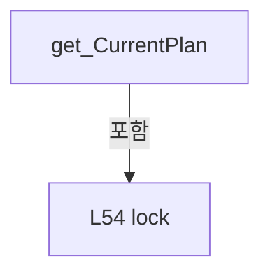

변경 전 점검: 입력/반환 타입, 위 호출자, 예외/취소 경로, 공유 상태와 저장·전송 소비자를 함께 확인합니다. 값의 단위나 물리 방향을 이름만으로 확정하지 않습니다.

### PropertyDeclaration `SequenceState` · L61–61

[Drilling.Common/Review/CReviewManager.cs:61–61](https://github.com/kjuws10-rgb/A3Drilling/blob/5aee8e58439c9b455cae7c9593c9be986c3e682e/Drilling.Common/Review/CReviewManager.cs#L61-L61)

| 항목 | 실제 추출 값 |
| --- | --- |
| 서명 | Drilling.Common.Review.EN_REVIEW_SEQUENCE_STATE Drilling.Common.Review.CReviewManager.SequenceState |
| 접근/수식자 | Public / public |
| 반환/값 타입 | Drilling.Common.Review.EN_REVIEW_SEQUENCE_STATE |
| 소속 타입 | NamedType:Drilling.Common.Review.CReviewManager |

현재 부분 분석에서 직접 연결된 호출자는 없습니다. XAML/이벤트/인터페이스·델리게이트·외부 진입을 추가 확인해야 하며, 미사용으로 판정한 것이 아닙니다.

변경 전 점검: 입력/반환 타입, 위 호출자, 예외/취소 경로, 공유 상태와 저장·전송 소비자를 함께 확인합니다. 값의 단위나 물리 방향을 이름만으로 확정하지 않습니다.

### GetAccessorDeclaration `get_SequenceState` · L61–61

[Drilling.Common/Review/CReviewManager.cs:61–61](https://github.com/kjuws10-rgb/A3Drilling/blob/5aee8e58439c9b455cae7c9593c9be986c3e682e/Drilling.Common/Review/CReviewManager.cs#L61-L61)

| 항목 | 실제 추출 값 |
| --- | --- |
| 서명 | Drilling.Common.Review.EN_REVIEW_SEQUENCE_STATE Drilling.Common.Review.CReviewManager.SequenceState.get |
| 접근/수식자 | Public / get |
| 반환/값 타입 | Drilling.Common.Review.EN_REVIEW_SEQUENCE_STATE |
| 소속 타입 | NamedType:Drilling.Common.Review.CReviewManager |

현재 부분 분석에서 직접 연결된 호출자는 없습니다. XAML/이벤트/인터페이스·델리게이트·외부 진입을 추가 확인해야 하며, 미사용으로 판정한 것이 아닙니다.

호출하는 대상과 해석 범위:

| 원본 행 | 표현식 | 분석 상태 | 대상/소스 위치 |
| --- | --- | --- | --- |
| 61 | Volatile.Read | resolved | int System.Threading.Volatile.Read(ref readonly int) |

본문의 실제 연산·분기·예외·반환 순서(원문 위치 순):

| 원본 행 | 종류 | 주석 해설 |
| --- | --- | --- |
| 61 | call | 함수·델리게이트 또는 객체 생성자를 호출합니다: Volatile.Read(ref _sequenceState) |

변경 전 점검: 입력/반환 타입, 위 호출자, 예외/취소 경로, 공유 상태와 저장·전송 소비자를 함께 확인합니다. 값의 단위나 물리 방향을 이름만으로 확정하지 않습니다.

### SetAccessorDeclaration `set_SequenceState` · L61–61

[Drilling.Common/Review/CReviewManager.cs:61–61](https://github.com/kjuws10-rgb/A3Drilling/blob/5aee8e58439c9b455cae7c9593c9be986c3e682e/Drilling.Common/Review/CReviewManager.cs#L61-L61)

| 항목 | 실제 추출 값 |
| --- | --- |
| 서명 | void Drilling.Common.Review.CReviewManager.SequenceState.set |
| 접근/수식자 | Private / private, set |
| 반환/값 타입 | void |
| 소속 타입 | NamedType:Drilling.Common.Review.CReviewManager |

입력 계약:

| 이름 | 타입 | 전달 | 선택/기본값 |
| --- | --- | --- | --- |
| value | Drilling.Common.Review.EN_REVIEW_SEQUENCE_STATE | None | False /  |

현재 부분 분석에서 직접 연결된 호출자는 없습니다. XAML/이벤트/인터페이스·델리게이트·외부 진입을 추가 확인해야 하며, 미사용으로 판정한 것이 아닙니다.

호출하는 대상과 해석 범위:

| 원본 행 | 표현식 | 분석 상태 | 대상/소스 위치 |
| --- | --- | --- | --- |
| 61 | Volatile.Write | resolved | void System.Threading.Volatile.Write(ref int, int) |

본문의 실제 연산·분기·예외·반환 순서(원문 위치 순):

| 원본 행 | 종류 | 주석 해설 |
| --- | --- | --- |
| 61 | call | 함수·델리게이트 또는 객체 생성자를 호출합니다: Volatile.Write(ref _sequenceState, (int)value) |

변경 전 점검: 입력/반환 타입, 위 호출자, 예외/취소 경로, 공유 상태와 저장·전송 소비자를 함께 확인합니다. 값의 단위나 물리 방향을 이름만으로 확정하지 않습니다.

### PropertyDeclaration `IsStopRequested` · L62–62

[Drilling.Common/Review/CReviewManager.cs:62–62](https://github.com/kjuws10-rgb/A3Drilling/blob/5aee8e58439c9b455cae7c9593c9be986c3e682e/Drilling.Common/Review/CReviewManager.cs#L62-L62)

| 항목 | 실제 추출 값 |
| --- | --- |
| 서명 | bool Drilling.Common.Review.CReviewManager.IsStopRequested |
| 접근/수식자 | Private / private |
| 반환/값 타입 | bool |
| 소속 타입 | NamedType:Drilling.Common.Review.CReviewManager |

현재 부분 분석에서 직접 연결된 호출자는 없습니다. XAML/이벤트/인터페이스·델리게이트·외부 진입을 추가 확인해야 하며, 미사용으로 판정한 것이 아닙니다.

호출하는 대상과 해석 범위:

| 원본 행 | 표현식 | 분석 상태 | 대상/소스 위치 |
| --- | --- | --- | --- |
| 62 | Volatile.Read | resolved | int System.Threading.Volatile.Read(ref readonly int) |

본문의 실제 연산·분기·예외·반환 순서(원문 위치 순):

| 원본 행 | 종류 | 주석 해설 |
| --- | --- | --- |
| 62 | call | 함수·델리게이트 또는 객체 생성자를 호출합니다: Volatile.Read(ref _stopRequested) |

변경 전 점검: 입력/반환 타입, 위 호출자, 예외/취소 경로, 공유 상태와 저장·전송 소비자를 함께 확인합니다. 값의 단위나 물리 방향을 이름만으로 확정하지 않습니다.

### MethodDeclaration `CreatePlan` · L64–67

[Drilling.Common/Review/CReviewManager.cs:64–67](https://github.com/kjuws10-rgb/A3Drilling/blob/5aee8e58439c9b455cae7c9593c9be986c3e682e/Drilling.Common/Review/CReviewManager.cs#L64-L67)

| 항목 | 실제 추출 값 |
| --- | --- |
| 서명 | Drilling.Common.Review.ST_REVIEW_PLAN Drilling.Common.Review.CReviewManager.CreatePlan(Drilling.Common.Managers.ST_RECIPE_DEFINITION, System.Collections.Generic.IReadOnlyCollection<string>) |
| 접근/수식자 | Public / public |
| 반환/값 타입 | Drilling.Common.Review.ST_REVIEW_PLAN |
| 소속 타입 | NamedType:Drilling.Common.Review.CReviewManager |

입력 계약:

| 이름 | 타입 | 전달 | 선택/기본값 |
| --- | --- | --- | --- |
| recipe | Drilling.Common.Managers.ST_RECIPE_DEFINITION | None | False /  |
| selectedShotKeys | System.Collections.Generic.IReadOnlyCollection<string> | None | False /  |

현재 부분 분석에서 직접 연결된 호출자는 없습니다. XAML/이벤트/인터페이스·델리게이트·외부 진입을 추가 확인해야 하며, 미사용으로 판정한 것이 아닙니다.

호출하는 대상과 해석 범위:

| 원본 행 | 표현식 | 분석 상태 | 대상/소스 위치 |
| --- | --- | --- | --- |
| 66 | CreatePlan | resolved | Drilling.Common.Review.ST_REVIEW_PLAN Drilling.Common.Review.CReviewManager.CreatePlan(Drilling.Common.Managers.ST_RECIPE_DEFINITION, System.Collections.Generic.IReadOnlyCollection<string>, int) · Drilling.Common/Review/CReviewManager.cs:69 |

본문의 실제 연산·분기·예외·반환 순서(원문 위치 순):

| 원본 행 | 종류 | 주석 해설 |
| --- | --- | --- |
| 66 | call | 함수·델리게이트 또는 객체 생성자를 호출합니다: CreatePlan(recipe, selectedShotKeys, 1) |
| 66 | return | 호출자에게 값 또는 제어를 반환합니다: return CreatePlan(recipe, selectedShotKeys, 1); |

변경 전 점검: 입력/반환 타입, 위 호출자, 예외/취소 경로, 공유 상태와 저장·전송 소비자를 함께 확인합니다. 값의 단위나 물리 방향을 이름만으로 확정하지 않습니다.

### MethodDeclaration `CreatePlan` · L69–72

[Drilling.Common/Review/CReviewManager.cs:69–72](https://github.com/kjuws10-rgb/A3Drilling/blob/5aee8e58439c9b455cae7c9593c9be986c3e682e/Drilling.Common/Review/CReviewManager.cs#L69-L72)

| 항목 | 실제 추출 값 |
| --- | --- |
| 서명 | Drilling.Common.Review.ST_REVIEW_PLAN Drilling.Common.Review.CReviewManager.CreatePlan(Drilling.Common.Managers.ST_RECIPE_DEFINITION, System.Collections.Generic.IReadOnlyCollection<string>, int) |
| 접근/수식자 | Public / public |
| 반환/값 타입 | Drilling.Common.Review.ST_REVIEW_PLAN |
| 소속 타입 | NamedType:Drilling.Common.Review.CReviewManager |

입력 계약:

| 이름 | 타입 | 전달 | 선택/기본값 |
| --- | --- | --- | --- |
| recipe | Drilling.Common.Managers.ST_RECIPE_DEFINITION | None | False /  |
| selectedShotKeys | System.Collections.Generic.IReadOnlyCollection<string> | None | False /  |
| selectedBeamNo | int | None | False /  |

정적 호출자로 확인된 위치:

| 호출 파일/행 | 호출 표현식 | 런타임 분기 가능 |
| --- | --- | --- |
| [Drilling.Common/Review/CReviewManager.cs:66–66](https://github.com/kjuws10-rgb/A3Drilling/blob/5aee8e58439c9b455cae7c9593c9be986c3e682e/Drilling.Common/Review/CReviewManager.cs#L66-L66) | CreatePlan | False |
| [Drilling.UI/Menu/Menus/CMenuReview.cs:2944–2944](https://github.com/kjuws10-rgb/A3Drilling/blob/5aee8e58439c9b455cae7c9593c9be986c3e682e/Drilling.UI/Menu/Menus/CMenuReview.cs#L2944-L2944) | _reviewManager.CreatePlan | False |

호출하는 대상과 해석 범위:

| 원본 행 | 표현식 | 분석 상태 | 대상/소스 위치 |
| --- | --- | --- | --- |
| 71 | CreatePlan | resolved | Drilling.Common.Review.ST_REVIEW_PLAN Drilling.Common.Review.CReviewManager.CreatePlan(Drilling.Common.Managers.ST_RECIPE_DEFINITION, System.Collections.Generic.IReadOnlyCollection<string>, int, double, double) · Drilling.Common/Review/CReviewManager.cs:74 |

본문의 실제 연산·분기·예외·반환 순서(원문 위치 순):

| 원본 행 | 종류 | 주석 해설 |
| --- | --- | --- |
| 71 | call | 함수·델리게이트 또는 객체 생성자를 호출합니다: CreatePlan(recipe, selectedShotKeys, selectedBeamNo, 0.0, 0.0) |
| 71 | return | 호출자에게 값 또는 제어를 반환합니다: return CreatePlan(recipe, selectedShotKeys, selectedBeamNo, 0.0, 0.0); |

변경 전 점검: 입력/반환 타입, 위 호출자, 예외/취소 경로, 공유 상태와 저장·전송 소비자를 함께 확인합니다. 값의 단위나 물리 방향을 이름만으로 확정하지 않습니다.

### MethodDeclaration `CreatePlan` · L74–114

[Drilling.Common/Review/CReviewManager.cs:74–114](https://github.com/kjuws10-rgb/A3Drilling/blob/5aee8e58439c9b455cae7c9593c9be986c3e682e/Drilling.Common/Review/CReviewManager.cs#L74-L114)

| 항목 | 실제 추출 값 |
| --- | --- |
| 서명 | Drilling.Common.Review.ST_REVIEW_PLAN Drilling.Common.Review.CReviewManager.CreatePlan(Drilling.Common.Managers.ST_RECIPE_DEFINITION, System.Collections.Generic.IReadOnlyCollection<string>, int, double, double) |
| 접근/수식자 | Public / public |
| 반환/값 타입 | Drilling.Common.Review.ST_REVIEW_PLAN |
| 소속 타입 | NamedType:Drilling.Common.Review.CReviewManager |

입력 계약:

| 이름 | 타입 | 전달 | 선택/기본값 |
| --- | --- | --- | --- |
| recipe | Drilling.Common.Managers.ST_RECIPE_DEFINITION | None | False /  |
| selectedShotKeys | System.Collections.Generic.IReadOnlyCollection<string> | None | False /  |
| selectedBeamNo | int | None | False /  |
| shiftOffsetX | double | None | False /  |
| shiftOffsetY | double | None | False /  |

정적 호출자로 확인된 위치:

| 호출 파일/행 | 호출 표현식 | 런타임 분기 가능 |
| --- | --- | --- |
| [Drilling.Common/Review/CReviewManager.cs:71–71](https://github.com/kjuws10-rgb/A3Drilling/blob/5aee8e58439c9b455cae7c9593c9be986c3e682e/Drilling.Common/Review/CReviewManager.cs#L71-L71) | CreatePlan | False |
| [Drilling.UI/Menu/Menus/CMenuCorrection.ReviewData.Reinspection.cs:525–530](https://github.com/kjuws10-rgb/A3Drilling/blob/5aee8e58439c9b455cae7c9593c9be986c3e682e/Drilling.UI/Menu/Menus/CMenuCorrection.ReviewData.Reinspection.cs#L525-L530) | _reviewManager.CreatePlan | False |
| [Drilling.UI/Menu/Menus/CMenuReview.cs:3011–3011](https://github.com/kjuws10-rgb/A3Drilling/blob/5aee8e58439c9b455cae7c9593c9be986c3e682e/Drilling.UI/Menu/Menus/CMenuReview.cs#L3011-L3011) | _reviewManager.CreatePlan | False |

호출하는 대상과 해석 범위:

| 원본 행 | 표현식 | 분석 상태 | 대상/소스 위치 |
| --- | --- | --- | --- |
| 81 | ValidateShiftOffset | resolved | void Drilling.Common.Review.CReviewManager.ValidateShiftOffset(double, double) · Drilling.Common/Review/CReviewManager.cs:947 |
| 82 | ValidateBeamNo | resolved | void Drilling.Common.Review.CReviewManager.ValidateBeamNo(int, int) · Drilling.Common/Review/CReviewManager.cs:933 |
| 82 | ReadInt | resolved | int Drilling.Common.Review.CReviewManager.ReadInt(Drilling.Common.Managers.ST_RECIPE_DEFINITION, int, params string[]) · Drilling.Common/Review/CReviewManager.cs:1202 |
| 83 | selectedShotKeys.Where(key => !string.IsNullOrWhiteSpace(key)).Select(NormalizeShotKey).ToHashSet | resolved | System.Collections.Generic.HashSet<string> System.Collections.Generic.IEnumerable<string>.ToHashSet<string>(System.Collections.Generic.IEqualityComparer<string>?) |
| 83 | selectedShotKeys.Where(key => !string.IsNullOrWhiteSpace(key)).Select | resolved | System.Collections.Generic.IEnumerable<string> System.Collections.Generic.IEnumerable<string>.Select<string, string>(System.Func<string, string>) |
| 83 | selectedShotKeys.Where | resolved | System.Collections.Generic.IEnumerable<string> System.Collections.Generic.IEnumerable<string>.Where<string>(System.Func<string, bool>) |
| 83 | string.IsNullOrWhiteSpace | resolved | bool string.IsNullOrWhiteSpace(string?) |
| 84 | CreateAllPlan | resolved | Drilling.Common.Review.ST_REVIEW_PLAN Drilling.Common.Review.CReviewManager.CreateAllPlan(Drilling.Common.Managers.ST_RECIPE_DEFINITION, int, double, double) · Drilling.Common/Review/CReviewManager.cs:200 |
| 93 | new List<ST_REVIEW_PLAN_POINT> | resolved | System.Collections.Generic.List<Drilling.Common.Review.ST_REVIEW_PLAN_POINT>.List(int) |
| 96 | TryParseShotKey | resolved | bool Drilling.Common.Review.CReviewManager.TryParseShotKey(string, out int, out int) · Drilling.Common/Review/CReviewManager.cs:1193 |
| 101 | allPlan.FindPoint | resolved | Drilling.Common.Review.ST_REVIEW_PLAN_POINT? Drilling.Common.Review.ST_REVIEW_PLAN.FindPoint(int, int) · Drilling.Common/Review/CReviewManager.cs:3959 |
| 107 | selectedPoints.Add | resolved | void System.Collections.Generic.List<Drilling.Common.Review.ST_REVIEW_PLAN_POINT>.Add(Drilling.Common.Review.ST_REVIEW_PLAN_POINT) |
| 112 | selectedPoints.OrderBy(point => point.PointNo).ToArray | resolved | Drilling.Common.Review.ST_REVIEW_PLAN_POINT[] System.Collections.Generic.IEnumerable<Drilling.Common.Review.ST_REVIEW_PLAN_POINT>.ToArray<Drilling.Common.Review.ST_REVIEW_PLAN_POINT>() |
| 112 | selectedPoints.OrderBy | resolved | System.Linq.IOrderedEnumerable<Drilling.Common.Review.ST_REVIEW_PLAN_POINT> System.Collections.Generic.IEnumerable<Drilling.Common.Review.ST_REVIEW_PLAN_POINT>.OrderBy<Drilling.Common.Review.ST_REVIEW_PLAN_POINT, int>(System.Func<Drilling.Common.Review.ST_REVIEW_PLAN_POINT, int>) |

본문의 실제 연산·분기·예외·반환 순서(원문 위치 순):

| 원본 행 | 종류 | 주석 해설 |
| --- | --- | --- |
| 81 | call | 함수·델리게이트 또는 객체 생성자를 호출합니다: ValidateShiftOffset(shiftOffsetX, shiftOffsetY) |
| 82 | call | 함수·델리게이트 또는 객체 생성자를 호출합니다: ValidateBeamNo(selectedBeamNo, ReadInt(recipe, 0, "SPLITED_BEAM_COUNT")) |
| 82 | call | 함수·델리게이트 또는 객체 생성자를 호출합니다: ReadInt(recipe, 0, "SPLITED_BEAM_COUNT") |
| 83 | call | 함수·델리게이트 또는 객체 생성자를 호출합니다: selectedShotKeys.Where(key => !string.IsNullOrWhiteSpace(key)).Select(NormalizeShotKey).ToHashSet(StringComparer.OrdinalIgnoreCase) |
| 83 | call | 함수·델리게이트 또는 객체 생성자를 호출합니다: selectedShotKeys.Where(key => !string.IsNullOrWhiteSpace(key)).Select(NormalizeShotKey) |
| 83 | call | 함수·델리게이트 또는 객체 생성자를 호출합니다: selectedShotKeys.Where(key => !string.IsNullOrWhiteSpace(key)) |
| 83 | call | 함수·델리게이트 또는 객체 생성자를 호출합니다: string.IsNullOrWhiteSpace(key) |
| 83 | local-declaration | 지역 변수를 선언합니다: var selectedSet = selectedShotKeys.Where(key => !string.IsNullOrWhiteSpace(key)).Select(NormalizeShotKey).ToHashSet(StringComparer.OrdinalIgnoreCase); |
| 83 | variable-initializer | 변수의 초기값을 지정합니다: selectedSet = selectedShotKeys.Where(key => !string.IsNullOrWhiteSpace(key)).Select(NormalizeShotKey).ToHashSet(StringComparer.OrdinalIgnoreCase) |
| 84 | call | 함수·델리게이트 또는 객체 생성자를 호출합니다: CreateAllPlan(recipe, selectedBeamNo, shiftOffsetX, shiftOffsetY) |
| 84 | local-declaration | 지역 변수를 선언합니다: var allPlan = CreateAllPlan(recipe, selectedBeamNo, shiftOffsetX, shiftOffsetY); |
| 84 | variable-initializer | 변수의 초기값을 지정합니다: allPlan = CreateAllPlan(recipe, selectedBeamNo, shiftOffsetX, shiftOffsetY) |
| 85 | if | 조건에 따라 분기합니다: if (selectedSet.Count == 0) |
| 87 | return | 호출자에게 값 또는 제어를 반환합니다: return allPlan with { Points = [] }; |
| 89 | assignment | 값을 대상에 대입합니다: Points = [] |
| 93 | call | 함수·델리게이트 또는 객체 생성자를 호출합니다: new List<ST_REVIEW_PLAN_POINT>(selectedSet.Count) |
| 93 | local-declaration | 지역 변수를 선언합니다: var selectedPoints = new List<ST_REVIEW_PLAN_POINT>(selectedSet.Count); |
| 93 | variable-initializer | 변수의 초기값을 지정합니다: selectedPoints = new List<ST_REVIEW_PLAN_POINT>(selectedSet.Count) |
| 94 | foreach | 컬렉션 요소를 순회합니다: foreach (var key in selectedSet) |
| 96 | call | 함수·델리게이트 또는 객체 생성자를 호출합니다: TryParseShotKey(key, out var cellNo, out var shotNo) |
| 96 | if | 조건에 따라 분기합니다: if (!TryParseShotKey(key, out var cellNo, out var shotNo) &#124;&#124; cellNo > allPlan.CellCount) |
| 98 | continue | 다음 반복으로 진행합니다: continue; |
| 101 | call | 함수·델리게이트 또는 객체 생성자를 호출합니다: allPlan.FindPoint(cellNo, shotNo) |
| 101 | local-declaration | 지역 변수를 선언합니다: var point = allPlan.FindPoint(cellNo, shotNo); |
| 101 | variable-initializer | 변수의 초기값을 지정합니다: point = allPlan.FindPoint(cellNo, shotNo) |
| 102 | if | 조건에 따라 분기합니다: if (point is null &#124;&#124; !point.Use) |
| 104 | continue | 다음 반복으로 진행합니다: continue; |
| 107 | assignment | 값을 대상에 대입합니다: Use = true |
| 107 | assignment | 값을 대상에 대입합니다: State = EN_REVIEW_POINT_STATE.Ready |
| 107 | assignment | 값을 대상에 대입합니다: Judge = "WAIT" |
| 107 | call | 함수·델리게이트 또는 객체 생성자를 호출합니다: selectedPoints.Add(point with { Use = true, State = EN_REVIEW_POINT_STATE.Ready, Judge = "WAIT" }) |
| 110 | return | 호출자에게 값 또는 제어를 반환합니다: return allPlan with { Points = selectedPoints.OrderBy(point => point.PointNo).ToArray() }; |
| 112 | assignment | 값을 대상에 대입합니다: Points = selectedPoints.OrderBy(point => point.PointNo).ToArray() |
| 112 | call | 함수·델리게이트 또는 객체 생성자를 호출합니다: selectedPoints.OrderBy(point => point.PointNo).ToArray() |
| 112 | call | 함수·델리게이트 또는 객체 생성자를 호출합니다: selectedPoints.OrderBy(point => point.PointNo) |

제어 구문의 포함 구조(실제 실행 순서/CFG가 아닌 구문 탐색 그림):

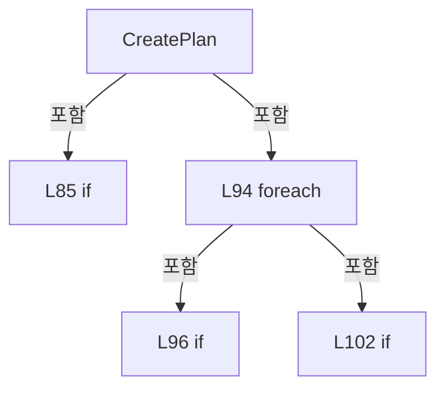

변경 전 점검: 입력/반환 타입, 위 호출자, 예외/취소 경로, 공유 상태와 저장·전송 소비자를 함께 확인합니다. 값의 단위나 물리 방향을 이름만으로 확정하지 않습니다.

### PropertyDeclaration `CurrentPoint` · L116–125

[Drilling.Common/Review/CReviewManager.cs:116–125](https://github.com/kjuws10-rgb/A3Drilling/blob/5aee8e58439c9b455cae7c9593c9be986c3e682e/Drilling.Common/Review/CReviewManager.cs#L116-L125)

| 항목 | 실제 추출 값 |
| --- | --- |
| 서명 | Drilling.Common.Review.ST_REVIEW_PLAN_POINT? Drilling.Common.Review.CReviewManager.CurrentPoint |
| 접근/수식자 | Public / public |
| 반환/값 타입 | Drilling.Common.Review.ST_REVIEW_PLAN_POINT? |
| 소속 타입 | NamedType:Drilling.Common.Review.CReviewManager |

현재 부분 분석에서 직접 연결된 호출자는 없습니다. XAML/이벤트/인터페이스·델리게이트·외부 진입을 추가 확인해야 하며, 미사용으로 판정한 것이 아닙니다.

변경 전 점검: 입력/반환 타입, 위 호출자, 예외/취소 경로, 공유 상태와 저장·전송 소비자를 함께 확인합니다. 값의 단위나 물리 방향을 이름만으로 확정하지 않습니다.

### GetAccessorDeclaration `get_CurrentPoint` · L118–124

[Drilling.Common/Review/CReviewManager.cs:118–124](https://github.com/kjuws10-rgb/A3Drilling/blob/5aee8e58439c9b455cae7c9593c9be986c3e682e/Drilling.Common/Review/CReviewManager.cs#L118-L124)

| 항목 | 실제 추출 값 |
| --- | --- |
| 서명 | Drilling.Common.Review.ST_REVIEW_PLAN_POINT? Drilling.Common.Review.CReviewManager.CurrentPoint.get |
| 접근/수식자 | Public / get |
| 반환/값 타입 | Drilling.Common.Review.ST_REVIEW_PLAN_POINT? |
| 소속 타입 | NamedType:Drilling.Common.Review.CReviewManager |

현재 부분 분석에서 직접 연결된 호출자는 없습니다. XAML/이벤트/인터페이스·델리게이트·외부 진입을 추가 확인해야 하며, 미사용으로 판정한 것이 아닙니다.

본문의 실제 연산·분기·예외·반환 순서(원문 위치 순):

| 원본 행 | 종류 | 주석 해설 |
| --- | --- | --- |
| 120 | lock | 공유 상태의 임계 구역에 진입합니다: lock (_stateLock) |
| 122 | return | 호출자에게 값 또는 제어를 반환합니다: return _currentPoint; |

제어 구문의 포함 구조(실제 실행 순서/CFG가 아닌 구문 탐색 그림):

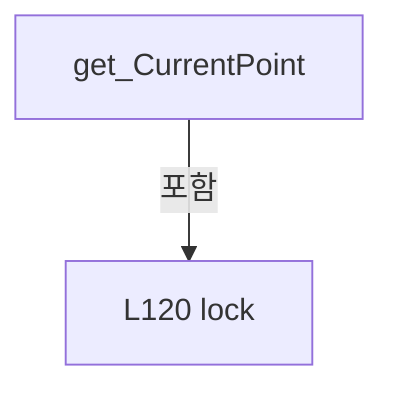

변경 전 점검: 입력/반환 타입, 위 호출자, 예외/취소 경로, 공유 상태와 저장·전송 소비자를 함께 확인합니다. 값의 단위나 물리 방향을 이름만으로 확정하지 않습니다.

### PropertyDeclaration `LastMeasuredPoint` · L127–136

[Drilling.Common/Review/CReviewManager.cs:127–136](https://github.com/kjuws10-rgb/A3Drilling/blob/5aee8e58439c9b455cae7c9593c9be986c3e682e/Drilling.Common/Review/CReviewManager.cs#L127-L136)

| 항목 | 실제 추출 값 |
| --- | --- |
| 서명 | Drilling.Common.Review.ST_REVIEW_PLAN_POINT? Drilling.Common.Review.CReviewManager.LastMeasuredPoint |
| 접근/수식자 | Public / public |
| 반환/값 타입 | Drilling.Common.Review.ST_REVIEW_PLAN_POINT? |
| 소속 타입 | NamedType:Drilling.Common.Review.CReviewManager |

현재 부분 분석에서 직접 연결된 호출자는 없습니다. XAML/이벤트/인터페이스·델리게이트·외부 진입을 추가 확인해야 하며, 미사용으로 판정한 것이 아닙니다.

변경 전 점검: 입력/반환 타입, 위 호출자, 예외/취소 경로, 공유 상태와 저장·전송 소비자를 함께 확인합니다. 값의 단위나 물리 방향을 이름만으로 확정하지 않습니다.

### GetAccessorDeclaration `get_LastMeasuredPoint` · L129–135

[Drilling.Common/Review/CReviewManager.cs:129–135](https://github.com/kjuws10-rgb/A3Drilling/blob/5aee8e58439c9b455cae7c9593c9be986c3e682e/Drilling.Common/Review/CReviewManager.cs#L129-L135)

| 항목 | 실제 추출 값 |
| --- | --- |
| 서명 | Drilling.Common.Review.ST_REVIEW_PLAN_POINT? Drilling.Common.Review.CReviewManager.LastMeasuredPoint.get |
| 접근/수식자 | Public / get |
| 반환/값 타입 | Drilling.Common.Review.ST_REVIEW_PLAN_POINT? |
| 소속 타입 | NamedType:Drilling.Common.Review.CReviewManager |

현재 부분 분석에서 직접 연결된 호출자는 없습니다. XAML/이벤트/인터페이스·델리게이트·외부 진입을 추가 확인해야 하며, 미사용으로 판정한 것이 아닙니다.

본문의 실제 연산·분기·예외·반환 순서(원문 위치 순):

| 원본 행 | 종류 | 주석 해설 |
| --- | --- | --- |
| 131 | lock | 공유 상태의 임계 구역에 진입합니다: lock (_stateLock) |
| 133 | return | 호출자에게 값 또는 제어를 반환합니다: return _lastMeasuredPoint; |

제어 구문의 포함 구조(실제 실행 순서/CFG가 아닌 구문 탐색 그림):

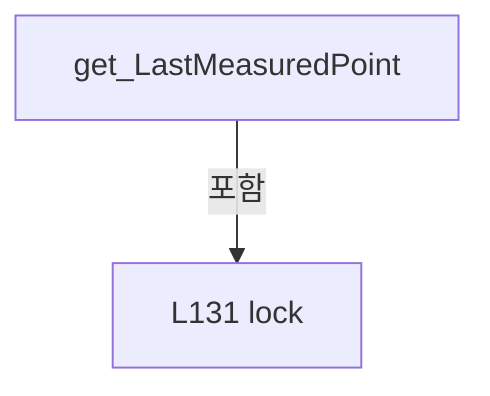

변경 전 점검: 입력/반환 타입, 위 호출자, 예외/취소 경로, 공유 상태와 저장·전송 소비자를 함께 확인합니다. 값의 단위나 물리 방향을 이름만으로 확정하지 않습니다.

### MethodDeclaration `GetShotBeamPositions` · L138–148

[Drilling.Common/Review/CReviewManager.cs:138–148](https://github.com/kjuws10-rgb/A3Drilling/blob/5aee8e58439c9b455cae7c9593c9be986c3e682e/Drilling.Common/Review/CReviewManager.cs#L138-L148)

| 항목 | 실제 추출 값 |
| --- | --- |
| 서명 | System.Collections.Generic.IReadOnlyList<Drilling.Common.Review.ST_REVIEW_BEAM_POSITION> Drilling.Common.Review.CReviewManager.GetShotBeamPositions(Drilling.Common.Managers.ST_RECIPE_DEFINITION, Drilling.Common.Review.ST_REVIEW_PLAN_POINT, double, double, double) |
| 접근/수식자 | Public / public, static |
| 반환/값 타입 | System.Collections.Generic.IReadOnlyList<Drilling.Common.Review.ST_REVIEW_BEAM_POSITION> |
| 소속 타입 | NamedType:Drilling.Common.Review.CReviewManager |

입력 계약:

| 이름 | 타입 | 전달 | 선택/기본값 |
| --- | --- | --- | --- |
| recipe | Drilling.Common.Managers.ST_RECIPE_DEFINITION | None | False /  |
| point | Drilling.Common.Review.ST_REVIEW_PLAN_POINT | None | False /  |
| stageScanDirectionY | double | None | False /  |
| shiftOffsetX | double | None | True / 0 |
| shiftOffsetY | double | None | True / 0 |

정적 호출자로 확인된 위치:

| 호출 파일/행 | 호출 표현식 | 런타임 분기 가능 |
| --- | --- | --- |
| [Drilling.Common/Review/CReviewManager.cs:1298–1303](https://github.com/kjuws10-rgb/A3Drilling/blob/5aee8e58439c9b455cae7c9593c9be986c3e682e/Drilling.Common/Review/CReviewManager.cs#L1298-L1303) | GetShotBeamPositions | False |
| [Drilling.UI/Menu/Menus/CMenuCorrection.cs:7207–7207](https://github.com/kjuws10-rgb/A3Drilling/blob/5aee8e58439c9b455cae7c9593c9be986c3e682e/Drilling.UI/Menu/Menus/CMenuCorrection.cs#L7207-L7207) | CReviewManager.GetShotBeamPositions | False |
| [Drilling.UI/Menu/Menus/CMenuReview.cs:2348–2348](https://github.com/kjuws10-rgb/A3Drilling/blob/5aee8e58439c9b455cae7c9593c9be986c3e682e/Drilling.UI/Menu/Menus/CMenuReview.cs#L2348-L2348) | CReviewManager.GetShotBeamPositions | False |
| [Drilling.UI/Menu/Menus/CMenuReview.cs:2610–2610](https://github.com/kjuws10-rgb/A3Drilling/blob/5aee8e58439c9b455cae7c9593c9be986c3e682e/Drilling.UI/Menu/Menus/CMenuReview.cs#L2610-L2610) | CReviewManager.GetShotBeamPositions | False |

호출하는 대상과 해석 범위:

| 원본 행 | 표현식 | 분석 상태 | 대상/소스 위치 |
| --- | --- | --- | --- |
| 145 | CreateShotBeamPositionCalculator | resolved | System.Func<Drilling.Common.Review.ST_REVIEW_PLAN_POINT, int, Drilling.Common.Review.ST_REVIEW_BEAM_POSITION> Drilling.Common.Review.CReviewManager.CreateShotBeamPositionCalculator(Drilling.Common.Managers.ST_RECIPE_DEFINITION, double, double, double) · Drilling.Common/Review/CReviewManager.cs:151 |
| 146 | ReadInt | resolved | int Drilling.Common.Review.CReviewManager.ReadInt(Drilling.Common.Managers.ST_RECIPE_DEFINITION, int, params string[]) · Drilling.Common/Review/CReviewManager.cs:1202 |
| 147 | Enumerable.Range(1, splitBeamCount * splitBeamCount).Select(beam => calculate(point, beam)).ToArray | resolved | Drilling.Common.Review.ST_REVIEW_BEAM_POSITION[] System.Collections.Generic.IEnumerable<Drilling.Common.Review.ST_REVIEW_BEAM_POSITION>.ToArray<Drilling.Common.Review.ST_REVIEW_BEAM_POSITION>() |
| 147 | Enumerable.Range(1, splitBeamCount * splitBeamCount).Select | resolved | System.Collections.Generic.IEnumerable<Drilling.Common.Review.ST_REVIEW_BEAM_POSITION> System.Collections.Generic.IEnumerable<int>.Select<int, Drilling.Common.Review.ST_REVIEW_BEAM_POSITION>(System.Func<int, Drilling.Common.Review.ST_REVIEW_BEAM_POSITION>) |
| 147 | Enumerable.Range | resolved | System.Collections.Generic.IEnumerable<int> System.Linq.Enumerable.Range(int, int) |
| 147 | calculate | resolved · 동적 구현 선택 가능 | Drilling.Common.Review.ST_REVIEW_BEAM_POSITION System.Func<Drilling.Common.Review.ST_REVIEW_PLAN_POINT, int, Drilling.Common.Review.ST_REVIEW_BEAM_POSITION>.Invoke(Drilling.Common.Review.ST_REVIEW_PLAN_POINT, int) |

본문의 실제 연산·분기·예외·반환 순서(원문 위치 순):

| 원본 행 | 종류 | 주석 해설 |
| --- | --- | --- |
| 145 | call | 함수·델리게이트 또는 객체 생성자를 호출합니다: CreateShotBeamPositionCalculator(recipe, stageScanDirectionY, shiftOffsetX, shiftOffsetY) |
| 145 | local-declaration | 지역 변수를 선언합니다: var calculate = CreateShotBeamPositionCalculator(recipe, stageScanDirectionY, shiftOffsetX, shiftOffsetY); |
| 145 | variable-initializer | 변수의 초기값을 지정합니다: calculate = CreateShotBeamPositionCalculator(recipe, stageScanDirectionY, shiftOffsetX, shiftOffsetY) |
| 146 | call | 함수·델리게이트 또는 객체 생성자를 호출합니다: ReadInt(recipe, 0, "SPLITED_BEAM_COUNT") |
| 146 | local-declaration | 지역 변수를 선언합니다: var splitBeamCount = ReadInt(recipe, 0, "SPLITED_BEAM_COUNT"); |
| 146 | variable-initializer | 변수의 초기값을 지정합니다: splitBeamCount = ReadInt(recipe, 0, "SPLITED_BEAM_COUNT") |
| 147 | call | 함수·델리게이트 또는 객체 생성자를 호출합니다: Enumerable.Range(1, splitBeamCount * splitBeamCount).Select(beam => calculate(point, beam)).ToArray() |
| 147 | call | 함수·델리게이트 또는 객체 생성자를 호출합니다: Enumerable.Range(1, splitBeamCount * splitBeamCount).Select(beam => calculate(point, beam)) |
| 147 | call | 함수·델리게이트 또는 객체 생성자를 호출합니다: Enumerable.Range(1, splitBeamCount * splitBeamCount) |
| 147 | call | 함수·델리게이트 또는 객체 생성자를 호출합니다: calculate(point, beam) |
| 147 | return | 호출자에게 값 또는 제어를 반환합니다: return Enumerable.Range(1, splitBeamCount * splitBeamCount).Select(beam => calculate(point, beam)).ToArray(); |

변경 전 점검: 입력/반환 타입, 위 호출자, 예외/취소 경로, 공유 상태와 저장·전송 소비자를 함께 확인합니다. 값의 단위나 물리 방향을 이름만으로 확정하지 않습니다.

### MethodDeclaration `CreateShotBeamPositionCalculator` · L151–193

[Drilling.Common/Review/CReviewManager.cs:151–193](https://github.com/kjuws10-rgb/A3Drilling/blob/5aee8e58439c9b455cae7c9593c9be986c3e682e/Drilling.Common/Review/CReviewManager.cs#L151-L193)

| 항목 | 실제 추출 값 |
| --- | --- |
| 서명 | System.Func<Drilling.Common.Review.ST_REVIEW_PLAN_POINT, int, Drilling.Common.Review.ST_REVIEW_BEAM_POSITION> Drilling.Common.Review.CReviewManager.CreateShotBeamPositionCalculator(Drilling.Common.Managers.ST_RECIPE_DEFINITION, double, double, double) |
| 접근/수식자 | Public / public, static |
| 반환/값 타입 | System.Func<Drilling.Common.Review.ST_REVIEW_PLAN_POINT, int, Drilling.Common.Review.ST_REVIEW_BEAM_POSITION> |
| 소속 타입 | NamedType:Drilling.Common.Review.CReviewManager |

원본 XML 주석:

````xml
/// <summary>Build recipe lookup and Cell geometry once for a batch. No device access or live recipe mutation.</summary>
````

입력 계약:

| 이름 | 타입 | 전달 | 선택/기본값 |
| --- | --- | --- | --- |
| recipe | Drilling.Common.Managers.ST_RECIPE_DEFINITION | None | False /  |
| stageScanDirectionY | double | None | False /  |
| shiftOffsetX | double | None | True / 0 |
| shiftOffsetY | double | None | True / 0 |

정적 호출자로 확인된 위치:

| 호출 파일/행 | 호출 표현식 | 런타임 분기 가능 |
| --- | --- | --- |
| [Drilling.Common/Review/CAutoFineReviewCoordinator.cs:223–223](https://github.com/kjuws10-rgb/A3Drilling/blob/5aee8e58439c9b455cae7c9593c9be986c3e682e/Drilling.Common/Review/CAutoFineReviewCoordinator.cs#L223-L223) | CReviewManager.CreateShotBeamPositionCalculator | False |
| [Drilling.Common/Review/CReviewManager.cs:145–145](https://github.com/kjuws10-rgb/A3Drilling/blob/5aee8e58439c9b455cae7c9593c9be986c3e682e/Drilling.Common/Review/CReviewManager.cs#L145-L145) | CreateShotBeamPositionCalculator | False |
| [Drilling.Common/Review/CZeroDefenceRecipePlan.cs:34–34](https://github.com/kjuws10-rgb/A3Drilling/blob/5aee8e58439c9b455cae7c9593c9be986c3e682e/Drilling.Common/Review/CZeroDefenceRecipePlan.cs#L34-L34) | CReviewManager.CreateShotBeamPositionCalculator | False |
| [Drilling.UI/Menu/Menus/CMenuCorrection.cs:6088–6088](https://github.com/kjuws10-rgb/A3Drilling/blob/5aee8e58439c9b455cae7c9593c9be986c3e682e/Drilling.UI/Menu/Menus/CMenuCorrection.cs#L6088-L6088) | CReviewManager.CreateShotBeamPositionCalculator | False |

호출하는 대상과 해석 범위:

| 원본 행 | 표현식 | 분석 상태 | 대상/소스 위치 |
| --- | --- | --- | --- |
| 157 | ValidateShiftOffset | resolved | void Drilling.Common.Review.CReviewManager.ValidateShiftOffset(double, double) · Drilling.Common/Review/CReviewManager.cs:947 |
| 158 | ReadInt | resolved | int Drilling.Common.Review.CReviewManager.ReadInt(Drilling.Common.Managers.ST_RECIPE_DEFINITION, int, params string[]) · Drilling.Common/Review/CReviewManager.cs:1202 |
| 159 | ValidateBeamNo | resolved | void Drilling.Common.Review.CReviewManager.ValidateBeamNo(int, int) · Drilling.Common/Review/CReviewManager.cs:933 |
| 160 | recipe.Parameters.GroupBy(parameter => parameter.Key, StringComparer.OrdinalIgnoreCase).ToDictionary | resolved | System.Collections.Generic.Dictionary<string, string> System.Collections.Generic.IEnumerable<System.Linq.IGrouping<string, Drilling.Common.Managers.ST_RECIPE_PARAMETER>>.ToDictionary<System.Linq.IGrouping<string, Drilling.Common.Managers.ST_RECIPE_PARAMETER>, string, string>(System.Func<System.Linq.IGrouping<string, Drilling.Common.Managers.ST_RECIPE_PARAMETER>, string>, System.Func<System.Linq.IGrouping<string, Drilling.Common.Managers.ST_RECIPE_PARAMETER>, string>, System.Collections.Generic.IEqualityComparer<string>?) |
| 160 | recipe.Parameters.GroupBy | resolved | System.Collections.Generic.IEnumerable<System.Linq.IGrouping<string, Drilling.Common.Managers.ST_RECIPE_PARAMETER>> System.Collections.Generic.IEnumerable<Drilling.Common.Managers.ST_RECIPE_PARAMETER>.GroupBy<Drilling.Common.Managers.ST_RECIPE_PARAMETER, string>(System.Func<Drilling.Common.Managers.ST_RECIPE_PARAMETER, string>, System.Collections.Generic.IEqualityComparer<string>?) |
| 160 | group.Last | resolved | Drilling.Common.Managers.ST_RECIPE_PARAMETER System.Collections.Generic.IEnumerable<Drilling.Common.Managers.ST_RECIPE_PARAMETER>.Last<Drilling.Common.Managers.ST_RECIPE_PARAMETER>() |
| 161 | ReadDouble | resolved | double Drilling.Common.Review.CReviewManager.ReadDouble(Drilling.Common.Managers.ST_RECIPE_DEFINITION, double, params string[]) · Drilling.Common/Review/CReviewManager.cs:1242 |
| 162 | ReadDouble | resolved | double Drilling.Common.Review.CReviewManager.ReadDouble(Drilling.Common.Managers.ST_RECIPE_DEFINITION, double, params string[]) · Drilling.Common/Review/CReviewManager.cs:1242 |
| 163 | ReadDouble | resolved | double Drilling.Common.Review.CReviewManager.ReadDouble(Drilling.Common.Managers.ST_RECIPE_DEFINITION, double, params string[]) · Drilling.Common/Review/CReviewManager.cs:1242 |
| 164 | ReadDouble | resolved | double Drilling.Common.Review.CReviewManager.ReadDouble(Drilling.Common.Managers.ST_RECIPE_DEFINITION, double, params string[]) · Drilling.Common/Review/CReviewManager.cs:1242 |
| 165 | ReadDouble | resolved | double Drilling.Common.Review.CReviewManager.ReadDouble(Drilling.Common.Managers.ST_RECIPE_DEFINITION, double, params string[]) · Drilling.Common/Review/CReviewManager.cs:1242 |
| 166 | new System.Collections.Concurrent.ConcurrentDictionary<int, (double Rotation, double BeamPitch)> | resolved | System.Collections.Concurrent.ConcurrentDictionary<int, (double Rotation, double BeamPitch)>.ConcurrentDictionary() |
| 169 | ValidateBeamNo | resolved | void Drilling.Common.Review.CReviewManager.ValidateBeamNo(int, int) · Drilling.Common/Review/CReviewManager.cs:933 |
| 170 | cells.GetOrAdd | resolved | (double Rotation, double BeamPitch) System.Collections.Concurrent.ConcurrentDictionary<int, (double Rotation, double BeamPitch)>.GetOrAdd(int, System.Func<int, (double Rotation, double BeamPitch)>) |
| 172 | CRecipeModelPixelCountReader.ReadPatternForCell | resolved | Drilling.Common.Recipe.ST_RECIPE_MODEL_PATTERN Drilling.Common.Recipe.CRecipeModelPixelCountReader.ReadPatternForCell(System.Collections.Generic.IReadOnlyDictionary<string, string>, int) · Drilling.Common/Recipe/CCellPatternCalculator.cs:444 |
| 173 | ReadDouble | resolved | double Drilling.Common.Review.CReviewManager.ReadDouble(Drilling.Common.Managers.ST_RECIPE_DEFINITION, double, params string[]) · Drilling.Common/Review/CReviewManager.cs:1242 |
| 174 | CCellPatternCalculator.Calculate | resolved | Drilling.Common.Recipe.ST_CELL_PATTERN_LAYOUT Drilling.Common.Recipe.CCellPatternCalculator.Calculate(Drilling.Common.Recipe.ST_CELL_PATTERN_DEFINITION, bool) · Drilling.Common/Recipe/CCellPatternCalculator.cs:66 |
| 174 | new ST_CELL_PATTERN_DEFINITION | resolved | Drilling.Common.Recipe.ST_CELL_PATTERN_DEFINITION.ST_CELL_PATTERN_DEFINITION(int, double, double, double, double, int, int, int, int, double, double) · Drilling.Common/Recipe/CCellPatternCalculator.cs:277 |
| 176 | new InvalidOperationException | resolved | System.InvalidOperationException.InvalidOperationException(string?) |
| 179 | CalculateBeamOffset | resolved | Drilling.Common.Review.ST_REVIEW_COORDINATE_OFFSET Drilling.Common.Review.CReviewManager.CalculateBeamOffset(int, int, double) · Drilling.Common/Review/CReviewManager.cs:911 |
| 180 | CalculateReviewTarget | resolved | Drilling.Common.Review.ST_REVIEW_COORDINATE_OFFSET Drilling.Common.Review.CReviewManager.CalculateReviewTarget(double, double, double, double, double, double, double, double) · Drilling.Common/Review/CReviewManager.cs:954 |
| 189 | double.IsFinite | resolved | bool double.IsFinite(double) |
| 189 | double.IsFinite | resolved | bool double.IsFinite(double) |
| 190 | new InvalidOperationException | resolved | System.InvalidOperationException.InvalidOperationException(string?) |
| 191 | new ST_REVIEW_BEAM_POSITION | resolved | Drilling.Common.Review.ST_REVIEW_BEAM_POSITION.ST_REVIEW_BEAM_POSITION(int, double, double) · Drilling.Common/Review/CReviewManager.cs:3887 |

본문의 실제 연산·분기·예외·반환 순서(원문 위치 순):

| 원본 행 | 종류 | 주석 해설 |
| --- | --- | --- |
| 157 | call | 함수·델리게이트 또는 객체 생성자를 호출합니다: ValidateShiftOffset(shiftOffsetX, shiftOffsetY) |
| 158 | call | 함수·델리게이트 또는 객체 생성자를 호출합니다: ReadInt(recipe, 0, "SPLITED_BEAM_COUNT") |
| 158 | local-declaration | 지역 변수를 선언합니다: var splitBeamCount = ReadInt(recipe, 0, "SPLITED_BEAM_COUNT"); |
| 158 | variable-initializer | 변수의 초기값을 지정합니다: splitBeamCount = ReadInt(recipe, 0, "SPLITED_BEAM_COUNT") |
| 159 | call | 함수·델리게이트 또는 객체 생성자를 호출합니다: ValidateBeamNo(1, splitBeamCount) |
| 160 | call | 함수·델리게이트 또는 객체 생성자를 호출합니다: recipe.Parameters.GroupBy(parameter => parameter.Key, StringComparer.OrdinalIgnoreCase).ToDictionary(group => group.Key, group => group.Last().Value, StringComparer.OrdinalIgnoreCase) |
| 160 | call | 함수·델리게이트 또는 객체 생성자를 호출합니다: recipe.Parameters.GroupBy(parameter => parameter.Key, StringComparer.OrdinalIgnoreCase) |
| 160 | call | 함수·델리게이트 또는 객체 생성자를 호출합니다: group.Last() |
| 160 | local-declaration | 지역 변수를 선언합니다: var parameters = recipe.Parameters.GroupBy(parameter => parameter.Key, StringComparer.OrdinalIgnoreCase).ToDictionary(group => group.Key, group => group.Last().Value, StringComparer.OrdinalIgnoreCase); |
| 160 | variable-initializer | 변수의 초기값을 지정합니다: parameters = recipe.Parameters.GroupBy(parameter => parameter.Key, StringComparer.OrdinalIgnoreCase).ToDictionary(group => group.Key, group => group.Last().Value, StringComparer.OrdinalIgnoreCase) |
| 161 | call | 함수·델리게이트 또는 객체 생성자를 호출합니다: ReadDouble(recipe, 0.0, "PIXEL_SIZE") |
| 161 | local-declaration | 지역 변수를 선언합니다: var pixelSize = ReadDouble(recipe, 0.0, "PIXEL_SIZE"); |
| 161 | variable-initializer | 변수의 초기값을 지정합니다: pixelSize = ReadDouble(recipe, 0.0, "PIXEL_SIZE") |
| 162 | call | 함수·델리게이트 또는 객체 생성자를 호출합니다: ReadDouble(recipe, 55.0, "AK_MARGIN_X", "ALIGN_MARGIN_X") |
| 162 | local-declaration | 지역 변수를 선언합니다: var marginX = ReadDouble(recipe, 55.0, "AK_MARGIN_X", "ALIGN_MARGIN_X"); |
| 162 | variable-initializer | 변수의 초기값을 지정합니다: marginX = ReadDouble(recipe, 55.0, "AK_MARGIN_X", "ALIGN_MARGIN_X") |
| 163 | call | 함수·델리게이트 또는 객체 생성자를 호출합니다: ReadDouble(recipe, 45.0, "AK_MARGIN_Y", "ALIGN_MARGIN_Y") |
| 163 | local-declaration | 지역 변수를 선언합니다: var marginY = ReadDouble(recipe, 45.0, "AK_MARGIN_Y", "ALIGN_MARGIN_Y"); |
| 163 | variable-initializer | 변수의 초기값을 지정합니다: marginY = ReadDouble(recipe, 45.0, "AK_MARGIN_Y", "ALIGN_MARGIN_Y") |
| 164 | call | 함수·델리게이트 또는 객체 생성자를 호출합니다: ReadDouble(recipe, 0.0, "REVIEW_CAMERA_ALIGN_KEY_POS_X") |
| 164 | local-declaration | 지역 변수를 선언합니다: var cameraAlignX = ReadDouble(recipe, 0.0, "REVIEW_CAMERA_ALIGN_KEY_POS_X"); |
| 164 | variable-initializer | 변수의 초기값을 지정합니다: cameraAlignX = ReadDouble(recipe, 0.0, "REVIEW_CAMERA_ALIGN_KEY_POS_X") |
| 165 | call | 함수·델리게이트 또는 객체 생성자를 호출합니다: ReadDouble(recipe, 0.0, "REVIEW_CAMERA_ALIGN_KEY_POS_Y") |
| 165 | local-declaration | 지역 변수를 선언합니다: var cameraAlignY = ReadDouble(recipe, 0.0, "REVIEW_CAMERA_ALIGN_KEY_POS_Y"); |
| 165 | variable-initializer | 변수의 초기값을 지정합니다: cameraAlignY = ReadDouble(recipe, 0.0, "REVIEW_CAMERA_ALIGN_KEY_POS_Y") |
| 166 | call | 함수·델리게이트 또는 객체 생성자를 호출합니다: new System.Collections.Concurrent.ConcurrentDictionary<int, (double Rotation, double BeamPitch)>() |
| 166 | local-declaration | 지역 변수를 선언합니다: var cells = new System.Collections.Concurrent.ConcurrentDictionary<int, (double Rotation, double BeamPitch)>(); |
| 166 | variable-initializer | 변수의 초기값을 지정합니다: cells = new System.Collections.Concurrent.ConcurrentDictionary<int, (double Rotation, double BeamPitch)>() |
| 167 | return | 호출자에게 값 또는 제어를 반환합니다: return (point, beamNo) => { ValidateBeamNo(beamNo, splitBeamCount); var cell = cells.GetOrAdd(point.CellNo, cellNo => { var model = CRecipeModelPixelCountReader.ReadPatternForCell(parameters, cellNo); var rotation = ReadDouble(rec |
| 169 | call | 함수·델리게이트 또는 객체 생성자를 호출합니다: ValidateBeamNo(beamNo, splitBeamCount) |
| 170 | call | 함수·델리게이트 또는 객체 생성자를 호출합니다: cells.GetOrAdd(point.CellNo, cellNo => { var model = CRecipeModelPixelCountReader.ReadPatternForCell(parameters, cellNo); var rotation = ReadDouble(recipe, 0.0, $"CELL{cellNo}_ROTATION"); var layout = CCellPatternCalcula… |
| 170 | local-declaration | 지역 변수를 선언합니다: var cell = cells.GetOrAdd(point.CellNo, cellNo => { var model = CRecipeModelPixelCountReader.ReadPatternForCell(parameters, cellNo); var rotation = ReadDouble(recipe, 0.0, $"CELL{cellNo}_ROTATION"); var layout = CCellPatternCalcul |
| 170 | variable-initializer | 변수의 초기값을 지정합니다: cell = cells.GetOrAdd(point.CellNo, cellNo => { var model = CRecipeModelPixelCountReader.ReadPatternForCell(parameters, cellNo); var rotation = ReadDouble(recipe, 0.0, $"CELL{cellNo}_ROTATION"); var layout = CCellPatternCalculator |
| 172 | call | 함수·델리게이트 또는 객체 생성자를 호출합니다: CRecipeModelPixelCountReader.ReadPatternForCell(parameters, cellNo) |
| 172 | local-declaration | 지역 변수를 선언합니다: var model = CRecipeModelPixelCountReader.ReadPatternForCell(parameters, cellNo); |
| 172 | variable-initializer | 변수의 초기값을 지정합니다: model = CRecipeModelPixelCountReader.ReadPatternForCell(parameters, cellNo) |
| 173 | call | 함수·델리게이트 또는 객체 생성자를 호출합니다: ReadDouble(recipe, 0.0, $"CELL{cellNo}_ROTATION") |
| 173 | local-declaration | 지역 변수를 선언합니다: var rotation = ReadDouble(recipe, 0.0, $"CELL{cellNo}_ROTATION"); |
| 173 | variable-initializer | 변수의 초기값을 지정합니다: rotation = ReadDouble(recipe, 0.0, $"CELL{cellNo}_ROTATION") |
| 174 | call | 함수·델리게이트 또는 객체 생성자를 호출합니다: CCellPatternCalculator.Calculate(new ST_CELL_PATTERN_DEFINITION(cellNo, 0, 0, rotation, pixelSize, model.PixelCountX, model.PixelCountY, model.ProcessPitch, splitBeamCount), includeShotCenters: false) |
| 174 | call | 함수·델리게이트 또는 객체 생성자를 호출합니다: new ST_CELL_PATTERN_DEFINITION(cellNo, 0, 0, rotation, pixelSize, model.PixelCountX, model.PixelCountY, model.ProcessPitch, splitBeamCount) |
| 174 | local-declaration | 지역 변수를 선언합니다: var layout = CCellPatternCalculator.Calculate(new ST_CELL_PATTERN_DEFINITION(cellNo, 0, 0, rotation, pixelSize, model.PixelCountX, model.PixelCountY, model.ProcessPitch, splitBeamCount), includeShotCenters: false); |
| 174 | variable-initializer | 변수의 초기값을 지정합니다: layout = CCellPatternCalculator.Calculate(new ST_CELL_PATTERN_DEFINITION(cellNo, 0, 0, rotation, pixelSize, model.PixelCountX, model.PixelCountY, model.ProcessPitch, splitBeamCount), includeShotCenters: false) |
| 175 | if | 조건에 따라 분기합니다: if (!layout.IsValid) |
| 176 | call | 함수·델리게이트 또는 객체 생성자를 호출합니다: new InvalidOperationException(layout.ValidationMessage) |
| 176 | throw | 예외를 발생/전달합니다: throw new InvalidOperationException(layout.ValidationMessage); |
| 177 | return | 호출자에게 값 또는 제어를 반환합니다: return (rotation, layout.BeamPitchMillimeters); |
| 179 | call | 함수·델리게이트 또는 객체 생성자를 호출합니다: CalculateBeamOffset(beamNo, splitBeamCount, cell.BeamPitch) |
| 179 | local-declaration | 지역 변수를 선언합니다: var offset = CalculateBeamOffset(beamNo, splitBeamCount, cell.BeamPitch); |
| 179 | variable-initializer | 변수의 초기값을 지정합니다: offset = CalculateBeamOffset(beamNo, splitBeamCount, cell.BeamPitch) |
| 180 | call | 함수·델리게이트 또는 객체 생성자를 호출합니다: CalculateReviewTarget( point.DesignX - marginX + shiftOffsetX, point.DesignY - marginY + shiftOffsetY, cameraAlignX, cameraAlignY, offset.X, offset.Y, cell.Rotation, stageScanDirectionY) |
| 180 | local-declaration | 지역 변수를 선언합니다: var target = CalculateReviewTarget( point.DesignX - marginX + shiftOffsetX, point.DesignY - marginY + shiftOffsetY, cameraAlignX, cameraAlignY, offset.X, offset.Y, cell.Rotation, stageScanDirectionY); |
| 180 | variable-initializer | 변수의 초기값을 지정합니다: target = CalculateReviewTarget( point.DesignX - marginX + shiftOffsetX, point.DesignY - marginY + shiftOffsetY, cameraAlignX, cameraAlignY, offset.X, offset.Y, cell.Rotation, stageScanDirectionY) |
| 189 | call | 함수·델리게이트 또는 객체 생성자를 호출합니다: double.IsFinite(target.X) |
| 189 | call | 함수·델리게이트 또는 객체 생성자를 호출합니다: double.IsFinite(target.Y) |
| 189 | if | 조건에 따라 분기합니다: if (!double.IsFinite(target.X) &#124;&#124; !double.IsFinite(target.Y)) |
| 190 | call | 함수·델리게이트 또는 객체 생성자를 호출합니다: new InvalidOperationException($"Beam {beamNo}의 목표 위치를 계산할 수 없습니다.") |
| 190 | throw | 예외를 발생/전달합니다: throw new InvalidOperationException($"Beam {beamNo}의 목표 위치를 계산할 수 없습니다."); |
| 191 | call | 함수·델리게이트 또는 객체 생성자를 호출합니다: new ST_REVIEW_BEAM_POSITION(beamNo, target.Y, target.X) |
| 191 | return | 호출자에게 값 또는 제어를 반환합니다: return new ST_REVIEW_BEAM_POSITION(beamNo, target.Y, target.X); |

제어 구문의 포함 구조(실제 실행 순서/CFG가 아닌 구문 탐색 그림):

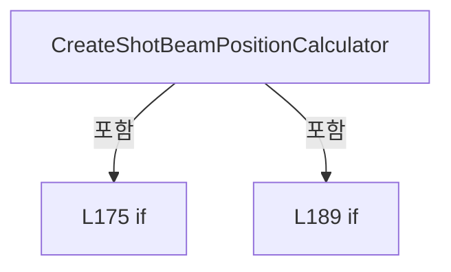

변경 전 점검: 입력/반환 타입, 위 호출자, 예외/취소 경로, 공유 상태와 저장·전송 소비자를 함께 확인합니다. 값의 단위나 물리 방향을 이름만으로 확정하지 않습니다.

### MethodDeclaration `CreateAllPlan` · L195–198

[Drilling.Common/Review/CReviewManager.cs:195–198](https://github.com/kjuws10-rgb/A3Drilling/blob/5aee8e58439c9b455cae7c9593c9be986c3e682e/Drilling.Common/Review/CReviewManager.cs#L195-L198)

| 항목 | 실제 추출 값 |
| --- | --- |
| 서명 | Drilling.Common.Review.ST_REVIEW_PLAN Drilling.Common.Review.CReviewManager.CreateAllPlan(Drilling.Common.Managers.ST_RECIPE_DEFINITION, int) |
| 접근/수식자 | Public / public |
| 반환/값 타입 | Drilling.Common.Review.ST_REVIEW_PLAN |
| 소속 타입 | NamedType:Drilling.Common.Review.CReviewManager |

입력 계약:

| 이름 | 타입 | 전달 | 선택/기본값 |
| --- | --- | --- | --- |
| recipe | Drilling.Common.Managers.ST_RECIPE_DEFINITION | None | False /  |
| selectedBeamNo | int | None | False /  |

정적 호출자로 확인된 위치:

| 호출 파일/행 | 호출 표현식 | 런타임 분기 가능 |
| --- | --- | --- |
| [Drilling.UI/Menu/Menus/CMenuCorrection.ReviewData.Offset.cs:145–145](https://github.com/kjuws10-rgb/A3Drilling/blob/5aee8e58439c9b455cae7c9593c9be986c3e682e/Drilling.UI/Menu/Menus/CMenuCorrection.ReviewData.Offset.cs#L145-L145) | _reviewManager.CreateAllPlan | False |
| [Drilling.UI/Menu/Menus/CMenuCorrection.ReviewData.Offset.cs:265–265](https://github.com/kjuws10-rgb/A3Drilling/blob/5aee8e58439c9b455cae7c9593c9be986c3e682e/Drilling.UI/Menu/Menus/CMenuCorrection.ReviewData.Offset.cs#L265-L265) | _reviewManager.CreateAllPlan | False |
| [Drilling.UI/Menu/Menus/CMenuCorrection.cs:1811–1811](https://github.com/kjuws10-rgb/A3Drilling/blob/5aee8e58439c9b455cae7c9593c9be986c3e682e/Drilling.UI/Menu/Menus/CMenuCorrection.cs#L1811-L1811) | _reviewManager.CreateAllPlan | False |
| [Drilling.UI/Menu/Menus/CMenuReview.cs:395–395](https://github.com/kjuws10-rgb/A3Drilling/blob/5aee8e58439c9b455cae7c9593c9be986c3e682e/Drilling.UI/Menu/Menus/CMenuReview.cs#L395-L395) | _reviewManager.CreateAllPlan | False |
| [Drilling.UI/Menu/Menus/CMenuReview.cs:2636–2636](https://github.com/kjuws10-rgb/A3Drilling/blob/5aee8e58439c9b455cae7c9593c9be986c3e682e/Drilling.UI/Menu/Menus/CMenuReview.cs#L2636-L2636) | _reviewManager.CreateAllPlan | False |
| [Drilling.UI/Menu/Menus/CMenuReview.cs:3233–3233](https://github.com/kjuws10-rgb/A3Drilling/blob/5aee8e58439c9b455cae7c9593c9be986c3e682e/Drilling.UI/Menu/Menus/CMenuReview.cs#L3233-L3233) | _reviewManager.CreateAllPlan | False |

호출하는 대상과 해석 범위:

| 원본 행 | 표현식 | 분석 상태 | 대상/소스 위치 |
| --- | --- | --- | --- |
| 197 | CreateAllPlan | resolved | Drilling.Common.Review.ST_REVIEW_PLAN Drilling.Common.Review.CReviewManager.CreateAllPlan(Drilling.Common.Managers.ST_RECIPE_DEFINITION, int, double, double) · Drilling.Common/Review/CReviewManager.cs:200 |

본문의 실제 연산·분기·예외·반환 순서(원문 위치 순):

| 원본 행 | 종류 | 주석 해설 |
| --- | --- | --- |
| 197 | call | 함수·델리게이트 또는 객체 생성자를 호출합니다: CreateAllPlan(recipe, selectedBeamNo, 0.0, 0.0) |
| 197 | return | 호출자에게 값 또는 제어를 반환합니다: return CreateAllPlan(recipe, selectedBeamNo, 0.0, 0.0); |

변경 전 점검: 입력/반환 타입, 위 호출자, 예외/취소 경로, 공유 상태와 저장·전송 소비자를 함께 확인합니다. 값의 단위나 물리 방향을 이름만으로 확정하지 않습니다.

### MethodDeclaration `CreateAllPlan` · L200–209

[Drilling.Common/Review/CReviewManager.cs:200–209](https://github.com/kjuws10-rgb/A3Drilling/blob/5aee8e58439c9b455cae7c9593c9be986c3e682e/Drilling.Common/Review/CReviewManager.cs#L200-L209)

| 항목 | 실제 추출 값 |
| --- | --- |
| 서명 | Drilling.Common.Review.ST_REVIEW_PLAN Drilling.Common.Review.CReviewManager.CreateAllPlan(Drilling.Common.Managers.ST_RECIPE_DEFINITION, int, double, double) |
| 접근/수식자 | Public / public |
| 반환/값 타입 | Drilling.Common.Review.ST_REVIEW_PLAN |
| 소속 타입 | NamedType:Drilling.Common.Review.CReviewManager |

입력 계약:

| 이름 | 타입 | 전달 | 선택/기본값 |
| --- | --- | --- | --- |
| recipe | Drilling.Common.Managers.ST_RECIPE_DEFINITION | None | False /  |
| selectedBeamNo | int | None | False /  |
| shiftOffsetX | double | None | False /  |
| shiftOffsetY | double | None | False /  |

정적 호출자로 확인된 위치:

| 호출 파일/행 | 호출 표현식 | 런타임 분기 가능 |
| --- | --- | --- |
| [Drilling.Common/Review/CReviewManager.cs:84–84](https://github.com/kjuws10-rgb/A3Drilling/blob/5aee8e58439c9b455cae7c9593c9be986c3e682e/Drilling.Common/Review/CReviewManager.cs#L84-L84) | CreateAllPlan | False |
| [Drilling.Common/Review/CReviewManager.cs:197–197](https://github.com/kjuws10-rgb/A3Drilling/blob/5aee8e58439c9b455cae7c9593c9be986c3e682e/Drilling.Common/Review/CReviewManager.cs#L197-L197) | CreateAllPlan | False |
| [Drilling.UI/Menu/Menus/CMenuReview.cs:2208–2208](https://github.com/kjuws10-rgb/A3Drilling/blob/5aee8e58439c9b455cae7c9593c9be986c3e682e/Drilling.UI/Menu/Menus/CMenuReview.cs#L2208-L2208) | _reviewManager.CreateAllPlan | False |
| [Drilling.UI/Menu/Menus/CMenuReview.cs:3000–3000](https://github.com/kjuws10-rgb/A3Drilling/blob/5aee8e58439c9b455cae7c9593c9be986c3e682e/Drilling.UI/Menu/Menus/CMenuReview.cs#L3000-L3000) | _reviewManager.CreateAllPlan | False |

호출하는 대상과 해석 범위:

| 원본 행 | 표현식 | 분석 상태 | 대상/소스 위치 |
| --- | --- | --- | --- |
| 206 | ValidateShiftOffset | resolved | void Drilling.Common.Review.CReviewManager.ValidateShiftOffset(double, double) · Drilling.Common/Review/CReviewManager.cs:947 |
| 207 | ValidateBeamNo | resolved | void Drilling.Common.Review.CReviewManager.ValidateBeamNo(int, int) · Drilling.Common/Review/CReviewManager.cs:933 |
| 207 | ReadInt | resolved | int Drilling.Common.Review.CReviewManager.ReadInt(Drilling.Common.Managers.ST_RECIPE_DEFINITION, int, params string[]) · Drilling.Common/Review/CReviewManager.cs:1202 |
| 208 | CreatePlanCore | resolved | Drilling.Common.Review.ST_REVIEW_PLAN Drilling.Common.Review.CReviewManager.CreatePlanCore(Drilling.Common.Managers.ST_RECIPE_DEFINITION, System.Func<Drilling.Common.Review.ST_REVIEW_PLAN_POINT, bool>, int, bool, double, double) · Drilling.Common/Review/CReviewManager.cs:456 |

본문의 실제 연산·분기·예외·반환 순서(원문 위치 순):

| 원본 행 | 종류 | 주석 해설 |
| --- | --- | --- |
| 206 | call | 함수·델리게이트 또는 객체 생성자를 호출합니다: ValidateShiftOffset(shiftOffsetX, shiftOffsetY) |
| 207 | call | 함수·델리게이트 또는 객체 생성자를 호출합니다: ValidateBeamNo(selectedBeamNo, ReadInt(recipe, 0, "SPLITED_BEAM_COUNT")) |
| 207 | call | 함수·델리게이트 또는 객체 생성자를 호출합니다: ReadInt(recipe, 0, "SPLITED_BEAM_COUNT") |
| 208 | call | 함수·델리게이트 또는 객체 생성자를 호출합니다: CreatePlanCore(recipe, _ => true, selectedBeamNo, selectAllAssignedPoints: true, shiftOffsetX, shiftOffsetY) |
| 208 | return | 호출자에게 값 또는 제어를 반환합니다: return CreatePlanCore(recipe, _ => true, selectedBeamNo, selectAllAssignedPoints: true, shiftOffsetX, shiftOffsetY); |

변경 전 점검: 입력/반환 타입, 위 호출자, 예외/취소 경로, 공유 상태와 저장·전송 소비자를 함께 확인합니다. 값의 단위나 물리 방향을 이름만으로 확정하지 않습니다.

### MethodDeclaration `ApplyShiftOffset` · L211–236

[Drilling.Common/Review/CReviewManager.cs:211–236](https://github.com/kjuws10-rgb/A3Drilling/blob/5aee8e58439c9b455cae7c9593c9be986c3e682e/Drilling.Common/Review/CReviewManager.cs#L211-L236)

| 항목 | 실제 추출 값 |
| --- | --- |
| 서명 | Drilling.Common.Review.ST_REVIEW_PLAN Drilling.Common.Review.CReviewManager.ApplyShiftOffset(Drilling.Common.Review.ST_REVIEW_PLAN, double, double) |
| 접근/수식자 | Public / public, static |
| 반환/값 타입 | Drilling.Common.Review.ST_REVIEW_PLAN |
| 소속 타입 | NamedType:Drilling.Common.Review.CReviewManager |

입력 계약:

| 이름 | 타입 | 전달 | 선택/기본값 |
| --- | --- | --- | --- |
| plan | Drilling.Common.Review.ST_REVIEW_PLAN | None | False /  |
| shiftOffsetX | double | None | False /  |
| shiftOffsetY | double | None | False /  |

정적 호출자로 확인된 위치:

| 호출 파일/행 | 호출 표현식 | 런타임 분기 가능 |
| --- | --- | --- |
| [Drilling.UI/Menu/Menus/CMenuCorrection.cs:6221–6221](https://github.com/kjuws10-rgb/A3Drilling/blob/5aee8e58439c9b455cae7c9593c9be986c3e682e/Drilling.UI/Menu/Menus/CMenuCorrection.cs#L6221-L6221) | CReviewManager.ApplyShiftOffset | False |
| [Drilling.UI/Menu/Menus/CMenuCorrection.cs:7243–7243](https://github.com/kjuws10-rgb/A3Drilling/blob/5aee8e58439c9b455cae7c9593c9be986c3e682e/Drilling.UI/Menu/Menus/CMenuCorrection.cs#L7243-L7243) | CReviewManager.ApplyShiftOffset | False |

호출하는 대상과 해석 범위:

| 원본 행 | 표현식 | 분석 상태 | 대상/소스 위치 |
| --- | --- | --- | --- |
| 213 | ValidateShiftOffset | resolved | void Drilling.Common.Review.CReviewManager.ValidateShiftOffset(double, double) · Drilling.Common/Review/CReviewManager.cs:947 |
| 228 | plan.CorrectionPlan.SourcePoints.Select(Apply).ToArray | resolved | Drilling.Common.Review.ST_REVIEW_PLAN_POINT[] System.Collections.Generic.IEnumerable<Drilling.Common.Review.ST_REVIEW_PLAN_POINT>.ToArray<Drilling.Common.Review.ST_REVIEW_PLAN_POINT>() |
| 228 | plan.CorrectionPlan.SourcePoints.Select | resolved | System.Collections.Generic.IEnumerable<Drilling.Common.Review.ST_REVIEW_PLAN_POINT> System.Collections.Generic.IEnumerable<Drilling.Common.Review.ST_REVIEW_PLAN_POINT>.Select<Drilling.Common.Review.ST_REVIEW_PLAN_POINT, Drilling.Common.Review.ST_REVIEW_PLAN_POINT>(System.Func<Drilling.Common.Review.ST_REVIEW_PLAN_POINT, Drilling.Common.Review.ST_REVIEW_PLAN_POINT>) |
| 231 | plan.Points.Select(Apply).ToArray | resolved | Drilling.Common.Review.ST_REVIEW_PLAN_POINT[] System.Collections.Generic.IEnumerable<Drilling.Common.Review.ST_REVIEW_PLAN_POINT>.ToArray<Drilling.Common.Review.ST_REVIEW_PLAN_POINT>() |
| 231 | plan.Points.Select | resolved | System.Collections.Generic.IEnumerable<Drilling.Common.Review.ST_REVIEW_PLAN_POINT> System.Collections.Generic.IEnumerable<Drilling.Common.Review.ST_REVIEW_PLAN_POINT>.Select<Drilling.Common.Review.ST_REVIEW_PLAN_POINT, Drilling.Common.Review.ST_REVIEW_PLAN_POINT>(System.Func<Drilling.Common.Review.ST_REVIEW_PLAN_POINT, Drilling.Common.Review.ST_REVIEW_PLAN_POINT>) |

본문의 실제 연산·분기·예외·반환 순서(원문 위치 순):

| 원본 행 | 종류 | 주석 해설 |
| --- | --- | --- |
| 213 | call | 함수·델리게이트 또는 객체 생성자를 호출합니다: ValidateShiftOffset(shiftOffsetX, shiftOffsetY) |
| 214 | local-declaration | 지역 변수를 선언합니다: var deltaX = shiftOffsetX - plan.ShiftOffsetX; |
| 214 | variable-initializer | 변수의 초기값을 지정합니다: deltaX = shiftOffsetX - plan.ShiftOffsetX |
| 215 | local-declaration | 지역 변수를 선언합니다: var deltaY = plan.StageScanDirectionY * (shiftOffsetY - plan.ShiftOffsetY); |
| 215 | variable-initializer | 변수의 초기값을 지정합니다: deltaY = plan.StageScanDirectionY * (shiftOffsetY - plan.ShiftOffsetY) |
| 226 | conditional-expression | 조건에 따라 결과식을 선택합니다: plan.CorrectionPlan is null ? null : plan.CorrectionPlan with { SourcePoints = plan.CorrectionPlan.SourcePoints.Select(Apply).ToArray() } |
| 226 | local-declaration | 지역 변수를 선언합니다: var correction = plan.CorrectionPlan is null ? null : plan.CorrectionPlan with { SourcePoints = plan.CorrectionPlan.SourcePoints.Select(Apply).ToArray() }; |
| 226 | variable-initializer | 변수의 초기값을 지정합니다: correction = plan.CorrectionPlan is null ? null : plan.CorrectionPlan with { SourcePoints = plan.CorrectionPlan.SourcePoints.Select(Apply).ToArray() } |
| 228 | assignment | 값을 대상에 대입합니다: SourcePoints = plan.CorrectionPlan.SourcePoints.Select(Apply).ToArray() |
| 228 | call | 함수·델리게이트 또는 객체 생성자를 호출합니다: plan.CorrectionPlan.SourcePoints.Select(Apply).ToArray() |
| 228 | call | 함수·델리게이트 또는 객체 생성자를 호출합니다: plan.CorrectionPlan.SourcePoints.Select(Apply) |
| 229 | return | 호출자에게 값 또는 제어를 반환합니다: return plan with { Points = plan.Points.Select(Apply).ToArray(), CorrectionPlan = correction, ShiftOffsetX = shiftOffsetX, ShiftOffsetY = shiftOffsetY }; |
| 231 | assignment | 값을 대상에 대입합니다: Points = plan.Points.Select(Apply).ToArray() |
| 231 | call | 함수·델리게이트 또는 객체 생성자를 호출합니다: plan.Points.Select(Apply).ToArray() |
| 231 | call | 함수·델리게이트 또는 객체 생성자를 호출합니다: plan.Points.Select(Apply) |
| 232 | assignment | 값을 대상에 대입합니다: CorrectionPlan = correction |
| 233 | assignment | 값을 대상에 대입합니다: ShiftOffsetX = shiftOffsetX |
| 234 | assignment | 값을 대상에 대입합니다: ShiftOffsetY = shiftOffsetY |

변경 전 점검: 입력/반환 타입, 위 호출자, 예외/취소 경로, 공유 상태와 저장·전송 소비자를 함께 확인합니다. 값의 단위나 물리 방향을 이름만으로 확정하지 않습니다.

### LocalFunctionStatement `Apply` · L217–224

[Drilling.Common/Review/CReviewManager.cs:217–224](https://github.com/kjuws10-rgb/A3Drilling/blob/5aee8e58439c9b455cae7c9593c9be986c3e682e/Drilling.Common/Review/CReviewManager.cs#L217-L224)

| 항목 | 실제 추출 값 |
| --- | --- |
| 서명 | Drilling.Common.Review.ST_REVIEW_PLAN_POINT Apply(Drilling.Common.Review.ST_REVIEW_PLAN_POINT) |
| 접근/수식자 | Private /  |
| 반환/값 타입 | Drilling.Common.Review.ST_REVIEW_PLAN_POINT |
| 소속 타입 | NamedType:Drilling.Common.Review.CReviewManager |

입력 계약:

| 이름 | 타입 | 전달 | 선택/기본값 |
| --- | --- | --- | --- |
| point | Drilling.Common.Review.ST_REVIEW_PLAN_POINT | None | False /  |

현재 부분 분석에서 직접 연결된 호출자는 없습니다. XAML/이벤트/인터페이스·델리게이트·외부 진입을 추가 확인해야 하며, 미사용으로 판정한 것이 아닙니다.

호출하는 대상과 해석 범위:

| 원본 행 | 표현식 | 분석 상태 | 대상/소스 위치 |
| --- | --- | --- | --- |
| 221 | double.IsFinite | resolved | bool double.IsFinite(double) |
| 221 | double.IsFinite | resolved | bool double.IsFinite(double) |
| 222 | new InvalidOperationException | resolved | System.InvalidOperationException.InvalidOperationException(string?) |

본문의 실제 연산·분기·예외·반환 순서(원문 위치 순):

| 원본 행 | 종류 | 주석 해설 |
| --- | --- | --- |
| 219 | local-declaration | 지역 변수를 선언합니다: var targetX = point.ReviewTargetX + deltaX; |
| 219 | variable-initializer | 변수의 초기값을 지정합니다: targetX = point.ReviewTargetX + deltaX |
| 220 | local-declaration | 지역 변수를 선언합니다: var targetY = point.ReviewTargetY + deltaY; |
| 220 | variable-initializer | 변수의 초기값을 지정합니다: targetY = point.ReviewTargetY + deltaY |
| 221 | call | 함수·델리게이트 또는 객체 생성자를 호출합니다: double.IsFinite(targetX) |
| 221 | call | 함수·델리게이트 또는 객체 생성자를 호출합니다: double.IsFinite(targetY) |
| 221 | if | 조건에 따라 분기합니다: if (!double.IsFinite(targetX) &#124;&#124; !double.IsFinite(targetY)) |
| 222 | call | 함수·델리게이트 또는 객체 생성자를 호출합니다: new InvalidOperationException($"Shift Offset 적용 후 Review 목표 좌표가 유효하지 않습니다. X={targetX:R}, Y={targetY:R}") |
| 222 | throw | 예외를 발생/전달합니다: throw new InvalidOperationException($"Shift Offset 적용 후 Review 목표 좌표가 유효하지 않습니다. X={targetX:R}, Y={targetY:R}"); |
| 223 | assignment | 값을 대상에 대입합니다: ReviewTargetX = targetX |
| 223 | assignment | 값을 대상에 대입합니다: ReviewTargetY = targetY |
| 223 | return | 호출자에게 값 또는 제어를 반환합니다: return point with { ReviewTargetX = targetX, ReviewTargetY = targetY }; |

제어 구문의 포함 구조(실제 실행 순서/CFG가 아닌 구문 탐색 그림):

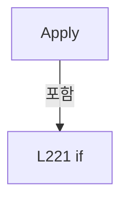

변경 전 점검: 입력/반환 타입, 위 호출자, 예외/취소 경로, 공유 상태와 저장·전송 소비자를 함께 확인합니다. 값의 단위나 물리 방향을 이름만으로 확정하지 않습니다.

### MethodDeclaration `GetHeadScopes` · L243–246

[Drilling.Common/Review/CReviewManager.cs:243–246](https://github.com/kjuws10-rgb/A3Drilling/blob/5aee8e58439c9b455cae7c9593c9be986c3e682e/Drilling.Common/Review/CReviewManager.cs#L243-L246)

| 항목 | 실제 추출 값 |
| --- | --- |
| 서명 | System.Collections.Generic.IReadOnlyList<Drilling.Common.Review.ST_REVIEW_HEAD_SCOPE> Drilling.Common.Review.CReviewManager.GetHeadScopes(Drilling.Common.Managers.ST_RECIPE_DEFINITION) |
| 접근/수식자 | Public / public |
| 반환/값 타입 | System.Collections.Generic.IReadOnlyList<Drilling.Common.Review.ST_REVIEW_HEAD_SCOPE> |
| 소속 타입 | NamedType:Drilling.Common.Review.CReviewManager |

원본 XML 주석:

````xml
/// <summary>
        /// Returns the same physical head scan fields used while assigning Review
        /// plan points.  Review UI uses these values to render a global Head scope
        /// exactly like Main, instead of inferring a range from Cell columns.
        /// </summary>
````

입력 계약:

| 이름 | 타입 | 전달 | 선택/기본값 |
| --- | --- | --- | --- |
| recipe | Drilling.Common.Managers.ST_RECIPE_DEFINITION | None | False /  |

정적 호출자로 확인된 위치:

| 호출 파일/행 | 호출 표현식 | 런타임 분기 가능 |
| --- | --- | --- |
| [Drilling.UI/Menu/Menus/CMenuReview.cs:1048–1048](https://github.com/kjuws10-rgb/A3Drilling/blob/5aee8e58439c9b455cae7c9593c9be986c3e682e/Drilling.UI/Menu/Menus/CMenuReview.cs#L1048-L1048) | _reviewManager.GetHeadScopes | False |
| [Drilling.UI/Menu/Menus/CMenuReview.cs:3334–3334](https://github.com/kjuws10-rgb/A3Drilling/blob/5aee8e58439c9b455cae7c9593c9be986c3e682e/Drilling.UI/Menu/Menus/CMenuReview.cs#L3334-L3334) | _reviewManager.GetHeadScopes | False |

호출하는 대상과 해석 범위:

| 원본 행 | 표현식 | 분석 상태 | 대상/소스 위치 |
| --- | --- | --- | --- |
| 245 | LoadReviewCoordinateSettings(recipe).HeadLayout.Fields.Select(field => new ST_REVIEW_HEAD_SCOPE(field.HeadNo, field.PositionX, field.ScanFieldWidthX)).ToArray | resolved | Drilling.Common.Review.ST_REVIEW_HEAD_SCOPE[] System.Collections.Generic.IEnumerable<Drilling.Common.Review.ST_REVIEW_HEAD_SCOPE>.ToArray<Drilling.Common.Review.ST_REVIEW_HEAD_SCOPE>() |
| 245 | LoadReviewCoordinateSettings(recipe).HeadLayout.Fields.Select | resolved | System.Collections.Generic.IEnumerable<Drilling.Common.Review.ST_REVIEW_HEAD_SCOPE> System.Collections.Generic.IEnumerable<Drilling.Common.Review.CReviewManager.ST_REVIEW_HEAD_FIELD>.Select<Drilling.Common.Review.CReviewManager.ST_REVIEW_HEAD_FIELD, Drilling.Common.Review.ST_REVIEW_HEAD_SCOPE>(System.Func<Drilling.Common.Review.CReviewManager.ST_REVIEW_HEAD_FIELD, Drilling.Common.Review.ST_REVIEW_HEAD_SCOPE>) |
| 245 | LoadReviewCoordinateSettings | resolved | Drilling.Common.Review.CReviewManager.ST_REVIEW_COORDINATE_SETTINGS Drilling.Common.Review.CReviewManager.LoadReviewCoordinateSettings(Drilling.Common.Managers.ST_RECIPE_DEFINITION) · Drilling.Common/Review/CReviewManager.cs:554 |
| 245 | new ST_REVIEW_HEAD_SCOPE | resolved | Drilling.Common.Review.ST_REVIEW_HEAD_SCOPE.ST_REVIEW_HEAD_SCOPE(int, double, double) · Drilling.Common/Review/CReviewManager.cs:3894 |

본문의 실제 연산·분기·예외·반환 순서(원문 위치 순):

| 원본 행 | 종류 | 주석 해설 |
| --- | --- | --- |
| 245 | call | 함수·델리게이트 또는 객체 생성자를 호출합니다: LoadReviewCoordinateSettings(recipe).HeadLayout.Fields.Select(field => new ST_REVIEW_HEAD_SCOPE(field.HeadNo, field.PositionX, field.ScanFieldWidthX)).ToArray() |
| 245 | call | 함수·델리게이트 또는 객체 생성자를 호출합니다: LoadReviewCoordinateSettings(recipe).HeadLayout.Fields.Select(field => new ST_REVIEW_HEAD_SCOPE(field.HeadNo, field.PositionX, field.ScanFieldWidthX)) |
| 245 | call | 함수·델리게이트 또는 객체 생성자를 호출합니다: LoadReviewCoordinateSettings(recipe) |
| 245 | call | 함수·델리게이트 또는 객체 생성자를 호출합니다: new ST_REVIEW_HEAD_SCOPE(field.HeadNo, field.PositionX, field.ScanFieldWidthX) |
| 245 | return | 호출자에게 값 또는 제어를 반환합니다: return LoadReviewCoordinateSettings(recipe).HeadLayout.Fields.Select(field => new ST_REVIEW_HEAD_SCOPE(field.HeadNo, field.PositionX, field.ScanFieldWidthX)).ToArray(); |

변경 전 점검: 입력/반환 타입, 위 호출자, 예외/취소 경로, 공유 상태와 저장·전송 소비자를 함께 확인합니다. 값의 단위나 물리 방향을 이름만으로 확정하지 않습니다.

### MethodDeclaration `Start` · L248–251

[Drilling.Common/Review/CReviewManager.cs:248–251](https://github.com/kjuws10-rgb/A3Drilling/blob/5aee8e58439c9b455cae7c9593c9be986c3e682e/Drilling.Common/Review/CReviewManager.cs#L248-L251)

| 항목 | 실제 추출 값 |
| --- | --- |
| 서명 | System.Threading.Tasks.Task<Drilling.Common.Review.ST_REVIEW_SEQUENCE_STATUS> Drilling.Common.Review.CReviewManager.Start(Drilling.Common.Review.ST_REVIEW_PLAN, string?, System.Action<Drilling.Common.Review.ST_REVIEW_PLAN>?, System.Threading.CancellationToken) |
| 접근/수식자 | Public / public |
| 반환/값 타입 | System.Threading.Tasks.Task<Drilling.Common.Review.ST_REVIEW_SEQUENCE_STATUS> |
| 소속 타입 | NamedType:Drilling.Common.Review.CReviewManager |

입력 계약:

| 이름 | 타입 | 전달 | 선택/기본값 |
| --- | --- | --- | --- |
| plan | Drilling.Common.Review.ST_REVIEW_PLAN | None | False /  |
| productId | string? | None | False /  |
| progress | System.Action<Drilling.Common.Review.ST_REVIEW_PLAN>? | None | True / null |
| cancellationToken | System.Threading.CancellationToken | None | True / null |

현재 부분 분석에서 직접 연결된 호출자는 없습니다. XAML/이벤트/인터페이스·델리게이트·외부 진입을 추가 확인해야 하며, 미사용으로 판정한 것이 아닙니다.

호출하는 대상과 해석 범위:

| 원본 행 | 표현식 | 분석 상태 | 대상/소스 위치 |
| --- | --- | --- | --- |
| 250 | Start | resolved | System.Threading.Tasks.Task<Drilling.Common.Review.ST_REVIEW_SEQUENCE_STATUS> Drilling.Common.Review.CReviewManager.Start(Drilling.Common.Review.ST_REVIEW_PLAN, string?, Drilling.Common.Product.ST_PRODUCT_REVIEW_DATA?, bool, System.Action<Drilling.Common.Review.ST_REVIEW_PLAN>?, System.Threading.CancellationToken) · Drilling.Common/Review/CReviewManager.cs:253 |

본문의 실제 연산·분기·예외·반환 순서(원문 위치 순):

| 원본 행 | 종류 | 주석 해설 |
| --- | --- | --- |
| 250 | call | 함수·델리게이트 또는 객체 생성자를 호출합니다: Start(plan, productId, null, false, progress, cancellationToken) |
| 250 | return | 호출자에게 값 또는 제어를 반환합니다: return Start(plan, productId, null, false, progress, cancellationToken); |

변경 전 점검: 입력/반환 타입, 위 호출자, 예외/취소 경로, 공유 상태와 저장·전송 소비자를 함께 확인합니다. 값의 단위나 물리 방향을 이름만으로 확정하지 않습니다.

### MethodDeclaration `Start` · L253–399

[Drilling.Common/Review/CReviewManager.cs:253–399](https://github.com/kjuws10-rgb/A3Drilling/blob/5aee8e58439c9b455cae7c9593c9be986c3e682e/Drilling.Common/Review/CReviewManager.cs#L253-L399)

| 항목 | 실제 추출 값 |
| --- | --- |
| 서명 | System.Threading.Tasks.Task<Drilling.Common.Review.ST_REVIEW_SEQUENCE_STATUS> Drilling.Common.Review.CReviewManager.Start(Drilling.Common.Review.ST_REVIEW_PLAN, string?, Drilling.Common.Product.ST_PRODUCT_REVIEW_DATA?, bool, System.Action<Drilling.Common.Review.ST_REVIEW_PLAN>?, System.Threading.CancellationToken) |
| 접근/수식자 | Public / public, async |
| 반환/값 타입 | System.Threading.Tasks.Task<Drilling.Common.Review.ST_REVIEW_SEQUENCE_STATUS> |
| 소속 타입 | NamedType:Drilling.Common.Review.CReviewManager |

입력 계약:

| 이름 | 타입 | 전달 | 선택/기본값 |
| --- | --- | --- | --- |
| plan | Drilling.Common.Review.ST_REVIEW_PLAN | None | False /  |
| productId | string? | None | False /  |
| checkpoint | Drilling.Common.Product.ST_PRODUCT_REVIEW_DATA? | None | False /  |
| resumeCheckpoint | bool | None | False /  |
| progress | System.Action<Drilling.Common.Review.ST_REVIEW_PLAN>? | None | True / null |
| cancellationToken | System.Threading.CancellationToken | None | True / null |

정적 호출자로 확인된 위치:

| 호출 파일/행 | 호출 표현식 | 런타임 분기 가능 |
| --- | --- | --- |
| [Drilling.Common/Review/CReviewManager.cs:250–250](https://github.com/kjuws10-rgb/A3Drilling/blob/5aee8e58439c9b455cae7c9593c9be986c3e682e/Drilling.Common/Review/CReviewManager.cs#L250-L250) | Start | False |
| [Drilling.UI/Menu/Menus/CMenuReview.cs:3049–3049](https://github.com/kjuws10-rgb/A3Drilling/blob/5aee8e58439c9b455cae7c9593c9be986c3e682e/Drilling.UI/Menu/Menus/CMenuReview.cs#L3049-L3049) | _reviewManager.Start | False |

호출하는 대상과 해석 범위:

| 원본 행 | 표현식 | 분석 상태 | 대상/소스 위치 |
| --- | --- | --- | --- |
| 262 | _sequenceLock.WaitAsync | resolved | System.Threading.Tasks.Task<bool> System.Threading.SemaphoreSlim.WaitAsync(int, System.Threading.CancellationToken) |
| 264 | CreateStatus | resolved | Drilling.Common.Review.ST_REVIEW_SEQUENCE_STATUS Drilling.Common.Review.CReviewManager.CreateStatus(Drilling.Common.Review.ST_REVIEW_PLAN, Drilling.Common.Review.EN_REVIEW_SEQUENCE_STATE, string) · Drilling.Common/Review/CReviewManager.cs:1075 |
| 272 | ResolveReviewProductId | resolved | string? Drilling.Common.Review.CReviewManager.ResolveReviewProductId(Drilling.Common.Review.ST_REVIEW_PLAN, string?) · Drilling.Common/Review/CReviewManager.cs:1445 |
| 273 | SetReviewProductId | resolved | void Drilling.Common.Review.CReviewManager.SetReviewProductId(string?) · Drilling.Common/Review/CReviewManager.cs:1024 |
| 274 | Interlocked.Exchange | resolved | int System.Threading.Interlocked.Exchange(ref int, int) |
| 275 | plan.ReviewPoints.FirstOrDefault | resolved | Drilling.Common.Review.ST_REVIEW_PLAN_POINT? System.Collections.Generic.IEnumerable<Drilling.Common.Review.ST_REVIEW_PLAN_POINT>.FirstOrDefault<Drilling.Common.Review.ST_REVIEW_PLAN_POINT>(System.Func<Drilling.Common.Review.ST_REVIEW_PLAN_POINT, bool>) |
| 279 | WriteReviewLog | resolved | void Drilling.Common.Review.CReviewManager.WriteReviewLog(string, string) · Drilling.Common/Review/CReviewManager.cs:982 |
| 280 | CreateStatus | resolved | Drilling.Common.Review.ST_REVIEW_SEQUENCE_STATUS Drilling.Common.Review.CReviewManager.CreateStatus(Drilling.Common.Review.ST_REVIEW_PLAN, Drilling.Common.Review.EN_REVIEW_SEQUENCE_STATE, string) · Drilling.Common/Review/CReviewManager.cs:1075 |
| 286 | WriteReviewLog | resolved | void Drilling.Common.Review.CReviewManager.WriteReviewLog(string, string) · Drilling.Common/Review/CReviewManager.cs:982 |
| 287 | CreateStatus | resolved | Drilling.Common.Review.ST_REVIEW_SEQUENCE_STATUS Drilling.Common.Review.CReviewManager.CreateStatus(Drilling.Common.Review.ST_REVIEW_PLAN, Drilling.Common.Review.EN_REVIEW_SEQUENCE_STATE, string) · Drilling.Common/Review/CReviewManager.cs:1075 |
| 291 | SetActivePoints | resolved | void Drilling.Common.Review.CReviewManager.SetActivePoints(Drilling.Common.Review.ST_REVIEW_PLAN_POINT?, Drilling.Common.Review.ST_REVIEW_PLAN_POINT?) · Drilling.Common/Review/CReviewManager.cs:1015 |
| 292 | RestoreCheckpoint | resolved | Drilling.Common.Review.ST_REVIEW_PLAN Drilling.Common.Review.CReviewManager.RestoreCheckpoint(Drilling.Common.Review.ST_REVIEW_PLAN, Drilling.Common.Product.ST_PRODUCT_REVIEW_DATA) · Drilling.Common/Review/CReviewManager.cs:1598 |
| 292 | ResetPlanForRun | resolved | Drilling.Common.Review.ST_REVIEW_PLAN Drilling.Common.Review.CReviewManager.ResetPlanForRun(Drilling.Common.Review.ST_REVIEW_PLAN) · Drilling.Common/Review/CReviewManager.cs:1040 |
| 293 | PrepareRuntimePlan | resolved | Drilling.Common.Review.ST_REVIEW_PLAN Drilling.Common.Review.CReviewManager.PrepareRuntimePlan(Drilling.Common.Review.ST_REVIEW_PLAN) · Drilling.Common/Review/CReviewManager.cs:1054 |
| 294 | SetCurrentPlan | resolved | void Drilling.Common.Review.CReviewManager.SetCurrentPlan(Drilling.Common.Review.ST_REVIEW_PLAN, System.Action<Drilling.Common.Review.ST_REVIEW_PLAN>?) · Drilling.Common/Review/CReviewManager.cs:1005 |
| 296 | ValidateReviewMoveMethod | resolved | void Drilling.Common.Review.CReviewManager.ValidateReviewMoveMethod(Drilling.Common.Review.ST_REVIEW_PLAN) · Drilling.Common/Review/CReviewManager.cs:2353 |
| 297 | OpenReviewStageMotion | resolved | Drilling.Common.Review.CReviewManager.CReviewStageMotion Drilling.Common.Review.CReviewManager.OpenReviewStageMotion(double?) · Drilling.Common/Review/CReviewManager.cs:2364 |
| 298 | WriteReviewLog | resolved | void Drilling.Common.Review.CReviewManager.WriteReviewLog(string, string) · Drilling.Common/Review/CReviewManager.cs:982 |
| 299 | string.IsNullOrWhiteSpace | resolved | bool string.IsNullOrWhiteSpace(string?) |
| 301 | productManager.SetReviewRunning | resolved | System.Threading.Tasks.Task<Drilling.Common.Product.ST_PRODUCT_DATA> Drilling.Common.Product.CProductManager.SetReviewRunning(string, Drilling.Common.Product.ST_PRODUCT_REVIEW_DATA, System.Threading.CancellationToken) · Drilling.Common/Product/CProductManager.cs:444 |
| 301 | CreateProductReviewData | resolved | Drilling.Common.Product.ST_PRODUCT_REVIEW_DATA Drilling.Common.Review.CReviewManager.CreateProductReviewData(Drilling.Common.Review.ST_REVIEW_PLAN, System.DateTimeOffset?) · Drilling.Common/Review/CReviewManager.cs:1491 |
| 304 | IsPointToPoint | resolved | bool Drilling.Common.Review.CReviewManager.IsPointToPoint(Drilling.Common.Review.ST_REVIEW_PLAN) · Drilling.Common/Review/CReviewManager.cs:1532 |
| 306 | RunIofSequence | resolved | System.Threading.Tasks.Task<Drilling.Common.Review.ST_REVIEW_SEQUENCE_STATUS> Drilling.Common.Review.CReviewManager.RunIofSequence(Drilling.Common.Review.ST_REVIEW_PLAN, string?, System.Action<Drilling.Common.Review.ST_REVIEW_PLAN>?, System.Threading.CancellationToken, System.Collections.Generic.IReadOnlyList<Drilling.Common.Review.ST_REVIEW_PLAN_POINT>?, bool) · Drilling.Common/Review/CReviewManager.cs:1810 |
| 309 | OrderPtoPFromCurrentPosition | resolved | System.Collections.Generic.IEnumerable<Drilling.Common.Review.ST_REVIEW_PLAN_POINT> Drilling.Common.Review.CReviewManager.OrderPtoPFromCurrentPosition(System.Collections.Generic.IEnumerable<Drilling.Common.Review.ST_REVIEW_PLAN_POINT>, bool) · Drilling.Common/Review/CReviewManager.cs:2454 |
| 309 | workingPlan.ReviewPoints.Where | resolved | System.Collections.Generic.IEnumerable<Drilling.Common.Review.ST_REVIEW_PLAN_POINT> System.Collections.Generic.IEnumerable<Drilling.Common.Review.ST_REVIEW_PLAN_POINT>.Where<Drilling.Common.Review.ST_REVIEW_PLAN_POINT>(System.Func<Drilling.Common.Review.ST_REVIEW_PLAN_POINT, bool>) |
| 311 | cancellationToken.ThrowIfCancellationRequested | resolved | void System.Threading.CancellationToken.ThrowIfCancellationRequested() |
| 320 | SetWaitingPointsReady | resolved | Drilling.Common.Review.ST_REVIEW_PLAN Drilling.Common.Review.CReviewManager.SetWaitingPointsReady(Drilling.Common.Review.ST_REVIEW_PLAN) · Drilling.Common/Review/CReviewManager.cs:1049 |
| 321 | SetCurrentPlan | resolved | void Drilling.Common.Review.CReviewManager.SetCurrentPlan(Drilling.Common.Review.ST_REVIEW_PLAN, System.Action<Drilling.Common.Review.ST_REVIEW_PLAN>?) · Drilling.Common/Review/CReviewManager.cs:1005 |
| 322 | CreateStoppedStatus | resolved | System.Threading.Tasks.Task<Drilling.Common.Review.ST_REVIEW_SEQUENCE_STATUS> Drilling.Common.Review.CReviewManager.CreateStoppedStatus(Drilling.Common.Review.ST_REVIEW_PLAN, string?, string) · Drilling.Common/Review/CReviewManager.cs:1709 |
| 330 | SetActivePoints | resolved | void Drilling.Common.Review.CReviewManager.SetActivePoints(Drilling.Common.Review.ST_REVIEW_PLAN_POINT?, Drilling.Common.Review.ST_REVIEW_PLAN_POINT?) · Drilling.Common/Review/CReviewManager.cs:1015 |
| 331 | UpdatePoint | resolved | Drilling.Common.Review.ST_REVIEW_PLAN Drilling.Common.Review.CReviewManager.UpdatePoint(Drilling.Common.Review.ST_REVIEW_PLAN, Drilling.Common.Review.ST_REVIEW_PLAN_POINT) · Drilling.Common/Review/CReviewManager.cs:1070 |
| 332 | SetCurrentPlan | resolved | void Drilling.Common.Review.CReviewManager.SetCurrentPlan(Drilling.Common.Review.ST_REVIEW_PLAN, System.Action<Drilling.Common.Review.ST_REVIEW_PLAN>?) · Drilling.Common/Review/CReviewManager.cs:1005 |
| 333 | MoveStageY | resolved | System.Threading.Tasks.Task Drilling.Common.Review.CReviewManager.MoveStageY(Drilling.Common.Review.ST_REVIEW_PLAN_POINT, System.Threading.CancellationToken) · Drilling.Common/Review/CReviewManager.cs:1755 |
| 337 | UpdatePoint | resolved | Drilling.Common.Review.ST_REVIEW_PLAN Drilling.Common.Review.CReviewManager.UpdatePoint(Drilling.Common.Review.ST_REVIEW_PLAN, Drilling.Common.Review.ST_REVIEW_PLAN_POINT) · Drilling.Common/Review/CReviewManager.cs:1070 |
| 338 | SetCurrentPlan | resolved | void Drilling.Common.Review.CReviewManager.SetCurrentPlan(Drilling.Common.Review.ST_REVIEW_PLAN, System.Action<Drilling.Common.Review.ST_REVIEW_PLAN>?) · Drilling.Common/Review/CReviewManager.cs:1005 |
| 339 | CreateStoppedStatus | resolved | System.Threading.Tasks.Task<Drilling.Common.Review.ST_REVIEW_SEQUENCE_STATUS> Drilling.Common.Review.CReviewManager.CreateStoppedStatus(Drilling.Common.Review.ST_REVIEW_PLAN, string?, string) · Drilling.Common/Review/CReviewManager.cs:1709 |
| 342 | MoveVisionX | resolved | System.Threading.Tasks.Task Drilling.Common.Review.CReviewManager.MoveVisionX(Drilling.Common.Review.ST_REVIEW_PLAN_POINT, bool, System.Threading.CancellationToken) · Drilling.Common/Review/CReviewManager.cs:1764 |
| 346 | UpdatePoint | resolved | Drilling.Common.Review.ST_REVIEW_PLAN Drilling.Common.Review.CReviewManager.UpdatePoint(Drilling.Common.Review.ST_REVIEW_PLAN, Drilling.Common.Review.ST_REVIEW_PLAN_POINT) · Drilling.Common/Review/CReviewManager.cs:1070 |
| 347 | SetCurrentPlan | resolved | void Drilling.Common.Review.CReviewManager.SetCurrentPlan(Drilling.Common.Review.ST_REVIEW_PLAN, System.Action<Drilling.Common.Review.ST_REVIEW_PLAN>?) · Drilling.Common/Review/CReviewManager.cs:1005 |
| 348 | CreateStoppedStatus | resolved | System.Threading.Tasks.Task<Drilling.Common.Review.ST_REVIEW_SEQUENCE_STATUS> Drilling.Common.Review.CReviewManager.CreateStoppedStatus(Drilling.Common.Review.ST_REVIEW_PLAN, string?, string) · Drilling.Common/Review/CReviewManager.cs:1709 |
| 351 | MeasureVision | resolved | System.Threading.Tasks.Task<Drilling.Common.Review.CReviewManager.ST_REVIEW_MEASURE_RESULT> Drilling.Common.Review.CReviewManager.MeasureVision(Drilling.Common.Review.ST_REVIEW_PLAN_POINT, System.Threading.CancellationToken) · Drilling.Common/Review/CReviewManager.cs:1776 |
| 355 | UpdatePoint | resolved | Drilling.Common.Review.ST_REVIEW_PLAN Drilling.Common.Review.CReviewManager.UpdatePoint(Drilling.Common.Review.ST_REVIEW_PLAN, Drilling.Common.Review.ST_REVIEW_PLAN_POINT) · Drilling.Common/Review/CReviewManager.cs:1070 |
| 356 | SetCurrentPlan | resolved | void Drilling.Common.Review.CReviewManager.SetCurrentPlan(Drilling.Common.Review.ST_REVIEW_PLAN, System.Action<Drilling.Common.Review.ST_REVIEW_PLAN>?) · Drilling.Common/Review/CReviewManager.cs:1005 |
| 357 | CreateStoppedStatus | resolved | System.Threading.Tasks.Task<Drilling.Common.Review.ST_REVIEW_SEQUENCE_STATUS> Drilling.Common.Review.CReviewManager.CreateStoppedStatus(Drilling.Common.Review.ST_REVIEW_PLAN, string?, string) · Drilling.Common/Review/CReviewManager.cs:1709 |
| 360 | ApplyMeasurement | resolved | Drilling.Common.Review.ST_REVIEW_PLAN_POINT Drilling.Common.Review.CReviewManager.ApplyMeasurement(Drilling.Common.Review.ST_REVIEW_PLAN, Drilling.Common.Review.ST_REVIEW_PLAN_POINT, Drilling.Common.Review.CReviewManager.ST_REVIEW_MEASURE_RESULT) · Drilling.Common/Review/CReviewManager.cs:2141 |
| 361 | SetActivePoints | resolved | void Drilling.Common.Review.CReviewManager.SetActivePoints(Drilling.Common.Review.ST_REVIEW_PLAN_POINT?, Drilling.Common.Review.ST_REVIEW_PLAN_POINT?) · Drilling.Common/Review/CReviewManager.cs:1015 |
| 362 | UpdatePoint | resolved | Drilling.Common.Review.ST_REVIEW_PLAN Drilling.Common.Review.CReviewManager.UpdatePoint(Drilling.Common.Review.ST_REVIEW_PLAN, Drilling.Common.Review.ST_REVIEW_PLAN_POINT) · Drilling.Common/Review/CReviewManager.cs:1070 |
| 363 | SetCurrentPlan | resolved | void Drilling.Common.Review.CReviewManager.SetCurrentPlan(Drilling.Common.Review.ST_REVIEW_PLAN, System.Action<Drilling.Common.Review.ST_REVIEW_PLAN>?) · Drilling.Common/Review/CReviewManager.cs:1005 |
| 364 | SaveProgressToProduct | resolved | System.Threading.Tasks.Task Drilling.Common.Review.CReviewManager.SaveProgressToProduct(Drilling.Common.Review.ST_REVIEW_PLAN, string?, System.Threading.CancellationToken) · Drilling.Common/Review/CReviewManager.cs:1481 |
| 368 | SetCurrentPlan | resolved | void Drilling.Common.Review.CReviewManager.SetCurrentPlan(Drilling.Common.Review.ST_REVIEW_PLAN, System.Action<Drilling.Common.Review.ST_REVIEW_PLAN>?) · Drilling.Common/Review/CReviewManager.cs:1005 |
| 369 | SaveResultForProduct | resolved | System.Threading.Tasks.Task Drilling.Common.Review.CReviewManager.SaveResultForProduct(Drilling.Common.Review.ST_REVIEW_PLAN, System.Collections.Generic.IReadOnlyList<Drilling.Common.Review.ST_REVIEW_PLAN_POINT>, string?, System.Threading.CancellationToken) · Drilling.Common/Review/CReviewManager.cs:1465 |
| 370 | WriteReviewLog | resolved | void Drilling.Common.Review.CReviewManager.WriteReviewLog(string, string) · Drilling.Common/Review/CReviewManager.cs:982 |
| 371 | CreateStatus | resolved | Drilling.Common.Review.ST_REVIEW_SEQUENCE_STATUS Drilling.Common.Review.CReviewManager.CreateStatus(Drilling.Common.Review.ST_REVIEW_PLAN, Drilling.Common.Review.EN_REVIEW_SEQUENCE_STATE, string) · Drilling.Common/Review/CReviewManager.cs:1075 |
| 375 | .Stop | resolved | void Drilling.Common.Review.CReviewManager.CReviewStageMotion.Stop() · Drilling.Common/Review/CReviewManager.cs:2412 |
| 377 | SetWaitingPointsReady | resolved | Drilling.Common.Review.ST_REVIEW_PLAN Drilling.Common.Review.CReviewManager.SetWaitingPointsReady(Drilling.Common.Review.ST_REVIEW_PLAN) · Drilling.Common/Review/CReviewManager.cs:1049 |
| 378 | SetCurrentPlan | resolved | void Drilling.Common.Review.CReviewManager.SetCurrentPlan(Drilling.Common.Review.ST_REVIEW_PLAN, System.Action<Drilling.Common.Review.ST_REVIEW_PLAN>?) · Drilling.Common/Review/CReviewManager.cs:1005 |
| 379 | CreateStoppedStatus | resolved | System.Threading.Tasks.Task<Drilling.Common.Review.ST_REVIEW_SEQUENCE_STATUS> Drilling.Common.Review.CReviewManager.CreateStoppedStatus(Drilling.Common.Review.ST_REVIEW_PLAN, string?, string) · Drilling.Common/Review/CReviewManager.cs:1709 |
| 383 | .Stop | resolved | void Drilling.Common.Review.CReviewManager.CReviewStageMotion.Stop() · Drilling.Common/Review/CReviewManager.cs:2412 |
| 385 | SetWaitingPointsReady | resolved | Drilling.Common.Review.ST_REVIEW_PLAN Drilling.Common.Review.CReviewManager.SetWaitingPointsReady(Drilling.Common.Review.ST_REVIEW_PLAN) · Drilling.Common/Review/CReviewManager.cs:1049 |
| 386 | SetCurrentPlan | resolved | void Drilling.Common.Review.CReviewManager.SetCurrentPlan(Drilling.Common.Review.ST_REVIEW_PLAN, System.Action<Drilling.Common.Review.ST_REVIEW_PLAN>?) · Drilling.Common/Review/CReviewManager.cs:1005 |
| 387 | WriteReviewError | resolved | void Drilling.Common.Review.CReviewManager.WriteReviewError() · Drilling.Common/Review/CReviewManager.cs:1000 |
| 388 | TrySetProductReviewError | resolved | System.Threading.Tasks.Task<Drilling.Common.Review.CReviewManager.ST_PRODUCT_REVIEW_UPDATE_RESULT> Drilling.Common.Review.CReviewManager.TrySetProductReviewError(string?, string) · Drilling.Common/Review/CReviewManager.cs:1673 |
| 389 | CreateStatus | resolved | Drilling.Common.Review.ST_REVIEW_SEQUENCE_STATUS Drilling.Common.Review.CReviewManager.CreateStatus(Drilling.Common.Review.ST_REVIEW_PLAN, Drilling.Common.Review.EN_REVIEW_SEQUENCE_STATE, string) · Drilling.Common/Review/CReviewManager.cs:1075 |
| 389 | AppendUpdateResult | resolved | string Drilling.Common.Review.CReviewManager.AppendUpdateResult(string, Drilling.Common.Review.CReviewManager.ST_PRODUCT_REVIEW_UPDATE_RESULT) · Drilling.Common/Review/CReviewManager.cs:1745 |
| 394 | RememberInterruptedReview | resolved | void Drilling.Common.Review.CReviewManager.RememberInterruptedReview(string?) · Drilling.Common/Review/CReviewManager.cs:2416 |
| 395 | .Dispose | resolved | void Drilling.Common.Review.CReviewManager.CReviewStageMotion.Dispose() · Drilling.Common/Review/CReviewManager.cs:2413 |
| 397 | _sequenceLock.Release | resolved | int System.Threading.SemaphoreSlim.Release() |

본문의 실제 연산·분기·예외·반환 순서(원문 위치 순):

| 원본 행 | 종류 | 주석 해설 |
| --- | --- | --- |
| 262 | await | 비동기 완료를 기다립니다: await _sequenceLock.WaitAsync(0, cancellationToken) |
| 262 | call | 함수·델리게이트 또는 객체 생성자를 호출합니다: _sequenceLock.WaitAsync(0, cancellationToken) |
| 262 | if | 조건에 따라 분기합니다: if (!await _sequenceLock.WaitAsync(0, cancellationToken)) |
| 264 | call | 함수·델리게이트 또는 객체 생성자를 호출합니다: CreateStatus(CurrentPlan ?? plan, EN_REVIEW_SEQUENCE_STATE.Running, "Review sequence is already running.") |
| 264 | return | 호출자에게 값 또는 제어를 반환합니다: return CreateStatus(CurrentPlan ?? plan, EN_REVIEW_SEQUENCE_STATE.Running, "Review sequence is already running."); |
| 267 | local-declaration | 지역 변수를 선언합니다: string? reviewProductId = null; |
| 267 | variable-initializer | 변수의 초기값을 지정합니다: reviewProductId = null |
| 268 | local-declaration | 지역 변수를 선언합니다: var runInitialized = false; |
| 268 | variable-initializer | 변수의 초기값을 지정합니다: runInitialized = false |
| 269 | try | 예외 처리 범위입니다: try |
| 271 | assignment | 값을 대상에 대입합니다: LastSavedResultPath = null |
| 272 | assignment | 값을 대상에 대입합니다: reviewProductId = ResolveReviewProductId(plan, productId) |
| 272 | call | 함수·델리게이트 또는 객체 생성자를 호출합니다: ResolveReviewProductId(plan, productId) |
| 273 | call | 함수·델리게이트 또는 객체 생성자를 호출합니다: SetReviewProductId(reviewProductId) |
| 274 | call | 함수·델리게이트 또는 객체 생성자를 호출합니다: Interlocked.Exchange(ref _stopRequested, 0) |
| 275 | call | 함수·델리게이트 또는 객체 생성자를 호출합니다: plan.ReviewPoints.FirstOrDefault(point => point.HeadNo <= 0) |
| 275 | local-declaration | 지역 변수를 선언합니다: var unassignedPoint = plan.ReviewPoints.FirstOrDefault(point => point.HeadNo <= 0); |
| 275 | variable-initializer | 변수의 초기값을 지정합니다: unassignedPoint = plan.ReviewPoints.FirstOrDefault(point => point.HeadNo <= 0) |
| 276 | if | 조건에 따라 분기합니다: if (unassignedPoint is not null) |
| 278 | assignment | 값을 대상에 대입합니다: SequenceState = EN_REVIEW_SEQUENCE_STATE.Failed |
| 279 | call | 함수·델리게이트 또는 객체 생성자를 호출합니다: WriteReviewLog("START", "Review could not start because a processing Head is not assigned.") |
| 280 | call | 함수·델리게이트 또는 객체 생성자를 호출합니다: CreateStatus(plan, SequenceState, $"Review point {unassignedPoint.ShotKey} is not assigned to a processing Head.") |
| 280 | return | 호출자에게 값 또는 제어를 반환합니다: return CreateStatus(plan, SequenceState, $"Review point {unassignedPoint.ShotKey} is not assigned to a processing Head."); |
| 283 | if | 조건에 따라 분기합니다: if (plan.ReviewPoints.Count == 0) |
| 285 | assignment | 값을 대상에 대입합니다: SequenceState = EN_REVIEW_SEQUENCE_STATE.Failed |
| 286 | call | 함수·델리게이트 또는 객체 생성자를 호출합니다: WriteReviewLog("START", "Review could not start because there is no inspection target.") |
| 287 | call | 함수·델리게이트 또는 객체 생성자를 호출합니다: CreateStatus(plan, SequenceState, "Executable review point is empty.") |
| 287 | return | 호출자에게 값 또는 제어를 반환합니다: return CreateStatus(plan, SequenceState, "Executable review point is empty."); |
| 290 | assignment | 값을 대상에 대입합니다: SequenceState = EN_REVIEW_SEQUENCE_STATE.Running |
| 291 | call | 함수·델리게이트 또는 객체 생성자를 호출합니다: SetActivePoints(null, null) |
| 292 | call | 함수·델리게이트 또는 객체 생성자를 호출합니다: RestoreCheckpoint(plan, checkpoint) |
| 292 | call | 함수·델리게이트 또는 객체 생성자를 호출합니다: ResetPlanForRun(plan) |
| 292 | conditional-expression | 조건에 따라 결과식을 선택합니다: resumeCheckpoint && checkpoint is not null ? RestoreCheckpoint(plan, checkpoint) : ResetPlanForRun(plan) |
| 292 | local-declaration | 지역 변수를 선언합니다: var workingPlan = resumeCheckpoint && checkpoint is not null ? RestoreCheckpoint(plan, checkpoint) : ResetPlanForRun(plan); |
| 292 | variable-initializer | 변수의 초기값을 지정합니다: workingPlan = resumeCheckpoint && checkpoint is not null ? RestoreCheckpoint(plan, checkpoint) : ResetPlanForRun(plan) |
| 293 | assignment | 값을 대상에 대입합니다: workingPlan = PrepareRuntimePlan(workingPlan) |
| 293 | call | 함수·델리게이트 또는 객체 생성자를 호출합니다: PrepareRuntimePlan(workingPlan) |
| 294 | call | 함수·델리게이트 또는 객체 생성자를 호출합니다: SetCurrentPlan(workingPlan, progress) |
| 295 | assignment | 값을 대상에 대입합니다: runInitialized = true |
| 296 | call | 함수·델리게이트 또는 객체 생성자를 호출합니다: ValidateReviewMoveMethod(workingPlan) |
| 297 | assignment | 값을 대상에 대입합니다: _reviewStageMotion = OpenReviewStageMotion(workingPlan.StageSpeed) |
| 297 | call | 함수·델리게이트 또는 객체 생성자를 호출합니다: OpenReviewStageMotion(workingPlan.StageSpeed) |
| 298 | call | 함수·델리게이트 또는 객체 생성자를 호출합니다: WriteReviewLog(resumeCheckpoint && checkpoint is not null ? "RESUME" : "START", resumeCheckpoint && checkpoint is not null ? "Review resumed." : "Review started.") |
| 298 | conditional-expression | 조건에 따라 결과식을 선택합니다: resumeCheckpoint && checkpoint is not null ? "RESUME" : "START" |
| 298 | conditional-expression | 조건에 따라 결과식을 선택합니다: resumeCheckpoint && checkpoint is not null ? "Review resumed." : "Review started." |
| 299 | call | 함수·델리게이트 또는 객체 생성자를 호출합니다: string.IsNullOrWhiteSpace(reviewProductId) |
| 299 | if | 조건에 따라 분기합니다: if (!string.IsNullOrWhiteSpace(reviewProductId) && productManager is not null) |
| 301 | await | 비동기 완료를 기다립니다: await productManager.SetReviewRunning(reviewProductId, CreateProductReviewData(workingPlan, resumeCheckpoint ? checkpoint?.SavedAt : null), cancellationToken) |
| 301 | call | 함수·델리게이트 또는 객체 생성자를 호출합니다: productManager.SetReviewRunning(reviewProductId, CreateProductReviewData(workingPlan, resumeCheckpoint ? checkpoint?.SavedAt : null), cancellationToken) |
| 301 | call | 함수·델리게이트 또는 객체 생성자를 호출합니다: CreateProductReviewData(workingPlan, resumeCheckpoint ? checkpoint?.SavedAt : null) |
| 301 | conditional-expression | 조건에 따라 결과식을 선택합니다: resumeCheckpoint ? checkpoint?.SavedAt : null |
| 304 | call | 함수·델리게이트 또는 객체 생성자를 호출합니다: IsPointToPoint(workingPlan) |
| 304 | if | 조건에 따라 분기합니다: if (!IsPointToPoint(workingPlan)) |
| 306 | await | 비동기 완료를 기다립니다: await RunIofSequence(workingPlan, reviewProductId, progress, cancellationToken, resumeFromCurrentPosition: resumeCheckpoint) |
| 306 | call | 함수·델리게이트 또는 객체 생성자를 호출합니다: RunIofSequence(workingPlan, reviewProductId, progress, cancellationToken, resumeFromCurrentPosition: resumeCheckpoint) |
| 306 | return | 호출자에게 값 또는 제어를 반환합니다: return await RunIofSequence(workingPlan, reviewProductId, progress, cancellationToken, resumeFromCurrentPosition: resumeCheckpoint); |
| 309 | call | 함수·델리게이트 또는 객체 생성자를 호출합니다: OrderPtoPFromCurrentPosition(workingPlan.ReviewPoints.Where(point => point.State is not (EN_REVIEW_POINT_STATE.Ok or EN_REVIEW_POINT_STATE.Ng)), resumeCheckpoint) |
| 309 | call | 함수·델리게이트 또는 객체 생성자를 호출합니다: workingPlan.ReviewPoints.Where(point => point.State is not (EN_REVIEW_POINT_STATE.Ok or EN_REVIEW_POINT_STATE.Ng)) |
| 309 | foreach | 컬렉션 요소를 순회합니다: foreach (var point in OrderPtoPFromCurrentPosition(workingPlan.ReviewPoints.Where(point => point.State is not (EN_REVIEW_POINT_STATE.Ok or EN_REVIEW_POINT_STATE.Ng)), resumeCheckpoint)) |
| 311 | call | 함수·델리게이트 또는 객체 생성자를 호출합니다: cancellationToken.ThrowIfCancellationRequested() |
| 312 | if | 조건에 따라 분기합니다: if (point.State is EN_REVIEW_POINT_STATE.Ok or EN_REVIEW_POINT_STATE.Ng) |
| 314 | continue | 다음 반복으로 진행합니다: continue; |
| 317 | if | 조건에 따라 분기합니다: if (IsStopRequested) |
| 319 | assignment | 값을 대상에 대입합니다: SequenceState = EN_REVIEW_SEQUENCE_STATE.Stopped |
| 320 | assignment | 값을 대상에 대입합니다: workingPlan = SetWaitingPointsReady(workingPlan) |
| 320 | call | 함수·델리게이트 또는 객체 생성자를 호출합니다: SetWaitingPointsReady(workingPlan) |
| 321 | call | 함수·델리게이트 또는 객체 생성자를 호출합니다: SetCurrentPlan(workingPlan, progress) |
| 322 | await | 비동기 완료를 기다립니다: await CreateStoppedStatus(workingPlan, reviewProductId, "Review sequence stopped.") |
| 322 | call | 함수·델리게이트 또는 객체 생성자를 호출합니다: CreateStoppedStatus(workingPlan, reviewProductId, "Review sequence stopped.") |
| 322 | return | 호출자에게 값 또는 제어를 반환합니다: return await CreateStoppedStatus(workingPlan, reviewProductId, "Review sequence stopped."); |
| 325 | local-declaration | 지역 변수를 선언합니다: var currentPoint = point with { State = EN_REVIEW_POINT_STATE.Current, Judge = "WAIT" }; |
| 325 | variable-initializer | 변수의 초기값을 지정합니다: currentPoint = point with { State = EN_REVIEW_POINT_STATE.Current, Judge = "WAIT" } |
| 327 | assignment | 값을 대상에 대입합니다: State = EN_REVIEW_POINT_STATE.Current |
| 328 | assignment | 값을 대상에 대입합니다: Judge = "WAIT" |
| 330 | call | 함수·델리게이트 또는 객체 생성자를 호출합니다: SetActivePoints(currentPoint, LastMeasuredPoint) |
| 331 | assignment | 값을 대상에 대입합니다: workingPlan = UpdatePoint(workingPlan, currentPoint) |
| 331 | call | 함수·델리게이트 또는 객체 생성자를 호출합니다: UpdatePoint(workingPlan, currentPoint) |
| 332 | call | 함수·델리게이트 또는 객체 생성자를 호출합니다: SetCurrentPlan(workingPlan, progress) |
| 333 | await | 비동기 완료를 기다립니다: await MoveStageY(currentPoint, cancellationToken) |
| 333 | call | 함수·델리게이트 또는 객체 생성자를 호출합니다: MoveStageY(currentPoint, cancellationToken) |
| 334 | if | 조건에 따라 분기합니다: if (IsStopRequested) |
| 336 | assignment | 값을 대상에 대입합니다: SequenceState = EN_REVIEW_SEQUENCE_STATE.Stopped |
| 337 | assignment | 값을 대상에 대입합니다: workingPlan = UpdatePoint(workingPlan, currentPoint with { State = EN_REVIEW_POINT_STATE.Ready }) |
| 337 | assignment | 값을 대상에 대입합니다: State = EN_REVIEW_POINT_STATE.Ready |
| 337 | call | 함수·델리게이트 또는 객체 생성자를 호출합니다: UpdatePoint(workingPlan, currentPoint with { State = EN_REVIEW_POINT_STATE.Ready }) |
| 338 | call | 함수·델리게이트 또는 객체 생성자를 호출합니다: SetCurrentPlan(workingPlan, progress) |
| 339 | await | 비동기 완료를 기다립니다: await CreateStoppedStatus(workingPlan, reviewProductId, "Review sequence stopped.") |
| 339 | call | 함수·델리게이트 또는 객체 생성자를 호출합니다: CreateStoppedStatus(workingPlan, reviewProductId, "Review sequence stopped.") |
| 339 | return | 호출자에게 값 또는 제어를 반환합니다: return await CreateStoppedStatus(workingPlan, reviewProductId, "Review sequence stopped."); |
| 342 | await | 비동기 완료를 기다립니다: await MoveVisionX(currentPoint, waitForMoveCompletion: true, cancellationToken) |
| 342 | call | 함수·델리게이트 또는 객체 생성자를 호출합니다: MoveVisionX(currentPoint, waitForMoveCompletion: true, cancellationToken) |
| 343 | if | 조건에 따라 분기합니다: if (IsStopRequested) |
| 345 | assignment | 값을 대상에 대입합니다: SequenceState = EN_REVIEW_SEQUENCE_STATE.Stopped |
| 346 | assignment | 값을 대상에 대입합니다: workingPlan = UpdatePoint(workingPlan, currentPoint with { State = EN_REVIEW_POINT_STATE.Ready }) |
| 346 | assignment | 값을 대상에 대입합니다: State = EN_REVIEW_POINT_STATE.Ready |
| 346 | call | 함수·델리게이트 또는 객체 생성자를 호출합니다: UpdatePoint(workingPlan, currentPoint with { State = EN_REVIEW_POINT_STATE.Ready }) |
| 347 | call | 함수·델리게이트 또는 객체 생성자를 호출합니다: SetCurrentPlan(workingPlan, progress) |
| 348 | await | 비동기 완료를 기다립니다: await CreateStoppedStatus(workingPlan, reviewProductId, "Review sequence stopped.") |
| 348 | call | 함수·델리게이트 또는 객체 생성자를 호출합니다: CreateStoppedStatus(workingPlan, reviewProductId, "Review sequence stopped.") |
| 348 | return | 호출자에게 값 또는 제어를 반환합니다: return await CreateStoppedStatus(workingPlan, reviewProductId, "Review sequence stopped."); |
| 351 | await | 비동기 완료를 기다립니다: await MeasureVision(currentPoint, cancellationToken) |
| 351 | call | 함수·델리게이트 또는 객체 생성자를 호출합니다: MeasureVision(currentPoint, cancellationToken) |
| 351 | local-declaration | 지역 변수를 선언합니다: var measurement = await MeasureVision(currentPoint, cancellationToken); |
| 351 | variable-initializer | 변수의 초기값을 지정합니다: measurement = await MeasureVision(currentPoint, cancellationToken) |
| 352 | if | 조건에 따라 분기합니다: if (IsStopRequested) |
| 354 | assignment | 값을 대상에 대입합니다: SequenceState = EN_REVIEW_SEQUENCE_STATE.Stopped |
| 355 | assignment | 값을 대상에 대입합니다: workingPlan = UpdatePoint(workingPlan, currentPoint with { State = EN_REVIEW_POINT_STATE.Ready }) |
| 355 | assignment | 값을 대상에 대입합니다: State = EN_REVIEW_POINT_STATE.Ready |
| 355 | call | 함수·델리게이트 또는 객체 생성자를 호출합니다: UpdatePoint(workingPlan, currentPoint with { State = EN_REVIEW_POINT_STATE.Ready }) |
| 356 | call | 함수·델리게이트 또는 객체 생성자를 호출합니다: SetCurrentPlan(workingPlan, progress) |
| 357 | await | 비동기 완료를 기다립니다: await CreateStoppedStatus(workingPlan, reviewProductId, "Review sequence stopped.") |
| 357 | call | 함수·델리게이트 또는 객체 생성자를 호출합니다: CreateStoppedStatus(workingPlan, reviewProductId, "Review sequence stopped.") |
| 357 | return | 호출자에게 값 또는 제어를 반환합니다: return await CreateStoppedStatus(workingPlan, reviewProductId, "Review sequence stopped."); |
| 360 | call | 함수·델리게이트 또는 객체 생성자를 호출합니다: ApplyMeasurement(workingPlan, currentPoint, measurement) |
| 360 | local-declaration | 지역 변수를 선언합니다: var measuredPoint = ApplyMeasurement(workingPlan, currentPoint, measurement); |
| 360 | variable-initializer | 변수의 초기값을 지정합니다: measuredPoint = ApplyMeasurement(workingPlan, currentPoint, measurement) |
| 361 | call | 함수·델리게이트 또는 객체 생성자를 호출합니다: SetActivePoints(null, measuredPoint) |
| 362 | assignment | 값을 대상에 대입합니다: workingPlan = UpdatePoint(workingPlan, measuredPoint) |
| 362 | call | 함수·델리게이트 또는 객체 생성자를 호출합니다: UpdatePoint(workingPlan, measuredPoint) |
| 363 | call | 함수·델리게이트 또는 객체 생성자를 호출합니다: SetCurrentPlan(workingPlan, progress) |
| 364 | await | 비동기 완료를 기다립니다: await SaveProgressToProduct(workingPlan, reviewProductId, cancellationToken) |
| 364 | call | 함수·델리게이트 또는 객체 생성자를 호출합니다: SaveProgressToProduct(workingPlan, reviewProductId, cancellationToken) |
| 367 | assignment | 값을 대상에 대입합니다: SequenceState = EN_REVIEW_SEQUENCE_STATE.Completed |
| 368 | call | 함수·델리게이트 또는 객체 생성자를 호출합니다: SetCurrentPlan(workingPlan, progress) |
| 369 | await | 비동기 완료를 기다립니다: await SaveResultForProduct(workingPlan, workingPlan.ReviewPoints, reviewProductId, cancellationToken) |
| 369 | call | 함수·델리게이트 또는 객체 생성자를 호출합니다: SaveResultForProduct(workingPlan, workingPlan.ReviewPoints, reviewProductId, cancellationToken) |
| 370 | call | 함수·델리게이트 또는 객체 생성자를 호출합니다: WriteReviewLog("COMPLETE", "Review completed.") |
| 371 | call | 함수·델리게이트 또는 객체 생성자를 호출합니다: CreateStatus(workingPlan, SequenceState, "Review sequence completed.") |
| 371 | return | 호출자에게 값 또는 제어를 반환합니다: return CreateStatus(workingPlan, SequenceState, "Review sequence completed."); |
| 373 | catch | 지정 예외를 처리합니다: catch (OperationCanceledException) |
| 375 | call | 함수·델리게이트 또는 객체 생성자를 호출합니다: .Stop() |
| 376 | assignment | 값을 대상에 대입합니다: SequenceState = EN_REVIEW_SEQUENCE_STATE.Stopped |
| 377 | call | 함수·델리게이트 또는 객체 생성자를 호출합니다: SetWaitingPointsReady(CurrentPlan ?? plan) |
| 377 | local-declaration | 지역 변수를 선언합니다: var stoppedPlan = SetWaitingPointsReady(CurrentPlan ?? plan); |
| 377 | variable-initializer | 변수의 초기값을 지정합니다: stoppedPlan = SetWaitingPointsReady(CurrentPlan ?? plan) |
| 378 | call | 함수·델리게이트 또는 객체 생성자를 호출합니다: SetCurrentPlan(stoppedPlan, progress) |
| 379 | await | 비동기 완료를 기다립니다: await CreateStoppedStatus(stoppedPlan, reviewProductId, "Review sequence canceled.") |
| 379 | call | 함수·델리게이트 또는 객체 생성자를 호출합니다: CreateStoppedStatus(stoppedPlan, reviewProductId, "Review sequence canceled.") |
| 379 | return | 호출자에게 값 또는 제어를 반환합니다: return await CreateStoppedStatus(stoppedPlan, reviewProductId, "Review sequence canceled."); |
| 381 | catch | 지정 예외를 처리합니다: catch (Exception ex) |
| 383 | call | 함수·델리게이트 또는 객체 생성자를 호출합니다: .Stop() |
| 384 | assignment | 값을 대상에 대입합니다: SequenceState = EN_REVIEW_SEQUENCE_STATE.Failed |
| 385 | call | 함수·델리게이트 또는 객체 생성자를 호출합니다: SetWaitingPointsReady(CurrentPlan ?? plan) |
| 385 | local-declaration | 지역 변수를 선언합니다: var failedPlan = SetWaitingPointsReady(CurrentPlan ?? plan); |
| 385 | variable-initializer | 변수의 초기값을 지정합니다: failedPlan = SetWaitingPointsReady(CurrentPlan ?? plan) |
| 386 | call | 함수·델리게이트 또는 객체 생성자를 호출합니다: SetCurrentPlan(failedPlan, progress) |
| 387 | call | 함수·델리게이트 또는 객체 생성자를 호출합니다: WriteReviewError() |
| 388 | await | 비동기 완료를 기다립니다: await TrySetProductReviewError(reviewProductId, ex.Message) |
| 388 | call | 함수·델리게이트 또는 객체 생성자를 호출합니다: TrySetProductReviewError(reviewProductId, ex.Message) |
| 388 | local-declaration | 지역 변수를 선언합니다: var updateResult = await TrySetProductReviewError(reviewProductId, ex.Message); |
| 388 | variable-initializer | 변수의 초기값을 지정합니다: updateResult = await TrySetProductReviewError(reviewProductId, ex.Message) |
| 389 | call | 함수·델리게이트 또는 객체 생성자를 호출합니다: CreateStatus(failedPlan, SequenceState, AppendUpdateResult(ex.Message, updateResult)) |
| 389 | call | 함수·델리게이트 또는 객체 생성자를 호출합니다: AppendUpdateResult(ex.Message, updateResult) |
| 389 | return | 호출자에게 값 또는 제어를 반환합니다: return CreateStatus(failedPlan, SequenceState, AppendUpdateResult(ex.Message, updateResult)); |
| 391 | finally | 종료 정리 구간입니다: finally |
| 393 | if | 조건에 따라 분기합니다: if (runInitialized) |
| 394 | call | 함수·델리게이트 또는 객체 생성자를 호출합니다: RememberInterruptedReview(reviewProductId) |
| 395 | call | 함수·델리게이트 또는 객체 생성자를 호출합니다: .Dispose() |
| 396 | assignment | 값을 대상에 대입합니다: _reviewStageMotion = null |
| 397 | call | 함수·델리게이트 또는 객체 생성자를 호출합니다: _sequenceLock.Release() |

제어 구문의 포함 구조(실제 실행 순서/CFG가 아닌 구문 탐색 그림):

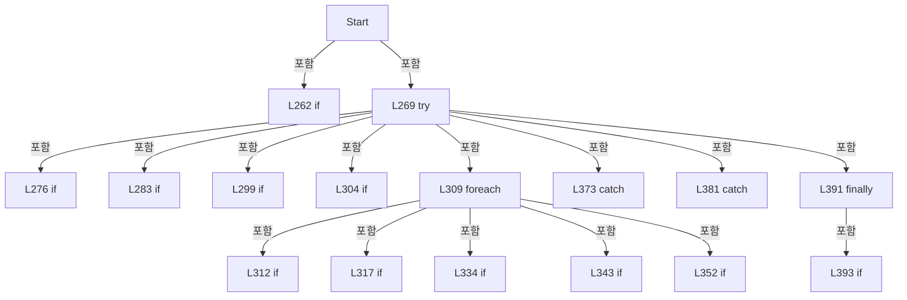

변경 전 점검: 입력/반환 타입, 위 호출자, 예외/취소 경로, 공유 상태와 저장·전송 소비자를 함께 확인합니다. 값의 단위나 물리 방향을 이름만으로 확정하지 않습니다.

### MethodDeclaration `Stop` · L401–411

[Drilling.Common/Review/CReviewManager.cs:401–411](https://github.com/kjuws10-rgb/A3Drilling/blob/5aee8e58439c9b455cae7c9593c9be986c3e682e/Drilling.Common/Review/CReviewManager.cs#L401-L411)

| 항목 | 실제 추출 값 |
| --- | --- |
| 서명 | void Drilling.Common.Review.CReviewManager.Stop() |
| 접근/수식자 | Public / public |
| 반환/값 타입 | void |
| 소속 타입 | NamedType:Drilling.Common.Review.CReviewManager |

정적 호출자로 확인된 위치:

| 호출 파일/행 | 호출 표현식 | 런타임 분기 가능 |
| --- | --- | --- |
| [Drilling.UI/CRootView.cs:2681–2681](https://github.com/kjuws10-rgb/A3Drilling/blob/5aee8e58439c9b455cae7c9593c9be986c3e682e/Drilling.UI/CRootView.cs#L2681-L2681) | _reviewManager.Stop | False |
| [Drilling.UI/Menu/Menus/CMenuCorrection.ReviewData.Reinspection.cs:334–334](https://github.com/kjuws10-rgb/A3Drilling/blob/5aee8e58439c9b455cae7c9593c9be986c3e682e/Drilling.UI/Menu/Menus/CMenuCorrection.ReviewData.Reinspection.cs#L334-L334) | _reviewManager.Stop | False |
| [Drilling.UI/Menu/Menus/CMenuCorrection.ReviewData.Reinspection.cs:662–662](https://github.com/kjuws10-rgb/A3Drilling/blob/5aee8e58439c9b455cae7c9593c9be986c3e682e/Drilling.UI/Menu/Menus/CMenuCorrection.ReviewData.Reinspection.cs#L662-L662) | _reviewManager.Stop | False |
| [Drilling.UI/Menu/Menus/CMenuCorrection.cs:2539–2539](https://github.com/kjuws10-rgb/A3Drilling/blob/5aee8e58439c9b455cae7c9593c9be986c3e682e/Drilling.UI/Menu/Menus/CMenuCorrection.cs#L2539-L2539) | _reviewManager.Stop | False |
| [Drilling.UI/Menu/Menus/CMenuReview.cs:2014–2014](https://github.com/kjuws10-rgb/A3Drilling/blob/5aee8e58439c9b455cae7c9593c9be986c3e682e/Drilling.UI/Menu/Menus/CMenuReview.cs#L2014-L2014) | _reviewManager.Stop | False |
| [Drilling.UI/Menu/Menus/CMenuReview.cs:3153–3153](https://github.com/kjuws10-rgb/A3Drilling/blob/5aee8e58439c9b455cae7c9593c9be986c3e682e/Drilling.UI/Menu/Menus/CMenuReview.cs#L3153-L3153) | _reviewManager.Stop | False |

호출하는 대상과 해석 범위:

| 원본 행 | 표현식 | 분석 상태 | 대상/소스 위치 |
| --- | --- | --- | --- |
| 403 | Interlocked.Exchange | resolved | int System.Threading.Interlocked.Exchange(ref int, int) |
| 404 | .Stop | resolved | void Drilling.Common.Review.CReviewManager.CReviewStageMotion.Stop() · Drilling.Common/Review/CReviewManager.cs:2412 |
| 406 | WriteReviewLog | resolved | void Drilling.Common.Review.CReviewManager.WriteReviewLog(string, string) · Drilling.Common/Review/CReviewManager.cs:982 |

본문의 실제 연산·분기·예외·반환 순서(원문 위치 순):

| 원본 행 | 종류 | 주석 해설 |
| --- | --- | --- |
| 403 | call | 함수·델리게이트 또는 객체 생성자를 호출합니다: Interlocked.Exchange(ref _stopRequested, 1) |
| 404 | call | 함수·델리게이트 또는 객체 생성자를 호출합니다: .Stop() |
| 405 | local-declaration | 지역 변수를 선언합니다: var plan = CurrentPlan; |
| 405 | variable-initializer | 변수의 초기값을 지정합니다: plan = CurrentPlan |
| 406 | call | 함수·델리게이트 또는 객체 생성자를 호출합니다: WriteReviewLog("STOP_REQUEST", "Review stop requested.") |
| 407 | if | 조건에 따라 분기합니다: if (SequenceState == EN_REVIEW_SEQUENCE_STATE.Running) |
| 409 | assignment | 값을 대상에 대입합니다: SequenceState = EN_REVIEW_SEQUENCE_STATE.Stopping |

제어 구문의 포함 구조(실제 실행 순서/CFG가 아닌 구문 탐색 그림):

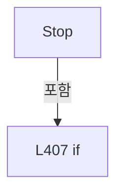

변경 전 점검: 입력/반환 타입, 위 호출자, 예외/취소 경로, 공유 상태와 저장·전송 소비자를 함께 확인합니다. 값의 단위나 물리 방향을 이름만으로 확정하지 않습니다.

### MethodDeclaration `FindIncompleteProductReview` · L413–424

[Drilling.Common/Review/CReviewManager.cs:413–424](https://github.com/kjuws10-rgb/A3Drilling/blob/5aee8e58439c9b455cae7c9593c9be986c3e682e/Drilling.Common/Review/CReviewManager.cs#L413-L424)

| 항목 | 실제 추출 값 |
| --- | --- |
| 서명 | System.Threading.Tasks.Task<Drilling.Common.Product.ST_PRODUCT_REVIEW_DATA?> Drilling.Common.Review.CReviewManager.FindIncompleteProductReview(Drilling.Common.Review.ST_REVIEW_PLAN, string, System.Threading.CancellationToken) |
| 접근/수식자 | Public / public |
| 반환/값 타입 | System.Threading.Tasks.Task<Drilling.Common.Product.ST_PRODUCT_REVIEW_DATA?> |
| 소속 타입 | NamedType:Drilling.Common.Review.CReviewManager |

입력 계약:

| 이름 | 타입 | 전달 | 선택/기본값 |
| --- | --- | --- | --- |
| plan | Drilling.Common.Review.ST_REVIEW_PLAN | None | False /  |
| glassId | string | None | False /  |
| cancellationToken | System.Threading.CancellationToken | None | True / null |

정적 호출자로 확인된 위치:

| 호출 파일/행 | 호출 표현식 | 런타임 분기 가능 |
| --- | --- | --- |
| [Drilling.UI/Menu/Menus/CMenuReview.cs:3034–3034](https://github.com/kjuws10-rgb/A3Drilling/blob/5aee8e58439c9b455cae7c9593c9be986c3e682e/Drilling.UI/Menu/Menus/CMenuReview.cs#L3034-L3034) | _reviewManager.FindIncompleteProductReview | False |

호출하는 대상과 해석 범위:

| 원본 행 | 표현식 | 분석 상태 | 대상/소스 위치 |
| --- | --- | --- | --- |
| 415 | cancellationToken.ThrowIfCancellationRequested | resolved | void System.Threading.CancellationToken.ThrowIfCancellationRequested() |
| 416 | FindInterruptedReviewCheckpoint | resolved | Drilling.Common.Product.ST_PRODUCT_REVIEW_DATA? Drilling.Common.Review.CReviewManager.FindInterruptedReviewCheckpoint(Drilling.Common.Review.ST_REVIEW_PLAN, string?) · Drilling.Common/Review/CReviewManager.cs:2425 |
| 417 | Task.FromResult<ST_PRODUCT_REVIEW_DATA?> | resolved | System.Threading.Tasks.Task<Drilling.Common.Product.ST_PRODUCT_REVIEW_DATA?> System.Threading.Tasks.Task.FromResult<Drilling.Common.Product.ST_PRODUCT_REVIEW_DATA?>(Drilling.Common.Product.ST_PRODUCT_REVIEW_DATA?) |
| 418 | string.IsNullOrWhiteSpace | resolved | bool string.IsNullOrWhiteSpace(string?) |
| 418 | product.GlassId.Equals | resolved | bool string.Equals(string?, System.StringComparison) |
| 418 | IsMatchingIncompleteReview | resolved | bool Drilling.Common.Review.CReviewManager.IsMatchingIncompleteReview(Drilling.Common.Review.ST_REVIEW_PLAN, string, Drilling.Common.Product.ST_PRODUCT_REVIEW_DATA) · Drilling.Common/Review/CReviewManager.cs:1537 |
| 420 | Task.FromResult<ST_PRODUCT_REVIEW_DATA?> | resolved | System.Threading.Tasks.Task<Drilling.Common.Product.ST_PRODUCT_REVIEW_DATA?> System.Threading.Tasks.Task.FromResult<Drilling.Common.Product.ST_PRODUCT_REVIEW_DATA?>(Drilling.Common.Product.ST_PRODUCT_REVIEW_DATA?) |
| 423 | Task.FromResult<ST_PRODUCT_REVIEW_DATA?> | resolved | System.Threading.Tasks.Task<Drilling.Common.Product.ST_PRODUCT_REVIEW_DATA?> System.Threading.Tasks.Task.FromResult<Drilling.Common.Product.ST_PRODUCT_REVIEW_DATA?>(Drilling.Common.Product.ST_PRODUCT_REVIEW_DATA?) |

본문의 실제 연산·분기·예외·반환 순서(원문 위치 순):

| 원본 행 | 종류 | 주석 해설 |
| --- | --- | --- |
| 415 | call | 함수·델리게이트 또는 객체 생성자를 호출합니다: cancellationToken.ThrowIfCancellationRequested() |
| 416 | call | 함수·델리게이트 또는 객체 생성자를 호출합니다: FindInterruptedReviewCheckpoint(plan, glassId) |
| 416 | if | 조건에 따라 분기합니다: if (FindInterruptedReviewCheckpoint(plan, glassId)is { } interrupted) |
| 417 | call | 함수·델리게이트 또는 객체 생성자를 호출합니다: Task.FromResult<ST_PRODUCT_REVIEW_DATA?>(interrupted) |
| 417 | return | 호출자에게 값 또는 제어를 반환합니다: return Task.FromResult<ST_PRODUCT_REVIEW_DATA?>(interrupted); |
| 418 | call | 함수·델리게이트 또는 객체 생성자를 호출합니다: string.IsNullOrWhiteSpace(glassId) |
| 418 | call | 함수·델리게이트 또는 객체 생성자를 호출합니다: product.GlassId.Equals(glassId, StringComparison.OrdinalIgnoreCase) |
| 418 | call | 함수·델리게이트 또는 객체 생성자를 호출합니다: IsMatchingIncompleteReview(plan, product.RecipeId, product.Review) |
| 418 | if | 조건에 따라 분기합니다: if (string.IsNullOrWhiteSpace(glassId) &#124;&#124; productManager?.Current is not { } product &#124;&#124; !product.GlassId.Equals(glassId, StringComparison.OrdinalIgnoreCase) &#124;&#124; !IsMatchingIncompleteReview(plan, product.RecipeId, product.Revi…) |
| 420 | call | 함수·델리게이트 또는 객체 생성자를 호출합니다: Task.FromResult<ST_PRODUCT_REVIEW_DATA?>(null) |
| 420 | return | 호출자에게 값 또는 제어를 반환합니다: return Task.FromResult<ST_PRODUCT_REVIEW_DATA?>(null); |
| 423 | call | 함수·델리게이트 또는 객체 생성자를 호출합니다: Task.FromResult<ST_PRODUCT_REVIEW_DATA?>(product.Review) |
| 423 | return | 호출자에게 값 또는 제어를 반환합니다: return Task.FromResult<ST_PRODUCT_REVIEW_DATA?>(product.Review); |

제어 구문의 포함 구조(실제 실행 순서/CFG가 아닌 구문 탐색 그림):

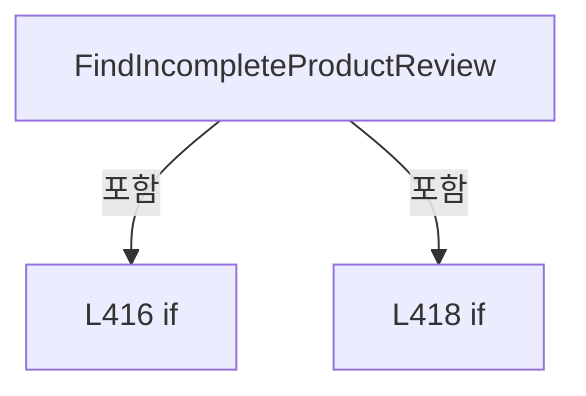

변경 전 점검: 입력/반환 타입, 위 호출자, 예외/취소 경로, 공유 상태와 저장·전송 소비자를 함께 확인합니다. 값의 단위나 물리 방향을 이름만으로 확정하지 않습니다.

### MethodDeclaration `GetScannerAxisTransform` · L426–434

[Drilling.Common/Review/CReviewManager.cs:426–434](https://github.com/kjuws10-rgb/A3Drilling/blob/5aee8e58439c9b455cae7c9593c9be986c3e682e/Drilling.Common/Review/CReviewManager.cs#L426-L434)

| 항목 | 실제 추출 값 |
| --- | --- |
| 서명 | Drilling.Common.Recipe.ST_SCANNER_AXIS_TRANSFORM Drilling.Common.Review.CReviewManager.GetScannerAxisTransform(int) |
| 접근/수식자 | Public / public |
| 반환/값 타입 | Drilling.Common.Recipe.ST_SCANNER_AXIS_TRANSFORM |
| 소속 타입 | NamedType:Drilling.Common.Review.CReviewManager |

입력 계약:

| 이름 | 타입 | 전달 | 선택/기본값 |
| --- | --- | --- | --- |
| headNo | int | None | False /  |

현재 부분 분석에서 직접 연결된 호출자는 없습니다. XAML/이벤트/인터페이스·델리게이트·외부 진입을 추가 확인해야 하며, 미사용으로 판정한 것이 아닙니다.

호출하는 대상과 해석 범위:

| 원본 행 | 표현식 | 분석 상태 | 대상/소스 위치 |
| --- | --- | --- | --- |
| 430 | new ArgumentOutOfRangeException | resolved | System.ArgumentOutOfRangeException.ArgumentOutOfRangeException(string?, object?, string?) |
| 430 | nameof | unresolved | None |
| 433 | CScannerAxisTransform.Read | resolved | Drilling.Common.Recipe.ST_SCANNER_AXIS_TRANSFORM Drilling.Common.Recipe.CScannerAxisTransform.Read(System.Collections.Generic.IReadOnlyList<Drilling.Common.Managers.ST_SYSTEM_PARAMETER>, int) · Drilling.Common/Recipe/CShotCoordinatePlanBuilder.cs:1246 |
| 433 | settingManager.LoadSection | resolved | System.Collections.Generic.IReadOnlyList<Drilling.Common.Managers.ST_SYSTEM_PARAMETER> Drilling.Common.Managers.CSettingManager.LoadSection(Drilling.Common.Managers.EN_SETTING_TAB, System.Threading.CancellationToken) · Drilling.Common/Managers/CSettingManager.cs:26 |

본문의 실제 연산·분기·예외·반환 순서(원문 위치 순):

| 원본 행 | 종류 | 주석 해설 |
| --- | --- | --- |
| 428 | if | 조건에 따라 분기합니다: if (headNo is < 1 or > DefaultHeadCount) |
| 430 | call | 함수·델리게이트 또는 객체 생성자를 호출합니다: new ArgumentOutOfRangeException(nameof(headNo), headNo, $"Head number must be between 1 and {DefaultHeadCount}.") |
| 430 | call | 함수·델리게이트 또는 객체 생성자를 호출합니다: nameof(headNo) |
| 430 | throw | 예외를 발생/전달합니다: throw new ArgumentOutOfRangeException(nameof(headNo), headNo, $"Head number must be between 1 and {DefaultHeadCount}."); |
| 433 | call | 함수·델리게이트 또는 객체 생성자를 호출합니다: CScannerAxisTransform.Read(settingManager.LoadSection(EN_SETTING_TAB.Option), headNo) |
| 433 | call | 함수·델리게이트 또는 객체 생성자를 호출합니다: settingManager.LoadSection(EN_SETTING_TAB.Option) |
| 433 | return | 호출자에게 값 또는 제어를 반환합니다: return CScannerAxisTransform.Read(settingManager.LoadSection(EN_SETTING_TAB.Option), headNo); |

제어 구문의 포함 구조(실제 실행 순서/CFG가 아닌 구문 탐색 그림):

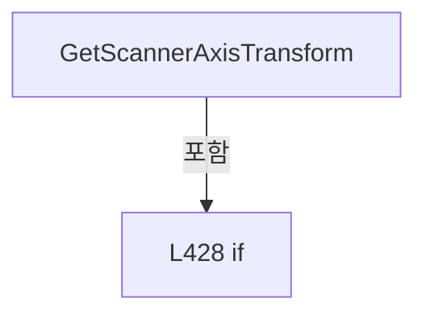

변경 전 점검: 입력/반환 타입, 위 호출자, 예외/취소 경로, 공유 상태와 저장·전송 소비자를 함께 확인합니다. 값의 단위나 물리 방향을 이름만으로 확정하지 않습니다.

### MethodDeclaration `RetryRemaining` · L436–454

[Drilling.Common/Review/CReviewManager.cs:436–454](https://github.com/kjuws10-rgb/A3Drilling/blob/5aee8e58439c9b455cae7c9593c9be986c3e682e/Drilling.Common/Review/CReviewManager.cs#L436-L454)

| 항목 | 실제 추출 값 |
| --- | --- |
| 서명 | System.Threading.Tasks.Task<Drilling.Common.Review.ST_REVIEW_SEQUENCE_STATUS> Drilling.Common.Review.CReviewManager.RetryRemaining(System.Action<Drilling.Common.Review.ST_REVIEW_PLAN>?, System.Threading.CancellationToken) |
| 접근/수식자 | Public / public, async |
| 반환/값 타입 | System.Threading.Tasks.Task<Drilling.Common.Review.ST_REVIEW_SEQUENCE_STATUS> |
| 소속 타입 | NamedType:Drilling.Common.Review.CReviewManager |

입력 계약:

| 이름 | 타입 | 전달 | 선택/기본값 |
| --- | --- | --- | --- |
| progress | System.Action<Drilling.Common.Review.ST_REVIEW_PLAN>? | None | True / null |
| cancellationToken | System.Threading.CancellationToken | None | True / null |

정적 호출자로 확인된 위치:

| 호출 파일/행 | 호출 표현식 | 런타임 분기 가능 |
| --- | --- | --- |
| [Drilling.UI/Menu/Menus/CMenuReview.cs:3180–3180](https://github.com/kjuws10-rgb/A3Drilling/blob/5aee8e58439c9b455cae7c9593c9be986c3e682e/Drilling.UI/Menu/Menus/CMenuReview.cs#L3180-L3180) | _reviewManager.RetryRemaining | False |

호출하는 대상과 해석 범위:

| 원본 행 | 표현식 | 분석 상태 | 대상/소스 위치 |
| --- | --- | --- | --- |
| 441 | new ST_REVIEW_SEQUENCE_STATUS | resolved | Drilling.Common.Review.ST_REVIEW_SEQUENCE_STATUS.ST_REVIEW_SEQUENCE_STATUS(Drilling.Common.Review.EN_REVIEW_SEQUENCE_STATE, int, int, int, string) · Drilling.Common/Review/CReviewManager.cs:3861 |
| 444 | SetWaitingPointsReady | resolved | Drilling.Common.Review.ST_REVIEW_PLAN Drilling.Common.Review.CReviewManager.SetWaitingPointsReady(Drilling.Common.Review.ST_REVIEW_PLAN) · Drilling.Common/Review/CReviewManager.cs:1049 |
| 445 | SetCurrentPlan | resolved | void Drilling.Common.Review.CReviewManager.SetCurrentPlan(Drilling.Common.Review.ST_REVIEW_PLAN, System.Action<Drilling.Common.Review.ST_REVIEW_PLAN>?) · Drilling.Common/Review/CReviewManager.cs:1005 |
| 446 | plan.ReviewPoints.Where | resolved | System.Collections.Generic.IEnumerable<Drilling.Common.Review.ST_REVIEW_PLAN_POINT> System.Collections.Generic.IEnumerable<Drilling.Common.Review.ST_REVIEW_PLAN_POINT>.Where<Drilling.Common.Review.ST_REVIEW_PLAN_POINT>(System.Func<Drilling.Common.Review.ST_REVIEW_PLAN_POINT, bool>) |
| 447 | OrderByReviewSequence(points).ToArray | resolved | Drilling.Common.Review.ST_REVIEW_PLAN_POINT[] System.Collections.Generic.IEnumerable<Drilling.Common.Review.ST_REVIEW_PLAN_POINT>.ToArray<Drilling.Common.Review.ST_REVIEW_PLAN_POINT>() |
| 447 | OrderByReviewSequence | resolved | System.Collections.Generic.IReadOnlyList<Drilling.Common.Review.ST_REVIEW_PLAN_POINT> Drilling.Common.Review.CReviewManager.OrderByReviewSequence(System.Collections.Generic.IEnumerable<Drilling.Common.Review.ST_REVIEW_PLAN_POINT>) · Drilling.Common/Review/CReviewManager.cs:1105 |
| 450 | CreateStatus | resolved | Drilling.Common.Review.ST_REVIEW_SEQUENCE_STATUS Drilling.Common.Review.CReviewManager.CreateStatus(Drilling.Common.Review.ST_REVIEW_PLAN, Drilling.Common.Review.EN_REVIEW_SEQUENCE_STATE, string) · Drilling.Common/Review/CReviewManager.cs:1075 |
| 453 | RunRetryPoints | resolved | System.Threading.Tasks.Task<Drilling.Common.Review.ST_REVIEW_SEQUENCE_STATUS> Drilling.Common.Review.CReviewManager.RunRetryPoints(System.Collections.Generic.IReadOnlyList<Drilling.Common.Review.ST_REVIEW_PLAN_POINT>, string, System.Action<Drilling.Common.Review.ST_REVIEW_PLAN>?, System.Threading.CancellationToken) · Drilling.Common/Review/CReviewManager.cs:2235 |

본문의 실제 연산·분기·예외·반환 순서(원문 위치 순):

| 원본 행 | 종류 | 주석 해설 |
| --- | --- | --- |
| 438 | local-declaration | 지역 변수를 선언합니다: var plan = CurrentPlan; |
| 438 | variable-initializer | 변수의 초기값을 지정합니다: plan = CurrentPlan |
| 439 | if | 조건에 따라 분기합니다: if (plan is null) |
| 441 | call | 함수·델리게이트 또는 객체 생성자를 호출합니다: new ST_REVIEW_SEQUENCE_STATUS(EN_REVIEW_SEQUENCE_STATE.Idle, 0, 0, 0, "Review plan is empty.") |
| 441 | return | 호출자에게 값 또는 제어를 반환합니다: return new ST_REVIEW_SEQUENCE_STATUS(EN_REVIEW_SEQUENCE_STATE.Idle, 0, 0, 0, "Review plan is empty."); |
| 444 | assignment | 값을 대상에 대입합니다: plan = SetWaitingPointsReady(plan) |
| 444 | call | 함수·델리게이트 또는 객체 생성자를 호출합니다: SetWaitingPointsReady(plan) |
| 445 | call | 함수·델리게이트 또는 객체 생성자를 호출합니다: SetCurrentPlan(plan, progress) |
| 446 | call | 함수·델리게이트 또는 객체 생성자를 호출합니다: plan.ReviewPoints.Where(point => point.State == EN_REVIEW_POINT_STATE.Ready) |
| 446 | local-declaration | 지역 변수를 선언합니다: var points = plan.ReviewPoints.Where(point => point.State == EN_REVIEW_POINT_STATE.Ready); |
| 446 | variable-initializer | 변수의 초기값을 지정합니다: points = plan.ReviewPoints.Where(point => point.State == EN_REVIEW_POINT_STATE.Ready) |
| 447 | call | 함수·델리게이트 또는 객체 생성자를 호출합니다: OrderByReviewSequence(points).ToArray() |
| 447 | call | 함수·델리게이트 또는 객체 생성자를 호출합니다: OrderByReviewSequence(points) |
| 447 | local-declaration | 지역 변수를 선언합니다: var orderedPoints = OrderByReviewSequence(points).ToArray(); |
| 447 | variable-initializer | 변수의 초기값을 지정합니다: orderedPoints = OrderByReviewSequence(points).ToArray() |
| 448 | if | 조건에 따라 분기합니다: if (orderedPoints.Length == 0) |
| 450 | call | 함수·델리게이트 또는 객체 생성자를 호출합니다: CreateStatus(plan, SequenceState, "Ready review point is empty.") |
| 450 | return | 호출자에게 값 또는 제어를 반환합니다: return CreateStatus(plan, SequenceState, "Ready review point is empty."); |
| 453 | await | 비동기 완료를 기다립니다: await RunRetryPoints(orderedPoints, "Review ready point retry completed.", progress, cancellationToken) |
| 453 | call | 함수·델리게이트 또는 객체 생성자를 호출합니다: RunRetryPoints(orderedPoints, "Review ready point retry completed.", progress, cancellationToken) |
| 453 | return | 호출자에게 값 또는 제어를 반환합니다: return await RunRetryPoints(orderedPoints, "Review ready point retry completed.", progress, cancellationToken); |

제어 구문의 포함 구조(실제 실행 순서/CFG가 아닌 구문 탐색 그림):

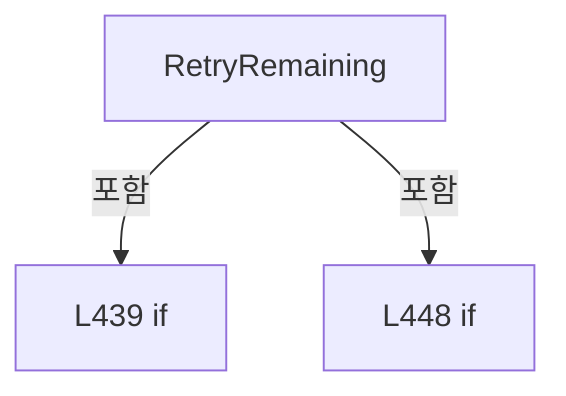

변경 전 점검: 입력/반환 타입, 위 호출자, 예외/취소 경로, 공유 상태와 저장·전송 소비자를 함께 확인합니다. 값의 단위나 물리 방향을 이름만으로 확정하지 않습니다.

### MethodDeclaration `CreatePlanCore` · L456–508

[Drilling.Common/Review/CReviewManager.cs:456–508](https://github.com/kjuws10-rgb/A3Drilling/blob/5aee8e58439c9b455cae7c9593c9be986c3e682e/Drilling.Common/Review/CReviewManager.cs#L456-L508)

| 항목 | 실제 추출 값 |
| --- | --- |
| 서명 | Drilling.Common.Review.ST_REVIEW_PLAN Drilling.Common.Review.CReviewManager.CreatePlanCore(Drilling.Common.Managers.ST_RECIPE_DEFINITION, System.Func<Drilling.Common.Review.ST_REVIEW_PLAN_POINT, bool>, int, bool, double, double) |
| 접근/수식자 | Private / private |
| 반환/값 타입 | Drilling.Common.Review.ST_REVIEW_PLAN |
| 소속 타입 | NamedType:Drilling.Common.Review.CReviewManager |

입력 계약:

| 이름 | 타입 | 전달 | 선택/기본값 |
| --- | --- | --- | --- |
| recipe | Drilling.Common.Managers.ST_RECIPE_DEFINITION | None | False /  |
| useSelector | System.Func<Drilling.Common.Review.ST_REVIEW_PLAN_POINT, bool> | None | False /  |
| selectedBeamNo | int | None | True / 1 |
| selectAllAssignedPoints | bool | None | True / false |
| shiftOffsetX | double | None | True / 0 |
| shiftOffsetY | double | None | True / 0 |

정적 호출자로 확인된 위치:

| 호출 파일/행 | 호출 표현식 | 런타임 분기 가능 |
| --- | --- | --- |
| [Drilling.Common/Review/CReviewManager.cs:208–208](https://github.com/kjuws10-rgb/A3Drilling/blob/5aee8e58439c9b455cae7c9593c9be986c3e682e/Drilling.Common/Review/CReviewManager.cs#L208-L208) | CreatePlanCore | False |

호출하는 대상과 해석 범위:

| 원본 행 | 표현식 | 분석 상태 | 대상/소스 위치 |
| --- | --- | --- | --- |
| 465 | ReadRequiredCellCount | resolved | int Drilling.Common.Review.CReviewManager.ReadRequiredCellCount(Drilling.Common.Managers.ST_RECIPE_DEFINITION, string) · Drilling.Common/Review/CReviewManager.cs:1213 |
| 466 | ReadDouble | resolved | double Drilling.Common.Review.CReviewManager.ReadDouble(Drilling.Common.Managers.ST_RECIPE_DEFINITION, double, params string[]) · Drilling.Common/Review/CReviewManager.cs:1242 |
| 467 | ReadDouble | resolved | double Drilling.Common.Review.CReviewManager.ReadDouble(Drilling.Common.Managers.ST_RECIPE_DEFINITION, double, params string[]) · Drilling.Common/Review/CReviewManager.cs:1242 |
| 468 | LoadReviewCoordinateSettings | resolved | Drilling.Common.Review.CReviewManager.ST_REVIEW_COORDINATE_SETTINGS Drilling.Common.Review.CReviewManager.LoadReviewCoordinateSettings(Drilling.Common.Managers.ST_RECIPE_DEFINITION) · Drilling.Common/Review/CReviewManager.cs:554 |
| 469 | BuildRuntimeCoordinateParameters | resolved | System.Collections.Generic.IReadOnlyDictionary<string, string> Drilling.Common.Review.CReviewManager.BuildRuntimeCoordinateParameters(Drilling.Common.Managers.ST_RECIPE_DEFINITION) · Drilling.Common/Review/CReviewManager.cs:528 |
| 470 | CShotCoordinatePlanBuilder.ReadDirection | resolved | double Drilling.Common.Recipe.CShotCoordinatePlanBuilder.ReadDirection(System.Collections.Generic.IReadOnlyDictionary<string, string>, double, params string[]) · Drilling.Common/Recipe/CShotCoordinatePlanBuilder.cs:505 |
| 471 | CShotCoordinatePlanBuilder.Build | resolved | Drilling.Common.Recipe.ST_SHOT_COORDINATE_PLAN Drilling.Common.Recipe.CShotCoordinatePlanBuilder.Build(System.Collections.Generic.IReadOnlyDictionary<string, string>) · Drilling.Common/Recipe/CShotCoordinatePlanBuilder.cs:11 |
| 472 | BuildReviewExcludedShots | resolved | System.Collections.Generic.IReadOnlyDictionary<string, string> Drilling.Common.Review.CReviewManager.BuildReviewExcludedShots(System.Collections.Generic.IReadOnlyDictionary<string, string>, System.Collections.Generic.IReadOnlyList<Drilling.Common.Recipe.ST_HEAD_SHOT_POINT>) · Drilling.Common/Review/CReviewManager.cs:510 |
| 473 | processCoordinatePlan.Shots.GroupBy(shot => (shot.CellNo, shot.CellShotNo)).ToDictionary | resolved | System.Collections.Generic.Dictionary<(int CellNo, int CellShotNo), int> System.Collections.Generic.IEnumerable<System.Linq.IGrouping<(int CellNo, int CellShotNo), Drilling.Common.Recipe.ST_HEAD_SHOT_POINT>>.ToDictionary<System.Linq.IGrouping<(int CellNo, int CellShotNo), Drilling.Common.Recipe.ST_HEAD_SHOT_POINT>, (int CellNo, int CellShotNo), int>(System.Func<System.Linq.IGrouping<(int CellNo, int CellShotNo), Drilling.Common.Recipe.ST_HEAD_SHOT_POINT>, (int CellNo, int CellShotNo)>, System.Func<System.Linq.IGrouping<(int CellNo, int CellShotNo), Drilling.Common.Recipe.ST_HEAD_SHOT_POINT>, int>) |
| 473 | processCoordinatePlan.Shots.GroupBy | resolved | System.Collections.Generic.IEnumerable<System.Linq.IGrouping<(int CellNo, int CellShotNo), Drilling.Common.Recipe.ST_HEAD_SHOT_POINT>> System.Collections.Generic.IEnumerable<Drilling.Common.Recipe.ST_HEAD_SHOT_POINT>.GroupBy<Drilling.Common.Recipe.ST_HEAD_SHOT_POINT, (int CellNo, int CellShotNo)>(System.Func<Drilling.Common.Recipe.ST_HEAD_SHOT_POINT, (int CellNo, int CellShotNo)>) |
| 473 | group.Last | resolved | Drilling.Common.Recipe.ST_HEAD_SHOT_POINT System.Collections.Generic.IEnumerable<Drilling.Common.Recipe.ST_HEAD_SHOT_POINT>.Last<Drilling.Common.Recipe.ST_HEAD_SHOT_POINT>() |
| 474 | BuildShotPoints | resolved | System.Collections.Generic.IReadOnlyList<Drilling.Common.Review.ST_REVIEW_PLAN_POINT> Drilling.Common.Review.CReviewManager.BuildShotPoints(Drilling.Common.Managers.ST_RECIPE_DEFINITION, int, int, Drilling.Common.Review.CReviewManager.ST_REVIEW_COORDINATE_SETTINGS, System.Collections.Generic.IReadOnlyDictionary<(int CellNo, int CellShotNo), int>, double, int, bool, System.Collections.Generic.IReadOnlyDictionary<string, string>, double, double) · Drilling.Common/Review/CReviewManager.cs:634 |
| 488 | points.Select(point => { var use = point.HeadNo > 0 && !excludedShots.ContainsKey(point.ShotKey) && useSelector(point); return point with { BeamNo = selectedBeamNo, Use = use, State = use ? EN_REVIEW_POINT_STATE.Ready : EN_REVIEW_POINT_STATE.Skip, Judge = use ? "WAIT" : "-" }; }).ToArray | resolved | Drilling.Common.Review.ST_REVIEW_PLAN_POINT[] System.Collections.Generic.IEnumerable<Drilling.Common.Review.ST_REVIEW_PLAN_POINT>.ToArray<Drilling.Common.Review.ST_REVIEW_PLAN_POINT>() |
| 488 | points.Select | resolved | System.Collections.Generic.IEnumerable<Drilling.Common.Review.ST_REVIEW_PLAN_POINT> System.Collections.Generic.IEnumerable<Drilling.Common.Review.ST_REVIEW_PLAN_POINT>.Select<Drilling.Common.Review.ST_REVIEW_PLAN_POINT, Drilling.Common.Review.ST_REVIEW_PLAN_POINT>(System.Func<Drilling.Common.Review.ST_REVIEW_PLAN_POINT, Drilling.Common.Review.ST_REVIEW_PLAN_POINT>) |
| 490 | excludedShots.ContainsKey | resolved · 동적 구현 선택 가능 | bool System.Collections.Generic.IReadOnlyDictionary<string, string>.ContainsKey(string) |
| 490 | useSelector | resolved · 동적 구현 선택 가능 | bool System.Func<Drilling.Common.Review.ST_REVIEW_PLAN_POINT, bool>.Invoke(Drilling.Common.Review.ST_REVIEW_PLAN_POINT) |
| 501 | new ST_REVIEW_PLAN | resolved | Drilling.Common.Review.ST_REVIEW_PLAN.ST_REVIEW_PLAN(string, int, double, double, Drilling.Common.Review.EN_VISION_FLIP_TYPE, System.DateTimeOffset, System.Collections.Generic.IReadOnlyList<Drilling.Common.Review.ST_REVIEW_PLAN_POINT>) · Drilling.Common/Review/CReviewManager.cs:3921 |
| 504 | ReadDouble | resolved | double Drilling.Common.Review.CReviewManager.ReadDouble(Drilling.Common.Managers.ST_RECIPE_DEFINITION, double, params string[]) · Drilling.Common/Review/CReviewManager.cs:1242 |

본문의 실제 연산·분기·예외·반환 순서(원문 위치 순):

| 원본 행 | 종류 | 주석 해설 |
| --- | --- | --- |
| 464 | local-declaration | 지역 변수를 선언합니다: const int headCount = DefaultHeadCount; |
| 464 | variable-initializer | 변수의 초기값을 지정합니다: headCount = DefaultHeadCount |
| 465 | call | 함수·델리게이트 또는 객체 생성자를 호출합니다: ReadRequiredCellCount(recipe, "MAX_CELL_NUMBER") |
| 465 | local-declaration | 지역 변수를 선언합니다: var cellCount = ReadRequiredCellCount(recipe, "MAX_CELL_NUMBER"); |
| 465 | variable-initializer | 변수의 초기값을 지정합니다: cellCount = ReadRequiredCellCount(recipe, "MAX_CELL_NUMBER") |
| 466 | call | 함수·델리게이트 또는 객체 생성자를 호출합니다: ReadDouble(recipe, 0.030, "REVIEW_TOLERANCE_X") |
| 466 | local-declaration | 지역 변수를 선언합니다: var toleranceX = ReadDouble(recipe, 0.030, "REVIEW_TOLERANCE_X"); |
| 466 | variable-initializer | 변수의 초기값을 지정합니다: toleranceX = ReadDouble(recipe, 0.030, "REVIEW_TOLERANCE_X") |
| 467 | call | 함수·델리게이트 또는 객체 생성자를 호출합니다: ReadDouble(recipe, 0.030, "REVIEW_TOLERANCE_Y") |
| 467 | local-declaration | 지역 변수를 선언합니다: var toleranceY = ReadDouble(recipe, 0.030, "REVIEW_TOLERANCE_Y"); |
| 467 | variable-initializer | 변수의 초기값을 지정합니다: toleranceY = ReadDouble(recipe, 0.030, "REVIEW_TOLERANCE_Y") |
| 468 | call | 함수·델리게이트 또는 객체 생성자를 호출합니다: LoadReviewCoordinateSettings(recipe) |
| 468 | local-declaration | 지역 변수를 선언합니다: var coordinateSettings = LoadReviewCoordinateSettings(recipe); |
| 468 | variable-initializer | 변수의 초기값을 지정합니다: coordinateSettings = LoadReviewCoordinateSettings(recipe) |
| 469 | call | 함수·델리게이트 또는 객체 생성자를 호출합니다: BuildRuntimeCoordinateParameters(recipe) |
| 469 | local-declaration | 지역 변수를 선언합니다: var runtimeCoordinateParameters = BuildRuntimeCoordinateParameters(recipe); |
| 469 | variable-initializer | 변수의 초기값을 지정합니다: runtimeCoordinateParameters = BuildRuntimeCoordinateParameters(recipe) |
| 470 | call | 함수·델리게이트 또는 객체 생성자를 호출합니다: CShotCoordinatePlanBuilder.ReadDirection(runtimeCoordinateParameters, -1.0, "STAGE_SCAN_DIRECTION_Y") |
| 470 | local-declaration | 지역 변수를 선언합니다: var stageScanDirectionY = CShotCoordinatePlanBuilder.ReadDirection(runtimeCoordinateParameters, -1.0, "STAGE_SCAN_DIRECTION_Y"); |
| 470 | variable-initializer | 변수의 초기값을 지정합니다: stageScanDirectionY = CShotCoordinatePlanBuilder.ReadDirection(runtimeCoordinateParameters, -1.0, "STAGE_SCAN_DIRECTION_Y") |
| 471 | call | 함수·델리게이트 또는 객체 생성자를 호출합니다: CShotCoordinatePlanBuilder.Build(runtimeCoordinateParameters) |
| 471 | local-declaration | 지역 변수를 선언합니다: var processCoordinatePlan = CShotCoordinatePlanBuilder.Build(runtimeCoordinateParameters); |
| 471 | variable-initializer | 변수의 초기값을 지정합니다: processCoordinatePlan = CShotCoordinatePlanBuilder.Build(runtimeCoordinateParameters) |
| 472 | call | 함수·델리게이트 또는 객체 생성자를 호출합니다: BuildReviewExcludedShots(runtimeCoordinateParameters, processCoordinatePlan.Shots) |
| 472 | local-declaration | 지역 변수를 선언합니다: var excludedShots = BuildReviewExcludedShots(runtimeCoordinateParameters, processCoordinatePlan.Shots); |
| 472 | variable-initializer | 변수의 초기값을 지정합니다: excludedShots = BuildReviewExcludedShots(runtimeCoordinateParameters, processCoordinatePlan.Shots) |
| 473 | call | 함수·델리게이트 또는 객체 생성자를 호출합니다: processCoordinatePlan.Shots.GroupBy(shot => (shot.CellNo, shot.CellShotNo)).ToDictionary(group => group.Key, group => group.Last().HeadNo) |
| 473 | call | 함수·델리게이트 또는 객체 생성자를 호출합니다: processCoordinatePlan.Shots.GroupBy(shot => (shot.CellNo, shot.CellShotNo)) |
| 473 | call | 함수·델리게이트 또는 객체 생성자를 호출합니다: group.Last() |
| 473 | local-declaration | 지역 변수를 선언합니다: var assignedHeadNos = processCoordinatePlan.Shots.GroupBy(shot => (shot.CellNo, shot.CellShotNo)).ToDictionary(group => group.Key, group => group.Last().HeadNo); |
| 473 | variable-initializer | 변수의 초기값을 지정합니다: assignedHeadNos = processCoordinatePlan.Shots.GroupBy(shot => (shot.CellNo, shot.CellShotNo)).ToDictionary(group => group.Key, group => group.Last().HeadNo) |
| 474 | call | 함수·델리게이트 또는 객체 생성자를 호출합니다: BuildShotPoints( recipe, headCount, cellCount, coordinateSettings, assignedHeadNos, stageScanDirectionY, selectedBeamNo, selectAllAssignedPoints, excludedShots, shiftOffsetX, shiftOffsetY) |
| 474 | local-declaration | 지역 변수를 선언합니다: IReadOnlyList<ST_REVIEW_PLAN_POINT> points = BuildShotPoints( recipe, headCount, cellCount, coordinateSettings, assignedHeadNos, stageScanDirectionY, selectedBeamNo, selectAllAssignedPoints, excludedShots, shiftOffsetX, shiftOffse |
| 474 | variable-initializer | 변수의 초기값을 지정합니다: points = BuildShotPoints( recipe, headCount, cellCount, coordinateSettings, assignedHeadNos, stageScanDirectionY, selectedBeamNo, selectAllAssignedPoints, excludedShots, shiftOffsetX, shiftOffsetY) |
| 486 | if | 조건에 따라 분기합니다: if (!selectAllAssignedPoints) |
| 488 | assignment | 값을 대상에 대입합니다: points = points.Select(point => { var use = point.HeadNo > 0 && !excludedShots.ContainsKey(point.ShotKey) && useSelector(point); return point with { BeamNo = selectedBeamNo, Use = use, State = use ? EN_REVIEW_POINT_STATE.Ready : E |
| 488 | call | 함수·델리게이트 또는 객체 생성자를 호출합니다: points.Select(point => { var use = point.HeadNo > 0 && !excludedShots.ContainsKey(point.ShotKey) && useSelector(point); return point with { BeamNo = selectedBeamNo, Use = use, State = use ? EN_REVIEW_POINT_STATE.Ready : … |
| 488 | call | 함수·델리게이트 또는 객체 생성자를 호출합니다: points.Select(point => { var use = point.HeadNo > 0 && !excludedShots.ContainsKey(point.ShotKey) && useSelector(point); return point with { BeamNo = selectedBeamNo, Use = use, State = use ? EN_REVIEW_POINT_STATE.Ready : … |
| 490 | call | 함수·델리게이트 또는 객체 생성자를 호출합니다: excludedShots.ContainsKey(point.ShotKey) |
| 490 | call | 함수·델리게이트 또는 객체 생성자를 호출합니다: useSelector(point) |
| 490 | local-declaration | 지역 변수를 선언합니다: var use = point.HeadNo > 0 && !excludedShots.ContainsKey(point.ShotKey) && useSelector(point); |
| 490 | variable-initializer | 변수의 초기값을 지정합니다: use = point.HeadNo > 0 && !excludedShots.ContainsKey(point.ShotKey) && useSelector(point) |
| 491 | return | 호출자에게 값 또는 제어를 반환합니다: return point with { BeamNo = selectedBeamNo, Use = use, State = use ? EN_REVIEW_POINT_STATE.Ready : EN_REVIEW_POINT_STATE.Skip, Judge = use ? "WAIT" : "-" }; |
| 493 | assignment | 값을 대상에 대입합니다: BeamNo = selectedBeamNo |
| 494 | assignment | 값을 대상에 대입합니다: Use = use |
| 495 | assignment | 값을 대상에 대입합니다: State = use ? EN_REVIEW_POINT_STATE.Ready : EN_REVIEW_POINT_STATE.Skip |
| 495 | conditional-expression | 조건에 따라 결과식을 선택합니다: use ? EN_REVIEW_POINT_STATE.Ready : EN_REVIEW_POINT_STATE.Skip |
| 496 | assignment | 값을 대상에 대입합니다: Judge = use ? "WAIT" : "-" |
| 496 | conditional-expression | 조건에 따라 결과식을 선택합니다: use ? "WAIT" : "-" |
| 501 | call | 함수·델리게이트 또는 객체 생성자를 호출합니다: new ST_REVIEW_PLAN(recipe.Id, cellCount, toleranceX, toleranceY, coordinateSettings.VisionFlipType, DateTimeOffset.Now, points) { StageScanDirectionY = stageScanDirectionY, StageSpeed = ReadDouble(recipe, 0, "STAGE_SPEED… |
| 501 | return | 호출자에게 값 또는 제어를 반환합니다: return new ST_REVIEW_PLAN(recipe.Id, cellCount, toleranceX, toleranceY, coordinateSettings.VisionFlipType, DateTimeOffset.Now, points) { StageScanDirectionY = stageScanDirectionY, StageSpeed = ReadDouble(recipe, 0, "STAGE_SPEED"), |
| 503 | assignment | 값을 대상에 대입합니다: StageScanDirectionY = stageScanDirectionY |
| 504 | assignment | 값을 대상에 대입합니다: StageSpeed = ReadDouble(recipe, 0, "STAGE_SPEED") |
| 504 | call | 함수·델리게이트 또는 객체 생성자를 호출합니다: ReadDouble(recipe, 0, "STAGE_SPEED") |
| 505 | assignment | 값을 대상에 대입합니다: ShiftOffsetX = shiftOffsetX |
| 506 | assignment | 값을 대상에 대입합니다: ShiftOffsetY = shiftOffsetY |

제어 구문의 포함 구조(실제 실행 순서/CFG가 아닌 구문 탐색 그림):

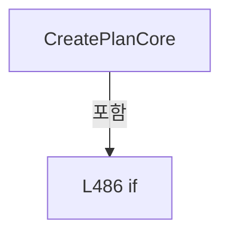

변경 전 점검: 입력/반환 타입, 위 호출자, 예외/취소 경로, 공유 상태와 저장·전송 소비자를 함께 확인합니다. 값의 단위나 물리 방향을 이름만으로 확정하지 않습니다.

### MethodDeclaration `BuildReviewExcludedShots` · L510–526

[Drilling.Common/Review/CReviewManager.cs:510–526](https://github.com/kjuws10-rgb/A3Drilling/blob/5aee8e58439c9b455cae7c9593c9be986c3e682e/Drilling.Common/Review/CReviewManager.cs#L510-L526)

| 항목 | 실제 추출 값 |
| --- | --- |
| 서명 | System.Collections.Generic.IReadOnlyDictionary<string, string> Drilling.Common.Review.CReviewManager.BuildReviewExcludedShots(System.Collections.Generic.IReadOnlyDictionary<string, string>, System.Collections.Generic.IReadOnlyList<Drilling.Common.Recipe.ST_HEAD_SHOT_POINT>) |
| 접근/수식자 | Private / private, static |
| 반환/값 타입 | System.Collections.Generic.IReadOnlyDictionary<string, string> |
| 소속 타입 | NamedType:Drilling.Common.Review.CReviewManager |

입력 계약:

| 이름 | 타입 | 전달 | 선택/기본값 |
| --- | --- | --- | --- |
| runtimeCoordinateParameters | System.Collections.Generic.IReadOnlyDictionary<string, string> | None | False /  |
| processShots | System.Collections.Generic.IReadOnlyList<Drilling.Common.Recipe.ST_HEAD_SHOT_POINT> | None | False /  |

정적 호출자로 확인된 위치:

| 호출 파일/행 | 호출 표현식 | 런타임 분기 가능 |
| --- | --- | --- |
| [Drilling.Common/Review/CReviewManager.cs:472–472](https://github.com/kjuws10-rgb/A3Drilling/blob/5aee8e58439c9b455cae7c9593c9be986c3e682e/Drilling.Common/Review/CReviewManager.cs#L472-L472) | BuildReviewExcludedShots | False |

호출하는 대상과 해석 범위:

| 원본 행 | 표현식 | 분석 상태 | 대상/소스 위치 |
| --- | --- | --- | --- |
| 512 | CRecipeShotMaskingPlan.Build | resolved | Drilling.Common.Recipe.CRecipeShotMaskingPlan Drilling.Common.Recipe.CRecipeShotMaskingPlan.Build(System.Collections.Generic.IReadOnlyDictionary<string, string>) · Drilling.Common/Recipe/CShotCoordinatePlanBuilder.cs:813 |
| 513 | new Dictionary<string, string> | resolved | System.Collections.Generic.Dictionary<string, string>.Dictionary(System.Collections.Generic.IEqualityComparer<string>?) |
| 516 | maskingPlan.EvaluateShot | resolved | Drilling.Common.Recipe.ST_RECIPE_SHOT_MASKING_RESULT Drilling.Common.Recipe.CRecipeShotMaskingPlan.EvaluateShot(Drilling.Common.Recipe.ST_HEAD_SHOT_POINT) · Drilling.Common/Recipe/CShotCoordinatePlanBuilder.cs:853 |
| 522 | NormalizeShotKey | resolved | string Drilling.Common.Review.CReviewManager.NormalizeShotKey(string) · Drilling.Common/Review/CReviewManager.cs:1165 |

본문의 실제 연산·분기·예외·반환 순서(원문 위치 순):

| 원본 행 | 종류 | 주석 해설 |
| --- | --- | --- |
| 512 | call | 함수·델리게이트 또는 객체 생성자를 호출합니다: CRecipeShotMaskingPlan.Build(runtimeCoordinateParameters) |
| 512 | local-declaration | 지역 변수를 선언합니다: var maskingPlan = CRecipeShotMaskingPlan.Build(runtimeCoordinateParameters); |
| 512 | variable-initializer | 변수의 초기값을 지정합니다: maskingPlan = CRecipeShotMaskingPlan.Build(runtimeCoordinateParameters) |
| 513 | call | 함수·델리게이트 또는 객체 생성자를 호출합니다: new Dictionary<string, string>(StringComparer.OrdinalIgnoreCase) |
| 513 | local-declaration | 지역 변수를 선언합니다: var excludedShots = new Dictionary<string, string>(StringComparer.OrdinalIgnoreCase); |
| 513 | variable-initializer | 변수의 초기값을 지정합니다: excludedShots = new Dictionary<string, string>(StringComparer.OrdinalIgnoreCase) |
| 514 | foreach | 컬렉션 요소를 순회합니다: foreach (var shot in processShots) |
| 516 | call | 함수·델리게이트 또는 객체 생성자를 호출합니다: maskingPlan.EvaluateShot(shot) |
| 516 | local-declaration | 지역 변수를 선언합니다: var exclusion = maskingPlan.EvaluateShot(shot); |
| 516 | variable-initializer | 변수의 초기값을 지정합니다: exclusion = maskingPlan.EvaluateShot(shot) |
| 517 | if | 조건에 따라 분기합니다: if (!exclusion.ShouldSkipLaser) |
| 519 | continue | 다음 반복으로 진행합니다: continue; |
| 522 | assignment | 값을 대상에 대입합니다: excludedShots[NormalizeShotKey(shot.ShotKey)] = exclusion.IsMasked && exclusion.IsChessSkipped ? "MASKING + CHESS" : exclusion.IsMasked ? "MASKING" : "CHESS" |
| 522 | call | 함수·델리게이트 또는 객체 생성자를 호출합니다: NormalizeShotKey(shot.ShotKey) |
| 522 | conditional-expression | 조건에 따라 결과식을 선택합니다: exclusion.IsMasked && exclusion.IsChessSkipped ? "MASKING + CHESS" : exclusion.IsMasked ? "MASKING" : "CHESS" |
| 522 | conditional-expression | 조건에 따라 결과식을 선택합니다: exclusion.IsMasked ? "MASKING" : "CHESS" |
| 525 | return | 호출자에게 값 또는 제어를 반환합니다: return excludedShots; |

제어 구문의 포함 구조(실제 실행 순서/CFG가 아닌 구문 탐색 그림):

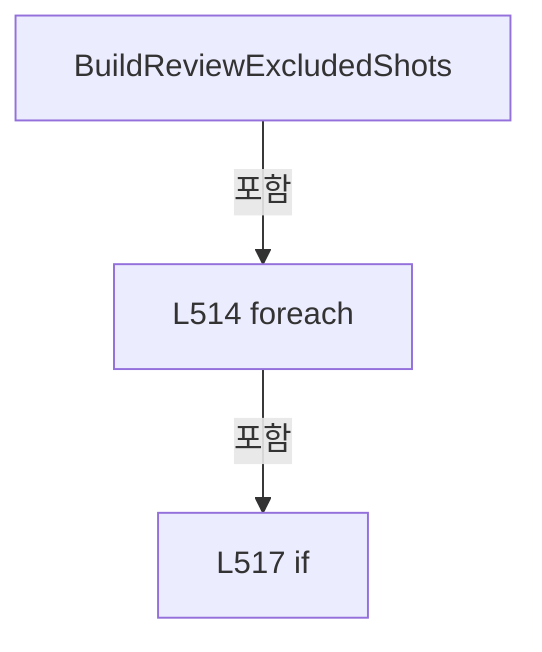

변경 전 점검: 입력/반환 타입, 위 호출자, 예외/취소 경로, 공유 상태와 저장·전송 소비자를 함께 확인합니다. 값의 단위나 물리 방향을 이름만으로 확정하지 않습니다.

### MethodDeclaration `BuildRuntimeCoordinateParameters` · L528–552

[Drilling.Common/Review/CReviewManager.cs:528–552](https://github.com/kjuws10-rgb/A3Drilling/blob/5aee8e58439c9b455cae7c9593c9be986c3e682e/Drilling.Common/Review/CReviewManager.cs#L528-L552)

| 항목 | 실제 추출 값 |
| --- | --- |
| 서명 | System.Collections.Generic.IReadOnlyDictionary<string, string> Drilling.Common.Review.CReviewManager.BuildRuntimeCoordinateParameters(Drilling.Common.Managers.ST_RECIPE_DEFINITION) |
| 접근/수식자 | Private / private |
| 반환/값 타입 | System.Collections.Generic.IReadOnlyDictionary<string, string> |
| 소속 타입 | NamedType:Drilling.Common.Review.CReviewManager |

입력 계약:

| 이름 | 타입 | 전달 | 선택/기본값 |
| --- | --- | --- | --- |
| recipe | Drilling.Common.Managers.ST_RECIPE_DEFINITION | None | False /  |

정적 호출자로 확인된 위치:

| 호출 파일/행 | 호출 표현식 | 런타임 분기 가능 |
| --- | --- | --- |
| [Drilling.Common/Review/CReviewManager.cs:469–469](https://github.com/kjuws10-rgb/A3Drilling/blob/5aee8e58439c9b455cae7c9593c9be986c3e682e/Drilling.Common/Review/CReviewManager.cs#L469-L469) | BuildRuntimeCoordinateParameters | False |

호출하는 대상과 해석 범위:

| 원본 행 | 표현식 | 분석 상태 | 대상/소스 위치 |
| --- | --- | --- | --- |
| 530 | recipe.Parameters.Where(parameter => !string.IsNullOrWhiteSpace(parameter.Key)).GroupBy(parameter => parameter.Key, StringComparer.OrdinalIgnoreCase).ToDictionary | resolved | System.Collections.Generic.Dictionary<string, string> System.Collections.Generic.IEnumerable<System.Linq.IGrouping<string, Drilling.Common.Managers.ST_RECIPE_PARAMETER>>.ToDictionary<System.Linq.IGrouping<string, Drilling.Common.Managers.ST_RECIPE_PARAMETER>, string, string>(System.Func<System.Linq.IGrouping<string, Drilling.Common.Managers.ST_RECIPE_PARAMETER>, string>, System.Func<System.Linq.IGrouping<string, Drilling.Common.Managers.ST_RECIPE_PARAMETER>, string>, System.Collections.Generic.IEqualityComparer<string>?) |
| 530 | recipe.Parameters.Where(parameter => !string.IsNullOrWhiteSpace(parameter.Key)).GroupBy | resolved | System.Collections.Generic.IEnumerable<System.Linq.IGrouping<string, Drilling.Common.Managers.ST_RECIPE_PARAMETER>> System.Collections.Generic.IEnumerable<Drilling.Common.Managers.ST_RECIPE_PARAMETER>.GroupBy<Drilling.Common.Managers.ST_RECIPE_PARAMETER, string>(System.Func<Drilling.Common.Managers.ST_RECIPE_PARAMETER, string>, System.Collections.Generic.IEqualityComparer<string>?) |
| 530 | recipe.Parameters.Where | resolved | System.Collections.Generic.IEnumerable<Drilling.Common.Managers.ST_RECIPE_PARAMETER> System.Collections.Generic.IEnumerable<Drilling.Common.Managers.ST_RECIPE_PARAMETER>.Where<Drilling.Common.Managers.ST_RECIPE_PARAMETER>(System.Func<Drilling.Common.Managers.ST_RECIPE_PARAMETER, bool>) |
| 530 | string.IsNullOrWhiteSpace | resolved | bool string.IsNullOrWhiteSpace(string?) |
| 530 | group.Last | resolved | Drilling.Common.Managers.ST_RECIPE_PARAMETER System.Collections.Generic.IEnumerable<Drilling.Common.Managers.ST_RECIPE_PARAMETER>.Last<Drilling.Common.Managers.ST_RECIPE_PARAMETER>() |
| 542 | settingManager.LoadSection | resolved | System.Collections.Generic.IReadOnlyList<Drilling.Common.Managers.ST_SYSTEM_PARAMETER> Drilling.Common.Managers.CSettingManager.LoadSection(Drilling.Common.Managers.EN_SETTING_TAB, System.Threading.CancellationToken) · Drilling.Common/Managers/CSettingManager.cs:26 |
| 544 | string.IsNullOrWhiteSpace | resolved | bool string.IsNullOrWhiteSpace(string?) |

본문의 실제 연산·분기·예외·반환 순서(원문 위치 순):

| 원본 행 | 종류 | 주석 해설 |
| --- | --- | --- |
| 530 | call | 함수·델리게이트 또는 객체 생성자를 호출합니다: recipe.Parameters.Where(parameter => !string.IsNullOrWhiteSpace(parameter.Key)).GroupBy(parameter => parameter.Key, StringComparer.OrdinalIgnoreCase).ToDictionary(group => group.Key, group => group.Last().Value, StringCo… |
| 530 | call | 함수·델리게이트 또는 객체 생성자를 호출합니다: recipe.Parameters.Where(parameter => !string.IsNullOrWhiteSpace(parameter.Key)).GroupBy(parameter => parameter.Key, StringComparer.OrdinalIgnoreCase) |
| 530 | call | 함수·델리게이트 또는 객체 생성자를 호출합니다: recipe.Parameters.Where(parameter => !string.IsNullOrWhiteSpace(parameter.Key)) |
| 530 | call | 함수·델리게이트 또는 객체 생성자를 호출합니다: string.IsNullOrWhiteSpace(parameter.Key) |
| 530 | call | 함수·델리게이트 또는 객체 생성자를 호출합니다: group.Last() |
| 530 | local-declaration | 지역 변수를 선언합니다: var parameters = recipe.Parameters.Where(parameter => !string.IsNullOrWhiteSpace(parameter.Key)).GroupBy(parameter => parameter.Key, StringComparer.OrdinalIgnoreCase).ToDictionary(group => group.Key, group => group.Last().Value, S |
| 530 | variable-initializer | 변수의 초기값을 지정합니다: parameters = recipe.Parameters.Where(parameter => !string.IsNullOrWhiteSpace(parameter.Key)).GroupBy(parameter => parameter.Key, StringComparer.OrdinalIgnoreCase).ToDictionary(group => group.Key, group => group.Last().Value, Strin |
| 534 | foreach | 컬렉션 요소를 순회합니다: foreach (var tab in new[] { EN_SETTING_TAB.Option, EN_SETTING_TAB.Motor }) |
| 542 | call | 함수·델리게이트 또는 객체 생성자를 호출합니다: settingManager.LoadSection(tab) |
| 542 | foreach | 컬렉션 요소를 순회합니다: foreach (var setting in settingManager.LoadSection(tab)) |
| 544 | call | 함수·델리게이트 또는 객체 생성자를 호출합니다: string.IsNullOrWhiteSpace(setting.Key) |
| 544 | if | 조건에 따라 분기합니다: if (!string.IsNullOrWhiteSpace(setting.Key)) |
| 546 | assignment | 값을 대상에 대입합니다: parameters[setting.Key] = setting.Value |
| 551 | return | 호출자에게 값 또는 제어를 반환합니다: return parameters; |

제어 구문의 포함 구조(실제 실행 순서/CFG가 아닌 구문 탐색 그림):

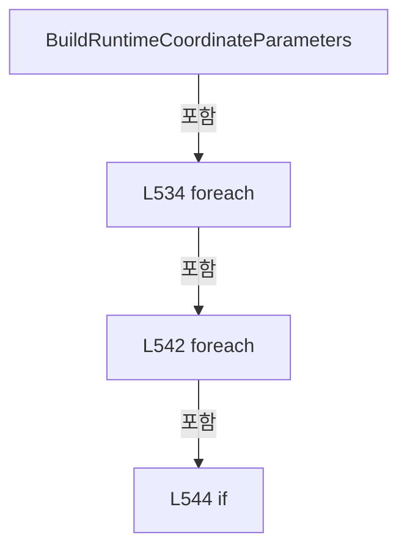

변경 전 점검: 입력/반환 타입, 위 호출자, 예외/취소 경로, 공유 상태와 저장·전송 소비자를 함께 확인합니다. 값의 단위나 물리 방향을 이름만으로 확정하지 않습니다.

### MethodDeclaration `LoadReviewCoordinateSettings` · L554–569

[Drilling.Common/Review/CReviewManager.cs:554–569](https://github.com/kjuws10-rgb/A3Drilling/blob/5aee8e58439c9b455cae7c9593c9be986c3e682e/Drilling.Common/Review/CReviewManager.cs#L554-L569)

| 항목 | 실제 추출 값 |
| --- | --- |
| 서명 | Drilling.Common.Review.CReviewManager.ST_REVIEW_COORDINATE_SETTINGS Drilling.Common.Review.CReviewManager.LoadReviewCoordinateSettings(Drilling.Common.Managers.ST_RECIPE_DEFINITION) |
| 접근/수식자 | Private / private |
| 반환/값 타입 | Drilling.Common.Review.CReviewManager.ST_REVIEW_COORDINATE_SETTINGS |
| 소속 타입 | NamedType:Drilling.Common.Review.CReviewManager |

입력 계약:

| 이름 | 타입 | 전달 | 선택/기본값 |
| --- | --- | --- | --- |
| recipe | Drilling.Common.Managers.ST_RECIPE_DEFINITION | None | False /  |

정적 호출자로 확인된 위치:

| 호출 파일/행 | 호출 표현식 | 런타임 분기 가능 |
| --- | --- | --- |
| [Drilling.Common/Review/CReviewManager.cs:245–245](https://github.com/kjuws10-rgb/A3Drilling/blob/5aee8e58439c9b455cae7c9593c9be986c3e682e/Drilling.Common/Review/CReviewManager.cs#L245-L245) | LoadReviewCoordinateSettings | False |
| [Drilling.Common/Review/CReviewManager.cs:468–468](https://github.com/kjuws10-rgb/A3Drilling/blob/5aee8e58439c9b455cae7c9593c9be986c3e682e/Drilling.Common/Review/CReviewManager.cs#L468-L468) | LoadReviewCoordinateSettings | False |

호출하는 대상과 해석 범위:

| 원본 행 | 표현식 | 분석 상태 | 대상/소스 위치 |
| --- | --- | --- | --- |
| 556 | settingManager.LoadSection | resolved | System.Collections.Generic.IReadOnlyList<Drilling.Common.Managers.ST_SYSTEM_PARAMETER> Drilling.Common.Managers.CSettingManager.LoadSection(Drilling.Common.Managers.EN_SETTING_TAB, System.Threading.CancellationToken) · Drilling.Common/Managers/CSettingManager.cs:26 |
| 557 | CReviewManager.ParseVisionFlipType | resolved | Drilling.Common.Review.EN_VISION_FLIP_TYPE Drilling.Common.Review.CReviewManager.ParseVisionFlipType(string?, string?, string?) · Drilling.Common/Review/CReviewManager.cs:3543 |
| 557 | ReadSettingText | resolved | string Drilling.Common.Review.CReviewManager.ReadSettingText(System.Collections.Generic.IReadOnlyList<Drilling.Common.Managers.ST_SYSTEM_PARAMETER>, string, params string[]) · Drilling.Common/Review/CReviewManager.cs:619 |
| 557 | ReadSettingText | resolved | string Drilling.Common.Review.CReviewManager.ReadSettingText(System.Collections.Generic.IReadOnlyList<Drilling.Common.Managers.ST_SYSTEM_PARAMETER>, string, params string[]) · Drilling.Common/Review/CReviewManager.cs:619 |
| 557 | ReadSettingText | resolved | string Drilling.Common.Review.CReviewManager.ReadSettingText(System.Collections.Generic.IReadOnlyList<Drilling.Common.Managers.ST_SYSTEM_PARAMETER>, string, params string[]) · Drilling.Common/Review/CReviewManager.cs:619 |
| 558 | Enumerable.Range(1, 8).Select(headNo => { var position = ReadHeadPositionX(optionSettings, headNo); const double fallbackWidthX = 110.0; var widthX = ReadSettingDouble(optionSettings, fallbackWidthX, $"H{headNo:00}_SCAN_FIELD_WIDTH_X", $"H{headNo:00}_HEAD_FIELD_WIDTH_X"); return new ST_REVIEW_HEAD_FIELD(headNo, position, widthX > 0.0 ? widthX : fal… | resolved | Drilling.Common.Review.CReviewManager.ST_REVIEW_HEAD_FIELD[] System.Collections.Generic.IEnumerable<Drilling.Common.Review.CReviewManager.ST_REVIEW_HEAD_FIELD>.ToArray<Drilling.Common.Review.CReviewManager.ST_REVIEW_HEAD_FIELD>() |
| 558 | Enumerable.Range(1, 8).Select | resolved | System.Collections.Generic.IEnumerable<Drilling.Common.Review.CReviewManager.ST_REVIEW_HEAD_FIELD> System.Collections.Generic.IEnumerable<int>.Select<int, Drilling.Common.Review.CReviewManager.ST_REVIEW_HEAD_FIELD>(System.Func<int, Drilling.Common.Review.CReviewManager.ST_REVIEW_HEAD_FIELD>) |
| 558 | Enumerable.Range | resolved | System.Collections.Generic.IEnumerable<int> System.Linq.Enumerable.Range(int, int) |
| 560 | ReadHeadPositionX | resolved | double Drilling.Common.Review.CReviewManager.ReadHeadPositionX(System.Collections.Generic.IReadOnlyList<Drilling.Common.Managers.ST_SYSTEM_PARAMETER>, int) · Drilling.Common/Review/CReviewManager.cs:571 |
| 562 | ReadSettingDouble | resolved | double Drilling.Common.Review.CReviewManager.ReadSettingDouble(System.Collections.Generic.IReadOnlyList<Drilling.Common.Managers.ST_SYSTEM_PARAMETER>, double, params string[]) · Drilling.Common/Review/CReviewManager.cs:580 |
| 563 | new ST_REVIEW_HEAD_FIELD | resolved | Drilling.Common.Review.CReviewManager.ST_REVIEW_HEAD_FIELD.ST_REVIEW_HEAD_FIELD(int, double, double) · Drilling.Common/Review/CReviewManager.cs:1158 |
| 567 | headFields.Where(field => ReadSettingBoolean(optionSettings, true, $"H{field.HeadNo:00}_USE")).Select(field => field.HeadNo).ToArray | resolved | int[] System.Collections.Generic.IEnumerable<int>.ToArray<int>() |
| 567 | headFields.Where(field => ReadSettingBoolean(optionSettings, true, $"H{field.HeadNo:00}_USE")).Select | resolved | System.Collections.Generic.IEnumerable<int> System.Collections.Generic.IEnumerable<Drilling.Common.Review.CReviewManager.ST_REVIEW_HEAD_FIELD>.Select<Drilling.Common.Review.CReviewManager.ST_REVIEW_HEAD_FIELD, int>(System.Func<Drilling.Common.Review.CReviewManager.ST_REVIEW_HEAD_FIELD, int>) |
| 567 | headFields.Where | resolved | System.Collections.Generic.IEnumerable<Drilling.Common.Review.CReviewManager.ST_REVIEW_HEAD_FIELD> System.Collections.Generic.IEnumerable<Drilling.Common.Review.CReviewManager.ST_REVIEW_HEAD_FIELD>.Where<Drilling.Common.Review.CReviewManager.ST_REVIEW_HEAD_FIELD>(System.Func<Drilling.Common.Review.CReviewManager.ST_REVIEW_HEAD_FIELD, bool>) |
| 567 | ReadSettingBoolean | resolved | bool Drilling.Common.Review.CReviewManager.ReadSettingBoolean(System.Collections.Generic.IReadOnlyList<Drilling.Common.Managers.ST_SYSTEM_PARAMETER>, bool, params string[]) · Drilling.Common/Review/CReviewManager.cs:598 |
| 568 | new ST_REVIEW_COORDINATE_SETTINGS | resolved | Drilling.Common.Review.CReviewManager.ST_REVIEW_COORDINATE_SETTINGS.ST_REVIEW_COORDINATE_SETTINGS(Drilling.Common.Review.CReviewManager.ST_REVIEW_HEAD_LAYOUT, System.Collections.Generic.IReadOnlyList<int>, Drilling.Common.Review.EN_VISION_FLIP_TYPE) · Drilling.Common/Review/CReviewManager.cs:1159 |
| 568 | new ST_REVIEW_HEAD_LAYOUT | resolved | Drilling.Common.Review.CReviewManager.ST_REVIEW_HEAD_LAYOUT.ST_REVIEW_HEAD_LAYOUT(System.Collections.Generic.IReadOnlyList<Drilling.Common.Review.CReviewManager.ST_REVIEW_HEAD_FIELD>) · Drilling.Common/Review/CReviewManager.cs:1150 |

본문의 실제 연산·분기·예외·반환 순서(원문 위치 순):

| 원본 행 | 종류 | 주석 해설 |
| --- | --- | --- |
| 556 | call | 함수·델리게이트 또는 객체 생성자를 호출합니다: settingManager.LoadSection(EN_SETTING_TAB.Option) |
| 556 | local-declaration | 지역 변수를 선언합니다: var optionSettings = settingManager.LoadSection(EN_SETTING_TAB.Option); |
| 556 | variable-initializer | 변수의 초기값을 지정합니다: optionSettings = settingManager.LoadSection(EN_SETTING_TAB.Option) |
| 557 | call | 함수·델리게이트 또는 객체 생성자를 호출합니다: CReviewManager.ParseVisionFlipType(ReadSettingText(optionSettings, "", "VisionXFlip"), ReadSettingText(optionSettings, "", "VisionYFlip"), ReadSettingText(optionSettings, "", "VisionXyFlip")) |
| 557 | call | 함수·델리게이트 또는 객체 생성자를 호출합니다: ReadSettingText(optionSettings, "", "VisionXFlip") |
| 557 | call | 함수·델리게이트 또는 객체 생성자를 호출합니다: ReadSettingText(optionSettings, "", "VisionYFlip") |
| 557 | call | 함수·델리게이트 또는 객체 생성자를 호출합니다: ReadSettingText(optionSettings, "", "VisionXyFlip") |
| 557 | local-declaration | 지역 변수를 선언합니다: var visionFlipType = CReviewManager.ParseVisionFlipType(ReadSettingText(optionSettings, "", "VisionXFlip"), ReadSettingText(optionSettings, "", "VisionYFlip"), ReadSettingText(optionSettings, "", "VisionXyFlip")); |
| 557 | variable-initializer | 변수의 초기값을 지정합니다: visionFlipType = CReviewManager.ParseVisionFlipType(ReadSettingText(optionSettings, "", "VisionXFlip"), ReadSettingText(optionSettings, "", "VisionYFlip"), ReadSettingText(optionSettings, "", "VisionXyFlip")) |
| 558 | call | 함수·델리게이트 또는 객체 생성자를 호출합니다: Enumerable.Range(1, 8) |
| 558 | call | 함수·델리게이트 또는 객체 생성자를 호출합니다: Enumerable.Range(1, 8).Select(headNo => { var position = ReadHeadPositionX(optionSettings, headNo); const double fallbackWidthX = 110.0; var widthX = ReadSettingDouble(optionSettings, fallbackWidthX, $"H{headNo:00}_SCAN_… |
| 558 | call | 함수·델리게이트 또는 객체 생성자를 호출합니다: Enumerable.Range(1, 8).Select(headNo => { var position = ReadHeadPositionX(optionSettings, headNo); const double fallbackWidthX = 110.0; var widthX = ReadSettingDouble(optionSettings, fallbackWidthX, $"H{headNo:00}_SCAN_… |
| 558 | local-declaration | 지역 변수를 선언합니다: var headFields = Enumerable.Range(1, 8).Select(headNo => { var position = ReadHeadPositionX(optionSettings, headNo); const double fallbackWidthX = 110.0; var widthX = ReadSettingDouble(optionSettings, fallbackWidthX, $"H{headNo:00 |
| 558 | variable-initializer | 변수의 초기값을 지정합니다: headFields = Enumerable.Range(1, 8).Select(headNo => { var position = ReadHeadPositionX(optionSettings, headNo); const double fallbackWidthX = 110.0; var widthX = ReadSettingDouble(optionSettings, fallbackWidthX, $"H{headNo:00}_SC |
| 560 | call | 함수·델리게이트 또는 객체 생성자를 호출합니다: ReadHeadPositionX(optionSettings, headNo) |
| 560 | local-declaration | 지역 변수를 선언합니다: var position = ReadHeadPositionX(optionSettings, headNo); |
| 560 | variable-initializer | 변수의 초기값을 지정합니다: position = ReadHeadPositionX(optionSettings, headNo) |
| 561 | local-declaration | 지역 변수를 선언합니다: const double fallbackWidthX = 110.0; |
| 561 | variable-initializer | 변수의 초기값을 지정합니다: fallbackWidthX = 110.0 |
| 562 | call | 함수·델리게이트 또는 객체 생성자를 호출합니다: ReadSettingDouble(optionSettings, fallbackWidthX, $"H{headNo:00}_SCAN_FIELD_WIDTH_X", $"H{headNo:00}_HEAD_FIELD_WIDTH_X") |
| 562 | local-declaration | 지역 변수를 선언합니다: var widthX = ReadSettingDouble(optionSettings, fallbackWidthX, $"H{headNo:00}_SCAN_FIELD_WIDTH_X", $"H{headNo:00}_HEAD_FIELD_WIDTH_X"); |
| 562 | variable-initializer | 변수의 초기값을 지정합니다: widthX = ReadSettingDouble(optionSettings, fallbackWidthX, $"H{headNo:00}_SCAN_FIELD_WIDTH_X", $"H{headNo:00}_HEAD_FIELD_WIDTH_X") |
| 563 | call | 함수·델리게이트 또는 객체 생성자를 호출합니다: new ST_REVIEW_HEAD_FIELD(headNo, position, widthX > 0.0 ? widthX : fallbackWidthX) |
| 563 | conditional-expression | 조건에 따라 결과식을 선택합니다: widthX > 0.0 ? widthX : fallbackWidthX |
| 563 | return | 호출자에게 값 또는 제어를 반환합니다: return new ST_REVIEW_HEAD_FIELD(headNo, position, widthX > 0.0 ? widthX : fallbackWidthX); |
| 567 | call | 함수·델리게이트 또는 객체 생성자를 호출합니다: headFields.Where(field => ReadSettingBoolean(optionSettings, true, $"H{field.HeadNo:00}_USE")).Select(field => field.HeadNo).ToArray() |
| 567 | call | 함수·델리게이트 또는 객체 생성자를 호출합니다: headFields.Where(field => ReadSettingBoolean(optionSettings, true, $"H{field.HeadNo:00}_USE")).Select(field => field.HeadNo) |
| 567 | call | 함수·델리게이트 또는 객체 생성자를 호출합니다: headFields.Where(field => ReadSettingBoolean(optionSettings, true, $"H{field.HeadNo:00}_USE")) |
| 567 | call | 함수·델리게이트 또는 객체 생성자를 호출합니다: ReadSettingBoolean(optionSettings, true, $"H{field.HeadNo:00}_USE") |
| 567 | local-declaration | 지역 변수를 선언합니다: var activeHeadNos = headFields.Where(field => ReadSettingBoolean(optionSettings, true, $"H{field.HeadNo:00}_USE")).Select(field => field.HeadNo).ToArray(); |
| 567 | variable-initializer | 변수의 초기값을 지정합니다: activeHeadNos = headFields.Where(field => ReadSettingBoolean(optionSettings, true, $"H{field.HeadNo:00}_USE")).Select(field => field.HeadNo).ToArray() |
| 568 | call | 함수·델리게이트 또는 객체 생성자를 호출합니다: new ST_REVIEW_COORDINATE_SETTINGS(new ST_REVIEW_HEAD_LAYOUT(headFields), activeHeadNos, visionFlipType) |
| 568 | call | 함수·델리게이트 또는 객체 생성자를 호출합니다: new ST_REVIEW_HEAD_LAYOUT(headFields) |
| 568 | return | 호출자에게 값 또는 제어를 반환합니다: return new ST_REVIEW_COORDINATE_SETTINGS(new ST_REVIEW_HEAD_LAYOUT(headFields), activeHeadNos, visionFlipType); |

변경 전 점검: 입력/반환 타입, 위 호출자, 예외/취소 경로, 공유 상태와 저장·전송 소비자를 함께 확인합니다. 값의 단위나 물리 방향을 이름만으로 확정하지 않습니다.

### MethodDeclaration `ReadHeadPositionX` · L571–578

[Drilling.Common/Review/CReviewManager.cs:571–578](https://github.com/kjuws10-rgb/A3Drilling/blob/5aee8e58439c9b455cae7c9593c9be986c3e682e/Drilling.Common/Review/CReviewManager.cs#L571-L578)

| 항목 | 실제 추출 값 |
| --- | --- |
| 서명 | double Drilling.Common.Review.CReviewManager.ReadHeadPositionX(System.Collections.Generic.IReadOnlyList<Drilling.Common.Managers.ST_SYSTEM_PARAMETER>, int) |
| 접근/수식자 | Private / private, static |
| 반환/값 타입 | double |
| 소속 타입 | NamedType:Drilling.Common.Review.CReviewManager |

입력 계약:

| 이름 | 타입 | 전달 | 선택/기본값 |
| --- | --- | --- | --- |
| settings | System.Collections.Generic.IReadOnlyList<Drilling.Common.Managers.ST_SYSTEM_PARAMETER> | None | False /  |
| headNo | int | None | False /  |

정적 호출자로 확인된 위치:

| 호출 파일/행 | 호출 표현식 | 런타임 분기 가능 |
| --- | --- | --- |
| [Drilling.Common/Review/CReviewManager.cs:560–560](https://github.com/kjuws10-rgb/A3Drilling/blob/5aee8e58439c9b455cae7c9593c9be986c3e682e/Drilling.Common/Review/CReviewManager.cs#L560-L560) | ReadHeadPositionX | False |

호출하는 대상과 해석 범위:

| 원본 행 | 표현식 | 분석 상태 | 대상/소스 위치 |
| --- | --- | --- | --- |
| 575 | ReadSettingDouble | resolved | double Drilling.Common.Review.CReviewManager.ReadSettingDouble(System.Collections.Generic.IReadOnlyList<Drilling.Common.Managers.ST_SYSTEM_PARAMETER>, double, params string[]) · Drilling.Common/Review/CReviewManager.cs:580 |
| 576 | ReadSettingDouble | resolved | double Drilling.Common.Review.CReviewManager.ReadSettingDouble(System.Collections.Generic.IReadOnlyList<Drilling.Common.Managers.ST_SYSTEM_PARAMETER>, double, params string[]) · Drilling.Common/Review/CReviewManager.cs:580 |

본문의 실제 연산·분기·예외·반환 순서(원문 위치 순):

| 원본 행 | 종류 | 주석 해설 |
| --- | --- | --- |
| 573 | local-declaration | 지역 변수를 선언합니다: const double fallbackHead1PositionX = -5.0; |
| 573 | variable-initializer | 변수의 초기값을 지정합니다: fallbackHead1PositionX = -5.0 |
| 574 | local-declaration | 지역 변수를 선언합니다: const double fallbackHeadGapX = 200.0; |
| 574 | variable-initializer | 변수의 초기값을 지정합니다: fallbackHeadGapX = 200.0 |
| 575 | call | 함수·델리게이트 또는 객체 생성자를 호출합니다: ReadSettingDouble(settings, fallbackHead1PositionX, "H01_AK_POSITION_X") |
| 575 | local-declaration | 지역 변수를 선언합니다: var head1PositionX = ReadSettingDouble(settings, fallbackHead1PositionX, "H01_AK_POSITION_X"); |
| 575 | variable-initializer | 변수의 초기값을 지정합니다: head1PositionX = ReadSettingDouble(settings, fallbackHead1PositionX, "H01_AK_POSITION_X") |
| 576 | call | 함수·델리게이트 또는 객체 생성자를 호출합니다: ReadSettingDouble(settings, fallbackHeadGapX, "HeadGapX") |
| 576 | local-declaration | 지역 변수를 선언합니다: var headGapX = ReadSettingDouble(settings, fallbackHeadGapX, "HeadGapX"); |
| 576 | variable-initializer | 변수의 초기값을 지정합니다: headGapX = ReadSettingDouble(settings, fallbackHeadGapX, "HeadGapX") |
| 577 | return | 호출자에게 값 또는 제어를 반환합니다: return head1PositionX + ((headNo - 1) * headGapX); |

변경 전 점검: 입력/반환 타입, 위 호출자, 예외/취소 경로, 공유 상태와 저장·전송 소비자를 함께 확인합니다. 값의 단위나 물리 방향을 이름만으로 확정하지 않습니다.

### MethodDeclaration `ReadSettingDouble` · L580–596

[Drilling.Common/Review/CReviewManager.cs:580–596](https://github.com/kjuws10-rgb/A3Drilling/blob/5aee8e58439c9b455cae7c9593c9be986c3e682e/Drilling.Common/Review/CReviewManager.cs#L580-L596)

| 항목 | 실제 추출 값 |
| --- | --- |
| 서명 | double Drilling.Common.Review.CReviewManager.ReadSettingDouble(System.Collections.Generic.IReadOnlyList<Drilling.Common.Managers.ST_SYSTEM_PARAMETER>, double, params string[]) |
| 접근/수식자 | Private / private, static |
| 반환/값 타입 | double |
| 소속 타입 | NamedType:Drilling.Common.Review.CReviewManager |

입력 계약:

| 이름 | 타입 | 전달 | 선택/기본값 |
| --- | --- | --- | --- |
| settings | System.Collections.Generic.IReadOnlyList<Drilling.Common.Managers.ST_SYSTEM_PARAMETER> | None | False /  |
| defaultValue | double | None | False /  |
| keys | string[] | None | False /  |

정적 호출자로 확인된 위치:

| 호출 파일/행 | 호출 표현식 | 런타임 분기 가능 |
| --- | --- | --- |
| [Drilling.Common/Review/CReviewManager.cs:562–562](https://github.com/kjuws10-rgb/A3Drilling/blob/5aee8e58439c9b455cae7c9593c9be986c3e682e/Drilling.Common/Review/CReviewManager.cs#L562-L562) | ReadSettingDouble | False |
| [Drilling.Common/Review/CReviewManager.cs:575–575](https://github.com/kjuws10-rgb/A3Drilling/blob/5aee8e58439c9b455cae7c9593c9be986c3e682e/Drilling.Common/Review/CReviewManager.cs#L575-L575) | ReadSettingDouble | False |
| [Drilling.Common/Review/CReviewManager.cs:576–576](https://github.com/kjuws10-rgb/A3Drilling/blob/5aee8e58439c9b455cae7c9593c9be986c3e682e/Drilling.Common/Review/CReviewManager.cs#L576-L576) | ReadSettingDouble | False |

호출하는 대상과 해석 범위:

| 원본 행 | 표현식 | 분석 상태 | 대상/소스 위치 |
| --- | --- | --- | --- |
| 584 | keys.Any | resolved | bool System.Collections.Generic.IEnumerable<string>.Any<string>(System.Func<string, bool>) |
| 584 | key.Equals | resolved | bool string.Equals(string?, System.StringComparison) |
| 584 | key.Equals | resolved | bool string.Equals(string?, System.StringComparison) |
| 589 | double.TryParse | resolved | bool double.TryParse(string?, System.Globalization.NumberStyles, System.IFormatProvider?, out double) |

본문의 실제 연산·분기·예외·반환 순서(원문 위치 순):

| 원본 행 | 종류 | 주석 해설 |
| --- | --- | --- |
| 582 | foreach | 컬렉션 요소를 순회합니다: foreach (var setting in settings) |
| 584 | call | 함수·델리게이트 또는 객체 생성자를 호출합니다: keys.Any(key => key.Equals(setting.Key, StringComparison.OrdinalIgnoreCase) &#124;&#124; key.Equals(setting.Name, StringComparison.OrdinalIgnoreCase)) |
| 584 | call | 함수·델리게이트 또는 객체 생성자를 호출합니다: key.Equals(setting.Key, StringComparison.OrdinalIgnoreCase) |
| 584 | call | 함수·델리게이트 또는 객체 생성자를 호출합니다: key.Equals(setting.Name, StringComparison.OrdinalIgnoreCase) |
| 584 | if | 조건에 따라 분기합니다: if (!keys.Any(key => key.Equals(setting.Key, StringComparison.OrdinalIgnoreCase) &#124;&#124; key.Equals(setting.Name, StringComparison.OrdinalIgnoreCase))) |
| 586 | continue | 다음 반복으로 진행합니다: continue; |
| 589 | call | 함수·델리게이트 또는 객체 생성자를 호출합니다: double.TryParse(setting.Value, NumberStyles.Float, CultureInfo.InvariantCulture, out var parsed) |
| 589 | if | 조건에 따라 분기합니다: if (double.TryParse(setting.Value, NumberStyles.Float, CultureInfo.InvariantCulture, out var parsed)) |
| 591 | return | 호출자에게 값 또는 제어를 반환합니다: return parsed; |
| 595 | return | 호출자에게 값 또는 제어를 반환합니다: return defaultValue; |

제어 구문의 포함 구조(실제 실행 순서/CFG가 아닌 구문 탐색 그림):

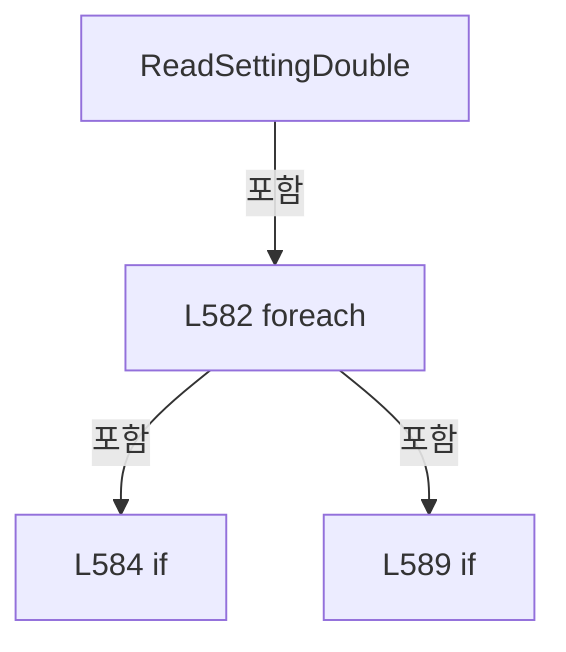

변경 전 점검: 입력/반환 타입, 위 호출자, 예외/취소 경로, 공유 상태와 저장·전송 소비자를 함께 확인합니다. 값의 단위나 물리 방향을 이름만으로 확정하지 않습니다.

### MethodDeclaration `ReadSettingBoolean` · L598–617

[Drilling.Common/Review/CReviewManager.cs:598–617](https://github.com/kjuws10-rgb/A3Drilling/blob/5aee8e58439c9b455cae7c9593c9be986c3e682e/Drilling.Common/Review/CReviewManager.cs#L598-L617)

| 항목 | 실제 추출 값 |
| --- | --- |
| 서명 | bool Drilling.Common.Review.CReviewManager.ReadSettingBoolean(System.Collections.Generic.IReadOnlyList<Drilling.Common.Managers.ST_SYSTEM_PARAMETER>, bool, params string[]) |
| 접근/수식자 | Private / private, static |
| 반환/값 타입 | bool |
| 소속 타입 | NamedType:Drilling.Common.Review.CReviewManager |

입력 계약:

| 이름 | 타입 | 전달 | 선택/기본값 |
| --- | --- | --- | --- |
| settings | System.Collections.Generic.IReadOnlyList<Drilling.Common.Managers.ST_SYSTEM_PARAMETER> | None | False /  |
| defaultValue | bool | None | False /  |
| keys | string[] | None | False /  |

정적 호출자로 확인된 위치:

| 호출 파일/행 | 호출 표현식 | 런타임 분기 가능 |
| --- | --- | --- |
| [Drilling.Common/Review/CReviewManager.cs:567–567](https://github.com/kjuws10-rgb/A3Drilling/blob/5aee8e58439c9b455cae7c9593c9be986c3e682e/Drilling.Common/Review/CReviewManager.cs#L567-L567) | ReadSettingBoolean | False |

호출하는 대상과 해석 범위:

| 원본 행 | 표현식 | 분석 상태 | 대상/소스 위치 |
| --- | --- | --- | --- |
| 600 | ReadSettingText | resolved | string Drilling.Common.Review.CReviewManager.ReadSettingText(System.Collections.Generic.IReadOnlyList<Drilling.Common.Managers.ST_SYSTEM_PARAMETER>, string, params string[]) · Drilling.Common/Review/CReviewManager.cs:619 |
| 601 | string.IsNullOrWhiteSpace | resolved | bool string.IsNullOrWhiteSpace(string?) |
| 606 | bool.TryParse | resolved | bool bool.TryParse(string?, out bool) |
| 611 | text.Trim().ToUpperInvariant | resolved | string string.ToUpperInvariant() |
| 611 | text.Trim | resolved | string string.Trim() |

본문의 실제 연산·분기·예외·반환 순서(원문 위치 순):

| 원본 행 | 종류 | 주석 해설 |
| --- | --- | --- |
| 600 | call | 함수·델리게이트 또는 객체 생성자를 호출합니다: ReadSettingText(settings, "", keys) |
| 600 | local-declaration | 지역 변수를 선언합니다: var text = ReadSettingText(settings, "", keys); |
| 600 | variable-initializer | 변수의 초기값을 지정합니다: text = ReadSettingText(settings, "", keys) |
| 601 | call | 함수·델리게이트 또는 객체 생성자를 호출합니다: string.IsNullOrWhiteSpace(text) |
| 601 | if | 조건에 따라 분기합니다: if (string.IsNullOrWhiteSpace(text)) |
| 603 | return | 호출자에게 값 또는 제어를 반환합니다: return defaultValue; |
| 606 | call | 함수·델리게이트 또는 객체 생성자를 호출합니다: bool.TryParse(text, out var parsed) |
| 606 | if | 조건에 따라 분기합니다: if (bool.TryParse(text, out var parsed)) |
| 608 | return | 호출자에게 값 또는 제어를 반환합니다: return parsed; |
| 611 | call | 함수·델리게이트 또는 객체 생성자를 호출합니다: text.Trim().ToUpperInvariant() |
| 611 | call | 함수·델리게이트 또는 객체 생성자를 호출합니다: text.Trim() |
| 611 | return | 호출자에게 값 또는 제어를 반환합니다: return text.Trim().ToUpperInvariant() switch { "1" or "ON" or "YES" or "Y" => true, "0" or "OFF" or "NO" or "N" => false, _ => defaultValue }; |
| 611 | switch-expression | 값별 결과식을 선택합니다: text.Trim().ToUpperInvariant() switch { "1" or "ON" or "YES" or "Y" => true, "0" or "OFF" or "NO" or "N" => false, _ => defaultValue } |

제어 구문의 포함 구조(실제 실행 순서/CFG가 아닌 구문 탐색 그림):

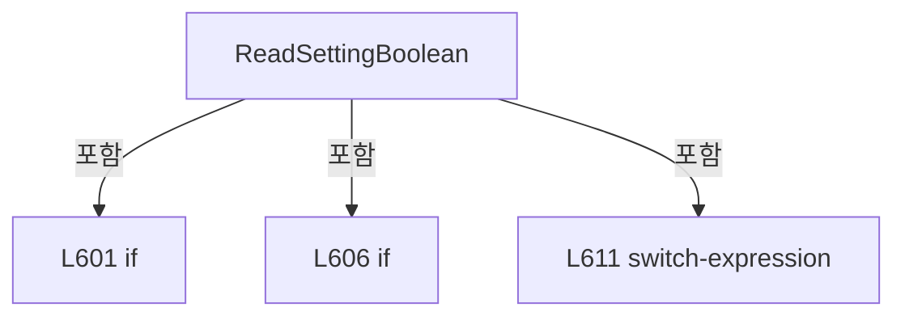

변경 전 점검: 입력/반환 타입, 위 호출자, 예외/취소 경로, 공유 상태와 저장·전송 소비자를 함께 확인합니다. 값의 단위나 물리 방향을 이름만으로 확정하지 않습니다.

### MethodDeclaration `ReadSettingText` · L619–632

[Drilling.Common/Review/CReviewManager.cs:619–632](https://github.com/kjuws10-rgb/A3Drilling/blob/5aee8e58439c9b455cae7c9593c9be986c3e682e/Drilling.Common/Review/CReviewManager.cs#L619-L632)

| 항목 | 실제 추출 값 |
| --- | --- |
| 서명 | string Drilling.Common.Review.CReviewManager.ReadSettingText(System.Collections.Generic.IReadOnlyList<Drilling.Common.Managers.ST_SYSTEM_PARAMETER>, string, params string[]) |
| 접근/수식자 | Private / private, static |
| 반환/값 타입 | string |
| 소속 타입 | NamedType:Drilling.Common.Review.CReviewManager |

입력 계약:

| 이름 | 타입 | 전달 | 선택/기본값 |
| --- | --- | --- | --- |
| settings | System.Collections.Generic.IReadOnlyList<Drilling.Common.Managers.ST_SYSTEM_PARAMETER> | None | False /  |
| defaultValue | string | None | False /  |
| keys | string[] | None | False /  |

정적 호출자로 확인된 위치:

| 호출 파일/행 | 호출 표현식 | 런타임 분기 가능 |
| --- | --- | --- |
| [Drilling.Common/Review/CReviewManager.cs:557–557](https://github.com/kjuws10-rgb/A3Drilling/blob/5aee8e58439c9b455cae7c9593c9be986c3e682e/Drilling.Common/Review/CReviewManager.cs#L557-L557) | ReadSettingText | False |
| [Drilling.Common/Review/CReviewManager.cs:557–557](https://github.com/kjuws10-rgb/A3Drilling/blob/5aee8e58439c9b455cae7c9593c9be986c3e682e/Drilling.Common/Review/CReviewManager.cs#L557-L557) | ReadSettingText | False |
| [Drilling.Common/Review/CReviewManager.cs:557–557](https://github.com/kjuws10-rgb/A3Drilling/blob/5aee8e58439c9b455cae7c9593c9be986c3e682e/Drilling.Common/Review/CReviewManager.cs#L557-L557) | ReadSettingText | False |
| [Drilling.Common/Review/CReviewManager.cs:600–600](https://github.com/kjuws10-rgb/A3Drilling/blob/5aee8e58439c9b455cae7c9593c9be986c3e682e/Drilling.Common/Review/CReviewManager.cs#L600-L600) | ReadSettingText | False |

호출하는 대상과 해석 범위:

| 원본 행 | 표현식 | 분석 상태 | 대상/소스 위치 |
| --- | --- | --- | --- |
| 623 | keys.Any | resolved | bool System.Collections.Generic.IEnumerable<string>.Any<string>(System.Func<string, bool>) |
| 623 | key.Equals | resolved | bool string.Equals(string?, System.StringComparison) |
| 623 | key.Equals | resolved | bool string.Equals(string?, System.StringComparison) |
| 628 | string.IsNullOrWhiteSpace | resolved | bool string.IsNullOrWhiteSpace(string?) |
| 628 | setting.Value.Trim | resolved | string string.Trim() |

본문의 실제 연산·분기·예외·반환 순서(원문 위치 순):

| 원본 행 | 종류 | 주석 해설 |
| --- | --- | --- |
| 621 | foreach | 컬렉션 요소를 순회합니다: foreach (var setting in settings) |
| 623 | call | 함수·델리게이트 또는 객체 생성자를 호출합니다: keys.Any(key => key.Equals(setting.Key, StringComparison.OrdinalIgnoreCase) &#124;&#124; key.Equals(setting.Name, StringComparison.OrdinalIgnoreCase)) |
| 623 | call | 함수·델리게이트 또는 객체 생성자를 호출합니다: key.Equals(setting.Key, StringComparison.OrdinalIgnoreCase) |
| 623 | call | 함수·델리게이트 또는 객체 생성자를 호출합니다: key.Equals(setting.Name, StringComparison.OrdinalIgnoreCase) |
| 623 | if | 조건에 따라 분기합니다: if (!keys.Any(key => key.Equals(setting.Key, StringComparison.OrdinalIgnoreCase) &#124;&#124; key.Equals(setting.Name, StringComparison.OrdinalIgnoreCase))) |
| 625 | continue | 다음 반복으로 진행합니다: continue; |
| 628 | call | 함수·델리게이트 또는 객체 생성자를 호출합니다: string.IsNullOrWhiteSpace(setting.Value) |
| 628 | call | 함수·델리게이트 또는 객체 생성자를 호출합니다: setting.Value.Trim() |
| 628 | conditional-expression | 조건에 따라 결과식을 선택합니다: string.IsNullOrWhiteSpace(setting.Value) ? defaultValue : setting.Value.Trim() |
| 628 | return | 호출자에게 값 또는 제어를 반환합니다: return string.IsNullOrWhiteSpace(setting.Value) ? defaultValue : setting.Value.Trim(); |
| 631 | return | 호출자에게 값 또는 제어를 반환합니다: return defaultValue; |

제어 구문의 포함 구조(실제 실행 순서/CFG가 아닌 구문 탐색 그림):

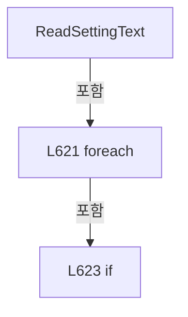

변경 전 점검: 입력/반환 타입, 위 호출자, 예외/취소 경로, 공유 상태와 저장·전송 소비자를 함께 확인합니다. 값의 단위나 물리 방향을 이름만으로 확정하지 않습니다.

### MethodDeclaration `BuildShotPoints` · L634–731

[Drilling.Common/Review/CReviewManager.cs:634–731](https://github.com/kjuws10-rgb/A3Drilling/blob/5aee8e58439c9b455cae7c9593c9be986c3e682e/Drilling.Common/Review/CReviewManager.cs#L634-L731)

| 항목 | 실제 추출 값 |
| --- | --- |
| 서명 | System.Collections.Generic.IReadOnlyList<Drilling.Common.Review.ST_REVIEW_PLAN_POINT> Drilling.Common.Review.CReviewManager.BuildShotPoints(Drilling.Common.Managers.ST_RECIPE_DEFINITION, int, int, Drilling.Common.Review.CReviewManager.ST_REVIEW_COORDINATE_SETTINGS, System.Collections.Generic.IReadOnlyDictionary<(int CellNo, int CellShotNo), int>, double, int, bool, System.Collections.Generic.IReadOnlyDictionary<string, string>, double, double) |
| 접근/수식자 | Private / private, static |
| 반환/값 타입 | System.Collections.Generic.IReadOnlyList<Drilling.Common.Review.ST_REVIEW_PLAN_POINT> |
| 소속 타입 | NamedType:Drilling.Common.Review.CReviewManager |

입력 계약:

| 이름 | 타입 | 전달 | 선택/기본값 |
| --- | --- | --- | --- |
| recipe | Drilling.Common.Managers.ST_RECIPE_DEFINITION | None | False /  |
| headCount | int | None | False /  |
| cellCount | int | None | False /  |
| coordinateSettings | Drilling.Common.Review.CReviewManager.ST_REVIEW_COORDINATE_SETTINGS | None | False /  |
| assignedHeadNos | System.Collections.Generic.IReadOnlyDictionary<(int CellNo, int CellShotNo), int> | None | False /  |
| stageScanDirectionY | double | None | False /  |
| selectedBeamNo | int | None | False /  |
| selectAllAssignedPoints | bool | None | False /  |
| excludedShots | System.Collections.Generic.IReadOnlyDictionary<string, string> | None | False /  |
| shiftOffsetX | double | None | False /  |
| shiftOffsetY | double | None | False /  |

정적 호출자로 확인된 위치:

| 호출 파일/행 | 호출 표현식 | 런타임 분기 가능 |
| --- | --- | --- |
| [Drilling.Common/Review/CReviewManager.cs:474–485](https://github.com/kjuws10-rgb/A3Drilling/blob/5aee8e58439c9b455cae7c9593c9be986c3e682e/Drilling.Common/Review/CReviewManager.cs#L474-L485) | BuildShotPoints | False |

호출하는 대상과 해석 범위:

| 원본 행 | 표현식 | 분석 상태 | 대상/소스 위치 |
| --- | --- | --- | --- |
| 649 | ReadDouble | resolved | double Drilling.Common.Review.CReviewManager.ReadDouble(Drilling.Common.Managers.ST_RECIPE_DEFINITION, double, params string[]) · Drilling.Common/Review/CReviewManager.cs:1242 |
| 650 | ReadDouble | resolved | double Drilling.Common.Review.CReviewManager.ReadDouble(Drilling.Common.Managers.ST_RECIPE_DEFINITION, double, params string[]) · Drilling.Common/Review/CReviewManager.cs:1242 |
| 651 | ReadDouble | resolved | double Drilling.Common.Review.CReviewManager.ReadDouble(Drilling.Common.Managers.ST_RECIPE_DEFINITION, double, params string[]) · Drilling.Common/Review/CReviewManager.cs:1242 |
| 652 | ReadDouble | resolved | double Drilling.Common.Review.CReviewManager.ReadDouble(Drilling.Common.Managers.ST_RECIPE_DEFINITION, double, params string[]) · Drilling.Common/Review/CReviewManager.cs:1242 |
| 653 | ReadDouble | resolved | double Drilling.Common.Review.CReviewManager.ReadDouble(Drilling.Common.Managers.ST_RECIPE_DEFINITION, double, params string[]) · Drilling.Common/Review/CReviewManager.cs:1242 |
| 654 | ReadInt | resolved | int Drilling.Common.Review.CReviewManager.ReadInt(Drilling.Common.Managers.ST_RECIPE_DEFINITION, int, params string[]) · Drilling.Common/Review/CReviewManager.cs:1202 |
| 655 | recipe.Parameters.GroupBy(parameter => parameter.Key, StringComparer.OrdinalIgnoreCase).ToDictionary | resolved | System.Collections.Generic.Dictionary<string, string> System.Collections.Generic.IEnumerable<System.Linq.IGrouping<string, Drilling.Common.Managers.ST_RECIPE_PARAMETER>>.ToDictionary<System.Linq.IGrouping<string, Drilling.Common.Managers.ST_RECIPE_PARAMETER>, string, string>(System.Func<System.Linq.IGrouping<string, Drilling.Common.Managers.ST_RECIPE_PARAMETER>, string>, System.Func<System.Linq.IGrouping<string, Drilling.Common.Managers.ST_RECIPE_PARAMETER>, string>, System.Collections.Generic.IEqualityComparer<string>?) |
| 655 | recipe.Parameters.GroupBy | resolved | System.Collections.Generic.IEnumerable<System.Linq.IGrouping<string, Drilling.Common.Managers.ST_RECIPE_PARAMETER>> System.Collections.Generic.IEnumerable<Drilling.Common.Managers.ST_RECIPE_PARAMETER>.GroupBy<Drilling.Common.Managers.ST_RECIPE_PARAMETER, string>(System.Func<Drilling.Common.Managers.ST_RECIPE_PARAMETER, string>, System.Collections.Generic.IEqualityComparer<string>?) |
| 655 | group.Last | resolved | Drilling.Common.Managers.ST_RECIPE_PARAMETER System.Collections.Generic.IEnumerable<Drilling.Common.Managers.ST_RECIPE_PARAMETER>.Last<Drilling.Common.Managers.ST_RECIPE_PARAMETER>() |
| 656 | CRecipeModelPixelCountReader.ReadModelTypeCount | resolved | int Drilling.Common.Recipe.CRecipeModelPixelCountReader.ReadModelTypeCount(System.Collections.Generic.IReadOnlyDictionary<string, string>) · Drilling.Common/Recipe/CCellPatternCalculator.cs:428 |
| 657 | ValidateBeamNo | resolved | void Drilling.Common.Review.CReviewManager.ValidateBeamNo(int, int) · Drilling.Common/Review/CReviewManager.cs:933 |
| 658 | new List<ST_CELL_PATTERN_DEFINITION> | resolved | System.Collections.Generic.List<Drilling.Common.Recipe.ST_CELL_PATTERN_DEFINITION>.List(int) |
| 661 | ReadDouble | resolved | double Drilling.Common.Review.CReviewManager.ReadDouble(Drilling.Common.Managers.ST_RECIPE_DEFINITION, double, params string[]) · Drilling.Common/Review/CReviewManager.cs:1242 |
| 662 | ReadDouble | resolved | double Drilling.Common.Review.CReviewManager.ReadDouble(Drilling.Common.Managers.ST_RECIPE_DEFINITION, double, params string[]) · Drilling.Common/Review/CReviewManager.cs:1242 |
| 663 | ReadDouble | resolved | double Drilling.Common.Review.CReviewManager.ReadDouble(Drilling.Common.Managers.ST_RECIPE_DEFINITION, double, params string[]) · Drilling.Common/Review/CReviewManager.cs:1242 |
| 664 | CRecipeModelPixelCountReader.ReadCellModelType | resolved | int Drilling.Common.Recipe.CRecipeModelPixelCountReader.ReadCellModelType(System.Collections.Generic.IReadOnlyDictionary<string, string>, int, int) · Drilling.Common/Recipe/CCellPatternCalculator.cs:433 |
| 665 | CRecipeModelPixelCountReader.ReadPatternForModel | resolved | Drilling.Common.Recipe.ST_RECIPE_MODEL_PATTERN Drilling.Common.Recipe.CRecipeModelPixelCountReader.ReadPatternForModel(System.Collections.Generic.IReadOnlyDictionary<string, string>, int) · Drilling.Common/Recipe/CCellPatternCalculator.cs:455 |
| 666 | new ST_CELL_PATTERN_DEFINITION | resolved | Drilling.Common.Recipe.ST_CELL_PATTERN_DEFINITION.ST_CELL_PATTERN_DEFINITION(int, double, double, double, double, int, int, int, int, double, double) · Drilling.Common/Recipe/CCellPatternCalculator.cs:277 |
| 667 | definitions.Add | resolved | void System.Collections.Generic.List<Drilling.Common.Recipe.ST_CELL_PATTERN_DEFINITION>.Add(Drilling.Common.Recipe.ST_CELL_PATTERN_DEFINITION) |
| 670 | CRecipeCellPatternCatalog.Create | resolved | Drilling.Common.Recipe.CRecipeCellPatternCatalog Drilling.Common.Recipe.CRecipeCellPatternCatalog.Create(System.Collections.Generic.IEnumerable<Drilling.Common.Recipe.ST_CELL_PATTERN_DEFINITION>) · Drilling.Common/Recipe/CCellPatternCalculator.cs:349 |
| 676 | cellCatalog.Cells.ToDictionary | resolved | System.Collections.Generic.Dictionary<int, int> System.Collections.Generic.IEnumerable<Drilling.Common.Recipe.ST_RECIPE_CELL_PATTERN_ENTRY>.ToDictionary<Drilling.Common.Recipe.ST_RECIPE_CELL_PATTERN_ENTRY, int, int>(System.Func<Drilling.Common.Recipe.ST_RECIPE_CELL_PATTERN_ENTRY, int>, System.Func<Drilling.Common.Recipe.ST_RECIPE_CELL_PATTERN_ENTRY, int>) |
| 677 | assignedHeadNos.Count | resolved | int System.Collections.Generic.IEnumerable<System.Collections.Generic.KeyValuePair<(int CellNo, int CellShotNo), int>>.Count<System.Collections.Generic.KeyValuePair<(int CellNo, int CellShotNo), int>>(System.Func<System.Collections.Generic.KeyValuePair<(int CellNo, int CellShotNo), int>, bool>) |
| 677 | shotCounts.TryGetValue | resolved | bool System.Collections.Generic.Dictionary<int, int>.TryGetValue(int, out int) |
| 680 | new CLazyReviewPointList | resolved | Drilling.Common.Review.CReviewManager.CLazyReviewPointList.CLazyReviewPointList(Drilling.Common.Recipe.CRecipeCellPatternCatalog, bool, System.Func<Drilling.Common.Recipe.ST_RECIPE_CELL_PATTERN_ENTRY, int, Drilling.Common.Review.ST_REVIEW_PLAN_POINT>) · Drilling.Common/Review/CReviewManager.cs:861 |
| 682 | CRecipeCellPatternCatalog.GetShotCenter | resolved | Drilling.Common.Recipe.ST_SHOT_GROUP_CENTER Drilling.Common.Recipe.CRecipeCellPatternCatalog.GetShotCenter(Drilling.Common.Recipe.ST_RECIPE_CELL_PATTERN_ENTRY, int) · Drilling.Common/Recipe/CCellPatternCalculator.cs:382 |
| 683 | CalculateBeamOffset | resolved | Drilling.Common.Review.ST_REVIEW_COORDINATE_OFFSET Drilling.Common.Review.CReviewManager.CalculateBeamOffset(int, int, double) · Drilling.Common/Review/CReviewManager.cs:911 |
| 685 | CReviewShotNameFormatter.ToMatrixName | resolved | string Drilling.Common.Review.CReviewShotNameFormatter.ToMatrixName(int, int) · Drilling.Common/Review/CReviewManager.cs:3897 |
| 686 | assignedHeadNos.TryGetValue | resolved · 동적 구현 선택 가능 | bool System.Collections.Generic.IReadOnlyDictionary<(int CellNo, int CellShotNo), int>.TryGetValue((int CellNo, int CellShotNo), out int) |
| 687 | CalculateReviewTarget | resolved | Drilling.Common.Review.ST_REVIEW_COORDINATE_OFFSET Drilling.Common.Review.CReviewManager.CalculateReviewTarget(double, double, double, double, double, double, double, double) · Drilling.Common/Review/CReviewManager.cs:954 |
| 698 | double.IsFinite | resolved | bool double.IsFinite(double) |
| 698 | double.IsFinite | resolved | bool double.IsFinite(double) |
| 700 | new InvalidOperationException | resolved | System.InvalidOperationException.InvalidOperationException(string?) |
| 703 | ToShotKey | resolved | string Drilling.Common.Review.CReviewManager.ToShotKey(int, int) · Drilling.Common/Review/CReviewManager.cs:1160 |
| 704 | excludedShots.TryGetValue | resolved · 동적 구현 선택 가능 | bool System.Collections.Generic.IReadOnlyDictionary<string, string>.TryGetValue(string, out string) |
| 706 | new ST_REVIEW_PLAN_POINT | resolved | Drilling.Common.Review.ST_REVIEW_PLAN_POINT.ST_REVIEW_PLAN_POINT(int, string, int, int, int, int, int, bool, double, double, double, double, double, double, Drilling.Common.Review.EN_REVIEW_POINT_STATE, string) · Drilling.Common/Review/CReviewManager.cs:3862 |

본문의 실제 연산·분기·예외·반환 순서(원문 위치 순):

| 원본 행 | 종류 | 주석 해설 |
| --- | --- | --- |
| 648 | local-declaration | 지역 변수를 선언합니다: var headLayout = coordinateSettings.HeadLayout; |
| 648 | variable-initializer | 변수의 초기값을 지정합니다: headLayout = coordinateSettings.HeadLayout |
| 649 | call | 함수·델리게이트 또는 객체 생성자를 호출합니다: ReadDouble(recipe, 55.0, "AK_MARGIN_X", "ALIGN_MARGIN_X") |
| 649 | local-declaration | 지역 변수를 선언합니다: var akMarginX = ReadDouble(recipe, 55.0, "AK_MARGIN_X", "ALIGN_MARGIN_X"); |
| 649 | variable-initializer | 변수의 초기값을 지정합니다: akMarginX = ReadDouble(recipe, 55.0, "AK_MARGIN_X", "ALIGN_MARGIN_X") |
| 650 | call | 함수·델리게이트 또는 객체 생성자를 호출합니다: ReadDouble(recipe, 45.0, "AK_MARGIN_Y", "ALIGN_MARGIN_Y") |
| 650 | local-declaration | 지역 변수를 선언합니다: var akMarginY = ReadDouble(recipe, 45.0, "AK_MARGIN_Y", "ALIGN_MARGIN_Y"); |
| 650 | variable-initializer | 변수의 초기값을 지정합니다: akMarginY = ReadDouble(recipe, 45.0, "AK_MARGIN_Y", "ALIGN_MARGIN_Y") |
| 651 | call | 함수·델리게이트 또는 객체 생성자를 호출합니다: ReadDouble(recipe, 0.0, "REVIEW_CAMERA_ALIGN_KEY_POS_X") |
| 651 | local-declaration | 지역 변수를 선언합니다: var reviewCameraAlignKeyPosX = ReadDouble(recipe, 0.0, "REVIEW_CAMERA_ALIGN_KEY_POS_X"); |
| 651 | variable-initializer | 변수의 초기값을 지정합니다: reviewCameraAlignKeyPosX = ReadDouble(recipe, 0.0, "REVIEW_CAMERA_ALIGN_KEY_POS_X") |
| 652 | call | 함수·델리게이트 또는 객체 생성자를 호출합니다: ReadDouble(recipe, 0.0, "REVIEW_CAMERA_ALIGN_KEY_POS_Y") |
| 652 | local-declaration | 지역 변수를 선언합니다: var reviewCameraAlignKeyPosY = ReadDouble(recipe, 0.0, "REVIEW_CAMERA_ALIGN_KEY_POS_Y"); |
| 652 | variable-initializer | 변수의 초기값을 지정합니다: reviewCameraAlignKeyPosY = ReadDouble(recipe, 0.0, "REVIEW_CAMERA_ALIGN_KEY_POS_Y") |
| 653 | call | 함수·델리게이트 또는 객체 생성자를 호출합니다: ReadDouble(recipe, 0.0, "PIXEL_SIZE") |
| 653 | local-declaration | 지역 변수를 선언합니다: var pixelSize = ReadDouble(recipe, 0.0, "PIXEL_SIZE"); |
| 653 | variable-initializer | 변수의 초기값을 지정합니다: pixelSize = ReadDouble(recipe, 0.0, "PIXEL_SIZE") |
| 654 | call | 함수·델리게이트 또는 객체 생성자를 호출합니다: ReadInt(recipe, 0, "SPLITED_BEAM_COUNT") |
| 654 | local-declaration | 지역 변수를 선언합니다: var splitBeamCount = ReadInt(recipe, 0, "SPLITED_BEAM_COUNT"); |
| 654 | variable-initializer | 변수의 초기값을 지정합니다: splitBeamCount = ReadInt(recipe, 0, "SPLITED_BEAM_COUNT") |
| 655 | call | 함수·델리게이트 또는 객체 생성자를 호출합니다: recipe.Parameters.GroupBy(parameter => parameter.Key, StringComparer.OrdinalIgnoreCase).ToDictionary(group => group.Key, group => group.Last().Value, StringComparer.OrdinalIgnoreCase) |
| 655 | call | 함수·델리게이트 또는 객체 생성자를 호출합니다: recipe.Parameters.GroupBy(parameter => parameter.Key, StringComparer.OrdinalIgnoreCase) |
| 655 | call | 함수·델리게이트 또는 객체 생성자를 호출합니다: group.Last() |
| 655 | local-declaration | 지역 변수를 선언합니다: var recipeParameterMap = recipe.Parameters.GroupBy(parameter => parameter.Key, StringComparer.OrdinalIgnoreCase).ToDictionary(group => group.Key, group => group.Last().Value, StringComparer.OrdinalIgnoreCase); |
| 655 | variable-initializer | 변수의 초기값을 지정합니다: recipeParameterMap = recipe.Parameters.GroupBy(parameter => parameter.Key, StringComparer.OrdinalIgnoreCase).ToDictionary(group => group.Key, group => group.Last().Value, StringComparer.OrdinalIgnoreCase) |
| 656 | call | 함수·델리게이트 또는 객체 생성자를 호출합니다: CRecipeModelPixelCountReader.ReadModelTypeCount(recipeParameterMap) |
| 656 | local-declaration | 지역 변수를 선언합니다: var modelTypeCount = CRecipeModelPixelCountReader.ReadModelTypeCount(recipeParameterMap); |
| 656 | variable-initializer | 변수의 초기값을 지정합니다: modelTypeCount = CRecipeModelPixelCountReader.ReadModelTypeCount(recipeParameterMap) |
| 657 | call | 함수·델리게이트 또는 객체 생성자를 호출합니다: ValidateBeamNo(selectedBeamNo, splitBeamCount) |
| 658 | call | 함수·델리게이트 또는 객체 생성자를 호출합니다: new List<ST_CELL_PATTERN_DEFINITION>(cellCount) |
| 658 | local-declaration | 지역 변수를 선언합니다: var definitions = new List<ST_CELL_PATTERN_DEFINITION>(cellCount); |
| 658 | variable-initializer | 변수의 초기값을 지정합니다: definitions = new List<ST_CELL_PATTERN_DEFINITION>(cellCount) |
| 659 | variable-initializer | 변수의 초기값을 지정합니다: cellNo = 1 |
| 659 | for | 초기화·조건·증감이 있는 반복입니다: for (var cellNo = 1; cellNo <= cellCount; cellNo++) |
| 661 | call | 함수·델리게이트 또는 객체 생성자를 호출합니다: ReadDouble(recipe, 0.0, $"CELL{cellNo}_ALIGN_TO_1ST_PIXEL_X") |
| 661 | local-declaration | 지역 변수를 선언합니다: var firstTargetX = ReadDouble(recipe, 0.0, $"CELL{cellNo}_ALIGN_TO_1ST_PIXEL_X"); |
| 661 | variable-initializer | 변수의 초기값을 지정합니다: firstTargetX = ReadDouble(recipe, 0.0, $"CELL{cellNo}_ALIGN_TO_1ST_PIXEL_X") |
| 662 | call | 함수·델리게이트 또는 객체 생성자를 호출합니다: ReadDouble(recipe, 0.0, $"CELL{cellNo}_ALIGN_TO_1ST_PIXEL_Y") |
| 662 | local-declaration | 지역 변수를 선언합니다: var firstTargetY = ReadDouble(recipe, 0.0, $"CELL{cellNo}_ALIGN_TO_1ST_PIXEL_Y"); |
| 662 | variable-initializer | 변수의 초기값을 지정합니다: firstTargetY = ReadDouble(recipe, 0.0, $"CELL{cellNo}_ALIGN_TO_1ST_PIXEL_Y") |
| 663 | call | 함수·델리게이트 또는 객체 생성자를 호출합니다: ReadDouble(recipe, 0.0, $"CELL{cellNo}_ROTATION") |
| 663 | local-declaration | 지역 변수를 선언합니다: var rotation = ReadDouble(recipe, 0.0, $"CELL{cellNo}_ROTATION"); |
| 663 | variable-initializer | 변수의 초기값을 지정합니다: rotation = ReadDouble(recipe, 0.0, $"CELL{cellNo}_ROTATION") |
| 664 | call | 함수·델리게이트 또는 객체 생성자를 호출합니다: CRecipeModelPixelCountReader.ReadCellModelType(recipeParameterMap, cellNo, modelTypeCount) |
| 664 | local-declaration | 지역 변수를 선언합니다: var modelType = CRecipeModelPixelCountReader.ReadCellModelType(recipeParameterMap, cellNo, modelTypeCount); |
| 664 | variable-initializer | 변수의 초기값을 지정합니다: modelType = CRecipeModelPixelCountReader.ReadCellModelType(recipeParameterMap, cellNo, modelTypeCount) |
| 665 | call | 함수·델리게이트 또는 객체 생성자를 호출합니다: CRecipeModelPixelCountReader.ReadPatternForModel(recipeParameterMap, modelType) |
| 665 | local-declaration | 지역 변수를 선언합니다: var modelPattern = CRecipeModelPixelCountReader.ReadPatternForModel(recipeParameterMap, modelType); |
| 665 | variable-initializer | 변수의 초기값을 지정합니다: modelPattern = CRecipeModelPixelCountReader.ReadPatternForModel(recipeParameterMap, modelType) |
| 666 | call | 함수·델리게이트 또는 객체 생성자를 호출합니다: new ST_CELL_PATTERN_DEFINITION(cellNo, firstTargetX, firstTargetY, rotation, pixelSize, modelPattern.PixelCountX, modelPattern.PixelCountY, modelPattern.ProcessPitch, splitBeamCount, akMarginX, akMarginY) |
| 666 | local-declaration | 지역 변수를 선언합니다: var patternDefinition = new ST_CELL_PATTERN_DEFINITION(cellNo, firstTargetX, firstTargetY, rotation, pixelSize, modelPattern.PixelCountX, modelPattern.PixelCountY, modelPattern.ProcessPitch, splitBeamCount, akMarginX, akMarginY); |
| 666 | variable-initializer | 변수의 초기값을 지정합니다: patternDefinition = new ST_CELL_PATTERN_DEFINITION(cellNo, firstTargetX, firstTargetY, rotation, pixelSize, modelPattern.PixelCountX, modelPattern.PixelCountY, modelPattern.ProcessPitch, splitBeamCount, akMarginX, akMarginY) |
| 667 | call | 함수·델리게이트 또는 객체 생성자를 호출합니다: definitions.Add(patternDefinition) |
| 670 | call | 함수·델리게이트 또는 객체 생성자를 호출합니다: CRecipeCellPatternCatalog.Create(definitions) |
| 670 | local-declaration | 지역 변수를 선언합니다: var cellCatalog = CRecipeCellPatternCatalog.Create(definitions); |
| 670 | variable-initializer | 변수의 초기값을 지정합니다: cellCatalog = CRecipeCellPatternCatalog.Create(definitions) |
| 671 | local-declaration | 지역 변수를 선언합니다: var allPointsSelected = false; |
| 671 | variable-initializer | 변수의 초기값을 지정합니다: allPointsSelected = false |
| 672 | if | 조건에 따라 분기합니다: if (selectAllAssignedPoints && excludedShots.Count == 0) |
| 676 | call | 함수·델리게이트 또는 객체 생성자를 호출합니다: cellCatalog.Cells.ToDictionary(cell => cell.Definition.CellNo, cell => cell.Count) |
| 676 | local-declaration | 지역 변수를 선언합니다: var shotCounts = cellCatalog.Cells.ToDictionary(cell => cell.Definition.CellNo, cell => cell.Count); |
| 676 | variable-initializer | 변수의 초기값을 지정합니다: shotCounts = cellCatalog.Cells.ToDictionary(cell => cell.Definition.CellNo, cell => cell.Count) |
| 677 | assignment | 값을 대상에 대입합니다: allPointsSelected = assignedHeadNos.Count(pair => pair.Value > 0 && shotCounts.TryGetValue(pair.Key.CellNo, out var count) && pair.Key.CellShotNo >= 1 && pair.Key.CellShotNo <= count) == cellCatalog.Count |
| 677 | call | 함수·델리게이트 또는 객체 생성자를 호출합니다: assignedHeadNos.Count(pair => pair.Value > 0 && shotCounts.TryGetValue(pair.Key.CellNo, out var count) && pair.Key.CellShotNo >= 1 && pair.Key.CellShotNo <= count) |
| 677 | call | 함수·델리게이트 또는 객체 생성자를 호출합니다: shotCounts.TryGetValue(pair.Key.CellNo, out var count) |
| 680 | call | 함수·델리게이트 또는 객체 생성자를 호출합니다: new CLazyReviewPointList(cellCatalog, allPointsSelected, (cell, pointIndex) => { var shotGroup = CRecipeCellPatternCatalog.GetShotCenter(cell, pointIndex); var beamOffset = CalculateBeamOffset(selectedBeamNo, splitBeamCo… |
| 680 | return | 호출자에게 값 또는 제어를 반환합니다: return new CLazyReviewPointList(cellCatalog, allPointsSelected, (cell, pointIndex) => { var shotGroup = CRecipeCellPatternCatalog.GetShotCenter(cell, pointIndex); var beamOffset = CalculateBeamOffset(selectedBeamNo, splitBeamCount |
| 682 | call | 함수·델리게이트 또는 객체 생성자를 호출합니다: CRecipeCellPatternCatalog.GetShotCenter(cell, pointIndex) |
| 682 | local-declaration | 지역 변수를 선언합니다: var shotGroup = CRecipeCellPatternCatalog.GetShotCenter(cell, pointIndex); |
| 682 | variable-initializer | 변수의 초기값을 지정합니다: shotGroup = CRecipeCellPatternCatalog.GetShotCenter(cell, pointIndex) |
| 683 | call | 함수·델리게이트 또는 객체 생성자를 호출합니다: CalculateBeamOffset(selectedBeamNo, splitBeamCount, cell.Layout.BeamPitchMillimeters) |
| 683 | local-declaration | 지역 변수를 선언합니다: var beamOffset = CalculateBeamOffset(selectedBeamNo, splitBeamCount, cell.Layout.BeamPitchMillimeters); |
| 683 | variable-initializer | 변수의 초기값을 지정합니다: beamOffset = CalculateBeamOffset(selectedBeamNo, splitBeamCount, cell.Layout.BeamPitchMillimeters) |
| 684 | local-declaration | 지역 변수를 선언합니다: var cellNo = cell.Definition.CellNo; |
| 684 | variable-initializer | 변수의 초기값을 지정합니다: cellNo = cell.Definition.CellNo |
| 685 | call | 함수·델리게이트 또는 객체 생성자를 호출합니다: CReviewShotNameFormatter.ToMatrixName(shotGroup.CellShotNo, cell.Layout.GroupCountX) |
| 685 | local-declaration | 지역 변수를 선언합니다: var shotName = CReviewShotNameFormatter.ToMatrixName(shotGroup.CellShotNo, cell.Layout.GroupCountX); |
| 685 | variable-initializer | 변수의 초기값을 지정합니다: shotName = CReviewShotNameFormatter.ToMatrixName(shotGroup.CellShotNo, cell.Layout.GroupCountX) |
| 686 | call | 함수·델리게이트 또는 객체 생성자를 호출합니다: assignedHeadNos.TryGetValue((cellNo, shotGroup.CellShotNo), out var processHeadNo) |
| 686 | conditional-expression | 조건에 따라 결과식을 선택합니다: assignedHeadNos.TryGetValue((cellNo, shotGroup.CellShotNo), out var processHeadNo) ? processHeadNo : 0 |
| 686 | local-declaration | 지역 변수를 선언합니다: var headNo = assignedHeadNos.TryGetValue((cellNo, shotGroup.CellShotNo), out var processHeadNo) ? processHeadNo : 0; |
| 686 | variable-initializer | 변수의 초기값을 지정합니다: headNo = assignedHeadNos.TryGetValue((cellNo, shotGroup.CellShotNo), out var processHeadNo) ? processHeadNo : 0 |
| 687 | call | 함수·델리게이트 또는 객체 생성자를 호출합니다: CalculateReviewTarget( shotGroup.DesignX - akMarginX + shiftOffsetX, shotGroup.DesignY - akMarginY + shiftOffsetY, reviewCameraAlignKeyPosX, reviewCameraAlignKeyPosY, beamOffset.X, beamOffset.Y, cell.Definition.RotationD… |
| 687 | local-declaration | 지역 변수를 선언합니다: var reviewTarget = CalculateReviewTarget( shotGroup.DesignX - akMarginX + shiftOffsetX, shotGroup.DesignY - akMarginY + shiftOffsetY, reviewCameraAlignKeyPosX, reviewCameraAlignKeyPosY, beamOffset.X, beamOffset.Y, cell.Definition. |
| 687 | variable-initializer | 변수의 초기값을 지정합니다: reviewTarget = CalculateReviewTarget( shotGroup.DesignX - akMarginX + shiftOffsetX, shotGroup.DesignY - akMarginY + shiftOffsetY, reviewCameraAlignKeyPosX, reviewCameraAlignKeyPosY, beamOffset.X, beamOffset.Y, cell.Definition.Rota |
| 698 | call | 함수·델리게이트 또는 객체 생성자를 호출합니다: double.IsFinite(reviewTarget.X) |
| 698 | call | 함수·델리게이트 또는 객체 생성자를 호출합니다: double.IsFinite(reviewTarget.Y) |
| 698 | if | 조건에 따라 분기합니다: if (!double.IsFinite(reviewTarget.X) &#124;&#124; !double.IsFinite(reviewTarget.Y)) |
| 700 | call | 함수·델리게이트 또는 객체 생성자를 호출합니다: new InvalidOperationException($"Cell{cellNo} Shot Group {shotGroup.CellShotNo} produced a non-finite review target. " + $"X={reviewTarget.X:R}, Y={reviewTarget.Y:R}.") |
| 700 | throw | 예외를 발생/전달합니다: throw new InvalidOperationException($"Cell{cellNo} Shot Group {shotGroup.CellShotNo} produced a non-finite review target. " + $"X={reviewTarget.X:R}, Y={reviewTarget.Y:R}."); |
| 703 | call | 함수·델리게이트 또는 객체 생성자를 호출합니다: ToShotKey(cellNo, shotGroup.CellShotNo) |
| 703 | local-declaration | 지역 변수를 선언합니다: var shotKey = ToShotKey(cellNo, shotGroup.CellShotNo); |
| 703 | variable-initializer | 변수의 초기값을 지정합니다: shotKey = ToShotKey(cellNo, shotGroup.CellShotNo) |
| 704 | call | 함수·델리게이트 또는 객체 생성자를 호출합니다: excludedShots.TryGetValue(shotKey, out var exclusionReason) |
| 704 | local-declaration | 지역 변수를 선언합니다: var isExcluded = excludedShots.TryGetValue(shotKey, out var exclusionReason); |
| 704 | variable-initializer | 변수의 초기값을 지정합니다: isExcluded = excludedShots.TryGetValue(shotKey, out var exclusionReason) |
| 705 | local-declaration | 지역 변수를 선언합니다: var use = selectAllAssignedPoints && headNo > 0 && !isExcluded; |
| 705 | variable-initializer | 변수의 초기값을 지정합니다: use = selectAllAssignedPoints && headNo > 0 && !isExcluded |
| 706 | call | 함수·델리게이트 또는 객체 생성자를 호출합니다: new ST_REVIEW_PLAN_POINT( cell.StartIndex + pointIndex + 1, shotKey, headNo, cellNo, shotGroup.CellShotNo, cell.Layout.GroupCountX, cell.Layout.GroupCountY, use, shotGroup.DesignX, shotGroup.DesignY, reviewTarget.X, revi… |
| 706 | return | 호출자에게 값 또는 제어를 반환합니다: return new ST_REVIEW_PLAN_POINT( cell.StartIndex + pointIndex + 1, shotKey, headNo, cellNo, shotGroup.CellShotNo, cell.Layout.GroupCountX, cell.Layout.GroupCountY, use, shotGroup.DesignX, shotGroup.DesignY, reviewTarget.X, reviewT |
| 721 | conditional-expression | 조건에 따라 결과식을 선택합니다: use ? EN_REVIEW_POINT_STATE.Ready : EN_REVIEW_POINT_STATE.Skip |
| 722 | conditional-expression | 조건에 따라 결과식을 선택합니다: use ? "WAIT" : "-" |
| 725 | assignment | 값을 대상에 대입합니다: BeamNo = selectedBeamNo |
| 726 | assignment | 값을 대상에 대입합니다: BeamOffsetGx = beamOffset.X |
| 727 | assignment | 값을 대상에 대입합니다: BeamOffsetGy = beamOffset.Y |
| 728 | assignment | 값을 대상에 대입합니다: ExclusionReason = exclusionReason ?? "" |

제어 구문의 포함 구조(실제 실행 순서/CFG가 아닌 구문 탐색 그림):

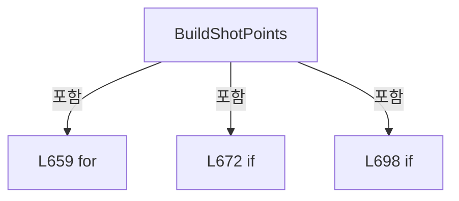

변경 전 점검: 입력/반환 타입, 위 호출자, 예외/취소 경로, 공유 상태와 저장·전송 소비자를 함께 확인합니다. 값의 단위나 물리 방향을 이름만으로 확정하지 않습니다.

### MethodDeclaration `GetMeasuredResultRows` · L733–745

[Drilling.Common/Review/CReviewManager.cs:733–745](https://github.com/kjuws10-rgb/A3Drilling/blob/5aee8e58439c9b455cae7c9593c9be986c3e682e/Drilling.Common/Review/CReviewManager.cs#L733-L745)

| 항목 | 실제 추출 값 |
| --- | --- |
| 서명 | System.Collections.Generic.IReadOnlyList<Drilling.Common.Review.ST_REVIEW_PLAN_POINT> Drilling.Common.Review.CReviewManager.GetMeasuredResultRows(System.Collections.Generic.IReadOnlyList<Drilling.Common.Review.ST_REVIEW_PLAN_POINT>) |
| 접근/수식자 | Private / private, static |
| 반환/값 타입 | System.Collections.Generic.IReadOnlyList<Drilling.Common.Review.ST_REVIEW_PLAN_POINT> |
| 소속 타입 | NamedType:Drilling.Common.Review.CReviewManager |

입력 계약:

| 이름 | 타입 | 전달 | 선택/기본값 |
| --- | --- | --- | --- |
| results | System.Collections.Generic.IReadOnlyList<Drilling.Common.Review.ST_REVIEW_PLAN_POINT> | None | False /  |

정적 호출자로 확인된 위치:

| 호출 파일/행 | 호출 표현식 | 런타임 분기 가능 |
| --- | --- | --- |
| [Drilling.Common/Review/CReviewManager.cs:1468–1468](https://github.com/kjuws10-rgb/A3Drilling/blob/5aee8e58439c9b455cae7c9593c9be986c3e682e/Drilling.Common/Review/CReviewManager.cs#L1468-L1468) | GetMeasuredResultRows | False |

호출하는 대상과 해석 범위:

| 원본 행 | 표현식 | 분석 상태 | 대상/소스 위치 |
| --- | --- | --- | --- |
| 735 | new List<ST_REVIEW_PLAN_POINT> | resolved | System.Collections.Generic.List<Drilling.Common.Review.ST_REVIEW_PLAN_POINT>.List() |
| 740 | measuredRows.Add | resolved | void System.Collections.Generic.List<Drilling.Common.Review.ST_REVIEW_PLAN_POINT>.Add(Drilling.Common.Review.ST_REVIEW_PLAN_POINT) |

본문의 실제 연산·분기·예외·반환 순서(원문 위치 순):

| 원본 행 | 종류 | 주석 해설 |
| --- | --- | --- |
| 735 | call | 함수·델리게이트 또는 객체 생성자를 호출합니다: new List<ST_REVIEW_PLAN_POINT>() |
| 735 | local-declaration | 지역 변수를 선언합니다: var measuredRows = new List<ST_REVIEW_PLAN_POINT>(); |
| 735 | variable-initializer | 변수의 초기값을 지정합니다: measuredRows = new List<ST_REVIEW_PLAN_POINT>() |
| 736 | foreach | 컬렉션 요소를 순회합니다: foreach (var point in results) |
| 738 | if | 조건에 따라 분기합니다: if (point.Use && point.State is EN_REVIEW_POINT_STATE.Ok or EN_REVIEW_POINT_STATE.Ng) |
| 740 | call | 함수·델리게이트 또는 객체 생성자를 호출합니다: measuredRows.Add(point) |
| 744 | return | 호출자에게 값 또는 제어를 반환합니다: return measuredRows; |

제어 구문의 포함 구조(실제 실행 순서/CFG가 아닌 구문 탐색 그림):

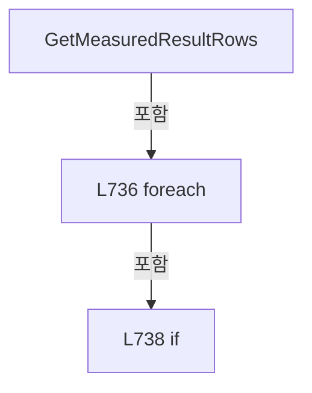

변경 전 점검: 입력/반환 타입, 위 호출자, 예외/취소 경로, 공유 상태와 저장·전송 소비자를 함께 확인합니다. 값의 단위나 물리 방향을 이름만으로 확정하지 않습니다.

### MethodDeclaration `ProjectCorrectionRows` · L747–768

[Drilling.Common/Review/CReviewManager.cs:747–768](https://github.com/kjuws10-rgb/A3Drilling/blob/5aee8e58439c9b455cae7c9593c9be986c3e682e/Drilling.Common/Review/CReviewManager.cs#L747-L768)

| 항목 | 실제 추출 값 |
| --- | --- |
| 서명 | System.Collections.Generic.IReadOnlyList<Drilling.Common.Review.ST_REVIEW_PLAN_POINT> Drilling.Common.Review.CReviewManager.ProjectCorrectionRows(Drilling.Common.Review.ST_REVIEW_PLAN, System.Collections.Generic.IReadOnlyList<Drilling.Common.Review.ST_REVIEW_PLAN_POINT>) |
| 접근/수식자 | Public / public, static |
| 반환/값 타입 | System.Collections.Generic.IReadOnlyList<Drilling.Common.Review.ST_REVIEW_PLAN_POINT> |
| 소속 타입 | NamedType:Drilling.Common.Review.CReviewManager |

입력 계약:

| 이름 | 타입 | 전달 | 선택/기본값 |
| --- | --- | --- | --- |
| plan | Drilling.Common.Review.ST_REVIEW_PLAN | None | False /  |
| measuredResults | System.Collections.Generic.IReadOnlyList<Drilling.Common.Review.ST_REVIEW_PLAN_POINT> | None | False /  |

정적 호출자로 확인된 위치:

| 호출 파일/행 | 호출 표현식 | 런타임 분기 가능 |
| --- | --- | --- |
| [Drilling.UI/Menu/Menus/CMenuCorrection.ReviewData.Offset.cs:428–428](https://github.com/kjuws10-rgb/A3Drilling/blob/5aee8e58439c9b455cae7c9593c9be986c3e682e/Drilling.UI/Menu/Menus/CMenuCorrection.ReviewData.Offset.cs#L428-L428) | CReviewManager.ProjectCorrectionRows | False |
| [Drilling.UI/Menu/Menus/CMenuCorrection.cs:1865–1865](https://github.com/kjuws10-rgb/A3Drilling/blob/5aee8e58439c9b455cae7c9593c9be986c3e682e/Drilling.UI/Menu/Menus/CMenuCorrection.cs#L1865-L1865) | CReviewManager.ProjectCorrectionRows | False |

호출하는 대상과 해석 범위:

| 원본 행 | 표현식 | 분석 상태 | 대상/소스 위치 |
| --- | --- | --- | --- |
| 754 | measuredResults.Where(point => point.Use && point.State is EN_REVIEW_POINT_STATE.Ok or EN_REVIEW_POINT_STATE.Ng).ToArray | resolved | Drilling.Common.Review.ST_REVIEW_PLAN_POINT[] System.Collections.Generic.IEnumerable<Drilling.Common.Review.ST_REVIEW_PLAN_POINT>.ToArray<Drilling.Common.Review.ST_REVIEW_PLAN_POINT>() |
| 754 | measuredResults.Where | resolved | System.Collections.Generic.IEnumerable<Drilling.Common.Review.ST_REVIEW_PLAN_POINT> System.Collections.Generic.IEnumerable<Drilling.Common.Review.ST_REVIEW_PLAN_POINT>.Where<Drilling.Common.Review.ST_REVIEW_PLAN_POINT>(System.Func<Drilling.Common.Review.ST_REVIEW_PLAN_POINT, bool>) |
| 762 | ProjectSimpleResultRows | resolved | System.Collections.Generic.IReadOnlyList<Drilling.Common.Review.ST_REVIEW_PLAN_POINT> Drilling.Common.Review.CReviewManager.ProjectSimpleResultRows(Drilling.Common.Review.ST_REVIEW_CORRECTION_PLAN, System.Collections.Generic.IReadOnlyList<Drilling.Common.Review.ST_REVIEW_PLAN_POINT>) · Drilling.Common/Review/CReviewManager.cs:770 |
| 763 | ProjectRoughResultRows | resolved | System.Collections.Generic.IReadOnlyList<Drilling.Common.Review.ST_REVIEW_PLAN_POINT> Drilling.Common.Review.CReviewManager.ProjectRoughResultRows(Drilling.Common.Review.ST_REVIEW_CORRECTION_PLAN, System.Collections.Generic.IReadOnlyList<Drilling.Common.Review.ST_REVIEW_PLAN_POINT>) · Drilling.Common/Review/CReviewManager.cs:781 |
| 764 | ProjectFineResultRows | resolved | System.Collections.Generic.IReadOnlyList<Drilling.Common.Review.ST_REVIEW_PLAN_POINT> Drilling.Common.Review.CReviewManager.ProjectFineResultRows(System.Collections.Generic.IReadOnlyList<Drilling.Common.Review.ST_REVIEW_PLAN_POINT>, System.Collections.Generic.IReadOnlyList<Drilling.Common.Review.ST_REVIEW_PLAN_POINT>) · Drilling.Common/Review/CReviewManager.cs:787 |

본문의 실제 연산·분기·예외·반환 순서(원문 위치 순):

| 원본 행 | 종류 | 주석 해설 |
| --- | --- | --- |
| 749 | if | 조건에 따라 분기합니다: if (plan.CorrectionPlan is not { SourcePoints.Count: > 0 } projection) |
| 751 | return | 호출자에게 값 또는 제어를 반환합니다: return measuredResults; |
| 754 | call | 함수·델리게이트 또는 객체 생성자를 호출합니다: measuredResults.Where(point => point.Use && point.State is EN_REVIEW_POINT_STATE.Ok or EN_REVIEW_POINT_STATE.Ng).ToArray() |
| 754 | call | 함수·델리게이트 또는 객체 생성자를 호출합니다: measuredResults.Where(point => point.Use && point.State is EN_REVIEW_POINT_STATE.Ok or EN_REVIEW_POINT_STATE.Ng) |
| 754 | local-declaration | 지역 변수를 선언합니다: var measuredPoints = measuredResults.Where(point => point.Use && point.State is EN_REVIEW_POINT_STATE.Ok or EN_REVIEW_POINT_STATE.Ng).ToArray(); |
| 754 | variable-initializer | 변수의 초기값을 지정합니다: measuredPoints = measuredResults.Where(point => point.Use && point.State is EN_REVIEW_POINT_STATE.Ok or EN_REVIEW_POINT_STATE.Ng).ToArray() |
| 755 | if | 조건에 따라 분기합니다: if (measuredPoints.Length == 0) |
| 757 | return | 호출자에게 값 또는 제어를 반환합니다: return measuredResults; |
| 760 | return | 호출자에게 값 또는 제어를 반환합니다: return projection.Rule switch { EN_REVIEW_CORRECTION_RULE.Simple => ProjectSimpleResultRows(projection, measuredPoints), EN_REVIEW_CORRECTION_RULE.Rough => ProjectRoughResultRows(projection, measuredPoints), EN_REVIEW_CORRECTION_R |
| 760 | switch-expression | 값별 결과식을 선택합니다: projection.Rule switch { EN_REVIEW_CORRECTION_RULE.Simple => ProjectSimpleResultRows(projection, measuredPoints), EN_REVIEW_CORRECTION_RULE.Rough => ProjectRoughResultRows(projection, measuredPoints), EN_REVIEW_CORRECTION_RULE.Fin |
| 762 | call | 함수·델리게이트 또는 객체 생성자를 호출합니다: ProjectSimpleResultRows(projection, measuredPoints) |
| 763 | call | 함수·델리게이트 또는 객체 생성자를 호출합니다: ProjectRoughResultRows(projection, measuredPoints) |
| 764 | call | 함수·델리게이트 또는 객체 생성자를 호출합니다: ProjectFineResultRows(projection.SourcePoints, measuredPoints) |

제어 구문의 포함 구조(실제 실행 순서/CFG가 아닌 구문 탐색 그림):

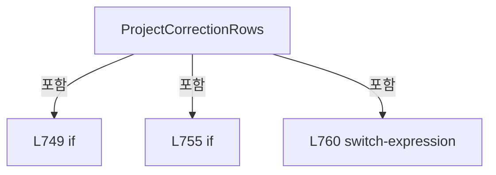

변경 전 점검: 입력/반환 타입, 위 호출자, 예외/취소 경로, 공유 상태와 저장·전송 소비자를 함께 확인합니다. 값의 단위나 물리 방향을 이름만으로 확정하지 않습니다.

### MethodDeclaration `ProjectSimpleResultRows` · L770–779

[Drilling.Common/Review/CReviewManager.cs:770–779](https://github.com/kjuws10-rgb/A3Drilling/blob/5aee8e58439c9b455cae7c9593c9be986c3e682e/Drilling.Common/Review/CReviewManager.cs#L770-L779)

| 항목 | 실제 추출 값 |
| --- | --- |
| 서명 | System.Collections.Generic.IReadOnlyList<Drilling.Common.Review.ST_REVIEW_PLAN_POINT> Drilling.Common.Review.CReviewManager.ProjectSimpleResultRows(Drilling.Common.Review.ST_REVIEW_CORRECTION_PLAN, System.Collections.Generic.IReadOnlyList<Drilling.Common.Review.ST_REVIEW_PLAN_POINT>) |
| 접근/수식자 | Private / private, static |
| 반환/값 타입 | System.Collections.Generic.IReadOnlyList<Drilling.Common.Review.ST_REVIEW_PLAN_POINT> |
| 소속 타입 | NamedType:Drilling.Common.Review.CReviewManager |

입력 계약:

| 이름 | 타입 | 전달 | 선택/기본값 |
| --- | --- | --- | --- |
| projection | Drilling.Common.Review.ST_REVIEW_CORRECTION_PLAN | None | False /  |
| measuredPoints | System.Collections.Generic.IReadOnlyList<Drilling.Common.Review.ST_REVIEW_PLAN_POINT> | None | False /  |

정적 호출자로 확인된 위치:

| 호출 파일/행 | 호출 표현식 | 런타임 분기 가능 |
| --- | --- | --- |
| [Drilling.Common/Review/CReviewManager.cs:762–762](https://github.com/kjuws10-rgb/A3Drilling/blob/5aee8e58439c9b455cae7c9593c9be986c3e682e/Drilling.Common/Review/CReviewManager.cs#L762-L762) | ProjectSimpleResultRows | False |

호출하는 대상과 해석 범위:

| 원본 행 | 표현식 | 분석 상태 | 대상/소스 위치 |
| --- | --- | --- | --- |
| 778 | projection.SourcePoints.Where(point => point.HeadNo == measuredPoint.HeadNo && (projection.Scope != EN_REVIEW_CORRECTION_SCOPE.HeadCell &#124;&#124; point.CellNo == measuredPoint.CellNo)).Where(point => point.HeadNo > 0).Select(point => CopyMeasurement(point, measuredPoint)).ToArray | resolved | Drilling.Common.Review.ST_REVIEW_PLAN_POINT[] System.Collections.Generic.IEnumerable<Drilling.Common.Review.ST_REVIEW_PLAN_POINT>.ToArray<Drilling.Common.Review.ST_REVIEW_PLAN_POINT>() |
| 778 | projection.SourcePoints.Where(point => point.HeadNo == measuredPoint.HeadNo && (projection.Scope != EN_REVIEW_CORRECTION_SCOPE.HeadCell &#124;&#124; point.CellNo == measuredPoint.CellNo)).Where(point => point.HeadNo > 0).Select | resolved | System.Collections.Generic.IEnumerable<Drilling.Common.Review.ST_REVIEW_PLAN_POINT> System.Collections.Generic.IEnumerable<Drilling.Common.Review.ST_REVIEW_PLAN_POINT>.Select<Drilling.Common.Review.ST_REVIEW_PLAN_POINT, Drilling.Common.Review.ST_REVIEW_PLAN_POINT>(System.Func<Drilling.Common.Review.ST_REVIEW_PLAN_POINT, Drilling.Common.Review.ST_REVIEW_PLAN_POINT>) |
| 778 | projection.SourcePoints.Where(point => point.HeadNo == measuredPoint.HeadNo && (projection.Scope != EN_REVIEW_CORRECTION_SCOPE.HeadCell &#124;&#124; point.CellNo == measuredPoint.CellNo)).Where | resolved | System.Collections.Generic.IEnumerable<Drilling.Common.Review.ST_REVIEW_PLAN_POINT> System.Collections.Generic.IEnumerable<Drilling.Common.Review.ST_REVIEW_PLAN_POINT>.Where<Drilling.Common.Review.ST_REVIEW_PLAN_POINT>(System.Func<Drilling.Common.Review.ST_REVIEW_PLAN_POINT, bool>) |
| 778 | projection.SourcePoints.Where | resolved | System.Collections.Generic.IEnumerable<Drilling.Common.Review.ST_REVIEW_PLAN_POINT> System.Collections.Generic.IEnumerable<Drilling.Common.Review.ST_REVIEW_PLAN_POINT>.Where<Drilling.Common.Review.ST_REVIEW_PLAN_POINT>(System.Func<Drilling.Common.Review.ST_REVIEW_PLAN_POINT, bool>) |
| 778 | CopyMeasurement | resolved | Drilling.Common.Review.ST_REVIEW_PLAN_POINT Drilling.Common.Review.CReviewManager.CopyMeasurement(Drilling.Common.Review.ST_REVIEW_PLAN_POINT, Drilling.Common.Review.ST_REVIEW_PLAN_POINT) · Drilling.Common/Review/CReviewManager.cs:852 |

본문의 실제 연산·분기·예외·반환 순서(원문 위치 순):

| 원본 행 | 종류 | 주석 해설 |
| --- | --- | --- |
| 772 | if | 조건에 따라 분기합니다: if (measuredPoints.Count != 1) |
| 774 | return | 호출자에게 값 또는 제어를 반환합니다: return measuredPoints; |
| 777 | local-declaration | 지역 변수를 선언합니다: var measuredPoint = measuredPoints[0]; |
| 777 | variable-initializer | 변수의 초기값을 지정합니다: measuredPoint = measuredPoints[0] |
| 778 | call | 함수·델리게이트 또는 객체 생성자를 호출합니다: projection.SourcePoints.Where(point => point.HeadNo == measuredPoint.HeadNo && (projection.Scope != EN_REVIEW_CORRECTION_SCOPE.HeadCell &#124;&#124; point.CellNo == measuredPoint.CellNo)).Where(point => point.HeadNo > 0).Select(po… |
| 778 | call | 함수·델리게이트 또는 객체 생성자를 호출합니다: projection.SourcePoints.Where(point => point.HeadNo == measuredPoint.HeadNo && (projection.Scope != EN_REVIEW_CORRECTION_SCOPE.HeadCell &#124;&#124; point.CellNo == measuredPoint.CellNo)).Where(point => point.HeadNo > 0).Select(po… |
| 778 | call | 함수·델리게이트 또는 객체 생성자를 호출합니다: projection.SourcePoints.Where(point => point.HeadNo == measuredPoint.HeadNo && (projection.Scope != EN_REVIEW_CORRECTION_SCOPE.HeadCell &#124;&#124; point.CellNo == measuredPoint.CellNo)).Where(point => point.HeadNo > 0) |
| 778 | call | 함수·델리게이트 또는 객체 생성자를 호출합니다: projection.SourcePoints.Where(point => point.HeadNo == measuredPoint.HeadNo && (projection.Scope != EN_REVIEW_CORRECTION_SCOPE.HeadCell &#124;&#124; point.CellNo == measuredPoint.CellNo)) |
| 778 | call | 함수·델리게이트 또는 객체 생성자를 호출합니다: CopyMeasurement(point, measuredPoint) |
| 778 | return | 호출자에게 값 또는 제어를 반환합니다: return projection.SourcePoints.Where(point => point.HeadNo == measuredPoint.HeadNo && (projection.Scope != EN_REVIEW_CORRECTION_SCOPE.HeadCell &#124;&#124; point.CellNo == measuredPoint.CellNo)).Where(point => point.HeadNo > 0).Select(point |

제어 구문의 포함 구조(실제 실행 순서/CFG가 아닌 구문 탐색 그림):

```mermaid
flowchart TD
 M["ProjectSimpleResultRows"]
 N0["L772 if"]
 M -->|포함| N0
```

변경 전 점검: 입력/반환 타입, 위 호출자, 예외/취소 경로, 공유 상태와 저장·전송 소비자를 함께 확인합니다. 값의 단위나 물리 방향을 이름만으로 확정하지 않습니다.

### MethodDeclaration `ProjectRoughResultRows` · L781–785

[Drilling.Common/Review/CReviewManager.cs:781–785](https://github.com/kjuws10-rgb/A3Drilling/blob/5aee8e58439c9b455cae7c9593c9be986c3e682e/Drilling.Common/Review/CReviewManager.cs#L781-L785)

| 항목 | 실제 추출 값 |
| --- | --- |
| 서명 | System.Collections.Generic.IReadOnlyList<Drilling.Common.Review.ST_REVIEW_PLAN_POINT> Drilling.Common.Review.CReviewManager.ProjectRoughResultRows(Drilling.Common.Review.ST_REVIEW_CORRECTION_PLAN, System.Collections.Generic.IReadOnlyList<Drilling.Common.Review.ST_REVIEW_PLAN_POINT>) |
| 접근/수식자 | Private / private, static |
| 반환/값 타입 | System.Collections.Generic.IReadOnlyList<Drilling.Common.Review.ST_REVIEW_PLAN_POINT> |
| 소속 타입 | NamedType:Drilling.Common.Review.CReviewManager |

입력 계약:

| 이름 | 타입 | 전달 | 선택/기본값 |
| --- | --- | --- | --- |
| projection | Drilling.Common.Review.ST_REVIEW_CORRECTION_PLAN | None | False /  |
| measuredPoints | System.Collections.Generic.IReadOnlyList<Drilling.Common.Review.ST_REVIEW_PLAN_POINT> | None | False /  |

정적 호출자로 확인된 위치:

| 호출 파일/행 | 호출 표현식 | 런타임 분기 가능 |
| --- | --- | --- |
| [Drilling.Common/Review/CReviewManager.cs:763–763](https://github.com/kjuws10-rgb/A3Drilling/blob/5aee8e58439c9b455cae7c9593c9be986c3e682e/Drilling.Common/Review/CReviewManager.cs#L763-L763) | ProjectRoughResultRows | False |

호출하는 대상과 해석 범위:

| 원본 행 | 표현식 | 분석 상태 | 대상/소스 위치 |
| --- | --- | --- | --- |
| 783 | measuredPoints.GroupBy(point => projection.Scope == EN_REVIEW_CORRECTION_SCOPE.HeadCell ? (point.HeadNo, point.CellNo) : (point.HeadNo, 0)).ToDictionary | resolved | System.Collections.Generic.Dictionary<(int HeadNo, int), Drilling.Common.Review.ST_REVIEW_PLAN_POINT> System.Collections.Generic.IEnumerable<System.Linq.IGrouping<(int HeadNo, int), Drilling.Common.Review.ST_REVIEW_PLAN_POINT>>.ToDictionary<System.Linq.IGrouping<(int HeadNo, int), Drilling.Common.Review.ST_REVIEW_PLAN_POINT>, (int HeadNo, int), Drilling.Common.Review.ST_REVIEW_PLAN_POINT>(System.Func<System.Linq.IGrouping<(int HeadNo, int), Drilling.Common.Review.ST_REVIEW_PLAN_POINT>, (int HeadNo, int)>, System.Func<System.Linq.IGrouping<(int HeadNo, int), Drilling.Common.Review.ST_REVIEW_PLAN_POINT>, Drilling.Common.Review.ST_REVIEW_PLAN_POINT>) |
| 783 | measuredPoints.GroupBy | resolved | System.Collections.Generic.IEnumerable<System.Linq.IGrouping<(int HeadNo, int), Drilling.Common.Review.ST_REVIEW_PLAN_POINT>> System.Collections.Generic.IEnumerable<Drilling.Common.Review.ST_REVIEW_PLAN_POINT>.GroupBy<Drilling.Common.Review.ST_REVIEW_PLAN_POINT, (int HeadNo, int)>(System.Func<Drilling.Common.Review.ST_REVIEW_PLAN_POINT, (int HeadNo, int)>) |
| 783 | group.First | resolved | Drilling.Common.Review.ST_REVIEW_PLAN_POINT System.Collections.Generic.IEnumerable<Drilling.Common.Review.ST_REVIEW_PLAN_POINT>.First<Drilling.Common.Review.ST_REVIEW_PLAN_POINT>() |
| 784 | projection.SourcePoints.Where(point => point.HeadNo > 0).Select(point => new { Point = point, Key = projection.Scope == EN_REVIEW_CORRECTION_SCOPE.HeadCell ? (point.HeadNo, point.CellNo) : (point.HeadNo, 0) }).Where(item => measurements.ContainsKey(item.Key)).Select(item => CopyMeasurement(item.Point, measurements[item.Key])).ToArray | resolved | Drilling.Common.Review.ST_REVIEW_PLAN_POINT[] System.Collections.Generic.IEnumerable<Drilling.Common.Review.ST_REVIEW_PLAN_POINT>.ToArray<Drilling.Common.Review.ST_REVIEW_PLAN_POINT>() |
| 784 | projection.SourcePoints.Where(point => point.HeadNo > 0).Select(point => new { Point = point, Key = projection.Scope == EN_REVIEW_CORRECTION_SCOPE.HeadCell ? (point.HeadNo, point.CellNo) : (point.HeadNo, 0) }).Where(item => measurements.ContainsKey(item.Key)).Select | resolved | System.Collections.Generic.IEnumerable<Drilling.Common.Review.ST_REVIEW_PLAN_POINT> System.Collections.Generic.IEnumerable<<anonymous type: Drilling.Common.Review.ST_REVIEW_PLAN_POINT Point, (int HeadNo, int) Key>>.Select<<anonymous type: Drilling.Common.Review.ST_REVIEW_PLAN_POINT Point, (int HeadNo, int) Key>, Drilling.Common.Review.ST_REVIEW_PLAN_POINT>(System.Func<<anonymous type: Drilling.Common.Review.ST_REVIEW_PLAN_POINT Point, (int HeadNo, int) Key>, Drilling.Common.Review.ST_REVIEW_PLAN_POINT>) |
| 784 | projection.SourcePoints.Where(point => point.HeadNo > 0).Select(point => new { Point = point, Key = projection.Scope == EN_REVIEW_CORRECTION_SCOPE.HeadCell ? (point.HeadNo, point.CellNo) : (point.HeadNo, 0) }).Where | resolved | System.Collections.Generic.IEnumerable<<anonymous type: Drilling.Common.Review.ST_REVIEW_PLAN_POINT Point, (int HeadNo, int) Key>> System.Collections.Generic.IEnumerable<<anonymous type: Drilling.Common.Review.ST_REVIEW_PLAN_POINT Point, (int HeadNo, int) Key>>.Where<<anonymous type: Drilling.Common.Review.ST_REVIEW_PLAN_POINT Point, (int HeadNo, int) Key>>(System.Func<<anonymous type: Drilling.Common.Review.ST_REVIEW_PLAN_POINT Point, (int HeadNo, int) Key>, bool>) |
| 784 | projection.SourcePoints.Where(point => point.HeadNo > 0).Select | resolved | System.Collections.Generic.IEnumerable<<anonymous type: Drilling.Common.Review.ST_REVIEW_PLAN_POINT Point, (int HeadNo, int) Key>> System.Collections.Generic.IEnumerable<Drilling.Common.Review.ST_REVIEW_PLAN_POINT>.Select<Drilling.Common.Review.ST_REVIEW_PLAN_POINT, <anonymous type: Drilling.Common.Review.ST_REVIEW_PLAN_POINT Point, (int HeadNo, int) Key>>(System.Func<Drilling.Common.Review.ST_REVIEW_PLAN_POINT, <anonymous type: Drilling.Common.Review.ST_REVIEW_PLAN_POINT Point, (int HeadNo, int) Key>>) |
| 784 | projection.SourcePoints.Where | resolved | System.Collections.Generic.IEnumerable<Drilling.Common.Review.ST_REVIEW_PLAN_POINT> System.Collections.Generic.IEnumerable<Drilling.Common.Review.ST_REVIEW_PLAN_POINT>.Where<Drilling.Common.Review.ST_REVIEW_PLAN_POINT>(System.Func<Drilling.Common.Review.ST_REVIEW_PLAN_POINT, bool>) |
| 784 | measurements.ContainsKey | resolved | bool System.Collections.Generic.Dictionary<(int HeadNo, int), Drilling.Common.Review.ST_REVIEW_PLAN_POINT>.ContainsKey((int HeadNo, int)) |
| 784 | CopyMeasurement | resolved | Drilling.Common.Review.ST_REVIEW_PLAN_POINT Drilling.Common.Review.CReviewManager.CopyMeasurement(Drilling.Common.Review.ST_REVIEW_PLAN_POINT, Drilling.Common.Review.ST_REVIEW_PLAN_POINT) · Drilling.Common/Review/CReviewManager.cs:852 |

본문의 실제 연산·분기·예외·반환 순서(원문 위치 순):

| 원본 행 | 종류 | 주석 해설 |
| --- | --- | --- |
| 783 | call | 함수·델리게이트 또는 객체 생성자를 호출합니다: measuredPoints.GroupBy(point => projection.Scope == EN_REVIEW_CORRECTION_SCOPE.HeadCell ? (point.HeadNo, point.CellNo) : (point.HeadNo, 0)).ToDictionary(group => group.Key, group => group.First()) |
| 783 | call | 함수·델리게이트 또는 객체 생성자를 호출합니다: measuredPoints.GroupBy(point => projection.Scope == EN_REVIEW_CORRECTION_SCOPE.HeadCell ? (point.HeadNo, point.CellNo) : (point.HeadNo, 0)) |
| 783 | call | 함수·델리게이트 또는 객체 생성자를 호출합니다: group.First() |
| 783 | conditional-expression | 조건에 따라 결과식을 선택합니다: projection.Scope == EN_REVIEW_CORRECTION_SCOPE.HeadCell ? (point.HeadNo, point.CellNo) : (point.HeadNo, 0) |
| 783 | local-declaration | 지역 변수를 선언합니다: var measurements = measuredPoints.GroupBy(point => projection.Scope == EN_REVIEW_CORRECTION_SCOPE.HeadCell ? (point.HeadNo, point.CellNo) : (point.HeadNo, 0)).ToDictionary(group => group.Key, group => group.First()); |
| 783 | variable-initializer | 변수의 초기값을 지정합니다: measurements = measuredPoints.GroupBy(point => projection.Scope == EN_REVIEW_CORRECTION_SCOPE.HeadCell ? (point.HeadNo, point.CellNo) : (point.HeadNo, 0)).ToDictionary(group => group.Key, group => group.First()) |
| 784 | call | 함수·델리게이트 또는 객체 생성자를 호출합니다: projection.SourcePoints.Where(point => point.HeadNo > 0).Select(point => new { Point = point, Key = projection.Scope == EN_REVIEW_CORRECTION_SCOPE.HeadCell ? (point.HeadNo, point.CellNo) : (point.HeadNo, 0) }).Where(item… |
| 784 | call | 함수·델리게이트 또는 객체 생성자를 호출합니다: projection.SourcePoints.Where(point => point.HeadNo > 0).Select(point => new { Point = point, Key = projection.Scope == EN_REVIEW_CORRECTION_SCOPE.HeadCell ? (point.HeadNo, point.CellNo) : (point.HeadNo, 0) }).Where(item… |
| 784 | call | 함수·델리게이트 또는 객체 생성자를 호출합니다: projection.SourcePoints.Where(point => point.HeadNo > 0).Select(point => new { Point = point, Key = projection.Scope == EN_REVIEW_CORRECTION_SCOPE.HeadCell ? (point.HeadNo, point.CellNo) : (point.HeadNo, 0) }).Where(item… |
| 784 | call | 함수·델리게이트 또는 객체 생성자를 호출합니다: projection.SourcePoints.Where(point => point.HeadNo > 0).Select(point => new { Point = point, Key = projection.Scope == EN_REVIEW_CORRECTION_SCOPE.HeadCell ? (point.HeadNo, point.CellNo) : (point.HeadNo, 0) }) |
| 784 | call | 함수·델리게이트 또는 객체 생성자를 호출합니다: projection.SourcePoints.Where(point => point.HeadNo > 0) |
| 784 | call | 함수·델리게이트 또는 객체 생성자를 호출합니다: measurements.ContainsKey(item.Key) |
| 784 | call | 함수·델리게이트 또는 객체 생성자를 호출합니다: CopyMeasurement(item.Point, measurements[item.Key]) |
| 784 | conditional-expression | 조건에 따라 결과식을 선택합니다: projection.Scope == EN_REVIEW_CORRECTION_SCOPE.HeadCell ? (point.HeadNo, point.CellNo) : (point.HeadNo, 0) |
| 784 | return | 호출자에게 값 또는 제어를 반환합니다: return projection.SourcePoints.Where(point => point.HeadNo > 0).Select(point => new { Point = point, Key = projection.Scope == EN_REVIEW_CORRECTION_SCOPE.HeadCell ? (point.HeadNo, point.CellNo) : (point.HeadNo, 0) }).Where(item => |

변경 전 점검: 입력/반환 타입, 위 호출자, 예외/취소 경로, 공유 상태와 저장·전송 소비자를 함께 확인합니다. 값의 단위나 물리 방향을 이름만으로 확정하지 않습니다.

### MethodDeclaration `ProjectFineResultRows` · L787–802

[Drilling.Common/Review/CReviewManager.cs:787–802](https://github.com/kjuws10-rgb/A3Drilling/blob/5aee8e58439c9b455cae7c9593c9be986c3e682e/Drilling.Common/Review/CReviewManager.cs#L787-L802)

| 항목 | 실제 추출 값 |
| --- | --- |
| 서명 | System.Collections.Generic.IReadOnlyList<Drilling.Common.Review.ST_REVIEW_PLAN_POINT> Drilling.Common.Review.CReviewManager.ProjectFineResultRows(System.Collections.Generic.IReadOnlyList<Drilling.Common.Review.ST_REVIEW_PLAN_POINT>, System.Collections.Generic.IReadOnlyList<Drilling.Common.Review.ST_REVIEW_PLAN_POINT>) |
| 접근/수식자 | Private / private, static |
| 반환/값 타입 | System.Collections.Generic.IReadOnlyList<Drilling.Common.Review.ST_REVIEW_PLAN_POINT> |
| 소속 타입 | NamedType:Drilling.Common.Review.CReviewManager |

입력 계약:

| 이름 | 타입 | 전달 | 선택/기본값 |
| --- | --- | --- | --- |
| sourcePoints | System.Collections.Generic.IReadOnlyList<Drilling.Common.Review.ST_REVIEW_PLAN_POINT> | None | False /  |
| measuredPoints | System.Collections.Generic.IReadOnlyList<Drilling.Common.Review.ST_REVIEW_PLAN_POINT> | None | False /  |

정적 호출자로 확인된 위치:

| 호출 파일/행 | 호출 표현식 | 런타임 분기 가능 |
| --- | --- | --- |
| [Drilling.Common/Review/CReviewManager.cs:764–764](https://github.com/kjuws10-rgb/A3Drilling/blob/5aee8e58439c9b455cae7c9593c9be986c3e682e/Drilling.Common/Review/CReviewManager.cs#L764-L764) | ProjectFineResultRows | False |

호출하는 대상과 해석 범위:

| 원본 행 | 표현식 | 분석 상태 | 대상/소스 위치 |
| --- | --- | --- | --- |
| 789 | measuredPoints.Where(point => point.HeadNo > 0 && double.IsFinite(point.DesignX) && double.IsFinite(point.DesignY)).GroupBy(point => (point.HeadNo, X: FineCoordinateKey(point.DesignX))).ToDictionary | resolved | System.Collections.Generic.Dictionary<(int HeadNo, double X), Drilling.Common.Review.ST_REVIEW_PLAN_POINT[]> System.Collections.Generic.IEnumerable<System.Linq.IGrouping<(int HeadNo, double X), Drilling.Common.Review.ST_REVIEW_PLAN_POINT>>.ToDictionary<System.Linq.IGrouping<(int HeadNo, double X), Drilling.Common.Review.ST_REVIEW_PLAN_POINT>, (int HeadNo, double X), Drilling.Common.Review.ST_REVIEW_PLAN_POINT[]>(System.Func<System.Linq.IGrouping<(int HeadNo, double X), Drilling.Common.Review.ST_REVIEW_PLAN_POINT>, (int HeadNo, double X)>, System.Func<System.Linq.IGrouping<(int HeadNo, double X), Drilling.Common.Review.ST_REVIEW_PLAN_POINT>, Drilling.Common.Review.ST_REVIEW_PLAN_POINT[]>) |
| 789 | measuredPoints.Where(point => point.HeadNo > 0 && double.IsFinite(point.DesignX) && double.IsFinite(point.DesignY)).GroupBy | resolved | System.Collections.Generic.IEnumerable<System.Linq.IGrouping<(int HeadNo, double X), Drilling.Common.Review.ST_REVIEW_PLAN_POINT>> System.Collections.Generic.IEnumerable<Drilling.Common.Review.ST_REVIEW_PLAN_POINT>.GroupBy<Drilling.Common.Review.ST_REVIEW_PLAN_POINT, (int HeadNo, double X)>(System.Func<Drilling.Common.Review.ST_REVIEW_PLAN_POINT, (int HeadNo, double X)>) |
| 789 | measuredPoints.Where | resolved | System.Collections.Generic.IEnumerable<Drilling.Common.Review.ST_REVIEW_PLAN_POINT> System.Collections.Generic.IEnumerable<Drilling.Common.Review.ST_REVIEW_PLAN_POINT>.Where<Drilling.Common.Review.ST_REVIEW_PLAN_POINT>(System.Func<Drilling.Common.Review.ST_REVIEW_PLAN_POINT, bool>) |
| 789 | double.IsFinite | resolved | bool double.IsFinite(double) |
| 789 | double.IsFinite | resolved | bool double.IsFinite(double) |
| 789 | FineCoordinateKey | resolved | double Drilling.Common.Review.CReviewManager.FineCoordinateKey(double) · Drilling.Common/Review/CReviewManager.cs:860 |
| 789 | group.GroupBy(point => FineCoordinateKey(point.DesignY)).Select(yGroup => yGroup.First()).OrderBy(point => point.DesignY).ToArray | resolved | Drilling.Common.Review.ST_REVIEW_PLAN_POINT[] System.Collections.Generic.IEnumerable<Drilling.Common.Review.ST_REVIEW_PLAN_POINT>.ToArray<Drilling.Common.Review.ST_REVIEW_PLAN_POINT>() |
| 789 | group.GroupBy(point => FineCoordinateKey(point.DesignY)).Select(yGroup => yGroup.First()).OrderBy | resolved | System.Linq.IOrderedEnumerable<Drilling.Common.Review.ST_REVIEW_PLAN_POINT> System.Collections.Generic.IEnumerable<Drilling.Common.Review.ST_REVIEW_PLAN_POINT>.OrderBy<Drilling.Common.Review.ST_REVIEW_PLAN_POINT, double>(System.Func<Drilling.Common.Review.ST_REVIEW_PLAN_POINT, double>) |
| 789 | group.GroupBy(point => FineCoordinateKey(point.DesignY)).Select | resolved | System.Collections.Generic.IEnumerable<Drilling.Common.Review.ST_REVIEW_PLAN_POINT> System.Collections.Generic.IEnumerable<System.Linq.IGrouping<double, Drilling.Common.Review.ST_REVIEW_PLAN_POINT>>.Select<System.Linq.IGrouping<double, Drilling.Common.Review.ST_REVIEW_PLAN_POINT>, Drilling.Common.Review.ST_REVIEW_PLAN_POINT>(System.Func<System.Linq.IGrouping<double, Drilling.Common.Review.ST_REVIEW_PLAN_POINT>, Drilling.Common.Review.ST_REVIEW_PLAN_POINT>) |
| 789 | group.GroupBy | resolved | System.Collections.Generic.IEnumerable<System.Linq.IGrouping<double, Drilling.Common.Review.ST_REVIEW_PLAN_POINT>> System.Collections.Generic.IEnumerable<Drilling.Common.Review.ST_REVIEW_PLAN_POINT>.GroupBy<Drilling.Common.Review.ST_REVIEW_PLAN_POINT, double>(System.Func<Drilling.Common.Review.ST_REVIEW_PLAN_POINT, double>) |
| 789 | FineCoordinateKey | resolved | double Drilling.Common.Review.CReviewManager.FineCoordinateKey(double) · Drilling.Common/Review/CReviewManager.cs:860 |
| 789 | yGroup.First | resolved | Drilling.Common.Review.ST_REVIEW_PLAN_POINT System.Collections.Generic.IEnumerable<Drilling.Common.Review.ST_REVIEW_PLAN_POINT>.First<Drilling.Common.Review.ST_REVIEW_PLAN_POINT>() |
| 790 | new List<ST_REVIEW_PLAN_POINT> | resolved | System.Collections.Generic.List<Drilling.Common.Review.ST_REVIEW_PLAN_POINT>.List(int) |
| 791 | sourcePoints.Where | resolved | System.Collections.Generic.IEnumerable<Drilling.Common.Review.ST_REVIEW_PLAN_POINT> System.Collections.Generic.IEnumerable<Drilling.Common.Review.ST_REVIEW_PLAN_POINT>.Where<Drilling.Common.Review.ST_REVIEW_PLAN_POINT>(System.Func<Drilling.Common.Review.ST_REVIEW_PLAN_POINT, bool>) |
| 791 | double.IsFinite | resolved | bool double.IsFinite(double) |
| 791 | double.IsFinite | resolved | bool double.IsFinite(double) |
| 793 | anchorsByHeadAndX.TryGetValue | resolved | bool System.Collections.Generic.Dictionary<(int HeadNo, double X), Drilling.Common.Review.ST_REVIEW_PLAN_POINT[]>.TryGetValue((int HeadNo, double X), out Drilling.Common.Review.ST_REVIEW_PLAN_POINT[]) |
| 793 | FineCoordinateKey | resolved | double Drilling.Common.Review.CReviewManager.FineCoordinateKey(double) · Drilling.Common/Review/CReviewManager.cs:860 |
| 798 | rows.Add | resolved | void System.Collections.Generic.List<Drilling.Common.Review.ST_REVIEW_PLAN_POINT>.Add(Drilling.Common.Review.ST_REVIEW_PLAN_POINT) |
| 798 | InterpolateFineMeasurementAcrossGlass | resolved | Drilling.Common.Review.ST_REVIEW_PLAN_POINT Drilling.Common.Review.CReviewManager.InterpolateFineMeasurementAcrossGlass(Drilling.Common.Review.ST_REVIEW_PLAN_POINT, System.Collections.Generic.IReadOnlyList<Drilling.Common.Review.ST_REVIEW_PLAN_POINT>) · Drilling.Common/Review/CReviewManager.cs:804 |

본문의 실제 연산·분기·예외·반환 순서(원문 위치 순):

| 원본 행 | 종류 | 주석 해설 |
| --- | --- | --- |
| 789 | call | 함수·델리게이트 또는 객체 생성자를 호출합니다: measuredPoints.Where(point => point.HeadNo > 0 && double.IsFinite(point.DesignX) && double.IsFinite(point.DesignY)).GroupBy(point => (point.HeadNo, X: FineCoordinateKey(point.DesignX))).ToDictionary(group => group.Key, g… |
| 789 | call | 함수·델리게이트 또는 객체 생성자를 호출합니다: measuredPoints.Where(point => point.HeadNo > 0 && double.IsFinite(point.DesignX) && double.IsFinite(point.DesignY)).GroupBy(point => (point.HeadNo, X: FineCoordinateKey(point.DesignX))) |
| 789 | call | 함수·델리게이트 또는 객체 생성자를 호출합니다: measuredPoints.Where(point => point.HeadNo > 0 && double.IsFinite(point.DesignX) && double.IsFinite(point.DesignY)) |
| 789 | call | 함수·델리게이트 또는 객체 생성자를 호출합니다: double.IsFinite(point.DesignX) |
| 789 | call | 함수·델리게이트 또는 객체 생성자를 호출합니다: double.IsFinite(point.DesignY) |
| 789 | call | 함수·델리게이트 또는 객체 생성자를 호출합니다: FineCoordinateKey(point.DesignX) |
| 789 | call | 함수·델리게이트 또는 객체 생성자를 호출합니다: group.GroupBy(point => FineCoordinateKey(point.DesignY)).Select(yGroup => yGroup.First()).OrderBy(point => point.DesignY).ToArray() |
| 789 | call | 함수·델리게이트 또는 객체 생성자를 호출합니다: group.GroupBy(point => FineCoordinateKey(point.DesignY)).Select(yGroup => yGroup.First()).OrderBy(point => point.DesignY) |
| 789 | call | 함수·델리게이트 또는 객체 생성자를 호출합니다: group.GroupBy(point => FineCoordinateKey(point.DesignY)).Select(yGroup => yGroup.First()) |
| 789 | call | 함수·델리게이트 또는 객체 생성자를 호출합니다: group.GroupBy(point => FineCoordinateKey(point.DesignY)) |
| 789 | call | 함수·델리게이트 또는 객체 생성자를 호출합니다: FineCoordinateKey(point.DesignY) |
| 789 | call | 함수·델리게이트 또는 객체 생성자를 호출합니다: yGroup.First() |
| 789 | local-declaration | 지역 변수를 선언합니다: var anchorsByHeadAndX = measuredPoints.Where(point => point.HeadNo > 0 && double.IsFinite(point.DesignX) && double.IsFinite(point.DesignY)).GroupBy(point => (point.HeadNo, X: FineCoordinateKey(point.DesignX))).ToDictionary(group = |
| 789 | variable-initializer | 변수의 초기값을 지정합니다: anchorsByHeadAndX = measuredPoints.Where(point => point.HeadNo > 0 && double.IsFinite(point.DesignX) && double.IsFinite(point.DesignY)).GroupBy(point => (point.HeadNo, X: FineCoordinateKey(point.DesignX))).ToDictionary(group => gr |
| 790 | call | 함수·델리게이트 또는 객체 생성자를 호출합니다: new List<ST_REVIEW_PLAN_POINT>(sourcePoints.Count) |
| 790 | local-declaration | 지역 변수를 선언합니다: var rows = new List<ST_REVIEW_PLAN_POINT>(sourcePoints.Count); |
| 790 | variable-initializer | 변수의 초기값을 지정합니다: rows = new List<ST_REVIEW_PLAN_POINT>(sourcePoints.Count) |
| 791 | call | 함수·델리게이트 또는 객체 생성자를 호출합니다: sourcePoints.Where(point => point.HeadNo > 0 && double.IsFinite(point.DesignX) && double.IsFinite(point.DesignY)) |
| 791 | call | 함수·델리게이트 또는 객체 생성자를 호출합니다: double.IsFinite(point.DesignX) |
| 791 | call | 함수·델리게이트 또는 객체 생성자를 호출합니다: double.IsFinite(point.DesignY) |
| 791 | foreach | 컬렉션 요소를 순회합니다: foreach (var point in sourcePoints.Where(point => point.HeadNo > 0 && double.IsFinite(point.DesignX) && double.IsFinite(point.DesignY))) |
| 793 | call | 함수·델리게이트 또는 객체 생성자를 호출합니다: anchorsByHeadAndX.TryGetValue((point.HeadNo, FineCoordinateKey(point.DesignX)), out var anchors) |
| 793 | call | 함수·델리게이트 또는 객체 생성자를 호출합니다: FineCoordinateKey(point.DesignX) |
| 793 | if | 조건에 따라 분기합니다: if (!anchorsByHeadAndX.TryGetValue((point.HeadNo, FineCoordinateKey(point.DesignX)), out var anchors) &#124;&#124; anchors.Length == 0) |
| 795 | continue | 다음 반복으로 진행합니다: continue; |
| 798 | call | 함수·델리게이트 또는 객체 생성자를 호출합니다: rows.Add(InterpolateFineMeasurementAcrossGlass(point, anchors)) |
| 798 | call | 함수·델리게이트 또는 객체 생성자를 호출합니다: InterpolateFineMeasurementAcrossGlass(point, anchors) |
| 801 | return | 호출자에게 값 또는 제어를 반환합니다: return rows; |

제어 구문의 포함 구조(실제 실행 순서/CFG가 아닌 구문 탐색 그림):

```mermaid
flowchart TD
 M["ProjectFineResultRows"]
 N0["L791 foreach"]
 M -->|포함| N0
 N1["L793 if"]
 N0 -->|포함| N1
```

변경 전 점검: 입력/반환 타입, 위 호출자, 예외/취소 경로, 공유 상태와 저장·전송 소비자를 함께 확인합니다. 값의 단위나 물리 방향을 이름만으로 확정하지 않습니다.

### MethodDeclaration `InterpolateFineMeasurementAcrossGlass` · L804–813

[Drilling.Common/Review/CReviewManager.cs:804–813](https://github.com/kjuws10-rgb/A3Drilling/blob/5aee8e58439c9b455cae7c9593c9be986c3e682e/Drilling.Common/Review/CReviewManager.cs#L804-L813)

| 항목 | 실제 추출 값 |
| --- | --- |
| 서명 | Drilling.Common.Review.ST_REVIEW_PLAN_POINT Drilling.Common.Review.CReviewManager.InterpolateFineMeasurementAcrossGlass(Drilling.Common.Review.ST_REVIEW_PLAN_POINT, System.Collections.Generic.IReadOnlyList<Drilling.Common.Review.ST_REVIEW_PLAN_POINT>) |
| 접근/수식자 | Private / private, static |
| 반환/값 타입 | Drilling.Common.Review.ST_REVIEW_PLAN_POINT |
| 소속 타입 | NamedType:Drilling.Common.Review.CReviewManager |

입력 계약:

| 이름 | 타입 | 전달 | 선택/기본값 |
| --- | --- | --- | --- |
| point | Drilling.Common.Review.ST_REVIEW_PLAN_POINT | None | False /  |
| anchors | System.Collections.Generic.IReadOnlyList<Drilling.Common.Review.ST_REVIEW_PLAN_POINT> | None | False /  |

정적 호출자로 확인된 위치:

| 호출 파일/행 | 호출 표현식 | 런타임 분기 가능 |
| --- | --- | --- |
| [Drilling.Common/Review/CReviewManager.cs:798–798](https://github.com/kjuws10-rgb/A3Drilling/blob/5aee8e58439c9b455cae7c9593c9be986c3e682e/Drilling.Common/Review/CReviewManager.cs#L798-L798) | InterpolateFineMeasurementAcrossGlass | False |

호출하는 대상과 해석 범위:

| 원본 행 | 표현식 | 분석 상태 | 대상/소스 위치 |
| --- | --- | --- | --- |
| 806 | InterpolateFineMeasurement | resolved | Drilling.Common.Review.ST_REVIEW_PLAN_POINT Drilling.Common.Review.CReviewManager.InterpolateFineMeasurement(Drilling.Common.Review.ST_REVIEW_PLAN_POINT, System.Collections.Generic.IReadOnlyList<Drilling.Common.Review.ST_REVIEW_PLAN_POINT>) · Drilling.Common/Review/CReviewManager.cs:815 |
| 807 | anchors.Any | resolved | bool System.Collections.Generic.IEnumerable<Drilling.Common.Review.ST_REVIEW_PLAN_POINT>.Any<Drilling.Common.Review.ST_REVIEW_PLAN_POINT>(System.Func<Drilling.Common.Review.ST_REVIEW_PLAN_POINT, bool>) |
| 807 | anchor.Judge.Equals | resolved | bool string.Equals(string?, System.StringComparison) |

본문의 실제 연산·분기·예외·반환 순서(원문 위치 순):

| 원본 행 | 종류 | 주석 해설 |
| --- | --- | --- |
| 806 | call | 함수·델리게이트 또는 객체 생성자를 호출합니다: InterpolateFineMeasurement(point, anchors) |
| 806 | local-declaration | 지역 변수를 선언합니다: var projected = InterpolateFineMeasurement(point, anchors); |
| 806 | variable-initializer | 변수의 초기값을 지정합니다: projected = InterpolateFineMeasurement(point, anchors) |
| 807 | call | 함수·델리게이트 또는 객체 생성자를 호출합니다: anchors.Any(anchor => anchor.Judge.Equals("NG", StringComparison.OrdinalIgnoreCase)) |
| 807 | call | 함수·델리게이트 또는 객체 생성자를 호출합니다: anchor.Judge.Equals("NG", StringComparison.OrdinalIgnoreCase) |
| 807 | conditional-expression | 조건에 따라 결과식을 선택합니다: anchors.Any(anchor => anchor.Judge.Equals("NG", StringComparison.OrdinalIgnoreCase)) ? "NG" : "OK" |
| 807 | local-declaration | 지역 변수를 선언합니다: var judge = anchors.Any(anchor => anchor.Judge.Equals("NG", StringComparison.OrdinalIgnoreCase)) ? "NG" : "OK"; |
| 807 | variable-initializer | 변수의 초기값을 지정합니다: judge = anchors.Any(anchor => anchor.Judge.Equals("NG", StringComparison.OrdinalIgnoreCase)) ? "NG" : "OK" |
| 808 | return | 호출자에게 값 또는 제어를 반환합니다: return projected with { State = judge == "NG" ? EN_REVIEW_POINT_STATE.Ng : EN_REVIEW_POINT_STATE.Ok, Judge = judge }; |
| 810 | assignment | 값을 대상에 대입합니다: State = judge == "NG" ? EN_REVIEW_POINT_STATE.Ng : EN_REVIEW_POINT_STATE.Ok |
| 810 | conditional-expression | 조건에 따라 결과식을 선택합니다: judge == "NG" ? EN_REVIEW_POINT_STATE.Ng : EN_REVIEW_POINT_STATE.Ok |
| 811 | assignment | 값을 대상에 대입합니다: Judge = judge |

변경 전 점검: 입력/반환 타입, 위 호출자, 예외/취소 경로, 공유 상태와 저장·전송 소비자를 함께 확인합니다. 값의 단위나 물리 방향을 이름만으로 확정하지 않습니다.

### MethodDeclaration `InterpolateFineMeasurement` · L815–850

[Drilling.Common/Review/CReviewManager.cs:815–850](https://github.com/kjuws10-rgb/A3Drilling/blob/5aee8e58439c9b455cae7c9593c9be986c3e682e/Drilling.Common/Review/CReviewManager.cs#L815-L850)

| 항목 | 실제 추출 값 |
| --- | --- |
| 서명 | Drilling.Common.Review.ST_REVIEW_PLAN_POINT Drilling.Common.Review.CReviewManager.InterpolateFineMeasurement(Drilling.Common.Review.ST_REVIEW_PLAN_POINT, System.Collections.Generic.IReadOnlyList<Drilling.Common.Review.ST_REVIEW_PLAN_POINT>) |
| 접근/수식자 | Private / private, static |
| 반환/값 타입 | Drilling.Common.Review.ST_REVIEW_PLAN_POINT |
| 소속 타입 | NamedType:Drilling.Common.Review.CReviewManager |

입력 계약:

| 이름 | 타입 | 전달 | 선택/기본값 |
| --- | --- | --- | --- |
| point | Drilling.Common.Review.ST_REVIEW_PLAN_POINT | None | False /  |
| anchors | System.Collections.Generic.IReadOnlyList<Drilling.Common.Review.ST_REVIEW_PLAN_POINT> | None | False /  |

정적 호출자로 확인된 위치:

| 호출 파일/행 | 호출 표현식 | 런타임 분기 가능 |
| --- | --- | --- |
| [Drilling.Common/Review/CReviewManager.cs:806–806](https://github.com/kjuws10-rgb/A3Drilling/blob/5aee8e58439c9b455cae7c9593c9be986c3e682e/Drilling.Common/Review/CReviewManager.cs#L806-L806) | InterpolateFineMeasurement | False |

호출하는 대상과 해석 범위:

| 원본 행 | 표현식 | 분석 상태 | 대상/소스 위치 |
| --- | --- | --- | --- |
| 819 | CopyMeasurement | resolved | Drilling.Common.Review.ST_REVIEW_PLAN_POINT Drilling.Common.Review.CReviewManager.CopyMeasurement(Drilling.Common.Review.ST_REVIEW_PLAN_POINT, Drilling.Common.Review.ST_REVIEW_PLAN_POINT) · Drilling.Common/Review/CReviewManager.cs:852 |
| 824 | CopyMeasurement | resolved | Drilling.Common.Review.ST_REVIEW_PLAN_POINT Drilling.Common.Review.CReviewManager.CopyMeasurement(Drilling.Common.Review.ST_REVIEW_PLAN_POINT, Drilling.Common.Review.ST_REVIEW_PLAN_POINT) · Drilling.Common/Review/CReviewManager.cs:852 |
| 837 | Math.Abs | resolved | double System.Math.Abs(double) |
| 837 | Math.Clamp | resolved | double System.Math.Clamp(double, double, double) |
| 838 | lower.Judge.Equals | resolved | bool string.Equals(string?, System.StringComparison) |
| 838 | upper.Judge.Equals | resolved | bool string.Equals(string?, System.StringComparison) |
| 849 | CopyMeasurement | resolved | Drilling.Common.Review.ST_REVIEW_PLAN_POINT Drilling.Common.Review.CReviewManager.CopyMeasurement(Drilling.Common.Review.ST_REVIEW_PLAN_POINT, Drilling.Common.Review.ST_REVIEW_PLAN_POINT) · Drilling.Common/Review/CReviewManager.cs:852 |

본문의 실제 연산·분기·예외·반환 순서(원문 위치 순):

| 원본 행 | 종류 | 주석 해설 |
| --- | --- | --- |
| 817 | if | 조건에 따라 분기합니다: if (anchors.Count == 1 &#124;&#124; point.DesignY <= anchors[0].DesignY) |
| 819 | call | 함수·델리게이트 또는 객체 생성자를 호출합니다: CopyMeasurement(point, anchors[0]) |
| 819 | return | 호출자에게 값 또는 제어를 반환합니다: return CopyMeasurement(point, anchors[0]); |
| 822 | if | 조건에 따라 분기합니다: if (point.DesignY >= anchors[^1].DesignY) |
| 824 | call | 함수·델리게이트 또는 객체 생성자를 호출합니다: CopyMeasurement(point, anchors[^1]) |
| 824 | return | 호출자에게 값 또는 제어를 반환합니다: return CopyMeasurement(point, anchors[^1]); |
| 827 | variable-initializer | 변수의 초기값을 지정합니다: index = 1 |
| 827 | for | 초기화·조건·증감이 있는 반복입니다: for (var index = 1; index < anchors.Count; index++) |
| 829 | local-declaration | 지역 변수를 선언합니다: var upper = anchors[index]; |
| 829 | variable-initializer | 변수의 초기값을 지정합니다: upper = anchors[index] |
| 830 | if | 조건에 따라 분기합니다: if (point.DesignY > upper.DesignY) |
| 832 | continue | 다음 반복으로 진행합니다: continue; |
| 835 | local-declaration | 지역 변수를 선언합니다: var lower = anchors[index - 1]; |
| 835 | variable-initializer | 변수의 초기값을 지정합니다: lower = anchors[index - 1] |
| 836 | local-declaration | 지역 변수를 선언합니다: var distance = upper.DesignY - lower.DesignY; |
| 836 | variable-initializer | 변수의 초기값을 지정합니다: distance = upper.DesignY - lower.DesignY |
| 837 | call | 함수·델리게이트 또는 객체 생성자를 호출합니다: Math.Abs(distance) |
| 837 | call | 함수·델리게이트 또는 객체 생성자를 호출합니다: Math.Clamp((point.DesignY - lower.DesignY) / distance, 0.0, 1.0) |
| 837 | conditional-expression | 조건에 따라 결과식을 선택합니다: Math.Abs(distance) <= double.Epsilon ? 0.0 : Math.Clamp((point.DesignY - lower.DesignY) / distance, 0.0, 1.0) |
| 837 | local-declaration | 지역 변수를 선언합니다: var ratio = Math.Abs(distance) <= double.Epsilon ? 0.0 : Math.Clamp((point.DesignY - lower.DesignY) / distance, 0.0, 1.0); |
| 837 | variable-initializer | 변수의 초기값을 지정합니다: ratio = Math.Abs(distance) <= double.Epsilon ? 0.0 : Math.Clamp((point.DesignY - lower.DesignY) / distance, 0.0, 1.0) |
| 838 | call | 함수·델리게이트 또는 객체 생성자를 호출합니다: lower.Judge.Equals("NG", StringComparison.OrdinalIgnoreCase) |
| 838 | call | 함수·델리게이트 또는 객체 생성자를 호출합니다: upper.Judge.Equals("NG", StringComparison.OrdinalIgnoreCase) |
| 838 | conditional-expression | 조건에 따라 결과식을 선택합니다: lower.Judge.Equals("NG", StringComparison.OrdinalIgnoreCase) &#124;&#124; upper.Judge.Equals("NG", StringComparison.OrdinalIgnoreCase) ? "NG" : "OK" |
| 838 | local-declaration | 지역 변수를 선언합니다: var judge = lower.Judge.Equals("NG", StringComparison.OrdinalIgnoreCase) &#124;&#124; upper.Judge.Equals("NG", StringComparison.OrdinalIgnoreCase) ? "NG" : "OK"; |
| 838 | variable-initializer | 변수의 초기값을 지정합니다: judge = lower.Judge.Equals("NG", StringComparison.OrdinalIgnoreCase) &#124;&#124; upper.Judge.Equals("NG", StringComparison.OrdinalIgnoreCase) ? "NG" : "OK" |
| 839 | return | 호출자에게 값 또는 제어를 반환합니다: return point with { Use = true, ErrorX = lower.ErrorX + ((upper.ErrorX - lower.ErrorX) * ratio), ErrorY = lower.ErrorY + ((upper.ErrorY - lower.ErrorY) * ratio), State = judge == "NG" ? EN_REVIEW_POINT_STATE.Ng : EN_REVIEW_POINT_S |
| 841 | assignment | 값을 대상에 대입합니다: Use = true |
| 842 | assignment | 값을 대상에 대입합니다: ErrorX = lower.ErrorX + ((upper.ErrorX - lower.ErrorX) * ratio) |
| 843 | assignment | 값을 대상에 대입합니다: ErrorY = lower.ErrorY + ((upper.ErrorY - lower.ErrorY) * ratio) |
| 844 | assignment | 값을 대상에 대입합니다: State = judge == "NG" ? EN_REVIEW_POINT_STATE.Ng : EN_REVIEW_POINT_STATE.Ok |
| 844 | conditional-expression | 조건에 따라 결과식을 선택합니다: judge == "NG" ? EN_REVIEW_POINT_STATE.Ng : EN_REVIEW_POINT_STATE.Ok |
| 845 | assignment | 값을 대상에 대입합니다: Judge = judge |
| 849 | call | 함수·델리게이트 또는 객체 생성자를 호출합니다: CopyMeasurement(point, anchors[^1]) |
| 849 | return | 호출자에게 값 또는 제어를 반환합니다: return CopyMeasurement(point, anchors[^1]); |

제어 구문의 포함 구조(실제 실행 순서/CFG가 아닌 구문 탐색 그림):

```mermaid
flowchart TD
 M["InterpolateFineMeasurement"]
 N0["L817 if"]
 M -->|포함| N0
 N1["L822 if"]
 M -->|포함| N1
 N2["L827 for"]
 M -->|포함| N2
 N3["L830 if"]
 N2 -->|포함| N3
```

변경 전 점검: 입력/반환 타입, 위 호출자, 예외/취소 경로, 공유 상태와 저장·전송 소비자를 함께 확인합니다. 값의 단위나 물리 방향을 이름만으로 확정하지 않습니다.

### MethodDeclaration `CopyMeasurement` · L852–859

[Drilling.Common/Review/CReviewManager.cs:852–859](https://github.com/kjuws10-rgb/A3Drilling/blob/5aee8e58439c9b455cae7c9593c9be986c3e682e/Drilling.Common/Review/CReviewManager.cs#L852-L859)

| 항목 | 실제 추출 값 |
| --- | --- |
| 서명 | Drilling.Common.Review.ST_REVIEW_PLAN_POINT Drilling.Common.Review.CReviewManager.CopyMeasurement(Drilling.Common.Review.ST_REVIEW_PLAN_POINT, Drilling.Common.Review.ST_REVIEW_PLAN_POINT) |
| 접근/수식자 | Private / private, static |
| 반환/값 타입 | Drilling.Common.Review.ST_REVIEW_PLAN_POINT |
| 소속 타입 | NamedType:Drilling.Common.Review.CReviewManager |

입력 계약:

| 이름 | 타입 | 전달 | 선택/기본값 |
| --- | --- | --- | --- |
| target | Drilling.Common.Review.ST_REVIEW_PLAN_POINT | None | False /  |
| measurement | Drilling.Common.Review.ST_REVIEW_PLAN_POINT | None | False /  |

정적 호출자로 확인된 위치:

| 호출 파일/행 | 호출 표현식 | 런타임 분기 가능 |
| --- | --- | --- |
| [Drilling.Common/Review/CReviewManager.cs:778–778](https://github.com/kjuws10-rgb/A3Drilling/blob/5aee8e58439c9b455cae7c9593c9be986c3e682e/Drilling.Common/Review/CReviewManager.cs#L778-L778) | CopyMeasurement | False |
| [Drilling.Common/Review/CReviewManager.cs:784–784](https://github.com/kjuws10-rgb/A3Drilling/blob/5aee8e58439c9b455cae7c9593c9be986c3e682e/Drilling.Common/Review/CReviewManager.cs#L784-L784) | CopyMeasurement | False |
| [Drilling.Common/Review/CReviewManager.cs:819–819](https://github.com/kjuws10-rgb/A3Drilling/blob/5aee8e58439c9b455cae7c9593c9be986c3e682e/Drilling.Common/Review/CReviewManager.cs#L819-L819) | CopyMeasurement | False |
| [Drilling.Common/Review/CReviewManager.cs:824–824](https://github.com/kjuws10-rgb/A3Drilling/blob/5aee8e58439c9b455cae7c9593c9be986c3e682e/Drilling.Common/Review/CReviewManager.cs#L824-L824) | CopyMeasurement | False |
| [Drilling.Common/Review/CReviewManager.cs:849–849](https://github.com/kjuws10-rgb/A3Drilling/blob/5aee8e58439c9b455cae7c9593c9be986c3e682e/Drilling.Common/Review/CReviewManager.cs#L849-L849) | CopyMeasurement | False |

본문의 실제 연산·분기·예외·반환 순서(원문 위치 순):

| 원본 행 | 종류 | 주석 해설 |
| --- | --- | --- |
| 854 | assignment | 값을 대상에 대입합니다: Use = true |
| 855 | assignment | 값을 대상에 대입합니다: ErrorX = measurement.ErrorX |
| 856 | assignment | 값을 대상에 대입합니다: ErrorY = measurement.ErrorY |
| 857 | assignment | 값을 대상에 대입합니다: State = measurement.State |
| 858 | assignment | 값을 대상에 대입합니다: Judge = measurement.Judge |

변경 전 점검: 입력/반환 타입, 위 호출자, 예외/취소 경로, 공유 상태와 저장·전송 소비자를 함께 확인합니다. 값의 단위나 물리 방향을 이름만으로 확정하지 않습니다.

### MethodDeclaration `FineCoordinateKey` · L860–860

[Drilling.Common/Review/CReviewManager.cs:860–860](https://github.com/kjuws10-rgb/A3Drilling/blob/5aee8e58439c9b455cae7c9593c9be986c3e682e/Drilling.Common/Review/CReviewManager.cs#L860-L860)

| 항목 | 실제 추출 값 |
| --- | --- |
| 서명 | double Drilling.Common.Review.CReviewManager.FineCoordinateKey(double) |
| 접근/수식자 | Private / private, static |
| 반환/값 타입 | double |
| 소속 타입 | NamedType:Drilling.Common.Review.CReviewManager |

입력 계약:

| 이름 | 타입 | 전달 | 선택/기본값 |
| --- | --- | --- | --- |
| value | double | None | False /  |

정적 호출자로 확인된 위치:

| 호출 파일/행 | 호출 표현식 | 런타임 분기 가능 |
| --- | --- | --- |
| [Drilling.Common/Review/CReviewManager.cs:789–789](https://github.com/kjuws10-rgb/A3Drilling/blob/5aee8e58439c9b455cae7c9593c9be986c3e682e/Drilling.Common/Review/CReviewManager.cs#L789-L789) | FineCoordinateKey | False |
| [Drilling.Common/Review/CReviewManager.cs:789–789](https://github.com/kjuws10-rgb/A3Drilling/blob/5aee8e58439c9b455cae7c9593c9be986c3e682e/Drilling.Common/Review/CReviewManager.cs#L789-L789) | FineCoordinateKey | False |
| [Drilling.Common/Review/CReviewManager.cs:793–793](https://github.com/kjuws10-rgb/A3Drilling/blob/5aee8e58439c9b455cae7c9593c9be986c3e682e/Drilling.Common/Review/CReviewManager.cs#L793-L793) | FineCoordinateKey | False |

호출하는 대상과 해석 범위:

| 원본 행 | 표현식 | 분석 상태 | 대상/소스 위치 |
| --- | --- | --- | --- |
| 860 | Math.Round | resolved | double System.Math.Round(double, int) |

본문의 실제 연산·분기·예외·반환 순서(원문 위치 순):

| 원본 행 | 종류 | 주석 해설 |
| --- | --- | --- |
| 860 | call | 함수·델리게이트 또는 객체 생성자를 호출합니다: Math.Round(value, 6) |

변경 전 점검: 입력/반환 타입, 위 호출자, 예외/취소 경로, 공유 상태와 저장·전송 소비자를 함께 확인합니다. 값의 단위나 물리 방향을 이름만으로 확정하지 않습니다.

### FieldDeclaration `_pointCache` · L863–863

[Drilling.Common/Review/CReviewManager.cs:863–863](https://github.com/kjuws10-rgb/A3Drilling/blob/5aee8e58439c9b455cae7c9593c9be986c3e682e/Drilling.Common/Review/CReviewManager.cs#L863-L863)

| 항목 | 실제 추출 값 |
| --- | --- |
| 서명 | Drilling.Common.Review.ST_REVIEW_PLAN_POINT?[] Drilling.Common.Review.CReviewManager.CLazyReviewPointList._pointCache |
| 접근/수식자 | Private / private, readonly |
| 반환/값 타입 | Drilling.Common.Review.ST_REVIEW_PLAN_POINT?[] |
| 소속 타입 | NamedType:Drilling.Common.Review.CReviewManager.CLazyReviewPointList |

현재 부분 분석에서 직접 연결된 호출자는 없습니다. XAML/이벤트/인터페이스·델리게이트·외부 진입을 추가 확인해야 하며, 미사용으로 판정한 것이 아닙니다.

본문의 실제 연산·분기·예외·반환 순서(원문 위치 순):

| 원본 행 | 종류 | 주석 해설 |
| --- | --- | --- |
| 863 | variable-initializer | 변수의 초기값을 지정합니다: _pointCache = new ST_REVIEW_PLAN_POINT? [catalog.Count] |

변경 전 점검: 입력/반환 타입, 위 호출자, 예외/취소 경로, 공유 상태와 저장·전송 소비자를 함께 확인합니다. 값의 단위나 물리 방향을 이름만으로 확정하지 않습니다.

### PropertyDeclaration `Count` · L864–864

[Drilling.Common/Review/CReviewManager.cs:864–864](https://github.com/kjuws10-rgb/A3Drilling/blob/5aee8e58439c9b455cae7c9593c9be986c3e682e/Drilling.Common/Review/CReviewManager.cs#L864-L864)

| 항목 | 실제 추출 값 |
| --- | --- |
| 서명 | int Drilling.Common.Review.CReviewManager.CLazyReviewPointList.Count |
| 접근/수식자 | Public / public |
| 반환/값 타입 | int |
| 소속 타입 | NamedType:Drilling.Common.Review.CReviewManager.CLazyReviewPointList |

현재 부분 분석에서 직접 연결된 호출자는 없습니다. XAML/이벤트/인터페이스·델리게이트·외부 진입을 추가 확인해야 하며, 미사용으로 판정한 것이 아닙니다.

변경 전 점검: 입력/반환 타입, 위 호출자, 예외/취소 경로, 공유 상태와 저장·전송 소비자를 함께 확인합니다. 값의 단위나 물리 방향을 이름만으로 확정하지 않습니다.

### PropertyDeclaration `AreAllPointsSelected` · L865–865

[Drilling.Common/Review/CReviewManager.cs:865–865](https://github.com/kjuws10-rgb/A3Drilling/blob/5aee8e58439c9b455cae7c9593c9be986c3e682e/Drilling.Common/Review/CReviewManager.cs#L865-L865)

| 항목 | 실제 추출 값 |
| --- | --- |
| 서명 | bool Drilling.Common.Review.CReviewManager.CLazyReviewPointList.AreAllPointsSelected |
| 접근/수식자 | Public / public |
| 반환/값 타입 | bool |
| 소속 타입 | NamedType:Drilling.Common.Review.CReviewManager.CLazyReviewPointList |

현재 부분 분석에서 직접 연결된 호출자는 없습니다. XAML/이벤트/인터페이스·델리게이트·외부 진입을 추가 확인해야 하며, 미사용으로 판정한 것이 아닙니다.

변경 전 점검: 입력/반환 타입, 위 호출자, 예외/취소 경로, 공유 상태와 저장·전송 소비자를 함께 확인합니다. 값의 단위나 물리 방향을 이름만으로 확정하지 않습니다.

### PropertyDeclaration `PatternCellCount` · L866–866

[Drilling.Common/Review/CReviewManager.cs:866–866](https://github.com/kjuws10-rgb/A3Drilling/blob/5aee8e58439c9b455cae7c9593c9be986c3e682e/Drilling.Common/Review/CReviewManager.cs#L866-L866)

| 항목 | 실제 추출 값 |
| --- | --- |
| 서명 | int Drilling.Common.Review.CReviewManager.CLazyReviewPointList.PatternCellCount |
| 접근/수식자 | Public / public |
| 반환/값 타입 | int |
| 소속 타입 | NamedType:Drilling.Common.Review.CReviewManager.CLazyReviewPointList |

현재 부분 분석에서 직접 연결된 호출자는 없습니다. XAML/이벤트/인터페이스·델리게이트·외부 진입을 추가 확인해야 하며, 미사용으로 판정한 것이 아닙니다.

변경 전 점검: 입력/반환 타입, 위 호출자, 예외/취소 경로, 공유 상태와 저장·전송 소비자를 함께 확인합니다. 값의 단위나 물리 방향을 이름만으로 확정하지 않습니다.

### MethodDeclaration `GetCellRange` · L868–877

[Drilling.Common/Review/CReviewManager.cs:868–877](https://github.com/kjuws10-rgb/A3Drilling/blob/5aee8e58439c9b455cae7c9593c9be986c3e682e/Drilling.Common/Review/CReviewManager.cs#L868-L877)

| 항목 | 실제 추출 값 |
| --- | --- |
| 서명 | Drilling.Common.Review.ST_REVIEW_CELL_POINT_RANGE Drilling.Common.Review.CReviewManager.CLazyReviewPointList.GetCellRange(int) |
| 접근/수식자 | Public / public |
| 반환/값 타입 | Drilling.Common.Review.ST_REVIEW_CELL_POINT_RANGE |
| 소속 타입 | NamedType:Drilling.Common.Review.CReviewManager.CLazyReviewPointList |

입력 계약:

| 이름 | 타입 | 전달 | 선택/기본값 |
| --- | --- | --- | --- |
| zeroBasedCellIndex | int | None | False /  |

현재 부분 분석에서 직접 연결된 호출자는 없습니다. XAML/이벤트/인터페이스·델리게이트·외부 진입을 추가 확인해야 하며, 미사용으로 판정한 것이 아닙니다.

호출하는 대상과 해석 범위:

| 원본 행 | 표현식 | 분석 상태 | 대상/소스 위치 |
| --- | --- | --- | --- |
| 872 | new ArgumentOutOfRangeException | resolved | System.ArgumentOutOfRangeException.ArgumentOutOfRangeException(string?) |
| 872 | nameof | unresolved | None |
| 876 | new ST_REVIEW_CELL_POINT_RANGE | resolved | Drilling.Common.Review.ST_REVIEW_CELL_POINT_RANGE.ST_REVIEW_CELL_POINT_RANGE(int, int, int, int) · Drilling.Common/Review/CReviewManager.cs:3823 |

본문의 실제 연산·분기·예외·반환 순서(원문 위치 순):

| 원본 행 | 종류 | 주석 해설 |
| --- | --- | --- |
| 870 | if | 조건에 따라 분기합니다: if ((uint)zeroBasedCellIndex >= (uint)catalog.CellCount) |
| 872 | call | 함수·델리게이트 또는 객체 생성자를 호출합니다: new ArgumentOutOfRangeException(nameof(zeroBasedCellIndex)) |
| 872 | call | 함수·델리게이트 또는 객체 생성자를 호출합니다: nameof(zeroBasedCellIndex) |
| 872 | throw | 예외를 발생/전달합니다: throw new ArgumentOutOfRangeException(nameof(zeroBasedCellIndex)); |
| 875 | local-declaration | 지역 변수를 선언합니다: var cell = catalog.Cells[zeroBasedCellIndex]; |
| 875 | variable-initializer | 변수의 초기값을 지정합니다: cell = catalog.Cells[zeroBasedCellIndex] |
| 876 | call | 함수·델리게이트 또는 객체 생성자를 호출합니다: new ST_REVIEW_CELL_POINT_RANGE(cell.StartIndex, cell.Count, cell.Layout.GroupCountX, cell.Layout.GroupCountY) |
| 876 | return | 호출자에게 값 또는 제어를 반환합니다: return new ST_REVIEW_CELL_POINT_RANGE(cell.StartIndex, cell.Count, cell.Layout.GroupCountX, cell.Layout.GroupCountY); |

제어 구문의 포함 구조(실제 실행 순서/CFG가 아닌 구문 탐색 그림):

```mermaid
flowchart TD
 M["GetCellRange"]
 N0["L870 if"]
 M -->|포함| N0
```

변경 전 점검: 입력/반환 타입, 위 호출자, 예외/취소 경로, 공유 상태와 저장·전송 소비자를 함께 확인합니다. 값의 단위나 물리 방향을 이름만으로 확정하지 않습니다.

### IndexerDeclaration `this[]` · L879–898

[Drilling.Common/Review/CReviewManager.cs:879–898](https://github.com/kjuws10-rgb/A3Drilling/blob/5aee8e58439c9b455cae7c9593c9be986c3e682e/Drilling.Common/Review/CReviewManager.cs#L879-L898)

| 항목 | 실제 추출 값 |
| --- | --- |
| 서명 | Drilling.Common.Review.ST_REVIEW_PLAN_POINT Drilling.Common.Review.CReviewManager.CLazyReviewPointList.this[int] |
| 접근/수식자 | Public / public, this |
| 반환/값 타입 | Drilling.Common.Review.ST_REVIEW_PLAN_POINT |
| 소속 타입 | NamedType:Drilling.Common.Review.CReviewManager.CLazyReviewPointList |

입력 계약:

| 이름 | 타입 | 전달 | 선택/기본값 |
| --- | --- | --- | --- |
| index | int | None | False /  |

현재 부분 분석에서 직접 연결된 호출자는 없습니다. XAML/이벤트/인터페이스·델리게이트·외부 진입을 추가 확인해야 하며, 미사용으로 판정한 것이 아닙니다.

변경 전 점검: 입력/반환 타입, 위 호출자, 예외/취소 경로, 공유 상태와 저장·전송 소비자를 함께 확인합니다. 값의 단위나 물리 방향을 이름만으로 확정하지 않습니다.

### GetAccessorDeclaration `get_Item` · L881–897

[Drilling.Common/Review/CReviewManager.cs:881–897](https://github.com/kjuws10-rgb/A3Drilling/blob/5aee8e58439c9b455cae7c9593c9be986c3e682e/Drilling.Common/Review/CReviewManager.cs#L881-L897)

| 항목 | 실제 추출 값 |
| --- | --- |
| 서명 | Drilling.Common.Review.ST_REVIEW_PLAN_POINT Drilling.Common.Review.CReviewManager.CLazyReviewPointList.this[int].get |
| 접근/수식자 | Public / get |
| 반환/값 타입 | Drilling.Common.Review.ST_REVIEW_PLAN_POINT |
| 소속 타입 | NamedType:Drilling.Common.Review.CReviewManager.CLazyReviewPointList |

입력 계약:

| 이름 | 타입 | 전달 | 선택/기본값 |
| --- | --- | --- | --- |
| index | int | None | False /  |

현재 부분 분석에서 직접 연결된 호출자는 없습니다. XAML/이벤트/인터페이스·델리게이트·외부 진입을 추가 확인해야 하며, 미사용으로 판정한 것이 아닙니다.

호출하는 대상과 해석 범위:

| 원본 행 | 표현식 | 분석 상태 | 대상/소스 위치 |
| --- | --- | --- | --- |
| 885 | new ArgumentOutOfRangeException | resolved | System.ArgumentOutOfRangeException.ArgumentOutOfRangeException(string?) |
| 885 | nameof | unresolved | None |
| 888 | Volatile.Read | resolved | Drilling.Common.Review.ST_REVIEW_PLAN_POINT? System.Threading.Volatile.Read<Drilling.Common.Review.ST_REVIEW_PLAN_POINT?>(ref readonly Drilling.Common.Review.ST_REVIEW_PLAN_POINT?) |
| 894 | catalog.Resolve | resolved | (Drilling.Common.Recipe.ST_RECIPE_CELL_PATTERN_ENTRY Cell, int PointIndex) Drilling.Common.Recipe.CRecipeCellPatternCatalog.Resolve(int) · Drilling.Common/Recipe/CCellPatternCalculator.cs:392 |
| 895 | pointFactory | resolved · 동적 구현 선택 가능 | Drilling.Common.Review.ST_REVIEW_PLAN_POINT System.Func<Drilling.Common.Recipe.ST_RECIPE_CELL_PATTERN_ENTRY, int, Drilling.Common.Review.ST_REVIEW_PLAN_POINT>.Invoke(Drilling.Common.Recipe.ST_RECIPE_CELL_PATTERN_ENTRY, int) |
| 896 | Interlocked.CompareExchange | resolved | Drilling.Common.Review.ST_REVIEW_PLAN_POINT? System.Threading.Interlocked.CompareExchange<Drilling.Common.Review.ST_REVIEW_PLAN_POINT?>(ref Drilling.Common.Review.ST_REVIEW_PLAN_POINT?, Drilling.Common.Review.ST_REVIEW_PLAN_POINT?, Drilling.Common.Review.ST_REVIEW_PLAN_POINT?) |

본문의 실제 연산·분기·예외·반환 순서(원문 위치 순):

| 원본 행 | 종류 | 주석 해설 |
| --- | --- | --- |
| 883 | if | 조건에 따라 분기합니다: if ((uint)index >= (uint)Count) |
| 885 | call | 함수·델리게이트 또는 객체 생성자를 호출합니다: new ArgumentOutOfRangeException(nameof(index)) |
| 885 | call | 함수·델리게이트 또는 객체 생성자를 호출합니다: nameof(index) |
| 885 | throw | 예외를 발생/전달합니다: throw new ArgumentOutOfRangeException(nameof(index)); |
| 888 | call | 함수·델리게이트 또는 객체 생성자를 호출합니다: Volatile.Read(ref _pointCache[index]) |
| 888 | local-declaration | 지역 변수를 선언합니다: var cached = Volatile.Read(ref _pointCache[index]); |
| 888 | variable-initializer | 변수의 초기값을 지정합니다: cached = Volatile.Read(ref _pointCache[index]) |
| 889 | if | 조건에 따라 분기합니다: if (cached is not null) |
| 891 | return | 호출자에게 값 또는 제어를 반환합니다: return cached; |
| 894 | assignment | 값을 대상에 대입합니다: var(cell, pointIndex) = catalog.Resolve(index) |
| 894 | call | 함수·델리게이트 또는 객체 생성자를 호출합니다: catalog.Resolve(index) |
| 895 | call | 함수·델리게이트 또는 객체 생성자를 호출합니다: pointFactory(cell, pointIndex) |
| 895 | local-declaration | 지역 변수를 선언합니다: var created = pointFactory(cell, pointIndex); |
| 895 | variable-initializer | 변수의 초기값을 지정합니다: created = pointFactory(cell, pointIndex) |
| 896 | call | 함수·델리게이트 또는 객체 생성자를 호출합니다: Interlocked.CompareExchange(ref _pointCache[index], created, null) |
| 896 | return | 호출자에게 값 또는 제어를 반환합니다: return Interlocked.CompareExchange(ref _pointCache[index], created, null) ?? created; |

제어 구문의 포함 구조(실제 실행 순서/CFG가 아닌 구문 탐색 그림):

```mermaid
flowchart TD
 M["get_Item"]
 N0["L883 if"]
 M -->|포함| N0
 N1["L889 if"]
 M -->|포함| N1
```

변경 전 점검: 입력/반환 타입, 위 호출자, 예외/취소 경로, 공유 상태와 저장·전송 소비자를 함께 확인합니다. 값의 단위나 물리 방향을 이름만으로 확정하지 않습니다.

### MethodDeclaration `GetEnumerator` · L900–906

[Drilling.Common/Review/CReviewManager.cs:900–906](https://github.com/kjuws10-rgb/A3Drilling/blob/5aee8e58439c9b455cae7c9593c9be986c3e682e/Drilling.Common/Review/CReviewManager.cs#L900-L906)

| 항목 | 실제 추출 값 |
| --- | --- |
| 서명 | System.Collections.Generic.IEnumerator<Drilling.Common.Review.ST_REVIEW_PLAN_POINT> Drilling.Common.Review.CReviewManager.CLazyReviewPointList.GetEnumerator() |
| 접근/수식자 | Public / public |
| 반환/값 타입 | System.Collections.Generic.IEnumerator<Drilling.Common.Review.ST_REVIEW_PLAN_POINT> |
| 소속 타입 | NamedType:Drilling.Common.Review.CReviewManager.CLazyReviewPointList |

정적 호출자로 확인된 위치:

| 호출 파일/행 | 호출 표현식 | 런타임 분기 가능 |
| --- | --- | --- |
| [Drilling.Common/Review/CReviewManager.cs:908–908](https://github.com/kjuws10-rgb/A3Drilling/blob/5aee8e58439c9b455cae7c9593c9be986c3e682e/Drilling.Common/Review/CReviewManager.cs#L908-L908) | GetEnumerator | False |

본문의 실제 연산·분기·예외·반환 순서(원문 위치 순):

| 원본 행 | 종류 | 주석 해설 |
| --- | --- | --- |
| 902 | variable-initializer | 변수의 초기값을 지정합니다: index = 0 |
| 902 | for | 초기화·조건·증감이 있는 반복입니다: for (var index = 0; index < Count; index++) |
| 904 | yield | 열거값/종료를 전달합니다: yield return this[index]; |

제어 구문의 포함 구조(실제 실행 순서/CFG가 아닌 구문 탐색 그림):

```mermaid
flowchart TD
 M["GetEnumerator"]
 N0["L902 for"]
 M -->|포함| N0
```

변경 전 점검: 입력/반환 타입, 위 호출자, 예외/취소 경로, 공유 상태와 저장·전송 소비자를 함께 확인합니다. 값의 단위나 물리 방향을 이름만으로 확정하지 않습니다.

### MethodDeclaration `System.Collections.IEnumerable.GetEnumerator` · L908–908

[Drilling.Common/Review/CReviewManager.cs:908–908](https://github.com/kjuws10-rgb/A3Drilling/blob/5aee8e58439c9b455cae7c9593c9be986c3e682e/Drilling.Common/Review/CReviewManager.cs#L908-L908)

| 항목 | 실제 추출 값 |
| --- | --- |
| 서명 | System.Collections.IEnumerator Drilling.Common.Review.CReviewManager.CLazyReviewPointList.System.Collections.IEnumerable.GetEnumerator() |
| 접근/수식자 | Private /  |
| 반환/값 타입 | System.Collections.IEnumerator |
| 소속 타입 | NamedType:Drilling.Common.Review.CReviewManager.CLazyReviewPointList |

현재 부분 분석에서 직접 연결된 호출자는 없습니다. XAML/이벤트/인터페이스·델리게이트·외부 진입을 추가 확인해야 하며, 미사용으로 판정한 것이 아닙니다.

호출하는 대상과 해석 범위:

| 원본 행 | 표현식 | 분석 상태 | 대상/소스 위치 |
| --- | --- | --- | --- |
| 908 | GetEnumerator | resolved | System.Collections.Generic.IEnumerator<Drilling.Common.Review.ST_REVIEW_PLAN_POINT> Drilling.Common.Review.CReviewManager.CLazyReviewPointList.GetEnumerator() · Drilling.Common/Review/CReviewManager.cs:900 |

본문의 실제 연산·분기·예외·반환 순서(원문 위치 순):

| 원본 행 | 종류 | 주석 해설 |
| --- | --- | --- |
| 908 | call | 함수·델리게이트 또는 객체 생성자를 호출합니다: GetEnumerator() |

변경 전 점검: 입력/반환 타입, 위 호출자, 예외/취소 경로, 공유 상태와 저장·전송 소비자를 함께 확인합니다. 값의 단위나 물리 방향을 이름만으로 확정하지 않습니다.

### MethodDeclaration `CalculateBeamOffset` · L911–931

[Drilling.Common/Review/CReviewManager.cs:911–931](https://github.com/kjuws10-rgb/A3Drilling/blob/5aee8e58439c9b455cae7c9593c9be986c3e682e/Drilling.Common/Review/CReviewManager.cs#L911-L931)

| 항목 | 실제 추출 값 |
| --- | --- |
| 서명 | Drilling.Common.Review.ST_REVIEW_COORDINATE_OFFSET Drilling.Common.Review.CReviewManager.CalculateBeamOffset(int, int, double) |
| 접근/수식자 | Private / private, static |
| 반환/값 타입 | Drilling.Common.Review.ST_REVIEW_COORDINATE_OFFSET |
| 소속 타입 | NamedType:Drilling.Common.Review.CReviewManager |

입력 계약:

| 이름 | 타입 | 전달 | 선택/기본값 |
| --- | --- | --- | --- |
| beamNo | int | None | False /  |
| splitBeamCount | int | None | False /  |
| doePitch | double | None | False /  |

정적 호출자로 확인된 위치:

| 호출 파일/행 | 호출 표현식 | 런타임 분기 가능 |
| --- | --- | --- |
| [Drilling.Common/Review/CReviewManager.cs:179–179](https://github.com/kjuws10-rgb/A3Drilling/blob/5aee8e58439c9b455cae7c9593c9be986c3e682e/Drilling.Common/Review/CReviewManager.cs#L179-L179) | CalculateBeamOffset | False |
| [Drilling.Common/Review/CReviewManager.cs:683–683](https://github.com/kjuws10-rgb/A3Drilling/blob/5aee8e58439c9b455cae7c9593c9be986c3e682e/Drilling.Common/Review/CReviewManager.cs#L683-L683) | CalculateBeamOffset | False |

호출하는 대상과 해석 범위:

| 원본 행 | 표현식 | 분석 상태 | 대상/소스 위치 |
| --- | --- | --- | --- |
| 913 | ValidateBeamNo | resolved | void Drilling.Common.Review.CReviewManager.ValidateBeamNo(int, int) · Drilling.Common/Review/CReviewManager.cs:933 |
| 914 | double.IsFinite | resolved | bool double.IsFinite(double) |
| 916 | new InvalidOperationException | resolved | System.InvalidOperationException.InvalidOperationException(string?) |
| 925 | double.IsFinite | resolved | bool double.IsFinite(double) |
| 925 | double.IsFinite | resolved | bool double.IsFinite(double) |
| 927 | new InvalidOperationException | resolved | System.InvalidOperationException.InvalidOperationException(string?) |
| 930 | new ST_REVIEW_COORDINATE_OFFSET | resolved | Drilling.Common.Review.ST_REVIEW_COORDINATE_OFFSET.ST_REVIEW_COORDINATE_OFFSET(double, double) · Drilling.Common/Review/CReviewManager.cs:3587 |

본문의 실제 연산·분기·예외·반환 순서(원문 위치 순):

| 원본 행 | 종류 | 주석 해설 |
| --- | --- | --- |
| 913 | call | 함수·델리게이트 또는 객체 생성자를 호출합니다: ValidateBeamNo(beamNo, splitBeamCount) |
| 914 | call | 함수·델리게이트 또는 객체 생성자를 호출합니다: double.IsFinite(doePitch) |
| 914 | if | 조건에 따라 분기합니다: if (!double.IsFinite(doePitch) &#124;&#124; doePitch <= 0.0) |
| 916 | call | 함수·델리게이트 또는 객체 생성자를 호출합니다: new InvalidOperationException($"DOE pitch must be a finite value greater than 0. Current value: {doePitch}") |
| 916 | throw | 예외를 발생/전달합니다: throw new InvalidOperationException($"DOE pitch must be a finite value greater than 0. Current value: {doePitch}"); |
| 919 | local-declaration | 지역 변수를 선언합니다: var normalizedBeamNo = beamNo - 1; |
| 919 | variable-initializer | 변수의 초기값을 지정합니다: normalizedBeamNo = beamNo - 1 |
| 920 | local-declaration | 지역 변수를 선언합니다: var column = normalizedBeamNo % splitBeamCount; |
| 920 | variable-initializer | 변수의 초기값을 지정합니다: column = normalizedBeamNo % splitBeamCount |
| 921 | local-declaration | 지역 변수를 선언합니다: var row = normalizedBeamNo / splitBeamCount; |
| 921 | variable-initializer | 변수의 초기값을 지정합니다: row = normalizedBeamNo / splitBeamCount |
| 922 | local-declaration | 지역 변수를 선언합니다: var center = (splitBeamCount - 1) / 2.0; |
| 922 | variable-initializer | 변수의 초기값을 지정합니다: center = (splitBeamCount - 1) / 2.0 |
| 923 | local-declaration | 지역 변수를 선언합니다: var offsetX = (column - center) * doePitch; |
| 923 | variable-initializer | 변수의 초기값을 지정합니다: offsetX = (column - center) * doePitch |
| 924 | local-declaration | 지역 변수를 선언합니다: var offsetY = (row - center) * doePitch; |
| 924 | variable-initializer | 변수의 초기값을 지정합니다: offsetY = (row - center) * doePitch |
| 925 | call | 함수·델리게이트 또는 객체 생성자를 호출합니다: double.IsFinite(offsetX) |
| 925 | call | 함수·델리게이트 또는 객체 생성자를 호출합니다: double.IsFinite(offsetY) |
| 925 | if | 조건에 따라 분기합니다: if (!double.IsFinite(offsetX) &#124;&#124; !double.IsFinite(offsetY)) |
| 927 | call | 함수·델리게이트 또는 객체 생성자를 호출합니다: new InvalidOperationException("DOE beam offset calculation produced a non-finite value.") |
| 927 | throw | 예외를 발생/전달합니다: throw new InvalidOperationException("DOE beam offset calculation produced a non-finite value."); |
| 930 | call | 함수·델리게이트 또는 객체 생성자를 호출합니다: new ST_REVIEW_COORDINATE_OFFSET(offsetX, offsetY) |
| 930 | return | 호출자에게 값 또는 제어를 반환합니다: return new ST_REVIEW_COORDINATE_OFFSET(offsetX, offsetY); |

제어 구문의 포함 구조(실제 실행 순서/CFG가 아닌 구문 탐색 그림):

```mermaid
flowchart TD
 M["CalculateBeamOffset"]
 N0["L914 if"]
 M -->|포함| N0
 N1["L925 if"]
 M -->|포함| N1
```

변경 전 점검: 입력/반환 타입, 위 호출자, 예외/취소 경로, 공유 상태와 저장·전송 소비자를 함께 확인합니다. 값의 단위나 물리 방향을 이름만으로 확정하지 않습니다.

### MethodDeclaration `ValidateBeamNo` · L933–945

[Drilling.Common/Review/CReviewManager.cs:933–945](https://github.com/kjuws10-rgb/A3Drilling/blob/5aee8e58439c9b455cae7c9593c9be986c3e682e/Drilling.Common/Review/CReviewManager.cs#L933-L945)

| 항목 | 실제 추출 값 |
| --- | --- |
| 서명 | void Drilling.Common.Review.CReviewManager.ValidateBeamNo(int, int) |
| 접근/수식자 | Private / private, static |
| 반환/값 타입 | void |
| 소속 타입 | NamedType:Drilling.Common.Review.CReviewManager |

입력 계약:

| 이름 | 타입 | 전달 | 선택/기본값 |
| --- | --- | --- | --- |
| beamNo | int | None | False /  |
| splitBeamCount | int | None | True / 4 |

정적 호출자로 확인된 위치:

| 호출 파일/행 | 호출 표현식 | 런타임 분기 가능 |
| --- | --- | --- |
| [Drilling.Common/Review/CReviewManager.cs:82–82](https://github.com/kjuws10-rgb/A3Drilling/blob/5aee8e58439c9b455cae7c9593c9be986c3e682e/Drilling.Common/Review/CReviewManager.cs#L82-L82) | ValidateBeamNo | False |
| [Drilling.Common/Review/CReviewManager.cs:159–159](https://github.com/kjuws10-rgb/A3Drilling/blob/5aee8e58439c9b455cae7c9593c9be986c3e682e/Drilling.Common/Review/CReviewManager.cs#L159-L159) | ValidateBeamNo | False |
| [Drilling.Common/Review/CReviewManager.cs:169–169](https://github.com/kjuws10-rgb/A3Drilling/blob/5aee8e58439c9b455cae7c9593c9be986c3e682e/Drilling.Common/Review/CReviewManager.cs#L169-L169) | ValidateBeamNo | False |
| [Drilling.Common/Review/CReviewManager.cs:207–207](https://github.com/kjuws10-rgb/A3Drilling/blob/5aee8e58439c9b455cae7c9593c9be986c3e682e/Drilling.Common/Review/CReviewManager.cs#L207-L207) | ValidateBeamNo | False |
| [Drilling.Common/Review/CReviewManager.cs:657–657](https://github.com/kjuws10-rgb/A3Drilling/blob/5aee8e58439c9b455cae7c9593c9be986c3e682e/Drilling.Common/Review/CReviewManager.cs#L657-L657) | ValidateBeamNo | False |
| [Drilling.Common/Review/CReviewManager.cs:913–913](https://github.com/kjuws10-rgb/A3Drilling/blob/5aee8e58439c9b455cae7c9593c9be986c3e682e/Drilling.Common/Review/CReviewManager.cs#L913-L913) | ValidateBeamNo | False |
| [Drilling.Common/Review/CReviewManager.cs:1291–1291](https://github.com/kjuws10-rgb/A3Drilling/blob/5aee8e58439c9b455cae7c9593c9be986c3e682e/Drilling.Common/Review/CReviewManager.cs#L1291-L1291) | ValidateBeamNo | False |

호출하는 대상과 해석 범위:

| 원본 행 | 표현식 | 분석 상태 | 대상/소스 위치 |
| --- | --- | --- | --- |
| 935 | CCellPatternCalculator.IsSupportedSplitBeamCount | resolved | bool Drilling.Common.Recipe.CCellPatternCalculator.IsSupportedSplitBeamCount(int) · Drilling.Common/Recipe/CCellPatternCalculator.cs:15 |
| 937 | new InvalidOperationException | resolved | System.InvalidOperationException.InvalidOperationException(string?) |
| 943 | new ArgumentOutOfRangeException | resolved | System.ArgumentOutOfRangeException.ArgumentOutOfRangeException(string?, object?, string?) |
| 943 | nameof | unresolved | None |

본문의 실제 연산·분기·예외·반환 순서(원문 위치 순):

| 원본 행 | 종류 | 주석 해설 |
| --- | --- | --- |
| 935 | call | 함수·델리게이트 또는 객체 생성자를 호출합니다: CCellPatternCalculator.IsSupportedSplitBeamCount(splitBeamCount) |
| 935 | if | 조건에 따라 분기합니다: if (!CCellPatternCalculator.IsSupportedSplitBeamCount(splitBeamCount)) |
| 937 | call | 함수·델리게이트 또는 객체 생성자를 호출합니다: new InvalidOperationException("SPLITED_BEAM_COUNT must be either 1 or 4 before a review beam can be selected.") |
| 937 | throw | 예외를 발생/전달합니다: throw new InvalidOperationException("SPLITED_BEAM_COUNT must be either 1 or 4 before a review beam can be selected."); |
| 940 | local-declaration | 지역 변수를 선언합니다: var maximumBeamNo = (long)splitBeamCount * splitBeamCount; |
| 940 | variable-initializer | 변수의 초기값을 지정합니다: maximumBeamNo = (long)splitBeamCount * splitBeamCount |
| 941 | if | 조건에 따라 분기합니다: if (beamNo < 1 &#124;&#124; beamNo > maximumBeamNo) |
| 943 | call | 함수·델리게이트 또는 객체 생성자를 호출합니다: new ArgumentOutOfRangeException(nameof(beamNo), beamNo, $"Review beam number must be between 1 and {maximumBeamNo}.") |
| 943 | call | 함수·델리게이트 또는 객체 생성자를 호출합니다: nameof(beamNo) |
| 943 | throw | 예외를 발생/전달합니다: throw new ArgumentOutOfRangeException(nameof(beamNo), beamNo, $"Review beam number must be between 1 and {maximumBeamNo}."); |

제어 구문의 포함 구조(실제 실행 순서/CFG가 아닌 구문 탐색 그림):

```mermaid
flowchart TD
 M["ValidateBeamNo"]
 N0["L935 if"]
 M -->|포함| N0
 N1["L941 if"]
 M -->|포함| N1
```

변경 전 점검: 입력/반환 타입, 위 호출자, 예외/취소 경로, 공유 상태와 저장·전송 소비자를 함께 확인합니다. 값의 단위나 물리 방향을 이름만으로 확정하지 않습니다.

### MethodDeclaration `ValidateShiftOffset` · L947–952

[Drilling.Common/Review/CReviewManager.cs:947–952](https://github.com/kjuws10-rgb/A3Drilling/blob/5aee8e58439c9b455cae7c9593c9be986c3e682e/Drilling.Common/Review/CReviewManager.cs#L947-L952)

| 항목 | 실제 추출 값 |
| --- | --- |
| 서명 | void Drilling.Common.Review.CReviewManager.ValidateShiftOffset(double, double) |
| 접근/수식자 | Private / private, static |
| 반환/값 타입 | void |
| 소속 타입 | NamedType:Drilling.Common.Review.CReviewManager |

입력 계약:

| 이름 | 타입 | 전달 | 선택/기본값 |
| --- | --- | --- | --- |
| shiftOffsetX | double | None | False /  |
| shiftOffsetY | double | None | False /  |

정적 호출자로 확인된 위치:

| 호출 파일/행 | 호출 표현식 | 런타임 분기 가능 |
| --- | --- | --- |
| [Drilling.Common/Review/CReviewManager.cs:81–81](https://github.com/kjuws10-rgb/A3Drilling/blob/5aee8e58439c9b455cae7c9593c9be986c3e682e/Drilling.Common/Review/CReviewManager.cs#L81-L81) | ValidateShiftOffset | False |
| [Drilling.Common/Review/CReviewManager.cs:157–157](https://github.com/kjuws10-rgb/A3Drilling/blob/5aee8e58439c9b455cae7c9593c9be986c3e682e/Drilling.Common/Review/CReviewManager.cs#L157-L157) | ValidateShiftOffset | False |
| [Drilling.Common/Review/CReviewManager.cs:206–206](https://github.com/kjuws10-rgb/A3Drilling/blob/5aee8e58439c9b455cae7c9593c9be986c3e682e/Drilling.Common/Review/CReviewManager.cs#L206-L206) | ValidateShiftOffset | False |
| [Drilling.Common/Review/CReviewManager.cs:213–213](https://github.com/kjuws10-rgb/A3Drilling/blob/5aee8e58439c9b455cae7c9593c9be986c3e682e/Drilling.Common/Review/CReviewManager.cs#L213-L213) | ValidateShiftOffset | False |

호출하는 대상과 해석 범위:

| 원본 행 | 표현식 | 분석 상태 | 대상/소스 위치 |
| --- | --- | --- | --- |
| 949 | double.IsFinite | resolved | bool double.IsFinite(double) |
| 949 | double.IsFinite | resolved | bool double.IsFinite(double) |
| 950 | new ArgumentOutOfRangeException | resolved | System.ArgumentOutOfRangeException.ArgumentOutOfRangeException(string?, string?) |
| 950 | nameof | unresolved | None |

본문의 실제 연산·분기·예외·반환 순서(원문 위치 순):

| 원본 행 | 종류 | 주석 해설 |
| --- | --- | --- |
| 949 | call | 함수·델리게이트 또는 객체 생성자를 호출합니다: double.IsFinite(shiftOffsetX) |
| 949 | call | 함수·델리게이트 또는 객체 생성자를 호출합니다: double.IsFinite(shiftOffsetY) |
| 949 | if | 조건에 따라 분기합니다: if (!double.IsFinite(shiftOffsetX) &#124;&#124; !double.IsFinite(shiftOffsetY)) |
| 950 | call | 함수·델리게이트 또는 객체 생성자를 호출합니다: nameof(shiftOffsetX) |
| 950 | call | 함수·델리게이트 또는 객체 생성자를 호출합니다: new ArgumentOutOfRangeException(nameof(shiftOffsetX), $"Review Shift Offset은 유한한 값이어야 합니다. X={shiftOffsetX:R}, Y={shiftOffsetY:R}") |
| 950 | throw | 예외를 발생/전달합니다: throw new ArgumentOutOfRangeException(nameof(shiftOffsetX), $"Review Shift Offset은 유한한 값이어야 합니다. X={shiftOffsetX:R}, Y={shiftOffsetY:R}"); |

제어 구문의 포함 구조(실제 실행 순서/CFG가 아닌 구문 탐색 그림):

```mermaid
flowchart TD
 M["ValidateShiftOffset"]
 N0["L949 if"]
 M -->|포함| N0
```

변경 전 점검: 입력/반환 타입, 위 호출자, 예외/취소 경로, 공유 상태와 저장·전송 소비자를 함께 확인합니다. 값의 단위나 물리 방향을 이름만으로 확정하지 않습니다.

### MethodDeclaration `CalculateReviewTarget` · L954–967

[Drilling.Common/Review/CReviewManager.cs:954–967](https://github.com/kjuws10-rgb/A3Drilling/blob/5aee8e58439c9b455cae7c9593c9be986c3e682e/Drilling.Common/Review/CReviewManager.cs#L954-L967)

| 항목 | 실제 추출 값 |
| --- | --- |
| 서명 | Drilling.Common.Review.ST_REVIEW_COORDINATE_OFFSET Drilling.Common.Review.CReviewManager.CalculateReviewTarget(double, double, double, double, double, double, double, double) |
| 접근/수식자 | Private / private, static |
| 반환/값 타입 | Drilling.Common.Review.ST_REVIEW_COORDINATE_OFFSET |
| 소속 타입 | NamedType:Drilling.Common.Review.CReviewManager |

입력 계약:

| 이름 | 타입 | 전달 | 선택/기본값 |
| --- | --- | --- | --- |
| shotFromAlignKeyX | double | None | False /  |
| shotFromAlignKeyY | double | None | False /  |
| reviewCameraAlignKeyPosX | double | None | False /  |
| reviewCameraAlignKeyPosY | double | None | False /  |
| beamOffsetLocalX | double | None | False /  |
| beamOffsetLocalY | double | None | False /  |
| cellRotationDegrees | double | None | False /  |
| stageScanDirectionY | double | None | False /  |

정적 호출자로 확인된 위치:

| 호출 파일/행 | 호출 표현식 | 런타임 분기 가능 |
| --- | --- | --- |
| [Drilling.Common/Review/CReviewManager.cs:180–188](https://github.com/kjuws10-rgb/A3Drilling/blob/5aee8e58439c9b455cae7c9593c9be986c3e682e/Drilling.Common/Review/CReviewManager.cs#L180-L188) | CalculateReviewTarget | False |
| [Drilling.Common/Review/CReviewManager.cs:687–695](https://github.com/kjuws10-rgb/A3Drilling/blob/5aee8e58439c9b455cae7c9593c9be986c3e682e/Drilling.Common/Review/CReviewManager.cs#L687-L695) | CalculateReviewTarget | False |

호출하는 대상과 해석 범위:

| 원본 행 | 표현식 | 분석 상태 | 대상/소스 위치 |
| --- | --- | --- | --- |
| 965 | RotateLocalOffset | resolved | Drilling.Common.Review.ST_REVIEW_COORDINATE_OFFSET Drilling.Common.Review.CReviewManager.RotateLocalOffset(double, double, double) · Drilling.Common/Review/CReviewManager.cs:969 |
| 966 | new ST_REVIEW_COORDINATE_OFFSET | resolved | Drilling.Common.Review.ST_REVIEW_COORDINATE_OFFSET.ST_REVIEW_COORDINATE_OFFSET(double, double) · Drilling.Common/Review/CReviewManager.cs:3587 |

본문의 실제 연산·분기·예외·반환 순서(원문 위치 순):

| 원본 행 | 종류 | 주석 해설 |
| --- | --- | --- |
| 965 | call | 함수·델리게이트 또는 객체 생성자를 호출합니다: RotateLocalOffset(beamOffsetLocalX, beamOffsetLocalY, cellRotationDegrees) |
| 965 | local-declaration | 지역 변수를 선언합니다: var beamOffset = RotateLocalOffset(beamOffsetLocalX, beamOffsetLocalY, cellRotationDegrees); |
| 965 | variable-initializer | 변수의 초기값을 지정합니다: beamOffset = RotateLocalOffset(beamOffsetLocalX, beamOffsetLocalY, cellRotationDegrees) |
| 966 | call | 함수·델리게이트 또는 객체 생성자를 호출합니다: new ST_REVIEW_COORDINATE_OFFSET(reviewCameraAlignKeyPosX + shotFromAlignKeyX + beamOffset.X, reviewCameraAlignKeyPosY + (stageScanDirectionY * (shotFromAlignKeyY + beamOffset.Y))) |
| 966 | return | 호출자에게 값 또는 제어를 반환합니다: return new ST_REVIEW_COORDINATE_OFFSET(reviewCameraAlignKeyPosX + shotFromAlignKeyX + beamOffset.X, reviewCameraAlignKeyPosY + (stageScanDirectionY * (shotFromAlignKeyY + beamOffset.Y))); |

변경 전 점검: 입력/반환 타입, 위 호출자, 예외/취소 경로, 공유 상태와 저장·전송 소비자를 함께 확인합니다. 값의 단위나 물리 방향을 이름만으로 확정하지 않습니다.

### MethodDeclaration `RotateLocalOffset` · L969–975

[Drilling.Common/Review/CReviewManager.cs:969–975](https://github.com/kjuws10-rgb/A3Drilling/blob/5aee8e58439c9b455cae7c9593c9be986c3e682e/Drilling.Common/Review/CReviewManager.cs#L969-L975)

| 항목 | 실제 추출 값 |
| --- | --- |
| 서명 | Drilling.Common.Review.ST_REVIEW_COORDINATE_OFFSET Drilling.Common.Review.CReviewManager.RotateLocalOffset(double, double, double) |
| 접근/수식자 | Private / private, static |
| 반환/값 타입 | Drilling.Common.Review.ST_REVIEW_COORDINATE_OFFSET |
| 소속 타입 | NamedType:Drilling.Common.Review.CReviewManager |

입력 계약:

| 이름 | 타입 | 전달 | 선택/기본값 |
| --- | --- | --- | --- |
| localX | double | None | False /  |
| localY | double | None | False /  |
| rotationDegrees | double | None | False /  |

정적 호출자로 확인된 위치:

| 호출 파일/행 | 호출 표현식 | 런타임 분기 가능 |
| --- | --- | --- |
| [Drilling.Common/Review/CReviewManager.cs:965–965](https://github.com/kjuws10-rgb/A3Drilling/blob/5aee8e58439c9b455cae7c9593c9be986c3e682e/Drilling.Common/Review/CReviewManager.cs#L965-L965) | RotateLocalOffset | False |

호출하는 대상과 해석 범위:

| 원본 행 | 표현식 | 분석 상태 | 대상/소스 위치 |
| --- | --- | --- | --- |
| 972 | Math.Cos | resolved | double System.Math.Cos(double) |
| 973 | Math.Sin | resolved | double System.Math.Sin(double) |
| 974 | new ST_REVIEW_COORDINATE_OFFSET | resolved | Drilling.Common.Review.ST_REVIEW_COORDINATE_OFFSET.ST_REVIEW_COORDINATE_OFFSET(double, double) · Drilling.Common/Review/CReviewManager.cs:3587 |

본문의 실제 연산·분기·예외·반환 순서(원문 위치 순):

| 원본 행 | 종류 | 주석 해설 |
| --- | --- | --- |
| 971 | local-declaration | 지역 변수를 선언합니다: var radians = rotationDegrees * Math.PI / 180.0; |
| 971 | variable-initializer | 변수의 초기값을 지정합니다: radians = rotationDegrees * Math.PI / 180.0 |
| 972 | call | 함수·델리게이트 또는 객체 생성자를 호출합니다: Math.Cos(radians) |
| 972 | local-declaration | 지역 변수를 선언합니다: var cos = Math.Cos(radians); |
| 972 | variable-initializer | 변수의 초기값을 지정합니다: cos = Math.Cos(radians) |
| 973 | call | 함수·델리게이트 또는 객체 생성자를 호출합니다: Math.Sin(radians) |
| 973 | local-declaration | 지역 변수를 선언합니다: var sin = Math.Sin(radians); |
| 973 | variable-initializer | 변수의 초기값을 지정합니다: sin = Math.Sin(radians) |
| 974 | call | 함수·델리게이트 또는 객체 생성자를 호출합니다: new ST_REVIEW_COORDINATE_OFFSET((localX * cos) - (localY * sin), (localX * sin) + (localY * cos)) |
| 974 | return | 호출자에게 값 또는 제어를 반환합니다: return new ST_REVIEW_COORDINATE_OFFSET((localX * cos) - (localY * sin), (localX * sin) + (localY * cos)); |

변경 전 점검: 입력/반환 타입, 위 호출자, 예외/취소 경로, 공유 상태와 저장·전송 소비자를 함께 확인합니다. 값의 단위나 물리 방향을 이름만으로 확정하지 않습니다.

### MethodDeclaration `FormatDouble` · L977–980

[Drilling.Common/Review/CReviewManager.cs:977–980](https://github.com/kjuws10-rgb/A3Drilling/blob/5aee8e58439c9b455cae7c9593c9be986c3e682e/Drilling.Common/Review/CReviewManager.cs#L977-L980)

| 항목 | 실제 추출 값 |
| --- | --- |
| 서명 | string Drilling.Common.Review.CReviewManager.FormatDouble(double) |
| 접근/수식자 | Private / private, static |
| 반환/값 타입 | string |
| 소속 타입 | NamedType:Drilling.Common.Review.CReviewManager |

입력 계약:

| 이름 | 타입 | 전달 | 선택/기본값 |
| --- | --- | --- | --- |
| value | double | None | False /  |

정적 호출자로 확인된 위치:

| 호출 파일/행 | 호출 표현식 | 런타임 분기 가능 |
| --- | --- | --- |
| [Drilling.Common/Review/CReviewManager.cs:1771–1771](https://github.com/kjuws10-rgb/A3Drilling/blob/5aee8e58439c9b455cae7c9593c9be986c3e682e/Drilling.Common/Review/CReviewManager.cs#L1771-L1771) | FormatDouble | False |
| [Drilling.Common/Review/CReviewManager.cs:1771–1771](https://github.com/kjuws10-rgb/A3Drilling/blob/5aee8e58439c9b455cae7c9593c9be986c3e682e/Drilling.Common/Review/CReviewManager.cs#L1771-L1771) | FormatDouble | False |
| [Drilling.Common/Review/CReviewManager.cs:2115–2115](https://github.com/kjuws10-rgb/A3Drilling/blob/5aee8e58439c9b455cae7c9593c9be986c3e682e/Drilling.Common/Review/CReviewManager.cs#L2115-L2115) | FormatDouble | False |
| [Drilling.Common/Review/CReviewManager.cs:2115–2115](https://github.com/kjuws10-rgb/A3Drilling/blob/5aee8e58439c9b455cae7c9593c9be986c3e682e/Drilling.Common/Review/CReviewManager.cs#L2115-L2115) | FormatDouble | False |

호출하는 대상과 해석 범위:

| 원본 행 | 표현식 | 분석 상태 | 대상/소스 위치 |
| --- | --- | --- | --- |
| 979 | value.ToString | resolved | string double.ToString(string?, System.IFormatProvider?) |

본문의 실제 연산·분기·예외·반환 순서(원문 위치 순):

| 원본 행 | 종류 | 주석 해설 |
| --- | --- | --- |
| 979 | call | 함수·델리게이트 또는 객체 생성자를 호출합니다: value.ToString("0.000000", CultureInfo.InvariantCulture) |
| 979 | return | 호출자에게 값 또는 제어를 반환합니다: return value.ToString("0.000000", CultureInfo.InvariantCulture); |

변경 전 점검: 입력/반환 타입, 위 호출자, 예외/취소 경로, 공유 상태와 저장·전송 소비자를 함께 확인합니다. 값의 단위나 물리 방향을 이름만으로 확정하지 않습니다.

### MethodDeclaration `WriteReviewLog` · L982–998

[Drilling.Common/Review/CReviewManager.cs:982–998](https://github.com/kjuws10-rgb/A3Drilling/blob/5aee8e58439c9b455cae7c9593c9be986c3e682e/Drilling.Common/Review/CReviewManager.cs#L982-L998)

| 항목 | 실제 추출 값 |
| --- | --- |
| 서명 | void Drilling.Common.Review.CReviewManager.WriteReviewLog(string, string) |
| 접근/수식자 | Private / private |
| 반환/값 타입 | void |
| 소속 타입 | NamedType:Drilling.Common.Review.CReviewManager |

입력 계약:

| 이름 | 타입 | 전달 | 선택/기본값 |
| --- | --- | --- | --- |
| action | string | None | False /  |
| detail | string | None | False /  |

정적 호출자로 확인된 위치:

| 호출 파일/행 | 호출 표현식 | 런타임 분기 가능 |
| --- | --- | --- |
| [Drilling.Common/Review/CReviewManager.cs:279–279](https://github.com/kjuws10-rgb/A3Drilling/blob/5aee8e58439c9b455cae7c9593c9be986c3e682e/Drilling.Common/Review/CReviewManager.cs#L279-L279) | WriteReviewLog | False |
| [Drilling.Common/Review/CReviewManager.cs:286–286](https://github.com/kjuws10-rgb/A3Drilling/blob/5aee8e58439c9b455cae7c9593c9be986c3e682e/Drilling.Common/Review/CReviewManager.cs#L286-L286) | WriteReviewLog | False |
| [Drilling.Common/Review/CReviewManager.cs:298–298](https://github.com/kjuws10-rgb/A3Drilling/blob/5aee8e58439c9b455cae7c9593c9be986c3e682e/Drilling.Common/Review/CReviewManager.cs#L298-L298) | WriteReviewLog | False |
| [Drilling.Common/Review/CReviewManager.cs:370–370](https://github.com/kjuws10-rgb/A3Drilling/blob/5aee8e58439c9b455cae7c9593c9be986c3e682e/Drilling.Common/Review/CReviewManager.cs#L370-L370) | WriteReviewLog | False |
| [Drilling.Common/Review/CReviewManager.cs:406–406](https://github.com/kjuws10-rgb/A3Drilling/blob/5aee8e58439c9b455cae7c9593c9be986c3e682e/Drilling.Common/Review/CReviewManager.cs#L406-L406) | WriteReviewLog | False |
| [Drilling.Common/Review/CReviewManager.cs:1002–1002](https://github.com/kjuws10-rgb/A3Drilling/blob/5aee8e58439c9b455cae7c9593c9be986c3e682e/Drilling.Common/Review/CReviewManager.cs#L1002-L1002) | WriteReviewLog | False |
| [Drilling.Common/Review/CReviewManager.cs:1471–1471](https://github.com/kjuws10-rgb/A3Drilling/blob/5aee8e58439c9b455cae7c9593c9be986c3e682e/Drilling.Common/Review/CReviewManager.cs#L1471-L1471) | WriteReviewLog | False |
| [Drilling.Common/Review/CReviewManager.cs:1711–1711](https://github.com/kjuws10-rgb/A3Drilling/blob/5aee8e58439c9b455cae7c9593c9be986c3e682e/Drilling.Common/Review/CReviewManager.cs#L1711-L1711) | WriteReviewLog | False |
| [Drilling.Common/Review/CReviewManager.cs:1771–1771](https://github.com/kjuws10-rgb/A3Drilling/blob/5aee8e58439c9b455cae7c9593c9be986c3e682e/Drilling.Common/Review/CReviewManager.cs#L1771-L1771) | WriteReviewLog | False |
| [Drilling.Common/Review/CReviewManager.cs:1780–1780](https://github.com/kjuws10-rgb/A3Drilling/blob/5aee8e58439c9b455cae7c9593c9be986c3e682e/Drilling.Common/Review/CReviewManager.cs#L1780-L1780) | WriteReviewLog | False |
| [Drilling.Common/Review/CReviewManager.cs:1800–1800](https://github.com/kjuws10-rgb/A3Drilling/blob/5aee8e58439c9b455cae7c9593c9be986c3e682e/Drilling.Common/Review/CReviewManager.cs#L1800-L1800) | WriteReviewLog | False |
| [Drilling.Common/Review/CReviewManager.cs:1805–1805](https://github.com/kjuws10-rgb/A3Drilling/blob/5aee8e58439c9b455cae7c9593c9be986c3e682e/Drilling.Common/Review/CReviewManager.cs#L1805-L1805) | WriteReviewLog | False |
| [Drilling.Common/Review/CReviewManager.cs:1835–1835](https://github.com/kjuws10-rgb/A3Drilling/blob/5aee8e58439c9b455cae7c9593c9be986c3e682e/Drilling.Common/Review/CReviewManager.cs#L1835-L1835) | WriteReviewLog | False |
| [Drilling.Common/Review/CReviewManager.cs:1842–1842](https://github.com/kjuws10-rgb/A3Drilling/blob/5aee8e58439c9b455cae7c9593c9be986c3e682e/Drilling.Common/Review/CReviewManager.cs#L1842-L1842) | WriteReviewLog | False |
| [Drilling.Common/Review/CReviewManager.cs:1846–1846](https://github.com/kjuws10-rgb/A3Drilling/blob/5aee8e58439c9b455cae7c9593c9be986c3e682e/Drilling.Common/Review/CReviewManager.cs#L1846-L1846) | WriteReviewLog | False |
| [Drilling.Common/Review/CReviewManager.cs:1851–1851](https://github.com/kjuws10-rgb/A3Drilling/blob/5aee8e58439c9b455cae7c9593c9be986c3e682e/Drilling.Common/Review/CReviewManager.cs#L1851-L1851) | WriteReviewLog | False |
| [Drilling.Common/Review/CReviewManager.cs:1877–1877](https://github.com/kjuws10-rgb/A3Drilling/blob/5aee8e58439c9b455cae7c9593c9be986c3e682e/Drilling.Common/Review/CReviewManager.cs#L1877-L1877) | WriteReviewLog | False |
| [Drilling.Common/Review/CReviewManager.cs:2251–2251](https://github.com/kjuws10-rgb/A3Drilling/blob/5aee8e58439c9b455cae7c9593c9be986c3e682e/Drilling.Common/Review/CReviewManager.cs#L2251-L2251) | WriteReviewLog | False |
| [Drilling.Common/Review/CReviewManager.cs:2315–2315](https://github.com/kjuws10-rgb/A3Drilling/blob/5aee8e58439c9b455cae7c9593c9be986c3e682e/Drilling.Common/Review/CReviewManager.cs#L2315-L2315) | WriteReviewLog | False |
| [Drilling.Common/Review/CReviewManager.cs:2469–2469](https://github.com/kjuws10-rgb/A3Drilling/blob/5aee8e58439c9b455cae7c9593c9be986c3e682e/Drilling.Common/Review/CReviewManager.cs#L2469-L2469) | WriteReviewLog | False |
| [Drilling.Common/Review/CReviewManager.cs:2846–2846](https://github.com/kjuws10-rgb/A3Drilling/blob/5aee8e58439c9b455cae7c9593c9be986c3e682e/Drilling.Common/Review/CReviewManager.cs#L2846-L2846) | WriteReviewLog | False |
| [Drilling.Common/Review/CReviewManager.cs:2910–2910](https://github.com/kjuws10-rgb/A3Drilling/blob/5aee8e58439c9b455cae7c9593c9be986c3e682e/Drilling.Common/Review/CReviewManager.cs#L2910-L2910) | WriteReviewLog | False |
| [Drilling.Common/Review/CReviewManager.cs:2919–2919](https://github.com/kjuws10-rgb/A3Drilling/blob/5aee8e58439c9b455cae7c9593c9be986c3e682e/Drilling.Common/Review/CReviewManager.cs#L2919-L2919) | WriteReviewLog | False |
| [Drilling.Common/Review/CReviewManager.cs:2990–2990](https://github.com/kjuws10-rgb/A3Drilling/blob/5aee8e58439c9b455cae7c9593c9be986c3e682e/Drilling.Common/Review/CReviewManager.cs#L2990-L2990) | WriteReviewLog | False |
| [Drilling.Common/Review/CReviewManager.cs:3116–3116](https://github.com/kjuws10-rgb/A3Drilling/blob/5aee8e58439c9b455cae7c9593c9be986c3e682e/Drilling.Common/Review/CReviewManager.cs#L3116-L3116) | WriteReviewLog | False |
| [Drilling.Common/Review/CReviewManager.cs:3121–3121](https://github.com/kjuws10-rgb/A3Drilling/blob/5aee8e58439c9b455cae7c9593c9be986c3e682e/Drilling.Common/Review/CReviewManager.cs#L3121-L3121) | WriteReviewLog | False |
| [Drilling.Common/Review/CReviewManager.cs:3294–3294](https://github.com/kjuws10-rgb/A3Drilling/blob/5aee8e58439c9b455cae7c9593c9be986c3e682e/Drilling.Common/Review/CReviewManager.cs#L3294-L3294) | WriteReviewLog | False |
| [Drilling.Common/Review/CReviewManager.cs:3303–3303](https://github.com/kjuws10-rgb/A3Drilling/blob/5aee8e58439c9b455cae7c9593c9be986c3e682e/Drilling.Common/Review/CReviewManager.cs#L3303-L3303) | WriteReviewLog | False |

호출하는 대상과 해석 범위:

| 원본 행 | 표현식 | 분석 상태 | 대상/소스 위치 |
| --- | --- | --- | --- |
| 991 | logManager.WriteSequence | unresolved | None |
| 992 | logManager.WriteStationState | unresolved | None |
| 996 | System.Diagnostics.Trace.TraceError | resolved | void System.Diagnostics.Trace.TraceError(string?) |

본문의 실제 연산·분기·예외·반환 순서(원문 위치 순):

| 원본 행 | 종류 | 주석 해설 |
| --- | --- | --- |
| 984 | if | 조건에 따라 분기합니다: if (logManager is null) |
| 986 | return | 호출자에게 값 또는 제어를 반환합니다: return; |
| 989 | try | 예외 처리 범위입니다: try |
| 991 | call | 함수·델리게이트 또는 객체 생성자를 호출합니다: logManager.WriteSequence("INFO", $"REVIEW_{action}", detail) |
| 992 | call | 함수·델리게이트 또는 객체 생성자를 호출합니다: logManager.WriteStationState("PROCESS", "INSPECTION", $"REVIEW_{action}", detail) |
| 994 | catch | 지정 예외를 처리합니다: catch (Exception exception) |
| 996 | call | 함수·델리게이트 또는 객체 생성자를 호출합니다: System.Diagnostics.Trace.TraceError($"Review log write failed. Action={action}, Error={exception.Message}") |

제어 구문의 포함 구조(실제 실행 순서/CFG가 아닌 구문 탐색 그림):

```mermaid
flowchart TD
 M["WriteReviewLog"]
 N0["L984 if"]
 M -->|포함| N0
 N1["L989 try"]
 M -->|포함| N1
 N2["L994 catch"]
 N1 -->|포함| N2
```

변경 전 점검: 입력/반환 타입, 위 호출자, 예외/취소 경로, 공유 상태와 저장·전송 소비자를 함께 확인합니다. 값의 단위나 물리 방향을 이름만으로 확정하지 않습니다.

### MethodDeclaration `WriteReviewError` · L1000–1003

[Drilling.Common/Review/CReviewManager.cs:1000–1003](https://github.com/kjuws10-rgb/A3Drilling/blob/5aee8e58439c9b455cae7c9593c9be986c3e682e/Drilling.Common/Review/CReviewManager.cs#L1000-L1003)

| 항목 | 실제 추출 값 |
| --- | --- |
| 서명 | void Drilling.Common.Review.CReviewManager.WriteReviewError() |
| 접근/수식자 | Private / private |
| 반환/값 타입 | void |
| 소속 타입 | NamedType:Drilling.Common.Review.CReviewManager |

정적 호출자로 확인된 위치:

| 호출 파일/행 | 호출 표현식 | 런타임 분기 가능 |
| --- | --- | --- |
| [Drilling.Common/Review/CReviewManager.cs:387–387](https://github.com/kjuws10-rgb/A3Drilling/blob/5aee8e58439c9b455cae7c9593c9be986c3e682e/Drilling.Common/Review/CReviewManager.cs#L387-L387) | WriteReviewError | False |
| [Drilling.Common/Review/CReviewManager.cs:2332–2332](https://github.com/kjuws10-rgb/A3Drilling/blob/5aee8e58439c9b455cae7c9593c9be986c3e682e/Drilling.Common/Review/CReviewManager.cs#L2332-L2332) | WriteReviewError | False |

호출하는 대상과 해석 범위:

| 원본 행 | 표현식 | 분석 상태 | 대상/소스 위치 |
| --- | --- | --- | --- |
| 1002 | WriteReviewLog | resolved | void Drilling.Common.Review.CReviewManager.WriteReviewLog(string, string) · Drilling.Common/Review/CReviewManager.cs:982 |

본문의 실제 연산·분기·예외·반환 순서(원문 위치 순):

| 원본 행 | 종류 | 주석 해설 |
| --- | --- | --- |
| 1002 | call | 함수·델리게이트 또는 객체 생성자를 호출합니다: WriteReviewLog("ERROR", "Review failed.") |

변경 전 점검: 입력/반환 타입, 위 호출자, 예외/취소 경로, 공유 상태와 저장·전송 소비자를 함께 확인합니다. 값의 단위나 물리 방향을 이름만으로 확정하지 않습니다.

### MethodDeclaration `SetCurrentPlan` · L1005–1013

[Drilling.Common/Review/CReviewManager.cs:1005–1013](https://github.com/kjuws10-rgb/A3Drilling/blob/5aee8e58439c9b455cae7c9593c9be986c3e682e/Drilling.Common/Review/CReviewManager.cs#L1005-L1013)

| 항목 | 실제 추출 값 |
| --- | --- |
| 서명 | void Drilling.Common.Review.CReviewManager.SetCurrentPlan(Drilling.Common.Review.ST_REVIEW_PLAN, System.Action<Drilling.Common.Review.ST_REVIEW_PLAN>?) |
| 접근/수식자 | Private / private |
| 반환/값 타입 | void |
| 소속 타입 | NamedType:Drilling.Common.Review.CReviewManager |

입력 계약:

| 이름 | 타입 | 전달 | 선택/기본값 |
| --- | --- | --- | --- |
| plan | Drilling.Common.Review.ST_REVIEW_PLAN | None | False /  |
| progress | System.Action<Drilling.Common.Review.ST_REVIEW_PLAN>? | None | False /  |

정적 호출자로 확인된 위치:

| 호출 파일/행 | 호출 표현식 | 런타임 분기 가능 |
| --- | --- | --- |
| [Drilling.Common/Review/CReviewManager.cs:294–294](https://github.com/kjuws10-rgb/A3Drilling/blob/5aee8e58439c9b455cae7c9593c9be986c3e682e/Drilling.Common/Review/CReviewManager.cs#L294-L294) | SetCurrentPlan | False |
| [Drilling.Common/Review/CReviewManager.cs:321–321](https://github.com/kjuws10-rgb/A3Drilling/blob/5aee8e58439c9b455cae7c9593c9be986c3e682e/Drilling.Common/Review/CReviewManager.cs#L321-L321) | SetCurrentPlan | False |
| [Drilling.Common/Review/CReviewManager.cs:332–332](https://github.com/kjuws10-rgb/A3Drilling/blob/5aee8e58439c9b455cae7c9593c9be986c3e682e/Drilling.Common/Review/CReviewManager.cs#L332-L332) | SetCurrentPlan | False |
| [Drilling.Common/Review/CReviewManager.cs:338–338](https://github.com/kjuws10-rgb/A3Drilling/blob/5aee8e58439c9b455cae7c9593c9be986c3e682e/Drilling.Common/Review/CReviewManager.cs#L338-L338) | SetCurrentPlan | False |
| [Drilling.Common/Review/CReviewManager.cs:347–347](https://github.com/kjuws10-rgb/A3Drilling/blob/5aee8e58439c9b455cae7c9593c9be986c3e682e/Drilling.Common/Review/CReviewManager.cs#L347-L347) | SetCurrentPlan | False |
| [Drilling.Common/Review/CReviewManager.cs:356–356](https://github.com/kjuws10-rgb/A3Drilling/blob/5aee8e58439c9b455cae7c9593c9be986c3e682e/Drilling.Common/Review/CReviewManager.cs#L356-L356) | SetCurrentPlan | False |
| [Drilling.Common/Review/CReviewManager.cs:363–363](https://github.com/kjuws10-rgb/A3Drilling/blob/5aee8e58439c9b455cae7c9593c9be986c3e682e/Drilling.Common/Review/CReviewManager.cs#L363-L363) | SetCurrentPlan | False |
| [Drilling.Common/Review/CReviewManager.cs:368–368](https://github.com/kjuws10-rgb/A3Drilling/blob/5aee8e58439c9b455cae7c9593c9be986c3e682e/Drilling.Common/Review/CReviewManager.cs#L368-L368) | SetCurrentPlan | False |
| [Drilling.Common/Review/CReviewManager.cs:378–378](https://github.com/kjuws10-rgb/A3Drilling/blob/5aee8e58439c9b455cae7c9593c9be986c3e682e/Drilling.Common/Review/CReviewManager.cs#L378-L378) | SetCurrentPlan | False |
| [Drilling.Common/Review/CReviewManager.cs:386–386](https://github.com/kjuws10-rgb/A3Drilling/blob/5aee8e58439c9b455cae7c9593c9be986c3e682e/Drilling.Common/Review/CReviewManager.cs#L386-L386) | SetCurrentPlan | False |
| [Drilling.Common/Review/CReviewManager.cs:445–445](https://github.com/kjuws10-rgb/A3Drilling/blob/5aee8e58439c9b455cae7c9593c9be986c3e682e/Drilling.Common/Review/CReviewManager.cs#L445-L445) | SetCurrentPlan | False |
| [Drilling.Common/Review/CReviewManager.cs:1834–1834](https://github.com/kjuws10-rgb/A3Drilling/blob/5aee8e58439c9b455cae7c9593c9be986c3e682e/Drilling.Common/Review/CReviewManager.cs#L1834-L1834) | SetCurrentPlan | False |
| [Drilling.Common/Review/CReviewManager.cs:1870–1870](https://github.com/kjuws10-rgb/A3Drilling/blob/5aee8e58439c9b455cae7c9593c9be986c3e682e/Drilling.Common/Review/CReviewManager.cs#L1870-L1870) | SetCurrentPlan | False |
| [Drilling.Common/Review/CReviewManager.cs:1875–1875](https://github.com/kjuws10-rgb/A3Drilling/blob/5aee8e58439c9b455cae7c9593c9be986c3e682e/Drilling.Common/Review/CReviewManager.cs#L1875-L1875) | SetCurrentPlan | False |
| [Drilling.Common/Review/CReviewManager.cs:1886–1886](https://github.com/kjuws10-rgb/A3Drilling/blob/5aee8e58439c9b455cae7c9593c9be986c3e682e/Drilling.Common/Review/CReviewManager.cs#L1886-L1886) | SetCurrentPlan | False |
| [Drilling.Common/Review/CReviewManager.cs:2250–2250](https://github.com/kjuws10-rgb/A3Drilling/blob/5aee8e58439c9b455cae7c9593c9be986c3e682e/Drilling.Common/Review/CReviewManager.cs#L2250-L2250) | SetCurrentPlan | False |
| [Drilling.Common/Review/CReviewManager.cs:2278–2278](https://github.com/kjuws10-rgb/A3Drilling/blob/5aee8e58439c9b455cae7c9593c9be986c3e682e/Drilling.Common/Review/CReviewManager.cs#L2278-L2278) | SetCurrentPlan | False |
| [Drilling.Common/Review/CReviewManager.cs:2284–2284](https://github.com/kjuws10-rgb/A3Drilling/blob/5aee8e58439c9b455cae7c9593c9be986c3e682e/Drilling.Common/Review/CReviewManager.cs#L2284-L2284) | SetCurrentPlan | False |
| [Drilling.Common/Review/CReviewManager.cs:2293–2293](https://github.com/kjuws10-rgb/A3Drilling/blob/5aee8e58439c9b455cae7c9593c9be986c3e682e/Drilling.Common/Review/CReviewManager.cs#L2293-L2293) | SetCurrentPlan | False |
| [Drilling.Common/Review/CReviewManager.cs:2302–2302](https://github.com/kjuws10-rgb/A3Drilling/blob/5aee8e58439c9b455cae7c9593c9be986c3e682e/Drilling.Common/Review/CReviewManager.cs#L2302-L2302) | SetCurrentPlan | False |
| [Drilling.Common/Review/CReviewManager.cs:2309–2309](https://github.com/kjuws10-rgb/A3Drilling/blob/5aee8e58439c9b455cae7c9593c9be986c3e682e/Drilling.Common/Review/CReviewManager.cs#L2309-L2309) | SetCurrentPlan | False |
| [Drilling.Common/Review/CReviewManager.cs:2323–2323](https://github.com/kjuws10-rgb/A3Drilling/blob/5aee8e58439c9b455cae7c9593c9be986c3e682e/Drilling.Common/Review/CReviewManager.cs#L2323-L2323) | SetCurrentPlan | False |
| [Drilling.Common/Review/CReviewManager.cs:2331–2331](https://github.com/kjuws10-rgb/A3Drilling/blob/5aee8e58439c9b455cae7c9593c9be986c3e682e/Drilling.Common/Review/CReviewManager.cs#L2331-L2331) | SetCurrentPlan | False |

호출하는 대상과 해석 범위:

| 원본 행 | 표현식 | 분석 상태 | 대상/소스 위치 |
| --- | --- | --- | --- |
| 1012 | .Invoke | resolved · 동적 구현 선택 가능 | void System.Action<Drilling.Common.Review.ST_REVIEW_PLAN>.Invoke(Drilling.Common.Review.ST_REVIEW_PLAN) |

본문의 실제 연산·분기·예외·반환 순서(원문 위치 순):

| 원본 행 | 종류 | 주석 해설 |
| --- | --- | --- |
| 1007 | lock | 공유 상태의 임계 구역에 진입합니다: lock (_stateLock) |
| 1009 | assignment | 값을 대상에 대입합니다: _currentPlan = plan |
| 1012 | call | 함수·델리게이트 또는 객체 생성자를 호출합니다: .Invoke(plan) |

제어 구문의 포함 구조(실제 실행 순서/CFG가 아닌 구문 탐색 그림):

```mermaid
flowchart TD
 M["SetCurrentPlan"]
 N0["L1007 lock"]
 M -->|포함| N0
```

변경 전 점검: 입력/반환 타입, 위 호출자, 예외/취소 경로, 공유 상태와 저장·전송 소비자를 함께 확인합니다. 값의 단위나 물리 방향을 이름만으로 확정하지 않습니다.

### MethodDeclaration `SetActivePoints` · L1015–1022

[Drilling.Common/Review/CReviewManager.cs:1015–1022](https://github.com/kjuws10-rgb/A3Drilling/blob/5aee8e58439c9b455cae7c9593c9be986c3e682e/Drilling.Common/Review/CReviewManager.cs#L1015-L1022)

| 항목 | 실제 추출 값 |
| --- | --- |
| 서명 | void Drilling.Common.Review.CReviewManager.SetActivePoints(Drilling.Common.Review.ST_REVIEW_PLAN_POINT?, Drilling.Common.Review.ST_REVIEW_PLAN_POINT?) |
| 접근/수식자 | Private / private |
| 반환/값 타입 | void |
| 소속 타입 | NamedType:Drilling.Common.Review.CReviewManager |

입력 계약:

| 이름 | 타입 | 전달 | 선택/기본값 |
| --- | --- | --- | --- |
| currentPoint | Drilling.Common.Review.ST_REVIEW_PLAN_POINT? | None | False /  |
| lastMeasuredPoint | Drilling.Common.Review.ST_REVIEW_PLAN_POINT? | None | False /  |

정적 호출자로 확인된 위치:

| 호출 파일/행 | 호출 표현식 | 런타임 분기 가능 |
| --- | --- | --- |
| [Drilling.Common/Review/CReviewManager.cs:291–291](https://github.com/kjuws10-rgb/A3Drilling/blob/5aee8e58439c9b455cae7c9593c9be986c3e682e/Drilling.Common/Review/CReviewManager.cs#L291-L291) | SetActivePoints | False |
| [Drilling.Common/Review/CReviewManager.cs:330–330](https://github.com/kjuws10-rgb/A3Drilling/blob/5aee8e58439c9b455cae7c9593c9be986c3e682e/Drilling.Common/Review/CReviewManager.cs#L330-L330) | SetActivePoints | False |
| [Drilling.Common/Review/CReviewManager.cs:361–361](https://github.com/kjuws10-rgb/A3Drilling/blob/5aee8e58439c9b455cae7c9593c9be986c3e682e/Drilling.Common/Review/CReviewManager.cs#L361-L361) | SetActivePoints | False |
| [Drilling.Common/Review/CReviewManager.cs:1833–1833](https://github.com/kjuws10-rgb/A3Drilling/blob/5aee8e58439c9b455cae7c9593c9be986c3e682e/Drilling.Common/Review/CReviewManager.cs#L1833-L1833) | SetActivePoints | False |
| [Drilling.Common/Review/CReviewManager.cs:1869–1869](https://github.com/kjuws10-rgb/A3Drilling/blob/5aee8e58439c9b455cae7c9593c9be986c3e682e/Drilling.Common/Review/CReviewManager.cs#L1869-L1869) | SetActivePoints | False |
| [Drilling.Common/Review/CReviewManager.cs:1885–1885](https://github.com/kjuws10-rgb/A3Drilling/blob/5aee8e58439c9b455cae7c9593c9be986c3e682e/Drilling.Common/Review/CReviewManager.cs#L1885-L1885) | SetActivePoints | False |
| [Drilling.Common/Review/CReviewManager.cs:2276–2276](https://github.com/kjuws10-rgb/A3Drilling/blob/5aee8e58439c9b455cae7c9593c9be986c3e682e/Drilling.Common/Review/CReviewManager.cs#L2276-L2276) | SetActivePoints | False |
| [Drilling.Common/Review/CReviewManager.cs:2307–2307](https://github.com/kjuws10-rgb/A3Drilling/blob/5aee8e58439c9b455cae7c9593c9be986c3e682e/Drilling.Common/Review/CReviewManager.cs#L2307-L2307) | SetActivePoints | False |

본문의 실제 연산·분기·예외·반환 순서(원문 위치 순):

| 원본 행 | 종류 | 주석 해설 |
| --- | --- | --- |
| 1017 | lock | 공유 상태의 임계 구역에 진입합니다: lock (_stateLock) |
| 1019 | assignment | 값을 대상에 대입합니다: _currentPoint = currentPoint |
| 1020 | assignment | 값을 대상에 대입합니다: _lastMeasuredPoint = lastMeasuredPoint |

제어 구문의 포함 구조(실제 실행 순서/CFG가 아닌 구문 탐색 그림):

```mermaid
flowchart TD
 M["SetActivePoints"]
 N0["L1017 lock"]
 M -->|포함| N0
```

변경 전 점검: 입력/반환 타입, 위 호출자, 예외/취소 경로, 공유 상태와 저장·전송 소비자를 함께 확인합니다. 값의 단위나 물리 방향을 이름만으로 확정하지 않습니다.

### MethodDeclaration `SetReviewProductId` · L1024–1030

[Drilling.Common/Review/CReviewManager.cs:1024–1030](https://github.com/kjuws10-rgb/A3Drilling/blob/5aee8e58439c9b455cae7c9593c9be986c3e682e/Drilling.Common/Review/CReviewManager.cs#L1024-L1030)

| 항목 | 실제 추출 값 |
| --- | --- |
| 서명 | void Drilling.Common.Review.CReviewManager.SetReviewProductId(string?) |
| 접근/수식자 | Private / private |
| 반환/값 타입 | void |
| 소속 타입 | NamedType:Drilling.Common.Review.CReviewManager |

입력 계약:

| 이름 | 타입 | 전달 | 선택/기본값 |
| --- | --- | --- | --- |
| productId | string? | None | False /  |

정적 호출자로 확인된 위치:

| 호출 파일/행 | 호출 표현식 | 런타임 분기 가능 |
| --- | --- | --- |
| [Drilling.Common/Review/CReviewManager.cs:273–273](https://github.com/kjuws10-rgb/A3Drilling/blob/5aee8e58439c9b455cae7c9593c9be986c3e682e/Drilling.Common/Review/CReviewManager.cs#L273-L273) | SetReviewProductId | False |

호출하는 대상과 해석 범위:

| 원본 행 | 표현식 | 분석 상태 | 대상/소스 위치 |
| --- | --- | --- | --- |
| 1028 | string.IsNullOrWhiteSpace | resolved | bool string.IsNullOrWhiteSpace(string?) |

본문의 실제 연산·분기·예외·반환 순서(원문 위치 순):

| 원본 행 | 종류 | 주석 해설 |
| --- | --- | --- |
| 1026 | lock | 공유 상태의 임계 구역에 진입합니다: lock (_stateLock) |
| 1028 | assignment | 값을 대상에 대입합니다: _reviewProductId = string.IsNullOrWhiteSpace(productId) ? null : productId |
| 1028 | call | 함수·델리게이트 또는 객체 생성자를 호출합니다: string.IsNullOrWhiteSpace(productId) |
| 1028 | conditional-expression | 조건에 따라 결과식을 선택합니다: string.IsNullOrWhiteSpace(productId) ? null : productId |

제어 구문의 포함 구조(실제 실행 순서/CFG가 아닌 구문 탐색 그림):

```mermaid
flowchart TD
 M["SetReviewProductId"]
 N0["L1026 lock"]
 M -->|포함| N0
```

변경 전 점검: 입력/반환 타입, 위 호출자, 예외/취소 경로, 공유 상태와 저장·전송 소비자를 함께 확인합니다. 값의 단위나 물리 방향을 이름만으로 확정하지 않습니다.

### MethodDeclaration `GetReviewProductId` · L1032–1038

[Drilling.Common/Review/CReviewManager.cs:1032–1038](https://github.com/kjuws10-rgb/A3Drilling/blob/5aee8e58439c9b455cae7c9593c9be986c3e682e/Drilling.Common/Review/CReviewManager.cs#L1032-L1038)

| 항목 | 실제 추출 값 |
| --- | --- |
| 서명 | string? Drilling.Common.Review.CReviewManager.GetReviewProductId() |
| 접근/수식자 | Private / private |
| 반환/값 타입 | string? |
| 소속 타입 | NamedType:Drilling.Common.Review.CReviewManager |

정적 호출자로 확인된 위치:

| 호출 파일/행 | 호출 표현식 | 런타임 분기 가능 |
| --- | --- | --- |
| [Drilling.Common/Review/CReviewManager.cs:2242–2242](https://github.com/kjuws10-rgb/A3Drilling/blob/5aee8e58439c9b455cae7c9593c9be986c3e682e/Drilling.Common/Review/CReviewManager.cs#L2242-L2242) | GetReviewProductId | False |

본문의 실제 연산·분기·예외·반환 순서(원문 위치 순):

| 원본 행 | 종류 | 주석 해설 |
| --- | --- | --- |
| 1034 | lock | 공유 상태의 임계 구역에 진입합니다: lock (_stateLock) |
| 1036 | return | 호출자에게 값 또는 제어를 반환합니다: return _reviewProductId; |

제어 구문의 포함 구조(실제 실행 순서/CFG가 아닌 구문 탐색 그림):

```mermaid
flowchart TD
 M["GetReviewProductId"]
 N0["L1034 lock"]
 M -->|포함| N0
```

변경 전 점검: 입력/반환 타입, 위 호출자, 예외/취소 경로, 공유 상태와 저장·전송 소비자를 함께 확인합니다. 값의 단위나 물리 방향을 이름만으로 확정하지 않습니다.

### MethodDeclaration `ResetPlanForRun` · L1040–1047

[Drilling.Common/Review/CReviewManager.cs:1040–1047](https://github.com/kjuws10-rgb/A3Drilling/blob/5aee8e58439c9b455cae7c9593c9be986c3e682e/Drilling.Common/Review/CReviewManager.cs#L1040-L1047)

| 항목 | 실제 추출 값 |
| --- | --- |
| 서명 | Drilling.Common.Review.ST_REVIEW_PLAN Drilling.Common.Review.CReviewManager.ResetPlanForRun(Drilling.Common.Review.ST_REVIEW_PLAN) |
| 접근/수식자 | Private / private, static |
| 반환/값 타입 | Drilling.Common.Review.ST_REVIEW_PLAN |
| 소속 타입 | NamedType:Drilling.Common.Review.CReviewManager |

입력 계약:

| 이름 | 타입 | 전달 | 선택/기본값 |
| --- | --- | --- | --- |
| plan | Drilling.Common.Review.ST_REVIEW_PLAN | None | False /  |

정적 호출자로 확인된 위치:

| 호출 파일/행 | 호출 표현식 | 런타임 분기 가능 |
| --- | --- | --- |
| [Drilling.Common/Review/CReviewManager.cs:292–292](https://github.com/kjuws10-rgb/A3Drilling/blob/5aee8e58439c9b455cae7c9593c9be986c3e682e/Drilling.Common/Review/CReviewManager.cs#L292-L292) | ResetPlanForRun | False |

호출하는 대상과 해석 범위:

| 원본 행 | 표현식 | 분석 상태 | 대상/소스 위치 |
| --- | --- | --- | --- |
| 1042 | OrderByReviewSequence(plan.ReviewPoints).Select(point => point.ShotKey).FirstOrDefault | resolved | string? System.Collections.Generic.IEnumerable<string>.FirstOrDefault<string>() |
| 1042 | OrderByReviewSequence(plan.ReviewPoints).Select | resolved | System.Collections.Generic.IEnumerable<string> System.Collections.Generic.IEnumerable<Drilling.Common.Review.ST_REVIEW_PLAN_POINT>.Select<Drilling.Common.Review.ST_REVIEW_PLAN_POINT, string>(System.Func<Drilling.Common.Review.ST_REVIEW_PLAN_POINT, string>) |
| 1042 | OrderByReviewSequence | resolved | System.Collections.Generic.IReadOnlyList<Drilling.Common.Review.ST_REVIEW_PLAN_POINT> Drilling.Common.Review.CReviewManager.OrderByReviewSequence(System.Collections.Generic.IEnumerable<Drilling.Common.Review.ST_REVIEW_PLAN_POINT>) · Drilling.Common/Review/CReviewManager.cs:1105 |
| 1045 | plan.Points.Select(point => point.Use ? point with { ErrorX = 0.0, ErrorY = 0.0, State = point.ShotKey.Equals(firstShotKey, StringComparison.OrdinalIgnoreCase) ? EN_REVIEW_POINT_STATE.Current : EN_REVIEW_POINT_STATE.Ready, Judge = "WAIT" } : point with { State = EN_REVIEW_POINT_STATE.Skip, Judge = "-" }).ToArray | resolved | Drilling.Common.Review.ST_REVIEW_PLAN_POINT[] System.Collections.Generic.IEnumerable<Drilling.Common.Review.ST_REVIEW_PLAN_POINT>.ToArray<Drilling.Common.Review.ST_REVIEW_PLAN_POINT>() |
| 1045 | plan.Points.Select | resolved | System.Collections.Generic.IEnumerable<Drilling.Common.Review.ST_REVIEW_PLAN_POINT> System.Collections.Generic.IEnumerable<Drilling.Common.Review.ST_REVIEW_PLAN_POINT>.Select<Drilling.Common.Review.ST_REVIEW_PLAN_POINT, Drilling.Common.Review.ST_REVIEW_PLAN_POINT>(System.Func<Drilling.Common.Review.ST_REVIEW_PLAN_POINT, Drilling.Common.Review.ST_REVIEW_PLAN_POINT>) |
| 1045 | point.ShotKey.Equals | resolved | bool string.Equals(string?, System.StringComparison) |

본문의 실제 연산·분기·예외·반환 순서(원문 위치 순):

| 원본 행 | 종류 | 주석 해설 |
| --- | --- | --- |
| 1042 | call | 함수·델리게이트 또는 객체 생성자를 호출합니다: OrderByReviewSequence(plan.ReviewPoints).Select(point => point.ShotKey).FirstOrDefault() |
| 1042 | call | 함수·델리게이트 또는 객체 생성자를 호출합니다: OrderByReviewSequence(plan.ReviewPoints).Select(point => point.ShotKey) |
| 1042 | call | 함수·델리게이트 또는 객체 생성자를 호출합니다: OrderByReviewSequence(plan.ReviewPoints) |
| 1042 | local-declaration | 지역 변수를 선언합니다: var firstShotKey = OrderByReviewSequence(plan.ReviewPoints).Select(point => point.ShotKey).FirstOrDefault(); |
| 1042 | variable-initializer | 변수의 초기값을 지정합니다: firstShotKey = OrderByReviewSequence(plan.ReviewPoints).Select(point => point.ShotKey).FirstOrDefault() |
| 1043 | return | 호출자에게 값 또는 제어를 반환합니다: return plan with { Points = plan.Points.Select(point => point.Use ? point with { ErrorX = 0.0, ErrorY = 0.0, State = point.ShotKey.Equals(firstShotKey, StringComparison.OrdinalIgnoreCase) ? EN_REVIEW_POINT_STATE.Current : EN_REVIE |
| 1045 | assignment | 값을 대상에 대입합니다: Points = plan.Points.Select(point => point.Use ? point with { ErrorX = 0.0, ErrorY = 0.0, State = point.ShotKey.Equals(firstShotKey, StringComparison.OrdinalIgnoreCase) ? EN_REVIEW_POINT_STATE.Current : EN_REVIEW_POINT_STATE.Ready |
| 1045 | assignment | 값을 대상에 대입합니다: ErrorX = 0.0 |
| 1045 | assignment | 값을 대상에 대입합니다: ErrorY = 0.0 |
| 1045 | assignment | 값을 대상에 대입합니다: State = point.ShotKey.Equals(firstShotKey, StringComparison.OrdinalIgnoreCase) ? EN_REVIEW_POINT_STATE.Current : EN_REVIEW_POINT_STATE.Ready |
| 1045 | assignment | 값을 대상에 대입합니다: Judge = "WAIT" |
| 1045 | assignment | 값을 대상에 대입합니다: State = EN_REVIEW_POINT_STATE.Skip |
| 1045 | assignment | 값을 대상에 대입합니다: Judge = "-" |
| 1045 | call | 함수·델리게이트 또는 객체 생성자를 호출합니다: plan.Points.Select(point => point.Use ? point with { ErrorX = 0.0, ErrorY = 0.0, State = point.ShotKey.Equals(firstShotKey, StringComparison.OrdinalIgnoreCase) ? EN_REVIEW_POINT_STATE.Current : EN_REVIEW_POINT_STATE.Read… |
| 1045 | call | 함수·델리게이트 또는 객체 생성자를 호출합니다: plan.Points.Select(point => point.Use ? point with { ErrorX = 0.0, ErrorY = 0.0, State = point.ShotKey.Equals(firstShotKey, StringComparison.OrdinalIgnoreCase) ? EN_REVIEW_POINT_STATE.Current : EN_REVIEW_POINT_STATE.Read… |
| 1045 | call | 함수·델리게이트 또는 객체 생성자를 호출합니다: point.ShotKey.Equals(firstShotKey, StringComparison.OrdinalIgnoreCase) |
| 1045 | conditional-expression | 조건에 따라 결과식을 선택합니다: point.Use ? point with { ErrorX = 0.0, ErrorY = 0.0, State = point.ShotKey.Equals(firstShotKey, StringComparison.OrdinalIgnoreCase) ? EN_REVIEW_POINT_STATE.Current : EN_REVIEW_POINT_STATE.Ready, Judge = "WAIT" } : point with { Sta |
| 1045 | conditional-expression | 조건에 따라 결과식을 선택합니다: point.ShotKey.Equals(firstShotKey, StringComparison.OrdinalIgnoreCase) ? EN_REVIEW_POINT_STATE.Current : EN_REVIEW_POINT_STATE.Ready |

변경 전 점검: 입력/반환 타입, 위 호출자, 예외/취소 경로, 공유 상태와 저장·전송 소비자를 함께 확인합니다. 값의 단위나 물리 방향을 이름만으로 확정하지 않습니다.

### MethodDeclaration `SetWaitingPointsReady` · L1049–1052

[Drilling.Common/Review/CReviewManager.cs:1049–1052](https://github.com/kjuws10-rgb/A3Drilling/blob/5aee8e58439c9b455cae7c9593c9be986c3e682e/Drilling.Common/Review/CReviewManager.cs#L1049-L1052)

| 항목 | 실제 추출 값 |
| --- | --- |
| 서명 | Drilling.Common.Review.ST_REVIEW_PLAN Drilling.Common.Review.CReviewManager.SetWaitingPointsReady(Drilling.Common.Review.ST_REVIEW_PLAN) |
| 접근/수식자 | Private / private, static |
| 반환/값 타입 | Drilling.Common.Review.ST_REVIEW_PLAN |
| 소속 타입 | NamedType:Drilling.Common.Review.CReviewManager |

입력 계약:

| 이름 | 타입 | 전달 | 선택/기본값 |
| --- | --- | --- | --- |
| plan | Drilling.Common.Review.ST_REVIEW_PLAN | None | False /  |

정적 호출자로 확인된 위치:

| 호출 파일/행 | 호출 표현식 | 런타임 분기 가능 |
| --- | --- | --- |
| [Drilling.Common/Review/CReviewManager.cs:320–320](https://github.com/kjuws10-rgb/A3Drilling/blob/5aee8e58439c9b455cae7c9593c9be986c3e682e/Drilling.Common/Review/CReviewManager.cs#L320-L320) | SetWaitingPointsReady | False |
| [Drilling.Common/Review/CReviewManager.cs:377–377](https://github.com/kjuws10-rgb/A3Drilling/blob/5aee8e58439c9b455cae7c9593c9be986c3e682e/Drilling.Common/Review/CReviewManager.cs#L377-L377) | SetWaitingPointsReady | False |
| [Drilling.Common/Review/CReviewManager.cs:385–385](https://github.com/kjuws10-rgb/A3Drilling/blob/5aee8e58439c9b455cae7c9593c9be986c3e682e/Drilling.Common/Review/CReviewManager.cs#L385-L385) | SetWaitingPointsReady | False |
| [Drilling.Common/Review/CReviewManager.cs:444–444](https://github.com/kjuws10-rgb/A3Drilling/blob/5aee8e58439c9b455cae7c9593c9be986c3e682e/Drilling.Common/Review/CReviewManager.cs#L444-L444) | SetWaitingPointsReady | False |
| [Drilling.Common/Review/CReviewManager.cs:1884–1884](https://github.com/kjuws10-rgb/A3Drilling/blob/5aee8e58439c9b455cae7c9593c9be986c3e682e/Drilling.Common/Review/CReviewManager.cs#L1884-L1884) | SetWaitingPointsReady | False |
| [Drilling.Common/Review/CReviewManager.cs:2322–2322](https://github.com/kjuws10-rgb/A3Drilling/blob/5aee8e58439c9b455cae7c9593c9be986c3e682e/Drilling.Common/Review/CReviewManager.cs#L2322-L2322) | SetWaitingPointsReady | False |
| [Drilling.Common/Review/CReviewManager.cs:2330–2330](https://github.com/kjuws10-rgb/A3Drilling/blob/5aee8e58439c9b455cae7c9593c9be986c3e682e/Drilling.Common/Review/CReviewManager.cs#L2330-L2330) | SetWaitingPointsReady | False |

호출하는 대상과 해석 범위:

| 원본 행 | 표현식 | 분석 상태 | 대상/소스 위치 |
| --- | --- | --- | --- |
| 1051 | UpdatePoints | resolved | Drilling.Common.Review.ST_REVIEW_PLAN Drilling.Common.Review.CReviewManager.UpdatePoints(Drilling.Common.Review.ST_REVIEW_PLAN, System.Collections.Generic.IReadOnlyList<Drilling.Common.Review.ST_REVIEW_PLAN_POINT>) · Drilling.Common/Review/CReviewManager.cs:1060 |
| 1051 | plan.ReviewPoints.Where(point => point.State == EN_REVIEW_POINT_STATE.Current).Select(point => point with { State = EN_REVIEW_POINT_STATE.Ready }).ToArray | resolved | Drilling.Common.Review.ST_REVIEW_PLAN_POINT[] System.Collections.Generic.IEnumerable<Drilling.Common.Review.ST_REVIEW_PLAN_POINT>.ToArray<Drilling.Common.Review.ST_REVIEW_PLAN_POINT>() |
| 1051 | plan.ReviewPoints.Where(point => point.State == EN_REVIEW_POINT_STATE.Current).Select | resolved | System.Collections.Generic.IEnumerable<Drilling.Common.Review.ST_REVIEW_PLAN_POINT> System.Collections.Generic.IEnumerable<Drilling.Common.Review.ST_REVIEW_PLAN_POINT>.Select<Drilling.Common.Review.ST_REVIEW_PLAN_POINT, Drilling.Common.Review.ST_REVIEW_PLAN_POINT>(System.Func<Drilling.Common.Review.ST_REVIEW_PLAN_POINT, Drilling.Common.Review.ST_REVIEW_PLAN_POINT>) |
| 1051 | plan.ReviewPoints.Where | resolved | System.Collections.Generic.IEnumerable<Drilling.Common.Review.ST_REVIEW_PLAN_POINT> System.Collections.Generic.IEnumerable<Drilling.Common.Review.ST_REVIEW_PLAN_POINT>.Where<Drilling.Common.Review.ST_REVIEW_PLAN_POINT>(System.Func<Drilling.Common.Review.ST_REVIEW_PLAN_POINT, bool>) |

본문의 실제 연산·분기·예외·반환 순서(원문 위치 순):

| 원본 행 | 종류 | 주석 해설 |
| --- | --- | --- |
| 1051 | assignment | 값을 대상에 대입합니다: State = EN_REVIEW_POINT_STATE.Ready |
| 1051 | call | 함수·델리게이트 또는 객체 생성자를 호출합니다: UpdatePoints(plan, plan.ReviewPoints.Where(point => point.State == EN_REVIEW_POINT_STATE.Current).Select(point => point with { State = EN_REVIEW_POINT_STATE.Ready }).ToArray()) |
| 1051 | call | 함수·델리게이트 또는 객체 생성자를 호출합니다: plan.ReviewPoints.Where(point => point.State == EN_REVIEW_POINT_STATE.Current).Select(point => point with { State = EN_REVIEW_POINT_STATE.Ready }).ToArray() |
| 1051 | call | 함수·델리게이트 또는 객체 생성자를 호출합니다: plan.ReviewPoints.Where(point => point.State == EN_REVIEW_POINT_STATE.Current).Select(point => point with { State = EN_REVIEW_POINT_STATE.Ready }) |
| 1051 | call | 함수·델리게이트 또는 객체 생성자를 호출합니다: plan.ReviewPoints.Where(point => point.State == EN_REVIEW_POINT_STATE.Current) |
| 1051 | return | 호출자에게 값 또는 제어를 반환합니다: return UpdatePoints(plan, plan.ReviewPoints.Where(point => point.State == EN_REVIEW_POINT_STATE.Current).Select(point => point with { State = EN_REVIEW_POINT_STATE.Ready }).ToArray()); |

변경 전 점검: 입력/반환 타입, 위 호출자, 예외/취소 경로, 공유 상태와 저장·전송 소비자를 함께 확인합니다. 값의 단위나 물리 방향을 이름만으로 확정하지 않습니다.

### MethodDeclaration `PrepareRuntimePlan` · L1054–1059

[Drilling.Common/Review/CReviewManager.cs:1054–1059](https://github.com/kjuws10-rgb/A3Drilling/blob/5aee8e58439c9b455cae7c9593c9be986c3e682e/Drilling.Common/Review/CReviewManager.cs#L1054-L1059)

| 항목 | 실제 추출 값 |
| --- | --- |
| 서명 | Drilling.Common.Review.ST_REVIEW_PLAN Drilling.Common.Review.CReviewManager.PrepareRuntimePlan(Drilling.Common.Review.ST_REVIEW_PLAN) |
| 접근/수식자 | Private / private, static |
| 반환/값 타입 | Drilling.Common.Review.ST_REVIEW_PLAN |
| 소속 타입 | NamedType:Drilling.Common.Review.CReviewManager |

입력 계약:

| 이름 | 타입 | 전달 | 선택/기본값 |
| --- | --- | --- | --- |
| plan | Drilling.Common.Review.ST_REVIEW_PLAN | None | False /  |

정적 호출자로 확인된 위치:

| 호출 파일/행 | 호출 표현식 | 런타임 분기 가능 |
| --- | --- | --- |
| [Drilling.Common/Review/CReviewManager.cs:293–293](https://github.com/kjuws10-rgb/A3Drilling/blob/5aee8e58439c9b455cae7c9593c9be986c3e682e/Drilling.Common/Review/CReviewManager.cs#L293-L293) | PrepareRuntimePlan | False |
| [Drilling.Common/Review/CReviewManager.cs:2245–2245](https://github.com/kjuws10-rgb/A3Drilling/blob/5aee8e58439c9b455cae7c9593c9be986c3e682e/Drilling.Common/Review/CReviewManager.cs#L2245-L2245) | PrepareRuntimePlan | False |

호출하는 대상과 해석 범위:

| 원본 행 | 표현식 | 분석 상태 | 대상/소스 위치 |
| --- | --- | --- | --- |
| 1056 | new CReviewRuntimePoints | resolved | Drilling.Common.Review.CReviewRuntimePoints.CReviewRuntimePoints(System.Collections.Generic.IReadOnlyList<Drilling.Common.Review.ST_REVIEW_PLAN_POINT>) · Drilling.Common/Review/CReviewManager.cs:4315 |
| 1057 | Guid.NewGuid | resolved | System.Guid System.Guid.NewGuid() |

본문의 실제 연산·분기·예외·반환 순서(원문 위치 순):

| 원본 행 | 종류 | 주석 해설 |
| --- | --- | --- |
| 1056 | assignment | 값을 대상에 대입합니다: Points = plan.Points is CReviewRuntimePoints ? plan.Points : new CReviewRuntimePoints(plan.Points) |
| 1056 | call | 함수·델리게이트 또는 객체 생성자를 호출합니다: new CReviewRuntimePoints(plan.Points) |
| 1056 | conditional-expression | 조건에 따라 결과식을 선택합니다: plan.Points is CReviewRuntimePoints ? plan.Points : new CReviewRuntimePoints(plan.Points) |
| 1057 | assignment | 값을 대상에 대입합니다: RuntimeId = Guid.NewGuid() |
| 1057 | call | 함수·델리게이트 또는 객체 생성자를 호출합니다: Guid.NewGuid() |
| 1058 | assignment | 값을 대상에 대입합니다: PointUpdates = null |

변경 전 점검: 입력/반환 타입, 위 호출자, 예외/취소 경로, 공유 상태와 저장·전송 소비자를 함께 확인합니다. 값의 단위나 물리 방향을 이름만으로 확정하지 않습니다.

### MethodDeclaration `UpdatePoints` · L1060–1068

[Drilling.Common/Review/CReviewManager.cs:1060–1068](https://github.com/kjuws10-rgb/A3Drilling/blob/5aee8e58439c9b455cae7c9593c9be986c3e682e/Drilling.Common/Review/CReviewManager.cs#L1060-L1068)

| 항목 | 실제 추출 값 |
| --- | --- |
| 서명 | Drilling.Common.Review.ST_REVIEW_PLAN Drilling.Common.Review.CReviewManager.UpdatePoints(Drilling.Common.Review.ST_REVIEW_PLAN, System.Collections.Generic.IReadOnlyList<Drilling.Common.Review.ST_REVIEW_PLAN_POINT>) |
| 접근/수식자 | Private / private, static |
| 반환/값 타입 | Drilling.Common.Review.ST_REVIEW_PLAN |
| 소속 타입 | NamedType:Drilling.Common.Review.CReviewManager |

입력 계약:

| 이름 | 타입 | 전달 | 선택/기본값 |
| --- | --- | --- | --- |
| plan | Drilling.Common.Review.ST_REVIEW_PLAN | None | False /  |
| updates | System.Collections.Generic.IReadOnlyList<Drilling.Common.Review.ST_REVIEW_PLAN_POINT> | None | False /  |

정적 호출자로 확인된 위치:

| 호출 파일/행 | 호출 표현식 | 런타임 분기 가능 |
| --- | --- | --- |
| [Drilling.Common/Review/CReviewManager.cs:1051–1051](https://github.com/kjuws10-rgb/A3Drilling/blob/5aee8e58439c9b455cae7c9593c9be986c3e682e/Drilling.Common/Review/CReviewManager.cs#L1051-L1051) | UpdatePoints | False |
| [Drilling.Common/Review/CReviewManager.cs:1072–1072](https://github.com/kjuws10-rgb/A3Drilling/blob/5aee8e58439c9b455cae7c9593c9be986c3e682e/Drilling.Common/Review/CReviewManager.cs#L1072-L1072) | UpdatePoints | False |
| [Drilling.Common/Review/CReviewManager.cs:1868–1868](https://github.com/kjuws10-rgb/A3Drilling/blob/5aee8e58439c9b455cae7c9593c9be986c3e682e/Drilling.Common/Review/CReviewManager.cs#L1868-L1868) | UpdatePoints | False |
| [Drilling.Common/Review/CReviewManager.cs:2065–2065](https://github.com/kjuws10-rgb/A3Drilling/blob/5aee8e58439c9b455cae7c9593c9be986c3e682e/Drilling.Common/Review/CReviewManager.cs#L2065-L2065) | UpdatePoints | False |

호출하는 대상과 해석 범위:

| 원본 행 | 표현식 | 분석 상태 | 대상/소스 위치 |
| --- | --- | --- | --- |
| 1062 | new CReviewRuntimePoints | resolved | Drilling.Common.Review.CReviewRuntimePoints.CReviewRuntimePoints(System.Collections.Generic.IReadOnlyList<Drilling.Common.Review.ST_REVIEW_PLAN_POINT>) · Drilling.Common/Review/CReviewManager.cs:4315 |
| 1065 | points.Update | resolved | Drilling.Common.Review.CReviewRuntimePoints Drilling.Common.Review.CReviewRuntimePoints.Update(System.Collections.Generic.IReadOnlyList<Drilling.Common.Review.ST_REVIEW_PLAN_POINT>) · Drilling.Common/Review/CReviewManager.cs:4326 |

본문의 실제 연산·분기·예외·반환 순서(원문 위치 순):

| 원본 행 | 종류 | 주석 해설 |
| --- | --- | --- |
| 1062 | call | 함수·델리게이트 또는 객체 생성자를 호출합니다: new CReviewRuntimePoints(plan.Points) |
| 1062 | local-declaration | 지역 변수를 선언합니다: var points = plan.Points as CReviewRuntimePoints ?? new CReviewRuntimePoints(plan.Points); |
| 1062 | variable-initializer | 변수의 초기값을 지정합니다: points = plan.Points as CReviewRuntimePoints ?? new CReviewRuntimePoints(plan.Points) |
| 1063 | return | 호출자에게 값 또는 제어를 반환합니다: return plan with { Points = points.Update(updates), PointUpdates = updates }; |
| 1065 | assignment | 값을 대상에 대입합니다: Points = points.Update(updates) |
| 1065 | call | 함수·델리게이트 또는 객체 생성자를 호출합니다: points.Update(updates) |
| 1066 | assignment | 값을 대상에 대입합니다: PointUpdates = updates |

변경 전 점검: 입력/반환 타입, 위 호출자, 예외/취소 경로, 공유 상태와 저장·전송 소비자를 함께 확인합니다. 값의 단위나 물리 방향을 이름만으로 확정하지 않습니다.

### MethodDeclaration `UpdatePoint` · L1070–1073

[Drilling.Common/Review/CReviewManager.cs:1070–1073](https://github.com/kjuws10-rgb/A3Drilling/blob/5aee8e58439c9b455cae7c9593c9be986c3e682e/Drilling.Common/Review/CReviewManager.cs#L1070-L1073)

| 항목 | 실제 추출 값 |
| --- | --- |
| 서명 | Drilling.Common.Review.ST_REVIEW_PLAN Drilling.Common.Review.CReviewManager.UpdatePoint(Drilling.Common.Review.ST_REVIEW_PLAN, Drilling.Common.Review.ST_REVIEW_PLAN_POINT) |
| 접근/수식자 | Private / private, static |
| 반환/값 타입 | Drilling.Common.Review.ST_REVIEW_PLAN |
| 소속 타입 | NamedType:Drilling.Common.Review.CReviewManager |

입력 계약:

| 이름 | 타입 | 전달 | 선택/기본값 |
| --- | --- | --- | --- |
| plan | Drilling.Common.Review.ST_REVIEW_PLAN | None | False /  |
| point | Drilling.Common.Review.ST_REVIEW_PLAN_POINT | None | False /  |

정적 호출자로 확인된 위치:

| 호출 파일/행 | 호출 표현식 | 런타임 분기 가능 |
| --- | --- | --- |
| [Drilling.Common/Review/CReviewManager.cs:331–331](https://github.com/kjuws10-rgb/A3Drilling/blob/5aee8e58439c9b455cae7c9593c9be986c3e682e/Drilling.Common/Review/CReviewManager.cs#L331-L331) | UpdatePoint | False |
| [Drilling.Common/Review/CReviewManager.cs:337–337](https://github.com/kjuws10-rgb/A3Drilling/blob/5aee8e58439c9b455cae7c9593c9be986c3e682e/Drilling.Common/Review/CReviewManager.cs#L337-L337) | UpdatePoint | False |
| [Drilling.Common/Review/CReviewManager.cs:346–346](https://github.com/kjuws10-rgb/A3Drilling/blob/5aee8e58439c9b455cae7c9593c9be986c3e682e/Drilling.Common/Review/CReviewManager.cs#L346-L346) | UpdatePoint | False |
| [Drilling.Common/Review/CReviewManager.cs:355–355](https://github.com/kjuws10-rgb/A3Drilling/blob/5aee8e58439c9b455cae7c9593c9be986c3e682e/Drilling.Common/Review/CReviewManager.cs#L355-L355) | UpdatePoint | False |
| [Drilling.Common/Review/CReviewManager.cs:362–362](https://github.com/kjuws10-rgb/A3Drilling/blob/5aee8e58439c9b455cae7c9593c9be986c3e682e/Drilling.Common/Review/CReviewManager.cs#L362-L362) | UpdatePoint | False |
| [Drilling.Common/Review/CReviewManager.cs:2277–2277](https://github.com/kjuws10-rgb/A3Drilling/blob/5aee8e58439c9b455cae7c9593c9be986c3e682e/Drilling.Common/Review/CReviewManager.cs#L2277-L2277) | UpdatePoint | False |
| [Drilling.Common/Review/CReviewManager.cs:2283–2283](https://github.com/kjuws10-rgb/A3Drilling/blob/5aee8e58439c9b455cae7c9593c9be986c3e682e/Drilling.Common/Review/CReviewManager.cs#L2283-L2283) | UpdatePoint | False |
| [Drilling.Common/Review/CReviewManager.cs:2292–2292](https://github.com/kjuws10-rgb/A3Drilling/blob/5aee8e58439c9b455cae7c9593c9be986c3e682e/Drilling.Common/Review/CReviewManager.cs#L2292-L2292) | UpdatePoint | False |
| [Drilling.Common/Review/CReviewManager.cs:2301–2301](https://github.com/kjuws10-rgb/A3Drilling/blob/5aee8e58439c9b455cae7c9593c9be986c3e682e/Drilling.Common/Review/CReviewManager.cs#L2301-L2301) | UpdatePoint | False |
| [Drilling.Common/Review/CReviewManager.cs:2308–2308](https://github.com/kjuws10-rgb/A3Drilling/blob/5aee8e58439c9b455cae7c9593c9be986c3e682e/Drilling.Common/Review/CReviewManager.cs#L2308-L2308) | UpdatePoint | False |

호출하는 대상과 해석 범위:

| 원본 행 | 표현식 | 분석 상태 | 대상/소스 위치 |
| --- | --- | --- | --- |
| 1072 | UpdatePoints | resolved | Drilling.Common.Review.ST_REVIEW_PLAN Drilling.Common.Review.CReviewManager.UpdatePoints(Drilling.Common.Review.ST_REVIEW_PLAN, System.Collections.Generic.IReadOnlyList<Drilling.Common.Review.ST_REVIEW_PLAN_POINT>) · Drilling.Common/Review/CReviewManager.cs:1060 |

본문의 실제 연산·분기·예외·반환 순서(원문 위치 순):

| 원본 행 | 종류 | 주석 해설 |
| --- | --- | --- |
| 1072 | call | 함수·델리게이트 또는 객체 생성자를 호출합니다: UpdatePoints(plan, [point]) |
| 1072 | return | 호출자에게 값 또는 제어를 반환합니다: return UpdatePoints(plan, [point]); |

변경 전 점검: 입력/반환 타입, 위 호출자, 예외/취소 경로, 공유 상태와 저장·전송 소비자를 함께 확인합니다. 값의 단위나 물리 방향을 이름만으로 확정하지 않습니다.

### MethodDeclaration `CreateStatus` · L1075–1081

[Drilling.Common/Review/CReviewManager.cs:1075–1081](https://github.com/kjuws10-rgb/A3Drilling/blob/5aee8e58439c9b455cae7c9593c9be986c3e682e/Drilling.Common/Review/CReviewManager.cs#L1075-L1081)

| 항목 | 실제 추출 값 |
| --- | --- |
| 서명 | Drilling.Common.Review.ST_REVIEW_SEQUENCE_STATUS Drilling.Common.Review.CReviewManager.CreateStatus(Drilling.Common.Review.ST_REVIEW_PLAN, Drilling.Common.Review.EN_REVIEW_SEQUENCE_STATE, string) |
| 접근/수식자 | Private / private, static |
| 반환/값 타입 | Drilling.Common.Review.ST_REVIEW_SEQUENCE_STATUS |
| 소속 타입 | NamedType:Drilling.Common.Review.CReviewManager |

입력 계약:

| 이름 | 타입 | 전달 | 선택/기본값 |
| --- | --- | --- | --- |
| plan | Drilling.Common.Review.ST_REVIEW_PLAN | None | False /  |
| state | Drilling.Common.Review.EN_REVIEW_SEQUENCE_STATE | None | False /  |
| message | string | None | False /  |

정적 호출자로 확인된 위치:

| 호출 파일/행 | 호출 표현식 | 런타임 분기 가능 |
| --- | --- | --- |
| [Drilling.Common/Review/CReviewManager.cs:264–264](https://github.com/kjuws10-rgb/A3Drilling/blob/5aee8e58439c9b455cae7c9593c9be986c3e682e/Drilling.Common/Review/CReviewManager.cs#L264-L264) | CreateStatus | False |
| [Drilling.Common/Review/CReviewManager.cs:280–280](https://github.com/kjuws10-rgb/A3Drilling/blob/5aee8e58439c9b455cae7c9593c9be986c3e682e/Drilling.Common/Review/CReviewManager.cs#L280-L280) | CreateStatus | False |
| [Drilling.Common/Review/CReviewManager.cs:287–287](https://github.com/kjuws10-rgb/A3Drilling/blob/5aee8e58439c9b455cae7c9593c9be986c3e682e/Drilling.Common/Review/CReviewManager.cs#L287-L287) | CreateStatus | False |
| [Drilling.Common/Review/CReviewManager.cs:371–371](https://github.com/kjuws10-rgb/A3Drilling/blob/5aee8e58439c9b455cae7c9593c9be986c3e682e/Drilling.Common/Review/CReviewManager.cs#L371-L371) | CreateStatus | False |
| [Drilling.Common/Review/CReviewManager.cs:389–389](https://github.com/kjuws10-rgb/A3Drilling/blob/5aee8e58439c9b455cae7c9593c9be986c3e682e/Drilling.Common/Review/CReviewManager.cs#L389-L389) | CreateStatus | False |
| [Drilling.Common/Review/CReviewManager.cs:450–450](https://github.com/kjuws10-rgb/A3Drilling/blob/5aee8e58439c9b455cae7c9593c9be986c3e682e/Drilling.Common/Review/CReviewManager.cs#L450-L450) | CreateStatus | False |
| [Drilling.Common/Review/CReviewManager.cs:1718–1718](https://github.com/kjuws10-rgb/A3Drilling/blob/5aee8e58439c9b455cae7c9593c9be986c3e682e/Drilling.Common/Review/CReviewManager.cs#L1718-L1718) | CreateStatus | False |
| [Drilling.Common/Review/CReviewManager.cs:1878–1878](https://github.com/kjuws10-rgb/A3Drilling/blob/5aee8e58439c9b455cae7c9593c9be986c3e682e/Drilling.Common/Review/CReviewManager.cs#L1878-L1878) | CreateStatus | False |
| [Drilling.Common/Review/CReviewManager.cs:2239–2239](https://github.com/kjuws10-rgb/A3Drilling/blob/5aee8e58439c9b455cae7c9593c9be986c3e682e/Drilling.Common/Review/CReviewManager.cs#L2239-L2239) | CreateStatus | False |
| [Drilling.Common/Review/CReviewManager.cs:2316–2316](https://github.com/kjuws10-rgb/A3Drilling/blob/5aee8e58439c9b455cae7c9593c9be986c3e682e/Drilling.Common/Review/CReviewManager.cs#L2316-L2316) | CreateStatus | False |
| [Drilling.Common/Review/CReviewManager.cs:2334–2334](https://github.com/kjuws10-rgb/A3Drilling/blob/5aee8e58439c9b455cae7c9593c9be986c3e682e/Drilling.Common/Review/CReviewManager.cs#L2334-L2334) | CreateStatus | False |

호출하는 대상과 해석 범위:

| 원본 행 | 표현식 | 분석 상태 | 대상/소스 위치 |
| --- | --- | --- | --- |
| 1078 | reviewPoints.Count | resolved | int System.Collections.Generic.IEnumerable<Drilling.Common.Review.ST_REVIEW_PLAN_POINT>.Count<Drilling.Common.Review.ST_REVIEW_PLAN_POINT>(System.Func<Drilling.Common.Review.ST_REVIEW_PLAN_POINT, bool>) |
| 1079 | reviewPoints.Count | resolved | int System.Collections.Generic.IEnumerable<Drilling.Common.Review.ST_REVIEW_PLAN_POINT>.Count<Drilling.Common.Review.ST_REVIEW_PLAN_POINT>(System.Func<Drilling.Common.Review.ST_REVIEW_PLAN_POINT, bool>) |
| 1080 | new ST_REVIEW_SEQUENCE_STATUS | resolved | Drilling.Common.Review.ST_REVIEW_SEQUENCE_STATUS.ST_REVIEW_SEQUENCE_STATUS(Drilling.Common.Review.EN_REVIEW_SEQUENCE_STATE, int, int, int, string) · Drilling.Common/Review/CReviewManager.cs:3861 |

본문의 실제 연산·분기·예외·반환 순서(원문 위치 순):

| 원본 행 | 종류 | 주석 해설 |
| --- | --- | --- |
| 1077 | local-declaration | 지역 변수를 선언합니다: var reviewPoints = plan.ReviewPoints; |
| 1077 | variable-initializer | 변수의 초기값을 지정합니다: reviewPoints = plan.ReviewPoints |
| 1078 | call | 함수·델리게이트 또는 객체 생성자를 호출합니다: reviewPoints.Count(point => point.State is EN_REVIEW_POINT_STATE.Ok or EN_REVIEW_POINT_STATE.Ng) |
| 1078 | local-declaration | 지역 변수를 선언합니다: var completedCount = reviewPoints.Count(point => point.State is EN_REVIEW_POINT_STATE.Ok or EN_REVIEW_POINT_STATE.Ng); |
| 1078 | variable-initializer | 변수의 초기값을 지정합니다: completedCount = reviewPoints.Count(point => point.State is EN_REVIEW_POINT_STATE.Ok or EN_REVIEW_POINT_STATE.Ng) |
| 1079 | call | 함수·델리게이트 또는 객체 생성자를 호출합니다: reviewPoints.Count(point => point.State == EN_REVIEW_POINT_STATE.Ng) |
| 1079 | local-declaration | 지역 변수를 선언합니다: var ngCount = reviewPoints.Count(point => point.State == EN_REVIEW_POINT_STATE.Ng); |
| 1079 | variable-initializer | 변수의 초기값을 지정합니다: ngCount = reviewPoints.Count(point => point.State == EN_REVIEW_POINT_STATE.Ng) |
| 1080 | call | 함수·델리게이트 또는 객체 생성자를 호출합니다: new ST_REVIEW_SEQUENCE_STATUS(state, reviewPoints.Count, completedCount, ngCount, message) |
| 1080 | return | 호출자에게 값 또는 제어를 반환합니다: return new ST_REVIEW_SEQUENCE_STATUS(state, reviewPoints.Count, completedCount, ngCount, message); |

변경 전 점검: 입력/반환 타입, 위 호출자, 예외/취소 경로, 공유 상태와 저장·전송 소비자를 함께 확인합니다. 값의 단위나 물리 방향을 이름만으로 확정하지 않습니다.

### PropertyDeclaration `MarkFind` · L1085–1085

[Drilling.Common/Review/CReviewManager.cs:1085–1085](https://github.com/kjuws10-rgb/A3Drilling/blob/5aee8e58439c9b455cae7c9593c9be986c3e682e/Drilling.Common/Review/CReviewManager.cs#L1085-L1085)

| 항목 | 실제 추출 값 |
| --- | --- |
| 서명 | Drilling.Common.Interface.Vision.ST_VISION_MARK_FIND? Drilling.Common.Review.CReviewManager.ST_REVIEW_MEASURE_RESULT.MarkFind |
| 접근/수식자 | Public / public |
| 반환/값 타입 | Drilling.Common.Interface.Vision.ST_VISION_MARK_FIND? |
| 소속 타입 | NamedType:Drilling.Common.Review.CReviewManager.ST_REVIEW_MEASURE_RESULT |

현재 부분 분석에서 직접 연결된 호출자는 없습니다. XAML/이벤트/인터페이스·델리게이트·외부 진입을 추가 확인해야 하며, 미사용으로 판정한 것이 아닙니다.

변경 전 점검: 입력/반환 타입, 위 호출자, 예외/취소 경로, 공유 상태와 저장·전송 소비자를 함께 확인합니다. 값의 단위나 물리 방향을 이름만으로 확정하지 않습니다.

### GetAccessorDeclaration `get_MarkFind` · L1085–1085

[Drilling.Common/Review/CReviewManager.cs:1085–1085](https://github.com/kjuws10-rgb/A3Drilling/blob/5aee8e58439c9b455cae7c9593c9be986c3e682e/Drilling.Common/Review/CReviewManager.cs#L1085-L1085)

| 항목 | 실제 추출 값 |
| --- | --- |
| 서명 | Drilling.Common.Interface.Vision.ST_VISION_MARK_FIND? Drilling.Common.Review.CReviewManager.ST_REVIEW_MEASURE_RESULT.MarkFind.get |
| 접근/수식자 | Public / get |
| 반환/값 타입 | Drilling.Common.Interface.Vision.ST_VISION_MARK_FIND? |
| 소속 타입 | NamedType:Drilling.Common.Review.CReviewManager.ST_REVIEW_MEASURE_RESULT |

현재 부분 분석에서 직접 연결된 호출자는 없습니다. XAML/이벤트/인터페이스·델리게이트·외부 진입을 추가 확인해야 하며, 미사용으로 판정한 것이 아닙니다.

변경 전 점검: 입력/반환 타입, 위 호출자, 예외/취소 경로, 공유 상태와 저장·전송 소비자를 함께 확인합니다. 값의 단위나 물리 방향을 이름만으로 확정하지 않습니다.

### InitAccessorDeclaration `set_MarkFind` · L1085–1085

[Drilling.Common/Review/CReviewManager.cs:1085–1085](https://github.com/kjuws10-rgb/A3Drilling/blob/5aee8e58439c9b455cae7c9593c9be986c3e682e/Drilling.Common/Review/CReviewManager.cs#L1085-L1085)

| 항목 | 실제 추출 값 |
| --- | --- |
| 서명 | void Drilling.Common.Review.CReviewManager.ST_REVIEW_MEASURE_RESULT.MarkFind.init |
| 접근/수식자 | Public / init |
| 반환/값 타입 | void |
| 소속 타입 | NamedType:Drilling.Common.Review.CReviewManager.ST_REVIEW_MEASURE_RESULT |

입력 계약:

| 이름 | 타입 | 전달 | 선택/기본값 |
| --- | --- | --- | --- |
| value | Drilling.Common.Interface.Vision.ST_VISION_MARK_FIND? | None | False /  |

현재 부분 분석에서 직접 연결된 호출자는 없습니다. XAML/이벤트/인터페이스·델리게이트·외부 진입을 추가 확인해야 하며, 미사용으로 판정한 것이 아닙니다.

변경 전 점검: 입력/반환 타입, 위 호출자, 예외/취소 경로, 공유 상태와 저장·전송 소비자를 함께 확인합니다. 값의 단위나 물리 방향을 이름만으로 확정하지 않습니다.

### PropertyDeclaration `Resolution` · L1086–1086

[Drilling.Common/Review/CReviewManager.cs:1086–1086](https://github.com/kjuws10-rgb/A3Drilling/blob/5aee8e58439c9b455cae7c9593c9be986c3e682e/Drilling.Common/Review/CReviewManager.cs#L1086-L1086)

| 항목 | 실제 추출 값 |
| --- | --- |
| 서명 | int Drilling.Common.Review.CReviewManager.ST_REVIEW_MEASURE_RESULT.Resolution |
| 접근/수식자 | Public / public |
| 반환/값 타입 | int |
| 소속 타입 | NamedType:Drilling.Common.Review.CReviewManager.ST_REVIEW_MEASURE_RESULT |

현재 부분 분석에서 직접 연결된 호출자는 없습니다. XAML/이벤트/인터페이스·델리게이트·외부 진입을 추가 확인해야 하며, 미사용으로 판정한 것이 아닙니다.

변경 전 점검: 입력/반환 타입, 위 호출자, 예외/취소 경로, 공유 상태와 저장·전송 소비자를 함께 확인합니다. 값의 단위나 물리 방향을 이름만으로 확정하지 않습니다.

### GetAccessorDeclaration `get_Resolution` · L1086–1086

[Drilling.Common/Review/CReviewManager.cs:1086–1086](https://github.com/kjuws10-rgb/A3Drilling/blob/5aee8e58439c9b455cae7c9593c9be986c3e682e/Drilling.Common/Review/CReviewManager.cs#L1086-L1086)

| 항목 | 실제 추출 값 |
| --- | --- |
| 서명 | int Drilling.Common.Review.CReviewManager.ST_REVIEW_MEASURE_RESULT.Resolution.get |
| 접근/수식자 | Public / get |
| 반환/값 타입 | int |
| 소속 타입 | NamedType:Drilling.Common.Review.CReviewManager.ST_REVIEW_MEASURE_RESULT |

현재 부분 분석에서 직접 연결된 호출자는 없습니다. XAML/이벤트/인터페이스·델리게이트·외부 진입을 추가 확인해야 하며, 미사용으로 판정한 것이 아닙니다.

변경 전 점검: 입력/반환 타입, 위 호출자, 예외/취소 경로, 공유 상태와 저장·전송 소비자를 함께 확인합니다. 값의 단위나 물리 방향을 이름만으로 확정하지 않습니다.

### InitAccessorDeclaration `set_Resolution` · L1086–1086

[Drilling.Common/Review/CReviewManager.cs:1086–1086](https://github.com/kjuws10-rgb/A3Drilling/blob/5aee8e58439c9b455cae7c9593c9be986c3e682e/Drilling.Common/Review/CReviewManager.cs#L1086-L1086)

| 항목 | 실제 추출 값 |
| --- | --- |
| 서명 | void Drilling.Common.Review.CReviewManager.ST_REVIEW_MEASURE_RESULT.Resolution.init |
| 접근/수식자 | Public / init |
| 반환/값 타입 | void |
| 소속 타입 | NamedType:Drilling.Common.Review.CReviewManager.ST_REVIEW_MEASURE_RESULT |

입력 계약:

| 이름 | 타입 | 전달 | 선택/기본값 |
| --- | --- | --- | --- |
| value | int | None | False /  |

현재 부분 분석에서 직접 연결된 호출자는 없습니다. XAML/이벤트/인터페이스·델리게이트·외부 진입을 추가 확인해야 하며, 미사용으로 판정한 것이 아닙니다.

변경 전 점검: 입력/반환 타입, 위 호출자, 예외/취소 경로, 공유 상태와 저장·전송 소비자를 함께 확인합니다. 값의 단위나 물리 방향을 이름만으로 확정하지 않습니다.

### PropertyDeclaration `CameraResolution` · L1087–1087

[Drilling.Common/Review/CReviewManager.cs:1087–1087](https://github.com/kjuws10-rgb/A3Drilling/blob/5aee8e58439c9b455cae7c9593c9be986c3e682e/Drilling.Common/Review/CReviewManager.cs#L1087-L1087)

| 항목 | 실제 추출 값 |
| --- | --- |
| 서명 | double Drilling.Common.Review.CReviewManager.ST_REVIEW_MEASURE_RESULT.CameraResolution |
| 접근/수식자 | Public / public |
| 반환/값 타입 | double |
| 소속 타입 | NamedType:Drilling.Common.Review.CReviewManager.ST_REVIEW_MEASURE_RESULT |

현재 부분 분석에서 직접 연결된 호출자는 없습니다. XAML/이벤트/인터페이스·델리게이트·외부 진입을 추가 확인해야 하며, 미사용으로 판정한 것이 아닙니다.

변경 전 점검: 입력/반환 타입, 위 호출자, 예외/취소 경로, 공유 상태와 저장·전송 소비자를 함께 확인합니다. 값의 단위나 물리 방향을 이름만으로 확정하지 않습니다.

### GetAccessorDeclaration `get_CameraResolution` · L1087–1087

[Drilling.Common/Review/CReviewManager.cs:1087–1087](https://github.com/kjuws10-rgb/A3Drilling/blob/5aee8e58439c9b455cae7c9593c9be986c3e682e/Drilling.Common/Review/CReviewManager.cs#L1087-L1087)

| 항목 | 실제 추출 값 |
| --- | --- |
| 서명 | double Drilling.Common.Review.CReviewManager.ST_REVIEW_MEASURE_RESULT.CameraResolution.get |
| 접근/수식자 | Public / get |
| 반환/값 타입 | double |
| 소속 타입 | NamedType:Drilling.Common.Review.CReviewManager.ST_REVIEW_MEASURE_RESULT |

현재 부분 분석에서 직접 연결된 호출자는 없습니다. XAML/이벤트/인터페이스·델리게이트·외부 진입을 추가 확인해야 하며, 미사용으로 판정한 것이 아닙니다.

변경 전 점검: 입력/반환 타입, 위 호출자, 예외/취소 경로, 공유 상태와 저장·전송 소비자를 함께 확인합니다. 값의 단위나 물리 방향을 이름만으로 확정하지 않습니다.

### InitAccessorDeclaration `set_CameraResolution` · L1087–1087

[Drilling.Common/Review/CReviewManager.cs:1087–1087](https://github.com/kjuws10-rgb/A3Drilling/blob/5aee8e58439c9b455cae7c9593c9be986c3e682e/Drilling.Common/Review/CReviewManager.cs#L1087-L1087)

| 항목 | 실제 추출 값 |
| --- | --- |
| 서명 | void Drilling.Common.Review.CReviewManager.ST_REVIEW_MEASURE_RESULT.CameraResolution.init |
| 접근/수식자 | Public / init |
| 반환/값 타입 | void |
| 소속 타입 | NamedType:Drilling.Common.Review.CReviewManager.ST_REVIEW_MEASURE_RESULT |

입력 계약:

| 이름 | 타입 | 전달 | 선택/기본값 |
| --- | --- | --- | --- |
| value | double | None | False /  |

현재 부분 분석에서 직접 연결된 호출자는 없습니다. XAML/이벤트/인터페이스·델리게이트·외부 진입을 추가 확인해야 하며, 미사용으로 판정한 것이 아닙니다.

변경 전 점검: 입력/반환 타입, 위 호출자, 예외/취소 경로, 공유 상태와 저장·전송 소비자를 함께 확인합니다. 값의 단위나 물리 방향을 이름만으로 확정하지 않습니다.

### PropertyDeclaration `ErrorMillimeters` · L1088–1088

[Drilling.Common/Review/CReviewManager.cs:1088–1088](https://github.com/kjuws10-rgb/A3Drilling/blob/5aee8e58439c9b455cae7c9593c9be986c3e682e/Drilling.Common/Review/CReviewManager.cs#L1088-L1088)

| 항목 | 실제 추출 값 |
| --- | --- |
| 서명 | Drilling.Common.Review.ST_REVIEW_COORDINATE_OFFSET? Drilling.Common.Review.CReviewManager.ST_REVIEW_MEASURE_RESULT.ErrorMillimeters |
| 접근/수식자 | Public / public |
| 반환/값 타입 | Drilling.Common.Review.ST_REVIEW_COORDINATE_OFFSET? |
| 소속 타입 | NamedType:Drilling.Common.Review.CReviewManager.ST_REVIEW_MEASURE_RESULT |

현재 부분 분석에서 직접 연결된 호출자는 없습니다. XAML/이벤트/인터페이스·델리게이트·외부 진입을 추가 확인해야 하며, 미사용으로 판정한 것이 아닙니다.

변경 전 점검: 입력/반환 타입, 위 호출자, 예외/취소 경로, 공유 상태와 저장·전송 소비자를 함께 확인합니다. 값의 단위나 물리 방향을 이름만으로 확정하지 않습니다.

### GetAccessorDeclaration `get_ErrorMillimeters` · L1088–1088

[Drilling.Common/Review/CReviewManager.cs:1088–1088](https://github.com/kjuws10-rgb/A3Drilling/blob/5aee8e58439c9b455cae7c9593c9be986c3e682e/Drilling.Common/Review/CReviewManager.cs#L1088-L1088)

| 항목 | 실제 추출 값 |
| --- | --- |
| 서명 | Drilling.Common.Review.ST_REVIEW_COORDINATE_OFFSET? Drilling.Common.Review.CReviewManager.ST_REVIEW_MEASURE_RESULT.ErrorMillimeters.get |
| 접근/수식자 | Public / get |
| 반환/값 타입 | Drilling.Common.Review.ST_REVIEW_COORDINATE_OFFSET? |
| 소속 타입 | NamedType:Drilling.Common.Review.CReviewManager.ST_REVIEW_MEASURE_RESULT |

현재 부분 분석에서 직접 연결된 호출자는 없습니다. XAML/이벤트/인터페이스·델리게이트·외부 진입을 추가 확인해야 하며, 미사용으로 판정한 것이 아닙니다.

변경 전 점검: 입력/반환 타입, 위 호출자, 예외/취소 경로, 공유 상태와 저장·전송 소비자를 함께 확인합니다. 값의 단위나 물리 방향을 이름만으로 확정하지 않습니다.

### InitAccessorDeclaration `set_ErrorMillimeters` · L1088–1088

[Drilling.Common/Review/CReviewManager.cs:1088–1088](https://github.com/kjuws10-rgb/A3Drilling/blob/5aee8e58439c9b455cae7c9593c9be986c3e682e/Drilling.Common/Review/CReviewManager.cs#L1088-L1088)

| 항목 | 실제 추출 값 |
| --- | --- |
| 서명 | void Drilling.Common.Review.CReviewManager.ST_REVIEW_MEASURE_RESULT.ErrorMillimeters.init |
| 접근/수식자 | Public / init |
| 반환/값 타입 | void |
| 소속 타입 | NamedType:Drilling.Common.Review.CReviewManager.ST_REVIEW_MEASURE_RESULT |

입력 계약:

| 이름 | 타입 | 전달 | 선택/기본값 |
| --- | --- | --- | --- |
| value | Drilling.Common.Review.ST_REVIEW_COORDINATE_OFFSET? | None | False /  |

현재 부분 분석에서 직접 연결된 호출자는 없습니다. XAML/이벤트/인터페이스·델리게이트·외부 진입을 추가 확인해야 하며, 미사용으로 판정한 것이 아닙니다.

변경 전 점검: 입력/반환 타입, 위 호출자, 예외/취소 경로, 공유 상태와 저장·전송 소비자를 함께 확인합니다. 값의 단위나 물리 방향을 이름만으로 확정하지 않습니다.

### EnumMemberDeclaration `Success` · L1093–1093

[Drilling.Common/Review/CReviewManager.cs:1093–1093](https://github.com/kjuws10-rgb/A3Drilling/blob/5aee8e58439c9b455cae7c9593c9be986c3e682e/Drilling.Common/Review/CReviewManager.cs#L1093-L1093)

| 항목 | 실제 추출 값 |
| --- | --- |
| 서명 | Drilling.Common.Review.CReviewManager.EN_PRODUCT_REVIEW_UPDATE_OUTCOME.Success |
| 접근/수식자 | Public /  |
| 반환/값 타입 | Drilling.Common.Review.CReviewManager.EN_PRODUCT_REVIEW_UPDATE_OUTCOME |
| 소속 타입 | NamedType:Drilling.Common.Review.CReviewManager.EN_PRODUCT_REVIEW_UPDATE_OUTCOME |

현재 부분 분석에서 직접 연결된 호출자는 없습니다. XAML/이벤트/인터페이스·델리게이트·외부 진입을 추가 확인해야 하며, 미사용으로 판정한 것이 아닙니다.

변경 전 점검: 입력/반환 타입, 위 호출자, 예외/취소 경로, 공유 상태와 저장·전송 소비자를 함께 확인합니다. 값의 단위나 물리 방향을 이름만으로 확정하지 않습니다.

### EnumMemberDeclaration `NotApplicable` · L1094–1094

[Drilling.Common/Review/CReviewManager.cs:1094–1094](https://github.com/kjuws10-rgb/A3Drilling/blob/5aee8e58439c9b455cae7c9593c9be986c3e682e/Drilling.Common/Review/CReviewManager.cs#L1094-L1094)

| 항목 | 실제 추출 값 |
| --- | --- |
| 서명 | Drilling.Common.Review.CReviewManager.EN_PRODUCT_REVIEW_UPDATE_OUTCOME.NotApplicable |
| 접근/수식자 | Public /  |
| 반환/값 타입 | Drilling.Common.Review.CReviewManager.EN_PRODUCT_REVIEW_UPDATE_OUTCOME |
| 소속 타입 | NamedType:Drilling.Common.Review.CReviewManager.EN_PRODUCT_REVIEW_UPDATE_OUTCOME |

현재 부분 분석에서 직접 연결된 호출자는 없습니다. XAML/이벤트/인터페이스·델리게이트·외부 진입을 추가 확인해야 하며, 미사용으로 판정한 것이 아닙니다.

변경 전 점검: 입력/반환 타입, 위 호출자, 예외/취소 경로, 공유 상태와 저장·전송 소비자를 함께 확인합니다. 값의 단위나 물리 방향을 이름만으로 확정하지 않습니다.

### EnumMemberDeclaration `ProductReplaced` · L1095–1095

[Drilling.Common/Review/CReviewManager.cs:1095–1095](https://github.com/kjuws10-rgb/A3Drilling/blob/5aee8e58439c9b455cae7c9593c9be986c3e682e/Drilling.Common/Review/CReviewManager.cs#L1095-L1095)

| 항목 | 실제 추출 값 |
| --- | --- |
| 서명 | Drilling.Common.Review.CReviewManager.EN_PRODUCT_REVIEW_UPDATE_OUTCOME.ProductReplaced |
| 접근/수식자 | Public /  |
| 반환/값 타입 | Drilling.Common.Review.CReviewManager.EN_PRODUCT_REVIEW_UPDATE_OUTCOME |
| 소속 타입 | NamedType:Drilling.Common.Review.CReviewManager.EN_PRODUCT_REVIEW_UPDATE_OUTCOME |

현재 부분 분석에서 직접 연결된 호출자는 없습니다. XAML/이벤트/인터페이스·델리게이트·외부 진입을 추가 확인해야 하며, 미사용으로 판정한 것이 아닙니다.

변경 전 점검: 입력/반환 타입, 위 호출자, 예외/취소 경로, 공유 상태와 저장·전송 소비자를 함께 확인합니다. 값의 단위나 물리 방향을 이름만으로 확정하지 않습니다.

### EnumMemberDeclaration `Failed` · L1096–1096

[Drilling.Common/Review/CReviewManager.cs:1096–1096](https://github.com/kjuws10-rgb/A3Drilling/blob/5aee8e58439c9b455cae7c9593c9be986c3e682e/Drilling.Common/Review/CReviewManager.cs#L1096-L1096)

| 항목 | 실제 추출 값 |
| --- | --- |
| 서명 | Drilling.Common.Review.CReviewManager.EN_PRODUCT_REVIEW_UPDATE_OUTCOME.Failed |
| 접근/수식자 | Public /  |
| 반환/값 타입 | Drilling.Common.Review.CReviewManager.EN_PRODUCT_REVIEW_UPDATE_OUTCOME |
| 소속 타입 | NamedType:Drilling.Common.Review.CReviewManager.EN_PRODUCT_REVIEW_UPDATE_OUTCOME |

현재 부분 분석에서 직접 연결된 호출자는 없습니다. XAML/이벤트/인터페이스·델리게이트·외부 진입을 추가 확인해야 하며, 미사용으로 판정한 것이 아닙니다.

변경 전 점검: 입력/반환 타입, 위 호출자, 예외/취소 경로, 공유 상태와 저장·전송 소비자를 함께 확인합니다. 값의 단위나 물리 방향을 이름만으로 확정하지 않습니다.

### FieldDeclaration `Success` · L1101–1101

[Drilling.Common/Review/CReviewManager.cs:1101–1101](https://github.com/kjuws10-rgb/A3Drilling/blob/5aee8e58439c9b455cae7c9593c9be986c3e682e/Drilling.Common/Review/CReviewManager.cs#L1101-L1101)

| 항목 | 실제 추출 값 |
| --- | --- |
| 서명 | Drilling.Common.Review.CReviewManager.ST_PRODUCT_REVIEW_UPDATE_RESULT Drilling.Common.Review.CReviewManager.ST_PRODUCT_REVIEW_UPDATE_RESULT.Success |
| 접근/수식자 | Public / public, static, readonly |
| 반환/값 타입 | Drilling.Common.Review.CReviewManager.ST_PRODUCT_REVIEW_UPDATE_RESULT |
| 소속 타입 | NamedType:Drilling.Common.Review.CReviewManager.ST_PRODUCT_REVIEW_UPDATE_RESULT |

현재 부분 분석에서 직접 연결된 호출자는 없습니다. XAML/이벤트/인터페이스·델리게이트·외부 진입을 추가 확인해야 하며, 미사용으로 판정한 것이 아닙니다.

호출하는 대상과 해석 범위:

| 원본 행 | 표현식 | 분석 상태 | 대상/소스 위치 |
| --- | --- | --- | --- |
| 1101 | new | resolved | Drilling.Common.Review.CReviewManager.ST_PRODUCT_REVIEW_UPDATE_RESULT.ST_PRODUCT_REVIEW_UPDATE_RESULT(Drilling.Common.Review.CReviewManager.EN_PRODUCT_REVIEW_UPDATE_OUTCOME, string) · Drilling.Common/Review/CReviewManager.cs:1099 |

본문의 실제 연산·분기·예외·반환 순서(원문 위치 순):

| 원본 행 | 종류 | 주석 해설 |
| --- | --- | --- |
| 1101 | call | 함수·델리게이트 또는 객체 생성자를 호출합니다: new(EN_PRODUCT_REVIEW_UPDATE_OUTCOME.Success, string.Empty) |
| 1101 | variable-initializer | 변수의 초기값을 지정합니다: Success = new(EN_PRODUCT_REVIEW_UPDATE_OUTCOME.Success, string.Empty) |

변경 전 점검: 입력/반환 타입, 위 호출자, 예외/취소 경로, 공유 상태와 저장·전송 소비자를 함께 확인합니다. 값의 단위나 물리 방향을 이름만으로 확정하지 않습니다.

### FieldDeclaration `NotApplicable` · L1102–1102

[Drilling.Common/Review/CReviewManager.cs:1102–1102](https://github.com/kjuws10-rgb/A3Drilling/blob/5aee8e58439c9b455cae7c9593c9be986c3e682e/Drilling.Common/Review/CReviewManager.cs#L1102-L1102)

| 항목 | 실제 추출 값 |
| --- | --- |
| 서명 | Drilling.Common.Review.CReviewManager.ST_PRODUCT_REVIEW_UPDATE_RESULT Drilling.Common.Review.CReviewManager.ST_PRODUCT_REVIEW_UPDATE_RESULT.NotApplicable |
| 접근/수식자 | Public / public, static, readonly |
| 반환/값 타입 | Drilling.Common.Review.CReviewManager.ST_PRODUCT_REVIEW_UPDATE_RESULT |
| 소속 타입 | NamedType:Drilling.Common.Review.CReviewManager.ST_PRODUCT_REVIEW_UPDATE_RESULT |

현재 부분 분석에서 직접 연결된 호출자는 없습니다. XAML/이벤트/인터페이스·델리게이트·외부 진입을 추가 확인해야 하며, 미사용으로 판정한 것이 아닙니다.

호출하는 대상과 해석 범위:

| 원본 행 | 표현식 | 분석 상태 | 대상/소스 위치 |
| --- | --- | --- | --- |
| 1102 | new | resolved | Drilling.Common.Review.CReviewManager.ST_PRODUCT_REVIEW_UPDATE_RESULT.ST_PRODUCT_REVIEW_UPDATE_RESULT(Drilling.Common.Review.CReviewManager.EN_PRODUCT_REVIEW_UPDATE_OUTCOME, string) · Drilling.Common/Review/CReviewManager.cs:1099 |

본문의 실제 연산·분기·예외·반환 순서(원문 위치 순):

| 원본 행 | 종류 | 주석 해설 |
| --- | --- | --- |
| 1102 | call | 함수·델리게이트 또는 객체 생성자를 호출합니다: new(EN_PRODUCT_REVIEW_UPDATE_OUTCOME.NotApplicable, string.Empty) |
| 1102 | variable-initializer | 변수의 초기값을 지정합니다: NotApplicable = new(EN_PRODUCT_REVIEW_UPDATE_OUTCOME.NotApplicable, string.Empty) |

변경 전 점검: 입력/반환 타입, 위 호출자, 예외/취소 경로, 공유 상태와 저장·전송 소비자를 함께 확인합니다. 값의 단위나 물리 방향을 이름만으로 확정하지 않습니다.

### MethodDeclaration `OrderByReviewSequence` · L1105–1148

[Drilling.Common/Review/CReviewManager.cs:1105–1148](https://github.com/kjuws10-rgb/A3Drilling/blob/5aee8e58439c9b455cae7c9593c9be986c3e682e/Drilling.Common/Review/CReviewManager.cs#L1105-L1148)

| 항목 | 실제 추출 값 |
| --- | --- |
| 서명 | System.Collections.Generic.IReadOnlyList<Drilling.Common.Review.ST_REVIEW_PLAN_POINT> Drilling.Common.Review.CReviewManager.OrderByReviewSequence(System.Collections.Generic.IEnumerable<Drilling.Common.Review.ST_REVIEW_PLAN_POINT>) |
| 접근/수식자 | Private / private, static |
| 반환/값 타입 | System.Collections.Generic.IReadOnlyList<Drilling.Common.Review.ST_REVIEW_PLAN_POINT> |
| 소속 타입 | NamedType:Drilling.Common.Review.CReviewManager |

입력 계약:

| 이름 | 타입 | 전달 | 선택/기본값 |
| --- | --- | --- | --- |
| points | System.Collections.Generic.IEnumerable<Drilling.Common.Review.ST_REVIEW_PLAN_POINT> | None | False /  |

정적 호출자로 확인된 위치:

| 호출 파일/행 | 호출 표현식 | 런타임 분기 가능 |
| --- | --- | --- |
| [Drilling.Common/Review/CReviewManager.cs:447–447](https://github.com/kjuws10-rgb/A3Drilling/blob/5aee8e58439c9b455cae7c9593c9be986c3e682e/Drilling.Common/Review/CReviewManager.cs#L447-L447) | OrderByReviewSequence | False |
| [Drilling.Common/Review/CReviewManager.cs:1042–1042](https://github.com/kjuws10-rgb/A3Drilling/blob/5aee8e58439c9b455cae7c9593c9be986c3e682e/Drilling.Common/Review/CReviewManager.cs#L1042-L1042) | OrderByReviewSequence | False |
| [Drilling.Common/Review/CReviewManager.cs:2044–2044](https://github.com/kjuws10-rgb/A3Drilling/blob/5aee8e58439c9b455cae7c9593c9be986c3e682e/Drilling.Common/Review/CReviewManager.cs#L2044-L2044) | OrderByReviewSequence | False |

호출하는 대상과 해석 범위:

| 원본 행 | 표현식 | 분석 상태 | 대상/소스 위치 |
| --- | --- | --- | --- |
| 1127 | points.OrderBy(GetDesignY).ThenBy(GetDesignX).ThenBy(GetCellNo).ThenBy(GetShotNo).ToArray | resolved | Drilling.Common.Review.ST_REVIEW_PLAN_POINT[] System.Collections.Generic.IEnumerable<Drilling.Common.Review.ST_REVIEW_PLAN_POINT>.ToArray<Drilling.Common.Review.ST_REVIEW_PLAN_POINT>() |
| 1127 | points.OrderBy(GetDesignY).ThenBy(GetDesignX).ThenBy(GetCellNo).ThenBy | resolved | System.Linq.IOrderedEnumerable<Drilling.Common.Review.ST_REVIEW_PLAN_POINT> System.Linq.IOrderedEnumerable<Drilling.Common.Review.ST_REVIEW_PLAN_POINT>.ThenBy<Drilling.Common.Review.ST_REVIEW_PLAN_POINT, int>(System.Func<Drilling.Common.Review.ST_REVIEW_PLAN_POINT, int>) |
| 1127 | points.OrderBy(GetDesignY).ThenBy(GetDesignX).ThenBy | resolved | System.Linq.IOrderedEnumerable<Drilling.Common.Review.ST_REVIEW_PLAN_POINT> System.Linq.IOrderedEnumerable<Drilling.Common.Review.ST_REVIEW_PLAN_POINT>.ThenBy<Drilling.Common.Review.ST_REVIEW_PLAN_POINT, int>(System.Func<Drilling.Common.Review.ST_REVIEW_PLAN_POINT, int>) |
| 1127 | points.OrderBy(GetDesignY).ThenBy | resolved | System.Linq.IOrderedEnumerable<Drilling.Common.Review.ST_REVIEW_PLAN_POINT> System.Linq.IOrderedEnumerable<Drilling.Common.Review.ST_REVIEW_PLAN_POINT>.ThenBy<Drilling.Common.Review.ST_REVIEW_PLAN_POINT, double>(System.Func<Drilling.Common.Review.ST_REVIEW_PLAN_POINT, double>) |
| 1127 | points.OrderBy | resolved | System.Linq.IOrderedEnumerable<Drilling.Common.Review.ST_REVIEW_PLAN_POINT> System.Collections.Generic.IEnumerable<Drilling.Common.Review.ST_REVIEW_PLAN_POINT>.OrderBy<Drilling.Common.Review.ST_REVIEW_PLAN_POINT, double>(System.Func<Drilling.Common.Review.ST_REVIEW_PLAN_POINT, double>) |
| 1128 | new List<List<ST_REVIEW_PLAN_POINT>> | resolved | System.Collections.Generic.List<System.Collections.Generic.List<Drilling.Common.Review.ST_REVIEW_PLAN_POINT>>.List() |
| 1131 | Math.Abs | resolved | double System.Math.Abs(double) |
| 1133 | rows.Add | resolved | void System.Collections.Generic.List<System.Collections.Generic.List<Drilling.Common.Review.ST_REVIEW_PLAN_POINT>>.Add(System.Collections.Generic.List<Drilling.Common.Review.ST_REVIEW_PLAN_POINT>) |
| 1133 | new List<ST_REVIEW_PLAN_POINT> | resolved | System.Collections.Generic.List<Drilling.Common.Review.ST_REVIEW_PLAN_POINT>.List() |
| 1136 | rows[^1].Add | resolved | void System.Collections.Generic.List<Drilling.Common.Review.ST_REVIEW_PLAN_POINT>.Add(Drilling.Common.Review.ST_REVIEW_PLAN_POINT) |
| 1139 | new List<ST_REVIEW_PLAN_POINT> | resolved | System.Collections.Generic.List<Drilling.Common.Review.ST_REVIEW_PLAN_POINT>.List(int) |
| 1143 | row.OrderBy(GetDesignX).ThenBy(GetCellNo).ThenBy | resolved | System.Linq.IOrderedEnumerable<Drilling.Common.Review.ST_REVIEW_PLAN_POINT> System.Linq.IOrderedEnumerable<Drilling.Common.Review.ST_REVIEW_PLAN_POINT>.ThenBy<Drilling.Common.Review.ST_REVIEW_PLAN_POINT, int>(System.Func<Drilling.Common.Review.ST_REVIEW_PLAN_POINT, int>) |
| 1143 | row.OrderBy(GetDesignX).ThenBy | resolved | System.Linq.IOrderedEnumerable<Drilling.Common.Review.ST_REVIEW_PLAN_POINT> System.Linq.IOrderedEnumerable<Drilling.Common.Review.ST_REVIEW_PLAN_POINT>.ThenBy<Drilling.Common.Review.ST_REVIEW_PLAN_POINT, int>(System.Func<Drilling.Common.Review.ST_REVIEW_PLAN_POINT, int>) |
| 1143 | row.OrderBy | resolved | System.Linq.IOrderedEnumerable<Drilling.Common.Review.ST_REVIEW_PLAN_POINT> System.Collections.Generic.IEnumerable<Drilling.Common.Review.ST_REVIEW_PLAN_POINT>.OrderBy<Drilling.Common.Review.ST_REVIEW_PLAN_POINT, double>(System.Func<Drilling.Common.Review.ST_REVIEW_PLAN_POINT, double>) |
| 1143 | row.OrderByDescending(GetDesignX).ThenBy(GetCellNo).ThenBy | resolved | System.Linq.IOrderedEnumerable<Drilling.Common.Review.ST_REVIEW_PLAN_POINT> System.Linq.IOrderedEnumerable<Drilling.Common.Review.ST_REVIEW_PLAN_POINT>.ThenBy<Drilling.Common.Review.ST_REVIEW_PLAN_POINT, int>(System.Func<Drilling.Common.Review.ST_REVIEW_PLAN_POINT, int>) |
| 1143 | row.OrderByDescending(GetDesignX).ThenBy | resolved | System.Linq.IOrderedEnumerable<Drilling.Common.Review.ST_REVIEW_PLAN_POINT> System.Linq.IOrderedEnumerable<Drilling.Common.Review.ST_REVIEW_PLAN_POINT>.ThenBy<Drilling.Common.Review.ST_REVIEW_PLAN_POINT, int>(System.Func<Drilling.Common.Review.ST_REVIEW_PLAN_POINT, int>) |
| 1143 | row.OrderByDescending | resolved | System.Linq.IOrderedEnumerable<Drilling.Common.Review.ST_REVIEW_PLAN_POINT> System.Collections.Generic.IEnumerable<Drilling.Common.Review.ST_REVIEW_PLAN_POINT>.OrderByDescending<Drilling.Common.Review.ST_REVIEW_PLAN_POINT, double>(System.Func<Drilling.Common.Review.ST_REVIEW_PLAN_POINT, double>) |
| 1144 | orderedPoints.AddRange | resolved | void System.Collections.Generic.List<Drilling.Common.Review.ST_REVIEW_PLAN_POINT>.AddRange(System.Collections.Generic.IEnumerable<Drilling.Common.Review.ST_REVIEW_PLAN_POINT>) |

본문의 실제 연산·분기·예외·반환 순서(원문 위치 순):

| 원본 행 | 종류 | 주석 해설 |
| --- | --- | --- |
| 1127 | call | 함수·델리게이트 또는 객체 생성자를 호출합니다: points.OrderBy(GetDesignY).ThenBy(GetDesignX).ThenBy(GetCellNo).ThenBy(GetShotNo).ToArray() |
| 1127 | call | 함수·델리게이트 또는 객체 생성자를 호출합니다: points.OrderBy(GetDesignY).ThenBy(GetDesignX).ThenBy(GetCellNo).ThenBy(GetShotNo) |
| 1127 | call | 함수·델리게이트 또는 객체 생성자를 호출합니다: points.OrderBy(GetDesignY).ThenBy(GetDesignX).ThenBy(GetCellNo) |
| 1127 | call | 함수·델리게이트 또는 객체 생성자를 호출합니다: points.OrderBy(GetDesignY).ThenBy(GetDesignX) |
| 1127 | call | 함수·델리게이트 또는 객체 생성자를 호출합니다: points.OrderBy(GetDesignY) |
| 1127 | local-declaration | 지역 변수를 선언합니다: var source = points.OrderBy(GetDesignY).ThenBy(GetDesignX).ThenBy(GetCellNo).ThenBy(GetShotNo).ToArray(); |
| 1127 | variable-initializer | 변수의 초기값을 지정합니다: source = points.OrderBy(GetDesignY).ThenBy(GetDesignX).ThenBy(GetCellNo).ThenBy(GetShotNo).ToArray() |
| 1128 | call | 함수·델리게이트 또는 객체 생성자를 호출합니다: new List<List<ST_REVIEW_PLAN_POINT>>() |
| 1128 | local-declaration | 지역 변수를 선언합니다: var rows = new List<List<ST_REVIEW_PLAN_POINT>>(); |
| 1128 | variable-initializer | 변수의 초기값을 지정합니다: rows = new List<List<ST_REVIEW_PLAN_POINT>>() |
| 1129 | foreach | 컬렉션 요소를 순회합니다: foreach (var point in source) |
| 1131 | call | 함수·델리게이트 또는 객체 생성자를 호출합니다: Math.Abs(point.DesignY - rows[^1][0].DesignY) |
| 1131 | if | 조건에 따라 분기합니다: if (rows.Count == 0 &#124;&#124; Math.Abs(point.DesignY - rows[^1][0].DesignY) > ReviewSequenceRowTolerance) |
| 1133 | call | 함수·델리게이트 또는 객체 생성자를 호출합니다: rows.Add(new List<ST_REVIEW_PLAN_POINT>()) |
| 1133 | call | 함수·델리게이트 또는 객체 생성자를 호출합니다: new List<ST_REVIEW_PLAN_POINT>() |
| 1136 | call | 함수·델리게이트 또는 객체 생성자를 호출합니다: rows[^1].Add(point) |
| 1139 | call | 함수·델리게이트 또는 객체 생성자를 호출합니다: new List<ST_REVIEW_PLAN_POINT>(source.Length) |
| 1139 | local-declaration | 지역 변수를 선언합니다: var orderedPoints = new List<ST_REVIEW_PLAN_POINT>(source.Length); |
| 1139 | variable-initializer | 변수의 초기값을 지정합니다: orderedPoints = new List<ST_REVIEW_PLAN_POINT>(source.Length) |
| 1140 | variable-initializer | 변수의 초기값을 지정합니다: rowIndex = 0 |
| 1140 | for | 초기화·조건·증감이 있는 반복입니다: for (var rowIndex = 0; rowIndex < rows.Count; rowIndex++) |
| 1142 | local-declaration | 지역 변수를 선언합니다: var row = rows[rowIndex]; |
| 1142 | variable-initializer | 변수의 초기값을 지정합니다: row = rows[rowIndex] |
| 1143 | call | 함수·델리게이트 또는 객체 생성자를 호출합니다: row.OrderBy(GetDesignX).ThenBy(GetCellNo).ThenBy(GetShotNo) |
| 1143 | call | 함수·델리게이트 또는 객체 생성자를 호출합니다: row.OrderBy(GetDesignX).ThenBy(GetCellNo) |
| 1143 | call | 함수·델리게이트 또는 객체 생성자를 호출합니다: row.OrderBy(GetDesignX) |
| 1143 | call | 함수·델리게이트 또는 객체 생성자를 호출합니다: row.OrderByDescending(GetDesignX).ThenBy(GetCellNo).ThenBy(GetShotNo) |
| 1143 | call | 함수·델리게이트 또는 객체 생성자를 호출합니다: row.OrderByDescending(GetDesignX).ThenBy(GetCellNo) |
| 1143 | call | 함수·델리게이트 또는 객체 생성자를 호출합니다: row.OrderByDescending(GetDesignX) |
| 1143 | conditional-expression | 조건에 따라 결과식을 선택합니다: rowIndex % 2 == 0 ? row.OrderBy(GetDesignX).ThenBy(GetCellNo).ThenBy(GetShotNo) : row.OrderByDescending(GetDesignX).ThenBy(GetCellNo).ThenBy(GetShotNo) |
| 1143 | local-declaration | 지역 변수를 선언합니다: var orderedRow = rowIndex % 2 == 0 ? row.OrderBy(GetDesignX).ThenBy(GetCellNo).ThenBy(GetShotNo) : row.OrderByDescending(GetDesignX).ThenBy(GetCellNo).ThenBy(GetShotNo); |
| 1143 | variable-initializer | 변수의 초기값을 지정합니다: orderedRow = rowIndex % 2 == 0 ? row.OrderBy(GetDesignX).ThenBy(GetCellNo).ThenBy(GetShotNo) : row.OrderByDescending(GetDesignX).ThenBy(GetCellNo).ThenBy(GetShotNo) |
| 1144 | call | 함수·델리게이트 또는 객체 생성자를 호출합니다: orderedPoints.AddRange(orderedRow) |
| 1147 | return | 호출자에게 값 또는 제어를 반환합니다: return orderedPoints; |

제어 구문의 포함 구조(실제 실행 순서/CFG가 아닌 구문 탐색 그림):

```mermaid
flowchart TD
 M["OrderByReviewSequence"]
 N0["L1129 foreach"]
 M -->|포함| N0
 N1["L1131 if"]
 N0 -->|포함| N1
 N2["L1140 for"]
 M -->|포함| N2
```

변경 전 점검: 입력/반환 타입, 위 호출자, 예외/취소 경로, 공유 상태와 저장·전송 소비자를 함께 확인합니다. 값의 단위나 물리 방향을 이름만으로 확정하지 않습니다.

### LocalFunctionStatement `GetDesignY` · L1107–1110

[Drilling.Common/Review/CReviewManager.cs:1107–1110](https://github.com/kjuws10-rgb/A3Drilling/blob/5aee8e58439c9b455cae7c9593c9be986c3e682e/Drilling.Common/Review/CReviewManager.cs#L1107-L1110)

| 항목 | 실제 추출 값 |
| --- | --- |
| 서명 | double GetDesignY(Drilling.Common.Review.ST_REVIEW_PLAN_POINT) |
| 접근/수식자 | Private / static |
| 반환/값 타입 | double |
| 소속 타입 | NamedType:Drilling.Common.Review.CReviewManager |

입력 계약:

| 이름 | 타입 | 전달 | 선택/기본값 |
| --- | --- | --- | --- |
| point | Drilling.Common.Review.ST_REVIEW_PLAN_POINT | None | False /  |

현재 부분 분석에서 직접 연결된 호출자는 없습니다. XAML/이벤트/인터페이스·델리게이트·외부 진입을 추가 확인해야 하며, 미사용으로 판정한 것이 아닙니다.

본문의 실제 연산·분기·예외·반환 순서(원문 위치 순):

| 원본 행 | 종류 | 주석 해설 |
| --- | --- | --- |
| 1109 | return | 호출자에게 값 또는 제어를 반환합니다: return point.DesignY; |

변경 전 점검: 입력/반환 타입, 위 호출자, 예외/취소 경로, 공유 상태와 저장·전송 소비자를 함께 확인합니다. 값의 단위나 물리 방향을 이름만으로 확정하지 않습니다.

### LocalFunctionStatement `GetDesignX` · L1112–1115

[Drilling.Common/Review/CReviewManager.cs:1112–1115](https://github.com/kjuws10-rgb/A3Drilling/blob/5aee8e58439c9b455cae7c9593c9be986c3e682e/Drilling.Common/Review/CReviewManager.cs#L1112-L1115)

| 항목 | 실제 추출 값 |
| --- | --- |
| 서명 | double GetDesignX(Drilling.Common.Review.ST_REVIEW_PLAN_POINT) |
| 접근/수식자 | Private / static |
| 반환/값 타입 | double |
| 소속 타입 | NamedType:Drilling.Common.Review.CReviewManager |

입력 계약:

| 이름 | 타입 | 전달 | 선택/기본값 |
| --- | --- | --- | --- |
| point | Drilling.Common.Review.ST_REVIEW_PLAN_POINT | None | False /  |

현재 부분 분석에서 직접 연결된 호출자는 없습니다. XAML/이벤트/인터페이스·델리게이트·외부 진입을 추가 확인해야 하며, 미사용으로 판정한 것이 아닙니다.

본문의 실제 연산·분기·예외·반환 순서(원문 위치 순):

| 원본 행 | 종류 | 주석 해설 |
| --- | --- | --- |
| 1114 | return | 호출자에게 값 또는 제어를 반환합니다: return point.DesignX; |

변경 전 점검: 입력/반환 타입, 위 호출자, 예외/취소 경로, 공유 상태와 저장·전송 소비자를 함께 확인합니다. 값의 단위나 물리 방향을 이름만으로 확정하지 않습니다.

### LocalFunctionStatement `GetCellNo` · L1117–1120

[Drilling.Common/Review/CReviewManager.cs:1117–1120](https://github.com/kjuws10-rgb/A3Drilling/blob/5aee8e58439c9b455cae7c9593c9be986c3e682e/Drilling.Common/Review/CReviewManager.cs#L1117-L1120)

| 항목 | 실제 추출 값 |
| --- | --- |
| 서명 | int GetCellNo(Drilling.Common.Review.ST_REVIEW_PLAN_POINT) |
| 접근/수식자 | Private / static |
| 반환/값 타입 | int |
| 소속 타입 | NamedType:Drilling.Common.Review.CReviewManager |

입력 계약:

| 이름 | 타입 | 전달 | 선택/기본값 |
| --- | --- | --- | --- |
| point | Drilling.Common.Review.ST_REVIEW_PLAN_POINT | None | False /  |

현재 부분 분석에서 직접 연결된 호출자는 없습니다. XAML/이벤트/인터페이스·델리게이트·외부 진입을 추가 확인해야 하며, 미사용으로 판정한 것이 아닙니다.

본문의 실제 연산·분기·예외·반환 순서(원문 위치 순):

| 원본 행 | 종류 | 주석 해설 |
| --- | --- | --- |
| 1119 | return | 호출자에게 값 또는 제어를 반환합니다: return point.CellNo; |

변경 전 점검: 입력/반환 타입, 위 호출자, 예외/취소 경로, 공유 상태와 저장·전송 소비자를 함께 확인합니다. 값의 단위나 물리 방향을 이름만으로 확정하지 않습니다.

### LocalFunctionStatement `GetShotNo` · L1122–1125

[Drilling.Common/Review/CReviewManager.cs:1122–1125](https://github.com/kjuws10-rgb/A3Drilling/blob/5aee8e58439c9b455cae7c9593c9be986c3e682e/Drilling.Common/Review/CReviewManager.cs#L1122-L1125)

| 항목 | 실제 추출 값 |
| --- | --- |
| 서명 | int GetShotNo(Drilling.Common.Review.ST_REVIEW_PLAN_POINT) |
| 접근/수식자 | Private / static |
| 반환/값 타입 | int |
| 소속 타입 | NamedType:Drilling.Common.Review.CReviewManager |

입력 계약:

| 이름 | 타입 | 전달 | 선택/기본값 |
| --- | --- | --- | --- |
| point | Drilling.Common.Review.ST_REVIEW_PLAN_POINT | None | False /  |

현재 부분 분석에서 직접 연결된 호출자는 없습니다. XAML/이벤트/인터페이스·델리게이트·외부 진입을 추가 확인해야 하며, 미사용으로 판정한 것이 아닙니다.

본문의 실제 연산·분기·예외·반환 순서(원문 위치 순):

| 원본 행 | 종류 | 주석 해설 |
| --- | --- | --- |
| 1124 | return | 호출자에게 값 또는 제어를 반환합니다: return point.ShotNo; |

변경 전 점검: 입력/반환 타입, 위 호출자, 예외/취소 경로, 공유 상태와 저장·전송 소비자를 함께 확인합니다. 값의 단위나 물리 방향을 이름만으로 확정하지 않습니다.

### MethodDeclaration `GetFieldOrUnassigned` · L1152–1155

[Drilling.Common/Review/CReviewManager.cs:1152–1155](https://github.com/kjuws10-rgb/A3Drilling/blob/5aee8e58439c9b455cae7c9593c9be986c3e682e/Drilling.Common/Review/CReviewManager.cs#L1152-L1155)

| 항목 | 실제 추출 값 |
| --- | --- |
| 서명 | Drilling.Common.Review.CReviewManager.ST_REVIEW_HEAD_FIELD Drilling.Common.Review.CReviewManager.ST_REVIEW_HEAD_LAYOUT.GetFieldOrUnassigned(int) |
| 접근/수식자 | Public / public |
| 반환/값 타입 | Drilling.Common.Review.CReviewManager.ST_REVIEW_HEAD_FIELD |
| 소속 타입 | NamedType:Drilling.Common.Review.CReviewManager.ST_REVIEW_HEAD_LAYOUT |

입력 계약:

| 이름 | 타입 | 전달 | 선택/기본값 |
| --- | --- | --- | --- |
| headNo | int | None | False /  |

현재 부분 분석에서 직접 연결된 호출자는 없습니다. XAML/이벤트/인터페이스·델리게이트·외부 진입을 추가 확인해야 하며, 미사용으로 판정한 것이 아닙니다.

호출하는 대상과 해석 범위:

| 원본 행 | 표현식 | 분석 상태 | 대상/소스 위치 |
| --- | --- | --- | --- |
| 1154 | Fields.FirstOrDefault | resolved | Drilling.Common.Review.CReviewManager.ST_REVIEW_HEAD_FIELD? System.Collections.Generic.IEnumerable<Drilling.Common.Review.CReviewManager.ST_REVIEW_HEAD_FIELD>.FirstOrDefault<Drilling.Common.Review.CReviewManager.ST_REVIEW_HEAD_FIELD>(System.Func<Drilling.Common.Review.CReviewManager.ST_REVIEW_HEAD_FIELD, bool>) |
| 1154 | new ST_REVIEW_HEAD_FIELD | resolved | Drilling.Common.Review.CReviewManager.ST_REVIEW_HEAD_FIELD.ST_REVIEW_HEAD_FIELD(int, double, double) · Drilling.Common/Review/CReviewManager.cs:1158 |

본문의 실제 연산·분기·예외·반환 순서(원문 위치 순):

| 원본 행 | 종류 | 주석 해설 |
| --- | --- | --- |
| 1154 | call | 함수·델리게이트 또는 객체 생성자를 호출합니다: Fields.FirstOrDefault(field => field.HeadNo == headNo) |
| 1154 | call | 함수·델리게이트 또는 객체 생성자를 호출합니다: new ST_REVIEW_HEAD_FIELD(0, 0.0, 0.0) |
| 1154 | return | 호출자에게 값 또는 제어를 반환합니다: return Fields.FirstOrDefault(field => field.HeadNo == headNo) ?? new ST_REVIEW_HEAD_FIELD(0, 0.0, 0.0); |

변경 전 점검: 입력/반환 타입, 위 호출자, 예외/취소 경로, 공유 상태와 저장·전송 소비자를 함께 확인합니다. 값의 단위나 물리 방향을 이름만으로 확정하지 않습니다.

### MethodDeclaration `ToShotKey` · L1160–1163

[Drilling.Common/Review/CReviewManager.cs:1160–1163](https://github.com/kjuws10-rgb/A3Drilling/blob/5aee8e58439c9b455cae7c9593c9be986c3e682e/Drilling.Common/Review/CReviewManager.cs#L1160-L1163)

| 항목 | 실제 추출 값 |
| --- | --- |
| 서명 | string Drilling.Common.Review.CReviewManager.ToShotKey(int, int) |
| 접근/수식자 | Public / public, static |
| 반환/값 타입 | string |
| 소속 타입 | NamedType:Drilling.Common.Review.CReviewManager |

입력 계약:

| 이름 | 타입 | 전달 | 선택/기본값 |
| --- | --- | --- | --- |
| cellNo | int | None | False /  |
| shotNo | int | None | False /  |

정적 호출자로 확인된 위치:

| 호출 파일/행 | 호출 표현식 | 런타임 분기 가능 |
| --- | --- | --- |
| [Drilling.Common/Review/CReviewManager.cs:703–703](https://github.com/kjuws10-rgb/A3Drilling/blob/5aee8e58439c9b455cae7c9593c9be986c3e682e/Drilling.Common/Review/CReviewManager.cs#L703-L703) | ToShotKey | False |
| [Drilling.Common/Review/CReviewManager.cs:1186–1186](https://github.com/kjuws10-rgb/A3Drilling/blob/5aee8e58439c9b455cae7c9593c9be986c3e682e/Drilling.Common/Review/CReviewManager.cs#L1186-L1186) | ToShotKey | False |
| [Drilling.UI/Menu/Menus/CMenuCorrection.ReviewData.Display.cs:368–368](https://github.com/kjuws10-rgb/A3Drilling/blob/5aee8e58439c9b455cae7c9593c9be986c3e682e/Drilling.UI/Menu/Menus/CMenuCorrection.ReviewData.Display.cs#L368-L368) | CReviewManager.ToShotKey | False |
| [Drilling.UI/Menu/Menus/CReviewGlassPreviewBuilder.cs:527–527](https://github.com/kjuws10-rgb/A3Drilling/blob/5aee8e58439c9b455cae7c9593c9be986c3e682e/Drilling.UI/Menu/Menus/CReviewGlassPreviewBuilder.cs#L527-L527) | CReviewManager.ToShotKey | False |

호출하는 대상과 해석 범위:

| 원본 행 | 표현식 | 분석 상태 | 대상/소스 위치 |
| --- | --- | --- | --- |
| 1162 | Math.Max | resolved | int System.Math.Max(int, int) |
| 1162 | Math.Max | resolved | int System.Math.Max(int, int) |

본문의 실제 연산·분기·예외·반환 순서(원문 위치 순):

| 원본 행 | 종류 | 주석 해설 |
| --- | --- | --- |
| 1162 | call | 함수·델리게이트 또는 객체 생성자를 호출합니다: Math.Max(1, cellNo) |
| 1162 | call | 함수·델리게이트 또는 객체 생성자를 호출합니다: Math.Max(1, shotNo) |
| 1162 | return | 호출자에게 값 또는 제어를 반환합니다: return $"CELL{Math.Max(1, cellNo):000}_SHOT{Math.Max(1, shotNo):0000}"; |

변경 전 점검: 입력/반환 타입, 위 호출자, 예외/취소 경로, 공유 상태와 저장·전송 소비자를 함께 확인합니다. 값의 단위나 물리 방향을 이름만으로 확정하지 않습니다.

### MethodDeclaration `NormalizeShotKey` · L1165–1191

[Drilling.Common/Review/CReviewManager.cs:1165–1191](https://github.com/kjuws10-rgb/A3Drilling/blob/5aee8e58439c9b455cae7c9593c9be986c3e682e/Drilling.Common/Review/CReviewManager.cs#L1165-L1191)

| 항목 | 실제 추출 값 |
| --- | --- |
| 서명 | string Drilling.Common.Review.CReviewManager.NormalizeShotKey(string) |
| 접근/수식자 | Public / public, static |
| 반환/값 타입 | string |
| 소속 타입 | NamedType:Drilling.Common.Review.CReviewManager |

입력 계약:

| 이름 | 타입 | 전달 | 선택/기본값 |
| --- | --- | --- | --- |
| value | string | None | False /  |

정적 호출자로 확인된 위치:

| 호출 파일/행 | 호출 표현식 | 런타임 분기 가능 |
| --- | --- | --- |
| [Drilling.Common/Review/CReviewManager.cs:522–522](https://github.com/kjuws10-rgb/A3Drilling/blob/5aee8e58439c9b455cae7c9593c9be986c3e682e/Drilling.Common/Review/CReviewManager.cs#L522-L522) | NormalizeShotKey | False |
| [Drilling.Common/Review/CReviewManager.cs:1197–1197](https://github.com/kjuws10-rgb/A3Drilling/blob/5aee8e58439c9b455cae7c9593c9be986c3e682e/Drilling.Common/Review/CReviewManager.cs#L1197-L1197) | NormalizeShotKey | False |
| [Drilling.Common/Review/CReviewRulePlanBuilder.cs:21–21](https://github.com/kjuws10-rgb/A3Drilling/blob/5aee8e58439c9b455cae7c9593c9be986c3e682e/Drilling.Common/Review/CReviewRulePlanBuilder.cs#L21-L21) | CReviewManager.NormalizeShotKey | False |
| [Drilling.File/ReviewResult/CReviewResultFile.cs:280–280](https://github.com/kjuws10-rgb/A3Drilling/blob/5aee8e58439c9b455cae7c9593c9be986c3e682e/Drilling.File/ReviewResult/CReviewResultFile.cs#L280-L280) | CReviewManager.NormalizeShotKey | False |
| [Drilling.File/ReviewResult/CReviewResultFile.cs:281–281](https://github.com/kjuws10-rgb/A3Drilling/blob/5aee8e58439c9b455cae7c9593c9be986c3e682e/Drilling.File/ReviewResult/CReviewResultFile.cs#L281-L281) | CReviewManager.NormalizeShotKey | False |
| [Drilling.File/ReviewResult/CReviewResultFile.cs:407–407](https://github.com/kjuws10-rgb/A3Drilling/blob/5aee8e58439c9b455cae7c9593c9be986c3e682e/Drilling.File/ReviewResult/CReviewResultFile.cs#L407-L407) | CReviewManager.NormalizeShotKey | False |
| [Drilling.UI/Menu/Menus/CMenuCorrection.ReviewData.Display.cs:380–380](https://github.com/kjuws10-rgb/A3Drilling/blob/5aee8e58439c9b455cae7c9593c9be986c3e682e/Drilling.UI/Menu/Menus/CMenuCorrection.ReviewData.Display.cs#L380-L380) | CReviewManager.NormalizeShotKey | False |
| [Drilling.UI/Menu/Menus/CMenuReview.cs:501–501](https://github.com/kjuws10-rgb/A3Drilling/blob/5aee8e58439c9b455cae7c9593c9be986c3e682e/Drilling.UI/Menu/Menus/CMenuReview.cs#L501-L501) | CReviewManager.NormalizeShotKey | False |
| [Drilling.UI/Menu/Menus/CMenuReview.cs:709–709](https://github.com/kjuws10-rgb/A3Drilling/blob/5aee8e58439c9b455cae7c9593c9be986c3e682e/Drilling.UI/Menu/Menus/CMenuReview.cs#L709-L709) | CReviewManager.NormalizeShotKey | False |
| [Drilling.UI/Menu/Menus/CMenuReview.cs:1097–1097](https://github.com/kjuws10-rgb/A3Drilling/blob/5aee8e58439c9b455cae7c9593c9be986c3e682e/Drilling.UI/Menu/Menus/CMenuReview.cs#L1097-L1097) | CReviewManager.NormalizeShotKey | False |
| [Drilling.UI/Menu/Menus/CMenuReview.cs:1281–1281](https://github.com/kjuws10-rgb/A3Drilling/blob/5aee8e58439c9b455cae7c9593c9be986c3e682e/Drilling.UI/Menu/Menus/CMenuReview.cs#L1281-L1281) | CReviewManager.NormalizeShotKey | False |
| [Drilling.UI/Menu/Menus/CMenuReview.cs:1623–1623](https://github.com/kjuws10-rgb/A3Drilling/blob/5aee8e58439c9b455cae7c9593c9be986c3e682e/Drilling.UI/Menu/Menus/CMenuReview.cs#L1623-L1623) | CReviewManager.NormalizeShotKey | False |
| [Drilling.UI/Menu/Menus/CMenuReview.cs:2339–2339](https://github.com/kjuws10-rgb/A3Drilling/blob/5aee8e58439c9b455cae7c9593c9be986c3e682e/Drilling.UI/Menu/Menus/CMenuReview.cs#L2339-L2339) | CReviewManager.NormalizeShotKey | False |

호출하는 대상과 해석 범위:

| 원본 행 | 표현식 | 분석 상태 | 대상/소스 위치 |
| --- | --- | --- | --- |
| 1167 | value.Trim().ToUpperInvariant | resolved | string string.ToUpperInvariant() |
| 1167 | value.Trim | resolved | string string.Trim() |
| 1168 | string.IsNullOrWhiteSpace | resolved | bool string.IsNullOrWhiteSpace(string?) |
| 1173 | text.IndexOf | resolved | int string.IndexOf(string, System.StringComparison) |
| 1177 | text.IndexOf | resolved | int string.IndexOf(string, System.StringComparison) |
| 1180 | text.StartsWith | resolved | bool string.StartsWith(string, System.StringComparison) |
| 1182 | new string | resolved | string.String(char[]?) |
| 1182 | text[4..shotIndex].Where(char.IsDigit).ToArray | resolved | char[] System.Collections.Generic.IEnumerable<char>.ToArray<char>() |
| 1182 | text[4..shotIndex].Where | resolved | System.Collections.Generic.IEnumerable<char> System.Collections.Generic.IEnumerable<char>.Where<char>(System.Func<char, bool>) |
| 1183 | new string | resolved | string.String(char[]?) |
| 1183 | text[(shotIndex + keyLength)..].Where(char.IsDigit).ToArray | resolved | char[] System.Collections.Generic.IEnumerable<char>.ToArray<char>() |
| 1183 | text[(shotIndex + keyLength)..].Where | resolved | System.Collections.Generic.IEnumerable<char> System.Collections.Generic.IEnumerable<char>.Where<char>(System.Func<char, bool>) |
| 1184 | int.TryParse | resolved | bool int.TryParse(string?, System.Globalization.NumberStyles, System.IFormatProvider?, out int) |
| 1184 | int.TryParse | resolved | bool int.TryParse(string?, System.Globalization.NumberStyles, System.IFormatProvider?, out int) |
| 1186 | ToShotKey | resolved | string Drilling.Common.Review.CReviewManager.ToShotKey(int, int) · Drilling.Common/Review/CReviewManager.cs:1160 |

본문의 실제 연산·분기·예외·반환 순서(원문 위치 순):

| 원본 행 | 종류 | 주석 해설 |
| --- | --- | --- |
| 1167 | call | 함수·델리게이트 또는 객체 생성자를 호출합니다: value.Trim().ToUpperInvariant() |
| 1167 | call | 함수·델리게이트 또는 객체 생성자를 호출합니다: value.Trim() |
| 1167 | local-declaration | 지역 변수를 선언합니다: var text = value.Trim().ToUpperInvariant(); |
| 1167 | variable-initializer | 변수의 초기값을 지정합니다: text = value.Trim().ToUpperInvariant() |
| 1168 | call | 함수·델리게이트 또는 객체 생성자를 호출합니다: string.IsNullOrWhiteSpace(text) |
| 1168 | if | 조건에 따라 분기합니다: if (string.IsNullOrWhiteSpace(text)) |
| 1170 | return | 호출자에게 값 또는 제어를 반환합니다: return ""; |
| 1173 | call | 함수·델리게이트 또는 객체 생성자를 호출합니다: text.IndexOf("_SHOT", StringComparison.OrdinalIgnoreCase) |
| 1173 | local-declaration | 지역 변수를 선언합니다: var shotIndex = text.IndexOf("_SHOT", StringComparison.OrdinalIgnoreCase); |
| 1173 | variable-initializer | 변수의 초기값을 지정합니다: shotIndex = text.IndexOf("_SHOT", StringComparison.OrdinalIgnoreCase) |
| 1174 | local-declaration | 지역 변수를 선언합니다: const int keyLength = 5; |
| 1174 | variable-initializer | 변수의 초기값을 지정합니다: keyLength = 5 |
| 1175 | if | 조건에 따라 분기합니다: if (shotIndex < 0) |
| 1177 | assignment | 값을 대상에 대입합니다: shotIndex = text.IndexOf("_HOLE", StringComparison.OrdinalIgnoreCase) |
| 1177 | call | 함수·델리게이트 또는 객체 생성자를 호출합니다: text.IndexOf("_HOLE", StringComparison.OrdinalIgnoreCase) |
| 1180 | call | 함수·델리게이트 또는 객체 생성자를 호출합니다: text.StartsWith("CELL", StringComparison.OrdinalIgnoreCase) |
| 1180 | if | 조건에 따라 분기합니다: if (text.StartsWith("CELL", StringComparison.OrdinalIgnoreCase) && shotIndex > 4) |
| 1182 | call | 함수·델리게이트 또는 객체 생성자를 호출합니다: new string (text[4..shotIndex].Where(char.IsDigit).ToArray()) |
| 1182 | call | 함수·델리게이트 또는 객체 생성자를 호출합니다: text[4..shotIndex].Where(char.IsDigit).ToArray() |
| 1182 | call | 함수·델리게이트 또는 객체 생성자를 호출합니다: text[4..shotIndex].Where(char.IsDigit) |
| 1182 | local-declaration | 지역 변수를 선언합니다: var cellDigits = new string (text[4..shotIndex].Where(char.IsDigit).ToArray()); |
| 1182 | variable-initializer | 변수의 초기값을 지정합니다: cellDigits = new string (text[4..shotIndex].Where(char.IsDigit).ToArray()) |
| 1183 | call | 함수·델리게이트 또는 객체 생성자를 호출합니다: new string (text[(shotIndex + keyLength)..].Where(char.IsDigit).ToArray()) |
| 1183 | call | 함수·델리게이트 또는 객체 생성자를 호출합니다: text[(shotIndex + keyLength)..].Where(char.IsDigit).ToArray() |
| 1183 | call | 함수·델리게이트 또는 객체 생성자를 호출합니다: text[(shotIndex + keyLength)..].Where(char.IsDigit) |
| 1183 | local-declaration | 지역 변수를 선언합니다: var shotDigits = new string (text[(shotIndex + keyLength)..].Where(char.IsDigit).ToArray()); |
| 1183 | variable-initializer | 변수의 초기값을 지정합니다: shotDigits = new string (text[(shotIndex + keyLength)..].Where(char.IsDigit).ToArray()) |
| 1184 | call | 함수·델리게이트 또는 객체 생성자를 호출합니다: int.TryParse(cellDigits, NumberStyles.Integer, CultureInfo.InvariantCulture, out var cellNo) |
| 1184 | call | 함수·델리게이트 또는 객체 생성자를 호출합니다: int.TryParse(shotDigits, NumberStyles.Integer, CultureInfo.InvariantCulture, out var shotNo) |
| 1184 | if | 조건에 따라 분기합니다: if (int.TryParse(cellDigits, NumberStyles.Integer, CultureInfo.InvariantCulture, out var cellNo) && int.TryParse(shotDigits, NumberStyles.Integer, CultureInfo.InvariantCulture, out var shotNo) && cellNo > 0 && shotNo > 0) |
| 1186 | call | 함수·델리게이트 또는 객체 생성자를 호출합니다: ToShotKey(cellNo, shotNo) |
| 1186 | return | 호출자에게 값 또는 제어를 반환합니다: return ToShotKey(cellNo, shotNo); |
| 1190 | return | 호출자에게 값 또는 제어를 반환합니다: return ""; |

제어 구문의 포함 구조(실제 실행 순서/CFG가 아닌 구문 탐색 그림):

```mermaid
flowchart TD
 M["NormalizeShotKey"]
 N0["L1168 if"]
 M -->|포함| N0
 N1["L1175 if"]
 M -->|포함| N1
 N2["L1180 if"]
 M -->|포함| N2
 N3["L1184 if"]
 N2 -->|포함| N3
```

변경 전 점검: 입력/반환 타입, 위 호출자, 예외/취소 경로, 공유 상태와 저장·전송 소비자를 함께 확인합니다. 값의 단위나 물리 방향을 이름만으로 확정하지 않습니다.

### MethodDeclaration `TryParseShotKey` · L1193–1200

[Drilling.Common/Review/CReviewManager.cs:1193–1200](https://github.com/kjuws10-rgb/A3Drilling/blob/5aee8e58439c9b455cae7c9593c9be986c3e682e/Drilling.Common/Review/CReviewManager.cs#L1193-L1200)

| 항목 | 실제 추출 값 |
| --- | --- |
| 서명 | bool Drilling.Common.Review.CReviewManager.TryParseShotKey(string, out int, out int) |
| 접근/수식자 | Private / private, static |
| 반환/값 타입 | bool |
| 소속 타입 | NamedType:Drilling.Common.Review.CReviewManager |

입력 계약:

| 이름 | 타입 | 전달 | 선택/기본값 |
| --- | --- | --- | --- |
| value | string | None | False /  |
| cellNo | int | Out | False /  |
| shotNo | int | Out | False /  |

정적 호출자로 확인된 위치:

| 호출 파일/행 | 호출 표현식 | 런타임 분기 가능 |
| --- | --- | --- |
| [Drilling.Common/Review/CReviewManager.cs:96–96](https://github.com/kjuws10-rgb/A3Drilling/blob/5aee8e58439c9b455cae7c9593c9be986c3e682e/Drilling.Common/Review/CReviewManager.cs#L96-L96) | TryParseShotKey | False |
| [Drilling.Common/Review/CReviewManager.cs:1292–1292](https://github.com/kjuws10-rgb/A3Drilling/blob/5aee8e58439c9b455cae7c9593c9be986c3e682e/Drilling.Common/Review/CReviewManager.cs#L1292-L1292) | TryParseShotKey | False |

호출하는 대상과 해석 범위:

| 원본 행 | 표현식 | 분석 상태 | 대상/소스 위치 |
| --- | --- | --- | --- |
| 1197 | NormalizeShotKey | resolved | string Drilling.Common.Review.CReviewManager.NormalizeShotKey(string) · Drilling.Common/Review/CReviewManager.cs:1165 |
| 1198 | normalized.IndexOf | resolved | int string.IndexOf(string, System.StringComparison) |
| 1199 | int.TryParse | resolved | bool int.TryParse(System.ReadOnlySpan<char>, System.Globalization.NumberStyles, System.IFormatProvider?, out int) |
| 1199 | normalized.AsSpan | resolved | System.ReadOnlySpan<char> string?.AsSpan(int, int) |
| 1199 | int.TryParse | resolved | bool int.TryParse(System.ReadOnlySpan<char>, System.Globalization.NumberStyles, System.IFormatProvider?, out int) |
| 1199 | normalized.AsSpan | resolved | System.ReadOnlySpan<char> string?.AsSpan(int) |

본문의 실제 연산·분기·예외·반환 순서(원문 위치 순):

| 원본 행 | 종류 | 주석 해설 |
| --- | --- | --- |
| 1195 | assignment | 값을 대상에 대입합니다: cellNo = 0 |
| 1196 | assignment | 값을 대상에 대입합니다: shotNo = 0 |
| 1197 | call | 함수·델리게이트 또는 객체 생성자를 호출합니다: NormalizeShotKey(value) |
| 1197 | local-declaration | 지역 변수를 선언합니다: var normalized = NormalizeShotKey(value); |
| 1197 | variable-initializer | 변수의 초기값을 지정합니다: normalized = NormalizeShotKey(value) |
| 1198 | call | 함수·델리게이트 또는 객체 생성자를 호출합니다: normalized.IndexOf("_SHOT", StringComparison.Ordinal) |
| 1198 | local-declaration | 지역 변수를 선언합니다: var separator = normalized.IndexOf("_SHOT", StringComparison.Ordinal); |
| 1198 | variable-initializer | 변수의 초기값을 지정합니다: separator = normalized.IndexOf("_SHOT", StringComparison.Ordinal) |
| 1199 | call | 함수·델리게이트 또는 객체 생성자를 호출합니다: int.TryParse(normalized.AsSpan(4, separator - 4), NumberStyles.Integer, CultureInfo.InvariantCulture, out cellNo) |
| 1199 | call | 함수·델리게이트 또는 객체 생성자를 호출합니다: normalized.AsSpan(4, separator - 4) |
| 1199 | call | 함수·델리게이트 또는 객체 생성자를 호출합니다: int.TryParse(normalized.AsSpan(separator + 5), NumberStyles.Integer, CultureInfo.InvariantCulture, out shotNo) |
| 1199 | call | 함수·델리게이트 또는 객체 생성자를 호출합니다: normalized.AsSpan(separator + 5) |
| 1199 | return | 호출자에게 값 또는 제어를 반환합니다: return separator > 4 && int.TryParse(normalized.AsSpan(4, separator - 4), NumberStyles.Integer, CultureInfo.InvariantCulture, out cellNo) && int.TryParse(normalized.AsSpan(separator + 5), NumberStyles.Integer, CultureInfo.Invarian |

변경 전 점검: 입력/반환 타입, 위 호출자, 예외/취소 경로, 공유 상태와 저장·전송 소비자를 함께 확인합니다. 값의 단위나 물리 방향을 이름만으로 확정하지 않습니다.

### MethodDeclaration `ReadInt` · L1202–1211

[Drilling.Common/Review/CReviewManager.cs:1202–1211](https://github.com/kjuws10-rgb/A3Drilling/blob/5aee8e58439c9b455cae7c9593c9be986c3e682e/Drilling.Common/Review/CReviewManager.cs#L1202-L1211)

| 항목 | 실제 추출 값 |
| --- | --- |
| 서명 | int Drilling.Common.Review.CReviewManager.ReadInt(Drilling.Common.Managers.ST_RECIPE_DEFINITION, int, params string[]) |
| 접근/수식자 | Private / private, static |
| 반환/값 타입 | int |
| 소속 타입 | NamedType:Drilling.Common.Review.CReviewManager |

입력 계약:

| 이름 | 타입 | 전달 | 선택/기본값 |
| --- | --- | --- | --- |
| recipe | Drilling.Common.Managers.ST_RECIPE_DEFINITION | None | False /  |
| defaultValue | int | None | False /  |
| keys | string[] | None | False /  |

정적 호출자로 확인된 위치:

| 호출 파일/행 | 호출 표현식 | 런타임 분기 가능 |
| --- | --- | --- |
| [Drilling.Common/Review/CReviewManager.cs:82–82](https://github.com/kjuws10-rgb/A3Drilling/blob/5aee8e58439c9b455cae7c9593c9be986c3e682e/Drilling.Common/Review/CReviewManager.cs#L82-L82) | ReadInt | False |
| [Drilling.Common/Review/CReviewManager.cs:146–146](https://github.com/kjuws10-rgb/A3Drilling/blob/5aee8e58439c9b455cae7c9593c9be986c3e682e/Drilling.Common/Review/CReviewManager.cs#L146-L146) | ReadInt | False |
| [Drilling.Common/Review/CReviewManager.cs:158–158](https://github.com/kjuws10-rgb/A3Drilling/blob/5aee8e58439c9b455cae7c9593c9be986c3e682e/Drilling.Common/Review/CReviewManager.cs#L158-L158) | ReadInt | False |
| [Drilling.Common/Review/CReviewManager.cs:207–207](https://github.com/kjuws10-rgb/A3Drilling/blob/5aee8e58439c9b455cae7c9593c9be986c3e682e/Drilling.Common/Review/CReviewManager.cs#L207-L207) | ReadInt | False |
| [Drilling.Common/Review/CReviewManager.cs:654–654](https://github.com/kjuws10-rgb/A3Drilling/blob/5aee8e58439c9b455cae7c9593c9be986c3e682e/Drilling.Common/Review/CReviewManager.cs#L654-L654) | ReadInt | False |
| [Drilling.Common/Review/CReviewManager.cs:1289–1289](https://github.com/kjuws10-rgb/A3Drilling/blob/5aee8e58439c9b455cae7c9593c9be986c3e682e/Drilling.Common/Review/CReviewManager.cs#L1289-L1289) | ReadInt | False |

호출하는 대상과 해석 범위:

| 원본 행 | 표현식 | 분석 상태 | 대상/소스 위치 |
| --- | --- | --- | --- |
| 1204 | ReadText | resolved | string Drilling.Common.Review.CReviewManager.ReadText(Drilling.Common.Managers.ST_RECIPE_DEFINITION, params string[]) · Drilling.Common/Review/CReviewManager.cs:1248 |
| 1205 | int.TryParse | resolved | bool int.TryParse(string?, System.Globalization.NumberStyles, System.IFormatProvider?, out int) |
| 1210 | double.TryParse | resolved | bool double.TryParse(string?, System.Globalization.NumberStyles, System.IFormatProvider?, out double) |
| 1210 | Math.Round | resolved | double System.Math.Round(double) |

본문의 실제 연산·분기·예외·반환 순서(원문 위치 순):

| 원본 행 | 종류 | 주석 해설 |
| --- | --- | --- |
| 1204 | call | 함수·델리게이트 또는 객체 생성자를 호출합니다: ReadText(recipe, keys) |
| 1204 | local-declaration | 지역 변수를 선언합니다: var value = ReadText(recipe, keys); |
| 1204 | variable-initializer | 변수의 초기값을 지정합니다: value = ReadText(recipe, keys) |
| 1205 | call | 함수·델리게이트 또는 객체 생성자를 호출합니다: int.TryParse(value, NumberStyles.Integer, CultureInfo.InvariantCulture, out var intValue) |
| 1205 | if | 조건에 따라 분기합니다: if (int.TryParse(value, NumberStyles.Integer, CultureInfo.InvariantCulture, out var intValue)) |
| 1207 | return | 호출자에게 값 또는 제어를 반환합니다: return intValue; |
| 1210 | call | 함수·델리게이트 또는 객체 생성자를 호출합니다: double.TryParse(value, NumberStyles.Float, CultureInfo.InvariantCulture, out var doubleValue) |
| 1210 | call | 함수·델리게이트 또는 객체 생성자를 호출합니다: Math.Round(doubleValue) |
| 1210 | conditional-expression | 조건에 따라 결과식을 선택합니다: double.TryParse(value, NumberStyles.Float, CultureInfo.InvariantCulture, out var doubleValue) ? (int)Math.Round(doubleValue) : defaultValue |
| 1210 | return | 호출자에게 값 또는 제어를 반환합니다: return double.TryParse(value, NumberStyles.Float, CultureInfo.InvariantCulture, out var doubleValue) ? (int)Math.Round(doubleValue) : defaultValue; |

제어 구문의 포함 구조(실제 실행 순서/CFG가 아닌 구문 탐색 그림):

```mermaid
flowchart TD
 M["ReadInt"]
 N0["L1205 if"]
 M -->|포함| N0
```

변경 전 점검: 입력/반환 타입, 위 호출자, 예외/취소 경로, 공유 상태와 저장·전송 소비자를 함께 확인합니다. 값의 단위나 물리 방향을 이름만으로 확정하지 않습니다.

### MethodDeclaration `ReadRequiredCellCount` · L1213–1225

[Drilling.Common/Review/CReviewManager.cs:1213–1225](https://github.com/kjuws10-rgb/A3Drilling/blob/5aee8e58439c9b455cae7c9593c9be986c3e682e/Drilling.Common/Review/CReviewManager.cs#L1213-L1225)

| 항목 | 실제 추출 값 |
| --- | --- |
| 서명 | int Drilling.Common.Review.CReviewManager.ReadRequiredCellCount(Drilling.Common.Managers.ST_RECIPE_DEFINITION, string) |
| 접근/수식자 | Private / private, static |
| 반환/값 타입 | int |
| 소속 타입 | NamedType:Drilling.Common.Review.CReviewManager |

입력 계약:

| 이름 | 타입 | 전달 | 선택/기본값 |
| --- | --- | --- | --- |
| recipe | Drilling.Common.Managers.ST_RECIPE_DEFINITION | None | False /  |
| key | string | None | False /  |

정적 호출자로 확인된 위치:

| 호출 파일/행 | 호출 표현식 | 런타임 분기 가능 |
| --- | --- | --- |
| [Drilling.Common/Review/CReviewManager.cs:465–465](https://github.com/kjuws10-rgb/A3Drilling/blob/5aee8e58439c9b455cae7c9593c9be986c3e682e/Drilling.Common/Review/CReviewManager.cs#L465-L465) | ReadRequiredCellCount | False |

호출하는 대상과 해석 범위:

| 원본 행 | 표현식 | 분석 상태 | 대상/소스 위치 |
| --- | --- | --- | --- |
| 1215 | FindParameter | resolved | Drilling.Common.Managers.ST_RECIPE_PARAMETER? Drilling.Common.Review.CReviewManager.FindParameter(Drilling.Common.Managers.ST_RECIPE_DEFINITION, string) · Drilling.Common/Review/CReviewManager.cs:1227 |
| 1216 | .Trim | resolved | string string.Trim() |
| 1217 | GetParameterMinimum | resolved | int Drilling.Common.Review.CReviewManager.GetParameterMinimum(Drilling.Common.Managers.ST_RECIPE_PARAMETER?) · Drilling.Common/Review/CReviewManager.cs:1232 |
| 1218 | GetParameterMaximum | resolved | int? Drilling.Common.Review.CReviewManager.GetParameterMaximum(Drilling.Common.Managers.ST_RECIPE_PARAMETER?, int) · Drilling.Common/Review/CReviewManager.cs:1237 |
| 1219 | CCellPatternCalculator.TryParseCellCount | resolved | bool Drilling.Common.Recipe.CCellPatternCalculator.TryParseCellCount(string?, int, int?, out int, out string) · Drilling.Common/Recipe/CCellPatternCalculator.cs:35 |
| 1224 | new InvalidOperationException | resolved | System.InvalidOperationException.InvalidOperationException(string?) |

본문의 실제 연산·분기·예외·반환 순서(원문 위치 순):

| 원본 행 | 종류 | 주석 해설 |
| --- | --- | --- |
| 1215 | call | 함수·델리게이트 또는 객체 생성자를 호출합니다: FindParameter(recipe, key) |
| 1215 | local-declaration | 지역 변수를 선언합니다: var parameter = FindParameter(recipe, key); |
| 1215 | variable-initializer | 변수의 초기값을 지정합니다: parameter = FindParameter(recipe, key) |
| 1216 | call | 함수·델리게이트 또는 객체 생성자를 호출합니다: .Trim() |
| 1216 | local-declaration | 지역 변수를 선언합니다: var value = parameter?.Value?.Trim() ?? ""; |
| 1216 | variable-initializer | 변수의 초기값을 지정합니다: value = parameter?.Value?.Trim() ?? "" |
| 1217 | call | 함수·델리게이트 또는 객체 생성자를 호출합니다: GetParameterMinimum(parameter) |
| 1217 | local-declaration | 지역 변수를 선언합니다: var minimum = GetParameterMinimum(parameter); |
| 1217 | variable-initializer | 변수의 초기값을 지정합니다: minimum = GetParameterMinimum(parameter) |
| 1218 | call | 함수·델리게이트 또는 객체 생성자를 호출합니다: GetParameterMaximum(parameter, minimum) |
| 1218 | local-declaration | 지역 변수를 선언합니다: var maximum = GetParameterMaximum(parameter, minimum); |
| 1218 | variable-initializer | 변수의 초기값을 지정합니다: maximum = GetParameterMaximum(parameter, minimum) |
| 1219 | call | 함수·델리게이트 또는 객체 생성자를 호출합니다: CCellPatternCalculator.TryParseCellCount(value, minimum, maximum, out var cellCount, out var validationMessage) |
| 1219 | if | 조건에 따라 분기합니다: if (CCellPatternCalculator.TryParseCellCount(value, minimum, maximum, out var cellCount, out var validationMessage)) |
| 1221 | return | 호출자에게 값 또는 제어를 반환합니다: return cellCount; |
| 1224 | call | 함수·델리게이트 또는 객체 생성자를 호출합니다: new InvalidOperationException(validationMessage) |
| 1224 | throw | 예외를 발생/전달합니다: throw new InvalidOperationException(validationMessage); |

제어 구문의 포함 구조(실제 실행 순서/CFG가 아닌 구문 탐색 그림):

```mermaid
flowchart TD
 M["ReadRequiredCellCount"]
 N0["L1219 if"]
 M -->|포함| N0
```

변경 전 점검: 입력/반환 타입, 위 호출자, 예외/취소 경로, 공유 상태와 저장·전송 소비자를 함께 확인합니다. 값의 단위나 물리 방향을 이름만으로 확정하지 않습니다.

### MethodDeclaration `FindParameter` · L1227–1230

[Drilling.Common/Review/CReviewManager.cs:1227–1230](https://github.com/kjuws10-rgb/A3Drilling/blob/5aee8e58439c9b455cae7c9593c9be986c3e682e/Drilling.Common/Review/CReviewManager.cs#L1227-L1230)

| 항목 | 실제 추출 값 |
| --- | --- |
| 서명 | Drilling.Common.Managers.ST_RECIPE_PARAMETER? Drilling.Common.Review.CReviewManager.FindParameter(Drilling.Common.Managers.ST_RECIPE_DEFINITION, string) |
| 접근/수식자 | Private / private, static |
| 반환/값 타입 | Drilling.Common.Managers.ST_RECIPE_PARAMETER? |
| 소속 타입 | NamedType:Drilling.Common.Review.CReviewManager |

입력 계약:

| 이름 | 타입 | 전달 | 선택/기본값 |
| --- | --- | --- | --- |
| recipe | Drilling.Common.Managers.ST_RECIPE_DEFINITION | None | False /  |
| key | string | None | False /  |

정적 호출자로 확인된 위치:

| 호출 파일/행 | 호출 표현식 | 런타임 분기 가능 |
| --- | --- | --- |
| [Drilling.Common/Review/CReviewManager.cs:1215–1215](https://github.com/kjuws10-rgb/A3Drilling/blob/5aee8e58439c9b455cae7c9593c9be986c3e682e/Drilling.Common/Review/CReviewManager.cs#L1215-L1215) | FindParameter | False |

호출하는 대상과 해석 범위:

| 원본 행 | 표현식 | 분석 상태 | 대상/소스 위치 |
| --- | --- | --- | --- |
| 1229 | recipe.Parameters.FirstOrDefault | resolved | Drilling.Common.Managers.ST_RECIPE_PARAMETER? System.Collections.Generic.IEnumerable<Drilling.Common.Managers.ST_RECIPE_PARAMETER>.FirstOrDefault<Drilling.Common.Managers.ST_RECIPE_PARAMETER>(System.Func<Drilling.Common.Managers.ST_RECIPE_PARAMETER, bool>) |
| 1229 | item.Key.Equals | resolved | bool string.Equals(string?, System.StringComparison) |
| 1229 | item.Name.Equals | resolved | bool string.Equals(string?, System.StringComparison) |

본문의 실제 연산·분기·예외·반환 순서(원문 위치 순):

| 원본 행 | 종류 | 주석 해설 |
| --- | --- | --- |
| 1229 | call | 함수·델리게이트 또는 객체 생성자를 호출합니다: recipe.Parameters.FirstOrDefault(item => item.Key.Equals(key, StringComparison.OrdinalIgnoreCase) &#124;&#124; item.Name.Equals(key, StringComparison.OrdinalIgnoreCase)) |
| 1229 | call | 함수·델리게이트 또는 객체 생성자를 호출합니다: item.Key.Equals(key, StringComparison.OrdinalIgnoreCase) |
| 1229 | call | 함수·델리게이트 또는 객체 생성자를 호출합니다: item.Name.Equals(key, StringComparison.OrdinalIgnoreCase) |
| 1229 | return | 호출자에게 값 또는 제어를 반환합니다: return recipe.Parameters.FirstOrDefault(item => item.Key.Equals(key, StringComparison.OrdinalIgnoreCase) &#124;&#124; item.Name.Equals(key, StringComparison.OrdinalIgnoreCase)); |

변경 전 점검: 입력/반환 타입, 위 호출자, 예외/취소 경로, 공유 상태와 저장·전송 소비자를 함께 확인합니다. 값의 단위나 물리 방향을 이름만으로 확정하지 않습니다.

### MethodDeclaration `GetParameterMinimum` · L1232–1235

[Drilling.Common/Review/CReviewManager.cs:1232–1235](https://github.com/kjuws10-rgb/A3Drilling/blob/5aee8e58439c9b455cae7c9593c9be986c3e682e/Drilling.Common/Review/CReviewManager.cs#L1232-L1235)

| 항목 | 실제 추출 값 |
| --- | --- |
| 서명 | int Drilling.Common.Review.CReviewManager.GetParameterMinimum(Drilling.Common.Managers.ST_RECIPE_PARAMETER?) |
| 접근/수식자 | Private / private, static |
| 반환/값 타입 | int |
| 소속 타입 | NamedType:Drilling.Common.Review.CReviewManager |

입력 계약:

| 이름 | 타입 | 전달 | 선택/기본값 |
| --- | --- | --- | --- |
| parameter | Drilling.Common.Managers.ST_RECIPE_PARAMETER? | None | False /  |

정적 호출자로 확인된 위치:

| 호출 파일/행 | 호출 표현식 | 런타임 분기 가능 |
| --- | --- | --- |
| [Drilling.Common/Review/CReviewManager.cs:1217–1217](https://github.com/kjuws10-rgb/A3Drilling/blob/5aee8e58439c9b455cae7c9593c9be986c3e682e/Drilling.Common/Review/CReviewManager.cs#L1217-L1217) | GetParameterMinimum | False |

호출하는 대상과 해석 범위:

| 원본 행 | 표현식 | 분석 상태 | 대상/소스 위치 |
| --- | --- | --- | --- |
| 1234 | Math.Max | resolved | int System.Math.Max(int, int) |
| 1234 | Math.Ceiling | resolved | double System.Math.Ceiling(double) |

본문의 실제 연산·분기·예외·반환 순서(원문 위치 순):

| 원본 행 | 종류 | 주석 해설 |
| --- | --- | --- |
| 1234 | call | 함수·델리게이트 또는 객체 생성자를 호출합니다: Math.Max(CCellPatternCalculator.MinCellCount, (int)Math.Ceiling(parameter.Min)) |
| 1234 | call | 함수·델리게이트 또는 객체 생성자를 호출합니다: Math.Ceiling(parameter.Min) |
| 1234 | conditional-expression | 조건에 따라 결과식을 선택합니다: parameter is not null && parameter.Max > parameter.Min ? Math.Max(CCellPatternCalculator.MinCellCount, (int)Math.Ceiling(parameter.Min)) : CCellPatternCalculator.MinCellCount |
| 1234 | return | 호출자에게 값 또는 제어를 반환합니다: return parameter is not null && parameter.Max > parameter.Min ? Math.Max(CCellPatternCalculator.MinCellCount, (int)Math.Ceiling(parameter.Min)) : CCellPatternCalculator.MinCellCount; |

변경 전 점검: 입력/반환 타입, 위 호출자, 예외/취소 경로, 공유 상태와 저장·전송 소비자를 함께 확인합니다. 값의 단위나 물리 방향을 이름만으로 확정하지 않습니다.

### MethodDeclaration `GetParameterMaximum` · L1237–1240

[Drilling.Common/Review/CReviewManager.cs:1237–1240](https://github.com/kjuws10-rgb/A3Drilling/blob/5aee8e58439c9b455cae7c9593c9be986c3e682e/Drilling.Common/Review/CReviewManager.cs#L1237-L1240)

| 항목 | 실제 추출 값 |
| --- | --- |
| 서명 | int? Drilling.Common.Review.CReviewManager.GetParameterMaximum(Drilling.Common.Managers.ST_RECIPE_PARAMETER?, int) |
| 접근/수식자 | Private / private, static |
| 반환/값 타입 | int? |
| 소속 타입 | NamedType:Drilling.Common.Review.CReviewManager |

입력 계약:

| 이름 | 타입 | 전달 | 선택/기본값 |
| --- | --- | --- | --- |
| parameter | Drilling.Common.Managers.ST_RECIPE_PARAMETER? | None | False /  |
| minimum | int | None | False /  |

정적 호출자로 확인된 위치:

| 호출 파일/행 | 호출 표현식 | 런타임 분기 가능 |
| --- | --- | --- |
| [Drilling.Common/Review/CReviewManager.cs:1218–1218](https://github.com/kjuws10-rgb/A3Drilling/blob/5aee8e58439c9b455cae7c9593c9be986c3e682e/Drilling.Common/Review/CReviewManager.cs#L1218-L1218) | GetParameterMaximum | False |

호출하는 대상과 해석 범위:

| 원본 행 | 표현식 | 분석 상태 | 대상/소스 위치 |
| --- | --- | --- | --- |
| 1239 | Math.Floor | resolved | double System.Math.Floor(double) |

본문의 실제 연산·분기·예외·반환 순서(원문 위치 순):

| 원본 행 | 종류 | 주석 해설 |
| --- | --- | --- |
| 1239 | call | 함수·델리게이트 또는 객체 생성자를 호출합니다: Math.Floor(parameter.Max) |
| 1239 | conditional-expression | 조건에 따라 결과식을 선택합니다: parameter is not null && parameter.Max >= minimum ? (int)Math.Floor(parameter.Max) : null |
| 1239 | return | 호출자에게 값 또는 제어를 반환합니다: return parameter is not null && parameter.Max >= minimum ? (int)Math.Floor(parameter.Max) : null; |

변경 전 점검: 입력/반환 타입, 위 호출자, 예외/취소 경로, 공유 상태와 저장·전송 소비자를 함께 확인합니다. 값의 단위나 물리 방향을 이름만으로 확정하지 않습니다.

### MethodDeclaration `ReadDouble` · L1242–1246

[Drilling.Common/Review/CReviewManager.cs:1242–1246](https://github.com/kjuws10-rgb/A3Drilling/blob/5aee8e58439c9b455cae7c9593c9be986c3e682e/Drilling.Common/Review/CReviewManager.cs#L1242-L1246)

| 항목 | 실제 추출 값 |
| --- | --- |
| 서명 | double Drilling.Common.Review.CReviewManager.ReadDouble(Drilling.Common.Managers.ST_RECIPE_DEFINITION, double, params string[]) |
| 접근/수식자 | Private / private, static |
| 반환/값 타입 | double |
| 소속 타입 | NamedType:Drilling.Common.Review.CReviewManager |

입력 계약:

| 이름 | 타입 | 전달 | 선택/기본값 |
| --- | --- | --- | --- |
| recipe | Drilling.Common.Managers.ST_RECIPE_DEFINITION | None | False /  |
| defaultValue | double | None | False /  |
| keys | string[] | None | False /  |

정적 호출자로 확인된 위치:

| 호출 파일/행 | 호출 표현식 | 런타임 분기 가능 |
| --- | --- | --- |
| [Drilling.Common/Review/CReviewManager.cs:161–161](https://github.com/kjuws10-rgb/A3Drilling/blob/5aee8e58439c9b455cae7c9593c9be986c3e682e/Drilling.Common/Review/CReviewManager.cs#L161-L161) | ReadDouble | False |
| [Drilling.Common/Review/CReviewManager.cs:162–162](https://github.com/kjuws10-rgb/A3Drilling/blob/5aee8e58439c9b455cae7c9593c9be986c3e682e/Drilling.Common/Review/CReviewManager.cs#L162-L162) | ReadDouble | False |
| [Drilling.Common/Review/CReviewManager.cs:163–163](https://github.com/kjuws10-rgb/A3Drilling/blob/5aee8e58439c9b455cae7c9593c9be986c3e682e/Drilling.Common/Review/CReviewManager.cs#L163-L163) | ReadDouble | False |
| [Drilling.Common/Review/CReviewManager.cs:164–164](https://github.com/kjuws10-rgb/A3Drilling/blob/5aee8e58439c9b455cae7c9593c9be986c3e682e/Drilling.Common/Review/CReviewManager.cs#L164-L164) | ReadDouble | False |
| [Drilling.Common/Review/CReviewManager.cs:165–165](https://github.com/kjuws10-rgb/A3Drilling/blob/5aee8e58439c9b455cae7c9593c9be986c3e682e/Drilling.Common/Review/CReviewManager.cs#L165-L165) | ReadDouble | False |
| [Drilling.Common/Review/CReviewManager.cs:173–173](https://github.com/kjuws10-rgb/A3Drilling/blob/5aee8e58439c9b455cae7c9593c9be986c3e682e/Drilling.Common/Review/CReviewManager.cs#L173-L173) | ReadDouble | False |
| [Drilling.Common/Review/CReviewManager.cs:466–466](https://github.com/kjuws10-rgb/A3Drilling/blob/5aee8e58439c9b455cae7c9593c9be986c3e682e/Drilling.Common/Review/CReviewManager.cs#L466-L466) | ReadDouble | False |
| [Drilling.Common/Review/CReviewManager.cs:467–467](https://github.com/kjuws10-rgb/A3Drilling/blob/5aee8e58439c9b455cae7c9593c9be986c3e682e/Drilling.Common/Review/CReviewManager.cs#L467-L467) | ReadDouble | False |
| [Drilling.Common/Review/CReviewManager.cs:504–504](https://github.com/kjuws10-rgb/A3Drilling/blob/5aee8e58439c9b455cae7c9593c9be986c3e682e/Drilling.Common/Review/CReviewManager.cs#L504-L504) | ReadDouble | False |
| [Drilling.Common/Review/CReviewManager.cs:649–649](https://github.com/kjuws10-rgb/A3Drilling/blob/5aee8e58439c9b455cae7c9593c9be986c3e682e/Drilling.Common/Review/CReviewManager.cs#L649-L649) | ReadDouble | False |
| [Drilling.Common/Review/CReviewManager.cs:650–650](https://github.com/kjuws10-rgb/A3Drilling/blob/5aee8e58439c9b455cae7c9593c9be986c3e682e/Drilling.Common/Review/CReviewManager.cs#L650-L650) | ReadDouble | False |
| [Drilling.Common/Review/CReviewManager.cs:651–651](https://github.com/kjuws10-rgb/A3Drilling/blob/5aee8e58439c9b455cae7c9593c9be986c3e682e/Drilling.Common/Review/CReviewManager.cs#L651-L651) | ReadDouble | False |
| [Drilling.Common/Review/CReviewManager.cs:652–652](https://github.com/kjuws10-rgb/A3Drilling/blob/5aee8e58439c9b455cae7c9593c9be986c3e682e/Drilling.Common/Review/CReviewManager.cs#L652-L652) | ReadDouble | False |
| [Drilling.Common/Review/CReviewManager.cs:653–653](https://github.com/kjuws10-rgb/A3Drilling/blob/5aee8e58439c9b455cae7c9593c9be986c3e682e/Drilling.Common/Review/CReviewManager.cs#L653-L653) | ReadDouble | False |
| [Drilling.Common/Review/CReviewManager.cs:661–661](https://github.com/kjuws10-rgb/A3Drilling/blob/5aee8e58439c9b455cae7c9593c9be986c3e682e/Drilling.Common/Review/CReviewManager.cs#L661-L661) | ReadDouble | False |
| [Drilling.Common/Review/CReviewManager.cs:662–662](https://github.com/kjuws10-rgb/A3Drilling/blob/5aee8e58439c9b455cae7c9593c9be986c3e682e/Drilling.Common/Review/CReviewManager.cs#L662-L662) | ReadDouble | False |
| [Drilling.Common/Review/CReviewManager.cs:663–663](https://github.com/kjuws10-rgb/A3Drilling/blob/5aee8e58439c9b455cae7c9593c9be986c3e682e/Drilling.Common/Review/CReviewManager.cs#L663-L663) | ReadDouble | False |

호출하는 대상과 해석 범위:

| 원본 행 | 표현식 | 분석 상태 | 대상/소스 위치 |
| --- | --- | --- | --- |
| 1244 | ReadText | resolved | string Drilling.Common.Review.CReviewManager.ReadText(Drilling.Common.Managers.ST_RECIPE_DEFINITION, params string[]) · Drilling.Common/Review/CReviewManager.cs:1248 |
| 1245 | double.TryParse | resolved | bool double.TryParse(string?, System.Globalization.NumberStyles, System.IFormatProvider?, out double) |

본문의 실제 연산·분기·예외·반환 순서(원문 위치 순):

| 원본 행 | 종류 | 주석 해설 |
| --- | --- | --- |
| 1244 | call | 함수·델리게이트 또는 객체 생성자를 호출합니다: ReadText(recipe, keys) |
| 1244 | local-declaration | 지역 변수를 선언합니다: var value = ReadText(recipe, keys); |
| 1244 | variable-initializer | 변수의 초기값을 지정합니다: value = ReadText(recipe, keys) |
| 1245 | call | 함수·델리게이트 또는 객체 생성자를 호출합니다: double.TryParse(value, NumberStyles.Float, CultureInfo.InvariantCulture, out var doubleValue) |
| 1245 | conditional-expression | 조건에 따라 결과식을 선택합니다: double.TryParse(value, NumberStyles.Float, CultureInfo.InvariantCulture, out var doubleValue) ? doubleValue : defaultValue |
| 1245 | return | 호출자에게 값 또는 제어를 반환합니다: return double.TryParse(value, NumberStyles.Float, CultureInfo.InvariantCulture, out var doubleValue) ? doubleValue : defaultValue; |

변경 전 점검: 입력/반환 타입, 위 호출자, 예외/취소 경로, 공유 상태와 저장·전송 소비자를 함께 확인합니다. 값의 단위나 물리 방향을 이름만으로 확정하지 않습니다.

### MethodDeclaration `ReadText` · L1248–1260

[Drilling.Common/Review/CReviewManager.cs:1248–1260](https://github.com/kjuws10-rgb/A3Drilling/blob/5aee8e58439c9b455cae7c9593c9be986c3e682e/Drilling.Common/Review/CReviewManager.cs#L1248-L1260)

| 항목 | 실제 추출 값 |
| --- | --- |
| 서명 | string Drilling.Common.Review.CReviewManager.ReadText(Drilling.Common.Managers.ST_RECIPE_DEFINITION, params string[]) |
| 접근/수식자 | Private / private, static |
| 반환/값 타입 | string |
| 소속 타입 | NamedType:Drilling.Common.Review.CReviewManager |

입력 계약:

| 이름 | 타입 | 전달 | 선택/기본값 |
| --- | --- | --- | --- |
| recipe | Drilling.Common.Managers.ST_RECIPE_DEFINITION | None | False /  |
| keys | string[] | None | False /  |

정적 호출자로 확인된 위치:

| 호출 파일/행 | 호출 표현식 | 런타임 분기 가능 |
| --- | --- | --- |
| [Drilling.Common/Review/CReviewManager.cs:1204–1204](https://github.com/kjuws10-rgb/A3Drilling/blob/5aee8e58439c9b455cae7c9593c9be986c3e682e/Drilling.Common/Review/CReviewManager.cs#L1204-L1204) | ReadText | False |
| [Drilling.Common/Review/CReviewManager.cs:1244–1244](https://github.com/kjuws10-rgb/A3Drilling/blob/5aee8e58439c9b455cae7c9593c9be986c3e682e/Drilling.Common/Review/CReviewManager.cs#L1244-L1244) | ReadText | False |

호출하는 대상과 해석 범위:

| 원본 행 | 표현식 | 분석 상태 | 대상/소스 위치 |
| --- | --- | --- | --- |
| 1250 | RecipeParameterIndexes.GetValue | resolved | System.Collections.Generic.Dictionary<string, string> System.Runtime.CompilerServices.ConditionalWeakTable<Drilling.Common.Managers.ST_RECIPE_DEFINITION, System.Collections.Generic.Dictionary<string, string>>.GetValue(Drilling.Common.Managers.ST_RECIPE_DEFINITION, System.Runtime.CompilerServices.ConditionalWeakTable<Drilling.Common.Managers.ST_RECIPE_DEFINITION, System.Collections.Generic.Dictionary<string, string>>.CreateValueCallback) |
| 1250 | CreateRecipeParameterIndex | resolved | System.Collections.Generic.Dictionary<string, string> Drilling.Common.Review.CReviewManager.CreateRecipeParameterIndex(Drilling.Common.Managers.ST_RECIPE_DEFINITION) · Drilling.Common/Review/CReviewManager.cs:1262 |
| 1253 | parameters.TryGetValue | resolved | bool System.Collections.Generic.Dictionary<string, string>.TryGetValue(string, out string) |
| 1253 | string.IsNullOrWhiteSpace | resolved | bool string.IsNullOrWhiteSpace(string?) |

본문의 실제 연산·분기·예외·반환 순서(원문 위치 순):

| 원본 행 | 종류 | 주석 해설 |
| --- | --- | --- |
| 1250 | call | 함수·델리게이트 또는 객체 생성자를 호출합니다: RecipeParameterIndexes.GetValue(recipe, static definition => CreateRecipeParameterIndex(definition)) |
| 1250 | call | 함수·델리게이트 또는 객체 생성자를 호출합니다: CreateRecipeParameterIndex(definition) |
| 1250 | local-declaration | 지역 변수를 선언합니다: var parameters = RecipeParameterIndexes.GetValue(recipe, static definition => CreateRecipeParameterIndex(definition)); |
| 1250 | variable-initializer | 변수의 초기값을 지정합니다: parameters = RecipeParameterIndexes.GetValue(recipe, static definition => CreateRecipeParameterIndex(definition)) |
| 1251 | foreach | 컬렉션 요소를 순회합니다: foreach (var key in keys) |
| 1253 | call | 함수·델리게이트 또는 객체 생성자를 호출합니다: parameters.TryGetValue(key, out var value) |
| 1253 | call | 함수·델리게이트 또는 객체 생성자를 호출합니다: string.IsNullOrWhiteSpace(value) |
| 1253 | if | 조건에 따라 분기합니다: if (parameters.TryGetValue(key, out var value) && !string.IsNullOrWhiteSpace(value)) |
| 1255 | return | 호출자에게 값 또는 제어를 반환합니다: return value; |
| 1259 | return | 호출자에게 값 또는 제어를 반환합니다: return ""; |

제어 구문의 포함 구조(실제 실행 순서/CFG가 아닌 구문 탐색 그림):

```mermaid
flowchart TD
 M["ReadText"]
 N0["L1251 foreach"]
 M -->|포함| N0
 N1["L1253 if"]
 N0 -->|포함| N1
```

변경 전 점검: 입력/반환 타입, 위 호출자, 예외/취소 경로, 공유 상태와 저장·전송 소비자를 함께 확인합니다. 값의 단위나 물리 방향을 이름만으로 확정하지 않습니다.

### MethodDeclaration `CreateRecipeParameterIndex` · L1262–1280

[Drilling.Common/Review/CReviewManager.cs:1262–1280](https://github.com/kjuws10-rgb/A3Drilling/blob/5aee8e58439c9b455cae7c9593c9be986c3e682e/Drilling.Common/Review/CReviewManager.cs#L1262-L1280)

| 항목 | 실제 추출 값 |
| --- | --- |
| 서명 | System.Collections.Generic.Dictionary<string, string> Drilling.Common.Review.CReviewManager.CreateRecipeParameterIndex(Drilling.Common.Managers.ST_RECIPE_DEFINITION) |
| 접근/수식자 | Private / private, static |
| 반환/값 타입 | System.Collections.Generic.Dictionary<string, string> |
| 소속 타입 | NamedType:Drilling.Common.Review.CReviewManager |

입력 계약:

| 이름 | 타입 | 전달 | 선택/기본값 |
| --- | --- | --- | --- |
| recipe | Drilling.Common.Managers.ST_RECIPE_DEFINITION | None | False /  |

정적 호출자로 확인된 위치:

| 호출 파일/행 | 호출 표현식 | 런타임 분기 가능 |
| --- | --- | --- |
| [Drilling.Common/Review/CReviewManager.cs:1250–1250](https://github.com/kjuws10-rgb/A3Drilling/blob/5aee8e58439c9b455cae7c9593c9be986c3e682e/Drilling.Common/Review/CReviewManager.cs#L1250-L1250) | CreateRecipeParameterIndex | False |

호출하는 대상과 해석 범위:

| 원본 행 | 표현식 | 분석 상태 | 대상/소스 위치 |
| --- | --- | --- | --- |
| 1264 | new Dictionary<string, string> | resolved | System.Collections.Generic.Dictionary<string, string>.Dictionary(System.Collections.Generic.IEqualityComparer<string>?) |
| 1267 | .Trim | resolved | string string.Trim() |
| 1268 | string.IsNullOrWhiteSpace | resolved | bool string.IsNullOrWhiteSpace(string?) |
| 1270 | parameters.TryAdd | resolved | bool System.Collections.Generic.Dictionary<string, string>.TryAdd(string, string) |
| 1273 | string.IsNullOrWhiteSpace | resolved | bool string.IsNullOrWhiteSpace(string?) |
| 1275 | parameters.TryAdd | resolved | bool System.Collections.Generic.Dictionary<string, string>.TryAdd(string, string) |

본문의 실제 연산·분기·예외·반환 순서(원문 위치 순):

| 원본 행 | 종류 | 주석 해설 |
| --- | --- | --- |
| 1264 | call | 함수·델리게이트 또는 객체 생성자를 호출합니다: new Dictionary<string, string>(StringComparer.OrdinalIgnoreCase) |
| 1264 | local-declaration | 지역 변수를 선언합니다: var parameters = new Dictionary<string, string>(StringComparer.OrdinalIgnoreCase); |
| 1264 | variable-initializer | 변수의 초기값을 지정합니다: parameters = new Dictionary<string, string>(StringComparer.OrdinalIgnoreCase) |
| 1265 | foreach | 컬렉션 요소를 순회합니다: foreach (var parameter in recipe.Parameters) |
| 1267 | call | 함수·델리게이트 또는 객체 생성자를 호출합니다: .Trim() |
| 1267 | local-declaration | 지역 변수를 선언합니다: var value = parameter.Value?.Trim() ?? ""; |
| 1267 | variable-initializer | 변수의 초기값을 지정합니다: value = parameter.Value?.Trim() ?? "" |
| 1268 | call | 함수·델리게이트 또는 객체 생성자를 호출합니다: string.IsNullOrWhiteSpace(parameter.Key) |
| 1268 | if | 조건에 따라 분기합니다: if (!string.IsNullOrWhiteSpace(parameter.Key)) |
| 1270 | call | 함수·델리게이트 또는 객체 생성자를 호출합니다: parameters.TryAdd(parameter.Key, value) |
| 1273 | call | 함수·델리게이트 또는 객체 생성자를 호출합니다: string.IsNullOrWhiteSpace(parameter.Name) |
| 1273 | if | 조건에 따라 분기합니다: if (!string.IsNullOrWhiteSpace(parameter.Name)) |
| 1275 | call | 함수·델리게이트 또는 객체 생성자를 호출합니다: parameters.TryAdd(parameter.Name, value) |
| 1279 | return | 호출자에게 값 또는 제어를 반환합니다: return parameters; |

제어 구문의 포함 구조(실제 실행 순서/CFG가 아닌 구문 탐색 그림):

```mermaid
flowchart TD
 M["CreateRecipeParameterIndex"]
 N0["L1265 foreach"]
 M -->|포함| N0
 N1["L1268 if"]
 N0 -->|포함| N1
 N2["L1273 if"]
 N0 -->|포함| N2
```

변경 전 점검: 입력/반환 타입, 위 호출자, 예외/취소 경로, 공유 상태와 저장·전송 소비자를 함께 확인합니다. 값의 단위나 물리 방향을 이름만으로 확정하지 않습니다.

### MethodDeclaration `BuildBeamInspectionTargets` · L1284–1312

[Drilling.Common/Review/CReviewManager.cs:1284–1312](https://github.com/kjuws10-rgb/A3Drilling/blob/5aee8e58439c9b455cae7c9593c9be986c3e682e/Drilling.Common/Review/CReviewManager.cs#L1284-L1312)

| 항목 | 실제 추출 값 |
| --- | --- |
| 서명 | System.Collections.Generic.IReadOnlyList<Drilling.Common.Review.ST_REVIEW_PLAN_POINT> Drilling.Common.Review.CReviewManager.BuildBeamInspectionTargets(Drilling.Common.Managers.ST_RECIPE_DEFINITION, Drilling.Common.Review.ST_REVIEW_PLAN, System.Collections.Generic.IReadOnlyCollection<string>, System.Collections.Generic.IReadOnlyCollection<int>) |
| 접근/수식자 | Public / public, static |
| 반환/값 타입 | System.Collections.Generic.IReadOnlyList<Drilling.Common.Review.ST_REVIEW_PLAN_POINT> |
| 소속 타입 | NamedType:Drilling.Common.Review.CReviewManager |

입력 계약:

| 이름 | 타입 | 전달 | 선택/기본값 |
| --- | --- | --- | --- |
| recipe | Drilling.Common.Managers.ST_RECIPE_DEFINITION | None | False /  |
| allPlan | Drilling.Common.Review.ST_REVIEW_PLAN | None | False /  |
| shotKeys | System.Collections.Generic.IReadOnlyCollection<string> | None | False /  |
| beamNos | System.Collections.Generic.IReadOnlyCollection<int> | None | False /  |

정적 호출자로 확인된 위치:

| 호출 파일/행 | 호출 표현식 | 런타임 분기 가능 |
| --- | --- | --- |
| [Drilling.Common/Review/CReviewManager.cs:1323–1323](https://github.com/kjuws10-rgb/A3Drilling/blob/5aee8e58439c9b455cae7c9593c9be986c3e682e/Drilling.Common/Review/CReviewManager.cs#L1323-L1323) | BuildBeamInspectionTargets | False |

호출하는 대상과 해석 범위:

| 원본 행 | 표현식 | 분석 상태 | 대상/소스 위치 |
| --- | --- | --- | --- |
| 1287 | new InvalidOperationException | resolved | System.InvalidOperationException.InvalidOperationException(string?) |
| 1288 | beamNos.Distinct().Order().ToArray | resolved | int[] System.Collections.Generic.IEnumerable<int>.ToArray<int>() |
| 1288 | beamNos.Distinct().Order | resolved | System.Linq.IOrderedEnumerable<int> System.Collections.Generic.IEnumerable<int>.Order<int>() |
| 1288 | beamNos.Distinct | resolved | System.Collections.Generic.IEnumerable<int> System.Collections.Generic.IEnumerable<int>.Distinct<int>() |
| 1289 | ReadInt | resolved | int Drilling.Common.Review.CReviewManager.ReadInt(Drilling.Common.Managers.ST_RECIPE_DEFINITION, int, params string[]) · Drilling.Common/Review/CReviewManager.cs:1202 |
| 1291 | ValidateBeamNo | resolved | void Drilling.Common.Review.CReviewManager.ValidateBeamNo(int, int) · Drilling.Common/Review/CReviewManager.cs:933 |
| 1292 | shotKeys.Distinct(StringComparer.OrdinalIgnoreCase).Select(key => TryParseShotKey(key, out var cell, out var shot) ? allPlan.FindPoint(cell, shot) : null).ToArray | resolved | Drilling.Common.Review.ST_REVIEW_PLAN_POINT?[] System.Collections.Generic.IEnumerable<Drilling.Common.Review.ST_REVIEW_PLAN_POINT?>.ToArray<Drilling.Common.Review.ST_REVIEW_PLAN_POINT?>() |
| 1292 | shotKeys.Distinct(StringComparer.OrdinalIgnoreCase).Select | resolved | System.Collections.Generic.IEnumerable<Drilling.Common.Review.ST_REVIEW_PLAN_POINT?> System.Collections.Generic.IEnumerable<string>.Select<string, Drilling.Common.Review.ST_REVIEW_PLAN_POINT?>(System.Func<string, Drilling.Common.Review.ST_REVIEW_PLAN_POINT?>) |
| 1292 | shotKeys.Distinct | resolved | System.Collections.Generic.IEnumerable<string> System.Collections.Generic.IEnumerable<string>.Distinct<string>(System.Collections.Generic.IEqualityComparer<string>?) |
| 1292 | TryParseShotKey | resolved | bool Drilling.Common.Review.CReviewManager.TryParseShotKey(string, out int, out int) · Drilling.Common/Review/CReviewManager.cs:1193 |
| 1292 | allPlan.FindPoint | resolved | Drilling.Common.Review.ST_REVIEW_PLAN_POINT? Drilling.Common.Review.ST_REVIEW_PLAN.FindPoint(int, int) · Drilling.Common/Review/CReviewManager.cs:3959 |
| 1293 | shots.Any | resolved | bool System.Collections.Generic.IEnumerable<Drilling.Common.Review.ST_REVIEW_PLAN_POINT?>.Any<Drilling.Common.Review.ST_REVIEW_PLAN_POINT?>(System.Func<Drilling.Common.Review.ST_REVIEW_PLAN_POINT?, bool>) |
| 1293 | string.IsNullOrWhiteSpace | resolved | bool string.IsNullOrWhiteSpace(string?) |
| 1294 | new InvalidOperationException | resolved | System.InvalidOperationException.InvalidOperationException(string?) |
| 1295 | new List<ST_REVIEW_PLAN_POINT> | resolved | System.Collections.Generic.List<Drilling.Common.Review.ST_REVIEW_PLAN_POINT>.List() |
| 1296 | shots.OfType<ST_REVIEW_PLAN_POINT>().OrderBy(p => p.CellNo).ThenBy | resolved | System.Linq.IOrderedEnumerable<Drilling.Common.Review.ST_REVIEW_PLAN_POINT> System.Linq.IOrderedEnumerable<Drilling.Common.Review.ST_REVIEW_PLAN_POINT>.ThenBy<Drilling.Common.Review.ST_REVIEW_PLAN_POINT, int>(System.Func<Drilling.Common.Review.ST_REVIEW_PLAN_POINT, int>) |
| 1296 | shots.OfType<ST_REVIEW_PLAN_POINT>().OrderBy | resolved | System.Linq.IOrderedEnumerable<Drilling.Common.Review.ST_REVIEW_PLAN_POINT> System.Collections.Generic.IEnumerable<Drilling.Common.Review.ST_REVIEW_PLAN_POINT>.OrderBy<Drilling.Common.Review.ST_REVIEW_PLAN_POINT, int>(System.Func<Drilling.Common.Review.ST_REVIEW_PLAN_POINT, int>) |
| 1296 | shots.OfType<ST_REVIEW_PLAN_POINT> | resolved | System.Collections.Generic.IEnumerable<Drilling.Common.Review.ST_REVIEW_PLAN_POINT> System.Collections.IEnumerable.OfType<Drilling.Common.Review.ST_REVIEW_PLAN_POINT>() |
| 1298 | GetShotBeamPositions( recipe, shot, allPlan.StageScanDirectionY, allPlan.ShiftOffsetX, allPlan.ShiftOffsetY).ToDictionary | resolved | System.Collections.Generic.Dictionary<int, Drilling.Common.Review.ST_REVIEW_BEAM_POSITION> System.Collections.Generic.IEnumerable<Drilling.Common.Review.ST_REVIEW_BEAM_POSITION>.ToDictionary<Drilling.Common.Review.ST_REVIEW_BEAM_POSITION, int>(System.Func<Drilling.Common.Review.ST_REVIEW_BEAM_POSITION, int>) |
| 1298 | GetShotBeamPositions | resolved | System.Collections.Generic.IReadOnlyList<Drilling.Common.Review.ST_REVIEW_BEAM_POSITION> Drilling.Common.Review.CReviewManager.GetShotBeamPositions(Drilling.Common.Managers.ST_RECIPE_DEFINITION, Drilling.Common.Review.ST_REVIEW_PLAN_POINT, double, double, double) · Drilling.Common/Review/CReviewManager.cs:138 |
| 1307 | targets.Add | resolved | void System.Collections.Generic.List<Drilling.Common.Review.ST_REVIEW_PLAN_POINT>.Add(Drilling.Common.Review.ST_REVIEW_PLAN_POINT) |

본문의 실제 연산·분기·예외·반환 순서(원문 위치 순):

| 원본 행 | 종류 | 주석 해설 |
| --- | --- | --- |
| 1286 | if | 조건에 따라 분기합니다: if (shotKeys.Count == 0 &#124;&#124; beamNos.Count == 0) |
| 1287 | call | 함수·델리게이트 또는 객체 생성자를 호출합니다: new InvalidOperationException("Shot과 Beam을 각각 하나 이상 선택해 주세요.") |
| 1287 | throw | 예외를 발생/전달합니다: throw new InvalidOperationException("Shot과 Beam을 각각 하나 이상 선택해 주세요."); |
| 1288 | call | 함수·델리게이트 또는 객체 생성자를 호출합니다: beamNos.Distinct().Order().ToArray() |
| 1288 | call | 함수·델리게이트 또는 객체 생성자를 호출합니다: beamNos.Distinct().Order() |
| 1288 | call | 함수·델리게이트 또는 객체 생성자를 호출합니다: beamNos.Distinct() |
| 1288 | local-declaration | 지역 변수를 선언합니다: var beams = beamNos.Distinct().Order().ToArray(); |
| 1288 | variable-initializer | 변수의 초기값을 지정합니다: beams = beamNos.Distinct().Order().ToArray() |
| 1289 | call | 함수·델리게이트 또는 객체 생성자를 호출합니다: ReadInt(recipe, 0, "SPLITED_BEAM_COUNT") |
| 1289 | local-declaration | 지역 변수를 선언합니다: var splitCount = ReadInt(recipe, 0, "SPLITED_BEAM_COUNT"); |
| 1289 | variable-initializer | 변수의 초기값을 지정합니다: splitCount = ReadInt(recipe, 0, "SPLITED_BEAM_COUNT") |
| 1290 | foreach | 컬렉션 요소를 순회합니다: foreach (var beam in beams) |
| 1291 | call | 함수·델리게이트 또는 객체 생성자를 호출합니다: ValidateBeamNo(beam, splitCount) |
| 1292 | call | 함수·델리게이트 또는 객체 생성자를 호출합니다: shotKeys.Distinct(StringComparer.OrdinalIgnoreCase).Select(key => TryParseShotKey(key, out var cell, out var shot) ? allPlan.FindPoint(cell, shot) : null).ToArray() |
| 1292 | call | 함수·델리게이트 또는 객체 생성자를 호출합니다: shotKeys.Distinct(StringComparer.OrdinalIgnoreCase).Select(key => TryParseShotKey(key, out var cell, out var shot) ? allPlan.FindPoint(cell, shot) : null) |
| 1292 | call | 함수·델리게이트 또는 객체 생성자를 호출합니다: shotKeys.Distinct(StringComparer.OrdinalIgnoreCase) |
| 1292 | call | 함수·델리게이트 또는 객체 생성자를 호출합니다: TryParseShotKey(key, out var cell, out var shot) |
| 1292 | call | 함수·델리게이트 또는 객체 생성자를 호출합니다: allPlan.FindPoint(cell, shot) |
| 1292 | conditional-expression | 조건에 따라 결과식을 선택합니다: TryParseShotKey(key, out var cell, out var shot) ? allPlan.FindPoint(cell, shot) : null |
| 1292 | local-declaration | 지역 변수를 선언합니다: var shots = shotKeys.Distinct(StringComparer.OrdinalIgnoreCase).Select(key => TryParseShotKey(key, out var cell, out var shot) ? allPlan.FindPoint(cell, shot) : null).ToArray(); |
| 1292 | variable-initializer | 변수의 초기값을 지정합니다: shots = shotKeys.Distinct(StringComparer.OrdinalIgnoreCase).Select(key => TryParseShotKey(key, out var cell, out var shot) ? allPlan.FindPoint(cell, shot) : null).ToArray() |
| 1293 | call | 함수·델리게이트 또는 객체 생성자를 호출합니다: shots.Any(point => point is null &#124;&#124; point.HeadNo <= 0 &#124;&#124; !string.IsNullOrWhiteSpace(point.ExclusionReason)) |
| 1293 | call | 함수·델리게이트 또는 객체 생성자를 호출합니다: string.IsNullOrWhiteSpace(point.ExclusionReason) |
| 1293 | if | 조건에 따라 분기합니다: if (shots.Any(point => point is null &#124;&#124; point.HeadNo <= 0 &#124;&#124; !string.IsNullOrWhiteSpace(point.ExclusionReason))) |
| 1294 | call | 함수·델리게이트 또는 객체 생성자를 호출합니다: new InvalidOperationException("선택한 Shot에 미할당 또는 MASKING/CHESS 제외 항목이 있습니다. 선택을 확인해 주세요.") |
| 1294 | throw | 예외를 발생/전달합니다: throw new InvalidOperationException("선택한 Shot에 미할당 또는 MASKING/CHESS 제외 항목이 있습니다. 선택을 확인해 주세요."); |
| 1295 | call | 함수·델리게이트 또는 객체 생성자를 호출합니다: new List<ST_REVIEW_PLAN_POINT>() |
| 1295 | local-declaration | 지역 변수를 선언합니다: var targets = new List<ST_REVIEW_PLAN_POINT>(); |
| 1295 | variable-initializer | 변수의 초기값을 지정합니다: targets = new List<ST_REVIEW_PLAN_POINT>() |
| 1296 | call | 함수·델리게이트 또는 객체 생성자를 호출합니다: shots.OfType<ST_REVIEW_PLAN_POINT>().OrderBy(p => p.CellNo).ThenBy(p => p.ShotNo) |
| 1296 | call | 함수·델리게이트 또는 객체 생성자를 호출합니다: shots.OfType<ST_REVIEW_PLAN_POINT>().OrderBy(p => p.CellNo) |
| 1296 | call | 함수·델리게이트 또는 객체 생성자를 호출합니다: shots.OfType<ST_REVIEW_PLAN_POINT>() |
| 1296 | foreach | 컬렉션 요소를 순회합니다: foreach (var shot in shots.OfType<ST_REVIEW_PLAN_POINT>().OrderBy(p => p.CellNo).ThenBy(p => p.ShotNo)) |
| 1298 | call | 함수·델리게이트 또는 객체 생성자를 호출합니다: GetShotBeamPositions( recipe, shot, allPlan.StageScanDirectionY, allPlan.ShiftOffsetX, allPlan.ShiftOffsetY).ToDictionary(p => p.BeamNo) |
| 1298 | call | 함수·델리게이트 또는 객체 생성자를 호출합니다: GetShotBeamPositions( recipe, shot, allPlan.StageScanDirectionY, allPlan.ShiftOffsetX, allPlan.ShiftOffsetY) |
| 1298 | local-declaration | 지역 변수를 선언합니다: var positions = GetShotBeamPositions( recipe, shot, allPlan.StageScanDirectionY, allPlan.ShiftOffsetX, allPlan.ShiftOffsetY).ToDictionary(p => p.BeamNo); |
| 1298 | variable-initializer | 변수의 초기값을 지정합니다: positions = GetShotBeamPositions( recipe, shot, allPlan.StageScanDirectionY, allPlan.ShiftOffsetX, allPlan.ShiftOffsetY).ToDictionary(p => p.BeamNo) |
| 1304 | foreach | 컬렉션 요소를 순회합니다: foreach (var beam in beams) |
| 1306 | local-declaration | 지역 변수를 선언합니다: var position = positions[beam]; |
| 1306 | variable-initializer | 변수의 초기값을 지정합니다: position = positions[beam] |
| 1307 | assignment | 값을 대상에 대입합니다: PointNo = targets.Count + 1 |
| 1307 | assignment | 값을 대상에 대입합니다: BeamNo = beam |
| 1307 | assignment | 값을 대상에 대입합니다: Use = true |
| 1307 | assignment | 값을 대상에 대입합니다: ReviewTargetX = position.ReviewX |
| 1307 | assignment | 값을 대상에 대입합니다: ReviewTargetY = position.StageY |
| 1307 | assignment | 값을 대상에 대입합니다: State = EN_REVIEW_POINT_STATE.Ready |
| 1307 | assignment | 값을 대상에 대입합니다: Judge = "WAIT" |
| 1307 | assignment | 값을 대상에 대입합니다: ErrorX = 0 |
| 1307 | assignment | 값을 대상에 대입합니다: ErrorY = 0 |
| 1307 | call | 함수·델리게이트 또는 객체 생성자를 호출합니다: targets.Add(shot with { PointNo = targets.Count + 1, BeamNo = beam, Use = true, ReviewTargetX = position.ReviewX, ReviewTargetY = position.StageY, State = EN_REVIEW_POINT_STATE.Ready, Judge = "WAIT", ErrorX = 0, ErrorY =… |
| 1311 | return | 호출자에게 값 또는 제어를 반환합니다: return targets; |

제어 구문의 포함 구조(실제 실행 순서/CFG가 아닌 구문 탐색 그림):

```mermaid
flowchart TD
 M["BuildBeamInspectionTargets"]
 N0["L1286 if"]
 M -->|포함| N0
 N1["L1290 foreach"]
 M -->|포함| N1
 N2["L1293 if"]
 M -->|포함| N2
 N3["L1296 foreach"]
 M -->|포함| N3
 N4["L1304 foreach"]
 N3 -->|포함| N4
```

변경 전 점검: 입력/반환 타입, 위 호출자, 예외/취소 경로, 공유 상태와 저장·전송 소비자를 함께 확인합니다. 값의 단위나 물리 방향을 이름만으로 확정하지 않습니다.

### MethodDeclaration `StartBeamInspection` · L1314–1440

[Drilling.Common/Review/CReviewManager.cs:1314–1440](https://github.com/kjuws10-rgb/A3Drilling/blob/5aee8e58439c9b455cae7c9593c9be986c3e682e/Drilling.Common/Review/CReviewManager.cs#L1314-L1440)

| 항목 | 실제 추출 값 |
| --- | --- |
| 서명 | System.Threading.Tasks.Task<Drilling.Common.Review.ST_BEAM_INSPECTION_SNAPSHOT> Drilling.Common.Review.CReviewManager.StartBeamInspection(Drilling.Common.Managers.ST_RECIPE_DEFINITION, Drilling.Common.Review.ST_REVIEW_PLAN, System.Collections.Generic.IReadOnlyCollection<string>, System.Collections.Generic.IReadOnlyCollection<int>, System.Action<Drilling.Common.Review.ST_BEAM_INSPECTION_SNAPSHOT>, System.Threading.CancellationToken) |
| 접근/수식자 | Public / public, async |
| 반환/값 타입 | System.Threading.Tasks.Task<Drilling.Common.Review.ST_BEAM_INSPECTION_SNAPSHOT> |
| 소속 타입 | NamedType:Drilling.Common.Review.CReviewManager |

입력 계약:

| 이름 | 타입 | 전달 | 선택/기본값 |
| --- | --- | --- | --- |
| recipe | Drilling.Common.Managers.ST_RECIPE_DEFINITION | None | False /  |
| allPlan | Drilling.Common.Review.ST_REVIEW_PLAN | None | False /  |
| shotKeys | System.Collections.Generic.IReadOnlyCollection<string> | None | False /  |
| beamNos | System.Collections.Generic.IReadOnlyCollection<int> | None | False /  |
| progress | System.Action<Drilling.Common.Review.ST_BEAM_INSPECTION_SNAPSHOT> | None | False /  |
| cancellationToken | System.Threading.CancellationToken | None | True / null |

정적 호출자로 확인된 위치:

| 호출 파일/행 | 호출 표현식 | 런타임 분기 가능 |
| --- | --- | --- |
| [Drilling.UI/Menu/Menus/CMenuReview.cs:2217–2217](https://github.com/kjuws10-rgb/A3Drilling/blob/5aee8e58439c9b455cae7c9593c9be986c3e682e/Drilling.UI/Menu/Menus/CMenuReview.cs#L2217-L2217) | _reviewManager.StartBeamInspection | False |

호출하는 대상과 해석 범위:

| 원본 행 | 표현식 | 분석 상태 | 대상/소스 위치 |
| --- | --- | --- | --- |
| 1323 | BuildBeamInspectionTargets(recipe, allPlan, shotKeys, beamNos).ToArray | resolved | Drilling.Common.Review.ST_REVIEW_PLAN_POINT[] System.Collections.Generic.IEnumerable<Drilling.Common.Review.ST_REVIEW_PLAN_POINT>.ToArray<Drilling.Common.Review.ST_REVIEW_PLAN_POINT>() |
| 1323 | BuildBeamInspectionTargets | resolved | System.Collections.Generic.IReadOnlyList<Drilling.Common.Review.ST_REVIEW_PLAN_POINT> Drilling.Common.Review.CReviewManager.BuildBeamInspectionTargets(Drilling.Common.Managers.ST_RECIPE_DEFINITION, Drilling.Common.Review.ST_REVIEW_PLAN, System.Collections.Generic.IReadOnlyCollection<string>, System.Collections.Generic.IReadOnlyCollection<int>) · Drilling.Common/Review/CReviewManager.cs:1284 |
| 1324 | IsReviewDeviceSimulation | resolved | bool Drilling.Common.Review.CReviewManager.IsReviewDeviceSimulation(Drilling.Common.Interface.EN_EQP_MODULE, int) · Drilling.Common/Review/CReviewManager.cs:2346 |
| 1324 | GetReviewStageDeviceNo | resolved | int Drilling.Common.Review.CReviewManager.GetReviewStageDeviceNo() · Drilling.Common/Review/CReviewManager.cs:2345 |
| 1325 | IsReviewSimulation | resolved | bool Drilling.Common.Review.CReviewManager.IsReviewSimulation() · Drilling.Common/Review/CReviewManager.cs:2136 |
| 1326 | _sequenceLock.WaitAsync | resolved | System.Threading.Tasks.Task<bool> System.Threading.SemaphoreSlim.WaitAsync(int, System.Threading.CancellationToken) |
| 1327 | new InvalidOperationException | resolved | System.InvalidOperationException.InvalidOperationException(string?) |
| 1378 | Interlocked.Exchange | resolved | int System.Threading.Interlocked.Exchange(ref int, int) |
| 1379 | OpenReviewStageMotion | resolved | Drilling.Common.Review.CReviewManager.CReviewStageMotion Drilling.Common.Review.CReviewManager.OpenReviewStageMotion(double?) · Drilling.Common/Review/CReviewManager.cs:2364 |
| 1381 | Publish | resolved | Drilling.Common.Review.ST_BEAM_INSPECTION_SNAPSHOT Publish(string) · Drilling.Common/Review/CReviewManager.cs:1331 |
| 1384 | cancellationToken.ThrowIfCancellationRequested | resolved | void System.Threading.CancellationToken.ThrowIfCancellationRequested() |
| 1392 | Publish | resolved | Drilling.Common.Review.ST_BEAM_INSPECTION_SNAPSHOT Publish(string) · Drilling.Common/Review/CReviewManager.cs:1331 |
| 1393 | motion.MoveAndWait | resolved | System.Threading.Tasks.Task Drilling.Common.Review.CReviewManager.CReviewStageMotion.MoveAndWait(Drilling.Common.Review.ST_REVIEW_PLAN_POINT, System.Threading.CancellationToken, bool) · Drilling.Common/Review/CReviewManager.cs:2408 |
| 1394 | Task.Delay | resolved | System.Threading.Tasks.Task System.Threading.Tasks.Task.Delay(int, System.Threading.CancellationToken) |
| 1397 | MeasureVision | resolved | System.Threading.Tasks.Task<Drilling.Common.Review.CReviewManager.ST_REVIEW_MEASURE_RESULT> Drilling.Common.Review.CReviewManager.MeasureVision(Drilling.Common.Review.ST_REVIEW_PLAN_POINT, System.Threading.CancellationToken) · Drilling.Common/Review/CReviewManager.cs:1776 |
| 1398 | ApplyMeasurement | resolved | Drilling.Common.Review.ST_REVIEW_PLAN_POINT Drilling.Common.Review.CReviewManager.ApplyMeasurement(Drilling.Common.Review.ST_REVIEW_PLAN, Drilling.Common.Review.ST_REVIEW_PLAN_POINT, Drilling.Common.Review.CReviewManager.ST_REVIEW_MEASURE_RESULT) · Drilling.Common/Review/CReviewManager.cs:2141 |
| 1399 | Publish | resolved | Drilling.Common.Review.ST_BEAM_INSPECTION_SNAPSHOT Publish(string) · Drilling.Common/Review/CReviewManager.cs:1331 |
| 1402 | targets.All | resolved | bool System.Collections.Generic.IEnumerable<Drilling.Common.Review.ST_REVIEW_PLAN_POINT>.All<Drilling.Common.Review.ST_REVIEW_PLAN_POINT>(System.Func<Drilling.Common.Review.ST_REVIEW_PLAN_POINT, bool>) |
| 1410 | Finish | resolved | System.Threading.Tasks.Task<Drilling.Common.Review.ST_BEAM_INSPECTION_SNAPSHOT> Finish(string) · Drilling.Common/Review/CReviewManager.cs:1344 |
| 1421 | Finish | resolved | System.Threading.Tasks.Task<Drilling.Common.Review.ST_BEAM_INSPECTION_SNAPSHOT> Finish(string) · Drilling.Common/Review/CReviewManager.cs:1344 |
| 1433 | Finish | resolved | System.Threading.Tasks.Task<Drilling.Common.Review.ST_BEAM_INSPECTION_SNAPSHOT> Finish(string) · Drilling.Common/Review/CReviewManager.cs:1344 |
| 1437 | .Dispose | resolved | void Drilling.Common.Review.CReviewManager.CReviewStageMotion.Dispose() · Drilling.Common/Review/CReviewManager.cs:2413 |
| 1438 | _sequenceLock.Release | resolved | int System.Threading.SemaphoreSlim.Release() |

본문의 실제 연산·분기·예외·반환 순서(원문 위치 순):

| 원본 행 | 종류 | 주석 해설 |
| --- | --- | --- |
| 1323 | call | 함수·델리게이트 또는 객체 생성자를 호출합니다: BuildBeamInspectionTargets(recipe, allPlan, shotKeys, beamNos).ToArray() |
| 1323 | call | 함수·델리게이트 또는 객체 생성자를 호출합니다: BuildBeamInspectionTargets(recipe, allPlan, shotKeys, beamNos) |
| 1323 | local-declaration | 지역 변수를 선언합니다: var targets = BuildBeamInspectionTargets(recipe, allPlan, shotKeys, beamNos).ToArray(); |
| 1323 | variable-initializer | 변수의 초기값을 지정합니다: targets = BuildBeamInspectionTargets(recipe, allPlan, shotKeys, beamNos).ToArray() |
| 1324 | call | 함수·델리게이트 또는 객체 생성자를 호출합니다: IsReviewDeviceSimulation(EN_EQP_MODULE.Melsec, GetReviewStageDeviceNo()) |
| 1324 | call | 함수·델리게이트 또는 객체 생성자를 호출합니다: GetReviewStageDeviceNo() |
| 1324 | local-declaration | 지역 변수를 선언합니다: var stageSimulation = IsReviewDeviceSimulation(EN_EQP_MODULE.Melsec, GetReviewStageDeviceNo()); |
| 1324 | variable-initializer | 변수의 초기값을 지정합니다: stageSimulation = IsReviewDeviceSimulation(EN_EQP_MODULE.Melsec, GetReviewStageDeviceNo()) |
| 1325 | call | 함수·델리게이트 또는 객체 생성자를 호출합니다: IsReviewSimulation() |
| 1325 | local-declaration | 지역 변수를 선언합니다: var visionSimulation = IsReviewSimulation(); |
| 1325 | variable-initializer | 변수의 초기값을 지정합니다: visionSimulation = IsReviewSimulation() |
| 1326 | await | 비동기 완료를 기다립니다: await _sequenceLock.WaitAsync(0, cancellationToken) |
| 1326 | call | 함수·델리게이트 또는 객체 생성자를 호출합니다: _sequenceLock.WaitAsync(0, cancellationToken) |
| 1326 | if | 조건에 따라 분기합니다: if (!await _sequenceLock.WaitAsync(0, cancellationToken)) |
| 1327 | call | 함수·델리게이트 또는 객체 생성자를 호출합니다: new InvalidOperationException("다른 Review 검사가 진행 중입니다.") |
| 1327 | throw | 예외를 발생/전달합니다: throw new InvalidOperationException("다른 Review 검사가 진행 중입니다."); |
| 1328 | local-declaration | 지역 변수를 선언합니다: var activeIndex = -1; |
| 1328 | variable-initializer | 변수의 초기값을 지정합니다: activeIndex = -1 |
| 1329 | local-declaration | 지역 변수를 선언합니다: CReviewStageMotion? motion = null; |
| 1329 | variable-initializer | 변수의 초기값을 지정합니다: motion = null |
| 1330 | local-declaration | 지역 변수를 선언합니다: var glassId = productManager?.Current?.GlassId ?? ""; |
| 1330 | variable-initializer | 변수의 초기값을 지정합니다: glassId = productManager?.Current?.GlassId ?? "" |
| 1376 | try | 예외 처리 범위입니다: try |
| 1378 | call | 함수·델리게이트 또는 객체 생성자를 호출합니다: Interlocked.Exchange(ref _stopRequested, 0) |
| 1379 | assignment | 값을 대상에 대입합니다: motion = OpenReviewStageMotion(allPlan.StageSpeed) |
| 1379 | call | 함수·델리게이트 또는 객체 생성자를 호출합니다: OpenReviewStageMotion(allPlan.StageSpeed) |
| 1380 | assignment | 값을 대상에 대입합니다: SequenceState = EN_REVIEW_SEQUENCE_STATE.Running |
| 1381 | call | 함수·델리게이트 또는 객체 생성자를 호출합니다: Publish("Beam Inspection 시작") |
| 1382 | variable-initializer | 변수의 초기값을 지정합니다: index = 0 |
| 1382 | for | 초기화·조건·증감이 있는 반복입니다: for (var index = 0; index < targets.Length; index++) |
| 1384 | call | 함수·델리게이트 또는 객체 생성자를 호출합니다: cancellationToken.ThrowIfCancellationRequested() |
| 1385 | if | 조건에 따라 분기합니다: if (IsStopRequested) |
| 1386 | break | 해당 반복/분기 구간을 종료합니다: break; |
| 1387 | assignment | 값을 대상에 대입합니다: activeIndex = index |
| 1388 | assignment | 값을 대상에 대입합니다: targets[index] = targets[index] with { State = EN_REVIEW_POINT_STATE.Current } |
| 1390 | assignment | 값을 대상에 대입합니다: State = EN_REVIEW_POINT_STATE.Current |
| 1392 | call | 함수·델리게이트 또는 객체 생성자를 호출합니다: Publish("측정 중") |
| 1393 | await | 비동기 완료를 기다립니다: await motion.MoveAndWait(targets[index], cancellationToken) |
| 1393 | call | 함수·델리게이트 또는 객체 생성자를 호출합니다: motion.MoveAndWait(targets[index], cancellationToken) |
| 1394 | await | 비동기 완료를 기다립니다: await Task.Delay(250, cancellationToken) |
| 1394 | call | 함수·델리게이트 또는 객체 생성자를 호출합니다: Task.Delay(250, cancellationToken) |
| 1395 | if | 조건에 따라 분기합니다: if (IsStopRequested) |
| 1396 | break | 해당 반복/분기 구간을 종료합니다: break; |
| 1397 | await | 비동기 완료를 기다립니다: await MeasureVision(targets[index], cancellationToken) |
| 1397 | call | 함수·델리게이트 또는 객체 생성자를 호출합니다: MeasureVision(targets[index], cancellationToken) |
| 1397 | local-declaration | 지역 변수를 선언합니다: var measurement = await MeasureVision(targets[index], cancellationToken); |
| 1397 | variable-initializer | 변수의 초기값을 지정합니다: measurement = await MeasureVision(targets[index], cancellationToken) |
| 1398 | assignment | 값을 대상에 대입합니다: targets[index] = ApplyMeasurement(allPlan, targets[index], measurement) |
| 1398 | call | 함수·델리게이트 또는 객체 생성자를 호출합니다: ApplyMeasurement(allPlan, targets[index], measurement) |
| 1399 | call | 함수·델리게이트 또는 객체 생성자를 호출합니다: Publish("측정 완료") |
| 1402 | assignment | 값을 대상에 대입합니다: SequenceState = targets.All(p => p.State is EN_REVIEW_POINT_STATE.Ok or EN_REVIEW_POINT_STATE.Ng) ? EN_REVIEW_SEQUENCE_STATE.Completed : EN_REVIEW_SEQUENCE_STATE.Stopped |
| 1402 | call | 함수·델리게이트 또는 객체 생성자를 호출합니다: targets.All(p => p.State is EN_REVIEW_POINT_STATE.Ok or EN_REVIEW_POINT_STATE.Ng) |
| 1402 | conditional-expression | 조건에 따라 결과식을 선택합니다: targets.All(p => p.State is EN_REVIEW_POINT_STATE.Ok or EN_REVIEW_POINT_STATE.Ng) ? EN_REVIEW_SEQUENCE_STATE.Completed : EN_REVIEW_SEQUENCE_STATE.Stopped |
| 1403 | variable-initializer | 변수의 초기값을 지정합니다: i = 0 |
| 1403 | for | 초기화·조건·증감이 있는 반복입니다: for (var i = 0; i < targets.Length; i++) |
| 1404 | if | 조건에 따라 분기합니다: if (targets[i].State == EN_REVIEW_POINT_STATE.Current) |
| 1405 | assignment | 값을 대상에 대입합니다: targets[i] = targets[i] with { State = EN_REVIEW_POINT_STATE.Ready } |
| 1407 | assignment | 값을 대상에 대입합니다: State = EN_REVIEW_POINT_STATE.Ready |
| 1409 | assignment | 값을 대상에 대입합니다: activeIndex = -1 |
| 1410 | await | 비동기 완료를 기다립니다: await Finish(SequenceState == EN_REVIEW_SEQUENCE_STATE.Completed ? "검사 완료" : "검사 중지") |
| 1410 | call | 함수·델리게이트 또는 객체 생성자를 호출합니다: Finish(SequenceState == EN_REVIEW_SEQUENCE_STATE.Completed ? "검사 완료" : "검사 중지") |
| 1410 | conditional-expression | 조건에 따라 결과식을 선택합니다: SequenceState == EN_REVIEW_SEQUENCE_STATE.Completed ? "검사 완료" : "검사 중지" |
| 1410 | return | 호출자에게 값 또는 제어를 반환합니다: return await Finish(SequenceState == EN_REVIEW_SEQUENCE_STATE.Completed ? "검사 완료" : "검사 중지"); |
| 1412 | catch | 지정 예외를 처리합니다: catch (OperationCanceledException) |
| 1414 | assignment | 값을 대상에 대입합니다: SequenceState = EN_REVIEW_SEQUENCE_STATE.Stopped |
| 1415 | if | 조건에 따라 분기합니다: if (activeIndex >= 0 && targets[activeIndex].State == EN_REVIEW_POINT_STATE.Current) |
| 1416 | assignment | 값을 대상에 대입합니다: targets[activeIndex] = targets[activeIndex] with { State = EN_REVIEW_POINT_STATE.Ready } |
| 1418 | assignment | 값을 대상에 대입합니다: State = EN_REVIEW_POINT_STATE.Ready |
| 1420 | assignment | 값을 대상에 대입합니다: activeIndex = -1 |
| 1421 | await | 비동기 완료를 기다립니다: await Finish("검사 취소") |
| 1421 | call | 함수·델리게이트 또는 객체 생성자를 호출합니다: Finish("검사 취소") |
| 1421 | return | 호출자에게 값 또는 제어를 반환합니다: return await Finish("검사 취소"); |
| 1423 | catch | 지정 예외를 처리합니다: catch (Exception exception) |
| 1425 | assignment | 값을 대상에 대입합니다: SequenceState = EN_REVIEW_SEQUENCE_STATE.Failed |
| 1426 | if | 조건에 따라 분기합니다: if (activeIndex >= 0 && targets[activeIndex].State == EN_REVIEW_POINT_STATE.Current) |
| 1427 | assignment | 값을 대상에 대입합니다: targets[activeIndex] = targets[activeIndex] with { State = EN_REVIEW_POINT_STATE.Ready, Judge = "ERROR" } |
| 1429 | assignment | 값을 대상에 대입합니다: State = EN_REVIEW_POINT_STATE.Ready |
| 1430 | assignment | 값을 대상에 대입합니다: Judge = "ERROR" |
| 1432 | assignment | 값을 대상에 대입합니다: activeIndex = -1 |
| 1433 | await | 비동기 완료를 기다립니다: await Finish(exception.Message) |
| 1433 | call | 함수·델리게이트 또는 객체 생성자를 호출합니다: Finish(exception.Message) |
| 1433 | return | 호출자에게 값 또는 제어를 반환합니다: return await Finish(exception.Message); |
| 1435 | finally | 종료 정리 구간입니다: finally |
| 1437 | call | 함수·델리게이트 또는 객체 생성자를 호출합니다: .Dispose() |
| 1438 | call | 함수·델리게이트 또는 객체 생성자를 호출합니다: _sequenceLock.Release() |

제어 구문의 포함 구조(실제 실행 순서/CFG가 아닌 구문 탐색 그림):

```mermaid
flowchart TD
 M["StartBeamInspection"]
 N0["L1326 if"]
 M -->|포함| N0
 N1["L1376 try"]
 M -->|포함| N1
 N2["L1382 for"]
 N1 -->|포함| N2
 N3["L1385 if"]
 N2 -->|포함| N3
 N4["L1395 if"]
 N2 -->|포함| N4
 N5["L1403 for"]
 N1 -->|포함| N5
 N6["L1404 if"]
 N5 -->|포함| N6
 N7["L1412 catch"]
 N1 -->|포함| N7
 N8["L1415 if"]
 N7 -->|포함| N8
 N9["L1423 catch"]
 N1 -->|포함| N9
 N10["L1426 if"]
 N9 -->|포함| N10
 N11["L1435 finally"]
 N1 -->|포함| N11
```

변경 전 점검: 입력/반환 타입, 위 호출자, 예외/취소 경로, 공유 상태와 저장·전송 소비자를 함께 확인합니다. 값의 단위나 물리 방향을 이름만으로 확정하지 않습니다.

### LocalFunctionStatement `Publish` · L1331–1342

[Drilling.Common/Review/CReviewManager.cs:1331–1342](https://github.com/kjuws10-rgb/A3Drilling/blob/5aee8e58439c9b455cae7c9593c9be986c3e682e/Drilling.Common/Review/CReviewManager.cs#L1331-L1342)

| 항목 | 실제 추출 값 |
| --- | --- |
| 서명 | Drilling.Common.Review.ST_BEAM_INSPECTION_SNAPSHOT Publish(string) |
| 접근/수식자 | Private /  |
| 반환/값 타입 | Drilling.Common.Review.ST_BEAM_INSPECTION_SNAPSHOT |
| 소속 타입 | NamedType:Drilling.Common.Review.CReviewManager |

입력 계약:

| 이름 | 타입 | 전달 | 선택/기본값 |
| --- | --- | --- | --- |
| message | string | None | False /  |

정적 호출자로 확인된 위치:

| 호출 파일/행 | 호출 표현식 | 런타임 분기 가능 |
| --- | --- | --- |
| [Drilling.Common/Review/CReviewManager.cs:1381–1381](https://github.com/kjuws10-rgb/A3Drilling/blob/5aee8e58439c9b455cae7c9593c9be986c3e682e/Drilling.Common/Review/CReviewManager.cs#L1381-L1381) | Publish | False |
| [Drilling.Common/Review/CReviewManager.cs:1392–1392](https://github.com/kjuws10-rgb/A3Drilling/blob/5aee8e58439c9b455cae7c9593c9be986c3e682e/Drilling.Common/Review/CReviewManager.cs#L1392-L1392) | Publish | False |
| [Drilling.Common/Review/CReviewManager.cs:1399–1399](https://github.com/kjuws10-rgb/A3Drilling/blob/5aee8e58439c9b455cae7c9593c9be986c3e682e/Drilling.Common/Review/CReviewManager.cs#L1399-L1399) | Publish | False |

호출하는 대상과 해석 범위:

| 원본 행 | 표현식 | 분석 상태 | 대상/소스 위치 |
| --- | --- | --- | --- |
| 1333 | new ST_BEAM_INSPECTION_SNAPSHOT | resolved | Drilling.Common.Review.ST_BEAM_INSPECTION_SNAPSHOT.ST_BEAM_INSPECTION_SNAPSHOT(string, System.Collections.Generic.IReadOnlyList<Drilling.Common.Review.ST_REVIEW_PLAN_POINT>, Drilling.Common.Review.EN_REVIEW_SEQUENCE_STATE, int, string, bool) · Drilling.Common/Review/CReviewManager.cs:3788 |
| 1333 | Array.AsReadOnly | resolved | System.Collections.ObjectModel.ReadOnlyCollection<Drilling.Common.Review.ST_REVIEW_PLAN_POINT> System.Array.AsReadOnly<Drilling.Common.Review.ST_REVIEW_PLAN_POINT>(Drilling.Common.Review.ST_REVIEW_PLAN_POINT[]) |
| 1333 | targets.ToArray | resolved | Drilling.Common.Review.ST_REVIEW_PLAN_POINT[] System.Collections.Generic.IEnumerable<Drilling.Common.Review.ST_REVIEW_PLAN_POINT>.ToArray<Drilling.Common.Review.ST_REVIEW_PLAN_POINT>() |
| 1340 | progress | resolved · 동적 구현 선택 가능 | void System.Action<Drilling.Common.Review.ST_BEAM_INSPECTION_SNAPSHOT>.Invoke(Drilling.Common.Review.ST_BEAM_INSPECTION_SNAPSHOT) |

본문의 실제 연산·분기·예외·반환 순서(원문 위치 순):

| 원본 행 | 종류 | 주석 해설 |
| --- | --- | --- |
| 1333 | call | 함수·델리게이트 또는 객체 생성자를 호출합니다: Array.AsReadOnly(targets.ToArray()) |
| 1333 | call | 함수·델리게이트 또는 객체 생성자를 호출합니다: targets.ToArray() |
| 1333 | call | 함수·델리게이트 또는 객체 생성자를 호출합니다: new ST_BEAM_INSPECTION_SNAPSHOT(recipe.Id, Array.AsReadOnly(targets.ToArray()), SequenceState, activeIndex, message, stageSimulation &#124;&#124; visionSimulation) { IsStageSimulation = stageSimulation, IsVisionSimulation = vision… |
| 1333 | local-declaration | 지역 변수를 선언합니다: var snapshot = new ST_BEAM_INSPECTION_SNAPSHOT(recipe.Id, Array.AsReadOnly(targets.ToArray()), SequenceState, activeIndex, message, stageSimulation &#124;&#124; visionSimulation) { IsStageSimulation = stageSimulation, IsVisionSimulation = v |
| 1333 | variable-initializer | 변수의 초기값을 지정합니다: snapshot = new ST_BEAM_INSPECTION_SNAPSHOT(recipe.Id, Array.AsReadOnly(targets.ToArray()), SequenceState, activeIndex, message, stageSimulation &#124;&#124; visionSimulation) { IsStageSimulation = stageSimulation, IsVisionSimulation = visio |
| 1335 | assignment | 값을 대상에 대입합니다: IsStageSimulation = stageSimulation |
| 1336 | assignment | 값을 대상에 대입합니다: IsVisionSimulation = visionSimulation |
| 1337 | assignment | 값을 대상에 대입합니다: ShiftOffsetX = allPlan.ShiftOffsetX |
| 1338 | assignment | 값을 대상에 대입합니다: ShiftOffsetY = allPlan.ShiftOffsetY |
| 1340 | call | 함수·델리게이트 또는 객체 생성자를 호출합니다: progress(snapshot) |
| 1341 | return | 호출자에게 값 또는 제어를 반환합니다: return snapshot; |

변경 전 점검: 입력/반환 타입, 위 호출자, 예외/취소 경로, 공유 상태와 저장·전송 소비자를 함께 확인합니다. 값의 단위나 물리 방향을 이름만으로 확정하지 않습니다.

### LocalFunctionStatement `Finish` · L1344–1374

[Drilling.Common/Review/CReviewManager.cs:1344–1374](https://github.com/kjuws10-rgb/A3Drilling/blob/5aee8e58439c9b455cae7c9593c9be986c3e682e/Drilling.Common/Review/CReviewManager.cs#L1344-L1374)

| 항목 | 실제 추출 값 |
| --- | --- |
| 서명 | System.Threading.Tasks.Task<Drilling.Common.Review.ST_BEAM_INSPECTION_SNAPSHOT> Finish(string) |
| 접근/수식자 | Private / async |
| 반환/값 타입 | System.Threading.Tasks.Task<Drilling.Common.Review.ST_BEAM_INSPECTION_SNAPSHOT> |
| 소속 타입 | NamedType:Drilling.Common.Review.CReviewManager |

입력 계약:

| 이름 | 타입 | 전달 | 선택/기본값 |
| --- | --- | --- | --- |
| message | string | None | False /  |

정적 호출자로 확인된 위치:

| 호출 파일/행 | 호출 표현식 | 런타임 분기 가능 |
| --- | --- | --- |
| [Drilling.Common/Review/CReviewManager.cs:1410–1410](https://github.com/kjuws10-rgb/A3Drilling/blob/5aee8e58439c9b455cae7c9593c9be986c3e682e/Drilling.Common/Review/CReviewManager.cs#L1410-L1410) | Finish | False |
| [Drilling.Common/Review/CReviewManager.cs:1421–1421](https://github.com/kjuws10-rgb/A3Drilling/blob/5aee8e58439c9b455cae7c9593c9be986c3e682e/Drilling.Common/Review/CReviewManager.cs#L1421-L1421) | Finish | False |
| [Drilling.Common/Review/CReviewManager.cs:1433–1433](https://github.com/kjuws10-rgb/A3Drilling/blob/5aee8e58439c9b455cae7c9593c9be986c3e682e/Drilling.Common/Review/CReviewManager.cs#L1433-L1433) | Finish | False |

호출하는 대상과 해석 범위:

| 원본 행 | 표현식 | 분석 상태 | 대상/소스 위치 |
| --- | --- | --- | --- |
| 1346 | .Dispose | resolved | void Drilling.Common.Review.CReviewManager.CReviewStageMotion.Dispose() · Drilling.Common/Review/CReviewManager.cs:2413 |
| 1348 | new ST_BEAM_INSPECTION_SNAPSHOT | resolved | Drilling.Common.Review.ST_BEAM_INSPECTION_SNAPSHOT.ST_BEAM_INSPECTION_SNAPSHOT(string, System.Collections.Generic.IReadOnlyList<Drilling.Common.Review.ST_REVIEW_PLAN_POINT>, Drilling.Common.Review.EN_REVIEW_SEQUENCE_STATE, int, string, bool) · Drilling.Common/Review/CReviewManager.cs:3788 |
| 1348 | Array.AsReadOnly | resolved | System.Collections.ObjectModel.ReadOnlyCollection<Drilling.Common.Review.ST_REVIEW_PLAN_POINT> System.Array.AsReadOnly<Drilling.Common.Review.ST_REVIEW_PLAN_POINT>(Drilling.Common.Review.ST_REVIEW_PLAN_POINT[]) |
| 1348 | targets.ToArray | resolved | Drilling.Common.Review.ST_REVIEW_PLAN_POINT[] System.Collections.Generic.IEnumerable<Drilling.Common.Review.ST_REVIEW_PLAN_POINT>.ToArray<Drilling.Common.Review.ST_REVIEW_PLAN_POINT>() |
| 1358 | reviewResultFile.SaveBeamInspection | resolved · 동적 구현 선택 가능 | System.Threading.Tasks.Task<string> Drilling.Common.Review.CReviewResultFileBase.SaveBeamInspection(Drilling.Common.Review.ST_BEAM_INSPECTION_SNAPSHOT, string, System.DateTimeOffset, System.Threading.CancellationToken) · Drilling.Common/Review/CReviewManager.cs:4087 |
| 1372 | progress | resolved · 동적 구현 선택 가능 | void System.Action<Drilling.Common.Review.ST_BEAM_INSPECTION_SNAPSHOT>.Invoke(Drilling.Common.Review.ST_BEAM_INSPECTION_SNAPSHOT) |

본문의 실제 연산·분기·예외·반환 순서(원문 위치 순):

| 원본 행 | 종류 | 주석 해설 |
| --- | --- | --- |
| 1346 | call | 함수·델리게이트 또는 객체 생성자를 호출합니다: .Dispose() |
| 1347 | assignment | 값을 대상에 대입합니다: motion = null |
| 1348 | call | 함수·델리게이트 또는 객체 생성자를 호출합니다: Array.AsReadOnly(targets.ToArray()) |
| 1348 | call | 함수·델리게이트 또는 객체 생성자를 호출합니다: targets.ToArray() |
| 1348 | call | 함수·델리게이트 또는 객체 생성자를 호출합니다: new ST_BEAM_INSPECTION_SNAPSHOT(recipe.Id, Array.AsReadOnly(targets.ToArray()), SequenceState, -1, message, stageSimulation &#124;&#124; visionSimulation) { IsStageSimulation = stageSimulation, IsVisionSimulation = visionSimulatio… |
| 1348 | local-declaration | 지역 변수를 선언합니다: var snapshot = new ST_BEAM_INSPECTION_SNAPSHOT(recipe.Id, Array.AsReadOnly(targets.ToArray()), SequenceState, -1, message, stageSimulation &#124;&#124; visionSimulation) { IsStageSimulation = stageSimulation, IsVisionSimulation = visionSimu |
| 1348 | variable-initializer | 변수의 초기값을 지정합니다: snapshot = new ST_BEAM_INSPECTION_SNAPSHOT(recipe.Id, Array.AsReadOnly(targets.ToArray()), SequenceState, -1, message, stageSimulation &#124;&#124; visionSimulation) { IsStageSimulation = stageSimulation, IsVisionSimulation = visionSimulati |
| 1350 | assignment | 값을 대상에 대입합니다: IsStageSimulation = stageSimulation |
| 1351 | assignment | 값을 대상에 대입합니다: IsVisionSimulation = visionSimulation |
| 1352 | assignment | 값을 대상에 대입합니다: ShiftOffsetX = allPlan.ShiftOffsetX |
| 1353 | assignment | 값을 대상에 대입합니다: ShiftOffsetY = allPlan.ShiftOffsetY |
| 1355 | try | 예외 처리 범위입니다: try |
| 1358 | await | 비동기 완료를 기다립니다: await reviewResultFile.SaveBeamInspection(snapshot, glassId, DateTimeOffset.Now, CancellationToken.None) |
| 1358 | call | 함수·델리게이트 또는 객체 생성자를 호출합니다: reviewResultFile.SaveBeamInspection(snapshot, glassId, DateTimeOffset.Now, CancellationToken.None) |
| 1358 | local-declaration | 지역 변수를 선언합니다: var path = await reviewResultFile.SaveBeamInspection(snapshot, glassId, DateTimeOffset.Now, CancellationToken.None); |
| 1358 | variable-initializer | 변수의 초기값을 지정합니다: path = await reviewResultFile.SaveBeamInspection(snapshot, glassId, DateTimeOffset.Now, CancellationToken.None) |
| 1359 | assignment | 값을 대상에 대입합니다: snapshot = snapshot with { SavedPath = path } |
| 1361 | assignment | 값을 대상에 대입합니다: SavedPath = path |
| 1364 | catch | 지정 예외를 처리합니다: catch (Exception exception) |
| 1366 | assignment | 값을 대상에 대입합니다: snapshot = snapshot with { SaveError = exception.Message } |
| 1368 | assignment | 값을 대상에 대입합니다: SaveError = exception.Message |
| 1372 | call | 함수·델리게이트 또는 객체 생성자를 호출합니다: progress(snapshot) |
| 1373 | return | 호출자에게 값 또는 제어를 반환합니다: return snapshot; |

제어 구문의 포함 구조(실제 실행 순서/CFG가 아닌 구문 탐색 그림):

```mermaid
flowchart TD
 M["Finish"]
 N0["L1355 try"]
 M -->|포함| N0
 N1["L1364 catch"]
 N0 -->|포함| N1
```

변경 전 점검: 입력/반환 타입, 위 호출자, 예외/취소 경로, 공유 상태와 저장·전송 소비자를 함께 확인합니다. 값의 단위나 물리 방향을 이름만으로 확정하지 않습니다.

### MethodDeclaration `LoadLastBeamInspection` · L1442–1442

[Drilling.Common/Review/CReviewManager.cs:1442–1442](https://github.com/kjuws10-rgb/A3Drilling/blob/5aee8e58439c9b455cae7c9593c9be986c3e682e/Drilling.Common/Review/CReviewManager.cs#L1442-L1442)

| 항목 | 실제 추출 값 |
| --- | --- |
| 서명 | System.Threading.Tasks.Task<Drilling.Common.Review.ST_BEAM_INSPECTION_RESULT_FILE_DATA?> Drilling.Common.Review.CReviewManager.LoadLastBeamInspection(System.Threading.CancellationToken) |
| 접근/수식자 | Public / public |
| 반환/값 타입 | System.Threading.Tasks.Task<Drilling.Common.Review.ST_BEAM_INSPECTION_RESULT_FILE_DATA?> |
| 소속 타입 | NamedType:Drilling.Common.Review.CReviewManager |

입력 계약:

| 이름 | 타입 | 전달 | 선택/기본값 |
| --- | --- | --- | --- |
| cancellationToken | System.Threading.CancellationToken | None | True / null |

정적 호출자로 확인된 위치:

| 호출 파일/행 | 호출 표현식 | 런타임 분기 가능 |
| --- | --- | --- |
| [Drilling.UI/Menu/Menus/CMenuReview.cs:2400–2400](https://github.com/kjuws10-rgb/A3Drilling/blob/5aee8e58439c9b455cae7c9593c9be986c3e682e/Drilling.UI/Menu/Menus/CMenuReview.cs#L2400-L2400) | _reviewManager.LoadLastBeamInspection | False |

호출하는 대상과 해석 범위:

| 원본 행 | 표현식 | 분석 상태 | 대상/소스 위치 |
| --- | --- | --- | --- |
| 1442 | reviewResultFile.LoadLastBeamInspection | resolved · 동적 구현 선택 가능 | System.Threading.Tasks.Task<Drilling.Common.Review.ST_BEAM_INSPECTION_RESULT_FILE_DATA?> Drilling.Common.Review.CReviewResultFileBase.LoadLastBeamInspection(System.Threading.CancellationToken) · Drilling.Common/Review/CReviewManager.cs:4086 |

본문의 실제 연산·분기·예외·반환 순서(원문 위치 순):

| 원본 행 | 종류 | 주석 해설 |
| --- | --- | --- |
| 1442 | call | 함수·델리게이트 또는 객체 생성자를 호출합니다: reviewResultFile.LoadLastBeamInspection(cancellationToken) |

변경 전 점검: 입력/반환 타입, 위 호출자, 예외/취소 경로, 공유 상태와 저장·전송 소비자를 함께 확인합니다. 값의 단위나 물리 방향을 이름만으로 확정하지 않습니다.

### MethodDeclaration `ResolveReviewProductId` · L1445–1463

[Drilling.Common/Review/CReviewManager.cs:1445–1463](https://github.com/kjuws10-rgb/A3Drilling/blob/5aee8e58439c9b455cae7c9593c9be986c3e682e/Drilling.Common/Review/CReviewManager.cs#L1445-L1463)

| 항목 | 실제 추출 값 |
| --- | --- |
| 서명 | string? Drilling.Common.Review.CReviewManager.ResolveReviewProductId(Drilling.Common.Review.ST_REVIEW_PLAN, string?) |
| 접근/수식자 | Private / private |
| 반환/값 타입 | string? |
| 소속 타입 | NamedType:Drilling.Common.Review.CReviewManager |

입력 계약:

| 이름 | 타입 | 전달 | 선택/기본값 |
| --- | --- | --- | --- |
| plan | Drilling.Common.Review.ST_REVIEW_PLAN | None | False /  |
| productId | string? | None | False /  |

정적 호출자로 확인된 위치:

| 호출 파일/행 | 호출 표현식 | 런타임 분기 가능 |
| --- | --- | --- |
| [Drilling.Common/Review/CReviewManager.cs:272–272](https://github.com/kjuws10-rgb/A3Drilling/blob/5aee8e58439c9b455cae7c9593c9be986c3e682e/Drilling.Common/Review/CReviewManager.cs#L272-L272) | ResolveReviewProductId | False |

호출하는 대상과 해석 범위:

| 원본 행 | 표현식 | 분석 상태 | 대상/소스 위치 |
| --- | --- | --- | --- |
| 1447 | string.IsNullOrWhiteSpace | resolved | bool string.IsNullOrWhiteSpace(string?) |
| 1452 | product.GlassId.Equals | resolved | bool string.Equals(string?, System.StringComparison) |
| 1454 | new InvalidOperationException | resolved | System.InvalidOperationException.InvalidOperationException(string?) |
| 1457 | string.IsNullOrWhiteSpace | resolved | bool string.IsNullOrWhiteSpace(string?) |
| 1457 | product.RecipeId.Equals | resolved | bool string.Equals(string?, System.StringComparison) |
| 1459 | new InvalidOperationException | resolved | System.InvalidOperationException.InvalidOperationException(string?) |

본문의 실제 연산·분기·예외·반환 순서(원문 위치 순):

| 원본 행 | 종류 | 주석 해설 |
| --- | --- | --- |
| 1447 | call | 함수·델리게이트 또는 객체 생성자를 호출합니다: string.IsNullOrWhiteSpace(productId) |
| 1447 | if | 조건에 따라 분기합니다: if (string.IsNullOrWhiteSpace(productId) &#124;&#124; productManager?.Current is not { } product) |
| 1449 | return | 호출자에게 값 또는 제어를 반환합니다: return null; |
| 1452 | call | 함수·델리게이트 또는 객체 생성자를 호출합니다: product.GlassId.Equals(productId, StringComparison.OrdinalIgnoreCase) |
| 1452 | if | 조건에 따라 분기합니다: if (!product.GlassId.Equals(productId, StringComparison.OrdinalIgnoreCase)) |
| 1454 | call | 함수·델리게이트 또는 객체 생성자를 호출합니다: new InvalidOperationException($"Review Glass ID mismatch. Current={product.GlassId}, Input={productId}") |
| 1454 | throw | 예외를 발생/전달합니다: throw new InvalidOperationException($"Review Glass ID mismatch. Current={product.GlassId}, Input={productId}"); |
| 1457 | call | 함수·델리게이트 또는 객체 생성자를 호출합니다: string.IsNullOrWhiteSpace(product.RecipeId) |
| 1457 | call | 함수·델리게이트 또는 객체 생성자를 호출합니다: product.RecipeId.Equals(plan.RecipeId, StringComparison.OrdinalIgnoreCase) |
| 1457 | if | 조건에 따라 분기합니다: if (!string.IsNullOrWhiteSpace(product.RecipeId) && !product.RecipeId.Equals(plan.RecipeId, StringComparison.OrdinalIgnoreCase)) |
| 1459 | call | 함수·델리게이트 또는 객체 생성자를 호출합니다: new InvalidOperationException($"Review Recipe mismatch. Product={product.RecipeId}, Review={plan.RecipeId}") |
| 1459 | throw | 예외를 발생/전달합니다: throw new InvalidOperationException($"Review Recipe mismatch. Product={product.RecipeId}, Review={plan.RecipeId}"); |
| 1462 | return | 호출자에게 값 또는 제어를 반환합니다: return product.GlassId; |

제어 구문의 포함 구조(실제 실행 순서/CFG가 아닌 구문 탐색 그림):

```mermaid
flowchart TD
 M["ResolveReviewProductId"]
 N0["L1447 if"]
 M -->|포함| N0
 N1["L1452 if"]
 M -->|포함| N1
 N2["L1457 if"]
 M -->|포함| N2
```

변경 전 점검: 입력/반환 타입, 위 호출자, 예외/취소 경로, 공유 상태와 저장·전송 소비자를 함께 확인합니다. 값의 단위나 물리 방향을 이름만으로 확정하지 않습니다.

### MethodDeclaration `SaveResultForProduct` · L1465–1479

[Drilling.Common/Review/CReviewManager.cs:1465–1479](https://github.com/kjuws10-rgb/A3Drilling/blob/5aee8e58439c9b455cae7c9593c9be986c3e682e/Drilling.Common/Review/CReviewManager.cs#L1465-L1479)

| 항목 | 실제 추출 값 |
| --- | --- |
| 서명 | System.Threading.Tasks.Task Drilling.Common.Review.CReviewManager.SaveResultForProduct(Drilling.Common.Review.ST_REVIEW_PLAN, System.Collections.Generic.IReadOnlyList<Drilling.Common.Review.ST_REVIEW_PLAN_POINT>, string?, System.Threading.CancellationToken) |
| 접근/수식자 | Private / private, async |
| 반환/값 타입 | System.Threading.Tasks.Task |
| 소속 타입 | NamedType:Drilling.Common.Review.CReviewManager |

입력 계약:

| 이름 | 타입 | 전달 | 선택/기본값 |
| --- | --- | --- | --- |
| plan | Drilling.Common.Review.ST_REVIEW_PLAN | None | False /  |
| results | System.Collections.Generic.IReadOnlyList<Drilling.Common.Review.ST_REVIEW_PLAN_POINT> | None | False /  |
| reviewProductId | string? | None | False /  |
| cancellationToken | System.Threading.CancellationToken | None | False /  |

정적 호출자로 확인된 위치:

| 호출 파일/행 | 호출 표현식 | 런타임 분기 가능 |
| --- | --- | --- |
| [Drilling.Common/Review/CReviewManager.cs:369–369](https://github.com/kjuws10-rgb/A3Drilling/blob/5aee8e58439c9b455cae7c9593c9be986c3e682e/Drilling.Common/Review/CReviewManager.cs#L369-L369) | SaveResultForProduct | False |
| [Drilling.Common/Review/CReviewManager.cs:1876–1876](https://github.com/kjuws10-rgb/A3Drilling/blob/5aee8e58439c9b455cae7c9593c9be986c3e682e/Drilling.Common/Review/CReviewManager.cs#L1876-L1876) | SaveResultForProduct | False |
| [Drilling.Common/Review/CReviewManager.cs:2314–2314](https://github.com/kjuws10-rgb/A3Drilling/blob/5aee8e58439c9b455cae7c9593c9be986c3e682e/Drilling.Common/Review/CReviewManager.cs#L2314-L2314) | SaveResultForProduct | False |

호출하는 대상과 해석 범위:

| 원본 행 | 표현식 | 분석 상태 | 대상/소스 위치 |
| --- | --- | --- | --- |
| 1468 | GetMeasuredResultRows | resolved | System.Collections.Generic.IReadOnlyList<Drilling.Common.Review.ST_REVIEW_PLAN_POINT> Drilling.Common.Review.CReviewManager.GetMeasuredResultRows(System.Collections.Generic.IReadOnlyList<Drilling.Common.Review.ST_REVIEW_PLAN_POINT>) · Drilling.Common/Review/CReviewManager.cs:733 |
| 1469 | reviewResultFile.Save(new ST_REVIEW_RESULT_DATA(plan, resultFileRows, savedAt, reviewProductId ?? "", plan.InspectionMethod) { ResultStatus = "COMPLETED", TotalCount = plan.ReviewPoints.Count, TargetFilePath = null }, cancellationToken).ConfigureAwait | resolved | System.Runtime.CompilerServices.ConfiguredTaskAwaitable System.Threading.Tasks.Task.ConfigureAwait(bool) |
| 1469 | reviewResultFile.Save | resolved | System.Threading.Tasks.Task Drilling.Common.Review.CReviewResultFileBase.Save(Drilling.Common.Review.ST_REVIEW_RESULT_DATA, System.Threading.CancellationToken) · Drilling.Common/Review/CReviewManager.cs:4096 |
| 1469 | new ST_REVIEW_RESULT_DATA | resolved | Drilling.Common.Review.ST_REVIEW_RESULT_DATA.ST_REVIEW_RESULT_DATA(Drilling.Common.Review.ST_REVIEW_PLAN, System.Collections.Generic.IReadOnlyList<Drilling.Common.Review.ST_REVIEW_PLAN_POINT>, System.DateTimeOffset, string, string) · Drilling.Common/Review/CReviewManager.cs:4008 |
| 1471 | WriteReviewLog | resolved | void Drilling.Common.Review.CReviewManager.WriteReviewLog(string, string) · Drilling.Common/Review/CReviewManager.cs:982 |
| 1472 | string.IsNullOrWhiteSpace | resolved | bool string.IsNullOrWhiteSpace(string?) |
| 1477 | CreateProductReviewResults | resolved | System.Collections.Generic.IReadOnlyList<Drilling.Common.Product.ST_PRODUCT_REVIEW_RESULT> Drilling.Common.Review.CReviewManager.CreateProductReviewResults(System.Collections.Generic.IReadOnlyList<Drilling.Common.Review.ST_REVIEW_PLAN_POINT>) · Drilling.Common/Review/CReviewManager.cs:1516 |
| 1478 | productManager.SetReviewCompleted(reviewProductId, savedAt, productResults, CancellationToken.None).ConfigureAwait | resolved | System.Runtime.CompilerServices.ConfiguredTaskAwaitable<Drilling.Common.Product.ST_PRODUCT_DATA> System.Threading.Tasks.Task<Drilling.Common.Product.ST_PRODUCT_DATA>.ConfigureAwait(bool) |
| 1478 | productManager.SetReviewCompleted | resolved | System.Threading.Tasks.Task<Drilling.Common.Product.ST_PRODUCT_DATA> Drilling.Common.Product.CProductManager.SetReviewCompleted(string, System.DateTimeOffset, System.Collections.Generic.IReadOnlyList<Drilling.Common.Product.ST_PRODUCT_REVIEW_RESULT>, System.Threading.CancellationToken) · Drilling.Common/Product/CProductManager.cs:490 |

본문의 실제 연산·분기·예외·반환 순서(원문 위치 순):

| 원본 행 | 종류 | 주석 해설 |
| --- | --- | --- |
| 1467 | local-declaration | 지역 변수를 선언합니다: var savedAt = DateTimeOffset.Now; |
| 1467 | variable-initializer | 변수의 초기값을 지정합니다: savedAt = DateTimeOffset.Now |
| 1468 | call | 함수·델리게이트 또는 객체 생성자를 호출합니다: GetMeasuredResultRows(results) |
| 1468 | local-declaration | 지역 변수를 선언합니다: var resultFileRows = GetMeasuredResultRows(results); |
| 1468 | variable-initializer | 변수의 초기값을 지정합니다: resultFileRows = GetMeasuredResultRows(results) |
| 1469 | assignment | 값을 대상에 대입합니다: ResultStatus = "COMPLETED" |
| 1469 | assignment | 값을 대상에 대입합니다: TotalCount = plan.ReviewPoints.Count |
| 1469 | assignment | 값을 대상에 대입합니다: TargetFilePath = null |
| 1469 | await | 비동기 완료를 기다립니다: await reviewResultFile.Save(new ST_REVIEW_RESULT_DATA(plan, resultFileRows, savedAt, reviewProductId ?? "", plan.InspectionMethod) { ResultStatus = "COMPLETED", TotalCount = plan.ReviewPoints.Count, TargetFilePath = null }, cancel |
| 1469 | call | 함수·델리게이트 또는 객체 생성자를 호출합니다: reviewResultFile.Save(new ST_REVIEW_RESULT_DATA(plan, resultFileRows, savedAt, reviewProductId ?? "", plan.InspectionMethod) { ResultStatus = "COMPLETED", TotalCount = plan.ReviewPoints.Count, TargetFilePath = null }, ca… |
| 1469 | call | 함수·델리게이트 또는 객체 생성자를 호출합니다: reviewResultFile.Save(new ST_REVIEW_RESULT_DATA(plan, resultFileRows, savedAt, reviewProductId ?? "", plan.InspectionMethod) { ResultStatus = "COMPLETED", TotalCount = plan.ReviewPoints.Count, TargetFilePath = null }, ca… |
| 1469 | call | 함수·델리게이트 또는 객체 생성자를 호출합니다: new ST_REVIEW_RESULT_DATA(plan, resultFileRows, savedAt, reviewProductId ?? "", plan.InspectionMethod) { ResultStatus = "COMPLETED", TotalCount = plan.ReviewPoints.Count, TargetFilePath = null } |
| 1470 | assignment | 값을 대상에 대입합니다: LastSavedResultPath = reviewResultFile.LastSavedPath |
| 1471 | call | 함수·델리게이트 또는 객체 생성자를 호출합니다: WriteReviewLog("RESULT_FILE_SAVED", "Review result file saved.") |
| 1472 | call | 함수·델리게이트 또는 객체 생성자를 호출합니다: string.IsNullOrWhiteSpace(reviewProductId) |
| 1472 | if | 조건에 따라 분기합니다: if (string.IsNullOrWhiteSpace(reviewProductId) &#124;&#124; productManager is null) |
| 1474 | return | 호출자에게 값 또는 제어를 반환합니다: return; |
| 1477 | call | 함수·델리게이트 또는 객체 생성자를 호출합니다: CreateProductReviewResults(results) |
| 1477 | local-declaration | 지역 변수를 선언합니다: var productResults = CreateProductReviewResults(results); |
| 1477 | variable-initializer | 변수의 초기값을 지정합니다: productResults = CreateProductReviewResults(results) |
| 1478 | await | 비동기 완료를 기다립니다: await productManager.SetReviewCompleted(reviewProductId, savedAt, productResults, CancellationToken.None).ConfigureAwait(false) |
| 1478 | call | 함수·델리게이트 또는 객체 생성자를 호출합니다: productManager.SetReviewCompleted(reviewProductId, savedAt, productResults, CancellationToken.None).ConfigureAwait(false) |
| 1478 | call | 함수·델리게이트 또는 객체 생성자를 호출합니다: productManager.SetReviewCompleted(reviewProductId, savedAt, productResults, CancellationToken.None) |

제어 구문의 포함 구조(실제 실행 순서/CFG가 아닌 구문 탐색 그림):

```mermaid
flowchart TD
 M["SaveResultForProduct"]
 N0["L1472 if"]
 M -->|포함| N0
```

변경 전 점검: 입력/반환 타입, 위 호출자, 예외/취소 경로, 공유 상태와 저장·전송 소비자를 함께 확인합니다. 값의 단위나 물리 방향을 이름만으로 확정하지 않습니다.

### MethodDeclaration `SaveProgressToProduct` · L1481–1489

[Drilling.Common/Review/CReviewManager.cs:1481–1489](https://github.com/kjuws10-rgb/A3Drilling/blob/5aee8e58439c9b455cae7c9593c9be986c3e682e/Drilling.Common/Review/CReviewManager.cs#L1481-L1489)

| 항목 | 실제 추출 값 |
| --- | --- |
| 서명 | System.Threading.Tasks.Task Drilling.Common.Review.CReviewManager.SaveProgressToProduct(Drilling.Common.Review.ST_REVIEW_PLAN, string?, System.Threading.CancellationToken) |
| 접근/수식자 | Private / private, async |
| 반환/값 타입 | System.Threading.Tasks.Task |
| 소속 타입 | NamedType:Drilling.Common.Review.CReviewManager |

입력 계약:

| 이름 | 타입 | 전달 | 선택/기본값 |
| --- | --- | --- | --- |
| plan | Drilling.Common.Review.ST_REVIEW_PLAN | None | False /  |
| reviewProductId | string? | None | False /  |
| cancellationToken | System.Threading.CancellationToken | None | False /  |

정적 호출자로 확인된 위치:

| 호출 파일/행 | 호출 표현식 | 런타임 분기 가능 |
| --- | --- | --- |
| [Drilling.Common/Review/CReviewManager.cs:364–364](https://github.com/kjuws10-rgb/A3Drilling/blob/5aee8e58439c9b455cae7c9593c9be986c3e682e/Drilling.Common/Review/CReviewManager.cs#L364-L364) | SaveProgressToProduct | False |
| [Drilling.Common/Review/CReviewManager.cs:1871–1871](https://github.com/kjuws10-rgb/A3Drilling/blob/5aee8e58439c9b455cae7c9593c9be986c3e682e/Drilling.Common/Review/CReviewManager.cs#L1871-L1871) | SaveProgressToProduct | False |
| [Drilling.Common/Review/CReviewManager.cs:2310–2310](https://github.com/kjuws10-rgb/A3Drilling/blob/5aee8e58439c9b455cae7c9593c9be986c3e682e/Drilling.Common/Review/CReviewManager.cs#L2310-L2310) | SaveProgressToProduct | False |

호출하는 대상과 해석 범위:

| 원본 행 | 표현식 | 분석 상태 | 대상/소스 위치 |
| --- | --- | --- | --- |
| 1483 | string.IsNullOrWhiteSpace | resolved | bool string.IsNullOrWhiteSpace(string?) |
| 1488 | productManager.SetReviewProgress(reviewProductId, CreateProductReviewData(plan, DateTimeOffset.Now), cancellationToken).ConfigureAwait | resolved | System.Runtime.CompilerServices.ConfiguredTaskAwaitable<Drilling.Common.Product.ST_PRODUCT_DATA> System.Threading.Tasks.Task<Drilling.Common.Product.ST_PRODUCT_DATA>.ConfigureAwait(bool) |
| 1488 | productManager.SetReviewProgress | resolved | System.Threading.Tasks.Task<Drilling.Common.Product.ST_PRODUCT_DATA> Drilling.Common.Product.CProductManager.SetReviewProgress(string, Drilling.Common.Product.ST_PRODUCT_REVIEW_DATA, System.Threading.CancellationToken) · Drilling.Common/Product/CProductManager.cs:466 |
| 1488 | CreateProductReviewData | resolved | Drilling.Common.Product.ST_PRODUCT_REVIEW_DATA Drilling.Common.Review.CReviewManager.CreateProductReviewData(Drilling.Common.Review.ST_REVIEW_PLAN, System.DateTimeOffset?) · Drilling.Common/Review/CReviewManager.cs:1491 |

본문의 실제 연산·분기·예외·반환 순서(원문 위치 순):

| 원본 행 | 종류 | 주석 해설 |
| --- | --- | --- |
| 1483 | call | 함수·델리게이트 또는 객체 생성자를 호출합니다: string.IsNullOrWhiteSpace(reviewProductId) |
| 1483 | if | 조건에 따라 분기합니다: if (string.IsNullOrWhiteSpace(reviewProductId) &#124;&#124; productManager is null) |
| 1485 | return | 호출자에게 값 또는 제어를 반환합니다: return; |
| 1488 | await | 비동기 완료를 기다립니다: await productManager.SetReviewProgress(reviewProductId, CreateProductReviewData(plan, DateTimeOffset.Now), cancellationToken).ConfigureAwait(false) |
| 1488 | call | 함수·델리게이트 또는 객체 생성자를 호출합니다: productManager.SetReviewProgress(reviewProductId, CreateProductReviewData(plan, DateTimeOffset.Now), cancellationToken).ConfigureAwait(false) |
| 1488 | call | 함수·델리게이트 또는 객체 생성자를 호출합니다: productManager.SetReviewProgress(reviewProductId, CreateProductReviewData(plan, DateTimeOffset.Now), cancellationToken) |
| 1488 | call | 함수·델리게이트 또는 객체 생성자를 호출합니다: CreateProductReviewData(plan, DateTimeOffset.Now) |

제어 구문의 포함 구조(실제 실행 순서/CFG가 아닌 구문 탐색 그림):

```mermaid
flowchart TD
 M["SaveProgressToProduct"]
 N0["L1483 if"]
 M -->|포함| N0
```

변경 전 점검: 입력/반환 타입, 위 호출자, 예외/취소 경로, 공유 상태와 저장·전송 소비자를 함께 확인합니다. 값의 단위나 물리 방향을 이름만으로 확정하지 않습니다.

### MethodDeclaration `CreateProductReviewData` · L1491–1514

[Drilling.Common/Review/CReviewManager.cs:1491–1514](https://github.com/kjuws10-rgb/A3Drilling/blob/5aee8e58439c9b455cae7c9593c9be986c3e682e/Drilling.Common/Review/CReviewManager.cs#L1491-L1514)

| 항목 | 실제 추출 값 |
| --- | --- |
| 서명 | Drilling.Common.Product.ST_PRODUCT_REVIEW_DATA Drilling.Common.Review.CReviewManager.CreateProductReviewData(Drilling.Common.Review.ST_REVIEW_PLAN, System.DateTimeOffset?) |
| 접근/수식자 | Private / private, static |
| 반환/값 타입 | Drilling.Common.Product.ST_PRODUCT_REVIEW_DATA |
| 소속 타입 | NamedType:Drilling.Common.Review.CReviewManager |

입력 계약:

| 이름 | 타입 | 전달 | 선택/기본값 |
| --- | --- | --- | --- |
| plan | Drilling.Common.Review.ST_REVIEW_PLAN | None | False /  |
| savedAt | System.DateTimeOffset? | None | False /  |

정적 호출자로 확인된 위치:

| 호출 파일/행 | 호출 표현식 | 런타임 분기 가능 |
| --- | --- | --- |
| [Drilling.Common/Review/CReviewManager.cs:301–301](https://github.com/kjuws10-rgb/A3Drilling/blob/5aee8e58439c9b455cae7c9593c9be986c3e682e/Drilling.Common/Review/CReviewManager.cs#L301-L301) | CreateProductReviewData | False |
| [Drilling.Common/Review/CReviewManager.cs:1488–1488](https://github.com/kjuws10-rgb/A3Drilling/blob/5aee8e58439c9b455cae7c9593c9be986c3e682e/Drilling.Common/Review/CReviewManager.cs#L1488-L1488) | CreateProductReviewData | False |
| [Drilling.Common/Review/CReviewManager.cs:2254–2254](https://github.com/kjuws10-rgb/A3Drilling/blob/5aee8e58439c9b455cae7c9593c9be986c3e682e/Drilling.Common/Review/CReviewManager.cs#L2254-L2254) | CreateProductReviewData | False |
| [Drilling.Common/Review/CReviewManager.cs:2442–2442](https://github.com/kjuws10-rgb/A3Drilling/blob/5aee8e58439c9b455cae7c9593c9be986c3e682e/Drilling.Common/Review/CReviewManager.cs#L2442-L2442) | CreateProductReviewData | False |

호출하는 대상과 해석 범위:

| 원본 행 | 표현식 | 분석 상태 | 대상/소스 위치 |
| --- | --- | --- | --- |
| 1501 | new ST_PRODUCT_REVIEW_DATA | resolved | Drilling.Common.Product.ST_PRODUCT_REVIEW_DATA.ST_PRODUCT_REVIEW_DATA(Drilling.Common.Product.EN_PRODUCT_PROCESS_STATE, System.DateTimeOffset?, System.Collections.Generic.IReadOnlyList<Drilling.Common.Product.ST_PRODUCT_REVIEW_RESULT>) · Drilling.Common/Product/CProductManager.cs:999 |
| 1501 | CreateProductReviewResults | resolved | System.Collections.Generic.IReadOnlyList<Drilling.Common.Product.ST_PRODUCT_REVIEW_RESULT> Drilling.Common.Review.CReviewManager.CreateProductReviewResults(System.Collections.Generic.IReadOnlyList<Drilling.Common.Review.ST_REVIEW_PLAN_POINT>) · Drilling.Common/Review/CReviewManager.cs:1516 |
| 1505 | .Rule.ToString().ToUpperInvariant | resolved | string string.ToUpperInvariant() |
| 1505 | .Rule.ToString | resolved · 동적 구현 선택 가능 | string System.Enum.ToString() |
| 1509 | FormatShotName | resolved | string Drilling.Common.Review.CReviewManager.FormatShotName(Drilling.Common.Review.ST_REVIEW_PLAN_POINT?) · Drilling.Common/Review/CReviewManager.cs:1643 |
| 1510 | projection.RoughReference.ToString().ToUpperInvariant | resolved | string string.ToUpperInvariant() |
| 1510 | projection.RoughReference.ToString | resolved · 동적 구현 선택 가능 | string System.Enum.ToString() |

본문의 실제 연산·분기·예외·반환 순서(원문 위치 순):

| 원본 행 | 종류 | 주석 해설 |
| --- | --- | --- |
| 1493 | local-declaration | 지역 변수를 선언합니다: var projection = plan.CorrectionPlan; |
| 1493 | variable-initializer | 변수의 초기값을 지정합니다: projection = plan.CorrectionPlan |
| 1494 | local-declaration | 지역 변수를 선언합니다: ST_REVIEW_PLAN_POINT? referencePoint = null; |
| 1494 | variable-initializer | 변수의 초기값을 지정합니다: referencePoint = null |
| 1495 | foreach | 컬렉션 요소를 순회합니다: foreach (var point in plan.ReviewPoints) |
| 1497 | assignment | 값을 대상에 대입합니다: referencePoint = point |
| 1498 | break | 해당 반복/분기 구간을 종료합니다: break; |
| 1501 | call | 함수·델리게이트 또는 객체 생성자를 호출합니다: CreateProductReviewResults(plan.ReviewPoints) |
| 1501 | call | 함수·델리게이트 또는 객체 생성자를 호출합니다: new ST_PRODUCT_REVIEW_DATA(EN_PRODUCT_PROCESS_STATE.Running, savedAt, CreateProductReviewResults(plan.ReviewPoints)) { InspectionMethod = plan.InspectionMethod, RecipeId = plan.RecipeId, Rule = projection?.Rule.ToString(… |
| 1501 | return | 호출자에게 값 또는 제어를 반환합니다: return new ST_PRODUCT_REVIEW_DATA(EN_PRODUCT_PROCESS_STATE.Running, savedAt, CreateProductReviewResults(plan.ReviewPoints)) { InspectionMethod = plan.InspectionMethod, RecipeId = plan.RecipeId, Rule = projection?.Rule.ToString().T |
| 1503 | assignment | 값을 대상에 대입합니다: InspectionMethod = plan.InspectionMethod |
| 1504 | assignment | 값을 대상에 대입합니다: RecipeId = plan.RecipeId |
| 1505 | assignment | 값을 대상에 대입합니다: Rule = projection?.Rule.ToString().ToUpperInvariant() ?? "ALL" |
| 1505 | call | 함수·델리게이트 또는 객체 생성자를 호출합니다: .Rule.ToString().ToUpperInvariant() |
| 1505 | call | 함수·델리게이트 또는 객체 생성자를 호출합니다: .Rule.ToString() |
| 1506 | assignment | 값을 대상에 대입합니다: RuleScope = projection is null ? "" : projection.Scope == EN_REVIEW_CORRECTION_SCOPE.HeadCell ? "HEAD_CELL" : "HEAD" |
| 1506 | conditional-expression | 조건에 따라 결과식을 선택합니다: projection is null ? "" : projection.Scope == EN_REVIEW_CORRECTION_SCOPE.HeadCell ? "HEAD_CELL" : "HEAD" |
| 1506 | conditional-expression | 조건에 따라 결과식을 선택합니다: projection.Scope == EN_REVIEW_CORRECTION_SCOPE.HeadCell ? "HEAD_CELL" : "HEAD" |
| 1507 | assignment | 값을 대상에 대입합니다: BeamNo = referencePoint?.BeamNo ?? DefaultReviewBeamNo |
| 1508 | assignment | 값을 대상에 대입합니다: ReferenceCellNo = projection?.Rule == EN_REVIEW_CORRECTION_RULE.Simple ? referencePoint?.CellNo : null |
| 1508 | conditional-expression | 조건에 따라 결과식을 선택합니다: projection?.Rule == EN_REVIEW_CORRECTION_RULE.Simple ? referencePoint?.CellNo : null |
| 1509 | assignment | 값을 대상에 대입합니다: ReferenceShot = projection?.Rule == EN_REVIEW_CORRECTION_RULE.Simple ? FormatShotName(referencePoint) : "" |
| 1509 | call | 함수·델리게이트 또는 객체 생성자를 호출합니다: FormatShotName(referencePoint) |
| 1509 | conditional-expression | 조건에 따라 결과식을 선택합니다: projection?.Rule == EN_REVIEW_CORRECTION_RULE.Simple ? FormatShotName(referencePoint) : "" |
| 1510 | assignment | 값을 대상에 대입합니다: RoughReference = projection?.Rule == EN_REVIEW_CORRECTION_RULE.Rough ? projection.RoughReference.ToString().ToUpperInvariant() : "" |
| 1510 | call | 함수·델리게이트 또는 객체 생성자를 호출합니다: projection.RoughReference.ToString().ToUpperInvariant() |
| 1510 | call | 함수·델리게이트 또는 객체 생성자를 호출합니다: projection.RoughReference.ToString() |
| 1510 | conditional-expression | 조건에 따라 결과식을 선택합니다: projection?.Rule == EN_REVIEW_CORRECTION_RULE.Rough ? projection.RoughReference.ToString().ToUpperInvariant() : "" |
| 1511 | assignment | 값을 대상에 대입합니다: FineLineCount = projection?.Rule == EN_REVIEW_CORRECTION_RULE.Fine ? projection.FineLineCount : 0 |
| 1511 | conditional-expression | 조건에 따라 결과식을 선택합니다: projection?.Rule == EN_REVIEW_CORRECTION_RULE.Fine ? projection.FineLineCount : 0 |
| 1512 | assignment | 값을 대상에 대입합니다: TotalCount = plan.ReviewPoints.Count |

제어 구문의 포함 구조(실제 실행 순서/CFG가 아닌 구문 탐색 그림):

```mermaid
flowchart TD
 M["CreateProductReviewData"]
 N0["L1495 foreach"]
 M -->|포함| N0
```

변경 전 점검: 입력/반환 타입, 위 호출자, 예외/취소 경로, 공유 상태와 저장·전송 소비자를 함께 확인합니다. 값의 단위나 물리 방향을 이름만으로 확정하지 않습니다.

### MethodDeclaration `CreateProductReviewResults` · L1516–1530

[Drilling.Common/Review/CReviewManager.cs:1516–1530](https://github.com/kjuws10-rgb/A3Drilling/blob/5aee8e58439c9b455cae7c9593c9be986c3e682e/Drilling.Common/Review/CReviewManager.cs#L1516-L1530)

| 항목 | 실제 추출 값 |
| --- | --- |
| 서명 | System.Collections.Generic.IReadOnlyList<Drilling.Common.Product.ST_PRODUCT_REVIEW_RESULT> Drilling.Common.Review.CReviewManager.CreateProductReviewResults(System.Collections.Generic.IReadOnlyList<Drilling.Common.Review.ST_REVIEW_PLAN_POINT>) |
| 접근/수식자 | Private / private, static |
| 반환/값 타입 | System.Collections.Generic.IReadOnlyList<Drilling.Common.Product.ST_PRODUCT_REVIEW_RESULT> |
| 소속 타입 | NamedType:Drilling.Common.Review.CReviewManager |

입력 계약:

| 이름 | 타입 | 전달 | 선택/기본값 |
| --- | --- | --- | --- |
| results | System.Collections.Generic.IReadOnlyList<Drilling.Common.Review.ST_REVIEW_PLAN_POINT> | None | False /  |

정적 호출자로 확인된 위치:

| 호출 파일/행 | 호출 표현식 | 런타임 분기 가능 |
| --- | --- | --- |
| [Drilling.Common/Review/CReviewManager.cs:1477–1477](https://github.com/kjuws10-rgb/A3Drilling/blob/5aee8e58439c9b455cae7c9593c9be986c3e682e/Drilling.Common/Review/CReviewManager.cs#L1477-L1477) | CreateProductReviewResults | False |
| [Drilling.Common/Review/CReviewManager.cs:1501–1501](https://github.com/kjuws10-rgb/A3Drilling/blob/5aee8e58439c9b455cae7c9593c9be986c3e682e/Drilling.Common/Review/CReviewManager.cs#L1501-L1501) | CreateProductReviewResults | False |

호출하는 대상과 해석 범위:

| 원본 행 | 표현식 | 분석 상태 | 대상/소스 위치 |
| --- | --- | --- | --- |
| 1518 | new List<ST_PRODUCT_REVIEW_RESULT> | resolved | System.Collections.Generic.List<Drilling.Common.Product.ST_PRODUCT_REVIEW_RESULT>.List() |
| 1526 | productResults.Add | resolved | void System.Collections.Generic.List<Drilling.Common.Product.ST_PRODUCT_REVIEW_RESULT>.Add(Drilling.Common.Product.ST_PRODUCT_REVIEW_RESULT) |
| 1526 | new ST_PRODUCT_REVIEW_RESULT | resolved | Drilling.Common.Product.ST_PRODUCT_REVIEW_RESULT.ST_PRODUCT_REVIEW_RESULT(string, int, int, int, double, double, string) · Drilling.Common/Product/CProductManager.cs:998 |
| 1526 | FormatShotName | resolved | string Drilling.Common.Review.CReviewManager.FormatShotName(Drilling.Common.Review.ST_REVIEW_PLAN_POINT?) · Drilling.Common/Review/CReviewManager.cs:1643 |

본문의 실제 연산·분기·예외·반환 순서(원문 위치 순):

| 원본 행 | 종류 | 주석 해설 |
| --- | --- | --- |
| 1518 | call | 함수·델리게이트 또는 객체 생성자를 호출합니다: new List<ST_PRODUCT_REVIEW_RESULT>() |
| 1518 | local-declaration | 지역 변수를 선언합니다: var productResults = new List<ST_PRODUCT_REVIEW_RESULT>(); |
| 1518 | variable-initializer | 변수의 초기값을 지정합니다: productResults = new List<ST_PRODUCT_REVIEW_RESULT>() |
| 1519 | foreach | 컬렉션 요소를 순회합니다: foreach (var point in results) |
| 1521 | if | 조건에 따라 분기합니다: if (!point.Use &#124;&#124; point.State is not (EN_REVIEW_POINT_STATE.Ok or EN_REVIEW_POINT_STATE.Ng)) |
| 1523 | continue | 다음 반복으로 진행합니다: continue; |
| 1526 | call | 함수·델리게이트 또는 객체 생성자를 호출합니다: productResults.Add(new ST_PRODUCT_REVIEW_RESULT($"CELL{point.CellNo}_{FormatShotName(point)}", point.HeadNo, point.CellNo, point.BeamNo, point.ErrorX, point.ErrorY, point.Judge)) |
| 1526 | call | 함수·델리게이트 또는 객체 생성자를 호출합니다: new ST_PRODUCT_REVIEW_RESULT($"CELL{point.CellNo}_{FormatShotName(point)}", point.HeadNo, point.CellNo, point.BeamNo, point.ErrorX, point.ErrorY, point.Judge) |
| 1526 | call | 함수·델리게이트 또는 객체 생성자를 호출합니다: FormatShotName(point) |
| 1529 | return | 호출자에게 값 또는 제어를 반환합니다: return productResults; |

제어 구문의 포함 구조(실제 실행 순서/CFG가 아닌 구문 탐색 그림):

```mermaid
flowchart TD
 M["CreateProductReviewResults"]
 N0["L1519 foreach"]
 M -->|포함| N0
 N1["L1521 if"]
 N0 -->|포함| N1
```

변경 전 점검: 입력/반환 타입, 위 호출자, 예외/취소 경로, 공유 상태와 저장·전송 소비자를 함께 확인합니다. 값의 단위나 물리 방향을 이름만으로 확정하지 않습니다.

### MethodDeclaration `IsPointToPoint` · L1532–1535

[Drilling.Common/Review/CReviewManager.cs:1532–1535](https://github.com/kjuws10-rgb/A3Drilling/blob/5aee8e58439c9b455cae7c9593c9be986c3e682e/Drilling.Common/Review/CReviewManager.cs#L1532-L1535)

| 항목 | 실제 추출 값 |
| --- | --- |
| 서명 | bool Drilling.Common.Review.CReviewManager.IsPointToPoint(Drilling.Common.Review.ST_REVIEW_PLAN) |
| 접근/수식자 | Private / private, static |
| 반환/값 타입 | bool |
| 소속 타입 | NamedType:Drilling.Common.Review.CReviewManager |

입력 계약:

| 이름 | 타입 | 전달 | 선택/기본값 |
| --- | --- | --- | --- |
| plan | Drilling.Common.Review.ST_REVIEW_PLAN | None | False /  |

정적 호출자로 확인된 위치:

| 호출 파일/행 | 호출 표현식 | 런타임 분기 가능 |
| --- | --- | --- |
| [Drilling.Common/Review/CReviewManager.cs:304–304](https://github.com/kjuws10-rgb/A3Drilling/blob/5aee8e58439c9b455cae7c9593c9be986c3e682e/Drilling.Common/Review/CReviewManager.cs#L304-L304) | IsPointToPoint | False |
| [Drilling.Common/Review/CReviewManager.cs:2257–2257](https://github.com/kjuws10-rgb/A3Drilling/blob/5aee8e58439c9b455cae7c9593c9be986c3e682e/Drilling.Common/Review/CReviewManager.cs#L2257-L2257) | IsPointToPoint | False |
| [Drilling.Common/Review/CReviewManager.cs:2355–2355](https://github.com/kjuws10-rgb/A3Drilling/blob/5aee8e58439c9b455cae7c9593c9be986c3e682e/Drilling.Common/Review/CReviewManager.cs#L2355-L2355) | IsPointToPoint | False |

호출하는 대상과 해석 범위:

| 원본 행 | 표현식 | 분석 상태 | 대상/소스 위치 |
| --- | --- | --- | --- |
| 1534 | plan.InspectionMethod.Equals | resolved | bool string.Equals(string?, System.StringComparison) |

본문의 실제 연산·분기·예외·반환 순서(원문 위치 순):

| 원본 행 | 종류 | 주석 해설 |
| --- | --- | --- |
| 1534 | call | 함수·델리게이트 또는 객체 생성자를 호출합니다: plan.InspectionMethod.Equals("P2P", StringComparison.OrdinalIgnoreCase) |
| 1534 | return | 호출자에게 값 또는 제어를 반환합니다: return plan.InspectionMethod.Equals("P2P", StringComparison.OrdinalIgnoreCase); |

변경 전 점검: 입력/반환 타입, 위 호출자, 예외/취소 경로, 공유 상태와 저장·전송 소비자를 함께 확인합니다. 값의 단위나 물리 방향을 이름만으로 확정하지 않습니다.

### MethodDeclaration `IsMatchingIncompleteReview` · L1537–1596

[Drilling.Common/Review/CReviewManager.cs:1537–1596](https://github.com/kjuws10-rgb/A3Drilling/blob/5aee8e58439c9b455cae7c9593c9be986c3e682e/Drilling.Common/Review/CReviewManager.cs#L1537-L1596)

| 항목 | 실제 추출 값 |
| --- | --- |
| 서명 | bool Drilling.Common.Review.CReviewManager.IsMatchingIncompleteReview(Drilling.Common.Review.ST_REVIEW_PLAN, string, Drilling.Common.Product.ST_PRODUCT_REVIEW_DATA) |
| 접근/수식자 | Private / private, static |
| 반환/값 타입 | bool |
| 소속 타입 | NamedType:Drilling.Common.Review.CReviewManager |

입력 계약:

| 이름 | 타입 | 전달 | 선택/기본값 |
| --- | --- | --- | --- |
| plan | Drilling.Common.Review.ST_REVIEW_PLAN | None | False /  |
| productRecipeId | string | None | False /  |
| review | Drilling.Common.Product.ST_PRODUCT_REVIEW_DATA | None | False /  |

정적 호출자로 확인된 위치:

| 호출 파일/행 | 호출 표현식 | 런타임 분기 가능 |
| --- | --- | --- |
| [Drilling.Common/Review/CReviewManager.cs:418–418](https://github.com/kjuws10-rgb/A3Drilling/blob/5aee8e58439c9b455cae7c9593c9be986c3e682e/Drilling.Common/Review/CReviewManager.cs#L418-L418) | IsMatchingIncompleteReview | False |

호출하는 대상과 해석 범위:

| 원본 행 | 표현식 | 분석 상태 | 대상/소스 위치 |
| --- | --- | --- | --- |
| 1539 | string.IsNullOrWhiteSpace | resolved | bool string.IsNullOrWhiteSpace(string?) |
| 1540 | string.IsNullOrWhiteSpace | resolved | bool string.IsNullOrWhiteSpace(string?) |
| 1540 | checkpointRecipeId.Equals | resolved | bool string.Equals(string?, System.StringComparison) |
| 1540 | review.InspectionMethod.Equals | resolved | bool string.Equals(string?, System.StringComparison) |
| 1546 | .Rule.ToString().ToUpperInvariant | resolved | string string.ToUpperInvariant() |
| 1546 | .Rule.ToString | resolved · 동적 구현 선택 가능 | string System.Enum.ToString() |
| 1548 | review.Rule.Equals | resolved | bool string.Equals(string?, System.StringComparison) |
| 1548 | review.RuleScope.Equals | resolved | bool string.Equals(string?, System.StringComparison) |
| 1566 | review.ReferenceShot.Equals | resolved | bool string.Equals(string?, System.StringComparison) |
| 1566 | FormatShotName | resolved | string Drilling.Common.Review.CReviewManager.FormatShotName(Drilling.Common.Review.ST_REVIEW_PLAN_POINT?) · Drilling.Common/Review/CReviewManager.cs:1643 |
| 1571 | review.RoughReference.Equals | resolved | bool string.Equals(string?, System.StringComparison) |
| 1571 | projection.RoughReference.ToString | resolved · 동적 구현 선택 가능 | string System.Enum.ToString() |
| 1581 | new HashSet<string> | resolved | System.Collections.Generic.HashSet<string>.HashSet(System.Collections.Generic.IEqualityComparer<string>?) |
| 1584 | planKeys.Add | resolved | bool System.Collections.Generic.HashSet<string>.Add(string) |
| 1584 | CreateCheckpointPointKey | resolved | string Drilling.Common.Review.CReviewManager.CreateCheckpointPointKey(Drilling.Common.Review.ST_REVIEW_PLAN_POINT) · Drilling.Common/Review/CReviewManager.cs:1638 |
| 1589 | planKeys.Contains | resolved | bool System.Collections.Generic.HashSet<string>.Contains(string) |
| 1589 | CreateCheckpointPointKey | resolved | string Drilling.Common.Review.CReviewManager.CreateCheckpointPointKey(Drilling.Common.Product.ST_PRODUCT_REVIEW_RESULT) · Drilling.Common/Review/CReviewManager.cs:1653 |

본문의 실제 연산·분기·예외·반환 순서(원문 위치 순):

| 원본 행 | 종류 | 주석 해설 |
| --- | --- | --- |
| 1539 | call | 함수·델리게이트 또는 객체 생성자를 호출합니다: string.IsNullOrWhiteSpace(review.RecipeId) |
| 1539 | conditional-expression | 조건에 따라 결과식을 선택합니다: string.IsNullOrWhiteSpace(review.RecipeId) ? productRecipeId : review.RecipeId |
| 1539 | local-declaration | 지역 변수를 선언합니다: var checkpointRecipeId = string.IsNullOrWhiteSpace(review.RecipeId) ? productRecipeId : review.RecipeId; |
| 1539 | variable-initializer | 변수의 초기값을 지정합니다: checkpointRecipeId = string.IsNullOrWhiteSpace(review.RecipeId) ? productRecipeId : review.RecipeId |
| 1540 | call | 함수·델리게이트 또는 객체 생성자를 호출합니다: string.IsNullOrWhiteSpace(checkpointRecipeId) |
| 1540 | call | 함수·델리게이트 또는 객체 생성자를 호출합니다: checkpointRecipeId.Equals(plan.RecipeId, StringComparison.OrdinalIgnoreCase) |
| 1540 | call | 함수·델리게이트 또는 객체 생성자를 호출합니다: review.InspectionMethod.Equals(plan.InspectionMethod, StringComparison.OrdinalIgnoreCase) |
| 1540 | if | 조건에 따라 분기합니다: if (review.State is EN_PRODUCT_PROCESS_STATE.NotStarted or EN_PRODUCT_PROCESS_STATE.Completed &#124;&#124; review.Results.Count == 0 &#124;&#124; (!string.IsNullOrWhiteSpace(checkpointRecipeId) && !checkpointRecipeId.Equals(plan.RecipeId, Strin…) |
| 1542 | return | 호출자에게 값 또는 제어를 반환합니다: return false; |
| 1545 | local-declaration | 지역 변수를 선언합니다: var projection = plan.CorrectionPlan; |
| 1545 | variable-initializer | 변수의 초기값을 지정합니다: projection = plan.CorrectionPlan |
| 1546 | call | 함수·델리게이트 또는 객체 생성자를 호출합니다: .Rule.ToString().ToUpperInvariant() |
| 1546 | call | 함수·델리게이트 또는 객체 생성자를 호출합니다: .Rule.ToString() |
| 1546 | local-declaration | 지역 변수를 선언합니다: var expectedRule = projection?.Rule.ToString().ToUpperInvariant() ?? "ALL"; |
| 1546 | variable-initializer | 변수의 초기값을 지정합니다: expectedRule = projection?.Rule.ToString().ToUpperInvariant() ?? "ALL" |
| 1547 | conditional-expression | 조건에 따라 결과식을 선택합니다: projection is null ? "" : projection.Scope == EN_REVIEW_CORRECTION_SCOPE.HeadCell ? "HEAD_CELL" : "HEAD" |
| 1547 | conditional-expression | 조건에 따라 결과식을 선택합니다: projection.Scope == EN_REVIEW_CORRECTION_SCOPE.HeadCell ? "HEAD_CELL" : "HEAD" |
| 1547 | local-declaration | 지역 변수를 선언합니다: var expectedScope = projection is null ? "" : projection.Scope == EN_REVIEW_CORRECTION_SCOPE.HeadCell ? "HEAD_CELL" : "HEAD"; |
| 1547 | variable-initializer | 변수의 초기값을 지정합니다: expectedScope = projection is null ? "" : projection.Scope == EN_REVIEW_CORRECTION_SCOPE.HeadCell ? "HEAD_CELL" : "HEAD" |
| 1548 | call | 함수·델리게이트 또는 객체 생성자를 호출합니다: review.Rule.Equals(expectedRule, StringComparison.OrdinalIgnoreCase) |
| 1548 | call | 함수·델리게이트 또는 객체 생성자를 호출합니다: review.RuleScope.Equals(expectedScope, StringComparison.OrdinalIgnoreCase) |
| 1548 | if | 조건에 따라 분기합니다: if (!review.Rule.Equals(expectedRule, StringComparison.OrdinalIgnoreCase) &#124;&#124; !review.RuleScope.Equals(expectedScope, StringComparison.OrdinalIgnoreCase)) |
| 1550 | return | 호출자에게 값 또는 제어를 반환합니다: return false; |
| 1553 | local-declaration | 지역 변수를 선언합니다: ST_REVIEW_PLAN_POINT? referencePoint = null; |
| 1553 | variable-initializer | 변수의 초기값을 지정합니다: referencePoint = null |
| 1554 | foreach | 컬렉션 요소를 순회합니다: foreach (var point in plan.ReviewPoints) |
| 1556 | assignment | 값을 대상에 대입합니다: referencePoint = point |
| 1557 | break | 해당 반복/분기 구간을 종료합니다: break; |
| 1560 | local-declaration | 지역 변수를 선언합니다: var expectedBeamNo = referencePoint?.BeamNo ?? DefaultReviewBeamNo; |
| 1560 | variable-initializer | 변수의 초기값을 지정합니다: expectedBeamNo = referencePoint?.BeamNo ?? DefaultReviewBeamNo |
| 1561 | if | 조건에 따라 분기합니다: if (review.BeamNo != expectedBeamNo) |
| 1563 | return | 호출자에게 값 또는 제어를 반환합니다: return false; |
| 1566 | call | 함수·델리게이트 또는 객체 생성자를 호출합니다: review.ReferenceShot.Equals(FormatShotName(referencePoint), StringComparison.OrdinalIgnoreCase) |
| 1566 | call | 함수·델리게이트 또는 객체 생성자를 호출합니다: FormatShotName(referencePoint) |
| 1566 | if | 조건에 따라 분기합니다: if (projection?.Rule == EN_REVIEW_CORRECTION_RULE.Simple && (review.ReferenceCellNo != referencePoint?.CellNo &#124;&#124; !review.ReferenceShot.Equals(FormatShotName(referencePoint), StringComparison.OrdinalIgnoreCase))) |
| 1568 | return | 호출자에게 값 또는 제어를 반환합니다: return false; |
| 1571 | call | 함수·델리게이트 또는 객체 생성자를 호출합니다: review.RoughReference.Equals(projection.RoughReference.ToString(), StringComparison.OrdinalIgnoreCase) |
| 1571 | call | 함수·델리게이트 또는 객체 생성자를 호출합니다: projection.RoughReference.ToString() |
| 1571 | if | 조건에 따라 분기합니다: if (projection?.Rule == EN_REVIEW_CORRECTION_RULE.Rough && !review.RoughReference.Equals(projection.RoughReference.ToString(), StringComparison.OrdinalIgnoreCase)) |
| 1573 | return | 호출자에게 값 또는 제어를 반환합니다: return false; |
| 1576 | if | 조건에 따라 분기합니다: if (projection?.Rule == EN_REVIEW_CORRECTION_RULE.Fine && review.FineLineCount != projection.FineLineCount) |
| 1578 | return | 호출자에게 값 또는 제어를 반환합니다: return false; |
| 1581 | call | 함수·델리게이트 또는 객체 생성자를 호출합니다: new HashSet<string>(StringComparer.OrdinalIgnoreCase) |
| 1581 | local-declaration | 지역 변수를 선언합니다: var planKeys = new HashSet<string>(StringComparer.OrdinalIgnoreCase); |
| 1581 | variable-initializer | 변수의 초기값을 지정합니다: planKeys = new HashSet<string>(StringComparer.OrdinalIgnoreCase) |
| 1582 | foreach | 컬렉션 요소를 순회합니다: foreach (var point in plan.ReviewPoints) |
| 1584 | call | 함수·델리게이트 또는 객체 생성자를 호출합니다: planKeys.Add(CreateCheckpointPointKey(point)) |
| 1584 | call | 함수·델리게이트 또는 객체 생성자를 호출합니다: CreateCheckpointPointKey(point) |
| 1587 | foreach | 컬렉션 요소를 순회합니다: foreach (var result in review.Results) |
| 1589 | call | 함수·델리게이트 또는 객체 생성자를 호출합니다: planKeys.Contains(CreateCheckpointPointKey(result)) |
| 1589 | call | 함수·델리게이트 또는 객체 생성자를 호출합니다: CreateCheckpointPointKey(result) |
| 1589 | if | 조건에 따라 분기합니다: if (!planKeys.Contains(CreateCheckpointPointKey(result))) |
| 1591 | return | 호출자에게 값 또는 제어를 반환합니다: return false; |
| 1595 | return | 호출자에게 값 또는 제어를 반환합니다: return true; |

제어 구문의 포함 구조(실제 실행 순서/CFG가 아닌 구문 탐색 그림):

```mermaid
flowchart TD
 M["IsMatchingIncompleteReview"]
 N0["L1540 if"]
 M -->|포함| N0
 N1["L1548 if"]
 M -->|포함| N1
 N2["L1554 foreach"]
 M -->|포함| N2
 N3["L1561 if"]
 M -->|포함| N3
 N4["L1566 if"]
 M -->|포함| N4
 N5["L1571 if"]
 M -->|포함| N5
 N6["L1576 if"]
 M -->|포함| N6
 N7["L1582 foreach"]
 M -->|포함| N7
 N8["L1587 foreach"]
 M -->|포함| N8
 N9["L1589 if"]
 N8 -->|포함| N9
```

변경 전 점검: 입력/반환 타입, 위 호출자, 예외/취소 경로, 공유 상태와 저장·전송 소비자를 함께 확인합니다. 값의 단위나 물리 방향을 이름만으로 확정하지 않습니다.

### MethodDeclaration `RestoreCheckpoint` · L1598–1636

[Drilling.Common/Review/CReviewManager.cs:1598–1636](https://github.com/kjuws10-rgb/A3Drilling/blob/5aee8e58439c9b455cae7c9593c9be986c3e682e/Drilling.Common/Review/CReviewManager.cs#L1598-L1636)

| 항목 | 실제 추출 값 |
| --- | --- |
| 서명 | Drilling.Common.Review.ST_REVIEW_PLAN Drilling.Common.Review.CReviewManager.RestoreCheckpoint(Drilling.Common.Review.ST_REVIEW_PLAN, Drilling.Common.Product.ST_PRODUCT_REVIEW_DATA) |
| 접근/수식자 | Private / private, static |
| 반환/값 타입 | Drilling.Common.Review.ST_REVIEW_PLAN |
| 소속 타입 | NamedType:Drilling.Common.Review.CReviewManager |

입력 계약:

| 이름 | 타입 | 전달 | 선택/기본값 |
| --- | --- | --- | --- |
| plan | Drilling.Common.Review.ST_REVIEW_PLAN | None | False /  |
| checkpoint | Drilling.Common.Product.ST_PRODUCT_REVIEW_DATA | None | False /  |

정적 호출자로 확인된 위치:

| 호출 파일/행 | 호출 표현식 | 런타임 분기 가능 |
| --- | --- | --- |
| [Drilling.Common/Review/CReviewManager.cs:292–292](https://github.com/kjuws10-rgb/A3Drilling/blob/5aee8e58439c9b455cae7c9593c9be986c3e682e/Drilling.Common/Review/CReviewManager.cs#L292-L292) | RestoreCheckpoint | False |

호출하는 대상과 해석 범위:

| 원본 행 | 표현식 | 분석 상태 | 대상/소스 위치 |
| --- | --- | --- | --- |
| 1600 | new Dictionary<string, ST_PRODUCT_REVIEW_RESULT> | resolved | System.Collections.Generic.Dictionary<string, Drilling.Common.Product.ST_PRODUCT_REVIEW_RESULT>.Dictionary(System.Collections.Generic.IEqualityComparer<string>?) |
| 1603 | CreateCheckpointPointKey | resolved | string Drilling.Common.Review.CReviewManager.CreateCheckpointPointKey(Drilling.Common.Product.ST_PRODUCT_REVIEW_RESULT) · Drilling.Common/Review/CReviewManager.cs:1653 |
| 1610 | measuredRows.TryGetValue | resolved | bool System.Collections.Generic.Dictionary<string, Drilling.Common.Product.ST_PRODUCT_REVIEW_RESULT>.TryGetValue(string, out Drilling.Common.Product.ST_PRODUCT_REVIEW_RESULT) |
| 1610 | CreateCheckpointPointKey | resolved | string Drilling.Common.Review.CReviewManager.CreateCheckpointPointKey(Drilling.Common.Review.ST_REVIEW_PLAN_POINT) · Drilling.Common/Review/CReviewManager.cs:1638 |
| 1622 | measured.Judge.Equals | resolved | bool string.Equals(string?, System.StringComparison) |

본문의 실제 연산·분기·예외·반환 순서(원문 위치 순):

| 원본 행 | 종류 | 주석 해설 |
| --- | --- | --- |
| 1600 | call | 함수·델리게이트 또는 객체 생성자를 호출합니다: new Dictionary<string, ST_PRODUCT_REVIEW_RESULT>(StringComparer.OrdinalIgnoreCase) |
| 1600 | local-declaration | 지역 변수를 선언합니다: var measuredRows = new Dictionary<string, ST_PRODUCT_REVIEW_RESULT>(StringComparer.OrdinalIgnoreCase); |
| 1600 | variable-initializer | 변수의 초기값을 지정합니다: measuredRows = new Dictionary<string, ST_PRODUCT_REVIEW_RESULT>(StringComparer.OrdinalIgnoreCase) |
| 1601 | foreach | 컬렉션 요소를 순회합니다: foreach (var result in checkpoint.Results) |
| 1603 | assignment | 값을 대상에 대입합니다: measuredRows[CreateCheckpointPointKey(result)] = result |
| 1603 | call | 함수·델리게이트 또는 객체 생성자를 호출합니다: CreateCheckpointPointKey(result) |
| 1606 | local-declaration | 지역 변수를 선언합니다: var points = new ST_REVIEW_PLAN_POINT[plan.Points.Count]; |
| 1606 | variable-initializer | 변수의 초기값을 지정합니다: points = new ST_REVIEW_PLAN_POINT[plan.Points.Count] |
| 1607 | variable-initializer | 변수의 초기값을 지정합니다: index = 0 |
| 1607 | for | 초기화·조건·증감이 있는 반복입니다: for (var index = 0; index < plan.Points.Count; index++) |
| 1609 | local-declaration | 지역 변수를 선언합니다: var point = plan.Points[index]; |
| 1609 | variable-initializer | 변수의 초기값을 지정합니다: point = plan.Points[index] |
| 1610 | call | 함수·델리게이트 또는 객체 생성자를 호출합니다: measuredRows.TryGetValue(CreateCheckpointPointKey(point), out var measured) |
| 1610 | call | 함수·델리게이트 또는 객체 생성자를 호출합니다: CreateCheckpointPointKey(point) |
| 1610 | if | 조건에 따라 분기합니다: if (!point.Use &#124;&#124; !measuredRows.TryGetValue(CreateCheckpointPointKey(point), out var measured)) |
| 1612 | assignment | 값을 대상에 대입합니다: points[index] = point with { ErrorX = 0.0, ErrorY = 0.0, State = point.Use ? EN_REVIEW_POINT_STATE.Ready : EN_REVIEW_POINT_STATE.Skip, Judge = point.Use ? "WAIT" : "SKIP" } |
| 1614 | assignment | 값을 대상에 대입합니다: ErrorX = 0.0 |
| 1615 | assignment | 값을 대상에 대입합니다: ErrorY = 0.0 |
| 1616 | assignment | 값을 대상에 대입합니다: State = point.Use ? EN_REVIEW_POINT_STATE.Ready : EN_REVIEW_POINT_STATE.Skip |
| 1616 | conditional-expression | 조건에 따라 결과식을 선택합니다: point.Use ? EN_REVIEW_POINT_STATE.Ready : EN_REVIEW_POINT_STATE.Skip |
| 1617 | assignment | 값을 대상에 대입합니다: Judge = point.Use ? "WAIT" : "SKIP" |
| 1617 | conditional-expression | 조건에 따라 결과식을 선택합니다: point.Use ? "WAIT" : "SKIP" |
| 1619 | continue | 다음 반복으로 진행합니다: continue; |
| 1622 | call | 함수·델리게이트 또는 객체 생성자를 호출합니다: measured.Judge.Equals("NG", StringComparison.OrdinalIgnoreCase) |
| 1622 | conditional-expression | 조건에 따라 결과식을 선택합니다: measured.Judge.Equals("NG", StringComparison.OrdinalIgnoreCase) ? EN_REVIEW_POINT_STATE.Ng : EN_REVIEW_POINT_STATE.Ok |
| 1622 | local-declaration | 지역 변수를 선언합니다: var state = measured.Judge.Equals("NG", StringComparison.OrdinalIgnoreCase) ? EN_REVIEW_POINT_STATE.Ng : EN_REVIEW_POINT_STATE.Ok; |
| 1622 | variable-initializer | 변수의 초기값을 지정합니다: state = measured.Judge.Equals("NG", StringComparison.OrdinalIgnoreCase) ? EN_REVIEW_POINT_STATE.Ng : EN_REVIEW_POINT_STATE.Ok |
| 1623 | assignment | 값을 대상에 대입합니다: points[index] = point with { ErrorX = measured.ErrorX, ErrorY = measured.ErrorY, State = state, Judge = state == EN_REVIEW_POINT_STATE.Ng ? "NG" : "OK" } |
| 1625 | assignment | 값을 대상에 대입합니다: ErrorX = measured.ErrorX |
| 1626 | assignment | 값을 대상에 대입합니다: ErrorY = measured.ErrorY |
| 1627 | assignment | 값을 대상에 대입합니다: State = state |
| 1628 | assignment | 값을 대상에 대입합니다: Judge = state == EN_REVIEW_POINT_STATE.Ng ? "NG" : "OK" |
| 1628 | conditional-expression | 조건에 따라 결과식을 선택합니다: state == EN_REVIEW_POINT_STATE.Ng ? "NG" : "OK" |
| 1632 | return | 호출자에게 값 또는 제어를 반환합니다: return plan with { Points = points }; |
| 1634 | assignment | 값을 대상에 대입합니다: Points = points |

제어 구문의 포함 구조(실제 실행 순서/CFG가 아닌 구문 탐색 그림):

```mermaid
flowchart TD
 M["RestoreCheckpoint"]
 N0["L1601 foreach"]
 M -->|포함| N0
 N1["L1607 for"]
 M -->|포함| N1
 N2["L1610 if"]
 N1 -->|포함| N2
```

변경 전 점검: 입력/반환 타입, 위 호출자, 예외/취소 경로, 공유 상태와 저장·전송 소비자를 함께 확인합니다. 값의 단위나 물리 방향을 이름만으로 확정하지 않습니다.

### MethodDeclaration `CreateCheckpointPointKey` · L1638–1641

[Drilling.Common/Review/CReviewManager.cs:1638–1641](https://github.com/kjuws10-rgb/A3Drilling/blob/5aee8e58439c9b455cae7c9593c9be986c3e682e/Drilling.Common/Review/CReviewManager.cs#L1638-L1641)

| 항목 | 실제 추출 값 |
| --- | --- |
| 서명 | string Drilling.Common.Review.CReviewManager.CreateCheckpointPointKey(Drilling.Common.Review.ST_REVIEW_PLAN_POINT) |
| 접근/수식자 | Private / private, static |
| 반환/값 타입 | string |
| 소속 타입 | NamedType:Drilling.Common.Review.CReviewManager |

입력 계약:

| 이름 | 타입 | 전달 | 선택/기본값 |
| --- | --- | --- | --- |
| point | Drilling.Common.Review.ST_REVIEW_PLAN_POINT | None | False /  |

정적 호출자로 확인된 위치:

| 호출 파일/행 | 호출 표현식 | 런타임 분기 가능 |
| --- | --- | --- |
| [Drilling.Common/Review/CReviewManager.cs:1584–1584](https://github.com/kjuws10-rgb/A3Drilling/blob/5aee8e58439c9b455cae7c9593c9be986c3e682e/Drilling.Common/Review/CReviewManager.cs#L1584-L1584) | CreateCheckpointPointKey | False |
| [Drilling.Common/Review/CReviewManager.cs:1610–1610](https://github.com/kjuws10-rgb/A3Drilling/blob/5aee8e58439c9b455cae7c9593c9be986c3e682e/Drilling.Common/Review/CReviewManager.cs#L1610-L1610) | CreateCheckpointPointKey | False |

호출하는 대상과 해석 범위:

| 원본 행 | 표현식 | 분석 상태 | 대상/소스 위치 |
| --- | --- | --- | --- |
| 1640 | CreateCheckpointPointKey | resolved | string Drilling.Common.Review.CReviewManager.CreateCheckpointPointKey(int, int, string, string) · Drilling.Common/Review/CReviewManager.cs:1658 |
| 1640 | FormatShotName | resolved | string Drilling.Common.Review.CReviewManager.FormatShotName(Drilling.Common.Review.ST_REVIEW_PLAN_POINT?) · Drilling.Common/Review/CReviewManager.cs:1643 |

본문의 실제 연산·분기·예외·반환 순서(원문 위치 순):

| 원본 행 | 종류 | 주석 해설 |
| --- | --- | --- |
| 1640 | call | 함수·델리게이트 또는 객체 생성자를 호출합니다: CreateCheckpointPointKey(point.HeadNo, point.CellNo, FormatShotName(point), point.ShotKey) |
| 1640 | call | 함수·델리게이트 또는 객체 생성자를 호출합니다: FormatShotName(point) |
| 1640 | return | 호출자에게 값 또는 제어를 반환합니다: return CreateCheckpointPointKey(point.HeadNo, point.CellNo, FormatShotName(point), point.ShotKey); |

변경 전 점검: 입력/반환 타입, 위 호출자, 예외/취소 경로, 공유 상태와 저장·전송 소비자를 함께 확인합니다. 값의 단위나 물리 방향을 이름만으로 확정하지 않습니다.

### MethodDeclaration `FormatShotName` · L1643–1646

[Drilling.Common/Review/CReviewManager.cs:1643–1646](https://github.com/kjuws10-rgb/A3Drilling/blob/5aee8e58439c9b455cae7c9593c9be986c3e682e/Drilling.Common/Review/CReviewManager.cs#L1643-L1646)

| 항목 | 실제 추출 값 |
| --- | --- |
| 서명 | string Drilling.Common.Review.CReviewManager.FormatShotName(Drilling.Common.Review.ST_REVIEW_PLAN_POINT?) |
| 접근/수식자 | Private / private, static |
| 반환/값 타입 | string |
| 소속 타입 | NamedType:Drilling.Common.Review.CReviewManager |

입력 계약:

| 이름 | 타입 | 전달 | 선택/기본값 |
| --- | --- | --- | --- |
| point | Drilling.Common.Review.ST_REVIEW_PLAN_POINT? | None | False /  |

정적 호출자로 확인된 위치:

| 호출 파일/행 | 호출 표현식 | 런타임 분기 가능 |
| --- | --- | --- |
| [Drilling.Common/Review/CReviewManager.cs:1509–1509](https://github.com/kjuws10-rgb/A3Drilling/blob/5aee8e58439c9b455cae7c9593c9be986c3e682e/Drilling.Common/Review/CReviewManager.cs#L1509-L1509) | FormatShotName | False |
| [Drilling.Common/Review/CReviewManager.cs:1526–1526](https://github.com/kjuws10-rgb/A3Drilling/blob/5aee8e58439c9b455cae7c9593c9be986c3e682e/Drilling.Common/Review/CReviewManager.cs#L1526-L1526) | FormatShotName | False |
| [Drilling.Common/Review/CReviewManager.cs:1566–1566](https://github.com/kjuws10-rgb/A3Drilling/blob/5aee8e58439c9b455cae7c9593c9be986c3e682e/Drilling.Common/Review/CReviewManager.cs#L1566-L1566) | FormatShotName | False |
| [Drilling.Common/Review/CReviewManager.cs:1640–1640](https://github.com/kjuws10-rgb/A3Drilling/blob/5aee8e58439c9b455cae7c9593c9be986c3e682e/Drilling.Common/Review/CReviewManager.cs#L1640-L1640) | FormatShotName | False |

호출하는 대상과 해석 범위:

| 원본 행 | 표현식 | 분석 상태 | 대상/소스 위치 |
| --- | --- | --- | --- |
| 1645 | CReviewShotNameFormatter.ToMatrixName | resolved | string Drilling.Common.Review.CReviewShotNameFormatter.ToMatrixName(int, int) · Drilling.Common/Review/CReviewManager.cs:3897 |

본문의 실제 연산·분기·예외·반환 순서(원문 위치 순):

| 원본 행 | 종류 | 주석 해설 |
| --- | --- | --- |
| 1645 | call | 함수·델리게이트 또는 객체 생성자를 호출합니다: CReviewShotNameFormatter.ToMatrixName(point.ShotNo, point.PixelCountX) |
| 1645 | conditional-expression | 조건에 따라 결과식을 선택합니다: point is null ? "" : CReviewShotNameFormatter.ToMatrixName(point.ShotNo, point.PixelCountX) |
| 1645 | return | 호출자에게 값 또는 제어를 반환합니다: return point is null ? "" : CReviewShotNameFormatter.ToMatrixName(point.ShotNo, point.PixelCountX); |

변경 전 점검: 입력/반환 타입, 위 호출자, 예외/취소 경로, 공유 상태와 저장·전송 소비자를 함께 확인합니다. 값의 단위나 물리 방향을 이름만으로 확정하지 않습니다.

### MethodDeclaration `CreateCheckpointPointKey` · L1648–1651

[Drilling.Common/Review/CReviewManager.cs:1648–1651](https://github.com/kjuws10-rgb/A3Drilling/blob/5aee8e58439c9b455cae7c9593c9be986c3e682e/Drilling.Common/Review/CReviewManager.cs#L1648-L1651)

| 항목 | 실제 추출 값 |
| --- | --- |
| 서명 | string Drilling.Common.Review.CReviewManager.CreateCheckpointPointKey(Drilling.Common.Review.ST_REVIEW_RESULT_FILE_ROW) |
| 접근/수식자 | Private / private, static |
| 반환/값 타입 | string |
| 소속 타입 | NamedType:Drilling.Common.Review.CReviewManager |

입력 계약:

| 이름 | 타입 | 전달 | 선택/기본값 |
| --- | --- | --- | --- |
| row | Drilling.Common.Review.ST_REVIEW_RESULT_FILE_ROW | None | False /  |

현재 부분 분석에서 직접 연결된 호출자는 없습니다. XAML/이벤트/인터페이스·델리게이트·외부 진입을 추가 확인해야 하며, 미사용으로 판정한 것이 아닙니다.

호출하는 대상과 해석 범위:

| 원본 행 | 표현식 | 분석 상태 | 대상/소스 위치 |
| --- | --- | --- | --- |
| 1650 | CreateCheckpointPointKey | resolved | string Drilling.Common.Review.CReviewManager.CreateCheckpointPointKey(int, int, string, string) · Drilling.Common/Review/CReviewManager.cs:1658 |

본문의 실제 연산·분기·예외·반환 순서(원문 위치 순):

| 원본 행 | 종류 | 주석 해설 |
| --- | --- | --- |
| 1650 | call | 함수·델리게이트 또는 객체 생성자를 호출합니다: CreateCheckpointPointKey(row.HeadNo, row.CellNo, row.ShotName, row.ShotKey) |
| 1650 | return | 호출자에게 값 또는 제어를 반환합니다: return CreateCheckpointPointKey(row.HeadNo, row.CellNo, row.ShotName, row.ShotKey); |

변경 전 점검: 입력/반환 타입, 위 호출자, 예외/취소 경로, 공유 상태와 저장·전송 소비자를 함께 확인합니다. 값의 단위나 물리 방향을 이름만으로 확정하지 않습니다.

### MethodDeclaration `CreateCheckpointPointKey` · L1653–1656

[Drilling.Common/Review/CReviewManager.cs:1653–1656](https://github.com/kjuws10-rgb/A3Drilling/blob/5aee8e58439c9b455cae7c9593c9be986c3e682e/Drilling.Common/Review/CReviewManager.cs#L1653-L1656)

| 항목 | 실제 추출 값 |
| --- | --- |
| 서명 | string Drilling.Common.Review.CReviewManager.CreateCheckpointPointKey(Drilling.Common.Product.ST_PRODUCT_REVIEW_RESULT) |
| 접근/수식자 | Private / private, static |
| 반환/값 타입 | string |
| 소속 타입 | NamedType:Drilling.Common.Review.CReviewManager |

입력 계약:

| 이름 | 타입 | 전달 | 선택/기본값 |
| --- | --- | --- | --- |
| result | Drilling.Common.Product.ST_PRODUCT_REVIEW_RESULT | None | False /  |

정적 호출자로 확인된 위치:

| 호출 파일/행 | 호출 표현식 | 런타임 분기 가능 |
| --- | --- | --- |
| [Drilling.Common/Review/CReviewManager.cs:1589–1589](https://github.com/kjuws10-rgb/A3Drilling/blob/5aee8e58439c9b455cae7c9593c9be986c3e682e/Drilling.Common/Review/CReviewManager.cs#L1589-L1589) | CreateCheckpointPointKey | False |
| [Drilling.Common/Review/CReviewManager.cs:1603–1603](https://github.com/kjuws10-rgb/A3Drilling/blob/5aee8e58439c9b455cae7c9593c9be986c3e682e/Drilling.Common/Review/CReviewManager.cs#L1603-L1603) | CreateCheckpointPointKey | False |

호출하는 대상과 해석 범위:

| 원본 행 | 표현식 | 분석 상태 | 대상/소스 위치 |
| --- | --- | --- | --- |
| 1655 | CreateCheckpointPointKey | resolved | string Drilling.Common.Review.CReviewManager.CreateCheckpointPointKey(int, int, string, string) · Drilling.Common/Review/CReviewManager.cs:1658 |

본문의 실제 연산·분기·예외·반환 순서(원문 위치 순):

| 원본 행 | 종류 | 주석 해설 |
| --- | --- | --- |
| 1655 | call | 함수·델리게이트 또는 객체 생성자를 호출합니다: CreateCheckpointPointKey(result.HeadNo, result.CellNo, "", result.ShotKey) |
| 1655 | return | 호출자에게 값 또는 제어를 반환합니다: return CreateCheckpointPointKey(result.HeadNo, result.CellNo, "", result.ShotKey); |

변경 전 점검: 입력/반환 타입, 위 호출자, 예외/취소 경로, 공유 상태와 저장·전송 소비자를 함께 확인합니다. 값의 단위나 물리 방향을 이름만으로 확정하지 않습니다.

### MethodDeclaration `CreateCheckpointPointKey` · L1658–1671

[Drilling.Common/Review/CReviewManager.cs:1658–1671](https://github.com/kjuws10-rgb/A3Drilling/blob/5aee8e58439c9b455cae7c9593c9be986c3e682e/Drilling.Common/Review/CReviewManager.cs#L1658-L1671)

| 항목 | 실제 추출 값 |
| --- | --- |
| 서명 | string Drilling.Common.Review.CReviewManager.CreateCheckpointPointKey(int, int, string, string) |
| 접근/수식자 | Private / private, static |
| 반환/값 타입 | string |
| 소속 타입 | NamedType:Drilling.Common.Review.CReviewManager |

입력 계약:

| 이름 | 타입 | 전달 | 선택/기본값 |
| --- | --- | --- | --- |
| headNo | int | None | False /  |
| cellNo | int | None | False /  |
| shotName | string | None | False /  |
| shotKey | string | None | False /  |

정적 호출자로 확인된 위치:

| 호출 파일/행 | 호출 표현식 | 런타임 분기 가능 |
| --- | --- | --- |
| [Drilling.Common/Review/CReviewManager.cs:1640–1640](https://github.com/kjuws10-rgb/A3Drilling/blob/5aee8e58439c9b455cae7c9593c9be986c3e682e/Drilling.Common/Review/CReviewManager.cs#L1640-L1640) | CreateCheckpointPointKey | False |
| [Drilling.Common/Review/CReviewManager.cs:1650–1650](https://github.com/kjuws10-rgb/A3Drilling/blob/5aee8e58439c9b455cae7c9593c9be986c3e682e/Drilling.Common/Review/CReviewManager.cs#L1650-L1650) | CreateCheckpointPointKey | False |
| [Drilling.Common/Review/CReviewManager.cs:1655–1655](https://github.com/kjuws10-rgb/A3Drilling/blob/5aee8e58439c9b455cae7c9593c9be986c3e682e/Drilling.Common/Review/CReviewManager.cs#L1655-L1655) | CreateCheckpointPointKey | False |

호출하는 대상과 해석 범위:

| 원본 행 | 표현식 | 분석 상태 | 대상/소스 위치 |
| --- | --- | --- | --- |
| 1660 | shotName.Trim().ToUpperInvariant | resolved | string string.ToUpperInvariant() |
| 1660 | shotName.Trim | resolved | string string.Trim() |
| 1661 | string.IsNullOrWhiteSpace | resolved | bool string.IsNullOrWhiteSpace(string?) |
| 1663 | shotKey.LastIndexOf | resolved | int string.LastIndexOf(char) |
| 1666 | shotKey[(separatorIndex + 1)..].Trim().ToUpperInvariant | resolved | string string.ToUpperInvariant() |
| 1666 | shotKey[(separatorIndex + 1)..].Trim | resolved | string string.Trim() |

본문의 실제 연산·분기·예외·반환 순서(원문 위치 순):

| 원본 행 | 종류 | 주석 해설 |
| --- | --- | --- |
| 1660 | call | 함수·델리게이트 또는 객체 생성자를 호출합니다: shotName.Trim().ToUpperInvariant() |
| 1660 | call | 함수·델리게이트 또는 객체 생성자를 호출합니다: shotName.Trim() |
| 1660 | local-declaration | 지역 변수를 선언합니다: var normalizedShotName = shotName.Trim().ToUpperInvariant(); |
| 1660 | variable-initializer | 변수의 초기값을 지정합니다: normalizedShotName = shotName.Trim().ToUpperInvariant() |
| 1661 | call | 함수·델리게이트 또는 객체 생성자를 호출합니다: string.IsNullOrWhiteSpace(normalizedShotName) |
| 1661 | if | 조건에 따라 분기합니다: if (string.IsNullOrWhiteSpace(normalizedShotName)) |
| 1663 | call | 함수·델리게이트 또는 객체 생성자를 호출합니다: shotKey.LastIndexOf('_') |
| 1663 | local-declaration | 지역 변수를 선언합니다: var separatorIndex = shotKey.LastIndexOf('_'); |
| 1663 | variable-initializer | 변수의 초기값을 지정합니다: separatorIndex = shotKey.LastIndexOf('_') |
| 1664 | if | 조건에 따라 분기합니다: if (separatorIndex >= 0 && separatorIndex + 1 < shotKey.Length) |
| 1666 | assignment | 값을 대상에 대입합니다: normalizedShotName = shotKey[(separatorIndex + 1)..].Trim().ToUpperInvariant() |
| 1666 | call | 함수·델리게이트 또는 객체 생성자를 호출합니다: shotKey[(separatorIndex + 1)..].Trim().ToUpperInvariant() |
| 1666 | call | 함수·델리게이트 또는 객체 생성자를 호출합니다: shotKey[(separatorIndex + 1)..].Trim() |
| 1670 | return | 호출자에게 값 또는 제어를 반환합니다: return $"H{headNo:00}&#124;CELL{cellNo:000}&#124;{normalizedShotName}"; |

제어 구문의 포함 구조(실제 실행 순서/CFG가 아닌 구문 탐색 그림):

```mermaid
flowchart TD
 M["CreateCheckpointPointKey"]
 N0["L1661 if"]
 M -->|포함| N0
 N1["L1664 if"]
 N0 -->|포함| N1
```

변경 전 점검: 입력/반환 타입, 위 호출자, 예외/취소 경로, 공유 상태와 저장·전송 소비자를 함께 확인합니다. 값의 단위나 물리 방향을 이름만으로 확정하지 않습니다.

### MethodDeclaration `TrySetProductReviewError` · L1673–1689

[Drilling.Common/Review/CReviewManager.cs:1673–1689](https://github.com/kjuws10-rgb/A3Drilling/blob/5aee8e58439c9b455cae7c9593c9be986c3e682e/Drilling.Common/Review/CReviewManager.cs#L1673-L1689)

| 항목 | 실제 추출 값 |
| --- | --- |
| 서명 | System.Threading.Tasks.Task<Drilling.Common.Review.CReviewManager.ST_PRODUCT_REVIEW_UPDATE_RESULT> Drilling.Common.Review.CReviewManager.TrySetProductReviewError(string?, string) |
| 접근/수식자 | Private / private, async |
| 반환/값 타입 | System.Threading.Tasks.Task<Drilling.Common.Review.CReviewManager.ST_PRODUCT_REVIEW_UPDATE_RESULT> |
| 소속 타입 | NamedType:Drilling.Common.Review.CReviewManager |

입력 계약:

| 이름 | 타입 | 전달 | 선택/기본값 |
| --- | --- | --- | --- |
| reviewProductId | string? | None | False /  |
| message | string | None | False /  |

정적 호출자로 확인된 위치:

| 호출 파일/행 | 호출 표현식 | 런타임 분기 가능 |
| --- | --- | --- |
| [Drilling.Common/Review/CReviewManager.cs:388–388](https://github.com/kjuws10-rgb/A3Drilling/blob/5aee8e58439c9b455cae7c9593c9be986c3e682e/Drilling.Common/Review/CReviewManager.cs#L388-L388) | TrySetProductReviewError | False |
| [Drilling.Common/Review/CReviewManager.cs:2333–2333](https://github.com/kjuws10-rgb/A3Drilling/blob/5aee8e58439c9b455cae7c9593c9be986c3e682e/Drilling.Common/Review/CReviewManager.cs#L2333-L2333) | TrySetProductReviewError | False |

호출하는 대상과 해석 범위:

| 원본 행 | 표현식 | 분석 상태 | 대상/소스 위치 |
| --- | --- | --- | --- |
| 1675 | string.IsNullOrWhiteSpace | resolved | bool string.IsNullOrWhiteSpace(string?) |
| 1682 | productManager.SetReviewError | resolved | System.Threading.Tasks.Task<Drilling.Common.Product.ST_PRODUCT_DATA> Drilling.Common.Product.CProductManager.SetReviewError(string, string, System.Threading.CancellationToken) · Drilling.Common/Product/CProductManager.cs:536 |
| 1687 | LogProductReviewUpdateFailure | resolved | Drilling.Common.Review.CReviewManager.ST_PRODUCT_REVIEW_UPDATE_RESULT Drilling.Common.Review.CReviewManager.LogProductReviewUpdateFailure(string, string, System.Exception) · Drilling.Common/Review/CReviewManager.cs:1721 |

본문의 실제 연산·분기·예외·반환 순서(원문 위치 순):

| 원본 행 | 종류 | 주석 해설 |
| --- | --- | --- |
| 1675 | call | 함수·델리게이트 또는 객체 생성자를 호출합니다: string.IsNullOrWhiteSpace(reviewProductId) |
| 1675 | if | 조건에 따라 분기합니다: if (string.IsNullOrWhiteSpace(reviewProductId) &#124;&#124; productManager is null) |
| 1677 | return | 호출자에게 값 또는 제어를 반환합니다: return ST_PRODUCT_REVIEW_UPDATE_RESULT.NotApplicable; |
| 1680 | try | 예외 처리 범위입니다: try |
| 1682 | await | 비동기 완료를 기다립니다: await productManager.SetReviewError(reviewProductId, message, CancellationToken.None) |
| 1682 | call | 함수·델리게이트 또는 객체 생성자를 호출합니다: productManager.SetReviewError(reviewProductId, message, CancellationToken.None) |
| 1683 | return | 호출자에게 값 또는 제어를 반환합니다: return ST_PRODUCT_REVIEW_UPDATE_RESULT.Success; |
| 1685 | catch | 지정 예외를 처리합니다: catch (Exception ex) |
| 1687 | call | 함수·델리게이트 또는 객체 생성자를 호출합니다: LogProductReviewUpdateFailure(reviewProductId, "REVIEW ERROR UPDATE", ex) |
| 1687 | return | 호출자에게 값 또는 제어를 반환합니다: return LogProductReviewUpdateFailure(reviewProductId, "REVIEW ERROR UPDATE", ex); |

제어 구문의 포함 구조(실제 실행 순서/CFG가 아닌 구문 탐색 그림):

```mermaid
flowchart TD
 M["TrySetProductReviewError"]
 N0["L1675 if"]
 M -->|포함| N0
 N1["L1680 try"]
 M -->|포함| N1
 N2["L1685 catch"]
 N1 -->|포함| N2
```

변경 전 점검: 입력/반환 타입, 위 호출자, 예외/취소 경로, 공유 상태와 저장·전송 소비자를 함께 확인합니다. 값의 단위나 물리 방향을 이름만으로 확정하지 않습니다.

### MethodDeclaration `TrySetProductReviewStopped` · L1691–1707

[Drilling.Common/Review/CReviewManager.cs:1691–1707](https://github.com/kjuws10-rgb/A3Drilling/blob/5aee8e58439c9b455cae7c9593c9be986c3e682e/Drilling.Common/Review/CReviewManager.cs#L1691-L1707)

| 항목 | 실제 추출 값 |
| --- | --- |
| 서명 | System.Threading.Tasks.Task<Drilling.Common.Review.CReviewManager.ST_PRODUCT_REVIEW_UPDATE_RESULT> Drilling.Common.Review.CReviewManager.TrySetProductReviewStopped(string?, string) |
| 접근/수식자 | Private / private, async |
| 반환/값 타입 | System.Threading.Tasks.Task<Drilling.Common.Review.CReviewManager.ST_PRODUCT_REVIEW_UPDATE_RESULT> |
| 소속 타입 | NamedType:Drilling.Common.Review.CReviewManager |

입력 계약:

| 이름 | 타입 | 전달 | 선택/기본값 |
| --- | --- | --- | --- |
| reviewProductId | string? | None | False /  |
| message | string | None | False /  |

정적 호출자로 확인된 위치:

| 호출 파일/행 | 호출 표현식 | 런타임 분기 가능 |
| --- | --- | --- |
| [Drilling.Common/Review/CReviewManager.cs:1712–1712](https://github.com/kjuws10-rgb/A3Drilling/blob/5aee8e58439c9b455cae7c9593c9be986c3e682e/Drilling.Common/Review/CReviewManager.cs#L1712-L1712) | TrySetProductReviewStopped | False |

호출하는 대상과 해석 범위:

| 원본 행 | 표현식 | 분석 상태 | 대상/소스 위치 |
| --- | --- | --- | --- |
| 1693 | string.IsNullOrWhiteSpace | resolved | bool string.IsNullOrWhiteSpace(string?) |
| 1700 | productManager.SetReviewStopped | resolved | System.Threading.Tasks.Task<Drilling.Common.Product.ST_PRODUCT_DATA> Drilling.Common.Product.CProductManager.SetReviewStopped(string, string, System.Threading.CancellationToken) · Drilling.Common/Product/CProductManager.cs:514 |
| 1705 | LogProductReviewUpdateFailure | resolved | Drilling.Common.Review.CReviewManager.ST_PRODUCT_REVIEW_UPDATE_RESULT Drilling.Common.Review.CReviewManager.LogProductReviewUpdateFailure(string, string, System.Exception) · Drilling.Common/Review/CReviewManager.cs:1721 |

본문의 실제 연산·분기·예외·반환 순서(원문 위치 순):

| 원본 행 | 종류 | 주석 해설 |
| --- | --- | --- |
| 1693 | call | 함수·델리게이트 또는 객체 생성자를 호출합니다: string.IsNullOrWhiteSpace(reviewProductId) |
| 1693 | if | 조건에 따라 분기합니다: if (string.IsNullOrWhiteSpace(reviewProductId) &#124;&#124; productManager is null) |
| 1695 | return | 호출자에게 값 또는 제어를 반환합니다: return ST_PRODUCT_REVIEW_UPDATE_RESULT.NotApplicable; |
| 1698 | try | 예외 처리 범위입니다: try |
| 1700 | await | 비동기 완료를 기다립니다: await productManager.SetReviewStopped(reviewProductId, message, CancellationToken.None) |
| 1700 | call | 함수·델리게이트 또는 객체 생성자를 호출합니다: productManager.SetReviewStopped(reviewProductId, message, CancellationToken.None) |
| 1701 | return | 호출자에게 값 또는 제어를 반환합니다: return ST_PRODUCT_REVIEW_UPDATE_RESULT.Success; |
| 1703 | catch | 지정 예외를 처리합니다: catch (Exception ex) |
| 1705 | call | 함수·델리게이트 또는 객체 생성자를 호출합니다: LogProductReviewUpdateFailure(reviewProductId, "REVIEW STOP UPDATE", ex) |
| 1705 | return | 호출자에게 값 또는 제어를 반환합니다: return LogProductReviewUpdateFailure(reviewProductId, "REVIEW STOP UPDATE", ex); |

제어 구문의 포함 구조(실제 실행 순서/CFG가 아닌 구문 탐색 그림):

```mermaid
flowchart TD
 M["TrySetProductReviewStopped"]
 N0["L1693 if"]
 M -->|포함| N0
 N1["L1698 try"]
 M -->|포함| N1
 N2["L1703 catch"]
 N1 -->|포함| N2
```

변경 전 점검: 입력/반환 타입, 위 호출자, 예외/취소 경로, 공유 상태와 저장·전송 소비자를 함께 확인합니다. 값의 단위나 물리 방향을 이름만으로 확정하지 않습니다.

### MethodDeclaration `CreateStoppedStatus` · L1709–1719

[Drilling.Common/Review/CReviewManager.cs:1709–1719](https://github.com/kjuws10-rgb/A3Drilling/blob/5aee8e58439c9b455cae7c9593c9be986c3e682e/Drilling.Common/Review/CReviewManager.cs#L1709-L1719)

| 항목 | 실제 추출 값 |
| --- | --- |
| 서명 | System.Threading.Tasks.Task<Drilling.Common.Review.ST_REVIEW_SEQUENCE_STATUS> Drilling.Common.Review.CReviewManager.CreateStoppedStatus(Drilling.Common.Review.ST_REVIEW_PLAN, string?, string) |
| 접근/수식자 | Private / private, async |
| 반환/값 타입 | System.Threading.Tasks.Task<Drilling.Common.Review.ST_REVIEW_SEQUENCE_STATUS> |
| 소속 타입 | NamedType:Drilling.Common.Review.CReviewManager |

입력 계약:

| 이름 | 타입 | 전달 | 선택/기본값 |
| --- | --- | --- | --- |
| plan | Drilling.Common.Review.ST_REVIEW_PLAN | None | False /  |
| reviewProductId | string? | None | False /  |
| message | string | None | False /  |

정적 호출자로 확인된 위치:

| 호출 파일/행 | 호출 표현식 | 런타임 분기 가능 |
| --- | --- | --- |
| [Drilling.Common/Review/CReviewManager.cs:322–322](https://github.com/kjuws10-rgb/A3Drilling/blob/5aee8e58439c9b455cae7c9593c9be986c3e682e/Drilling.Common/Review/CReviewManager.cs#L322-L322) | CreateStoppedStatus | False |
| [Drilling.Common/Review/CReviewManager.cs:339–339](https://github.com/kjuws10-rgb/A3Drilling/blob/5aee8e58439c9b455cae7c9593c9be986c3e682e/Drilling.Common/Review/CReviewManager.cs#L339-L339) | CreateStoppedStatus | False |
| [Drilling.Common/Review/CReviewManager.cs:348–348](https://github.com/kjuws10-rgb/A3Drilling/blob/5aee8e58439c9b455cae7c9593c9be986c3e682e/Drilling.Common/Review/CReviewManager.cs#L348-L348) | CreateStoppedStatus | False |
| [Drilling.Common/Review/CReviewManager.cs:357–357](https://github.com/kjuws10-rgb/A3Drilling/blob/5aee8e58439c9b455cae7c9593c9be986c3e682e/Drilling.Common/Review/CReviewManager.cs#L357-L357) | CreateStoppedStatus | False |
| [Drilling.Common/Review/CReviewManager.cs:379–379](https://github.com/kjuws10-rgb/A3Drilling/blob/5aee8e58439c9b455cae7c9593c9be986c3e682e/Drilling.Common/Review/CReviewManager.cs#L379-L379) | CreateStoppedStatus | False |
| [Drilling.Common/Review/CReviewManager.cs:1887–1887](https://github.com/kjuws10-rgb/A3Drilling/blob/5aee8e58439c9b455cae7c9593c9be986c3e682e/Drilling.Common/Review/CReviewManager.cs#L1887-L1887) | CreateStoppedStatus | False |
| [Drilling.Common/Review/CReviewManager.cs:2268–2268](https://github.com/kjuws10-rgb/A3Drilling/blob/5aee8e58439c9b455cae7c9593c9be986c3e682e/Drilling.Common/Review/CReviewManager.cs#L2268-L2268) | CreateStoppedStatus | False |
| [Drilling.Common/Review/CReviewManager.cs:2285–2285](https://github.com/kjuws10-rgb/A3Drilling/blob/5aee8e58439c9b455cae7c9593c9be986c3e682e/Drilling.Common/Review/CReviewManager.cs#L2285-L2285) | CreateStoppedStatus | False |
| [Drilling.Common/Review/CReviewManager.cs:2294–2294](https://github.com/kjuws10-rgb/A3Drilling/blob/5aee8e58439c9b455cae7c9593c9be986c3e682e/Drilling.Common/Review/CReviewManager.cs#L2294-L2294) | CreateStoppedStatus | False |
| [Drilling.Common/Review/CReviewManager.cs:2303–2303](https://github.com/kjuws10-rgb/A3Drilling/blob/5aee8e58439c9b455cae7c9593c9be986c3e682e/Drilling.Common/Review/CReviewManager.cs#L2303-L2303) | CreateStoppedStatus | False |
| [Drilling.Common/Review/CReviewManager.cs:2324–2324](https://github.com/kjuws10-rgb/A3Drilling/blob/5aee8e58439c9b455cae7c9593c9be986c3e682e/Drilling.Common/Review/CReviewManager.cs#L2324-L2324) | CreateStoppedStatus | False |

호출하는 대상과 해석 범위:

| 원본 행 | 표현식 | 분석 상태 | 대상/소스 위치 |
| --- | --- | --- | --- |
| 1711 | WriteReviewLog | resolved | void Drilling.Common.Review.CReviewManager.WriteReviewLog(string, string) · Drilling.Common/Review/CReviewManager.cs:982 |
| 1712 | TrySetProductReviewStopped | resolved | System.Threading.Tasks.Task<Drilling.Common.Review.CReviewManager.ST_PRODUCT_REVIEW_UPDATE_RESULT> Drilling.Common.Review.CReviewManager.TrySetProductReviewStopped(string?, string) · Drilling.Common/Review/CReviewManager.cs:1691 |
| 1718 | CreateStatus | resolved | Drilling.Common.Review.ST_REVIEW_SEQUENCE_STATUS Drilling.Common.Review.CReviewManager.CreateStatus(Drilling.Common.Review.ST_REVIEW_PLAN, Drilling.Common.Review.EN_REVIEW_SEQUENCE_STATE, string) · Drilling.Common/Review/CReviewManager.cs:1075 |
| 1718 | AppendUpdateResult | resolved | string Drilling.Common.Review.CReviewManager.AppendUpdateResult(string, Drilling.Common.Review.CReviewManager.ST_PRODUCT_REVIEW_UPDATE_RESULT) · Drilling.Common/Review/CReviewManager.cs:1745 |

본문의 실제 연산·분기·예외·반환 순서(원문 위치 순):

| 원본 행 | 종류 | 주석 해설 |
| --- | --- | --- |
| 1711 | call | 함수·델리게이트 또는 객체 생성자를 호출합니다: WriteReviewLog("STOP", message) |
| 1712 | await | 비동기 완료를 기다립니다: await TrySetProductReviewStopped(reviewProductId, message) |
| 1712 | call | 함수·델리게이트 또는 객체 생성자를 호출합니다: TrySetProductReviewStopped(reviewProductId, message) |
| 1712 | local-declaration | 지역 변수를 선언합니다: var updateResult = await TrySetProductReviewStopped(reviewProductId, message); |
| 1712 | variable-initializer | 변수의 초기값을 지정합니다: updateResult = await TrySetProductReviewStopped(reviewProductId, message) |
| 1713 | if | 조건에 따라 분기합니다: if (updateResult.Outcome == EN_PRODUCT_REVIEW_UPDATE_OUTCOME.Failed) |
| 1715 | assignment | 값을 대상에 대입합니다: SequenceState = EN_REVIEW_SEQUENCE_STATE.Failed |
| 1718 | call | 함수·델리게이트 또는 객체 생성자를 호출합니다: CreateStatus(plan, SequenceState, AppendUpdateResult(message, updateResult)) |
| 1718 | call | 함수·델리게이트 또는 객체 생성자를 호출합니다: AppendUpdateResult(message, updateResult) |
| 1718 | return | 호출자에게 값 또는 제어를 반환합니다: return CreateStatus(plan, SequenceState, AppendUpdateResult(message, updateResult)); |

제어 구문의 포함 구조(실제 실행 순서/CFG가 아닌 구문 탐색 그림):

```mermaid
flowchart TD
 M["CreateStoppedStatus"]
 N0["L1713 if"]
 M -->|포함| N0
```

변경 전 점검: 입력/반환 타입, 위 호출자, 예외/취소 경로, 공유 상태와 저장·전송 소비자를 함께 확인합니다. 값의 단위나 물리 방향을 이름만으로 확정하지 않습니다.

### MethodDeclaration `LogProductReviewUpdateFailure` · L1721–1743

[Drilling.Common/Review/CReviewManager.cs:1721–1743](https://github.com/kjuws10-rgb/A3Drilling/blob/5aee8e58439c9b455cae7c9593c9be986c3e682e/Drilling.Common/Review/CReviewManager.cs#L1721-L1743)

| 항목 | 실제 추출 값 |
| --- | --- |
| 서명 | Drilling.Common.Review.CReviewManager.ST_PRODUCT_REVIEW_UPDATE_RESULT Drilling.Common.Review.CReviewManager.LogProductReviewUpdateFailure(string, string, System.Exception) |
| 접근/수식자 | Private / private |
| 반환/값 타입 | Drilling.Common.Review.CReviewManager.ST_PRODUCT_REVIEW_UPDATE_RESULT |
| 소속 타입 | NamedType:Drilling.Common.Review.CReviewManager |

입력 계약:

| 이름 | 타입 | 전달 | 선택/기본값 |
| --- | --- | --- | --- |
| reviewProductId | string | None | False /  |
| action | string | None | False /  |
| exception | System.Exception | None | False /  |

정적 호출자로 확인된 위치:

| 호출 파일/행 | 호출 표현식 | 런타임 분기 가능 |
| --- | --- | --- |
| [Drilling.Common/Review/CReviewManager.cs:1687–1687](https://github.com/kjuws10-rgb/A3Drilling/blob/5aee8e58439c9b455cae7c9593c9be986c3e682e/Drilling.Common/Review/CReviewManager.cs#L1687-L1687) | LogProductReviewUpdateFailure | False |
| [Drilling.Common/Review/CReviewManager.cs:1705–1705](https://github.com/kjuws10-rgb/A3Drilling/blob/5aee8e58439c9b455cae7c9593c9be986c3e682e/Drilling.Common/Review/CReviewManager.cs#L1705-L1705) | LogProductReviewUpdateFailure | False |

호출하는 대상과 해석 범위:

| 원본 행 | 표현식 | 분석 상태 | 대상/소스 위치 |
| --- | --- | --- | --- |
| 1723 | string.Equals | resolved | bool string.Equals(string?, string?, System.StringComparison) |
| 1730 | System.Diagnostics.Trace.TraceError | resolved | void System.Diagnostics.Trace.TraceError(string?) |
| 1734 | logManager.WriteProductEvent | unresolved | None |
| 1739 | System.Diagnostics.Trace.TraceError | resolved | void System.Diagnostics.Trace.TraceError(string?) |
| 1742 | new ST_PRODUCT_REVIEW_UPDATE_RESULT | resolved | Drilling.Common.Review.CReviewManager.ST_PRODUCT_REVIEW_UPDATE_RESULT.ST_PRODUCT_REVIEW_UPDATE_RESULT(Drilling.Common.Review.CReviewManager.EN_PRODUCT_REVIEW_UPDATE_OUTCOME, string) · Drilling.Common/Review/CReviewManager.cs:1099 |

본문의 실제 연산·분기·예외·반환 순서(원문 위치 순):

| 원본 행 | 종류 | 주석 해설 |
| --- | --- | --- |
| 1723 | call | 함수·델리게이트 또는 객체 생성자를 호출합니다: string.Equals(current.GlassId, reviewProductId, StringComparison.Ordinal) |
| 1723 | local-declaration | 지역 변수를 선언합니다: var productWasReplaced = productManager?.Current is not { } current &#124;&#124; !string.Equals(current.GlassId, reviewProductId, StringComparison.Ordinal); |
| 1723 | variable-initializer | 변수의 초기값을 지정합니다: productWasReplaced = productManager?.Current is not { } current &#124;&#124; !string.Equals(current.GlassId, reviewProductId, StringComparison.Ordinal) |
| 1724 | conditional-expression | 조건에 따라 결과식을 선택합니다: productWasReplaced ? EN_PRODUCT_REVIEW_UPDATE_OUTCOME.ProductReplaced : EN_PRODUCT_REVIEW_UPDATE_OUTCOME.Failed |
| 1724 | local-declaration | 지역 변수를 선언합니다: var outcome = productWasReplaced ? EN_PRODUCT_REVIEW_UPDATE_OUTCOME.ProductReplaced : EN_PRODUCT_REVIEW_UPDATE_OUTCOME.Failed; |
| 1724 | variable-initializer | 변수의 초기값을 지정합니다: outcome = productWasReplaced ? EN_PRODUCT_REVIEW_UPDATE_OUTCOME.ProductReplaced : EN_PRODUCT_REVIEW_UPDATE_OUTCOME.Failed |
| 1725 | conditional-expression | 조건에 따라 결과식을 선택합니다: productWasReplaced ? $"Product changed before Review state could be updated. Error={exception.Message}" : $"Failed to persist Product Review state. Error={exception}" |
| 1725 | local-declaration | 지역 변수를 선언합니다: var detail = productWasReplaced ? $"Product changed before Review state could be updated. Error={exception.Message}" : $"Failed to persist Product Review state. Error={exception}"; |
| 1725 | variable-initializer | 변수의 초기값을 지정합니다: detail = productWasReplaced ? $"Product changed before Review state could be updated. Error={exception.Message}" : $"Failed to persist Product Review state. Error={exception}" |
| 1726 | try | 예외 처리 범위입니다: try |
| 1728 | if | 조건에 따라 분기합니다: if (logManager is null) |
| 1730 | call | 함수·델리게이트 또는 객체 생성자를 호출합니다: System.Diagnostics.Trace.TraceError(detail) |
| 1732 | else | 앞 조건이 거짓인 경로입니다: else |
| 1734 | call | 함수·델리게이트 또는 객체 생성자를 호출합니다: logManager.WriteProductEvent(reviewProductId, action, "REVIEW", outcome == EN_PRODUCT_REVIEW_UPDATE_OUTCOME.Failed ? "FAILED" : "SKIPPED", detail) |
| 1734 | conditional-expression | 조건에 따라 결과식을 선택합니다: outcome == EN_PRODUCT_REVIEW_UPDATE_OUTCOME.Failed ? "FAILED" : "SKIPPED" |
| 1737 | catch | 지정 예외를 처리합니다: catch (Exception logException) |
| 1739 | call | 함수·델리게이트 또는 객체 생성자를 호출합니다: System.Diagnostics.Trace.TraceError($"{detail} Product event logging also failed: {logException}") |
| 1742 | call | 함수·델리게이트 또는 객체 생성자를 호출합니다: new ST_PRODUCT_REVIEW_UPDATE_RESULT(outcome, detail) |
| 1742 | return | 호출자에게 값 또는 제어를 반환합니다: return new ST_PRODUCT_REVIEW_UPDATE_RESULT(outcome, detail); |

제어 구문의 포함 구조(실제 실행 순서/CFG가 아닌 구문 탐색 그림):

```mermaid
flowchart TD
 M["LogProductReviewUpdateFailure"]
 N0["L1726 try"]
 M -->|포함| N0
 N1["L1728 if"]
 N0 -->|포함| N1
 N2["L1732 else"]
 N1 -->|포함| N2
 N3["L1737 catch"]
 N0 -->|포함| N3
```

변경 전 점검: 입력/반환 타입, 위 호출자, 예외/취소 경로, 공유 상태와 저장·전송 소비자를 함께 확인합니다. 값의 단위나 물리 방향을 이름만으로 확정하지 않습니다.

### MethodDeclaration `AppendUpdateResult` · L1745–1753

[Drilling.Common/Review/CReviewManager.cs:1745–1753](https://github.com/kjuws10-rgb/A3Drilling/blob/5aee8e58439c9b455cae7c9593c9be986c3e682e/Drilling.Common/Review/CReviewManager.cs#L1745-L1753)

| 항목 | 실제 추출 값 |
| --- | --- |
| 서명 | string Drilling.Common.Review.CReviewManager.AppendUpdateResult(string, Drilling.Common.Review.CReviewManager.ST_PRODUCT_REVIEW_UPDATE_RESULT) |
| 접근/수식자 | Private / private, static |
| 반환/값 타입 | string |
| 소속 타입 | NamedType:Drilling.Common.Review.CReviewManager |

입력 계약:

| 이름 | 타입 | 전달 | 선택/기본값 |
| --- | --- | --- | --- |
| message | string | None | False /  |
| updateResult | Drilling.Common.Review.CReviewManager.ST_PRODUCT_REVIEW_UPDATE_RESULT | None | False /  |

정적 호출자로 확인된 위치:

| 호출 파일/행 | 호출 표현식 | 런타임 분기 가능 |
| --- | --- | --- |
| [Drilling.Common/Review/CReviewManager.cs:389–389](https://github.com/kjuws10-rgb/A3Drilling/blob/5aee8e58439c9b455cae7c9593c9be986c3e682e/Drilling.Common/Review/CReviewManager.cs#L389-L389) | AppendUpdateResult | False |
| [Drilling.Common/Review/CReviewManager.cs:1718–1718](https://github.com/kjuws10-rgb/A3Drilling/blob/5aee8e58439c9b455cae7c9593c9be986c3e682e/Drilling.Common/Review/CReviewManager.cs#L1718-L1718) | AppendUpdateResult | False |
| [Drilling.Common/Review/CReviewManager.cs:2334–2334](https://github.com/kjuws10-rgb/A3Drilling/blob/5aee8e58439c9b455cae7c9593c9be986c3e682e/Drilling.Common/Review/CReviewManager.cs#L2334-L2334) | AppendUpdateResult | False |

본문의 실제 연산·분기·예외·반환 순서(원문 위치 순):

| 원본 행 | 종류 | 주석 해설 |
| --- | --- | --- |
| 1747 | return | 호출자에게 값 또는 제어를 반환합니다: return updateResult.Outcome switch { EN_PRODUCT_REVIEW_UPDATE_OUTCOME.ProductReplaced => $"{message} Product changed; Product Review state update was skipped.", EN_PRODUCT_REVIEW_UPDATE_OUTCOME.Failed => $"{message} Product Review |
| 1747 | switch-expression | 값별 결과식을 선택합니다: updateResult.Outcome switch { EN_PRODUCT_REVIEW_UPDATE_OUTCOME.ProductReplaced => $"{message} Product changed; Product Review state update was skipped.", EN_PRODUCT_REVIEW_UPDATE_OUTCOME.Failed => $"{message} Product Review state  |

제어 구문의 포함 구조(실제 실행 순서/CFG가 아닌 구문 탐색 그림):

```mermaid
flowchart TD
 M["AppendUpdateResult"]
 N0["L1747 switch-expression"]
 M -->|포함| N0
```

변경 전 점검: 입력/반환 타입, 위 호출자, 예외/취소 경로, 공유 상태와 저장·전송 소비자를 함께 확인합니다. 값의 단위나 물리 방향을 이름만으로 확정하지 않습니다.

### MethodDeclaration `MoveStageY` · L1755–1762

[Drilling.Common/Review/CReviewManager.cs:1755–1762](https://github.com/kjuws10-rgb/A3Drilling/blob/5aee8e58439c9b455cae7c9593c9be986c3e682e/Drilling.Common/Review/CReviewManager.cs#L1755-L1762)

| 항목 | 실제 추출 값 |
| --- | --- |
| 서명 | System.Threading.Tasks.Task Drilling.Common.Review.CReviewManager.MoveStageY(Drilling.Common.Review.ST_REVIEW_PLAN_POINT, System.Threading.CancellationToken) |
| 접근/수식자 | Private / private |
| 반환/값 타입 | System.Threading.Tasks.Task |
| 소속 타입 | NamedType:Drilling.Common.Review.CReviewManager |

입력 계약:

| 이름 | 타입 | 전달 | 선택/기본값 |
| --- | --- | --- | --- |
| point | Drilling.Common.Review.ST_REVIEW_PLAN_POINT | None | False /  |
| cancellationToken | System.Threading.CancellationToken | None | False /  |

정적 호출자로 확인된 위치:

| 호출 파일/행 | 호출 표현식 | 런타임 분기 가능 |
| --- | --- | --- |
| [Drilling.Common/Review/CReviewManager.cs:333–333](https://github.com/kjuws10-rgb/A3Drilling/blob/5aee8e58439c9b455cae7c9593c9be986c3e682e/Drilling.Common/Review/CReviewManager.cs#L333-L333) | MoveStageY | False |
| [Drilling.Common/Review/CReviewManager.cs:2279–2279](https://github.com/kjuws10-rgb/A3Drilling/blob/5aee8e58439c9b455cae7c9593c9be986c3e682e/Drilling.Common/Review/CReviewManager.cs#L2279-L2279) | MoveStageY | False |

호출하는 대상과 해석 범위:

| 원본 행 | 표현식 | 분석 상태 | 대상/소스 위치 |
| --- | --- | --- | --- |
| 1757 | cancellationToken.ThrowIfCancellationRequested | resolved | void System.Threading.CancellationToken.ThrowIfCancellationRequested() |
| 1759 | new OperationCanceledException | resolved | System.OperationCanceledException.OperationCanceledException(string?) |
| 1760 | (_reviewStageMotion ?? throw new InvalidOperationException("Review Stage 이동이 준비되지 않았습니다.")).MoveStageY | resolved | void Drilling.Common.Review.CReviewManager.CReviewStageMotion.MoveStageY(double) · Drilling.Common/Review/CReviewManager.cs:2396 |
| 1760 | new InvalidOperationException | resolved | System.InvalidOperationException.InvalidOperationException(string?) |

본문의 실제 연산·분기·예외·반환 순서(원문 위치 순):

| 원본 행 | 종류 | 주석 해설 |
| --- | --- | --- |
| 1757 | call | 함수·델리게이트 또는 객체 생성자를 호출합니다: cancellationToken.ThrowIfCancellationRequested() |
| 1758 | if | 조건에 따라 분기합니다: if (IsStopRequested) |
| 1759 | call | 함수·델리게이트 또는 객체 생성자를 호출합니다: new OperationCanceledException("Review Stop") |
| 1759 | throw | 예외를 발생/전달합니다: throw new OperationCanceledException("Review Stop"); |
| 1760 | call | 함수·델리게이트 또는 객체 생성자를 호출합니다: (_reviewStageMotion ?? throw new InvalidOperationException("Review Stage 이동이 준비되지 않았습니다.")).MoveStageY(point.ReviewTargetY) |
| 1760 | call | 함수·델리게이트 또는 객체 생성자를 호출합니다: new InvalidOperationException("Review Stage 이동이 준비되지 않았습니다.") |
| 1760 | throw | 예외를 발생/전달합니다: throw new InvalidOperationException("Review Stage 이동이 준비되지 않았습니다.") |
| 1761 | return | 호출자에게 값 또는 제어를 반환합니다: return Task.CompletedTask; |

제어 구문의 포함 구조(실제 실행 순서/CFG가 아닌 구문 탐색 그림):

```mermaid
flowchart TD
 M["MoveStageY"]
 N0["L1758 if"]
 M -->|포함| N0
```

변경 전 점검: 입력/반환 타입, 위 호출자, 예외/취소 경로, 공유 상태와 저장·전송 소비자를 함께 확인합니다. 값의 단위나 물리 방향을 이름만으로 확정하지 않습니다.

### MethodDeclaration `MoveVisionX` · L1764–1774

[Drilling.Common/Review/CReviewManager.cs:1764–1774](https://github.com/kjuws10-rgb/A3Drilling/blob/5aee8e58439c9b455cae7c9593c9be986c3e682e/Drilling.Common/Review/CReviewManager.cs#L1764-L1774)

| 항목 | 실제 추출 값 |
| --- | --- |
| 서명 | System.Threading.Tasks.Task Drilling.Common.Review.CReviewManager.MoveVisionX(Drilling.Common.Review.ST_REVIEW_PLAN_POINT, bool, System.Threading.CancellationToken) |
| 접근/수식자 | Private / private, async |
| 반환/값 타입 | System.Threading.Tasks.Task |
| 소속 타입 | NamedType:Drilling.Common.Review.CReviewManager |

입력 계약:

| 이름 | 타입 | 전달 | 선택/기본값 |
| --- | --- | --- | --- |
| point | Drilling.Common.Review.ST_REVIEW_PLAN_POINT | None | False /  |
| waitForMoveCompletion | bool | None | False /  |
| cancellationToken | System.Threading.CancellationToken | None | False /  |

정적 호출자로 확인된 위치:

| 호출 파일/행 | 호출 표현식 | 런타임 분기 가능 |
| --- | --- | --- |
| [Drilling.Common/Review/CReviewManager.cs:342–342](https://github.com/kjuws10-rgb/A3Drilling/blob/5aee8e58439c9b455cae7c9593c9be986c3e682e/Drilling.Common/Review/CReviewManager.cs#L342-L342) | MoveVisionX | False |
| [Drilling.Common/Review/CReviewManager.cs:2288–2288](https://github.com/kjuws10-rgb/A3Drilling/blob/5aee8e58439c9b455cae7c9593c9be986c3e682e/Drilling.Common/Review/CReviewManager.cs#L2288-L2288) | MoveVisionX | False |

호출하는 대상과 해석 범위:

| 원본 행 | 표현식 | 분석 상태 | 대상/소스 위치 |
| --- | --- | --- | --- |
| 1766 | cancellationToken.ThrowIfCancellationRequested | resolved | void System.Threading.CancellationToken.ThrowIfCancellationRequested() |
| 1768 | new OperationCanceledException | resolved | System.OperationCanceledException.OperationCanceledException(string?) |
| 1769 | new InvalidOperationException | resolved | System.InvalidOperationException.InvalidOperationException(string?) |
| 1770 | motion.MoveReviewX | resolved | void Drilling.Common.Review.CReviewManager.CReviewStageMotion.MoveReviewX(double, System.Threading.CancellationToken) · Drilling.Common/Review/CReviewManager.cs:2397 |
| 1771 | WriteReviewLog | resolved | void Drilling.Common.Review.CReviewManager.WriteReviewLog(string, string) · Drilling.Common/Review/CReviewManager.cs:982 |
| 1771 | FormatDouble | resolved | string Drilling.Common.Review.CReviewManager.FormatDouble(double) · Drilling.Common/Review/CReviewManager.cs:977 |
| 1771 | FormatDouble | resolved | string Drilling.Common.Review.CReviewManager.FormatDouble(double) · Drilling.Common/Review/CReviewManager.cs:977 |
| 1773 | motion.WaitForArrival | resolved | System.Threading.Tasks.Task Drilling.Common.Review.CReviewManager.CReviewStageMotion.WaitForArrival(Drilling.Common.Review.ST_REVIEW_PLAN_POINT, System.Threading.CancellationToken) · Drilling.Common/Review/CReviewManager.cs:2410 |

본문의 실제 연산·분기·예외·반환 순서(원문 위치 순):

| 원본 행 | 종류 | 주석 해설 |
| --- | --- | --- |
| 1766 | call | 함수·델리게이트 또는 객체 생성자를 호출합니다: cancellationToken.ThrowIfCancellationRequested() |
| 1767 | if | 조건에 따라 분기합니다: if (IsStopRequested) |
| 1768 | call | 함수·델리게이트 또는 객체 생성자를 호출합니다: new OperationCanceledException("Review Stop") |
| 1768 | throw | 예외를 발생/전달합니다: throw new OperationCanceledException("Review Stop"); |
| 1769 | call | 함수·델리게이트 또는 객체 생성자를 호출합니다: new InvalidOperationException("Review Stage 이동이 준비되지 않았습니다.") |
| 1769 | local-declaration | 지역 변수를 선언합니다: var motion = _reviewStageMotion ?? throw new InvalidOperationException("Review Stage 이동이 준비되지 않았습니다."); |
| 1769 | throw | 예외를 발생/전달합니다: throw new InvalidOperationException("Review Stage 이동이 준비되지 않았습니다.") |
| 1769 | variable-initializer | 변수의 초기값을 지정합니다: motion = _reviewStageMotion ?? throw new InvalidOperationException("Review Stage 이동이 준비되지 않았습니다.") |
| 1770 | call | 함수·델리게이트 또는 객체 생성자를 호출합니다: motion.MoveReviewX(point.ReviewTargetX, cancellationToken) |
| 1771 | call | 함수·델리게이트 또는 객체 생성자를 호출합니다: WriteReviewLog("MOVE", $"Stage move. X={FormatDouble(point.ReviewTargetX)}, Y={FormatDouble(point.ReviewTargetY)}") |
| 1771 | call | 함수·델리게이트 또는 객체 생성자를 호출합니다: FormatDouble(point.ReviewTargetX) |
| 1771 | call | 함수·델리게이트 또는 객체 생성자를 호출합니다: FormatDouble(point.ReviewTargetY) |
| 1772 | if | 조건에 따라 분기합니다: if (waitForMoveCompletion) |
| 1773 | await | 비동기 완료를 기다립니다: await motion.WaitForArrival(point, cancellationToken) |
| 1773 | call | 함수·델리게이트 또는 객체 생성자를 호출합니다: motion.WaitForArrival(point, cancellationToken) |

제어 구문의 포함 구조(실제 실행 순서/CFG가 아닌 구문 탐색 그림):

```mermaid
flowchart TD
 M["MoveVisionX"]
 N0["L1767 if"]
 M -->|포함| N0
 N1["L1772 if"]
 M -->|포함| N1
```

변경 전 점검: 입력/반환 타입, 위 호출자, 예외/취소 경로, 공유 상태와 저장·전송 소비자를 함께 확인합니다. 값의 단위나 물리 방향을 이름만으로 확정하지 않습니다.

### MethodDeclaration `MeasureVision` · L1776–1808

[Drilling.Common/Review/CReviewManager.cs:1776–1808](https://github.com/kjuws10-rgb/A3Drilling/blob/5aee8e58439c9b455cae7c9593c9be986c3e682e/Drilling.Common/Review/CReviewManager.cs#L1776-L1808)

| 항목 | 실제 추출 값 |
| --- | --- |
| 서명 | System.Threading.Tasks.Task<Drilling.Common.Review.CReviewManager.ST_REVIEW_MEASURE_RESULT> Drilling.Common.Review.CReviewManager.MeasureVision(Drilling.Common.Review.ST_REVIEW_PLAN_POINT, System.Threading.CancellationToken) |
| 접근/수식자 | Private / private, async |
| 반환/값 타입 | System.Threading.Tasks.Task<Drilling.Common.Review.CReviewManager.ST_REVIEW_MEASURE_RESULT> |
| 소속 타입 | NamedType:Drilling.Common.Review.CReviewManager |

입력 계약:

| 이름 | 타입 | 전달 | 선택/기본값 |
| --- | --- | --- | --- |
| point | Drilling.Common.Review.ST_REVIEW_PLAN_POINT | None | False /  |
| cancellationToken | System.Threading.CancellationToken | None | False /  |

정적 호출자로 확인된 위치:

| 호출 파일/행 | 호출 표현식 | 런타임 분기 가능 |
| --- | --- | --- |
| [Drilling.Common/Review/CReviewManager.cs:351–351](https://github.com/kjuws10-rgb/A3Drilling/blob/5aee8e58439c9b455cae7c9593c9be986c3e682e/Drilling.Common/Review/CReviewManager.cs#L351-L351) | MeasureVision | False |
| [Drilling.Common/Review/CReviewManager.cs:1397–1397](https://github.com/kjuws10-rgb/A3Drilling/blob/5aee8e58439c9b455cae7c9593c9be986c3e682e/Drilling.Common/Review/CReviewManager.cs#L1397-L1397) | MeasureVision | False |
| [Drilling.Common/Review/CReviewManager.cs:2297–2297](https://github.com/kjuws10-rgb/A3Drilling/blob/5aee8e58439c9b455cae7c9593c9be986c3e682e/Drilling.Common/Review/CReviewManager.cs#L2297-L2297) | MeasureVision | False |
| [Drilling.Common/Review/CReviewManager.cs:2636–2636](https://github.com/kjuws10-rgb/A3Drilling/blob/5aee8e58439c9b455cae7c9593c9be986c3e682e/Drilling.Common/Review/CReviewManager.cs#L2636-L2636) | MeasureVision | False |
| [Drilling.Common/Review/CReviewManager.cs:3087–3087](https://github.com/kjuws10-rgb/A3Drilling/blob/5aee8e58439c9b455cae7c9593c9be986c3e682e/Drilling.Common/Review/CReviewManager.cs#L3087-L3087) | MeasureVision | False |
| [Drilling.Common/Review/CReviewManager.cs:3224–3224](https://github.com/kjuws10-rgb/A3Drilling/blob/5aee8e58439c9b455cae7c9593c9be986c3e682e/Drilling.Common/Review/CReviewManager.cs#L3224-L3224) | MeasureVision | False |

호출하는 대상과 해석 범위:

| 원본 행 | 표현식 | 분석 상태 | 대상/소스 위치 |
| --- | --- | --- | --- |
| 1778 | cancellationToken.ThrowIfCancellationRequested | resolved | void System.Threading.CancellationToken.ThrowIfCancellationRequested() |
| 1779 | IsReviewSimulation | resolved | bool Drilling.Common.Review.CReviewManager.IsReviewSimulation() · Drilling.Common/Review/CReviewManager.cs:2136 |
| 1780 | WriteReviewLog | resolved | void Drilling.Common.Review.CReviewManager.WriteReviewLog(string, string) · Drilling.Common/Review/CReviewManager.cs:982 |
| 1786 | CreateTemporaryVisionMeasurement | resolved | Drilling.Common.Review.CReviewManager.ST_REVIEW_MEASURE_RESULT Drilling.Common.Review.CReviewManager.CreateTemporaryVisionMeasurement(Drilling.Common.Review.ST_REVIEW_PLAN_POINT) · Drilling.Common/Review/CReviewManager.cs:2093 |
| 1790 | CreateMarkFindSingleCommand | resolved | string Drilling.Common.Review.CReviewManager.CreateMarkFindSingleCommand(Drilling.Common.Review.ST_REVIEW_PLAN_POINT) · Drilling.Common/Review/CReviewManager.cs:2083 |
| 1791 | interfaceManager.ExecuteFunction | resolved · 동적 구현 선택 가능 | System.Threading.Tasks.Task<string> Drilling.Common.Interface.CInterfaceManager.ExecuteFunction(Drilling.Common.Interface.EN_EQP_MODULE, int, string, System.Threading.CancellationToken) · Drilling.Common/Interface/CInterfaceManager.cs:320 |
| 1792 | string.IsNullOrWhiteSpace | resolved | bool string.IsNullOrWhiteSpace(string?) |
| 1794 | new InvalidDataException | resolved | System.IO.InvalidDataException.InvalidDataException(string?) |
| 1797 | ParseVisionResponse | resolved | Drilling.Common.Review.CReviewManager.ST_REVIEW_MEASURE_RESULT Drilling.Common.Review.CReviewManager.ParseVisionResponse(string, Drilling.Common.Review.ST_REVIEW_PLAN_POINT) · Drilling.Common/Review/CReviewManager.cs:2162 |
| 1800 | WriteReviewLog | resolved | void Drilling.Common.Review.CReviewManager.WriteReviewLog(string, string) · Drilling.Common/Review/CReviewManager.cs:982 |
| 1805 | WriteReviewLog | resolved | void Drilling.Common.Review.CReviewManager.WriteReviewLog(string, string) · Drilling.Common/Review/CReviewManager.cs:982 |

본문의 실제 연산·분기·예외·반환 순서(원문 위치 순):

| 원본 행 | 종류 | 주석 해설 |
| --- | --- | --- |
| 1778 | call | 함수·델리게이트 또는 객체 생성자를 호출합니다: cancellationToken.ThrowIfCancellationRequested() |
| 1779 | call | 함수·델리게이트 또는 객체 생성자를 호출합니다: IsReviewSimulation() |
| 1779 | local-declaration | 지역 변수를 선언합니다: var isSimulation = IsReviewSimulation(); |
| 1779 | variable-initializer | 변수의 초기값을 지정합니다: isSimulation = IsReviewSimulation() |
| 1780 | call | 함수·델리게이트 또는 객체 생성자를 호출합니다: WriteReviewLog("MEASURE_START", "Measurement started.") |
| 1781 | try | 예외 처리 범위입니다: try |
| 1783 | local-declaration | 지역 변수를 선언합니다: ST_REVIEW_MEASURE_RESULT measurement; |
| 1784 | if | 조건에 따라 분기합니다: if (isSimulation) |
| 1786 | assignment | 값을 대상에 대입합니다: measurement = CreateTemporaryVisionMeasurement(point) |
| 1786 | call | 함수·델리게이트 또는 객체 생성자를 호출합니다: CreateTemporaryVisionMeasurement(point) |
| 1788 | else | 앞 조건이 거짓인 경로입니다: else |
| 1790 | call | 함수·델리게이트 또는 객체 생성자를 호출합니다: CreateMarkFindSingleCommand(point) |
| 1790 | local-declaration | 지역 변수를 선언합니다: var command = CreateMarkFindSingleCommand(point); |
| 1790 | variable-initializer | 변수의 초기값을 지정합니다: command = CreateMarkFindSingleCommand(point) |
| 1791 | await | 비동기 완료를 기다립니다: await interfaceManager.ExecuteFunction(EN_EQP_MODULE.Vision, 0, command, cancellationToken) |
| 1791 | call | 함수·델리게이트 또는 객체 생성자를 호출합니다: interfaceManager.ExecuteFunction(EN_EQP_MODULE.Vision, 0, command, cancellationToken) |
| 1791 | local-declaration | 지역 변수를 선언합니다: var response = await interfaceManager.ExecuteFunction(EN_EQP_MODULE.Vision, 0, command, cancellationToken); |
| 1791 | variable-initializer | 변수의 초기값을 지정합니다: response = await interfaceManager.ExecuteFunction(EN_EQP_MODULE.Vision, 0, command, cancellationToken) |
| 1792 | call | 함수·델리게이트 또는 객체 생성자를 호출합니다: string.IsNullOrWhiteSpace(response) |
| 1792 | if | 조건에 따라 분기합니다: if (string.IsNullOrWhiteSpace(response)) |
| 1794 | call | 함수·델리게이트 또는 객체 생성자를 호출합니다: new InvalidDataException($"Vision Mark Find Single response is empty. Shot={point.ShotKey}") |
| 1794 | throw | 예외를 발생/전달합니다: throw new InvalidDataException($"Vision Mark Find Single response is empty. Shot={point.ShotKey}"); |
| 1797 | assignment | 값을 대상에 대입합니다: measurement = ParseVisionResponse(response, point) |
| 1797 | call | 함수·델리게이트 또는 객체 생성자를 호출합니다: ParseVisionResponse(response, point) |
| 1800 | call | 함수·델리게이트 또는 객체 생성자를 호출합니다: WriteReviewLog("RESULT_RECEIVED", "Inspection result received.") |
| 1801 | return | 호출자에게 값 또는 제어를 반환합니다: return measurement; |
| 1803 | catch | 지정 예외를 처리합니다: catch (Exception exception) when (exception is not OperationCanceledException) |
| 1805 | call | 함수·델리게이트 또는 객체 생성자를 호출합니다: WriteReviewLog("MEASURE_ERROR", "Measurement failed.") |
| 1806 | throw | 예외를 발생/전달합니다: throw; |

제어 구문의 포함 구조(실제 실행 순서/CFG가 아닌 구문 탐색 그림):

```mermaid
flowchart TD
 M["MeasureVision"]
 N0["L1781 try"]
 M -->|포함| N0
 N1["L1784 if"]
 N0 -->|포함| N1
 N2["L1788 else"]
 N1 -->|포함| N2
 N3["L1792 if"]
 N2 -->|포함| N3
 N4["L1803 catch"]
 N0 -->|포함| N4
```

변경 전 점검: 입력/반환 타입, 위 호출자, 예외/취소 경로, 공유 상태와 저장·전송 소비자를 함께 확인합니다. 값의 단위나 물리 방향을 이름만으로 확정하지 않습니다.

### MethodDeclaration `RunIofSequence` · L1810–1879

[Drilling.Common/Review/CReviewManager.cs:1810–1879](https://github.com/kjuws10-rgb/A3Drilling/blob/5aee8e58439c9b455cae7c9593c9be986c3e682e/Drilling.Common/Review/CReviewManager.cs#L1810-L1879)

| 항목 | 실제 추출 값 |
| --- | --- |
| 서명 | System.Threading.Tasks.Task<Drilling.Common.Review.ST_REVIEW_SEQUENCE_STATUS> Drilling.Common.Review.CReviewManager.RunIofSequence(Drilling.Common.Review.ST_REVIEW_PLAN, string?, System.Action<Drilling.Common.Review.ST_REVIEW_PLAN>?, System.Threading.CancellationToken, System.Collections.Generic.IReadOnlyList<Drilling.Common.Review.ST_REVIEW_PLAN_POINT>?, bool) |
| 접근/수식자 | Private / private, async |
| 반환/값 타입 | System.Threading.Tasks.Task<Drilling.Common.Review.ST_REVIEW_SEQUENCE_STATUS> |
| 소속 타입 | NamedType:Drilling.Common.Review.CReviewManager |

입력 계약:

| 이름 | 타입 | 전달 | 선택/기본값 |
| --- | --- | --- | --- |
| workingPlan | Drilling.Common.Review.ST_REVIEW_PLAN | None | False /  |
| reviewProductId | string? | None | False /  |
| progress | System.Action<Drilling.Common.Review.ST_REVIEW_PLAN>? | None | False /  |
| cancellationToken | System.Threading.CancellationToken | None | False /  |
| runPoints | System.Collections.Generic.IReadOnlyList<Drilling.Common.Review.ST_REVIEW_PLAN_POINT>? | None | True / null |
| resumeFromCurrentPosition | bool | None | True / false |

정적 호출자로 확인된 위치:

| 호출 파일/행 | 호출 표현식 | 런타임 분기 가능 |
| --- | --- | --- |
| [Drilling.Common/Review/CReviewManager.cs:306–306](https://github.com/kjuws10-rgb/A3Drilling/blob/5aee8e58439c9b455cae7c9593c9be986c3e682e/Drilling.Common/Review/CReviewManager.cs#L306-L306) | RunIofSequence | False |
| [Drilling.Common/Review/CReviewManager.cs:2259–2259](https://github.com/kjuws10-rgb/A3Drilling/blob/5aee8e58439c9b455cae7c9593c9be986c3e682e/Drilling.Common/Review/CReviewManager.cs#L2259-L2259) | RunIofSequence | False |

호출하는 대상과 해석 범위:

| 원본 행 | 표현식 | 분석 상태 | 대상/소스 위치 |
| --- | --- | --- | --- |
| 1819 | workingPlan.ReviewPoints.Where(point => point.State is not (EN_REVIEW_POINT_STATE.Ok or EN_REVIEW_POINT_STATE.Ng)).ToArray | resolved | Drilling.Common.Review.ST_REVIEW_PLAN_POINT[] System.Collections.Generic.IEnumerable<Drilling.Common.Review.ST_REVIEW_PLAN_POINT>.ToArray<Drilling.Common.Review.ST_REVIEW_PLAN_POINT>() |
| 1819 | workingPlan.ReviewPoints.Where | resolved | System.Collections.Generic.IEnumerable<Drilling.Common.Review.ST_REVIEW_PLAN_POINT> System.Collections.Generic.IEnumerable<Drilling.Common.Review.ST_REVIEW_PLAN_POINT>.Where<Drilling.Common.Review.ST_REVIEW_PLAN_POINT>(System.Func<Drilling.Common.Review.ST_REVIEW_PLAN_POINT, bool>) |
| 1820 | CreateIofLines | resolved | System.Collections.Generic.IReadOnlyList<System.Collections.Generic.IReadOnlyList<Drilling.Common.Review.ST_REVIEW_PLAN_POINT>> Drilling.Common.Review.CReviewManager.CreateIofLines(System.Collections.Generic.IReadOnlyList<Drilling.Common.Review.ST_REVIEW_PLAN_POINT>) · Drilling.Common/Review/CReviewManager.cs:2042 |
| 1823 | cancellationToken.ThrowIfCancellationRequested | resolved | void System.Threading.CancellationToken.ThrowIfCancellationRequested() |
| 1826 | StopIofSequence | resolved | System.Threading.Tasks.Task<Drilling.Common.Review.ST_REVIEW_SEQUENCE_STATUS> Drilling.Common.Review.CReviewManager.StopIofSequence(Drilling.Common.Review.ST_REVIEW_PLAN, string?, System.Action<Drilling.Common.Review.ST_REVIEW_PLAN>?, string) · Drilling.Common/Review/CReviewManager.cs:1881 |
| 1831 | OrderLineFromCurrentPosition | resolved | System.Collections.Generic.IReadOnlyList<Drilling.Common.Review.ST_REVIEW_PLAN_POINT> Drilling.Common.Review.CReviewManager.OrderLineFromCurrentPosition(System.Collections.Generic.IReadOnlyList<Drilling.Common.Review.ST_REVIEW_PLAN_POINT>, double) · Drilling.Common/Review/CReviewManager.cs:2448 |
| 1832 | SetIofLineCurrent | resolved | Drilling.Common.Review.ST_REVIEW_PLAN Drilling.Common.Review.CReviewManager.SetIofLineCurrent(Drilling.Common.Review.ST_REVIEW_PLAN, System.Collections.Generic.IReadOnlyList<Drilling.Common.Review.ST_REVIEW_PLAN_POINT>) · Drilling.Common/Review/CReviewManager.cs:2063 |
| 1833 | SetActivePoints | resolved | void Drilling.Common.Review.CReviewManager.SetActivePoints(Drilling.Common.Review.ST_REVIEW_PLAN_POINT?, Drilling.Common.Review.ST_REVIEW_PLAN_POINT?) · Drilling.Common/Review/CReviewManager.cs:1015 |
| 1834 | SetCurrentPlan | resolved | void Drilling.Common.Review.CReviewManager.SetCurrentPlan(Drilling.Common.Review.ST_REVIEW_PLAN, System.Action<Drilling.Common.Review.ST_REVIEW_PLAN>?) · Drilling.Common/Review/CReviewManager.cs:1005 |
| 1835 | WriteReviewLog | resolved | void Drilling.Common.Review.CReviewManager.WriteReviewLog(string, string) · Drilling.Common/Review/CReviewManager.cs:982 |
| 1839 | MeasureVisionLine | resolved | System.Threading.Tasks.Task<System.Collections.Generic.IReadOnlyList<Drilling.Common.Review.CReviewManager.ST_REVIEW_MEASURE_RESULT>> Drilling.Common.Review.CReviewManager.MeasureVisionLine(System.Collections.Generic.IReadOnlyList<Drilling.Common.Review.ST_REVIEW_PLAN_POINT>, System.Threading.CancellationToken) · Drilling.Common/Review/CReviewManager.cs:1890 |
| 1842 | WriteReviewLog | resolved | void Drilling.Common.Review.CReviewManager.WriteReviewLog(string, string) · Drilling.Common/Review/CReviewManager.cs:982 |
| 1846 | WriteReviewLog | resolved | void Drilling.Common.Review.CReviewManager.WriteReviewLog(string, string) · Drilling.Common/Review/CReviewManager.cs:982 |
| 1851 | WriteReviewLog | resolved | void Drilling.Common.Review.CReviewManager.WriteReviewLog(string, string) · Drilling.Common/Review/CReviewManager.cs:982 |
| 1857 | StopIofSequence | resolved | System.Threading.Tasks.Task<Drilling.Common.Review.ST_REVIEW_SEQUENCE_STATUS> Drilling.Common.Review.CReviewManager.StopIofSequence(Drilling.Common.Review.ST_REVIEW_PLAN, string?, System.Action<Drilling.Common.Review.ST_REVIEW_PLAN>?, string) · Drilling.Common/Review/CReviewManager.cs:1881 |
| 1863 | GetPlanPoint | resolved | Drilling.Common.Review.ST_REVIEW_PLAN_POINT Drilling.Common.Review.CReviewManager.GetPlanPoint(Drilling.Common.Review.ST_REVIEW_PLAN, string) · Drilling.Common/Review/CReviewManager.cs:2068 |
| 1864 | ApplyMeasurement | resolved | Drilling.Common.Review.ST_REVIEW_PLAN_POINT Drilling.Common.Review.CReviewManager.ApplyMeasurement(Drilling.Common.Review.ST_REVIEW_PLAN, Drilling.Common.Review.ST_REVIEW_PLAN_POINT, Drilling.Common.Review.CReviewManager.ST_REVIEW_MEASURE_RESULT) · Drilling.Common/Review/CReviewManager.cs:2141 |
| 1868 | UpdatePoints | resolved | Drilling.Common.Review.ST_REVIEW_PLAN Drilling.Common.Review.CReviewManager.UpdatePoints(Drilling.Common.Review.ST_REVIEW_PLAN, System.Collections.Generic.IReadOnlyList<Drilling.Common.Review.ST_REVIEW_PLAN_POINT>) · Drilling.Common/Review/CReviewManager.cs:1060 |
| 1869 | SetActivePoints | resolved | void Drilling.Common.Review.CReviewManager.SetActivePoints(Drilling.Common.Review.ST_REVIEW_PLAN_POINT?, Drilling.Common.Review.ST_REVIEW_PLAN_POINT?) · Drilling.Common/Review/CReviewManager.cs:1015 |
| 1870 | SetCurrentPlan | resolved | void Drilling.Common.Review.CReviewManager.SetCurrentPlan(Drilling.Common.Review.ST_REVIEW_PLAN, System.Action<Drilling.Common.Review.ST_REVIEW_PLAN>?) · Drilling.Common/Review/CReviewManager.cs:1005 |
| 1871 | SaveProgressToProduct | resolved | System.Threading.Tasks.Task Drilling.Common.Review.CReviewManager.SaveProgressToProduct(Drilling.Common.Review.ST_REVIEW_PLAN, string?, System.Threading.CancellationToken) · Drilling.Common/Review/CReviewManager.cs:1481 |
| 1875 | SetCurrentPlan | resolved | void Drilling.Common.Review.CReviewManager.SetCurrentPlan(Drilling.Common.Review.ST_REVIEW_PLAN, System.Action<Drilling.Common.Review.ST_REVIEW_PLAN>?) · Drilling.Common/Review/CReviewManager.cs:1005 |
| 1876 | SaveResultForProduct | resolved | System.Threading.Tasks.Task Drilling.Common.Review.CReviewManager.SaveResultForProduct(Drilling.Common.Review.ST_REVIEW_PLAN, System.Collections.Generic.IReadOnlyList<Drilling.Common.Review.ST_REVIEW_PLAN_POINT>, string?, System.Threading.CancellationToken) · Drilling.Common/Review/CReviewManager.cs:1465 |
| 1877 | WriteReviewLog | resolved | void Drilling.Common.Review.CReviewManager.WriteReviewLog(string, string) · Drilling.Common/Review/CReviewManager.cs:982 |
| 1878 | CreateStatus | resolved | Drilling.Common.Review.ST_REVIEW_SEQUENCE_STATUS Drilling.Common.Review.CReviewManager.CreateStatus(Drilling.Common.Review.ST_REVIEW_PLAN, Drilling.Common.Review.EN_REVIEW_SEQUENCE_STATE, string) · Drilling.Common/Review/CReviewManager.cs:1075 |

본문의 실제 연산·분기·예외·반환 순서(원문 위치 순):

| 원본 행 | 종류 | 주석 해설 |
| --- | --- | --- |
| 1819 | call | 함수·델리게이트 또는 객체 생성자를 호출합니다: workingPlan.ReviewPoints.Where(point => point.State is not (EN_REVIEW_POINT_STATE.Ok or EN_REVIEW_POINT_STATE.Ng)).ToArray() |
| 1819 | call | 함수·델리게이트 또는 객체 생성자를 호출합니다: workingPlan.ReviewPoints.Where(point => point.State is not (EN_REVIEW_POINT_STATE.Ok or EN_REVIEW_POINT_STATE.Ng)) |
| 1819 | local-declaration | 지역 변수를 선언합니다: var pendingPoints = runPoints ?? workingPlan.ReviewPoints.Where(point => point.State is not (EN_REVIEW_POINT_STATE.Ok or EN_REVIEW_POINT_STATE.Ng)).ToArray(); |
| 1819 | variable-initializer | 변수의 초기값을 지정합니다: pendingPoints = runPoints ?? workingPlan.ReviewPoints.Where(point => point.State is not (EN_REVIEW_POINT_STATE.Ok or EN_REVIEW_POINT_STATE.Ng)).ToArray() |
| 1820 | call | 함수·델리게이트 또는 객체 생성자를 호출합니다: CreateIofLines(pendingPoints) |
| 1820 | local-declaration | 지역 변수를 선언합니다: var lines = CreateIofLines(pendingPoints); |
| 1820 | variable-initializer | 변수의 초기값을 지정합니다: lines = CreateIofLines(pendingPoints) |
| 1821 | variable-initializer | 변수의 초기값을 지정합니다: lineIndex = 0 |
| 1821 | for | 초기화·조건·증감이 있는 반복입니다: for (var lineIndex = 0; lineIndex < lines.Count; lineIndex++) |
| 1823 | call | 함수·델리게이트 또는 객체 생성자를 호출합니다: cancellationToken.ThrowIfCancellationRequested() |
| 1824 | if | 조건에 따라 분기합니다: if (IsStopRequested) |
| 1826 | await | 비동기 완료를 기다립니다: await StopIofSequence(workingPlan, reviewProductId, progress, "Review IOF sequence stopped.") |
| 1826 | call | 함수·델리게이트 또는 객체 생성자를 호출합니다: StopIofSequence(workingPlan, reviewProductId, progress, "Review IOF sequence stopped.") |
| 1826 | return | 호출자에게 값 또는 제어를 반환합니다: return await StopIofSequence(workingPlan, reviewProductId, progress, "Review IOF sequence stopped."); |
| 1831 | call | 함수·델리게이트 또는 객체 생성자를 호출합니다: OrderLineFromCurrentPosition(lines[lineIndex], _reviewStageMotion!.ReviewXPosition) |
| 1831 | conditional-expression | 조건에 따라 결과식을 선택합니다: resumeFromCurrentPosition &#124;&#124; runPoints is not null &#124;&#124; lineIndex > 0 ? OrderLineFromCurrentPosition(lines[lineIndex], _reviewStageMotion!.ReviewXPosition) : lines[lineIndex] |
| 1831 | local-declaration | 지역 변수를 선언합니다: var line = resumeFromCurrentPosition &#124;&#124; runPoints is not null &#124;&#124; lineIndex > 0 ? OrderLineFromCurrentPosition(lines[lineIndex], _reviewStageMotion!.ReviewXPosition) : lines[lineIndex]; |
| 1831 | variable-initializer | 변수의 초기값을 지정합니다: line = resumeFromCurrentPosition &#124;&#124; runPoints is not null &#124;&#124; lineIndex > 0 ? OrderLineFromCurrentPosition(lines[lineIndex], _reviewStageMotion!.ReviewXPosition) : lines[lineIndex] |
| 1832 | assignment | 값을 대상에 대입합니다: workingPlan = SetIofLineCurrent(workingPlan, line) |
| 1832 | call | 함수·델리게이트 또는 객체 생성자를 호출합니다: SetIofLineCurrent(workingPlan, line) |
| 1833 | call | 함수·델리게이트 또는 객체 생성자를 호출합니다: SetActivePoints(line[0], LastMeasuredPoint) |
| 1834 | call | 함수·델리게이트 또는 객체 생성자를 호출합니다: SetCurrentPlan(workingPlan, progress) |
| 1835 | call | 함수·델리게이트 또는 객체 생성자를 호출합니다: WriteReviewLog("MEASURE_START", "Measurement started.") |
| 1836 | local-declaration | 지역 변수를 선언합니다: IReadOnlyList<ST_REVIEW_MEASURE_RESULT> measurements; |
| 1837 | try | 예외 처리 범위입니다: try |
| 1839 | assignment | 값을 대상에 대입합니다: measurements = await MeasureVisionLine(line, cancellationToken) |
| 1839 | await | 비동기 완료를 기다립니다: await MeasureVisionLine(line, cancellationToken) |
| 1839 | call | 함수·델리게이트 또는 객체 생성자를 호출합니다: MeasureVisionLine(line, cancellationToken) |
| 1840 | if | 조건에 따라 분기합니다: if (IsStopRequested) |
| 1842 | call | 함수·델리게이트 또는 객체 생성자를 호출합니다: WriteReviewLog("MEASURE_STOPPED", "Measurement stopped.") |
| 1844 | else | 앞 조건이 거짓인 경로입니다: else |
| 1846 | call | 함수·델리게이트 또는 객체 생성자를 호출합니다: WriteReviewLog("RESULT_RECEIVED", "Inspection result received.") |
| 1849 | catch | 지정 예외를 처리합니다: catch (Exception exception) when (exception is not OperationCanceledException) |
| 1851 | call | 함수·델리게이트 또는 객체 생성자를 호출합니다: WriteReviewLog("MEASURE_ERROR", "Measurement failed.") |
| 1852 | throw | 예외를 발생/전달합니다: throw; |
| 1855 | if | 조건에 따라 분기합니다: if (IsStopRequested) |
| 1857 | await | 비동기 완료를 기다립니다: await StopIofSequence(workingPlan, reviewProductId, progress, "Review IOF sequence stopped.") |
| 1857 | call | 함수·델리게이트 또는 객체 생성자를 호출합니다: StopIofSequence(workingPlan, reviewProductId, progress, "Review IOF sequence stopped.") |
| 1857 | return | 호출자에게 값 또는 제어를 반환합니다: return await StopIofSequence(workingPlan, reviewProductId, progress, "Review IOF sequence stopped."); |
| 1860 | local-declaration | 지역 변수를 선언합니다: var measuredLine = new ST_REVIEW_PLAN_POINT[line.Count]; |
| 1860 | variable-initializer | 변수의 초기값을 지정합니다: measuredLine = new ST_REVIEW_PLAN_POINT[line.Count] |
| 1861 | variable-initializer | 변수의 초기값을 지정합니다: index = 0 |
| 1861 | for | 초기화·조건·증감이 있는 반복입니다: for (var index = 0; index < line.Count; index++) |
| 1863 | call | 함수·델리게이트 또는 객체 생성자를 호출합니다: GetPlanPoint(workingPlan, line[index].ShotKey) |
| 1863 | local-declaration | 지역 변수를 선언합니다: var currentPoint = GetPlanPoint(workingPlan, line[index].ShotKey); |
| 1863 | variable-initializer | 변수의 초기값을 지정합니다: currentPoint = GetPlanPoint(workingPlan, line[index].ShotKey) |
| 1864 | call | 함수·델리게이트 또는 객체 생성자를 호출합니다: ApplyMeasurement(workingPlan, currentPoint, measurements[index]) |
| 1864 | local-declaration | 지역 변수를 선언합니다: var measuredPoint = ApplyMeasurement(workingPlan, currentPoint, measurements[index]); |
| 1864 | variable-initializer | 변수의 초기값을 지정합니다: measuredPoint = ApplyMeasurement(workingPlan, currentPoint, measurements[index]) |
| 1865 | assignment | 값을 대상에 대입합니다: measuredLine[index] = measuredPoint |
| 1868 | assignment | 값을 대상에 대입합니다: workingPlan = UpdatePoints(workingPlan, measuredLine) |
| 1868 | call | 함수·델리게이트 또는 객체 생성자를 호출합니다: UpdatePoints(workingPlan, measuredLine) |
| 1869 | call | 함수·델리게이트 또는 객체 생성자를 호출합니다: SetActivePoints(null, measuredLine[^1]) |
| 1870 | call | 함수·델리게이트 또는 객체 생성자를 호출합니다: SetCurrentPlan(workingPlan, progress) |
| 1871 | await | 비동기 완료를 기다립니다: await SaveProgressToProduct(workingPlan, reviewProductId, cancellationToken) |
| 1871 | call | 함수·델리게이트 또는 객체 생성자를 호출합니다: SaveProgressToProduct(workingPlan, reviewProductId, cancellationToken) |
| 1874 | assignment | 값을 대상에 대입합니다: SequenceState = EN_REVIEW_SEQUENCE_STATE.Completed |
| 1875 | call | 함수·델리게이트 또는 객체 생성자를 호출합니다: SetCurrentPlan(workingPlan, progress) |
| 1876 | await | 비동기 완료를 기다립니다: await SaveResultForProduct(workingPlan, workingPlan.ReviewPoints, reviewProductId, cancellationToken) |
| 1876 | call | 함수·델리게이트 또는 객체 생성자를 호출합니다: SaveResultForProduct(workingPlan, workingPlan.ReviewPoints, reviewProductId, cancellationToken) |
| 1877 | call | 함수·델리게이트 또는 객체 생성자를 호출합니다: WriteReviewLog(runPoints is null ? "COMPLETE" : "RETRY_COMPLETE", runPoints is null ? "Review completed." : "Review retry completed.") |
| 1877 | conditional-expression | 조건에 따라 결과식을 선택합니다: runPoints is null ? "COMPLETE" : "RETRY_COMPLETE" |
| 1877 | conditional-expression | 조건에 따라 결과식을 선택합니다: runPoints is null ? "Review completed." : "Review retry completed." |
| 1878 | call | 함수·델리게이트 또는 객체 생성자를 호출합니다: CreateStatus(workingPlan, SequenceState, "Review IOF sequence completed.") |
| 1878 | return | 호출자에게 값 또는 제어를 반환합니다: return CreateStatus(workingPlan, SequenceState, "Review IOF sequence completed."); |

제어 구문의 포함 구조(실제 실행 순서/CFG가 아닌 구문 탐색 그림):

```mermaid
flowchart TD
 M["RunIofSequence"]
 N0["L1821 for"]
 M -->|포함| N0
 N1["L1824 if"]
 N0 -->|포함| N1
 N2["L1837 try"]
 N0 -->|포함| N2
 N3["L1840 if"]
 N2 -->|포함| N3
 N4["L1844 else"]
 N3 -->|포함| N4
 N5["L1849 catch"]
 N2 -->|포함| N5
 N6["L1855 if"]
 N0 -->|포함| N6
 N7["L1861 for"]
 N0 -->|포함| N7
```

변경 전 점검: 입력/반환 타입, 위 호출자, 예외/취소 경로, 공유 상태와 저장·전송 소비자를 함께 확인합니다. 값의 단위나 물리 방향을 이름만으로 확정하지 않습니다.

### MethodDeclaration `StopIofSequence` · L1881–1888

[Drilling.Common/Review/CReviewManager.cs:1881–1888](https://github.com/kjuws10-rgb/A3Drilling/blob/5aee8e58439c9b455cae7c9593c9be986c3e682e/Drilling.Common/Review/CReviewManager.cs#L1881-L1888)

| 항목 | 실제 추출 값 |
| --- | --- |
| 서명 | System.Threading.Tasks.Task<Drilling.Common.Review.ST_REVIEW_SEQUENCE_STATUS> Drilling.Common.Review.CReviewManager.StopIofSequence(Drilling.Common.Review.ST_REVIEW_PLAN, string?, System.Action<Drilling.Common.Review.ST_REVIEW_PLAN>?, string) |
| 접근/수식자 | Private / private, async |
| 반환/값 타입 | System.Threading.Tasks.Task<Drilling.Common.Review.ST_REVIEW_SEQUENCE_STATUS> |
| 소속 타입 | NamedType:Drilling.Common.Review.CReviewManager |

입력 계약:

| 이름 | 타입 | 전달 | 선택/기본값 |
| --- | --- | --- | --- |
| workingPlan | Drilling.Common.Review.ST_REVIEW_PLAN | None | False /  |
| reviewProductId | string? | None | False /  |
| progress | System.Action<Drilling.Common.Review.ST_REVIEW_PLAN>? | None | False /  |
| message | string | None | False /  |

정적 호출자로 확인된 위치:

| 호출 파일/행 | 호출 표현식 | 런타임 분기 가능 |
| --- | --- | --- |
| [Drilling.Common/Review/CReviewManager.cs:1826–1826](https://github.com/kjuws10-rgb/A3Drilling/blob/5aee8e58439c9b455cae7c9593c9be986c3e682e/Drilling.Common/Review/CReviewManager.cs#L1826-L1826) | StopIofSequence | False |
| [Drilling.Common/Review/CReviewManager.cs:1857–1857](https://github.com/kjuws10-rgb/A3Drilling/blob/5aee8e58439c9b455cae7c9593c9be986c3e682e/Drilling.Common/Review/CReviewManager.cs#L1857-L1857) | StopIofSequence | False |

호출하는 대상과 해석 범위:

| 원본 행 | 표현식 | 분석 상태 | 대상/소스 위치 |
| --- | --- | --- | --- |
| 1884 | SetWaitingPointsReady | resolved | Drilling.Common.Review.ST_REVIEW_PLAN Drilling.Common.Review.CReviewManager.SetWaitingPointsReady(Drilling.Common.Review.ST_REVIEW_PLAN) · Drilling.Common/Review/CReviewManager.cs:1049 |
| 1885 | SetActivePoints | resolved | void Drilling.Common.Review.CReviewManager.SetActivePoints(Drilling.Common.Review.ST_REVIEW_PLAN_POINT?, Drilling.Common.Review.ST_REVIEW_PLAN_POINT?) · Drilling.Common/Review/CReviewManager.cs:1015 |
| 1886 | SetCurrentPlan | resolved | void Drilling.Common.Review.CReviewManager.SetCurrentPlan(Drilling.Common.Review.ST_REVIEW_PLAN, System.Action<Drilling.Common.Review.ST_REVIEW_PLAN>?) · Drilling.Common/Review/CReviewManager.cs:1005 |
| 1887 | CreateStoppedStatus | resolved | System.Threading.Tasks.Task<Drilling.Common.Review.ST_REVIEW_SEQUENCE_STATUS> Drilling.Common.Review.CReviewManager.CreateStoppedStatus(Drilling.Common.Review.ST_REVIEW_PLAN, string?, string) · Drilling.Common/Review/CReviewManager.cs:1709 |

본문의 실제 연산·분기·예외·반환 순서(원문 위치 순):

| 원본 행 | 종류 | 주석 해설 |
| --- | --- | --- |
| 1883 | assignment | 값을 대상에 대입합니다: SequenceState = EN_REVIEW_SEQUENCE_STATE.Stopped |
| 1884 | assignment | 값을 대상에 대입합니다: workingPlan = SetWaitingPointsReady(workingPlan) |
| 1884 | call | 함수·델리게이트 또는 객체 생성자를 호출합니다: SetWaitingPointsReady(workingPlan) |
| 1885 | call | 함수·델리게이트 또는 객체 생성자를 호출합니다: SetActivePoints(null, LastMeasuredPoint) |
| 1886 | call | 함수·델리게이트 또는 객체 생성자를 호출합니다: SetCurrentPlan(workingPlan, progress) |
| 1887 | await | 비동기 완료를 기다립니다: await CreateStoppedStatus(workingPlan, reviewProductId, message) |
| 1887 | call | 함수·델리게이트 또는 객체 생성자를 호출합니다: CreateStoppedStatus(workingPlan, reviewProductId, message) |
| 1887 | return | 호출자에게 값 또는 제어를 반환합니다: return await CreateStoppedStatus(workingPlan, reviewProductId, message); |

변경 전 점검: 입력/반환 타입, 위 호출자, 예외/취소 경로, 공유 상태와 저장·전송 소비자를 함께 확인합니다. 값의 단위나 물리 방향을 이름만으로 확정하지 않습니다.

### MethodDeclaration `MeasureVisionLine` · L1890–1937

[Drilling.Common/Review/CReviewManager.cs:1890–1937](https://github.com/kjuws10-rgb/A3Drilling/blob/5aee8e58439c9b455cae7c9593c9be986c3e682e/Drilling.Common/Review/CReviewManager.cs#L1890-L1937)

| 항목 | 실제 추출 값 |
| --- | --- |
| 서명 | System.Threading.Tasks.Task<System.Collections.Generic.IReadOnlyList<Drilling.Common.Review.CReviewManager.ST_REVIEW_MEASURE_RESULT>> Drilling.Common.Review.CReviewManager.MeasureVisionLine(System.Collections.Generic.IReadOnlyList<Drilling.Common.Review.ST_REVIEW_PLAN_POINT>, System.Threading.CancellationToken) |
| 접근/수식자 | Private / private, async |
| 반환/값 타입 | System.Threading.Tasks.Task<System.Collections.Generic.IReadOnlyList<Drilling.Common.Review.CReviewManager.ST_REVIEW_MEASURE_RESULT>> |
| 소속 타입 | NamedType:Drilling.Common.Review.CReviewManager |

입력 계약:

| 이름 | 타입 | 전달 | 선택/기본값 |
| --- | --- | --- | --- |
| line | System.Collections.Generic.IReadOnlyList<Drilling.Common.Review.ST_REVIEW_PLAN_POINT> | None | False /  |
| cancellationToken | System.Threading.CancellationToken | None | False /  |

정적 호출자로 확인된 위치:

| 호출 파일/행 | 호출 표현식 | 런타임 분기 가능 |
| --- | --- | --- |
| [Drilling.Common/Review/CReviewManager.cs:1839–1839](https://github.com/kjuws10-rgb/A3Drilling/blob/5aee8e58439c9b455cae7c9593c9be986c3e682e/Drilling.Common/Review/CReviewManager.cs#L1839-L1839) | MeasureVisionLine | False |

호출하는 대상과 해석 범위:

| 원본 행 | 표현식 | 분석 상태 | 대상/소스 위치 |
| --- | --- | --- | --- |
| 1894 | new InvalidOperationException | resolved | System.InvalidOperationException.InvalidOperationException(string?) |
| 1897 | MoveIofLineStart | resolved | System.Threading.Tasks.Task Drilling.Common.Review.CReviewManager.MoveIofLineStart(Drilling.Common.Review.ST_REVIEW_PLAN_POINT, System.Threading.CancellationToken) · Drilling.Common/Review/CReviewManager.cs:1952 |
| 1898 | (_reviewStageMotion ?? throw new InvalidOperationException("Review Stage 이동이 준비되지 않았습니다.")).PrepareIof | resolved | System.Threading.Tasks.Task<Drilling.Common.Station.ST_STAGE_IOF_PLAN> Drilling.Common.Review.CReviewManager.CReviewStageMotion.PrepareIof(System.Collections.Generic.IReadOnlyList<Drilling.Common.Review.ST_REVIEW_PLAN_POINT>, System.Threading.CancellationToken) · Drilling.Common/Review/CReviewManager.cs:2411 |
| 1898 | new InvalidOperationException | resolved | System.InvalidOperationException.InvalidOperationException(string?) |
| 1899 | cancellationToken.ThrowIfCancellationRequested | resolved | void System.Threading.CancellationToken.ThrowIfCancellationRequested() |
| 1905 | IsReviewSimulation | resolved | bool Drilling.Common.Review.CReviewManager.IsReviewSimulation() · Drilling.Common/Review/CReviewManager.cs:2136 |
| 1907 | MoveIofLineEnd | resolved | System.Threading.Tasks.Task Drilling.Common.Review.CReviewManager.MoveIofLineEnd(Drilling.Common.Review.ST_REVIEW_PLAN_POINT, System.Threading.CancellationToken) · Drilling.Common/Review/CReviewManager.cs:1958 |
| 1916 | CreateTemporaryVisionMeasurement | resolved | Drilling.Common.Review.CReviewManager.ST_REVIEW_MEASURE_RESULT Drilling.Common.Review.CReviewManager.CreateTemporaryVisionMeasurement(Drilling.Common.Review.ST_REVIEW_PLAN_POINT) · Drilling.Common/Review/CReviewManager.cs:2093 |
| 1922 | ExecuteVisionCommand | resolved | System.Threading.Tasks.Task<string> Drilling.Common.Review.CReviewManager.ExecuteVisionCommand(string, string, System.Threading.CancellationToken) · Drilling.Common/Review/CReviewManager.cs:1939 |
| 1922 | CreateFlyingReadyCommand | resolved | string Drilling.Common.Review.CReviewManager.CreateFlyingReadyCommand(System.Collections.Generic.IReadOnlyList<Drilling.Common.Review.ST_REVIEW_PLAN_POINT>, bool) · Drilling.Common/Review/CReviewManager.cs:1964 |
| 1925 | MoveIofLineEnd | resolved | System.Threading.Tasks.Task Drilling.Common.Review.CReviewManager.MoveIofLineEnd(Drilling.Common.Review.ST_REVIEW_PLAN_POINT, System.Threading.CancellationToken) · Drilling.Common/Review/CReviewManager.cs:1958 |
| 1926 | cancellationToken.ThrowIfCancellationRequested | resolved | void System.Threading.CancellationToken.ThrowIfCancellationRequested() |
| 1932 | ExecuteVisionCommand | resolved | System.Threading.Tasks.Task<string> Drilling.Common.Review.CReviewManager.ExecuteVisionCommand(string, string, System.Threading.CancellationToken) · Drilling.Common/Review/CReviewManager.cs:1939 |
| 1935 | ExecuteVisionCommand | resolved | System.Threading.Tasks.Task<string> Drilling.Common.Review.CReviewManager.ExecuteVisionCommand(string, string, System.Threading.CancellationToken) · Drilling.Common/Review/CReviewManager.cs:1939 |
| 1936 | ParseVisionLineResponse | resolved | System.Collections.Generic.IReadOnlyList<Drilling.Common.Review.CReviewManager.ST_REVIEW_MEASURE_RESULT> Drilling.Common.Review.CReviewManager.ParseVisionLineResponse(string, System.Collections.Generic.IReadOnlyList<Drilling.Common.Review.ST_REVIEW_PLAN_POINT>) · Drilling.Common/Review/CReviewManager.cs:1996 |

본문의 실제 연산·분기·예외·반환 순서(원문 위치 순):

| 원본 행 | 종류 | 주석 해설 |
| --- | --- | --- |
| 1892 | if | 조건에 따라 분기합니다: if (line.Count == 0) |
| 1894 | call | 함수·델리게이트 또는 객체 생성자를 호출합니다: new InvalidOperationException("Vision IOF line is empty.") |
| 1894 | throw | 예외를 발생/전달합니다: throw new InvalidOperationException("Vision IOF line is empty."); |
| 1897 | await | 비동기 완료를 기다립니다: await MoveIofLineStart(line[0], cancellationToken) |
| 1897 | call | 함수·델리게이트 또는 객체 생성자를 호출합니다: MoveIofLineStart(line[0], cancellationToken) |
| 1898 | await | 비동기 완료를 기다립니다: await (_reviewStageMotion ?? throw new InvalidOperationException("Review Stage 이동이 준비되지 않았습니다.")).PrepareIof(line, cancellationToken) |
| 1898 | call | 함수·델리게이트 또는 객체 생성자를 호출합니다: (_reviewStageMotion ?? throw new InvalidOperationException("Review Stage 이동이 준비되지 않았습니다.")).PrepareIof(line, cancellationToken) |
| 1898 | call | 함수·델리게이트 또는 객체 생성자를 호출합니다: new InvalidOperationException("Review Stage 이동이 준비되지 않았습니다.") |
| 1898 | throw | 예외를 발생/전달합니다: throw new InvalidOperationException("Review Stage 이동이 준비되지 않았습니다.") |
| 1899 | call | 함수·델리게이트 또는 객체 생성자를 호출합니다: cancellationToken.ThrowIfCancellationRequested() |
| 1900 | if | 조건에 따라 분기합니다: if (IsStopRequested) |
| 1902 | return | 호출자에게 값 또는 제어를 반환합니다: return[]; |
| 1905 | call | 함수·델리게이트 또는 객체 생성자를 호출합니다: IsReviewSimulation() |
| 1905 | if | 조건에 따라 분기합니다: if (IsReviewSimulation()) |
| 1907 | await | 비동기 완료를 기다립니다: await MoveIofLineEnd(line[^1], cancellationToken) |
| 1907 | call | 함수·델리게이트 또는 객체 생성자를 호출합니다: MoveIofLineEnd(line[^1], cancellationToken) |
| 1908 | if | 조건에 따라 분기합니다: if (IsStopRequested) |
| 1910 | return | 호출자에게 값 또는 제어를 반환합니다: return[]; |
| 1913 | local-declaration | 지역 변수를 선언합니다: var temporaryResults = new ST_REVIEW_MEASURE_RESULT[line.Count]; |
| 1913 | variable-initializer | 변수의 초기값을 지정합니다: temporaryResults = new ST_REVIEW_MEASURE_RESULT[line.Count] |
| 1914 | variable-initializer | 변수의 초기값을 지정합니다: index = 0 |
| 1914 | for | 초기화·조건·증감이 있는 반복입니다: for (var index = 0; index < line.Count; index++) |
| 1916 | assignment | 값을 대상에 대입합니다: temporaryResults[index] = CreateTemporaryVisionMeasurement(line[index]) |
| 1916 | call | 함수·델리게이트 또는 객체 생성자를 호출합니다: CreateTemporaryVisionMeasurement(line[index]) |
| 1919 | return | 호출자에게 값 또는 제어를 반환합니다: return temporaryResults; |
| 1922 | await | 비동기 완료를 기다립니다: await ExecuteVisionCommand(CreateFlyingReadyCommand(line), "Vision Flying Ready response is empty.", cancellationToken) |
| 1922 | call | 함수·델리게이트 또는 객체 생성자를 호출합니다: ExecuteVisionCommand(CreateFlyingReadyCommand(line), "Vision Flying Ready response is empty.", cancellationToken) |
| 1922 | call | 함수·델리게이트 또는 객체 생성자를 호출합니다: CreateFlyingReadyCommand(line) |
| 1923 | if | 조건에 따라 분기합니다: if (IsStopRequested) |
| 1924 | return | 호출자에게 값 또는 제어를 반환합니다: return[]; |
| 1925 | await | 비동기 완료를 기다립니다: await MoveIofLineEnd(line[^1], cancellationToken) |
| 1925 | call | 함수·델리게이트 또는 객체 생성자를 호출합니다: MoveIofLineEnd(line[^1], cancellationToken) |
| 1926 | call | 함수·델리게이트 또는 객체 생성자를 호출합니다: cancellationToken.ThrowIfCancellationRequested() |
| 1927 | if | 조건에 따라 분기합니다: if (IsStopRequested) |
| 1929 | return | 호출자에게 값 또는 제어를 반환합니다: return[]; |
| 1932 | await | 비동기 완료를 기다립니다: await ExecuteVisionCommand("FLYING_MOVE_DONE", "Vision Flying Move Done response is empty.", cancellationToken) |
| 1932 | call | 함수·델리게이트 또는 객체 생성자를 호출합니다: ExecuteVisionCommand("FLYING_MOVE_DONE", "Vision Flying Move Done response is empty.", cancellationToken) |
| 1933 | if | 조건에 따라 분기합니다: if (IsStopRequested) |
| 1934 | return | 호출자에게 값 또는 제어를 반환합니다: return[]; |
| 1935 | await | 비동기 완료를 기다립니다: await ExecuteVisionCommand("MARK_FIND_LINE", "Vision Mark Find Line response is empty.", cancellationToken) |
| 1935 | call | 함수·델리게이트 또는 객체 생성자를 호출합니다: ExecuteVisionCommand("MARK_FIND_LINE", "Vision Mark Find Line response is empty.", cancellationToken) |
| 1935 | local-declaration | 지역 변수를 선언합니다: var response = await ExecuteVisionCommand("MARK_FIND_LINE", "Vision Mark Find Line response is empty.", cancellationToken); |
| 1935 | variable-initializer | 변수의 초기값을 지정합니다: response = await ExecuteVisionCommand("MARK_FIND_LINE", "Vision Mark Find Line response is empty.", cancellationToken) |
| 1936 | call | 함수·델리게이트 또는 객체 생성자를 호출합니다: ParseVisionLineResponse(response, line) |
| 1936 | return | 호출자에게 값 또는 제어를 반환합니다: return ParseVisionLineResponse(response, line); |

제어 구문의 포함 구조(실제 실행 순서/CFG가 아닌 구문 탐색 그림):

```mermaid
flowchart TD
 M["MeasureVisionLine"]
 N0["L1892 if"]
 M -->|포함| N0
 N1["L1900 if"]
 M -->|포함| N1
 N2["L1905 if"]
 M -->|포함| N2
 N3["L1908 if"]
 N2 -->|포함| N3
 N4["L1914 for"]
 N2 -->|포함| N4
 N5["L1923 if"]
 M -->|포함| N5
 N6["L1927 if"]
 M -->|포함| N6
 N7["L1933 if"]
 M -->|포함| N7
```

변경 전 점검: 입력/반환 타입, 위 호출자, 예외/취소 경로, 공유 상태와 저장·전송 소비자를 함께 확인합니다. 값의 단위나 물리 방향을 이름만으로 확정하지 않습니다.

### MethodDeclaration `ExecuteVisionCommand` · L1939–1950

[Drilling.Common/Review/CReviewManager.cs:1939–1950](https://github.com/kjuws10-rgb/A3Drilling/blob/5aee8e58439c9b455cae7c9593c9be986c3e682e/Drilling.Common/Review/CReviewManager.cs#L1939-L1950)

| 항목 | 실제 추출 값 |
| --- | --- |
| 서명 | System.Threading.Tasks.Task<string> Drilling.Common.Review.CReviewManager.ExecuteVisionCommand(string, string, System.Threading.CancellationToken) |
| 접근/수식자 | Private / private, async |
| 반환/값 타입 | System.Threading.Tasks.Task<string> |
| 소속 타입 | NamedType:Drilling.Common.Review.CReviewManager |

입력 계약:

| 이름 | 타입 | 전달 | 선택/기본값 |
| --- | --- | --- | --- |
| command | string | None | False /  |
| emptyResponseMessage | string | None | False /  |
| cancellationToken | System.Threading.CancellationToken | None | False /  |

정적 호출자로 확인된 위치:

| 호출 파일/행 | 호출 표현식 | 런타임 분기 가능 |
| --- | --- | --- |
| [Drilling.Common/Review/CReviewManager.cs:1922–1922](https://github.com/kjuws10-rgb/A3Drilling/blob/5aee8e58439c9b455cae7c9593c9be986c3e682e/Drilling.Common/Review/CReviewManager.cs#L1922-L1922) | ExecuteVisionCommand | False |
| [Drilling.Common/Review/CReviewManager.cs:1932–1932](https://github.com/kjuws10-rgb/A3Drilling/blob/5aee8e58439c9b455cae7c9593c9be986c3e682e/Drilling.Common/Review/CReviewManager.cs#L1932-L1932) | ExecuteVisionCommand | False |
| [Drilling.Common/Review/CReviewManager.cs:1935–1935](https://github.com/kjuws10-rgb/A3Drilling/blob/5aee8e58439c9b455cae7c9593c9be986c3e682e/Drilling.Common/Review/CReviewManager.cs#L1935-L1935) | ExecuteVisionCommand | False |
| [Drilling.Common/Review/CReviewManager.cs:2626–2626](https://github.com/kjuws10-rgb/A3Drilling/blob/5aee8e58439c9b455cae7c9593c9be986c3e682e/Drilling.Common/Review/CReviewManager.cs#L2626-L2626) | ExecuteVisionCommand | False |
| [Drilling.Common/Review/CReviewManager.cs:2669–2669](https://github.com/kjuws10-rgb/A3Drilling/blob/5aee8e58439c9b455cae7c9593c9be986c3e682e/Drilling.Common/Review/CReviewManager.cs#L2669-L2669) | ExecuteVisionCommand | False |
| [Drilling.Common/Review/CReviewManager.cs:2670–2670](https://github.com/kjuws10-rgb/A3Drilling/blob/5aee8e58439c9b455cae7c9593c9be986c3e682e/Drilling.Common/Review/CReviewManager.cs#L2670-L2670) | ExecuteVisionCommand | False |
| [Drilling.Common/Review/CReviewManager.cs:2687–2687](https://github.com/kjuws10-rgb/A3Drilling/blob/5aee8e58439c9b455cae7c9593c9be986c3e682e/Drilling.Common/Review/CReviewManager.cs#L2687-L2687) | ExecuteVisionCommand | False |
| [Drilling.Common/Review/CReviewManager.cs:2718–2718](https://github.com/kjuws10-rgb/A3Drilling/blob/5aee8e58439c9b455cae7c9593c9be986c3e682e/Drilling.Common/Review/CReviewManager.cs#L2718-L2718) | ExecuteVisionCommand | False |
| [Drilling.Common/Review/CReviewManager.cs:3091–3091](https://github.com/kjuws10-rgb/A3Drilling/blob/5aee8e58439c9b455cae7c9593c9be986c3e682e/Drilling.Common/Review/CReviewManager.cs#L3091-L3091) | ExecuteVisionCommand | False |
| [Drilling.Common/Review/CReviewManager.cs:3356–3356](https://github.com/kjuws10-rgb/A3Drilling/blob/5aee8e58439c9b455cae7c9593c9be986c3e682e/Drilling.Common/Review/CReviewManager.cs#L3356-L3356) | _owner.ExecuteVisionCommand | False |
| [Drilling.Common/Review/CReviewManager.cs:3359–3359](https://github.com/kjuws10-rgb/A3Drilling/blob/5aee8e58439c9b455cae7c9593c9be986c3e682e/Drilling.Common/Review/CReviewManager.cs#L3359-L3359) | _owner.ExecuteVisionCommand | False |
| [Drilling.Common/Review/CReviewManager.cs:3385–3385](https://github.com/kjuws10-rgb/A3Drilling/blob/5aee8e58439c9b455cae7c9593c9be986c3e682e/Drilling.Common/Review/CReviewManager.cs#L3385-L3385) | _owner.ExecuteVisionCommand | False |
| [Drilling.Common/Review/CReviewManager.cs:3392–3392](https://github.com/kjuws10-rgb/A3Drilling/blob/5aee8e58439c9b455cae7c9593c9be986c3e682e/Drilling.Common/Review/CReviewManager.cs#L3392-L3392) | _owner.ExecuteVisionCommand | False |

호출하는 대상과 해석 범위:

| 원본 행 | 표현식 | 분석 상태 | 대상/소스 위치 |
| --- | --- | --- | --- |
| 1941 | interfaceManager.ExecuteFunction | resolved · 동적 구현 선택 가능 | System.Threading.Tasks.Task<string> Drilling.Common.Interface.CInterfaceManager.ExecuteFunction(Drilling.Common.Interface.EN_EQP_MODULE, int, string, System.Threading.CancellationToken) · Drilling.Common/Interface/CInterfaceManager.cs:320 |
| 1942 | string.IsNullOrWhiteSpace | resolved | bool string.IsNullOrWhiteSpace(string?) |
| 1944 | new InvalidDataException | resolved | System.IO.InvalidDataException.InvalidDataException(string?) |
| 1947 | response.StartsWith | resolved | bool string.StartsWith(string, System.StringComparison) |
| 1948 | new CFlyingCountMismatchException | resolved | Drilling.Common.Review.CFlyingCountMismatchException.CFlyingCountMismatchException(string) · Drilling.Common/Review/CReviewManager.cs:3577 |

본문의 실제 연산·분기·예외·반환 순서(원문 위치 순):

| 원본 행 | 종류 | 주석 해설 |
| --- | --- | --- |
| 1941 | await | 비동기 완료를 기다립니다: await interfaceManager.ExecuteFunction(EN_EQP_MODULE.Vision, 0, command, cancellationToken) |
| 1941 | call | 함수·델리게이트 또는 객체 생성자를 호출합니다: interfaceManager.ExecuteFunction(EN_EQP_MODULE.Vision, 0, command, cancellationToken) |
| 1941 | local-declaration | 지역 변수를 선언합니다: var response = await interfaceManager.ExecuteFunction(EN_EQP_MODULE.Vision, 0, command, cancellationToken); |
| 1941 | variable-initializer | 변수의 초기값을 지정합니다: response = await interfaceManager.ExecuteFunction(EN_EQP_MODULE.Vision, 0, command, cancellationToken) |
| 1942 | call | 함수·델리게이트 또는 객체 생성자를 호출합니다: string.IsNullOrWhiteSpace(response) |
| 1942 | if | 조건에 따라 분기합니다: if (string.IsNullOrWhiteSpace(response)) |
| 1944 | call | 함수·델리게이트 또는 객체 생성자를 호출합니다: new InvalidDataException(emptyResponseMessage) |
| 1944 | throw | 예외를 발생/전달합니다: throw new InvalidDataException(emptyResponseMessage); |
| 1947 | call | 함수·델리게이트 또는 객체 생성자를 호출합니다: response.StartsWith("NCK:1002:", StringComparison.OrdinalIgnoreCase) |
| 1947 | if | 조건에 따라 분기합니다: if (response.StartsWith("NCK:1002:", StringComparison.OrdinalIgnoreCase)) |
| 1948 | call | 함수·델리게이트 또는 객체 생성자를 호출합니다: new CFlyingCountMismatchException(response) |
| 1948 | throw | 예외를 발생/전달합니다: throw new CFlyingCountMismatchException(response); |
| 1949 | return | 호출자에게 값 또는 제어를 반환합니다: return response; |

제어 구문의 포함 구조(실제 실행 순서/CFG가 아닌 구문 탐색 그림):

```mermaid
flowchart TD
 M["ExecuteVisionCommand"]
 N0["L1942 if"]
 M -->|포함| N0
 N1["L1947 if"]
 M -->|포함| N1
```

변경 전 점검: 입력/반환 타입, 위 호출자, 예외/취소 경로, 공유 상태와 저장·전송 소비자를 함께 확인합니다. 값의 단위나 물리 방향을 이름만으로 확정하지 않습니다.

### MethodDeclaration `MoveIofLineStart` · L1952–1956

[Drilling.Common/Review/CReviewManager.cs:1952–1956](https://github.com/kjuws10-rgb/A3Drilling/blob/5aee8e58439c9b455cae7c9593c9be986c3e682e/Drilling.Common/Review/CReviewManager.cs#L1952-L1956)

| 항목 | 실제 추출 값 |
| --- | --- |
| 서명 | System.Threading.Tasks.Task Drilling.Common.Review.CReviewManager.MoveIofLineStart(Drilling.Common.Review.ST_REVIEW_PLAN_POINT, System.Threading.CancellationToken) |
| 접근/수식자 | Private / private, async |
| 반환/값 타입 | System.Threading.Tasks.Task |
| 소속 타입 | NamedType:Drilling.Common.Review.CReviewManager |

입력 계약:

| 이름 | 타입 | 전달 | 선택/기본값 |
| --- | --- | --- | --- |
| point | Drilling.Common.Review.ST_REVIEW_PLAN_POINT | None | False /  |
| cancellationToken | System.Threading.CancellationToken | None | False /  |

정적 호출자로 확인된 위치:

| 호출 파일/행 | 호출 표현식 | 런타임 분기 가능 |
| --- | --- | --- |
| [Drilling.Common/Review/CReviewManager.cs:1897–1897](https://github.com/kjuws10-rgb/A3Drilling/blob/5aee8e58439c9b455cae7c9593c9be986c3e682e/Drilling.Common/Review/CReviewManager.cs#L1897-L1897) | MoveIofLineStart | False |

호출하는 대상과 해석 범위:

| 원본 행 | 표현식 | 분석 상태 | 대상/소스 위치 |
| --- | --- | --- | --- |
| 1955 | (_reviewStageMotion ?? throw new InvalidOperationException("Review Stage 이동이 준비되지 않았습니다.")).MoveAndWait | resolved | System.Threading.Tasks.Task Drilling.Common.Review.CReviewManager.CReviewStageMotion.MoveAndWait(Drilling.Common.Review.ST_REVIEW_PLAN_POINT, System.Threading.CancellationToken, bool) · Drilling.Common/Review/CReviewManager.cs:2408 |
| 1955 | new InvalidOperationException | resolved | System.InvalidOperationException.InvalidOperationException(string?) |

본문의 실제 연산·분기·예외·반환 순서(원문 위치 순):

| 원본 행 | 종류 | 주석 해설 |
| --- | --- | --- |
| 1955 | await | 비동기 완료를 기다립니다: await (_reviewStageMotion ?? throw new InvalidOperationException("Review Stage 이동이 준비되지 않았습니다.")).MoveAndWait(point, cancellationToken) |
| 1955 | call | 함수·델리게이트 또는 객체 생성자를 호출합니다: (_reviewStageMotion ?? throw new InvalidOperationException("Review Stage 이동이 준비되지 않았습니다.")).MoveAndWait(point, cancellationToken) |
| 1955 | call | 함수·델리게이트 또는 객체 생성자를 호출합니다: new InvalidOperationException("Review Stage 이동이 준비되지 않았습니다.") |
| 1955 | throw | 예외를 발생/전달합니다: throw new InvalidOperationException("Review Stage 이동이 준비되지 않았습니다.") |

변경 전 점검: 입력/반환 타입, 위 호출자, 예외/취소 경로, 공유 상태와 저장·전송 소비자를 함께 확인합니다. 값의 단위나 물리 방향을 이름만으로 확정하지 않습니다.

### MethodDeclaration `MoveIofLineEnd` · L1958–1962

[Drilling.Common/Review/CReviewManager.cs:1958–1962](https://github.com/kjuws10-rgb/A3Drilling/blob/5aee8e58439c9b455cae7c9593c9be986c3e682e/Drilling.Common/Review/CReviewManager.cs#L1958-L1962)

| 항목 | 실제 추출 값 |
| --- | --- |
| 서명 | System.Threading.Tasks.Task Drilling.Common.Review.CReviewManager.MoveIofLineEnd(Drilling.Common.Review.ST_REVIEW_PLAN_POINT, System.Threading.CancellationToken) |
| 접근/수식자 | Private / private, async |
| 반환/값 타입 | System.Threading.Tasks.Task |
| 소속 타입 | NamedType:Drilling.Common.Review.CReviewManager |

입력 계약:

| 이름 | 타입 | 전달 | 선택/기본값 |
| --- | --- | --- | --- |
| point | Drilling.Common.Review.ST_REVIEW_PLAN_POINT | None | False /  |
| cancellationToken | System.Threading.CancellationToken | None | False /  |

정적 호출자로 확인된 위치:

| 호출 파일/행 | 호출 표현식 | 런타임 분기 가능 |
| --- | --- | --- |
| [Drilling.Common/Review/CReviewManager.cs:1907–1907](https://github.com/kjuws10-rgb/A3Drilling/blob/5aee8e58439c9b455cae7c9593c9be986c3e682e/Drilling.Common/Review/CReviewManager.cs#L1907-L1907) | MoveIofLineEnd | False |
| [Drilling.Common/Review/CReviewManager.cs:1925–1925](https://github.com/kjuws10-rgb/A3Drilling/blob/5aee8e58439c9b455cae7c9593c9be986c3e682e/Drilling.Common/Review/CReviewManager.cs#L1925-L1925) | MoveIofLineEnd | False |

호출하는 대상과 해석 범위:

| 원본 행 | 표현식 | 분석 상태 | 대상/소스 위치 |
| --- | --- | --- | --- |
| 1961 | (_reviewStageMotion ?? throw new InvalidOperationException("Review Stage 이동이 준비되지 않았습니다.")).MoveAndWait | resolved | System.Threading.Tasks.Task Drilling.Common.Review.CReviewManager.CReviewStageMotion.MoveAndWait(Drilling.Common.Review.ST_REVIEW_PLAN_POINT, System.Threading.CancellationToken, bool) · Drilling.Common/Review/CReviewManager.cs:2408 |
| 1961 | new InvalidOperationException | resolved | System.InvalidOperationException.InvalidOperationException(string?) |

본문의 실제 연산·분기·예외·반환 순서(원문 위치 순):

| 원본 행 | 종류 | 주석 해설 |
| --- | --- | --- |
| 1961 | await | 비동기 완료를 기다립니다: await (_reviewStageMotion ?? throw new InvalidOperationException("Review Stage 이동이 준비되지 않았습니다.")).MoveAndWait(point, cancellationToken, reviewXOnly: true) |
| 1961 | call | 함수·델리게이트 또는 객체 생성자를 호출합니다: (_reviewStageMotion ?? throw new InvalidOperationException("Review Stage 이동이 준비되지 않았습니다.")).MoveAndWait(point, cancellationToken, reviewXOnly: true) |
| 1961 | call | 함수·델리게이트 또는 객체 생성자를 호출합니다: new InvalidOperationException("Review Stage 이동이 준비되지 않았습니다.") |
| 1961 | throw | 예외를 발생/전달합니다: throw new InvalidOperationException("Review Stage 이동이 준비되지 않았습니다.") |

변경 전 점검: 입력/반환 타입, 위 호출자, 예외/취소 경로, 공유 상태와 저장·전송 소비자를 함께 확인합니다. 값의 단위나 물리 방향을 이름만으로 확정하지 않습니다.

### MethodDeclaration `CreateFlyingReadyCommand` · L1964–1985

[Drilling.Common/Review/CReviewManager.cs:1964–1985](https://github.com/kjuws10-rgb/A3Drilling/blob/5aee8e58439c9b455cae7c9593c9be986c3e682e/Drilling.Common/Review/CReviewManager.cs#L1964-L1985)

| 항목 | 실제 추출 값 |
| --- | --- |
| 서명 | string Drilling.Common.Review.CReviewManager.CreateFlyingReadyCommand(System.Collections.Generic.IReadOnlyList<Drilling.Common.Review.ST_REVIEW_PLAN_POINT>, bool) |
| 접근/수식자 | Private / private |
| 반환/값 타입 | string |
| 소속 타입 | NamedType:Drilling.Common.Review.CReviewManager |

입력 계약:

| 이름 | 타입 | 전달 | 선택/기본값 |
| --- | --- | --- | --- |
| line | System.Collections.Generic.IReadOnlyList<Drilling.Common.Review.ST_REVIEW_PLAN_POINT> | None | False /  |
| zeroLine | bool | None | True / false |

정적 호출자로 확인된 위치:

| 호출 파일/행 | 호출 표현식 | 런타임 분기 가능 |
| --- | --- | --- |
| [Drilling.Common/Review/CReviewManager.cs:1922–1922](https://github.com/kjuws10-rgb/A3Drilling/blob/5aee8e58439c9b455cae7c9593c9be986c3e682e/Drilling.Common/Review/CReviewManager.cs#L1922-L1922) | CreateFlyingReadyCommand | False |
| [Drilling.Common/Review/CReviewManager.cs:2670–2670](https://github.com/kjuws10-rgb/A3Drilling/blob/5aee8e58439c9b455cae7c9593c9be986c3e682e/Drilling.Common/Review/CReviewManager.cs#L2670-L2670) | CreateFlyingReadyCommand | False |
| [Drilling.Common/Review/CReviewManager.cs:3359–3359](https://github.com/kjuws10-rgb/A3Drilling/blob/5aee8e58439c9b455cae7c9593c9be986c3e682e/Drilling.Common/Review/CReviewManager.cs#L3359-L3359) | _owner.CreateFlyingReadyCommand | False |

호출하는 대상과 해석 범위:

| 원본 행 | 표현식 | 분석 상태 | 대상/소스 위치 |
| --- | --- | --- | --- |
| 1966 | settingManager.GetVisionMaxHoleCountPerLine | resolved | int Drilling.Common.Managers.CSettingManager.GetVisionMaxHoleCountPerLine() · Drilling.Common/Managers/CSettingManager.cs:104 |
| 1969 | new InvalidOperationException | resolved | System.InvalidOperationException.InvalidOperationException(string?) |
| 1972 | new StringBuilder | resolved | System.Text.StringBuilder.StringBuilder() |
| 1973 | builder.Append("FLYING_READY:").Append(zeroLine ? 1 : IofInspectionType).Append | resolved | System.Text.StringBuilder System.Text.StringBuilder.Append(char) |
| 1973 | builder.Append("FLYING_READY:").Append | resolved | System.Text.StringBuilder System.Text.StringBuilder.Append(int) |
| 1973 | builder.Append | resolved | System.Text.StringBuilder System.Text.StringBuilder.Append(string?) |
| 1978 | builder.Append | resolved | System.Text.StringBuilder System.Text.StringBuilder.Append(char) |
| 1981 | AppendVisionMarkSearch | resolved | void Drilling.Common.Review.CReviewManager.AppendVisionMarkSearch(System.Text.StringBuilder, Drilling.Common.Review.ST_REVIEW_PLAN_POINT) · Drilling.Common/Review/CReviewManager.cs:1987 |
| 1984 | builder.ToString | resolved · 동적 구현 선택 가능 | string System.Text.StringBuilder.ToString() |

본문의 실제 연산·분기·예외·반환 순서(원문 위치 순):

| 원본 행 | 종류 | 주석 해설 |
| --- | --- | --- |
| 1966 | call | 함수·델리게이트 또는 객체 생성자를 호출합니다: settingManager.GetVisionMaxHoleCountPerLine() |
| 1966 | local-declaration | 지역 변수를 선언합니다: var maximum = settingManager.GetVisionMaxHoleCountPerLine(); |
| 1966 | variable-initializer | 변수의 초기값을 지정합니다: maximum = settingManager.GetVisionMaxHoleCountPerLine() |
| 1967 | if | 조건에 따라 분기합니다: if (line.Count > maximum) |
| 1969 | call | 함수·델리게이트 또는 객체 생성자를 호출합니다: new InvalidOperationException($"Vision IOF 라인 Shot 수({line.Count})가 MaxHoleCountPerLine({maximum})을 초과합니다.") |
| 1969 | throw | 예외를 발생/전달합니다: throw new InvalidOperationException($"Vision IOF 라인 Shot 수({line.Count})가 MaxHoleCountPerLine({maximum})을 초과합니다."); |
| 1972 | call | 함수·델리게이트 또는 객체 생성자를 호출합니다: new StringBuilder() |
| 1972 | local-declaration | 지역 변수를 선언합니다: var builder = new StringBuilder(); |
| 1972 | variable-initializer | 변수의 초기값을 지정합니다: builder = new StringBuilder() |
| 1973 | call | 함수·델리게이트 또는 객체 생성자를 호출합니다: builder.Append("FLYING_READY:").Append(zeroLine ? 1 : IofInspectionType).Append(':') |
| 1973 | call | 함수·델리게이트 또는 객체 생성자를 호출합니다: builder.Append("FLYING_READY:").Append(zeroLine ? 1 : IofInspectionType) |
| 1973 | call | 함수·델리게이트 또는 객체 생성자를 호출합니다: builder.Append("FLYING_READY:") |
| 1973 | conditional-expression | 조건에 따라 결과식을 선택합니다: zeroLine ? 1 : IofInspectionType |
| 1974 | variable-initializer | 변수의 초기값을 지정합니다: index = 0 |
| 1974 | for | 초기화·조건·증감이 있는 반복입니다: for (var index = 0; index < line.Count; index++) |
| 1976 | if | 조건에 따라 분기합니다: if (index > 0) |
| 1978 | call | 함수·델리게이트 또는 객체 생성자를 호출합니다: builder.Append(';') |
| 1981 | call | 함수·델리게이트 또는 객체 생성자를 호출합니다: AppendVisionMarkSearch(builder, line[index]) |
| 1984 | call | 함수·델리게이트 또는 객체 생성자를 호출합니다: builder.ToString() |
| 1984 | return | 호출자에게 값 또는 제어를 반환합니다: return builder.ToString(); |

제어 구문의 포함 구조(실제 실행 순서/CFG가 아닌 구문 탐색 그림):

```mermaid
flowchart TD
 M["CreateFlyingReadyCommand"]
 N0["L1967 if"]
 M -->|포함| N0
 N1["L1974 for"]
 M -->|포함| N1
 N2["L1976 if"]
 N1 -->|포함| N2
```

변경 전 점검: 입력/반환 타입, 위 호출자, 예외/취소 경로, 공유 상태와 저장·전송 소비자를 함께 확인합니다. 값의 단위나 물리 방향을 이름만으로 확정하지 않습니다.

### MethodDeclaration `AppendVisionMarkSearch` · L1987–1994

[Drilling.Common/Review/CReviewManager.cs:1987–1994](https://github.com/kjuws10-rgb/A3Drilling/blob/5aee8e58439c9b455cae7c9593c9be986c3e682e/Drilling.Common/Review/CReviewManager.cs#L1987-L1994)

| 항목 | 실제 추출 값 |
| --- | --- |
| 서명 | void Drilling.Common.Review.CReviewManager.AppendVisionMarkSearch(System.Text.StringBuilder, Drilling.Common.Review.ST_REVIEW_PLAN_POINT) |
| 접근/수식자 | Private / private, static |
| 반환/값 타입 | void |
| 소속 타입 | NamedType:Drilling.Common.Review.CReviewManager |

입력 계약:

| 이름 | 타입 | 전달 | 선택/기본값 |
| --- | --- | --- | --- |
| builder | System.Text.StringBuilder | None | False /  |
| point | Drilling.Common.Review.ST_REVIEW_PLAN_POINT | None | False /  |

정적 호출자로 확인된 위치:

| 호출 파일/행 | 호출 표현식 | 런타임 분기 가능 |
| --- | --- | --- |
| [Drilling.Common/Review/CReviewManager.cs:1981–1981](https://github.com/kjuws10-rgb/A3Drilling/blob/5aee8e58439c9b455cae7c9593c9be986c3e682e/Drilling.Common/Review/CReviewManager.cs#L1981-L1981) | AppendVisionMarkSearch | False |

호출하는 대상과 해석 범위:

| 원본 행 | 표현식 | 분석 상태 | 대상/소스 위치 |
| --- | --- | --- | --- |
| 1989 | Math.Max | resolved | int System.Math.Max(int, int) |
| 1990 | Math.Max | resolved | int System.Math.Max(int, int) |
| 1993 | builder.Append(point.CellNo).Append(',').Append(point.BeamNo).Append(',').Append(indexY).Append(',').Append(indexX).Append(',').Append(indexY).Append(',').Append | resolved | System.Text.StringBuilder System.Text.StringBuilder.Append(int) |
| 1993 | builder.Append(point.CellNo).Append(',').Append(point.BeamNo).Append(',').Append(indexY).Append(',').Append(indexX).Append(',').Append(indexY).Append | resolved | System.Text.StringBuilder System.Text.StringBuilder.Append(char) |
| 1993 | builder.Append(point.CellNo).Append(',').Append(point.BeamNo).Append(',').Append(indexY).Append(',').Append(indexX).Append(',').Append | resolved | System.Text.StringBuilder System.Text.StringBuilder.Append(int) |
| 1993 | builder.Append(point.CellNo).Append(',').Append(point.BeamNo).Append(',').Append(indexY).Append(',').Append(indexX).Append | resolved | System.Text.StringBuilder System.Text.StringBuilder.Append(char) |
| 1993 | builder.Append(point.CellNo).Append(',').Append(point.BeamNo).Append(',').Append(indexY).Append(',').Append | resolved | System.Text.StringBuilder System.Text.StringBuilder.Append(int) |
| 1993 | builder.Append(point.CellNo).Append(',').Append(point.BeamNo).Append(',').Append(indexY).Append | resolved | System.Text.StringBuilder System.Text.StringBuilder.Append(char) |
| 1993 | builder.Append(point.CellNo).Append(',').Append(point.BeamNo).Append(',').Append | resolved | System.Text.StringBuilder System.Text.StringBuilder.Append(int) |
| 1993 | builder.Append(point.CellNo).Append(',').Append(point.BeamNo).Append | resolved | System.Text.StringBuilder System.Text.StringBuilder.Append(char) |
| 1993 | builder.Append(point.CellNo).Append(',').Append | resolved | System.Text.StringBuilder System.Text.StringBuilder.Append(int) |
| 1993 | builder.Append(point.CellNo).Append | resolved | System.Text.StringBuilder System.Text.StringBuilder.Append(char) |
| 1993 | builder.Append | resolved | System.Text.StringBuilder System.Text.StringBuilder.Append(int) |

본문의 실제 연산·분기·예외·반환 순서(원문 위치 순):

| 원본 행 | 종류 | 주석 해설 |
| --- | --- | --- |
| 1989 | call | 함수·델리게이트 또는 객체 생성자를 호출합니다: Math.Max(1, point.PixelCountX) |
| 1989 | local-declaration | 지역 변수를 선언합니다: var columnCount = Math.Max(1, point.PixelCountX); |
| 1989 | variable-initializer | 변수의 초기값을 지정합니다: columnCount = Math.Max(1, point.PixelCountX) |
| 1990 | call | 함수·델리게이트 또는 객체 생성자를 호출합니다: Math.Max(0, point.ShotNo - 1) |
| 1990 | local-declaration | 지역 변수를 선언합니다: var zeroBasedShotNo = Math.Max(0, point.ShotNo - 1); |
| 1990 | variable-initializer | 변수의 초기값을 지정합니다: zeroBasedShotNo = Math.Max(0, point.ShotNo - 1) |
| 1991 | local-declaration | 지역 변수를 선언합니다: var indexX = (zeroBasedShotNo % columnCount) + 1; |
| 1991 | variable-initializer | 변수의 초기값을 지정합니다: indexX = (zeroBasedShotNo % columnCount) + 1 |
| 1992 | local-declaration | 지역 변수를 선언합니다: var indexY = (zeroBasedShotNo / columnCount) + 1; |
| 1992 | variable-initializer | 변수의 초기값을 지정합니다: indexY = (zeroBasedShotNo / columnCount) + 1 |
| 1993 | call | 함수·델리게이트 또는 객체 생성자를 호출합니다: builder.Append(point.CellNo).Append(',').Append(point.BeamNo).Append(',').Append(indexY).Append(',').Append(indexX).Append(',').Append(indexY).Append(',').Append(point.HeadNo) |
| 1993 | call | 함수·델리게이트 또는 객체 생성자를 호출합니다: builder.Append(point.CellNo).Append(',').Append(point.BeamNo).Append(',').Append(indexY).Append(',').Append(indexX).Append(',').Append(indexY).Append(',') |
| 1993 | call | 함수·델리게이트 또는 객체 생성자를 호출합니다: builder.Append(point.CellNo).Append(',').Append(point.BeamNo).Append(',').Append(indexY).Append(',').Append(indexX).Append(',').Append(indexY) |
| 1993 | call | 함수·델리게이트 또는 객체 생성자를 호출합니다: builder.Append(point.CellNo).Append(',').Append(point.BeamNo).Append(',').Append(indexY).Append(',').Append(indexX).Append(',') |
| 1993 | call | 함수·델리게이트 또는 객체 생성자를 호출합니다: builder.Append(point.CellNo).Append(',').Append(point.BeamNo).Append(',').Append(indexY).Append(',').Append(indexX) |
| 1993 | call | 함수·델리게이트 또는 객체 생성자를 호출합니다: builder.Append(point.CellNo).Append(',').Append(point.BeamNo).Append(',').Append(indexY).Append(',') |
| 1993 | call | 함수·델리게이트 또는 객체 생성자를 호출합니다: builder.Append(point.CellNo).Append(',').Append(point.BeamNo).Append(',').Append(indexY) |
| 1993 | call | 함수·델리게이트 또는 객체 생성자를 호출합니다: builder.Append(point.CellNo).Append(',').Append(point.BeamNo).Append(',') |
| 1993 | call | 함수·델리게이트 또는 객체 생성자를 호출합니다: builder.Append(point.CellNo).Append(',').Append(point.BeamNo) |
| 1993 | call | 함수·델리게이트 또는 객체 생성자를 호출합니다: builder.Append(point.CellNo).Append(',') |
| 1993 | call | 함수·델리게이트 또는 객체 생성자를 호출합니다: builder.Append(point.CellNo) |

변경 전 점검: 입력/반환 타입, 위 호출자, 예외/취소 경로, 공유 상태와 저장·전송 소비자를 함께 확인합니다. 값의 단위나 물리 방향을 이름만으로 확정하지 않습니다.

### MethodDeclaration `ParseVisionLineResponse` · L1996–2040

[Drilling.Common/Review/CReviewManager.cs:1996–2040](https://github.com/kjuws10-rgb/A3Drilling/blob/5aee8e58439c9b455cae7c9593c9be986c3e682e/Drilling.Common/Review/CReviewManager.cs#L1996-L2040)

| 항목 | 실제 추출 값 |
| --- | --- |
| 서명 | System.Collections.Generic.IReadOnlyList<Drilling.Common.Review.CReviewManager.ST_REVIEW_MEASURE_RESULT> Drilling.Common.Review.CReviewManager.ParseVisionLineResponse(string, System.Collections.Generic.IReadOnlyList<Drilling.Common.Review.ST_REVIEW_PLAN_POINT>) |
| 접근/수식자 | Private / private |
| 반환/값 타입 | System.Collections.Generic.IReadOnlyList<Drilling.Common.Review.CReviewManager.ST_REVIEW_MEASURE_RESULT> |
| 소속 타입 | NamedType:Drilling.Common.Review.CReviewManager |

입력 계약:

| 이름 | 타입 | 전달 | 선택/기본값 |
| --- | --- | --- | --- |
| response | string | None | False /  |
| line | System.Collections.Generic.IReadOnlyList<Drilling.Common.Review.ST_REVIEW_PLAN_POINT> | None | False /  |

정적 호출자로 확인된 위치:

| 호출 파일/행 | 호출 표현식 | 런타임 분기 가능 |
| --- | --- | --- |
| [Drilling.Common/Review/CReviewManager.cs:1936–1936](https://github.com/kjuws10-rgb/A3Drilling/blob/5aee8e58439c9b455cae7c9593c9be986c3e682e/Drilling.Common/Review/CReviewManager.cs#L1936-L1936) | ParseVisionLineResponse | False |
| [Drilling.Common/Review/CReviewManager.cs:2719–2719](https://github.com/kjuws10-rgb/A3Drilling/blob/5aee8e58439c9b455cae7c9593c9be986c3e682e/Drilling.Common/Review/CReviewManager.cs#L2719-L2719) | ParseVisionLineResponse | False |
| [Drilling.Common/Review/CReviewManager.cs:3394–3394](https://github.com/kjuws10-rgb/A3Drilling/blob/5aee8e58439c9b455cae7c9593c9be986c3e682e/Drilling.Common/Review/CReviewManager.cs#L3394-L3394) | _owner.ParseVisionLineResponse | False |

호출하는 대상과 해석 범위:

| 원본 행 | 표현식 | 분석 상태 | 대상/소스 위치 |
| --- | --- | --- | --- |
| 1999 | response.IndexOf | resolved | int string.IndexOf(string, System.StringComparison) |
| 2002 | new InvalidDataException | resolved | System.IO.InvalidDataException.InvalidDataException(string?) |
| 2005 | SplitResponse | resolved | System.Collections.Generic.IReadOnlyDictionary<string, string> Drilling.Common.Review.CReviewManager.SplitResponse(string) · Drilling.Common/Review/CReviewManager.cs:2200 |
| 2006 | TryReadInt | resolved | bool Drilling.Common.Review.CReviewManager.TryReadInt(System.Collections.Generic.IReadOnlyDictionary<string, string>, string, out int) · Drilling.Common/Review/CReviewManager.cs:2224 |
| 2006 | TryReadInt | resolved | bool Drilling.Common.Review.CReviewManager.TryReadInt(System.Collections.Generic.IReadOnlyDictionary<string, string>, string, out int) · Drilling.Common/Review/CReviewManager.cs:2224 |
| 2008 | new InvalidDataException | resolved | System.IO.InvalidDataException.InvalidDataException(string?) |
| 2015 | new InvalidDataException | resolved | System.IO.InvalidDataException.InvalidDataException(string?) |
| 2019 | marksText.Split | resolved | string[] string.Split(char, System.StringSplitOptions) |
| 2022 | new InvalidDataException | resolved | System.IO.InvalidDataException.InvalidDataException(string?) |
| 2026 | settingManager.GetVisionCameraResolution | resolved | double Drilling.Common.Managers.CSettingManager.GetVisionCameraResolution() · Drilling.Common/Managers/CSettingManager.cs:113 |
| 2029 | markTexts[index].Split | resolved | string[] string.Split(char, System.StringSplitOptions) |
| 2030 | int.TryParse | resolved | bool int.TryParse(string?, System.Globalization.NumberStyles, System.IFormatProvider?, out int) |
| 2030 | double.TryParse | resolved | bool double.TryParse(string?, System.Globalization.NumberStyles, System.IFormatProvider?, out double) |
| 2030 | double.TryParse | resolved | bool double.TryParse(string?, System.Globalization.NumberStyles, System.IFormatProvider?, out double) |
| 2030 | double.TryParse | resolved | bool double.TryParse(string?, System.Globalization.NumberStyles, System.IFormatProvider?, out double) |
| 2030 | double.TryParse | resolved | bool double.TryParse(string?, System.Globalization.NumberStyles, System.IFormatProvider?, out double) |
| 2032 | new InvalidDataException | resolved | System.IO.InvalidDataException.InvalidDataException(string?) |
| 2036 | CreateVisionMeasurement | resolved | Drilling.Common.Review.CReviewManager.ST_REVIEW_MEASURE_RESULT Drilling.Common.Review.CReviewManager.CreateVisionMeasurement(Drilling.Common.Review.ST_REVIEW_PLAN_POINT, Drilling.Common.Interface.Vision.ST_VISION_MARK_FIND, int, string, string?, double?) · Drilling.Common/Review/CReviewManager.cs:2173 |
| 2036 | new | resolved | Drilling.Common.Interface.Vision.ST_VISION_MARK_FIND.ST_VISION_MARK_FIND(int, double, double, double, double) · Drilling.Common/Interface/Vision/CVisionComm.cs:544 |

본문의 실제 연산·분기·예외·반환 순서(원문 위치 순):

| 원본 행 | 종류 | 주석 해설 |
| --- | --- | --- |
| 1998 | local-declaration | 지역 변수를 선언합니다: const string marksToken = ":MARKS="; |
| 1998 | variable-initializer | 변수의 초기값을 지정합니다: marksToken = ":MARKS=" |
| 1999 | call | 함수·델리게이트 또는 객체 생성자를 호출합니다: response.IndexOf(marksToken, StringComparison.OrdinalIgnoreCase) |
| 1999 | local-declaration | 지역 변수를 선언합니다: var marksIndex = response.IndexOf(marksToken, StringComparison.OrdinalIgnoreCase); |
| 1999 | variable-initializer | 변수의 초기값을 지정합니다: marksIndex = response.IndexOf(marksToken, StringComparison.OrdinalIgnoreCase) |
| 2000 | if | 조건에 따라 분기합니다: if (marksIndex < 0) |
| 2002 | call | 함수·델리게이트 또는 객체 생성자를 호출합니다: new InvalidDataException($"Vision Mark Find Line response has no result array. Response={response}") |
| 2002 | throw | 예외를 발생/전달합니다: throw new InvalidDataException($"Vision Mark Find Line response has no result array. Response={response}"); |
| 2005 | call | 함수·델리게이트 또는 객체 생성자를 호출합니다: SplitResponse(response[..marksIndex]) |
| 2005 | local-declaration | 지역 변수를 선언합니다: var headerValues = SplitResponse(response[..marksIndex]); |
| 2005 | variable-initializer | 변수의 초기값을 지정합니다: headerValues = SplitResponse(response[..marksIndex]) |
| 2006 | call | 함수·델리게이트 또는 객체 생성자를 호출합니다: TryReadInt(headerValues, "RESOLUTION", out var resolution) |
| 2006 | call | 함수·델리게이트 또는 객체 생성자를 호출합니다: TryReadInt(headerValues, "COUNT", out var resultCount) |
| 2006 | if | 조건에 따라 분기합니다: if (!TryReadInt(headerValues, "RESOLUTION", out var resolution) &#124;&#124; resolution <= 0 &#124;&#124; !TryReadInt(headerValues, "COUNT", out var resultCount)) |
| 2008 | call | 함수·델리게이트 또는 객체 생성자를 호출합니다: new InvalidDataException($"Vision Mark Find Line header is invalid. Response={response}") |
| 2008 | throw | 예외를 발생/전달합니다: throw new InvalidDataException($"Vision Mark Find Line header is invalid. Response={response}"); |
| 2011 | if | 조건에 따라 분기합니다: if (resultCount != line.Count) |
| 2015 | call | 함수·델리게이트 또는 객체 생성자를 호출합니다: new InvalidDataException($"Vision Mark Find Line count mismatch. Requested={line.Count}, Received={resultCount}. Requested는 이번 라인 검사점 수, Received는 응답 nFindHoleCount(유효 결과 수)이며 고정 수신 버퍼 용량이 아닙니다.") |
| 2015 | throw | 예외를 발생/전달합니다: throw new InvalidDataException($"Vision Mark Find Line count mismatch. Requested={line.Count}, Received={resultCount}. Requested는 이번 라인 검사점 수, Received는 응답 nFindHoleCount(유효 결과 수)이며 고정 수신 버퍼 용량이 아닙니다."); |
| 2018 | local-declaration | 지역 변수를 선언합니다: var marksText = response[(marksIndex + marksToken.Length)..]; |
| 2018 | variable-initializer | 변수의 초기값을 지정합니다: marksText = response[(marksIndex + marksToken.Length)..] |
| 2019 | call | 함수·델리게이트 또는 객체 생성자를 호출합니다: marksText.Split(';', StringSplitOptions.RemoveEmptyEntries &#124; StringSplitOptions.TrimEntries) |
| 2019 | local-declaration | 지역 변수를 선언합니다: var markTexts = marksText.Split(';', StringSplitOptions.RemoveEmptyEntries &#124; StringSplitOptions.TrimEntries); |
| 2019 | variable-initializer | 변수의 초기값을 지정합니다: markTexts = marksText.Split(';', StringSplitOptions.RemoveEmptyEntries &#124; StringSplitOptions.TrimEntries) |
| 2020 | if | 조건에 따라 분기합니다: if (markTexts.Length != resultCount) |
| 2022 | call | 함수·델리게이트 또는 객체 생성자를 호출합니다: new InvalidDataException($"Vision Mark Find Line result array mismatch. Header={resultCount}, Body={markTexts.Length}.") |
| 2022 | throw | 예외를 발생/전달합니다: throw new InvalidDataException($"Vision Mark Find Line result array mismatch. Header={resultCount}, Body={markTexts.Length}."); |
| 2025 | local-declaration | 지역 변수를 선언합니다: var measurements = new ST_REVIEW_MEASURE_RESULT[resultCount]; |
| 2025 | variable-initializer | 변수의 초기값을 지정합니다: measurements = new ST_REVIEW_MEASURE_RESULT[resultCount] |
| 2026 | call | 함수·델리게이트 또는 객체 생성자를 호출합니다: settingManager.GetVisionCameraResolution() |
| 2026 | local-declaration | 지역 변수를 선언합니다: var cameraResolution = settingManager.GetVisionCameraResolution(); |
| 2026 | variable-initializer | 변수의 초기값을 지정합니다: cameraResolution = settingManager.GetVisionCameraResolution() |
| 2027 | variable-initializer | 변수의 초기값을 지정합니다: index = 0 |
| 2027 | for | 초기화·조건·증감이 있는 반복입니다: for (var index = 0; index < resultCount; index++) |
| 2029 | call | 함수·델리게이트 또는 객체 생성자를 호출합니다: markTexts[index].Split(',', StringSplitOptions.TrimEntries) |
| 2029 | local-declaration | 지역 변수를 선언합니다: var fields = markTexts[index].Split(',', StringSplitOptions.TrimEntries); |
| 2029 | variable-initializer | 변수의 초기값을 지정합니다: fields = markTexts[index].Split(',', StringSplitOptions.TrimEntries) |
| 2030 | call | 함수·델리게이트 또는 객체 생성자를 호출합니다: int.TryParse(fields[0], NumberStyles.Integer, CultureInfo.InvariantCulture, out var result) |
| 2030 | call | 함수·델리게이트 또는 객체 생성자를 호출합니다: double.TryParse(fields[1], NumberStyles.Float, CultureInfo.InvariantCulture, out var targetX) |
| 2030 | call | 함수·델리게이트 또는 객체 생성자를 호출합니다: double.TryParse(fields[2], NumberStyles.Float, CultureInfo.InvariantCulture, out var targetY) |
| 2030 | call | 함수·델리게이트 또는 객체 생성자를 호출합니다: double.TryParse(fields[3], NumberStyles.Float, CultureInfo.InvariantCulture, out var shotX) |
| 2030 | call | 함수·델리게이트 또는 객체 생성자를 호출합니다: double.TryParse(fields[4], NumberStyles.Float, CultureInfo.InvariantCulture, out var shotY) |
| 2030 | if | 조건에 따라 분기합니다: if (fields.Length != 5 &#124;&#124; !int.TryParse(fields[0], NumberStyles.Integer, CultureInfo.InvariantCulture, out var result) &#124;&#124; !double.TryParse(fields[1], NumberStyles.Float, CultureInfo.InvariantCulture, out var targetX) &#124;&#124; !dou…) |
| 2032 | call | 함수·델리게이트 또는 객체 생성자를 호출합니다: new InvalidDataException($"Vision Mark Find Line result is invalid. Index={index}, Value={markTexts[index]}") |
| 2032 | throw | 예외를 발생/전달합니다: throw new InvalidDataException($"Vision Mark Find Line result is invalid. Index={index}, Value={markTexts[index]}"); |
| 2035 | local-declaration | 지역 변수를 선언합니다: var point = line[index]; |
| 2035 | variable-initializer | 변수의 초기값을 지정합니다: point = line[index] |
| 2036 | assignment | 값을 대상에 대입합니다: measurements[index] = CreateVisionMeasurement(point, new(result, targetX, targetY, shotX, shotY), resolution, markTexts[index], cameraResolution: cameraResolution) |
| 2036 | call | 함수·델리게이트 또는 객체 생성자를 호출합니다: CreateVisionMeasurement(point, new(result, targetX, targetY, shotX, shotY), resolution, markTexts[index], cameraResolution: cameraResolution) |
| 2036 | call | 함수·델리게이트 또는 객체 생성자를 호출합니다: new(result, targetX, targetY, shotX, shotY) |
| 2039 | return | 호출자에게 값 또는 제어를 반환합니다: return measurements; |

제어 구문의 포함 구조(실제 실행 순서/CFG가 아닌 구문 탐색 그림):

```mermaid
flowchart TD
 M["ParseVisionLineResponse"]
 N0["L2000 if"]
 M -->|포함| N0
 N1["L2006 if"]
 M -->|포함| N1
 N2["L2011 if"]
 M -->|포함| N2
 N3["L2020 if"]
 M -->|포함| N3
 N4["L2027 for"]
 M -->|포함| N4
 N5["L2030 if"]
 N4 -->|포함| N5
```

변경 전 점검: 입력/반환 타입, 위 호출자, 예외/취소 경로, 공유 상태와 저장·전송 소비자를 함께 확인합니다. 값의 단위나 물리 방향을 이름만으로 확정하지 않습니다.

### MethodDeclaration `CreateIofLines` · L2042–2061

[Drilling.Common/Review/CReviewManager.cs:2042–2061](https://github.com/kjuws10-rgb/A3Drilling/blob/5aee8e58439c9b455cae7c9593c9be986c3e682e/Drilling.Common/Review/CReviewManager.cs#L2042-L2061)

| 항목 | 실제 추출 값 |
| --- | --- |
| 서명 | System.Collections.Generic.IReadOnlyList<System.Collections.Generic.IReadOnlyList<Drilling.Common.Review.ST_REVIEW_PLAN_POINT>> Drilling.Common.Review.CReviewManager.CreateIofLines(System.Collections.Generic.IReadOnlyList<Drilling.Common.Review.ST_REVIEW_PLAN_POINT>) |
| 접근/수식자 | Private / private, static |
| 반환/값 타입 | System.Collections.Generic.IReadOnlyList<System.Collections.Generic.IReadOnlyList<Drilling.Common.Review.ST_REVIEW_PLAN_POINT>> |
| 소속 타입 | NamedType:Drilling.Common.Review.CReviewManager |

입력 계약:

| 이름 | 타입 | 전달 | 선택/기본값 |
| --- | --- | --- | --- |
| points | System.Collections.Generic.IReadOnlyList<Drilling.Common.Review.ST_REVIEW_PLAN_POINT> | None | False /  |

정적 호출자로 확인된 위치:

| 호출 파일/행 | 호출 표현식 | 런타임 분기 가능 |
| --- | --- | --- |
| [Drilling.Common/Review/CReviewManager.cs:1820–1820](https://github.com/kjuws10-rgb/A3Drilling/blob/5aee8e58439c9b455cae7c9593c9be986c3e682e/Drilling.Common/Review/CReviewManager.cs#L1820-L1820) | CreateIofLines | False |
| [Drilling.Common/Review/CReviewManager.cs:2357–2357](https://github.com/kjuws10-rgb/A3Drilling/blob/5aee8e58439c9b455cae7c9593c9be986c3e682e/Drilling.Common/Review/CReviewManager.cs#L2357-L2357) | CreateIofLines | False |
| [Drilling.Common/Review/CReviewManager.cs:2456–2456](https://github.com/kjuws10-rgb/A3Drilling/blob/5aee8e58439c9b455cae7c9593c9be986c3e682e/Drilling.Common/Review/CReviewManager.cs#L2456-L2456) | CreateIofLines | False |

호출하는 대상과 해석 범위:

| 원본 행 | 표현식 | 분석 상태 | 대상/소스 위치 |
| --- | --- | --- | --- |
| 2044 | OrderByReviewSequence | resolved | System.Collections.Generic.IReadOnlyList<Drilling.Common.Review.ST_REVIEW_PLAN_POINT> Drilling.Common.Review.CReviewManager.OrderByReviewSequence(System.Collections.Generic.IEnumerable<Drilling.Common.Review.ST_REVIEW_PLAN_POINT>) · Drilling.Common/Review/CReviewManager.cs:1105 |
| 2045 | new List<IReadOnlyList<ST_REVIEW_PLAN_POINT>> | resolved | System.Collections.Generic.List<System.Collections.Generic.IReadOnlyList<Drilling.Common.Review.ST_REVIEW_PLAN_POINT>>.List() |
| 2050 | Math.Abs | resolved | double System.Math.Abs(double) |
| 2053 | lines.Add | resolved | void System.Collections.Generic.List<System.Collections.Generic.IReadOnlyList<Drilling.Common.Review.ST_REVIEW_PLAN_POINT>>.Add(System.Collections.Generic.IReadOnlyList<Drilling.Common.Review.ST_REVIEW_PLAN_POINT>) |
| 2057 | currentLine.Add | resolved | void System.Collections.Generic.List<Drilling.Common.Review.ST_REVIEW_PLAN_POINT>.Add(Drilling.Common.Review.ST_REVIEW_PLAN_POINT) |

본문의 실제 연산·분기·예외·반환 순서(원문 위치 순):

| 원본 행 | 종류 | 주석 해설 |
| --- | --- | --- |
| 2044 | call | 함수·델리게이트 또는 객체 생성자를 호출합니다: OrderByReviewSequence(points) |
| 2044 | local-declaration | 지역 변수를 선언합니다: var orderedPoints = OrderByReviewSequence(points); |
| 2044 | variable-initializer | 변수의 초기값을 지정합니다: orderedPoints = OrderByReviewSequence(points) |
| 2045 | call | 함수·델리게이트 또는 객체 생성자를 호출합니다: new List<IReadOnlyList<ST_REVIEW_PLAN_POINT>>() |
| 2045 | local-declaration | 지역 변수를 선언합니다: var lines = new List<IReadOnlyList<ST_REVIEW_PLAN_POINT>>(); |
| 2045 | variable-initializer | 변수의 초기값을 지정합니다: lines = new List<IReadOnlyList<ST_REVIEW_PLAN_POINT>>() |
| 2046 | local-declaration | 지역 변수를 선언합니다: List<ST_REVIEW_PLAN_POINT>? currentLine = null; |
| 2046 | variable-initializer | 변수의 초기값을 지정합니다: currentLine = null |
| 2047 | local-declaration | 지역 변수를 선언합니다: double currentDesignY = 0.0; |
| 2047 | variable-initializer | 변수의 초기값을 지정합니다: currentDesignY = 0.0 |
| 2048 | foreach | 컬렉션 요소를 순회합니다: foreach (var point in orderedPoints) |
| 2050 | call | 함수·델리게이트 또는 객체 생성자를 호출합니다: Math.Abs(point.DesignY - currentDesignY) |
| 2050 | if | 조건에 따라 분기합니다: if (currentLine is null &#124;&#124; Math.Abs(point.DesignY - currentDesignY) > ReviewSequenceRowTolerance) |
| 2052 | assignment | 값을 대상에 대입합니다: currentLine = [] |
| 2053 | call | 함수·델리게이트 또는 객체 생성자를 호출합니다: lines.Add(currentLine) |
| 2054 | assignment | 값을 대상에 대입합니다: currentDesignY = point.DesignY |
| 2057 | call | 함수·델리게이트 또는 객체 생성자를 호출합니다: currentLine.Add(point) |
| 2060 | return | 호출자에게 값 또는 제어를 반환합니다: return lines; |

제어 구문의 포함 구조(실제 실행 순서/CFG가 아닌 구문 탐색 그림):

```mermaid
flowchart TD
 M["CreateIofLines"]
 N0["L2048 foreach"]
 M -->|포함| N0
 N1["L2050 if"]
 N0 -->|포함| N1
```

변경 전 점검: 입력/반환 타입, 위 호출자, 예외/취소 경로, 공유 상태와 저장·전송 소비자를 함께 확인합니다. 값의 단위나 물리 방향을 이름만으로 확정하지 않습니다.

### MethodDeclaration `SetIofLineCurrent` · L2063–2066

[Drilling.Common/Review/CReviewManager.cs:2063–2066](https://github.com/kjuws10-rgb/A3Drilling/blob/5aee8e58439c9b455cae7c9593c9be986c3e682e/Drilling.Common/Review/CReviewManager.cs#L2063-L2066)

| 항목 | 실제 추출 값 |
| --- | --- |
| 서명 | Drilling.Common.Review.ST_REVIEW_PLAN Drilling.Common.Review.CReviewManager.SetIofLineCurrent(Drilling.Common.Review.ST_REVIEW_PLAN, System.Collections.Generic.IReadOnlyList<Drilling.Common.Review.ST_REVIEW_PLAN_POINT>) |
| 접근/수식자 | Private / private, static |
| 반환/값 타입 | Drilling.Common.Review.ST_REVIEW_PLAN |
| 소속 타입 | NamedType:Drilling.Common.Review.CReviewManager |

입력 계약:

| 이름 | 타입 | 전달 | 선택/기본값 |
| --- | --- | --- | --- |
| plan | Drilling.Common.Review.ST_REVIEW_PLAN | None | False /  |
| line | System.Collections.Generic.IReadOnlyList<Drilling.Common.Review.ST_REVIEW_PLAN_POINT> | None | False /  |

정적 호출자로 확인된 위치:

| 호출 파일/행 | 호출 표현식 | 런타임 분기 가능 |
| --- | --- | --- |
| [Drilling.Common/Review/CReviewManager.cs:1832–1832](https://github.com/kjuws10-rgb/A3Drilling/blob/5aee8e58439c9b455cae7c9593c9be986c3e682e/Drilling.Common/Review/CReviewManager.cs#L1832-L1832) | SetIofLineCurrent | False |

호출하는 대상과 해석 범위:

| 원본 행 | 표현식 | 분석 상태 | 대상/소스 위치 |
| --- | --- | --- | --- |
| 2065 | UpdatePoints | resolved | Drilling.Common.Review.ST_REVIEW_PLAN Drilling.Common.Review.CReviewManager.UpdatePoints(Drilling.Common.Review.ST_REVIEW_PLAN, System.Collections.Generic.IReadOnlyList<Drilling.Common.Review.ST_REVIEW_PLAN_POINT>) · Drilling.Common/Review/CReviewManager.cs:1060 |
| 2065 | line.Select(point => GetPlanPoint(plan, point.ShotKey)with { State = EN_REVIEW_POINT_STATE.Current, Judge = "WAIT" }).ToArray | resolved | Drilling.Common.Review.ST_REVIEW_PLAN_POINT[] System.Collections.Generic.IEnumerable<Drilling.Common.Review.ST_REVIEW_PLAN_POINT>.ToArray<Drilling.Common.Review.ST_REVIEW_PLAN_POINT>() |
| 2065 | line.Select | resolved | System.Collections.Generic.IEnumerable<Drilling.Common.Review.ST_REVIEW_PLAN_POINT> System.Collections.Generic.IEnumerable<Drilling.Common.Review.ST_REVIEW_PLAN_POINT>.Select<Drilling.Common.Review.ST_REVIEW_PLAN_POINT, Drilling.Common.Review.ST_REVIEW_PLAN_POINT>(System.Func<Drilling.Common.Review.ST_REVIEW_PLAN_POINT, Drilling.Common.Review.ST_REVIEW_PLAN_POINT>) |
| 2065 | GetPlanPoint | resolved | Drilling.Common.Review.ST_REVIEW_PLAN_POINT Drilling.Common.Review.CReviewManager.GetPlanPoint(Drilling.Common.Review.ST_REVIEW_PLAN, string) · Drilling.Common/Review/CReviewManager.cs:2068 |

본문의 실제 연산·분기·예외·반환 순서(원문 위치 순):

| 원본 행 | 종류 | 주석 해설 |
| --- | --- | --- |
| 2065 | assignment | 값을 대상에 대입합니다: State = EN_REVIEW_POINT_STATE.Current |
| 2065 | assignment | 값을 대상에 대입합니다: Judge = "WAIT" |
| 2065 | call | 함수·델리게이트 또는 객체 생성자를 호출합니다: UpdatePoints(plan, line.Select(point => GetPlanPoint(plan, point.ShotKey)with { State = EN_REVIEW_POINT_STATE.Current, Judge = "WAIT" }).ToArray()) |
| 2065 | call | 함수·델리게이트 또는 객체 생성자를 호출합니다: line.Select(point => GetPlanPoint(plan, point.ShotKey)with { State = EN_REVIEW_POINT_STATE.Current, Judge = "WAIT" }).ToArray() |
| 2065 | call | 함수·델리게이트 또는 객체 생성자를 호출합니다: line.Select(point => GetPlanPoint(plan, point.ShotKey)with { State = EN_REVIEW_POINT_STATE.Current, Judge = "WAIT" }) |
| 2065 | call | 함수·델리게이트 또는 객체 생성자를 호출합니다: GetPlanPoint(plan, point.ShotKey) |
| 2065 | return | 호출자에게 값 또는 제어를 반환합니다: return UpdatePoints(plan, line.Select(point => GetPlanPoint(plan, point.ShotKey)with { State = EN_REVIEW_POINT_STATE.Current, Judge = "WAIT" }).ToArray()); |

변경 전 점검: 입력/반환 타입, 위 호출자, 예외/취소 경로, 공유 상태와 저장·전송 소비자를 함께 확인합니다. 값의 단위나 물리 방향을 이름만으로 확정하지 않습니다.

### MethodDeclaration `GetPlanPoint` · L2068–2081

[Drilling.Common/Review/CReviewManager.cs:2068–2081](https://github.com/kjuws10-rgb/A3Drilling/blob/5aee8e58439c9b455cae7c9593c9be986c3e682e/Drilling.Common/Review/CReviewManager.cs#L2068-L2081)

| 항목 | 실제 추출 값 |
| --- | --- |
| 서명 | Drilling.Common.Review.ST_REVIEW_PLAN_POINT Drilling.Common.Review.CReviewManager.GetPlanPoint(Drilling.Common.Review.ST_REVIEW_PLAN, string) |
| 접근/수식자 | Private / private, static |
| 반환/값 타입 | Drilling.Common.Review.ST_REVIEW_PLAN_POINT |
| 소속 타입 | NamedType:Drilling.Common.Review.CReviewManager |

입력 계약:

| 이름 | 타입 | 전달 | 선택/기본값 |
| --- | --- | --- | --- |
| plan | Drilling.Common.Review.ST_REVIEW_PLAN | None | False /  |
| shotKey | string | None | False /  |

정적 호출자로 확인된 위치:

| 호출 파일/행 | 호출 표현식 | 런타임 분기 가능 |
| --- | --- | --- |
| [Drilling.Common/Review/CReviewManager.cs:1863–1863](https://github.com/kjuws10-rgb/A3Drilling/blob/5aee8e58439c9b455cae7c9593c9be986c3e682e/Drilling.Common/Review/CReviewManager.cs#L1863-L1863) | GetPlanPoint | False |
| [Drilling.Common/Review/CReviewManager.cs:2065–2065](https://github.com/kjuws10-rgb/A3Drilling/blob/5aee8e58439c9b455cae7c9593c9be986c3e682e/Drilling.Common/Review/CReviewManager.cs#L2065-L2065) | GetPlanPoint | False |

호출하는 대상과 해석 범위:

| 원본 행 | 표현식 | 분석 상태 | 대상/소스 위치 |
| --- | --- | --- | --- |
| 2071 | runtime.Find | resolved | Drilling.Common.Review.ST_REVIEW_PLAN_POINT? Drilling.Common.Review.CReviewRuntimePoints.Find(string) · Drilling.Common/Review/CReviewManager.cs:4340 |
| 2071 | new InvalidOperationException | resolved | System.InvalidOperationException.InvalidOperationException(string?) |
| 2074 | point.ShotKey.Equals | resolved | bool string.Equals(string?, System.StringComparison) |
| 2080 | new InvalidOperationException | resolved | System.InvalidOperationException.InvalidOperationException(string?) |

본문의 실제 연산·분기·예외·반환 순서(원문 위치 순):

| 원본 행 | 종류 | 주석 해설 |
| --- | --- | --- |
| 2070 | if | 조건에 따라 분기합니다: if (plan.Points is CReviewRuntimePoints runtime) |
| 2071 | call | 함수·델리게이트 또는 객체 생성자를 호출합니다: runtime.Find(shotKey) |
| 2071 | call | 함수·델리게이트 또는 객체 생성자를 호출합니다: new InvalidOperationException($"Review point was not found. Shot={shotKey}") |
| 2071 | return | 호출자에게 값 또는 제어를 반환합니다: return runtime.Find(shotKey) ?? throw new InvalidOperationException($"Review point was not found. Shot={shotKey}"); |
| 2071 | throw | 예외를 발생/전달합니다: throw new InvalidOperationException($"Review point was not found. Shot={shotKey}") |
| 2072 | foreach | 컬렉션 요소를 순회합니다: foreach (var point in plan.Points) |
| 2074 | call | 함수·델리게이트 또는 객체 생성자를 호출합니다: point.ShotKey.Equals(shotKey, StringComparison.OrdinalIgnoreCase) |
| 2074 | if | 조건에 따라 분기합니다: if (point.ShotKey.Equals(shotKey, StringComparison.OrdinalIgnoreCase)) |
| 2076 | return | 호출자에게 값 또는 제어를 반환합니다: return point; |
| 2080 | call | 함수·델리게이트 또는 객체 생성자를 호출합니다: new InvalidOperationException($"Review point was not found. Shot={shotKey}") |
| 2080 | throw | 예외를 발생/전달합니다: throw new InvalidOperationException($"Review point was not found. Shot={shotKey}"); |

제어 구문의 포함 구조(실제 실행 순서/CFG가 아닌 구문 탐색 그림):

```mermaid
flowchart TD
 M["GetPlanPoint"]
 N0["L2070 if"]
 M -->|포함| N0
 N1["L2072 foreach"]
 M -->|포함| N1
 N2["L2074 if"]
 N1 -->|포함| N2
```

변경 전 점검: 입력/반환 타입, 위 호출자, 예외/취소 경로, 공유 상태와 저장·전송 소비자를 함께 확인합니다. 값의 단위나 물리 방향을 이름만으로 확정하지 않습니다.

### MethodDeclaration `CreateMarkFindSingleCommand` · L2083–2091

[Drilling.Common/Review/CReviewManager.cs:2083–2091](https://github.com/kjuws10-rgb/A3Drilling/blob/5aee8e58439c9b455cae7c9593c9be986c3e682e/Drilling.Common/Review/CReviewManager.cs#L2083-L2091)

| 항목 | 실제 추출 값 |
| --- | --- |
| 서명 | string Drilling.Common.Review.CReviewManager.CreateMarkFindSingleCommand(Drilling.Common.Review.ST_REVIEW_PLAN_POINT) |
| 접근/수식자 | Private / private, static |
| 반환/값 타입 | string |
| 소속 타입 | NamedType:Drilling.Common.Review.CReviewManager |

입력 계약:

| 이름 | 타입 | 전달 | 선택/기본값 |
| --- | --- | --- | --- |
| point | Drilling.Common.Review.ST_REVIEW_PLAN_POINT | None | False /  |

정적 호출자로 확인된 위치:

| 호출 파일/행 | 호출 표현식 | 런타임 분기 가능 |
| --- | --- | --- |
| [Drilling.Common/Review/CReviewManager.cs:1790–1790](https://github.com/kjuws10-rgb/A3Drilling/blob/5aee8e58439c9b455cae7c9593c9be986c3e682e/Drilling.Common/Review/CReviewManager.cs#L1790-L1790) | CreateMarkFindSingleCommand | False |
| [Drilling.Common/Review/CReviewManager.cs:2983–2983](https://github.com/kjuws10-rgb/A3Drilling/blob/5aee8e58439c9b455cae7c9593c9be986c3e682e/Drilling.Common/Review/CReviewManager.cs#L2983-L2983) | CreateMarkFindSingleCommand | False |

호출하는 대상과 해석 범위:

| 원본 행 | 표현식 | 분석 상태 | 대상/소스 위치 |
| --- | --- | --- | --- |
| 2085 | Math.Max | resolved | int System.Math.Max(int, int) |
| 2086 | Math.Max | resolved | int System.Math.Max(int, int) |
| 2090 | string.Create | resolved | string string.Create(System.IFormatProvider?, ref System.Runtime.CompilerServices.DefaultInterpolatedStringHandler) |

본문의 실제 연산·분기·예외·반환 순서(원문 위치 순):

| 원본 행 | 종류 | 주석 해설 |
| --- | --- | --- |
| 2085 | call | 함수·델리게이트 또는 객체 생성자를 호출합니다: Math.Max(1, point.PixelCountX) |
| 2085 | local-declaration | 지역 변수를 선언합니다: var columnCount = Math.Max(1, point.PixelCountX); |
| 2085 | variable-initializer | 변수의 초기값을 지정합니다: columnCount = Math.Max(1, point.PixelCountX) |
| 2086 | call | 함수·델리게이트 또는 객체 생성자를 호출합니다: Math.Max(0, point.ShotNo - 1) |
| 2086 | local-declaration | 지역 변수를 선언합니다: var zeroBasedShotNo = Math.Max(0, point.ShotNo - 1); |
| 2086 | variable-initializer | 변수의 초기값을 지정합니다: zeroBasedShotNo = Math.Max(0, point.ShotNo - 1) |
| 2087 | local-declaration | 지역 변수를 선언합니다: var indexX = (zeroBasedShotNo % columnCount) + 1; |
| 2087 | variable-initializer | 변수의 초기값을 지정합니다: indexX = (zeroBasedShotNo % columnCount) + 1 |
| 2088 | local-declaration | 지역 변수를 선언합니다: var indexY = (zeroBasedShotNo / columnCount) + 1; |
| 2088 | variable-initializer | 변수의 초기값을 지정합니다: indexY = (zeroBasedShotNo / columnCount) + 1 |
| 2089 | local-declaration | 지역 변수를 선언합니다: var lineNo = indexY; |
| 2089 | variable-initializer | 변수의 초기값을 지정합니다: lineNo = indexY |
| 2090 | call | 함수·델리게이트 또는 객체 생성자를 호출합니다: string.Create(CultureInfo.InvariantCulture, $"MARK_FIND_SINGLE:{point.CellNo},{point.BeamNo},{lineNo},{indexX},{indexY},{point.HeadNo}") |
| 2090 | return | 호출자에게 값 또는 제어를 반환합니다: return string.Create(CultureInfo.InvariantCulture, $"MARK_FIND_SINGLE:{point.CellNo},{point.BeamNo},{lineNo},{indexX},{indexY},{point.HeadNo}"); |

변경 전 점검: 입력/반환 타입, 위 호출자, 예외/취소 경로, 공유 상태와 저장·전송 소비자를 함께 확인합니다. 값의 단위나 물리 방향을 이름만으로 확정하지 않습니다.

### MethodDeclaration `CreateTemporaryVisionMeasurement` · L2093–2123

[Drilling.Common/Review/CReviewManager.cs:2093–2123](https://github.com/kjuws10-rgb/A3Drilling/blob/5aee8e58439c9b455cae7c9593c9be986c3e682e/Drilling.Common/Review/CReviewManager.cs#L2093-L2123)

| 항목 | 실제 추출 값 |
| --- | --- |
| 서명 | Drilling.Common.Review.CReviewManager.ST_REVIEW_MEASURE_RESULT Drilling.Common.Review.CReviewManager.CreateTemporaryVisionMeasurement(Drilling.Common.Review.ST_REVIEW_PLAN_POINT) |
| 접근/수식자 | Private / private |
| 반환/값 타입 | Drilling.Common.Review.CReviewManager.ST_REVIEW_MEASURE_RESULT |
| 소속 타입 | NamedType:Drilling.Common.Review.CReviewManager |

입력 계약:

| 이름 | 타입 | 전달 | 선택/기본값 |
| --- | --- | --- | --- |
| point | Drilling.Common.Review.ST_REVIEW_PLAN_POINT | None | False /  |

정적 호출자로 확인된 위치:

| 호출 파일/행 | 호출 표현식 | 런타임 분기 가능 |
| --- | --- | --- |
| [Drilling.Common/Review/CReviewManager.cs:1786–1786](https://github.com/kjuws10-rgb/A3Drilling/blob/5aee8e58439c9b455cae7c9593c9be986c3e682e/Drilling.Common/Review/CReviewManager.cs#L1786-L1786) | CreateTemporaryVisionMeasurement | False |
| [Drilling.Common/Review/CReviewManager.cs:1916–1916](https://github.com/kjuws10-rgb/A3Drilling/blob/5aee8e58439c9b455cae7c9593c9be986c3e682e/Drilling.Common/Review/CReviewManager.cs#L1916-L1916) | CreateTemporaryVisionMeasurement | False |
| [Drilling.Common/Review/CReviewManager.cs:2871–2871](https://github.com/kjuws10-rgb/A3Drilling/blob/5aee8e58439c9b455cae7c9593c9be986c3e682e/Drilling.Common/Review/CReviewManager.cs#L2871-L2871) | CreateTemporaryVisionMeasurement | False |
| [Drilling.Common/Review/CReviewManager.cs:3089–3089](https://github.com/kjuws10-rgb/A3Drilling/blob/5aee8e58439c9b455cae7c9593c9be986c3e682e/Drilling.Common/Review/CReviewManager.cs#L3089-L3089) | CreateTemporaryVisionMeasurement | False |

호출하는 대상과 해석 범위:

| 원본 행 | 표현식 | 분석 상태 | 대상/소스 위치 |
| --- | --- | --- | --- |
| 2098 | Random.Shared.Next | resolved · 동적 구현 선택 가능 | int System.Random.Next(int) |
| 2099 | CreateRandomSignedValue | resolved | double Drilling.Common.Review.CReviewManager.CreateRandomSignedValue(double) · Drilling.Common/Review/CReviewManager.cs:2125 |
| 2100 | CreateRandomSignedValue | resolved | double Drilling.Common.Review.CReviewManager.CreateRandomSignedValue(double) · Drilling.Common/Review/CReviewManager.cs:2125 |
| 2103 | Random.Shared.Next | resolved · 동적 구현 선택 가능 | int System.Random.Next(int) |
| 2105 | CreateRandomSignedValue | resolved | double Drilling.Common.Review.CReviewManager.CreateRandomSignedValue(double, double) · Drilling.Common/Review/CReviewManager.cs:2130 |
| 2109 | CreateRandomSignedValue | resolved | double Drilling.Common.Review.CReviewManager.CreateRandomSignedValue(double, double) · Drilling.Common/Review/CReviewManager.cs:2130 |
| 2113 | Math.Round | resolved | double System.Math.Round(double, int, System.MidpointRounding) |
| 2114 | Math.Round | resolved | double System.Math.Round(double, int, System.MidpointRounding) |
| 2115 | FormatCommand | resolved | string Drilling.Common.Review.CReviewManager.FormatCommand(string, params (string Key, string Value)[]) · Drilling.Common/Review/CReviewManager.cs:2230 |
| 2115 | FormatDouble | resolved | string Drilling.Common.Review.CReviewManager.FormatDouble(double) · Drilling.Common/Review/CReviewManager.cs:977 |
| 2115 | FormatDouble | resolved | string Drilling.Common.Review.CReviewManager.FormatDouble(double) · Drilling.Common/Review/CReviewManager.cs:977 |
| 2119 | settingManager.GetVisionCameraResolution | resolved | double Drilling.Common.Managers.CSettingManager.GetVisionCameraResolution() · Drilling.Common/Managers/CSettingManager.cs:113 |
| 2120 | new ST_VISION_MARK_FIND | resolved | Drilling.Common.Interface.Vision.ST_VISION_MARK_FIND.ST_VISION_MARK_FIND(int, double, double, double, double) · Drilling.Common/Interface/Vision/CVisionComm.cs:544 |
| 2122 | CreateVisionMeasurement | resolved | Drilling.Common.Review.CReviewManager.ST_REVIEW_MEASURE_RESULT Drilling.Common.Review.CReviewManager.CreateVisionMeasurement(Drilling.Common.Review.ST_REVIEW_PLAN_POINT, Drilling.Common.Interface.Vision.ST_VISION_MARK_FIND, int, string, string?, double?) · Drilling.Common/Review/CReviewManager.cs:2173 |

본문의 실제 연산·분기·예외·반환 순서(원문 위치 순):

| 원본 행 | 종류 | 주석 해설 |
| --- | --- | --- |
| 2095 | local-declaration | 지역 변수를 선언합니다: const double normalErrorLimit = 0.0200; |
| 2095 | variable-initializer | 변수의 초기값을 지정합니다: normalErrorLimit = 0.0200 |
| 2096 | local-declaration | 지역 변수를 선언합니다: const double ngErrorMinimum = 0.0350; |
| 2096 | variable-initializer | 변수의 초기값을 지정합니다: ngErrorMinimum = 0.0350 |
| 2097 | local-declaration | 지역 변수를 선언합니다: const double ngErrorRange = 0.0200; |
| 2097 | variable-initializer | 변수의 초기값을 지정합니다: ngErrorRange = 0.0200 |
| 2098 | call | 함수·델리게이트 또는 객체 생성자를 호출합니다: Random.Shared.Next(10) |
| 2098 | local-declaration | 지역 변수를 선언합니다: var createNgSample = Random.Shared.Next(10) == 0; |
| 2098 | variable-initializer | 변수의 초기값을 지정합니다: createNgSample = Random.Shared.Next(10) == 0 |
| 2099 | call | 함수·델리게이트 또는 객체 생성자를 호출합니다: CreateRandomSignedValue(normalErrorLimit) |
| 2099 | local-declaration | 지역 변수를 선언합니다: var errorX = CreateRandomSignedValue(normalErrorLimit); |
| 2099 | variable-initializer | 변수의 초기값을 지정합니다: errorX = CreateRandomSignedValue(normalErrorLimit) |
| 2100 | call | 함수·델리게이트 또는 객체 생성자를 호출합니다: CreateRandomSignedValue(normalErrorLimit) |
| 2100 | local-declaration | 지역 변수를 선언합니다: var errorY = CreateRandomSignedValue(normalErrorLimit); |
| 2100 | variable-initializer | 변수의 초기값을 지정합니다: errorY = CreateRandomSignedValue(normalErrorLimit) |
| 2101 | if | 조건에 따라 분기합니다: if (createNgSample) |
| 2103 | call | 함수·델리게이트 또는 객체 생성자를 호출합니다: Random.Shared.Next(2) |
| 2103 | if | 조건에 따라 분기합니다: if (Random.Shared.Next(2) == 0) |
| 2105 | assignment | 값을 대상에 대입합니다: errorX = CreateRandomSignedValue(ngErrorMinimum, ngErrorRange) |
| 2105 | call | 함수·델리게이트 또는 객체 생성자를 호출합니다: CreateRandomSignedValue(ngErrorMinimum, ngErrorRange) |
| 2107 | else | 앞 조건이 거짓인 경로입니다: else |
| 2109 | assignment | 값을 대상에 대입합니다: errorY = CreateRandomSignedValue(ngErrorMinimum, ngErrorRange) |
| 2109 | call | 함수·델리게이트 또는 객체 생성자를 호출합니다: CreateRandomSignedValue(ngErrorMinimum, ngErrorRange) |
| 2113 | assignment | 값을 대상에 대입합니다: errorX = Math.Round(errorX, 4, MidpointRounding.AwayFromZero) |
| 2113 | call | 함수·델리게이트 또는 객체 생성자를 호출합니다: Math.Round(errorX, 4, MidpointRounding.AwayFromZero) |
| 2114 | assignment | 값을 대상에 대입합니다: errorY = Math.Round(errorY, 4, MidpointRounding.AwayFromZero) |
| 2114 | call | 함수·델리게이트 또는 객체 생성자를 호출합니다: Math.Round(errorY, 4, MidpointRounding.AwayFromZero) |
| 2115 | call | 함수·델리게이트 또는 객체 생성자를 호출합니다: FormatCommand("TEMPORARY_RANDOM_VISION_RESULT", ("X", FormatDouble(point.ReviewTargetX + errorX)), ("Y", FormatDouble(point.ReviewTargetY + errorY))) |
| 2115 | call | 함수·델리게이트 또는 객체 생성자를 호출합니다: FormatDouble(point.ReviewTargetX + errorX) |
| 2115 | call | 함수·델리게이트 또는 객체 생성자를 호출합니다: FormatDouble(point.ReviewTargetY + errorY) |
| 2115 | local-declaration | 지역 변수를 선언합니다: var response = FormatCommand("TEMPORARY_RANDOM_VISION_RESULT", ("X", FormatDouble(point.ReviewTargetX + errorX)), ("Y", FormatDouble(point.ReviewTargetY + errorY))); |
| 2115 | variable-initializer | 변수의 초기값을 지정합니다: response = FormatCommand("TEMPORARY_RANDOM_VISION_RESULT", ("X", FormatDouble(point.ReviewTargetX + errorX)), ("Y", FormatDouble(point.ReviewTargetY + errorY))) |
| 2119 | call | 함수·델리게이트 또는 객체 생성자를 호출합니다: settingManager.GetVisionCameraResolution() |
| 2119 | local-declaration | 지역 변수를 선언합니다: var cameraResolution = settingManager.GetVisionCameraResolution(); |
| 2119 | variable-initializer | 변수의 초기값을 지정합니다: cameraResolution = settingManager.GetVisionCameraResolution() |
| 2120 | call | 함수·델리게이트 또는 객체 생성자를 호출합니다: new ST_VISION_MARK_FIND(0, point.ReviewTargetX / cameraResolution, point.ReviewTargetY / cameraResolution, (point.ReviewTargetX - errorX) / cameraResolution, (point.ReviewTargetY - errorY) / cameraResolution) |
| 2120 | local-declaration | 지역 변수를 선언합니다: var mark = new ST_VISION_MARK_FIND(0, point.ReviewTargetX / cameraResolution, point.ReviewTargetY / cameraResolution, (point.ReviewTargetX - errorX) / cameraResolution, (point.ReviewTargetY - errorY) / cameraResolution); |
| 2120 | variable-initializer | 변수의 초기값을 지정합니다: mark = new ST_VISION_MARK_FIND(0, point.ReviewTargetX / cameraResolution, point.ReviewTargetY / cameraResolution, (point.ReviewTargetX - errorX) / cameraResolution, (point.ReviewTargetY - errorY) / cameraResolution) |
| 2122 | call | 함수·델리게이트 또는 객체 생성자를 호출합니다: CreateVisionMeasurement(point, mark, 1, response, cameraResolution: cameraResolution) |
| 2122 | return | 호출자에게 값 또는 제어를 반환합니다: return CreateVisionMeasurement(point, mark, 1, response, cameraResolution: cameraResolution); |

제어 구문의 포함 구조(실제 실행 순서/CFG가 아닌 구문 탐색 그림):

```mermaid
flowchart TD
 M["CreateTemporaryVisionMeasurement"]
 N0["L2101 if"]
 M -->|포함| N0
 N1["L2103 if"]
 N0 -->|포함| N1
 N2["L2107 else"]
 N1 -->|포함| N2
```

변경 전 점검: 입력/반환 타입, 위 호출자, 예외/취소 경로, 공유 상태와 저장·전송 소비자를 함께 확인합니다. 값의 단위나 물리 방향을 이름만으로 확정하지 않습니다.

### MethodDeclaration `CreateRandomSignedValue` · L2125–2128

[Drilling.Common/Review/CReviewManager.cs:2125–2128](https://github.com/kjuws10-rgb/A3Drilling/blob/5aee8e58439c9b455cae7c9593c9be986c3e682e/Drilling.Common/Review/CReviewManager.cs#L2125-L2128)

| 항목 | 실제 추출 값 |
| --- | --- |
| 서명 | double Drilling.Common.Review.CReviewManager.CreateRandomSignedValue(double) |
| 접근/수식자 | Private / private, static |
| 반환/값 타입 | double |
| 소속 타입 | NamedType:Drilling.Common.Review.CReviewManager |

입력 계약:

| 이름 | 타입 | 전달 | 선택/기본값 |
| --- | --- | --- | --- |
| maximum | double | None | False /  |

정적 호출자로 확인된 위치:

| 호출 파일/행 | 호출 표현식 | 런타임 분기 가능 |
| --- | --- | --- |
| [Drilling.Common/Review/CReviewManager.cs:2099–2099](https://github.com/kjuws10-rgb/A3Drilling/blob/5aee8e58439c9b455cae7c9593c9be986c3e682e/Drilling.Common/Review/CReviewManager.cs#L2099-L2099) | CreateRandomSignedValue | False |
| [Drilling.Common/Review/CReviewManager.cs:2100–2100](https://github.com/kjuws10-rgb/A3Drilling/blob/5aee8e58439c9b455cae7c9593c9be986c3e682e/Drilling.Common/Review/CReviewManager.cs#L2100-L2100) | CreateRandomSignedValue | False |

호출하는 대상과 해석 범위:

| 원본 행 | 표현식 | 분석 상태 | 대상/소스 위치 |
| --- | --- | --- | --- |
| 2127 | Random.Shared.NextDouble | resolved · 동적 구현 선택 가능 | double System.Random.NextDouble() |

본문의 실제 연산·분기·예외·반환 순서(원문 위치 순):

| 원본 행 | 종류 | 주석 해설 |
| --- | --- | --- |
| 2127 | call | 함수·델리게이트 또는 객체 생성자를 호출합니다: Random.Shared.NextDouble() |
| 2127 | return | 호출자에게 값 또는 제어를 반환합니다: return ((Random.Shared.NextDouble() * 2.0) - 1.0) * maximum; |

변경 전 점검: 입력/반환 타입, 위 호출자, 예외/취소 경로, 공유 상태와 저장·전송 소비자를 함께 확인합니다. 값의 단위나 물리 방향을 이름만으로 확정하지 않습니다.

### MethodDeclaration `CreateRandomSignedValue` · L2130–2134

[Drilling.Common/Review/CReviewManager.cs:2130–2134](https://github.com/kjuws10-rgb/A3Drilling/blob/5aee8e58439c9b455cae7c9593c9be986c3e682e/Drilling.Common/Review/CReviewManager.cs#L2130-L2134)

| 항목 | 실제 추출 값 |
| --- | --- |
| 서명 | double Drilling.Common.Review.CReviewManager.CreateRandomSignedValue(double, double) |
| 접근/수식자 | Private / private, static |
| 반환/값 타입 | double |
| 소속 타입 | NamedType:Drilling.Common.Review.CReviewManager |

입력 계약:

| 이름 | 타입 | 전달 | 선택/기본값 |
| --- | --- | --- | --- |
| minimum | double | None | False /  |
| range | double | None | False /  |

정적 호출자로 확인된 위치:

| 호출 파일/행 | 호출 표현식 | 런타임 분기 가능 |
| --- | --- | --- |
| [Drilling.Common/Review/CReviewManager.cs:2105–2105](https://github.com/kjuws10-rgb/A3Drilling/blob/5aee8e58439c9b455cae7c9593c9be986c3e682e/Drilling.Common/Review/CReviewManager.cs#L2105-L2105) | CreateRandomSignedValue | False |
| [Drilling.Common/Review/CReviewManager.cs:2109–2109](https://github.com/kjuws10-rgb/A3Drilling/blob/5aee8e58439c9b455cae7c9593c9be986c3e682e/Drilling.Common/Review/CReviewManager.cs#L2109-L2109) | CreateRandomSignedValue | False |

호출하는 대상과 해석 범위:

| 원본 행 | 표현식 | 분석 상태 | 대상/소스 위치 |
| --- | --- | --- | --- |
| 2132 | Random.Shared.Next | resolved · 동적 구현 선택 가능 | int System.Random.Next(int) |
| 2133 | Random.Shared.NextDouble | resolved · 동적 구현 선택 가능 | double System.Random.NextDouble() |

본문의 실제 연산·분기·예외·반환 순서(원문 위치 순):

| 원본 행 | 종류 | 주석 해설 |
| --- | --- | --- |
| 2132 | call | 함수·델리게이트 또는 객체 생성자를 호출합니다: Random.Shared.Next(2) |
| 2132 | conditional-expression | 조건에 따라 결과식을 선택합니다: Random.Shared.Next(2) == 0 ? -1.0 : 1.0 |
| 2132 | local-declaration | 지역 변수를 선언합니다: var sign = Random.Shared.Next(2) == 0 ? -1.0 : 1.0; |
| 2132 | variable-initializer | 변수의 초기값을 지정합니다: sign = Random.Shared.Next(2) == 0 ? -1.0 : 1.0 |
| 2133 | call | 함수·델리게이트 또는 객체 생성자를 호출합니다: Random.Shared.NextDouble() |
| 2133 | return | 호출자에게 값 또는 제어를 반환합니다: return sign * (minimum + (Random.Shared.NextDouble() * range)); |

변경 전 점검: 입력/반환 타입, 위 호출자, 예외/취소 경로, 공유 상태와 저장·전송 소비자를 함께 확인합니다. 값의 단위나 물리 방향을 이름만으로 확정하지 않습니다.

### MethodDeclaration `IsReviewSimulation` · L2136–2139

[Drilling.Common/Review/CReviewManager.cs:2136–2139](https://github.com/kjuws10-rgb/A3Drilling/blob/5aee8e58439c9b455cae7c9593c9be986c3e682e/Drilling.Common/Review/CReviewManager.cs#L2136-L2139)

| 항목 | 실제 추출 값 |
| --- | --- |
| 서명 | bool Drilling.Common.Review.CReviewManager.IsReviewSimulation() |
| 접근/수식자 | Private / private |
| 반환/값 타입 | bool |
| 소속 타입 | NamedType:Drilling.Common.Review.CReviewManager |

정적 호출자로 확인된 위치:

| 호출 파일/행 | 호출 표현식 | 런타임 분기 가능 |
| --- | --- | --- |
| [Drilling.Common/Review/CReviewManager.cs:1325–1325](https://github.com/kjuws10-rgb/A3Drilling/blob/5aee8e58439c9b455cae7c9593c9be986c3e682e/Drilling.Common/Review/CReviewManager.cs#L1325-L1325) | IsReviewSimulation | False |
| [Drilling.Common/Review/CReviewManager.cs:1779–1779](https://github.com/kjuws10-rgb/A3Drilling/blob/5aee8e58439c9b455cae7c9593c9be986c3e682e/Drilling.Common/Review/CReviewManager.cs#L1779-L1779) | IsReviewSimulation | False |
| [Drilling.Common/Review/CReviewManager.cs:1905–1905](https://github.com/kjuws10-rgb/A3Drilling/blob/5aee8e58439c9b455cae7c9593c9be986c3e682e/Drilling.Common/Review/CReviewManager.cs#L1905-L1905) | IsReviewSimulation | False |
| [Drilling.Common/Review/CReviewManager.cs:2486–2486](https://github.com/kjuws10-rgb/A3Drilling/blob/5aee8e58439c9b455cae7c9593c9be986c3e682e/Drilling.Common/Review/CReviewManager.cs#L2486-L2486) | IsReviewSimulation | False |
| [Drilling.Common/Review/CReviewManager.cs:2531–2531](https://github.com/kjuws10-rgb/A3Drilling/blob/5aee8e58439c9b455cae7c9593c9be986c3e682e/Drilling.Common/Review/CReviewManager.cs#L2531-L2531) | IsReviewSimulation | False |
| [Drilling.Common/Review/CReviewManager.cs:2964–2964](https://github.com/kjuws10-rgb/A3Drilling/blob/5aee8e58439c9b455cae7c9593c9be986c3e682e/Drilling.Common/Review/CReviewManager.cs#L2964-L2964) | IsReviewSimulation | False |
| [Drilling.Common/Review/CReviewManager.cs:2972–2972](https://github.com/kjuws10-rgb/A3Drilling/blob/5aee8e58439c9b455cae7c9593c9be986c3e682e/Drilling.Common/Review/CReviewManager.cs#L2972-L2972) | IsReviewSimulation | False |
| [Drilling.Common/Review/CReviewManager.cs:2981–2981](https://github.com/kjuws10-rgb/A3Drilling/blob/5aee8e58439c9b455cae7c9593c9be986c3e682e/Drilling.Common/Review/CReviewManager.cs#L2981-L2981) | IsReviewSimulation | False |
| [Drilling.Common/Review/CReviewManager.cs:2985–2985](https://github.com/kjuws10-rgb/A3Drilling/blob/5aee8e58439c9b455cae7c9593c9be986c3e682e/Drilling.Common/Review/CReviewManager.cs#L2985-L2985) | IsReviewSimulation | False |
| [Drilling.Common/Review/CReviewManager.cs:3009–3009](https://github.com/kjuws10-rgb/A3Drilling/blob/5aee8e58439c9b455cae7c9593c9be986c3e682e/Drilling.Common/Review/CReviewManager.cs#L3009-L3009) | _owner.IsReviewSimulation | False |
| [Drilling.Common/Review/CReviewManager.cs:3018–3018](https://github.com/kjuws10-rgb/A3Drilling/blob/5aee8e58439c9b455cae7c9593c9be986c3e682e/Drilling.Common/Review/CReviewManager.cs#L3018-L3018) | _owner.IsReviewSimulation | False |
| [Drilling.Common/Review/CReviewManager.cs:3078–3078](https://github.com/kjuws10-rgb/A3Drilling/blob/5aee8e58439c9b455cae7c9593c9be986c3e682e/Drilling.Common/Review/CReviewManager.cs#L3078-L3078) | IsReviewSimulation | False |
| [Drilling.Common/Review/CReviewManager.cs:3175–3175](https://github.com/kjuws10-rgb/A3Drilling/blob/5aee8e58439c9b455cae7c9593c9be986c3e682e/Drilling.Common/Review/CReviewManager.cs#L3175-L3175) | IsReviewSimulation | False |
| [Drilling.Common/Review/CReviewManager.cs:3327–3327](https://github.com/kjuws10-rgb/A3Drilling/blob/5aee8e58439c9b455cae7c9593c9be986c3e682e/Drilling.Common/Review/CReviewManager.cs#L3327-L3327) | IsReviewSimulation | False |

호출하는 대상과 해석 범위:

| 원본 행 | 표현식 | 분석 상태 | 대상/소스 위치 |
| --- | --- | --- | --- |
| 2138 | IsReviewDeviceSimulation | resolved | bool Drilling.Common.Review.CReviewManager.IsReviewDeviceSimulation(Drilling.Common.Interface.EN_EQP_MODULE, int) · Drilling.Common/Review/CReviewManager.cs:2346 |

본문의 실제 연산·분기·예외·반환 순서(원문 위치 순):

| 원본 행 | 종류 | 주석 해설 |
| --- | --- | --- |
| 2138 | call | 함수·델리게이트 또는 객체 생성자를 호출합니다: IsReviewDeviceSimulation(EN_EQP_MODULE.Vision, 0) |
| 2138 | return | 호출자에게 값 또는 제어를 반환합니다: return IsReviewDeviceSimulation(EN_EQP_MODULE.Vision, 0); |

변경 전 점검: 입력/반환 타입, 위 호출자, 예외/취소 경로, 공유 상태와 저장·전송 소비자를 함께 확인합니다. 값의 단위나 물리 방향을 이름만으로 확정하지 않습니다.

### MethodDeclaration `ApplyMeasurement` · L2141–2145

[Drilling.Common/Review/CReviewManager.cs:2141–2145](https://github.com/kjuws10-rgb/A3Drilling/blob/5aee8e58439c9b455cae7c9593c9be986c3e682e/Drilling.Common/Review/CReviewManager.cs#L2141-L2145)

| 항목 | 실제 추출 값 |
| --- | --- |
| 서명 | Drilling.Common.Review.ST_REVIEW_PLAN_POINT Drilling.Common.Review.CReviewManager.ApplyMeasurement(Drilling.Common.Review.ST_REVIEW_PLAN, Drilling.Common.Review.ST_REVIEW_PLAN_POINT, Drilling.Common.Review.CReviewManager.ST_REVIEW_MEASURE_RESULT) |
| 접근/수식자 | Private / private, static |
| 반환/값 타입 | Drilling.Common.Review.ST_REVIEW_PLAN_POINT |
| 소속 타입 | NamedType:Drilling.Common.Review.CReviewManager |

입력 계약:

| 이름 | 타입 | 전달 | 선택/기본값 |
| --- | --- | --- | --- |
| plan | Drilling.Common.Review.ST_REVIEW_PLAN | None | False /  |
| point | Drilling.Common.Review.ST_REVIEW_PLAN_POINT | None | False /  |
| measurement | Drilling.Common.Review.CReviewManager.ST_REVIEW_MEASURE_RESULT | None | False /  |

정적 호출자로 확인된 위치:

| 호출 파일/행 | 호출 표현식 | 런타임 분기 가능 |
| --- | --- | --- |
| [Drilling.Common/Review/CReviewManager.cs:360–360](https://github.com/kjuws10-rgb/A3Drilling/blob/5aee8e58439c9b455cae7c9593c9be986c3e682e/Drilling.Common/Review/CReviewManager.cs#L360-L360) | ApplyMeasurement | False |
| [Drilling.Common/Review/CReviewManager.cs:1398–1398](https://github.com/kjuws10-rgb/A3Drilling/blob/5aee8e58439c9b455cae7c9593c9be986c3e682e/Drilling.Common/Review/CReviewManager.cs#L1398-L1398) | ApplyMeasurement | False |
| [Drilling.Common/Review/CReviewManager.cs:1864–1864](https://github.com/kjuws10-rgb/A3Drilling/blob/5aee8e58439c9b455cae7c9593c9be986c3e682e/Drilling.Common/Review/CReviewManager.cs#L1864-L1864) | ApplyMeasurement | False |
| [Drilling.Common/Review/CReviewManager.cs:2306–2306](https://github.com/kjuws10-rgb/A3Drilling/blob/5aee8e58439c9b455cae7c9593c9be986c3e682e/Drilling.Common/Review/CReviewManager.cs#L2306-L2306) | ApplyMeasurement | False |
| [Drilling.Common/Review/CReviewManager.cs:3316–3316](https://github.com/kjuws10-rgb/A3Drilling/blob/5aee8e58439c9b455cae7c9593c9be986c3e682e/Drilling.Common/Review/CReviewManager.cs#L3316-L3316) | ApplyMeasurement | False |

호출하는 대상과 해석 범위:

| 원본 행 | 표현식 | 분석 상태 | 대상/소스 위치 |
| --- | --- | --- | --- |
| 2143 | new ST_REVIEW_COORDINATE_OFFSET | resolved | Drilling.Common.Review.ST_REVIEW_COORDINATE_OFFSET.ST_REVIEW_COORDINATE_OFFSET(double, double) · Drilling.Common/Review/CReviewManager.cs:3587 |
| 2144 | ApplyMeasurementError | resolved | Drilling.Common.Review.ST_REVIEW_PLAN_POINT Drilling.Common.Review.CReviewManager.ApplyMeasurementError(Drilling.Common.Review.ST_REVIEW_PLAN, Drilling.Common.Review.ST_REVIEW_PLAN_POINT, double, double, string) · Drilling.Common/Review/CReviewManager.cs:2147 |

본문의 실제 연산·분기·예외·반환 순서(원문 위치 순):

| 원본 행 | 종류 | 주석 해설 |
| --- | --- | --- |
| 2143 | call | 함수·델리게이트 또는 객체 생성자를 호출합니다: new ST_REVIEW_COORDINATE_OFFSET(measurement.X - point.ReviewTargetX, measurement.Y - point.ReviewTargetY) |
| 2143 | local-declaration | 지역 변수를 선언합니다: var error = measurement.ErrorMillimeters ?? new ST_REVIEW_COORDINATE_OFFSET(measurement.X - point.ReviewTargetX, measurement.Y - point.ReviewTargetY); |
| 2143 | variable-initializer | 변수의 초기값을 지정합니다: error = measurement.ErrorMillimeters ?? new ST_REVIEW_COORDINATE_OFFSET(measurement.X - point.ReviewTargetX, measurement.Y - point.ReviewTargetY) |
| 2144 | call | 함수·델리게이트 또는 객체 생성자를 호출합니다: ApplyMeasurementError(plan, point, error.X, error.Y, measurement.Judge) |
| 2144 | return | 호출자에게 값 또는 제어를 반환합니다: return ApplyMeasurementError(plan, point, error.X, error.Y, measurement.Judge); |

변경 전 점검: 입력/반환 타입, 위 호출자, 예외/취소 경로, 공유 상태와 저장·전송 소비자를 함께 확인합니다. 값의 단위나 물리 방향을 이름만으로 확정하지 않습니다.

### MethodDeclaration `ApplyMeasurementError` · L2147–2160

[Drilling.Common/Review/CReviewManager.cs:2147–2160](https://github.com/kjuws10-rgb/A3Drilling/blob/5aee8e58439c9b455cae7c9593c9be986c3e682e/Drilling.Common/Review/CReviewManager.cs#L2147-L2160)

| 항목 | 실제 추출 값 |
| --- | --- |
| 서명 | Drilling.Common.Review.ST_REVIEW_PLAN_POINT Drilling.Common.Review.CReviewManager.ApplyMeasurementError(Drilling.Common.Review.ST_REVIEW_PLAN, Drilling.Common.Review.ST_REVIEW_PLAN_POINT, double, double, string) |
| 접근/수식자 | Private / private, static |
| 반환/값 타입 | Drilling.Common.Review.ST_REVIEW_PLAN_POINT |
| 소속 타입 | NamedType:Drilling.Common.Review.CReviewManager |

입력 계약:

| 이름 | 타입 | 전달 | 선택/기본값 |
| --- | --- | --- | --- |
| plan | Drilling.Common.Review.ST_REVIEW_PLAN | None | False /  |
| point | Drilling.Common.Review.ST_REVIEW_PLAN_POINT | None | False /  |
| errorX | double | None | False /  |
| errorY | double | None | False /  |
| measurementJudge | string | None | False /  |

정적 호출자로 확인된 위치:

| 호출 파일/행 | 호출 표현식 | 런타임 분기 가능 |
| --- | --- | --- |
| [Drilling.Common/Review/CReviewManager.cs:2144–2144](https://github.com/kjuws10-rgb/A3Drilling/blob/5aee8e58439c9b455cae7c9593c9be986c3e682e/Drilling.Common/Review/CReviewManager.cs#L2144-L2144) | ApplyMeasurementError | False |

호출하는 대상과 해석 범위:

| 원본 행 | 표현식 | 분석 상태 | 대상/소스 위치 |
| --- | --- | --- | --- |
| 2149 | VisionErrorToStageOffset | resolved | Drilling.Common.Review.ST_REVIEW_COORDINATE_OFFSET Drilling.Common.Review.CReviewManager.VisionErrorToStageOffset(double, double, Drilling.Common.Review.EN_VISION_FLIP_TYPE) · Drilling.Common/Review/CReviewManager.cs:3486 |
| 2150 | string.IsNullOrWhiteSpace | resolved | bool string.IsNullOrWhiteSpace(string?) |
| 2150 | measurementJudge.Trim().Equals | resolved | bool string.Equals(string?, System.StringComparison) |
| 2150 | measurementJudge.Trim | resolved | string string.Trim() |
| 2150 | measurementJudge.Trim().Equals | resolved | bool string.Equals(string?, System.StringComparison) |
| 2150 | measurementJudge.Trim | resolved | string string.Trim() |
| 2151 | Math.Abs | resolved | double System.Math.Abs(double) |
| 2151 | Math.Abs | resolved | double System.Math.Abs(double) |
| 2152 | judge.Equals | resolved | bool string.Equals(string?, System.StringComparison) |

본문의 실제 연산·분기·예외·반환 순서(원문 위치 순):

| 원본 행 | 종류 | 주석 해설 |
| --- | --- | --- |
| 2149 | call | 함수·델리게이트 또는 객체 생성자를 호출합니다: VisionErrorToStageOffset(errorX, errorY, plan.VisionFlipType) |
| 2149 | local-declaration | 지역 변수를 선언합니다: var converted = VisionErrorToStageOffset(errorX, errorY, plan.VisionFlipType); |
| 2149 | variable-initializer | 변수의 초기값을 지정합니다: converted = VisionErrorToStageOffset(errorX, errorY, plan.VisionFlipType) |
| 2150 | call | 함수·델리게이트 또는 객체 생성자를 호출합니다: string.IsNullOrWhiteSpace(measurementJudge) |
| 2150 | call | 함수·델리게이트 또는 객체 생성자를 호출합니다: measurementJudge.Trim().Equals("WAIT", StringComparison.OrdinalIgnoreCase) |
| 2150 | call | 함수·델리게이트 또는 객체 생성자를 호출합니다: measurementJudge.Trim() |
| 2150 | call | 함수·델리게이트 또는 객체 생성자를 호출합니다: measurementJudge.Trim().Equals("OK", StringComparison.OrdinalIgnoreCase) |
| 2150 | call | 함수·델리게이트 또는 객체 생성자를 호출합니다: measurementJudge.Trim() |
| 2150 | local-declaration | 지역 변수를 선언합니다: var findOk = string.IsNullOrWhiteSpace(measurementJudge) &#124;&#124; measurementJudge.Trim().Equals("WAIT", StringComparison.OrdinalIgnoreCase) &#124;&#124; measurementJudge.Trim().Equals("OK", StringComparison.OrdinalIgnoreCase); |
| 2150 | variable-initializer | 변수의 초기값을 지정합니다: findOk = string.IsNullOrWhiteSpace(measurementJudge) &#124;&#124; measurementJudge.Trim().Equals("WAIT", StringComparison.OrdinalIgnoreCase) &#124;&#124; measurementJudge.Trim().Equals("OK", StringComparison.OrdinalIgnoreCase) |
| 2151 | call | 함수·델리게이트 또는 객체 생성자를 호출합니다: Math.Abs(converted.X) |
| 2151 | call | 함수·델리게이트 또는 객체 생성자를 호출합니다: Math.Abs(converted.Y) |
| 2151 | conditional-expression | 조건에 따라 결과식을 선택합니다: findOk && Math.Abs(converted.X) <= plan.ToleranceX && Math.Abs(converted.Y) <= plan.ToleranceY ? "OK" : "NG" |
| 2151 | local-declaration | 지역 변수를 선언합니다: var judge = findOk && Math.Abs(converted.X) <= plan.ToleranceX && Math.Abs(converted.Y) <= plan.ToleranceY ? "OK" : "NG"; |
| 2151 | variable-initializer | 변수의 초기값을 지정합니다: judge = findOk && Math.Abs(converted.X) <= plan.ToleranceX && Math.Abs(converted.Y) <= plan.ToleranceY ? "OK" : "NG" |
| 2152 | call | 함수·델리게이트 또는 객체 생성자를 호출합니다: judge.Equals("OK", StringComparison.OrdinalIgnoreCase) |
| 2152 | conditional-expression | 조건에 따라 결과식을 선택합니다: judge.Equals("OK", StringComparison.OrdinalIgnoreCase) ? EN_REVIEW_POINT_STATE.Ok : EN_REVIEW_POINT_STATE.Ng |
| 2152 | local-declaration | 지역 변수를 선언합니다: var state = judge.Equals("OK", StringComparison.OrdinalIgnoreCase) ? EN_REVIEW_POINT_STATE.Ok : EN_REVIEW_POINT_STATE.Ng; |
| 2152 | variable-initializer | 변수의 초기값을 지정합니다: state = judge.Equals("OK", StringComparison.OrdinalIgnoreCase) ? EN_REVIEW_POINT_STATE.Ok : EN_REVIEW_POINT_STATE.Ng |
| 2153 | return | 호출자에게 값 또는 제어를 반환합니다: return point with { ErrorX = errorX, ErrorY = errorY, State = state, Judge = judge }; |
| 2155 | assignment | 값을 대상에 대입합니다: ErrorX = errorX |
| 2156 | assignment | 값을 대상에 대입합니다: ErrorY = errorY |
| 2157 | assignment | 값을 대상에 대입합니다: State = state |
| 2158 | assignment | 값을 대상에 대입합니다: Judge = judge |

변경 전 점검: 입력/반환 타입, 위 호출자, 예외/취소 경로, 공유 상태와 저장·전송 소비자를 함께 확인합니다. 값의 단위나 물리 방향을 이름만으로 확정하지 않습니다.

### MethodDeclaration `ParseVisionResponse` · L2162–2171

[Drilling.Common/Review/CReviewManager.cs:2162–2171](https://github.com/kjuws10-rgb/A3Drilling/blob/5aee8e58439c9b455cae7c9593c9be986c3e682e/Drilling.Common/Review/CReviewManager.cs#L2162-L2171)

| 항목 | 실제 추출 값 |
| --- | --- |
| 서명 | Drilling.Common.Review.CReviewManager.ST_REVIEW_MEASURE_RESULT Drilling.Common.Review.CReviewManager.ParseVisionResponse(string, Drilling.Common.Review.ST_REVIEW_PLAN_POINT) |
| 접근/수식자 | Private / private |
| 반환/값 타입 | Drilling.Common.Review.CReviewManager.ST_REVIEW_MEASURE_RESULT |
| 소속 타입 | NamedType:Drilling.Common.Review.CReviewManager |

입력 계약:

| 이름 | 타입 | 전달 | 선택/기본값 |
| --- | --- | --- | --- |
| response | string | None | False /  |
| point | Drilling.Common.Review.ST_REVIEW_PLAN_POINT | None | False /  |

정적 호출자로 확인된 위치:

| 호출 파일/행 | 호출 표현식 | 런타임 분기 가능 |
| --- | --- | --- |
| [Drilling.Common/Review/CReviewManager.cs:1797–1797](https://github.com/kjuws10-rgb/A3Drilling/blob/5aee8e58439c9b455cae7c9593c9be986c3e682e/Drilling.Common/Review/CReviewManager.cs#L1797-L1797) | ParseVisionResponse | False |
| [Drilling.Common/Review/CReviewManager.cs:2988–2988](https://github.com/kjuws10-rgb/A3Drilling/blob/5aee8e58439c9b455cae7c9593c9be986c3e682e/Drilling.Common/Review/CReviewManager.cs#L2988-L2988) | ParseVisionResponse | False |
| [Drilling.Common/Review/CReviewManager.cs:3091–3091](https://github.com/kjuws10-rgb/A3Drilling/blob/5aee8e58439c9b455cae7c9593c9be986c3e682e/Drilling.Common/Review/CReviewManager.cs#L3091-L3091) | ParseVisionResponse | False |

호출하는 대상과 해석 범위:

| 원본 행 | 표현식 | 분석 상태 | 대상/소스 위치 |
| --- | --- | --- | --- |
| 2164 | SplitResponse | resolved | System.Collections.Generic.IReadOnlyDictionary<string, string> Drilling.Common.Review.CReviewManager.SplitResponse(string) · Drilling.Common/Review/CReviewManager.cs:2200 |
| 2165 | TryReadInt | resolved | bool Drilling.Common.Review.CReviewManager.TryReadInt(System.Collections.Generic.IReadOnlyDictionary<string, string>, string, out int) · Drilling.Common/Review/CReviewManager.cs:2224 |
| 2165 | TryReadInt | resolved | bool Drilling.Common.Review.CReviewManager.TryReadInt(System.Collections.Generic.IReadOnlyDictionary<string, string>, string, out int) · Drilling.Common/Review/CReviewManager.cs:2224 |
| 2165 | TryReadDouble | resolved | bool Drilling.Common.Review.CReviewManager.TryReadDouble(System.Collections.Generic.IReadOnlyDictionary<string, string>, string, out double) · Drilling.Common/Review/CReviewManager.cs:2218 |
| 2165 | TryReadDouble | resolved | bool Drilling.Common.Review.CReviewManager.TryReadDouble(System.Collections.Generic.IReadOnlyDictionary<string, string>, string, out double) · Drilling.Common/Review/CReviewManager.cs:2218 |
| 2165 | TryReadDouble | resolved | bool Drilling.Common.Review.CReviewManager.TryReadDouble(System.Collections.Generic.IReadOnlyDictionary<string, string>, string, out double) · Drilling.Common/Review/CReviewManager.cs:2218 |
| 2165 | TryReadDouble | resolved | bool Drilling.Common.Review.CReviewManager.TryReadDouble(System.Collections.Generic.IReadOnlyDictionary<string, string>, string, out double) · Drilling.Common/Review/CReviewManager.cs:2218 |
| 2167 | new InvalidDataException | resolved | System.IO.InvalidDataException.InvalidDataException(string?) |
| 2170 | CreateVisionMeasurement | resolved | Drilling.Common.Review.CReviewManager.ST_REVIEW_MEASURE_RESULT Drilling.Common.Review.CReviewManager.CreateVisionMeasurement(Drilling.Common.Review.ST_REVIEW_PLAN_POINT, Drilling.Common.Interface.Vision.ST_VISION_MARK_FIND, int, string, string?, double?) · Drilling.Common/Review/CReviewManager.cs:2173 |
| 2170 | new | resolved | Drilling.Common.Interface.Vision.ST_VISION_MARK_FIND.ST_VISION_MARK_FIND(int, double, double, double, double) · Drilling.Common/Interface/Vision/CVisionComm.cs:544 |

본문의 실제 연산·분기·예외·반환 순서(원문 위치 순):

| 원본 행 | 종류 | 주석 해설 |
| --- | --- | --- |
| 2164 | call | 함수·델리게이트 또는 객체 생성자를 호출합니다: SplitResponse(response) |
| 2164 | local-declaration | 지역 변수를 선언합니다: var values = SplitResponse(response); |
| 2164 | variable-initializer | 변수의 초기값을 지정합니다: values = SplitResponse(response) |
| 2165 | call | 함수·델리게이트 또는 객체 생성자를 호출합니다: TryReadInt(values, "RESOLUTION", out var resolution) |
| 2165 | call | 함수·델리게이트 또는 객체 생성자를 호출합니다: TryReadInt(values, "RESULT", out var result) |
| 2165 | call | 함수·델리게이트 또는 객체 생성자를 호출합니다: TryReadDouble(values, "TARGET_X", out var targetX) |
| 2165 | call | 함수·델리게이트 또는 객체 생성자를 호출합니다: TryReadDouble(values, "TARGET_Y", out var targetY) |
| 2165 | call | 함수·델리게이트 또는 객체 생성자를 호출합니다: TryReadDouble(values, "HOLE_X", out var holeX) |
| 2165 | call | 함수·델리게이트 또는 객체 생성자를 호출합니다: TryReadDouble(values, "HOLE_Y", out var holeY) |
| 2165 | if | 조건에 따라 분기합니다: if (!TryReadInt(values, "RESOLUTION", out var resolution) &#124;&#124; !TryReadInt(values, "RESULT", out var result) &#124;&#124; !TryReadDouble(values, "TARGET_X", out var targetX) &#124;&#124; !TryReadDouble(values, "TARGET_Y", out var targetY) &#124;&#124; !Try…) |
| 2167 | call | 함수·델리게이트 또는 객체 생성자를 호출합니다: new InvalidDataException($"Vision Mark Find Single response is invalid. Shot={point.ShotKey}, Response={response}") |
| 2167 | throw | 예외를 발생/전달합니다: throw new InvalidDataException($"Vision Mark Find Single response is invalid. Shot={point.ShotKey}, Response={response}"); |
| 2170 | call | 함수·델리게이트 또는 객체 생성자를 호출합니다: CreateVisionMeasurement(point, new(result, targetX, targetY, holeX, holeY), resolution, response) |
| 2170 | call | 함수·델리게이트 또는 객체 생성자를 호출합니다: new(result, targetX, targetY, holeX, holeY) |
| 2170 | return | 호출자에게 값 또는 제어를 반환합니다: return CreateVisionMeasurement(point, new(result, targetX, targetY, holeX, holeY), resolution, response); |

제어 구문의 포함 구조(실제 실행 순서/CFG가 아닌 구문 탐색 그림):

```mermaid
flowchart TD
 M["ParseVisionResponse"]
 N0["L2165 if"]
 M -->|포함| N0
```

변경 전 점검: 입력/반환 타입, 위 호출자, 예외/취소 경로, 공유 상태와 저장·전송 소비자를 함께 확인합니다. 값의 단위나 물리 방향을 이름만으로 확정하지 않습니다.

### MethodDeclaration `CreateVisionMeasurement` · L2173–2185

[Drilling.Common/Review/CReviewManager.cs:2173–2185](https://github.com/kjuws10-rgb/A3Drilling/blob/5aee8e58439c9b455cae7c9593c9be986c3e682e/Drilling.Common/Review/CReviewManager.cs#L2173-L2185)

| 항목 | 실제 추출 값 |
| --- | --- |
| 서명 | Drilling.Common.Review.CReviewManager.ST_REVIEW_MEASURE_RESULT Drilling.Common.Review.CReviewManager.CreateVisionMeasurement(Drilling.Common.Review.ST_REVIEW_PLAN_POINT, Drilling.Common.Interface.Vision.ST_VISION_MARK_FIND, int, string, string?, double?) |
| 접근/수식자 | Private / private |
| 반환/값 타입 | Drilling.Common.Review.CReviewManager.ST_REVIEW_MEASURE_RESULT |
| 소속 타입 | NamedType:Drilling.Common.Review.CReviewManager |

입력 계약:

| 이름 | 타입 | 전달 | 선택/기본값 |
| --- | --- | --- | --- |
| point | Drilling.Common.Review.ST_REVIEW_PLAN_POINT | None | False /  |
| mark | Drilling.Common.Interface.Vision.ST_VISION_MARK_FIND | None | False /  |
| resolution | int | None | False /  |
| response | string | None | False /  |
| judge | string? | None | True / null |
| cameraResolution | double? | None | True / null |

정적 호출자로 확인된 위치:

| 호출 파일/행 | 호출 표현식 | 런타임 분기 가능 |
| --- | --- | --- |
| [Drilling.Common/Review/CReviewManager.cs:2036–2036](https://github.com/kjuws10-rgb/A3Drilling/blob/5aee8e58439c9b455cae7c9593c9be986c3e682e/Drilling.Common/Review/CReviewManager.cs#L2036-L2036) | CreateVisionMeasurement | False |
| [Drilling.Common/Review/CReviewManager.cs:2122–2122](https://github.com/kjuws10-rgb/A3Drilling/blob/5aee8e58439c9b455cae7c9593c9be986c3e682e/Drilling.Common/Review/CReviewManager.cs#L2122-L2122) | CreateVisionMeasurement | False |
| [Drilling.Common/Review/CReviewManager.cs:2170–2170](https://github.com/kjuws10-rgb/A3Drilling/blob/5aee8e58439c9b455cae7c9593c9be986c3e682e/Drilling.Common/Review/CReviewManager.cs#L2170-L2170) | CreateVisionMeasurement | False |
| [Drilling.Common/Review/CReviewManager.cs:2634–2634](https://github.com/kjuws10-rgb/A3Drilling/blob/5aee8e58439c9b455cae7c9593c9be986c3e682e/Drilling.Common/Review/CReviewManager.cs#L2634-L2634) | CreateVisionMeasurement | False |
| [Drilling.Common/Review/CReviewManager.cs:2714–2714](https://github.com/kjuws10-rgb/A3Drilling/blob/5aee8e58439c9b455cae7c9593c9be986c3e682e/Drilling.Common/Review/CReviewManager.cs#L2714-L2714) | CreateVisionMeasurement | False |
| [Drilling.Common/Review/CReviewManager.cs:3228–3229](https://github.com/kjuws10-rgb/A3Drilling/blob/5aee8e58439c9b455cae7c9593c9be986c3e682e/Drilling.Common/Review/CReviewManager.cs#L3228-L3229) | CreateVisionMeasurement | False |
| [Drilling.Common/Review/CReviewManager.cs:3378–3379](https://github.com/kjuws10-rgb/A3Drilling/blob/5aee8e58439c9b455cae7c9593c9be986c3e682e/Drilling.Common/Review/CReviewManager.cs#L3378-L3379) | _owner.CreateVisionMeasurement | False |

호출하는 대상과 해석 범위:

| 원본 행 | 표현식 | 분석 상태 | 대상/소스 위치 |
| --- | --- | --- | --- |
| 2175 | settingManager.GetVisionCameraResolution | resolved | double Drilling.Common.Managers.CSettingManager.GetVisionCameraResolution() · Drilling.Common/Managers/CSettingManager.cs:113 |
| 2176 | VisionPixelsToMillimeters | resolved | Drilling.Common.Review.ST_REVIEW_COORDINATE_OFFSET Drilling.Common.Review.CReviewManager.VisionPixelsToMillimeters(Drilling.Common.Interface.Vision.ST_VISION_MARK_FIND, int, double) · Drilling.Common/Review/CReviewManager.cs:2188 |
| 2178 | new ST_REVIEW_MEASURE_RESULT | resolved | Drilling.Common.Review.CReviewManager.ST_REVIEW_MEASURE_RESULT.ST_REVIEW_MEASURE_RESULT(double, double, string, string) · Drilling.Common/Review/CReviewManager.cs:1083 |

본문의 실제 연산·분기·예외·반환 순서(원문 위치 순):

| 원본 행 | 종류 | 주석 해설 |
| --- | --- | --- |
| 2175 | call | 함수·델리게이트 또는 객체 생성자를 호출합니다: settingManager.GetVisionCameraResolution() |
| 2175 | local-declaration | 지역 변수를 선언합니다: var camera = cameraResolution ?? settingManager.GetVisionCameraResolution(); |
| 2175 | variable-initializer | 변수의 초기값을 지정합니다: camera = cameraResolution ?? settingManager.GetVisionCameraResolution() |
| 2176 | call | 함수·델리게이트 또는 객체 생성자를 호출합니다: VisionPixelsToMillimeters(mark, resolution, camera) |
| 2176 | local-declaration | 지역 변수를 선언합니다: var error = VisionPixelsToMillimeters(mark, resolution, camera); |
| 2176 | variable-initializer | 변수의 초기값을 지정합니다: error = VisionPixelsToMillimeters(mark, resolution, camera) |
| 2178 | conditional-expression | 조건에 따라 결과식을 선택합니다: mark.Result == 0 ? judge ?? "OK" : "NG" |
| 2178 | call | 함수·델리게이트 또는 객체 생성자를 호출합니다: new ST_REVIEW_MEASURE_RESULT(point.ReviewTargetX + error.X, point.ReviewTargetY + error.Y, mark.Result == 0 ? judge ?? "OK" : "NG", response) { MarkFind = mark, Resolution = resolution, CameraResolution = camera, ErrorMi… |
| 2178 | return | 호출자에게 값 또는 제어를 반환합니다: return new ST_REVIEW_MEASURE_RESULT(point.ReviewTargetX + error.X, point.ReviewTargetY + error.Y, mark.Result == 0 ? judge ?? "OK" : "NG", response) { MarkFind = mark, Resolution = resolution, CameraResolution = camera, ErrorMilli |
| 2180 | assignment | 값을 대상에 대입합니다: MarkFind = mark |
| 2181 | assignment | 값을 대상에 대입합니다: Resolution = resolution |
| 2182 | assignment | 값을 대상에 대입합니다: CameraResolution = camera |
| 2183 | assignment | 값을 대상에 대입합니다: ErrorMillimeters = error |

변경 전 점검: 입력/반환 타입, 위 호출자, 예외/취소 경로, 공유 상태와 저장·전송 소비자를 함께 확인합니다. 값의 단위나 물리 방향을 이름만으로 확정하지 않습니다.

### MethodDeclaration `VisionPixelsToMillimeters` · L2188–2198

[Drilling.Common/Review/CReviewManager.cs:2188–2198](https://github.com/kjuws10-rgb/A3Drilling/blob/5aee8e58439c9b455cae7c9593c9be986c3e682e/Drilling.Common/Review/CReviewManager.cs#L2188-L2198)

| 항목 | 실제 추출 값 |
| --- | --- |
| 서명 | Drilling.Common.Review.ST_REVIEW_COORDINATE_OFFSET Drilling.Common.Review.CReviewManager.VisionPixelsToMillimeters(Drilling.Common.Interface.Vision.ST_VISION_MARK_FIND, int, double) |
| 접근/수식자 | Public / public, static |
| 반환/값 타입 | Drilling.Common.Review.ST_REVIEW_COORDINATE_OFFSET |
| 소속 타입 | NamedType:Drilling.Common.Review.CReviewManager |

원본 XML 주석:

````xml
/// <summary>Camera pixels to mm, before Vision Flip and independent of Head direction.</summary>
````

입력 계약:

| 이름 | 타입 | 전달 | 선택/기본값 |
| --- | --- | --- | --- |
| mark | Drilling.Common.Interface.Vision.ST_VISION_MARK_FIND | None | False /  |
| resolution | int | None | False /  |
| cameraResolution | double | None | False /  |

정적 호출자로 확인된 위치:

| 호출 파일/행 | 호출 표현식 | 런타임 분기 가능 |
| --- | --- | --- |
| [Drilling.Common/Review/CReviewManager.cs:2176–2176](https://github.com/kjuws10-rgb/A3Drilling/blob/5aee8e58439c9b455cae7c9593c9be986c3e682e/Drilling.Common/Review/CReviewManager.cs#L2176-L2176) | VisionPixelsToMillimeters | False |

호출하는 대상과 해석 범위:

| 원본 행 | 표현식 | 분석 상태 | 대상/소스 위치 |
| --- | --- | --- | --- |
| 2190 | double.IsFinite | resolved | bool double.IsFinite(double) |
| 2191 | new InvalidDataException | resolved | System.IO.InvalidDataException.InvalidDataException(string?) |
| 2195 | double.IsFinite | resolved | bool double.IsFinite(double) |
| 2195 | double.IsFinite | resolved | bool double.IsFinite(double) |
| 2195 | double.IsFinite | resolved | bool double.IsFinite(double) |
| 2195 | double.IsFinite | resolved | bool double.IsFinite(double) |
| 2195 | double.IsFinite | resolved | bool double.IsFinite(double) |
| 2195 | double.IsFinite | resolved | bool double.IsFinite(double) |
| 2195 | double.IsFinite | resolved | bool double.IsFinite(double) |
| 2196 | new InvalidDataException | resolved | System.IO.InvalidDataException.InvalidDataException(string?) |
| 2197 | new | resolved | Drilling.Common.Review.ST_REVIEW_COORDINATE_OFFSET.ST_REVIEW_COORDINATE_OFFSET(double, double) · Drilling.Common/Review/CReviewManager.cs:3587 |

본문의 실제 연산·분기·예외·반환 순서(원문 위치 순):

| 원본 행 | 종류 | 주석 해설 |
| --- | --- | --- |
| 2190 | call | 함수·델리게이트 또는 객체 생성자를 호출합니다: double.IsFinite(cameraResolution) |
| 2190 | if | 조건에 따라 분기합니다: if (resolution <= 0 &#124;&#124; !double.IsFinite(cameraResolution) &#124;&#124; cameraResolution <= 0) |
| 2191 | call | 함수·델리게이트 또는 객체 생성자를 호출합니다: new InvalidDataException("Vision nResolution 및 Review_Camera_Resolution(mm/pixel)은 0보다 커야 합니다.") |
| 2191 | throw | 예외를 발생/전달합니다: throw new InvalidDataException("Vision nResolution 및 Review_Camera_Resolution(mm/pixel)은 0보다 커야 합니다."); |
| 2192 | local-declaration | 지역 변수를 선언합니다: var factor = cameraResolution * resolution; |
| 2192 | variable-initializer | 변수의 초기값을 지정합니다: factor = cameraResolution * resolution |
| 2193 | local-declaration | 지역 변수를 선언합니다: var x = factor * (mark.TargetMarkX - mark.HoleX); |
| 2193 | variable-initializer | 변수의 초기값을 지정합니다: x = factor * (mark.TargetMarkX - mark.HoleX) |
| 2194 | local-declaration | 지역 변수를 선언합니다: var y = factor * (mark.TargetMarkY - mark.HoleY); |
| 2194 | variable-initializer | 변수의 초기값을 지정합니다: y = factor * (mark.TargetMarkY - mark.HoleY) |
| 2195 | call | 함수·델리게이트 또는 객체 생성자를 호출합니다: double.IsFinite(mark.TargetMarkX) |
| 2195 | call | 함수·델리게이트 또는 객체 생성자를 호출합니다: double.IsFinite(mark.TargetMarkY) |
| 2195 | call | 함수·델리게이트 또는 객체 생성자를 호출합니다: double.IsFinite(mark.HoleX) |
| 2195 | call | 함수·델리게이트 또는 객체 생성자를 호출합니다: double.IsFinite(mark.HoleY) |
| 2195 | call | 함수·델리게이트 또는 객체 생성자를 호출합니다: double.IsFinite(factor) |
| 2195 | call | 함수·델리게이트 또는 객체 생성자를 호출합니다: double.IsFinite(x) |
| 2195 | call | 함수·델리게이트 또는 객체 생성자를 호출합니다: double.IsFinite(y) |
| 2195 | if | 조건에 따라 분기합니다: if (!double.IsFinite(mark.TargetMarkX) &#124;&#124; !double.IsFinite(mark.TargetMarkY) &#124;&#124; !double.IsFinite(mark.HoleX) &#124;&#124; !double.IsFinite(mark.HoleY) &#124;&#124; !double.IsFinite(factor) &#124;&#124; !double.IsFinite(x) &#124;&#124; !double.IsFinite(y)) |
| 2196 | call | 함수·델리게이트 또는 객체 생성자를 호출합니다: new InvalidDataException("Vision Pixel 좌표 또는 mm 환산값이 유효하지 않습니다.") |
| 2196 | throw | 예외를 발생/전달합니다: throw new InvalidDataException("Vision Pixel 좌표 또는 mm 환산값이 유효하지 않습니다."); |
| 2197 | call | 함수·델리게이트 또는 객체 생성자를 호출합니다: new(x, y) |
| 2197 | return | 호출자에게 값 또는 제어를 반환합니다: return new(x, y); |

제어 구문의 포함 구조(실제 실행 순서/CFG가 아닌 구문 탐색 그림):

```mermaid
flowchart TD
 M["VisionPixelsToMillimeters"]
 N0["L2190 if"]
 M -->|포함| N0
 N1["L2195 if"]
 M -->|포함| N1
```

변경 전 점검: 입력/반환 타입, 위 호출자, 예외/취소 경로, 공유 상태와 저장·전송 소비자를 함께 확인합니다. 값의 단위나 물리 방향을 이름만으로 확정하지 않습니다.

### MethodDeclaration `SplitResponse` · L2200–2216

[Drilling.Common/Review/CReviewManager.cs:2200–2216](https://github.com/kjuws10-rgb/A3Drilling/blob/5aee8e58439c9b455cae7c9593c9be986c3e682e/Drilling.Common/Review/CReviewManager.cs#L2200-L2216)

| 항목 | 실제 추출 값 |
| --- | --- |
| 서명 | System.Collections.Generic.IReadOnlyDictionary<string, string> Drilling.Common.Review.CReviewManager.SplitResponse(string) |
| 접근/수식자 | Private / private, static |
| 반환/값 타입 | System.Collections.Generic.IReadOnlyDictionary<string, string> |
| 소속 타입 | NamedType:Drilling.Common.Review.CReviewManager |

입력 계약:

| 이름 | 타입 | 전달 | 선택/기본값 |
| --- | --- | --- | --- |
| response | string | None | False /  |

정적 호출자로 확인된 위치:

| 호출 파일/행 | 호출 표현식 | 런타임 분기 가능 |
| --- | --- | --- |
| [Drilling.Common/Review/CReviewManager.cs:2005–2005](https://github.com/kjuws10-rgb/A3Drilling/blob/5aee8e58439c9b455cae7c9593c9be986c3e682e/Drilling.Common/Review/CReviewManager.cs#L2005-L2005) | SplitResponse | False |
| [Drilling.Common/Review/CReviewManager.cs:2164–2164](https://github.com/kjuws10-rgb/A3Drilling/blob/5aee8e58439c9b455cae7c9593c9be986c3e682e/Drilling.Common/Review/CReviewManager.cs#L2164-L2164) | SplitResponse | False |

호출하는 대상과 해석 범위:

| 원본 행 | 표현식 | 분석 상태 | 대상/소스 위치 |
| --- | --- | --- | --- |
| 2202 | new Dictionary<string, string> | resolved | System.Collections.Generic.Dictionary<string, string>.Dictionary(System.Collections.Generic.IEqualityComparer<string>?) |
| 2203 | response.Split | resolved | string[] string.Split(char[]?, System.StringSplitOptions) |
| 2206 | token.IndexOf | resolved | int string.IndexOf(char) |
| 2212 | token[..separatorIndex].Trim | resolved | string string.Trim() |
| 2212 | token[(separatorIndex + 1)..].Trim | resolved | string string.Trim() |

본문의 실제 연산·분기·예외·반환 순서(원문 위치 순):

| 원본 행 | 종류 | 주석 해설 |
| --- | --- | --- |
| 2202 | call | 함수·델리게이트 또는 객체 생성자를 호출합니다: new Dictionary<string, string>(StringComparer.OrdinalIgnoreCase) |
| 2202 | local-declaration | 지역 변수를 선언합니다: var values = new Dictionary<string, string>(StringComparer.OrdinalIgnoreCase); |
| 2202 | variable-initializer | 변수의 초기값을 지정합니다: values = new Dictionary<string, string>(StringComparer.OrdinalIgnoreCase) |
| 2203 | call | 함수·델리게이트 또는 객체 생성자를 호출합니다: response.Split([':', ';', ',', '&#124;', '\r', '\n', ' '], StringSplitOptions.RemoveEmptyEntries &#124; StringSplitOptions.TrimEntries) |
| 2203 | local-declaration | 지역 변수를 선언합니다: var tokens = response.Split([':', ';', ',', '&#124;', '\r', '\n', ' '], StringSplitOptions.RemoveEmptyEntries &#124; StringSplitOptions.TrimEntries); |
| 2203 | variable-initializer | 변수의 초기값을 지정합니다: tokens = response.Split([':', ';', ',', '&#124;', '\r', '\n', ' '], StringSplitOptions.RemoveEmptyEntries &#124; StringSplitOptions.TrimEntries) |
| 2204 | foreach | 컬렉션 요소를 순회합니다: foreach (var token in tokens) |
| 2206 | call | 함수·델리게이트 또는 객체 생성자를 호출합니다: token.IndexOf('=') |
| 2206 | local-declaration | 지역 변수를 선언합니다: var separatorIndex = token.IndexOf('='); |
| 2206 | variable-initializer | 변수의 초기값을 지정합니다: separatorIndex = token.IndexOf('=') |
| 2207 | if | 조건에 따라 분기합니다: if (separatorIndex <= 0 &#124;&#124; separatorIndex == token.Length - 1) |
| 2209 | continue | 다음 반복으로 진행합니다: continue; |
| 2212 | assignment | 값을 대상에 대입합니다: values[token[..separatorIndex].Trim()] = token[(separatorIndex + 1)..].Trim() |
| 2212 | call | 함수·델리게이트 또는 객체 생성자를 호출합니다: token[..separatorIndex].Trim() |
| 2212 | call | 함수·델리게이트 또는 객체 생성자를 호출합니다: token[(separatorIndex + 1)..].Trim() |
| 2215 | return | 호출자에게 값 또는 제어를 반환합니다: return values; |

제어 구문의 포함 구조(실제 실행 순서/CFG가 아닌 구문 탐색 그림):

```mermaid
flowchart TD
 M["SplitResponse"]
 N0["L2204 foreach"]
 M -->|포함| N0
 N1["L2207 if"]
 N0 -->|포함| N1
```

변경 전 점검: 입력/반환 타입, 위 호출자, 예외/취소 경로, 공유 상태와 저장·전송 소비자를 함께 확인합니다. 값의 단위나 물리 방향을 이름만으로 확정하지 않습니다.

### MethodDeclaration `TryReadDouble` · L2218–2222

[Drilling.Common/Review/CReviewManager.cs:2218–2222](https://github.com/kjuws10-rgb/A3Drilling/blob/5aee8e58439c9b455cae7c9593c9be986c3e682e/Drilling.Common/Review/CReviewManager.cs#L2218-L2222)

| 항목 | 실제 추출 값 |
| --- | --- |
| 서명 | bool Drilling.Common.Review.CReviewManager.TryReadDouble(System.Collections.Generic.IReadOnlyDictionary<string, string>, string, out double) |
| 접근/수식자 | Private / private, static |
| 반환/값 타입 | bool |
| 소속 타입 | NamedType:Drilling.Common.Review.CReviewManager |

입력 계약:

| 이름 | 타입 | 전달 | 선택/기본값 |
| --- | --- | --- | --- |
| values | System.Collections.Generic.IReadOnlyDictionary<string, string> | None | False /  |
| key | string | None | False /  |
| value | double | Out | False /  |

정적 호출자로 확인된 위치:

| 호출 파일/행 | 호출 표현식 | 런타임 분기 가능 |
| --- | --- | --- |
| [Drilling.Common/Review/CReviewManager.cs:2165–2165](https://github.com/kjuws10-rgb/A3Drilling/blob/5aee8e58439c9b455cae7c9593c9be986c3e682e/Drilling.Common/Review/CReviewManager.cs#L2165-L2165) | TryReadDouble | False |
| [Drilling.Common/Review/CReviewManager.cs:2165–2165](https://github.com/kjuws10-rgb/A3Drilling/blob/5aee8e58439c9b455cae7c9593c9be986c3e682e/Drilling.Common/Review/CReviewManager.cs#L2165-L2165) | TryReadDouble | False |
| [Drilling.Common/Review/CReviewManager.cs:2165–2165](https://github.com/kjuws10-rgb/A3Drilling/blob/5aee8e58439c9b455cae7c9593c9be986c3e682e/Drilling.Common/Review/CReviewManager.cs#L2165-L2165) | TryReadDouble | False |
| [Drilling.Common/Review/CReviewManager.cs:2165–2165](https://github.com/kjuws10-rgb/A3Drilling/blob/5aee8e58439c9b455cae7c9593c9be986c3e682e/Drilling.Common/Review/CReviewManager.cs#L2165-L2165) | TryReadDouble | False |

호출하는 대상과 해석 범위:

| 원본 행 | 표현식 | 분석 상태 | 대상/소스 위치 |
| --- | --- | --- | --- |
| 2221 | values.TryGetValue | resolved · 동적 구현 선택 가능 | bool System.Collections.Generic.IReadOnlyDictionary<string, string>.TryGetValue(string, out string) |
| 2221 | double.TryParse | resolved | bool double.TryParse(string?, System.Globalization.NumberStyles, System.IFormatProvider?, out double) |

본문의 실제 연산·분기·예외·반환 순서(원문 위치 순):

| 원본 행 | 종류 | 주석 해설 |
| --- | --- | --- |
| 2220 | assignment | 값을 대상에 대입합니다: value = 0.0 |
| 2221 | call | 함수·델리게이트 또는 객체 생성자를 호출합니다: values.TryGetValue(key, out var text) |
| 2221 | call | 함수·델리게이트 또는 객체 생성자를 호출합니다: double.TryParse(text, NumberStyles.Float, CultureInfo.InvariantCulture, out value) |
| 2221 | return | 호출자에게 값 또는 제어를 반환합니다: return values.TryGetValue(key, out var text) && double.TryParse(text, NumberStyles.Float, CultureInfo.InvariantCulture, out value); |

변경 전 점검: 입력/반환 타입, 위 호출자, 예외/취소 경로, 공유 상태와 저장·전송 소비자를 함께 확인합니다. 값의 단위나 물리 방향을 이름만으로 확정하지 않습니다.

### MethodDeclaration `TryReadInt` · L2224–2228

[Drilling.Common/Review/CReviewManager.cs:2224–2228](https://github.com/kjuws10-rgb/A3Drilling/blob/5aee8e58439c9b455cae7c9593c9be986c3e682e/Drilling.Common/Review/CReviewManager.cs#L2224-L2228)

| 항목 | 실제 추출 값 |
| --- | --- |
| 서명 | bool Drilling.Common.Review.CReviewManager.TryReadInt(System.Collections.Generic.IReadOnlyDictionary<string, string>, string, out int) |
| 접근/수식자 | Private / private, static |
| 반환/값 타입 | bool |
| 소속 타입 | NamedType:Drilling.Common.Review.CReviewManager |

입력 계약:

| 이름 | 타입 | 전달 | 선택/기본값 |
| --- | --- | --- | --- |
| values | System.Collections.Generic.IReadOnlyDictionary<string, string> | None | False /  |
| key | string | None | False /  |
| value | int | Out | False /  |

정적 호출자로 확인된 위치:

| 호출 파일/행 | 호출 표현식 | 런타임 분기 가능 |
| --- | --- | --- |
| [Drilling.Common/Review/CReviewManager.cs:2006–2006](https://github.com/kjuws10-rgb/A3Drilling/blob/5aee8e58439c9b455cae7c9593c9be986c3e682e/Drilling.Common/Review/CReviewManager.cs#L2006-L2006) | TryReadInt | False |
| [Drilling.Common/Review/CReviewManager.cs:2006–2006](https://github.com/kjuws10-rgb/A3Drilling/blob/5aee8e58439c9b455cae7c9593c9be986c3e682e/Drilling.Common/Review/CReviewManager.cs#L2006-L2006) | TryReadInt | False |
| [Drilling.Common/Review/CReviewManager.cs:2165–2165](https://github.com/kjuws10-rgb/A3Drilling/blob/5aee8e58439c9b455cae7c9593c9be986c3e682e/Drilling.Common/Review/CReviewManager.cs#L2165-L2165) | TryReadInt | False |
| [Drilling.Common/Review/CReviewManager.cs:2165–2165](https://github.com/kjuws10-rgb/A3Drilling/blob/5aee8e58439c9b455cae7c9593c9be986c3e682e/Drilling.Common/Review/CReviewManager.cs#L2165-L2165) | TryReadInt | False |

호출하는 대상과 해석 범위:

| 원본 행 | 표현식 | 분석 상태 | 대상/소스 위치 |
| --- | --- | --- | --- |
| 2227 | values.TryGetValue | resolved · 동적 구현 선택 가능 | bool System.Collections.Generic.IReadOnlyDictionary<string, string>.TryGetValue(string, out string) |
| 2227 | int.TryParse | resolved | bool int.TryParse(string?, System.Globalization.NumberStyles, System.IFormatProvider?, out int) |

본문의 실제 연산·분기·예외·반환 순서(원문 위치 순):

| 원본 행 | 종류 | 주석 해설 |
| --- | --- | --- |
| 2226 | assignment | 값을 대상에 대입합니다: value = 0 |
| 2227 | call | 함수·델리게이트 또는 객체 생성자를 호출합니다: values.TryGetValue(key, out var text) |
| 2227 | call | 함수·델리게이트 또는 객체 생성자를 호출합니다: int.TryParse(text, NumberStyles.Integer, CultureInfo.InvariantCulture, out value) |
| 2227 | return | 호출자에게 값 또는 제어를 반환합니다: return values.TryGetValue(key, out var text) && int.TryParse(text, NumberStyles.Integer, CultureInfo.InvariantCulture, out value); |

변경 전 점검: 입력/반환 타입, 위 호출자, 예외/취소 경로, 공유 상태와 저장·전송 소비자를 함께 확인합니다. 값의 단위나 물리 방향을 이름만으로 확정하지 않습니다.

### MethodDeclaration `FormatCommand` · L2230–2233

[Drilling.Common/Review/CReviewManager.cs:2230–2233](https://github.com/kjuws10-rgb/A3Drilling/blob/5aee8e58439c9b455cae7c9593c9be986c3e682e/Drilling.Common/Review/CReviewManager.cs#L2230-L2233)

| 항목 | 실제 추출 값 |
| --- | --- |
| 서명 | string Drilling.Common.Review.CReviewManager.FormatCommand(string, params (string Key, string Value)[]) |
| 접근/수식자 | Private / private, static |
| 반환/값 타입 | string |
| 소속 타입 | NamedType:Drilling.Common.Review.CReviewManager |

입력 계약:

| 이름 | 타입 | 전달 | 선택/기본값 |
| --- | --- | --- | --- |
| command | string | None | False /  |
| arguments | (string Key, string Value)[] | None | False /  |

정적 호출자로 확인된 위치:

| 호출 파일/행 | 호출 표현식 | 런타임 분기 가능 |
| --- | --- | --- |
| [Drilling.Common/Review/CReviewManager.cs:2115–2115](https://github.com/kjuws10-rgb/A3Drilling/blob/5aee8e58439c9b455cae7c9593c9be986c3e682e/Drilling.Common/Review/CReviewManager.cs#L2115-L2115) | FormatCommand | False |

호출하는 대상과 해석 범위:

| 원본 행 | 표현식 | 분석 상태 | 대상/소스 위치 |
| --- | --- | --- | --- |
| 2232 | string.Join | resolved | string string.Join(string?, System.Collections.Generic.IEnumerable<string?>) |
| 2232 | new[] { command }.Concat | resolved | System.Collections.Generic.IEnumerable<string> System.Collections.Generic.IEnumerable<string>.Concat<string>(System.Collections.Generic.IEnumerable<string>) |
| 2232 | arguments.Select | resolved | System.Collections.Generic.IEnumerable<string> System.Collections.Generic.IEnumerable<(string Key, string Value)>.Select<(string Key, string Value), string>(System.Func<(string Key, string Value), string>) |

본문의 실제 연산·분기·예외·반환 순서(원문 위치 순):

| 원본 행 | 종류 | 주석 해설 |
| --- | --- | --- |
| 2232 | call | 함수·델리게이트 또는 객체 생성자를 호출합니다: string.Join(";", new[] { command }.Concat(arguments.Select(argument => $"{argument.Key}={argument.Value}"))) |
| 2232 | call | 함수·델리게이트 또는 객체 생성자를 호출합니다: new[] { command }.Concat(arguments.Select(argument => $"{argument.Key}={argument.Value}")) |
| 2232 | call | 함수·델리게이트 또는 객체 생성자를 호출합니다: arguments.Select(argument => $"{argument.Key}={argument.Value}") |
| 2232 | return | 호출자에게 값 또는 제어를 반환합니다: return string.Join(";", new[] { command }.Concat(arguments.Select(argument => $"{argument.Key}={argument.Value}"))); |

변경 전 점검: 입력/반환 타입, 위 호출자, 예외/취소 경로, 공유 상태와 저장·전송 소비자를 함께 확인합니다. 값의 단위나 물리 방향을 이름만으로 확정하지 않습니다.

### MethodDeclaration `RunRetryPoints` · L2235–2343

[Drilling.Common/Review/CReviewManager.cs:2235–2343](https://github.com/kjuws10-rgb/A3Drilling/blob/5aee8e58439c9b455cae7c9593c9be986c3e682e/Drilling.Common/Review/CReviewManager.cs#L2235-L2343)

| 항목 | 실제 추출 값 |
| --- | --- |
| 서명 | System.Threading.Tasks.Task<Drilling.Common.Review.ST_REVIEW_SEQUENCE_STATUS> Drilling.Common.Review.CReviewManager.RunRetryPoints(System.Collections.Generic.IReadOnlyList<Drilling.Common.Review.ST_REVIEW_PLAN_POINT>, string, System.Action<Drilling.Common.Review.ST_REVIEW_PLAN>?, System.Threading.CancellationToken) |
| 접근/수식자 | Private / private, async |
| 반환/값 타입 | System.Threading.Tasks.Task<Drilling.Common.Review.ST_REVIEW_SEQUENCE_STATUS> |
| 소속 타입 | NamedType:Drilling.Common.Review.CReviewManager |

입력 계약:

| 이름 | 타입 | 전달 | 선택/기본값 |
| --- | --- | --- | --- |
| retryPoints | System.Collections.Generic.IReadOnlyList<Drilling.Common.Review.ST_REVIEW_PLAN_POINT> | None | False /  |
| completedMessage | string | None | False /  |
| progress | System.Action<Drilling.Common.Review.ST_REVIEW_PLAN>? | None | False /  |
| cancellationToken | System.Threading.CancellationToken | None | False /  |

정적 호출자로 확인된 위치:

| 호출 파일/행 | 호출 표현식 | 런타임 분기 가능 |
| --- | --- | --- |
| [Drilling.Common/Review/CReviewManager.cs:453–453](https://github.com/kjuws10-rgb/A3Drilling/blob/5aee8e58439c9b455cae7c9593c9be986c3e682e/Drilling.Common/Review/CReviewManager.cs#L453-L453) | RunRetryPoints | False |

호출하는 대상과 해석 범위:

| 원본 행 | 표현식 | 분석 상태 | 대상/소스 위치 |
| --- | --- | --- | --- |
| 2237 | _sequenceLock.WaitAsync | resolved | System.Threading.Tasks.Task<bool> System.Threading.SemaphoreSlim.WaitAsync(int, System.Threading.CancellationToken) |
| 2239 | CreateStatus | resolved | Drilling.Common.Review.ST_REVIEW_SEQUENCE_STATUS Drilling.Common.Review.CReviewManager.CreateStatus(Drilling.Common.Review.ST_REVIEW_PLAN, Drilling.Common.Review.EN_REVIEW_SEQUENCE_STATE, string) · Drilling.Common/Review/CReviewManager.cs:1075 |
| 2242 | GetReviewProductId | resolved | string? Drilling.Common.Review.CReviewManager.GetReviewProductId() · Drilling.Common/Review/CReviewManager.cs:1032 |
| 2245 | PrepareRuntimePlan | resolved | Drilling.Common.Review.ST_REVIEW_PLAN Drilling.Common.Review.CReviewManager.PrepareRuntimePlan(Drilling.Common.Review.ST_REVIEW_PLAN) · Drilling.Common/Review/CReviewManager.cs:1054 |
| 2246 | Interlocked.Exchange | resolved | int System.Threading.Interlocked.Exchange(ref int, int) |
| 2247 | ValidateReviewMoveMethod | resolved | void Drilling.Common.Review.CReviewManager.ValidateReviewMoveMethod(Drilling.Common.Review.ST_REVIEW_PLAN) · Drilling.Common/Review/CReviewManager.cs:2353 |
| 2248 | OpenReviewStageMotion | resolved | Drilling.Common.Review.CReviewManager.CReviewStageMotion Drilling.Common.Review.CReviewManager.OpenReviewStageMotion(double?) · Drilling.Common/Review/CReviewManager.cs:2364 |
| 2250 | SetCurrentPlan | resolved | void Drilling.Common.Review.CReviewManager.SetCurrentPlan(Drilling.Common.Review.ST_REVIEW_PLAN, System.Action<Drilling.Common.Review.ST_REVIEW_PLAN>?) · Drilling.Common/Review/CReviewManager.cs:1005 |
| 2251 | WriteReviewLog | resolved | void Drilling.Common.Review.CReviewManager.WriteReviewLog(string, string) · Drilling.Common/Review/CReviewManager.cs:982 |
| 2252 | string.IsNullOrWhiteSpace | resolved | bool string.IsNullOrWhiteSpace(string?) |
| 2254 | productManager.SetReviewRunning | resolved | System.Threading.Tasks.Task<Drilling.Common.Product.ST_PRODUCT_DATA> Drilling.Common.Product.CProductManager.SetReviewRunning(string, Drilling.Common.Product.ST_PRODUCT_REVIEW_DATA, System.Threading.CancellationToken) · Drilling.Common/Product/CProductManager.cs:444 |
| 2254 | CreateProductReviewData | resolved | Drilling.Common.Product.ST_PRODUCT_REVIEW_DATA Drilling.Common.Review.CReviewManager.CreateProductReviewData(Drilling.Common.Review.ST_REVIEW_PLAN, System.DateTimeOffset?) · Drilling.Common/Review/CReviewManager.cs:1491 |
| 2257 | IsPointToPoint | resolved | bool Drilling.Common.Review.CReviewManager.IsPointToPoint(Drilling.Common.Review.ST_REVIEW_PLAN) · Drilling.Common/Review/CReviewManager.cs:1532 |
| 2259 | RunIofSequence | resolved | System.Threading.Tasks.Task<Drilling.Common.Review.ST_REVIEW_SEQUENCE_STATUS> Drilling.Common.Review.CReviewManager.RunIofSequence(Drilling.Common.Review.ST_REVIEW_PLAN, string?, System.Action<Drilling.Common.Review.ST_REVIEW_PLAN>?, System.Threading.CancellationToken, System.Collections.Generic.IReadOnlyList<Drilling.Common.Review.ST_REVIEW_PLAN_POINT>?, bool) · Drilling.Common/Review/CReviewManager.cs:1810 |
| 2262 | OrderPtoPFromCurrentPosition | resolved | System.Collections.Generic.IEnumerable<Drilling.Common.Review.ST_REVIEW_PLAN_POINT> Drilling.Common.Review.CReviewManager.OrderPtoPFromCurrentPosition(System.Collections.Generic.IEnumerable<Drilling.Common.Review.ST_REVIEW_PLAN_POINT>, bool) · Drilling.Common/Review/CReviewManager.cs:2454 |
| 2264 | cancellationToken.ThrowIfCancellationRequested | resolved | void System.Threading.CancellationToken.ThrowIfCancellationRequested() |
| 2268 | CreateStoppedStatus | resolved | System.Threading.Tasks.Task<Drilling.Common.Review.ST_REVIEW_SEQUENCE_STATUS> Drilling.Common.Review.CReviewManager.CreateStoppedStatus(Drilling.Common.Review.ST_REVIEW_PLAN, string?, string) · Drilling.Common/Review/CReviewManager.cs:1709 |
| 2276 | SetActivePoints | resolved | void Drilling.Common.Review.CReviewManager.SetActivePoints(Drilling.Common.Review.ST_REVIEW_PLAN_POINT?, Drilling.Common.Review.ST_REVIEW_PLAN_POINT?) · Drilling.Common/Review/CReviewManager.cs:1015 |
| 2277 | UpdatePoint | resolved | Drilling.Common.Review.ST_REVIEW_PLAN Drilling.Common.Review.CReviewManager.UpdatePoint(Drilling.Common.Review.ST_REVIEW_PLAN, Drilling.Common.Review.ST_REVIEW_PLAN_POINT) · Drilling.Common/Review/CReviewManager.cs:1070 |
| 2278 | SetCurrentPlan | resolved | void Drilling.Common.Review.CReviewManager.SetCurrentPlan(Drilling.Common.Review.ST_REVIEW_PLAN, System.Action<Drilling.Common.Review.ST_REVIEW_PLAN>?) · Drilling.Common/Review/CReviewManager.cs:1005 |
| 2279 | MoveStageY | resolved | System.Threading.Tasks.Task Drilling.Common.Review.CReviewManager.MoveStageY(Drilling.Common.Review.ST_REVIEW_PLAN_POINT, System.Threading.CancellationToken) · Drilling.Common/Review/CReviewManager.cs:1755 |
| 2283 | UpdatePoint | resolved | Drilling.Common.Review.ST_REVIEW_PLAN Drilling.Common.Review.CReviewManager.UpdatePoint(Drilling.Common.Review.ST_REVIEW_PLAN, Drilling.Common.Review.ST_REVIEW_PLAN_POINT) · Drilling.Common/Review/CReviewManager.cs:1070 |
| 2284 | SetCurrentPlan | resolved | void Drilling.Common.Review.CReviewManager.SetCurrentPlan(Drilling.Common.Review.ST_REVIEW_PLAN, System.Action<Drilling.Common.Review.ST_REVIEW_PLAN>?) · Drilling.Common/Review/CReviewManager.cs:1005 |
| 2285 | CreateStoppedStatus | resolved | System.Threading.Tasks.Task<Drilling.Common.Review.ST_REVIEW_SEQUENCE_STATUS> Drilling.Common.Review.CReviewManager.CreateStoppedStatus(Drilling.Common.Review.ST_REVIEW_PLAN, string?, string) · Drilling.Common/Review/CReviewManager.cs:1709 |
| 2288 | MoveVisionX | resolved | System.Threading.Tasks.Task Drilling.Common.Review.CReviewManager.MoveVisionX(Drilling.Common.Review.ST_REVIEW_PLAN_POINT, bool, System.Threading.CancellationToken) · Drilling.Common/Review/CReviewManager.cs:1764 |
| 2292 | UpdatePoint | resolved | Drilling.Common.Review.ST_REVIEW_PLAN Drilling.Common.Review.CReviewManager.UpdatePoint(Drilling.Common.Review.ST_REVIEW_PLAN, Drilling.Common.Review.ST_REVIEW_PLAN_POINT) · Drilling.Common/Review/CReviewManager.cs:1070 |
| 2293 | SetCurrentPlan | resolved | void Drilling.Common.Review.CReviewManager.SetCurrentPlan(Drilling.Common.Review.ST_REVIEW_PLAN, System.Action<Drilling.Common.Review.ST_REVIEW_PLAN>?) · Drilling.Common/Review/CReviewManager.cs:1005 |
| 2294 | CreateStoppedStatus | resolved | System.Threading.Tasks.Task<Drilling.Common.Review.ST_REVIEW_SEQUENCE_STATUS> Drilling.Common.Review.CReviewManager.CreateStoppedStatus(Drilling.Common.Review.ST_REVIEW_PLAN, string?, string) · Drilling.Common/Review/CReviewManager.cs:1709 |
| 2297 | MeasureVision | resolved | System.Threading.Tasks.Task<Drilling.Common.Review.CReviewManager.ST_REVIEW_MEASURE_RESULT> Drilling.Common.Review.CReviewManager.MeasureVision(Drilling.Common.Review.ST_REVIEW_PLAN_POINT, System.Threading.CancellationToken) · Drilling.Common/Review/CReviewManager.cs:1776 |
| 2301 | UpdatePoint | resolved | Drilling.Common.Review.ST_REVIEW_PLAN Drilling.Common.Review.CReviewManager.UpdatePoint(Drilling.Common.Review.ST_REVIEW_PLAN, Drilling.Common.Review.ST_REVIEW_PLAN_POINT) · Drilling.Common/Review/CReviewManager.cs:1070 |
| 2302 | SetCurrentPlan | resolved | void Drilling.Common.Review.CReviewManager.SetCurrentPlan(Drilling.Common.Review.ST_REVIEW_PLAN, System.Action<Drilling.Common.Review.ST_REVIEW_PLAN>?) · Drilling.Common/Review/CReviewManager.cs:1005 |
| 2303 | CreateStoppedStatus | resolved | System.Threading.Tasks.Task<Drilling.Common.Review.ST_REVIEW_SEQUENCE_STATUS> Drilling.Common.Review.CReviewManager.CreateStoppedStatus(Drilling.Common.Review.ST_REVIEW_PLAN, string?, string) · Drilling.Common/Review/CReviewManager.cs:1709 |
| 2306 | ApplyMeasurement | resolved | Drilling.Common.Review.ST_REVIEW_PLAN_POINT Drilling.Common.Review.CReviewManager.ApplyMeasurement(Drilling.Common.Review.ST_REVIEW_PLAN, Drilling.Common.Review.ST_REVIEW_PLAN_POINT, Drilling.Common.Review.CReviewManager.ST_REVIEW_MEASURE_RESULT) · Drilling.Common/Review/CReviewManager.cs:2141 |
| 2307 | SetActivePoints | resolved | void Drilling.Common.Review.CReviewManager.SetActivePoints(Drilling.Common.Review.ST_REVIEW_PLAN_POINT?, Drilling.Common.Review.ST_REVIEW_PLAN_POINT?) · Drilling.Common/Review/CReviewManager.cs:1015 |
| 2308 | UpdatePoint | resolved | Drilling.Common.Review.ST_REVIEW_PLAN Drilling.Common.Review.CReviewManager.UpdatePoint(Drilling.Common.Review.ST_REVIEW_PLAN, Drilling.Common.Review.ST_REVIEW_PLAN_POINT) · Drilling.Common/Review/CReviewManager.cs:1070 |
| 2309 | SetCurrentPlan | resolved | void Drilling.Common.Review.CReviewManager.SetCurrentPlan(Drilling.Common.Review.ST_REVIEW_PLAN, System.Action<Drilling.Common.Review.ST_REVIEW_PLAN>?) · Drilling.Common/Review/CReviewManager.cs:1005 |
| 2310 | SaveProgressToProduct | resolved | System.Threading.Tasks.Task Drilling.Common.Review.CReviewManager.SaveProgressToProduct(Drilling.Common.Review.ST_REVIEW_PLAN, string?, System.Threading.CancellationToken) · Drilling.Common/Review/CReviewManager.cs:1481 |
| 2314 | SaveResultForProduct | resolved | System.Threading.Tasks.Task Drilling.Common.Review.CReviewManager.SaveResultForProduct(Drilling.Common.Review.ST_REVIEW_PLAN, System.Collections.Generic.IReadOnlyList<Drilling.Common.Review.ST_REVIEW_PLAN_POINT>, string?, System.Threading.CancellationToken) · Drilling.Common/Review/CReviewManager.cs:1465 |
| 2315 | WriteReviewLog | resolved | void Drilling.Common.Review.CReviewManager.WriteReviewLog(string, string) · Drilling.Common/Review/CReviewManager.cs:982 |
| 2316 | CreateStatus | resolved | Drilling.Common.Review.ST_REVIEW_SEQUENCE_STATUS Drilling.Common.Review.CReviewManager.CreateStatus(Drilling.Common.Review.ST_REVIEW_PLAN, Drilling.Common.Review.EN_REVIEW_SEQUENCE_STATE, string) · Drilling.Common/Review/CReviewManager.cs:1075 |
| 2320 | .Stop | resolved | void Drilling.Common.Review.CReviewManager.CReviewStageMotion.Stop() · Drilling.Common/Review/CReviewManager.cs:2412 |
| 2322 | SetWaitingPointsReady | resolved | Drilling.Common.Review.ST_REVIEW_PLAN Drilling.Common.Review.CReviewManager.SetWaitingPointsReady(Drilling.Common.Review.ST_REVIEW_PLAN) · Drilling.Common/Review/CReviewManager.cs:1049 |
| 2323 | SetCurrentPlan | resolved | void Drilling.Common.Review.CReviewManager.SetCurrentPlan(Drilling.Common.Review.ST_REVIEW_PLAN, System.Action<Drilling.Common.Review.ST_REVIEW_PLAN>?) · Drilling.Common/Review/CReviewManager.cs:1005 |
| 2324 | CreateStoppedStatus | resolved | System.Threading.Tasks.Task<Drilling.Common.Review.ST_REVIEW_SEQUENCE_STATUS> Drilling.Common.Review.CReviewManager.CreateStoppedStatus(Drilling.Common.Review.ST_REVIEW_PLAN, string?, string) · Drilling.Common/Review/CReviewManager.cs:1709 |
| 2328 | .Stop | resolved | void Drilling.Common.Review.CReviewManager.CReviewStageMotion.Stop() · Drilling.Common/Review/CReviewManager.cs:2412 |
| 2330 | SetWaitingPointsReady | resolved | Drilling.Common.Review.ST_REVIEW_PLAN Drilling.Common.Review.CReviewManager.SetWaitingPointsReady(Drilling.Common.Review.ST_REVIEW_PLAN) · Drilling.Common/Review/CReviewManager.cs:1049 |
| 2331 | SetCurrentPlan | resolved | void Drilling.Common.Review.CReviewManager.SetCurrentPlan(Drilling.Common.Review.ST_REVIEW_PLAN, System.Action<Drilling.Common.Review.ST_REVIEW_PLAN>?) · Drilling.Common/Review/CReviewManager.cs:1005 |
| 2332 | WriteReviewError | resolved | void Drilling.Common.Review.CReviewManager.WriteReviewError() · Drilling.Common/Review/CReviewManager.cs:1000 |
| 2333 | TrySetProductReviewError | resolved | System.Threading.Tasks.Task<Drilling.Common.Review.CReviewManager.ST_PRODUCT_REVIEW_UPDATE_RESULT> Drilling.Common.Review.CReviewManager.TrySetProductReviewError(string?, string) · Drilling.Common/Review/CReviewManager.cs:1673 |
| 2334 | CreateStatus | resolved | Drilling.Common.Review.ST_REVIEW_SEQUENCE_STATUS Drilling.Common.Review.CReviewManager.CreateStatus(Drilling.Common.Review.ST_REVIEW_PLAN, Drilling.Common.Review.EN_REVIEW_SEQUENCE_STATE, string) · Drilling.Common/Review/CReviewManager.cs:1075 |
| 2334 | AppendUpdateResult | resolved | string Drilling.Common.Review.CReviewManager.AppendUpdateResult(string, Drilling.Common.Review.CReviewManager.ST_PRODUCT_REVIEW_UPDATE_RESULT) · Drilling.Common/Review/CReviewManager.cs:1745 |
| 2338 | RememberInterruptedReview | resolved | void Drilling.Common.Review.CReviewManager.RememberInterruptedReview(string?) · Drilling.Common/Review/CReviewManager.cs:2416 |
| 2339 | .Dispose | resolved | void Drilling.Common.Review.CReviewManager.CReviewStageMotion.Dispose() · Drilling.Common/Review/CReviewManager.cs:2413 |
| 2341 | _sequenceLock.Release | resolved | int System.Threading.SemaphoreSlim.Release() |

본문의 실제 연산·분기·예외·반환 순서(원문 위치 순):

| 원본 행 | 종류 | 주석 해설 |
| --- | --- | --- |
| 2237 | await | 비동기 완료를 기다립니다: await _sequenceLock.WaitAsync(0, cancellationToken) |
| 2237 | call | 함수·델리게이트 또는 객체 생성자를 호출합니다: _sequenceLock.WaitAsync(0, cancellationToken) |
| 2237 | if | 조건에 따라 분기합니다: if (!await _sequenceLock.WaitAsync(0, cancellationToken)) |
| 2239 | call | 함수·델리게이트 또는 객체 생성자를 호출합니다: CreateStatus(CurrentPlan!, EN_REVIEW_SEQUENCE_STATE.Running, "Review sequence is already running.") |
| 2239 | return | 호출자에게 값 또는 제어를 반환합니다: return CreateStatus(CurrentPlan!, EN_REVIEW_SEQUENCE_STATE.Running, "Review sequence is already running."); |
| 2242 | call | 함수·델리게이트 또는 객체 생성자를 호출합니다: GetReviewProductId() |
| 2242 | local-declaration | 지역 변수를 선언합니다: var reviewProductId = GetReviewProductId(); |
| 2242 | variable-initializer | 변수의 초기값을 지정합니다: reviewProductId = GetReviewProductId() |
| 2243 | try | 예외 처리 범위입니다: try |
| 2245 | call | 함수·델리게이트 또는 객체 생성자를 호출합니다: PrepareRuntimePlan(CurrentPlan!) |
| 2245 | local-declaration | 지역 변수를 선언합니다: var workingPlan = PrepareRuntimePlan(CurrentPlan!); |
| 2245 | variable-initializer | 변수의 초기값을 지정합니다: workingPlan = PrepareRuntimePlan(CurrentPlan!) |
| 2246 | call | 함수·델리게이트 또는 객체 생성자를 호출합니다: Interlocked.Exchange(ref _stopRequested, 0) |
| 2247 | call | 함수·델리게이트 또는 객체 생성자를 호출합니다: ValidateReviewMoveMethod(workingPlan) |
| 2248 | assignment | 값을 대상에 대입합니다: _reviewStageMotion = OpenReviewStageMotion(workingPlan.StageSpeed) |
| 2248 | call | 함수·델리게이트 또는 객체 생성자를 호출합니다: OpenReviewStageMotion(workingPlan.StageSpeed) |
| 2249 | assignment | 값을 대상에 대입합니다: SequenceState = EN_REVIEW_SEQUENCE_STATE.Running |
| 2250 | call | 함수·델리게이트 또는 객체 생성자를 호출합니다: SetCurrentPlan(workingPlan, progress) |
| 2251 | call | 함수·델리게이트 또는 객체 생성자를 호출합니다: WriteReviewLog("RETRY_START", "Review retry started.") |
| 2252 | call | 함수·델리게이트 또는 객체 생성자를 호출합니다: string.IsNullOrWhiteSpace(reviewProductId) |
| 2252 | if | 조건에 따라 분기합니다: if (!string.IsNullOrWhiteSpace(reviewProductId) && productManager is not null) |
| 2254 | await | 비동기 완료를 기다립니다: await productManager.SetReviewRunning(reviewProductId, CreateProductReviewData(workingPlan, DateTimeOffset.Now), cancellationToken) |
| 2254 | call | 함수·델리게이트 또는 객체 생성자를 호출합니다: productManager.SetReviewRunning(reviewProductId, CreateProductReviewData(workingPlan, DateTimeOffset.Now), cancellationToken) |
| 2254 | call | 함수·델리게이트 또는 객체 생성자를 호출합니다: CreateProductReviewData(workingPlan, DateTimeOffset.Now) |
| 2257 | call | 함수·델리게이트 또는 객체 생성자를 호출합니다: IsPointToPoint(workingPlan) |
| 2257 | if | 조건에 따라 분기합니다: if (!IsPointToPoint(workingPlan)) |
| 2259 | await | 비동기 완료를 기다립니다: await RunIofSequence(workingPlan, reviewProductId, progress, cancellationToken, retryPoints) |
| 2259 | call | 함수·델리게이트 또는 객체 생성자를 호출합니다: RunIofSequence(workingPlan, reviewProductId, progress, cancellationToken, retryPoints) |
| 2259 | return | 호출자에게 값 또는 제어를 반환합니다: return await RunIofSequence(workingPlan, reviewProductId, progress, cancellationToken, retryPoints); |
| 2262 | call | 함수·델리게이트 또는 객체 생성자를 호출합니다: OrderPtoPFromCurrentPosition(retryPoints, resume: true) |
| 2262 | foreach | 컬렉션 요소를 순회합니다: foreach (var point in OrderPtoPFromCurrentPosition(retryPoints, resume: true)) |
| 2264 | call | 함수·델리게이트 또는 객체 생성자를 호출합니다: cancellationToken.ThrowIfCancellationRequested() |
| 2265 | if | 조건에 따라 분기합니다: if (IsStopRequested) |
| 2267 | assignment | 값을 대상에 대입합니다: SequenceState = EN_REVIEW_SEQUENCE_STATE.Stopped |
| 2268 | await | 비동기 완료를 기다립니다: await CreateStoppedStatus(workingPlan, reviewProductId, "Review retry stopped.") |
| 2268 | call | 함수·델리게이트 또는 객체 생성자를 호출합니다: CreateStoppedStatus(workingPlan, reviewProductId, "Review retry stopped.") |
| 2268 | return | 호출자에게 값 또는 제어를 반환합니다: return await CreateStoppedStatus(workingPlan, reviewProductId, "Review retry stopped."); |
| 2271 | local-declaration | 지역 변수를 선언합니다: var currentPoint = point with { State = EN_REVIEW_POINT_STATE.Current, Judge = "WAIT" }; |
| 2271 | variable-initializer | 변수의 초기값을 지정합니다: currentPoint = point with { State = EN_REVIEW_POINT_STATE.Current, Judge = "WAIT" } |
| 2273 | assignment | 값을 대상에 대입합니다: State = EN_REVIEW_POINT_STATE.Current |
| 2274 | assignment | 값을 대상에 대입합니다: Judge = "WAIT" |
| 2276 | call | 함수·델리게이트 또는 객체 생성자를 호출합니다: SetActivePoints(currentPoint, LastMeasuredPoint) |
| 2277 | assignment | 값을 대상에 대입합니다: workingPlan = UpdatePoint(workingPlan, currentPoint) |
| 2277 | call | 함수·델리게이트 또는 객체 생성자를 호출합니다: UpdatePoint(workingPlan, currentPoint) |
| 2278 | call | 함수·델리게이트 또는 객체 생성자를 호출합니다: SetCurrentPlan(workingPlan, progress) |
| 2279 | await | 비동기 완료를 기다립니다: await MoveStageY(currentPoint, cancellationToken) |
| 2279 | call | 함수·델리게이트 또는 객체 생성자를 호출합니다: MoveStageY(currentPoint, cancellationToken) |
| 2280 | if | 조건에 따라 분기합니다: if (IsStopRequested) |
| 2282 | assignment | 값을 대상에 대입합니다: SequenceState = EN_REVIEW_SEQUENCE_STATE.Stopped |
| 2283 | assignment | 값을 대상에 대입합니다: workingPlan = UpdatePoint(workingPlan, currentPoint with { State = EN_REVIEW_POINT_STATE.Ready }) |
| 2283 | assignment | 값을 대상에 대입합니다: State = EN_REVIEW_POINT_STATE.Ready |
| 2283 | call | 함수·델리게이트 또는 객체 생성자를 호출합니다: UpdatePoint(workingPlan, currentPoint with { State = EN_REVIEW_POINT_STATE.Ready }) |
| 2284 | call | 함수·델리게이트 또는 객체 생성자를 호출합니다: SetCurrentPlan(workingPlan, progress) |
| 2285 | await | 비동기 완료를 기다립니다: await CreateStoppedStatus(workingPlan, reviewProductId, "Review retry stopped.") |
| 2285 | call | 함수·델리게이트 또는 객체 생성자를 호출합니다: CreateStoppedStatus(workingPlan, reviewProductId, "Review retry stopped.") |
| 2285 | return | 호출자에게 값 또는 제어를 반환합니다: return await CreateStoppedStatus(workingPlan, reviewProductId, "Review retry stopped."); |
| 2288 | await | 비동기 완료를 기다립니다: await MoveVisionX(currentPoint, waitForMoveCompletion: true, cancellationToken) |
| 2288 | call | 함수·델리게이트 또는 객체 생성자를 호출합니다: MoveVisionX(currentPoint, waitForMoveCompletion: true, cancellationToken) |
| 2289 | if | 조건에 따라 분기합니다: if (IsStopRequested) |
| 2291 | assignment | 값을 대상에 대입합니다: SequenceState = EN_REVIEW_SEQUENCE_STATE.Stopped |
| 2292 | assignment | 값을 대상에 대입합니다: workingPlan = UpdatePoint(workingPlan, currentPoint with { State = EN_REVIEW_POINT_STATE.Ready }) |
| 2292 | assignment | 값을 대상에 대입합니다: State = EN_REVIEW_POINT_STATE.Ready |
| 2292 | call | 함수·델리게이트 또는 객체 생성자를 호출합니다: UpdatePoint(workingPlan, currentPoint with { State = EN_REVIEW_POINT_STATE.Ready }) |
| 2293 | call | 함수·델리게이트 또는 객체 생성자를 호출합니다: SetCurrentPlan(workingPlan, progress) |
| 2294 | await | 비동기 완료를 기다립니다: await CreateStoppedStatus(workingPlan, reviewProductId, "Review retry stopped.") |
| 2294 | call | 함수·델리게이트 또는 객체 생성자를 호출합니다: CreateStoppedStatus(workingPlan, reviewProductId, "Review retry stopped.") |
| 2294 | return | 호출자에게 값 또는 제어를 반환합니다: return await CreateStoppedStatus(workingPlan, reviewProductId, "Review retry stopped."); |
| 2297 | await | 비동기 완료를 기다립니다: await MeasureVision(currentPoint, cancellationToken) |
| 2297 | call | 함수·델리게이트 또는 객체 생성자를 호출합니다: MeasureVision(currentPoint, cancellationToken) |
| 2297 | local-declaration | 지역 변수를 선언합니다: var measurement = await MeasureVision(currentPoint, cancellationToken); |
| 2297 | variable-initializer | 변수의 초기값을 지정합니다: measurement = await MeasureVision(currentPoint, cancellationToken) |
| 2298 | if | 조건에 따라 분기합니다: if (IsStopRequested) |
| 2300 | assignment | 값을 대상에 대입합니다: SequenceState = EN_REVIEW_SEQUENCE_STATE.Stopped |
| 2301 | assignment | 값을 대상에 대입합니다: workingPlan = UpdatePoint(workingPlan, currentPoint with { State = EN_REVIEW_POINT_STATE.Ready }) |
| 2301 | assignment | 값을 대상에 대입합니다: State = EN_REVIEW_POINT_STATE.Ready |
| 2301 | call | 함수·델리게이트 또는 객체 생성자를 호출합니다: UpdatePoint(workingPlan, currentPoint with { State = EN_REVIEW_POINT_STATE.Ready }) |
| 2302 | call | 함수·델리게이트 또는 객체 생성자를 호출합니다: SetCurrentPlan(workingPlan, progress) |
| 2303 | await | 비동기 완료를 기다립니다: await CreateStoppedStatus(workingPlan, reviewProductId, "Review retry stopped.") |
| 2303 | call | 함수·델리게이트 또는 객체 생성자를 호출합니다: CreateStoppedStatus(workingPlan, reviewProductId, "Review retry stopped.") |
| 2303 | return | 호출자에게 값 또는 제어를 반환합니다: return await CreateStoppedStatus(workingPlan, reviewProductId, "Review retry stopped."); |
| 2306 | call | 함수·델리게이트 또는 객체 생성자를 호출합니다: ApplyMeasurement(workingPlan, currentPoint, measurement) |
| 2306 | local-declaration | 지역 변수를 선언합니다: var measuredPoint = ApplyMeasurement(workingPlan, currentPoint, measurement); |
| 2306 | variable-initializer | 변수의 초기값을 지정합니다: measuredPoint = ApplyMeasurement(workingPlan, currentPoint, measurement) |
| 2307 | call | 함수·델리게이트 또는 객체 생성자를 호출합니다: SetActivePoints(null, measuredPoint) |
| 2308 | assignment | 값을 대상에 대입합니다: workingPlan = UpdatePoint(workingPlan, measuredPoint) |
| 2308 | call | 함수·델리게이트 또는 객체 생성자를 호출합니다: UpdatePoint(workingPlan, measuredPoint) |
| 2309 | call | 함수·델리게이트 또는 객체 생성자를 호출합니다: SetCurrentPlan(workingPlan, progress) |
| 2310 | await | 비동기 완료를 기다립니다: await SaveProgressToProduct(workingPlan, reviewProductId, cancellationToken) |
| 2310 | call | 함수·델리게이트 또는 객체 생성자를 호출합니다: SaveProgressToProduct(workingPlan, reviewProductId, cancellationToken) |
| 2313 | assignment | 값을 대상에 대입합니다: SequenceState = EN_REVIEW_SEQUENCE_STATE.Completed |
| 2314 | await | 비동기 완료를 기다립니다: await SaveResultForProduct(workingPlan, workingPlan.ReviewPoints, reviewProductId, cancellationToken) |
| 2314 | call | 함수·델리게이트 또는 객체 생성자를 호출합니다: SaveResultForProduct(workingPlan, workingPlan.ReviewPoints, reviewProductId, cancellationToken) |
| 2315 | call | 함수·델리게이트 또는 객체 생성자를 호출합니다: WriteReviewLog("RETRY_COMPLETE", "Review retry completed.") |
| 2316 | call | 함수·델리게이트 또는 객체 생성자를 호출합니다: CreateStatus(workingPlan, SequenceState, completedMessage) |
| 2316 | return | 호출자에게 값 또는 제어를 반환합니다: return CreateStatus(workingPlan, SequenceState, completedMessage); |
| 2318 | catch | 지정 예외를 처리합니다: catch (OperationCanceledException) |
| 2320 | call | 함수·델리게이트 또는 객체 생성자를 호출합니다: .Stop() |
| 2321 | assignment | 값을 대상에 대입합니다: SequenceState = EN_REVIEW_SEQUENCE_STATE.Stopped |
| 2322 | call | 함수·델리게이트 또는 객체 생성자를 호출합니다: SetWaitingPointsReady(CurrentPlan!) |
| 2322 | local-declaration | 지역 변수를 선언합니다: var stoppedPlan = SetWaitingPointsReady(CurrentPlan!); |
| 2322 | variable-initializer | 변수의 초기값을 지정합니다: stoppedPlan = SetWaitingPointsReady(CurrentPlan!) |
| 2323 | call | 함수·델리게이트 또는 객체 생성자를 호출합니다: SetCurrentPlan(stoppedPlan, progress) |
| 2324 | await | 비동기 완료를 기다립니다: await CreateStoppedStatus(stoppedPlan, reviewProductId, "Review retry canceled.") |
| 2324 | call | 함수·델리게이트 또는 객체 생성자를 호출합니다: CreateStoppedStatus(stoppedPlan, reviewProductId, "Review retry canceled.") |
| 2324 | return | 호출자에게 값 또는 제어를 반환합니다: return await CreateStoppedStatus(stoppedPlan, reviewProductId, "Review retry canceled."); |
| 2326 | catch | 지정 예외를 처리합니다: catch (Exception ex) |
| 2328 | call | 함수·델리게이트 또는 객체 생성자를 호출합니다: .Stop() |
| 2329 | assignment | 값을 대상에 대입합니다: SequenceState = EN_REVIEW_SEQUENCE_STATE.Failed |
| 2330 | call | 함수·델리게이트 또는 객체 생성자를 호출합니다: SetWaitingPointsReady(CurrentPlan!) |
| 2330 | local-declaration | 지역 변수를 선언합니다: var failedPlan = SetWaitingPointsReady(CurrentPlan!); |
| 2330 | variable-initializer | 변수의 초기값을 지정합니다: failedPlan = SetWaitingPointsReady(CurrentPlan!) |
| 2331 | call | 함수·델리게이트 또는 객체 생성자를 호출합니다: SetCurrentPlan(failedPlan, progress) |
| 2332 | call | 함수·델리게이트 또는 객체 생성자를 호출합니다: WriteReviewError() |
| 2333 | await | 비동기 완료를 기다립니다: await TrySetProductReviewError(reviewProductId, ex.Message) |
| 2333 | call | 함수·델리게이트 또는 객체 생성자를 호출합니다: TrySetProductReviewError(reviewProductId, ex.Message) |
| 2333 | local-declaration | 지역 변수를 선언합니다: var updateResult = await TrySetProductReviewError(reviewProductId, ex.Message); |
| 2333 | variable-initializer | 변수의 초기값을 지정합니다: updateResult = await TrySetProductReviewError(reviewProductId, ex.Message) |
| 2334 | call | 함수·델리게이트 또는 객체 생성자를 호출합니다: CreateStatus(failedPlan, SequenceState, AppendUpdateResult(ex.Message, updateResult)) |
| 2334 | call | 함수·델리게이트 또는 객체 생성자를 호출합니다: AppendUpdateResult(ex.Message, updateResult) |
| 2334 | return | 호출자에게 값 또는 제어를 반환합니다: return CreateStatus(failedPlan, SequenceState, AppendUpdateResult(ex.Message, updateResult)); |
| 2336 | finally | 종료 정리 구간입니다: finally |
| 2338 | call | 함수·델리게이트 또는 객체 생성자를 호출합니다: RememberInterruptedReview(reviewProductId) |
| 2339 | call | 함수·델리게이트 또는 객체 생성자를 호출합니다: .Dispose() |
| 2340 | assignment | 값을 대상에 대입합니다: _reviewStageMotion = null |
| 2341 | call | 함수·델리게이트 또는 객체 생성자를 호출합니다: _sequenceLock.Release() |

제어 구문의 포함 구조(실제 실행 순서/CFG가 아닌 구문 탐색 그림):

```mermaid
flowchart TD
 M["RunRetryPoints"]
 N0["L2237 if"]
 M -->|포함| N0
 N1["L2243 try"]
 M -->|포함| N1
 N2["L2252 if"]
 N1 -->|포함| N2
 N3["L2257 if"]
 N1 -->|포함| N3
 N4["L2262 foreach"]
 N1 -->|포함| N4
 N5["L2265 if"]
 N4 -->|포함| N5
 N6["L2280 if"]
 N4 -->|포함| N6
 N7["L2289 if"]
 N4 -->|포함| N7
 N8["L2298 if"]
 N4 -->|포함| N8
 N9["L2318 catch"]
 N1 -->|포함| N9
 N10["L2326 catch"]
 N1 -->|포함| N10
 N11["L2336 finally"]
 N1 -->|포함| N11
```

변경 전 점검: 입력/반환 타입, 위 호출자, 예외/취소 경로, 공유 상태와 저장·전송 소비자를 함께 확인합니다. 값의 단위나 물리 방향을 이름만으로 확정하지 않습니다.

### MethodDeclaration `GetReviewStageDeviceNo` · L2345–2345

[Drilling.Common/Review/CReviewManager.cs:2345–2345](https://github.com/kjuws10-rgb/A3Drilling/blob/5aee8e58439c9b455cae7c9593c9be986c3e682e/Drilling.Common/Review/CReviewManager.cs#L2345-L2345)

| 항목 | 실제 추출 값 |
| --- | --- |
| 서명 | int Drilling.Common.Review.CReviewManager.GetReviewStageDeviceNo() |
| 접근/수식자 | Private / private |
| 반환/값 타입 | int |
| 소속 타입 | NamedType:Drilling.Common.Review.CReviewManager |

정적 호출자로 확인된 위치:

| 호출 파일/행 | 호출 표현식 | 런타임 분기 가능 |
| --- | --- | --- |
| [Drilling.Common/Review/CReviewManager.cs:1324–1324](https://github.com/kjuws10-rgb/A3Drilling/blob/5aee8e58439c9b455cae7c9593c9be986c3e682e/Drilling.Common/Review/CReviewManager.cs#L1324-L1324) | GetReviewStageDeviceNo | False |
| [Drilling.Common/Review/CReviewManager.cs:2360–2360](https://github.com/kjuws10-rgb/A3Drilling/blob/5aee8e58439c9b455cae7c9593c9be986c3e682e/Drilling.Common/Review/CReviewManager.cs#L2360-L2360) | GetReviewStageDeviceNo | False |
| [Drilling.Common/Review/CReviewManager.cs:2366–2366](https://github.com/kjuws10-rgb/A3Drilling/blob/5aee8e58439c9b455cae7c9593c9be986c3e682e/Drilling.Common/Review/CReviewManager.cs#L2366-L2366) | GetReviewStageDeviceNo | False |
| [Drilling.Common/Review/CReviewManager.cs:2480–2480](https://github.com/kjuws10-rgb/A3Drilling/blob/5aee8e58439c9b455cae7c9593c9be986c3e682e/Drilling.Common/Review/CReviewManager.cs#L2480-L2480) | GetReviewStageDeviceNo | False |
| [Drilling.Common/Review/CReviewManager.cs:2483–2483](https://github.com/kjuws10-rgb/A3Drilling/blob/5aee8e58439c9b455cae7c9593c9be986c3e682e/Drilling.Common/Review/CReviewManager.cs#L2483-L2483) | GetReviewStageDeviceNo | False |
| [Drilling.Common/Review/CReviewManager.cs:2484–2484](https://github.com/kjuws10-rgb/A3Drilling/blob/5aee8e58439c9b455cae7c9593c9be986c3e682e/Drilling.Common/Review/CReviewManager.cs#L2484-L2484) | GetReviewStageDeviceNo | False |
| [Drilling.Common/Review/CReviewManager.cs:2502–2502](https://github.com/kjuws10-rgb/A3Drilling/blob/5aee8e58439c9b455cae7c9593c9be986c3e682e/Drilling.Common/Review/CReviewManager.cs#L2502-L2502) | GetReviewStageDeviceNo | False |
| [Drilling.Common/Review/CReviewManager.cs:2529–2529](https://github.com/kjuws10-rgb/A3Drilling/blob/5aee8e58439c9b455cae7c9593c9be986c3e682e/Drilling.Common/Review/CReviewManager.cs#L2529-L2529) | GetReviewStageDeviceNo | False |
| [Drilling.Common/Review/CReviewManager.cs:2968–2968](https://github.com/kjuws10-rgb/A3Drilling/blob/5aee8e58439c9b455cae7c9593c9be986c3e682e/Drilling.Common/Review/CReviewManager.cs#L2968-L2968) | GetReviewStageDeviceNo | False |
| [Drilling.Common/Review/CReviewManager.cs:3050–3050](https://github.com/kjuws10-rgb/A3Drilling/blob/5aee8e58439c9b455cae7c9593c9be986c3e682e/Drilling.Common/Review/CReviewManager.cs#L3050-L3050) | GetReviewStageDeviceNo | False |
| [Drilling.Common/Review/CReviewManager.cs:3164–3164](https://github.com/kjuws10-rgb/A3Drilling/blob/5aee8e58439c9b455cae7c9593c9be986c3e682e/Drilling.Common/Review/CReviewManager.cs#L3164-L3164) | GetReviewStageDeviceNo | False |

호출하는 대상과 해석 범위:

| 원본 행 | 표현식 | 분석 상태 | 대상/소스 위치 |
| --- | --- | --- | --- |
| 2345 | interfaceManager.Melsec.Map.FirstOrDefault | resolved | Drilling.Common.Interface.ST_MELSEC_MAP_DATA? System.Collections.Generic.IEnumerable<Drilling.Common.Interface.ST_MELSEC_MAP_DATA>.FirstOrDefault<Drilling.Common.Interface.ST_MELSEC_MAP_DATA>(System.Func<Drilling.Common.Interface.ST_MELSEC_MAP_DATA, bool>) |
| 2345 | row.Id.Equals | resolved | bool string.Equals(string?, System.StringComparison) |
| 2345 | interfaceManager.GetInterfaceList(EN_EQP_MODULE.Melsec).FirstOrDefault | resolved | Drilling.Common.Interface.ST_INTERFACE_DATA? System.Collections.Generic.IEnumerable<Drilling.Common.Interface.ST_INTERFACE_DATA>.FirstOrDefault<Drilling.Common.Interface.ST_INTERFACE_DATA>() |
| 2345 | interfaceManager.GetInterfaceList | resolved | System.Collections.Generic.IReadOnlyList<Drilling.Common.Interface.ST_INTERFACE_DATA> Drilling.Common.Interface.CInterfaceManager.GetInterfaceList(Drilling.Common.Interface.EN_EQP_MODULE?) · Drilling.Common/Interface/CInterfaceManager.cs:442 |

본문의 실제 연산·분기·예외·반환 순서(원문 위치 순):

| 원본 행 | 종류 | 주석 해설 |
| --- | --- | --- |
| 2345 | call | 함수·델리게이트 또는 객체 생성자를 호출합니다: interfaceManager.Melsec.Map.FirstOrDefault(row => row.Id.Equals("MOTOR_STAGE_Y_CUR_POS", StringComparison.OrdinalIgnoreCase)) |
| 2345 | call | 함수·델리게이트 또는 객체 생성자를 호출합니다: row.Id.Equals("MOTOR_STAGE_Y_CUR_POS", StringComparison.OrdinalIgnoreCase) |
| 2345 | call | 함수·델리게이트 또는 객체 생성자를 호출합니다: interfaceManager.GetInterfaceList(EN_EQP_MODULE.Melsec).FirstOrDefault() |
| 2345 | call | 함수·델리게이트 또는 객체 생성자를 호출합니다: interfaceManager.GetInterfaceList(EN_EQP_MODULE.Melsec) |

변경 전 점검: 입력/반환 타입, 위 호출자, 예외/취소 경로, 공유 상태와 저장·전송 소비자를 함께 확인합니다. 값의 단위나 물리 방향을 이름만으로 확정하지 않습니다.

### MethodDeclaration `IsReviewDeviceSimulation` · L2346–2351

[Drilling.Common/Review/CReviewManager.cs:2346–2351](https://github.com/kjuws10-rgb/A3Drilling/blob/5aee8e58439c9b455cae7c9593c9be986c3e682e/Drilling.Common/Review/CReviewManager.cs#L2346-L2351)

| 항목 | 실제 추출 값 |
| --- | --- |
| 서명 | bool Drilling.Common.Review.CReviewManager.IsReviewDeviceSimulation(Drilling.Common.Interface.EN_EQP_MODULE, int) |
| 접근/수식자 | Private / private |
| 반환/값 타입 | bool |
| 소속 타입 | NamedType:Drilling.Common.Review.CReviewManager |

입력 계약:

| 이름 | 타입 | 전달 | 선택/기본값 |
| --- | --- | --- | --- |
| module | Drilling.Common.Interface.EN_EQP_MODULE | None | False /  |
| number | int | None | False /  |

정적 호출자로 확인된 위치:

| 호출 파일/행 | 호출 표현식 | 런타임 분기 가능 |
| --- | --- | --- |
| [Drilling.Common/Review/CReviewManager.cs:1324–1324](https://github.com/kjuws10-rgb/A3Drilling/blob/5aee8e58439c9b455cae7c9593c9be986c3e682e/Drilling.Common/Review/CReviewManager.cs#L1324-L1324) | IsReviewDeviceSimulation | False |
| [Drilling.Common/Review/CReviewManager.cs:2138–2138](https://github.com/kjuws10-rgb/A3Drilling/blob/5aee8e58439c9b455cae7c9593c9be986c3e682e/Drilling.Common/Review/CReviewManager.cs#L2138-L2138) | IsReviewDeviceSimulation | False |
| [Drilling.Common/Review/CReviewManager.cs:2367–2367](https://github.com/kjuws10-rgb/A3Drilling/blob/5aee8e58439c9b455cae7c9593c9be986c3e682e/Drilling.Common/Review/CReviewManager.cs#L2367-L2367) | IsReviewDeviceSimulation | False |
| [Drilling.Common/Review/CReviewManager.cs:2480–2480](https://github.com/kjuws10-rgb/A3Drilling/blob/5aee8e58439c9b455cae7c9593c9be986c3e682e/Drilling.Common/Review/CReviewManager.cs#L2480-L2480) | IsReviewDeviceSimulation | False |
| [Drilling.Common/Review/CReviewManager.cs:2530–2530](https://github.com/kjuws10-rgb/A3Drilling/blob/5aee8e58439c9b455cae7c9593c9be986c3e682e/Drilling.Common/Review/CReviewManager.cs#L2530-L2530) | IsReviewDeviceSimulation | False |
| [Drilling.Common/Review/CReviewManager.cs:2972–2972](https://github.com/kjuws10-rgb/A3Drilling/blob/5aee8e58439c9b455cae7c9593c9be986c3e682e/Drilling.Common/Review/CReviewManager.cs#L2972-L2972) | IsReviewDeviceSimulation | False |
| [Drilling.Common/Review/CReviewManager.cs:3051–3051](https://github.com/kjuws10-rgb/A3Drilling/blob/5aee8e58439c9b455cae7c9593c9be986c3e682e/Drilling.Common/Review/CReviewManager.cs#L3051-L3051) | IsReviewDeviceSimulation | False |
| [Drilling.Common/Review/CReviewManager.cs:3165–3165](https://github.com/kjuws10-rgb/A3Drilling/blob/5aee8e58439c9b455cae7c9593c9be986c3e682e/Drilling.Common/Review/CReviewManager.cs#L3165-L3165) | IsReviewDeviceSimulation | False |

호출하는 대상과 해석 범위:

| 원본 행 | 표현식 | 분석 상태 | 대상/소스 위치 |
| --- | --- | --- | --- |
| 2349 | interfaceManager.GetInterfaceCommunicationList(module).FirstOrDefault | resolved | Drilling.Common.Interface.ST_INTERFACE_COMM_STATUS? System.Collections.Generic.IEnumerable<Drilling.Common.Interface.ST_INTERFACE_COMM_STATUS>.FirstOrDefault<Drilling.Common.Interface.ST_INTERFACE_COMM_STATUS>(System.Func<Drilling.Common.Interface.ST_INTERFACE_COMM_STATUS, bool>) |
| 2349 | interfaceManager.GetInterfaceCommunicationList | resolved | System.Collections.Generic.IReadOnlyList<Drilling.Common.Interface.ST_INTERFACE_COMM_STATUS> Drilling.Common.Interface.CInterfaceManager.GetInterfaceCommunicationList(Drilling.Common.Interface.EN_EQP_MODULE?) · Drilling.Common/Interface/CInterfaceManager.cs:472 |

본문의 실제 연산·분기·예외·반환 순서(원문 위치 순):

| 원본 행 | 종류 | 주석 해설 |
| --- | --- | --- |
| 2349 | call | 함수·델리게이트 또는 객체 생성자를 호출합니다: interfaceManager.GetInterfaceCommunicationList(module).FirstOrDefault(row => row.Number == number) |
| 2349 | call | 함수·델리게이트 또는 객체 생성자를 호출합니다: interfaceManager.GetInterfaceCommunicationList(module) |
| 2349 | local-declaration | 지역 변수를 선언합니다: var device = interfaceManager.GetInterfaceCommunicationList(module).FirstOrDefault(row => row.Number == number); |
| 2349 | variable-initializer | 변수의 초기값을 지정합니다: device = interfaceManager.GetInterfaceCommunicationList(module).FirstOrDefault(row => row.Number == number) |
| 2350 | return | 호출자에게 값 또는 제어를 반환합니다: return device?.IsSimulation ?? (interfaceManager.Devices.Count == 0 && interfaceManager.IsSimulation); |

변경 전 점검: 입력/반환 타입, 위 호출자, 예외/취소 경로, 공유 상태와 저장·전송 소비자를 함께 확인합니다. 값의 단위나 물리 방향을 이름만으로 확정하지 않습니다.

### MethodDeclaration `ValidateReviewMoveMethod` · L2353–2362

[Drilling.Common/Review/CReviewManager.cs:2353–2362](https://github.com/kjuws10-rgb/A3Drilling/blob/5aee8e58439c9b455cae7c9593c9be986c3e682e/Drilling.Common/Review/CReviewManager.cs#L2353-L2362)

| 항목 | 실제 추출 값 |
| --- | --- |
| 서명 | void Drilling.Common.Review.CReviewManager.ValidateReviewMoveMethod(Drilling.Common.Review.ST_REVIEW_PLAN) |
| 접근/수식자 | Private / private |
| 반환/값 타입 | void |
| 소속 타입 | NamedType:Drilling.Common.Review.CReviewManager |

입력 계약:

| 이름 | 타입 | 전달 | 선택/기본값 |
| --- | --- | --- | --- |
| plan | Drilling.Common.Review.ST_REVIEW_PLAN | None | False /  |

정적 호출자로 확인된 위치:

| 호출 파일/행 | 호출 표현식 | 런타임 분기 가능 |
| --- | --- | --- |
| [Drilling.Common/Review/CReviewManager.cs:296–296](https://github.com/kjuws10-rgb/A3Drilling/blob/5aee8e58439c9b455cae7c9593c9be986c3e682e/Drilling.Common/Review/CReviewManager.cs#L296-L296) | ValidateReviewMoveMethod | False |
| [Drilling.Common/Review/CReviewManager.cs:2247–2247](https://github.com/kjuws10-rgb/A3Drilling/blob/5aee8e58439c9b455cae7c9593c9be986c3e682e/Drilling.Common/Review/CReviewManager.cs#L2247-L2247) | ValidateReviewMoveMethod | False |

호출하는 대상과 해석 범위:

| 원본 행 | 표현식 | 분석 상태 | 대상/소스 위치 |
| --- | --- | --- | --- |
| 2355 | IsPointToPoint | resolved | bool Drilling.Common.Review.CReviewManager.IsPointToPoint(Drilling.Common.Review.ST_REVIEW_PLAN) · Drilling.Common/Review/CReviewManager.cs:1532 |
| 2357 | CreateIofLines(plan.ReviewPoints.ToArray()).Select(line => line.Count).DefaultIfEmpty().Max | resolved | int System.Collections.Generic.IEnumerable<int>.Max() |
| 2357 | CreateIofLines(plan.ReviewPoints.ToArray()).Select(line => line.Count).DefaultIfEmpty | resolved | System.Collections.Generic.IEnumerable<int> System.Collections.Generic.IEnumerable<int>.DefaultIfEmpty<int>() |
| 2357 | CreateIofLines(plan.ReviewPoints.ToArray()).Select | resolved | System.Collections.Generic.IEnumerable<int> System.Collections.Generic.IEnumerable<System.Collections.Generic.IReadOnlyList<Drilling.Common.Review.ST_REVIEW_PLAN_POINT>>.Select<System.Collections.Generic.IReadOnlyList<Drilling.Common.Review.ST_REVIEW_PLAN_POINT>, int>(System.Func<System.Collections.Generic.IReadOnlyList<Drilling.Common.Review.ST_REVIEW_PLAN_POINT>, int>) |
| 2357 | CreateIofLines | resolved | System.Collections.Generic.IReadOnlyList<System.Collections.Generic.IReadOnlyList<Drilling.Common.Review.ST_REVIEW_PLAN_POINT>> Drilling.Common.Review.CReviewManager.CreateIofLines(System.Collections.Generic.IReadOnlyList<Drilling.Common.Review.ST_REVIEW_PLAN_POINT>) · Drilling.Common/Review/CReviewManager.cs:2042 |
| 2357 | plan.ReviewPoints.ToArray | resolved | Drilling.Common.Review.ST_REVIEW_PLAN_POINT[] System.Collections.Generic.IEnumerable<Drilling.Common.Review.ST_REVIEW_PLAN_POINT>.ToArray<Drilling.Common.Review.ST_REVIEW_PLAN_POINT>() |
| 2358 | settingManager.GetVisionMaxHoleCountPerLine | resolved | int Drilling.Common.Managers.CSettingManager.GetVisionMaxHoleCountPerLine() · Drilling.Common/Managers/CSettingManager.cs:104 |
| 2359 | new InvalidOperationException | resolved | System.InvalidOperationException.InvalidOperationException(string?) |
| 2360 | interfaceManager.StageReviewSequences.ValidateIofReadiness | resolved | void Drilling.Common.Station.CStageReviewSequences.ValidateIofReadiness(int, int) · Drilling.Common/Station/CStageReviewSequences.cs:143 |
| 2360 | GetReviewStageDeviceNo | resolved | int Drilling.Common.Review.CReviewManager.GetReviewStageDeviceNo() · Drilling.Common/Review/CReviewManager.cs:2345 |

본문의 실제 연산·분기·예외·반환 순서(원문 위치 순):

| 원본 행 | 종류 | 주석 해설 |
| --- | --- | --- |
| 2355 | call | 함수·델리게이트 또는 객체 생성자를 호출합니다: IsPointToPoint(plan) |
| 2355 | if | 조건에 따라 분기합니다: if (!IsPointToPoint(plan)) |
| 2357 | call | 함수·델리게이트 또는 객체 생성자를 호출합니다: CreateIofLines(plan.ReviewPoints.ToArray()).Select(line => line.Count).DefaultIfEmpty().Max() |
| 2357 | call | 함수·델리게이트 또는 객체 생성자를 호출합니다: CreateIofLines(plan.ReviewPoints.ToArray()).Select(line => line.Count).DefaultIfEmpty() |
| 2357 | call | 함수·델리게이트 또는 객체 생성자를 호출합니다: CreateIofLines(plan.ReviewPoints.ToArray()).Select(line => line.Count) |
| 2357 | call | 함수·델리게이트 또는 객체 생성자를 호출합니다: CreateIofLines(plan.ReviewPoints.ToArray()) |
| 2357 | call | 함수·델리게이트 또는 객체 생성자를 호출합니다: plan.ReviewPoints.ToArray() |
| 2357 | local-declaration | 지역 변수를 선언합니다: var count = CreateIofLines(plan.ReviewPoints.ToArray()).Select(line => line.Count).DefaultIfEmpty().Max(); |
| 2357 | variable-initializer | 변수의 초기값을 지정합니다: count = CreateIofLines(plan.ReviewPoints.ToArray()).Select(line => line.Count).DefaultIfEmpty().Max() |
| 2358 | call | 함수·델리게이트 또는 객체 생성자를 호출합니다: settingManager.GetVisionMaxHoleCountPerLine() |
| 2358 | if | 조건에 따라 분기합니다: if (count > settingManager.GetVisionMaxHoleCountPerLine()) |
| 2359 | call | 함수·델리게이트 또는 객체 생성자를 호출합니다: new InvalidOperationException($"Vision IOF 라인 Shot 수({count})가 Setting-Review MaxHoleCountPerLine을 초과합니다.") |
| 2359 | throw | 예외를 발생/전달합니다: throw new InvalidOperationException($"Vision IOF 라인 Shot 수({count})가 Setting-Review MaxHoleCountPerLine을 초과합니다."); |
| 2360 | call | 함수·델리게이트 또는 객체 생성자를 호출합니다: interfaceManager.StageReviewSequences.ValidateIofReadiness(GetReviewStageDeviceNo(), count) |
| 2360 | call | 함수·델리게이트 또는 객체 생성자를 호출합니다: GetReviewStageDeviceNo() |

제어 구문의 포함 구조(실제 실행 순서/CFG가 아닌 구문 탐색 그림):

```mermaid
flowchart TD
 M["ValidateReviewMoveMethod"]
 N0["L2355 if"]
 M -->|포함| N0
 N1["L2358 if"]
 N0 -->|포함| N1
```

변경 전 점검: 입력/반환 타입, 위 호출자, 예외/취소 경로, 공유 상태와 저장·전송 소비자를 함께 확인합니다. 값의 단위나 물리 방향을 이름만으로 확정하지 않습니다.

### MethodDeclaration `OpenReviewStageMotion` · L2364–2380

[Drilling.Common/Review/CReviewManager.cs:2364–2380](https://github.com/kjuws10-rgb/A3Drilling/blob/5aee8e58439c9b455cae7c9593c9be986c3e682e/Drilling.Common/Review/CReviewManager.cs#L2364-L2380)

| 항목 | 실제 추출 값 |
| --- | --- |
| 서명 | Drilling.Common.Review.CReviewManager.CReviewStageMotion Drilling.Common.Review.CReviewManager.OpenReviewStageMotion(double?) |
| 접근/수식자 | Private / private |
| 반환/값 타입 | Drilling.Common.Review.CReviewManager.CReviewStageMotion |
| 소속 타입 | NamedType:Drilling.Common.Review.CReviewManager |

입력 계약:

| 이름 | 타입 | 전달 | 선택/기본값 |
| --- | --- | --- | --- |
| stageSpeed | double? | None | True / null |

정적 호출자로 확인된 위치:

| 호출 파일/행 | 호출 표현식 | 런타임 분기 가능 |
| --- | --- | --- |
| [Drilling.Common/Review/CReviewManager.cs:297–297](https://github.com/kjuws10-rgb/A3Drilling/blob/5aee8e58439c9b455cae7c9593c9be986c3e682e/Drilling.Common/Review/CReviewManager.cs#L297-L297) | OpenReviewStageMotion | False |
| [Drilling.Common/Review/CReviewManager.cs:1379–1379](https://github.com/kjuws10-rgb/A3Drilling/blob/5aee8e58439c9b455cae7c9593c9be986c3e682e/Drilling.Common/Review/CReviewManager.cs#L1379-L1379) | OpenReviewStageMotion | False |
| [Drilling.Common/Review/CReviewManager.cs:2248–2248](https://github.com/kjuws10-rgb/A3Drilling/blob/5aee8e58439c9b455cae7c9593c9be986c3e682e/Drilling.Common/Review/CReviewManager.cs#L2248-L2248) | OpenReviewStageMotion | False |
| [Drilling.Common/Review/CReviewManager.cs:2564–2564](https://github.com/kjuws10-rgb/A3Drilling/blob/5aee8e58439c9b455cae7c9593c9be986c3e682e/Drilling.Common/Review/CReviewManager.cs#L2564-L2564) | OpenReviewStageMotion | False |
| [Drilling.Common/Review/CReviewManager.cs:3003–3003](https://github.com/kjuws10-rgb/A3Drilling/blob/5aee8e58439c9b455cae7c9593c9be986c3e682e/Drilling.Common/Review/CReviewManager.cs#L3003-L3003) | owner.OpenReviewStageMotion | False |
| [Drilling.Common/Review/CReviewManager.cs:3061–3061](https://github.com/kjuws10-rgb/A3Drilling/blob/5aee8e58439c9b455cae7c9593c9be986c3e682e/Drilling.Common/Review/CReviewManager.cs#L3061-L3061) | OpenReviewStageMotion | False |
| [Drilling.Common/Review/CReviewManager.cs:3187–3187](https://github.com/kjuws10-rgb/A3Drilling/blob/5aee8e58439c9b455cae7c9593c9be986c3e682e/Drilling.Common/Review/CReviewManager.cs#L3187-L3187) | OpenReviewStageMotion | False |

호출하는 대상과 해석 범위:

| 원본 행 | 표현식 | 분석 상태 | 대상/소스 위치 |
| --- | --- | --- | --- |
| 2366 | GetReviewStageDeviceNo | resolved | int Drilling.Common.Review.CReviewManager.GetReviewStageDeviceNo() · Drilling.Common/Review/CReviewManager.cs:2345 |
| 2367 | IsReviewDeviceSimulation | resolved | bool Drilling.Common.Review.CReviewManager.IsReviewDeviceSimulation(Drilling.Common.Interface.EN_EQP_MODULE, int) · Drilling.Common/Review/CReviewManager.cs:2346 |
| 2372 | double.IsFinite | resolved | bool double.IsFinite(double) |
| 2373 | new InvalidOperationException | resolved | System.InvalidOperationException.InvalidOperationException(string?) |
| 2376 | interfaceManager.StageReviewSequences.ValidateMoveReadiness | resolved | void Drilling.Common.Station.CStageReviewSequences.ValidateMoveReadiness(int) · Drilling.Common/Station/CStageReviewSequences.cs:118 |
| 2378 | ST_REVIEW_MOTION_PARAMETERS.Read | resolved | Drilling.Common.Review.ST_REVIEW_MOTION_PARAMETERS Drilling.Common.Review.ST_REVIEW_MOTION_PARAMETERS.Read(Drilling.Common.Managers.CSettingManager) · Drilling.Common/Review/CReviewManager.cs:4263 |
| 2379 | new | resolved | Drilling.Common.Review.CReviewManager.CReviewStageMotion.CReviewStageMotion(Drilling.Common.Station.CStageReviewSequences.Session, Drilling.Common.Review.ST_REVIEW_MOTION_PARAMETERS, double) · Drilling.Common/Review/CReviewManager.cs:2389 |
| 2379 | interfaceManager.StageReviewSequences.Open | resolved | Drilling.Common.Station.CStageReviewSequences.Session Drilling.Common.Station.CStageReviewSequences.Open(int, System.Func<bool>?, bool, bool) · Drilling.Common/Station/CStageReviewSequences.cs:177 |

본문의 실제 연산·분기·예외·반환 순서(원문 위치 순):

| 원본 행 | 종류 | 주석 해설 |
| --- | --- | --- |
| 2366 | call | 함수·델리게이트 또는 객체 생성자를 호출합니다: GetReviewStageDeviceNo() |
| 2366 | local-declaration | 지역 변수를 선언합니다: var number = GetReviewStageDeviceNo(); |
| 2366 | variable-initializer | 변수의 초기값을 지정합니다: number = GetReviewStageDeviceNo() |
| 2367 | call | 함수·델리게이트 또는 객체 생성자를 호출합니다: IsReviewDeviceSimulation(EN_EQP_MODULE.Melsec, number) |
| 2367 | local-declaration | 지역 변수를 선언합니다: var simulation = IsReviewDeviceSimulation(EN_EQP_MODULE.Melsec, number); |
| 2367 | variable-initializer | 변수의 초기값을 지정합니다: simulation = IsReviewDeviceSimulation(EN_EQP_MODULE.Melsec, number) |
| 2371 | conditional-expression | 조건에 따라 결과식을 선택합니다: simulation ? 1000 : double.NaN |
| 2371 | local-declaration | 지역 변수를 선언합니다: var moveSpeed = stageSpeed ?? (simulation ? 1000 : double.NaN); |
| 2371 | variable-initializer | 변수의 초기값을 지정합니다: moveSpeed = stageSpeed ?? (simulation ? 1000 : double.NaN) |
| 2372 | call | 함수·델리게이트 또는 객체 생성자를 호출합니다: double.IsFinite(moveSpeed) |
| 2372 | if | 조건에 따라 분기합니다: if (!double.IsFinite(moveSpeed) &#124;&#124; moveSpeed <= 0) |
| 2373 | call | 함수·델리게이트 또는 객체 생성자를 호출합니다: new InvalidOperationException("Recipe STAGE_SPEED는 0보다 큰 유한한 숫자여야 합니다.") |
| 2373 | throw | 예외를 발생/전달합니다: throw new InvalidOperationException("Recipe STAGE_SPEED는 0보다 큰 유한한 숫자여야 합니다."); |
| 2374 | if | 조건에 따라 분기합니다: if (!simulation) |
| 2376 | call | 함수·델리게이트 또는 객체 생성자를 호출합니다: interfaceManager.StageReviewSequences.ValidateMoveReadiness(number) |
| 2378 | call | 함수·델리게이트 또는 객체 생성자를 호출합니다: ST_REVIEW_MOTION_PARAMETERS.Read(settingManager) |
| 2378 | local-declaration | 지역 변수를 선언합니다: var parameters = ST_REVIEW_MOTION_PARAMETERS.Read(settingManager); |
| 2378 | variable-initializer | 변수의 초기값을 지정합니다: parameters = ST_REVIEW_MOTION_PARAMETERS.Read(settingManager) |
| 2379 | call | 함수·델리게이트 또는 객체 생성자를 호출합니다: new(interfaceManager.StageReviewSequences.Open(number, () => IsStopRequested), parameters, moveSpeed) |
| 2379 | call | 함수·델리게이트 또는 객체 생성자를 호출합니다: interfaceManager.StageReviewSequences.Open(number, () => IsStopRequested) |
| 2379 | return | 호출자에게 값 또는 제어를 반환합니다: return new(interfaceManager.StageReviewSequences.Open(number, () => IsStopRequested), parameters, moveSpeed); |

제어 구문의 포함 구조(실제 실행 순서/CFG가 아닌 구문 탐색 그림):

```mermaid
flowchart TD
 M["OpenReviewStageMotion"]
 N0["L2372 if"]
 M -->|포함| N0
 N1["L2374 if"]
 M -->|포함| N1
```

변경 전 점검: 입력/반환 타입, 위 호출자, 예외/취소 경로, 공유 상태와 저장·전송 소비자를 함께 확인합니다. 값의 단위나 물리 방향을 이름만으로 확정하지 않습니다.

### FieldDeclaration `_session` · L2384–2384

[Drilling.Common/Review/CReviewManager.cs:2384–2384](https://github.com/kjuws10-rgb/A3Drilling/blob/5aee8e58439c9b455cae7c9593c9be986c3e682e/Drilling.Common/Review/CReviewManager.cs#L2384-L2384)

| 항목 | 실제 추출 값 |
| --- | --- |
| 서명 | Drilling.Common.Station.CStageReviewSequences.Session Drilling.Common.Review.CReviewManager.CReviewStageMotion._session |
| 접근/수식자 | Private / private, readonly |
| 반환/값 타입 | Drilling.Common.Station.CStageReviewSequences.Session |
| 소속 타입 | NamedType:Drilling.Common.Review.CReviewManager.CReviewStageMotion |

현재 부분 분석에서 직접 연결된 호출자는 없습니다. XAML/이벤트/인터페이스·델리게이트·외부 진입을 추가 확인해야 하며, 미사용으로 판정한 것이 아닙니다.

변경 전 점검: 입력/반환 타입, 위 호출자, 예외/취소 경로, 공유 상태와 저장·전송 소비자를 함께 확인합니다. 값의 단위나 물리 방향을 이름만으로 확정하지 않습니다.

### FieldDeclaration `_motion` · L2385–2385

[Drilling.Common/Review/CReviewManager.cs:2385–2385](https://github.com/kjuws10-rgb/A3Drilling/blob/5aee8e58439c9b455cae7c9593c9be986c3e682e/Drilling.Common/Review/CReviewManager.cs#L2385-L2385)

| 항목 | 실제 추출 값 |
| --- | --- |
| 서명 | Drilling.Common.Review.ST_REVIEW_MOTION_PARAMETERS Drilling.Common.Review.CReviewManager.CReviewStageMotion._motion |
| 접근/수식자 | Private / private, readonly |
| 반환/값 타입 | Drilling.Common.Review.ST_REVIEW_MOTION_PARAMETERS |
| 소속 타입 | NamedType:Drilling.Common.Review.CReviewManager.CReviewStageMotion |

현재 부분 분석에서 직접 연결된 호출자는 없습니다. XAML/이벤트/인터페이스·델리게이트·외부 진입을 추가 확인해야 하며, 미사용으로 판정한 것이 아닙니다.

변경 전 점검: 입력/반환 타입, 위 호출자, 예외/취소 경로, 공유 상태와 저장·전송 소비자를 함께 확인합니다. 값의 단위나 물리 방향을 이름만으로 확정하지 않습니다.

### FieldDeclaration `_stageSpeed` · L2386–2386

[Drilling.Common/Review/CReviewManager.cs:2386–2386](https://github.com/kjuws10-rgb/A3Drilling/blob/5aee8e58439c9b455cae7c9593c9be986c3e682e/Drilling.Common/Review/CReviewManager.cs#L2386-L2386)

| 항목 | 실제 추출 값 |
| --- | --- |
| 서명 | double Drilling.Common.Review.CReviewManager.CReviewStageMotion._stageSpeed |
| 접근/수식자 | Private / private, readonly |
| 반환/값 타입 | double |
| 소속 타입 | NamedType:Drilling.Common.Review.CReviewManager.CReviewStageMotion |

현재 부분 분석에서 직접 연결된 호출자는 없습니다. XAML/이벤트/인터페이스·델리게이트·외부 진입을 추가 확인해야 하며, 미사용으로 판정한 것이 아닙니다.

변경 전 점검: 입력/반환 타입, 위 호출자, 예외/취소 경로, 공유 상태와 저장·전송 소비자를 함께 확인합니다. 값의 단위나 물리 방향을 이름만으로 확정하지 않습니다.

### FieldDeclaration `_pendingY` · L2387–2387

[Drilling.Common/Review/CReviewManager.cs:2387–2387](https://github.com/kjuws10-rgb/A3Drilling/blob/5aee8e58439c9b455cae7c9593c9be986c3e682e/Drilling.Common/Review/CReviewManager.cs#L2387-L2387)

| 항목 | 실제 추출 값 |
| --- | --- |
| 서명 | double? Drilling.Common.Review.CReviewManager.CReviewStageMotion._pendingY |
| 접근/수식자 | Private / private |
| 반환/값 타입 | double? |
| 소속 타입 | NamedType:Drilling.Common.Review.CReviewManager.CReviewStageMotion |

현재 부분 분석에서 직접 연결된 호출자는 없습니다. XAML/이벤트/인터페이스·델리게이트·외부 진입을 추가 확인해야 하며, 미사용으로 판정한 것이 아닙니다.

변경 전 점검: 입력/반환 타입, 위 호출자, 예외/취소 경로, 공유 상태와 저장·전송 소비자를 함께 확인합니다. 값의 단위나 물리 방향을 이름만으로 확정하지 않습니다.

### FieldDeclaration `_pending` · L2388–2388

[Drilling.Common/Review/CReviewManager.cs:2388–2388](https://github.com/kjuws10-rgb/A3Drilling/blob/5aee8e58439c9b455cae7c9593c9be986c3e682e/Drilling.Common/Review/CReviewManager.cs#L2388-L2388)

| 항목 | 실제 추출 값 |
| --- | --- |
| 서명 | System.Threading.Tasks.Task Drilling.Common.Review.CReviewManager.CReviewStageMotion._pending |
| 접근/수식자 | Private / private |
| 반환/값 타입 | System.Threading.Tasks.Task |
| 소속 타입 | NamedType:Drilling.Common.Review.CReviewManager.CReviewStageMotion |

현재 부분 분석에서 직접 연결된 호출자는 없습니다. XAML/이벤트/인터페이스·델리게이트·외부 진입을 추가 확인해야 하며, 미사용으로 판정한 것이 아닙니다.

본문의 실제 연산·분기·예외·반환 순서(원문 위치 순):

| 원본 행 | 종류 | 주석 해설 |
| --- | --- | --- |
| 2388 | variable-initializer | 변수의 초기값을 지정합니다: _pending = Task.CompletedTask |

변경 전 점검: 입력/반환 타입, 위 호출자, 예외/취소 경로, 공유 상태와 저장·전송 소비자를 함께 확인합니다. 값의 단위나 물리 방향을 이름만으로 확정하지 않습니다.

### ConstructorDeclaration `.ctor` · L2389–2394

[Drilling.Common/Review/CReviewManager.cs:2389–2394](https://github.com/kjuws10-rgb/A3Drilling/blob/5aee8e58439c9b455cae7c9593c9be986c3e682e/Drilling.Common/Review/CReviewManager.cs#L2389-L2394)

| 항목 | 실제 추출 값 |
| --- | --- |
| 서명 | Drilling.Common.Review.CReviewManager.CReviewStageMotion.CReviewStageMotion(Drilling.Common.Station.CStageReviewSequences.Session, Drilling.Common.Review.ST_REVIEW_MOTION_PARAMETERS, double) |
| 접근/수식자 | Public / public |
| 반환/값 타입 | void |
| 소속 타입 | NamedType:Drilling.Common.Review.CReviewManager.CReviewStageMotion |

입력 계약:

| 이름 | 타입 | 전달 | 선택/기본값 |
| --- | --- | --- | --- |
| session | Drilling.Common.Station.CStageReviewSequences.Session | None | False /  |
| motion | Drilling.Common.Review.ST_REVIEW_MOTION_PARAMETERS | None | False /  |
| stageSpeed | double | None | False /  |

정적 호출자로 확인된 위치:

| 호출 파일/행 | 호출 표현식 | 런타임 분기 가능 |
| --- | --- | --- |
| [Drilling.Common/Review/CReviewManager.cs:2379–2379](https://github.com/kjuws10-rgb/A3Drilling/blob/5aee8e58439c9b455cae7c9593c9be986c3e682e/Drilling.Common/Review/CReviewManager.cs#L2379-L2379) | new | False |

본문의 실제 연산·분기·예외·반환 순서(원문 위치 순):

| 원본 행 | 종류 | 주석 해설 |
| --- | --- | --- |
| 2391 | assignment | 값을 대상에 대입합니다: _session = session |
| 2392 | assignment | 값을 대상에 대입합니다: _motion = motion |
| 2393 | assignment | 값을 대상에 대입합니다: _stageSpeed = stageSpeed |

변경 전 점검: 입력/반환 타입, 위 호출자, 예외/취소 경로, 공유 상태와 저장·전송 소비자를 함께 확인합니다. 값의 단위나 물리 방향을 이름만으로 확정하지 않습니다.

### MethodDeclaration `MoveStageY` · L2396–2396

[Drilling.Common/Review/CReviewManager.cs:2396–2396](https://github.com/kjuws10-rgb/A3Drilling/blob/5aee8e58439c9b455cae7c9593c9be986c3e682e/Drilling.Common/Review/CReviewManager.cs#L2396-L2396)

| 항목 | 실제 추출 값 |
| --- | --- |
| 서명 | void Drilling.Common.Review.CReviewManager.CReviewStageMotion.MoveStageY(double) |
| 접근/수식자 | Public / public |
| 반환/값 타입 | void |
| 소속 타입 | NamedType:Drilling.Common.Review.CReviewManager.CReviewStageMotion |

입력 계약:

| 이름 | 타입 | 전달 | 선택/기본값 |
| --- | --- | --- | --- |
| position | double | None | False /  |

정적 호출자로 확인된 위치:

| 호출 파일/행 | 호출 표현식 | 런타임 분기 가능 |
| --- | --- | --- |
| [Drilling.Common/Review/CReviewManager.cs:1760–1760](https://github.com/kjuws10-rgb/A3Drilling/blob/5aee8e58439c9b455cae7c9593c9be986c3e682e/Drilling.Common/Review/CReviewManager.cs#L1760-L1760) | (_reviewStageMotion ?? throw new InvalidOperationException("Review Stage 이동이 준비되지 않았습니다.")).MoveStageY | False |

본문의 실제 연산·분기·예외·반환 순서(원문 위치 순):

| 원본 행 | 종류 | 주석 해설 |
| --- | --- | --- |
| 2396 | assignment | 값을 대상에 대입합니다: _pendingY = position |

변경 전 점검: 입력/반환 타입, 위 호출자, 예외/취소 경로, 공유 상태와 저장·전송 소비자를 함께 확인합니다. 값의 단위나 물리 방향을 이름만으로 확정하지 않습니다.

### MethodDeclaration `MoveReviewX` · L2397–2402

[Drilling.Common/Review/CReviewManager.cs:2397–2402](https://github.com/kjuws10-rgb/A3Drilling/blob/5aee8e58439c9b455cae7c9593c9be986c3e682e/Drilling.Common/Review/CReviewManager.cs#L2397-L2402)

| 항목 | 실제 추출 값 |
| --- | --- |
| 서명 | void Drilling.Common.Review.CReviewManager.CReviewStageMotion.MoveReviewX(double, System.Threading.CancellationToken) |
| 접근/수식자 | Public / public |
| 반환/값 타입 | void |
| 소속 타입 | NamedType:Drilling.Common.Review.CReviewManager.CReviewStageMotion |

입력 계약:

| 이름 | 타입 | 전달 | 선택/기본값 |
| --- | --- | --- | --- |
| position | double | None | False /  |
| token | System.Threading.CancellationToken | None | False /  |

정적 호출자로 확인된 위치:

| 호출 파일/행 | 호출 표현식 | 런타임 분기 가능 |
| --- | --- | --- |
| [Drilling.Common/Review/CReviewManager.cs:1770–1770](https://github.com/kjuws10-rgb/A3Drilling/blob/5aee8e58439c9b455cae7c9593c9be986c3e682e/Drilling.Common/Review/CReviewManager.cs#L1770-L1770) | motion.MoveReviewX | False |

호출하는 대상과 해석 범위:

| 원본 행 | 표현식 | 분석 상태 | 대상/소스 위치 |
| --- | --- | --- | --- |
| 2401 | _session.Move | resolved | System.Threading.Tasks.Task Drilling.Common.Station.CStageReviewSequences.Session.Move(Drilling.Common.Station.ST_STAGE_MOVE_TARGET, System.Threading.CancellationToken) · Drilling.Common/Station/CStageReviewSequences.cs:538 |
| 2401 | new | resolved | Drilling.Common.Station.ST_STAGE_MOVE_TARGET.ST_STAGE_MOVE_TARGET(double, double, double, double, double, Drilling.Common.Station.EN_STAGE_MOVE_MODE) · Drilling.Common/Station/CStageReviewSequences.cs:941 |

본문의 실제 연산·분기·예외·반환 순서(원문 위치 순):

| 원본 행 | 종류 | 주석 해설 |
| --- | --- | --- |
| 2399 | local-declaration | 지역 변수를 선언합니다: var y = _pendingY ?? _session.CurrentY; |
| 2399 | variable-initializer | 변수의 초기값을 지정합니다: y = _pendingY ?? _session.CurrentY |
| 2400 | assignment | 값을 대상에 대입합니다: _pendingY = null |
| 2401 | assignment | 값을 대상에 대입합니다: _pending = _session.Move(new(position, y, _motion.Speed, _stageSpeed, _motion.Acceleration), token) |
| 2401 | call | 함수·델리게이트 또는 객체 생성자를 호출합니다: _session.Move(new(position, y, _motion.Speed, _stageSpeed, _motion.Acceleration), token) |
| 2401 | call | 함수·델리게이트 또는 객체 생성자를 호출합니다: new(position, y, _motion.Speed, _stageSpeed, _motion.Acceleration) |

변경 전 점검: 입력/반환 타입, 위 호출자, 예외/취소 경로, 공유 상태와 저장·전송 소비자를 함께 확인합니다. 값의 단위나 물리 방향을 이름만으로 확정하지 않습니다.

### PropertyDeclaration `ReviewXPosition` · L2404–2404

[Drilling.Common/Review/CReviewManager.cs:2404–2404](https://github.com/kjuws10-rgb/A3Drilling/blob/5aee8e58439c9b455cae7c9593c9be986c3e682e/Drilling.Common/Review/CReviewManager.cs#L2404-L2404)

| 항목 | 실제 추출 값 |
| --- | --- |
| 서명 | double Drilling.Common.Review.CReviewManager.CReviewStageMotion.ReviewXPosition |
| 접근/수식자 | Public / public |
| 반환/값 타입 | double |
| 소속 타입 | NamedType:Drilling.Common.Review.CReviewManager.CReviewStageMotion |

현재 부분 분석에서 직접 연결된 호출자는 없습니다. XAML/이벤트/인터페이스·델리게이트·외부 진입을 추가 확인해야 하며, 미사용으로 판정한 것이 아닙니다.

변경 전 점검: 입력/반환 타입, 위 호출자, 예외/취소 경로, 공유 상태와 저장·전송 소비자를 함께 확인합니다. 값의 단위나 물리 방향을 이름만으로 확정하지 않습니다.

### PropertyDeclaration `Position` · L2405–2405

[Drilling.Common/Review/CReviewManager.cs:2405–2405](https://github.com/kjuws10-rgb/A3Drilling/blob/5aee8e58439c9b455cae7c9593c9be986c3e682e/Drilling.Common/Review/CReviewManager.cs#L2405-L2405)

| 항목 | 실제 추출 값 |
| --- | --- |
| 서명 | (double X, double Y) Drilling.Common.Review.CReviewManager.CReviewStageMotion.Position |
| 접근/수식자 | Public / public |
| 반환/값 타입 | (double X, double Y) |
| 소속 타입 | NamedType:Drilling.Common.Review.CReviewManager.CReviewStageMotion |

현재 부분 분석에서 직접 연결된 호출자는 없습니다. XAML/이벤트/인터페이스·델리게이트·외부 진입을 추가 확인해야 하며, 미사용으로 판정한 것이 아닙니다.

변경 전 점검: 입력/반환 타입, 위 호출자, 예외/취소 경로, 공유 상태와 저장·전송 소비자를 함께 확인합니다. 값의 단위나 물리 방향을 이름만으로 확정하지 않습니다.

### MethodDeclaration `ReadReviewXPosition` · L2406–2406

[Drilling.Common/Review/CReviewManager.cs:2406–2406](https://github.com/kjuws10-rgb/A3Drilling/blob/5aee8e58439c9b455cae7c9593c9be986c3e682e/Drilling.Common/Review/CReviewManager.cs#L2406-L2406)

| 항목 | 실제 추출 값 |
| --- | --- |
| 서명 | System.Threading.Tasks.Task<double> Drilling.Common.Review.CReviewManager.CReviewStageMotion.ReadReviewXPosition(System.Threading.CancellationToken) |
| 접근/수식자 | Public / public |
| 반환/값 타입 | System.Threading.Tasks.Task<double> |
| 소속 타입 | NamedType:Drilling.Common.Review.CReviewManager.CReviewStageMotion |

입력 계약:

| 이름 | 타입 | 전달 | 선택/기본값 |
| --- | --- | --- | --- |
| token | System.Threading.CancellationToken | None | False /  |

정적 호출자로 확인된 위치:

| 호출 파일/행 | 호출 표현식 | 런타임 분기 가능 |
| --- | --- | --- |
| [Drilling.Common/Review/CReviewManager.cs:2597–2597](https://github.com/kjuws10-rgb/A3Drilling/blob/5aee8e58439c9b455cae7c9593c9be986c3e682e/Drilling.Common/Review/CReviewManager.cs#L2597-L2597) | motion.ReadReviewXPosition | False |
| [Drilling.Common/Review/CReviewManager.cs:2738–2738](https://github.com/kjuws10-rgb/A3Drilling/blob/5aee8e58439c9b455cae7c9593c9be986c3e682e/Drilling.Common/Review/CReviewManager.cs#L2738-L2738) | motion.ReadReviewXPosition | False |

호출하는 대상과 해석 범위:

| 원본 행 | 표현식 | 분석 상태 | 대상/소스 위치 |
| --- | --- | --- | --- |
| 2406 | _session.ReadStationaryPosition | resolved | System.Threading.Tasks.Task<double> Drilling.Common.Station.CStageReviewSequences.Session.ReadStationaryPosition(Drilling.Common.Motion.EN_MANUAL_STAGE_AXIS, System.Threading.CancellationToken) · Drilling.Common/Station/CStageReviewSequences.cs:526 |

본문의 실제 연산·분기·예외·반환 순서(원문 위치 순):

| 원본 행 | 종류 | 주석 해설 |
| --- | --- | --- |
| 2406 | call | 함수·델리게이트 또는 객체 생성자를 호출합니다: _session.ReadStationaryPosition(EN_MANUAL_STAGE_AXIS.ReviewX, token) |

변경 전 점검: 입력/반환 타입, 위 호출자, 예외/취소 경로, 공유 상태와 저장·전송 소비자를 함께 확인합니다. 값의 단위나 물리 방향을 이름만으로 확정하지 않습니다.

### MethodDeclaration `MoveAndWait` · L2408–2408

[Drilling.Common/Review/CReviewManager.cs:2408–2408](https://github.com/kjuws10-rgb/A3Drilling/blob/5aee8e58439c9b455cae7c9593c9be986c3e682e/Drilling.Common/Review/CReviewManager.cs#L2408-L2408)

| 항목 | 실제 추출 값 |
| --- | --- |
| 서명 | System.Threading.Tasks.Task Drilling.Common.Review.CReviewManager.CReviewStageMotion.MoveAndWait(Drilling.Common.Review.ST_REVIEW_PLAN_POINT, System.Threading.CancellationToken, bool) |
| 접근/수식자 | Public / public |
| 반환/값 타입 | System.Threading.Tasks.Task |
| 소속 타입 | NamedType:Drilling.Common.Review.CReviewManager.CReviewStageMotion |

입력 계약:

| 이름 | 타입 | 전달 | 선택/기본값 |
| --- | --- | --- | --- |
| point | Drilling.Common.Review.ST_REVIEW_PLAN_POINT | None | False /  |
| token | System.Threading.CancellationToken | None | False /  |
| reviewXOnly | bool | None | True / false |

정적 호출자로 확인된 위치:

| 호출 파일/행 | 호출 표현식 | 런타임 분기 가능 |
| --- | --- | --- |
| [Drilling.Common/Review/CReviewManager.cs:1393–1393](https://github.com/kjuws10-rgb/A3Drilling/blob/5aee8e58439c9b455cae7c9593c9be986c3e682e/Drilling.Common/Review/CReviewManager.cs#L1393-L1393) | motion.MoveAndWait | False |
| [Drilling.Common/Review/CReviewManager.cs:1955–1955](https://github.com/kjuws10-rgb/A3Drilling/blob/5aee8e58439c9b455cae7c9593c9be986c3e682e/Drilling.Common/Review/CReviewManager.cs#L1955-L1955) | (_reviewStageMotion ?? throw new InvalidOperationException("Review Stage 이동이 준비되지 않았습니다.")).MoveAndWait | False |
| [Drilling.Common/Review/CReviewManager.cs:1961–1961](https://github.com/kjuws10-rgb/A3Drilling/blob/5aee8e58439c9b455cae7c9593c9be986c3e682e/Drilling.Common/Review/CReviewManager.cs#L1961-L1961) | (_reviewStageMotion ?? throw new InvalidOperationException("Review Stage 이동이 준비되지 않았습니다.")).MoveAndWait | False |
| [Drilling.Common/Review/CReviewManager.cs:2856–2856](https://github.com/kjuws10-rgb/A3Drilling/blob/5aee8e58439c9b455cae7c9593c9be986c3e682e/Drilling.Common/Review/CReviewManager.cs#L2856-L2856) | motion!.MoveAndWait | False |
| [Drilling.Common/Review/CReviewManager.cs:3004–3004](https://github.com/kjuws10-rgb/A3Drilling/blob/5aee8e58439c9b455cae7c9593c9be986c3e682e/Drilling.Common/Review/CReviewManager.cs#L3004-L3004) | _motion.MoveAndWait | False |
| [Drilling.Common/Review/CReviewManager.cs:3070–3070](https://github.com/kjuws10-rgb/A3Drilling/blob/5aee8e58439c9b455cae7c9593c9be986c3e682e/Drilling.Common/Review/CReviewManager.cs#L3070-L3070) | motion!.MoveAndWait | False |
| [Drilling.Common/Review/CReviewManager.cs:3217–3217](https://github.com/kjuws10-rgb/A3Drilling/blob/5aee8e58439c9b455cae7c9593c9be986c3e682e/Drilling.Common/Review/CReviewManager.cs#L3217-L3217) | motion.MoveAndWait | False |

호출하는 대상과 해석 범위:

| 원본 행 | 표현식 | 분석 상태 | 대상/소스 위치 |
| --- | --- | --- | --- |
| 2408 | _session.Move | resolved | System.Threading.Tasks.Task Drilling.Common.Station.CStageReviewSequences.Session.Move(Drilling.Common.Station.ST_STAGE_MOVE_TARGET, System.Threading.CancellationToken) · Drilling.Common/Station/CStageReviewSequences.cs:538 |
| 2408 | new | resolved | Drilling.Common.Station.ST_STAGE_MOVE_TARGET.ST_STAGE_MOVE_TARGET(double, double, double, double, double, Drilling.Common.Station.EN_STAGE_MOVE_MODE) · Drilling.Common/Station/CStageReviewSequences.cs:941 |

본문의 실제 연산·분기·예외·반환 순서(원문 위치 순):

| 원본 행 | 종류 | 주석 해설 |
| --- | --- | --- |
| 2408 | call | 함수·델리게이트 또는 객체 생성자를 호출합니다: _session.Move(new(point.ReviewTargetX, point.ReviewTargetY, _motion.Speed, _stageSpeed, _motion.Acceleration, reviewXOnly ? EN_STAGE_MOVE_MODE.ReviewX : EN_STAGE_MOVE_MODE.XY), token) |
| 2408 | call | 함수·델리게이트 또는 객체 생성자를 호출합니다: new(point.ReviewTargetX, point.ReviewTargetY, _motion.Speed, _stageSpeed, _motion.Acceleration, reviewXOnly ? EN_STAGE_MOVE_MODE.ReviewX : EN_STAGE_MOVE_MODE.XY) |
| 2408 | conditional-expression | 조건에 따라 결과식을 선택합니다: reviewXOnly ? EN_STAGE_MOVE_MODE.ReviewX : EN_STAGE_MOVE_MODE.XY |

변경 전 점검: 입력/반환 타입, 위 호출자, 예외/취소 경로, 공유 상태와 저장·전송 소비자를 함께 확인합니다. 값의 단위나 물리 방향을 이름만으로 확정하지 않습니다.

### MethodDeclaration `VerifyArrival` · L2409–2409

[Drilling.Common/Review/CReviewManager.cs:2409–2409](https://github.com/kjuws10-rgb/A3Drilling/blob/5aee8e58439c9b455cae7c9593c9be986c3e682e/Drilling.Common/Review/CReviewManager.cs#L2409-L2409)

| 항목 | 실제 추출 값 |
| --- | --- |
| 서명 | System.Threading.Tasks.Task Drilling.Common.Review.CReviewManager.CReviewStageMotion.VerifyArrival(Drilling.Common.Review.ST_REVIEW_PLAN_POINT, System.Threading.CancellationToken) |
| 접근/수식자 | Public / public |
| 반환/값 타입 | System.Threading.Tasks.Task |
| 소속 타입 | NamedType:Drilling.Common.Review.CReviewManager.CReviewStageMotion |

입력 계약:

| 이름 | 타입 | 전달 | 선택/기본값 |
| --- | --- | --- | --- |
| point | Drilling.Common.Review.ST_REVIEW_PLAN_POINT | None | False /  |
| token | System.Threading.CancellationToken | None | False /  |

정적 호출자로 확인된 위치:

| 호출 파일/행 | 호출 표현식 | 런타임 분기 가능 |
| --- | --- | --- |
| [Drilling.Common/Review/CReviewManager.cs:2861–2861](https://github.com/kjuws10-rgb/A3Drilling/blob/5aee8e58439c9b455cae7c9593c9be986c3e682e/Drilling.Common/Review/CReviewManager.cs#L2861-L2861) | motion!.VerifyArrival | False |

호출하는 대상과 해석 범위:

| 원본 행 | 표현식 | 분석 상태 | 대상/소스 위치 |
| --- | --- | --- | --- |
| 2409 | _session.VerifyArrival | resolved | System.Threading.Tasks.Task Drilling.Common.Station.CStageReviewSequences.Session.VerifyArrival(Drilling.Common.Station.ST_STAGE_MOVE_TARGET, System.Threading.CancellationToken) · Drilling.Common/Station/CStageReviewSequences.cs:656 |
| 2409 | new | resolved | Drilling.Common.Station.ST_STAGE_MOVE_TARGET.ST_STAGE_MOVE_TARGET(double, double, double, double, double, Drilling.Common.Station.EN_STAGE_MOVE_MODE) · Drilling.Common/Station/CStageReviewSequences.cs:941 |

본문의 실제 연산·분기·예외·반환 순서(원문 위치 순):

| 원본 행 | 종류 | 주석 해설 |
| --- | --- | --- |
| 2409 | call | 함수·델리게이트 또는 객체 생성자를 호출합니다: _session.VerifyArrival(new(point.ReviewTargetX, point.ReviewTargetY, _motion.Speed, _stageSpeed, _motion.Acceleration), token) |
| 2409 | call | 함수·델리게이트 또는 객체 생성자를 호출합니다: new(point.ReviewTargetX, point.ReviewTargetY, _motion.Speed, _stageSpeed, _motion.Acceleration) |

변경 전 점검: 입력/반환 타입, 위 호출자, 예외/취소 경로, 공유 상태와 저장·전송 소비자를 함께 확인합니다. 값의 단위나 물리 방향을 이름만으로 확정하지 않습니다.

### MethodDeclaration `WaitForArrival` · L2410–2410

[Drilling.Common/Review/CReviewManager.cs:2410–2410](https://github.com/kjuws10-rgb/A3Drilling/blob/5aee8e58439c9b455cae7c9593c9be986c3e682e/Drilling.Common/Review/CReviewManager.cs#L2410-L2410)

| 항목 | 실제 추출 값 |
| --- | --- |
| 서명 | System.Threading.Tasks.Task Drilling.Common.Review.CReviewManager.CReviewStageMotion.WaitForArrival(Drilling.Common.Review.ST_REVIEW_PLAN_POINT, System.Threading.CancellationToken) |
| 접근/수식자 | Public / public |
| 반환/값 타입 | System.Threading.Tasks.Task |
| 소속 타입 | NamedType:Drilling.Common.Review.CReviewManager.CReviewStageMotion |

입력 계약:

| 이름 | 타입 | 전달 | 선택/기본값 |
| --- | --- | --- | --- |
| point | Drilling.Common.Review.ST_REVIEW_PLAN_POINT | None | False /  |
| token | System.Threading.CancellationToken | None | False /  |

정적 호출자로 확인된 위치:

| 호출 파일/행 | 호출 표현식 | 런타임 분기 가능 |
| --- | --- | --- |
| [Drilling.Common/Review/CReviewManager.cs:1773–1773](https://github.com/kjuws10-rgb/A3Drilling/blob/5aee8e58439c9b455cae7c9593c9be986c3e682e/Drilling.Common/Review/CReviewManager.cs#L1773-L1773) | motion.WaitForArrival | False |

호출하는 대상과 해석 범위:

| 원본 행 | 표현식 | 분석 상태 | 대상/소스 위치 |
| --- | --- | --- | --- |
| 2410 | _pending.WaitAsync | resolved | System.Threading.Tasks.Task System.Threading.Tasks.Task.WaitAsync(System.Threading.CancellationToken) |

본문의 실제 연산·분기·예외·반환 순서(원문 위치 순):

| 원본 행 | 종류 | 주석 해설 |
| --- | --- | --- |
| 2410 | call | 함수·델리게이트 또는 객체 생성자를 호출합니다: _pending.WaitAsync(token) |

변경 전 점검: 입력/반환 타입, 위 호출자, 예외/취소 경로, 공유 상태와 저장·전송 소비자를 함께 확인합니다. 값의 단위나 물리 방향을 이름만으로 확정하지 않습니다.

### MethodDeclaration `PrepareIof` · L2411–2411

[Drilling.Common/Review/CReviewManager.cs:2411–2411](https://github.com/kjuws10-rgb/A3Drilling/blob/5aee8e58439c9b455cae7c9593c9be986c3e682e/Drilling.Common/Review/CReviewManager.cs#L2411-L2411)

| 항목 | 실제 추출 값 |
| --- | --- |
| 서명 | System.Threading.Tasks.Task<Drilling.Common.Station.ST_STAGE_IOF_PLAN> Drilling.Common.Review.CReviewManager.CReviewStageMotion.PrepareIof(System.Collections.Generic.IReadOnlyList<Drilling.Common.Review.ST_REVIEW_PLAN_POINT>, System.Threading.CancellationToken) |
| 접근/수식자 | Public / public |
| 반환/값 타입 | System.Threading.Tasks.Task<Drilling.Common.Station.ST_STAGE_IOF_PLAN> |
| 소속 타입 | NamedType:Drilling.Common.Review.CReviewManager.CReviewStageMotion |

입력 계약:

| 이름 | 타입 | 전달 | 선택/기본값 |
| --- | --- | --- | --- |
| points | System.Collections.Generic.IReadOnlyList<Drilling.Common.Review.ST_REVIEW_PLAN_POINT> | None | False /  |
| token | System.Threading.CancellationToken | None | False /  |

정적 호출자로 확인된 위치:

| 호출 파일/행 | 호출 표현식 | 런타임 분기 가능 |
| --- | --- | --- |
| [Drilling.Common/Review/CReviewManager.cs:1898–1898](https://github.com/kjuws10-rgb/A3Drilling/blob/5aee8e58439c9b455cae7c9593c9be986c3e682e/Drilling.Common/Review/CReviewManager.cs#L1898-L1898) | (_reviewStageMotion ?? throw new InvalidOperationException("Review Stage 이동이 준비되지 않았습니다.")).PrepareIof | False |
| [Drilling.Common/Review/CReviewManager.cs:2664–2664](https://github.com/kjuws10-rgb/A3Drilling/blob/5aee8e58439c9b455cae7c9593c9be986c3e682e/Drilling.Common/Review/CReviewManager.cs#L2664-L2664) | motion!.PrepareIof | False |

호출하는 대상과 해석 범위:

| 원본 행 | 표현식 | 분석 상태 | 대상/소스 위치 |
| --- | --- | --- | --- |
| 2411 | _session.PrepareIof | resolved | System.Threading.Tasks.Task<Drilling.Common.Station.ST_STAGE_IOF_PLAN> Drilling.Common.Station.CStageReviewSequences.Session.PrepareIof(System.Collections.Generic.IReadOnlyList<Drilling.Common.Station.ST_STAGE_IOF_POINT>, bool, System.Threading.CancellationToken) · Drilling.Common/Station/CStageReviewSequences.cs:742 |
| 2411 | points.Select(point => new ST_STAGE_IOF_POINT(point.ReviewTargetX, point.ReviewTargetY)).ToArray | resolved | Drilling.Common.Station.ST_STAGE_IOF_POINT[] System.Collections.Generic.IEnumerable<Drilling.Common.Station.ST_STAGE_IOF_POINT>.ToArray<Drilling.Common.Station.ST_STAGE_IOF_POINT>() |
| 2411 | points.Select | resolved | System.Collections.Generic.IEnumerable<Drilling.Common.Station.ST_STAGE_IOF_POINT> System.Collections.Generic.IEnumerable<Drilling.Common.Review.ST_REVIEW_PLAN_POINT>.Select<Drilling.Common.Review.ST_REVIEW_PLAN_POINT, Drilling.Common.Station.ST_STAGE_IOF_POINT>(System.Func<Drilling.Common.Review.ST_REVIEW_PLAN_POINT, Drilling.Common.Station.ST_STAGE_IOF_POINT>) |
| 2411 | new ST_STAGE_IOF_POINT | resolved | Drilling.Common.Station.ST_STAGE_IOF_POINT.ST_STAGE_IOF_POINT(double, double) · Drilling.Common/Station/CStageReviewSequences.cs:942 |

본문의 실제 연산·분기·예외·반환 순서(원문 위치 순):

| 원본 행 | 종류 | 주석 해설 |
| --- | --- | --- |
| 2411 | call | 함수·델리게이트 또는 객체 생성자를 호출합니다: _session.PrepareIof(points.Select(point => new ST_STAGE_IOF_POINT(point.ReviewTargetX, point.ReviewTargetY)).ToArray(), false, token) |
| 2411 | call | 함수·델리게이트 또는 객체 생성자를 호출합니다: points.Select(point => new ST_STAGE_IOF_POINT(point.ReviewTargetX, point.ReviewTargetY)).ToArray() |
| 2411 | call | 함수·델리게이트 또는 객체 생성자를 호출합니다: points.Select(point => new ST_STAGE_IOF_POINT(point.ReviewTargetX, point.ReviewTargetY)) |
| 2411 | call | 함수·델리게이트 또는 객체 생성자를 호출합니다: new ST_STAGE_IOF_POINT(point.ReviewTargetX, point.ReviewTargetY) |

변경 전 점검: 입력/반환 타입, 위 호출자, 예외/취소 경로, 공유 상태와 저장·전송 소비자를 함께 확인합니다. 값의 단위나 물리 방향을 이름만으로 확정하지 않습니다.

### MethodDeclaration `Stop` · L2412–2412

[Drilling.Common/Review/CReviewManager.cs:2412–2412](https://github.com/kjuws10-rgb/A3Drilling/blob/5aee8e58439c9b455cae7c9593c9be986c3e682e/Drilling.Common/Review/CReviewManager.cs#L2412-L2412)

| 항목 | 실제 추출 값 |
| --- | --- |
| 서명 | void Drilling.Common.Review.CReviewManager.CReviewStageMotion.Stop() |
| 접근/수식자 | Public / public |
| 반환/값 타입 | void |
| 소속 타입 | NamedType:Drilling.Common.Review.CReviewManager.CReviewStageMotion |

정적 호출자로 확인된 위치:

| 호출 파일/행 | 호출 표현식 | 런타임 분기 가능 |
| --- | --- | --- |
| [Drilling.Common/Review/CReviewManager.cs:375–375](https://github.com/kjuws10-rgb/A3Drilling/blob/5aee8e58439c9b455cae7c9593c9be986c3e682e/Drilling.Common/Review/CReviewManager.cs#L375-L375) | .Stop | False |
| [Drilling.Common/Review/CReviewManager.cs:383–383](https://github.com/kjuws10-rgb/A3Drilling/blob/5aee8e58439c9b455cae7c9593c9be986c3e682e/Drilling.Common/Review/CReviewManager.cs#L383-L383) | .Stop | False |
| [Drilling.Common/Review/CReviewManager.cs:404–404](https://github.com/kjuws10-rgb/A3Drilling/blob/5aee8e58439c9b455cae7c9593c9be986c3e682e/Drilling.Common/Review/CReviewManager.cs#L404-L404) | .Stop | False |
| [Drilling.Common/Review/CReviewManager.cs:2320–2320](https://github.com/kjuws10-rgb/A3Drilling/blob/5aee8e58439c9b455cae7c9593c9be986c3e682e/Drilling.Common/Review/CReviewManager.cs#L2320-L2320) | .Stop | False |
| [Drilling.Common/Review/CReviewManager.cs:2328–2328](https://github.com/kjuws10-rgb/A3Drilling/blob/5aee8e58439c9b455cae7c9593c9be986c3e682e/Drilling.Common/Review/CReviewManager.cs#L2328-L2328) | .Stop | False |

호출하는 대상과 해석 범위:

| 원본 행 | 표현식 | 분석 상태 | 대상/소스 위치 |
| --- | --- | --- | --- |
| 2412 | _session.Stop | resolved | void Drilling.Common.Station.CStageReviewSequences.Session.Stop() · Drilling.Common/Station/CStageReviewSequences.cs:493 |

본문의 실제 연산·분기·예외·반환 순서(원문 위치 순):

| 원본 행 | 종류 | 주석 해설 |
| --- | --- | --- |
| 2412 | call | 함수·델리게이트 또는 객체 생성자를 호출합니다: _session.Stop() |

변경 전 점검: 입력/반환 타입, 위 호출자, 예외/취소 경로, 공유 상태와 저장·전송 소비자를 함께 확인합니다. 값의 단위나 물리 방향을 이름만으로 확정하지 않습니다.

### MethodDeclaration `Dispose` · L2413–2413

[Drilling.Common/Review/CReviewManager.cs:2413–2413](https://github.com/kjuws10-rgb/A3Drilling/blob/5aee8e58439c9b455cae7c9593c9be986c3e682e/Drilling.Common/Review/CReviewManager.cs#L2413-L2413)

| 항목 | 실제 추출 값 |
| --- | --- |
| 서명 | void Drilling.Common.Review.CReviewManager.CReviewStageMotion.Dispose() |
| 접근/수식자 | Public / public |
| 반환/값 타입 | void |
| 소속 타입 | NamedType:Drilling.Common.Review.CReviewManager.CReviewStageMotion |

정적 호출자로 확인된 위치:

| 호출 파일/행 | 호출 표현식 | 런타임 분기 가능 |
| --- | --- | --- |
| [Drilling.Common/Review/CReviewManager.cs:395–395](https://github.com/kjuws10-rgb/A3Drilling/blob/5aee8e58439c9b455cae7c9593c9be986c3e682e/Drilling.Common/Review/CReviewManager.cs#L395-L395) | .Dispose | False |
| [Drilling.Common/Review/CReviewManager.cs:1346–1346](https://github.com/kjuws10-rgb/A3Drilling/blob/5aee8e58439c9b455cae7c9593c9be986c3e682e/Drilling.Common/Review/CReviewManager.cs#L1346-L1346) | .Dispose | False |
| [Drilling.Common/Review/CReviewManager.cs:1437–1437](https://github.com/kjuws10-rgb/A3Drilling/blob/5aee8e58439c9b455cae7c9593c9be986c3e682e/Drilling.Common/Review/CReviewManager.cs#L1437-L1437) | .Dispose | False |
| [Drilling.Common/Review/CReviewManager.cs:2339–2339](https://github.com/kjuws10-rgb/A3Drilling/blob/5aee8e58439c9b455cae7c9593c9be986c3e682e/Drilling.Common/Review/CReviewManager.cs#L2339-L2339) | .Dispose | False |
| [Drilling.Common/Review/CReviewManager.cs:2879–2879](https://github.com/kjuws10-rgb/A3Drilling/blob/5aee8e58439c9b455cae7c9593c9be986c3e682e/Drilling.Common/Review/CReviewManager.cs#L2879-L2879) | .Dispose | False |
| [Drilling.Common/Review/CReviewManager.cs:3031–3031](https://github.com/kjuws10-rgb/A3Drilling/blob/5aee8e58439c9b455cae7c9593c9be986c3e682e/Drilling.Common/Review/CReviewManager.cs#L3031-L3031) | _motion.Dispose | False |
| [Drilling.Common/Review/CReviewManager.cs:3141–3141](https://github.com/kjuws10-rgb/A3Drilling/blob/5aee8e58439c9b455cae7c9593c9be986c3e682e/Drilling.Common/Review/CReviewManager.cs#L3141-L3141) | .Dispose | False |
| [Drilling.Common/Review/CReviewManager.cs:3263–3263](https://github.com/kjuws10-rgb/A3Drilling/blob/5aee8e58439c9b455cae7c9593c9be986c3e682e/Drilling.Common/Review/CReviewManager.cs#L3263-L3263) | .Dispose | False |

호출하는 대상과 해석 범위:

| 원본 행 | 표현식 | 분석 상태 | 대상/소스 위치 |
| --- | --- | --- | --- |
| 2413 | _session.Dispose | resolved | void Drilling.Common.Station.CStageReviewSequences.Session.Dispose() · Drilling.Common/Station/CStageReviewSequences.cs:500 |

본문의 실제 연산·분기·예외·반환 순서(원문 위치 순):

| 원본 행 | 종류 | 주석 해설 |
| --- | --- | --- |
| 2413 | call | 함수·델리게이트 또는 객체 생성자를 호출합니다: _session.Dispose() |

변경 전 점검: 입력/반환 타입, 위 호출자, 예외/취소 경로, 공유 상태와 저장·전송 소비자를 함께 확인합니다. 값의 단위나 물리 방향을 이름만으로 확정하지 않습니다.

### MethodDeclaration `RememberInterruptedReview` · L2416–2423

[Drilling.Common/Review/CReviewManager.cs:2416–2423](https://github.com/kjuws10-rgb/A3Drilling/blob/5aee8e58439c9b455cae7c9593c9be986c3e682e/Drilling.Common/Review/CReviewManager.cs#L2416-L2423)

| 항목 | 실제 추출 값 |
| --- | --- |
| 서명 | void Drilling.Common.Review.CReviewManager.RememberInterruptedReview(string?) |
| 접근/수식자 | Private / private |
| 반환/값 타입 | void |
| 소속 타입 | NamedType:Drilling.Common.Review.CReviewManager |

입력 계약:

| 이름 | 타입 | 전달 | 선택/기본값 |
| --- | --- | --- | --- |
| productId | string? | None | False /  |

정적 호출자로 확인된 위치:

| 호출 파일/행 | 호출 표현식 | 런타임 분기 가능 |
| --- | --- | --- |
| [Drilling.Common/Review/CReviewManager.cs:394–394](https://github.com/kjuws10-rgb/A3Drilling/blob/5aee8e58439c9b455cae7c9593c9be986c3e682e/Drilling.Common/Review/CReviewManager.cs#L394-L394) | RememberInterruptedReview | False |
| [Drilling.Common/Review/CReviewManager.cs:2338–2338](https://github.com/kjuws10-rgb/A3Drilling/blob/5aee8e58439c9b455cae7c9593c9be986c3e682e/Drilling.Common/Review/CReviewManager.cs#L2338-L2338) | RememberInterruptedReview | False |

본문의 실제 연산·분기·예외·반환 순서(원문 위치 순):

| 원본 행 | 종류 | 주석 해설 |
| --- | --- | --- |
| 2418 | lock | 공유 상태의 임계 구역에 진입합니다: lock (_stateLock) |
| 2420 | assignment | 값을 대상에 대입합니다: _interruptedReviewPlan = SequenceState is EN_REVIEW_SEQUENCE_STATE.Stopped or EN_REVIEW_SEQUENCE_STATE.Failed ? _currentPlan : null |
| 2420 | conditional-expression | 조건에 따라 결과식을 선택합니다: SequenceState is EN_REVIEW_SEQUENCE_STATE.Stopped or EN_REVIEW_SEQUENCE_STATE.Failed ? _currentPlan : null |
| 2421 | assignment | 값을 대상에 대입합니다: _interruptedReviewProductId = productId |

제어 구문의 포함 구조(실제 실행 순서/CFG가 아닌 구문 탐색 그림):

```mermaid
flowchart TD
 M["RememberInterruptedReview"]
 N0["L2418 lock"]
 M -->|포함| N0
```

변경 전 점검: 입력/반환 타입, 위 호출자, 예외/취소 경로, 공유 상태와 저장·전송 소비자를 함께 확인합니다. 값의 단위나 물리 방향을 이름만으로 확정하지 않습니다.

### MethodDeclaration `FindInterruptedReviewCheckpoint` · L2425–2446

[Drilling.Common/Review/CReviewManager.cs:2425–2446](https://github.com/kjuws10-rgb/A3Drilling/blob/5aee8e58439c9b455cae7c9593c9be986c3e682e/Drilling.Common/Review/CReviewManager.cs#L2425-L2446)

| 항목 | 실제 추출 값 |
| --- | --- |
| 서명 | Drilling.Common.Product.ST_PRODUCT_REVIEW_DATA? Drilling.Common.Review.CReviewManager.FindInterruptedReviewCheckpoint(Drilling.Common.Review.ST_REVIEW_PLAN, string?) |
| 접근/수식자 | Private / private |
| 반환/값 타입 | Drilling.Common.Product.ST_PRODUCT_REVIEW_DATA? |
| 소속 타입 | NamedType:Drilling.Common.Review.CReviewManager |

입력 계약:

| 이름 | 타입 | 전달 | 선택/기본값 |
| --- | --- | --- | --- |
| plan | Drilling.Common.Review.ST_REVIEW_PLAN | None | False /  |
| productId | string? | None | False /  |

정적 호출자로 확인된 위치:

| 호출 파일/행 | 호출 표현식 | 런타임 분기 가능 |
| --- | --- | --- |
| [Drilling.Common/Review/CReviewManager.cs:416–416](https://github.com/kjuws10-rgb/A3Drilling/blob/5aee8e58439c9b455cae7c9593c9be986c3e682e/Drilling.Common/Review/CReviewManager.cs#L416-L416) | FindInterruptedReviewCheckpoint | False |

호출하는 대상과 해석 범위:

| 원본 행 | 표현식 | 분석 상태 | 대상/소스 위치 |
| --- | --- | --- | --- |
| 2430 | string.Equals | resolved | bool string.Equals(string?, string?, System.StringComparison) |
| 2436 | previous.RecipeId.Equals | resolved | bool string.Equals(string?, System.StringComparison) |
| 2436 | previous.InspectionMethod.Equals | resolved | bool string.Equals(string?, System.StringComparison) |
| 2436 | previous.ReviewPoints.Any | resolved | bool System.Collections.Generic.IEnumerable<Drilling.Common.Review.ST_REVIEW_PLAN_POINT>.Any<Drilling.Common.Review.ST_REVIEW_PLAN_POINT>(System.Func<Drilling.Common.Review.ST_REVIEW_PLAN_POINT, bool>) |
| 2438 | previous.Points.ToDictionary | resolved | System.Collections.Generic.Dictionary<string, Drilling.Common.Review.ST_REVIEW_PLAN_POINT> System.Collections.Generic.IEnumerable<Drilling.Common.Review.ST_REVIEW_PLAN_POINT>.ToDictionary<Drilling.Common.Review.ST_REVIEW_PLAN_POINT, string>(System.Func<Drilling.Common.Review.ST_REVIEW_PLAN_POINT, string>, System.Collections.Generic.IEqualityComparer<string>?) |
| 2440 | points.TryGetValue | resolved | bool System.Collections.Generic.Dictionary<string, Drilling.Common.Review.ST_REVIEW_PLAN_POINT>.TryGetValue(string, out Drilling.Common.Review.ST_REVIEW_PLAN_POINT) |
| 2442 | CreateProductReviewData | resolved | Drilling.Common.Product.ST_PRODUCT_REVIEW_DATA Drilling.Common.Review.CReviewManager.CreateProductReviewData(Drilling.Common.Review.ST_REVIEW_PLAN, System.DateTimeOffset?) · Drilling.Common/Review/CReviewManager.cs:1491 |

본문의 실제 연산·분기·예외·반환 순서(원문 위치 순):

| 원본 행 | 종류 | 주석 해설 |
| --- | --- | --- |
| 2427 | local-declaration | 지역 변수를 선언합니다: ST_REVIEW_PLAN? previous; |
| 2428 | lock | 공유 상태의 임계 구역에 진입합니다: lock (_stateLock) |
| 2430 | call | 함수·델리게이트 또는 객체 생성자를 호출합니다: string.Equals(_interruptedReviewProductId ?? "", productId ?? "", StringComparison.OrdinalIgnoreCase) |
| 2430 | if | 조건에 따라 분기합니다: if (!string.Equals(_interruptedReviewProductId ?? "", productId ?? "", StringComparison.OrdinalIgnoreCase)) |
| 2431 | return | 호출자에게 값 또는 제어를 반환합니다: return null; |
| 2432 | assignment | 값을 대상에 대입합니다: previous = _interruptedReviewPlan |
| 2436 | call | 함수·델리게이트 또는 객체 생성자를 호출합니다: previous.RecipeId.Equals(plan.RecipeId, StringComparison.OrdinalIgnoreCase) |
| 2436 | call | 함수·델리게이트 또는 객체 생성자를 호출합니다: previous.InspectionMethod.Equals(plan.InspectionMethod, StringComparison.OrdinalIgnoreCase) |
| 2436 | call | 함수·델리게이트 또는 객체 생성자를 호출합니다: previous.ReviewPoints.Any(point => point.State is EN_REVIEW_POINT_STATE.Ready or EN_REVIEW_POINT_STATE.Current) |
| 2436 | if | 조건에 따라 분기합니다: if (previous is null &#124;&#124; !previous.RecipeId.Equals(plan.RecipeId, StringComparison.OrdinalIgnoreCase) &#124;&#124; !previous.InspectionMethod.Equals(plan.InspectionMethod, StringComparison.OrdinalIgnoreCase) &#124;&#124; previous.VisionFlipType …) |
| 2437 | return | 호출자에게 값 또는 제어를 반환합니다: return null; |
| 2438 | call | 함수·델리게이트 또는 객체 생성자를 호출합니다: previous.Points.ToDictionary(point => point.ShotKey, StringComparer.OrdinalIgnoreCase) |
| 2438 | local-declaration | 지역 변수를 선언합니다: var points = previous.Points.ToDictionary(point => point.ShotKey, StringComparer.OrdinalIgnoreCase); |
| 2438 | variable-initializer | 변수의 초기값을 지정합니다: points = previous.Points.ToDictionary(point => point.ShotKey, StringComparer.OrdinalIgnoreCase) |
| 2439 | foreach | 컬렉션 요소를 순회합니다: foreach (var point in plan.Points) |
| 2440 | call | 함수·델리게이트 또는 객체 생성자를 호출합니다: points.TryGetValue(point.ShotKey, out var old) |
| 2440 | if | 조건에 따라 분기합니다: if (!points.TryGetValue(point.ShotKey, out var old) &#124;&#124; old.Use != point.Use &#124;&#124; old.HeadNo != point.HeadNo &#124;&#124; old.BeamNo != point.BeamNo &#124;&#124; old.DesignX != point.DesignX &#124;&#124; old.DesignY != point.DesignY &#124;&#124; old.ReviewTargetX != …) |
| 2441 | return | 호출자에게 값 또는 제어를 반환합니다: return null; |
| 2442 | call | 함수·델리게이트 또는 객체 생성자를 호출합니다: CreateProductReviewData(previous, DateTimeOffset.Now) |
| 2442 | return | 호출자에게 값 또는 제어를 반환합니다: return CreateProductReviewData(previous, DateTimeOffset.Now)with { State = EN_PRODUCT_PROCESS_STATE.Stopped }; |
| 2444 | assignment | 값을 대상에 대입합니다: State = EN_PRODUCT_PROCESS_STATE.Stopped |

제어 구문의 포함 구조(실제 실행 순서/CFG가 아닌 구문 탐색 그림):

```mermaid
flowchart TD
 M["FindInterruptedReviewCheckpoint"]
 N0["L2428 lock"]
 M -->|포함| N0
 N1["L2430 if"]
 N0 -->|포함| N1
 N2["L2436 if"]
 M -->|포함| N2
 N3["L2439 foreach"]
 M -->|포함| N3
 N4["L2440 if"]
 N3 -->|포함| N4
```

변경 전 점검: 입력/반환 타입, 위 호출자, 예외/취소 경로, 공유 상태와 저장·전송 소비자를 함께 확인합니다. 값의 단위나 물리 방향을 이름만으로 확정하지 않습니다.

### MethodDeclaration `OrderLineFromCurrentPosition` · L2448–2452

[Drilling.Common/Review/CReviewManager.cs:2448–2452](https://github.com/kjuws10-rgb/A3Drilling/blob/5aee8e58439c9b455cae7c9593c9be986c3e682e/Drilling.Common/Review/CReviewManager.cs#L2448-L2452)

| 항목 | 실제 추출 값 |
| --- | --- |
| 서명 | System.Collections.Generic.IReadOnlyList<Drilling.Common.Review.ST_REVIEW_PLAN_POINT> Drilling.Common.Review.CReviewManager.OrderLineFromCurrentPosition(System.Collections.Generic.IReadOnlyList<Drilling.Common.Review.ST_REVIEW_PLAN_POINT>, double) |
| 접근/수식자 | Private / private, static |
| 반환/값 타입 | System.Collections.Generic.IReadOnlyList<Drilling.Common.Review.ST_REVIEW_PLAN_POINT> |
| 소속 타입 | NamedType:Drilling.Common.Review.CReviewManager |

입력 계약:

| 이름 | 타입 | 전달 | 선택/기본값 |
| --- | --- | --- | --- |
| line | System.Collections.Generic.IReadOnlyList<Drilling.Common.Review.ST_REVIEW_PLAN_POINT> | None | False /  |
| currentReviewX | double | None | False /  |

정적 호출자로 확인된 위치:

| 호출 파일/행 | 호출 표현식 | 런타임 분기 가능 |
| --- | --- | --- |
| [Drilling.Common/Review/CReviewManager.cs:1831–1831](https://github.com/kjuws10-rgb/A3Drilling/blob/5aee8e58439c9b455cae7c9593c9be986c3e682e/Drilling.Common/Review/CReviewManager.cs#L1831-L1831) | OrderLineFromCurrentPosition | False |
| [Drilling.Common/Review/CReviewManager.cs:2461–2461](https://github.com/kjuws10-rgb/A3Drilling/blob/5aee8e58439c9b455cae7c9593c9be986c3e682e/Drilling.Common/Review/CReviewManager.cs#L2461-L2461) | OrderLineFromCurrentPosition | False |

호출하는 대상과 해석 범위:

| 원본 행 | 표현식 | 분석 상태 | 대상/소스 위치 |
| --- | --- | --- | --- |
| 2450 | line.OrderBy(point => point.ReviewTargetX).ThenBy(point => point.CellNo).ThenBy(point => point.ShotNo).ToArray | resolved | Drilling.Common.Review.ST_REVIEW_PLAN_POINT[] System.Collections.Generic.IEnumerable<Drilling.Common.Review.ST_REVIEW_PLAN_POINT>.ToArray<Drilling.Common.Review.ST_REVIEW_PLAN_POINT>() |
| 2450 | line.OrderBy(point => point.ReviewTargetX).ThenBy(point => point.CellNo).ThenBy | resolved | System.Linq.IOrderedEnumerable<Drilling.Common.Review.ST_REVIEW_PLAN_POINT> System.Linq.IOrderedEnumerable<Drilling.Common.Review.ST_REVIEW_PLAN_POINT>.ThenBy<Drilling.Common.Review.ST_REVIEW_PLAN_POINT, int>(System.Func<Drilling.Common.Review.ST_REVIEW_PLAN_POINT, int>) |
| 2450 | line.OrderBy(point => point.ReviewTargetX).ThenBy | resolved | System.Linq.IOrderedEnumerable<Drilling.Common.Review.ST_REVIEW_PLAN_POINT> System.Linq.IOrderedEnumerable<Drilling.Common.Review.ST_REVIEW_PLAN_POINT>.ThenBy<Drilling.Common.Review.ST_REVIEW_PLAN_POINT, int>(System.Func<Drilling.Common.Review.ST_REVIEW_PLAN_POINT, int>) |
| 2450 | line.OrderBy | resolved | System.Linq.IOrderedEnumerable<Drilling.Common.Review.ST_REVIEW_PLAN_POINT> System.Collections.Generic.IEnumerable<Drilling.Common.Review.ST_REVIEW_PLAN_POINT>.OrderBy<Drilling.Common.Review.ST_REVIEW_PLAN_POINT, double>(System.Func<Drilling.Common.Review.ST_REVIEW_PLAN_POINT, double>) |
| 2451 | Math.Abs | resolved | double System.Math.Abs(double) |
| 2451 | Math.Abs | resolved | double System.Math.Abs(double) |
| 2451 | sorted.Reverse().ToArray | resolved | Drilling.Common.Review.ST_REVIEW_PLAN_POINT[] System.Collections.Generic.IEnumerable<Drilling.Common.Review.ST_REVIEW_PLAN_POINT>.ToArray<Drilling.Common.Review.ST_REVIEW_PLAN_POINT>() |
| 2451 | sorted.Reverse | resolved | System.Collections.Generic.IEnumerable<Drilling.Common.Review.ST_REVIEW_PLAN_POINT> Drilling.Common.Review.ST_REVIEW_PLAN_POINT[].Reverse<Drilling.Common.Review.ST_REVIEW_PLAN_POINT>() |

본문의 실제 연산·분기·예외·반환 순서(원문 위치 순):

| 원본 행 | 종류 | 주석 해설 |
| --- | --- | --- |
| 2450 | call | 함수·델리게이트 또는 객체 생성자를 호출합니다: line.OrderBy(point => point.ReviewTargetX).ThenBy(point => point.CellNo).ThenBy(point => point.ShotNo).ToArray() |
| 2450 | call | 함수·델리게이트 또는 객체 생성자를 호출합니다: line.OrderBy(point => point.ReviewTargetX).ThenBy(point => point.CellNo).ThenBy(point => point.ShotNo) |
| 2450 | call | 함수·델리게이트 또는 객체 생성자를 호출합니다: line.OrderBy(point => point.ReviewTargetX).ThenBy(point => point.CellNo) |
| 2450 | call | 함수·델리게이트 또는 객체 생성자를 호출합니다: line.OrderBy(point => point.ReviewTargetX) |
| 2450 | local-declaration | 지역 변수를 선언합니다: var sorted = line.OrderBy(point => point.ReviewTargetX).ThenBy(point => point.CellNo).ThenBy(point => point.ShotNo).ToArray(); |
| 2450 | variable-initializer | 변수의 초기값을 지정합니다: sorted = line.OrderBy(point => point.ReviewTargetX).ThenBy(point => point.CellNo).ThenBy(point => point.ShotNo).ToArray() |
| 2451 | call | 함수·델리게이트 또는 객체 생성자를 호출합니다: Math.Abs(currentReviewX - sorted[0].ReviewTargetX) |
| 2451 | call | 함수·델리게이트 또는 객체 생성자를 호출합니다: Math.Abs(currentReviewX - sorted[^1].ReviewTargetX) |
| 2451 | call | 함수·델리게이트 또는 객체 생성자를 호출합니다: sorted.Reverse().ToArray() |
| 2451 | call | 함수·델리게이트 또는 객체 생성자를 호출합니다: sorted.Reverse() |
| 2451 | conditional-expression | 조건에 따라 결과식을 선택합니다: Math.Abs(currentReviewX - sorted[0].ReviewTargetX) <= Math.Abs(currentReviewX - sorted[^1].ReviewTargetX) ? sorted : sorted.Reverse().ToArray() |
| 2451 | return | 호출자에게 값 또는 제어를 반환합니다: return Math.Abs(currentReviewX - sorted[0].ReviewTargetX) <= Math.Abs(currentReviewX - sorted[^1].ReviewTargetX) ? sorted : sorted.Reverse().ToArray(); |

변경 전 점검: 입력/반환 타입, 위 호출자, 예외/취소 경로, 공유 상태와 저장·전송 소비자를 함께 확인합니다. 값의 단위나 물리 방향을 이름만으로 확정하지 않습니다.

### MethodDeclaration `OrderPtoPFromCurrentPosition` · L2454–2465

[Drilling.Common/Review/CReviewManager.cs:2454–2465](https://github.com/kjuws10-rgb/A3Drilling/blob/5aee8e58439c9b455cae7c9593c9be986c3e682e/Drilling.Common/Review/CReviewManager.cs#L2454-L2465)

| 항목 | 실제 추출 값 |
| --- | --- |
| 서명 | System.Collections.Generic.IEnumerable<Drilling.Common.Review.ST_REVIEW_PLAN_POINT> Drilling.Common.Review.CReviewManager.OrderPtoPFromCurrentPosition(System.Collections.Generic.IEnumerable<Drilling.Common.Review.ST_REVIEW_PLAN_POINT>, bool) |
| 접근/수식자 | Private / private |
| 반환/값 타입 | System.Collections.Generic.IEnumerable<Drilling.Common.Review.ST_REVIEW_PLAN_POINT> |
| 소속 타입 | NamedType:Drilling.Common.Review.CReviewManager |

입력 계약:

| 이름 | 타입 | 전달 | 선택/기본값 |
| --- | --- | --- | --- |
| points | System.Collections.Generic.IEnumerable<Drilling.Common.Review.ST_REVIEW_PLAN_POINT> | None | False /  |
| resume | bool | None | False /  |

정적 호출자로 확인된 위치:

| 호출 파일/행 | 호출 표현식 | 런타임 분기 가능 |
| --- | --- | --- |
| [Drilling.Common/Review/CReviewManager.cs:309–309](https://github.com/kjuws10-rgb/A3Drilling/blob/5aee8e58439c9b455cae7c9593c9be986c3e682e/Drilling.Common/Review/CReviewManager.cs#L309-L309) | OrderPtoPFromCurrentPosition | False |
| [Drilling.Common/Review/CReviewManager.cs:2262–2262](https://github.com/kjuws10-rgb/A3Drilling/blob/5aee8e58439c9b455cae7c9593c9be986c3e682e/Drilling.Common/Review/CReviewManager.cs#L2262-L2262) | OrderPtoPFromCurrentPosition | False |

호출하는 대상과 해석 범위:

| 원본 행 | 표현식 | 분석 상태 | 대상/소스 위치 |
| --- | --- | --- | --- |
| 2456 | CreateIofLines | resolved | System.Collections.Generic.IReadOnlyList<System.Collections.Generic.IReadOnlyList<Drilling.Common.Review.ST_REVIEW_PLAN_POINT>> Drilling.Common.Review.CReviewManager.CreateIofLines(System.Collections.Generic.IReadOnlyList<Drilling.Common.Review.ST_REVIEW_PLAN_POINT>) · Drilling.Common/Review/CReviewManager.cs:2042 |
| 2456 | points.ToArray | resolved | Drilling.Common.Review.ST_REVIEW_PLAN_POINT[] System.Collections.Generic.IEnumerable<Drilling.Common.Review.ST_REVIEW_PLAN_POINT>.ToArray<Drilling.Common.Review.ST_REVIEW_PLAN_POINT>() |
| 2461 | OrderLineFromCurrentPosition | resolved | System.Collections.Generic.IReadOnlyList<Drilling.Common.Review.ST_REVIEW_PLAN_POINT> Drilling.Common.Review.CReviewManager.OrderLineFromCurrentPosition(System.Collections.Generic.IReadOnlyList<Drilling.Common.Review.ST_REVIEW_PLAN_POINT>, double) · Drilling.Common/Review/CReviewManager.cs:2448 |

본문의 실제 연산·분기·예외·반환 순서(원문 위치 순):

| 원본 행 | 종류 | 주석 해설 |
| --- | --- | --- |
| 2456 | call | 함수·델리게이트 또는 객체 생성자를 호출합니다: CreateIofLines(points.ToArray()) |
| 2456 | call | 함수·델리게이트 또는 객체 생성자를 호출합니다: points.ToArray() |
| 2456 | local-declaration | 지역 변수를 선언합니다: var rows = CreateIofLines(points.ToArray()); |
| 2456 | variable-initializer | 변수의 초기값을 지정합니다: rows = CreateIofLines(points.ToArray()) |
| 2457 | variable-initializer | 변수의 초기값을 지정합니다: index = 0 |
| 2457 | for | 초기화·조건·증감이 있는 반복입니다: for (var index = 0; index < rows.Count; index++) |
| 2461 | call | 함수·델리게이트 또는 객체 생성자를 호출합니다: OrderLineFromCurrentPosition(rows[index], _reviewStageMotion!.ReviewXPosition) |
| 2461 | conditional-expression | 조건에 따라 결과식을 선택합니다: resume &#124;&#124; index > 0 ? OrderLineFromCurrentPosition(rows[index], _reviewStageMotion!.ReviewXPosition) : rows[index] |
| 2461 | local-declaration | 지역 변수를 선언합니다: var row = resume &#124;&#124; index > 0 ? OrderLineFromCurrentPosition(rows[index], _reviewStageMotion!.ReviewXPosition) : rows[index]; |
| 2461 | variable-initializer | 변수의 초기값을 지정합니다: row = resume &#124;&#124; index > 0 ? OrderLineFromCurrentPosition(rows[index], _reviewStageMotion!.ReviewXPosition) : rows[index] |
| 2462 | foreach | 컬렉션 요소를 순회합니다: foreach (var point in row) |
| 2463 | yield | 열거값/종료를 전달합니다: yield return point; |

제어 구문의 포함 구조(실제 실행 순서/CFG가 아닌 구문 탐색 그림):

```mermaid
flowchart TD
 M["OrderPtoPFromCurrentPosition"]
 N0["L2457 for"]
 M -->|포함| N0
 N1["L2462 foreach"]
 N0 -->|포함| N1
```

변경 전 점검: 입력/반환 타입, 위 호출자, 예외/취소 경로, 공유 상태와 저장·전송 소비자를 함께 확인합니다. 값의 단위나 물리 방향을 이름만으로 확정하지 않습니다.

### MethodDeclaration `RecordAutoFineLog` · L2469–2469

[Drilling.Common/Review/CReviewManager.cs:2469–2469](https://github.com/kjuws10-rgb/A3Drilling/blob/5aee8e58439c9b455cae7c9593c9be986c3e682e/Drilling.Common/Review/CReviewManager.cs#L2469-L2469)

| 항목 | 실제 추출 값 |
| --- | --- |
| 서명 | void Drilling.Common.Review.CReviewManager.RecordAutoFineLog(string, string) |
| 접근/수식자 | Internal / internal |
| 반환/값 타입 | void |
| 소속 타입 | NamedType:Drilling.Common.Review.CReviewManager |

입력 계약:

| 이름 | 타입 | 전달 | 선택/기본값 |
| --- | --- | --- | --- |
| action | string | None | False /  |
| message | string | None | False /  |

정적 호출자로 확인된 위치:

| 호출 파일/행 | 호출 표현식 | 런타임 분기 가능 |
| --- | --- | --- |
| [Drilling.Common/Review/CAutoFineReviewCoordinator.cs:40–40](https://github.com/kjuws10-rgb/A3Drilling/blob/5aee8e58439c9b455cae7c9593c9be986c3e682e/Drilling.Common/Review/CAutoFineReviewCoordinator.cs#L40-L40) | review.RecordAutoFineLog | False |
| [Drilling.Common/Review/CAutoFineReviewCoordinator.cs:58–58](https://github.com/kjuws10-rgb/A3Drilling/blob/5aee8e58439c9b455cae7c9593c9be986c3e682e/Drilling.Common/Review/CAutoFineReviewCoordinator.cs#L58-L58) | review.RecordAutoFineLog | False |
| [Drilling.Common/Review/CAutoFineReviewCoordinator.cs:64–64](https://github.com/kjuws10-rgb/A3Drilling/blob/5aee8e58439c9b455cae7c9593c9be986c3e682e/Drilling.Common/Review/CAutoFineReviewCoordinator.cs#L64-L64) | review.RecordAutoFineLog | False |
| [Drilling.Common/Review/CAutoFineReviewCoordinator.cs:71–71](https://github.com/kjuws10-rgb/A3Drilling/blob/5aee8e58439c9b455cae7c9593c9be986c3e682e/Drilling.Common/Review/CAutoFineReviewCoordinator.cs#L71-L71) | review.RecordAutoFineLog | False |
| [Drilling.Common/Review/CAutoFineReviewCoordinator.cs:107–107](https://github.com/kjuws10-rgb/A3Drilling/blob/5aee8e58439c9b455cae7c9593c9be986c3e682e/Drilling.Common/Review/CAutoFineReviewCoordinator.cs#L107-L107) | review.RecordAutoFineLog | False |
| [Drilling.Common/Review/CAutoFineReviewCoordinator.cs:117–117](https://github.com/kjuws10-rgb/A3Drilling/blob/5aee8e58439c9b455cae7c9593c9be986c3e682e/Drilling.Common/Review/CAutoFineReviewCoordinator.cs#L117-L117) | review.RecordAutoFineLog | False |
| [Drilling.Common/Review/CAutoFineReviewCoordinator.cs:158–158](https://github.com/kjuws10-rgb/A3Drilling/blob/5aee8e58439c9b455cae7c9593c9be986c3e682e/Drilling.Common/Review/CAutoFineReviewCoordinator.cs#L158-L158) | review.RecordAutoFineLog | False |
| [Drilling.Common/Review/CAutoFineReviewCoordinator.cs:166–166](https://github.com/kjuws10-rgb/A3Drilling/blob/5aee8e58439c9b455cae7c9593c9be986c3e682e/Drilling.Common/Review/CAutoFineReviewCoordinator.cs#L166-L166) | review.RecordAutoFineLog | False |

호출하는 대상과 해석 범위:

| 원본 행 | 표현식 | 분석 상태 | 대상/소스 위치 |
| --- | --- | --- | --- |
| 2469 | WriteReviewLog | resolved | void Drilling.Common.Review.CReviewManager.WriteReviewLog(string, string) · Drilling.Common/Review/CReviewManager.cs:982 |

본문의 실제 연산·분기·예외·반환 순서(원문 위치 순):

| 원본 행 | 종류 | 주석 해설 |
| --- | --- | --- |
| 2469 | call | 함수·델리게이트 또는 객체 생성자를 호출합니다: WriteReviewLog(action, message) |

변경 전 점검: 입력/반환 타입, 위 호출자, 예외/취소 경로, 공유 상태와 저장·전송 소비자를 함께 확인합니다. 값의 단위나 물리 방향을 이름만으로 확정하지 않습니다.

### MethodDeclaration `ValidateFinePreparation` · L2470–2490

[Drilling.Common/Review/CReviewManager.cs:2470–2490](https://github.com/kjuws10-rgb/A3Drilling/blob/5aee8e58439c9b455cae7c9593c9be986c3e682e/Drilling.Common/Review/CReviewManager.cs#L2470-L2490)

| 항목 | 실제 추출 값 |
| --- | --- |
| 서명 | void Drilling.Common.Review.CReviewManager.ValidateFinePreparation(Drilling.Common.Review.ST_FINE_REVIEW_REQUEST) |
| 접근/수식자 | Public / public |
| 반환/값 타입 | void |
| 소속 타입 | NamedType:Drilling.Common.Review.CReviewManager |

입력 계약:

| 이름 | 타입 | 전달 | 선택/기본값 |
| --- | --- | --- | --- |
| request | Drilling.Common.Review.ST_FINE_REVIEW_REQUEST | None | False /  |

정적 호출자로 확인된 위치:

| 호출 파일/행 | 호출 표현식 | 런타임 분기 가능 |
| --- | --- | --- |
| [Drilling.Common/Review/CReviewManager.cs:2501–2501](https://github.com/kjuws10-rgb/A3Drilling/blob/5aee8e58439c9b455cae7c9593c9be986c3e682e/Drilling.Common/Review/CReviewManager.cs#L2501-L2501) | ValidateFinePreparation | False |
| [Drilling.Common/Review/CReviewManager.cs:2528–2528](https://github.com/kjuws10-rgb/A3Drilling/blob/5aee8e58439c9b455cae7c9593c9be986c3e682e/Drilling.Common/Review/CReviewManager.cs#L2528-L2528) | ValidateFinePreparation | False |

호출하는 대상과 해석 범위:

| 원본 행 | 표현식 | 분석 상태 | 대상/소스 위치 |
| --- | --- | --- | --- |
| 2472 | ValidateFineRequest | resolved | void Drilling.Common.Review.CReviewManager.ValidateFineRequest(Drilling.Common.Review.ST_FINE_REVIEW_REQUEST) · Drilling.Common/Review/CReviewManager.cs:2935 |
| 2475 | settingManager.GetVisionMaxHoleCountPerLine | resolved | int Drilling.Common.Managers.CSettingManager.GetVisionMaxHoleCountPerLine() · Drilling.Common/Managers/CSettingManager.cs:104 |
| 2476 | request.Lines.FirstOrDefault | resolved | Drilling.Common.Review.ST_FINE_REVIEW_LINE? System.Collections.Generic.IEnumerable<Drilling.Common.Review.ST_FINE_REVIEW_LINE>.FirstOrDefault<Drilling.Common.Review.ST_FINE_REVIEW_LINE>(System.Func<Drilling.Common.Review.ST_FINE_REVIEW_LINE, bool>) |
| 2478 | new InvalidOperationException | resolved | System.InvalidOperationException.InvalidOperationException(string?) |
| 2480 | IsReviewDeviceSimulation | resolved | bool Drilling.Common.Review.CReviewManager.IsReviewDeviceSimulation(Drilling.Common.Interface.EN_EQP_MODULE, int) · Drilling.Common/Review/CReviewManager.cs:2346 |
| 2480 | GetReviewStageDeviceNo | resolved | int Drilling.Common.Review.CReviewManager.GetReviewStageDeviceNo() · Drilling.Common/Review/CReviewManager.cs:2345 |
| 2483 | interfaceManager.StageReviewSequences.ValidateIofReadiness | resolved | void Drilling.Common.Station.CStageReviewSequences.ValidateIofReadiness(int, int) · Drilling.Common/Station/CStageReviewSequences.cs:143 |
| 2483 | GetReviewStageDeviceNo | resolved | int Drilling.Common.Review.CReviewManager.GetReviewStageDeviceNo() · Drilling.Common/Review/CReviewManager.cs:2345 |
| 2483 | request.Lines.Select(line => line.Points.Count).DefaultIfEmpty().Max | resolved | int System.Collections.Generic.IEnumerable<int>.Max() |
| 2483 | request.Lines.Select(line => line.Points.Count).DefaultIfEmpty | resolved | System.Collections.Generic.IEnumerable<int> System.Collections.Generic.IEnumerable<int>.DefaultIfEmpty<int>() |
| 2483 | request.Lines.Select | resolved | System.Collections.Generic.IEnumerable<int> System.Collections.Generic.IEnumerable<Drilling.Common.Review.ST_FINE_REVIEW_LINE>.Select<Drilling.Common.Review.ST_FINE_REVIEW_LINE, int>(System.Func<Drilling.Common.Review.ST_FINE_REVIEW_LINE, int>) |
| 2484 | interfaceManager.StageReviewSequences.ValidateMoveReadiness | resolved | void Drilling.Common.Station.CStageReviewSequences.ValidateMoveReadiness(int) · Drilling.Common/Station/CStageReviewSequences.cs:118 |
| 2484 | GetReviewStageDeviceNo | resolved | int Drilling.Common.Review.CReviewManager.GetReviewStageDeviceNo() · Drilling.Common/Review/CReviewManager.cs:2345 |
| 2485 | ReadFineStageSpeed | resolved | double Drilling.Common.Review.CReviewManager.ReadFineStageSpeed(Drilling.Common.Review.ST_FINE_REVIEW_REQUEST) · Drilling.Common/Review/CReviewManager.cs:2492 |
| 2486 | IsReviewSimulation | resolved | bool Drilling.Common.Review.CReviewManager.IsReviewSimulation() · Drilling.Common/Review/CReviewManager.cs:2136 |
| 2486 | interfaceManager.IsConnect | resolved | bool Drilling.Common.Interface.CInterfaceManager.IsConnect(Drilling.Common.Interface.EN_EQP_MODULE, int) · Drilling.Common/Interface/CInterfaceManager.cs:338 |
| 2487 | new InvalidOperationException | resolved | System.InvalidOperationException.InvalidOperationException(string?) |
| 2489 | ST_REVIEW_MOTION_PARAMETERS.Read | resolved | Drilling.Common.Review.ST_REVIEW_MOTION_PARAMETERS Drilling.Common.Review.ST_REVIEW_MOTION_PARAMETERS.Read(Drilling.Common.Managers.CSettingManager) · Drilling.Common/Review/CReviewManager.cs:4263 |

본문의 실제 연산·분기·예외·반환 순서(원문 위치 순):

| 원본 행 | 종류 | 주석 해설 |
| --- | --- | --- |
| 2472 | call | 함수·델리게이트 또는 객체 생성자를 호출합니다: ValidateFineRequest(request) |
| 2473 | if | 조건에 따라 분기합니다: if (request.Method == EN_FINE_INSPECTION_METHOD.Flying) |
| 2475 | call | 함수·델리게이트 또는 객체 생성자를 호출합니다: settingManager.GetVisionMaxHoleCountPerLine() |
| 2475 | local-declaration | 지역 변수를 선언합니다: var maximum = settingManager.GetVisionMaxHoleCountPerLine(); |
| 2475 | variable-initializer | 변수의 초기값을 지정합니다: maximum = settingManager.GetVisionMaxHoleCountPerLine() |
| 2476 | call | 함수·델리게이트 또는 객체 생성자를 호출합니다: request.Lines.FirstOrDefault(line => line.Points.Count > maximum) |
| 2476 | local-declaration | 지역 변수를 선언합니다: var excessive = request.Lines.FirstOrDefault(line => line.Points.Count > maximum); |
| 2476 | variable-initializer | 변수의 초기값을 지정합니다: excessive = request.Lines.FirstOrDefault(line => line.Points.Count > maximum) |
| 2477 | if | 조건에 따라 분기합니다: if (excessive is not null) |
| 2478 | call | 함수·델리게이트 또는 객체 생성자를 호출합니다: new InvalidOperationException($"Line #{excessive.Number} Shot 수({excessive.Points.Count})가 MaxHoleCountPerLine({maximum})을 초과합니다.") |
| 2478 | throw | 예외를 발생/전달합니다: throw new InvalidOperationException($"Line #{excessive.Number} Shot 수({excessive.Points.Count})가 MaxHoleCountPerLine({maximum})을 초과합니다."); |
| 2480 | call | 함수·델리게이트 또는 객체 생성자를 호출합니다: IsReviewDeviceSimulation(EN_EQP_MODULE.Melsec, GetReviewStageDeviceNo()) |
| 2480 | call | 함수·델리게이트 또는 객체 생성자를 호출합니다: GetReviewStageDeviceNo() |
| 2480 | if | 조건에 따라 분기합니다: if (!IsReviewDeviceSimulation(EN_EQP_MODULE.Melsec, GetReviewStageDeviceNo())) |
| 2482 | if | 조건에 따라 분기합니다: if (request.Method != EN_FINE_INSPECTION_METHOD.PtoP) |
| 2483 | call | 함수·델리게이트 또는 객체 생성자를 호출합니다: interfaceManager.StageReviewSequences.ValidateIofReadiness(GetReviewStageDeviceNo(), request.Lines.Select(line => line.Points.Count).DefaultIfEmpty().Max()) |
| 2483 | call | 함수·델리게이트 또는 객체 생성자를 호출합니다: GetReviewStageDeviceNo() |
| 2483 | call | 함수·델리게이트 또는 객체 생성자를 호출합니다: request.Lines.Select(line => line.Points.Count).DefaultIfEmpty().Max() |
| 2483 | call | 함수·델리게이트 또는 객체 생성자를 호출합니다: request.Lines.Select(line => line.Points.Count).DefaultIfEmpty() |
| 2483 | call | 함수·델리게이트 또는 객체 생성자를 호출합니다: request.Lines.Select(line => line.Points.Count) |
| 2484 | call | 함수·델리게이트 또는 객체 생성자를 호출합니다: interfaceManager.StageReviewSequences.ValidateMoveReadiness(GetReviewStageDeviceNo()) |
| 2484 | call | 함수·델리게이트 또는 객체 생성자를 호출합니다: GetReviewStageDeviceNo() |
| 2485 | assignment | 값을 대상에 대입합니다: _ = ReadFineStageSpeed(request) |
| 2485 | call | 함수·델리게이트 또는 객체 생성자를 호출합니다: ReadFineStageSpeed(request) |
| 2486 | call | 함수·델리게이트 또는 객체 생성자를 호출합니다: IsReviewSimulation() |
| 2486 | call | 함수·델리게이트 또는 객체 생성자를 호출합니다: interfaceManager.IsConnect(EN_EQP_MODULE.Vision, 0) |
| 2486 | if | 조건에 따라 분기합니다: if (!IsReviewSimulation() && !interfaceManager.IsConnect(EN_EQP_MODULE.Vision, 0)) |
| 2487 | call | 함수·델리게이트 또는 객체 생성자를 호출합니다: new InvalidOperationException("Review의 Vision 장치가 연결되어 있지 않습니다.") |
| 2487 | throw | 예외를 발생/전달합니다: throw new InvalidOperationException("Review의 Vision 장치가 연결되어 있지 않습니다."); |
| 2489 | assignment | 값을 대상에 대입합니다: _ = ST_REVIEW_MOTION_PARAMETERS.Read(settingManager) |
| 2489 | call | 함수·델리게이트 또는 객체 생성자를 호출합니다: ST_REVIEW_MOTION_PARAMETERS.Read(settingManager) |

제어 구문의 포함 구조(실제 실행 순서/CFG가 아닌 구문 탐색 그림):

```mermaid
flowchart TD
 M["ValidateFinePreparation"]
 N0["L2473 if"]
 M -->|포함| N0
 N1["L2477 if"]
 N0 -->|포함| N1
 N2["L2480 if"]
 M -->|포함| N2
 N3["L2482 if"]
 N2 -->|포함| N3
 N4["L2486 if"]
 N2 -->|포함| N4
```

변경 전 점검: 입력/반환 타입, 위 호출자, 예외/취소 경로, 공유 상태와 저장·전송 소비자를 함께 확인합니다. 값의 단위나 물리 방향을 이름만으로 확정하지 않습니다.

### MethodDeclaration `ReadFineStageSpeed` · L2492–2494

[Drilling.Common/Review/CReviewManager.cs:2492–2494](https://github.com/kjuws10-rgb/A3Drilling/blob/5aee8e58439c9b455cae7c9593c9be986c3e682e/Drilling.Common/Review/CReviewManager.cs#L2492-L2494)

| 항목 | 실제 추출 값 |
| --- | --- |
| 서명 | double Drilling.Common.Review.CReviewManager.ReadFineStageSpeed(Drilling.Common.Review.ST_FINE_REVIEW_REQUEST) |
| 접근/수식자 | Private / private, static |
| 반환/값 타입 | double |
| 소속 타입 | NamedType:Drilling.Common.Review.CReviewManager |

입력 계약:

| 이름 | 타입 | 전달 | 선택/기본값 |
| --- | --- | --- | --- |
| request | Drilling.Common.Review.ST_FINE_REVIEW_REQUEST | None | False /  |

정적 호출자로 확인된 위치:

| 호출 파일/행 | 호출 표현식 | 런타임 분기 가능 |
| --- | --- | --- |
| [Drilling.Common/Review/CReviewManager.cs:2485–2485](https://github.com/kjuws10-rgb/A3Drilling/blob/5aee8e58439c9b455cae7c9593c9be986c3e682e/Drilling.Common/Review/CReviewManager.cs#L2485-L2485) | ReadFineStageSpeed | False |
| [Drilling.Common/Review/CReviewManager.cs:2563–2563](https://github.com/kjuws10-rgb/A3Drilling/blob/5aee8e58439c9b455cae7c9593c9be986c3e682e/Drilling.Common/Review/CReviewManager.cs#L2563-L2563) | ReadFineStageSpeed | False |

호출하는 대상과 해석 범위:

| 원본 행 | 표현식 | 분석 상태 | 대상/소스 위치 |
| --- | --- | --- | --- |
| 2492 | .Parameters.TryGetValue | resolved · 동적 구현 선택 가능 | bool System.Collections.Generic.IReadOnlyDictionary<string, string>.TryGetValue(string, out string) |
| 2493 | double.TryParse | resolved | bool double.TryParse(string?, System.Globalization.NumberStyles, System.IFormatProvider?, out double) |
| 2493 | double.IsFinite | resolved | bool double.IsFinite(double) |
| 2494 | new InvalidOperationException | resolved | System.InvalidOperationException.InvalidOperationException(string?) |

본문의 실제 연산·분기·예외·반환 순서(원문 위치 순):

| 원본 행 | 종류 | 주석 해설 |
| --- | --- | --- |
| 2492 | call | 함수·델리게이트 또는 객체 생성자를 호출합니다: .Parameters.TryGetValue("STAGE_SPEED", out var text) |
| 2492 | conditional-expression | 조건에 따라 결과식을 선택합니다: request.Context?.Parameters.TryGetValue("STAGE_SPEED", out var text) == true && double.TryParse(text, NumberStyles.Float, CultureInfo.InvariantCulture, out var speed) && double.IsFinite(speed) && speed > 0 ? speed : throw new Inva |
| 2493 | call | 함수·델리게이트 또는 객체 생성자를 호출합니다: double.TryParse(text, NumberStyles.Float, CultureInfo.InvariantCulture, out var speed) |
| 2493 | call | 함수·델리게이트 또는 객체 생성자를 호출합니다: double.IsFinite(speed) |
| 2494 | call | 함수·델리게이트 또는 객체 생성자를 호출합니다: new InvalidOperationException("PtoP의 Recipe STAGE_SPEED는 0보다 큰 유한한 숫자여야 합니다.") |
| 2494 | throw | 예외를 발생/전달합니다: throw new InvalidOperationException("PtoP의 Recipe STAGE_SPEED는 0보다 큰 유한한 숫자여야 합니다.") |

변경 전 점검: 입력/반환 타입, 위 호출자, 예외/취소 경로, 공유 상태와 저장·전송 소비자를 함께 확인합니다. 값의 단위나 물리 방향을 이름만으로 확정하지 않습니다.

### MethodDeclaration `CreateAutoFinePlan` · L2496–2510

[Drilling.Common/Review/CReviewManager.cs:2496–2510](https://github.com/kjuws10-rgb/A3Drilling/blob/5aee8e58439c9b455cae7c9593c9be986c3e682e/Drilling.Common/Review/CReviewManager.cs#L2496-L2510)

| 항목 | 실제 추출 값 |
| --- | --- |
| 서명 | Drilling.Common.Review.ST_AUTO_FINE_PLAN Drilling.Common.Review.CReviewManager.CreateAutoFinePlan(Drilling.Common.Review.ST_AUTO_REVIEW_INPUT, System.Threading.CancellationToken) |
| 접근/수식자 | Public / public |
| 반환/값 타입 | Drilling.Common.Review.ST_AUTO_FINE_PLAN |
| 소속 타입 | NamedType:Drilling.Common.Review.CReviewManager |

입력 계약:

| 이름 | 타입 | 전달 | 선택/기본값 |
| --- | --- | --- | --- |
| input | Drilling.Common.Review.ST_AUTO_REVIEW_INPUT | None | False /  |
| token | System.Threading.CancellationToken | None | True / null |

정적 호출자로 확인된 위치:

| 호출 파일/행 | 호출 표현식 | 런타임 분기 가능 |
| --- | --- | --- |
| [Drilling.Common/Review/CAutoFineReviewCoordinator.cs:36–36](https://github.com/kjuws10-rgb/A3Drilling/blob/5aee8e58439c9b455cae7c9593c9be986c3e682e/Drilling.Common/Review/CAutoFineReviewCoordinator.cs#L36-L36) | review.CreateAutoFinePlan | False |
| [Drilling.Common/Review/CReviewManager.cs:2516–2516](https://github.com/kjuws10-rgb/A3Drilling/blob/5aee8e58439c9b455cae7c9593c9be986c3e682e/Drilling.Common/Review/CReviewManager.cs#L2516-L2516) | CreateAutoFinePlan | False |

호출하는 대상과 해석 범위:

| 원본 행 | 표현식 | 분석 상태 | 대상/소스 위치 |
| --- | --- | --- | --- |
| 2498 | token.ThrowIfCancellationRequested | resolved | void System.Threading.CancellationToken.ThrowIfCancellationRequested() |
| 2499 | settingManager.LoadSection(Drilling.Common.Managers.EN_SETTING_TAB.Option, token).Concat(settingManager.LoadSection(Drilling.Common.Managers.EN_SETTING_TAB.Motor, token)).ToArray | resolved | Drilling.Common.Managers.ST_SYSTEM_PARAMETER[] System.Collections.Generic.IEnumerable<Drilling.Common.Managers.ST_SYSTEM_PARAMETER>.ToArray<Drilling.Common.Managers.ST_SYSTEM_PARAMETER>() |
| 2499 | settingManager.LoadSection(Drilling.Common.Managers.EN_SETTING_TAB.Option, token).Concat | resolved | System.Collections.Generic.IEnumerable<Drilling.Common.Managers.ST_SYSTEM_PARAMETER> System.Collections.Generic.IEnumerable<Drilling.Common.Managers.ST_SYSTEM_PARAMETER>.Concat<Drilling.Common.Managers.ST_SYSTEM_PARAMETER>(System.Collections.Generic.IEnumerable<Drilling.Common.Managers.ST_SYSTEM_PARAMETER>) |
| 2499 | settingManager.LoadSection | resolved | System.Collections.Generic.IReadOnlyList<Drilling.Common.Managers.ST_SYSTEM_PARAMETER> Drilling.Common.Managers.CSettingManager.LoadSection(Drilling.Common.Managers.EN_SETTING_TAB, System.Threading.CancellationToken) · Drilling.Common/Managers/CSettingManager.cs:26 |
| 2499 | settingManager.LoadSection | resolved | System.Collections.Generic.IReadOnlyList<Drilling.Common.Managers.ST_SYSTEM_PARAMETER> Drilling.Common.Managers.CSettingManager.LoadSection(Drilling.Common.Managers.EN_SETTING_TAB, System.Threading.CancellationToken) · Drilling.Common/Managers/CSettingManager.cs:26 |
| 2500 | CAutoFineReviewCoordinator.BuildPlan | resolved | Drilling.Common.Review.ST_AUTO_FINE_PLAN Drilling.Common.Review.CAutoFineReviewCoordinator.BuildPlan(Drilling.Common.Review.ST_AUTO_REVIEW_INPUT, System.Collections.Generic.IReadOnlyList<Drilling.Common.Managers.ST_SYSTEM_PARAMETER>) · Drilling.Common/Review/CAutoFineReviewCoordinator.cs:201 |
| 2501 | ValidateFinePreparation | resolved | void Drilling.Common.Review.CReviewManager.ValidateFinePreparation(Drilling.Common.Review.ST_FINE_REVIEW_REQUEST) · Drilling.Common/Review/CReviewManager.cs:2470 |
| 2502 | FineMonitor.Stage | resolved | System.Guid Drilling.Common.Review.CFineReviewMonitorStore.Stage(Drilling.Common.Review.ST_FINE_REVIEW_REQUEST, int) · Drilling.Common/Review/CAutoFineReviewCoordinator.cs:403 |
| 2502 | GetReviewStageDeviceNo | resolved | int Drilling.Common.Review.CReviewManager.GetReviewStageDeviceNo() · Drilling.Common/Review/CReviewManager.cs:2345 |

본문의 실제 연산·분기·예외·반환 순서(원문 위치 순):

| 원본 행 | 종류 | 주석 해설 |
| --- | --- | --- |
| 2498 | call | 함수·델리게이트 또는 객체 생성자를 호출합니다: token.ThrowIfCancellationRequested() |
| 2499 | call | 함수·델리게이트 또는 객체 생성자를 호출합니다: settingManager.LoadSection(Drilling.Common.Managers.EN_SETTING_TAB.Option, token).Concat(settingManager.LoadSection(Drilling.Common.Managers.EN_SETTING_TAB.Motor, token)).ToArray() |
| 2499 | call | 함수·델리게이트 또는 객체 생성자를 호출합니다: settingManager.LoadSection(Drilling.Common.Managers.EN_SETTING_TAB.Option, token).Concat(settingManager.LoadSection(Drilling.Common.Managers.EN_SETTING_TAB.Motor, token)) |
| 2499 | call | 함수·델리게이트 또는 객체 생성자를 호출합니다: settingManager.LoadSection(Drilling.Common.Managers.EN_SETTING_TAB.Option, token) |
| 2499 | call | 함수·델리게이트 또는 객체 생성자를 호출합니다: settingManager.LoadSection(Drilling.Common.Managers.EN_SETTING_TAB.Motor, token) |
| 2499 | local-declaration | 지역 변수를 선언합니다: var settings = settingManager.LoadSection(Drilling.Common.Managers.EN_SETTING_TAB.Option, token).Concat(settingManager.LoadSection(Drilling.Common.Managers.EN_SETTING_TAB.Motor, token)).ToArray(); |
| 2499 | variable-initializer | 변수의 초기값을 지정합니다: settings = settingManager.LoadSection(Drilling.Common.Managers.EN_SETTING_TAB.Option, token).Concat(settingManager.LoadSection(Drilling.Common.Managers.EN_SETTING_TAB.Motor, token)).ToArray() |
| 2500 | call | 함수·델리게이트 또는 객체 생성자를 호출합니다: CAutoFineReviewCoordinator.BuildPlan(input, settings) |
| 2500 | local-declaration | 지역 변수를 선언합니다: var plan = CAutoFineReviewCoordinator.BuildPlan(input, settings); |
| 2500 | variable-initializer | 변수의 초기값을 지정합니다: plan = CAutoFineReviewCoordinator.BuildPlan(input, settings) |
| 2501 | call | 함수·델리게이트 또는 객체 생성자를 호출합니다: ValidateFinePreparation(plan.Request) |
| 2502 | call | 함수·델리게이트 또는 객체 생성자를 호출합니다: FineMonitor.Stage(plan.Request, GetReviewStageDeviceNo()) |
| 2502 | call | 함수·델리게이트 또는 객체 생성자를 호출합니다: GetReviewStageDeviceNo() |
| 2502 | local-declaration | 지역 변수를 선언합니다: var id = FineMonitor.Stage(plan.Request, GetReviewStageDeviceNo()); |
| 2502 | variable-initializer | 변수의 초기값을 지정합니다: id = FineMonitor.Stage(plan.Request, GetReviewStageDeviceNo()) |
| 2503 | return | 호출자에게 값 또는 제어를 반환합니다: return plan with { Request = plan.Request with { PreparedMonitorRunId = id } }; |
| 2505 | assignment | 값을 대상에 대입합니다: Request = plan.Request with { PreparedMonitorRunId = id } |
| 2507 | assignment | 값을 대상에 대입합니다: PreparedMonitorRunId = id |

변경 전 점검: 입력/반환 타입, 위 호출자, 예외/취소 경로, 공유 상태와 저장·전송 소비자를 함께 확인합니다. 값의 단위나 물리 방향을 이름만으로 확정하지 않습니다.

### MethodDeclaration `CreateZeroLineFollowUpPlan` · L2514–2517

[Drilling.Common/Review/CReviewManager.cs:2514–2517](https://github.com/kjuws10-rgb/A3Drilling/blob/5aee8e58439c9b455cae7c9593c9be986c3e682e/Drilling.Common/Review/CReviewManager.cs#L2514-L2517)

| 항목 | 실제 추출 값 |
| --- | --- |
| 서명 | Drilling.Common.Review.ST_AUTO_FINE_PLAN Drilling.Common.Review.CReviewManager.CreateZeroLineFollowUpPlan(Drilling.Common.Review.ST_AUTO_REVIEW_INPUT, System.Threading.CancellationToken) |
| 접근/수식자 | Public / public |
| 반환/값 타입 | Drilling.Common.Review.ST_AUTO_FINE_PLAN |
| 소속 타입 | NamedType:Drilling.Common.Review.CReviewManager |

원본 XML 주석:

````xml
/// <summary>Inspection-only follow-up, prepared at the owning Stage Review handshake.
        /// Uses one topmost-Cell middle row IOF line; never applies or saves correction offsets.</summary>
````

입력 계약:

| 이름 | 타입 | 전달 | 선택/기본값 |
| --- | --- | --- | --- |
| input | Drilling.Common.Review.ST_AUTO_REVIEW_INPUT | None | False /  |
| token | System.Threading.CancellationToken | None | True / null |

정적 호출자로 확인된 위치:

| 호출 파일/행 | 호출 표현식 | 런타임 분기 가능 |
| --- | --- | --- |
| [Drilling.Common/Review/CAutoFineReviewCoordinator.cs:36–36](https://github.com/kjuws10-rgb/A3Drilling/blob/5aee8e58439c9b455cae7c9593c9be986c3e682e/Drilling.Common/Review/CAutoFineReviewCoordinator.cs#L36-L36) | review.CreateZeroLineFollowUpPlan | False |

호출하는 대상과 해석 범위:

| 원본 행 | 표현식 | 분석 상태 | 대상/소스 위치 |
| --- | --- | --- | --- |
| 2516 | CreateAutoFinePlan | resolved | Drilling.Common.Review.ST_AUTO_FINE_PLAN Drilling.Common.Review.CReviewManager.CreateAutoFinePlan(Drilling.Common.Review.ST_AUTO_REVIEW_INPUT, System.Threading.CancellationToken) · Drilling.Common/Review/CReviewManager.cs:2496 |

본문의 실제 연산·분기·예외·반환 순서(원문 위치 순):

| 원본 행 | 종류 | 주석 해설 |
| --- | --- | --- |
| 2516 | assignment | 값을 대상에 대입합니다: ZeroLineFollowUp = true |
| 2516 | call | 함수·델리게이트 또는 객체 생성자를 호출합니다: CreateAutoFinePlan(input with { ZeroLineFollowUp = true }, token) |
| 2516 | return | 호출자에게 값 또는 제어를 반환합니다: return CreateAutoFinePlan(input with { ZeroLineFollowUp = true }, token); |

변경 전 점검: 입력/반환 타입, 위 호출자, 예외/취소 경로, 공유 상태와 저장·전송 소비자를 함께 확인합니다. 값의 단위나 물리 방향을 이름만으로 확정하지 않습니다.

### MethodDeclaration `StartFineCorrection` · L2521–2926

[Drilling.Common/Review/CReviewManager.cs:2521–2926](https://github.com/kjuws10-rgb/A3Drilling/blob/5aee8e58439c9b455cae7c9593c9be986c3e682e/Drilling.Common/Review/CReviewManager.cs#L2521-L2926)

| 항목 | 실제 추출 값 |
| --- | --- |
| 서명 | System.Threading.Tasks.Task<Drilling.Common.Review.ST_FINE_REVIEW_SNAPSHOT> Drilling.Common.Review.CReviewManager.StartFineCorrection(Drilling.Common.Review.ST_FINE_REVIEW_REQUEST, System.Action<Drilling.Common.Review.ST_FINE_REVIEW_SNAPSHOT>, System.Threading.CancellationToken, System.Func<System.Collections.Generic.IReadOnlyList<Drilling.Common.Review.ST_REVIEW_PLAN_POINT>, System.Threading.CancellationToken, System.Threading.Tasks.Task<System.Collections.Generic.IReadOnlyList<Drilling.Common.Interface.Vision.ST_VISION_MARK_FIND>>>?) |
| 접근/수식자 | Public / public, async |
| 반환/값 타입 | System.Threading.Tasks.Task<Drilling.Common.Review.ST_FINE_REVIEW_SNAPSHOT> |
| 소속 타입 | NamedType:Drilling.Common.Review.CReviewManager |

원본 XML 주석:

````xml
/// <summary>PtoP and Flying use the shared Process Move / IOF transactions.
        /// MELSEC and Vision independently follow their owning device's simulation setting.</summary>
````

입력 계약:

| 이름 | 타입 | 전달 | 선택/기본값 |
| --- | --- | --- | --- |
| request | Drilling.Common.Review.ST_FINE_REVIEW_REQUEST | None | False /  |
| progress | System.Action<Drilling.Common.Review.ST_FINE_REVIEW_SNAPSHOT> | None | False /  |
| cancellationToken | System.Threading.CancellationToken | None | True / null |
| simulationMeasurement | System.Func<System.Collections.Generic.IReadOnlyList<Drilling.Common.Review.ST_REVIEW_PLAN_POINT>, System.Threading.CancellationToken, System.Threading.Tasks.Task<System.Collections.Generic.IReadOnlyList<Drilling.Common.Interface.Vision.ST_VISION_MARK_FIND>>>? | None | True / null |

정적 호출자로 확인된 위치:

| 호출 파일/행 | 호출 표현식 | 런타임 분기 가능 |
| --- | --- | --- |
| [Drilling.Common/Review/CAutoFineReviewCoordinator.cs:47–49](https://github.com/kjuws10-rgb/A3Drilling/blob/5aee8e58439c9b455cae7c9593c9be986c3e682e/Drilling.Common/Review/CAutoFineReviewCoordinator.cs#L47-L49) | review.StartFineCorrection | False |
| [Drilling.UI/Menu/Menus/CMenuCorrection.cs:2954–2954](https://github.com/kjuws10-rgb/A3Drilling/blob/5aee8e58439c9b455cae7c9593c9be986c3e682e/Drilling.UI/Menu/Menus/CMenuCorrection.cs#L2954-L2954) | _reviewManager.StartFineCorrection | False |

호출하는 대상과 해석 범위:

| 원본 행 | 표현식 | 분석 상태 | 대상/소스 위치 |
| --- | --- | --- | --- |
| 2528 | ValidateFinePreparation | resolved | void Drilling.Common.Review.CReviewManager.ValidateFinePreparation(Drilling.Common.Review.ST_FINE_REVIEW_REQUEST) · Drilling.Common/Review/CReviewManager.cs:2470 |
| 2529 | GetReviewStageDeviceNo | resolved | int Drilling.Common.Review.CReviewManager.GetReviewStageDeviceNo() · Drilling.Common/Review/CReviewManager.cs:2345 |
| 2530 | IsReviewDeviceSimulation | resolved | bool Drilling.Common.Review.CReviewManager.IsReviewDeviceSimulation(Drilling.Common.Interface.EN_EQP_MODULE, int) · Drilling.Common/Review/CReviewManager.cs:2346 |
| 2531 | IsReviewSimulation | resolved | bool Drilling.Common.Review.CReviewManager.IsReviewSimulation() · Drilling.Common/Review/CReviewManager.cs:2136 |
| 2533 | new InvalidOperationException | resolved | System.InvalidOperationException.InvalidOperationException(string?) |
| 2534 | ST_REVIEW_MOTION_PARAMETERS.Read | resolved | Drilling.Common.Review.ST_REVIEW_MOTION_PARAMETERS Drilling.Common.Review.ST_REVIEW_MOTION_PARAMETERS.Read(Drilling.Common.Managers.CSettingManager) · Drilling.Common/Review/CReviewManager.cs:4263 |
| 2535 | _sequenceLock.WaitAsync | resolved | System.Threading.Tasks.Task<bool> System.Threading.SemaphoreSlim.WaitAsync(int, System.Threading.CancellationToken) |
| 2536 | new InvalidOperationException | resolved | System.InvalidOperationException.InvalidOperationException(string?) |
| 2538 | request.Lines.ToArray | resolved | Drilling.Common.Review.ST_FINE_REVIEW_LINE[] System.Collections.Generic.IEnumerable<Drilling.Common.Review.ST_FINE_REVIEW_LINE>.ToArray<Drilling.Common.Review.ST_FINE_REVIEW_LINE>() |
| 2539 | new HashSet<string> | resolved | System.Collections.Generic.HashSet<string>.HashSet(System.Collections.Generic.IEqualityComparer<string>?) |
| 2540 | new Dictionary<string, int> | resolved | System.Collections.Generic.Dictionary<string, int>.Dictionary(System.Collections.Generic.IEqualityComparer<string>?) |
| 2562 | .Parameters.ContainsKey | resolved · 동적 구현 선택 가능 | bool System.Collections.Generic.IReadOnlyDictionary<string, string>.ContainsKey(string) |
| 2563 | ReadFineStageSpeed | resolved | double Drilling.Common.Review.CReviewManager.ReadFineStageSpeed(Drilling.Common.Review.ST_FINE_REVIEW_REQUEST) · Drilling.Common/Review/CReviewManager.cs:2492 |
| 2564 | OpenReviewStageMotion | resolved | Drilling.Common.Review.CReviewManager.CReviewStageMotion Drilling.Common.Review.CReviewManager.OpenReviewStageMotion(double?) · Drilling.Common/Review/CReviewManager.cs:2364 |
| 2566 | FineMonitor.Begin | resolved | System.Guid Drilling.Common.Review.CFineReviewMonitorStore.Begin(Drilling.Common.Review.ST_FINE_REVIEW_REQUEST, int) · Drilling.Common/Review/CAutoFineReviewCoordinator.cs:383 |
| 2568 | Interlocked.Exchange | resolved | int System.Threading.Interlocked.Exchange(ref int, int) |
| 2570 | Array.FindIndex | resolved | int System.Array.FindIndex<Drilling.Common.Review.ST_FINE_REVIEW_LINE>(Drilling.Common.Review.ST_FINE_REVIEW_LINE[], System.Predicate<Drilling.Common.Review.ST_FINE_REVIEW_LINE>) |
| 2575 | line.Points.All | resolved | bool System.Collections.Generic.IEnumerable<Drilling.Common.Review.ST_REVIEW_PLAN_POINT>.All<Drilling.Common.Review.ST_REVIEW_PLAN_POINT>(System.Func<Drilling.Common.Review.ST_REVIEW_PLAN_POINT, bool>) |
| 2580 | Array.AsReadOnly | resolved | System.Collections.ObjectModel.ReadOnlyCollection<Drilling.Common.Review.ST_REVIEW_PLAN_POINT> System.Array.AsReadOnly<Drilling.Common.Review.ST_REVIEW_PLAN_POINT>(Drilling.Common.Review.ST_REVIEW_PLAN_POINT[]) |
| 2580 | line.Points.Select(ClearFinePoint).ToArray | resolved | Drilling.Common.Review.ST_REVIEW_PLAN_POINT[] System.Collections.Generic.IEnumerable<Drilling.Common.Review.ST_REVIEW_PLAN_POINT>.ToArray<Drilling.Common.Review.ST_REVIEW_PLAN_POINT>() |
| 2580 | line.Points.Select | resolved | System.Collections.Generic.IEnumerable<Drilling.Common.Review.ST_REVIEW_PLAN_POINT> System.Collections.Generic.IEnumerable<Drilling.Common.Review.ST_REVIEW_PLAN_POINT>.Select<Drilling.Common.Review.ST_REVIEW_PLAN_POINT, Drilling.Common.Review.ST_REVIEW_PLAN_POINT>(System.Func<Drilling.Common.Review.ST_REVIEW_PLAN_POINT, Drilling.Common.Review.ST_REVIEW_PLAN_POINT>) |
| 2584 | Publish | resolved | Drilling.Common.Review.ST_FINE_REVIEW_SNAPSHOT Publish(string) · Drilling.Common/Review/CReviewManager.cs:2547 |
| 2588 | CheckStop | resolved | void CheckStop() · Drilling.Common/Review/CReviewManager.cs:2831 |
| 2591 | original.Points.OrderBy(point => point.ReviewTargetX).ThenBy(point => point.CellNo).ToArray | resolved | Drilling.Common.Review.ST_REVIEW_PLAN_POINT[] System.Collections.Generic.IEnumerable<Drilling.Common.Review.ST_REVIEW_PLAN_POINT>.ToArray<Drilling.Common.Review.ST_REVIEW_PLAN_POINT>() |
| 2591 | original.Points.OrderBy(point => point.ReviewTargetX).ThenBy | resolved | System.Linq.IOrderedEnumerable<Drilling.Common.Review.ST_REVIEW_PLAN_POINT> System.Linq.IOrderedEnumerable<Drilling.Common.Review.ST_REVIEW_PLAN_POINT>.ThenBy<Drilling.Common.Review.ST_REVIEW_PLAN_POINT, int>(System.Func<Drilling.Common.Review.ST_REVIEW_PLAN_POINT, int>) |
| 2591 | original.Points.OrderBy | resolved | System.Linq.IOrderedEnumerable<Drilling.Common.Review.ST_REVIEW_PLAN_POINT> System.Collections.Generic.IEnumerable<Drilling.Common.Review.ST_REVIEW_PLAN_POINT>.OrderBy<Drilling.Common.Review.ST_REVIEW_PLAN_POINT, double>(System.Func<Drilling.Common.Review.ST_REVIEW_PLAN_POINT, double>) |
| 2592 | sorted.Reverse().ToArray | resolved | Drilling.Common.Review.ST_REVIEW_PLAN_POINT[] System.Collections.Generic.IEnumerable<Drilling.Common.Review.ST_REVIEW_PLAN_POINT>.ToArray<Drilling.Common.Review.ST_REVIEW_PLAN_POINT>() |
| 2592 | sorted.Reverse | resolved | System.Collections.Generic.IEnumerable<Drilling.Common.Review.ST_REVIEW_PLAN_POINT> Drilling.Common.Review.ST_REVIEW_PLAN_POINT[].Reverse<Drilling.Common.Review.ST_REVIEW_PLAN_POINT>() |
| 2597 | motion.ReadReviewXPosition | resolved | System.Threading.Tasks.Task<double> Drilling.Common.Review.CReviewManager.CReviewStageMotion.ReadReviewXPosition(System.Threading.CancellationToken) · Drilling.Common/Review/CReviewManager.cs:2406 |
| 2598 | Math.Abs | resolved | double System.Math.Abs(double) |
| 2598 | Math.Abs | resolved | double System.Math.Abs(double) |
| 2598 | sorted.Reverse().ToArray | resolved | Drilling.Common.Review.ST_REVIEW_PLAN_POINT[] System.Collections.Generic.IEnumerable<Drilling.Common.Review.ST_REVIEW_PLAN_POINT>.ToArray<Drilling.Common.Review.ST_REVIEW_PLAN_POINT>() |
| 2598 | sorted.Reverse | resolved | System.Collections.Generic.IEnumerable<Drilling.Common.Review.ST_REVIEW_PLAN_POINT> Drilling.Common.Review.ST_REVIEW_PLAN_POINT[].Reverse<Drilling.Common.Review.ST_REVIEW_PLAN_POINT>() |
| 2603 | Array.AsReadOnly | resolved | System.Collections.ObjectModel.ReadOnlyCollection<Drilling.Common.Review.ST_REVIEW_PLAN_POINT> System.Array.AsReadOnly<Drilling.Common.Review.ST_REVIEW_PLAN_POINT>(Drilling.Common.Review.ST_REVIEW_PLAN_POINT[]) |
| 2614 | CheckStop | resolved | void CheckStop() · Drilling.Common/Review/CReviewManager.cs:2831 |
| 2619 | ReplaceLine | resolved | void ReplaceLine(int, System.Collections.Generic.IReadOnlyList<Drilling.Common.Review.ST_REVIEW_PLAN_POINT>, Drilling.Common.Review.EN_FINE_REVIEW_LINE_STATE) · Drilling.Common/Review/CReviewManager.cs:2838 |
| 2620 | Publish | resolved | Drilling.Common.Review.ST_FINE_REVIEW_SNAPSHOT Publish(string) · Drilling.Common/Review/CReviewManager.cs:2547 |
| 2621 | MoveAndWait | resolved | System.Threading.Tasks.Task MoveAndWait(Drilling.Common.Review.ST_REVIEW_PLAN_POINT, System.Threading.CancellationToken?, bool, bool) · Drilling.Common/Review/CReviewManager.cs:2849 |
| 2622 | Task.Delay | resolved | System.Threading.Tasks.Task System.Threading.Tasks.Task.Delay(int, System.Threading.CancellationToken) |
| 2623 | CheckStop | resolved | void CheckStop() · Drilling.Common/Review/CReviewManager.cs:2831 |
| 2626 | ExecuteVisionCommand | resolved | System.Threading.Tasks.Task<string> Drilling.Common.Review.CReviewManager.ExecuteVisionCommand(string, string, System.Threading.CancellationToken) · Drilling.Common/Review/CReviewManager.cs:1939 |
| 2630 | attempted.Add | resolved | bool System.Collections.Generic.HashSet<string>.Add(string) |
| 2634 | CreateVisionMeasurement | resolved | Drilling.Common.Review.CReviewManager.ST_REVIEW_MEASURE_RESULT Drilling.Common.Review.CReviewManager.CreateVisionMeasurement(Drilling.Common.Review.ST_REVIEW_PLAN_POINT, Drilling.Common.Interface.Vision.ST_VISION_MARK_FIND, int, string, string?, double?) · Drilling.Common/Review/CReviewManager.cs:2173 |
| 2634 | SimulatedMarks | resolved | System.Threading.Tasks.Task<System.Collections.Generic.IReadOnlyList<Drilling.Common.Interface.Vision.ST_VISION_MARK_FIND>> SimulatedMarks(System.Collections.Generic.IReadOnlyList<Drilling.Common.Review.ST_REVIEW_PLAN_POINT>, System.Threading.CancellationToken?) · Drilling.Common/Review/CReviewManager.cs:2865 |
| 2636 | MeasureVision | resolved | System.Threading.Tasks.Task<Drilling.Common.Review.CReviewManager.ST_REVIEW_MEASURE_RESULT> Drilling.Common.Review.CReviewManager.MeasureVision(Drilling.Common.Review.ST_REVIEW_PLAN_POINT, System.Threading.CancellationToken) · Drilling.Common/Review/CReviewManager.cs:1776 |
| 2637 | ApplyRoughMeasurement | resolved | Drilling.Common.Review.ST_REVIEW_PLAN_POINT Drilling.Common.Review.CReviewManager.ApplyRoughMeasurement(Drilling.Common.Review.ST_REVIEW_PLAN, Drilling.Common.Review.ST_REVIEW_PLAN_POINT, Drilling.Common.Review.CReviewManager.ST_REVIEW_MEASURE_RESULT) · Drilling.Common/Review/CReviewManager.cs:3311 |
| 2639 | ReplaceLine | resolved | void ReplaceLine(int, System.Collections.Generic.IReadOnlyList<Drilling.Common.Review.ST_REVIEW_PLAN_POINT>, Drilling.Common.Review.EN_FINE_REVIEW_LINE_STATE) · Drilling.Common/Review/CReviewManager.cs:2838 |
| 2640 | Publish | resolved | Drilling.Common.Review.ST_FINE_REVIEW_SNAPSHOT Publish(string) · Drilling.Common/Review/CReviewManager.cs:2547 |
| 2643 | LogNgAttempt | resolved | void LogNgAttempt(int, int, System.Collections.Generic.IReadOnlyList<Drilling.Common.Review.ST_REVIEW_PLAN_POINT>) · Drilling.Common/Review/CReviewManager.cs:2843 |
| 2645 | new InvalidDataException | resolved | System.IO.InvalidDataException.InvalidDataException(string?) |
| 2655 | ordered.Select(point => point with { State = EN_REVIEW_POINT_STATE.Current }).ToArray | resolved | Drilling.Common.Review.ST_REVIEW_PLAN_POINT[] System.Collections.Generic.IEnumerable<Drilling.Common.Review.ST_REVIEW_PLAN_POINT>.ToArray<Drilling.Common.Review.ST_REVIEW_PLAN_POINT>() |
| 2655 | ordered.Select | resolved | System.Collections.Generic.IEnumerable<Drilling.Common.Review.ST_REVIEW_PLAN_POINT> System.Collections.Generic.IEnumerable<Drilling.Common.Review.ST_REVIEW_PLAN_POINT>.Select<Drilling.Common.Review.ST_REVIEW_PLAN_POINT, Drilling.Common.Review.ST_REVIEW_PLAN_POINT>(System.Func<Drilling.Common.Review.ST_REVIEW_PLAN_POINT, Drilling.Common.Review.ST_REVIEW_PLAN_POINT>) |
| 2656 | ReplaceLine | resolved | void ReplaceLine(int, System.Collections.Generic.IReadOnlyList<Drilling.Common.Review.ST_REVIEW_PLAN_POINT>, Drilling.Common.Review.EN_FINE_REVIEW_LINE_STATE) · Drilling.Common/Review/CReviewManager.cs:2838 |
| 2657 | Publish | resolved | Drilling.Common.Review.ST_FINE_REVIEW_SNAPSHOT Publish(string) · Drilling.Common/Review/CReviewManager.cs:2547 |
| 2658 | MoveAndWait | resolved | System.Threading.Tasks.Task MoveAndWait(Drilling.Common.Review.ST_REVIEW_PLAN_POINT, System.Threading.CancellationToken?, bool, bool) · Drilling.Common/Review/CReviewManager.cs:2849 |
| 2660 | CheckStop | resolved | void CheckStop() · Drilling.Common/Review/CReviewManager.cs:2831 |
| 2662 | Array.AsReadOnly | resolved | System.Collections.ObjectModel.ReadOnlyCollection<Drilling.Common.Review.ST_REVIEW_PLAN_POINT> System.Array.AsReadOnly<Drilling.Common.Review.ST_REVIEW_PLAN_POINT>(Drilling.Common.Review.ST_REVIEW_PLAN_POINT[]) |
| 2662 | ordered.ToArray | resolved | Drilling.Common.Review.ST_REVIEW_PLAN_POINT[] System.Collections.Generic.IEnumerable<Drilling.Common.Review.ST_REVIEW_PLAN_POINT>.ToArray<Drilling.Common.Review.ST_REVIEW_PLAN_POINT>() |
| 2663 | Publish | resolved | Drilling.Common.Review.ST_FINE_REVIEW_SNAPSHOT Publish(string) · Drilling.Common/Review/CReviewManager.cs:2547 |
| 2664 | motion!.PrepareIof | resolved | System.Threading.Tasks.Task<Drilling.Common.Station.ST_STAGE_IOF_PLAN> Drilling.Common.Review.CReviewManager.CReviewStageMotion.PrepareIof(System.Collections.Generic.IReadOnlyList<Drilling.Common.Review.ST_REVIEW_PLAN_POINT>, System.Threading.CancellationToken) · Drilling.Common/Review/CReviewManager.cs:2411 |
| 2665 | CheckStop | resolved | void CheckStop() · Drilling.Common/Review/CReviewManager.cs:2831 |
| 2669 | ExecuteVisionCommand | resolved | System.Threading.Tasks.Task<string> Drilling.Common.Review.CReviewManager.ExecuteVisionCommand(string, string, System.Threading.CancellationToken) · Drilling.Common/Review/CReviewManager.cs:1939 |
| 2670 | ExecuteVisionCommand | resolved | System.Threading.Tasks.Task<string> Drilling.Common.Review.CReviewManager.ExecuteVisionCommand(string, string, System.Threading.CancellationToken) · Drilling.Common/Review/CReviewManager.cs:1939 |
| 2670 | CreateFlyingReadyCommand | resolved | string Drilling.Common.Review.CReviewManager.CreateFlyingReadyCommand(System.Collections.Generic.IReadOnlyList<Drilling.Common.Review.ST_REVIEW_PLAN_POINT>, bool) · Drilling.Common/Review/CReviewManager.cs:1964 |
| 2673 | CheckStop | resolved | void CheckStop() · Drilling.Common/Review/CReviewManager.cs:2831 |
| 2674 | Publish | resolved | Drilling.Common.Review.ST_FINE_REVIEW_SNAPSHOT Publish(string) · Drilling.Common/Review/CReviewManager.cs:2547 |
| 2675 | MoveAndWait | resolved | System.Threading.Tasks.Task MoveAndWait(Drilling.Common.Review.ST_REVIEW_PLAN_POINT, System.Threading.CancellationToken?, bool, bool) · Drilling.Common/Review/CReviewManager.cs:2849 |
| 2676 | CheckStop | resolved | void CheckStop() · Drilling.Common/Review/CReviewManager.cs:2831 |
| 2679 | attempted.Add | resolved | bool System.Collections.Generic.HashSet<string>.Add(string) |
| 2687 | ExecuteVisionCommand | resolved | System.Threading.Tasks.Task<string> Drilling.Common.Review.CReviewManager.ExecuteVisionCommand(string, string, System.Threading.CancellationToken) · Drilling.Common/Review/CReviewManager.cs:1939 |
| 2694 | ordered.Reverse().ToArray | resolved | Drilling.Common.Review.ST_REVIEW_PLAN_POINT[] System.Collections.Generic.IEnumerable<Drilling.Common.Review.ST_REVIEW_PLAN_POINT>.ToArray<Drilling.Common.Review.ST_REVIEW_PLAN_POINT>() |
| 2694 | ordered.Reverse | resolved | System.Collections.Generic.IEnumerable<Drilling.Common.Review.ST_REVIEW_PLAN_POINT> Drilling.Common.Review.ST_REVIEW_PLAN_POINT[].Reverse<Drilling.Common.Review.ST_REVIEW_PLAN_POINT>() |
| 2695 | Publish | resolved | Drilling.Common.Review.ST_FINE_REVIEW_SNAPSHOT Publish(string) · Drilling.Common/Review/CReviewManager.cs:2547 |
| 2701 | new InvalidDataException | resolved | System.IO.InvalidDataException.InvalidDataException(string?, System.Exception?) |
| 2702 | new InvalidDataException | resolved | System.IO.InvalidDataException.InvalidDataException(string?, System.Exception?) |
| 2705 | CheckStop | resolved | void CheckStop() · Drilling.Common/Review/CReviewManager.cs:2831 |
| 2737 | lines[nextIndex].Points.OrderBy(point => point.ReviewTargetX).ThenBy(point => point.CellNo).ToArray | resolved | Drilling.Common.Review.ST_REVIEW_PLAN_POINT[] System.Collections.Generic.IEnumerable<Drilling.Common.Review.ST_REVIEW_PLAN_POINT>.ToArray<Drilling.Common.Review.ST_REVIEW_PLAN_POINT>() |
| 2737 | lines[nextIndex].Points.OrderBy(point => point.ReviewTargetX).ThenBy | resolved | System.Linq.IOrderedEnumerable<Drilling.Common.Review.ST_REVIEW_PLAN_POINT> System.Linq.IOrderedEnumerable<Drilling.Common.Review.ST_REVIEW_PLAN_POINT>.ThenBy<Drilling.Common.Review.ST_REVIEW_PLAN_POINT, int>(System.Func<Drilling.Common.Review.ST_REVIEW_PLAN_POINT, int>) |
| 2737 | lines[nextIndex].Points.OrderBy | resolved | System.Linq.IOrderedEnumerable<Drilling.Common.Review.ST_REVIEW_PLAN_POINT> System.Collections.Generic.IEnumerable<Drilling.Common.Review.ST_REVIEW_PLAN_POINT>.OrderBy<Drilling.Common.Review.ST_REVIEW_PLAN_POINT, double>(System.Func<Drilling.Common.Review.ST_REVIEW_PLAN_POINT, double>) |
| 2738 | motion.ReadReviewXPosition | resolved | System.Threading.Tasks.Task<double> Drilling.Common.Review.CReviewManager.CReviewStageMotion.ReadReviewXPosition(System.Threading.CancellationToken) · Drilling.Common/Review/CReviewManager.cs:2406 |
| 2739 | Math.Abs | resolved | double System.Math.Abs(double) |
| 2739 | Math.Abs | resolved | double System.Math.Abs(double) |
| 2740 | CancellationTokenSource.CreateLinkedTokenSource | resolved | System.Threading.CancellationTokenSource System.Threading.CancellationTokenSource.CreateLinkedTokenSource(System.Threading.CancellationToken) |
| 2754 | ReceiveLine | resolved | System.Threading.Tasks.Task ReceiveLine(System.Threading.CancellationToken) · Drilling.Common/Review/CReviewManager.cs:2708 |
| 2755 | Prefetch | resolved | System.Threading.Tasks.Task Prefetch() · Drilling.Common/Review/CReviewManager.cs:2741 |
| 2756 | Task.WhenAny | resolved | System.Threading.Tasks.Task<System.Threading.Tasks.Task> System.Threading.Tasks.Task.WhenAny(System.Threading.Tasks.Task, System.Threading.Tasks.Task) |
| 2758 | overlap.Cancel | resolved | void System.Threading.CancellationTokenSource.Cancel() |
| 2761 | Task.WhenAll | resolved | System.Threading.Tasks.Task System.Threading.Tasks.Task.WhenAll(params System.ReadOnlySpan<System.Threading.Tasks.Task>) |
| 2765 | overlap.Cancel | resolved | void System.Threading.CancellationTokenSource.Cancel() |
| 2773 | ReceiveLine | resolved | System.Threading.Tasks.Task ReceiveLine(System.Threading.CancellationToken) · Drilling.Common/Review/CReviewManager.cs:2708 |
| 2774 | ordered.Any | resolved | bool System.Collections.Generic.IEnumerable<Drilling.Common.Review.ST_REVIEW_PLAN_POINT>.Any<Drilling.Common.Review.ST_REVIEW_PLAN_POINT>(System.Func<Drilling.Common.Review.ST_REVIEW_PLAN_POINT, bool>) |
| 2776 | LogNgAttempt | resolved | void LogNgAttempt(int, int, System.Collections.Generic.IReadOnlyList<Drilling.Common.Review.ST_REVIEW_PLAN_POINT>) · Drilling.Common/Review/CReviewManager.cs:2843 |
| 2778 | new InvalidDataException | resolved | System.IO.InvalidDataException.InvalidDataException(string?) |
| 2780 | ordered.Reverse().ToArray | resolved | Drilling.Common.Review.ST_REVIEW_PLAN_POINT[] System.Collections.Generic.IEnumerable<Drilling.Common.Review.ST_REVIEW_PLAN_POINT>.ToArray<Drilling.Common.Review.ST_REVIEW_PLAN_POINT>() |
| 2780 | ordered.Reverse | resolved | System.Collections.Generic.IEnumerable<Drilling.Common.Review.ST_REVIEW_PLAN_POINT> Drilling.Common.Review.ST_REVIEW_PLAN_POINT[].Reverse<Drilling.Common.Review.ST_REVIEW_PLAN_POINT>() |
| 2781 | Publish | resolved | Drilling.Common.Review.ST_FINE_REVIEW_SNAPSHOT Publish(string) · Drilling.Common/Review/CReviewManager.cs:2547 |
| 2789 | ordered.Any | resolved | bool System.Collections.Generic.IEnumerable<Drilling.Common.Review.ST_REVIEW_PLAN_POINT>.Any<Drilling.Common.Review.ST_REVIEW_PLAN_POINT>(System.Func<Drilling.Common.Review.ST_REVIEW_PLAN_POINT, bool>) |
| 2790 | ReplaceLine | resolved | void ReplaceLine(int, System.Collections.Generic.IReadOnlyList<Drilling.Common.Review.ST_REVIEW_PLAN_POINT>, Drilling.Common.Review.EN_FINE_REVIEW_LINE_STATE) · Drilling.Common/Review/CReviewManager.cs:2838 |
| 2796 | Finish | resolved | System.Threading.Tasks.Task<Drilling.Common.Review.ST_FINE_REVIEW_SNAPSHOT> Finish(string) · Drilling.Common/Review/CReviewManager.cs:2883 |
| 2799 | Publish | resolved | Drilling.Common.Review.ST_FINE_REVIEW_SNAPSHOT Publish(string) · Drilling.Common/Review/CReviewManager.cs:2547 |
| 2803 | Finish | resolved | System.Threading.Tasks.Task<Drilling.Common.Review.ST_FINE_REVIEW_SNAPSHOT> Finish(string) · Drilling.Common/Review/CReviewManager.cs:2883 |
| 2808 | Finish | resolved | System.Threading.Tasks.Task<Drilling.Common.Review.ST_FINE_REVIEW_SNAPSHOT> Finish(string) · Drilling.Common/Review/CReviewManager.cs:2883 |
| 2819 | Array.AsReadOnly | resolved | System.Collections.ObjectModel.ReadOnlyCollection<Drilling.Common.Review.ST_REVIEW_PLAN_POINT> System.Array.AsReadOnly<Drilling.Common.Review.ST_REVIEW_PLAN_POINT>(Drilling.Common.Review.ST_REVIEW_PLAN_POINT[]) |
| 2819 | line.Points.Select(point => point.State == EN_REVIEW_POINT_STATE.Current ? ClearFinePoint(point)with { Judge = "ERROR" } : point).ToArray | resolved | Drilling.Common.Review.ST_REVIEW_PLAN_POINT[] System.Collections.Generic.IEnumerable<Drilling.Common.Review.ST_REVIEW_PLAN_POINT>.ToArray<Drilling.Common.Review.ST_REVIEW_PLAN_POINT>() |
| 2819 | line.Points.Select | resolved | System.Collections.Generic.IEnumerable<Drilling.Common.Review.ST_REVIEW_PLAN_POINT> System.Collections.Generic.IEnumerable<Drilling.Common.Review.ST_REVIEW_PLAN_POINT>.Select<Drilling.Common.Review.ST_REVIEW_PLAN_POINT, Drilling.Common.Review.ST_REVIEW_PLAN_POINT>(System.Func<Drilling.Common.Review.ST_REVIEW_PLAN_POINT, Drilling.Common.Review.ST_REVIEW_PLAN_POINT>) |
| 2819 | ClearFinePoint | resolved | Drilling.Common.Review.ST_REVIEW_PLAN_POINT Drilling.Common.Review.CReviewManager.ClearFinePoint(Drilling.Common.Review.ST_REVIEW_PLAN_POINT) · Drilling.Common/Review/CReviewManager.cs:2928 |
| 2823 | Finish | resolved | System.Threading.Tasks.Task<Drilling.Common.Review.ST_FINE_REVIEW_SNAPSHOT> Finish(string) · Drilling.Common/Review/CReviewManager.cs:2883 |
| 2827 | ReleaseMotion | resolved | void ReleaseMotion() · Drilling.Common/Review/CReviewManager.cs:2877 |
| 2828 | _sequenceLock.Release | resolved | int System.Threading.SemaphoreSlim.Release() |

본문의 실제 연산·분기·예외·반환 순서(원문 위치 순):

| 원본 행 | 종류 | 주석 해설 |
| --- | --- | --- |
| 2528 | call | 함수·델리게이트 또는 객체 생성자를 호출합니다: ValidateFinePreparation(request) |
| 2529 | call | 함수·델리게이트 또는 객체 생성자를 호출합니다: GetReviewStageDeviceNo() |
| 2529 | local-declaration | 지역 변수를 선언합니다: var deviceNo = GetReviewStageDeviceNo(); |
| 2529 | variable-initializer | 변수의 초기값을 지정합니다: deviceNo = GetReviewStageDeviceNo() |
| 2530 | call | 함수·델리게이트 또는 객체 생성자를 호출합니다: IsReviewDeviceSimulation(EN_EQP_MODULE.Melsec, deviceNo) |
| 2530 | local-declaration | 지역 변수를 선언합니다: var stageSimulation = IsReviewDeviceSimulation(EN_EQP_MODULE.Melsec, deviceNo); |
| 2530 | variable-initializer | 변수의 초기값을 지정합니다: stageSimulation = IsReviewDeviceSimulation(EN_EQP_MODULE.Melsec, deviceNo) |
| 2531 | call | 함수·델리게이트 또는 객체 생성자를 호출합니다: IsReviewSimulation() |
| 2531 | local-declaration | 지역 변수를 선언합니다: var visionSimulation = IsReviewSimulation(); |
| 2531 | variable-initializer | 변수의 초기값을 지정합니다: visionSimulation = IsReviewSimulation() |
| 2532 | if | 조건에 따라 분기합니다: if (simulationMeasurement is not null && !visionSimulation) |
| 2533 | call | 함수·델리게이트 또는 객체 생성자를 호출합니다: new InvalidOperationException("실제 Vision 모드에서는 시뮬레이션 측정값을 사용할 수 없습니다.") |
| 2533 | throw | 예외를 발생/전달합니다: throw new InvalidOperationException("실제 Vision 모드에서는 시뮬레이션 측정값을 사용할 수 없습니다."); |
| 2534 | call | 함수·델리게이트 또는 객체 생성자를 호출합니다: ST_REVIEW_MOTION_PARAMETERS.Read(settingManager) |
| 2534 | local-declaration | 지역 변수를 선언합니다: var reviewMotion = ST_REVIEW_MOTION_PARAMETERS.Read(settingManager); |
| 2534 | variable-initializer | 변수의 초기값을 지정합니다: reviewMotion = ST_REVIEW_MOTION_PARAMETERS.Read(settingManager) |
| 2535 | await | 비동기 완료를 기다립니다: await _sequenceLock.WaitAsync(0, cancellationToken) |
| 2535 | call | 함수·델리게이트 또는 객체 생성자를 호출합니다: _sequenceLock.WaitAsync(0, cancellationToken) |
| 2535 | if | 조건에 따라 분기합니다: if (!await _sequenceLock.WaitAsync(0, cancellationToken)) |
| 2536 | call | 함수·델리게이트 또는 객체 생성자를 호출합니다: new InvalidOperationException("다른 Review 검사가 진행 중입니다.") |
| 2536 | throw | 예외를 발생/전달합니다: throw new InvalidOperationException("다른 Review 검사가 진행 중입니다."); |
| 2537 | local-declaration | 지역 변수를 선언합니다: CReviewStageMotion? motion = null; |
| 2537 | variable-initializer | 변수의 초기값을 지정합니다: motion = null |
| 2538 | call | 함수·델리게이트 또는 객체 생성자를 호출합니다: request.Lines.ToArray() |
| 2538 | local-declaration | 지역 변수를 선언합니다: var lines = request.Lines.ToArray(); |
| 2538 | variable-initializer | 변수의 초기값을 지정합니다: lines = request.Lines.ToArray() |
| 2539 | call | 함수·델리게이트 또는 객체 생성자를 호출합니다: new HashSet<string>(StringComparer.OrdinalIgnoreCase) |
| 2539 | local-declaration | 지역 변수를 선언합니다: var attempted = new HashSet<string>(StringComparer.OrdinalIgnoreCase); |
| 2539 | variable-initializer | 변수의 초기값을 지정합니다: attempted = new HashSet<string>(StringComparer.OrdinalIgnoreCase) |
| 2540 | call | 함수·델리게이트 또는 객체 생성자를 호출합니다: new Dictionary<string, int>(StringComparer.OrdinalIgnoreCase) |
| 2540 | local-declaration | 지역 변수를 선언합니다: var captureAttempts = new Dictionary<string, int>(StringComparer.OrdinalIgnoreCase); |
| 2540 | variable-initializer | 변수의 초기값을 지정합니다: captureAttempts = new Dictionary<string, int>(StringComparer.OrdinalIgnoreCase) |
| 2541 | local-declaration | 지역 변수를 선언합니다: var activeLine = -1; |
| 2541 | variable-initializer | 변수의 초기값을 지정합니다: activeLine = -1 |
| 2542 | local-declaration | 지역 변수를 선언합니다: var started = false; |
| 2542 | variable-initializer | 변수의 초기값을 지정합니다: started = false |
| 2543 | local-declaration | 지역 변수를 선언합니다: var ngPause = false; |
| 2543 | variable-initializer | 변수의 초기값을 지정합니다: ngPause = false |
| 2544 | local-declaration | 지역 변수를 선언합니다: var runId = Guid.Empty; |
| 2544 | variable-initializer | 변수의 초기값을 지정합니다: runId = Guid.Empty |
| 2545 | local-declaration | 지역 변수를 선언합니다: var prefetchedIndex = -1; |
| 2545 | variable-initializer | 변수의 초기값을 지정합니다: prefetchedIndex = -1 |
| 2546 | local-declaration | 지역 변수를 선언합니다: var prefetchedShotKey = ""; |
| 2546 | variable-initializer | 변수의 초기값을 지정합니다: prefetchedShotKey = "" |
| 2560 | try | 예외 처리 범위입니다: try |
| 2562 | call | 함수·델리게이트 또는 객체 생성자를 호출합니다: .Parameters.ContainsKey("STAGE_SPEED") |
| 2562 | conditional-expression | 조건에 따라 결과식을 선택합니다: stageSimulation && request.Context?.Parameters.ContainsKey("STAGE_SPEED") != true ? request.Plan.StageSpeed : ReadFineStageSpeed(request) |
| 2562 | local-declaration | 지역 변수를 선언합니다: var stageSpeed = stageSimulation && request.Context?.Parameters.ContainsKey("STAGE_SPEED") != true ? request.Plan.StageSpeed : ReadFineStageSpeed(request); |
| 2562 | variable-initializer | 변수의 초기값을 지정합니다: stageSpeed = stageSimulation && request.Context?.Parameters.ContainsKey("STAGE_SPEED") != true ? request.Plan.StageSpeed : ReadFineStageSpeed(request) |
| 2563 | call | 함수·델리게이트 또는 객체 생성자를 호출합니다: ReadFineStageSpeed(request) |
| 2564 | assignment | 값을 대상에 대입합니다: motion = OpenReviewStageMotion(stageSpeed) |
| 2564 | call | 함수·델리게이트 또는 객체 생성자를 호출합니다: OpenReviewStageMotion(stageSpeed) |
| 2565 | assignment | 값을 대상에 대입합니다: started = true |
| 2566 | assignment | 값을 대상에 대입합니다: runId = FineMonitor.Begin(request, deviceNo) |
| 2566 | call | 함수·델리게이트 또는 객체 생성자를 호출합니다: FineMonitor.Begin(request, deviceNo) |
| 2567 | assignment | 값을 대상에 대입합니다: LastSavedResultPath = null |
| 2568 | call | 함수·델리게이트 또는 객체 생성자를 호출합니다: Interlocked.Exchange(ref _stopRequested, 0) |
| 2569 | assignment | 값을 대상에 대입합니다: SequenceState = EN_REVIEW_SEQUENCE_STATE.Running |
| 2570 | call | 함수·델리게이트 또는 객체 생성자를 호출합니다: Array.FindIndex(lines, line => line.Number == request.StartLineNo) |
| 2570 | local-declaration | 지역 변수를 선언합니다: var firstIndex = Array.FindIndex(lines, line => line.Number == request.StartLineNo); |
| 2570 | variable-initializer | 변수의 초기값을 지정합니다: firstIndex = Array.FindIndex(lines, line => line.Number == request.StartLineNo) |
| 2571 | variable-initializer | 변수의 초기값을 지정합니다: i = 0 |
| 2571 | for | 초기화·조건·증감이 있는 반복입니다: for (var i = 0; i < lines.Length; i++) |
| 2572 | if | 조건에 따라 분기합니다: if (!request.IsResume &#124;&#124; i >= firstIndex) |
| 2574 | local-declaration | 지역 변수를 선언합니다: var line = lines[i]; |
| 2574 | variable-initializer | 변수의 초기값을 지정합니다: line = lines[i] |
| 2575 | call | 함수·델리게이트 또는 객체 생성자를 호출합니다: line.Points.All(point => point.State == EN_REVIEW_POINT_STATE.Ready && point.Judge == "WAIT" && point.ErrorX == 0 && point.ErrorY == 0) |
| 2575 | local-declaration | 지역 변수를 선언합니다: var clean = line.Points.All(point => point.State == EN_REVIEW_POINT_STATE.Ready && point.Judge == "WAIT" && point.ErrorX == 0 && point.ErrorY == 0); |
| 2575 | variable-initializer | 변수의 초기값을 지정합니다: clean = line.Points.All(point => point.State == EN_REVIEW_POINT_STATE.Ready && point.Judge == "WAIT" && point.ErrorX == 0 && point.ErrorY == 0) |
| 2576 | if | 조건에 따라 분기합니다: if (!clean &#124;&#124; line.State != EN_FINE_REVIEW_LINE_STATE.Wait) |
| 2577 | assignment | 값을 대상에 대입합니다: lines[i] = line with { State = EN_FINE_REVIEW_LINE_STATE.Wait, Points = clean ? line.Points : Array.AsReadOnly(line.Points.Select(ClearFinePoint).ToArray()) } |
| 2579 | assignment | 값을 대상에 대입합니다: State = EN_FINE_REVIEW_LINE_STATE.Wait |
| 2580 | assignment | 값을 대상에 대입합니다: Points = clean ? line.Points : Array.AsReadOnly(line.Points.Select(ClearFinePoint).ToArray()) |
| 2580 | call | 함수·델리게이트 또는 객체 생성자를 호출합니다: Array.AsReadOnly(line.Points.Select(ClearFinePoint).ToArray()) |
| 2580 | call | 함수·델리게이트 또는 객체 생성자를 호출합니다: line.Points.Select(ClearFinePoint).ToArray() |
| 2580 | call | 함수·델리게이트 또는 객체 생성자를 호출합니다: line.Points.Select(ClearFinePoint) |
| 2580 | conditional-expression | 조건에 따라 결과식을 선택합니다: clean ? line.Points : Array.AsReadOnly(line.Points.Select(ClearFinePoint).ToArray()) |
| 2584 | call | 함수·델리게이트 또는 객체 생성자를 호출합니다: Publish("FINE 검사 시작") |
| 2585 | local-declaration | 지역 변수를 선언합니다: var ptpKeepAliveSent = false; |
| 2585 | variable-initializer | 변수의 초기값을 지정합니다: ptpKeepAliveSent = false |
| 2586 | variable-initializer | 변수의 초기값을 지정합니다: index = firstIndex |
| 2586 | for | 초기화·조건·증감이 있는 반복입니다: for (var index = firstIndex; index < lines.Length; index++) |
| 2588 | call | 함수·델리게이트 또는 객체 생성자를 호출합니다: CheckStop() |
| 2589 | assignment | 값을 대상에 대입합니다: activeLine = index |
| 2590 | local-declaration | 지역 변수를 선언합니다: var original = lines[index]; |
| 2590 | variable-initializer | 변수의 초기값을 지정합니다: original = lines[index] |
| 2591 | call | 함수·델리게이트 또는 객체 생성자를 호출합니다: original.Points.OrderBy(point => point.ReviewTargetX).ThenBy(point => point.CellNo).ToArray() |
| 2591 | call | 함수·델리게이트 또는 객체 생성자를 호출합니다: original.Points.OrderBy(point => point.ReviewTargetX).ThenBy(point => point.CellNo) |
| 2591 | call | 함수·델리게이트 또는 객체 생성자를 호출합니다: original.Points.OrderBy(point => point.ReviewTargetX) |
| 2591 | local-declaration | 지역 변수를 선언합니다: var sorted = original.Points.OrderBy(point => point.ReviewTargetX).ThenBy(point => point.CellNo).ToArray(); |
| 2591 | variable-initializer | 변수의 초기값을 지정합니다: sorted = original.Points.OrderBy(point => point.ReviewTargetX).ThenBy(point => point.CellNo).ToArray() |
| 2592 | call | 함수·델리게이트 또는 객체 생성자를 호출합니다: sorted.Reverse().ToArray() |
| 2592 | call | 함수·델리게이트 또는 객체 생성자를 호출합니다: sorted.Reverse() |
| 2592 | conditional-expression | 조건에 따라 결과식을 선택합니다: original.Points[0].DesignX <= original.Points[^1].DesignX ? sorted : sorted.Reverse().ToArray() |
| 2592 | local-declaration | 지역 변수를 선언합니다: var ordered = original.Points[0].DesignX <= original.Points[^1].DesignX ? sorted : sorted.Reverse().ToArray(); |
| 2592 | variable-initializer | 변수의 초기값을 지정합니다: ordered = original.Points[0].DesignX <= original.Points[^1].DesignX ? sorted : sorted.Reverse().ToArray() |
| 2595 | if | 조건에 따라 분기합니다: if (request.Context?.Origin == "AUTO" &#124;&#124; request.IsResume &#124;&#124; index > firstIndex) |
| 2597 | await | 비동기 완료를 기다립니다: await motion.ReadReviewXPosition(cancellationToken) |
| 2597 | call | 함수·델리게이트 또는 객체 생성자를 호출합니다: motion.ReadReviewXPosition(cancellationToken) |
| 2597 | local-declaration | 지역 변수를 선언합니다: var x = await motion.ReadReviewXPosition(cancellationToken); |
| 2597 | variable-initializer | 변수의 초기값을 지정합니다: x = await motion.ReadReviewXPosition(cancellationToken) |
| 2598 | assignment | 값을 대상에 대입합니다: ordered = Math.Abs(x - sorted[0].ReviewTargetX) <= Math.Abs(x - sorted[^1].ReviewTargetX) ? sorted : sorted.Reverse().ToArray() |
| 2598 | call | 함수·델리게이트 또는 객체 생성자를 호출합니다: Math.Abs(x - sorted[0].ReviewTargetX) |
| 2598 | call | 함수·델리게이트 또는 객체 생성자를 호출합니다: Math.Abs(x - sorted[^1].ReviewTargetX) |
| 2598 | call | 함수·델리게이트 또는 객체 생성자를 호출합니다: sorted.Reverse().ToArray() |
| 2598 | call | 함수·델리게이트 또는 객체 생성자를 호출합니다: sorted.Reverse() |
| 2598 | conditional-expression | 조건에 따라 결과식을 선택합니다: Math.Abs(x - sorted[0].ReviewTargetX) <= Math.Abs(x - sorted[^1].ReviewTargetX) ? sorted : sorted.Reverse().ToArray() |
| 2601 | assignment | 값을 대상에 대입합니다: lines[index] = original with { Points = Array.AsReadOnly(ordered), State = EN_FINE_REVIEW_LINE_STATE.Running } |
| 2603 | assignment | 값을 대상에 대입합니다: Points = Array.AsReadOnly(ordered) |
| 2603 | call | 함수·델리게이트 또는 객체 생성자를 호출합니다: Array.AsReadOnly(ordered) |
| 2604 | assignment | 값을 대상에 대입합니다: State = EN_FINE_REVIEW_LINE_STATE.Running |
| 2606 | if | 조건에 따라 분기합니다: if (request.Method == EN_FINE_INSPECTION_METHOD.PtoP) |
| 2608 | variable-initializer | 변수의 초기값을 지정합니다: pointIndex = 0 |
| 2608 | for | 초기화·조건·증감이 있는 반복입니다: for (var pointIndex = 0; pointIndex < ordered.Length; pointIndex++) |
| 2610 | local-declaration | 지역 변수를 선언합니다: var point = ordered[pointIndex]; |
| 2610 | variable-initializer | 변수의 초기값을 지정합니다: point = ordered[pointIndex] |
| 2611 | local-declaration | 지역 변수를 선언합니다: var pointRetry = 0; |
| 2611 | variable-initializer | 변수의 초기값을 지정합니다: pointRetry = 0 |
| 2612 | while | 조건을 먼저 확인하며 반복합니다: while (true) |
| 2614 | call | 함수·델리게이트 또는 객체 생성자를 호출합니다: CheckStop() |
| 2615 | assignment | 값을 대상에 대입합니다: ordered[pointIndex] = point with { State = EN_REVIEW_POINT_STATE.Current } |
| 2617 | assignment | 값을 대상에 대입합니다: State = EN_REVIEW_POINT_STATE.Current |
| 2619 | call | 함수·델리게이트 또는 객체 생성자를 호출합니다: ReplaceLine(index, ordered, EN_FINE_REVIEW_LINE_STATE.Running) |
| 2620 | call | 함수·델리게이트 또는 객체 생성자를 호출합니다: Publish($"Line #{original.Number} / {pointIndex + 1} / {ordered.Length} · " + (pointRetry == 0 ? "위치 이동" : $"Shot 즉시 재시도 {pointRetry} / {request.CountMismatchRetries}")) |
| 2620 | conditional-expression | 조건에 따라 결과식을 선택합니다: pointRetry == 0 ? "위치 이동" : $"Shot 즉시 재시도 {pointRetry} / {request.CountMismatchRetries}" |
| 2621 | await | 비동기 완료를 기다립니다: await MoveAndWait(point, alreadyPositioned: pointRetry > 0) |
| 2621 | call | 함수·델리게이트 또는 객체 생성자를 호출합니다: MoveAndWait(point, alreadyPositioned: pointRetry > 0) |
| 2622 | await | 비동기 완료를 기다립니다: await Task.Delay(250, cancellationToken) |
| 2622 | call | 함수·델리게이트 또는 객체 생성자를 호출합니다: Task.Delay(250, cancellationToken) |
| 2623 | call | 함수·델리게이트 또는 객체 생성자를 호출합니다: CheckStop() |
| 2624 | if | 조건에 따라 분기합니다: if (request.Context?.Origin == "AUTO" && !visionSimulation && !ptpKeepAliveSent) |
| 2626 | await | 비동기 완료를 기다립니다: await ExecuteVisionCommand("KEEP_ALIVE_REQUEST", "Vision Keep Alive 응답이 없습니다.", cancellationToken) |
| 2626 | call | 함수·델리게이트 또는 객체 생성자를 호출합니다: ExecuteVisionCommand("KEEP_ALIVE_REQUEST", "Vision Keep Alive 응답이 없습니다.", cancellationToken) |
| 2627 | assignment | 값을 대상에 대입합니다: ptpKeepAliveSent = true |
| 2630 | call | 함수·델리게이트 또는 객체 생성자를 호출합니다: attempted.Add(point.ShotKey) |
| 2631 | assignment | 값을 대상에 대입합니다: captureAttempts[point.ShotKey] = pointRetry + 1 |
| 2632 | local-declaration | 지역 변수를 선언합니다: ST_REVIEW_MEASURE_RESULT measurement; |
| 2633 | if | 조건에 따라 분기합니다: if (visionSimulation) |
| 2634 | assignment | 값을 대상에 대입합니다: measurement = CreateVisionMeasurement(point, (await SimulatedMarks([point]))[0], 1, "FINE_SIMULATION") |
| 2634 | await | 비동기 완료를 기다립니다: await SimulatedMarks([point]) |
| 2634 | call | 함수·델리게이트 또는 객체 생성자를 호출합니다: CreateVisionMeasurement(point, (await SimulatedMarks([point]))[0], 1, "FINE_SIMULATION") |
| 2634 | call | 함수·델리게이트 또는 객체 생성자를 호출합니다: SimulatedMarks([point]) |
| 2635 | else | 앞 조건이 거짓인 경로입니다: else |
| 2636 | assignment | 값을 대상에 대입합니다: measurement = await MeasureVision(point, cancellationToken) |
| 2636 | await | 비동기 완료를 기다립니다: await MeasureVision(point, cancellationToken) |
| 2636 | call | 함수·델리게이트 또는 객체 생성자를 호출합니다: MeasureVision(point, cancellationToken) |
| 2637 | assignment | 값을 대상에 대입합니다: point = ApplyRoughMeasurement(request.Plan, point, measurement) |
| 2637 | call | 함수·델리게이트 또는 객체 생성자를 호출합니다: ApplyRoughMeasurement(request.Plan, point, measurement) |
| 2638 | assignment | 값을 대상에 대입합니다: ordered[pointIndex] = point |
| 2639 | call | 함수·델리게이트 또는 객체 생성자를 호출합니다: ReplaceLine(index, ordered, EN_FINE_REVIEW_LINE_STATE.Running) |
| 2640 | call | 함수·델리게이트 또는 객체 생성자를 호출합니다: Publish($"Line #{original.Number} · Shot 측정 완료") |
| 2641 | if | 조건에 따라 분기합니다: if (!request.ImmediateRetry &#124;&#124; point.State != EN_REVIEW_POINT_STATE.Ng) |
| 2642 | break | 해당 반복/분기 구간을 종료합니다: break; |
| 2643 | call | 함수·델리게이트 또는 객체 생성자를 호출합니다: LogNgAttempt(original.Number, pointRetry + 1, [point]) |
| 2644 | if | 조건에 따라 분기합니다: if (pointRetry >= request.CountMismatchRetries) |
| 2645 | call | 함수·델리게이트 또는 객체 생성자를 호출합니다: new InvalidDataException($"Line #{original.Number} / {point.ShotKey} NG 즉시 재시도 한도 {request.CountMismatchRetries}회 초과") |
| 2645 | throw | 예외를 발생/전달합니다: throw new InvalidDataException($"Line #{original.Number} / {point.ShotKey} NG 즉시 재시도 한도 {request.CountMismatchRetries}회 초과"); |
| 2650 | else | 앞 조건이 거짓인 경로입니다: else |
| 2652 | local-declaration | 지역 변수를 선언합니다: var countRetry = 0; |
| 2652 | variable-initializer | 변수의 초기값을 지정합니다: countRetry = 0 |
| 2653 | while | 조건을 먼저 확인하며 반복합니다: while (true) |
| 2655 | assignment | 값을 대상에 대입합니다: ordered = ordered.Select(point => point with { State = EN_REVIEW_POINT_STATE.Current }).ToArray() |
| 2655 | assignment | 값을 대상에 대입합니다: State = EN_REVIEW_POINT_STATE.Current |
| 2655 | call | 함수·델리게이트 또는 객체 생성자를 호출합니다: ordered.Select(point => point with { State = EN_REVIEW_POINT_STATE.Current }).ToArray() |
| 2655 | call | 함수·델리게이트 또는 객체 생성자를 호출합니다: ordered.Select(point => point with { State = EN_REVIEW_POINT_STATE.Current }) |
| 2656 | call | 함수·델리게이트 또는 객체 생성자를 호출합니다: ReplaceLine(index, ordered, EN_FINE_REVIEW_LINE_STATE.Running) |
| 2657 | call | 함수·델리게이트 또는 객체 생성자를 호출합니다: Publish($"Line #{original.Number} · 시작 위치 이동") |
| 2658 | await | 비동기 완료를 기다립니다: await MoveAndWait(ordered[0], alreadyPositioned: countRetry > 0 &#124;&#124; prefetchedIndex == index && prefetchedShotKey == ordered[0].ShotKey) |
| 2658 | call | 함수·델리게이트 또는 객체 생성자를 호출합니다: MoveAndWait(ordered[0], alreadyPositioned: countRetry > 0 &#124;&#124; prefetchedIndex == index && prefetchedShotKey == ordered[0].ShotKey) |
| 2659 | assignment | 값을 대상에 대입합니다: prefetchedIndex = -1 |
| 2660 | call | 함수·델리게이트 또는 객체 생성자를 호출합니다: CheckStop() |
| 2662 | call | 함수·델리게이트 또는 객체 생성자를 호출합니다: Array.AsReadOnly(ordered.ToArray()) |
| 2662 | call | 함수·델리게이트 또는 객체 생성자를 호출합니다: ordered.ToArray() |
| 2662 | local-declaration | 지역 변수를 선언합니다: var triggerBuffer = Array.AsReadOnly(ordered.ToArray()); |
| 2662 | variable-initializer | 변수의 초기값을 지정합니다: triggerBuffer = Array.AsReadOnly(ordered.ToArray()) |
| 2663 | call | 함수·델리게이트 또는 객체 생성자를 호출합니다: Publish($"Line #{original.Number} · 공통 IOF Buffer 준비 {triggerBuffer.Count}개") |
| 2664 | await | 비동기 완료를 기다립니다: await motion!.PrepareIof(triggerBuffer, cancellationToken) |
| 2664 | call | 함수·델리게이트 또는 객체 생성자를 호출합니다: motion!.PrepareIof(triggerBuffer, cancellationToken) |
| 2665 | call | 함수·델리게이트 또는 객체 생성자를 호출합니다: CheckStop() |
| 2666 | if | 조건에 따라 분기합니다: if (!visionSimulation) |
| 2668 | if | 조건에 따라 분기합니다: if (request.Context?.Origin == "AUTO") |
| 2669 | await | 비동기 완료를 기다립니다: await ExecuteVisionCommand("KEEP_ALIVE_REQUEST", "Vision Keep Alive 응답이 없습니다.", cancellationToken) |
| 2669 | call | 함수·델리게이트 또는 객체 생성자를 호출합니다: ExecuteVisionCommand("KEEP_ALIVE_REQUEST", "Vision Keep Alive 응답이 없습니다.", cancellationToken) |
| 2670 | await | 비동기 완료를 기다립니다: await ExecuteVisionCommand(CreateFlyingReadyCommand(ordered), "Flying Ready 응답이 없습니다.", cancellationToken) |
| 2670 | call | 함수·델리게이트 또는 객체 생성자를 호출합니다: ExecuteVisionCommand(CreateFlyingReadyCommand(ordered), "Flying Ready 응답이 없습니다.", cancellationToken) |
| 2670 | call | 함수·델리게이트 또는 객체 생성자를 호출합니다: CreateFlyingReadyCommand(ordered) |
| 2673 | call | 함수·델리게이트 또는 객체 생성자를 호출합니다: CheckStop() |
| 2674 | call | 함수·델리게이트 또는 객체 생성자를 호출합니다: Publish($"Line #{original.Number} · IOF 준비 완료 / X Flying 이동") |
| 2675 | await | 비동기 완료를 기다립니다: await MoveAndWait(triggerBuffer[^1], reviewXOnly: true) |
| 2675 | call | 함수·델리게이트 또는 객체 생성자를 호출합니다: MoveAndWait(triggerBuffer[^1], reviewXOnly: true) |
| 2676 | call | 함수·델리게이트 또는 객체 생성자를 호출합니다: CheckStop() |
| 2677 | foreach | 컬렉션 요소를 순회합니다: foreach (var point in triggerBuffer) |
| 2679 | call | 함수·델리게이트 또는 객체 생성자를 호출합니다: attempted.Add(point.ShotKey) |
| 2680 | assignment | 값을 대상에 대입합니다: captureAttempts[point.ShotKey] = countRetry + 1 |
| 2683 | if | 조건에 따라 분기합니다: if (!visionSimulation) |
| 2685 | try | 예외 처리 범위입니다: try |
| 2687 | await | 비동기 완료를 기다립니다: await ExecuteVisionCommand("FLYING_MOVE_DONE", "Flying Move Done 응답이 없습니다.", cancellationToken) |
| 2687 | call | 함수·델리게이트 또는 객체 생성자를 호출합니다: ExecuteVisionCommand("FLYING_MOVE_DONE", "Flying Move Done 응답이 없습니다.", cancellationToken) |
| 2689 | catch | 지정 예외를 처리합니다: catch (CFlyingCountMismatchException) when ((request.Context?.Origin != "AUTO" &#124;&#124; request.ImmediateRetry) && countRetry < request.CountMismatchRetries) |
| 2694 | assignment | 값을 대상에 대입합니다: ordered = ordered.Reverse().ToArray() |
| 2694 | call | 함수·델리게이트 또는 객체 생성자를 호출합니다: ordered.Reverse().ToArray() |
| 2694 | call | 함수·델리게이트 또는 객체 생성자를 호출합니다: ordered.Reverse() |
| 2695 | call | 함수·델리게이트 또는 객체 생성자를 호출합니다: Publish($"Line #{original.Number} Count NCK · 반대 방향 재시도 {countRetry} / {request.CountMismatchRetries}") |
| 2696 | continue | 다음 반복으로 진행합니다: continue; |
| 2698 | catch | 지정 예외를 처리합니다: catch (CFlyingCountMismatchException error) |
| 2700 | if | 조건에 따라 분기합니다: if (request.Context?.Origin == "AUTO" && !request.ImmediateRetry) |
| 2701 | call | 함수·델리게이트 또는 객체 생성자를 호출합니다: new InvalidDataException($"Line #{original.Number} Count NCK / NG 즉시 재시도 OFF", error) |
| 2701 | throw | 예외를 발생/전달합니다: throw new InvalidDataException($"Line #{original.Number} Count NCK / NG 즉시 재시도 OFF", error); |
| 2702 | call | 함수·델리게이트 또는 객체 생성자를 호출합니다: new InvalidDataException($"Line #{original.Number} Count NCK 재시도 한도 {request.CountMismatchRetries}회 초과", error) |
| 2702 | throw | 예외를 발생/전달합니다: throw new InvalidDataException($"Line #{original.Number} Count NCK 재시도 한도 {request.CountMismatchRetries}회 초과", error); |
| 2705 | call | 함수·델리게이트 또는 객체 생성자를 호출합니다: CheckStop() |
| 2732 | if | 조건에 따라 분기합니다: if (request.Context?.Origin == "AUTO" && !request.ImmediateRetry && index + 1 < lines.Length) |
| 2736 | local-declaration | 지역 변수를 선언합니다: var nextIndex = index + 1; |
| 2736 | variable-initializer | 변수의 초기값을 지정합니다: nextIndex = index + 1 |
| 2737 | call | 함수·델리게이트 또는 객체 생성자를 호출합니다: lines[nextIndex].Points.OrderBy(point => point.ReviewTargetX).ThenBy(point => point.CellNo).ToArray() |
| 2737 | call | 함수·델리게이트 또는 객체 생성자를 호출합니다: lines[nextIndex].Points.OrderBy(point => point.ReviewTargetX).ThenBy(point => point.CellNo) |
| 2737 | call | 함수·델리게이트 또는 객체 생성자를 호출합니다: lines[nextIndex].Points.OrderBy(point => point.ReviewTargetX) |
| 2737 | local-declaration | 지역 변수를 선언합니다: var next = lines[nextIndex].Points.OrderBy(point => point.ReviewTargetX).ThenBy(point => point.CellNo).ToArray(); |
| 2737 | variable-initializer | 변수의 초기값을 지정합니다: next = lines[nextIndex].Points.OrderBy(point => point.ReviewTargetX).ThenBy(point => point.CellNo).ToArray() |
| 2738 | await | 비동기 완료를 기다립니다: await motion.ReadReviewXPosition(cancellationToken) |
| 2738 | call | 함수·델리게이트 또는 객체 생성자를 호출합니다: motion.ReadReviewXPosition(cancellationToken) |
| 2738 | local-declaration | 지역 변수를 선언합니다: var x = await motion.ReadReviewXPosition(cancellationToken); |
| 2738 | variable-initializer | 변수의 초기값을 지정합니다: x = await motion.ReadReviewXPosition(cancellationToken) |
| 2739 | call | 함수·델리게이트 또는 객체 생성자를 호출합니다: Math.Abs(x - next[0].ReviewTargetX) |
| 2739 | call | 함수·델리게이트 또는 객체 생성자를 호출합니다: Math.Abs(x - next[^1].ReviewTargetX) |
| 2739 | conditional-expression | 조건에 따라 결과식을 선택합니다: Math.Abs(x - next[0].ReviewTargetX) <= Math.Abs(x - next[^1].ReviewTargetX) ? next[0] : next[^1] |
| 2739 | local-declaration | 지역 변수를 선언합니다: var nextStart = Math.Abs(x - next[0].ReviewTargetX) <= Math.Abs(x - next[^1].ReviewTargetX) ? next[0] : next[^1]; |
| 2739 | variable-initializer | 변수의 초기값을 지정합니다: nextStart = Math.Abs(x - next[0].ReviewTargetX) <= Math.Abs(x - next[^1].ReviewTargetX) ? next[0] : next[^1] |
| 2740 | call | 함수·델리게이트 또는 객체 생성자를 호출합니다: CancellationTokenSource.CreateLinkedTokenSource(cancellationToken) |
| 2740 | using-declaration | 정리할 자원을 선언합니다: using var overlap = CancellationTokenSource.CreateLinkedTokenSource(cancellationToken); |
| 2740 | variable-initializer | 변수의 초기값을 지정합니다: overlap = CancellationTokenSource.CreateLinkedTokenSource(cancellationToken) |
| 2754 | call | 함수·델리게이트 또는 객체 생성자를 호출합니다: ReceiveLine(overlap.Token) |
| 2754 | local-declaration | 지역 변수를 선언합니다: var receive = ReceiveLine(overlap.Token); |
| 2754 | variable-initializer | 변수의 초기값을 지정합니다: receive = ReceiveLine(overlap.Token) |
| 2755 | call | 함수·델리게이트 또는 객체 생성자를 호출합니다: Prefetch() |
| 2755 | local-declaration | 지역 변수를 선언합니다: var move = Prefetch(); |
| 2755 | variable-initializer | 변수의 초기값을 지정합니다: move = Prefetch() |
| 2756 | await | 비동기 완료를 기다립니다: await Task.WhenAny(receive, move) |
| 2756 | call | 함수·델리게이트 또는 객체 생성자를 호출합니다: Task.WhenAny(receive, move) |
| 2756 | local-declaration | 지역 변수를 선언합니다: var first = await Task.WhenAny(receive, move); |
| 2756 | variable-initializer | 변수의 초기값을 지정합니다: first = await Task.WhenAny(receive, move) |
| 2757 | if | 조건에 따라 분기합니다: if (first.IsFaulted &#124;&#124; first.IsCanceled) |
| 2758 | call | 함수·델리게이트 또는 객체 생성자를 호출합니다: overlap.Cancel() |
| 2759 | try | 예외 처리 범위입니다: try |
| 2761 | await | 비동기 완료를 기다립니다: await Task.WhenAll(receive, move) |
| 2761 | call | 함수·델리게이트 또는 객체 생성자를 호출합니다: Task.WhenAll(receive, move) |
| 2763 | catch | 지정 예외를 처리합니다: catch  |
| 2765 | call | 함수·델리게이트 또는 객체 생성자를 호출합니다: overlap.Cancel() |
| 2766 | throw | 예외를 발생/전달합니다: throw; |
| 2769 | assignment | 값을 대상에 대입합니다: prefetchedIndex = nextIndex |
| 2770 | assignment | 값을 대상에 대입합니다: prefetchedShotKey = nextStart.ShotKey |
| 2772 | else | 앞 조건이 거짓인 경로입니다: else |
| 2773 | await | 비동기 완료를 기다립니다: await ReceiveLine(cancellationToken) |
| 2773 | call | 함수·델리게이트 또는 객체 생성자를 호출합니다: ReceiveLine(cancellationToken) |
| 2774 | call | 함수·델리게이트 또는 객체 생성자를 호출합니다: ordered.Any(point => point.State == EN_REVIEW_POINT_STATE.Ng) |
| 2774 | if | 조건에 따라 분기합니다: if (request.ImmediateRetry && ordered.Any(point => point.State == EN_REVIEW_POINT_STATE.Ng)) |
| 2776 | call | 함수·델리게이트 또는 객체 생성자를 호출합니다: LogNgAttempt(original.Number, countRetry + 1, ordered) |
| 2777 | if | 조건에 따라 분기합니다: if (countRetry >= request.CountMismatchRetries) |
| 2778 | call | 함수·델리게이트 또는 객체 생성자를 호출합니다: new InvalidDataException($"Line #{original.Number} NG 즉시 재시도 한도 {request.CountMismatchRetries}회 초과") |
| 2778 | throw | 예외를 발생/전달합니다: throw new InvalidDataException($"Line #{original.Number} NG 즉시 재시도 한도 {request.CountMismatchRetries}회 초과"); |
| 2780 | assignment | 값을 대상에 대입합니다: ordered = ordered.Reverse().ToArray() |
| 2780 | call | 함수·델리게이트 또는 객체 생성자를 호출합니다: ordered.Reverse().ToArray() |
| 2780 | call | 함수·델리게이트 또는 객체 생성자를 호출합니다: ordered.Reverse() |
| 2781 | call | 함수·델리게이트 또는 객체 생성자를 호출합니다: Publish($"Line #{original.Number} NG · 반대 방향 즉시 재시도 {countRetry} / {request.CountMismatchRetries}") |
| 2782 | continue | 다음 반복으로 진행합니다: continue; |
| 2785 | break | 해당 반복/분기 구간을 종료합니다: break; |
| 2789 | call | 함수·델리게이트 또는 객체 생성자를 호출합니다: ordered.Any(point => point.State == EN_REVIEW_POINT_STATE.Ng) |
| 2789 | conditional-expression | 조건에 따라 결과식을 선택합니다: ordered.Any(point => point.State == EN_REVIEW_POINT_STATE.Ng) ? EN_FINE_REVIEW_LINE_STATE.Ng : EN_FINE_REVIEW_LINE_STATE.Complete |
| 2789 | local-declaration | 지역 변수를 선언합니다: var state = ordered.Any(point => point.State == EN_REVIEW_POINT_STATE.Ng) ? EN_FINE_REVIEW_LINE_STATE.Ng : EN_FINE_REVIEW_LINE_STATE.Complete; |
| 2789 | variable-initializer | 변수의 초기값을 지정합니다: state = ordered.Any(point => point.State == EN_REVIEW_POINT_STATE.Ng) ? EN_FINE_REVIEW_LINE_STATE.Ng : EN_FINE_REVIEW_LINE_STATE.Complete |
| 2790 | call | 함수·델리게이트 또는 객체 생성자를 호출합니다: ReplaceLine(index, ordered, state) |
| 2791 | assignment | 값을 대상에 대입합니다: activeLine = -1 |
| 2792 | if | 조건에 따라 분기합니다: if (request.StopOnNgLine && request.Method == EN_FINE_INSPECTION_METHOD.Flying && state == EN_FINE_REVIEW_LINE_STATE.Ng) |
| 2794 | assignment | 값을 대상에 대입합니다: ngPause = true |
| 2795 | assignment | 값을 대상에 대입합니다: SequenceState = EN_REVIEW_SEQUENCE_STATE.Stopped |
| 2796 | await | 비동기 완료를 기다립니다: await Finish($"Line #{original.Number} NG · 라인 끝 위치에서 대기합니다. NG RETRY를 선택해 주세요.") |
| 2796 | call | 함수·델리게이트 또는 객체 생성자를 호출합니다: Finish($"Line #{original.Number} NG · 라인 끝 위치에서 대기합니다. NG RETRY를 선택해 주세요.") |
| 2796 | return | 호출자에게 값 또는 제어를 반환합니다: return await Finish($"Line #{original.Number} NG · 라인 끝 위치에서 대기합니다. NG RETRY를 선택해 주세요."); |
| 2799 | call | 함수·델리게이트 또는 객체 생성자를 호출합니다: Publish($"Line #{original.Number} 검사 완료") |
| 2802 | assignment | 값을 대상에 대입합니다: SequenceState = EN_REVIEW_SEQUENCE_STATE.Completed |
| 2803 | await | 비동기 완료를 기다립니다: await Finish("FINE 검사 완료") |
| 2803 | call | 함수·델리게이트 또는 객체 생성자를 호출합니다: Finish("FINE 검사 완료") |
| 2803 | return | 호출자에게 값 또는 제어를 반환합니다: return await Finish("FINE 검사 완료"); |
| 2805 | catch | 지정 예외를 처리합니다: catch (OperationCanceledException) |
| 2807 | assignment | 값을 대상에 대입합니다: SequenceState = EN_REVIEW_SEQUENCE_STATE.Stopped |
| 2808 | await | 비동기 완료를 기다립니다: await Finish("FINE 검사 중지") |
| 2808 | call | 함수·델리게이트 또는 객체 생성자를 호출합니다: Finish("FINE 검사 중지") |
| 2808 | return | 호출자에게 값 또는 제어를 반환합니다: return await Finish("FINE 검사 중지"); |
| 2810 | catch | 지정 예외를 처리합니다: catch (Exception error) |
| 2812 | assignment | 값을 대상에 대입합니다: SequenceState = EN_REVIEW_SEQUENCE_STATE.Failed |
| 2813 | if | 조건에 따라 분기합니다: if (activeLine >= 0) |
| 2815 | local-declaration | 지역 변수를 선언합니다: var line = lines[activeLine]; |
| 2815 | variable-initializer | 변수의 초기값을 지정합니다: line = lines[activeLine] |
| 2816 | assignment | 값을 대상에 대입합니다: lines[activeLine] = line with { State = EN_FINE_REVIEW_LINE_STATE.Error, Points = Array.AsReadOnly(line.Points.Select(point => point.State == EN_REVIEW_POINT_STATE.Current ? ClearFinePoint(point)with { Judge = "ERROR" } : point).T |
| 2818 | assignment | 값을 대상에 대입합니다: State = EN_FINE_REVIEW_LINE_STATE.Error |
| 2819 | assignment | 값을 대상에 대입합니다: Points = Array.AsReadOnly(line.Points.Select(point => point.State == EN_REVIEW_POINT_STATE.Current ? ClearFinePoint(point)with { Judge = "ERROR" } : point).ToArray()) |
| 2819 | assignment | 값을 대상에 대입합니다: Judge = "ERROR" |
| 2819 | call | 함수·델리게이트 또는 객체 생성자를 호출합니다: Array.AsReadOnly(line.Points.Select(point => point.State == EN_REVIEW_POINT_STATE.Current ? ClearFinePoint(point)with { Judge = "ERROR" } : point).ToArray()) |
| 2819 | call | 함수·델리게이트 또는 객체 생성자를 호출합니다: line.Points.Select(point => point.State == EN_REVIEW_POINT_STATE.Current ? ClearFinePoint(point)with { Judge = "ERROR" } : point).ToArray() |
| 2819 | call | 함수·델리게이트 또는 객체 생성자를 호출합니다: line.Points.Select(point => point.State == EN_REVIEW_POINT_STATE.Current ? ClearFinePoint(point)with { Judge = "ERROR" } : point) |
| 2819 | call | 함수·델리게이트 또는 객체 생성자를 호출합니다: ClearFinePoint(point) |
| 2819 | conditional-expression | 조건에 따라 결과식을 선택합니다: point.State == EN_REVIEW_POINT_STATE.Current ? ClearFinePoint(point)with { Judge = "ERROR" } : point |
| 2823 | await | 비동기 완료를 기다립니다: await Finish(error.Message) |
| 2823 | call | 함수·델리게이트 또는 객체 생성자를 호출합니다: Finish(error.Message) |
| 2823 | return | 호출자에게 값 또는 제어를 반환합니다: return await Finish(error.Message); |
| 2825 | finally | 종료 정리 구간입니다: finally |
| 2827 | call | 함수·델리게이트 또는 객체 생성자를 호출합니다: ReleaseMotion() |
| 2828 | call | 함수·델리게이트 또는 객체 생성자를 호출합니다: _sequenceLock.Release() |

제어 구문의 포함 구조(실제 실행 순서/CFG가 아닌 구문 탐색 그림):

```mermaid
flowchart TD
 M["StartFineCorrection"]
 N0["L2532 if"]
 M -->|포함| N0
 N1["L2535 if"]
 M -->|포함| N1
 N2["L2560 try"]
 M -->|포함| N2
 N3["L2571 for"]
 N2 -->|포함| N3
 N4["L2572 if"]
 N3 -->|포함| N4
 N5["L2576 if"]
 N4 -->|포함| N5
 N6["L2586 for"]
 N2 -->|포함| N6
 N7["L2595 if"]
 N6 -->|포함| N7
 N8["L2606 if"]
 N6 -->|포함| N8
 N9["L2608 for"]
 N8 -->|포함| N9
 N10["L2612 while"]
 N9 -->|포함| N10
 N11["L2624 if"]
 N10 -->|포함| N11
 N12["L2633 if"]
 N10 -->|포함| N12
 N13["L2635 else"]
 N12 -->|포함| N13
 N14["L2641 if"]
 N10 -->|포함| N14
 N15["L2644 if"]
 N10 -->|포함| N15
 N16["L2650 else"]
 N8 -->|포함| N16
 N17["L2653 while"]
 N16 -->|포함| N17
 N18["L2666 if"]
 N17 -->|포함| N18
 N19["L2668 if"]
 N18 -->|포함| N19
 N20["L2677 foreach"]
 N17 -->|포함| N20
 N21["L2683 if"]
 N17 -->|포함| N21
 N22["L2685 try"]
 N21 -->|포함| N22
 N23["L2689 catch"]
 N22 -->|포함| N23
 N24["L2698 catch"]
 N22 -->|포함| N24
 N25["L2700 if"]
 N24 -->|포함| N25
 N26["L2732 if"]
 N17 -->|포함| N26
 N27["L2757 if"]
 N26 -->|포함| N27
 N28["L2759 try"]
 N26 -->|포함| N28
 N29["L2763 catch"]
 N28 -->|포함| N29
 N30["L2772 else"]
 N26 -->|포함| N30
 N31["L2774 if"]
 N17 -->|포함| N31
 N32["L2777 if"]
 N31 -->|포함| N32
 N33["L2792 if"]
 N6 -->|포함| N33
 N34["L2805 catch"]
 N2 -->|포함| N34
 N35["L2810 catch"]
 N2 -->|포함| N35
 N36["L2813 if"]
 N35 -->|포함| N36
 N37["L2825 finally"]
 N2 -->|포함| N37
```

변경 전 점검: 입력/반환 타입, 위 호출자, 예외/취소 경로, 공유 상태와 저장·전송 소비자를 함께 확인합니다. 값의 단위나 물리 방향을 이름만으로 확정하지 않습니다.

### LocalFunctionStatement `Publish` · L2547–2558

[Drilling.Common/Review/CReviewManager.cs:2547–2558](https://github.com/kjuws10-rgb/A3Drilling/blob/5aee8e58439c9b455cae7c9593c9be986c3e682e/Drilling.Common/Review/CReviewManager.cs#L2547-L2558)

| 항목 | 실제 추출 값 |
| --- | --- |
| 서명 | Drilling.Common.Review.ST_FINE_REVIEW_SNAPSHOT Publish(string) |
| 접근/수식자 | Private /  |
| 반환/값 타입 | Drilling.Common.Review.ST_FINE_REVIEW_SNAPSHOT |
| 소속 타입 | NamedType:Drilling.Common.Review.CReviewManager |

입력 계약:

| 이름 | 타입 | 전달 | 선택/기본값 |
| --- | --- | --- | --- |
| message | string | None | False /  |

정적 호출자로 확인된 위치:

| 호출 파일/행 | 호출 표현식 | 런타임 분기 가능 |
| --- | --- | --- |
| [Drilling.Common/Review/CReviewManager.cs:2584–2584](https://github.com/kjuws10-rgb/A3Drilling/blob/5aee8e58439c9b455cae7c9593c9be986c3e682e/Drilling.Common/Review/CReviewManager.cs#L2584-L2584) | Publish | False |
| [Drilling.Common/Review/CReviewManager.cs:2620–2620](https://github.com/kjuws10-rgb/A3Drilling/blob/5aee8e58439c9b455cae7c9593c9be986c3e682e/Drilling.Common/Review/CReviewManager.cs#L2620-L2620) | Publish | False |
| [Drilling.Common/Review/CReviewManager.cs:2640–2640](https://github.com/kjuws10-rgb/A3Drilling/blob/5aee8e58439c9b455cae7c9593c9be986c3e682e/Drilling.Common/Review/CReviewManager.cs#L2640-L2640) | Publish | False |
| [Drilling.Common/Review/CReviewManager.cs:2657–2657](https://github.com/kjuws10-rgb/A3Drilling/blob/5aee8e58439c9b455cae7c9593c9be986c3e682e/Drilling.Common/Review/CReviewManager.cs#L2657-L2657) | Publish | False |
| [Drilling.Common/Review/CReviewManager.cs:2663–2663](https://github.com/kjuws10-rgb/A3Drilling/blob/5aee8e58439c9b455cae7c9593c9be986c3e682e/Drilling.Common/Review/CReviewManager.cs#L2663-L2663) | Publish | False |
| [Drilling.Common/Review/CReviewManager.cs:2674–2674](https://github.com/kjuws10-rgb/A3Drilling/blob/5aee8e58439c9b455cae7c9593c9be986c3e682e/Drilling.Common/Review/CReviewManager.cs#L2674-L2674) | Publish | False |
| [Drilling.Common/Review/CReviewManager.cs:2695–2695](https://github.com/kjuws10-rgb/A3Drilling/blob/5aee8e58439c9b455cae7c9593c9be986c3e682e/Drilling.Common/Review/CReviewManager.cs#L2695-L2695) | Publish | False |
| [Drilling.Common/Review/CReviewManager.cs:2729–2729](https://github.com/kjuws10-rgb/A3Drilling/blob/5aee8e58439c9b455cae7c9593c9be986c3e682e/Drilling.Common/Review/CReviewManager.cs#L2729-L2729) | Publish | False |
| [Drilling.Common/Review/CReviewManager.cs:2781–2781](https://github.com/kjuws10-rgb/A3Drilling/blob/5aee8e58439c9b455cae7c9593c9be986c3e682e/Drilling.Common/Review/CReviewManager.cs#L2781-L2781) | Publish | False |
| [Drilling.Common/Review/CReviewManager.cs:2799–2799](https://github.com/kjuws10-rgb/A3Drilling/blob/5aee8e58439c9b455cae7c9593c9be986c3e682e/Drilling.Common/Review/CReviewManager.cs#L2799-L2799) | Publish | False |
| [Drilling.Common/Review/CReviewManager.cs:2893–2893](https://github.com/kjuws10-rgb/A3Drilling/blob/5aee8e58439c9b455cae7c9593c9be986c3e682e/Drilling.Common/Review/CReviewManager.cs#L2893-L2893) | Publish | False |

호출하는 대상과 해석 범위:

| 원본 행 | 표현식 | 분석 상태 | 대상/소스 위치 |
| --- | --- | --- | --- |
| 2549 | new ST_FINE_REVIEW_SNAPSHOT | resolved | Drilling.Common.Review.ST_FINE_REVIEW_SNAPSHOT.ST_FINE_REVIEW_SNAPSHOT(string, System.Collections.Generic.IReadOnlyList<Drilling.Common.Review.ST_FINE_REVIEW_LINE>, Drilling.Common.Review.EN_REVIEW_SEQUENCE_STATE, string, bool) · Drilling.Common/Review/CReviewManager.cs:4203 |
| 2549 | Array.AsReadOnly | resolved | System.Collections.ObjectModel.ReadOnlyCollection<Drilling.Common.Review.ST_FINE_REVIEW_LINE> System.Array.AsReadOnly<Drilling.Common.Review.ST_FINE_REVIEW_LINE>(Drilling.Common.Review.ST_FINE_REVIEW_LINE[]) |
| 2549 | lines.ToArray | resolved | Drilling.Common.Review.ST_FINE_REVIEW_LINE[] System.Collections.Generic.IEnumerable<Drilling.Common.Review.ST_FINE_REVIEW_LINE>.ToArray<Drilling.Common.Review.ST_FINE_REVIEW_LINE>() |
| 2554 | .WriteSequence | unresolved | None |
| 2555 | FineMonitor.Publish | resolved | void Drilling.Common.Review.CFineReviewMonitorStore.Publish(Drilling.Common.Review.ST_FINE_REVIEW_SNAPSHOT) · Drilling.Common/Review/CAutoFineReviewCoordinator.cs:434 |
| 2556 | progress | resolved · 동적 구현 선택 가능 | void System.Action<Drilling.Common.Review.ST_FINE_REVIEW_SNAPSHOT>.Invoke(Drilling.Common.Review.ST_FINE_REVIEW_SNAPSHOT) |

본문의 실제 연산·분기·예외·반환 순서(원문 위치 순):

| 원본 행 | 종류 | 주석 해설 |
| --- | --- | --- |
| 2549 | call | 함수·델리게이트 또는 객체 생성자를 호출합니다: Array.AsReadOnly(lines.ToArray()) |
| 2549 | call | 함수·델리게이트 또는 객체 생성자를 호출합니다: lines.ToArray() |
| 2549 | call | 함수·델리게이트 또는 객체 생성자를 호출합니다: new ST_FINE_REVIEW_SNAPSHOT(request.Plan.RecipeId, Array.AsReadOnly(lines.ToArray()), SequenceState, message, ngPause) { RunId = runId } |
| 2549 | local-declaration | 지역 변수를 선언합니다: var snapshot = new ST_FINE_REVIEW_SNAPSHOT(request.Plan.RecipeId, Array.AsReadOnly(lines.ToArray()), SequenceState, message, ngPause) { RunId = runId }; |
| 2549 | variable-initializer | 변수의 초기값을 지정합니다: snapshot = new ST_FINE_REVIEW_SNAPSHOT(request.Plan.RecipeId, Array.AsReadOnly(lines.ToArray()), SequenceState, message, ngPause) { RunId = runId } |
| 2551 | assignment | 값을 대상에 대입합니다: RunId = runId |
| 2554 | call | 함수·델리게이트 또는 객체 생성자를 호출합니다: .WriteSequence("INFO", "FINE_PROGRESS", $"Run={runId}; LineIndex={activeLine}; State={SequenceState}; {message}", $"Recipe={request.Plan.RecipeId}; Glass={request.Context?.GlassId}") |
| 2555 | call | 함수·델리게이트 또는 객체 생성자를 호출합니다: FineMonitor.Publish(snapshot) |
| 2556 | call | 함수·델리게이트 또는 객체 생성자를 호출합니다: progress(snapshot) |
| 2557 | return | 호출자에게 값 또는 제어를 반환합니다: return snapshot; |

변경 전 점검: 입력/반환 타입, 위 호출자, 예외/취소 경로, 공유 상태와 저장·전송 소비자를 함께 확인합니다. 값의 단위나 물리 방향을 이름만으로 확정하지 않습니다.

### LocalFunctionStatement `ReceiveLine` · L2708–2730

[Drilling.Common/Review/CReviewManager.cs:2708–2730](https://github.com/kjuws10-rgb/A3Drilling/blob/5aee8e58439c9b455cae7c9593c9be986c3e682e/Drilling.Common/Review/CReviewManager.cs#L2708-L2730)

| 항목 | 실제 추출 값 |
| --- | --- |
| 서명 | System.Threading.Tasks.Task ReceiveLine(System.Threading.CancellationToken) |
| 접근/수식자 | Private / async |
| 반환/값 타입 | System.Threading.Tasks.Task |
| 소속 타입 | NamedType:Drilling.Common.Review.CReviewManager |

입력 계약:

| 이름 | 타입 | 전달 | 선택/기본값 |
| --- | --- | --- | --- |
| token | System.Threading.CancellationToken | None | False /  |

정적 호출자로 확인된 위치:

| 호출 파일/행 | 호출 표현식 | 런타임 분기 가능 |
| --- | --- | --- |
| [Drilling.Common/Review/CReviewManager.cs:2754–2754](https://github.com/kjuws10-rgb/A3Drilling/blob/5aee8e58439c9b455cae7c9593c9be986c3e682e/Drilling.Common/Review/CReviewManager.cs#L2754-L2754) | ReceiveLine | False |
| [Drilling.Common/Review/CReviewManager.cs:2773–2773](https://github.com/kjuws10-rgb/A3Drilling/blob/5aee8e58439c9b455cae7c9593c9be986c3e682e/Drilling.Common/Review/CReviewManager.cs#L2773-L2773) | ReceiveLine | False |

호출하는 대상과 해석 범위:

| 원본 행 | 표현식 | 분석 상태 | 대상/소스 위치 |
| --- | --- | --- | --- |
| 2713 | SimulatedMarks | resolved | System.Threading.Tasks.Task<System.Collections.Generic.IReadOnlyList<Drilling.Common.Interface.Vision.ST_VISION_MARK_FIND>> SimulatedMarks(System.Collections.Generic.IReadOnlyList<Drilling.Common.Review.ST_REVIEW_PLAN_POINT>, System.Threading.CancellationToken?) · Drilling.Common/Review/CReviewManager.cs:2865 |
| 2714 | triggerBuffer.Select((point, i) => CreateVisionMeasurement(point, marks[i], 1, "FINE_SIMULATION")).ToArray | resolved | Drilling.Common.Review.CReviewManager.ST_REVIEW_MEASURE_RESULT[] System.Collections.Generic.IEnumerable<Drilling.Common.Review.CReviewManager.ST_REVIEW_MEASURE_RESULT>.ToArray<Drilling.Common.Review.CReviewManager.ST_REVIEW_MEASURE_RESULT>() |
| 2714 | triggerBuffer.Select | resolved | System.Collections.Generic.IEnumerable<Drilling.Common.Review.CReviewManager.ST_REVIEW_MEASURE_RESULT> System.Collections.Generic.IEnumerable<Drilling.Common.Review.ST_REVIEW_PLAN_POINT>.Select<Drilling.Common.Review.ST_REVIEW_PLAN_POINT, Drilling.Common.Review.CReviewManager.ST_REVIEW_MEASURE_RESULT>(System.Func<Drilling.Common.Review.ST_REVIEW_PLAN_POINT, int, Drilling.Common.Review.CReviewManager.ST_REVIEW_MEASURE_RESULT>) |
| 2714 | CreateVisionMeasurement | resolved | Drilling.Common.Review.CReviewManager.ST_REVIEW_MEASURE_RESULT Drilling.Common.Review.CReviewManager.CreateVisionMeasurement(Drilling.Common.Review.ST_REVIEW_PLAN_POINT, Drilling.Common.Interface.Vision.ST_VISION_MARK_FIND, int, string, string?, double?) · Drilling.Common/Review/CReviewManager.cs:2173 |
| 2718 | ExecuteVisionCommand | resolved | System.Threading.Tasks.Task<string> Drilling.Common.Review.CReviewManager.ExecuteVisionCommand(string, string, System.Threading.CancellationToken) · Drilling.Common/Review/CReviewManager.cs:1939 |
| 2719 | ParseVisionLineResponse | resolved | System.Collections.Generic.IReadOnlyList<Drilling.Common.Review.CReviewManager.ST_REVIEW_MEASURE_RESULT> Drilling.Common.Review.CReviewManager.ParseVisionLineResponse(string, System.Collections.Generic.IReadOnlyList<Drilling.Common.Review.ST_REVIEW_PLAN_POINT>) · Drilling.Common/Review/CReviewManager.cs:1996 |
| 2722 | CheckStop | resolved | void CheckStop() · Drilling.Common/Review/CReviewManager.cs:2831 |
| 2723 | token.ThrowIfCancellationRequested | resolved | void System.Threading.CancellationToken.ThrowIfCancellationRequested() |
| 2725 | new InvalidDataException | resolved | System.IO.InvalidDataException.InvalidDataException(string?) |
| 2727 | triggerBuffer.Select((point, i) => ApplyRoughMeasurement(request.Plan, point, measurements[i])).ToArray | resolved | Drilling.Common.Review.ST_REVIEW_PLAN_POINT[] System.Collections.Generic.IEnumerable<Drilling.Common.Review.ST_REVIEW_PLAN_POINT>.ToArray<Drilling.Common.Review.ST_REVIEW_PLAN_POINT>() |
| 2727 | triggerBuffer.Select | resolved | System.Collections.Generic.IEnumerable<Drilling.Common.Review.ST_REVIEW_PLAN_POINT> System.Collections.Generic.IEnumerable<Drilling.Common.Review.ST_REVIEW_PLAN_POINT>.Select<Drilling.Common.Review.ST_REVIEW_PLAN_POINT, Drilling.Common.Review.ST_REVIEW_PLAN_POINT>(System.Func<Drilling.Common.Review.ST_REVIEW_PLAN_POINT, int, Drilling.Common.Review.ST_REVIEW_PLAN_POINT>) |
| 2727 | ApplyRoughMeasurement | resolved | Drilling.Common.Review.ST_REVIEW_PLAN_POINT Drilling.Common.Review.CReviewManager.ApplyRoughMeasurement(Drilling.Common.Review.ST_REVIEW_PLAN, Drilling.Common.Review.ST_REVIEW_PLAN_POINT, Drilling.Common.Review.CReviewManager.ST_REVIEW_MEASURE_RESULT) · Drilling.Common/Review/CReviewManager.cs:3311 |
| 2728 | ReplaceLine | resolved | void ReplaceLine(int, System.Collections.Generic.IReadOnlyList<Drilling.Common.Review.ST_REVIEW_PLAN_POINT>, Drilling.Common.Review.EN_FINE_REVIEW_LINE_STATE) · Drilling.Common/Review/CReviewManager.cs:2838 |
| 2728 | ordered.Any | resolved | bool System.Collections.Generic.IEnumerable<Drilling.Common.Review.ST_REVIEW_PLAN_POINT>.Any<Drilling.Common.Review.ST_REVIEW_PLAN_POINT>(System.Func<Drilling.Common.Review.ST_REVIEW_PLAN_POINT, bool>) |
| 2729 | Publish | resolved | Drilling.Common.Review.ST_FINE_REVIEW_SNAPSHOT Publish(string) · Drilling.Common/Review/CReviewManager.cs:2547 |

본문의 실제 연산·분기·예외·반환 순서(원문 위치 순):

| 원본 행 | 종류 | 주석 해설 |
| --- | --- | --- |
| 2710 | local-declaration | 지역 변수를 선언합니다: IReadOnlyList<ST_REVIEW_MEASURE_RESULT> measurements; |
| 2711 | if | 조건에 따라 분기합니다: if (visionSimulation) |
| 2713 | await | 비동기 완료를 기다립니다: await SimulatedMarks(triggerBuffer, token) |
| 2713 | call | 함수·델리게이트 또는 객체 생성자를 호출합니다: SimulatedMarks(triggerBuffer, token) |
| 2713 | local-declaration | 지역 변수를 선언합니다: var marks = await SimulatedMarks(triggerBuffer, token); |
| 2713 | variable-initializer | 변수의 초기값을 지정합니다: marks = await SimulatedMarks(triggerBuffer, token) |
| 2714 | assignment | 값을 대상에 대입합니다: measurements = triggerBuffer.Select((point, i) => CreateVisionMeasurement(point, marks[i], 1, "FINE_SIMULATION")).ToArray() |
| 2714 | call | 함수·델리게이트 또는 객체 생성자를 호출합니다: triggerBuffer.Select((point, i) => CreateVisionMeasurement(point, marks[i], 1, "FINE_SIMULATION")).ToArray() |
| 2714 | call | 함수·델리게이트 또는 객체 생성자를 호출합니다: triggerBuffer.Select((point, i) => CreateVisionMeasurement(point, marks[i], 1, "FINE_SIMULATION")) |
| 2714 | call | 함수·델리게이트 또는 객체 생성자를 호출합니다: CreateVisionMeasurement(point, marks[i], 1, "FINE_SIMULATION") |
| 2716 | else | 앞 조건이 거짓인 경로입니다: else |
| 2718 | await | 비동기 완료를 기다립니다: await ExecuteVisionCommand("MARK_FIND_LINE", "Mark Find Line 응답이 없습니다.", token) |
| 2718 | call | 함수·델리게이트 또는 객체 생성자를 호출합니다: ExecuteVisionCommand("MARK_FIND_LINE", "Mark Find Line 응답이 없습니다.", token) |
| 2718 | local-declaration | 지역 변수를 선언합니다: var response = await ExecuteVisionCommand("MARK_FIND_LINE", "Mark Find Line 응답이 없습니다.", token); |
| 2718 | variable-initializer | 변수의 초기값을 지정합니다: response = await ExecuteVisionCommand("MARK_FIND_LINE", "Mark Find Line 응답이 없습니다.", token) |
| 2719 | assignment | 값을 대상에 대입합니다: measurements = ParseVisionLineResponse(response, triggerBuffer) |
| 2719 | call | 함수·델리게이트 또는 객체 생성자를 호출합니다: ParseVisionLineResponse(response, triggerBuffer) |
| 2722 | call | 함수·델리게이트 또는 객체 생성자를 호출합니다: CheckStop() |
| 2723 | call | 함수·델리게이트 또는 객체 생성자를 호출합니다: token.ThrowIfCancellationRequested() |
| 2724 | if | 조건에 따라 분기합니다: if (measurements.Count != triggerBuffer.Count) |
| 2725 | call | 함수·델리게이트 또는 객체 생성자를 호출합니다: new InvalidDataException($"라인 결과 수가 일치하지 않습니다. 요청={triggerBuffer.Count}, 수신={measurements.Count}") |
| 2725 | throw | 예외를 발생/전달합니다: throw new InvalidDataException($"라인 결과 수가 일치하지 않습니다. 요청={triggerBuffer.Count}, 수신={measurements.Count}"); |
| 2727 | assignment | 값을 대상에 대입합니다: ordered = triggerBuffer.Select((point, i) => ApplyRoughMeasurement(request.Plan, point, measurements[i])).ToArray() |
| 2727 | call | 함수·델리게이트 또는 객체 생성자를 호출합니다: triggerBuffer.Select((point, i) => ApplyRoughMeasurement(request.Plan, point, measurements[i])).ToArray() |
| 2727 | call | 함수·델리게이트 또는 객체 생성자를 호출합니다: triggerBuffer.Select((point, i) => ApplyRoughMeasurement(request.Plan, point, measurements[i])) |
| 2727 | call | 함수·델리게이트 또는 객체 생성자를 호출합니다: ApplyRoughMeasurement(request.Plan, point, measurements[i]) |
| 2728 | call | 함수·델리게이트 또는 객체 생성자를 호출합니다: ReplaceLine(index, ordered, ordered.Any(point => point.State == EN_REVIEW_POINT_STATE.Ng) ? EN_FINE_REVIEW_LINE_STATE.Ng : EN_FINE_REVIEW_LINE_STATE.Complete) |
| 2728 | call | 함수·델리게이트 또는 객체 생성자를 호출합니다: ordered.Any(point => point.State == EN_REVIEW_POINT_STATE.Ng) |
| 2728 | conditional-expression | 조건에 따라 결과식을 선택합니다: ordered.Any(point => point.State == EN_REVIEW_POINT_STATE.Ng) ? EN_FINE_REVIEW_LINE_STATE.Ng : EN_FINE_REVIEW_LINE_STATE.Complete |
| 2729 | call | 함수·델리게이트 또는 객체 생성자를 호출합니다: Publish($"Line #{original.Number} · 검사 결과 수신") |

제어 구문의 포함 구조(실제 실행 순서/CFG가 아닌 구문 탐색 그림):

```mermaid
flowchart TD
 M["ReceiveLine"]
 N0["L2711 if"]
 M -->|포함| N0
 N1["L2716 else"]
 N0 -->|포함| N1
 N2["L2724 if"]
 M -->|포함| N2
```

변경 전 점검: 입력/반환 타입, 위 호출자, 예외/취소 경로, 공유 상태와 저장·전송 소비자를 함께 확인합니다. 값의 단위나 물리 방향을 이름만으로 확정하지 않습니다.

### LocalFunctionStatement `Prefetch` · L2741–2752

[Drilling.Common/Review/CReviewManager.cs:2741–2752](https://github.com/kjuws10-rgb/A3Drilling/blob/5aee8e58439c9b455cae7c9593c9be986c3e682e/Drilling.Common/Review/CReviewManager.cs#L2741-L2752)

| 항목 | 실제 추출 값 |
| --- | --- |
| 서명 | System.Threading.Tasks.Task Prefetch() |
| 접근/수식자 | Private / async |
| 반환/값 타입 | System.Threading.Tasks.Task |
| 소속 타입 | NamedType:Drilling.Common.Review.CReviewManager |

정적 호출자로 확인된 위치:

| 호출 파일/행 | 호출 표현식 | 런타임 분기 가능 |
| --- | --- | --- |
| [Drilling.Common/Review/CReviewManager.cs:2755–2755](https://github.com/kjuws10-rgb/A3Drilling/blob/5aee8e58439c9b455cae7c9593c9be986c3e682e/Drilling.Common/Review/CReviewManager.cs#L2755-L2755) | Prefetch | False |

호출하는 대상과 해석 범위:

| 원본 행 | 표현식 | 분석 상태 | 대상/소스 위치 |
| --- | --- | --- | --- |
| 2745 | MoveAndWait | resolved | System.Threading.Tasks.Task MoveAndWait(Drilling.Common.Review.ST_REVIEW_PLAN_POINT, System.Threading.CancellationToken?, bool, bool) · Drilling.Common/Review/CReviewManager.cs:2849 |

본문의 실제 연산·분기·예외·반환 순서(원문 위치 순):

| 원본 행 | 종류 | 주석 해설 |
| --- | --- | --- |
| 2743 | try | 예외 처리 범위입니다: try |
| 2745 | await | 비동기 완료를 기다립니다: await MoveAndWait(nextStart, overlap.Token) |
| 2745 | call | 함수·델리게이트 또는 객체 생성자를 호출합니다: MoveAndWait(nextStart, overlap.Token) |
| 2747 | catch | 지정 예외를 처리합니다: catch (Exception error) when (error is not OperationCanceledException) |
| 2749 | assignment | 값을 대상에 대입합니다: activeLine = nextIndex |
| 2750 | throw | 예외를 발생/전달합니다: throw; |

제어 구문의 포함 구조(실제 실행 순서/CFG가 아닌 구문 탐색 그림):

```mermaid
flowchart TD
 M["Prefetch"]
 N0["L2743 try"]
 M -->|포함| N0
 N1["L2747 catch"]
 N0 -->|포함| N1
```

변경 전 점검: 입력/반환 타입, 위 호출자, 예외/취소 경로, 공유 상태와 저장·전송 소비자를 함께 확인합니다. 값의 단위나 물리 방향을 이름만으로 확정하지 않습니다.

### LocalFunctionStatement `CheckStop` · L2831–2836

[Drilling.Common/Review/CReviewManager.cs:2831–2836](https://github.com/kjuws10-rgb/A3Drilling/blob/5aee8e58439c9b455cae7c9593c9be986c3e682e/Drilling.Common/Review/CReviewManager.cs#L2831-L2836)

| 항목 | 실제 추출 값 |
| --- | --- |
| 서명 | void CheckStop() |
| 접근/수식자 | Private /  |
| 반환/값 타입 | void |
| 소속 타입 | NamedType:Drilling.Common.Review.CReviewManager |

정적 호출자로 확인된 위치:

| 호출 파일/행 | 호출 표현식 | 런타임 분기 가능 |
| --- | --- | --- |
| [Drilling.Common/Review/CReviewManager.cs:2588–2588](https://github.com/kjuws10-rgb/A3Drilling/blob/5aee8e58439c9b455cae7c9593c9be986c3e682e/Drilling.Common/Review/CReviewManager.cs#L2588-L2588) | CheckStop | False |
| [Drilling.Common/Review/CReviewManager.cs:2614–2614](https://github.com/kjuws10-rgb/A3Drilling/blob/5aee8e58439c9b455cae7c9593c9be986c3e682e/Drilling.Common/Review/CReviewManager.cs#L2614-L2614) | CheckStop | False |
| [Drilling.Common/Review/CReviewManager.cs:2623–2623](https://github.com/kjuws10-rgb/A3Drilling/blob/5aee8e58439c9b455cae7c9593c9be986c3e682e/Drilling.Common/Review/CReviewManager.cs#L2623-L2623) | CheckStop | False |
| [Drilling.Common/Review/CReviewManager.cs:2660–2660](https://github.com/kjuws10-rgb/A3Drilling/blob/5aee8e58439c9b455cae7c9593c9be986c3e682e/Drilling.Common/Review/CReviewManager.cs#L2660-L2660) | CheckStop | False |
| [Drilling.Common/Review/CReviewManager.cs:2665–2665](https://github.com/kjuws10-rgb/A3Drilling/blob/5aee8e58439c9b455cae7c9593c9be986c3e682e/Drilling.Common/Review/CReviewManager.cs#L2665-L2665) | CheckStop | False |
| [Drilling.Common/Review/CReviewManager.cs:2673–2673](https://github.com/kjuws10-rgb/A3Drilling/blob/5aee8e58439c9b455cae7c9593c9be986c3e682e/Drilling.Common/Review/CReviewManager.cs#L2673-L2673) | CheckStop | False |
| [Drilling.Common/Review/CReviewManager.cs:2676–2676](https://github.com/kjuws10-rgb/A3Drilling/blob/5aee8e58439c9b455cae7c9593c9be986c3e682e/Drilling.Common/Review/CReviewManager.cs#L2676-L2676) | CheckStop | False |
| [Drilling.Common/Review/CReviewManager.cs:2705–2705](https://github.com/kjuws10-rgb/A3Drilling/blob/5aee8e58439c9b455cae7c9593c9be986c3e682e/Drilling.Common/Review/CReviewManager.cs#L2705-L2705) | CheckStop | False |
| [Drilling.Common/Review/CReviewManager.cs:2722–2722](https://github.com/kjuws10-rgb/A3Drilling/blob/5aee8e58439c9b455cae7c9593c9be986c3e682e/Drilling.Common/Review/CReviewManager.cs#L2722-L2722) | CheckStop | False |
| [Drilling.Common/Review/CReviewManager.cs:2852–2852](https://github.com/kjuws10-rgb/A3Drilling/blob/5aee8e58439c9b455cae7c9593c9be986c3e682e/Drilling.Common/Review/CReviewManager.cs#L2852-L2852) | CheckStop | False |
| [Drilling.Common/Review/CReviewManager.cs:2869–2869](https://github.com/kjuws10-rgb/A3Drilling/blob/5aee8e58439c9b455cae7c9593c9be986c3e682e/Drilling.Common/Review/CReviewManager.cs#L2869-L2869) | CheckStop | False |

호출하는 대상과 해석 범위:

| 원본 행 | 표현식 | 분석 상태 | 대상/소스 위치 |
| --- | --- | --- | --- |
| 2833 | cancellationToken.ThrowIfCancellationRequested | resolved | void System.Threading.CancellationToken.ThrowIfCancellationRequested() |
| 2835 | new OperationCanceledException | resolved | System.OperationCanceledException.OperationCanceledException(string?) |

본문의 실제 연산·분기·예외·반환 순서(원문 위치 순):

| 원본 행 | 종류 | 주석 해설 |
| --- | --- | --- |
| 2833 | call | 함수·델리게이트 또는 객체 생성자를 호출합니다: cancellationToken.ThrowIfCancellationRequested() |
| 2834 | if | 조건에 따라 분기합니다: if (IsStopRequested) |
| 2835 | call | 함수·델리게이트 또는 객체 생성자를 호출합니다: new OperationCanceledException("Review Stop") |
| 2835 | throw | 예외를 발생/전달합니다: throw new OperationCanceledException("Review Stop"); |

제어 구문의 포함 구조(실제 실행 순서/CFG가 아닌 구문 탐색 그림):

```mermaid
flowchart TD
 M["CheckStop"]
 N0["L2834 if"]
 M -->|포함| N0
```

변경 전 점검: 입력/반환 타입, 위 호출자, 예외/취소 경로, 공유 상태와 저장·전송 소비자를 함께 확인합니다. 값의 단위나 물리 방향을 이름만으로 확정하지 않습니다.

### LocalFunctionStatement `ReplaceLine` · L2838–2842

[Drilling.Common/Review/CReviewManager.cs:2838–2842](https://github.com/kjuws10-rgb/A3Drilling/blob/5aee8e58439c9b455cae7c9593c9be986c3e682e/Drilling.Common/Review/CReviewManager.cs#L2838-L2842)

| 항목 | 실제 추출 값 |
| --- | --- |
| 서명 | void ReplaceLine(int, System.Collections.Generic.IReadOnlyList<Drilling.Common.Review.ST_REVIEW_PLAN_POINT>, Drilling.Common.Review.EN_FINE_REVIEW_LINE_STATE) |
| 접근/수식자 | Private /  |
| 반환/값 타입 | void |
| 소속 타입 | NamedType:Drilling.Common.Review.CReviewManager |

입력 계약:

| 이름 | 타입 | 전달 | 선택/기본값 |
| --- | --- | --- | --- |
| index | int | None | False /  |
| points | System.Collections.Generic.IReadOnlyList<Drilling.Common.Review.ST_REVIEW_PLAN_POINT> | None | False /  |
| state | Drilling.Common.Review.EN_FINE_REVIEW_LINE_STATE | None | False /  |

정적 호출자로 확인된 위치:

| 호출 파일/행 | 호출 표현식 | 런타임 분기 가능 |
| --- | --- | --- |
| [Drilling.Common/Review/CReviewManager.cs:2619–2619](https://github.com/kjuws10-rgb/A3Drilling/blob/5aee8e58439c9b455cae7c9593c9be986c3e682e/Drilling.Common/Review/CReviewManager.cs#L2619-L2619) | ReplaceLine | False |
| [Drilling.Common/Review/CReviewManager.cs:2639–2639](https://github.com/kjuws10-rgb/A3Drilling/blob/5aee8e58439c9b455cae7c9593c9be986c3e682e/Drilling.Common/Review/CReviewManager.cs#L2639-L2639) | ReplaceLine | False |
| [Drilling.Common/Review/CReviewManager.cs:2656–2656](https://github.com/kjuws10-rgb/A3Drilling/blob/5aee8e58439c9b455cae7c9593c9be986c3e682e/Drilling.Common/Review/CReviewManager.cs#L2656-L2656) | ReplaceLine | False |
| [Drilling.Common/Review/CReviewManager.cs:2728–2728](https://github.com/kjuws10-rgb/A3Drilling/blob/5aee8e58439c9b455cae7c9593c9be986c3e682e/Drilling.Common/Review/CReviewManager.cs#L2728-L2728) | ReplaceLine | False |
| [Drilling.Common/Review/CReviewManager.cs:2790–2790](https://github.com/kjuws10-rgb/A3Drilling/blob/5aee8e58439c9b455cae7c9593c9be986c3e682e/Drilling.Common/Review/CReviewManager.cs#L2790-L2790) | ReplaceLine | False |
| [Drilling.Common/Review/CReviewManager.cs:2889–2889](https://github.com/kjuws10-rgb/A3Drilling/blob/5aee8e58439c9b455cae7c9593c9be986c3e682e/Drilling.Common/Review/CReviewManager.cs#L2889-L2889) | ReplaceLine | False |

호출하는 대상과 해석 범위:

| 원본 행 | 표현식 | 분석 상태 | 대상/소스 위치 |
| --- | --- | --- | --- |
| 2840 | Array.AsReadOnly | resolved | System.Collections.ObjectModel.ReadOnlyCollection<Drilling.Common.Review.ST_REVIEW_PLAN_POINT> System.Array.AsReadOnly<Drilling.Common.Review.ST_REVIEW_PLAN_POINT>(Drilling.Common.Review.ST_REVIEW_PLAN_POINT[]) |
| 2840 | points.ToArray | resolved | Drilling.Common.Review.ST_REVIEW_PLAN_POINT[] System.Collections.Generic.IEnumerable<Drilling.Common.Review.ST_REVIEW_PLAN_POINT>.ToArray<Drilling.Common.Review.ST_REVIEW_PLAN_POINT>() |

본문의 실제 연산·분기·예외·반환 순서(원문 위치 순):

| 원본 행 | 종류 | 주석 해설 |
| --- | --- | --- |
| 2838 | assignment | 값을 대상에 대입합니다: lines[index] = lines[index] with { Points = Array.AsReadOnly(points.ToArray()), State = state } |
| 2840 | assignment | 값을 대상에 대입합니다: Points = Array.AsReadOnly(points.ToArray()) |
| 2840 | call | 함수·델리게이트 또는 객체 생성자를 호출합니다: Array.AsReadOnly(points.ToArray()) |
| 2840 | call | 함수·델리게이트 또는 객체 생성자를 호출합니다: points.ToArray() |
| 2841 | assignment | 값을 대상에 대입합니다: State = state |

변경 전 점검: 입력/반환 타입, 위 호출자, 예외/취소 경로, 공유 상태와 저장·전송 소비자를 함께 확인합니다. 값의 단위나 물리 방향을 이름만으로 확정하지 않습니다.

### LocalFunctionStatement `LogNgAttempt` · L2843–2847

[Drilling.Common/Review/CReviewManager.cs:2843–2847](https://github.com/kjuws10-rgb/A3Drilling/blob/5aee8e58439c9b455cae7c9593c9be986c3e682e/Drilling.Common/Review/CReviewManager.cs#L2843-L2847)

| 항목 | 실제 추출 값 |
| --- | --- |
| 서명 | void LogNgAttempt(int, int, System.Collections.Generic.IReadOnlyList<Drilling.Common.Review.ST_REVIEW_PLAN_POINT>) |
| 접근/수식자 | Private /  |
| 반환/값 타입 | void |
| 소속 타입 | NamedType:Drilling.Common.Review.CReviewManager |

입력 계약:

| 이름 | 타입 | 전달 | 선택/기본값 |
| --- | --- | --- | --- |
| lineNo | int | None | False /  |
| attemptNo | int | None | False /  |
| points | System.Collections.Generic.IReadOnlyList<Drilling.Common.Review.ST_REVIEW_PLAN_POINT> | None | False /  |

정적 호출자로 확인된 위치:

| 호출 파일/행 | 호출 표현식 | 런타임 분기 가능 |
| --- | --- | --- |
| [Drilling.Common/Review/CReviewManager.cs:2643–2643](https://github.com/kjuws10-rgb/A3Drilling/blob/5aee8e58439c9b455cae7c9593c9be986c3e682e/Drilling.Common/Review/CReviewManager.cs#L2643-L2643) | LogNgAttempt | False |
| [Drilling.Common/Review/CReviewManager.cs:2776–2776](https://github.com/kjuws10-rgb/A3Drilling/blob/5aee8e58439c9b455cae7c9593c9be986c3e682e/Drilling.Common/Review/CReviewManager.cs#L2776-L2776) | LogNgAttempt | False |

호출하는 대상과 해석 범위:

| 원본 행 | 표현식 | 분석 상태 | 대상/소스 위치 |
| --- | --- | --- | --- |
| 2845 | points.Where(point => point.State == EN_REVIEW_POINT_STATE.Ng).Select | resolved | System.Collections.Generic.IEnumerable<string> System.Collections.Generic.IEnumerable<Drilling.Common.Review.ST_REVIEW_PLAN_POINT>.Select<Drilling.Common.Review.ST_REVIEW_PLAN_POINT, string>(System.Func<Drilling.Common.Review.ST_REVIEW_PLAN_POINT, string>) |
| 2845 | points.Where | resolved | System.Collections.Generic.IEnumerable<Drilling.Common.Review.ST_REVIEW_PLAN_POINT> System.Collections.Generic.IEnumerable<Drilling.Common.Review.ST_REVIEW_PLAN_POINT>.Where<Drilling.Common.Review.ST_REVIEW_PLAN_POINT>(System.Func<Drilling.Common.Review.ST_REVIEW_PLAN_POINT, bool>) |
| 2845 | FormattableString.Invariant | resolved | string System.FormattableString.Invariant(System.FormattableString) |
| 2846 | WriteReviewLog | resolved | void Drilling.Common.Review.CReviewManager.WriteReviewLog(string, string) · Drilling.Common/Review/CReviewManager.cs:982 |
| 2846 | string.Join | resolved | string string.Join(string?, System.Collections.Generic.IEnumerable<string?>) |

본문의 실제 연산·분기·예외·반환 순서(원문 위치 순):

| 원본 행 | 종류 | 주석 해설 |
| --- | --- | --- |
| 2845 | call | 함수·델리게이트 또는 객체 생성자를 호출합니다: points.Where(point => point.State == EN_REVIEW_POINT_STATE.Ng).Select(point => FormattableString.Invariant($"{point.ShotKey}/B{point.BeamNo}:RecvX={point.ErrorX:R},RecvY={point.ErrorY:R}")) |
| 2845 | call | 함수·델리게이트 또는 객체 생성자를 호출합니다: points.Where(point => point.State == EN_REVIEW_POINT_STATE.Ng) |
| 2845 | call | 함수·델리게이트 또는 객체 생성자를 호출합니다: FormattableString.Invariant($"{point.ShotKey}/B{point.BeamNo}:RecvX={point.ErrorX:R},RecvY={point.ErrorY:R}") |
| 2845 | local-declaration | 지역 변수를 선언합니다: var ng = points.Where(point => point.State == EN_REVIEW_POINT_STATE.Ng).Select(point => FormattableString.Invariant($"{point.ShotKey}/B{point.BeamNo}:RecvX={point.ErrorX:R},RecvY={point.ErrorY:R}")); |
| 2845 | variable-initializer | 변수의 초기값을 지정합니다: ng = points.Where(point => point.State == EN_REVIEW_POINT_STATE.Ng).Select(point => FormattableString.Invariant($"{point.ShotKey}/B{point.BeamNo}:RecvX={point.ErrorX:R},RecvY={point.ErrorY:R}")) |
| 2846 | call | 함수·델리게이트 또는 객체 생성자를 호출합니다: WriteReviewLog("FINE_NG_ATTEMPT", $"Run={runId},Recipe={request.Plan.RecipeId},Glass={request.Context?.GlassId},Line={lineNo},Attempt={attemptNo},NG={string.Join(";", ng)}") |
| 2846 | call | 함수·델리게이트 또는 객체 생성자를 호출합니다: string.Join(";", ng) |

변경 전 점검: 입력/반환 타입, 위 호출자, 예외/취소 경로, 공유 상태와 저장·전송 소비자를 함께 확인합니다. 값의 단위나 물리 방향을 이름만으로 확정하지 않습니다.

### LocalFunctionStatement `MoveAndWait` · L2849–2863

[Drilling.Common/Review/CReviewManager.cs:2849–2863](https://github.com/kjuws10-rgb/A3Drilling/blob/5aee8e58439c9b455cae7c9593c9be986c3e682e/Drilling.Common/Review/CReviewManager.cs#L2849-L2863)

| 항목 | 실제 추출 값 |
| --- | --- |
| 서명 | System.Threading.Tasks.Task MoveAndWait(Drilling.Common.Review.ST_REVIEW_PLAN_POINT, System.Threading.CancellationToken?, bool, bool) |
| 접근/수식자 | Private / async |
| 반환/값 타입 | System.Threading.Tasks.Task |
| 소속 타입 | NamedType:Drilling.Common.Review.CReviewManager |

입력 계약:

| 이름 | 타입 | 전달 | 선택/기본값 |
| --- | --- | --- | --- |
| target | Drilling.Common.Review.ST_REVIEW_PLAN_POINT | None | False /  |
| movementToken | System.Threading.CancellationToken? | None | True / null |
| alreadyPositioned | bool | None | True / false |
| reviewXOnly | bool | None | True / false |

정적 호출자로 확인된 위치:

| 호출 파일/행 | 호출 표현식 | 런타임 분기 가능 |
| --- | --- | --- |
| [Drilling.Common/Review/CReviewManager.cs:2621–2621](https://github.com/kjuws10-rgb/A3Drilling/blob/5aee8e58439c9b455cae7c9593c9be986c3e682e/Drilling.Common/Review/CReviewManager.cs#L2621-L2621) | MoveAndWait | False |
| [Drilling.Common/Review/CReviewManager.cs:2658–2658](https://github.com/kjuws10-rgb/A3Drilling/blob/5aee8e58439c9b455cae7c9593c9be986c3e682e/Drilling.Common/Review/CReviewManager.cs#L2658-L2658) | MoveAndWait | False |
| [Drilling.Common/Review/CReviewManager.cs:2675–2675](https://github.com/kjuws10-rgb/A3Drilling/blob/5aee8e58439c9b455cae7c9593c9be986c3e682e/Drilling.Common/Review/CReviewManager.cs#L2675-L2675) | MoveAndWait | False |
| [Drilling.Common/Review/CReviewManager.cs:2745–2745](https://github.com/kjuws10-rgb/A3Drilling/blob/5aee8e58439c9b455cae7c9593c9be986c3e682e/Drilling.Common/Review/CReviewManager.cs#L2745-L2745) | MoveAndWait | False |

호출하는 대상과 해석 범위:

| 원본 행 | 표현식 | 분석 상태 | 대상/소스 위치 |
| --- | --- | --- | --- |
| 2852 | CheckStop | resolved | void CheckStop() · Drilling.Common/Review/CReviewManager.cs:2831 |
| 2853 | token.ThrowIfCancellationRequested | resolved | void System.Threading.CancellationToken.ThrowIfCancellationRequested() |
| 2856 | motion!.MoveAndWait | resolved | System.Threading.Tasks.Task Drilling.Common.Review.CReviewManager.CReviewStageMotion.MoveAndWait(Drilling.Common.Review.ST_REVIEW_PLAN_POINT, System.Threading.CancellationToken, bool) · Drilling.Common/Review/CReviewManager.cs:2408 |
| 2861 | motion!.VerifyArrival | resolved | System.Threading.Tasks.Task Drilling.Common.Review.CReviewManager.CReviewStageMotion.VerifyArrival(Drilling.Common.Review.ST_REVIEW_PLAN_POINT, System.Threading.CancellationToken) · Drilling.Common/Review/CReviewManager.cs:2409 |

본문의 실제 연산·분기·예외·반환 순서(원문 위치 순):

| 원본 행 | 종류 | 주석 해설 |
| --- | --- | --- |
| 2851 | local-declaration | 지역 변수를 선언합니다: var token = movementToken ?? cancellationToken; |
| 2851 | variable-initializer | 변수의 초기값을 지정합니다: token = movementToken ?? cancellationToken |
| 2852 | call | 함수·델리게이트 또는 객체 생성자를 호출합니다: CheckStop() |
| 2853 | call | 함수·델리게이트 또는 객체 생성자를 호출합니다: token.ThrowIfCancellationRequested() |
| 2854 | if | 조건에 따라 분기합니다: if (!alreadyPositioned) |
| 2856 | await | 비동기 완료를 기다립니다: await motion!.MoveAndWait(target, token, reviewXOnly) |
| 2856 | call | 함수·델리게이트 또는 객체 생성자를 호출합니다: motion!.MoveAndWait(target, token, reviewXOnly) |
| 2858 | else | 앞 조건이 거짓인 경로입니다: else |
| 2861 | await | 비동기 완료를 기다립니다: await motion!.VerifyArrival(target, token) |
| 2861 | call | 함수·델리게이트 또는 객체 생성자를 호출합니다: motion!.VerifyArrival(target, token) |

제어 구문의 포함 구조(실제 실행 순서/CFG가 아닌 구문 탐색 그림):

```mermaid
flowchart TD
 M["MoveAndWait"]
 N0["L2854 if"]
 M -->|포함| N0
 N1["L2858 else"]
 N0 -->|포함| N1
```

변경 전 점검: 입력/반환 타입, 위 호출자, 예외/취소 경로, 공유 상태와 저장·전송 소비자를 함께 확인합니다. 값의 단위나 물리 방향을 이름만으로 확정하지 않습니다.

### LocalFunctionStatement `SimulatedMarks` · L2865–2875

[Drilling.Common/Review/CReviewManager.cs:2865–2875](https://github.com/kjuws10-rgb/A3Drilling/blob/5aee8e58439c9b455cae7c9593c9be986c3e682e/Drilling.Common/Review/CReviewManager.cs#L2865-L2875)

| 항목 | 실제 추출 값 |
| --- | --- |
| 서명 | System.Threading.Tasks.Task<System.Collections.Generic.IReadOnlyList<Drilling.Common.Interface.Vision.ST_VISION_MARK_FIND>> SimulatedMarks(System.Collections.Generic.IReadOnlyList<Drilling.Common.Review.ST_REVIEW_PLAN_POINT>, System.Threading.CancellationToken?) |
| 접근/수식자 | Private / async |
| 반환/값 타입 | System.Threading.Tasks.Task<System.Collections.Generic.IReadOnlyList<Drilling.Common.Interface.Vision.ST_VISION_MARK_FIND>> |
| 소속 타입 | NamedType:Drilling.Common.Review.CReviewManager |

입력 계약:

| 이름 | 타입 | 전달 | 선택/기본값 |
| --- | --- | --- | --- |
| targets | System.Collections.Generic.IReadOnlyList<Drilling.Common.Review.ST_REVIEW_PLAN_POINT> | None | False /  |
| measurementToken | System.Threading.CancellationToken? | None | True / null |

정적 호출자로 확인된 위치:

| 호출 파일/행 | 호출 표현식 | 런타임 분기 가능 |
| --- | --- | --- |
| [Drilling.Common/Review/CReviewManager.cs:2634–2634](https://github.com/kjuws10-rgb/A3Drilling/blob/5aee8e58439c9b455cae7c9593c9be986c3e682e/Drilling.Common/Review/CReviewManager.cs#L2634-L2634) | SimulatedMarks | False |
| [Drilling.Common/Review/CReviewManager.cs:2713–2713](https://github.com/kjuws10-rgb/A3Drilling/blob/5aee8e58439c9b455cae7c9593c9be986c3e682e/Drilling.Common/Review/CReviewManager.cs#L2713-L2713) | SimulatedMarks | False |

호출하는 대상과 해석 범위:

| 원본 행 | 표현식 | 분석 상태 | 대상/소스 위치 |
| --- | --- | --- | --- |
| 2868 | Task.Delay | resolved | System.Threading.Tasks.Task System.Threading.Tasks.Task.Delay(int, System.Threading.CancellationToken) |
| 2869 | CheckStop | resolved | void CheckStop() · Drilling.Common/Review/CReviewManager.cs:2831 |
| 2870 | token.ThrowIfCancellationRequested | resolved | void System.Threading.CancellationToken.ThrowIfCancellationRequested() |
| 2871 | simulationMeasurement | resolved · 동적 구현 선택 가능 | System.Threading.Tasks.Task<System.Collections.Generic.IReadOnlyList<Drilling.Common.Interface.Vision.ST_VISION_MARK_FIND>> System.Func<System.Collections.Generic.IReadOnlyList<Drilling.Common.Review.ST_REVIEW_PLAN_POINT>, System.Threading.CancellationToken, System.Threading.Tasks.Task<System.Collections.Generic.IReadOnlyList<Drilling.Common.Interface.Vision.ST_VISION_MARK_FIND>>>.Invoke(System.Collections.Generic.IReadOnlyList<Drilling.Common.Review.ST_REVIEW_PLAN_POINT>, System.Threading.CancellationToken) |
| 2871 | targets.Select(point => CreateTemporaryVisionMeasurement(point).MarkFind!.Value).ToArray | resolved | Drilling.Common.Interface.Vision.ST_VISION_MARK_FIND[] System.Collections.Generic.IEnumerable<Drilling.Common.Interface.Vision.ST_VISION_MARK_FIND>.ToArray<Drilling.Common.Interface.Vision.ST_VISION_MARK_FIND>() |
| 2871 | targets.Select | resolved | System.Collections.Generic.IEnumerable<Drilling.Common.Interface.Vision.ST_VISION_MARK_FIND> System.Collections.Generic.IEnumerable<Drilling.Common.Review.ST_REVIEW_PLAN_POINT>.Select<Drilling.Common.Review.ST_REVIEW_PLAN_POINT, Drilling.Common.Interface.Vision.ST_VISION_MARK_FIND>(System.Func<Drilling.Common.Review.ST_REVIEW_PLAN_POINT, Drilling.Common.Interface.Vision.ST_VISION_MARK_FIND>) |
| 2871 | CreateTemporaryVisionMeasurement | resolved | Drilling.Common.Review.CReviewManager.ST_REVIEW_MEASURE_RESULT Drilling.Common.Review.CReviewManager.CreateTemporaryVisionMeasurement(Drilling.Common.Review.ST_REVIEW_PLAN_POINT) · Drilling.Common/Review/CReviewManager.cs:2093 |
| 2873 | new InvalidDataException | resolved | System.IO.InvalidDataException.InvalidDataException(string?) |

본문의 실제 연산·분기·예외·반환 순서(원문 위치 순):

| 원본 행 | 종류 | 주석 해설 |
| --- | --- | --- |
| 2867 | local-declaration | 지역 변수를 선언합니다: var token = measurementToken ?? cancellationToken; |
| 2867 | variable-initializer | 변수의 초기값을 지정합니다: token = measurementToken ?? cancellationToken |
| 2868 | await | 비동기 완료를 기다립니다: await Task.Delay(80, token) |
| 2868 | call | 함수·델리게이트 또는 객체 생성자를 호출합니다: Task.Delay(80, token) |
| 2869 | call | 함수·델리게이트 또는 객체 생성자를 호출합니다: CheckStop() |
| 2870 | call | 함수·델리게이트 또는 객체 생성자를 호출합니다: token.ThrowIfCancellationRequested() |
| 2871 | await | 비동기 완료를 기다립니다: await simulationMeasurement(targets, token) |
| 2871 | call | 함수·델리게이트 또는 객체 생성자를 호출합니다: simulationMeasurement(targets, token) |
| 2871 | call | 함수·델리게이트 또는 객체 생성자를 호출합니다: targets.Select(point => CreateTemporaryVisionMeasurement(point).MarkFind!.Value).ToArray() |
| 2871 | call | 함수·델리게이트 또는 객체 생성자를 호출합니다: targets.Select(point => CreateTemporaryVisionMeasurement(point).MarkFind!.Value) |
| 2871 | call | 함수·델리게이트 또는 객체 생성자를 호출합니다: CreateTemporaryVisionMeasurement(point) |
| 2871 | conditional-expression | 조건에 따라 결과식을 선택합니다: simulationMeasurement is not null ? await simulationMeasurement(targets, token) : targets.Select(point => CreateTemporaryVisionMeasurement(point).MarkFind!.Value).ToArray() |
| 2871 | local-declaration | 지역 변수를 선언합니다: var marks = simulationMeasurement is not null ? await simulationMeasurement(targets, token) : targets.Select(point => CreateTemporaryVisionMeasurement(point).MarkFind!.Value).ToArray(); |
| 2871 | variable-initializer | 변수의 초기값을 지정합니다: marks = simulationMeasurement is not null ? await simulationMeasurement(targets, token) : targets.Select(point => CreateTemporaryVisionMeasurement(point).MarkFind!.Value).ToArray() |
| 2872 | if | 조건에 따라 분기합니다: if (marks.Count != targets.Count) |
| 2873 | call | 함수·델리게이트 또는 객체 생성자를 호출합니다: new InvalidDataException("시뮬레이션 결과 수가 요청과 일치하지 않습니다.") |
| 2873 | throw | 예외를 발생/전달합니다: throw new InvalidDataException("시뮬레이션 결과 수가 요청과 일치하지 않습니다."); |
| 2874 | return | 호출자에게 값 또는 제어를 반환합니다: return marks; |

제어 구문의 포함 구조(실제 실행 순서/CFG가 아닌 구문 탐색 그림):

```mermaid
flowchart TD
 M["SimulatedMarks"]
 N0["L2872 if"]
 M -->|포함| N0
```

변경 전 점검: 입력/반환 타입, 위 호출자, 예외/취소 경로, 공유 상태와 저장·전송 소비자를 함께 확인합니다. 값의 단위나 물리 방향을 이름만으로 확정하지 않습니다.

### LocalFunctionStatement `ReleaseMotion` · L2877–2881

[Drilling.Common/Review/CReviewManager.cs:2877–2881](https://github.com/kjuws10-rgb/A3Drilling/blob/5aee8e58439c9b455cae7c9593c9be986c3e682e/Drilling.Common/Review/CReviewManager.cs#L2877-L2881)

| 항목 | 실제 추출 값 |
| --- | --- |
| 서명 | void ReleaseMotion() |
| 접근/수식자 | Private /  |
| 반환/값 타입 | void |
| 소속 타입 | NamedType:Drilling.Common.Review.CReviewManager |

정적 호출자로 확인된 위치:

| 호출 파일/행 | 호출 표현식 | 런타임 분기 가능 |
| --- | --- | --- |
| [Drilling.Common/Review/CReviewManager.cs:2827–2827](https://github.com/kjuws10-rgb/A3Drilling/blob/5aee8e58439c9b455cae7c9593c9be986c3e682e/Drilling.Common/Review/CReviewManager.cs#L2827-L2827) | ReleaseMotion | False |
| [Drilling.Common/Review/CReviewManager.cs:2892–2892](https://github.com/kjuws10-rgb/A3Drilling/blob/5aee8e58439c9b455cae7c9593c9be986c3e682e/Drilling.Common/Review/CReviewManager.cs#L2892-L2892) | ReleaseMotion | False |

호출하는 대상과 해석 범위:

| 원본 행 | 표현식 | 분석 상태 | 대상/소스 위치 |
| --- | --- | --- | --- |
| 2879 | .Dispose | resolved | void Drilling.Common.Review.CReviewManager.CReviewStageMotion.Dispose() · Drilling.Common/Review/CReviewManager.cs:2413 |

본문의 실제 연산·분기·예외·반환 순서(원문 위치 순):

| 원본 행 | 종류 | 주석 해설 |
| --- | --- | --- |
| 2879 | call | 함수·델리게이트 또는 객체 생성자를 호출합니다: .Dispose() |
| 2880 | assignment | 값을 대상에 대입합니다: motion = null |

변경 전 점검: 입력/반환 타입, 위 호출자, 예외/취소 경로, 공유 상태와 저장·전송 소비자를 함께 확인합니다. 값의 단위나 물리 방향을 이름만으로 확정하지 않습니다.

### LocalFunctionStatement `Finish` · L2883–2925

[Drilling.Common/Review/CReviewManager.cs:2883–2925](https://github.com/kjuws10-rgb/A3Drilling/blob/5aee8e58439c9b455cae7c9593c9be986c3e682e/Drilling.Common/Review/CReviewManager.cs#L2883-L2925)

| 항목 | 실제 추출 값 |
| --- | --- |
| 서명 | System.Threading.Tasks.Task<Drilling.Common.Review.ST_FINE_REVIEW_SNAPSHOT> Finish(string) |
| 접근/수식자 | Private / async |
| 반환/값 타입 | System.Threading.Tasks.Task<Drilling.Common.Review.ST_FINE_REVIEW_SNAPSHOT> |
| 소속 타입 | NamedType:Drilling.Common.Review.CReviewManager |

입력 계약:

| 이름 | 타입 | 전달 | 선택/기본값 |
| --- | --- | --- | --- |
| message | string | None | False /  |

정적 호출자로 확인된 위치:

| 호출 파일/행 | 호출 표현식 | 런타임 분기 가능 |
| --- | --- | --- |
| [Drilling.Common/Review/CReviewManager.cs:2796–2796](https://github.com/kjuws10-rgb/A3Drilling/blob/5aee8e58439c9b455cae7c9593c9be986c3e682e/Drilling.Common/Review/CReviewManager.cs#L2796-L2796) | Finish | False |
| [Drilling.Common/Review/CReviewManager.cs:2803–2803](https://github.com/kjuws10-rgb/A3Drilling/blob/5aee8e58439c9b455cae7c9593c9be986c3e682e/Drilling.Common/Review/CReviewManager.cs#L2803-L2803) | Finish | False |
| [Drilling.Common/Review/CReviewManager.cs:2808–2808](https://github.com/kjuws10-rgb/A3Drilling/blob/5aee8e58439c9b455cae7c9593c9be986c3e682e/Drilling.Common/Review/CReviewManager.cs#L2808-L2808) | Finish | False |
| [Drilling.Common/Review/CReviewManager.cs:2823–2823](https://github.com/kjuws10-rgb/A3Drilling/blob/5aee8e58439c9b455cae7c9593c9be986c3e682e/Drilling.Common/Review/CReviewManager.cs#L2823-L2823) | Finish | False |

호출하는 대상과 해석 범위:

| 원본 행 | 표현식 | 분석 상태 | 대상/소스 위치 |
| --- | --- | --- | --- |
| 2888 | line.Points.Any | resolved | bool System.Collections.Generic.IEnumerable<Drilling.Common.Review.ST_REVIEW_PLAN_POINT>.Any<Drilling.Common.Review.ST_REVIEW_PLAN_POINT>(System.Func<Drilling.Common.Review.ST_REVIEW_PLAN_POINT, bool>) |
| 2889 | ReplaceLine | resolved | void ReplaceLine(int, System.Collections.Generic.IReadOnlyList<Drilling.Common.Review.ST_REVIEW_PLAN_POINT>, Drilling.Common.Review.EN_FINE_REVIEW_LINE_STATE) · Drilling.Common/Review/CReviewManager.cs:2838 |
| 2889 | line.Points.Select(point => point.State == EN_REVIEW_POINT_STATE.Current ? ClearFinePoint(point) : point).ToArray | resolved | Drilling.Common.Review.ST_REVIEW_PLAN_POINT[] System.Collections.Generic.IEnumerable<Drilling.Common.Review.ST_REVIEW_PLAN_POINT>.ToArray<Drilling.Common.Review.ST_REVIEW_PLAN_POINT>() |
| 2889 | line.Points.Select | resolved | System.Collections.Generic.IEnumerable<Drilling.Common.Review.ST_REVIEW_PLAN_POINT> System.Collections.Generic.IEnumerable<Drilling.Common.Review.ST_REVIEW_PLAN_POINT>.Select<Drilling.Common.Review.ST_REVIEW_PLAN_POINT, Drilling.Common.Review.ST_REVIEW_PLAN_POINT>(System.Func<Drilling.Common.Review.ST_REVIEW_PLAN_POINT, Drilling.Common.Review.ST_REVIEW_PLAN_POINT>) |
| 2889 | ClearFinePoint | resolved | Drilling.Common.Review.ST_REVIEW_PLAN_POINT Drilling.Common.Review.CReviewManager.ClearFinePoint(Drilling.Common.Review.ST_REVIEW_PLAN_POINT) · Drilling.Common/Review/CReviewManager.cs:2928 |
| 2889 | line.Points.Any | resolved | bool System.Collections.Generic.IEnumerable<Drilling.Common.Review.ST_REVIEW_PLAN_POINT>.Any<Drilling.Common.Review.ST_REVIEW_PLAN_POINT>(System.Func<Drilling.Common.Review.ST_REVIEW_PLAN_POINT, bool>) |
| 2889 | line.Points.All | resolved | bool System.Collections.Generic.IEnumerable<Drilling.Common.Review.ST_REVIEW_PLAN_POINT>.All<Drilling.Common.Review.ST_REVIEW_PLAN_POINT>(System.Func<Drilling.Common.Review.ST_REVIEW_PLAN_POINT, bool>) |
| 2892 | ReleaseMotion | resolved | void ReleaseMotion() · Drilling.Common/Review/CReviewManager.cs:2877 |
| 2893 | Publish | resolved | Drilling.Common.Review.ST_FINE_REVIEW_SNAPSHOT Publish(string) · Drilling.Common/Review/CReviewManager.cs:2547 |
| 2898 | new ST_FINE_REVIEW_RESULT_DATA | resolved | Drilling.Common.Review.ST_FINE_REVIEW_RESULT_DATA.ST_FINE_REVIEW_RESULT_DATA(Drilling.Common.Review.ST_FINE_REVIEW_REQUEST, Drilling.Common.Review.ST_FINE_REVIEW_SNAPSHOT, System.DateTimeOffset, System.Collections.Generic.IReadOnlySet<string>, bool) · Drilling.Common/Review/CReviewManager.cs:4210 |
| 2902 | new System.Collections.ObjectModel.ReadOnlyDictionary<string, int> | resolved | System.Collections.ObjectModel.ReadOnlyDictionary<string, int>.ReadOnlyDictionary(System.Collections.Generic.IDictionary<string, int>) |
| 2904 | Task.Run | resolved | System.Threading.Tasks.Task<string> System.Threading.Tasks.Task.Run<string>(System.Func<System.Threading.Tasks.Task<string>?>) |
| 2904 | reviewResultFile.SaveFineCorrection | resolved · 동적 구현 선택 가능 | System.Threading.Tasks.Task<string> Drilling.Common.Review.CReviewResultFileBase.SaveFineCorrection(Drilling.Common.Review.ST_FINE_REVIEW_RESULT_DATA, System.Threading.CancellationToken) · Drilling.Common/Review/CReviewManager.cs:4083 |
| 2910 | WriteReviewLog | resolved | void Drilling.Common.Review.CReviewManager.WriteReviewLog(string, string) · Drilling.Common/Review/CReviewManager.cs:982 |
| 2919 | WriteReviewLog | resolved | void Drilling.Common.Review.CReviewManager.WriteReviewLog(string, string) · Drilling.Common/Review/CReviewManager.cs:982 |
| 2919 | error.ToString | resolved · 동적 구현 선택 가능 | string System.Exception.ToString() |
| 2922 | FineMonitor.Publish | resolved | void Drilling.Common.Review.CFineReviewMonitorStore.Publish(Drilling.Common.Review.ST_FINE_REVIEW_SNAPSHOT) · Drilling.Common/Review/CAutoFineReviewCoordinator.cs:434 |
| 2923 | progress | resolved · 동적 구현 선택 가능 | void System.Action<Drilling.Common.Review.ST_FINE_REVIEW_SNAPSHOT>.Invoke(Drilling.Common.Review.ST_FINE_REVIEW_SNAPSHOT) |

본문의 실제 연산·분기·예외·반환 순서(원문 위치 순):

| 원본 행 | 종류 | 주석 해설 |
| --- | --- | --- |
| 2885 | variable-initializer | 변수의 초기값을 지정합니다: i = 0 |
| 2885 | for | 초기화·조건·증감이 있는 반복입니다: for (var i = 0; i < lines.Length; i++) |
| 2887 | local-declaration | 지역 변수를 선언합니다: var line = lines[i]; |
| 2887 | variable-initializer | 변수의 초기값을 지정합니다: line = lines[i] |
| 2888 | call | 함수·델리게이트 또는 객체 생성자를 호출합니다: line.Points.Any(point => point.State == EN_REVIEW_POINT_STATE.Current) |
| 2888 | if | 조건에 따라 분기합니다: if (line.State == EN_FINE_REVIEW_LINE_STATE.Running &#124;&#124; line.Points.Any(point => point.State == EN_REVIEW_POINT_STATE.Current)) |
| 2889 | call | 함수·델리게이트 또는 객체 생성자를 호출합니다: ReplaceLine(i, line.Points.Select(point => point.State == EN_REVIEW_POINT_STATE.Current ? ClearFinePoint(point) : point).ToArray(), line.Points.Any(point => point.State == EN_REVIEW_POINT_STATE.Ng) ? EN_FINE_REVIEW_LINE_… |
| 2889 | call | 함수·델리게이트 또는 객체 생성자를 호출합니다: line.Points.Select(point => point.State == EN_REVIEW_POINT_STATE.Current ? ClearFinePoint(point) : point).ToArray() |
| 2889 | call | 함수·델리게이트 또는 객체 생성자를 호출합니다: line.Points.Select(point => point.State == EN_REVIEW_POINT_STATE.Current ? ClearFinePoint(point) : point) |
| 2889 | call | 함수·델리게이트 또는 객체 생성자를 호출합니다: ClearFinePoint(point) |
| 2889 | call | 함수·델리게이트 또는 객체 생성자를 호출합니다: line.Points.Any(point => point.State == EN_REVIEW_POINT_STATE.Ng) |
| 2889 | call | 함수·델리게이트 또는 객체 생성자를 호출합니다: line.Points.All(point => point.State == EN_REVIEW_POINT_STATE.Ok) |
| 2889 | conditional-expression | 조건에 따라 결과식을 선택합니다: point.State == EN_REVIEW_POINT_STATE.Current ? ClearFinePoint(point) : point |
| 2889 | conditional-expression | 조건에 따라 결과식을 선택합니다: line.Points.Any(point => point.State == EN_REVIEW_POINT_STATE.Ng) ? EN_FINE_REVIEW_LINE_STATE.Ng : line.Points.All(point => point.State == EN_REVIEW_POINT_STATE.Ok) ? EN_FINE_REVIEW_LINE_STATE.Complete : EN_FINE_REVIEW_LINE_STATE. |
| 2889 | conditional-expression | 조건에 따라 결과식을 선택합니다: line.Points.All(point => point.State == EN_REVIEW_POINT_STATE.Ok) ? EN_FINE_REVIEW_LINE_STATE.Complete : EN_FINE_REVIEW_LINE_STATE.Wait |
| 2892 | call | 함수·델리게이트 또는 객체 생성자를 호출합니다: ReleaseMotion() |
| 2893 | call | 함수·델리게이트 또는 객체 생성자를 호출합니다: Publish(message) |
| 2893 | local-declaration | 지역 변수를 선언합니다: var snapshot = Publish(message); |
| 2893 | variable-initializer | 변수의 초기값을 지정합니다: snapshot = Publish(message) |
| 2894 | if | 조건에 따라 분기합니다: if (!started) |
| 2895 | return | 호출자에게 값 또는 제어를 반환합니다: return snapshot; |
| 2896 | try | 예외 처리 범위입니다: try |
| 2898 | call | 함수·델리게이트 또는 객체 생성자를 호출합니다: new ST_FINE_REVIEW_RESULT_DATA(request, snapshot, DateTimeOffset.Now, attempted, visionSimulation) { IsStageSimulation = stageSimulation, GlassId = request.Context?.GlassId ?? productManager?.Current?.GlassId ?? "", Capt… |
| 2898 | local-declaration | 지역 변수를 선언합니다: var data = new ST_FINE_REVIEW_RESULT_DATA(request, snapshot, DateTimeOffset.Now, attempted, visionSimulation) { IsStageSimulation = stageSimulation, GlassId = request.Context?.GlassId ?? productManager?.Current?.GlassId ?? "", Cap |
| 2898 | variable-initializer | 변수의 초기값을 지정합니다: data = new ST_FINE_REVIEW_RESULT_DATA(request, snapshot, DateTimeOffset.Now, attempted, visionSimulation) { IsStageSimulation = stageSimulation, GlassId = request.Context?.GlassId ?? productManager?.Current?.GlassId ?? "", Capture |
| 2900 | assignment | 값을 대상에 대입합니다: IsStageSimulation = stageSimulation |
| 2901 | assignment | 값을 대상에 대입합니다: GlassId = request.Context?.GlassId ?? productManager?.Current?.GlassId ?? "" |
| 2902 | assignment | 값을 대상에 대입합니다: CaptureAttempts = new System.Collections.ObjectModel.ReadOnlyDictionary<string, int>(captureAttempts) |
| 2902 | call | 함수·델리게이트 또는 객체 생성자를 호출합니다: new System.Collections.ObjectModel.ReadOnlyDictionary<string, int>(captureAttempts) |
| 2904 | await | 비동기 완료를 기다립니다: await Task.Run(() => reviewResultFile.SaveFineCorrection(data, CancellationToken.None)) |
| 2904 | call | 함수·델리게이트 또는 객체 생성자를 호출합니다: Task.Run(() => reviewResultFile.SaveFineCorrection(data, CancellationToken.None)) |
| 2904 | call | 함수·델리게이트 또는 객체 생성자를 호출합니다: reviewResultFile.SaveFineCorrection(data, CancellationToken.None) |
| 2904 | local-declaration | 지역 변수를 선언합니다: var path = await Task.Run(() => reviewResultFile.SaveFineCorrection(data, CancellationToken.None)); |
| 2904 | variable-initializer | 변수의 초기값을 지정합니다: path = await Task.Run(() => reviewResultFile.SaveFineCorrection(data, CancellationToken.None)) |
| 2905 | assignment | 값을 대상에 대입합니다: LastSavedResultPath = path |
| 2906 | assignment | 값을 대상에 대입합니다: snapshot = snapshot with { ResultFilePath = path } |
| 2908 | assignment | 값을 대상에 대입합니다: ResultFilePath = path |
| 2910 | call | 함수·델리게이트 또는 객체 생성자를 호출합니다: WriteReviewLog("FINE_RESULT_SAVED", path) |
| 2912 | catch | 지정 예외를 처리합니다: catch (Exception error) |
| 2914 | assignment | 값을 대상에 대입합니다: snapshot = snapshot with { ResultSaveError = error.Message, Message = message + " / 검사 결과 저장 실패: " + error.Message } |
| 2916 | assignment | 값을 대상에 대입합니다: ResultSaveError = error.Message |
| 2917 | assignment | 값을 대상에 대입합니다: Message = message + " / 검사 결과 저장 실패: " + error.Message |
| 2919 | call | 함수·델리게이트 또는 객체 생성자를 호출합니다: WriteReviewLog("FINE_RESULT_SAVE_ERROR", error.ToString()) |
| 2919 | call | 함수·델리게이트 또는 객체 생성자를 호출합니다: error.ToString() |
| 2922 | call | 함수·델리게이트 또는 객체 생성자를 호출합니다: FineMonitor.Publish(snapshot) |
| 2923 | call | 함수·델리게이트 또는 객체 생성자를 호출합니다: progress(snapshot) |
| 2924 | return | 호출자에게 값 또는 제어를 반환합니다: return snapshot; |

제어 구문의 포함 구조(실제 실행 순서/CFG가 아닌 구문 탐색 그림):

```mermaid
flowchart TD
 M["Finish"]
 N0["L2885 for"]
 M -->|포함| N0
 N1["L2888 if"]
 N0 -->|포함| N1
 N2["L2894 if"]
 M -->|포함| N2
 N3["L2896 try"]
 M -->|포함| N3
 N4["L2912 catch"]
 N3 -->|포함| N4
```

변경 전 점검: 입력/반환 타입, 위 호출자, 예외/취소 경로, 공유 상태와 저장·전송 소비자를 함께 확인합니다. 값의 단위나 물리 방향을 이름만으로 확정하지 않습니다.

### MethodDeclaration `ClearFinePoint` · L2928–2934

[Drilling.Common/Review/CReviewManager.cs:2928–2934](https://github.com/kjuws10-rgb/A3Drilling/blob/5aee8e58439c9b455cae7c9593c9be986c3e682e/Drilling.Common/Review/CReviewManager.cs#L2928-L2934)

| 항목 | 실제 추출 값 |
| --- | --- |
| 서명 | Drilling.Common.Review.ST_REVIEW_PLAN_POINT Drilling.Common.Review.CReviewManager.ClearFinePoint(Drilling.Common.Review.ST_REVIEW_PLAN_POINT) |
| 접근/수식자 | Private / private, static |
| 반환/값 타입 | Drilling.Common.Review.ST_REVIEW_PLAN_POINT |
| 소속 타입 | NamedType:Drilling.Common.Review.CReviewManager |

입력 계약:

| 이름 | 타입 | 전달 | 선택/기본값 |
| --- | --- | --- | --- |
| point | Drilling.Common.Review.ST_REVIEW_PLAN_POINT | None | False /  |

정적 호출자로 확인된 위치:

| 호출 파일/행 | 호출 표현식 | 런타임 분기 가능 |
| --- | --- | --- |
| [Drilling.Common/Review/CReviewManager.cs:2819–2819](https://github.com/kjuws10-rgb/A3Drilling/blob/5aee8e58439c9b455cae7c9593c9be986c3e682e/Drilling.Common/Review/CReviewManager.cs#L2819-L2819) | ClearFinePoint | False |
| [Drilling.Common/Review/CReviewManager.cs:2889–2889](https://github.com/kjuws10-rgb/A3Drilling/blob/5aee8e58439c9b455cae7c9593c9be986c3e682e/Drilling.Common/Review/CReviewManager.cs#L2889-L2889) | ClearFinePoint | False |

본문의 실제 연산·분기·예외·반환 순서(원문 위치 순):

| 원본 행 | 종류 | 주석 해설 |
| --- | --- | --- |
| 2930 | assignment | 값을 대상에 대입합니다: State = EN_REVIEW_POINT_STATE.Ready |
| 2931 | assignment | 값을 대상에 대입합니다: Judge = "WAIT" |
| 2932 | assignment | 값을 대상에 대입합니다: ErrorX = 0 |
| 2933 | assignment | 값을 대상에 대입합니다: ErrorY = 0 |

변경 전 점검: 입력/반환 타입, 위 호출자, 예외/취소 경로, 공유 상태와 저장·전송 소비자를 함께 확인합니다. 값의 단위나 물리 방향을 이름만으로 확정하지 않습니다.

### MethodDeclaration `ValidateFineRequest` · L2935–2954

[Drilling.Common/Review/CReviewManager.cs:2935–2954](https://github.com/kjuws10-rgb/A3Drilling/blob/5aee8e58439c9b455cae7c9593c9be986c3e682e/Drilling.Common/Review/CReviewManager.cs#L2935-L2954)

| 항목 | 실제 추출 값 |
| --- | --- |
| 서명 | void Drilling.Common.Review.CReviewManager.ValidateFineRequest(Drilling.Common.Review.ST_FINE_REVIEW_REQUEST) |
| 접근/수식자 | Private / private, static |
| 반환/값 타입 | void |
| 소속 타입 | NamedType:Drilling.Common.Review.CReviewManager |

입력 계약:

| 이름 | 타입 | 전달 | 선택/기본값 |
| --- | --- | --- | --- |
| request | Drilling.Common.Review.ST_FINE_REVIEW_REQUEST | None | False /  |

정적 호출자로 확인된 위치:

| 호출 파일/행 | 호출 표현식 | 런타임 분기 가능 |
| --- | --- | --- |
| [Drilling.Common/Review/CReviewManager.cs:2472–2472](https://github.com/kjuws10-rgb/A3Drilling/blob/5aee8e58439c9b455cae7c9593c9be986c3e682e/Drilling.Common/Review/CReviewManager.cs#L2472-L2472) | ValidateFineRequest | False |

호출하는 대상과 해석 범위:

| 원본 행 | 표현식 | 분석 상태 | 대상/소스 위치 |
| --- | --- | --- | --- |
| 2938 | new InvalidOperationException | resolved | System.InvalidOperationException.InvalidOperationException(string?) |
| 2940 | new InvalidOperationException | resolved | System.InvalidOperationException.InvalidOperationException(string?) |
| 2941 | request.Lines.Any | resolved | bool System.Collections.Generic.IEnumerable<Drilling.Common.Review.ST_FINE_REVIEW_LINE>.Any<Drilling.Common.Review.ST_FINE_REVIEW_LINE>(System.Func<Drilling.Common.Review.ST_FINE_REVIEW_LINE, bool>) |
| 2941 | request.Lines.Any | resolved | bool System.Collections.Generic.IEnumerable<Drilling.Common.Review.ST_FINE_REVIEW_LINE>.Any<Drilling.Common.Review.ST_FINE_REVIEW_LINE>(System.Func<Drilling.Common.Review.ST_FINE_REVIEW_LINE, bool>) |
| 2941 | request.Lines.Select(line => line.Key).Distinct().Count | resolved | int System.Collections.Generic.IEnumerable<string>.Count<string>() |
| 2941 | request.Lines.Select(line => line.Key).Distinct | resolved | System.Collections.Generic.IEnumerable<string> System.Collections.Generic.IEnumerable<string>.Distinct<string>() |
| 2941 | request.Lines.Select | resolved | System.Collections.Generic.IEnumerable<string> System.Collections.Generic.IEnumerable<Drilling.Common.Review.ST_FINE_REVIEW_LINE>.Select<Drilling.Common.Review.ST_FINE_REVIEW_LINE, string>(System.Func<Drilling.Common.Review.ST_FINE_REVIEW_LINE, string>) |
| 2941 | request.Lines.Select(line => line.Number).SequenceEqual | resolved | bool System.Collections.Generic.IEnumerable<int>.SequenceEqual<int>(System.Collections.Generic.IEnumerable<int>) |
| 2941 | request.Lines.Select | resolved | System.Collections.Generic.IEnumerable<int> System.Collections.Generic.IEnumerable<Drilling.Common.Review.ST_FINE_REVIEW_LINE>.Select<Drilling.Common.Review.ST_FINE_REVIEW_LINE, int>(System.Func<Drilling.Common.Review.ST_FINE_REVIEW_LINE, int>) |
| 2941 | Enumerable.Range | resolved | System.Collections.Generic.IEnumerable<int> System.Linq.Enumerable.Range(int, int) |
| 2942 | new InvalidOperationException | resolved | System.InvalidOperationException.InvalidOperationException(string?) |
| 2943 | request.Lines.SelectMany(line => line.Points).ToArray | resolved | Drilling.Common.Review.ST_REVIEW_PLAN_POINT[] System.Collections.Generic.IEnumerable<Drilling.Common.Review.ST_REVIEW_PLAN_POINT>.ToArray<Drilling.Common.Review.ST_REVIEW_PLAN_POINT>() |
| 2943 | request.Lines.SelectMany | resolved | System.Collections.Generic.IEnumerable<Drilling.Common.Review.ST_REVIEW_PLAN_POINT> System.Collections.Generic.IEnumerable<Drilling.Common.Review.ST_FINE_REVIEW_LINE>.SelectMany<Drilling.Common.Review.ST_FINE_REVIEW_LINE, Drilling.Common.Review.ST_REVIEW_PLAN_POINT>(System.Func<Drilling.Common.Review.ST_FINE_REVIEW_LINE, System.Collections.Generic.IEnumerable<Drilling.Common.Review.ST_REVIEW_PLAN_POINT>>) |
| 2944 | points.Select(point => point.ShotKey).Distinct(StringComparer.OrdinalIgnoreCase).Count | resolved | int System.Collections.Generic.IEnumerable<string>.Count<string>() |
| 2944 | points.Select(point => point.ShotKey).Distinct | resolved | System.Collections.Generic.IEnumerable<string> System.Collections.Generic.IEnumerable<string>.Distinct<string>(System.Collections.Generic.IEqualityComparer<string>?) |
| 2944 | points.Select | resolved | System.Collections.Generic.IEnumerable<string> System.Collections.Generic.IEnumerable<Drilling.Common.Review.ST_REVIEW_PLAN_POINT>.Select<Drilling.Common.Review.ST_REVIEW_PLAN_POINT, string>(System.Func<Drilling.Common.Review.ST_REVIEW_PLAN_POINT, string>) |
| 2944 | points.Select(point => point.ShotKey).ToHashSet(StringComparer.OrdinalIgnoreCase).SetEquals | resolved | bool System.Collections.Generic.HashSet<string>.SetEquals(System.Collections.Generic.IEnumerable<string>) |
| 2944 | points.Select(point => point.ShotKey).ToHashSet | resolved | System.Collections.Generic.HashSet<string> System.Collections.Generic.IEnumerable<string>.ToHashSet<string>(System.Collections.Generic.IEqualityComparer<string>?) |
| 2944 | points.Select | resolved | System.Collections.Generic.IEnumerable<string> System.Collections.Generic.IEnumerable<Drilling.Common.Review.ST_REVIEW_PLAN_POINT>.Select<Drilling.Common.Review.ST_REVIEW_PLAN_POINT, string>(System.Func<Drilling.Common.Review.ST_REVIEW_PLAN_POINT, string>) |
| 2944 | request.Plan.Points.Select | resolved | System.Collections.Generic.IEnumerable<string> System.Collections.Generic.IEnumerable<Drilling.Common.Review.ST_REVIEW_PLAN_POINT>.Select<Drilling.Common.Review.ST_REVIEW_PLAN_POINT, string>(System.Func<Drilling.Common.Review.ST_REVIEW_PLAN_POINT, string>) |
| 2944 | points.Any | resolved | bool System.Collections.Generic.IEnumerable<Drilling.Common.Review.ST_REVIEW_PLAN_POINT>.Any<Drilling.Common.Review.ST_REVIEW_PLAN_POINT>(System.Func<Drilling.Common.Review.ST_REVIEW_PLAN_POINT, bool>) |
| 2944 | double.IsFinite | resolved | bool double.IsFinite(double) |
| 2944 | double.IsFinite | resolved | bool double.IsFinite(double) |
| 2944 | double.IsFinite | resolved | bool double.IsFinite(double) |
| 2944 | double.IsFinite | resolved | bool double.IsFinite(double) |
| 2945 | new InvalidOperationException | resolved | System.InvalidOperationException.InvalidOperationException(string?) |
| 2950 | new InvalidOperationException | resolved | System.InvalidOperationException.InvalidOperationException(string?) |
| 2951 | line.Points.Max | resolved | double System.Collections.Generic.IEnumerable<Drilling.Common.Review.ST_REVIEW_PLAN_POINT>.Max<Drilling.Common.Review.ST_REVIEW_PLAN_POINT>(System.Func<Drilling.Common.Review.ST_REVIEW_PLAN_POINT, double>) |
| 2951 | line.Points.Min | resolved | double System.Collections.Generic.IEnumerable<Drilling.Common.Review.ST_REVIEW_PLAN_POINT>.Min<Drilling.Common.Review.ST_REVIEW_PLAN_POINT>(System.Func<Drilling.Common.Review.ST_REVIEW_PLAN_POINT, double>) |
| 2952 | new InvalidOperationException | resolved | System.InvalidOperationException.InvalidOperationException(string?) |

본문의 실제 연산·분기·예외·반환 순서(원문 위치 순):

| 원본 행 | 종류 | 주석 해설 |
| --- | --- | --- |
| 2937 | if | 조건에 따라 분기합니다: if (request.CountMismatchRetries is < 0 or > 10) |
| 2938 | call | 함수·델리게이트 또는 객체 생성자를 호출합니다: new InvalidOperationException("Count NCK 재시도 횟수는 0~10이어야 합니다.") |
| 2938 | throw | 예외를 발생/전달합니다: throw new InvalidOperationException("Count NCK 재시도 횟수는 0~10이어야 합니다."); |
| 2939 | if | 조건에 따라 분기합니다: if (request.ImmediateRetry && request.CountMismatchRetries < 1) |
| 2940 | call | 함수·델리게이트 또는 객체 생성자를 호출합니다: new InvalidOperationException("즉시 재시도 ON일 때는 재시도 횟수가 1회 이상이어야 합니다.") |
| 2940 | throw | 예외를 발생/전달합니다: throw new InvalidOperationException("즉시 재시도 ON일 때는 재시도 횟수가 1회 이상이어야 합니다."); |
| 2941 | call | 함수·델리게이트 또는 객체 생성자를 호출합니다: request.Lines.Any(line => line.Number == request.StartLineNo) |
| 2941 | call | 함수·델리게이트 또는 객체 생성자를 호출합니다: request.Lines.Any(line => line.Points.Count == 0) |
| 2941 | call | 함수·델리게이트 또는 객체 생성자를 호출합니다: request.Lines.Select(line => line.Key).Distinct().Count() |
| 2941 | call | 함수·델리게이트 또는 객체 생성자를 호출합니다: request.Lines.Select(line => line.Key).Distinct() |
| 2941 | call | 함수·델리게이트 또는 객체 생성자를 호출합니다: request.Lines.Select(line => line.Key) |
| 2941 | call | 함수·델리게이트 또는 객체 생성자를 호출합니다: request.Lines.Select(line => line.Number).SequenceEqual(Enumerable.Range(1, request.Lines.Count)) |
| 2941 | call | 함수·델리게이트 또는 객체 생성자를 호출합니다: request.Lines.Select(line => line.Number) |
| 2941 | call | 함수·델리게이트 또는 객체 생성자를 호출합니다: Enumerable.Range(1, request.Lines.Count) |
| 2941 | if | 조건에 따라 분기합니다: if (request.Method is not (EN_FINE_INSPECTION_METHOD.Flying or EN_FINE_INSPECTION_METHOD.PtoP) &#124;&#124; request.Lines.Count == 0 &#124;&#124; !request.Lines.Any(line => line.Number == request.StartLineNo) &#124;&#124; !request.IsResume && request.Sta…) |
| 2942 | call | 함수·델리게이트 또는 객체 생성자를 호출합니다: new InvalidOperationException("FINE 검사 대상 또는 시작 라인이 올바르지 않습니다.") |
| 2942 | throw | 예외를 발생/전달합니다: throw new InvalidOperationException("FINE 검사 대상 또는 시작 라인이 올바르지 않습니다."); |
| 2943 | call | 함수·델리게이트 또는 객체 생성자를 호출합니다: request.Lines.SelectMany(line => line.Points).ToArray() |
| 2943 | call | 함수·델리게이트 또는 객체 생성자를 호출합니다: request.Lines.SelectMany(line => line.Points) |
| 2943 | local-declaration | 지역 변수를 선언합니다: var points = request.Lines.SelectMany(line => line.Points).ToArray(); |
| 2943 | variable-initializer | 변수의 초기값을 지정합니다: points = request.Lines.SelectMany(line => line.Points).ToArray() |
| 2944 | call | 함수·델리게이트 또는 객체 생성자를 호출합니다: points.Select(point => point.ShotKey).Distinct(StringComparer.OrdinalIgnoreCase).Count() |
| 2944 | call | 함수·델리게이트 또는 객체 생성자를 호출합니다: points.Select(point => point.ShotKey).Distinct(StringComparer.OrdinalIgnoreCase) |
| 2944 | call | 함수·델리게이트 또는 객체 생성자를 호출합니다: points.Select(point => point.ShotKey) |
| 2944 | call | 함수·델리게이트 또는 객체 생성자를 호출합니다: points.Select(point => point.ShotKey).ToHashSet(StringComparer.OrdinalIgnoreCase).SetEquals(request.Plan.Points.Select(point => point.ShotKey)) |
| 2944 | call | 함수·델리게이트 또는 객체 생성자를 호출합니다: points.Select(point => point.ShotKey).ToHashSet(StringComparer.OrdinalIgnoreCase) |
| 2944 | call | 함수·델리게이트 또는 객체 생성자를 호출합니다: points.Select(point => point.ShotKey) |
| 2944 | call | 함수·델리게이트 또는 객체 생성자를 호출합니다: request.Plan.Points.Select(point => point.ShotKey) |
| 2944 | call | 함수·델리게이트 또는 객체 생성자를 호출합니다: points.Any(point => !point.Use &#124;&#124; point.HeadNo <= 0 &#124;&#124; !double.IsFinite(point.ReviewTargetX) &#124;&#124; !double.IsFinite(point.ReviewTargetY)) |
| 2944 | call | 함수·델리게이트 또는 객체 생성자를 호출합니다: double.IsFinite(point.ReviewTargetX) |
| 2944 | call | 함수·델리게이트 또는 객체 생성자를 호출합니다: double.IsFinite(point.ReviewTargetY) |
| 2944 | call | 함수·델리게이트 또는 객체 생성자를 호출합니다: double.IsFinite(request.Plan.ToleranceX) |
| 2944 | call | 함수·델리게이트 또는 객체 생성자를 호출합니다: double.IsFinite(request.Plan.ToleranceY) |
| 2944 | if | 조건에 따라 분기합니다: if (points.Select(point => point.ShotKey).Distinct(StringComparer.OrdinalIgnoreCase).Count() != points.Length &#124;&#124; !points.Select(point => point.ShotKey).ToHashSet(StringComparer.OrdinalIgnoreCase).SetEquals(request.Plan.Point…) |
| 2945 | call | 함수·델리게이트 또는 객체 생성자를 호출합니다: new InvalidOperationException("FINE Shot 좌표·중복·사용 여부·공차를 확인해 주세요.") |
| 2945 | throw | 예외를 발생/전달합니다: throw new InvalidOperationException("FINE Shot 좌표·중복·사용 여부·공차를 확인해 주세요."); |
| 2946 | if | 조건에 따라 분기합니다: if (request.Method == EN_FINE_INSPECTION_METHOD.Flying) |
| 2947 | foreach | 컬렉션 요소를 순회합니다: foreach (var line in request.Lines) |
| 2949 | if | 조건에 따라 분기합니다: if (line.Points.Count > CVisionProtocol.MaximumMarkCount) |
| 2950 | call | 함수·델리게이트 또는 객체 생성자를 호출합니다: new InvalidOperationException($"Line #{line.Number} 결과가 Vision 패킷 크기 한도를 초과합니다.") |
| 2950 | throw | 예외를 발생/전달합니다: throw new InvalidOperationException($"Line #{line.Number} 결과가 Vision 패킷 크기 한도를 초과합니다."); |
| 2951 | call | 함수·델리게이트 또는 객체 생성자를 호출합니다: line.Points.Max(point => point.ReviewTargetY) |
| 2951 | call | 함수·델리게이트 또는 객체 생성자를 호출합니다: line.Points.Min(point => point.ReviewTargetY) |
| 2951 | if | 조건에 따라 분기합니다: if (line.Points.Max(point => point.ReviewTargetY) - line.Points.Min(point => point.ReviewTargetY) > .0005) |
| 2952 | call | 함수·델리게이트 또는 객체 생성자를 호출합니다: new InvalidOperationException($"Line #{line.Number}에 서로 다른 Stage Y 목표 위치가 포함되어 Flying할 수 없습니다. PtoP를 사용하거나 라인 구성을 확인해 주세요.") |
| 2952 | throw | 예외를 발생/전달합니다: throw new InvalidOperationException($"Line #{line.Number}에 서로 다른 Stage Y 목표 위치가 포함되어 Flying할 수 없습니다. PtoP를 사용하거나 라인 구성을 확인해 주세요."); |

제어 구문의 포함 구조(실제 실행 순서/CFG가 아닌 구문 탐색 그림):

```mermaid
flowchart TD
 M["ValidateFineRequest"]
 N0["L2937 if"]
 M -->|포함| N0
 N1["L2939 if"]
 M -->|포함| N1
 N2["L2941 if"]
 M -->|포함| N2
 N3["L2944 if"]
 M -->|포함| N3
 N4["L2946 if"]
 M -->|포함| N4
 N5["L2947 foreach"]
 N4 -->|포함| N5
 N6["L2949 if"]
 N5 -->|포함| N6
 N7["L2951 if"]
 N5 -->|포함| N7
```

변경 전 점검: 입력/반환 타입, 위 호출자, 예외/취소 경로, 공유 상태와 저장·전송 소비자를 함께 확인합니다. 값의 단위나 물리 방향을 이름만으로 확정하지 않습니다.

### MethodDeclaration `OpenDefaultInspection` · L2962–2975

[Drilling.Common/Review/CReviewManager.cs:2962–2975](https://github.com/kjuws10-rgb/A3Drilling/blob/5aee8e58439c9b455cae7c9593c9be986c3e682e/Drilling.Common/Review/CReviewManager.cs#L2962-L2975)

| 항목 | 실제 추출 값 |
| --- | --- |
| 서명 | System.Threading.Tasks.Task<Drilling.Common.Review.CReviewManager.DefaultInspectionSession> Drilling.Common.Review.CReviewManager.OpenDefaultInspection(System.Threading.CancellationToken) |
| 접근/수식자 | Public / public, async |
| 반환/값 타입 | System.Threading.Tasks.Task<Drilling.Common.Review.CReviewManager.DefaultInspectionSession> |
| 소속 타입 | NamedType:Drilling.Common.Review.CReviewManager |

입력 계약:

| 이름 | 타입 | 전달 | 선택/기본값 |
| --- | --- | --- | --- |
| token | System.Threading.CancellationToken | None | False /  |

정적 호출자로 확인된 위치:

| 호출 파일/행 | 호출 표현식 | 런타임 분기 가능 |
| --- | --- | --- |
| [Drilling.UI/Menu/Menus/CMenuCorrection.cs:3476–3476](https://github.com/kjuws10-rgb/A3Drilling/blob/5aee8e58439c9b455cae7c9593c9be986c3e682e/Drilling.UI/Menu/Menus/CMenuCorrection.cs#L3476-L3476) | _reviewManager.OpenDefaultInspection | False |
| [Drilling.UI/Menu/Menus/CMenuCorrection.cs:3736–3736](https://github.com/kjuws10-rgb/A3Drilling/blob/5aee8e58439c9b455cae7c9593c9be986c3e682e/Drilling.UI/Menu/Menus/CMenuCorrection.cs#L3736-L3736) | _reviewManager.OpenDefaultInspection | False |

호출하는 대상과 해석 범위:

| 원본 행 | 표현식 | 분석 상태 | 대상/소스 위치 |
| --- | --- | --- | --- |
| 2964 | IsReviewSimulation | resolved | bool Drilling.Common.Review.CReviewManager.IsReviewSimulation() · Drilling.Common/Review/CReviewManager.cs:2136 |
| 2964 | new InvalidOperationException | resolved | System.InvalidOperationException.InvalidOperationException(string?) |
| 2965 | _sequenceLock.WaitAsync | resolved | System.Threading.Tasks.Task<bool> System.Threading.SemaphoreSlim.WaitAsync(int, System.Threading.CancellationToken) |
| 2965 | new InvalidOperationException | resolved | System.InvalidOperationException.InvalidOperationException(string?) |
| 2968 | GetReviewStageDeviceNo | resolved | int Drilling.Common.Review.CReviewManager.GetReviewStageDeviceNo() · Drilling.Common/Review/CReviewManager.cs:2345 |
| 2969 | interfaceManager.StageReviewSequences.ValidateMoveReadiness | resolved | void Drilling.Common.Station.CStageReviewSequences.ValidateMoveReadiness(int) · Drilling.Common/Station/CStageReviewSequences.cs:118 |
| 2970 | interfaceManager.IsConnect | resolved | bool Drilling.Common.Interface.CInterfaceManager.IsConnect(Drilling.Common.Interface.EN_EQP_MODULE, int) · Drilling.Common/Interface/CInterfaceManager.cs:338 |
| 2970 | new InvalidOperationException | resolved | System.InvalidOperationException.InvalidOperationException(string?) |
| 2971 | Interlocked.Exchange | resolved | int System.Threading.Interlocked.Exchange(ref int, int) |
| 2972 | new | resolved | Drilling.Common.Review.CReviewManager.DefaultInspectionSession.DefaultInspectionSession(Drilling.Common.Review.CReviewManager, bool, bool) · Drilling.Common/Review/CReviewManager.cs:3002 |
| 2972 | IsReviewDeviceSimulation | resolved | bool Drilling.Common.Review.CReviewManager.IsReviewDeviceSimulation(Drilling.Common.Interface.EN_EQP_MODULE, int) · Drilling.Common/Review/CReviewManager.cs:2346 |
| 2972 | IsReviewSimulation | resolved | bool Drilling.Common.Review.CReviewManager.IsReviewSimulation() · Drilling.Common/Review/CReviewManager.cs:2136 |
| 2974 | _sequenceLock.Release | resolved | int System.Threading.SemaphoreSlim.Release() |

본문의 실제 연산·분기·예외·반환 순서(원문 위치 순):

| 원본 행 | 종류 | 주석 해설 |
| --- | --- | --- |
| 2964 | call | 함수·델리게이트 또는 객체 생성자를 호출합니다: IsReviewSimulation() |
| 2964 | call | 함수·델리게이트 또는 객체 생성자를 호출합니다: new InvalidOperationException("Default 측정은 수신한 Vision 결과만 사용합니다. Vision Simulation을 OFF하고 비전 또는 외부 테스트 클라이언트를 연결해 주세요.") |
| 2964 | if | 조건에 따라 분기합니다: if (IsReviewSimulation()) |
| 2964 | throw | 예외를 발생/전달합니다: throw new InvalidOperationException("Default 측정은 수신한 Vision 결과만 사용합니다. Vision Simulation을 OFF하고 비전 또는 외부 테스트 클라이언트를 연결해 주세요."); |
| 2965 | await | 비동기 완료를 기다립니다: await _sequenceLock.WaitAsync(0, token) |
| 2965 | call | 함수·델리게이트 또는 객체 생성자를 호출합니다: _sequenceLock.WaitAsync(0, token) |
| 2965 | call | 함수·델리게이트 또는 객체 생성자를 호출합니다: new InvalidOperationException("다른 Review 검사가 진행 중입니다.") |
| 2965 | if | 조건에 따라 분기합니다: if (!await _sequenceLock.WaitAsync(0, token)) |
| 2965 | throw | 예외를 발생/전달합니다: throw new InvalidOperationException("다른 Review 검사가 진행 중입니다."); |
| 2966 | try | 예외 처리 범위입니다: try |
| 2968 | call | 함수·델리게이트 또는 객체 생성자를 호출합니다: GetReviewStageDeviceNo() |
| 2968 | local-declaration | 지역 변수를 선언합니다: var device = GetReviewStageDeviceNo(); |
| 2968 | variable-initializer | 변수의 초기값을 지정합니다: device = GetReviewStageDeviceNo() |
| 2969 | call | 함수·델리게이트 또는 객체 생성자를 호출합니다: interfaceManager.StageReviewSequences.ValidateMoveReadiness(device) |
| 2970 | call | 함수·델리게이트 또는 객체 생성자를 호출합니다: interfaceManager.IsConnect(EN_EQP_MODULE.Vision, 0) |
| 2970 | call | 함수·델리게이트 또는 객체 생성자를 호출합니다: new InvalidOperationException("Vision이 연결되어 있지 않습니다.") |
| 2970 | if | 조건에 따라 분기합니다: if (!interfaceManager.IsConnect(EN_EQP_MODULE.Vision, 0)) |
| 2970 | throw | 예외를 발생/전달합니다: throw new InvalidOperationException("Vision이 연결되어 있지 않습니다."); |
| 2971 | call | 함수·델리게이트 또는 객체 생성자를 호출합니다: Interlocked.Exchange(ref _stopRequested, 0) |
| 2972 | call | 함수·델리게이트 또는 객체 생성자를 호출합니다: new(this, IsReviewDeviceSimulation(EN_EQP_MODULE.Melsec, device), IsReviewSimulation()) |
| 2972 | call | 함수·델리게이트 또는 객체 생성자를 호출합니다: IsReviewDeviceSimulation(EN_EQP_MODULE.Melsec, device) |
| 2972 | call | 함수·델리게이트 또는 객체 생성자를 호출합니다: IsReviewSimulation() |
| 2972 | return | 호출자에게 값 또는 제어를 반환합니다: return new(this, IsReviewDeviceSimulation(EN_EQP_MODULE.Melsec, device), IsReviewSimulation()); |
| 2974 | call | 함수·델리게이트 또는 객체 생성자를 호출합니다: _sequenceLock.Release() |
| 2974 | catch | 지정 예외를 처리합니다: catch  |
| 2974 | throw | 예외를 발생/전달합니다: throw; |

제어 구문의 포함 구조(실제 실행 순서/CFG가 아닌 구문 탐색 그림):

```mermaid
flowchart TD
 M["OpenDefaultInspection"]
 N0["L2964 if"]
 M -->|포함| N0
 N1["L2965 if"]
 M -->|포함| N1
 N2["L2966 try"]
 M -->|포함| N2
 N3["L2970 if"]
 N2 -->|포함| N3
 N4["L2974 catch"]
 N2 -->|포함| N4
```

변경 전 점검: 입력/반환 타입, 위 호출자, 예외/취소 경로, 공유 상태와 저장·전송 소비자를 함께 확인합니다. 값의 단위나 물리 방향을 이름만으로 확정하지 않습니다.

### MethodDeclaration `ReceiveDefaultMark` · L2977–2992

[Drilling.Common/Review/CReviewManager.cs:2977–2992](https://github.com/kjuws10-rgb/A3Drilling/blob/5aee8e58439c9b455cae7c9593c9be986c3e682e/Drilling.Common/Review/CReviewManager.cs#L2977-L2992)

| 항목 | 실제 추출 값 |
| --- | --- |
| 서명 | System.Threading.Tasks.Task<Drilling.Common.Review.CReviewManager.ST_REVIEW_MEASURE_RESULT> Drilling.Common.Review.CReviewManager.ReceiveDefaultMark(Drilling.Common.Review.ST_REVIEW_PLAN_POINT, Drilling.Common.Review.EN_ONE_SHOT_METHOD, System.Threading.CancellationToken) |
| 접근/수식자 | Private / private, async |
| 반환/값 타입 | System.Threading.Tasks.Task<Drilling.Common.Review.CReviewManager.ST_REVIEW_MEASURE_RESULT> |
| 소속 타입 | NamedType:Drilling.Common.Review.CReviewManager |

입력 계약:

| 이름 | 타입 | 전달 | 선택/기본값 |
| --- | --- | --- | --- |
| point | Drilling.Common.Review.ST_REVIEW_PLAN_POINT | None | False /  |
| method | Drilling.Common.Review.EN_ONE_SHOT_METHOD | None | False /  |
| token | System.Threading.CancellationToken | None | False /  |

정적 호출자로 확인된 위치:

| 호출 파일/행 | 호출 표현식 | 런타임 분기 가능 |
| --- | --- | --- |
| [Drilling.Common/Review/CReviewManager.cs:3015–3015](https://github.com/kjuws10-rgb/A3Drilling/blob/5aee8e58439c9b455cae7c9593c9be986c3e682e/Drilling.Common/Review/CReviewManager.cs#L3015-L3015) | _owner.ReceiveDefaultMark | False |

호출하는 대상과 해석 범위:

| 원본 행 | 표현식 | 분석 상태 | 대상/소스 위치 |
| --- | --- | --- | --- |
| 2981 | IsReviewSimulation | resolved | bool Drilling.Common.Review.CReviewManager.IsReviewSimulation() · Drilling.Common/Review/CReviewManager.cs:2136 |
| 2981 | interfaceManager.IsConnect | resolved | bool Drilling.Common.Interface.CInterfaceManager.IsConnect(Drilling.Common.Interface.EN_EQP_MODULE, int) · Drilling.Common/Interface/CInterfaceManager.cs:338 |
| 2981 | new InvalidOperationException | resolved | System.InvalidOperationException.InvalidOperationException(string?) |
| 2982 | Enum.IsDefined | resolved | bool System.Enum.IsDefined<Drilling.Common.Review.EN_ONE_SHOT_METHOD>(Drilling.Common.Review.EN_ONE_SHOT_METHOD) |
| 2982 | new ArgumentOutOfRangeException | resolved | System.ArgumentOutOfRangeException.ArgumentOutOfRangeException(string?) |
| 2982 | nameof | unresolved | None |
| 2983 | CreateMarkFindSingleCommand | resolved | string Drilling.Common.Review.CReviewManager.CreateMarkFindSingleCommand(Drilling.Common.Review.ST_REVIEW_PLAN_POINT) · Drilling.Common/Review/CReviewManager.cs:2083 |
| 2984 | interfaceManager.ExecuteFunction(EN_EQP_MODULE.Vision, 0, command, token).ConfigureAwait | resolved | System.Runtime.CompilerServices.ConfiguredTaskAwaitable<string> System.Threading.Tasks.Task<string>.ConfigureAwait(bool) |
| 2984 | interfaceManager.ExecuteFunction | resolved · 동적 구현 선택 가능 | System.Threading.Tasks.Task<string> Drilling.Common.Interface.CInterfaceManager.ExecuteFunction(Drilling.Common.Interface.EN_EQP_MODULE, int, string, System.Threading.CancellationToken) · Drilling.Common/Interface/CInterfaceManager.cs:320 |
| 2985 | IsReviewSimulation | resolved | bool Drilling.Common.Review.CReviewManager.IsReviewSimulation() · Drilling.Common/Review/CReviewManager.cs:2136 |
| 2985 | string.IsNullOrWhiteSpace | resolved | bool string.IsNullOrWhiteSpace(string?) |
| 2985 | new InvalidDataException | resolved | System.IO.InvalidDataException.InvalidDataException(string?) |
| 2988 | ParseVisionResponse | resolved | Drilling.Common.Review.CReviewManager.ST_REVIEW_MEASURE_RESULT Drilling.Common.Review.CReviewManager.ParseVisionResponse(string, Drilling.Common.Review.ST_REVIEW_PLAN_POINT) · Drilling.Common/Review/CReviewManager.cs:2162 |
| 2989 | new InvalidDataException | resolved | System.IO.InvalidDataException.InvalidDataException(string?) |
| 2990 | WriteReviewLog | resolved | void Drilling.Common.Review.CReviewManager.WriteReviewLog(string, string) · Drilling.Common/Review/CReviewManager.cs:982 |

본문의 실제 연산·분기·예외·반환 순서(원문 위치 순):

| 원본 행 | 종류 | 주석 해설 |
| --- | --- | --- |
| 2981 | call | 함수·델리게이트 또는 객체 생성자를 호출합니다: IsReviewSimulation() |
| 2981 | call | 함수·델리게이트 또는 객체 생성자를 호출합니다: interfaceManager.IsConnect(EN_EQP_MODULE.Vision, 0) |
| 2981 | call | 함수·델리게이트 또는 객체 생성자를 호출합니다: new InvalidOperationException("Default 측정에는 Vision의 실제 통신 응답이 필요합니다.") |
| 2981 | if | 조건에 따라 분기합니다: if (IsReviewSimulation() &#124;&#124; !interfaceManager.IsConnect(EN_EQP_MODULE.Vision, 0)) |
| 2981 | throw | 예외를 발생/전달합니다: throw new InvalidOperationException("Default 측정에는 Vision의 실제 통신 응답이 필요합니다."); |
| 2982 | call | 함수·델리게이트 또는 객체 생성자를 호출합니다: Enum.IsDefined(method) |
| 2982 | call | 함수·델리게이트 또는 객체 생성자를 호출합니다: new ArgumentOutOfRangeException(nameof(method)) |
| 2982 | call | 함수·델리게이트 또는 객체 생성자를 호출합니다: nameof(method) |
| 2982 | if | 조건에 따라 분기합니다: if (!Enum.IsDefined(method)) |
| 2982 | throw | 예외를 발생/전달합니다: throw new ArgumentOutOfRangeException(nameof(method)); |
| 2983 | call | 함수·델리게이트 또는 객체 생성자를 호출합니다: CreateMarkFindSingleCommand(point) |
| 2983 | conditional-expression | 조건에 따라 결과식을 선택합니다: method == EN_ONE_SHOT_METHOD.MarkFindSettingSingle ? "MARK_FIND_SETTING_SINGLE" : CreateMarkFindSingleCommand(point) |
| 2983 | local-declaration | 지역 변수를 선언합니다: var command = method == EN_ONE_SHOT_METHOD.MarkFindSettingSingle ? "MARK_FIND_SETTING_SINGLE" : CreateMarkFindSingleCommand(point); |
| 2983 | variable-initializer | 변수의 초기값을 지정합니다: command = method == EN_ONE_SHOT_METHOD.MarkFindSettingSingle ? "MARK_FIND_SETTING_SINGLE" : CreateMarkFindSingleCommand(point) |
| 2984 | await | 비동기 완료를 기다립니다: await interfaceManager.ExecuteFunction(EN_EQP_MODULE.Vision, 0, command, token).ConfigureAwait(false) |
| 2984 | call | 함수·델리게이트 또는 객체 생성자를 호출합니다: interfaceManager.ExecuteFunction(EN_EQP_MODULE.Vision, 0, command, token).ConfigureAwait(false) |
| 2984 | call | 함수·델리게이트 또는 객체 생성자를 호출합니다: interfaceManager.ExecuteFunction(EN_EQP_MODULE.Vision, 0, command, token) |
| 2984 | local-declaration | 지역 변수를 선언합니다: var response = await interfaceManager.ExecuteFunction(EN_EQP_MODULE.Vision, 0, command, token).ConfigureAwait(false); |
| 2984 | variable-initializer | 변수의 초기값을 지정합니다: response = await interfaceManager.ExecuteFunction(EN_EQP_MODULE.Vision, 0, command, token).ConfigureAwait(false) |
| 2985 | call | 함수·델리게이트 또는 객체 생성자를 호출합니다: IsReviewSimulation() |
| 2985 | call | 함수·델리게이트 또는 객체 생성자를 호출합니다: string.IsNullOrWhiteSpace(response) |
| 2985 | call | 함수·델리게이트 또는 객체 생성자를 호출합니다: new InvalidDataException("유효한 Default Vision 수신 응답이 없습니다.") |
| 2985 | if | 조건에 따라 분기합니다: if (IsReviewSimulation() &#124;&#124; string.IsNullOrWhiteSpace(response)) |
| 2985 | throw | 예외를 발생/전달합니다: throw new InvalidDataException("유효한 Default Vision 수신 응답이 없습니다."); |
| 2988 | call | 함수·델리게이트 또는 객체 생성자를 호출합니다: ParseVisionResponse(response, point) |
| 2988 | local-declaration | 지역 변수를 선언합니다: var measurement = ParseVisionResponse(response, point); |
| 2988 | variable-initializer | 변수의 초기값을 지정합니다: measurement = ParseVisionResponse(response, point) |
| 2989 | call | 함수·델리게이트 또는 객체 생성자를 호출합니다: new InvalidDataException("Vision 응답에 Target/Hole이 없습니다.") |
| 2989 | local-declaration | 지역 변수를 선언합니다: var mark = measurement.MarkFind ?? throw new InvalidDataException("Vision 응답에 Target/Hole이 없습니다."); |
| 2989 | throw | 예외를 발생/전달합니다: throw new InvalidDataException("Vision 응답에 Target/Hole이 없습니다.") |
| 2989 | variable-initializer | 변수의 초기값을 지정합니다: mark = measurement.MarkFind ?? throw new InvalidDataException("Vision 응답에 Target/Hole이 없습니다.") |
| 2990 | call | 함수·델리게이트 또는 객체 생성자를 호출합니다: WriteReviewLog("DEFAULT_RECEIVED", $"Method={method}, Head={point.HeadNo}, Beam={point.BeamNo}, TargetPixel=({mark.TargetMarkX:R},{mark.TargetMarkY:R}), HolePixel=({mark.HoleX:R},{mark.HoleY:R}), Resolution={measurement.… |
| 2991 | return | 호출자에게 값 또는 제어를 반환합니다: return measurement; |

제어 구문의 포함 구조(실제 실행 순서/CFG가 아닌 구문 탐색 그림):

```mermaid
flowchart TD
 M["ReceiveDefaultMark"]
 N0["L2981 if"]
 M -->|포함| N0
 N1["L2982 if"]
 M -->|포함| N1
 N2["L2985 if"]
 M -->|포함| N2
```

변경 전 점검: 입력/반환 타입, 위 호출자, 예외/취소 경로, 공유 상태와 저장·전송 소비자를 함께 확인합니다. 값의 단위나 물리 방향을 이름만으로 확정하지 않습니다.

### FieldDeclaration `_owner` · L2996–2996

[Drilling.Common/Review/CReviewManager.cs:2996–2996](https://github.com/kjuws10-rgb/A3Drilling/blob/5aee8e58439c9b455cae7c9593c9be986c3e682e/Drilling.Common/Review/CReviewManager.cs#L2996-L2996)

| 항목 | 실제 추출 값 |
| --- | --- |
| 서명 | Drilling.Common.Review.CReviewManager Drilling.Common.Review.CReviewManager.DefaultInspectionSession._owner |
| 접근/수식자 | Private / private, readonly |
| 반환/값 타입 | Drilling.Common.Review.CReviewManager |
| 소속 타입 | NamedType:Drilling.Common.Review.CReviewManager.DefaultInspectionSession |

현재 부분 분석에서 직접 연결된 호출자는 없습니다. XAML/이벤트/인터페이스·델리게이트·외부 진입을 추가 확인해야 하며, 미사용으로 판정한 것이 아닙니다.

변경 전 점검: 입력/반환 타입, 위 호출자, 예외/취소 경로, 공유 상태와 저장·전송 소비자를 함께 확인합니다. 값의 단위나 물리 방향을 이름만으로 확정하지 않습니다.

### FieldDeclaration `_motion` · L2997–2997

[Drilling.Common/Review/CReviewManager.cs:2997–2997](https://github.com/kjuws10-rgb/A3Drilling/blob/5aee8e58439c9b455cae7c9593c9be986c3e682e/Drilling.Common/Review/CReviewManager.cs#L2997-L2997)

| 항목 | 실제 추출 값 |
| --- | --- |
| 서명 | Drilling.Common.Review.CReviewManager.CReviewStageMotion Drilling.Common.Review.CReviewManager.DefaultInspectionSession._motion |
| 접근/수식자 | Private / private, readonly |
| 반환/값 타입 | Drilling.Common.Review.CReviewManager.CReviewStageMotion |
| 소속 타입 | NamedType:Drilling.Common.Review.CReviewManager.DefaultInspectionSession |

현재 부분 분석에서 직접 연결된 호출자는 없습니다. XAML/이벤트/인터페이스·델리게이트·외부 진입을 추가 확인해야 하며, 미사용으로 판정한 것이 아닙니다.

변경 전 점검: 입력/반환 타입, 위 호출자, 예외/취소 경로, 공유 상태와 저장·전송 소비자를 함께 확인합니다. 값의 단위나 물리 방향을 이름만으로 확정하지 않습니다.

### FieldDeclaration `_disposed` · L2998–2998

[Drilling.Common/Review/CReviewManager.cs:2998–2998](https://github.com/kjuws10-rgb/A3Drilling/blob/5aee8e58439c9b455cae7c9593c9be986c3e682e/Drilling.Common/Review/CReviewManager.cs#L2998-L2998)

| 항목 | 실제 추출 값 |
| --- | --- |
| 서명 | bool Drilling.Common.Review.CReviewManager.DefaultInspectionSession._disposed |
| 접근/수식자 | Private / private |
| 반환/값 타입 | bool |
| 소속 타입 | NamedType:Drilling.Common.Review.CReviewManager.DefaultInspectionSession |

현재 부분 분석에서 직접 연결된 호출자는 없습니다. XAML/이벤트/인터페이스·델리게이트·외부 진입을 추가 확인해야 하며, 미사용으로 판정한 것이 아닙니다.

변경 전 점검: 입력/반환 타입, 위 호출자, 예외/취소 경로, 공유 상태와 저장·전송 소비자를 함께 확인합니다. 값의 단위나 물리 방향을 이름만으로 확정하지 않습니다.

### PropertyDeclaration `StageSimulation` · L2999–2999

[Drilling.Common/Review/CReviewManager.cs:2999–2999](https://github.com/kjuws10-rgb/A3Drilling/blob/5aee8e58439c9b455cae7c9593c9be986c3e682e/Drilling.Common/Review/CReviewManager.cs#L2999-L2999)

| 항목 | 실제 추출 값 |
| --- | --- |
| 서명 | bool Drilling.Common.Review.CReviewManager.DefaultInspectionSession.StageSimulation |
| 접근/수식자 | Public / public |
| 반환/값 타입 | bool |
| 소속 타입 | NamedType:Drilling.Common.Review.CReviewManager.DefaultInspectionSession |

현재 부분 분석에서 직접 연결된 호출자는 없습니다. XAML/이벤트/인터페이스·델리게이트·외부 진입을 추가 확인해야 하며, 미사용으로 판정한 것이 아닙니다.

변경 전 점검: 입력/반환 타입, 위 호출자, 예외/취소 경로, 공유 상태와 저장·전송 소비자를 함께 확인합니다. 값의 단위나 물리 방향을 이름만으로 확정하지 않습니다.

### GetAccessorDeclaration `get_StageSimulation` · L2999–2999

[Drilling.Common/Review/CReviewManager.cs:2999–2999](https://github.com/kjuws10-rgb/A3Drilling/blob/5aee8e58439c9b455cae7c9593c9be986c3e682e/Drilling.Common/Review/CReviewManager.cs#L2999-L2999)

| 항목 | 실제 추출 값 |
| --- | --- |
| 서명 | bool Drilling.Common.Review.CReviewManager.DefaultInspectionSession.StageSimulation.get |
| 접근/수식자 | Public / get |
| 반환/값 타입 | bool |
| 소속 타입 | NamedType:Drilling.Common.Review.CReviewManager.DefaultInspectionSession |

현재 부분 분석에서 직접 연결된 호출자는 없습니다. XAML/이벤트/인터페이스·델리게이트·외부 진입을 추가 확인해야 하며, 미사용으로 판정한 것이 아닙니다.

변경 전 점검: 입력/반환 타입, 위 호출자, 예외/취소 경로, 공유 상태와 저장·전송 소비자를 함께 확인합니다. 값의 단위나 물리 방향을 이름만으로 확정하지 않습니다.

### PropertyDeclaration `VisionSimulation` · L3000–3000

[Drilling.Common/Review/CReviewManager.cs:3000–3000](https://github.com/kjuws10-rgb/A3Drilling/blob/5aee8e58439c9b455cae7c9593c9be986c3e682e/Drilling.Common/Review/CReviewManager.cs#L3000-L3000)

| 항목 | 실제 추출 값 |
| --- | --- |
| 서명 | bool Drilling.Common.Review.CReviewManager.DefaultInspectionSession.VisionSimulation |
| 접근/수식자 | Public / public |
| 반환/값 타입 | bool |
| 소속 타입 | NamedType:Drilling.Common.Review.CReviewManager.DefaultInspectionSession |

현재 부분 분석에서 직접 연결된 호출자는 없습니다. XAML/이벤트/인터페이스·델리게이트·외부 진입을 추가 확인해야 하며, 미사용으로 판정한 것이 아닙니다.

변경 전 점검: 입력/반환 타입, 위 호출자, 예외/취소 경로, 공유 상태와 저장·전송 소비자를 함께 확인합니다. 값의 단위나 물리 방향을 이름만으로 확정하지 않습니다.

### GetAccessorDeclaration `get_VisionSimulation` · L3000–3000

[Drilling.Common/Review/CReviewManager.cs:3000–3000](https://github.com/kjuws10-rgb/A3Drilling/blob/5aee8e58439c9b455cae7c9593c9be986c3e682e/Drilling.Common/Review/CReviewManager.cs#L3000-L3000)

| 항목 | 실제 추출 값 |
| --- | --- |
| 서명 | bool Drilling.Common.Review.CReviewManager.DefaultInspectionSession.VisionSimulation.get |
| 접근/수식자 | Public / get |
| 반환/값 타입 | bool |
| 소속 타입 | NamedType:Drilling.Common.Review.CReviewManager.DefaultInspectionSession |

현재 부분 분석에서 직접 연결된 호출자는 없습니다. XAML/이벤트/인터페이스·델리게이트·외부 진입을 추가 확인해야 하며, 미사용으로 판정한 것이 아닙니다.

변경 전 점검: 입력/반환 타입, 위 호출자, 예외/취소 경로, 공유 상태와 저장·전송 소비자를 함께 확인합니다. 값의 단위나 물리 방향을 이름만으로 확정하지 않습니다.

### PropertyDeclaration `Position` · L3001–3001

[Drilling.Common/Review/CReviewManager.cs:3001–3001](https://github.com/kjuws10-rgb/A3Drilling/blob/5aee8e58439c9b455cae7c9593c9be986c3e682e/Drilling.Common/Review/CReviewManager.cs#L3001-L3001)

| 항목 | 실제 추출 값 |
| --- | --- |
| 서명 | (double X, double Y) Drilling.Common.Review.CReviewManager.DefaultInspectionSession.Position |
| 접근/수식자 | Public / public |
| 반환/값 타입 | (double X, double Y) |
| 소속 타입 | NamedType:Drilling.Common.Review.CReviewManager.DefaultInspectionSession |

현재 부분 분석에서 직접 연결된 호출자는 없습니다. XAML/이벤트/인터페이스·델리게이트·외부 진입을 추가 확인해야 하며, 미사용으로 판정한 것이 아닙니다.

변경 전 점검: 입력/반환 타입, 위 호출자, 예외/취소 경로, 공유 상태와 저장·전송 소비자를 함께 확인합니다. 값의 단위나 물리 방향을 이름만으로 확정하지 않습니다.

### ConstructorDeclaration `.ctor` · L3002–3003

[Drilling.Common/Review/CReviewManager.cs:3002–3003](https://github.com/kjuws10-rgb/A3Drilling/blob/5aee8e58439c9b455cae7c9593c9be986c3e682e/Drilling.Common/Review/CReviewManager.cs#L3002-L3003)

| 항목 | 실제 추출 값 |
| --- | --- |
| 서명 | Drilling.Common.Review.CReviewManager.DefaultInspectionSession.DefaultInspectionSession(Drilling.Common.Review.CReviewManager, bool, bool) |
| 접근/수식자 | Internal / internal |
| 반환/값 타입 | void |
| 소속 타입 | NamedType:Drilling.Common.Review.CReviewManager.DefaultInspectionSession |

입력 계약:

| 이름 | 타입 | 전달 | 선택/기본값 |
| --- | --- | --- | --- |
| owner | Drilling.Common.Review.CReviewManager | None | False /  |
| stage | bool | None | False /  |
| vision | bool | None | False /  |

정적 호출자로 확인된 위치:

| 호출 파일/행 | 호출 표현식 | 런타임 분기 가능 |
| --- | --- | --- |
| [Drilling.Common/Review/CReviewManager.cs:2972–2972](https://github.com/kjuws10-rgb/A3Drilling/blob/5aee8e58439c9b455cae7c9593c9be986c3e682e/Drilling.Common/Review/CReviewManager.cs#L2972-L2972) | new | False |

호출하는 대상과 해석 범위:

| 원본 행 | 표현식 | 분석 상태 | 대상/소스 위치 |
| --- | --- | --- | --- |
| 3003 | owner.OpenReviewStageMotion | resolved | Drilling.Common.Review.CReviewManager.CReviewStageMotion Drilling.Common.Review.CReviewManager.OpenReviewStageMotion(double?) · Drilling.Common/Review/CReviewManager.cs:2364 |

본문의 실제 연산·분기·예외·반환 순서(원문 위치 순):

| 원본 행 | 종류 | 주석 해설 |
| --- | --- | --- |
| 3003 | assignment | 값을 대상에 대입합니다: _owner = owner |
| 3003 | assignment | 값을 대상에 대입합니다: _motion = owner.OpenReviewStageMotion(stageSpeed: 80) |
| 3003 | assignment | 값을 대상에 대입합니다: StageSimulation = stage |
| 3003 | assignment | 값을 대상에 대입합니다: VisionSimulation = vision |
| 3003 | call | 함수·델리게이트 또는 객체 생성자를 호출합니다: owner.OpenReviewStageMotion(stageSpeed: 80) |

변경 전 점검: 입력/반환 타입, 위 호출자, 예외/취소 경로, 공유 상태와 저장·전송 소비자를 함께 확인합니다. 값의 단위나 물리 방향을 이름만으로 확정하지 않습니다.

### MethodDeclaration `Move` · L3004–3004

[Drilling.Common/Review/CReviewManager.cs:3004–3004](https://github.com/kjuws10-rgb/A3Drilling/blob/5aee8e58439c9b455cae7c9593c9be986c3e682e/Drilling.Common/Review/CReviewManager.cs#L3004-L3004)

| 항목 | 실제 추출 값 |
| --- | --- |
| 서명 | System.Threading.Tasks.Task Drilling.Common.Review.CReviewManager.DefaultInspectionSession.Move(double, double, System.Threading.CancellationToken) |
| 접근/수식자 | Public / public |
| 반환/값 타입 | System.Threading.Tasks.Task |
| 소속 타입 | NamedType:Drilling.Common.Review.CReviewManager.DefaultInspectionSession |

입력 계약:

| 이름 | 타입 | 전달 | 선택/기본값 |
| --- | --- | --- | --- |
| x | double | None | False /  |
| y | double | None | False /  |
| token | System.Threading.CancellationToken | None | False /  |

정적 호출자로 확인된 위치:

| 호출 파일/행 | 호출 표현식 | 런타임 분기 가능 |
| --- | --- | --- |
| [Drilling.Common/Review/CReviewManager.cs:3011–3011](https://github.com/kjuws10-rgb/A3Drilling/blob/5aee8e58439c9b455cae7c9593c9be986c3e682e/Drilling.Common/Review/CReviewManager.cs#L3011-L3011) | Move | False |
| [Drilling.UI/Menu/Menus/CMenuCorrection.cs:3763–3763](https://github.com/kjuws10-rgb/A3Drilling/blob/5aee8e58439c9b455cae7c9593c9be986c3e682e/Drilling.UI/Menu/Menus/CMenuCorrection.cs#L3763-L3763) | inspection.Move | False |

호출하는 대상과 해석 범위:

| 원본 행 | 표현식 | 분석 상태 | 대상/소스 위치 |
| --- | --- | --- | --- |
| 3004 | _motion.MoveAndWait | resolved | System.Threading.Tasks.Task Drilling.Common.Review.CReviewManager.CReviewStageMotion.MoveAndWait(Drilling.Common.Review.ST_REVIEW_PLAN_POINT, System.Threading.CancellationToken, bool) · Drilling.Common/Review/CReviewManager.cs:2408 |
| 3004 | Point | resolved | Drilling.Common.Review.ST_REVIEW_PLAN_POINT Drilling.Common.Review.CReviewManager.DefaultInspectionSession.Point(int, int, double, double) · Drilling.Common/Review/CReviewManager.cs:3033 |

본문의 실제 연산·분기·예외·반환 순서(원문 위치 순):

| 원본 행 | 종류 | 주석 해설 |
| --- | --- | --- |
| 3004 | call | 함수·델리게이트 또는 객체 생성자를 호출합니다: _motion.MoveAndWait(Point(1, 1, x, y), token) |
| 3004 | call | 함수·델리게이트 또는 객체 생성자를 호출합니다: Point(1, 1, x, y) |

변경 전 점검: 입력/반환 타입, 위 호출자, 예외/취소 경로, 공유 상태와 저장·전송 소비자를 함께 확인합니다. 값의 단위나 물리 방향을 이름만으로 확정하지 않습니다.

### MethodDeclaration `Capture` · L3005–3026

[Drilling.Common/Review/CReviewManager.cs:3005–3026](https://github.com/kjuws10-rgb/A3Drilling/blob/5aee8e58439c9b455cae7c9593c9be986c3e682e/Drilling.Common/Review/CReviewManager.cs#L3005-L3026)

| 항목 | 실제 추출 값 |
| --- | --- |
| 서명 | System.Threading.Tasks.Task<Drilling.Common.Correction.ST_DEFAULT_OFFSET_MARK> Drilling.Common.Review.CReviewManager.DefaultInspectionSession.Capture(int, int, double, double, double, double, Drilling.Common.Review.EN_VISION_FLIP_TYPE, System.Threading.CancellationToken, int, Drilling.Common.Review.EN_ONE_SHOT_METHOD) |
| 접근/수식자 | Public / public, async |
| 반환/값 타입 | System.Threading.Tasks.Task<Drilling.Common.Correction.ST_DEFAULT_OFFSET_MARK> |
| 소속 타입 | NamedType:Drilling.Common.Review.CReviewManager.DefaultInspectionSession |

입력 계약:

| 이름 | 타입 | 전달 | 선택/기본값 |
| --- | --- | --- | --- |
| head | int | None | False /  |
| beam | int | None | False /  |
| slotX | double | None | False /  |
| slotY | double | None | False /  |
| targetX | double | None | False /  |
| targetY | double | None | False /  |
| flip | Drilling.Common.Review.EN_VISION_FLIP_TYPE | None | False /  |
| token | System.Threading.CancellationToken | None | False /  |
| referenceCell | int | None | True / 1 |
| method | Drilling.Common.Review.EN_ONE_SHOT_METHOD | None | True / 0 |

정적 호출자로 확인된 위치:

| 호출 파일/행 | 호출 표현식 | 런타임 분기 가능 |
| --- | --- | --- |
| [Drilling.UI/Menu/Menus/CMenuCorrection.cs:3744–3744](https://github.com/kjuws10-rgb/A3Drilling/blob/5aee8e58439c9b455cae7c9593c9be986c3e682e/Drilling.UI/Menu/Menus/CMenuCorrection.cs#L3744-L3744) | inspection.Capture | False |
| [Drilling.UI/Menu/Menus/CMenuCorrection.cs:3755–3755](https://github.com/kjuws10-rgb/A3Drilling/blob/5aee8e58439c9b455cae7c9593c9be986c3e682e/Drilling.UI/Menu/Menus/CMenuCorrection.cs#L3755-L3755) | inspection.Capture | False |

호출하는 대상과 해석 범위:

| 원본 행 | 표현식 | 분석 상태 | 대상/소스 위치 |
| --- | --- | --- | --- |
| 3007 | new ObjectDisposedException | resolved | System.ObjectDisposedException.ObjectDisposedException(string?) |
| 3007 | nameof | unresolved | None |
| 3008 | Enum.IsDefined | resolved | bool System.Enum.IsDefined<Drilling.Common.Review.EN_ONE_SHOT_METHOD>(Drilling.Common.Review.EN_ONE_SHOT_METHOD) |
| 3008 | new ArgumentOutOfRangeException | resolved | System.ArgumentOutOfRangeException.ArgumentOutOfRangeException(string?) |
| 3008 | nameof | unresolved | None |
| 3009 | _owner.IsReviewSimulation | resolved | bool Drilling.Common.Review.CReviewManager.IsReviewSimulation() · Drilling.Common/Review/CReviewManager.cs:2136 |
| 3009 | new InvalidOperationException | resolved | System.InvalidOperationException.InvalidOperationException(string?) |
| 3010 | token.ThrowIfCancellationRequested | resolved | void System.Threading.CancellationToken.ThrowIfCancellationRequested() |
| 3011 | Move(targetX, targetY, token).ConfigureAwait | resolved | System.Runtime.CompilerServices.ConfiguredTaskAwaitable System.Threading.Tasks.Task.ConfigureAwait(bool) |
| 3011 | Move | resolved | System.Threading.Tasks.Task Drilling.Common.Review.CReviewManager.DefaultInspectionSession.Move(double, double, System.Threading.CancellationToken) · Drilling.Common/Review/CReviewManager.cs:3004 |
| 3012 | Task.Delay(50, token).ConfigureAwait | resolved | System.Runtime.CompilerServices.ConfiguredTaskAwaitable System.Threading.Tasks.Task.ConfigureAwait(bool) |
| 3012 | Task.Delay | resolved | System.Threading.Tasks.Task System.Threading.Tasks.Task.Delay(int, System.Threading.CancellationToken) |
| 3015 | _owner.ReceiveDefaultMark(Point(head, beam, targetX, targetY) with { CellNo = referenceCell }, method, token).ConfigureAwait | resolved | System.Runtime.CompilerServices.ConfiguredTaskAwaitable<Drilling.Common.Review.CReviewManager.ST_REVIEW_MEASURE_RESULT> System.Threading.Tasks.Task<Drilling.Common.Review.CReviewManager.ST_REVIEW_MEASURE_RESULT>.ConfigureAwait(bool) |
| 3015 | _owner.ReceiveDefaultMark | resolved | System.Threading.Tasks.Task<Drilling.Common.Review.CReviewManager.ST_REVIEW_MEASURE_RESULT> Drilling.Common.Review.CReviewManager.ReceiveDefaultMark(Drilling.Common.Review.ST_REVIEW_PLAN_POINT, Drilling.Common.Review.EN_ONE_SHOT_METHOD, System.Threading.CancellationToken) · Drilling.Common/Review/CReviewManager.cs:2977 |
| 3015 | Point | resolved | Drilling.Common.Review.ST_REVIEW_PLAN_POINT Drilling.Common.Review.CReviewManager.DefaultInspectionSession.Point(int, int, double, double) · Drilling.Common/Review/CReviewManager.cs:3033 |
| 3016 | new InvalidDataException | resolved | System.IO.InvalidDataException.InvalidDataException(string?) |
| 3017 | token.ThrowIfCancellationRequested | resolved | void System.Threading.CancellationToken.ThrowIfCancellationRequested() |
| 3018 | _owner.IsReviewSimulation | resolved | bool Drilling.Common.Review.CReviewManager.IsReviewSimulation() · Drilling.Common/Review/CReviewManager.cs:2136 |
| 3018 | new InvalidOperationException | resolved | System.InvalidOperationException.InvalidOperationException(string?) |
| 3020 | Math.Abs | resolved | double System.Math.Abs(double) |
| 3020 | Math.Abs | resolved | double System.Math.Abs(double) |
| 3020 | new InvalidOperationException | resolved | System.InvalidOperationException.InvalidOperationException(string?) |
| 3021 | new InvalidDataException | resolved | System.IO.InvalidDataException.InvalidDataException(string?) |
| 3023 | new[] { mark.TargetMarkX, mark.TargetMarkY, mark.HoleX, mark.HoleY, rawX, rawY }.Any | resolved | bool System.Collections.Generic.IEnumerable<double>.Any<double>(System.Func<double, bool>) |
| 3023 | double.IsFinite | resolved | bool double.IsFinite(double) |
| 3023 | new InvalidDataException | resolved | System.IO.InvalidDataException.InvalidDataException(string?) |
| 3024 | VisionErrorToStageOffset | resolved | Drilling.Common.Review.ST_REVIEW_COORDINATE_OFFSET Drilling.Common.Review.CReviewManager.VisionErrorToStageOffset(double, double, Drilling.Common.Review.EN_VISION_FLIP_TYPE) · Drilling.Common/Review/CReviewManager.cs:3486 |
| 3025 | new | resolved | Drilling.Common.Correction.ST_DEFAULT_OFFSET_MARK.ST_DEFAULT_OFFSET_MARK(int, double, double, double, double, double, double, double, double, System.DateTimeOffset, string) · Drilling.Common/Correction/CDefaultOffsetCalibration.cs:253 |

본문의 실제 연산·분기·예외·반환 순서(원문 위치 순):

| 원본 행 | 종류 | 주석 해설 |
| --- | --- | --- |
| 3007 | call | 함수·델리게이트 또는 객체 생성자를 호출합니다: new ObjectDisposedException(nameof(DefaultInspectionSession)) |
| 3007 | call | 함수·델리게이트 또는 객체 생성자를 호출합니다: nameof(DefaultInspectionSession) |
| 3007 | if | 조건에 따라 분기합니다: if (_disposed) |
| 3007 | throw | 예외를 발생/전달합니다: throw new ObjectDisposedException(nameof(DefaultInspectionSession)); |
| 3008 | call | 함수·델리게이트 또는 객체 생성자를 호출합니다: Enum.IsDefined(method) |
| 3008 | call | 함수·델리게이트 또는 객체 생성자를 호출합니다: new ArgumentOutOfRangeException(nameof(method)) |
| 3008 | call | 함수·델리게이트 또는 객체 생성자를 호출합니다: nameof(method) |
| 3008 | if | 조건에 따라 분기합니다: if (!Enum.IsDefined(method)) |
| 3008 | throw | 예외를 발생/전달합니다: throw new ArgumentOutOfRangeException(nameof(method)); |
| 3009 | call | 함수·델리게이트 또는 객체 생성자를 호출합니다: _owner.IsReviewSimulation() |
| 3009 | call | 함수·델리게이트 또는 객체 생성자를 호출합니다: new InvalidOperationException("Default 측정 중 Vision Simulation 상태로 변경되었습니다.") |
| 3009 | if | 조건에 따라 분기합니다: if (_owner.IsReviewSimulation()) |
| 3009 | throw | 예외를 발생/전달합니다: throw new InvalidOperationException("Default 측정 중 Vision Simulation 상태로 변경되었습니다."); |
| 3010 | call | 함수·델리게이트 또는 객체 생성자를 호출합니다: token.ThrowIfCancellationRequested() |
| 3011 | await | 비동기 완료를 기다립니다: await Move(targetX, targetY, token).ConfigureAwait(false) |
| 3011 | call | 함수·델리게이트 또는 객체 생성자를 호출합니다: Move(targetX, targetY, token).ConfigureAwait(false) |
| 3011 | call | 함수·델리게이트 또는 객체 생성자를 호출합니다: Move(targetX, targetY, token) |
| 3012 | await | 비동기 완료를 기다립니다: await Task.Delay(50, token).ConfigureAwait(false) |
| 3012 | call | 함수·델리게이트 또는 객체 생성자를 호출합니다: Task.Delay(50, token).ConfigureAwait(false) |
| 3012 | call | 함수·델리게이트 또는 객체 생성자를 호출합니다: Task.Delay(50, token) |
| 3013 | local-declaration | 지역 변수를 선언합니다: var before = _motion.Position; |
| 3013 | variable-initializer | 변수의 초기값을 지정합니다: before = _motion.Position |
| 3014 | local-declaration | 지역 변수를 선언합니다: var started = DateTimeOffset.Now; |
| 3014 | variable-initializer | 변수의 초기값을 지정합니다: started = DateTimeOffset.Now |
| 3015 | assignment | 값을 대상에 대입합니다: CellNo = referenceCell |
| 3015 | await | 비동기 완료를 기다립니다: await _owner.ReceiveDefaultMark(Point(head, beam, targetX, targetY) with { CellNo = referenceCell }, method, token).ConfigureAwait(false) |
| 3015 | call | 함수·델리게이트 또는 객체 생성자를 호출합니다: _owner.ReceiveDefaultMark(Point(head, beam, targetX, targetY) with { CellNo = referenceCell }, method, token).ConfigureAwait(false) |
| 3015 | call | 함수·델리게이트 또는 객체 생성자를 호출합니다: _owner.ReceiveDefaultMark(Point(head, beam, targetX, targetY) with { CellNo = referenceCell }, method, token) |
| 3015 | call | 함수·델리게이트 또는 객체 생성자를 호출합니다: Point(head, beam, targetX, targetY) |
| 3015 | local-declaration | 지역 변수를 선언합니다: var measurement = await _owner.ReceiveDefaultMark(Point(head, beam, targetX, targetY) with { CellNo = referenceCell }, method, token).ConfigureAwait(false); |
| 3015 | variable-initializer | 변수의 초기값을 지정합니다: measurement = await _owner.ReceiveDefaultMark(Point(head, beam, targetX, targetY) with { CellNo = referenceCell }, method, token).ConfigureAwait(false) |
| 3016 | call | 함수·델리게이트 또는 객체 생성자를 호출합니다: new InvalidDataException("Default Vision 응답에 Target/Hole이 없습니다.") |
| 3016 | local-declaration | 지역 변수를 선언합니다: var mark = measurement.MarkFind ?? throw new InvalidDataException("Default Vision 응답에 Target/Hole이 없습니다."); |
| 3016 | throw | 예외를 발생/전달합니다: throw new InvalidDataException("Default Vision 응답에 Target/Hole이 없습니다.") |
| 3016 | variable-initializer | 변수의 초기값을 지정합니다: mark = measurement.MarkFind ?? throw new InvalidDataException("Default Vision 응답에 Target/Hole이 없습니다.") |
| 3017 | call | 함수·델리게이트 또는 객체 생성자를 호출합니다: token.ThrowIfCancellationRequested() |
| 3018 | call | 함수·델리게이트 또는 객체 생성자를 호출합니다: _owner.IsReviewSimulation() |
| 3018 | call | 함수·델리게이트 또는 객체 생성자를 호출합니다: new InvalidOperationException("Default 측정 중 Vision Simulation 상태로 변경되어 결과를 사용하지 않습니다.") |
| 3018 | if | 조건에 따라 분기합니다: if (_owner.IsReviewSimulation()) |
| 3018 | throw | 예외를 발생/전달합니다: throw new InvalidOperationException("Default 측정 중 Vision Simulation 상태로 변경되어 결과를 사용하지 않습니다."); |
| 3019 | local-declaration | 지역 변수를 선언합니다: var after = _motion.Position; |
| 3019 | variable-initializer | 변수의 초기값을 지정합니다: after = _motion.Position |
| 3020 | call | 함수·델리게이트 또는 객체 생성자를 호출합니다: Math.Abs(before.X - after.X) |
| 3020 | call | 함수·델리게이트 또는 객체 생성자를 호출합니다: Math.Abs(before.Y - after.Y) |
| 3020 | call | 함수·델리게이트 또는 객체 생성자를 호출합니다: new InvalidOperationException("촬영 중 Stage/Review 위치가 변했습니다.") |
| 3020 | if | 조건에 따라 분기합니다: if (Math.Abs(before.X - after.X) > .001 &#124;&#124; Math.Abs(before.Y - after.Y) > .001) |
| 3020 | throw | 예외를 발생/전달합니다: throw new InvalidOperationException("촬영 중 Stage/Review 위치가 변했습니다."); |
| 3021 | call | 함수·델리게이트 또는 객체 생성자를 호출합니다: new InvalidDataException("Default Vision 응답의 mm 환산값이 없습니다.") |
| 3021 | local-declaration | 지역 변수를 선언합니다: var millimeters = measurement.ErrorMillimeters ?? throw new InvalidDataException("Default Vision 응답의 mm 환산값이 없습니다."); |
| 3021 | throw | 예외를 발생/전달합니다: throw new InvalidDataException("Default Vision 응답의 mm 환산값이 없습니다.") |
| 3021 | variable-initializer | 변수의 초기값을 지정합니다: millimeters = measurement.ErrorMillimeters ?? throw new InvalidDataException("Default Vision 응답의 mm 환산값이 없습니다.") |
| 3022 | local-declaration | 지역 변수를 선언합니다: var rawX = millimeters.X; |
| 3022 | local-declaration | 지역 변수를 선언합니다: var rawY = millimeters.Y; |
| 3022 | variable-initializer | 변수의 초기값을 지정합니다: rawX = millimeters.X |
| 3022 | variable-initializer | 변수의 초기값을 지정합니다: rawY = millimeters.Y |
| 3023 | call | 함수·델리게이트 또는 객체 생성자를 호출합니다: new[] { mark.TargetMarkX, mark.TargetMarkY, mark.HoleX, mark.HoleY, rawX, rawY }.Any(v => !double.IsFinite(v)) |
| 3023 | call | 함수·델리게이트 또는 객체 생성자를 호출합니다: double.IsFinite(v) |
| 3023 | call | 함수·델리게이트 또는 객체 생성자를 호출합니다: new InvalidDataException("Default Vision Target/Hole에 유효하지 않은 숫자가 있습니다.") |
| 3023 | if | 조건에 따라 분기합니다: if (new[] { mark.TargetMarkX, mark.TargetMarkY, mark.HoleX, mark.HoleY, rawX, rawY }.Any(v => !double.IsFinite(v))) |
| 3023 | throw | 예외를 발생/전달합니다: throw new InvalidDataException("Default Vision Target/Hole에 유효하지 않은 숫자가 있습니다."); |
| 3024 | call | 함수·델리게이트 또는 객체 생성자를 호출합니다: VisionErrorToStageOffset(rawX, rawY, flip) |
| 3024 | local-declaration | 지역 변수를 선언합니다: var converted = VisionErrorToStageOffset(rawX, rawY, flip); |
| 3024 | variable-initializer | 변수의 초기값을 지정합니다: converted = VisionErrorToStageOffset(rawX, rawY, flip) |
| 3025 | call | 함수·델리게이트 또는 객체 생성자를 호출합니다: new(beam, slotX - converted.X, slotY - converted.Y, rawX, rawY, converted.X, converted.Y, after.X, after.Y, started, mark.Result == 0 ? "OK" : "NG") |
| 3025 | conditional-expression | 조건에 따라 결과식을 선택합니다: mark.Result == 0 ? "OK" : "NG" |
| 3025 | return | 호출자에게 값 또는 제어를 반환합니다: return new(beam, slotX - converted.X, slotY - converted.Y, rawX, rawY, converted.X, converted.Y, after.X, after.Y, started, mark.Result == 0 ? "OK" : "NG"); |

제어 구문의 포함 구조(실제 실행 순서/CFG가 아닌 구문 탐색 그림):

```mermaid
flowchart TD
 M["Capture"]
 N0["L3007 if"]
 M -->|포함| N0
 N1["L3008 if"]
 M -->|포함| N1
 N2["L3009 if"]
 M -->|포함| N2
 N3["L3018 if"]
 M -->|포함| N3
 N4["L3020 if"]
 M -->|포함| N4
 N5["L3023 if"]
 M -->|포함| N5
```

변경 전 점검: 입력/반환 타입, 위 호출자, 예외/취소 경로, 공유 상태와 저장·전송 소비자를 함께 확인합니다. 값의 단위나 물리 방향을 이름만으로 확정하지 않습니다.

### MethodDeclaration `Dispose` · L3027–3032

[Drilling.Common/Review/CReviewManager.cs:3027–3032](https://github.com/kjuws10-rgb/A3Drilling/blob/5aee8e58439c9b455cae7c9593c9be986c3e682e/Drilling.Common/Review/CReviewManager.cs#L3027-L3032)

| 항목 | 실제 추출 값 |
| --- | --- |
| 서명 | void Drilling.Common.Review.CReviewManager.DefaultInspectionSession.Dispose() |
| 접근/수식자 | Public / public |
| 반환/값 타입 | void |
| 소속 타입 | NamedType:Drilling.Common.Review.CReviewManager.DefaultInspectionSession |

현재 부분 분석에서 직접 연결된 호출자는 없습니다. XAML/이벤트/인터페이스·델리게이트·외부 진입을 추가 확인해야 하며, 미사용으로 판정한 것이 아닙니다.

호출하는 대상과 해석 범위:

| 원본 행 | 표현식 | 분석 상태 | 대상/소스 위치 |
| --- | --- | --- | --- |
| 3031 | _motion.Dispose | resolved | void Drilling.Common.Review.CReviewManager.CReviewStageMotion.Dispose() · Drilling.Common/Review/CReviewManager.cs:2413 |
| 3031 | _owner._sequenceLock.Release | resolved | int System.Threading.SemaphoreSlim.Release() |

본문의 실제 연산·분기·예외·반환 순서(원문 위치 순):

| 원본 행 | 종류 | 주석 해설 |
| --- | --- | --- |
| 3029 | if | 조건에 따라 분기합니다: if (_disposed) |
| 3029 | return | 호출자에게 값 또는 제어를 반환합니다: return; |
| 3030 | assignment | 값을 대상에 대입합니다: _disposed = true |
| 3031 | call | 함수·델리게이트 또는 객체 생성자를 호출합니다: _motion.Dispose() |
| 3031 | call | 함수·델리게이트 또는 객체 생성자를 호출합니다: _owner._sequenceLock.Release() |
| 3031 | finally | 종료 정리 구간입니다: finally |
| 3031 | try | 예외 처리 범위입니다: try |

제어 구문의 포함 구조(실제 실행 순서/CFG가 아닌 구문 탐색 그림):

```mermaid
flowchart TD
 M["Dispose"]
 N0["L3029 if"]
 M -->|포함| N0
 N1["L3031 finally"]
 M -->|포함| N1
 N2["L3031 try"]
 M -->|포함| N2
```

변경 전 점검: 입력/반환 타입, 위 호출자, 예외/취소 경로, 공유 상태와 저장·전송 소비자를 함께 확인합니다. 값의 단위나 물리 방향을 이름만으로 확정하지 않습니다.

### MethodDeclaration `Point` · L3033–3033

[Drilling.Common/Review/CReviewManager.cs:3033–3033](https://github.com/kjuws10-rgb/A3Drilling/blob/5aee8e58439c9b455cae7c9593c9be986c3e682e/Drilling.Common/Review/CReviewManager.cs#L3033-L3033)

| 항목 | 실제 추출 값 |
| --- | --- |
| 서명 | Drilling.Common.Review.ST_REVIEW_PLAN_POINT Drilling.Common.Review.CReviewManager.DefaultInspectionSession.Point(int, int, double, double) |
| 접근/수식자 | Private / private, static |
| 반환/값 타입 | Drilling.Common.Review.ST_REVIEW_PLAN_POINT |
| 소속 타입 | NamedType:Drilling.Common.Review.CReviewManager.DefaultInspectionSession |

입력 계약:

| 이름 | 타입 | 전달 | 선택/기본값 |
| --- | --- | --- | --- |
| head | int | None | False /  |
| beam | int | None | False /  |
| x | double | None | False /  |
| y | double | None | False /  |

정적 호출자로 확인된 위치:

| 호출 파일/행 | 호출 표현식 | 런타임 분기 가능 |
| --- | --- | --- |
| [Drilling.Common/Review/CReviewManager.cs:3004–3004](https://github.com/kjuws10-rgb/A3Drilling/blob/5aee8e58439c9b455cae7c9593c9be986c3e682e/Drilling.Common/Review/CReviewManager.cs#L3004-L3004) | Point | False |
| [Drilling.Common/Review/CReviewManager.cs:3015–3015](https://github.com/kjuws10-rgb/A3Drilling/blob/5aee8e58439c9b455cae7c9593c9be986c3e682e/Drilling.Common/Review/CReviewManager.cs#L3015-L3015) | Point | False |

호출하는 대상과 해석 범위:

| 원본 행 | 표현식 | 분석 상태 | 대상/소스 위치 |
| --- | --- | --- | --- |
| 3033 | new | resolved | Drilling.Common.Review.ST_REVIEW_PLAN_POINT.ST_REVIEW_PLAN_POINT(int, string, int, int, int, int, int, bool, double, double, double, double, double, double, Drilling.Common.Review.EN_REVIEW_POINT_STATE, string) · Drilling.Common/Review/CReviewManager.cs:3862 |

본문의 실제 연산·분기·예외·반환 순서(원문 위치 순):

| 원본 행 | 종류 | 주석 해설 |
| --- | --- | --- |
| 3033 | assignment | 값을 대상에 대입합니다: BeamNo = beam |
| 3033 | call | 함수·델리게이트 또는 객체 생성자를 호출합니다: new(1, $"DEFAULT_CENTER_H{head:00}_B{beam:00}", head, 1, 1, 1, 1, true, 0, 0, x, y, 0, 0, EN_REVIEW_POINT_STATE.Ready, "WAIT") { BeamNo = beam } |

변경 전 점검: 입력/반환 타입, 위 호출자, 예외/취소 경로, 공유 상태와 저장·전송 소비자를 함께 확인합니다. 값의 단위나 물리 방향을 이름만으로 확정하지 않습니다.

### MethodDeclaration `ExecuteOneShot` · L3036–3151

[Drilling.Common/Review/CReviewManager.cs:3036–3151](https://github.com/kjuws10-rgb/A3Drilling/blob/5aee8e58439c9b455cae7c9593c9be986c3e682e/Drilling.Common/Review/CReviewManager.cs#L3036-L3151)

| 항목 | 실제 추출 값 |
| --- | --- |
| 서명 | System.Threading.Tasks.Task<Drilling.Common.Review.ST_ONE_SHOT_RESULT> Drilling.Common.Review.CReviewManager.ExecuteOneShot(Drilling.Common.Review.ST_REVIEW_PLAN, Drilling.Common.Review.ST_REVIEW_PLAN_POINT, Drilling.Common.Review.EN_ONE_SHOT_ACTION, Drilling.Common.Review.EN_ONE_SHOT_METHOD, System.Action<string>, System.Threading.CancellationToken, bool) |
| 접근/수식자 | Public / public, async |
| 반환/값 타입 | System.Threading.Tasks.Task<Drilling.Common.Review.ST_ONE_SHOT_RESULT> |
| 소속 타입 | NamedType:Drilling.Common.Review.CReviewManager |

입력 계약:

| 이름 | 타입 | 전달 | 선택/기본값 |
| --- | --- | --- | --- |
| plan | Drilling.Common.Review.ST_REVIEW_PLAN | None | False /  |
| point | Drilling.Common.Review.ST_REVIEW_PLAN_POINT | None | False /  |
| action | Drilling.Common.Review.EN_ONE_SHOT_ACTION | None | False /  |
| method | Drilling.Common.Review.EN_ONE_SHOT_METHOD | None | False /  |
| progress | System.Action<string> | None | False /  |
| cancellationToken | System.Threading.CancellationToken | None | True / null |
| saveResult | bool | None | True / true |

정적 호출자로 확인된 위치:

| 호출 파일/행 | 호출 표현식 | 런타임 분기 가능 |
| --- | --- | --- |
| [Drilling.UI/Menu/Menus/CMenuCorrection.ReviewData.Reinspection.cs:552–559](https://github.com/kjuws10-rgb/A3Drilling/blob/5aee8e58439c9b455cae7c9593c9be986c3e682e/Drilling.UI/Menu/Menus/CMenuCorrection.ReviewData.Reinspection.cs#L552-L559) | _reviewManager.ExecuteOneShot | False |
| [Drilling.UI/Menu/Menus/CMenuReview.cs:2670–2670](https://github.com/kjuws10-rgb/A3Drilling/blob/5aee8e58439c9b455cae7c9593c9be986c3e682e/Drilling.UI/Menu/Menus/CMenuReview.cs#L2670-L2670) | _reviewManager.ExecuteOneShot | False |

호출하는 대상과 해석 범위:

| 원본 행 | 표현식 | 분석 상태 | 대상/소스 위치 |
| --- | --- | --- | --- |
| 3046 | Enum.IsDefined | resolved | bool System.Enum.IsDefined<Drilling.Common.Review.EN_ONE_SHOT_ACTION>(Drilling.Common.Review.EN_ONE_SHOT_ACTION) |
| 3046 | Enum.IsDefined | resolved | bool System.Enum.IsDefined<Drilling.Common.Review.EN_ONE_SHOT_METHOD>(Drilling.Common.Review.EN_ONE_SHOT_METHOD) |
| 3047 | new ArgumentException | resolved | System.ArgumentException.ArgumentException(string?) |
| 3048 | plan.Points.Any | resolved | bool System.Collections.Generic.IEnumerable<Drilling.Common.Review.ST_REVIEW_PLAN_POINT>.Any<Drilling.Common.Review.ST_REVIEW_PLAN_POINT>(System.Func<Drilling.Common.Review.ST_REVIEW_PLAN_POINT, bool>) |
| 3048 | double.IsFinite | resolved | bool double.IsFinite(double) |
| 3048 | double.IsFinite | resolved | bool double.IsFinite(double) |
| 3049 | new InvalidOperationException | resolved | System.InvalidOperationException.InvalidOperationException(string?) |
| 3050 | GetReviewStageDeviceNo | resolved | int Drilling.Common.Review.CReviewManager.GetReviewStageDeviceNo() · Drilling.Common/Review/CReviewManager.cs:2345 |
| 3051 | IsReviewDeviceSimulation | resolved | bool Drilling.Common.Review.CReviewManager.IsReviewDeviceSimulation(Drilling.Common.Interface.EN_EQP_MODULE, int) · Drilling.Common/Review/CReviewManager.cs:2346 |
| 3053 | ST_REVIEW_MOTION_PARAMETERS.Read | resolved | Drilling.Common.Review.ST_REVIEW_MOTION_PARAMETERS Drilling.Common.Review.ST_REVIEW_MOTION_PARAMETERS.Read(Drilling.Common.Managers.CSettingManager) · Drilling.Common/Review/CReviewManager.cs:4263 |
| 3054 | _sequenceLock.WaitAsync | resolved | System.Threading.Tasks.Task<bool> System.Threading.SemaphoreSlim.WaitAsync(int, System.Threading.CancellationToken) |
| 3055 | new InvalidOperationException | resolved | System.InvalidOperationException.InvalidOperationException(string?) |
| 3061 | OpenReviewStageMotion | resolved | Drilling.Common.Review.CReviewManager.CReviewStageMotion Drilling.Common.Review.CReviewManager.OpenReviewStageMotion(double?) · Drilling.Common/Review/CReviewManager.cs:2364 |
| 3062 | Interlocked.Exchange | resolved | int System.Threading.Interlocked.Exchange(ref int, int) |
| 3065 | CheckStop | resolved | void CheckStop() · Drilling.Common/Review/CReviewManager.cs:3145 |
| 3068 | progress | resolved · 동적 구현 선택 가능 | void System.Action<string>.Invoke(string) |
| 3069 | CheckStop | resolved | void CheckStop() · Drilling.Common/Review/CReviewManager.cs:3145 |
| 3070 | motion!.MoveAndWait | resolved | System.Threading.Tasks.Task Drilling.Common.Review.CReviewManager.CReviewStageMotion.MoveAndWait(Drilling.Common.Review.ST_REVIEW_PLAN_POINT, System.Threading.CancellationToken, bool) · Drilling.Common/Review/CReviewManager.cs:2408 |
| 3071 | progress | resolved · 동적 구현 선택 가능 | void System.Action<string>.Invoke(string) |
| 3078 | IsReviewSimulation | resolved | bool Drilling.Common.Review.CReviewManager.IsReviewSimulation() · Drilling.Common/Review/CReviewManager.cs:2136 |
| 3082 | Task.Delay | resolved | System.Threading.Tasks.Task System.Threading.Tasks.Task.Delay(int, System.Threading.CancellationToken) |
| 3083 | CheckStop | resolved | void CheckStop() · Drilling.Common/Review/CReviewManager.cs:3145 |
| 3084 | progress | resolved · 동적 구현 선택 가능 | void System.Action<string>.Invoke(string) |
| 3087 | MeasureVision | resolved | System.Threading.Tasks.Task<Drilling.Common.Review.CReviewManager.ST_REVIEW_MEASURE_RESULT> Drilling.Common.Review.CReviewManager.MeasureVision(Drilling.Common.Review.ST_REVIEW_PLAN_POINT, System.Threading.CancellationToken) · Drilling.Common/Review/CReviewManager.cs:1776 |
| 3089 | CreateTemporaryVisionMeasurement | resolved | Drilling.Common.Review.CReviewManager.ST_REVIEW_MEASURE_RESULT Drilling.Common.Review.CReviewManager.CreateTemporaryVisionMeasurement(Drilling.Common.Review.ST_REVIEW_PLAN_POINT) · Drilling.Common/Review/CReviewManager.cs:2093 |
| 3091 | ParseVisionResponse | resolved | Drilling.Common.Review.CReviewManager.ST_REVIEW_MEASURE_RESULT Drilling.Common.Review.CReviewManager.ParseVisionResponse(string, Drilling.Common.Review.ST_REVIEW_PLAN_POINT) · Drilling.Common/Review/CReviewManager.cs:2162 |
| 3091 | ExecuteVisionCommand | resolved | System.Threading.Tasks.Task<string> Drilling.Common.Review.CReviewManager.ExecuteVisionCommand(string, string, System.Threading.CancellationToken) · Drilling.Common/Review/CReviewManager.cs:1939 |
| 3092 | CheckStop | resolved | void CheckStop() · Drilling.Common/Review/CReviewManager.cs:3145 |
| 3093 | ApplyRoughMeasurement | resolved | Drilling.Common.Review.ST_REVIEW_PLAN_POINT Drilling.Common.Review.CReviewManager.ApplyRoughMeasurement(Drilling.Common.Review.ST_REVIEW_PLAN, Drilling.Common.Review.ST_REVIEW_PLAN_POINT, Drilling.Common.Review.CReviewManager.ST_REVIEW_MEASURE_RESULT) · Drilling.Common/Review/CReviewManager.cs:3311 |
| 3099 | CheckStop | resolved | void CheckStop() · Drilling.Common/Review/CReviewManager.cs:3145 |
| 3101 | new ST_ONE_SHOT_RESULT | resolved | Drilling.Common.Review.ST_ONE_SHOT_RESULT.ST_ONE_SHOT_RESULT(Drilling.Common.Review.ST_REVIEW_PLAN_POINT, Drilling.Common.Interface.Vision.ST_VISION_MARK_FIND?, bool, bool) · Drilling.Common/Review/CReviewManager.cs:4230 |
| 3112 | new ST_ONE_SHOT_RESULT_DATA | resolved | Drilling.Common.Review.ST_ONE_SHOT_RESULT_DATA.ST_ONE_SHOT_RESULT_DATA(Drilling.Common.Review.ST_REVIEW_PLAN, Drilling.Common.Review.ST_ONE_SHOT_RESULT, System.DateTimeOffset, string, Drilling.Common.Review.EN_ONE_SHOT_ACTION, Drilling.Common.Review.EN_ONE_SHOT_METHOD) · Drilling.Common/Review/CReviewManager.cs:4237 |
| 3113 | Task.Run | resolved | System.Threading.Tasks.Task<string> System.Threading.Tasks.Task.Run<string>(System.Func<System.Threading.Tasks.Task<string>?>) |
| 3113 | reviewResultFile.SaveOneShot | resolved · 동적 구현 선택 가능 | System.Threading.Tasks.Task<string> Drilling.Common.Review.CReviewResultFileBase.SaveOneShot(Drilling.Common.Review.ST_ONE_SHOT_RESULT_DATA, System.Threading.CancellationToken) · Drilling.Common/Review/CReviewManager.cs:4085 |
| 3116 | WriteReviewLog | resolved | void Drilling.Common.Review.CReviewManager.WriteReviewLog(string, string) · Drilling.Common/Review/CReviewManager.cs:982 |
| 3121 | WriteReviewLog | resolved | void Drilling.Common.Review.CReviewManager.WriteReviewLog(string, string) · Drilling.Common/Review/CReviewManager.cs:982 |
| 3121 | error.ToString | resolved · 동적 구현 선택 가능 | string System.Exception.ToString() |
| 3141 | .Dispose | resolved | void Drilling.Common.Review.CReviewManager.CReviewStageMotion.Dispose() · Drilling.Common/Review/CReviewManager.cs:2413 |
| 3142 | _sequenceLock.Release | resolved | int System.Threading.SemaphoreSlim.Release() |

본문의 실제 연산·분기·예외·반환 순서(원문 위치 순):

| 원본 행 | 종류 | 주석 해설 |
| --- | --- | --- |
| 3046 | call | 함수·델리게이트 또는 객체 생성자를 호출합니다: Enum.IsDefined(action) |
| 3046 | call | 함수·델리게이트 또는 객체 생성자를 호출합니다: Enum.IsDefined(method) |
| 3046 | if | 조건에 따라 분기합니다: if (!Enum.IsDefined(action) &#124;&#124; !Enum.IsDefined(method)) |
| 3047 | call | 함수·델리게이트 또는 객체 생성자를 호출합니다: new ArgumentException("지원하지 않는 One Shot 동작입니다.") |
| 3047 | throw | 예외를 발생/전달합니다: throw new ArgumentException("지원하지 않는 One Shot 동작입니다."); |
| 3048 | call | 함수·델리게이트 또는 객체 생성자를 호출합니다: plan.Points.Any(item => item.ShotKey == point.ShotKey && item.Use) |
| 3048 | call | 함수·델리게이트 또는 객체 생성자를 호출합니다: double.IsFinite(point.ReviewTargetX) |
| 3048 | call | 함수·델리게이트 또는 객체 생성자를 호출합니다: double.IsFinite(point.ReviewTargetY) |
| 3048 | if | 조건에 따라 분기합니다: if (!point.Use &#124;&#124; point.HeadNo <= 0 &#124;&#124; point.ExclusionReason.Length > 0 &#124;&#124; !plan.Points.Any(item => item.ShotKey == point.ShotKey && item.Use) &#124;&#124; !double.IsFinite(point.ReviewTargetX) &#124;&#124; !double.IsFinite(point.ReviewTargetY)) |
| 3049 | call | 함수·델리게이트 또는 객체 생성자를 호출합니다: new InvalidOperationException("가공 가능한 Shot과 Beam을 선택해 주세요.") |
| 3049 | throw | 예외를 발생/전달합니다: throw new InvalidOperationException("가공 가능한 Shot과 Beam을 선택해 주세요."); |
| 3050 | call | 함수·델리게이트 또는 객체 생성자를 호출합니다: GetReviewStageDeviceNo() |
| 3050 | local-declaration | 지역 변수를 선언합니다: var deviceNo = GetReviewStageDeviceNo(); |
| 3050 | variable-initializer | 변수의 초기값을 지정합니다: deviceNo = GetReviewStageDeviceNo() |
| 3051 | call | 함수·델리게이트 또는 객체 생성자를 호출합니다: IsReviewDeviceSimulation(EN_EQP_MODULE.Melsec, deviceNo) |
| 3051 | local-declaration | 지역 변수를 선언합니다: var stageSimulation = IsReviewDeviceSimulation(EN_EQP_MODULE.Melsec, deviceNo); |
| 3051 | variable-initializer | 변수의 초기값을 지정합니다: stageSimulation = IsReviewDeviceSimulation(EN_EQP_MODULE.Melsec, deviceNo) |
| 3052 | local-declaration | 지역 변수를 선언합니다: var move = action != EN_ONE_SHOT_ACTION.Inspection; |
| 3052 | variable-initializer | 변수의 초기값을 지정합니다: move = action != EN_ONE_SHOT_ACTION.Inspection |
| 3053 | call | 함수·델리게이트 또는 객체 생성자를 호출합니다: ST_REVIEW_MOTION_PARAMETERS.Read(settingManager) |
| 3053 | local-declaration | 지역 변수를 선언합니다: var reviewMotion = ST_REVIEW_MOTION_PARAMETERS.Read(settingManager); |
| 3053 | variable-initializer | 변수의 초기값을 지정합니다: reviewMotion = ST_REVIEW_MOTION_PARAMETERS.Read(settingManager) |
| 3054 | await | 비동기 완료를 기다립니다: await _sequenceLock.WaitAsync(0, cancellationToken) |
| 3054 | call | 함수·델리게이트 또는 객체 생성자를 호출합니다: _sequenceLock.WaitAsync(0, cancellationToken) |
| 3054 | if | 조건에 따라 분기합니다: if (!await _sequenceLock.WaitAsync(0, cancellationToken)) |
| 3055 | call | 함수·델리게이트 또는 객체 생성자를 호출합니다: new InvalidOperationException("다른 Review 검사가 진행 중입니다.") |
| 3055 | throw | 예외를 발생/전달합니다: throw new InvalidOperationException("다른 Review 검사가 진행 중입니다."); |
| 3056 | local-declaration | 지역 변수를 선언합니다: CReviewStageMotion? motion = null; |
| 3056 | variable-initializer | 변수의 초기값을 지정합니다: motion = null |
| 3057 | local-declaration | 지역 변수를 선언합니다: var started = false; |
| 3057 | variable-initializer | 변수의 초기값을 지정합니다: started = false |
| 3058 | try | 예외 처리 범위입니다: try |
| 3060 | if | 조건에 따라 분기합니다: if (move) |
| 3061 | assignment | 값을 대상에 대입합니다: motion = OpenReviewStageMotion(plan.StageSpeed) |
| 3061 | call | 함수·델리게이트 또는 객체 생성자를 호출합니다: OpenReviewStageMotion(plan.StageSpeed) |
| 3062 | call | 함수·델리게이트 또는 객체 생성자를 호출합니다: Interlocked.Exchange(ref _stopRequested, 0) |
| 3063 | assignment | 값을 대상에 대입합니다: SequenceState = EN_REVIEW_SEQUENCE_STATE.Running |
| 3064 | assignment | 값을 대상에 대입합니다: started = true |
| 3065 | call | 함수·델리게이트 또는 객체 생성자를 호출합니다: CheckStop() |
| 3066 | if | 조건에 따라 분기합니다: if (move) |
| 3068 | call | 함수·델리게이트 또는 객체 생성자를 호출합니다: progress("Stage Y / Review X 이동 중") |
| 3069 | call | 함수·델리게이트 또는 객체 생성자를 호출합니다: CheckStop() |
| 3070 | await | 비동기 완료를 기다립니다: await motion!.MoveAndWait(point, cancellationToken) |
| 3070 | call | 함수·델리게이트 또는 객체 생성자를 호출합니다: motion!.MoveAndWait(point, cancellationToken) |
| 3071 | call | 함수·델리게이트 또는 객체 생성자를 호출합니다: progress("이동 완료") |
| 3074 | local-declaration | 지역 변수를 선언합니다: ST_VISION_MARK_FIND? mark = null; |
| 3074 | variable-initializer | 변수의 초기값을 지정합니다: mark = null |
| 3075 | local-declaration | 지역 변수를 선언합니다: var receivedResolution = 0; |
| 3075 | variable-initializer | 변수의 초기값을 지정합니다: receivedResolution = 0 |
| 3076 | local-declaration | 지역 변수를 선언합니다: var cameraResolution = CSettingManager.DefaultVisionCameraResolution; |
| 3076 | variable-initializer | 변수의 초기값을 지정합니다: cameraResolution = CSettingManager.DefaultVisionCameraResolution |
| 3077 | local-declaration | 지역 변수를 선언합니다: var result = point; |
| 3077 | variable-initializer | 변수의 초기값을 지정합니다: result = point |
| 3078 | call | 함수·델리게이트 또는 객체 생성자를 호출합니다: IsReviewSimulation() |
| 3078 | local-declaration | 지역 변수를 선언합니다: var visionSimulation = IsReviewSimulation(); |
| 3078 | variable-initializer | 변수의 초기값을 지정합니다: visionSimulation = IsReviewSimulation() |
| 3079 | if | 조건에 따라 분기합니다: if (action != EN_ONE_SHOT_ACTION.Move) |
| 3081 | if | 조건에 따라 분기합니다: if (move) |
| 3082 | await | 비동기 완료를 기다립니다: await Task.Delay(250, cancellationToken) |
| 3082 | call | 함수·델리게이트 또는 객체 생성자를 호출합니다: Task.Delay(250, cancellationToken) |
| 3083 | call | 함수·델리게이트 또는 객체 생성자를 호출합니다: CheckStop() |
| 3084 | call | 함수·델리게이트 또는 객체 생성자를 호출합니다: progress("Vision 응답 대기 중") |
| 3085 | local-declaration | 지역 변수를 선언합니다: ST_REVIEW_MEASURE_RESULT measurement; |
| 3086 | if | 조건에 따라 분기합니다: if (method == EN_ONE_SHOT_METHOD.MarkFindSingle) |
| 3087 | assignment | 값을 대상에 대입합니다: measurement = await MeasureVision(point, cancellationToken) |
| 3087 | await | 비동기 완료를 기다립니다: await MeasureVision(point, cancellationToken) |
| 3087 | call | 함수·델리게이트 또는 객체 생성자를 호출합니다: MeasureVision(point, cancellationToken) |
| 3088 | else | 앞 조건이 거짓인 경로입니다: else |
| 3088 | if | 조건에 따라 분기합니다: if (visionSimulation) |
| 3089 | assignment | 값을 대상에 대입합니다: measurement = CreateTemporaryVisionMeasurement(point) |
| 3089 | call | 함수·델리게이트 또는 객체 생성자를 호출합니다: CreateTemporaryVisionMeasurement(point) |
| 3090 | else | 앞 조건이 거짓인 경로입니다: else |
| 3091 | assignment | 값을 대상에 대입합니다: measurement = ParseVisionResponse(await ExecuteVisionCommand("MARK_FIND_SETTING_SINGLE", "Mark Find Setting Single 응답이 없습니다.", cancellationToken), point) |
| 3091 | await | 비동기 완료를 기다립니다: await ExecuteVisionCommand("MARK_FIND_SETTING_SINGLE", "Mark Find Setting Single 응답이 없습니다.", cancellationToken) |
| 3091 | call | 함수·델리게이트 또는 객체 생성자를 호출합니다: ParseVisionResponse(await ExecuteVisionCommand("MARK_FIND_SETTING_SINGLE", "Mark Find Setting Single 응답이 없습니다.", cancellationToken), point) |
| 3091 | call | 함수·델리게이트 또는 객체 생성자를 호출합니다: ExecuteVisionCommand("MARK_FIND_SETTING_SINGLE", "Mark Find Setting Single 응답이 없습니다.", cancellationToken) |
| 3092 | call | 함수·델리게이트 또는 객체 생성자를 호출합니다: CheckStop() |
| 3093 | assignment | 값을 대상에 대입합니다: result = ApplyRoughMeasurement(plan, point, measurement) |
| 3093 | call | 함수·델리게이트 또는 객체 생성자를 호출합니다: ApplyRoughMeasurement(plan, point, measurement) |
| 3094 | assignment | 값을 대상에 대입합니다: mark = measurement.MarkFind |
| 3095 | assignment | 값을 대상에 대입합니다: receivedResolution = measurement.Resolution |
| 3096 | assignment | 값을 대상에 대입합니다: cameraResolution = measurement.CameraResolution |
| 3099 | call | 함수·델리게이트 또는 객체 생성자를 호출합니다: CheckStop() |
| 3100 | assignment | 값을 대상에 대입합니다: SequenceState = EN_REVIEW_SEQUENCE_STATE.Completed |
| 3101 | call | 함수·델리게이트 또는 객체 생성자를 호출합니다: new ST_ONE_SHOT_RESULT(result, mark, stageSimulation, visionSimulation) { Resolution = receivedResolution, CameraResolution = cameraResolution } |
| 3101 | local-declaration | 지역 변수를 선언합니다: var oneShotResult = new ST_ONE_SHOT_RESULT(result, mark, stageSimulation, visionSimulation) { Resolution = receivedResolution, CameraResolution = cameraResolution }; |
| 3101 | variable-initializer | 변수의 초기값을 지정합니다: oneShotResult = new ST_ONE_SHOT_RESULT(result, mark, stageSimulation, visionSimulation) { Resolution = receivedResolution, CameraResolution = cameraResolution } |
| 3103 | assignment | 값을 대상에 대입합니다: Resolution = receivedResolution |
| 3104 | assignment | 값을 대상에 대입합니다: CameraResolution = cameraResolution |
| 3106 | if | 조건에 따라 분기합니다: if (action != EN_ONE_SHOT_ACTION.Move && saveResult) |
| 3108 | local-declaration | 지역 변수를 선언합니다: var savedAt = DateTimeOffset.Now; |
| 3108 | variable-initializer | 변수의 초기값을 지정합니다: savedAt = DateTimeOffset.Now |
| 3109 | local-declaration | 지역 변수를 선언합니다: var glassId = productManager?.Current?.GlassId ?? ""; |
| 3109 | variable-initializer | 변수의 초기값을 지정합니다: glassId = productManager?.Current?.GlassId ?? "" |
| 3110 | try | 예외 처리 범위입니다: try |
| 3112 | call | 함수·델리게이트 또는 객체 생성자를 호출합니다: new ST_ONE_SHOT_RESULT_DATA(plan, oneShotResult, savedAt, glassId, action, method) |
| 3112 | local-declaration | 지역 변수를 선언합니다: var data = new ST_ONE_SHOT_RESULT_DATA(plan, oneShotResult, savedAt, glassId, action, method); |
| 3112 | variable-initializer | 변수의 초기값을 지정합니다: data = new ST_ONE_SHOT_RESULT_DATA(plan, oneShotResult, savedAt, glassId, action, method) |
| 3113 | await | 비동기 완료를 기다립니다: await Task.Run(() => reviewResultFile.SaveOneShot(data, CancellationToken.None)) |
| 3113 | call | 함수·델리게이트 또는 객체 생성자를 호출합니다: Task.Run(() => reviewResultFile.SaveOneShot(data, CancellationToken.None)) |
| 3113 | call | 함수·델리게이트 또는 객체 생성자를 호출합니다: reviewResultFile.SaveOneShot(data, CancellationToken.None) |
| 3113 | local-declaration | 지역 변수를 선언합니다: var path = await Task.Run(() => reviewResultFile.SaveOneShot(data, CancellationToken.None)); |
| 3113 | variable-initializer | 변수의 초기값을 지정합니다: path = await Task.Run(() => reviewResultFile.SaveOneShot(data, CancellationToken.None)) |
| 3114 | assignment | 값을 대상에 대입합니다: oneShotResult = oneShotResult with { ResultFilePath = path } |
| 3114 | assignment | 값을 대상에 대입합니다: ResultFilePath = path |
| 3115 | assignment | 값을 대상에 대입합니다: LastSavedResultPath = path |
| 3116 | call | 함수·델리게이트 또는 객체 생성자를 호출합니다: WriteReviewLog("ONE_SHOT_RESULT_SAVED", path) |
| 3118 | catch | 지정 예외를 처리합니다: catch (Exception error) |
| 3120 | assignment | 값을 대상에 대입합니다: oneShotResult = oneShotResult with { ResultSaveError = error.Message } |
| 3120 | assignment | 값을 대상에 대입합니다: ResultSaveError = error.Message |
| 3121 | call | 함수·델리게이트 또는 객체 생성자를 호출합니다: WriteReviewLog("ONE_SHOT_RESULT_SAVE_ERROR", error.ToString()) |
| 3121 | call | 함수·델리게이트 또는 객체 생성자를 호출합니다: error.ToString() |
| 3125 | return | 호출자에게 값 또는 제어를 반환합니다: return oneShotResult; |
| 3127 | catch | 지정 예외를 처리합니다: catch (OperationCanceledException) |
| 3129 | if | 조건에 따라 분기합니다: if (started) |
| 3130 | assignment | 값을 대상에 대입합니다: SequenceState = EN_REVIEW_SEQUENCE_STATE.Stopped |
| 3131 | throw | 예외를 발생/전달합니다: throw; |
| 3133 | catch | 지정 예외를 처리합니다: catch  |
| 3135 | if | 조건에 따라 분기합니다: if (started) |
| 3136 | assignment | 값을 대상에 대입합니다: SequenceState = EN_REVIEW_SEQUENCE_STATE.Failed |
| 3137 | throw | 예외를 발생/전달합니다: throw; |
| 3139 | finally | 종료 정리 구간입니다: finally |
| 3141 | call | 함수·델리게이트 또는 객체 생성자를 호출합니다: .Dispose() |
| 3142 | call | 함수·델리게이트 또는 객체 생성자를 호출합니다: _sequenceLock.Release() |

제어 구문의 포함 구조(실제 실행 순서/CFG가 아닌 구문 탐색 그림):

```mermaid
flowchart TD
 M["ExecuteOneShot"]
 N0["L3046 if"]
 M -->|포함| N0
 N1["L3048 if"]
 M -->|포함| N1
 N2["L3054 if"]
 M -->|포함| N2
 N3["L3058 try"]
 M -->|포함| N3
 N4["L3060 if"]
 N3 -->|포함| N4
 N5["L3066 if"]
 N3 -->|포함| N5
 N6["L3079 if"]
 N3 -->|포함| N6
 N7["L3081 if"]
 N6 -->|포함| N7
 N8["L3086 if"]
 N6 -->|포함| N8
 N9["L3088 else"]
 N8 -->|포함| N9
 N10["L3088 if"]
 N8 -->|포함| N10
 N11["L3090 else"]
 N9 -->|포함| N11
 N12["L3106 if"]
 N3 -->|포함| N12
 N13["L3110 try"]
 N12 -->|포함| N13
 N14["L3118 catch"]
 N13 -->|포함| N14
 N15["L3127 catch"]
 N3 -->|포함| N15
 N16["L3129 if"]
 N15 -->|포함| N16
 N17["L3133 catch"]
 N3 -->|포함| N17
 N18["L3135 if"]
 N17 -->|포함| N18
 N19["L3139 finally"]
 N3 -->|포함| N19
```

변경 전 점검: 입력/반환 타입, 위 호출자, 예외/취소 경로, 공유 상태와 저장·전송 소비자를 함께 확인합니다. 값의 단위나 물리 방향을 이름만으로 확정하지 않습니다.

### LocalFunctionStatement `CheckStop` · L3145–3150

[Drilling.Common/Review/CReviewManager.cs:3145–3150](https://github.com/kjuws10-rgb/A3Drilling/blob/5aee8e58439c9b455cae7c9593c9be986c3e682e/Drilling.Common/Review/CReviewManager.cs#L3145-L3150)

| 항목 | 실제 추출 값 |
| --- | --- |
| 서명 | void CheckStop() |
| 접근/수식자 | Private /  |
| 반환/값 타입 | void |
| 소속 타입 | NamedType:Drilling.Common.Review.CReviewManager |

정적 호출자로 확인된 위치:

| 호출 파일/행 | 호출 표현식 | 런타임 분기 가능 |
| --- | --- | --- |
| [Drilling.Common/Review/CReviewManager.cs:3065–3065](https://github.com/kjuws10-rgb/A3Drilling/blob/5aee8e58439c9b455cae7c9593c9be986c3e682e/Drilling.Common/Review/CReviewManager.cs#L3065-L3065) | CheckStop | False |
| [Drilling.Common/Review/CReviewManager.cs:3069–3069](https://github.com/kjuws10-rgb/A3Drilling/blob/5aee8e58439c9b455cae7c9593c9be986c3e682e/Drilling.Common/Review/CReviewManager.cs#L3069-L3069) | CheckStop | False |
| [Drilling.Common/Review/CReviewManager.cs:3083–3083](https://github.com/kjuws10-rgb/A3Drilling/blob/5aee8e58439c9b455cae7c9593c9be986c3e682e/Drilling.Common/Review/CReviewManager.cs#L3083-L3083) | CheckStop | False |
| [Drilling.Common/Review/CReviewManager.cs:3092–3092](https://github.com/kjuws10-rgb/A3Drilling/blob/5aee8e58439c9b455cae7c9593c9be986c3e682e/Drilling.Common/Review/CReviewManager.cs#L3092-L3092) | CheckStop | False |
| [Drilling.Common/Review/CReviewManager.cs:3099–3099](https://github.com/kjuws10-rgb/A3Drilling/blob/5aee8e58439c9b455cae7c9593c9be986c3e682e/Drilling.Common/Review/CReviewManager.cs#L3099-L3099) | CheckStop | False |

호출하는 대상과 해석 범위:

| 원본 행 | 표현식 | 분석 상태 | 대상/소스 위치 |
| --- | --- | --- | --- |
| 3147 | cancellationToken.ThrowIfCancellationRequested | resolved | void System.Threading.CancellationToken.ThrowIfCancellationRequested() |
| 3149 | new OperationCanceledException | resolved | System.OperationCanceledException.OperationCanceledException(string?) |

본문의 실제 연산·분기·예외·반환 순서(원문 위치 순):

| 원본 행 | 종류 | 주석 해설 |
| --- | --- | --- |
| 3147 | call | 함수·델리게이트 또는 객체 생성자를 호출합니다: cancellationToken.ThrowIfCancellationRequested() |
| 3148 | if | 조건에 따라 분기합니다: if (IsStopRequested) |
| 3149 | call | 함수·델리게이트 또는 객체 생성자를 호출합니다: new OperationCanceledException("Review Stop") |
| 3149 | throw | 예외를 발생/전달합니다: throw new OperationCanceledException("Review Stop"); |

제어 구문의 포함 구조(실제 실행 순서/CFG가 아닌 구문 탐색 그림):

```mermaid
flowchart TD
 M["CheckStop"]
 N0["L3148 if"]
 M -->|포함| N0
```

변경 전 점검: 입력/반환 타입, 위 호출자, 예외/취소 경로, 공유 상태와 저장·전송 소비자를 함께 확인합니다. 값의 단위나 물리 방향을 이름만으로 확정하지 않습니다.

### MethodDeclaration `OrderRoughTargets` · L3155–3155

[Drilling.Common/Review/CReviewManager.cs:3155–3155](https://github.com/kjuws10-rgb/A3Drilling/blob/5aee8e58439c9b455cae7c9593c9be986c3e682e/Drilling.Common/Review/CReviewManager.cs#L3155-L3155)

| 항목 | 실제 추출 값 |
| --- | --- |
| 서명 | System.Collections.Generic.IReadOnlyList<Drilling.Common.Review.ST_REVIEW_PLAN_POINT> Drilling.Common.Review.CReviewManager.OrderRoughTargets(System.Collections.Generic.IEnumerable<Drilling.Common.Review.ST_REVIEW_PLAN_POINT>) |
| 접근/수식자 | Public / public, static |
| 반환/값 타입 | System.Collections.Generic.IReadOnlyList<Drilling.Common.Review.ST_REVIEW_PLAN_POINT> |
| 소속 타입 | NamedType:Drilling.Common.Review.CReviewManager |

입력 계약:

| 이름 | 타입 | 전달 | 선택/기본값 |
| --- | --- | --- | --- |
| points | System.Collections.Generic.IEnumerable<Drilling.Common.Review.ST_REVIEW_PLAN_POINT> | None | False /  |

정적 호출자로 확인된 위치:

| 호출 파일/행 | 호출 표현식 | 런타임 분기 가능 |
| --- | --- | --- |
| [Drilling.Common/Review/CReviewManager.cs:3170–3170](https://github.com/kjuws10-rgb/A3Drilling/blob/5aee8e58439c9b455cae7c9593c9be986c3e682e/Drilling.Common/Review/CReviewManager.cs#L3170-L3170) | OrderRoughTargets | False |
| [Drilling.UI/Menu/Menus/CMenuCorrection.cs:7211–7211](https://github.com/kjuws10-rgb/A3Drilling/blob/5aee8e58439c9b455cae7c9593c9be986c3e682e/Drilling.UI/Menu/Menus/CMenuCorrection.cs#L7211-L7211) | CReviewManager.OrderRoughTargets | False |

호출하는 대상과 해석 범위:

| 원본 행 | 표현식 | 분석 상태 | 대상/소스 위치 |
| --- | --- | --- | --- |
| 3155 | points.GroupBy(point => Math.Round(point.DesignY, 3)).OrderBy(group => group.Key).SelectMany((group, row) => row % 2 == 0 ? group.OrderBy(point => point.DesignX).ThenBy(point => point.CellNo) : group.OrderByDescending(point => point.DesignX).ThenBy(point => point.CellNo)).ToArray | resolved | Drilling.Common.Review.ST_REVIEW_PLAN_POINT[] System.Collections.Generic.IEnumerable<Drilling.Common.Review.ST_REVIEW_PLAN_POINT>.ToArray<Drilling.Common.Review.ST_REVIEW_PLAN_POINT>() |
| 3155 | points.GroupBy(point => Math.Round(point.DesignY, 3)).OrderBy(group => group.Key).SelectMany | resolved | System.Collections.Generic.IEnumerable<Drilling.Common.Review.ST_REVIEW_PLAN_POINT> System.Collections.Generic.IEnumerable<System.Linq.IGrouping<double, Drilling.Common.Review.ST_REVIEW_PLAN_POINT>>.SelectMany<System.Linq.IGrouping<double, Drilling.Common.Review.ST_REVIEW_PLAN_POINT>, Drilling.Common.Review.ST_REVIEW_PLAN_POINT>(System.Func<System.Linq.IGrouping<double, Drilling.Common.Review.ST_REVIEW_PLAN_POINT>, int, System.Collections.Generic.IEnumerable<Drilling.Common.Review.ST_REVIEW_PLAN_POINT>>) |
| 3155 | points.GroupBy(point => Math.Round(point.DesignY, 3)).OrderBy | resolved | System.Linq.IOrderedEnumerable<System.Linq.IGrouping<double, Drilling.Common.Review.ST_REVIEW_PLAN_POINT>> System.Collections.Generic.IEnumerable<System.Linq.IGrouping<double, Drilling.Common.Review.ST_REVIEW_PLAN_POINT>>.OrderBy<System.Linq.IGrouping<double, Drilling.Common.Review.ST_REVIEW_PLAN_POINT>, double>(System.Func<System.Linq.IGrouping<double, Drilling.Common.Review.ST_REVIEW_PLAN_POINT>, double>) |
| 3155 | points.GroupBy | resolved | System.Collections.Generic.IEnumerable<System.Linq.IGrouping<double, Drilling.Common.Review.ST_REVIEW_PLAN_POINT>> System.Collections.Generic.IEnumerable<Drilling.Common.Review.ST_REVIEW_PLAN_POINT>.GroupBy<Drilling.Common.Review.ST_REVIEW_PLAN_POINT, double>(System.Func<Drilling.Common.Review.ST_REVIEW_PLAN_POINT, double>) |
| 3155 | Math.Round | resolved | double System.Math.Round(double, int) |
| 3155 | group.OrderBy(point => point.DesignX).ThenBy | resolved | System.Linq.IOrderedEnumerable<Drilling.Common.Review.ST_REVIEW_PLAN_POINT> System.Linq.IOrderedEnumerable<Drilling.Common.Review.ST_REVIEW_PLAN_POINT>.ThenBy<Drilling.Common.Review.ST_REVIEW_PLAN_POINT, int>(System.Func<Drilling.Common.Review.ST_REVIEW_PLAN_POINT, int>) |
| 3155 | group.OrderBy | resolved | System.Linq.IOrderedEnumerable<Drilling.Common.Review.ST_REVIEW_PLAN_POINT> System.Collections.Generic.IEnumerable<Drilling.Common.Review.ST_REVIEW_PLAN_POINT>.OrderBy<Drilling.Common.Review.ST_REVIEW_PLAN_POINT, double>(System.Func<Drilling.Common.Review.ST_REVIEW_PLAN_POINT, double>) |
| 3155 | group.OrderByDescending(point => point.DesignX).ThenBy | resolved | System.Linq.IOrderedEnumerable<Drilling.Common.Review.ST_REVIEW_PLAN_POINT> System.Linq.IOrderedEnumerable<Drilling.Common.Review.ST_REVIEW_PLAN_POINT>.ThenBy<Drilling.Common.Review.ST_REVIEW_PLAN_POINT, int>(System.Func<Drilling.Common.Review.ST_REVIEW_PLAN_POINT, int>) |
| 3155 | group.OrderByDescending | resolved | System.Linq.IOrderedEnumerable<Drilling.Common.Review.ST_REVIEW_PLAN_POINT> System.Collections.Generic.IEnumerable<Drilling.Common.Review.ST_REVIEW_PLAN_POINT>.OrderByDescending<Drilling.Common.Review.ST_REVIEW_PLAN_POINT, double>(System.Func<Drilling.Common.Review.ST_REVIEW_PLAN_POINT, double>) |

본문의 실제 연산·분기·예외·반환 순서(원문 위치 순):

| 원본 행 | 종류 | 주석 해설 |
| --- | --- | --- |
| 3155 | call | 함수·델리게이트 또는 객체 생성자를 호출합니다: points.GroupBy(point => Math.Round(point.DesignY, 3)).OrderBy(group => group.Key).SelectMany((group, row) => row % 2 == 0 ? group.OrderBy(point => point.DesignX).ThenBy(point => point.CellNo) : group.OrderByDescending(po… |
| 3155 | call | 함수·델리게이트 또는 객체 생성자를 호출합니다: points.GroupBy(point => Math.Round(point.DesignY, 3)).OrderBy(group => group.Key).SelectMany((group, row) => row % 2 == 0 ? group.OrderBy(point => point.DesignX).ThenBy(point => point.CellNo) : group.OrderByDescending(po… |
| 3155 | call | 함수·델리게이트 또는 객체 생성자를 호출합니다: points.GroupBy(point => Math.Round(point.DesignY, 3)).OrderBy(group => group.Key) |
| 3155 | call | 함수·델리게이트 또는 객체 생성자를 호출합니다: points.GroupBy(point => Math.Round(point.DesignY, 3)) |
| 3155 | call | 함수·델리게이트 또는 객체 생성자를 호출합니다: Math.Round(point.DesignY, 3) |
| 3155 | call | 함수·델리게이트 또는 객체 생성자를 호출합니다: group.OrderBy(point => point.DesignX).ThenBy(point => point.CellNo) |
| 3155 | call | 함수·델리게이트 또는 객체 생성자를 호출합니다: group.OrderBy(point => point.DesignX) |
| 3155 | call | 함수·델리게이트 또는 객체 생성자를 호출합니다: group.OrderByDescending(point => point.DesignX).ThenBy(point => point.CellNo) |
| 3155 | call | 함수·델리게이트 또는 객체 생성자를 호출합니다: group.OrderByDescending(point => point.DesignX) |
| 3155 | conditional-expression | 조건에 따라 결과식을 선택합니다: row % 2 == 0 ? group.OrderBy(point => point.DesignX).ThenBy(point => point.CellNo) : group.OrderByDescending(point => point.DesignX).ThenBy(point => point.CellNo) |

변경 전 점검: 입력/반환 타입, 위 호출자, 예외/취소 경로, 공유 상태와 저장·전송 소비자를 함께 확인합니다. 값의 단위나 물리 방향을 이름만으로 확정하지 않습니다.

### MethodDeclaration `StartRoughCorrection` · L3156–3309

[Drilling.Common/Review/CReviewManager.cs:3156–3309](https://github.com/kjuws10-rgb/A3Drilling/blob/5aee8e58439c9b455cae7c9593c9be986c3e682e/Drilling.Common/Review/CReviewManager.cs#L3156-L3309)

| 항목 | 실제 추출 값 |
| --- | --- |
| 서명 | System.Threading.Tasks.Task<Drilling.Common.Review.ST_ROUGH_REVIEW_SNAPSHOT> Drilling.Common.Review.CReviewManager.StartRoughCorrection(Drilling.Common.Review.ST_REVIEW_PLAN, bool, System.Action<Drilling.Common.Review.ST_ROUGH_REVIEW_SNAPSHOT>, System.Threading.CancellationToken, System.Func<Drilling.Common.Review.ST_REVIEW_PLAN_POINT, System.Threading.CancellationToken, System.Threading.Tasks.Task<Drilling.Common.Review.ST_ROUGH_REVIEW_MEASUREMENT>>?) |
| 접근/수식자 | Public / public, async |
| 반환/값 타입 | System.Threading.Tasks.Task<Drilling.Common.Review.ST_ROUGH_REVIEW_SNAPSHOT> |
| 소속 타입 | NamedType:Drilling.Common.Review.CReviewManager |

입력 계약:

| 이름 | 타입 | 전달 | 선택/기본값 |
| --- | --- | --- | --- |
| plan | Drilling.Common.Review.ST_REVIEW_PLAN | None | False /  |
| retryNg | bool | None | False /  |
| progress | System.Action<Drilling.Common.Review.ST_ROUGH_REVIEW_SNAPSHOT> | None | False /  |
| cancellationToken | System.Threading.CancellationToken | None | True / null |
| simulationMeasurement | System.Func<Drilling.Common.Review.ST_REVIEW_PLAN_POINT, System.Threading.CancellationToken, System.Threading.Tasks.Task<Drilling.Common.Review.ST_ROUGH_REVIEW_MEASUREMENT>>? | None | True / null |

정적 호출자로 확인된 위치:

| 호출 파일/행 | 호출 표현식 | 런타임 분기 가능 |
| --- | --- | --- |
| [Drilling.UI/Menu/Menus/CMenuCorrection.cs:3921–3921](https://github.com/kjuws10-rgb/A3Drilling/blob/5aee8e58439c9b455cae7c9593c9be986c3e682e/Drilling.UI/Menu/Menus/CMenuCorrection.cs#L3921-L3921) | _reviewManager.StartRoughCorrection | False |

호출하는 대상과 해석 범위:

| 원본 행 | 표현식 | 분석 상태 | 대상/소스 위치 |
| --- | --- | --- | --- |
| 3164 | GetReviewStageDeviceNo | resolved | int Drilling.Common.Review.CReviewManager.GetReviewStageDeviceNo() · Drilling.Common/Review/CReviewManager.cs:2345 |
| 3165 | IsReviewDeviceSimulation | resolved | bool Drilling.Common.Review.CReviewManager.IsReviewDeviceSimulation(Drilling.Common.Interface.EN_EQP_MODULE, int) · Drilling.Common/Review/CReviewManager.cs:2346 |
| 3166 | ST_REVIEW_MOTION_PARAMETERS.Read | resolved | Drilling.Common.Review.ST_REVIEW_MOTION_PARAMETERS Drilling.Common.Review.ST_REVIEW_MOTION_PARAMETERS.Read(Drilling.Common.Managers.CSettingManager) · Drilling.Common/Review/CReviewManager.cs:4263 |
| 3167 | _sequenceLock.WaitAsync | resolved | System.Threading.Tasks.Task<bool> System.Threading.SemaphoreSlim.WaitAsync(int, System.Threading.CancellationToken) |
| 3168 | new InvalidOperationException | resolved | System.InvalidOperationException.InvalidOperationException(string?) |
| 3169 | plan.Points.ToDictionary | resolved | System.Collections.Generic.Dictionary<string, Drilling.Common.Review.ST_REVIEW_PLAN_POINT> System.Collections.Generic.IEnumerable<Drilling.Common.Review.ST_REVIEW_PLAN_POINT>.ToDictionary<Drilling.Common.Review.ST_REVIEW_PLAN_POINT, string>(System.Func<Drilling.Common.Review.ST_REVIEW_PLAN_POINT, string>, System.Collections.Generic.IEqualityComparer<string>?) |
| 3170 | OrderRoughTargets | resolved | System.Collections.Generic.IReadOnlyList<Drilling.Common.Review.ST_REVIEW_PLAN_POINT> Drilling.Common.Review.CReviewManager.OrderRoughTargets(System.Collections.Generic.IEnumerable<Drilling.Common.Review.ST_REVIEW_PLAN_POINT>) · Drilling.Common/Review/CReviewManager.cs:3155 |
| 3170 | plan.Points.Where | resolved | System.Collections.Generic.IEnumerable<Drilling.Common.Review.ST_REVIEW_PLAN_POINT> System.Collections.Generic.IEnumerable<Drilling.Common.Review.ST_REVIEW_PLAN_POINT>.Where<Drilling.Common.Review.ST_REVIEW_PLAN_POINT>(System.Func<Drilling.Common.Review.ST_REVIEW_PLAN_POINT, bool>) |
| 3173 | new HashSet<string> | resolved | System.Collections.Generic.HashSet<string>.HashSet(System.Collections.Generic.IEqualityComparer<string>?) |
| 3175 | IsReviewSimulation | resolved | bool Drilling.Common.Review.CReviewManager.IsReviewSimulation() · Drilling.Common/Review/CReviewManager.cs:2136 |
| 3186 | new InvalidOperationException | resolved | System.InvalidOperationException.InvalidOperationException(string?) |
| 3187 | OpenReviewStageMotion | resolved | Drilling.Common.Review.CReviewManager.CReviewStageMotion Drilling.Common.Review.CReviewManager.OpenReviewStageMotion(double?) · Drilling.Common/Review/CReviewManager.cs:2364 |
| 3190 | Interlocked.Exchange | resolved | int System.Threading.Interlocked.Exchange(ref int, int) |
| 3193 | points.Keys.ToArray | resolved | string[] System.Collections.Generic.IEnumerable<string>.ToArray<string>() |
| 3201 | Publish | resolved | Drilling.Common.Review.ST_ROUGH_REVIEW_SNAPSHOT Publish(string) · Drilling.Common/Review/CReviewManager.cs:3176 |
| 3204 | cancellationToken.ThrowIfCancellationRequested | resolved | void System.Threading.CancellationToken.ThrowIfCancellationRequested() |
| 3208 | attempted.Add | resolved | bool System.Collections.Generic.HashSet<string>.Add(string) |
| 3216 | Publish | resolved | Drilling.Common.Review.ST_ROUGH_REVIEW_SNAPSHOT Publish(string) · Drilling.Common/Review/CReviewManager.cs:3176 |
| 3217 | motion.MoveAndWait | resolved | System.Threading.Tasks.Task Drilling.Common.Review.CReviewManager.CReviewStageMotion.MoveAndWait(Drilling.Common.Review.ST_REVIEW_PLAN_POINT, System.Threading.CancellationToken, bool) · Drilling.Common/Review/CReviewManager.cs:2408 |
| 3220 | Task.Delay | resolved | System.Threading.Tasks.Task System.Threading.Tasks.Task.Delay(int, System.Threading.CancellationToken) |
| 3224 | ApplyRoughMeasurement | resolved | Drilling.Common.Review.ST_REVIEW_PLAN_POINT Drilling.Common.Review.CReviewManager.ApplyRoughMeasurement(Drilling.Common.Review.ST_REVIEW_PLAN, Drilling.Common.Review.ST_REVIEW_PLAN_POINT, Drilling.Common.Review.CReviewManager.ST_REVIEW_MEASURE_RESULT) · Drilling.Common/Review/CReviewManager.cs:3311 |
| 3224 | MeasureVision | resolved | System.Threading.Tasks.Task<Drilling.Common.Review.CReviewManager.ST_REVIEW_MEASURE_RESULT> Drilling.Common.Review.CReviewManager.MeasureVision(Drilling.Common.Review.ST_REVIEW_PLAN_POINT, System.Threading.CancellationToken) · Drilling.Common/Review/CReviewManager.cs:1776 |
| 3227 | simulationMeasurement | resolved · 동적 구현 선택 가능 | System.Threading.Tasks.Task<Drilling.Common.Review.ST_ROUGH_REVIEW_MEASUREMENT> System.Func<Drilling.Common.Review.ST_REVIEW_PLAN_POINT, System.Threading.CancellationToken, System.Threading.Tasks.Task<Drilling.Common.Review.ST_ROUGH_REVIEW_MEASUREMENT>>.Invoke(Drilling.Common.Review.ST_REVIEW_PLAN_POINT, System.Threading.CancellationToken) |
| 3228 | ApplyRoughMeasurement | resolved | Drilling.Common.Review.ST_REVIEW_PLAN_POINT Drilling.Common.Review.CReviewManager.ApplyRoughMeasurement(Drilling.Common.Review.ST_REVIEW_PLAN, Drilling.Common.Review.ST_REVIEW_PLAN_POINT, Drilling.Common.Review.CReviewManager.ST_REVIEW_MEASURE_RESULT) · Drilling.Common/Review/CReviewManager.cs:3311 |
| 3228 | CreateVisionMeasurement | resolved | Drilling.Common.Review.CReviewManager.ST_REVIEW_MEASURE_RESULT Drilling.Common.Review.CReviewManager.CreateVisionMeasurement(Drilling.Common.Review.ST_REVIEW_PLAN_POINT, Drilling.Common.Interface.Vision.ST_VISION_MARK_FIND, int, string, string?, double?) · Drilling.Common/Review/CReviewManager.cs:2173 |
| 3229 | new ST_VISION_MARK_FIND | resolved | Drilling.Common.Interface.Vision.ST_VISION_MARK_FIND.ST_VISION_MARK_FIND(int, double, double, double, double) · Drilling.Common/Interface/Vision/CVisionComm.cs:544 |
| 3233 | Publish | resolved | Drilling.Common.Review.ST_ROUGH_REVIEW_SNAPSHOT Publish(string) · Drilling.Common/Review/CReviewManager.cs:3176 |
| 3237 | Finish | resolved | System.Threading.Tasks.Task<Drilling.Common.Review.ST_ROUGH_REVIEW_SNAPSHOT> Finish(string) · Drilling.Common/Review/CReviewManager.cs:3267 |
| 3242 | Finish | resolved | System.Threading.Tasks.Task<Drilling.Common.Review.ST_ROUGH_REVIEW_SNAPSHOT> Finish(string) · Drilling.Common/Review/CReviewManager.cs:3267 |
| 3253 | Finish | resolved | System.Threading.Tasks.Task<Drilling.Common.Review.ST_ROUGH_REVIEW_SNAPSHOT> Finish(string) · Drilling.Common/Review/CReviewManager.cs:3267 |
| 3257 | ReleaseMotion | resolved | void ReleaseMotion() · Drilling.Common/Review/CReviewManager.cs:3261 |
| 3258 | _sequenceLock.Release | resolved | int System.Threading.SemaphoreSlim.Release() |

본문의 실제 연산·분기·예외·반환 순서(원문 위치 순):

| 원본 행 | 종류 | 주석 해설 |
| --- | --- | --- |
| 3164 | call | 함수·델리게이트 또는 객체 생성자를 호출합니다: GetReviewStageDeviceNo() |
| 3164 | local-declaration | 지역 변수를 선언합니다: var deviceNo = GetReviewStageDeviceNo(); |
| 3164 | variable-initializer | 변수의 초기값을 지정합니다: deviceNo = GetReviewStageDeviceNo() |
| 3165 | call | 함수·델리게이트 또는 객체 생성자를 호출합니다: IsReviewDeviceSimulation(EN_EQP_MODULE.Melsec, deviceNo) |
| 3165 | local-declaration | 지역 변수를 선언합니다: var stageSimulation = IsReviewDeviceSimulation(EN_EQP_MODULE.Melsec, deviceNo); |
| 3165 | variable-initializer | 변수의 초기값을 지정합니다: stageSimulation = IsReviewDeviceSimulation(EN_EQP_MODULE.Melsec, deviceNo) |
| 3166 | call | 함수·델리게이트 또는 객체 생성자를 호출합니다: ST_REVIEW_MOTION_PARAMETERS.Read(settingManager) |
| 3166 | local-declaration | 지역 변수를 선언합니다: var reviewMotion = ST_REVIEW_MOTION_PARAMETERS.Read(settingManager); |
| 3166 | variable-initializer | 변수의 초기값을 지정합니다: reviewMotion = ST_REVIEW_MOTION_PARAMETERS.Read(settingManager) |
| 3167 | await | 비동기 완료를 기다립니다: await _sequenceLock.WaitAsync(0, cancellationToken) |
| 3167 | call | 함수·델리게이트 또는 객체 생성자를 호출합니다: _sequenceLock.WaitAsync(0, cancellationToken) |
| 3167 | if | 조건에 따라 분기합니다: if (!await _sequenceLock.WaitAsync(0, cancellationToken)) |
| 3168 | call | 함수·델리게이트 또는 객체 생성자를 호출합니다: new InvalidOperationException("다른 Review 검사가 진행 중입니다.") |
| 3168 | throw | 예외를 발생/전달합니다: throw new InvalidOperationException("다른 Review 검사가 진행 중입니다."); |
| 3169 | call | 함수·델리게이트 또는 객체 생성자를 호출합니다: plan.Points.ToDictionary(point => point.ShotKey, StringComparer.OrdinalIgnoreCase) |
| 3169 | local-declaration | 지역 변수를 선언합니다: var points = plan.Points.ToDictionary(point => point.ShotKey, StringComparer.OrdinalIgnoreCase); |
| 3169 | variable-initializer | 변수의 초기값을 지정합니다: points = plan.Points.ToDictionary(point => point.ShotKey, StringComparer.OrdinalIgnoreCase) |
| 3170 | call | 함수·델리게이트 또는 객체 생성자를 호출합니다: OrderRoughTargets(plan.Points.Where(point => !retryNg &#124;&#124; point.State == EN_REVIEW_POINT_STATE.Ng)) |
| 3170 | call | 함수·델리게이트 또는 객체 생성자를 호출합니다: plan.Points.Where(point => !retryNg &#124;&#124; point.State == EN_REVIEW_POINT_STATE.Ng) |
| 3170 | local-declaration | 지역 변수를 선언합니다: var targets = OrderRoughTargets(plan.Points.Where(point => !retryNg &#124;&#124; point.State == EN_REVIEW_POINT_STATE.Ng)); |
| 3170 | variable-initializer | 변수의 초기값을 지정합니다: targets = OrderRoughTargets(plan.Points.Where(point => !retryNg &#124;&#124; point.State == EN_REVIEW_POINT_STATE.Ng)) |
| 3171 | local-declaration | 지역 변수를 선언합니다: CReviewStageMotion? motion = null; |
| 3171 | variable-initializer | 변수의 초기값을 지정합니다: motion = null |
| 3172 | local-declaration | 지역 변수를 선언합니다: ST_REVIEW_PLAN_POINT? active = null; |
| 3172 | variable-initializer | 변수의 초기값을 지정합니다: active = null |
| 3173 | call | 함수·델리게이트 또는 객체 생성자를 호출합니다: new HashSet<string>(StringComparer.OrdinalIgnoreCase) |
| 3173 | local-declaration | 지역 변수를 선언합니다: var attempted = new HashSet<string>(StringComparer.OrdinalIgnoreCase); |
| 3173 | variable-initializer | 변수의 초기값을 지정합니다: attempted = new HashSet<string>(StringComparer.OrdinalIgnoreCase) |
| 3174 | local-declaration | 지역 변수를 선언합니다: var started = false; |
| 3174 | variable-initializer | 변수의 초기값을 지정합니다: started = false |
| 3175 | call | 함수·델리게이트 또는 객체 생성자를 호출합니다: IsReviewSimulation() |
| 3175 | local-declaration | 지역 변수를 선언합니다: var visionSimulation = IsReviewSimulation(); |
| 3175 | variable-initializer | 변수의 초기값을 지정합니다: visionSimulation = IsReviewSimulation() |
| 3183 | try | 예외 처리 범위입니다: try |
| 3185 | if | 조건에 따라 분기합니다: if (targets.Count == 0) |
| 3186 | call | 함수·델리게이트 또는 객체 생성자를 호출합니다: new InvalidOperationException(retryNg ? "재검사할 NG Shot이 없습니다." : "검사할 Shot이 없습니다.") |
| 3186 | conditional-expression | 조건에 따라 결과식을 선택합니다: retryNg ? "재검사할 NG Shot이 없습니다." : "검사할 Shot이 없습니다." |
| 3186 | throw | 예외를 발생/전달합니다: throw new InvalidOperationException(retryNg ? "재검사할 NG Shot이 없습니다." : "검사할 Shot이 없습니다."); |
| 3187 | assignment | 값을 대상에 대입합니다: motion = OpenReviewStageMotion(plan.StageSpeed) |
| 3187 | call | 함수·델리게이트 또는 객체 생성자를 호출합니다: OpenReviewStageMotion(plan.StageSpeed) |
| 3188 | assignment | 값을 대상에 대입합니다: started = true |
| 3189 | assignment | 값을 대상에 대입합니다: LastSavedResultPath = null |
| 3190 | call | 함수·델리게이트 또는 객체 생성자를 호출합니다: Interlocked.Exchange(ref _stopRequested, 0) |
| 3191 | assignment | 값을 대상에 대입합니다: SequenceState = EN_REVIEW_SEQUENCE_STATE.Running |
| 3192 | if | 조건에 따라 분기합니다: if (!retryNg) |
| 3193 | call | 함수·델리게이트 또는 객체 생성자를 호출합니다: points.Keys.ToArray() |
| 3193 | foreach | 컬렉션 요소를 순회합니다: foreach (var key in points.Keys.ToArray()) |
| 3194 | assignment | 값을 대상에 대입합니다: points[key] = points[key] with { State = EN_REVIEW_POINT_STATE.Ready, Judge = "WAIT", ErrorX = 0, ErrorY = 0 } |
| 3196 | assignment | 값을 대상에 대입합니다: State = EN_REVIEW_POINT_STATE.Ready |
| 3197 | assignment | 값을 대상에 대입합니다: Judge = "WAIT" |
| 3198 | assignment | 값을 대상에 대입합니다: ErrorX = 0 |
| 3199 | assignment | 값을 대상에 대입합니다: ErrorY = 0 |
| 3201 | call | 함수·델리게이트 또는 객체 생성자를 호출합니다: Publish(retryNg ? "NG 재검사 시작" : "ROUGH 검사 시작") |
| 3201 | conditional-expression | 조건에 따라 결과식을 선택합니다: retryNg ? "NG 재검사 시작" : "ROUGH 검사 시작" |
| 3202 | foreach | 컬렉션 요소를 순회합니다: foreach (var target in targets) |
| 3204 | call | 함수·델리게이트 또는 객체 생성자를 호출합니다: cancellationToken.ThrowIfCancellationRequested() |
| 3205 | if | 조건에 따라 분기합니다: if (IsStopRequested) |
| 3206 | break | 해당 반복/분기 구간을 종료합니다: break; |
| 3207 | assignment | 값을 대상에 대입합니다: active = target |
| 3208 | call | 함수·델리게이트 또는 객체 생성자를 호출합니다: attempted.Add(target.ShotKey) |
| 3209 | assignment | 값을 대상에 대입합니다: points[target.ShotKey] = target with { State = EN_REVIEW_POINT_STATE.Current, Judge = "WAIT", ErrorX = 0, ErrorY = 0 } |
| 3211 | assignment | 값을 대상에 대입합니다: State = EN_REVIEW_POINT_STATE.Current |
| 3212 | assignment | 값을 대상에 대입합니다: Judge = "WAIT" |
| 3213 | assignment | 값을 대상에 대입합니다: ErrorX = 0 |
| 3214 | assignment | 값을 대상에 대입합니다: ErrorY = 0 |
| 3216 | call | 함수·델리게이트 또는 객체 생성자를 호출합니다: Publish("이동 / 측정 중") |
| 3217 | await | 비동기 완료를 기다립니다: await motion.MoveAndWait(target, cancellationToken) |
| 3217 | call | 함수·델리게이트 또는 객체 생성자를 호출합니다: motion.MoveAndWait(target, cancellationToken) |
| 3218 | if | 조건에 따라 분기합니다: if (IsStopRequested) |
| 3219 | break | 해당 반복/분기 구간을 종료합니다: break; |
| 3220 | await | 비동기 완료를 기다립니다: await Task.Delay(250, cancellationToken) |
| 3220 | call | 함수·델리게이트 또는 객체 생성자를 호출합니다: Task.Delay(250, cancellationToken) |
| 3221 | if | 조건에 따라 분기합니다: if (IsStopRequested) |
| 3222 | break | 해당 반복/분기 구간을 종료합니다: break; |
| 3223 | if | 조건에 따라 분기합니다: if (simulationMeasurement is null) |
| 3224 | assignment | 값을 대상에 대입합니다: points[target.ShotKey] = ApplyRoughMeasurement(plan, target, await MeasureVision(target, cancellationToken)) |
| 3224 | await | 비동기 완료를 기다립니다: await MeasureVision(target, cancellationToken) |
| 3224 | call | 함수·델리게이트 또는 객체 생성자를 호출합니다: ApplyRoughMeasurement(plan, target, await MeasureVision(target, cancellationToken)) |
| 3224 | call | 함수·델리게이트 또는 객체 생성자를 호출합니다: MeasureVision(target, cancellationToken) |
| 3225 | else | 앞 조건이 거짓인 경로입니다: else |
| 3227 | await | 비동기 완료를 기다립니다: await simulationMeasurement(target, cancellationToken) |
| 3227 | call | 함수·델리게이트 또는 객체 생성자를 호출합니다: simulationMeasurement(target, cancellationToken) |
| 3227 | local-declaration | 지역 변수를 선언합니다: var measured = await simulationMeasurement(target, cancellationToken); |
| 3227 | variable-initializer | 변수의 초기값을 지정합니다: measured = await simulationMeasurement(target, cancellationToken) |
| 3228 | assignment | 값을 대상에 대입합니다: points[target.ShotKey] = ApplyRoughMeasurement(plan, target, CreateVisionMeasurement(target, new ST_VISION_MARK_FIND(measured.Judge == "NG" ? 1 : 0, measured.TargetX, measured.TargetY, measured.HoleX, measured.HoleY), measured.Res |
| 3228 | call | 함수·델리게이트 또는 객체 생성자를 호출합니다: ApplyRoughMeasurement(plan, target, CreateVisionMeasurement(target, new ST_VISION_MARK_FIND(measured.Judge == "NG" ? 1 : 0, measured.TargetX, measured.TargetY, measured.HoleX, measured.HoleY), measured.Resolution, "ROUGH… |
| 3228 | call | 함수·델리게이트 또는 객체 생성자를 호출합니다: CreateVisionMeasurement(target, new ST_VISION_MARK_FIND(measured.Judge == "NG" ? 1 : 0, measured.TargetX, measured.TargetY, measured.HoleX, measured.HoleY), measured.Resolution, "ROUGH_SIMULATION", measured.Judge) |
| 3229 | call | 함수·델리게이트 또는 객체 생성자를 호출합니다: new ST_VISION_MARK_FIND(measured.Judge == "NG" ? 1 : 0, measured.TargetX, measured.TargetY, measured.HoleX, measured.HoleY) |
| 3229 | conditional-expression | 조건에 따라 결과식을 선택합니다: measured.Judge == "NG" ? 1 : 0 |
| 3232 | assignment | 값을 대상에 대입합니다: active = null |
| 3233 | call | 함수·델리게이트 또는 객체 생성자를 호출합니다: Publish("측정 완료") |
| 3236 | assignment | 값을 대상에 대입합니다: SequenceState = active is null && !IsStopRequested ? EN_REVIEW_SEQUENCE_STATE.Completed : EN_REVIEW_SEQUENCE_STATE.Stopped |
| 3236 | conditional-expression | 조건에 따라 결과식을 선택합니다: active is null && !IsStopRequested ? EN_REVIEW_SEQUENCE_STATE.Completed : EN_REVIEW_SEQUENCE_STATE.Stopped |
| 3237 | await | 비동기 완료를 기다립니다: await Finish(SequenceState == EN_REVIEW_SEQUENCE_STATE.Completed ? "검사 완료" : "검사 중지") |
| 3237 | call | 함수·델리게이트 또는 객체 생성자를 호출합니다: Finish(SequenceState == EN_REVIEW_SEQUENCE_STATE.Completed ? "검사 완료" : "검사 중지") |
| 3237 | conditional-expression | 조건에 따라 결과식을 선택합니다: SequenceState == EN_REVIEW_SEQUENCE_STATE.Completed ? "검사 완료" : "검사 중지" |
| 3237 | return | 호출자에게 값 또는 제어를 반환합니다: return await Finish(SequenceState == EN_REVIEW_SEQUENCE_STATE.Completed ? "검사 완료" : "검사 중지"); |
| 3239 | catch | 지정 예외를 처리합니다: catch (OperationCanceledException) |
| 3241 | assignment | 값을 대상에 대입합니다: SequenceState = EN_REVIEW_SEQUENCE_STATE.Stopped |
| 3242 | await | 비동기 완료를 기다립니다: await Finish("검사 중지") |
| 3242 | call | 함수·델리게이트 또는 객체 생성자를 호출합니다: Finish("검사 중지") |
| 3242 | return | 호출자에게 값 또는 제어를 반환합니다: return await Finish("검사 중지"); |
| 3244 | catch | 지정 예외를 처리합니다: catch (Exception error) |
| 3246 | assignment | 값을 대상에 대입합니다: SequenceState = EN_REVIEW_SEQUENCE_STATE.Failed |
| 3247 | if | 조건에 따라 분기합니다: if (active is not null) |
| 3248 | assignment | 값을 대상에 대입합니다: points[active.ShotKey] = active with { State = EN_REVIEW_POINT_STATE.Ready, Judge = "ERROR" } |
| 3250 | assignment | 값을 대상에 대입합니다: State = EN_REVIEW_POINT_STATE.Ready |
| 3251 | assignment | 값을 대상에 대입합니다: Judge = "ERROR" |
| 3253 | await | 비동기 완료를 기다립니다: await Finish(error.Message) |
| 3253 | call | 함수·델리게이트 또는 객체 생성자를 호출합니다: Finish(error.Message) |
| 3253 | return | 호출자에게 값 또는 제어를 반환합니다: return await Finish(error.Message); |
| 3255 | finally | 종료 정리 구간입니다: finally |
| 3257 | call | 함수·델리게이트 또는 객체 생성자를 호출합니다: ReleaseMotion() |
| 3258 | call | 함수·델리게이트 또는 객체 생성자를 호출합니다: _sequenceLock.Release() |

제어 구문의 포함 구조(실제 실행 순서/CFG가 아닌 구문 탐색 그림):

```mermaid
flowchart TD
 M["StartRoughCorrection"]
 N0["L3167 if"]
 M -->|포함| N0
 N1["L3183 try"]
 M -->|포함| N1
 N2["L3185 if"]
 N1 -->|포함| N2
 N3["L3192 if"]
 N1 -->|포함| N3
 N4["L3193 foreach"]
 N3 -->|포함| N4
 N5["L3202 foreach"]
 N1 -->|포함| N5
 N6["L3205 if"]
 N5 -->|포함| N6
 N7["L3218 if"]
 N5 -->|포함| N7
 N8["L3221 if"]
 N5 -->|포함| N8
 N9["L3223 if"]
 N5 -->|포함| N9
 N10["L3225 else"]
 N9 -->|포함| N10
 N11["L3239 catch"]
 N1 -->|포함| N11
 N12["L3244 catch"]
 N1 -->|포함| N12
 N13["L3247 if"]
 N12 -->|포함| N13
 N14["L3255 finally"]
 N1 -->|포함| N14
```

변경 전 점검: 입력/반환 타입, 위 호출자, 예외/취소 경로, 공유 상태와 저장·전송 소비자를 함께 확인합니다. 값의 단위나 물리 방향을 이름만으로 확정하지 않습니다.

### LocalFunctionStatement `Publish` · L3176–3181

[Drilling.Common/Review/CReviewManager.cs:3176–3181](https://github.com/kjuws10-rgb/A3Drilling/blob/5aee8e58439c9b455cae7c9593c9be986c3e682e/Drilling.Common/Review/CReviewManager.cs#L3176-L3181)

| 항목 | 실제 추출 값 |
| --- | --- |
| 서명 | Drilling.Common.Review.ST_ROUGH_REVIEW_SNAPSHOT Publish(string) |
| 접근/수식자 | Private /  |
| 반환/값 타입 | Drilling.Common.Review.ST_ROUGH_REVIEW_SNAPSHOT |
| 소속 타입 | NamedType:Drilling.Common.Review.CReviewManager |

입력 계약:

| 이름 | 타입 | 전달 | 선택/기본값 |
| --- | --- | --- | --- |
| message | string | None | False /  |

정적 호출자로 확인된 위치:

| 호출 파일/행 | 호출 표현식 | 런타임 분기 가능 |
| --- | --- | --- |
| [Drilling.Common/Review/CReviewManager.cs:3201–3201](https://github.com/kjuws10-rgb/A3Drilling/blob/5aee8e58439c9b455cae7c9593c9be986c3e682e/Drilling.Common/Review/CReviewManager.cs#L3201-L3201) | Publish | False |
| [Drilling.Common/Review/CReviewManager.cs:3216–3216](https://github.com/kjuws10-rgb/A3Drilling/blob/5aee8e58439c9b455cae7c9593c9be986c3e682e/Drilling.Common/Review/CReviewManager.cs#L3216-L3216) | Publish | False |
| [Drilling.Common/Review/CReviewManager.cs:3233–3233](https://github.com/kjuws10-rgb/A3Drilling/blob/5aee8e58439c9b455cae7c9593c9be986c3e682e/Drilling.Common/Review/CReviewManager.cs#L3233-L3233) | Publish | False |
| [Drilling.Common/Review/CReviewManager.cs:3278–3278](https://github.com/kjuws10-rgb/A3Drilling/blob/5aee8e58439c9b455cae7c9593c9be986c3e682e/Drilling.Common/Review/CReviewManager.cs#L3278-L3278) | Publish | False |

호출하는 대상과 해석 범위:

| 원본 행 | 표현식 | 분석 상태 | 대상/소스 위치 |
| --- | --- | --- | --- |
| 3178 | new ST_ROUGH_REVIEW_SNAPSHOT | resolved | Drilling.Common.Review.ST_ROUGH_REVIEW_SNAPSHOT.ST_ROUGH_REVIEW_SNAPSHOT(string, System.Collections.Generic.IReadOnlyList<Drilling.Common.Review.ST_REVIEW_PLAN_POINT>, Drilling.Common.Review.EN_REVIEW_SEQUENCE_STATE, string) · Drilling.Common/Review/CReviewManager.cs:4238 |
| 3178 | Array.AsReadOnly | resolved | System.Collections.ObjectModel.ReadOnlyCollection<Drilling.Common.Review.ST_REVIEW_PLAN_POINT> System.Array.AsReadOnly<Drilling.Common.Review.ST_REVIEW_PLAN_POINT>(Drilling.Common.Review.ST_REVIEW_PLAN_POINT[]) |
| 3178 | plan.Points.Select(point => points[point.ShotKey]).ToArray | resolved | Drilling.Common.Review.ST_REVIEW_PLAN_POINT[] System.Collections.Generic.IEnumerable<Drilling.Common.Review.ST_REVIEW_PLAN_POINT>.ToArray<Drilling.Common.Review.ST_REVIEW_PLAN_POINT>() |
| 3178 | plan.Points.Select | resolved | System.Collections.Generic.IEnumerable<Drilling.Common.Review.ST_REVIEW_PLAN_POINT> System.Collections.Generic.IEnumerable<Drilling.Common.Review.ST_REVIEW_PLAN_POINT>.Select<Drilling.Common.Review.ST_REVIEW_PLAN_POINT, Drilling.Common.Review.ST_REVIEW_PLAN_POINT>(System.Func<Drilling.Common.Review.ST_REVIEW_PLAN_POINT, Drilling.Common.Review.ST_REVIEW_PLAN_POINT>) |
| 3179 | progress | resolved · 동적 구현 선택 가능 | void System.Action<Drilling.Common.Review.ST_ROUGH_REVIEW_SNAPSHOT>.Invoke(Drilling.Common.Review.ST_ROUGH_REVIEW_SNAPSHOT) |

본문의 실제 연산·분기·예외·반환 순서(원문 위치 순):

| 원본 행 | 종류 | 주석 해설 |
| --- | --- | --- |
| 3178 | call | 함수·델리게이트 또는 객체 생성자를 호출합니다: new ST_ROUGH_REVIEW_SNAPSHOT(plan.RecipeId, Array.AsReadOnly(plan.Points.Select(point => points[point.ShotKey]).ToArray()), SequenceState, message) |
| 3178 | call | 함수·델리게이트 또는 객체 생성자를 호출합니다: Array.AsReadOnly(plan.Points.Select(point => points[point.ShotKey]).ToArray()) |
| 3178 | call | 함수·델리게이트 또는 객체 생성자를 호출합니다: plan.Points.Select(point => points[point.ShotKey]).ToArray() |
| 3178 | call | 함수·델리게이트 또는 객체 생성자를 호출합니다: plan.Points.Select(point => points[point.ShotKey]) |
| 3178 | local-declaration | 지역 변수를 선언합니다: var snapshot = new ST_ROUGH_REVIEW_SNAPSHOT(plan.RecipeId, Array.AsReadOnly(plan.Points.Select(point => points[point.ShotKey]).ToArray()), SequenceState, message); |
| 3178 | variable-initializer | 변수의 초기값을 지정합니다: snapshot = new ST_ROUGH_REVIEW_SNAPSHOT(plan.RecipeId, Array.AsReadOnly(plan.Points.Select(point => points[point.ShotKey]).ToArray()), SequenceState, message) |
| 3179 | call | 함수·델리게이트 또는 객체 생성자를 호출합니다: progress(snapshot) |
| 3180 | return | 호출자에게 값 또는 제어를 반환합니다: return snapshot; |

변경 전 점검: 입력/반환 타입, 위 호출자, 예외/취소 경로, 공유 상태와 저장·전송 소비자를 함께 확인합니다. 값의 단위나 물리 방향을 이름만으로 확정하지 않습니다.

### LocalFunctionStatement `ReleaseMotion` · L3261–3265

[Drilling.Common/Review/CReviewManager.cs:3261–3265](https://github.com/kjuws10-rgb/A3Drilling/blob/5aee8e58439c9b455cae7c9593c9be986c3e682e/Drilling.Common/Review/CReviewManager.cs#L3261-L3265)

| 항목 | 실제 추출 값 |
| --- | --- |
| 서명 | void ReleaseMotion() |
| 접근/수식자 | Private /  |
| 반환/값 타입 | void |
| 소속 타입 | NamedType:Drilling.Common.Review.CReviewManager |

정적 호출자로 확인된 위치:

| 호출 파일/행 | 호출 표현식 | 런타임 분기 가능 |
| --- | --- | --- |
| [Drilling.Common/Review/CReviewManager.cs:3257–3257](https://github.com/kjuws10-rgb/A3Drilling/blob/5aee8e58439c9b455cae7c9593c9be986c3e682e/Drilling.Common/Review/CReviewManager.cs#L3257-L3257) | ReleaseMotion | False |
| [Drilling.Common/Review/CReviewManager.cs:3277–3277](https://github.com/kjuws10-rgb/A3Drilling/blob/5aee8e58439c9b455cae7c9593c9be986c3e682e/Drilling.Common/Review/CReviewManager.cs#L3277-L3277) | ReleaseMotion | False |

호출하는 대상과 해석 범위:

| 원본 행 | 표현식 | 분석 상태 | 대상/소스 위치 |
| --- | --- | --- | --- |
| 3263 | .Dispose | resolved | void Drilling.Common.Review.CReviewManager.CReviewStageMotion.Dispose() · Drilling.Common/Review/CReviewManager.cs:2413 |

본문의 실제 연산·분기·예외·반환 순서(원문 위치 순):

| 원본 행 | 종류 | 주석 해설 |
| --- | --- | --- |
| 3263 | call | 함수·델리게이트 또는 객체 생성자를 호출합니다: .Dispose() |
| 3264 | assignment | 값을 대상에 대입합니다: motion = null |

변경 전 점검: 입력/반환 타입, 위 호출자, 예외/취소 경로, 공유 상태와 저장·전송 소비자를 함께 확인합니다. 값의 단위나 물리 방향을 이름만으로 확정하지 않습니다.

### LocalFunctionStatement `Finish` · L3267–3308

[Drilling.Common/Review/CReviewManager.cs:3267–3308](https://github.com/kjuws10-rgb/A3Drilling/blob/5aee8e58439c9b455cae7c9593c9be986c3e682e/Drilling.Common/Review/CReviewManager.cs#L3267-L3308)

| 항목 | 실제 추출 값 |
| --- | --- |
| 서명 | System.Threading.Tasks.Task<Drilling.Common.Review.ST_ROUGH_REVIEW_SNAPSHOT> Finish(string) |
| 접근/수식자 | Private / async |
| 반환/값 타입 | System.Threading.Tasks.Task<Drilling.Common.Review.ST_ROUGH_REVIEW_SNAPSHOT> |
| 소속 타입 | NamedType:Drilling.Common.Review.CReviewManager |

입력 계약:

| 이름 | 타입 | 전달 | 선택/기본값 |
| --- | --- | --- | --- |
| message | string | None | False /  |

정적 호출자로 확인된 위치:

| 호출 파일/행 | 호출 표현식 | 런타임 분기 가능 |
| --- | --- | --- |
| [Drilling.Common/Review/CReviewManager.cs:3237–3237](https://github.com/kjuws10-rgb/A3Drilling/blob/5aee8e58439c9b455cae7c9593c9be986c3e682e/Drilling.Common/Review/CReviewManager.cs#L3237-L3237) | Finish | False |
| [Drilling.Common/Review/CReviewManager.cs:3242–3242](https://github.com/kjuws10-rgb/A3Drilling/blob/5aee8e58439c9b455cae7c9593c9be986c3e682e/Drilling.Common/Review/CReviewManager.cs#L3242-L3242) | Finish | False |
| [Drilling.Common/Review/CReviewManager.cs:3253–3253](https://github.com/kjuws10-rgb/A3Drilling/blob/5aee8e58439c9b455cae7c9593c9be986c3e682e/Drilling.Common/Review/CReviewManager.cs#L3253-L3253) | Finish | False |

호출하는 대상과 해석 범위:

| 원본 행 | 표현식 | 분석 상태 | 대상/소스 위치 |
| --- | --- | --- | --- |
| 3277 | ReleaseMotion | resolved | void ReleaseMotion() · Drilling.Common/Review/CReviewManager.cs:3261 |
| 3278 | Publish | resolved | Drilling.Common.Review.ST_ROUGH_REVIEW_SNAPSHOT Publish(string) · Drilling.Common/Review/CReviewManager.cs:3176 |
| 3283 | new ST_ROUGH_REVIEW_RESULT_DATA | resolved | Drilling.Common.Review.ST_ROUGH_REVIEW_RESULT_DATA.ST_ROUGH_REVIEW_RESULT_DATA(Drilling.Common.Review.ST_REVIEW_PLAN, Drilling.Common.Review.ST_ROUGH_REVIEW_SNAPSHOT, System.DateTimeOffset, bool, System.Collections.Generic.IReadOnlySet<string>, bool, bool) · Drilling.Common/Review/CReviewManager.cs:4244 |
| 3288 | Task.Run | resolved | System.Threading.Tasks.Task<string> System.Threading.Tasks.Task.Run<string>(System.Func<System.Threading.Tasks.Task<string>?>) |
| 3288 | reviewResultFile.SaveRoughCorrection | resolved · 동적 구현 선택 가능 | System.Threading.Tasks.Task<string> Drilling.Common.Review.CReviewResultFileBase.SaveRoughCorrection(Drilling.Common.Review.ST_ROUGH_REVIEW_RESULT_DATA, System.Threading.CancellationToken) · Drilling.Common/Review/CReviewManager.cs:4084 |
| 3294 | WriteReviewLog | resolved | void Drilling.Common.Review.CReviewManager.WriteReviewLog(string, string) · Drilling.Common/Review/CReviewManager.cs:982 |
| 3303 | WriteReviewLog | resolved | void Drilling.Common.Review.CReviewManager.WriteReviewLog(string, string) · Drilling.Common/Review/CReviewManager.cs:982 |
| 3303 | error.ToString | resolved · 동적 구현 선택 가능 | string System.Exception.ToString() |
| 3306 | progress | resolved · 동적 구현 선택 가능 | void System.Action<Drilling.Common.Review.ST_ROUGH_REVIEW_SNAPSHOT>.Invoke(Drilling.Common.Review.ST_ROUGH_REVIEW_SNAPSHOT) |

본문의 실제 연산·분기·예외·반환 순서(원문 위치 순):

| 원본 행 | 종류 | 주석 해설 |
| --- | --- | --- |
| 3269 | if | 조건에 따라 분기합니다: if (active is not null && points[active.ShotKey].State == EN_REVIEW_POINT_STATE.Current) |
| 3270 | assignment | 값을 대상에 대입합니다: points[active.ShotKey] = active with { State = EN_REVIEW_POINT_STATE.Ready, Judge = "WAIT", ErrorX = 0, ErrorY = 0 } |
| 3272 | assignment | 값을 대상에 대입합니다: State = EN_REVIEW_POINT_STATE.Ready |
| 3273 | assignment | 값을 대상에 대입합니다: Judge = "WAIT" |
| 3274 | assignment | 값을 대상에 대입합니다: ErrorX = 0 |
| 3275 | assignment | 값을 대상에 대입합니다: ErrorY = 0 |
| 3277 | call | 함수·델리게이트 또는 객체 생성자를 호출합니다: ReleaseMotion() |
| 3278 | call | 함수·델리게이트 또는 객체 생성자를 호출합니다: Publish(message) |
| 3278 | local-declaration | 지역 변수를 선언합니다: var snapshot = Publish(message); |
| 3278 | variable-initializer | 변수의 초기값을 지정합니다: snapshot = Publish(message) |
| 3279 | if | 조건에 따라 분기합니다: if (!started) |
| 3280 | return | 호출자에게 값 또는 제어를 반환합니다: return snapshot; |
| 3281 | try | 예외 처리 범위입니다: try |
| 3283 | call | 함수·델리게이트 또는 객체 생성자를 호출합니다: new ST_ROUGH_REVIEW_RESULT_DATA(plan, snapshot, DateTimeOffset.Now, retryNg, attempted, stageSimulation, visionSimulation) { GlassId = productManager?.Current?.GlassId ?? "" } |
| 3283 | local-declaration | 지역 변수를 선언합니다: var result = new ST_ROUGH_REVIEW_RESULT_DATA(plan, snapshot, DateTimeOffset.Now, retryNg, attempted, stageSimulation, visionSimulation) { GlassId = productManager?.Current?.GlassId ?? "" }; |
| 3283 | variable-initializer | 변수의 초기값을 지정합니다: result = new ST_ROUGH_REVIEW_RESULT_DATA(plan, snapshot, DateTimeOffset.Now, retryNg, attempted, stageSimulation, visionSimulation) { GlassId = productManager?.Current?.GlassId ?? "" } |
| 3285 | assignment | 값을 대상에 대입합니다: GlassId = productManager?.Current?.GlassId ?? "" |
| 3288 | await | 비동기 완료를 기다립니다: await Task.Run(() => reviewResultFile.SaveRoughCorrection(result, CancellationToken.None)) |
| 3288 | call | 함수·델리게이트 또는 객체 생성자를 호출합니다: Task.Run(() => reviewResultFile.SaveRoughCorrection(result, CancellationToken.None)) |
| 3288 | call | 함수·델리게이트 또는 객체 생성자를 호출합니다: reviewResultFile.SaveRoughCorrection(result, CancellationToken.None) |
| 3288 | local-declaration | 지역 변수를 선언합니다: var path = await Task.Run(() => reviewResultFile.SaveRoughCorrection(result, CancellationToken.None)); |
| 3288 | variable-initializer | 변수의 초기값을 지정합니다: path = await Task.Run(() => reviewResultFile.SaveRoughCorrection(result, CancellationToken.None)) |
| 3289 | assignment | 값을 대상에 대입합니다: LastSavedResultPath = path |
| 3290 | assignment | 값을 대상에 대입합니다: snapshot = snapshot with { ResultFilePath = path } |
| 3292 | assignment | 값을 대상에 대입합니다: ResultFilePath = path |
| 3294 | call | 함수·델리게이트 또는 객체 생성자를 호출합니다: WriteReviewLog("ROUGH_RESULT_SAVED", path) |
| 3296 | catch | 지정 예외를 처리합니다: catch (Exception error) |
| 3298 | assignment | 값을 대상에 대입합니다: snapshot = snapshot with { ResultSaveError = error.Message, Message = message + " / 검사 결과 저장 실패: " + error.Message } |
| 3300 | assignment | 값을 대상에 대입합니다: ResultSaveError = error.Message |
| 3301 | assignment | 값을 대상에 대입합니다: Message = message + " / 검사 결과 저장 실패: " + error.Message |
| 3303 | call | 함수·델리게이트 또는 객체 생성자를 호출합니다: WriteReviewLog("ROUGH_RESULT_SAVE_ERROR", error.ToString()) |
| 3303 | call | 함수·델리게이트 또는 객체 생성자를 호출합니다: error.ToString() |
| 3306 | call | 함수·델리게이트 또는 객체 생성자를 호출합니다: progress(snapshot) |
| 3307 | return | 호출자에게 값 또는 제어를 반환합니다: return snapshot; |

제어 구문의 포함 구조(실제 실행 순서/CFG가 아닌 구문 탐색 그림):

```mermaid
flowchart TD
 M["Finish"]
 N0["L3269 if"]
 M -->|포함| N0
 N1["L3279 if"]
 M -->|포함| N1
 N2["L3281 try"]
 M -->|포함| N2
 N3["L3296 catch"]
 N2 -->|포함| N3
```

변경 전 점검: 입력/반환 타입, 위 호출자, 예외/취소 경로, 공유 상태와 저장·전송 소비자를 함께 확인합니다. 값의 단위나 물리 방향을 이름만으로 확정하지 않습니다.

### MethodDeclaration `ApplyRoughMeasurement` · L3311–3317

[Drilling.Common/Review/CReviewManager.cs:3311–3317](https://github.com/kjuws10-rgb/A3Drilling/blob/5aee8e58439c9b455cae7c9593c9be986c3e682e/Drilling.Common/Review/CReviewManager.cs#L3311-L3317)

| 항목 | 실제 추출 값 |
| --- | --- |
| 서명 | Drilling.Common.Review.ST_REVIEW_PLAN_POINT Drilling.Common.Review.CReviewManager.ApplyRoughMeasurement(Drilling.Common.Review.ST_REVIEW_PLAN, Drilling.Common.Review.ST_REVIEW_PLAN_POINT, Drilling.Common.Review.CReviewManager.ST_REVIEW_MEASURE_RESULT) |
| 접근/수식자 | Private / private, static |
| 반환/값 타입 | Drilling.Common.Review.ST_REVIEW_PLAN_POINT |
| 소속 타입 | NamedType:Drilling.Common.Review.CReviewManager |

입력 계약:

| 이름 | 타입 | 전달 | 선택/기본값 |
| --- | --- | --- | --- |
| plan | Drilling.Common.Review.ST_REVIEW_PLAN | None | False /  |
| point | Drilling.Common.Review.ST_REVIEW_PLAN_POINT | None | False /  |
| measurement | Drilling.Common.Review.CReviewManager.ST_REVIEW_MEASURE_RESULT | None | False /  |

정적 호출자로 확인된 위치:

| 호출 파일/행 | 호출 표현식 | 런타임 분기 가능 |
| --- | --- | --- |
| [Drilling.Common/Review/CReviewManager.cs:2637–2637](https://github.com/kjuws10-rgb/A3Drilling/blob/5aee8e58439c9b455cae7c9593c9be986c3e682e/Drilling.Common/Review/CReviewManager.cs#L2637-L2637) | ApplyRoughMeasurement | False |
| [Drilling.Common/Review/CReviewManager.cs:2727–2727](https://github.com/kjuws10-rgb/A3Drilling/blob/5aee8e58439c9b455cae7c9593c9be986c3e682e/Drilling.Common/Review/CReviewManager.cs#L2727-L2727) | ApplyRoughMeasurement | False |
| [Drilling.Common/Review/CReviewManager.cs:3093–3093](https://github.com/kjuws10-rgb/A3Drilling/blob/5aee8e58439c9b455cae7c9593c9be986c3e682e/Drilling.Common/Review/CReviewManager.cs#L3093-L3093) | ApplyRoughMeasurement | False |
| [Drilling.Common/Review/CReviewManager.cs:3224–3224](https://github.com/kjuws10-rgb/A3Drilling/blob/5aee8e58439c9b455cae7c9593c9be986c3e682e/Drilling.Common/Review/CReviewManager.cs#L3224-L3224) | ApplyRoughMeasurement | False |
| [Drilling.Common/Review/CReviewManager.cs:3228–3229](https://github.com/kjuws10-rgb/A3Drilling/blob/5aee8e58439c9b455cae7c9593c9be986c3e682e/Drilling.Common/Review/CReviewManager.cs#L3228-L3229) | ApplyRoughMeasurement | False |
| [Drilling.Common/Review/CReviewManager.cs:3400–3400](https://github.com/kjuws10-rgb/A3Drilling/blob/5aee8e58439c9b455cae7c9593c9be986c3e682e/Drilling.Common/Review/CReviewManager.cs#L3400-L3400) | ApplyRoughMeasurement | False |

호출하는 대상과 해석 범위:

| 원본 행 | 표현식 | 분석 상태 | 대상/소스 위치 |
| --- | --- | --- | --- |
| 3313 | new InvalidDataException | resolved | System.IO.InvalidDataException.InvalidDataException(string?) |
| 3316 | ApplyMeasurement | resolved | Drilling.Common.Review.ST_REVIEW_PLAN_POINT Drilling.Common.Review.CReviewManager.ApplyMeasurement(Drilling.Common.Review.ST_REVIEW_PLAN, Drilling.Common.Review.ST_REVIEW_PLAN_POINT, Drilling.Common.Review.CReviewManager.ST_REVIEW_MEASURE_RESULT) · Drilling.Common/Review/CReviewManager.cs:2141 |

본문의 실제 연산·분기·예외·반환 순서(원문 위치 순):

| 원본 행 | 종류 | 주석 해설 |
| --- | --- | --- |
| 3313 | assignment | 값을 대상에 대입합니다: _ = measurement.MarkFind ?? throw new InvalidDataException("Mark Find 응답에 Target/Hole Pixel 좌표가 없습니다.") |
| 3313 | call | 함수·델리게이트 또는 객체 생성자를 호출합니다: new InvalidDataException("Mark Find 응답에 Target/Hole Pixel 좌표가 없습니다.") |
| 3313 | throw | 예외를 발생/전달합니다: throw new InvalidDataException("Mark Find 응답에 Target/Hole Pixel 좌표가 없습니다.") |
| 3316 | call | 함수·델리게이트 또는 객체 생성자를 호출합니다: ApplyMeasurement(plan, point, measurement) |
| 3316 | return | 호출자에게 값 또는 제어를 반환합니다: return ApplyMeasurement(plan, point, measurement); |

변경 전 점검: 입력/반환 타입, 위 호출자, 예외/취소 경로, 공유 상태와 저장·전송 소비자를 함께 확인합니다. 값의 단위나 물리 방향을 이름만으로 확정하지 않습니다.

### MethodDeclaration `SaveZeroLineResult` · L3321–3321

[Drilling.Common/Review/CReviewManager.cs:3321–3321](https://github.com/kjuws10-rgb/A3Drilling/blob/5aee8e58439c9b455cae7c9593c9be986c3e682e/Drilling.Common/Review/CReviewManager.cs#L3321-L3321)

| 항목 | 실제 추출 값 |
| --- | --- |
| 서명 | System.Threading.Tasks.Task<string> Drilling.Common.Review.CReviewManager.SaveZeroLineResult(Drilling.Common.Review.ST_ZERO_LINE_RESULT_DATA, System.Threading.CancellationToken) |
| 접근/수식자 | Private / private |
| 반환/값 타입 | System.Threading.Tasks.Task<string> |
| 소속 타입 | NamedType:Drilling.Common.Review.CReviewManager |

입력 계약:

| 이름 | 타입 | 전달 | 선택/기본값 |
| --- | --- | --- | --- |
| data | Drilling.Common.Review.ST_ZERO_LINE_RESULT_DATA | None | False /  |
| token | System.Threading.CancellationToken | None | False /  |

정적 호출자로 확인된 위치:

| 호출 파일/행 | 호출 표현식 | 런타임 분기 가능 |
| --- | --- | --- |
| [Drilling.Common/Review/CReviewManager.cs:3405–3405](https://github.com/kjuws10-rgb/A3Drilling/blob/5aee8e58439c9b455cae7c9593c9be986c3e682e/Drilling.Common/Review/CReviewManager.cs#L3405-L3405) | _owner.SaveZeroLineResult | False |

호출하는 대상과 해석 범위:

| 원본 행 | 표현식 | 분석 상태 | 대상/소스 위치 |
| --- | --- | --- | --- |
| 3321 | reviewResultFile.SaveZeroLine | resolved · 동적 구현 선택 가능 | System.Threading.Tasks.Task<string> Drilling.Common.Review.CReviewResultFileBase.SaveZeroLine(Drilling.Common.Review.ST_ZERO_LINE_RESULT_DATA, System.Threading.CancellationToken) · Drilling.Common/Review/CReviewManager.cs:4082 |

본문의 실제 연산·분기·예외·반환 순서(원문 위치 순):

| 원본 행 | 종류 | 주석 해설 |
| --- | --- | --- |
| 3321 | call | 함수·델리게이트 또는 객체 생성자를 호출합니다: reviewResultFile.SaveZeroLine(data, token) |

변경 전 점검: 입력/반환 타입, 위 호출자, 예외/취소 경로, 공유 상태와 저장·전송 소비자를 함께 확인합니다. 값의 단위나 물리 방향을 이름만으로 확정하지 않습니다.

### MethodDeclaration `OpenZeroLineVision` · L3322–3328

[Drilling.Common/Review/CReviewManager.cs:3322–3328](https://github.com/kjuws10-rgb/A3Drilling/blob/5aee8e58439c9b455cae7c9593c9be986c3e682e/Drilling.Common/Review/CReviewManager.cs#L3322-L3328)

| 항목 | 실제 추출 값 |
| --- | --- |
| 서명 | System.Threading.Tasks.Task<Drilling.Common.Review.CReviewManager.ZeroLineVisionSession> Drilling.Common.Review.CReviewManager.OpenZeroLineVision(Drilling.Common.Review.ST_ZERO_LINE_CYCLE_PLAN, bool, System.Threading.CancellationToken) |
| 접근/수식자 | Public / public, async |
| 반환/값 타입 | System.Threading.Tasks.Task<Drilling.Common.Review.CReviewManager.ZeroLineVisionSession> |
| 소속 타입 | NamedType:Drilling.Common.Review.CReviewManager |

입력 계약:

| 이름 | 타입 | 전달 | 선택/기본값 |
| --- | --- | --- | --- |
| plan | Drilling.Common.Review.ST_ZERO_LINE_CYCLE_PLAN | None | False /  |
| stageSimulation | bool | None | False /  |
| token | System.Threading.CancellationToken | None | False /  |

정적 호출자로 확인된 위치:

| 호출 파일/행 | 호출 표현식 | 런타임 분기 가능 |
| --- | --- | --- |
| [Drilling.Common/Station/CStationProcess.cs:6280–6280](https://github.com/kjuws10-rgb/A3Drilling/blob/5aee8e58439c9b455cae7c9593c9be986c3e682e/Drilling.Common/Station/CStationProcess.cs#L6280-L6280) | review.OpenZeroLineVision | False |

호출하는 대상과 해석 범위:

| 원본 행 | 표현식 | 분석 상태 | 대상/소스 위치 |
| --- | --- | --- | --- |
| 3324 | _sequenceLock.WaitAsync(0, token).ConfigureAwait | resolved | System.Runtime.CompilerServices.ConfiguredTaskAwaitable<bool> System.Threading.Tasks.Task<bool>.ConfigureAwait(bool) |
| 3324 | _sequenceLock.WaitAsync | resolved | System.Threading.Tasks.Task<bool> System.Threading.SemaphoreSlim.WaitAsync(int, System.Threading.CancellationToken) |
| 3325 | new InvalidOperationException | resolved | System.InvalidOperationException.InvalidOperationException(string?) |
| 3326 | Interlocked.Exchange | resolved | int System.Threading.Interlocked.Exchange(ref int, int) |
| 3327 | new | resolved | Drilling.Common.Review.CReviewManager.ZeroLineVisionSession.ZeroLineVisionSession(Drilling.Common.Review.CReviewManager, Drilling.Common.Review.ST_ZERO_LINE_CYCLE_PLAN, bool, bool) · Drilling.Common/Review/CReviewManager.cs:3341 |
| 3327 | IsReviewSimulation | resolved | bool Drilling.Common.Review.CReviewManager.IsReviewSimulation() · Drilling.Common/Review/CReviewManager.cs:2136 |

본문의 실제 연산·분기·예외·반환 순서(원문 위치 순):

| 원본 행 | 종류 | 주석 해설 |
| --- | --- | --- |
| 3324 | await | 비동기 완료를 기다립니다: await _sequenceLock.WaitAsync(0, token).ConfigureAwait(false) |
| 3324 | call | 함수·델리게이트 또는 객체 생성자를 호출합니다: _sequenceLock.WaitAsync(0, token).ConfigureAwait(false) |
| 3324 | call | 함수·델리게이트 또는 객체 생성자를 호출합니다: _sequenceLock.WaitAsync(0, token) |
| 3324 | if | 조건에 따라 분기합니다: if (!await _sequenceLock.WaitAsync(0, token).ConfigureAwait(false)) |
| 3325 | call | 함수·델리게이트 또는 객체 생성자를 호출합니다: new InvalidOperationException("다른 Review 검사가 진행 중입니다.") |
| 3325 | throw | 예외를 발생/전달합니다: throw new InvalidOperationException("다른 Review 검사가 진행 중입니다."); |
| 3326 | call | 함수·델리게이트 또는 객체 생성자를 호출합니다: Interlocked.Exchange(ref _stopRequested, 0) |
| 3327 | call | 함수·델리게이트 또는 객체 생성자를 호출합니다: new(this, plan, stageSimulation, IsReviewSimulation()) |
| 3327 | call | 함수·델리게이트 또는 객체 생성자를 호출합니다: IsReviewSimulation() |
| 3327 | return | 호출자에게 값 또는 제어를 반환합니다: return new(this, plan, stageSimulation, IsReviewSimulation()); |

제어 구문의 포함 구조(실제 실행 순서/CFG가 아닌 구문 탐색 그림):

```mermaid
flowchart TD
 M["OpenZeroLineVision"]
 N0["L3324 if"]
 M -->|포함| N0
```

변경 전 점검: 입력/반환 타입, 위 호출자, 예외/취소 경로, 공유 상태와 저장·전송 소비자를 함께 확인합니다. 값의 단위나 물리 방향을 이름만으로 확정하지 않습니다.

### FieldDeclaration `_owner` · L3332–3332

[Drilling.Common/Review/CReviewManager.cs:3332–3332](https://github.com/kjuws10-rgb/A3Drilling/blob/5aee8e58439c9b455cae7c9593c9be986c3e682e/Drilling.Common/Review/CReviewManager.cs#L3332-L3332)

| 항목 | 실제 추출 값 |
| --- | --- |
| 서명 | Drilling.Common.Review.CReviewManager Drilling.Common.Review.CReviewManager.ZeroLineVisionSession._owner |
| 접근/수식자 | Private / private, readonly |
| 반환/값 타입 | Drilling.Common.Review.CReviewManager |
| 소속 타입 | NamedType:Drilling.Common.Review.CReviewManager.ZeroLineVisionSession |

현재 부분 분석에서 직접 연결된 호출자는 없습니다. XAML/이벤트/인터페이스·델리게이트·외부 진입을 추가 확인해야 하며, 미사용으로 판정한 것이 아닙니다.

변경 전 점검: 입력/반환 타입, 위 호출자, 예외/취소 경로, 공유 상태와 저장·전송 소비자를 함께 확인합니다. 값의 단위나 물리 방향을 이름만으로 확정하지 않습니다.

### FieldDeclaration `_plan` · L3333–3333

[Drilling.Common/Review/CReviewManager.cs:3333–3333](https://github.com/kjuws10-rgb/A3Drilling/blob/5aee8e58439c9b455cae7c9593c9be986c3e682e/Drilling.Common/Review/CReviewManager.cs#L3333-L3333)

| 항목 | 실제 추출 값 |
| --- | --- |
| 서명 | Drilling.Common.Review.ST_ZERO_LINE_CYCLE_PLAN Drilling.Common.Review.CReviewManager.ZeroLineVisionSession._plan |
| 접근/수식자 | Private / private, readonly |
| 반환/값 타입 | Drilling.Common.Review.ST_ZERO_LINE_CYCLE_PLAN |
| 소속 타입 | NamedType:Drilling.Common.Review.CReviewManager.ZeroLineVisionSession |

현재 부분 분석에서 직접 연결된 호출자는 없습니다. XAML/이벤트/인터페이스·델리게이트·외부 진입을 추가 확인해야 하며, 미사용으로 판정한 것이 아닙니다.

변경 전 점검: 입력/반환 타입, 위 호출자, 예외/취소 경로, 공유 상태와 저장·전송 소비자를 함께 확인합니다. 값의 단위나 물리 방향을 이름만으로 확정하지 않습니다.

### FieldDeclaration `_stageSimulation` · L3334–3334

[Drilling.Common/Review/CReviewManager.cs:3334–3334](https://github.com/kjuws10-rgb/A3Drilling/blob/5aee8e58439c9b455cae7c9593c9be986c3e682e/Drilling.Common/Review/CReviewManager.cs#L3334-L3334)

| 항목 | 실제 추출 값 |
| --- | --- |
| 서명 | bool Drilling.Common.Review.CReviewManager.ZeroLineVisionSession._stageSimulation |
| 접근/수식자 | Private / private, readonly |
| 반환/값 타입 | bool |
| 소속 타입 | NamedType:Drilling.Common.Review.CReviewManager.ZeroLineVisionSession |

현재 부분 분석에서 직접 연결된 호출자는 없습니다. XAML/이벤트/인터페이스·델리게이트·외부 진입을 추가 확인해야 하며, 미사용으로 판정한 것이 아닙니다.

변경 전 점검: 입력/반환 타입, 위 호출자, 예외/취소 경로, 공유 상태와 저장·전송 소비자를 함께 확인합니다. 값의 단위나 물리 방향을 이름만으로 확정하지 않습니다.

### FieldDeclaration `_disposed` · L3335–3335

[Drilling.Common/Review/CReviewManager.cs:3335–3335](https://github.com/kjuws10-rgb/A3Drilling/blob/5aee8e58439c9b455cae7c9593c9be986c3e682e/Drilling.Common/Review/CReviewManager.cs#L3335-L3335)

| 항목 | 실제 추출 값 |
| --- | --- |
| 서명 | bool Drilling.Common.Review.CReviewManager.ZeroLineVisionSession._disposed |
| 접근/수식자 | Private / private |
| 반환/값 타입 | bool |
| 소속 타입 | NamedType:Drilling.Common.Review.CReviewManager.ZeroLineVisionSession |

현재 부분 분석에서 직접 연결된 호출자는 없습니다. XAML/이벤트/인터페이스·델리게이트·외부 진입을 추가 확인해야 하며, 미사용으로 판정한 것이 아닙니다.

변경 전 점검: 입력/반환 타입, 위 호출자, 예외/취소 경로, 공유 상태와 저장·전송 소비자를 함께 확인합니다. 값의 단위나 물리 방향을 이름만으로 확정하지 않습니다.

### PropertyDeclaration `IsSimulation` · L3336–3336

[Drilling.Common/Review/CReviewManager.cs:3336–3336](https://github.com/kjuws10-rgb/A3Drilling/blob/5aee8e58439c9b455cae7c9593c9be986c3e682e/Drilling.Common/Review/CReviewManager.cs#L3336-L3336)

| 항목 | 실제 추출 값 |
| --- | --- |
| 서명 | bool Drilling.Common.Review.CReviewManager.ZeroLineVisionSession.IsSimulation |
| 접근/수식자 | Public / public |
| 반환/값 타입 | bool |
| 소속 타입 | NamedType:Drilling.Common.Review.CReviewManager.ZeroLineVisionSession |

현재 부분 분석에서 직접 연결된 호출자는 없습니다. XAML/이벤트/인터페이스·델리게이트·외부 진입을 추가 확인해야 하며, 미사용으로 판정한 것이 아닙니다.

변경 전 점검: 입력/반환 타입, 위 호출자, 예외/취소 경로, 공유 상태와 저장·전송 소비자를 함께 확인합니다. 값의 단위나 물리 방향을 이름만으로 확정하지 않습니다.

### GetAccessorDeclaration `get_IsSimulation` · L3336–3336

[Drilling.Common/Review/CReviewManager.cs:3336–3336](https://github.com/kjuws10-rgb/A3Drilling/blob/5aee8e58439c9b455cae7c9593c9be986c3e682e/Drilling.Common/Review/CReviewManager.cs#L3336-L3336)

| 항목 | 실제 추출 값 |
| --- | --- |
| 서명 | bool Drilling.Common.Review.CReviewManager.ZeroLineVisionSession.IsSimulation.get |
| 접근/수식자 | Public / get |
| 반환/값 타입 | bool |
| 소속 타입 | NamedType:Drilling.Common.Review.CReviewManager.ZeroLineVisionSession |

현재 부분 분석에서 직접 연결된 호출자는 없습니다. XAML/이벤트/인터페이스·델리게이트·외부 진입을 추가 확인해야 하며, 미사용으로 판정한 것이 아닙니다.

변경 전 점검: 입력/반환 타입, 위 호출자, 예외/취소 경로, 공유 상태와 저장·전송 소비자를 함께 확인합니다. 값의 단위나 물리 방향을 이름만으로 확정하지 않습니다.

### FieldDeclaration `_keepAlive` · L3338–3338

[Drilling.Common/Review/CReviewManager.cs:3338–3338](https://github.com/kjuws10-rgb/A3Drilling/blob/5aee8e58439c9b455cae7c9593c9be986c3e682e/Drilling.Common/Review/CReviewManager.cs#L3338-L3338)

| 항목 | 실제 추출 값 |
| --- | --- |
| 서명 | bool Drilling.Common.Review.CReviewManager.ZeroLineVisionSession._keepAlive |
| 접근/수식자 | Private / private |
| 반환/값 타입 | bool |
| 소속 타입 | NamedType:Drilling.Common.Review.CReviewManager.ZeroLineVisionSession |

현재 부분 분석에서 직접 연결된 호출자는 없습니다. XAML/이벤트/인터페이스·델리게이트·외부 진입을 추가 확인해야 하며, 미사용으로 판정한 것이 아닙니다.

변경 전 점검: 입력/반환 타입, 위 호출자, 예외/취소 경로, 공유 상태와 저장·전송 소비자를 함께 확인합니다. 값의 단위나 물리 방향을 이름만으로 확정하지 않습니다.

### FieldDeclaration `_prepared` · L3339–3339

[Drilling.Common/Review/CReviewManager.cs:3339–3339](https://github.com/kjuws10-rgb/A3Drilling/blob/5aee8e58439c9b455cae7c9593c9be986c3e682e/Drilling.Common/Review/CReviewManager.cs#L3339-L3339)

| 항목 | 실제 추출 값 |
| --- | --- |
| 서명 | bool Drilling.Common.Review.CReviewManager.ZeroLineVisionSession._prepared |
| 접근/수식자 | Private / private |
| 반환/값 타입 | bool |
| 소속 타입 | NamedType:Drilling.Common.Review.CReviewManager.ZeroLineVisionSession |

현재 부분 분석에서 직접 연결된 호출자는 없습니다. XAML/이벤트/인터페이스·델리게이트·외부 진입을 추가 확인해야 하며, 미사용으로 판정한 것이 아닙니다.

변경 전 점검: 입력/반환 타입, 위 호출자, 예외/취소 경로, 공유 상태와 저장·전송 소비자를 함께 확인합니다. 값의 단위나 물리 방향을 이름만으로 확정하지 않습니다.

### FieldDeclaration `_readStarted` · L3340–3340

[Drilling.Common/Review/CReviewManager.cs:3340–3340](https://github.com/kjuws10-rgb/A3Drilling/blob/5aee8e58439c9b455cae7c9593c9be986c3e682e/Drilling.Common/Review/CReviewManager.cs#L3340-L3340)

| 항목 | 실제 추출 값 |
| --- | --- |
| 서명 | int Drilling.Common.Review.CReviewManager.ZeroLineVisionSession._readStarted |
| 접근/수식자 | Private / private |
| 반환/값 타입 | int |
| 소속 타입 | NamedType:Drilling.Common.Review.CReviewManager.ZeroLineVisionSession |

현재 부분 분석에서 직접 연결된 호출자는 없습니다. XAML/이벤트/인터페이스·델리게이트·외부 진입을 추가 확인해야 하며, 미사용으로 판정한 것이 아닙니다.

변경 전 점검: 입력/반환 타입, 위 호출자, 예외/취소 경로, 공유 상태와 저장·전송 소비자를 함께 확인합니다. 값의 단위나 물리 방향을 이름만으로 확정하지 않습니다.

### ConstructorDeclaration `.ctor` · L3341–3347

[Drilling.Common/Review/CReviewManager.cs:3341–3347](https://github.com/kjuws10-rgb/A3Drilling/blob/5aee8e58439c9b455cae7c9593c9be986c3e682e/Drilling.Common/Review/CReviewManager.cs#L3341-L3347)

| 항목 | 실제 추출 값 |
| --- | --- |
| 서명 | Drilling.Common.Review.CReviewManager.ZeroLineVisionSession.ZeroLineVisionSession(Drilling.Common.Review.CReviewManager, Drilling.Common.Review.ST_ZERO_LINE_CYCLE_PLAN, bool, bool) |
| 접근/수식자 | Internal / internal |
| 반환/값 타입 | void |
| 소속 타입 | NamedType:Drilling.Common.Review.CReviewManager.ZeroLineVisionSession |

입력 계약:

| 이름 | 타입 | 전달 | 선택/기본값 |
| --- | --- | --- | --- |
| owner | Drilling.Common.Review.CReviewManager | None | False /  |
| plan | Drilling.Common.Review.ST_ZERO_LINE_CYCLE_PLAN | None | False /  |
| stageSimulation | bool | None | False /  |
| simulation | bool | None | False /  |

정적 호출자로 확인된 위치:

| 호출 파일/행 | 호출 표현식 | 런타임 분기 가능 |
| --- | --- | --- |
| [Drilling.Common/Review/CReviewManager.cs:3327–3327](https://github.com/kjuws10-rgb/A3Drilling/blob/5aee8e58439c9b455cae7c9593c9be986c3e682e/Drilling.Common/Review/CReviewManager.cs#L3327-L3327) | new | False |

본문의 실제 연산·분기·예외·반환 순서(원문 위치 순):

| 원본 행 | 종류 | 주석 해설 |
| --- | --- | --- |
| 3343 | assignment | 값을 대상에 대입합니다: _owner = owner |
| 3344 | assignment | 값을 대상에 대입합니다: _plan = plan |
| 3345 | assignment | 값을 대상에 대입합니다: _stageSimulation = stageSimulation |
| 3346 | assignment | 값을 대상에 대입합니다: IsSimulation = simulation |

변경 전 점검: 입력/반환 타입, 위 호출자, 예외/취소 경로, 공유 상태와 저장·전송 소비자를 함께 확인합니다. 값의 단위나 물리 방향을 이름만으로 확정하지 않습니다.

### MethodDeclaration `PrepareFirst` · L3349–3361

[Drilling.Common/Review/CReviewManager.cs:3349–3361](https://github.com/kjuws10-rgb/A3Drilling/blob/5aee8e58439c9b455cae7c9593c9be986c3e682e/Drilling.Common/Review/CReviewManager.cs#L3349-L3361)

| 항목 | 실제 추출 값 |
| --- | --- |
| 서명 | System.Threading.Tasks.Task Drilling.Common.Review.CReviewManager.ZeroLineVisionSession.PrepareFirst(System.Threading.CancellationToken) |
| 접근/수식자 | Public / public, async |
| 반환/값 타입 | System.Threading.Tasks.Task |
| 소속 타입 | NamedType:Drilling.Common.Review.CReviewManager.ZeroLineVisionSession |

입력 계약:

| 이름 | 타입 | 전달 | 선택/기본값 |
| --- | --- | --- | --- |
| token | System.Threading.CancellationToken | None | False /  |

정적 호출자로 확인된 위치:

| 호출 파일/행 | 호출 표현식 | 런타임 분기 가능 |
| --- | --- | --- |
| [Drilling.Common/Station/CStationProcess.cs:6282–6282](https://github.com/kjuws10-rgb/A3Drilling/blob/5aee8e58439c9b455cae7c9593c9be986c3e682e/Drilling.Common/Station/CStationProcess.cs#L6282-L6282) | _vision.PrepareFirst | False |

호출하는 대상과 해석 범위:

| 원본 행 | 표현식 | 분석 상태 | 대상/소스 위치 |
| --- | --- | --- | --- |
| 3351 | ObjectDisposedException.ThrowIf | resolved | void System.ObjectDisposedException.ThrowIf(bool, object) |
| 3352 | token.ThrowIfCancellationRequested | resolved | void System.Threading.CancellationToken.ThrowIfCancellationRequested() |
| 3354 | new InvalidOperationException | resolved | System.InvalidOperationException.InvalidOperationException(string?) |
| 3356 | _owner.ExecuteVisionCommand("KEEP_ALIVE_REQUEST", "0선 Vision 1900 응답이 없습니다.", token).ConfigureAwait | resolved | System.Runtime.CompilerServices.ConfiguredTaskAwaitable<string> System.Threading.Tasks.Task<string>.ConfigureAwait(bool) |
| 3356 | _owner.ExecuteVisionCommand | resolved | System.Threading.Tasks.Task<string> Drilling.Common.Review.CReviewManager.ExecuteVisionCommand(string, string, System.Threading.CancellationToken) · Drilling.Common/Review/CReviewManager.cs:1939 |
| 3359 | _owner.ExecuteVisionCommand(_owner.CreateFlyingReadyCommand(_plan.VisionPlan.Points, zeroLine: true), "0선 Vision 1001 응답이 없습니다.", token).ConfigureAwait | resolved | System.Runtime.CompilerServices.ConfiguredTaskAwaitable<string> System.Threading.Tasks.Task<string>.ConfigureAwait(bool) |
| 3359 | _owner.ExecuteVisionCommand | resolved | System.Threading.Tasks.Task<string> Drilling.Common.Review.CReviewManager.ExecuteVisionCommand(string, string, System.Threading.CancellationToken) · Drilling.Common/Review/CReviewManager.cs:1939 |
| 3359 | _owner.CreateFlyingReadyCommand | resolved | string Drilling.Common.Review.CReviewManager.CreateFlyingReadyCommand(System.Collections.Generic.IReadOnlyList<Drilling.Common.Review.ST_REVIEW_PLAN_POINT>, bool) · Drilling.Common/Review/CReviewManager.cs:1964 |

본문의 실제 연산·분기·예외·반환 순서(원문 위치 순):

| 원본 행 | 종류 | 주석 해설 |
| --- | --- | --- |
| 3351 | call | 함수·델리게이트 또는 객체 생성자를 호출합니다: ObjectDisposedException.ThrowIf(_disposed, this) |
| 3352 | call | 함수·델리게이트 또는 객체 생성자를 호출합니다: token.ThrowIfCancellationRequested() |
| 3353 | if | 조건에 따라 분기합니다: if (_keepAlive) |
| 3354 | call | 함수·델리게이트 또는 객체 생성자를 호출합니다: new InvalidOperationException("0선 Keep Alive가 중복 호출되었습니다.") |
| 3354 | throw | 예외를 발생/전달합니다: throw new InvalidOperationException("0선 Keep Alive가 중복 호출되었습니다."); |
| 3355 | if | 조건에 따라 분기합니다: if (!IsSimulation) |
| 3356 | await | 비동기 완료를 기다립니다: await _owner.ExecuteVisionCommand("KEEP_ALIVE_REQUEST", "0선 Vision 1900 응답이 없습니다.", token).ConfigureAwait(false) |
| 3356 | call | 함수·델리게이트 또는 객체 생성자를 호출합니다: _owner.ExecuteVisionCommand("KEEP_ALIVE_REQUEST", "0선 Vision 1900 응답이 없습니다.", token).ConfigureAwait(false) |
| 3356 | call | 함수·델리게이트 또는 객체 생성자를 호출합니다: _owner.ExecuteVisionCommand("KEEP_ALIVE_REQUEST", "0선 Vision 1900 응답이 없습니다.", token) |
| 3357 | assignment | 값을 대상에 대입합니다: _keepAlive = true |
| 3358 | if | 조건에 따라 분기합니다: if (!IsSimulation) |
| 3359 | await | 비동기 완료를 기다립니다: await _owner.ExecuteVisionCommand(_owner.CreateFlyingReadyCommand(_plan.VisionPlan.Points, zeroLine: true), "0선 Vision 1001 응답이 없습니다.", token).ConfigureAwait(false) |
| 3359 | call | 함수·델리게이트 또는 객체 생성자를 호출합니다: _owner.ExecuteVisionCommand(_owner.CreateFlyingReadyCommand(_plan.VisionPlan.Points, zeroLine: true), "0선 Vision 1001 응답이 없습니다.", token).ConfigureAwait(false) |
| 3359 | call | 함수·델리게이트 또는 객체 생성자를 호출합니다: _owner.ExecuteVisionCommand(_owner.CreateFlyingReadyCommand(_plan.VisionPlan.Points, zeroLine: true), "0선 Vision 1001 응답이 없습니다.", token) |
| 3359 | call | 함수·델리게이트 또는 객체 생성자를 호출합니다: _owner.CreateFlyingReadyCommand(_plan.VisionPlan.Points, zeroLine: true) |
| 3360 | assignment | 값을 대상에 대입합니다: _prepared = true |

제어 구문의 포함 구조(실제 실행 순서/CFG가 아닌 구문 탐색 그림):

```mermaid
flowchart TD
 M["PrepareFirst"]
 N0["L3353 if"]
 M -->|포함| N0
 N1["L3355 if"]
 M -->|포함| N1
 N2["L3358 if"]
 M -->|포함| N2
```

변경 전 점검: 입력/반환 타입, 위 호출자, 예외/취소 경로, 공유 상태와 저장·전송 소비자를 함께 확인합니다. 값의 단위나 물리 방향을 이름만으로 확정하지 않습니다.

### MethodDeclaration `MeasureAll` · L3364–3403

[Drilling.Common/Review/CReviewManager.cs:3364–3403](https://github.com/kjuws10-rgb/A3Drilling/blob/5aee8e58439c9b455cae7c9593c9be986c3e682e/Drilling.Common/Review/CReviewManager.cs#L3364-L3403)

| 항목 | 실제 추출 값 |
| --- | --- |
| 서명 | System.Threading.Tasks.Task<System.Collections.Generic.IReadOnlyList<Drilling.Common.Review.ST_ZERO_LINE_POINT_RESULT>> Drilling.Common.Review.CReviewManager.ZeroLineVisionSession.MeasureAll(System.Threading.CancellationToken) |
| 접근/수식자 | Public / public, async |
| 반환/값 타입 | System.Threading.Tasks.Task<System.Collections.Generic.IReadOnlyList<Drilling.Common.Review.ST_ZERO_LINE_POINT_RESULT>> |
| 소속 타입 | NamedType:Drilling.Common.Review.CReviewManager.ZeroLineVisionSession |

원본 XML 주석:

````xml
/// <summary>Called once after machining and the stopped Stage Y end position are confirmed.</summary>
````

입력 계약:

| 이름 | 타입 | 전달 | 선택/기본값 |
| --- | --- | --- | --- |
| token | System.Threading.CancellationToken | None | False /  |

정적 호출자로 확인된 위치:

| 호출 파일/행 | 호출 표현식 | 런타임 분기 가능 |
| --- | --- | --- |
| [Drilling.Common/Station/CStationProcess.cs:6325–6325](https://github.com/kjuws10-rgb/A3Drilling/blob/5aee8e58439c9b455cae7c9593c9be986c3e682e/Drilling.Common/Station/CStationProcess.cs#L6325-L6325) | _vision.MeasureAll | False |

호출하는 대상과 해석 범위:

| 원본 행 | 표현식 | 분석 상태 | 대상/소스 위치 |
| --- | --- | --- | --- |
| 3366 | ObjectDisposedException.ThrowIf | resolved | void System.ObjectDisposedException.ThrowIf(bool, object) |
| 3367 | token.ThrowIfCancellationRequested | resolved | void System.Threading.CancellationToken.ThrowIfCancellationRequested() |
| 3369 | new InvalidOperationException | resolved | System.InvalidOperationException.InvalidOperationException(string?) |
| 3370 | Interlocked.Exchange | resolved | int System.Threading.Interlocked.Exchange(ref int, int) |
| 3371 | new InvalidOperationException | resolved | System.InvalidOperationException.InvalidOperationException(string?) |
| 3376 | Task.Delay(80, token).ConfigureAwait | resolved | System.Runtime.CompilerServices.ConfiguredTaskAwaitable System.Threading.Tasks.Task.ConfigureAwait(bool) |
| 3376 | Task.Delay | resolved | System.Threading.Tasks.Task System.Threading.Tasks.Task.Delay(int, System.Threading.CancellationToken) |
| 3378 | points.Select(point => _owner.CreateVisionMeasurement(point, new(0, _plan.VisionPlan.ToleranceX * .2 / camera, _plan.VisionPlan.ToleranceY * .2 / camera, 0, 0), 1, "ZERO_LINE_SIMULATION", cameraResolution: camera)).ToArray | resolved | Drilling.Common.Review.CReviewManager.ST_REVIEW_MEASURE_RESULT[] System.Collections.Generic.IEnumerable<Drilling.Common.Review.CReviewManager.ST_REVIEW_MEASURE_RESULT>.ToArray<Drilling.Common.Review.CReviewManager.ST_REVIEW_MEASURE_RESULT>() |
| 3378 | points.Select | resolved | System.Collections.Generic.IEnumerable<Drilling.Common.Review.CReviewManager.ST_REVIEW_MEASURE_RESULT> System.Collections.Generic.IEnumerable<Drilling.Common.Review.ST_REVIEW_PLAN_POINT>.Select<Drilling.Common.Review.ST_REVIEW_PLAN_POINT, Drilling.Common.Review.CReviewManager.ST_REVIEW_MEASURE_RESULT>(System.Func<Drilling.Common.Review.ST_REVIEW_PLAN_POINT, Drilling.Common.Review.CReviewManager.ST_REVIEW_MEASURE_RESULT>) |
| 3378 | _owner.CreateVisionMeasurement | resolved | Drilling.Common.Review.CReviewManager.ST_REVIEW_MEASURE_RESULT Drilling.Common.Review.CReviewManager.CreateVisionMeasurement(Drilling.Common.Review.ST_REVIEW_PLAN_POINT, Drilling.Common.Interface.Vision.ST_VISION_MARK_FIND, int, string, string?, double?) · Drilling.Common/Review/CReviewManager.cs:2173 |
| 3379 | new | resolved | Drilling.Common.Interface.Vision.ST_VISION_MARK_FIND.ST_VISION_MARK_FIND(int, double, double, double, double) · Drilling.Common/Interface/Vision/CVisionComm.cs:544 |
| 3385 | _owner.ExecuteVisionCommand("FLYING_MOVE_DONE", "0선 Vision 1002 응답이 없습니다.", token).ConfigureAwait | resolved | System.Runtime.CompilerServices.ConfiguredTaskAwaitable<string> System.Threading.Tasks.Task<string>.ConfigureAwait(bool) |
| 3385 | _owner.ExecuteVisionCommand | resolved | System.Threading.Tasks.Task<string> Drilling.Common.Review.CReviewManager.ExecuteVisionCommand(string, string, System.Threading.CancellationToken) · Drilling.Common/Review/CReviewManager.cs:1939 |
| 3389 | points.Select(point => new ST_ZERO_LINE_POINT_RESULT(point with { State = EN_REVIEW_POINT_STATE.Ng, Judge = "NG" }, "NCK", Detail: error.Message)).ToArray | resolved | Drilling.Common.Review.ST_ZERO_LINE_POINT_RESULT[] System.Collections.Generic.IEnumerable<Drilling.Common.Review.ST_ZERO_LINE_POINT_RESULT>.ToArray<Drilling.Common.Review.ST_ZERO_LINE_POINT_RESULT>() |
| 3389 | points.Select | resolved | System.Collections.Generic.IEnumerable<Drilling.Common.Review.ST_ZERO_LINE_POINT_RESULT> System.Collections.Generic.IEnumerable<Drilling.Common.Review.ST_REVIEW_PLAN_POINT>.Select<Drilling.Common.Review.ST_REVIEW_PLAN_POINT, Drilling.Common.Review.ST_ZERO_LINE_POINT_RESULT>(System.Func<Drilling.Common.Review.ST_REVIEW_PLAN_POINT, Drilling.Common.Review.ST_ZERO_LINE_POINT_RESULT>) |
| 3389 | new ST_ZERO_LINE_POINT_RESULT | resolved | Drilling.Common.Review.ST_ZERO_LINE_POINT_RESULT.ST_ZERO_LINE_POINT_RESULT(Drilling.Common.Review.ST_REVIEW_PLAN_POINT, string, int, Drilling.Common.Interface.Vision.ST_VISION_MARK_FIND?, string) · Drilling.Common/Review/CZeroDefenceRecipePlan.cs:246 |
| 3392 | _owner.ExecuteVisionCommand("MARK_FIND_LINE", "0선 Vision 1003 응답이 없습니다.", token).ConfigureAwait | resolved | System.Runtime.CompilerServices.ConfiguredTaskAwaitable<string> System.Threading.Tasks.Task<string>.ConfigureAwait(bool) |
| 3392 | _owner.ExecuteVisionCommand | resolved | System.Threading.Tasks.Task<string> Drilling.Common.Review.CReviewManager.ExecuteVisionCommand(string, string, System.Threading.CancellationToken) · Drilling.Common/Review/CReviewManager.cs:1939 |
| 3394 | _owner.ParseVisionLineResponse | resolved | System.Collections.Generic.IReadOnlyList<Drilling.Common.Review.CReviewManager.ST_REVIEW_MEASURE_RESULT> Drilling.Common.Review.CReviewManager.ParseVisionLineResponse(string, System.Collections.Generic.IReadOnlyList<Drilling.Common.Review.ST_REVIEW_PLAN_POINT>) · Drilling.Common/Review/CReviewManager.cs:1996 |
| 3397 | points.Select((point, index) => { var measurement = measurements[index]; var judged = ApplyRoughMeasurement(_plan.VisionPlan, point, measurement); return new ST_ZERO_LINE_POINT_RESULT(judged, judged.State == EN_REVIEW_POINT_STATE.Ok ? "OK" : "NG", measurement.Resolution, measurement.MarkFind); }).ToArray | resolved | Drilling.Common.Review.ST_ZERO_LINE_POINT_RESULT[] System.Collections.Generic.IEnumerable<Drilling.Common.Review.ST_ZERO_LINE_POINT_RESULT>.ToArray<Drilling.Common.Review.ST_ZERO_LINE_POINT_RESULT>() |
| 3397 | points.Select | resolved | System.Collections.Generic.IEnumerable<Drilling.Common.Review.ST_ZERO_LINE_POINT_RESULT> System.Collections.Generic.IEnumerable<Drilling.Common.Review.ST_REVIEW_PLAN_POINT>.Select<Drilling.Common.Review.ST_REVIEW_PLAN_POINT, Drilling.Common.Review.ST_ZERO_LINE_POINT_RESULT>(System.Func<Drilling.Common.Review.ST_REVIEW_PLAN_POINT, int, Drilling.Common.Review.ST_ZERO_LINE_POINT_RESULT>) |
| 3400 | ApplyRoughMeasurement | resolved | Drilling.Common.Review.ST_REVIEW_PLAN_POINT Drilling.Common.Review.CReviewManager.ApplyRoughMeasurement(Drilling.Common.Review.ST_REVIEW_PLAN, Drilling.Common.Review.ST_REVIEW_PLAN_POINT, Drilling.Common.Review.CReviewManager.ST_REVIEW_MEASURE_RESULT) · Drilling.Common/Review/CReviewManager.cs:3311 |
| 3401 | new ST_ZERO_LINE_POINT_RESULT | resolved | Drilling.Common.Review.ST_ZERO_LINE_POINT_RESULT.ST_ZERO_LINE_POINT_RESULT(Drilling.Common.Review.ST_REVIEW_PLAN_POINT, string, int, Drilling.Common.Interface.Vision.ST_VISION_MARK_FIND?, string) · Drilling.Common/Review/CZeroDefenceRecipePlan.cs:246 |

본문의 실제 연산·분기·예외·반환 순서(원문 위치 순):

| 원본 행 | 종류 | 주석 해설 |
| --- | --- | --- |
| 3366 | call | 함수·델리게이트 또는 객체 생성자를 호출합니다: ObjectDisposedException.ThrowIf(_disposed, this) |
| 3367 | call | 함수·델리게이트 또는 객체 생성자를 호출합니다: token.ThrowIfCancellationRequested() |
| 3368 | if | 조건에 따라 분기합니다: if (!_prepared) |
| 3369 | call | 함수·델리게이트 또는 객체 생성자를 호출합니다: new InvalidOperationException("0선 전체 포인트의 Vision 1001 준비가 필요합니다.") |
| 3369 | throw | 예외를 발생/전달합니다: throw new InvalidOperationException("0선 전체 포인트의 Vision 1001 준비가 필요합니다."); |
| 3370 | call | 함수·델리게이트 또는 객체 생성자를 호출합니다: Interlocked.Exchange(ref _readStarted, 1) |
| 3370 | if | 조건에 따라 분기합니다: if (Interlocked.Exchange(ref _readStarted, 1) != 0) |
| 3371 | call | 함수·델리게이트 또는 객체 생성자를 호출합니다: new InvalidOperationException("현재 0선 가공 주기의 결과 수신은 이미 요청되었습니다.") |
| 3371 | throw | 예외를 발생/전달합니다: throw new InvalidOperationException("현재 0선 가공 주기의 결과 수신은 이미 요청되었습니다."); |
| 3372 | local-declaration | 지역 변수를 선언합니다: var points = _plan.VisionPlan.Points; |
| 3372 | variable-initializer | 변수의 초기값을 지정합니다: points = _plan.VisionPlan.Points |
| 3373 | local-declaration | 지역 변수를 선언합니다: IReadOnlyList<ST_REVIEW_MEASURE_RESULT> measurements; |
| 3374 | if | 조건에 따라 분기합니다: if (IsSimulation) |
| 3376 | await | 비동기 완료를 기다립니다: await Task.Delay(80, token).ConfigureAwait(false) |
| 3376 | call | 함수·델리게이트 또는 객체 생성자를 호출합니다: Task.Delay(80, token).ConfigureAwait(false) |
| 3376 | call | 함수·델리게이트 또는 객체 생성자를 호출합니다: Task.Delay(80, token) |
| 3377 | local-declaration | 지역 변수를 선언합니다: var camera = _owner.CameraResolution; |
| 3377 | variable-initializer | 변수의 초기값을 지정합니다: camera = _owner.CameraResolution |
| 3378 | assignment | 값을 대상에 대입합니다: measurements = points.Select(point => _owner.CreateVisionMeasurement(point, new(0, _plan.VisionPlan.ToleranceX * .2 / camera, _plan.VisionPlan.ToleranceY * .2 / camera, 0, 0), 1, "ZERO_LINE_SIMULATION", cameraResolution: camera)). |
| 3378 | call | 함수·델리게이트 또는 객체 생성자를 호출합니다: points.Select(point => _owner.CreateVisionMeasurement(point, new(0, _plan.VisionPlan.ToleranceX * .2 / camera, _plan.VisionPlan.ToleranceY * .2 / camera, 0, 0), 1, "ZERO_LINE_SIMULATION", cameraResolution: camera)).ToArr… |
| 3378 | call | 함수·델리게이트 또는 객체 생성자를 호출합니다: points.Select(point => _owner.CreateVisionMeasurement(point, new(0, _plan.VisionPlan.ToleranceX * .2 / camera, _plan.VisionPlan.ToleranceY * .2 / camera, 0, 0), 1, "ZERO_LINE_SIMULATION", cameraResolution: camera)) |
| 3378 | call | 함수·델리게이트 또는 객체 생성자를 호출합니다: _owner.CreateVisionMeasurement(point, new(0, _plan.VisionPlan.ToleranceX * .2 / camera, _plan.VisionPlan.ToleranceY * .2 / camera, 0, 0), 1, "ZERO_LINE_SIMULATION", cameraResolution: camera) |
| 3379 | call | 함수·델리게이트 또는 객체 생성자를 호출합니다: new(0, _plan.VisionPlan.ToleranceX * .2 / camera, _plan.VisionPlan.ToleranceY * .2 / camera, 0, 0) |
| 3381 | else | 앞 조건이 거짓인 경로입니다: else |
| 3383 | try | 예외 처리 범위입니다: try |
| 3385 | await | 비동기 완료를 기다립니다: await _owner.ExecuteVisionCommand("FLYING_MOVE_DONE", "0선 Vision 1002 응답이 없습니다.", token).ConfigureAwait(false) |
| 3385 | call | 함수·델리게이트 또는 객체 생성자를 호출합니다: _owner.ExecuteVisionCommand("FLYING_MOVE_DONE", "0선 Vision 1002 응답이 없습니다.", token).ConfigureAwait(false) |
| 3385 | call | 함수·델리게이트 또는 객체 생성자를 호출합니다: _owner.ExecuteVisionCommand("FLYING_MOVE_DONE", "0선 Vision 1002 응답이 없습니다.", token) |
| 3387 | catch | 지정 예외를 처리합니다: catch (CFlyingCountMismatchException error) |
| 3389 | assignment | 값을 대상에 대입합니다: State = EN_REVIEW_POINT_STATE.Ng |
| 3389 | assignment | 값을 대상에 대입합니다: Judge = "NG" |
| 3389 | call | 함수·델리게이트 또는 객체 생성자를 호출합니다: points.Select(point => new ST_ZERO_LINE_POINT_RESULT(point with { State = EN_REVIEW_POINT_STATE.Ng, Judge = "NG" }, "NCK", Detail: error.Message)).ToArray() |
| 3389 | call | 함수·델리게이트 또는 객체 생성자를 호출합니다: points.Select(point => new ST_ZERO_LINE_POINT_RESULT(point with { State = EN_REVIEW_POINT_STATE.Ng, Judge = "NG" }, "NCK", Detail: error.Message)) |
| 3389 | call | 함수·델리게이트 또는 객체 생성자를 호출합니다: new ST_ZERO_LINE_POINT_RESULT(point with { State = EN_REVIEW_POINT_STATE.Ng, Judge = "NG" }, "NCK", Detail: error.Message) |
| 3389 | return | 호출자에게 값 또는 제어를 반환합니다: return points.Select(point => new ST_ZERO_LINE_POINT_RESULT(point with { State = EN_REVIEW_POINT_STATE.Ng, Judge = "NG" }, "NCK", Detail: error.Message)).ToArray(); |
| 3392 | await | 비동기 완료를 기다립니다: await _owner.ExecuteVisionCommand("MARK_FIND_LINE", "0선 Vision 1003 응답이 없습니다.", token).ConfigureAwait(false) |
| 3392 | call | 함수·델리게이트 또는 객체 생성자를 호출합니다: _owner.ExecuteVisionCommand("MARK_FIND_LINE", "0선 Vision 1003 응답이 없습니다.", token).ConfigureAwait(false) |
| 3392 | call | 함수·델리게이트 또는 객체 생성자를 호출합니다: _owner.ExecuteVisionCommand("MARK_FIND_LINE", "0선 Vision 1003 응답이 없습니다.", token) |
| 3392 | local-declaration | 지역 변수를 선언합니다: var response = await _owner.ExecuteVisionCommand("MARK_FIND_LINE", "0선 Vision 1003 응답이 없습니다.", token).ConfigureAwait(false); |
| 3392 | variable-initializer | 변수의 초기값을 지정합니다: response = await _owner.ExecuteVisionCommand("MARK_FIND_LINE", "0선 Vision 1003 응답이 없습니다.", token).ConfigureAwait(false) |
| 3394 | assignment | 값을 대상에 대입합니다: measurements = _owner.ParseVisionLineResponse(response, points) |
| 3394 | call | 함수·델리게이트 또는 객체 생성자를 호출합니다: _owner.ParseVisionLineResponse(response, points) |
| 3397 | call | 함수·델리게이트 또는 객체 생성자를 호출합니다: points.Select((point, index) => { var measurement = measurements[index]; var judged = ApplyRoughMeasurement(_plan.VisionPlan, point, measurement); return new ST_ZERO_LINE_POINT_RESULT(judged, judged.State == EN_REVIEW_PO… |
| 3397 | call | 함수·델리게이트 또는 객체 생성자를 호출합니다: points.Select((point, index) => { var measurement = measurements[index]; var judged = ApplyRoughMeasurement(_plan.VisionPlan, point, measurement); return new ST_ZERO_LINE_POINT_RESULT(judged, judged.State == EN_REVIEW_PO… |
| 3397 | return | 호출자에게 값 또는 제어를 반환합니다: return points.Select((point, index) => { var measurement = measurements[index]; var judged = ApplyRoughMeasurement(_plan.VisionPlan, point, measurement); return new ST_ZERO_LINE_POINT_RESULT(judged, judged.State == EN_REVIEW_POINT |
| 3399 | local-declaration | 지역 변수를 선언합니다: var measurement = measurements[index]; |
| 3399 | variable-initializer | 변수의 초기값을 지정합니다: measurement = measurements[index] |
| 3400 | call | 함수·델리게이트 또는 객체 생성자를 호출합니다: ApplyRoughMeasurement(_plan.VisionPlan, point, measurement) |
| 3400 | local-declaration | 지역 변수를 선언합니다: var judged = ApplyRoughMeasurement(_plan.VisionPlan, point, measurement); |
| 3400 | variable-initializer | 변수의 초기값을 지정합니다: judged = ApplyRoughMeasurement(_plan.VisionPlan, point, measurement) |
| 3401 | call | 함수·델리게이트 또는 객체 생성자를 호출합니다: new ST_ZERO_LINE_POINT_RESULT(judged, judged.State == EN_REVIEW_POINT_STATE.Ok ? "OK" : "NG", measurement.Resolution, measurement.MarkFind) |
| 3401 | conditional-expression | 조건에 따라 결과식을 선택합니다: judged.State == EN_REVIEW_POINT_STATE.Ok ? "OK" : "NG" |
| 3401 | return | 호출자에게 값 또는 제어를 반환합니다: return new ST_ZERO_LINE_POINT_RESULT(judged, judged.State == EN_REVIEW_POINT_STATE.Ok ? "OK" : "NG", measurement.Resolution, measurement.MarkFind); |

제어 구문의 포함 구조(실제 실행 순서/CFG가 아닌 구문 탐색 그림):

```mermaid
flowchart TD
 M["MeasureAll"]
 N0["L3368 if"]
 M -->|포함| N0
 N1["L3370 if"]
 M -->|포함| N1
 N2["L3374 if"]
 M -->|포함| N2
 N3["L3381 else"]
 N2 -->|포함| N3
 N4["L3383 try"]
 N3 -->|포함| N4
 N5["L3387 catch"]
 N4 -->|포함| N5
```

변경 전 점검: 입력/반환 타입, 위 호출자, 예외/취소 경로, 공유 상태와 저장·전송 소비자를 함께 확인합니다. 값의 단위나 물리 방향을 이름만으로 확정하지 않습니다.

### MethodDeclaration `Save` · L3405–3405

[Drilling.Common/Review/CReviewManager.cs:3405–3405](https://github.com/kjuws10-rgb/A3Drilling/blob/5aee8e58439c9b455cae7c9593c9be986c3e682e/Drilling.Common/Review/CReviewManager.cs#L3405-L3405)

| 항목 | 실제 추출 값 |
| --- | --- |
| 서명 | System.Threading.Tasks.Task<string> Drilling.Common.Review.CReviewManager.ZeroLineVisionSession.Save(Drilling.Common.Review.ST_ZERO_LINE_CYCLE_STATUS, System.DateTimeOffset, System.Threading.CancellationToken) |
| 접근/수식자 | Public / public |
| 반환/값 타입 | System.Threading.Tasks.Task<string> |
| 소속 타입 | NamedType:Drilling.Common.Review.CReviewManager.ZeroLineVisionSession |

입력 계약:

| 이름 | 타입 | 전달 | 선택/기본값 |
| --- | --- | --- | --- |
| status | Drilling.Common.Review.ST_ZERO_LINE_CYCLE_STATUS | None | False /  |
| savedAt | System.DateTimeOffset | None | False /  |
| token | System.Threading.CancellationToken | None | False /  |

정적 호출자로 확인된 위치:

| 호출 파일/행 | 호출 표현식 | 런타임 분기 가능 |
| --- | --- | --- |
| [Drilling.Common/Station/CStationProcess.cs:6425–6425](https://github.com/kjuws10-rgb/A3Drilling/blob/5aee8e58439c9b455cae7c9593c9be986c3e682e/Drilling.Common/Station/CStationProcess.cs#L6425-L6425) | _vision.Save | False |

호출하는 대상과 해석 범위:

| 원본 행 | 표현식 | 분석 상태 | 대상/소스 위치 |
| --- | --- | --- | --- |
| 3405 | _owner.SaveZeroLineResult | resolved | System.Threading.Tasks.Task<string> Drilling.Common.Review.CReviewManager.SaveZeroLineResult(Drilling.Common.Review.ST_ZERO_LINE_RESULT_DATA, System.Threading.CancellationToken) · Drilling.Common/Review/CReviewManager.cs:3321 |
| 3405 | new | resolved | Drilling.Common.Review.ST_ZERO_LINE_RESULT_DATA.ST_ZERO_LINE_RESULT_DATA(Drilling.Common.Review.ST_ZERO_LINE_CYCLE_PLAN, Drilling.Common.Review.ST_ZERO_LINE_CYCLE_STATUS, bool, bool, System.DateTimeOffset) · Drilling.Common/Review/CZeroDefenceRecipePlan.cs:260 |

본문의 실제 연산·분기·예외·반환 순서(원문 위치 순):

| 원본 행 | 종류 | 주석 해설 |
| --- | --- | --- |
| 3405 | call | 함수·델리게이트 또는 객체 생성자를 호출합니다: _owner.SaveZeroLineResult(new(_plan, status, _stageSimulation, IsSimulation, savedAt), token) |
| 3405 | call | 함수·델리게이트 또는 객체 생성자를 호출합니다: new(_plan, status, _stageSimulation, IsSimulation, savedAt) |

변경 전 점검: 입력/반환 타입, 위 호출자, 예외/취소 경로, 공유 상태와 저장·전송 소비자를 함께 확인합니다. 값의 단위나 물리 방향을 이름만으로 확정하지 않습니다.

### MethodDeclaration `Dispose` · L3406–3412

[Drilling.Common/Review/CReviewManager.cs:3406–3412](https://github.com/kjuws10-rgb/A3Drilling/blob/5aee8e58439c9b455cae7c9593c9be986c3e682e/Drilling.Common/Review/CReviewManager.cs#L3406-L3412)

| 항목 | 실제 추출 값 |
| --- | --- |
| 서명 | void Drilling.Common.Review.CReviewManager.ZeroLineVisionSession.Dispose() |
| 접근/수식자 | Public / public |
| 반환/값 타입 | void |
| 소속 타입 | NamedType:Drilling.Common.Review.CReviewManager.ZeroLineVisionSession |

정적 호출자로 확인된 위치:

| 호출 파일/행 | 호출 표현식 | 런타임 분기 가능 |
| --- | --- | --- |
| [Drilling.Common/Station/CStationProcess.cs:6471–6471](https://github.com/kjuws10-rgb/A3Drilling/blob/5aee8e58439c9b455cae7c9593c9be986c3e682e/Drilling.Common/Station/CStationProcess.cs#L6471-L6471) | .Dispose | False |

호출하는 대상과 해석 범위:

| 원본 행 | 표현식 | 분석 상태 | 대상/소스 위치 |
| --- | --- | --- | --- |
| 3411 | _owner._sequenceLock.Release | resolved | int System.Threading.SemaphoreSlim.Release() |

본문의 실제 연산·분기·예외·반환 순서(원문 위치 순):

| 원본 행 | 종류 | 주석 해설 |
| --- | --- | --- |
| 3408 | if | 조건에 따라 분기합니다: if (_disposed) |
| 3409 | return | 호출자에게 값 또는 제어를 반환합니다: return; |
| 3410 | assignment | 값을 대상에 대입합니다: _disposed = true |
| 3411 | call | 함수·델리게이트 또는 객체 생성자를 호출합니다: _owner._sequenceLock.Release() |

제어 구문의 포함 구조(실제 실행 순서/CFG가 아닌 구문 탐색 그림):

```mermaid
flowchart TD
 M["Dispose"]
 N0["L3408 if"]
 M -->|포함| N0
```

변경 전 점검: 입력/반환 타입, 위 호출자, 예외/취소 경로, 공유 상태와 저장·전송 소비자를 함께 확인합니다. 값의 단위나 물리 방향을 이름만으로 확정하지 않습니다.

### MethodDeclaration `CalculateFineOffsets` · L3416–3453

[Drilling.Common/Review/CReviewManager.cs:3416–3453](https://github.com/kjuws10-rgb/A3Drilling/blob/5aee8e58439c9b455cae7c9593c9be986c3e682e/Drilling.Common/Review/CReviewManager.cs#L3416-L3453)

| 항목 | 실제 추출 값 |
| --- | --- |
| 서명 | System.Collections.Generic.IReadOnlyList<Drilling.Common.Review.ST_FINE_OFFSET_DELTA> Drilling.Common.Review.CReviewManager.CalculateFineOffsets(System.Collections.Generic.IReadOnlyList<Drilling.Common.Review.ST_REVIEW_PLAN_POINT>, System.Collections.Generic.IReadOnlyList<Drilling.Common.Review.ST_REVIEW_PLAN_POINT>, Drilling.Common.Review.EN_VISION_FLIP_TYPE) |
| 접근/수식자 | Public / public, static |
| 반환/값 타입 | System.Collections.Generic.IReadOnlyList<Drilling.Common.Review.ST_FINE_OFFSET_DELTA> |
| 소속 타입 | NamedType:Drilling.Common.Review.CReviewManager |

입력 계약:

| 이름 | 타입 | 전달 | 선택/기본값 |
| --- | --- | --- | --- |
| targets | System.Collections.Generic.IReadOnlyList<Drilling.Common.Review.ST_REVIEW_PLAN_POINT> | None | False /  |
| measurements | System.Collections.Generic.IReadOnlyList<Drilling.Common.Review.ST_REVIEW_PLAN_POINT> | None | False /  |
| flip | Drilling.Common.Review.EN_VISION_FLIP_TYPE | None | False /  |

정적 호출자로 확인된 위치:

| 호출 파일/행 | 호출 표현식 | 런타임 분기 가능 |
| --- | --- | --- |
| [Drilling.Common/Review/CAutoFineReviewCoordinator.cs:121–121](https://github.com/kjuws10-rgb/A3Drilling/blob/5aee8e58439c9b455cae7c9593c9be986c3e682e/Drilling.Common/Review/CAutoFineReviewCoordinator.cs#L121-L121) | CReviewManager.CalculateFineOffsets | False |
| [Drilling.UI/Menu/Menus/CMenuCorrection.ReviewData.Offset.cs:456–456](https://github.com/kjuws10-rgb/A3Drilling/blob/5aee8e58439c9b455cae7c9593c9be986c3e682e/Drilling.UI/Menu/Menus/CMenuCorrection.ReviewData.Offset.cs#L456-L456) | CReviewManager.CalculateFineOffsets | False |
| [Drilling.UI/Menu/Menus/CMenuCorrection.cs:3022–3022](https://github.com/kjuws10-rgb/A3Drilling/blob/5aee8e58439c9b455cae7c9593c9be986c3e682e/Drilling.UI/Menu/Menus/CMenuCorrection.cs#L3022-L3022) | CReviewManager.CalculateFineOffsets | False |

호출하는 대상과 해석 범위:

| 원본 행 | 표현식 | 분석 상태 | 대상/소스 위치 |
| --- | --- | --- | --- |
| 3419 | new InvalidOperationException | resolved | System.InvalidOperationException.InvalidOperationException(string?) |
| 3420 | measurements.Any | resolved | bool System.Collections.Generic.IEnumerable<Drilling.Common.Review.ST_REVIEW_PLAN_POINT>.Any<Drilling.Common.Review.ST_REVIEW_PLAN_POINT>(System.Func<Drilling.Common.Review.ST_REVIEW_PLAN_POINT, bool>) |
| 3420 | string.Equals | resolved | bool string.Equals(string?, string?, System.StringComparison) |
| 3420 | .Trim | resolved | string string.Trim() |
| 3421 | new InvalidOperationException | resolved | System.InvalidOperationException.InvalidOperationException(string?) |
| 3422 | measurements.Any | resolved | bool System.Collections.Generic.IEnumerable<Drilling.Common.Review.ST_REVIEW_PLAN_POINT>.Any<Drilling.Common.Review.ST_REVIEW_PLAN_POINT>(System.Func<Drilling.Common.Review.ST_REVIEW_PLAN_POINT, bool>) |
| 3422 | string.Equals | resolved | bool string.Equals(string?, string?, System.StringComparison) |
| 3422 | .Trim | resolved | string string.Trim() |
| 3423 | new InvalidOperationException | resolved | System.InvalidOperationException.InvalidOperationException(string?) |
| 3424 | measurements.Select(point => point.ShotKey).Distinct(StringComparer.OrdinalIgnoreCase).Count | resolved | int System.Collections.Generic.IEnumerable<string>.Count<string>() |
| 3424 | measurements.Select(point => point.ShotKey).Distinct | resolved | System.Collections.Generic.IEnumerable<string> System.Collections.Generic.IEnumerable<string>.Distinct<string>(System.Collections.Generic.IEqualityComparer<string>?) |
| 3424 | measurements.Select | resolved | System.Collections.Generic.IEnumerable<string> System.Collections.Generic.IEnumerable<Drilling.Common.Review.ST_REVIEW_PLAN_POINT>.Select<Drilling.Common.Review.ST_REVIEW_PLAN_POINT, string>(System.Func<Drilling.Common.Review.ST_REVIEW_PLAN_POINT, string>) |
| 3425 | new InvalidOperationException | resolved | System.InvalidOperationException.InvalidOperationException(string?) |
| 3426 | measurements.Concat(targets).Any | resolved | bool System.Collections.Generic.IEnumerable<Drilling.Common.Review.ST_REVIEW_PLAN_POINT>.Any<Drilling.Common.Review.ST_REVIEW_PLAN_POINT>(System.Func<Drilling.Common.Review.ST_REVIEW_PLAN_POINT, bool>) |
| 3426 | measurements.Concat | resolved | System.Collections.Generic.IEnumerable<Drilling.Common.Review.ST_REVIEW_PLAN_POINT> System.Collections.Generic.IEnumerable<Drilling.Common.Review.ST_REVIEW_PLAN_POINT>.Concat<Drilling.Common.Review.ST_REVIEW_PLAN_POINT>(System.Collections.Generic.IEnumerable<Drilling.Common.Review.ST_REVIEW_PLAN_POINT>) |
| 3426 | double.IsFinite | resolved | bool double.IsFinite(double) |
| 3426 | double.IsFinite | resolved | bool double.IsFinite(double) |
| 3426 | measurements.Any | resolved | bool System.Collections.Generic.IEnumerable<Drilling.Common.Review.ST_REVIEW_PLAN_POINT>.Any<Drilling.Common.Review.ST_REVIEW_PLAN_POINT>(System.Func<Drilling.Common.Review.ST_REVIEW_PLAN_POINT, bool>) |
| 3426 | double.IsFinite | resolved | bool double.IsFinite(double) |
| 3426 | double.IsFinite | resolved | bool double.IsFinite(double) |
| 3427 | new InvalidOperationException | resolved | System.InvalidOperationException.InvalidOperationException(string?) |
| 3428 | measurements.GroupBy(FineOffsetColumnKey).ToDictionary | resolved | System.Collections.Generic.Dictionary<(int Cell, double X), Drilling.Common.Review.ST_REVIEW_PLAN_POINT[]> System.Collections.Generic.IEnumerable<System.Linq.IGrouping<(int Cell, double X), Drilling.Common.Review.ST_REVIEW_PLAN_POINT>>.ToDictionary<System.Linq.IGrouping<(int Cell, double X), Drilling.Common.Review.ST_REVIEW_PLAN_POINT>, (int Cell, double X), Drilling.Common.Review.ST_REVIEW_PLAN_POINT[]>(System.Func<System.Linq.IGrouping<(int Cell, double X), Drilling.Common.Review.ST_REVIEW_PLAN_POINT>, (int Cell, double X)>, System.Func<System.Linq.IGrouping<(int Cell, double X), Drilling.Common.Review.ST_REVIEW_PLAN_POINT>, Drilling.Common.Review.ST_REVIEW_PLAN_POINT[]>) |
| 3428 | measurements.GroupBy | resolved | System.Collections.Generic.IEnumerable<System.Linq.IGrouping<(int Cell, double X), Drilling.Common.Review.ST_REVIEW_PLAN_POINT>> System.Collections.Generic.IEnumerable<Drilling.Common.Review.ST_REVIEW_PLAN_POINT>.GroupBy<Drilling.Common.Review.ST_REVIEW_PLAN_POINT, (int Cell, double X)>(System.Func<Drilling.Common.Review.ST_REVIEW_PLAN_POINT, (int Cell, double X)>) |
| 3428 | group.OrderBy(point => point.DesignY).ToArray | resolved | Drilling.Common.Review.ST_REVIEW_PLAN_POINT[] System.Collections.Generic.IEnumerable<Drilling.Common.Review.ST_REVIEW_PLAN_POINT>.ToArray<Drilling.Common.Review.ST_REVIEW_PLAN_POINT>() |
| 3428 | group.OrderBy | resolved | System.Linq.IOrderedEnumerable<Drilling.Common.Review.ST_REVIEW_PLAN_POINT> System.Collections.Generic.IEnumerable<Drilling.Common.Review.ST_REVIEW_PLAN_POINT>.OrderBy<Drilling.Common.Review.ST_REVIEW_PLAN_POINT, double>(System.Func<Drilling.Common.Review.ST_REVIEW_PLAN_POINT, double>) |
| 3429 | new List<ST_FINE_OFFSET_DELTA> | resolved | System.Collections.Generic.List<Drilling.Common.Review.ST_FINE_OFFSET_DELTA>.List() |
| 3430 | targets.GroupBy | resolved | System.Collections.Generic.IEnumerable<System.Linq.IGrouping<(int Cell, double X), Drilling.Common.Review.ST_REVIEW_PLAN_POINT>> System.Collections.Generic.IEnumerable<Drilling.Common.Review.ST_REVIEW_PLAN_POINT>.GroupBy<Drilling.Common.Review.ST_REVIEW_PLAN_POINT, (int Cell, double X)>(System.Func<Drilling.Common.Review.ST_REVIEW_PLAN_POINT, (int Cell, double X)>) |
| 3433 | columns.TryGetValue | resolved | bool System.Collections.Generic.Dictionary<(int Cell, double X), Drilling.Common.Review.ST_REVIEW_PLAN_POINT[]>.TryGetValue((int Cell, double X), out Drilling.Common.Review.ST_REVIEW_PLAN_POINT[]) |
| 3435 | anchors.Select(point => Math.Round(point.DesignY, 6)).Distinct().Count | resolved | int System.Collections.Generic.IEnumerable<double>.Count<double>() |
| 3435 | anchors.Select(point => Math.Round(point.DesignY, 6)).Distinct | resolved | System.Collections.Generic.IEnumerable<double> System.Collections.Generic.IEnumerable<double>.Distinct<double>() |
| 3435 | anchors.Select | resolved | System.Collections.Generic.IEnumerable<double> System.Collections.Generic.IEnumerable<Drilling.Common.Review.ST_REVIEW_PLAN_POINT>.Select<Drilling.Common.Review.ST_REVIEW_PLAN_POINT, double>(System.Func<Drilling.Common.Review.ST_REVIEW_PLAN_POINT, double>) |
| 3435 | Math.Round | resolved | double System.Math.Round(double, int) |
| 3436 | new InvalidOperationException | resolved | System.InvalidOperationException.InvalidOperationException(string?) |
| 3437 | anchors.Select(point => CReviewManager.VisionErrorToStageOffset(point.ErrorX, point.ErrorY, flip)).ToArray | resolved | Drilling.Common.Review.ST_REVIEW_COORDINATE_OFFSET[] System.Collections.Generic.IEnumerable<Drilling.Common.Review.ST_REVIEW_COORDINATE_OFFSET>.ToArray<Drilling.Common.Review.ST_REVIEW_COORDINATE_OFFSET>() |
| 3437 | anchors.Select | resolved | System.Collections.Generic.IEnumerable<Drilling.Common.Review.ST_REVIEW_COORDINATE_OFFSET> System.Collections.Generic.IEnumerable<Drilling.Common.Review.ST_REVIEW_PLAN_POINT>.Select<Drilling.Common.Review.ST_REVIEW_PLAN_POINT, Drilling.Common.Review.ST_REVIEW_COORDINATE_OFFSET>(System.Func<Drilling.Common.Review.ST_REVIEW_PLAN_POINT, Drilling.Common.Review.ST_REVIEW_COORDINATE_OFFSET>) |
| 3437 | CReviewManager.VisionErrorToStageOffset | resolved | Drilling.Common.Review.ST_REVIEW_COORDINATE_OFFSET Drilling.Common.Review.CReviewManager.VisionErrorToStageOffset(double, double, Drilling.Common.Review.EN_VISION_FLIP_TYPE) · Drilling.Common/Review/CReviewManager.cs:3486 |
| 3438 | values.Select(value => value.X).ToArray | resolved | double[] System.Collections.Generic.IEnumerable<double>.ToArray<double>() |
| 3438 | values.Select | resolved | System.Collections.Generic.IEnumerable<double> System.Collections.Generic.IEnumerable<Drilling.Common.Review.ST_REVIEW_COORDINATE_OFFSET>.Select<Drilling.Common.Review.ST_REVIEW_COORDINATE_OFFSET, double>(System.Func<Drilling.Common.Review.ST_REVIEW_COORDINATE_OFFSET, double>) |
| 3439 | values.Select(value => value.Y).ToArray | resolved | double[] System.Collections.Generic.IEnumerable<double>.ToArray<double>() |
| 3439 | values.Select | resolved | System.Collections.Generic.IEnumerable<double> System.Collections.Generic.IEnumerable<Drilling.Common.Review.ST_REVIEW_COORDINATE_OFFSET>.Select<Drilling.Common.Review.ST_REVIEW_COORDINATE_OFFSET, double>(System.Func<Drilling.Common.Review.ST_REVIEW_COORDINATE_OFFSET, double>) |
| 3442 | InterpolateFineOffsetColumn | resolved | double Drilling.Common.Review.CReviewManager.InterpolateFineOffsetColumn(Drilling.Common.Review.ST_REVIEW_PLAN_POINT[], double[], double) · Drilling.Common/Review/CReviewManager.cs:3456 |
| 3443 | InterpolateFineOffsetColumn | resolved | double Drilling.Common.Review.CReviewManager.InterpolateFineOffsetColumn(Drilling.Common.Review.ST_REVIEW_PLAN_POINT[], double[], double) · Drilling.Common/Review/CReviewManager.cs:3456 |
| 3444 | double.IsFinite | resolved | bool double.IsFinite(double) |
| 3444 | double.IsFinite | resolved | bool double.IsFinite(double) |
| 3445 | new InvalidOperationException | resolved | System.InvalidOperationException.InvalidOperationException(string?) |
| 3446 | result.Add | resolved | void System.Collections.Generic.List<Drilling.Common.Review.ST_FINE_OFFSET_DELTA>.Add(Drilling.Common.Review.ST_FINE_OFFSET_DELTA) |
| 3446 | new | resolved | Drilling.Common.Review.ST_FINE_OFFSET_DELTA.ST_FINE_OFFSET_DELTA(Drilling.Common.Review.ST_REVIEW_PLAN_POINT, double, double) · Drilling.Common/Review/CReviewManager.cs:3576 |
| 3451 | new InvalidOperationException | resolved | System.InvalidOperationException.InvalidOperationException(string?) |

본문의 실제 연산·분기·예외·반환 순서(원문 위치 순):

| 원본 행 | 종류 | 주석 해설 |
| --- | --- | --- |
| 3418 | if | 조건에 따라 분기합니다: if (measurements.Count == 0) |
| 3419 | call | 함수·델리게이트 또는 객체 생성자를 호출합니다: new InvalidOperationException("검사 결과가 없습니다.") |
| 3419 | throw | 예외를 발생/전달합니다: throw new InvalidOperationException("검사 결과가 없습니다."); |
| 3420 | call | 함수·델리게이트 또는 객체 생성자를 호출합니다: measurements.Any(point => point.State == EN_REVIEW_POINT_STATE.Ng &#124;&#124; string.Equals(point.Judge?.Trim(), "NG", StringComparison.OrdinalIgnoreCase)) |
| 3420 | call | 함수·델리게이트 또는 객체 생성자를 호출합니다: string.Equals(point.Judge?.Trim(), "NG", StringComparison.OrdinalIgnoreCase) |
| 3420 | call | 함수·델리게이트 또는 객체 생성자를 호출합니다: .Trim() |
| 3420 | if | 조건에 따라 분기합니다: if (measurements.Any(point => point.State == EN_REVIEW_POINT_STATE.Ng &#124;&#124; string.Equals(point.Judge?.Trim(), "NG", StringComparison.OrdinalIgnoreCase))) |
| 3421 | call | 함수·델리게이트 또는 객체 생성자를 호출합니다: new InvalidOperationException("NG가 있어 FINE Offset 전체를 적용할 수 없습니다. NG RETRY 후 다시 적용해 주세요.") |
| 3421 | throw | 예외를 발생/전달합니다: throw new InvalidOperationException("NG가 있어 FINE Offset 전체를 적용할 수 없습니다. NG RETRY 후 다시 적용해 주세요."); |
| 3422 | call | 함수·델리게이트 또는 객체 생성자를 호출합니다: measurements.Any(point => point.State != EN_REVIEW_POINT_STATE.Ok &#124;&#124; !string.Equals(point.Judge?.Trim(), "OK", StringComparison.OrdinalIgnoreCase)) |
| 3422 | call | 함수·델리게이트 또는 객체 생성자를 호출합니다: string.Equals(point.Judge?.Trim(), "OK", StringComparison.OrdinalIgnoreCase) |
| 3422 | call | 함수·델리게이트 또는 객체 생성자를 호출합니다: .Trim() |
| 3422 | if | 조건에 따라 분기합니다: if (measurements.Any(point => point.State != EN_REVIEW_POINT_STATE.Ok &#124;&#124; !string.Equals(point.Judge?.Trim(), "OK", StringComparison.OrdinalIgnoreCase))) |
| 3423 | call | 함수·델리게이트 또는 객체 생성자를 호출합니다: new InvalidOperationException("검사 대상이 모두 OK로 완료되어야 Offset을 적용할 수 있습니다.") |
| 3423 | throw | 예외를 발생/전달합니다: throw new InvalidOperationException("검사 대상이 모두 OK로 완료되어야 Offset을 적용할 수 있습니다."); |
| 3424 | call | 함수·델리게이트 또는 객체 생성자를 호출합니다: measurements.Select(point => point.ShotKey).Distinct(StringComparer.OrdinalIgnoreCase).Count() |
| 3424 | call | 함수·델리게이트 또는 객체 생성자를 호출합니다: measurements.Select(point => point.ShotKey).Distinct(StringComparer.OrdinalIgnoreCase) |
| 3424 | call | 함수·델리게이트 또는 객체 생성자를 호출합니다: measurements.Select(point => point.ShotKey) |
| 3424 | if | 조건에 따라 분기합니다: if (measurements.Select(point => point.ShotKey).Distinct(StringComparer.OrdinalIgnoreCase).Count() != measurements.Count) |
| 3425 | call | 함수·델리게이트 또는 객체 생성자를 호출합니다: new InvalidOperationException("중복된 검사 Shot이 있습니다.") |
| 3425 | throw | 예외를 발생/전달합니다: throw new InvalidOperationException("중복된 검사 Shot이 있습니다."); |
| 3426 | call | 함수·델리게이트 또는 객체 생성자를 호출합니다: measurements.Concat(targets).Any(point => !double.IsFinite(point.DesignX) &#124;&#124; !double.IsFinite(point.DesignY)) |
| 3426 | call | 함수·델리게이트 또는 객체 생성자를 호출합니다: measurements.Concat(targets) |
| 3426 | call | 함수·델리게이트 또는 객체 생성자를 호출합니다: double.IsFinite(point.DesignX) |
| 3426 | call | 함수·델리게이트 또는 객체 생성자를 호출합니다: double.IsFinite(point.DesignY) |
| 3426 | call | 함수·델리게이트 또는 객체 생성자를 호출합니다: measurements.Any(point => !double.IsFinite(point.ErrorX) &#124;&#124; !double.IsFinite(point.ErrorY)) |
| 3426 | call | 함수·델리게이트 또는 객체 생성자를 호출합니다: double.IsFinite(point.ErrorX) |
| 3426 | call | 함수·델리게이트 또는 객체 생성자를 호출합니다: double.IsFinite(point.ErrorY) |
| 3426 | if | 조건에 따라 분기합니다: if (measurements.Concat(targets).Any(point => !double.IsFinite(point.DesignX) &#124;&#124; !double.IsFinite(point.DesignY)) &#124;&#124; measurements.Any(point => !double.IsFinite(point.ErrorX) &#124;&#124; !double.IsFinite(point.ErrorY))) |
| 3427 | call | 함수·델리게이트 또는 객체 생성자를 호출합니다: new InvalidOperationException("Shot 좌표 또는 검사 결과가 올바르지 않습니다.") |
| 3427 | throw | 예외를 발생/전달합니다: throw new InvalidOperationException("Shot 좌표 또는 검사 결과가 올바르지 않습니다."); |
| 3428 | call | 함수·델리게이트 또는 객체 생성자를 호출합니다: measurements.GroupBy(FineOffsetColumnKey).ToDictionary(group => group.Key, group => group.OrderBy(point => point.DesignY).ToArray()) |
| 3428 | call | 함수·델리게이트 또는 객체 생성자를 호출합니다: measurements.GroupBy(FineOffsetColumnKey) |
| 3428 | call | 함수·델리게이트 또는 객체 생성자를 호출합니다: group.OrderBy(point => point.DesignY).ToArray() |
| 3428 | call | 함수·델리게이트 또는 객체 생성자를 호출합니다: group.OrderBy(point => point.DesignY) |
| 3428 | local-declaration | 지역 변수를 선언합니다: var columns = measurements.GroupBy(FineOffsetColumnKey).ToDictionary(group => group.Key, group => group.OrderBy(point => point.DesignY).ToArray()); |
| 3428 | variable-initializer | 변수의 초기값을 지정합니다: columns = measurements.GroupBy(FineOffsetColumnKey).ToDictionary(group => group.Key, group => group.OrderBy(point => point.DesignY).ToArray()) |
| 3429 | call | 함수·델리게이트 또는 객체 생성자를 호출합니다: new List<ST_FINE_OFFSET_DELTA>() |
| 3429 | local-declaration | 지역 변수를 선언합니다: var result = new List<ST_FINE_OFFSET_DELTA>(); |
| 3429 | variable-initializer | 변수의 초기값을 지정합니다: result = new List<ST_FINE_OFFSET_DELTA>() |
| 3430 | call | 함수·델리게이트 또는 객체 생성자를 호출합니다: targets.GroupBy(FineOffsetColumnKey) |
| 3430 | foreach | 컬렉션 요소를 순회합니다: foreach (var column in targets.GroupBy(FineOffsetColumnKey)) |
| 3433 | call | 함수·델리게이트 또는 객체 생성자를 호출합니다: columns.TryGetValue(column.Key, out var anchors) |
| 3433 | if | 조건에 따라 분기합니다: if (!columns.TryGetValue(column.Key, out var anchors)) |
| 3434 | continue | 다음 반복으로 진행합니다: continue; |
| 3435 | call | 함수·델리게이트 또는 객체 생성자를 호출합니다: anchors.Select(point => Math.Round(point.DesignY, 6)).Distinct().Count() |
| 3435 | call | 함수·델리게이트 또는 객체 생성자를 호출합니다: anchors.Select(point => Math.Round(point.DesignY, 6)).Distinct() |
| 3435 | call | 함수·델리게이트 또는 객체 생성자를 호출합니다: anchors.Select(point => Math.Round(point.DesignY, 6)) |
| 3435 | call | 함수·델리게이트 또는 객체 생성자를 호출합니다: Math.Round(point.DesignY, 6) |
| 3435 | if | 조건에 따라 분기합니다: if (anchors.Select(point => Math.Round(point.DesignY, 6)).Distinct().Count() != anchors.Length) |
| 3436 | call | 함수·델리게이트 또는 객체 생성자를 호출합니다: new InvalidOperationException($"Cell{column.Key.Cell:00}의 같은 열/Y에 중복 검사 결과가 있습니다.") |
| 3436 | throw | 예외를 발생/전달합니다: throw new InvalidOperationException($"Cell{column.Key.Cell:00}의 같은 열/Y에 중복 검사 결과가 있습니다."); |
| 3437 | call | 함수·델리게이트 또는 객체 생성자를 호출합니다: anchors.Select(point => CReviewManager.VisionErrorToStageOffset(point.ErrorX, point.ErrorY, flip)).ToArray() |
| 3437 | call | 함수·델리게이트 또는 객체 생성자를 호출합니다: anchors.Select(point => CReviewManager.VisionErrorToStageOffset(point.ErrorX, point.ErrorY, flip)) |
| 3437 | call | 함수·델리게이트 또는 객체 생성자를 호출합니다: CReviewManager.VisionErrorToStageOffset(point.ErrorX, point.ErrorY, flip) |
| 3437 | local-declaration | 지역 변수를 선언합니다: var values = anchors.Select(point => CReviewManager.VisionErrorToStageOffset(point.ErrorX, point.ErrorY, flip)).ToArray(); |
| 3437 | variable-initializer | 변수의 초기값을 지정합니다: values = anchors.Select(point => CReviewManager.VisionErrorToStageOffset(point.ErrorX, point.ErrorY, flip)).ToArray() |
| 3438 | call | 함수·델리게이트 또는 객체 생성자를 호출합니다: values.Select(value => value.X).ToArray() |
| 3438 | call | 함수·델리게이트 또는 객체 생성자를 호출합니다: values.Select(value => value.X) |
| 3438 | local-declaration | 지역 변수를 선언합니다: var xs = values.Select(value => value.X).ToArray(); |
| 3438 | variable-initializer | 변수의 초기값을 지정합니다: xs = values.Select(value => value.X).ToArray() |
| 3439 | call | 함수·델리게이트 또는 객체 생성자를 호출합니다: values.Select(value => value.Y).ToArray() |
| 3439 | call | 함수·델리게이트 또는 객체 생성자를 호출합니다: values.Select(value => value.Y) |
| 3439 | local-declaration | 지역 변수를 선언합니다: var ys = values.Select(value => value.Y).ToArray(); |
| 3439 | variable-initializer | 변수의 초기값을 지정합니다: ys = values.Select(value => value.Y).ToArray() |
| 3440 | foreach | 컬렉션 요소를 순회합니다: foreach (var shot in column) |
| 3442 | call | 함수·델리게이트 또는 객체 생성자를 호출합니다: InterpolateFineOffsetColumn(anchors, xs, shot.DesignY) |
| 3442 | local-declaration | 지역 변수를 선언합니다: var x = InterpolateFineOffsetColumn(anchors, xs, shot.DesignY); |
| 3442 | variable-initializer | 변수의 초기값을 지정합니다: x = InterpolateFineOffsetColumn(anchors, xs, shot.DesignY) |
| 3443 | call | 함수·델리게이트 또는 객체 생성자를 호출합니다: InterpolateFineOffsetColumn(anchors, ys, shot.DesignY) |
| 3443 | local-declaration | 지역 변수를 선언합니다: var y = InterpolateFineOffsetColumn(anchors, ys, shot.DesignY); |
| 3443 | variable-initializer | 변수의 초기값을 지정합니다: y = InterpolateFineOffsetColumn(anchors, ys, shot.DesignY) |
| 3444 | call | 함수·델리게이트 또는 객체 생성자를 호출합니다: double.IsFinite(x) |
| 3444 | call | 함수·델리게이트 또는 객체 생성자를 호출합니다: double.IsFinite(y) |
| 3444 | if | 조건에 따라 분기합니다: if (!double.IsFinite(x) &#124;&#124; !double.IsFinite(y)) |
| 3445 | call | 함수·델리게이트 또는 객체 생성자를 호출합니다: new InvalidOperationException("FINE 보간 결과가 올바르지 않습니다.") |
| 3445 | throw | 예외를 발생/전달합니다: throw new InvalidOperationException("FINE 보간 결과가 올바르지 않습니다."); |
| 3446 | call | 함수·델리게이트 또는 객체 생성자를 호출합니다: result.Add(new(shot, x, y)) |
| 3446 | call | 함수·델리게이트 또는 객체 생성자를 호출합니다: new(shot, x, y) |
| 3450 | if | 조건에 따라 분기합니다: if (result.Count == 0) |
| 3451 | call | 함수·델리게이트 또는 객체 생성자를 호출합니다: new InvalidOperationException("적용할 Shot이 없습니다.") |
| 3451 | throw | 예외를 발생/전달합니다: throw new InvalidOperationException("적용할 Shot이 없습니다."); |
| 3452 | return | 호출자에게 값 또는 제어를 반환합니다: return result; |

제어 구문의 포함 구조(실제 실행 순서/CFG가 아닌 구문 탐색 그림):

```mermaid
flowchart TD
 M["CalculateFineOffsets"]
 N0["L3418 if"]
 M -->|포함| N0
 N1["L3420 if"]
 M -->|포함| N1
 N2["L3422 if"]
 M -->|포함| N2
 N3["L3424 if"]
 M -->|포함| N3
 N4["L3426 if"]
 M -->|포함| N4
 N5["L3430 foreach"]
 M -->|포함| N5
 N6["L3433 if"]
 N5 -->|포함| N6
 N7["L3435 if"]
 N5 -->|포함| N7
 N8["L3440 foreach"]
 N5 -->|포함| N8
 N9["L3444 if"]
 N8 -->|포함| N9
 N10["L3450 if"]
 M -->|포함| N10
```

변경 전 점검: 입력/반환 타입, 위 호출자, 예외/취소 경로, 공유 상태와 저장·전송 소비자를 함께 확인합니다. 값의 단위나 물리 방향을 이름만으로 확정하지 않습니다.

### MethodDeclaration `FineOffsetColumnKey` · L3455–3455

[Drilling.Common/Review/CReviewManager.cs:3455–3455](https://github.com/kjuws10-rgb/A3Drilling/blob/5aee8e58439c9b455cae7c9593c9be986c3e682e/Drilling.Common/Review/CReviewManager.cs#L3455-L3455)

| 항목 | 실제 추출 값 |
| --- | --- |
| 서명 | (int Cell, double X) Drilling.Common.Review.CReviewManager.FineOffsetColumnKey(Drilling.Common.Review.ST_REVIEW_PLAN_POINT) |
| 접근/수식자 | Private / private, static |
| 반환/값 타입 | (int Cell, double X) |
| 소속 타입 | NamedType:Drilling.Common.Review.CReviewManager |

입력 계약:

| 이름 | 타입 | 전달 | 선택/기본값 |
| --- | --- | --- | --- |
| point | Drilling.Common.Review.ST_REVIEW_PLAN_POINT | None | False /  |

현재 부분 분석에서 직접 연결된 호출자는 없습니다. XAML/이벤트/인터페이스·델리게이트·외부 진입을 추가 확인해야 하며, 미사용으로 판정한 것이 아닙니다.

호출하는 대상과 해석 범위:

| 원본 행 | 표현식 | 분석 상태 | 대상/소스 위치 |
| --- | --- | --- | --- |
| 3455 | Math.Round | resolved | double System.Math.Round(double, int) |

본문의 실제 연산·분기·예외·반환 순서(원문 위치 순):

| 원본 행 | 종류 | 주석 해설 |
| --- | --- | --- |
| 3455 | call | 함수·델리게이트 또는 객체 생성자를 호출합니다: Math.Round(point.DesignX, 6) |

변경 전 점검: 입력/반환 타입, 위 호출자, 예외/취소 경로, 공유 상태와 저장·전송 소비자를 함께 확인합니다. 값의 단위나 물리 방향을 이름만으로 확정하지 않습니다.

### MethodDeclaration `InterpolateFineOffsetColumn` · L3456–3482

[Drilling.Common/Review/CReviewManager.cs:3456–3482](https://github.com/kjuws10-rgb/A3Drilling/blob/5aee8e58439c9b455cae7c9593c9be986c3e682e/Drilling.Common/Review/CReviewManager.cs#L3456-L3482)

| 항목 | 실제 추출 값 |
| --- | --- |
| 서명 | double Drilling.Common.Review.CReviewManager.InterpolateFineOffsetColumn(Drilling.Common.Review.ST_REVIEW_PLAN_POINT[], double[], double) |
| 접근/수식자 | Private / private, static |
| 반환/값 타입 | double |
| 소속 타입 | NamedType:Drilling.Common.Review.CReviewManager |

입력 계약:

| 이름 | 타입 | 전달 | 선택/기본값 |
| --- | --- | --- | --- |
| anchors | Drilling.Common.Review.ST_REVIEW_PLAN_POINT[] | None | False /  |
| values | double[] | None | False /  |
| y | double | None | False /  |

정적 호출자로 확인된 위치:

| 호출 파일/행 | 호출 표현식 | 런타임 분기 가능 |
| --- | --- | --- |
| [Drilling.Common/Review/CReviewManager.cs:3442–3442](https://github.com/kjuws10-rgb/A3Drilling/blob/5aee8e58439c9b455cae7c9593c9be986c3e682e/Drilling.Common/Review/CReviewManager.cs#L3442-L3442) | InterpolateFineOffsetColumn | False |
| [Drilling.Common/Review/CReviewManager.cs:3443–3443](https://github.com/kjuws10-rgb/A3Drilling/blob/5aee8e58439c9b455cae7c9593c9be986c3e682e/Drilling.Common/Review/CReviewManager.cs#L3443-L3443) | InterpolateFineOffsetColumn | False |

호출하는 대상과 해석 범위:

| 원본 행 | 표현식 | 분석 상태 | 대상/소스 위치 |
| --- | --- | --- | --- |
| 3467 | Math.Abs | resolved | double System.Math.Abs(double) |

본문의 실제 연산·분기·예외·반환 순서(원문 위치 순):

| 원본 행 | 종류 | 주석 해설 |
| --- | --- | --- |
| 3458 | if | 조건에 따라 분기합니다: if (anchors.Length == 1) |
| 3459 | return | 호출자에게 값 또는 제어를 반환합니다: return values[0]; |
| 3460 | local-declaration | 지역 변수를 선언합니다: var origin = anchors[0].DesignY; |
| 3460 | variable-initializer | 변수의 초기값을 지정합니다: origin = anchors[0].DesignY |
| 3461 | local-declaration | 지역 변수를 선언합니다: var range = anchors[^1].DesignY - origin; |
| 3461 | variable-initializer | 변수의 초기값을 지정합니다: range = anchors[^1].DesignY - origin |
| 3462 | local-declaration | 지역 변수를 선언합니다: var at = (y - origin) / range; |
| 3462 | variable-initializer | 변수의 초기값을 지정합니다: at = (y - origin) / range |
| 3463 | local-declaration | 지역 변수를 선언합니다: var sum = 0.0; |
| 3463 | variable-initializer | 변수의 초기값을 지정합니다: sum = 0.0 |
| 3465 | variable-initializer | 변수의 초기값을 지정합니다: i = 0 |
| 3465 | for | 초기화·조건·증감이 있는 반복입니다: for (var i = 0; i < anchors.Length; i++) |
| 3467 | call | 함수·델리게이트 또는 객체 생성자를 호출합니다: Math.Abs(y - anchors[i].DesignY) |
| 3467 | if | 조건에 따라 분기합니다: if (Math.Abs(y - anchors[i].DesignY) < 1e-9) |
| 3468 | return | 호출자에게 값 또는 제어를 반환합니다: return values[i]; |
| 3469 | local-declaration | 지역 변수를 선언합니다: var node = (anchors[i].DesignY - origin) / range; |
| 3469 | variable-initializer | 변수의 초기값을 지정합니다: node = (anchors[i].DesignY - origin) / range |
| 3470 | local-declaration | 지역 변수를 선언합니다: var basis = 1.0; |
| 3470 | variable-initializer | 변수의 초기값을 지정합니다: basis = 1.0 |
| 3471 | variable-initializer | 변수의 초기값을 지정합니다: j = 0 |
| 3471 | for | 초기화·조건·증감이 있는 반복입니다: for (var j = 0; j < anchors.Length; j++) |
| 3472 | if | 조건에 따라 분기합니다: if (i != j) |
| 3474 | local-declaration | 지역 변수를 선언합니다: var other = (anchors[j].DesignY - origin) / range; |
| 3474 | variable-initializer | 변수의 초기값을 지정합니다: other = (anchors[j].DesignY - origin) / range |
| 3475 | assignment | 값을 대상에 대입합니다: basis *= (at - other) / (node - other) |
| 3478 | compound-assignment-or-event-subscription | 복합 대입 또는 이벤트 구독/해지 표현입니다: sum += basis * values[i] |
| 3481 | return | 호출자에게 값 또는 제어를 반환합니다: return sum; |

제어 구문의 포함 구조(실제 실행 순서/CFG가 아닌 구문 탐색 그림):

```mermaid
flowchart TD
 M["InterpolateFineOffsetColumn"]
 N0["L3458 if"]
 M -->|포함| N0
 N1["L3465 for"]
 M -->|포함| N1
 N2["L3467 if"]
 N1 -->|포함| N2
 N3["L3471 for"]
 N1 -->|포함| N3
 N4["L3472 if"]
 N3 -->|포함| N4
```

변경 전 점검: 입력/반환 타입, 위 호출자, 예외/취소 경로, 공유 상태와 저장·전송 소비자를 함께 확인합니다. 값의 단위나 물리 방향을 이름만으로 확정하지 않습니다.

### MethodDeclaration `VisionErrorToStageOffset` · L3486–3506

[Drilling.Common/Review/CReviewManager.cs:3486–3506](https://github.com/kjuws10-rgb/A3Drilling/blob/5aee8e58439c9b455cae7c9593c9be986c3e682e/Drilling.Common/Review/CReviewManager.cs#L3486-L3506)

| 항목 | 실제 추출 값 |
| --- | --- |
| 서명 | Drilling.Common.Review.ST_REVIEW_COORDINATE_OFFSET Drilling.Common.Review.CReviewManager.VisionErrorToStageOffset(double, double, Drilling.Common.Review.EN_VISION_FLIP_TYPE) |
| 접근/수식자 | Public / public, static |
| 반환/값 타입 | Drilling.Common.Review.ST_REVIEW_COORDINATE_OFFSET |
| 소속 타입 | NamedType:Drilling.Common.Review.CReviewManager |

입력 계약:

| 이름 | 타입 | 전달 | 선택/기본값 |
| --- | --- | --- | --- |
| visionErrorX | double | None | False /  |
| visionErrorY | double | None | False /  |
| flipType | Drilling.Common.Review.EN_VISION_FLIP_TYPE | None | False /  |

정적 호출자로 확인된 위치:

| 호출 파일/행 | 호출 표현식 | 런타임 분기 가능 |
| --- | --- | --- |
| [Drilling.Common/Review/CReviewManager.cs:2149–2149](https://github.com/kjuws10-rgb/A3Drilling/blob/5aee8e58439c9b455cae7c9593c9be986c3e682e/Drilling.Common/Review/CReviewManager.cs#L2149-L2149) | VisionErrorToStageOffset | False |
| [Drilling.Common/Review/CReviewManager.cs:3024–3024](https://github.com/kjuws10-rgb/A3Drilling/blob/5aee8e58439c9b455cae7c9593c9be986c3e682e/Drilling.Common/Review/CReviewManager.cs#L3024-L3024) | VisionErrorToStageOffset | False |
| [Drilling.Common/Review/CReviewManager.cs:3437–3437](https://github.com/kjuws10-rgb/A3Drilling/blob/5aee8e58439c9b455cae7c9593c9be986c3e682e/Drilling.Common/Review/CReviewManager.cs#L3437-L3437) | CReviewManager.VisionErrorToStageOffset | False |
| [Drilling.Common/Review/CReviewManager.cs:3510–3510](https://github.com/kjuws10-rgb/A3Drilling/blob/5aee8e58439c9b455cae7c9593c9be986c3e682e/Drilling.Common/Review/CReviewManager.cs#L3510-L3510) | VisionErrorToStageOffset | False |
| [Drilling.File/ReviewResult/CReviewResultFile.cs:443–443](https://github.com/kjuws10-rgb/A3Drilling/blob/5aee8e58439c9b455cae7c9593c9be986c3e682e/Drilling.File/ReviewResult/CReviewResultFile.cs#L443-L443) | CReviewManager.VisionErrorToStageOffset | False |
| [Drilling.File/ReviewResult/CReviewResultFile.cs:934–934](https://github.com/kjuws10-rgb/A3Drilling/blob/5aee8e58439c9b455cae7c9593c9be986c3e682e/Drilling.File/ReviewResult/CReviewResultFile.cs#L934-L934) | CReviewManager.VisionErrorToStageOffset | False |
| [Drilling.File/ReviewResult/CReviewResultFile.cs:1050–1050](https://github.com/kjuws10-rgb/A3Drilling/blob/5aee8e58439c9b455cae7c9593c9be986c3e682e/Drilling.File/ReviewResult/CReviewResultFile.cs#L1050-L1050) | CReviewManager.VisionErrorToStageOffset | False |
| [Drilling.File/ReviewResult/CReviewResultFile.cs:1173–1173](https://github.com/kjuws10-rgb/A3Drilling/blob/5aee8e58439c9b455cae7c9593c9be986c3e682e/Drilling.File/ReviewResult/CReviewResultFile.cs#L1173-L1173) | CReviewManager.VisionErrorToStageOffset | False |
| [Drilling.File/ReviewResult/CReviewResultFile.cs:1233–1233](https://github.com/kjuws10-rgb/A3Drilling/blob/5aee8e58439c9b455cae7c9593c9be986c3e682e/Drilling.File/ReviewResult/CReviewResultFile.cs#L1233-L1233) | CReviewManager.VisionErrorToStageOffset | False |
| [Drilling.UI/Menu/Menus/CMenuCorrection.ReviewData.Reinspection.cs:567–570](https://github.com/kjuws10-rgb/A3Drilling/blob/5aee8e58439c9b455cae7c9593c9be986c3e682e/Drilling.UI/Menu/Menus/CMenuCorrection.ReviewData.Reinspection.cs#L567-L570) | CReviewManager.VisionErrorToStageOffset | False |
| [Drilling.UI/Menu/Menus/CMenuCorrection.cs:6683–6683](https://github.com/kjuws10-rgb/A3Drilling/blob/5aee8e58439c9b455cae7c9593c9be986c3e682e/Drilling.UI/Menu/Menus/CMenuCorrection.cs#L6683-L6683) | CReviewManager.VisionErrorToStageOffset | False |
| [Drilling.UI/Menu/Menus/CMenuCorrection.cs:7358–7358](https://github.com/kjuws10-rgb/A3Drilling/blob/5aee8e58439c9b455cae7c9593c9be986c3e682e/Drilling.UI/Menu/Menus/CMenuCorrection.cs#L7358-L7358) | CReviewManager.VisionErrorToStageOffset | False |
| [Drilling.UI/Menu/Menus/CMenuMain.cs:4228–4228](https://github.com/kjuws10-rgb/A3Drilling/blob/5aee8e58439c9b455cae7c9593c9be986c3e682e/Drilling.UI/Menu/Menus/CMenuMain.cs#L4228-L4228) | CReviewManager.VisionErrorToStageOffset | False |
| [Drilling.UI/Menu/Menus/CMenuReview.cs:2507–2507](https://github.com/kjuws10-rgb/A3Drilling/blob/5aee8e58439c9b455cae7c9593c9be986c3e682e/Drilling.UI/Menu/Menus/CMenuReview.cs#L2507-L2507) | CReviewManager.VisionErrorToStageOffset | False |
| [Drilling.UI/Menu/Menus/CMenuReview.cs:2589–2589](https://github.com/kjuws10-rgb/A3Drilling/blob/5aee8e58439c9b455cae7c9593c9be986c3e682e/Drilling.UI/Menu/Menus/CMenuReview.cs#L2589-L2589) | CReviewManager.VisionErrorToStageOffset | False |

호출하는 대상과 해석 범위:

| 원본 행 | 표현식 | 분석 상태 | 대상/소스 위치 |
| --- | --- | --- | --- |
| 3490 | flipType.HasFlag | resolved | bool System.Enum.HasFlag(System.Enum) |
| 3495 | flipType.HasFlag | resolved | bool System.Enum.HasFlag(System.Enum) |
| 3500 | flipType.HasFlag | resolved | bool System.Enum.HasFlag(System.Enum) |
| 3505 | new ST_REVIEW_COORDINATE_OFFSET | resolved | Drilling.Common.Review.ST_REVIEW_COORDINATE_OFFSET.ST_REVIEW_COORDINATE_OFFSET(double, double) · Drilling.Common/Review/CReviewManager.cs:3587 |

본문의 실제 연산·분기·예외·반환 순서(원문 위치 순):

| 원본 행 | 종류 | 주석 해설 |
| --- | --- | --- |
| 3488 | local-declaration | 지역 변수를 선언합니다: var transformedX = visionErrorX; |
| 3488 | variable-initializer | 변수의 초기값을 지정합니다: transformedX = visionErrorX |
| 3489 | local-declaration | 지역 변수를 선언합니다: var transformedY = visionErrorY; |
| 3489 | variable-initializer | 변수의 초기값을 지정합니다: transformedY = visionErrorY |
| 3490 | call | 함수·델리게이트 또는 객체 생성자를 호출합니다: flipType.HasFlag(EN_VISION_FLIP_TYPE.XyFlip) |
| 3490 | if | 조건에 따라 분기합니다: if (flipType.HasFlag(EN_VISION_FLIP_TYPE.XyFlip)) |
| 3492 | assignment | 값을 대상에 대입합니다: (transformedX, transformedY) = (transformedY, transformedX) |
| 3495 | call | 함수·델리게이트 또는 객체 생성자를 호출합니다: flipType.HasFlag(EN_VISION_FLIP_TYPE.XFlip) |
| 3495 | if | 조건에 따라 분기합니다: if (flipType.HasFlag(EN_VISION_FLIP_TYPE.XFlip)) |
| 3497 | assignment | 값을 대상에 대입합니다: transformedX = -transformedX |
| 3500 | call | 함수·델리게이트 또는 객체 생성자를 호출합니다: flipType.HasFlag(EN_VISION_FLIP_TYPE.YFlip) |
| 3500 | if | 조건에 따라 분기합니다: if (flipType.HasFlag(EN_VISION_FLIP_TYPE.YFlip)) |
| 3502 | assignment | 값을 대상에 대입합니다: transformedY = -transformedY |
| 3505 | call | 함수·델리게이트 또는 객체 생성자를 호출합니다: new ST_REVIEW_COORDINATE_OFFSET(transformedX, transformedY) |
| 3505 | return | 호출자에게 값 또는 제어를 반환합니다: return new ST_REVIEW_COORDINATE_OFFSET(transformedX, transformedY); |

제어 구문의 포함 구조(실제 실행 순서/CFG가 아닌 구문 탐색 그림):

```mermaid
flowchart TD
 M["VisionErrorToStageOffset"]
 N0["L3490 if"]
 M -->|포함| N0
 N1["L3495 if"]
 M -->|포함| N1
 N2["L3500 if"]
 M -->|포함| N2
```

변경 전 점검: 입력/반환 타입, 위 호출자, 예외/취소 경로, 공유 상태와 저장·전송 소비자를 함께 확인합니다. 값의 단위나 물리 방향을 이름만으로 확정하지 않습니다.

### MethodDeclaration `VisionErrorToScannerOffset` · L3508–3513

[Drilling.Common/Review/CReviewManager.cs:3508–3513](https://github.com/kjuws10-rgb/A3Drilling/blob/5aee8e58439c9b455cae7c9593c9be986c3e682e/Drilling.Common/Review/CReviewManager.cs#L3508-L3513)

| 항목 | 실제 추출 값 |
| --- | --- |
| 서명 | Drilling.Common.Review.ST_REVIEW_COORDINATE_OFFSET Drilling.Common.Review.CReviewManager.VisionErrorToScannerOffset(double, double, Drilling.Common.Review.EN_VISION_FLIP_TYPE, Drilling.Common.Recipe.ST_SCANNER_AXIS_TRANSFORM) |
| 접근/수식자 | Public / public, static |
| 반환/값 타입 | Drilling.Common.Review.ST_REVIEW_COORDINATE_OFFSET |
| 소속 타입 | NamedType:Drilling.Common.Review.CReviewManager |

입력 계약:

| 이름 | 타입 | 전달 | 선택/기본값 |
| --- | --- | --- | --- |
| visionErrorX | double | None | False /  |
| visionErrorY | double | None | False /  |
| visionFlipType | Drilling.Common.Review.EN_VISION_FLIP_TYPE | None | False /  |
| scannerAxisTransform | Drilling.Common.Recipe.ST_SCANNER_AXIS_TRANSFORM | None | False /  |

정적 호출자로 확인된 위치:

| 호출 파일/행 | 호출 표현식 | 런타임 분기 가능 |
| --- | --- | --- |
| [Drilling.Common/Review/CReviewManager.cs:3517–3517](https://github.com/kjuws10-rgb/A3Drilling/blob/5aee8e58439c9b455cae7c9593c9be986c3e682e/Drilling.Common/Review/CReviewManager.cs#L3517-L3517) | VisionErrorToScannerOffset | False |
| [Drilling.Common/Review/CReviewManager.cs:3518–3518](https://github.com/kjuws10-rgb/A3Drilling/blob/5aee8e58439c9b455cae7c9593c9be986c3e682e/Drilling.Common/Review/CReviewManager.cs#L3518-L3518) | VisionErrorToScannerOffset | False |
| [Drilling.UI/Menu/Menus/CMenuCorrection.cs:1461–1461](https://github.com/kjuws10-rgb/A3Drilling/blob/5aee8e58439c9b455cae7c9593c9be986c3e682e/Drilling.UI/Menu/Menus/CMenuCorrection.cs#L1461-L1461) | CReviewManager.VisionErrorToScannerOffset | False |

호출하는 대상과 해석 범위:

| 원본 행 | 표현식 | 분석 상태 | 대상/소스 위치 |
| --- | --- | --- | --- |
| 3510 | VisionErrorToStageOffset | resolved | Drilling.Common.Review.ST_REVIEW_COORDINATE_OFFSET Drilling.Common.Review.CReviewManager.VisionErrorToStageOffset(double, double, Drilling.Common.Review.EN_VISION_FLIP_TYPE) · Drilling.Common/Review/CReviewManager.cs:3486 |
| 3511 | scannerAxisTransform.Apply | resolved | (double X, double Y) Drilling.Common.Recipe.ST_SCANNER_AXIS_TRANSFORM.Apply(double, double) · Drilling.Common/Recipe/CShotCoordinatePlanBuilder.cs:1210 |
| 3512 | new ST_REVIEW_COORDINATE_OFFSET | resolved | Drilling.Common.Review.ST_REVIEW_COORDINATE_OFFSET.ST_REVIEW_COORDINATE_OFFSET(double, double) · Drilling.Common/Review/CReviewManager.cs:3587 |

본문의 실제 연산·분기·예외·반환 순서(원문 위치 순):

| 원본 행 | 종류 | 주석 해설 |
| --- | --- | --- |
| 3510 | call | 함수·델리게이트 또는 객체 생성자를 호출합니다: VisionErrorToStageOffset(visionErrorX, visionErrorY, visionFlipType) |
| 3510 | local-declaration | 지역 변수를 선언합니다: var stageOffset = VisionErrorToStageOffset(visionErrorX, visionErrorY, visionFlipType); |
| 3510 | variable-initializer | 변수의 초기값을 지정합니다: stageOffset = VisionErrorToStageOffset(visionErrorX, visionErrorY, visionFlipType) |
| 3511 | call | 함수·델리게이트 또는 객체 생성자를 호출합니다: scannerAxisTransform.Apply(stageOffset.X, stageOffset.Y) |
| 3511 | local-declaration | 지역 변수를 선언합니다: var scannerOffset = scannerAxisTransform.Apply(stageOffset.X, stageOffset.Y); |
| 3511 | variable-initializer | 변수의 초기값을 지정합니다: scannerOffset = scannerAxisTransform.Apply(stageOffset.X, stageOffset.Y) |
| 3512 | call | 함수·델리게이트 또는 객체 생성자를 호출합니다: new ST_REVIEW_COORDINATE_OFFSET(scannerOffset.X, scannerOffset.Y) |
| 3512 | return | 호출자에게 값 또는 제어를 반환합니다: return new ST_REVIEW_COORDINATE_OFFSET(scannerOffset.X, scannerOffset.Y); |

변경 전 점검: 입력/반환 타입, 위 호출자, 예외/취소 경로, 공유 상태와 저장·전송 소비자를 함께 확인합니다. 값의 단위나 물리 방향을 이름만으로 확정하지 않습니다.

### MethodDeclaration `VisionErrorToScannerFormula` · L3515–3520

[Drilling.Common/Review/CReviewManager.cs:3515–3520](https://github.com/kjuws10-rgb/A3Drilling/blob/5aee8e58439c9b455cae7c9593c9be986c3e682e/Drilling.Common/Review/CReviewManager.cs#L3515-L3520)

| 항목 | 실제 추출 값 |
| --- | --- |
| 서명 | Drilling.Common.Review.ST_REVIEW_COORDINATE_FORMULA Drilling.Common.Review.CReviewManager.VisionErrorToScannerFormula(Drilling.Common.Review.EN_VISION_FLIP_TYPE, Drilling.Common.Recipe.ST_SCANNER_AXIS_TRANSFORM) |
| 접근/수식자 | Public / public, static |
| 반환/값 타입 | Drilling.Common.Review.ST_REVIEW_COORDINATE_FORMULA |
| 소속 타입 | NamedType:Drilling.Common.Review.CReviewManager |

입력 계약:

| 이름 | 타입 | 전달 | 선택/기본값 |
| --- | --- | --- | --- |
| visionFlipType | Drilling.Common.Review.EN_VISION_FLIP_TYPE | None | False /  |
| scannerAxisTransform | Drilling.Common.Recipe.ST_SCANNER_AXIS_TRANSFORM | None | False /  |

현재 부분 분석에서 직접 연결된 호출자는 없습니다. XAML/이벤트/인터페이스·델리게이트·외부 진입을 추가 확인해야 하며, 미사용으로 판정한 것이 아닙니다.

호출하는 대상과 해석 범위:

| 원본 행 | 표현식 | 분석 상태 | 대상/소스 위치 |
| --- | --- | --- | --- |
| 3517 | VisionErrorToScannerOffset | resolved | Drilling.Common.Review.ST_REVIEW_COORDINATE_OFFSET Drilling.Common.Review.CReviewManager.VisionErrorToScannerOffset(double, double, Drilling.Common.Review.EN_VISION_FLIP_TYPE, Drilling.Common.Recipe.ST_SCANNER_AXIS_TRANSFORM) · Drilling.Common/Review/CReviewManager.cs:3508 |
| 3518 | VisionErrorToScannerOffset | resolved | Drilling.Common.Review.ST_REVIEW_COORDINATE_OFFSET Drilling.Common.Review.CReviewManager.VisionErrorToScannerOffset(double, double, Drilling.Common.Review.EN_VISION_FLIP_TYPE, Drilling.Common.Recipe.ST_SCANNER_AXIS_TRANSFORM) · Drilling.Common/Review/CReviewManager.cs:3508 |
| 3519 | new ST_REVIEW_COORDINATE_FORMULA | resolved | Drilling.Common.Review.ST_REVIEW_COORDINATE_FORMULA.ST_REVIEW_COORDINATE_FORMULA(string, string) · Drilling.Common/Review/CReviewManager.cs:3588 |
| 3519 | FormatVisionFormula | resolved | string Drilling.Common.Review.CReviewManager.FormatVisionFormula(double, double) · Drilling.Common/Review/CReviewManager.cs:3563 |
| 3519 | FormatVisionFormula | resolved | string Drilling.Common.Review.CReviewManager.FormatVisionFormula(double, double) · Drilling.Common/Review/CReviewManager.cs:3563 |

본문의 실제 연산·분기·예외·반환 순서(원문 위치 순):

| 원본 행 | 종류 | 주석 해설 |
| --- | --- | --- |
| 3517 | call | 함수·델리게이트 또는 객체 생성자를 호출합니다: VisionErrorToScannerOffset(1.0, 0.0, visionFlipType, scannerAxisTransform) |
| 3517 | local-declaration | 지역 변수를 선언합니다: var errorXBasis = VisionErrorToScannerOffset(1.0, 0.0, visionFlipType, scannerAxisTransform); |
| 3517 | variable-initializer | 변수의 초기값을 지정합니다: errorXBasis = VisionErrorToScannerOffset(1.0, 0.0, visionFlipType, scannerAxisTransform) |
| 3518 | call | 함수·델리게이트 또는 객체 생성자를 호출합니다: VisionErrorToScannerOffset(0.0, 1.0, visionFlipType, scannerAxisTransform) |
| 3518 | local-declaration | 지역 변수를 선언합니다: var errorYBasis = VisionErrorToScannerOffset(0.0, 1.0, visionFlipType, scannerAxisTransform); |
| 3518 | variable-initializer | 변수의 초기값을 지정합니다: errorYBasis = VisionErrorToScannerOffset(0.0, 1.0, visionFlipType, scannerAxisTransform) |
| 3519 | call | 함수·델리게이트 또는 객체 생성자를 호출합니다: new ST_REVIEW_COORDINATE_FORMULA(FormatVisionFormula(errorXBasis.X, errorYBasis.X), FormatVisionFormula(errorXBasis.Y, errorYBasis.Y)) |
| 3519 | call | 함수·델리게이트 또는 객체 생성자를 호출합니다: FormatVisionFormula(errorXBasis.X, errorYBasis.X) |
| 3519 | call | 함수·델리게이트 또는 객체 생성자를 호출합니다: FormatVisionFormula(errorXBasis.Y, errorYBasis.Y) |
| 3519 | return | 호출자에게 값 또는 제어를 반환합니다: return new ST_REVIEW_COORDINATE_FORMULA(FormatVisionFormula(errorXBasis.X, errorYBasis.X), FormatVisionFormula(errorXBasis.Y, errorYBasis.Y)); |

변경 전 점검: 입력/반환 타입, 위 호출자, 예외/취소 경로, 공유 상태와 저장·전송 소비자를 함께 확인합니다. 값의 단위나 물리 방향을 이름만으로 확정하지 않습니다.

### MethodDeclaration `CreateVisionFlipType` · L3522–3541

[Drilling.Common/Review/CReviewManager.cs:3522–3541](https://github.com/kjuws10-rgb/A3Drilling/blob/5aee8e58439c9b455cae7c9593c9be986c3e682e/Drilling.Common/Review/CReviewManager.cs#L3522-L3541)

| 항목 | 실제 추출 값 |
| --- | --- |
| 서명 | Drilling.Common.Review.EN_VISION_FLIP_TYPE Drilling.Common.Review.CReviewManager.CreateVisionFlipType(bool, bool, bool) |
| 접근/수식자 | Public / public, static |
| 반환/값 타입 | Drilling.Common.Review.EN_VISION_FLIP_TYPE |
| 소속 타입 | NamedType:Drilling.Common.Review.CReviewManager |

입력 계약:

| 이름 | 타입 | 전달 | 선택/기본값 |
| --- | --- | --- | --- |
| xFlip | bool | None | False /  |
| yFlip | bool | None | False /  |
| xyFlip | bool | None | False /  |

정적 호출자로 확인된 위치:

| 호출 파일/행 | 호출 표현식 | 런타임 분기 가능 |
| --- | --- | --- |
| [Drilling.Common/Review/CReviewManager.cs:3545–3545](https://github.com/kjuws10-rgb/A3Drilling/blob/5aee8e58439c9b455cae7c9593c9be986c3e682e/Drilling.Common/Review/CReviewManager.cs#L3545-L3545) | CreateVisionFlipType | False |

본문의 실제 연산·분기·예외·반환 순서(원문 위치 순):

| 원본 행 | 종류 | 주석 해설 |
| --- | --- | --- |
| 3524 | local-declaration | 지역 변수를 선언합니다: var flipType = EN_VISION_FLIP_TYPE.Normal; |
| 3524 | variable-initializer | 변수의 초기값을 지정합니다: flipType = EN_VISION_FLIP_TYPE.Normal |
| 3525 | if | 조건에 따라 분기합니다: if (xFlip) |
| 3527 | assignment | 값을 대상에 대입합니다: flipType &#124;= EN_VISION_FLIP_TYPE.XFlip |
| 3530 | if | 조건에 따라 분기합니다: if (yFlip) |
| 3532 | assignment | 값을 대상에 대입합니다: flipType &#124;= EN_VISION_FLIP_TYPE.YFlip |
| 3535 | if | 조건에 따라 분기합니다: if (xyFlip) |
| 3537 | assignment | 값을 대상에 대입합니다: flipType &#124;= EN_VISION_FLIP_TYPE.XyFlip |
| 3540 | return | 호출자에게 값 또는 제어를 반환합니다: return flipType; |

제어 구문의 포함 구조(실제 실행 순서/CFG가 아닌 구문 탐색 그림):

```mermaid
flowchart TD
 M["CreateVisionFlipType"]
 N0["L3525 if"]
 M -->|포함| N0
 N1["L3530 if"]
 M -->|포함| N1
 N2["L3535 if"]
 M -->|포함| N2
```

변경 전 점검: 입력/반환 타입, 위 호출자, 예외/취소 경로, 공유 상태와 저장·전송 소비자를 함께 확인합니다. 값의 단위나 물리 방향을 이름만으로 확정하지 않습니다.

### MethodDeclaration `ParseVisionFlipType` · L3543–3546

[Drilling.Common/Review/CReviewManager.cs:3543–3546](https://github.com/kjuws10-rgb/A3Drilling/blob/5aee8e58439c9b455cae7c9593c9be986c3e682e/Drilling.Common/Review/CReviewManager.cs#L3543-L3546)

| 항목 | 실제 추출 값 |
| --- | --- |
| 서명 | Drilling.Common.Review.EN_VISION_FLIP_TYPE Drilling.Common.Review.CReviewManager.ParseVisionFlipType(string?, string?, string?) |
| 접근/수식자 | Public / public, static |
| 반환/값 타입 | Drilling.Common.Review.EN_VISION_FLIP_TYPE |
| 소속 타입 | NamedType:Drilling.Common.Review.CReviewManager |

입력 계약:

| 이름 | 타입 | 전달 | 선택/기본값 |
| --- | --- | --- | --- |
| xFlipValue | string? | None | False /  |
| yFlipValue | string? | None | False /  |
| xyFlipValue | string? | None | False /  |

정적 호출자로 확인된 위치:

| 호출 파일/행 | 호출 표현식 | 런타임 분기 가능 |
| --- | --- | --- |
| [Drilling.Common/Review/CAutoFineReviewCoordinator.cs:252–252](https://github.com/kjuws10-rgb/A3Drilling/blob/5aee8e58439c9b455cae7c9593c9be986c3e682e/Drilling.Common/Review/CAutoFineReviewCoordinator.cs#L252-L252) | CReviewManager.ParseVisionFlipType | False |
| [Drilling.Common/Review/CReviewManager.cs:557–557](https://github.com/kjuws10-rgb/A3Drilling/blob/5aee8e58439c9b455cae7c9593c9be986c3e682e/Drilling.Common/Review/CReviewManager.cs#L557-L557) | CReviewManager.ParseVisionFlipType | False |
| [Drilling.Common/Review/CZeroDefenceRecipePlan.cs:312–312](https://github.com/kjuws10-rgb/A3Drilling/blob/5aee8e58439c9b455cae7c9593c9be986c3e682e/Drilling.Common/Review/CZeroDefenceRecipePlan.cs#L312-L312) | CReviewManager.ParseVisionFlipType | False |
| [Drilling.UI/Menu/Menus/CMenuCorrection.cs:2172–2172](https://github.com/kjuws10-rgb/A3Drilling/blob/5aee8e58439c9b455cae7c9593c9be986c3e682e/Drilling.UI/Menu/Menus/CMenuCorrection.cs#L2172-L2172) | CReviewManager.ParseVisionFlipType | False |
| [Drilling.UI/Menu/Menus/CMenuCorrection.cs:3735–3735](https://github.com/kjuws10-rgb/A3Drilling/blob/5aee8e58439c9b455cae7c9593c9be986c3e682e/Drilling.UI/Menu/Menus/CMenuCorrection.cs#L3735-L3735) | CReviewManager.ParseVisionFlipType | False |
| [Drilling.UI/Menu/Menus/CMenuCorrection.cs:6016–6016](https://github.com/kjuws10-rgb/A3Drilling/blob/5aee8e58439c9b455cae7c9593c9be986c3e682e/Drilling.UI/Menu/Menus/CMenuCorrection.cs#L6016-L6016) | CReviewManager.ParseVisionFlipType | False |
| [Drilling.UI/Menu/Menus/CMenuCorrection.cs:7222–7222](https://github.com/kjuws10-rgb/A3Drilling/blob/5aee8e58439c9b455cae7c9593c9be986c3e682e/Drilling.UI/Menu/Menus/CMenuCorrection.cs#L7222-L7222) | CReviewManager.ParseVisionFlipType | False |

호출하는 대상과 해석 범위:

| 원본 행 | 표현식 | 분석 상태 | 대상/소스 위치 |
| --- | --- | --- | --- |
| 3545 | CreateVisionFlipType | resolved | Drilling.Common.Review.EN_VISION_FLIP_TYPE Drilling.Common.Review.CReviewManager.CreateVisionFlipType(bool, bool, bool) · Drilling.Common/Review/CReviewManager.cs:3522 |
| 3545 | ParseVisionOnOff | resolved | bool Drilling.Common.Review.CReviewManager.ParseVisionOnOff(string?) · Drilling.Common/Review/CReviewManager.cs:3553 |
| 3545 | ParseVisionOnOff | resolved | bool Drilling.Common.Review.CReviewManager.ParseVisionOnOff(string?) · Drilling.Common/Review/CReviewManager.cs:3553 |
| 3545 | ParseVisionOnOff | resolved | bool Drilling.Common.Review.CReviewManager.ParseVisionOnOff(string?) · Drilling.Common/Review/CReviewManager.cs:3553 |

본문의 실제 연산·분기·예외·반환 순서(원문 위치 순):

| 원본 행 | 종류 | 주석 해설 |
| --- | --- | --- |
| 3545 | call | 함수·델리게이트 또는 객체 생성자를 호출합니다: CreateVisionFlipType(ParseVisionOnOff(xFlipValue), ParseVisionOnOff(yFlipValue), ParseVisionOnOff(xyFlipValue)) |
| 3545 | call | 함수·델리게이트 또는 객체 생성자를 호출합니다: ParseVisionOnOff(xFlipValue) |
| 3545 | call | 함수·델리게이트 또는 객체 생성자를 호출합니다: ParseVisionOnOff(yFlipValue) |
| 3545 | call | 함수·델리게이트 또는 객체 생성자를 호출합니다: ParseVisionOnOff(xyFlipValue) |
| 3545 | return | 호출자에게 값 또는 제어를 반환합니다: return CreateVisionFlipType(ParseVisionOnOff(xFlipValue), ParseVisionOnOff(yFlipValue), ParseVisionOnOff(xyFlipValue)); |

변경 전 점검: 입력/반환 타입, 위 호출자, 예외/취소 경로, 공유 상태와 저장·전송 소비자를 함께 확인합니다. 값의 단위나 물리 방향을 이름만으로 확정하지 않습니다.

### MethodDeclaration `FormatVisionFlipType` · L3548–3551

[Drilling.Common/Review/CReviewManager.cs:3548–3551](https://github.com/kjuws10-rgb/A3Drilling/blob/5aee8e58439c9b455cae7c9593c9be986c3e682e/Drilling.Common/Review/CReviewManager.cs#L3548-L3551)

| 항목 | 실제 추출 값 |
| --- | --- |
| 서명 | string Drilling.Common.Review.CReviewManager.FormatVisionFlipType(Drilling.Common.Review.EN_VISION_FLIP_TYPE) |
| 접근/수식자 | Public / public, static |
| 반환/값 타입 | string |
| 소속 타입 | NamedType:Drilling.Common.Review.CReviewManager |

입력 계약:

| 이름 | 타입 | 전달 | 선택/기본값 |
| --- | --- | --- | --- |
| flipType | Drilling.Common.Review.EN_VISION_FLIP_TYPE | None | False /  |

정적 호출자로 확인된 위치:

| 호출 파일/행 | 호출 표현식 | 런타임 분기 가능 |
| --- | --- | --- |
| [Drilling.UI/Menu/Menus/CMenuCorrection.cs:2151–2151](https://github.com/kjuws10-rgb/A3Drilling/blob/5aee8e58439c9b455cae7c9593c9be986c3e682e/Drilling.UI/Menu/Menus/CMenuCorrection.cs#L2151-L2151) | CReviewManager.FormatVisionFlipType | False |

호출하는 대상과 해석 범위:

| 원본 행 | 표현식 | 분석 상태 | 대상/소스 위치 |
| --- | --- | --- | --- |
| 3550 | FormatVisionOnOff | resolved | string Drilling.Common.Review.CReviewManager.FormatVisionOnOff(bool) · Drilling.Common/Review/CReviewManager.cs:3558 |
| 3550 | flipType.HasFlag | resolved | bool System.Enum.HasFlag(System.Enum) |
| 3550 | FormatVisionOnOff | resolved | string Drilling.Common.Review.CReviewManager.FormatVisionOnOff(bool) · Drilling.Common/Review/CReviewManager.cs:3558 |
| 3550 | flipType.HasFlag | resolved | bool System.Enum.HasFlag(System.Enum) |
| 3550 | FormatVisionOnOff | resolved | string Drilling.Common.Review.CReviewManager.FormatVisionOnOff(bool) · Drilling.Common/Review/CReviewManager.cs:3558 |
| 3550 | flipType.HasFlag | resolved | bool System.Enum.HasFlag(System.Enum) |

본문의 실제 연산·분기·예외·반환 순서(원문 위치 순):

| 원본 행 | 종류 | 주석 해설 |
| --- | --- | --- |
| 3550 | call | 함수·델리게이트 또는 객체 생성자를 호출합니다: FormatVisionOnOff(flipType.HasFlag(EN_VISION_FLIP_TYPE.XFlip)) |
| 3550 | call | 함수·델리게이트 또는 객체 생성자를 호출합니다: flipType.HasFlag(EN_VISION_FLIP_TYPE.XFlip) |
| 3550 | call | 함수·델리게이트 또는 객체 생성자를 호출합니다: FormatVisionOnOff(flipType.HasFlag(EN_VISION_FLIP_TYPE.YFlip)) |
| 3550 | call | 함수·델리게이트 또는 객체 생성자를 호출합니다: flipType.HasFlag(EN_VISION_FLIP_TYPE.YFlip) |
| 3550 | call | 함수·델리게이트 또는 객체 생성자를 호출합니다: FormatVisionOnOff(flipType.HasFlag(EN_VISION_FLIP_TYPE.XyFlip)) |
| 3550 | call | 함수·델리게이트 또는 객체 생성자를 호출합니다: flipType.HasFlag(EN_VISION_FLIP_TYPE.XyFlip) |
| 3550 | return | 호출자에게 값 또는 제어를 반환합니다: return $"X {FormatVisionOnOff(flipType.HasFlag(EN_VISION_FLIP_TYPE.XFlip))} / " + $"Y {FormatVisionOnOff(flipType.HasFlag(EN_VISION_FLIP_TYPE.YFlip))} / " + $"XY {FormatVisionOnOff(flipType.HasFlag(EN_VISION_FLIP_TYPE.XyFlip))}"; |

변경 전 점검: 입력/반환 타입, 위 호출자, 예외/취소 경로, 공유 상태와 저장·전송 소비자를 함께 확인합니다. 값의 단위나 물리 방향을 이름만으로 확정하지 않습니다.

### MethodDeclaration `ParseVisionOnOff` · L3553–3556

[Drilling.Common/Review/CReviewManager.cs:3553–3556](https://github.com/kjuws10-rgb/A3Drilling/blob/5aee8e58439c9b455cae7c9593c9be986c3e682e/Drilling.Common/Review/CReviewManager.cs#L3553-L3556)

| 항목 | 실제 추출 값 |
| --- | --- |
| 서명 | bool Drilling.Common.Review.CReviewManager.ParseVisionOnOff(string?) |
| 접근/수식자 | Private / private, static |
| 반환/값 타입 | bool |
| 소속 타입 | NamedType:Drilling.Common.Review.CReviewManager |

입력 계약:

| 이름 | 타입 | 전달 | 선택/기본값 |
| --- | --- | --- | --- |
| value | string? | None | False /  |

정적 호출자로 확인된 위치:

| 호출 파일/행 | 호출 표현식 | 런타임 분기 가능 |
| --- | --- | --- |
| [Drilling.Common/Review/CReviewManager.cs:3545–3545](https://github.com/kjuws10-rgb/A3Drilling/blob/5aee8e58439c9b455cae7c9593c9be986c3e682e/Drilling.Common/Review/CReviewManager.cs#L3545-L3545) | ParseVisionOnOff | False |
| [Drilling.Common/Review/CReviewManager.cs:3545–3545](https://github.com/kjuws10-rgb/A3Drilling/blob/5aee8e58439c9b455cae7c9593c9be986c3e682e/Drilling.Common/Review/CReviewManager.cs#L3545-L3545) | ParseVisionOnOff | False |
| [Drilling.Common/Review/CReviewManager.cs:3545–3545](https://github.com/kjuws10-rgb/A3Drilling/blob/5aee8e58439c9b455cae7c9593c9be986c3e682e/Drilling.Common/Review/CReviewManager.cs#L3545-L3545) | ParseVisionOnOff | False |

호출하는 대상과 해석 범위:

| 원본 행 | 표현식 | 분석 상태 | 대상/소스 위치 |
| --- | --- | --- | --- |
| 3555 | (value ?? "").Trim().ToUpperInvariant | resolved | string string.ToUpperInvariant() |
| 3555 | (value ?? "").Trim | resolved | string string.Trim() |

본문의 실제 연산·분기·예외·반환 순서(원문 위치 순):

| 원본 행 | 종류 | 주석 해설 |
| --- | --- | --- |
| 3555 | call | 함수·델리게이트 또는 객체 생성자를 호출합니다: (value ?? "").Trim().ToUpperInvariant() |
| 3555 | call | 함수·델리게이트 또는 객체 생성자를 호출합니다: (value ?? "").Trim() |
| 3555 | return | 호출자에게 값 또는 제어를 반환합니다: return (value ?? "").Trim().ToUpperInvariant()is "ON" or "TRUE" or "1" or "YES"; |

변경 전 점검: 입력/반환 타입, 위 호출자, 예외/취소 경로, 공유 상태와 저장·전송 소비자를 함께 확인합니다. 값의 단위나 물리 방향을 이름만으로 확정하지 않습니다.

### MethodDeclaration `FormatVisionOnOff` · L3558–3561

[Drilling.Common/Review/CReviewManager.cs:3558–3561](https://github.com/kjuws10-rgb/A3Drilling/blob/5aee8e58439c9b455cae7c9593c9be986c3e682e/Drilling.Common/Review/CReviewManager.cs#L3558-L3561)

| 항목 | 실제 추출 값 |
| --- | --- |
| 서명 | string Drilling.Common.Review.CReviewManager.FormatVisionOnOff(bool) |
| 접근/수식자 | Private / private, static |
| 반환/값 타입 | string |
| 소속 타입 | NamedType:Drilling.Common.Review.CReviewManager |

입력 계약:

| 이름 | 타입 | 전달 | 선택/기본값 |
| --- | --- | --- | --- |
| value | bool | None | False /  |

정적 호출자로 확인된 위치:

| 호출 파일/행 | 호출 표현식 | 런타임 분기 가능 |
| --- | --- | --- |
| [Drilling.Common/Review/CReviewManager.cs:3550–3550](https://github.com/kjuws10-rgb/A3Drilling/blob/5aee8e58439c9b455cae7c9593c9be986c3e682e/Drilling.Common/Review/CReviewManager.cs#L3550-L3550) | FormatVisionOnOff | False |
| [Drilling.Common/Review/CReviewManager.cs:3550–3550](https://github.com/kjuws10-rgb/A3Drilling/blob/5aee8e58439c9b455cae7c9593c9be986c3e682e/Drilling.Common/Review/CReviewManager.cs#L3550-L3550) | FormatVisionOnOff | False |
| [Drilling.Common/Review/CReviewManager.cs:3550–3550](https://github.com/kjuws10-rgb/A3Drilling/blob/5aee8e58439c9b455cae7c9593c9be986c3e682e/Drilling.Common/Review/CReviewManager.cs#L3550-L3550) | FormatVisionOnOff | False |

본문의 실제 연산·분기·예외·반환 순서(원문 위치 순):

| 원본 행 | 종류 | 주석 해설 |
| --- | --- | --- |
| 3560 | conditional-expression | 조건에 따라 결과식을 선택합니다: value ? "ON" : "OFF" |
| 3560 | return | 호출자에게 값 또는 제어를 반환합니다: return value ? "ON" : "OFF"; |

변경 전 점검: 입력/반환 타입, 위 호출자, 예외/취소 경로, 공유 상태와 저장·전송 소비자를 함께 확인합니다. 값의 단위나 물리 방향을 이름만으로 확정하지 않습니다.

### MethodDeclaration `FormatVisionFormula` · L3563–3571

[Drilling.Common/Review/CReviewManager.cs:3563–3571](https://github.com/kjuws10-rgb/A3Drilling/blob/5aee8e58439c9b455cae7c9593c9be986c3e682e/Drilling.Common/Review/CReviewManager.cs#L3563-L3571)

| 항목 | 실제 추출 값 |
| --- | --- |
| 서명 | string Drilling.Common.Review.CReviewManager.FormatVisionFormula(double, double) |
| 접근/수식자 | Private / private, static |
| 반환/값 타입 | string |
| 소속 타입 | NamedType:Drilling.Common.Review.CReviewManager |

입력 계약:

| 이름 | 타입 | 전달 | 선택/기본값 |
| --- | --- | --- | --- |
| errorXCoefficient | double | None | False /  |
| errorYCoefficient | double | None | False /  |

정적 호출자로 확인된 위치:

| 호출 파일/행 | 호출 표현식 | 런타임 분기 가능 |
| --- | --- | --- |
| [Drilling.Common/Review/CReviewManager.cs:3519–3519](https://github.com/kjuws10-rgb/A3Drilling/blob/5aee8e58439c9b455cae7c9593c9be986c3e682e/Drilling.Common/Review/CReviewManager.cs#L3519-L3519) | FormatVisionFormula | False |
| [Drilling.Common/Review/CReviewManager.cs:3519–3519](https://github.com/kjuws10-rgb/A3Drilling/blob/5aee8e58439c9b455cae7c9593c9be986c3e682e/Drilling.Common/Review/CReviewManager.cs#L3519-L3519) | FormatVisionFormula | False |

호출하는 대상과 해석 범위:

| 원본 행 | 표현식 | 분석 상태 | 대상/소스 위치 |
| --- | --- | --- | --- |
| 3565 | Math.Abs | resolved | double System.Math.Abs(double) |

본문의 실제 연산·분기·예외·반환 순서(원문 위치 순):

| 원본 행 | 종류 | 주석 해설 |
| --- | --- | --- |
| 3565 | call | 함수·델리게이트 또는 객체 생성자를 호출합니다: Math.Abs(errorXCoefficient) |
| 3565 | if | 조건에 따라 분기합니다: if (Math.Abs(errorXCoefficient) > 0.5) |
| 3567 | conditional-expression | 조건에 따라 결과식을 선택합니다: errorXCoefficient > 0.0 ? "+Error X" : "-Error X" |
| 3567 | return | 호출자에게 값 또는 제어를 반환합니다: return errorXCoefficient > 0.0 ? "+Error X" : "-Error X"; |
| 3570 | conditional-expression | 조건에 따라 결과식을 선택합니다: errorYCoefficient > 0.0 ? "+Error Y" : "-Error Y" |
| 3570 | return | 호출자에게 값 또는 제어를 반환합니다: return errorYCoefficient > 0.0 ? "+Error Y" : "-Error Y"; |

제어 구문의 포함 구조(실제 실행 순서/CFG가 아닌 구문 탐색 그림):

```mermaid
flowchart TD
 M["FormatVisionFormula"]
 N0["L3565 if"]
 M -->|포함| N0
```

변경 전 점검: 입력/반환 타입, 위 호출자, 예외/취소 경로, 공유 상태와 저장·전송 소비자를 함께 확인합니다. 값의 단위나 물리 방향을 이름만으로 확정하지 않습니다.

### EnumMemberDeclaration `Normal` · L3581–3581

[Drilling.Common/Review/CReviewManager.cs:3581–3581](https://github.com/kjuws10-rgb/A3Drilling/blob/5aee8e58439c9b455cae7c9593c9be986c3e682e/Drilling.Common/Review/CReviewManager.cs#L3581-L3581)

| 항목 | 실제 추출 값 |
| --- | --- |
| 서명 | Drilling.Common.Review.EN_VISION_FLIP_TYPE.Normal |
| 접근/수식자 | Public /  |
| 반환/값 타입 | Drilling.Common.Review.EN_VISION_FLIP_TYPE |
| 소속 타입 | NamedType:Drilling.Common.Review.EN_VISION_FLIP_TYPE |

현재 부분 분석에서 직접 연결된 호출자는 없습니다. XAML/이벤트/인터페이스·델리게이트·외부 진입을 추가 확인해야 하며, 미사용으로 판정한 것이 아닙니다.

변경 전 점검: 입력/반환 타입, 위 호출자, 예외/취소 경로, 공유 상태와 저장·전송 소비자를 함께 확인합니다. 값의 단위나 물리 방향을 이름만으로 확정하지 않습니다.

### EnumMemberDeclaration `XFlip` · L3582–3582

[Drilling.Common/Review/CReviewManager.cs:3582–3582](https://github.com/kjuws10-rgb/A3Drilling/blob/5aee8e58439c9b455cae7c9593c9be986c3e682e/Drilling.Common/Review/CReviewManager.cs#L3582-L3582)

| 항목 | 실제 추출 값 |
| --- | --- |
| 서명 | Drilling.Common.Review.EN_VISION_FLIP_TYPE.XFlip |
| 접근/수식자 | Public /  |
| 반환/값 타입 | Drilling.Common.Review.EN_VISION_FLIP_TYPE |
| 소속 타입 | NamedType:Drilling.Common.Review.EN_VISION_FLIP_TYPE |

현재 부분 분석에서 직접 연결된 호출자는 없습니다. XAML/이벤트/인터페이스·델리게이트·외부 진입을 추가 확인해야 하며, 미사용으로 판정한 것이 아닙니다.

변경 전 점검: 입력/반환 타입, 위 호출자, 예외/취소 경로, 공유 상태와 저장·전송 소비자를 함께 확인합니다. 값의 단위나 물리 방향을 이름만으로 확정하지 않습니다.

### EnumMemberDeclaration `YFlip` · L3583–3583

[Drilling.Common/Review/CReviewManager.cs:3583–3583](https://github.com/kjuws10-rgb/A3Drilling/blob/5aee8e58439c9b455cae7c9593c9be986c3e682e/Drilling.Common/Review/CReviewManager.cs#L3583-L3583)

| 항목 | 실제 추출 값 |
| --- | --- |
| 서명 | Drilling.Common.Review.EN_VISION_FLIP_TYPE.YFlip |
| 접근/수식자 | Public /  |
| 반환/값 타입 | Drilling.Common.Review.EN_VISION_FLIP_TYPE |
| 소속 타입 | NamedType:Drilling.Common.Review.EN_VISION_FLIP_TYPE |

현재 부분 분석에서 직접 연결된 호출자는 없습니다. XAML/이벤트/인터페이스·델리게이트·외부 진입을 추가 확인해야 하며, 미사용으로 판정한 것이 아닙니다.

변경 전 점검: 입력/반환 타입, 위 호출자, 예외/취소 경로, 공유 상태와 저장·전송 소비자를 함께 확인합니다. 값의 단위나 물리 방향을 이름만으로 확정하지 않습니다.

### EnumMemberDeclaration `XyFlip` · L3584–3584

[Drilling.Common/Review/CReviewManager.cs:3584–3584](https://github.com/kjuws10-rgb/A3Drilling/blob/5aee8e58439c9b455cae7c9593c9be986c3e682e/Drilling.Common/Review/CReviewManager.cs#L3584-L3584)

| 항목 | 실제 추출 값 |
| --- | --- |
| 서명 | Drilling.Common.Review.EN_VISION_FLIP_TYPE.XyFlip |
| 접근/수식자 | Public /  |
| 반환/값 타입 | Drilling.Common.Review.EN_VISION_FLIP_TYPE |
| 소속 타입 | NamedType:Drilling.Common.Review.EN_VISION_FLIP_TYPE |

현재 부분 분석에서 직접 연결된 호출자는 없습니다. XAML/이벤트/인터페이스·델리게이트·외부 진입을 추가 확인해야 하며, 미사용으로 판정한 것이 아닙니다.

변경 전 점검: 입력/반환 타입, 위 호출자, 예외/취소 경로, 공유 상태와 저장·전송 소비자를 함께 확인합니다. 값의 단위나 물리 방향을 이름만으로 확정하지 않습니다.

### MethodDeclaration `ToDisplayText` · L3591–3601

[Drilling.Common/Review/CReviewManager.cs:3591–3601](https://github.com/kjuws10-rgb/A3Drilling/blob/5aee8e58439c9b455cae7c9593c9be986c3e682e/Drilling.Common/Review/CReviewManager.cs#L3591-L3601)

| 항목 | 실제 추출 값 |
| --- | --- |
| 서명 | string Drilling.Common.Review.ST_REVIEW_FAILURE_MESSAGE.ToDisplayText() |
| 접근/수식자 | Public / public |
| 반환/값 타입 | string |
| 소속 타입 | NamedType:Drilling.Common.Review.ST_REVIEW_FAILURE_MESSAGE |

정적 호출자로 확인된 위치:

| 호출 파일/행 | 호출 표현식 | 런타임 분기 가능 |
| --- | --- | --- |
| [Drilling.UI/Menu/Menus/CMenuReview.cs:3217–3217](https://github.com/kjuws10-rgb/A3Drilling/blob/5aee8e58439c9b455cae7c9593c9be986c3e682e/Drilling.UI/Menu/Menus/CMenuReview.cs#L3217-L3217) | failureMessage.ToDisplayText | False |

호출하는 대상과 해석 범위:

| 원본 행 | 표현식 | 분석 상태 | 대상/소스 위치 |
| --- | --- | --- | --- |
| 3593 | new StringBuilder | resolved | System.Text.StringBuilder.StringBuilder() |
| 3594 | builder.AppendLine("검사를 완료하지 못했습니다.").AppendLine().Append("실패 단계: ").AppendLine(Stage).Append("원인: ").AppendLine(Cause).Append("확인 사항: ").Append | resolved | System.Text.StringBuilder System.Text.StringBuilder.Append(string?) |
| 3594 | builder.AppendLine("검사를 완료하지 못했습니다.").AppendLine().Append("실패 단계: ").AppendLine(Stage).Append("원인: ").AppendLine(Cause).Append | resolved | System.Text.StringBuilder System.Text.StringBuilder.Append(string?) |
| 3594 | builder.AppendLine("검사를 완료하지 못했습니다.").AppendLine().Append("실패 단계: ").AppendLine(Stage).Append("원인: ").AppendLine | resolved | System.Text.StringBuilder System.Text.StringBuilder.AppendLine(string?) |
| 3594 | builder.AppendLine("검사를 완료하지 못했습니다.").AppendLine().Append("실패 단계: ").AppendLine(Stage).Append | resolved | System.Text.StringBuilder System.Text.StringBuilder.Append(string?) |
| 3594 | builder.AppendLine("검사를 완료하지 못했습니다.").AppendLine().Append("실패 단계: ").AppendLine | resolved | System.Text.StringBuilder System.Text.StringBuilder.AppendLine(string?) |
| 3594 | builder.AppendLine("검사를 완료하지 못했습니다.").AppendLine().Append | resolved | System.Text.StringBuilder System.Text.StringBuilder.Append(string?) |
| 3594 | builder.AppendLine("검사를 완료하지 못했습니다.").AppendLine | resolved | System.Text.StringBuilder System.Text.StringBuilder.AppendLine() |
| 3594 | builder.AppendLine | resolved | System.Text.StringBuilder System.Text.StringBuilder.AppendLine(string?) |
| 3595 | string.IsNullOrWhiteSpace | resolved | bool string.IsNullOrWhiteSpace(string?) |
| 3597 | builder.AppendLine().Append("추가 오류: ").Append | resolved | System.Text.StringBuilder System.Text.StringBuilder.Append(string?) |
| 3597 | builder.AppendLine().Append | resolved | System.Text.StringBuilder System.Text.StringBuilder.Append(string?) |
| 3597 | builder.AppendLine | resolved | System.Text.StringBuilder System.Text.StringBuilder.AppendLine() |
| 3600 | builder.ToString | resolved · 동적 구현 선택 가능 | string System.Text.StringBuilder.ToString() |

본문의 실제 연산·분기·예외·반환 순서(원문 위치 순):

| 원본 행 | 종류 | 주석 해설 |
| --- | --- | --- |
| 3593 | call | 함수·델리게이트 또는 객체 생성자를 호출합니다: new StringBuilder() |
| 3593 | local-declaration | 지역 변수를 선언합니다: var builder = new StringBuilder(); |
| 3593 | variable-initializer | 변수의 초기값을 지정합니다: builder = new StringBuilder() |
| 3594 | call | 함수·델리게이트 또는 객체 생성자를 호출합니다: builder.AppendLine("검사를 완료하지 못했습니다.").AppendLine().Append("실패 단계: ").AppendLine(Stage).Append("원인: ").AppendLine(Cause).Append("확인 사항: ").Append(Action) |
| 3594 | call | 함수·델리게이트 또는 객체 생성자를 호출합니다: builder.AppendLine("검사를 완료하지 못했습니다.").AppendLine().Append("실패 단계: ").AppendLine(Stage).Append("원인: ").AppendLine(Cause).Append("확인 사항: ") |
| 3594 | call | 함수·델리게이트 또는 객체 생성자를 호출합니다: builder.AppendLine("검사를 완료하지 못했습니다.").AppendLine().Append("실패 단계: ").AppendLine(Stage).Append("원인: ").AppendLine(Cause) |
| 3594 | call | 함수·델리게이트 또는 객체 생성자를 호출합니다: builder.AppendLine("검사를 완료하지 못했습니다.").AppendLine().Append("실패 단계: ").AppendLine(Stage).Append("원인: ") |
| 3594 | call | 함수·델리게이트 또는 객체 생성자를 호출합니다: builder.AppendLine("검사를 완료하지 못했습니다.").AppendLine().Append("실패 단계: ").AppendLine(Stage) |
| 3594 | call | 함수·델리게이트 또는 객체 생성자를 호출합니다: builder.AppendLine("검사를 완료하지 못했습니다.").AppendLine().Append("실패 단계: ") |
| 3594 | call | 함수·델리게이트 또는 객체 생성자를 호출합니다: builder.AppendLine("검사를 완료하지 못했습니다.").AppendLine() |
| 3594 | call | 함수·델리게이트 또는 객체 생성자를 호출합니다: builder.AppendLine("검사를 완료하지 못했습니다.") |
| 3595 | call | 함수·델리게이트 또는 객체 생성자를 호출합니다: string.IsNullOrWhiteSpace(AdditionalCause) |
| 3595 | if | 조건에 따라 분기합니다: if (!string.IsNullOrWhiteSpace(AdditionalCause)) |
| 3597 | call | 함수·델리게이트 또는 객체 생성자를 호출합니다: builder.AppendLine().Append("추가 오류: ").Append(AdditionalCause) |
| 3597 | call | 함수·델리게이트 또는 객체 생성자를 호출합니다: builder.AppendLine().Append("추가 오류: ") |
| 3597 | call | 함수·델리게이트 또는 객체 생성자를 호출합니다: builder.AppendLine() |
| 3600 | call | 함수·델리게이트 또는 객체 생성자를 호출합니다: builder.ToString() |
| 3600 | return | 호출자에게 값 또는 제어를 반환합니다: return builder.ToString(); |

제어 구문의 포함 구조(실제 실행 순서/CFG가 아닌 구문 탐색 그림):

```mermaid
flowchart TD
 M["ToDisplayText"]
 N0["L3595 if"]
 M -->|포함| N0
```

변경 전 점검: 입력/반환 타입, 위 호출자, 예외/취소 경로, 공유 상태와 저장·전송 소비자를 함께 확인합니다. 값의 단위나 물리 방향을 이름만으로 확정하지 않습니다.

### FieldDeclaration `ProductUpdateFailureMarker` · L3606–3606

[Drilling.Common/Review/CReviewManager.cs:3606–3606](https://github.com/kjuws10-rgb/A3Drilling/blob/5aee8e58439c9b455cae7c9593c9be986c3e682e/Drilling.Common/Review/CReviewManager.cs#L3606-L3606)

| 항목 | 실제 추출 값 |
| --- | --- |
| 서명 | string Drilling.Common.Review.CReviewFailureMessageBuilder.ProductUpdateFailureMarker |
| 접근/수식자 | Private / private, const |
| 반환/값 타입 | string |
| 소속 타입 | NamedType:Drilling.Common.Review.CReviewFailureMessageBuilder |

현재 부분 분석에서 직접 연결된 호출자는 없습니다. XAML/이벤트/인터페이스·델리게이트·외부 진입을 추가 확인해야 하며, 미사용으로 판정한 것이 아닙니다.

본문의 실제 연산·분기·예외·반환 순서(원문 위치 순):

| 원본 행 | 종류 | 주석 해설 |
| --- | --- | --- |
| 3606 | variable-initializer | 변수의 초기값을 지정합니다: ProductUpdateFailureMarker = " Product Review state update failed: " |

변경 전 점검: 입력/반환 타입, 위 호출자, 예외/취소 경로, 공유 상태와 저장·전송 소비자를 함께 확인합니다. 값의 단위나 물리 방향을 이름만으로 확정하지 않습니다.

### MethodDeclaration `Create` · L3607–3611

[Drilling.Common/Review/CReviewManager.cs:3607–3611](https://github.com/kjuws10-rgb/A3Drilling/blob/5aee8e58439c9b455cae7c9593c9be986c3e682e/Drilling.Common/Review/CReviewManager.cs#L3607-L3611)

| 항목 | 실제 추출 값 |
| --- | --- |
| 서명 | Drilling.Common.Review.ST_REVIEW_FAILURE_MESSAGE Drilling.Common.Review.CReviewFailureMessageBuilder.Create(System.Exception) |
| 접근/수식자 | Public / public, static |
| 반환/값 타입 | Drilling.Common.Review.ST_REVIEW_FAILURE_MESSAGE |
| 소속 타입 | NamedType:Drilling.Common.Review.CReviewFailureMessageBuilder |

입력 계약:

| 이름 | 타입 | 전달 | 선택/기본값 |
| --- | --- | --- | --- |
| exception | System.Exception | None | False /  |

현재 부분 분석에서 직접 연결된 호출자는 없습니다. XAML/이벤트/인터페이스·델리게이트·외부 진입을 추가 확인해야 하며, 미사용으로 판정한 것이 아닙니다.

호출하는 대상과 해석 범위:

| 원본 행 | 표현식 | 분석 상태 | 대상/소스 위치 |
| --- | --- | --- | --- |
| 3609 | ArgumentNullException.ThrowIfNull | resolved | void System.ArgumentNullException.ThrowIfNull(object?, string?) |
| 3610 | Create | resolved | Drilling.Common.Review.ST_REVIEW_FAILURE_MESSAGE Drilling.Common.Review.CReviewFailureMessageBuilder.Create(string?) · Drilling.Common/Review/CReviewManager.cs:3613 |

본문의 실제 연산·분기·예외·반환 순서(원문 위치 순):

| 원본 행 | 종류 | 주석 해설 |
| --- | --- | --- |
| 3609 | call | 함수·델리게이트 또는 객체 생성자를 호출합니다: ArgumentNullException.ThrowIfNull(exception) |
| 3610 | call | 함수·델리게이트 또는 객체 생성자를 호출합니다: Create(exception.Message) |
| 3610 | return | 호출자에게 값 또는 제어를 반환합니다: return Create(exception.Message); |

변경 전 점검: 입력/반환 타입, 위 호출자, 예외/취소 경로, 공유 상태와 저장·전송 소비자를 함께 확인합니다. 값의 단위나 물리 방향을 이름만으로 확정하지 않습니다.

### MethodDeclaration `Create` · L3613–3638

[Drilling.Common/Review/CReviewManager.cs:3613–3638](https://github.com/kjuws10-rgb/A3Drilling/blob/5aee8e58439c9b455cae7c9593c9be986c3e682e/Drilling.Common/Review/CReviewManager.cs#L3613-L3638)

| 항목 | 실제 추출 값 |
| --- | --- |
| 서명 | Drilling.Common.Review.ST_REVIEW_FAILURE_MESSAGE Drilling.Common.Review.CReviewFailureMessageBuilder.Create(string?) |
| 접근/수식자 | Public / public, static |
| 반환/값 타입 | Drilling.Common.Review.ST_REVIEW_FAILURE_MESSAGE |
| 소속 타입 | NamedType:Drilling.Common.Review.CReviewFailureMessageBuilder |

입력 계약:

| 이름 | 타입 | 전달 | 선택/기본값 |
| --- | --- | --- | --- |
| message | string? | None | False /  |

정적 호출자로 확인된 위치:

| 호출 파일/행 | 호출 표현식 | 런타임 분기 가능 |
| --- | --- | --- |
| [Drilling.Common/Review/CReviewManager.cs:3610–3610](https://github.com/kjuws10-rgb/A3Drilling/blob/5aee8e58439c9b455cae7c9593c9be986c3e682e/Drilling.Common/Review/CReviewManager.cs#L3610-L3610) | Create | False |
| [Drilling.UI/Menu/Menus/CMenuReview.cs:3215–3215](https://github.com/kjuws10-rgb/A3Drilling/blob/5aee8e58439c9b455cae7c9593c9be986c3e682e/Drilling.UI/Menu/Menus/CMenuReview.cs#L3215-L3215) | CReviewFailureMessageBuilder.Create | False |

호출하는 대상과 해석 범위:

| 원본 행 | 표현식 | 분석 상태 | 대상/소스 위치 |
| --- | --- | --- | --- |
| 3615 | string.IsNullOrWhiteSpace | resolved | bool string.IsNullOrWhiteSpace(string?) |
| 3615 | message.Trim | resolved | string string.Trim() |
| 3616 | normalizedMessage.Contains | resolved | bool string.Contains(string, System.StringComparison) |
| 3619 | normalizedMessage.IndexOf | resolved | int string.IndexOf(string, System.StringComparison) |
| 3622 | normalizedMessage[..markerIndex].Trim | resolved | string string.Trim() |
| 3623 | normalizedMessage[(markerIndex + ProductUpdateFailureMarker.Length)..].Trim | resolved | string string.Trim() |
| 3626 | Classify | resolved | Drilling.Common.Review.CReviewFailureMessageBuilder.ST_REVIEW_FAILURE_PART Drilling.Common.Review.CReviewFailureMessageBuilder.Classify(string, bool) · Drilling.Common/Review/CReviewManager.cs:3640 |
| 3628 | string.IsNullOrWhiteSpace | resolved | bool string.IsNullOrWhiteSpace(string?) |
| 3630 | Classify | resolved | Drilling.Common.Review.CReviewFailureMessageBuilder.ST_REVIEW_FAILURE_PART Drilling.Common.Review.CReviewFailureMessageBuilder.Classify(string, bool) · Drilling.Common/Review/CReviewManager.cs:3640 |
| 3631 | additional.Cause.Equals | resolved | bool string.Equals(string?, System.StringComparison) |
| 3637 | new ST_REVIEW_FAILURE_MESSAGE | resolved | Drilling.Common.Review.ST_REVIEW_FAILURE_MESSAGE.ST_REVIEW_FAILURE_MESSAGE(string, string, string, string) · Drilling.Common/Review/CReviewManager.cs:3589 |

본문의 실제 연산·분기·예외·반환 순서(원문 위치 순):

| 원본 행 | 종류 | 주석 해설 |
| --- | --- | --- |
| 3615 | call | 함수·델리게이트 또는 객체 생성자를 호출합니다: string.IsNullOrWhiteSpace(message) |
| 3615 | call | 함수·델리게이트 또는 객체 생성자를 호출합니다: message.Trim() |
| 3615 | conditional-expression | 조건에 따라 결과식을 선택합니다: string.IsNullOrWhiteSpace(message) ? "Review 검사 중 알 수 없는 오류가 발생했습니다." : message.Trim() |
| 3615 | local-declaration | 지역 변수를 선언합니다: var normalizedMessage = string.IsNullOrWhiteSpace(message) ? "Review 검사 중 알 수 없는 오류가 발생했습니다." : message.Trim(); |
| 3615 | variable-initializer | 변수의 초기값을 지정합니다: normalizedMessage = string.IsNullOrWhiteSpace(message) ? "Review 검사 중 알 수 없는 오류가 발생했습니다." : message.Trim() |
| 3616 | call | 함수·델리게이트 또는 객체 생성자를 호출합니다: normalizedMessage.Contains(ProductUpdateFailureMarker, StringComparison.OrdinalIgnoreCase) |
| 3616 | local-declaration | 지역 변수를 선언합니다: var productStateFailure = normalizedMessage.Contains(ProductUpdateFailureMarker, StringComparison.OrdinalIgnoreCase); |
| 3616 | variable-initializer | 변수의 초기값을 지정합니다: productStateFailure = normalizedMessage.Contains(ProductUpdateFailureMarker, StringComparison.OrdinalIgnoreCase) |
| 3617 | local-declaration | 지역 변수를 선언합니다: var primaryMessage = normalizedMessage; |
| 3617 | variable-initializer | 변수의 초기값을 지정합니다: primaryMessage = normalizedMessage |
| 3618 | local-declaration | 지역 변수를 선언합니다: var additionalMessage = ""; |
| 3618 | variable-initializer | 변수의 초기값을 지정합니다: additionalMessage = "" |
| 3619 | call | 함수·델리게이트 또는 객체 생성자를 호출합니다: normalizedMessage.IndexOf(ProductUpdateFailureMarker, StringComparison.OrdinalIgnoreCase) |
| 3619 | local-declaration | 지역 변수를 선언합니다: var markerIndex = normalizedMessage.IndexOf(ProductUpdateFailureMarker, StringComparison.OrdinalIgnoreCase); |
| 3619 | variable-initializer | 변수의 초기값을 지정합니다: markerIndex = normalizedMessage.IndexOf(ProductUpdateFailureMarker, StringComparison.OrdinalIgnoreCase) |
| 3620 | if | 조건에 따라 분기합니다: if (markerIndex >= 0) |
| 3622 | assignment | 값을 대상에 대입합니다: primaryMessage = normalizedMessage[..markerIndex].Trim() |
| 3622 | call | 함수·델리게이트 또는 객체 생성자를 호출합니다: normalizedMessage[..markerIndex].Trim() |
| 3623 | assignment | 값을 대상에 대입합니다: additionalMessage = normalizedMessage[(markerIndex + ProductUpdateFailureMarker.Length)..].Trim() |
| 3623 | call | 함수·델리게이트 또는 객체 생성자를 호출합니다: normalizedMessage[(markerIndex + ProductUpdateFailureMarker.Length)..].Trim() |
| 3626 | call | 함수·델리게이트 또는 객체 생성자를 호출합니다: Classify(primaryMessage, productStateFailure) |
| 3626 | local-declaration | 지역 변수를 선언합니다: var primary = Classify(primaryMessage, productStateFailure); |
| 3626 | variable-initializer | 변수의 초기값을 지정합니다: primary = Classify(primaryMessage, productStateFailure) |
| 3627 | local-declaration | 지역 변수를 선언합니다: var additionalCause = ""; |
| 3627 | variable-initializer | 변수의 초기값을 지정합니다: additionalCause = "" |
| 3628 | call | 함수·델리게이트 또는 객체 생성자를 호출합니다: string.IsNullOrWhiteSpace(additionalMessage) |
| 3628 | if | 조건에 따라 분기합니다: if (!string.IsNullOrWhiteSpace(additionalMessage)) |
| 3630 | call | 함수·델리게이트 또는 객체 생성자를 호출합니다: Classify(additionalMessage, true) |
| 3630 | local-declaration | 지역 변수를 선언합니다: var additional = Classify(additionalMessage, true); |
| 3630 | variable-initializer | 변수의 초기값을 지정합니다: additional = Classify(additionalMessage, true) |
| 3631 | call | 함수·델리게이트 또는 객체 생성자를 호출합니다: additional.Cause.Equals(primary.Cause, StringComparison.Ordinal) |
| 3631 | if | 조건에 따라 분기합니다: if (!additional.Cause.Equals(primary.Cause, StringComparison.Ordinal)) |
| 3633 | assignment | 값을 대상에 대입합니다: additionalCause = $"검사 실패 상태를 저장하지 못했습니다. {additional.Cause}" |
| 3637 | call | 함수·델리게이트 또는 객체 생성자를 호출합니다: new ST_REVIEW_FAILURE_MESSAGE(primary.Stage, primary.Cause, primary.Action, additionalCause) |
| 3637 | return | 호출자에게 값 또는 제어를 반환합니다: return new ST_REVIEW_FAILURE_MESSAGE(primary.Stage, primary.Cause, primary.Action, additionalCause); |

제어 구문의 포함 구조(실제 실행 순서/CFG가 아닌 구문 탐색 그림):

```mermaid
flowchart TD
 M["Create"]
 N0["L3620 if"]
 M -->|포함| N0
 N1["L3628 if"]
 M -->|포함| N1
 N2["L3631 if"]
 N1 -->|포함| N2
```

변경 전 점검: 입력/반환 타입, 위 호출자, 예외/취소 경로, 공유 상태와 저장·전송 소비자를 함께 확인합니다. 값의 단위나 물리 방향을 이름만으로 확정하지 않습니다.

### MethodDeclaration `Classify` · L3640–3734

[Drilling.Common/Review/CReviewManager.cs:3640–3734](https://github.com/kjuws10-rgb/A3Drilling/blob/5aee8e58439c9b455cae7c9593c9be986c3e682e/Drilling.Common/Review/CReviewManager.cs#L3640-L3734)

| 항목 | 실제 추출 값 |
| --- | --- |
| 서명 | Drilling.Common.Review.CReviewFailureMessageBuilder.ST_REVIEW_FAILURE_PART Drilling.Common.Review.CReviewFailureMessageBuilder.Classify(string, bool) |
| 접근/수식자 | Private / private, static |
| 반환/값 타입 | Drilling.Common.Review.CReviewFailureMessageBuilder.ST_REVIEW_FAILURE_PART |
| 소속 타입 | NamedType:Drilling.Common.Review.CReviewFailureMessageBuilder |

입력 계약:

| 이름 | 타입 | 전달 | 선택/기본값 |
| --- | --- | --- | --- |
| message | string | None | False /  |
| productStateFailure | bool | None | False /  |

정적 호출자로 확인된 위치:

| 호출 파일/행 | 호출 표현식 | 런타임 분기 가능 |
| --- | --- | --- |
| [Drilling.Common/Review/CReviewManager.cs:3626–3626](https://github.com/kjuws10-rgb/A3Drilling/blob/5aee8e58439c9b455cae7c9593c9be986c3e682e/Drilling.Common/Review/CReviewManager.cs#L3626-L3626) | Classify | False |
| [Drilling.Common/Review/CReviewManager.cs:3630–3630](https://github.com/kjuws10-rgb/A3Drilling/blob/5aee8e58439c9b455cae7c9593c9be986c3e682e/Drilling.Common/Review/CReviewManager.cs#L3630-L3630) | Classify | False |

호출하는 대상과 해석 범위:

| 원본 행 | 표현식 | 분석 상태 | 대상/소스 위치 |
| --- | --- | --- | --- |
| 3642 | Contains | resolved | bool Drilling.Common.Review.CReviewFailureMessageBuilder.Contains(string, string) · Drilling.Common/Review/CReviewManager.cs:3780 |
| 3642 | Contains | resolved | bool Drilling.Common.Review.CReviewFailureMessageBuilder.Contains(string, string) · Drilling.Common/Review/CReviewManager.cs:3780 |
| 3644 | new ST_REVIEW_FAILURE_PART | resolved | Drilling.Common.Review.CReviewFailureMessageBuilder.ST_REVIEW_FAILURE_PART.ST_REVIEW_FAILURE_PART(string, string, string) · Drilling.Common/Review/CReviewManager.cs:3785 |
| 3647 | Contains | resolved | bool Drilling.Common.Review.CReviewFailureMessageBuilder.Contains(string, string) · Drilling.Common/Review/CReviewManager.cs:3780 |
| 3647 | Contains | resolved | bool Drilling.Common.Review.CReviewFailureMessageBuilder.Contains(string, string) · Drilling.Common/Review/CReviewManager.cs:3780 |
| 3647 | Contains | resolved | bool Drilling.Common.Review.CReviewFailureMessageBuilder.Contains(string, string) · Drilling.Common/Review/CReviewManager.cs:3780 |
| 3649 | new ST_REVIEW_FAILURE_PART | resolved | Drilling.Common.Review.CReviewFailureMessageBuilder.ST_REVIEW_FAILURE_PART.ST_REVIEW_FAILURE_PART(string, string, string) · Drilling.Common/Review/CReviewManager.cs:3785 |
| 3652 | Contains | resolved | bool Drilling.Common.Review.CReviewFailureMessageBuilder.Contains(string, string) · Drilling.Common/Review/CReviewManager.cs:3780 |
| 3654 | ReadValue | resolved | string Drilling.Common.Review.CReviewFailureMessageBuilder.ReadValue(string, string) · Drilling.Common/Review/CReviewManager.cs:3742 |
| 3655 | ReadValue | resolved | string Drilling.Common.Review.CReviewFailureMessageBuilder.ReadValue(string, string) · Drilling.Common/Review/CReviewManager.cs:3742 |
| 3656 | string.IsNullOrWhiteSpace | resolved | bool string.IsNullOrWhiteSpace(string?) |
| 3656 | string.IsNullOrWhiteSpace | resolved | bool string.IsNullOrWhiteSpace(string?) |
| 3657 | new ST_REVIEW_FAILURE_PART | resolved | Drilling.Common.Review.CReviewFailureMessageBuilder.ST_REVIEW_FAILURE_PART.ST_REVIEW_FAILURE_PART(string, string, string) · Drilling.Common/Review/CReviewManager.cs:3785 |
| 3660 | Contains | resolved | bool Drilling.Common.Review.CReviewFailureMessageBuilder.Contains(string, string) · Drilling.Common/Review/CReviewManager.cs:3780 |
| 3662 | ReadValue | resolved | string Drilling.Common.Review.CReviewFailureMessageBuilder.ReadValue(string, string) · Drilling.Common/Review/CReviewManager.cs:3742 |
| 3663 | ReadValue | resolved | string Drilling.Common.Review.CReviewFailureMessageBuilder.ReadValue(string, string) · Drilling.Common/Review/CReviewManager.cs:3742 |
| 3664 | string.IsNullOrWhiteSpace | resolved | bool string.IsNullOrWhiteSpace(string?) |
| 3664 | string.IsNullOrWhiteSpace | resolved | bool string.IsNullOrWhiteSpace(string?) |
| 3665 | new ST_REVIEW_FAILURE_PART | resolved | Drilling.Common.Review.CReviewFailureMessageBuilder.ST_REVIEW_FAILURE_PART.ST_REVIEW_FAILURE_PART(string, string, string) · Drilling.Common/Review/CReviewManager.cs:3785 |
| 3668 | Contains | resolved | bool Drilling.Common.Review.CReviewFailureMessageBuilder.Contains(string, string) · Drilling.Common/Review/CReviewManager.cs:3780 |
| 3670 | new ST_REVIEW_FAILURE_PART | resolved | Drilling.Common.Review.CReviewFailureMessageBuilder.ST_REVIEW_FAILURE_PART.ST_REVIEW_FAILURE_PART(string, string, string) · Drilling.Common/Review/CReviewManager.cs:3785 |
| 3670 | AppendShot | resolved | string Drilling.Common.Review.CReviewFailureMessageBuilder.AppendShot(string, string) · Drilling.Common/Review/CReviewManager.cs:3736 |
| 3673 | Contains | resolved | bool Drilling.Common.Review.CReviewFailureMessageBuilder.Contains(string, string) · Drilling.Common/Review/CReviewManager.cs:3780 |
| 3675 | new ST_REVIEW_FAILURE_PART | resolved | Drilling.Common.Review.CReviewFailureMessageBuilder.ST_REVIEW_FAILURE_PART.ST_REVIEW_FAILURE_PART(string, string, string) · Drilling.Common/Review/CReviewManager.cs:3785 |
| 3678 | Contains | resolved | bool Drilling.Common.Review.CReviewFailureMessageBuilder.Contains(string, string) · Drilling.Common/Review/CReviewManager.cs:3780 |
| 3680 | new ST_REVIEW_FAILURE_PART | resolved | Drilling.Common.Review.CReviewFailureMessageBuilder.ST_REVIEW_FAILURE_PART.ST_REVIEW_FAILURE_PART(string, string, string) · Drilling.Common/Review/CReviewManager.cs:3785 |
| 3683 | Contains | resolved | bool Drilling.Common.Review.CReviewFailureMessageBuilder.Contains(string, string) · Drilling.Common/Review/CReviewManager.cs:3780 |
| 3685 | new ST_REVIEW_FAILURE_PART | resolved | Drilling.Common.Review.CReviewFailureMessageBuilder.ST_REVIEW_FAILURE_PART.ST_REVIEW_FAILURE_PART(string, string, string) · Drilling.Common/Review/CReviewManager.cs:3785 |
| 3688 | Contains | resolved | bool Drilling.Common.Review.CReviewFailureMessageBuilder.Contains(string, string) · Drilling.Common/Review/CReviewManager.cs:3780 |
| 3688 | Contains | resolved | bool Drilling.Common.Review.CReviewFailureMessageBuilder.Contains(string, string) · Drilling.Common/Review/CReviewManager.cs:3780 |
| 3688 | Contains | resolved | bool Drilling.Common.Review.CReviewFailureMessageBuilder.Contains(string, string) · Drilling.Common/Review/CReviewManager.cs:3780 |
| 3690 | new ST_REVIEW_FAILURE_PART | resolved | Drilling.Common.Review.CReviewFailureMessageBuilder.ST_REVIEW_FAILURE_PART.ST_REVIEW_FAILURE_PART(string, string, string) · Drilling.Common/Review/CReviewManager.cs:3785 |
| 3693 | Contains | resolved | bool Drilling.Common.Review.CReviewFailureMessageBuilder.Contains(string, string) · Drilling.Common/Review/CReviewManager.cs:3780 |
| 3693 | Contains | resolved | bool Drilling.Common.Review.CReviewFailureMessageBuilder.Contains(string, string) · Drilling.Common/Review/CReviewManager.cs:3780 |
| 3695 | new ST_REVIEW_FAILURE_PART | resolved | Drilling.Common.Review.CReviewFailureMessageBuilder.ST_REVIEW_FAILURE_PART.ST_REVIEW_FAILURE_PART(string, string, string) · Drilling.Common/Review/CReviewManager.cs:3785 |
| 3698 | Contains | resolved | bool Drilling.Common.Review.CReviewFailureMessageBuilder.Contains(string, string) · Drilling.Common/Review/CReviewManager.cs:3780 |
| 3698 | Contains | resolved | bool Drilling.Common.Review.CReviewFailureMessageBuilder.Contains(string, string) · Drilling.Common/Review/CReviewManager.cs:3780 |
| 3698 | Contains | resolved | bool Drilling.Common.Review.CReviewFailureMessageBuilder.Contains(string, string) · Drilling.Common/Review/CReviewManager.cs:3780 |
| 3698 | Contains | resolved | bool Drilling.Common.Review.CReviewFailureMessageBuilder.Contains(string, string) · Drilling.Common/Review/CReviewManager.cs:3780 |
| 3698 | Contains | resolved | bool Drilling.Common.Review.CReviewFailureMessageBuilder.Contains(string, string) · Drilling.Common/Review/CReviewManager.cs:3780 |
| 3700 | new ST_REVIEW_FAILURE_PART | resolved | Drilling.Common.Review.CReviewFailureMessageBuilder.ST_REVIEW_FAILURE_PART.ST_REVIEW_FAILURE_PART(string, string, string) · Drilling.Common/Review/CReviewManager.cs:3785 |
| 3700 | AppendShot | resolved | string Drilling.Common.Review.CReviewFailureMessageBuilder.AppendShot(string, string) · Drilling.Common/Review/CReviewManager.cs:3736 |
| 3703 | Contains | resolved | bool Drilling.Common.Review.CReviewFailureMessageBuilder.Contains(string, string) · Drilling.Common/Review/CReviewManager.cs:3780 |
| 3703 | Contains | resolved | bool Drilling.Common.Review.CReviewFailureMessageBuilder.Contains(string, string) · Drilling.Common/Review/CReviewManager.cs:3780 |
| 3705 | new ST_REVIEW_FAILURE_PART | resolved | Drilling.Common.Review.CReviewFailureMessageBuilder.ST_REVIEW_FAILURE_PART.ST_REVIEW_FAILURE_PART(string, string, string) · Drilling.Common/Review/CReviewManager.cs:3785 |
| 3708 | Contains | resolved | bool Drilling.Common.Review.CReviewFailureMessageBuilder.Contains(string, string) · Drilling.Common/Review/CReviewManager.cs:3780 |
| 3710 | new ST_REVIEW_FAILURE_PART | resolved | Drilling.Common.Review.CReviewFailureMessageBuilder.ST_REVIEW_FAILURE_PART.ST_REVIEW_FAILURE_PART(string, string, string) · Drilling.Common/Review/CReviewManager.cs:3785 |
| 3713 | Contains | resolved | bool Drilling.Common.Review.CReviewFailureMessageBuilder.Contains(string, string) · Drilling.Common/Review/CReviewManager.cs:3780 |
| 3715 | new ST_REVIEW_FAILURE_PART | resolved | Drilling.Common.Review.CReviewFailureMessageBuilder.ST_REVIEW_FAILURE_PART.ST_REVIEW_FAILURE_PART(string, string, string) · Drilling.Common/Review/CReviewManager.cs:3785 |
| 3718 | Contains | resolved | bool Drilling.Common.Review.CReviewFailureMessageBuilder.Contains(string, string) · Drilling.Common/Review/CReviewManager.cs:3780 |
| 3718 | Contains | resolved | bool Drilling.Common.Review.CReviewFailureMessageBuilder.Contains(string, string) · Drilling.Common/Review/CReviewManager.cs:3780 |
| 3718 | Contains | resolved | bool Drilling.Common.Review.CReviewFailureMessageBuilder.Contains(string, string) · Drilling.Common/Review/CReviewManager.cs:3780 |
| 3718 | Contains | resolved | bool Drilling.Common.Review.CReviewFailureMessageBuilder.Contains(string, string) · Drilling.Common/Review/CReviewManager.cs:3780 |
| 3720 | new ST_REVIEW_FAILURE_PART | resolved | Drilling.Common.Review.CReviewFailureMessageBuilder.ST_REVIEW_FAILURE_PART.ST_REVIEW_FAILURE_PART(string, string, string) · Drilling.Common/Review/CReviewManager.cs:3785 |
| 3723 | Contains | resolved | bool Drilling.Common.Review.CReviewFailureMessageBuilder.Contains(string, string) · Drilling.Common/Review/CReviewManager.cs:3780 |
| 3723 | Contains | resolved | bool Drilling.Common.Review.CReviewFailureMessageBuilder.Contains(string, string) · Drilling.Common/Review/CReviewManager.cs:3780 |
| 3723 | Contains | resolved | bool Drilling.Common.Review.CReviewFailureMessageBuilder.Contains(string, string) · Drilling.Common/Review/CReviewManager.cs:3780 |
| 3723 | Contains | resolved | bool Drilling.Common.Review.CReviewFailureMessageBuilder.Contains(string, string) · Drilling.Common/Review/CReviewManager.cs:3780 |
| 3723 | Contains | resolved | bool Drilling.Common.Review.CReviewFailureMessageBuilder.Contains(string, string) · Drilling.Common/Review/CReviewManager.cs:3780 |
| 3723 | Contains | resolved | bool Drilling.Common.Review.CReviewFailureMessageBuilder.Contains(string, string) · Drilling.Common/Review/CReviewManager.cs:3780 |
| 3725 | new ST_REVIEW_FAILURE_PART | resolved | Drilling.Common.Review.CReviewFailureMessageBuilder.ST_REVIEW_FAILURE_PART.ST_REVIEW_FAILURE_PART(string, string, string) · Drilling.Common/Review/CReviewManager.cs:3785 |
| 3728 | Contains | resolved | bool Drilling.Common.Review.CReviewFailureMessageBuilder.Contains(string, string) · Drilling.Common/Review/CReviewManager.cs:3780 |
| 3728 | Contains | resolved | bool Drilling.Common.Review.CReviewFailureMessageBuilder.Contains(string, string) · Drilling.Common/Review/CReviewManager.cs:3780 |
| 3730 | new ST_REVIEW_FAILURE_PART | resolved | Drilling.Common.Review.CReviewFailureMessageBuilder.ST_REVIEW_FAILURE_PART.ST_REVIEW_FAILURE_PART(string, string, string) · Drilling.Common/Review/CReviewManager.cs:3785 |
| 3733 | new ST_REVIEW_FAILURE_PART | resolved | Drilling.Common.Review.CReviewFailureMessageBuilder.ST_REVIEW_FAILURE_PART.ST_REVIEW_FAILURE_PART(string, string, string) · Drilling.Common/Review/CReviewManager.cs:3785 |
| 3733 | FirstLine | resolved | string Drilling.Common.Review.CReviewFailureMessageBuilder.FirstLine(string) · Drilling.Common/Review/CReviewManager.cs:3760 |

본문의 실제 연산·분기·예외·반환 순서(원문 위치 순):

| 원본 행 | 종류 | 주석 해설 |
| --- | --- | --- |
| 3642 | call | 함수·델리게이트 또는 객체 생성자를 호출합니다: Contains(message, "being used by another process") |
| 3642 | call | 함수·델리게이트 또는 객체 생성자를 호출합니다: Contains(message, "다른 프로세스에서 사용 중") |
| 3642 | if | 조건에 따라 분기합니다: if (Contains(message, "being used by another process") &#124;&#124; Contains(message, "다른 프로세스에서 사용 중")) |
| 3644 | call | 함수·델리게이트 또는 객체 생성자를 호출합니다: new ST_REVIEW_FAILURE_PART(productStateFailure ? "검사 상태 저장" : "검사 파일 저장", productStateFailure ? "검사 상태 파일이 다른 프로그램에서 사용 중입니다." : "검사 관련 파일이 다른 프로그램에서 사용 중입니다.", "열려 있는 CSV 또는 중복 실행된 Drilling 프로그램을 닫고 다시 시도해 주세요.") |
| 3644 | conditional-expression | 조건에 따라 결과식을 선택합니다: productStateFailure ? "검사 상태 저장" : "검사 파일 저장" |
| 3644 | conditional-expression | 조건에 따라 결과식을 선택합니다: productStateFailure ? "검사 상태 파일이 다른 프로그램에서 사용 중입니다." : "검사 관련 파일이 다른 프로그램에서 사용 중입니다." |
| 3644 | return | 호출자에게 값 또는 제어를 반환합니다: return new ST_REVIEW_FAILURE_PART(productStateFailure ? "검사 상태 저장" : "검사 파일 저장", productStateFailure ? "검사 상태 파일이 다른 프로그램에서 사용 중입니다." : "검사 관련 파일이 다른 프로그램에서 사용 중입니다.", "열려 있는 CSV 또는 중복 실행된 Drilling 프로그램을 닫고 다시 시도해 주세요."); |
| 3647 | call | 함수·델리게이트 또는 객체 생성자를 호출합니다: Contains(message, "access to the path") |
| 3647 | call | 함수·델리게이트 또는 객체 생성자를 호출합니다: Contains(message, "access is denied") |
| 3647 | call | 함수·델리게이트 또는 객체 생성자를 호출합니다: Contains(message, "UnauthorizedAccessException") |
| 3647 | if | 조건에 따라 분기합니다: if (Contains(message, "access to the path") &#124;&#124; Contains(message, "access is denied") &#124;&#124; Contains(message, "UnauthorizedAccessException")) |
| 3649 | call | 함수·델리게이트 또는 객체 생성자를 호출합니다: new ST_REVIEW_FAILURE_PART(productStateFailure ? "검사 상태 저장" : "검사 파일 저장", "검사 관련 파일에 쓸 수 있는 권한이 없습니다.", "파일의 읽기 전용 상태와 폴더 쓰기 권한을 확인해 주세요.") |
| 3649 | conditional-expression | 조건에 따라 결과식을 선택합니다: productStateFailure ? "검사 상태 저장" : "검사 파일 저장" |
| 3649 | return | 호출자에게 값 또는 제어를 반환합니다: return new ST_REVIEW_FAILURE_PART(productStateFailure ? "검사 상태 저장" : "검사 파일 저장", "검사 관련 파일에 쓸 수 있는 권한이 없습니다.", "파일의 읽기 전용 상태와 폴더 쓰기 권한을 확인해 주세요."); |
| 3652 | call | 함수·델리게이트 또는 객체 생성자를 호출합니다: Contains(message, "Vision Mark Find Line count mismatch") |
| 3652 | if | 조건에 따라 분기합니다: if (Contains(message, "Vision Mark Find Line count mismatch")) |
| 3654 | call | 함수·델리게이트 또는 객체 생성자를 호출합니다: ReadValue(message, "Requested=") |
| 3654 | local-declaration | 지역 변수를 선언합니다: var requested = ReadValue(message, "Requested="); |
| 3654 | variable-initializer | 변수의 초기값을 지정합니다: requested = ReadValue(message, "Requested=") |
| 3655 | call | 함수·델리게이트 또는 객체 생성자를 호출합니다: ReadValue(message, "Received=") |
| 3655 | local-declaration | 지역 변수를 선언합니다: var received = ReadValue(message, "Received="); |
| 3655 | variable-initializer | 변수의 초기값을 지정합니다: received = ReadValue(message, "Received=") |
| 3656 | call | 함수·델리게이트 또는 객체 생성자를 호출합니다: string.IsNullOrWhiteSpace(requested) |
| 3656 | call | 함수·델리게이트 또는 객체 생성자를 호출합니다: string.IsNullOrWhiteSpace(received) |
| 3656 | conditional-expression | 조건에 따라 결과식을 선택합니다: string.IsNullOrWhiteSpace(requested) &#124;&#124; string.IsNullOrWhiteSpace(received) ? "" : $" (요청 {requested}, 수신 {received})" |
| 3656 | local-declaration | 지역 변수를 선언합니다: var countText = string.IsNullOrWhiteSpace(requested) &#124;&#124; string.IsNullOrWhiteSpace(received) ? "" : $" (요청 {requested}, 수신 {received})"; |
| 3656 | variable-initializer | 변수의 초기값을 지정합니다: countText = string.IsNullOrWhiteSpace(requested) &#124;&#124; string.IsNullOrWhiteSpace(received) ? "" : $" (요청 {requested}, 수신 {received})" |
| 3657 | call | 함수·델리게이트 또는 객체 생성자를 호출합니다: new ST_REVIEW_FAILURE_PART("Vision 결과 검증", $"IOF 결과 개수가 요청 개수와 다릅니다.{countText}", "테스트 클라이언트의 응답 개수와 해당 Line의 검사 대상 수를 확인해 주세요.") |
| 3657 | return | 호출자에게 값 또는 제어를 반환합니다: return new ST_REVIEW_FAILURE_PART("Vision 결과 검증", $"IOF 결과 개수가 요청 개수와 다릅니다.{countText}", "테스트 클라이언트의 응답 개수와 해당 Line의 검사 대상 수를 확인해 주세요."); |
| 3660 | call | 함수·델리게이트 또는 객체 생성자를 호출합니다: Contains(message, "Vision Mark Find Line result array mismatch") |
| 3660 | if | 조건에 따라 분기합니다: if (Contains(message, "Vision Mark Find Line result array mismatch")) |
| 3662 | call | 함수·델리게이트 또는 객체 생성자를 호출합니다: ReadValue(message, "Header=") |
| 3662 | local-declaration | 지역 변수를 선언합니다: var header = ReadValue(message, "Header="); |
| 3662 | variable-initializer | 변수의 초기값을 지정합니다: header = ReadValue(message, "Header=") |
| 3663 | call | 함수·델리게이트 또는 객체 생성자를 호출합니다: ReadValue(message, "Body=") |
| 3663 | local-declaration | 지역 변수를 선언합니다: var body = ReadValue(message, "Body="); |
| 3663 | variable-initializer | 변수의 초기값을 지정합니다: body = ReadValue(message, "Body=") |
| 3664 | call | 함수·델리게이트 또는 객체 생성자를 호출합니다: string.IsNullOrWhiteSpace(header) |
| 3664 | call | 함수·델리게이트 또는 객체 생성자를 호출합니다: string.IsNullOrWhiteSpace(body) |
| 3664 | conditional-expression | 조건에 따라 결과식을 선택합니다: string.IsNullOrWhiteSpace(header) &#124;&#124; string.IsNullOrWhiteSpace(body) ? "" : $" (헤더 {header}, 결과 {body})" |
| 3664 | local-declaration | 지역 변수를 선언합니다: var countText = string.IsNullOrWhiteSpace(header) &#124;&#124; string.IsNullOrWhiteSpace(body) ? "" : $" (헤더 {header}, 결과 {body})"; |
| 3664 | variable-initializer | 변수의 초기값을 지정합니다: countText = string.IsNullOrWhiteSpace(header) &#124;&#124; string.IsNullOrWhiteSpace(body) ? "" : $" (헤더 {header}, 결과 {body})" |
| 3665 | call | 함수·델리게이트 또는 객체 생성자를 호출합니다: new ST_REVIEW_FAILURE_PART("Vision 결과 검증", $"IOF 응답의 결과 배열 개수가 올바르지 않습니다.{countText}", "Vision 응답의 COUNT와 실제 결과 배열 개수를 확인해 주세요.") |
| 3665 | return | 호출자에게 값 또는 제어를 반환합니다: return new ST_REVIEW_FAILURE_PART("Vision 결과 검증", $"IOF 응답의 결과 배열 개수가 올바르지 않습니다.{countText}", "Vision 응답의 COUNT와 실제 결과 배열 개수를 확인해 주세요."); |
| 3668 | call | 함수·델리게이트 또는 객체 생성자를 호출합니다: Contains(message, "Vision Mark Find Single response is empty") |
| 3668 | if | 조건에 따라 분기합니다: if (Contains(message, "Vision Mark Find Single response is empty")) |
| 3670 | call | 함수·델리게이트 또는 객체 생성자를 호출합니다: new ST_REVIEW_FAILURE_PART("Vision 응답 확인", AppendShot("P2P 검사 응답이 없습니다.", message), "Vision 또는 테스트 클라이언트가 명령 1000에 응답하는지 확인해 주세요.") |
| 3670 | call | 함수·델리게이트 또는 객체 생성자를 호출합니다: AppendShot("P2P 검사 응답이 없습니다.", message) |
| 3670 | return | 호출자에게 값 또는 제어를 반환합니다: return new ST_REVIEW_FAILURE_PART("Vision 응답 확인", AppendShot("P2P 검사 응답이 없습니다.", message), "Vision 또는 테스트 클라이언트가 명령 1000에 응답하는지 확인해 주세요."); |
| 3673 | call | 함수·델리게이트 또는 객체 생성자를 호출합니다: Contains(message, "Vision Flying Ready response is empty") |
| 3673 | if | 조건에 따라 분기합니다: if (Contains(message, "Vision Flying Ready response is empty")) |
| 3675 | call | 함수·델리게이트 또는 객체 생성자를 호출합니다: new ST_REVIEW_FAILURE_PART("Vision 응답 확인", "IOF 검사 준비 응답이 없습니다.", "Vision 또는 테스트 클라이언트가 명령 1001에 응답하는지 확인해 주세요.") |
| 3675 | return | 호출자에게 값 또는 제어를 반환합니다: return new ST_REVIEW_FAILURE_PART("Vision 응답 확인", "IOF 검사 준비 응답이 없습니다.", "Vision 또는 테스트 클라이언트가 명령 1001에 응답하는지 확인해 주세요."); |
| 3678 | call | 함수·델리게이트 또는 객체 생성자를 호출합니다: Contains(message, "Vision Flying Move Done response is empty") |
| 3678 | if | 조건에 따라 분기합니다: if (Contains(message, "Vision Flying Move Done response is empty")) |
| 3680 | call | 함수·델리게이트 또는 객체 생성자를 호출합니다: new ST_REVIEW_FAILURE_PART("Vision 응답 확인", "IOF 이동 완료 응답이 없습니다.", "Vision 또는 테스트 클라이언트가 명령 1002에 응답하는지 확인해 주세요.") |
| 3680 | return | 호출자에게 값 또는 제어를 반환합니다: return new ST_REVIEW_FAILURE_PART("Vision 응답 확인", "IOF 이동 완료 응답이 없습니다.", "Vision 또는 테스트 클라이언트가 명령 1002에 응답하는지 확인해 주세요."); |
| 3683 | call | 함수·델리게이트 또는 객체 생성자를 호출합니다: Contains(message, "Vision Mark Find Line response is empty") |
| 3683 | if | 조건에 따라 분기합니다: if (Contains(message, "Vision Mark Find Line response is empty")) |
| 3685 | call | 함수·델리게이트 또는 객체 생성자를 호출합니다: new ST_REVIEW_FAILURE_PART("Vision 응답 확인", "IOF 검사 결과 응답이 없습니다.", "Vision 또는 테스트 클라이언트가 명령 1003에 응답하는지 확인해 주세요.") |
| 3685 | return | 호출자에게 값 또는 제어를 반환합니다: return new ST_REVIEW_FAILURE_PART("Vision 응답 확인", "IOF 검사 결과 응답이 없습니다.", "Vision 또는 테스트 클라이언트가 명령 1003에 응답하는지 확인해 주세요."); |
| 3688 | call | 함수·델리게이트 또는 객체 생성자를 호출합니다: Contains(message, "Vision client connection timeout") |
| 3688 | call | 함수·델리게이트 또는 객체 생성자를 호출합니다: Contains(message, "Vision client disconnected") |
| 3688 | call | 함수·델리게이트 또는 객체 생성자를 호출합니다: Contains(message, "Vision client is not connected") |
| 3688 | if | 조건에 따라 분기합니다: if (Contains(message, "Vision client connection timeout") &#124;&#124; Contains(message, "Vision client disconnected") &#124;&#124; Contains(message, "Vision client is not connected")) |
| 3690 | call | 함수·델리게이트 또는 객체 생성자를 호출합니다: new ST_REVIEW_FAILURE_PART("Vision 연결 확인", "Vision 클라이언트가 연결되어 있지 않거나 연결이 끊어졌습니다.", "상단 Vision 상태와 Vision 또는 테스트 클라이언트의 연결을 확인해 주세요.") |
| 3690 | return | 호출자에게 값 또는 제어를 반환합니다: return new ST_REVIEW_FAILURE_PART("Vision 연결 확인", "Vision 클라이언트가 연결되어 있지 않거나 연결이 끊어졌습니다.", "상단 Vision 상태와 Vision 또는 테스트 클라이언트의 연결을 확인해 주세요."); |
| 3693 | call | 함수·델리게이트 또는 객체 생성자를 호출합니다: Contains(message, "timeout") |
| 3693 | call | 함수·델리게이트 또는 객체 생성자를 호출합니다: Contains(message, "Vision") |
| 3693 | if | 조건에 따라 분기합니다: if (Contains(message, "timeout") && Contains(message, "Vision")) |
| 3695 | call | 함수·델리게이트 또는 객체 생성자를 호출합니다: new ST_REVIEW_FAILURE_PART("Vision 응답 확인", "정해진 시간 안에 Vision 응답을 받지 못했습니다.", "Vision 연결 상태와 해당 명령의 처리 시간을 확인해 주세요.") |
| 3695 | return | 호출자에게 값 또는 제어를 반환합니다: return new ST_REVIEW_FAILURE_PART("Vision 응답 확인", "정해진 시간 안에 Vision 응답을 받지 못했습니다.", "Vision 연결 상태와 해당 명령의 처리 시간을 확인해 주세요."); |
| 3698 | call | 함수·델리게이트 또는 객체 생성자를 호출합니다: Contains(message, "Vision") |
| 3698 | call | 함수·델리게이트 또는 객체 생성자를 호출합니다: Contains(message, "response is invalid") |
| 3698 | call | 함수·델리게이트 또는 객체 생성자를 호출합니다: Contains(message, "header is invalid") |
| 3698 | call | 함수·델리게이트 또는 객체 생성자를 호출합니다: Contains(message, "has no result array") |
| 3698 | call | 함수·델리게이트 또는 객체 생성자를 호출합니다: Contains(message, "result is invalid") |
| 3698 | if | 조건에 따라 분기합니다: if (Contains(message, "Vision") && (Contains(message, "response is invalid") &#124;&#124; Contains(message, "header is invalid") &#124;&#124; Contains(message, "has no result array") &#124;&#124; Contains(message, "result is invalid"))) |
| 3700 | call | 함수·델리게이트 또는 객체 생성자를 호출합니다: new ST_REVIEW_FAILURE_PART("Vision 결과 해석", AppendShot("Vision 응답 형식이 올바르지 않습니다.", message), "Vision 프로토콜의 Body, COUNT, 배열 형식을 확인해 주세요.") |
| 3700 | call | 함수·델리게이트 또는 객체 생성자를 호출합니다: AppendShot("Vision 응답 형식이 올바르지 않습니다.", message) |
| 3700 | return | 호출자에게 값 또는 제어를 반환합니다: return new ST_REVIEW_FAILURE_PART("Vision 결과 해석", AppendShot("Vision 응답 형식이 올바르지 않습니다.", message), "Vision 프로토콜의 Body, COUNT, 배열 형식을 확인해 주세요."); |
| 3703 | call | 함수·델리게이트 또는 객체 생성자를 호출합니다: Contains(message, "Review Glass ID mismatch") |
| 3703 | call | 함수·델리게이트 또는 객체 생성자를 호출합니다: Contains(message, "Product changed") |
| 3703 | if | 조건에 따라 분기합니다: if (Contains(message, "Review Glass ID mismatch") &#124;&#124; Contains(message, "Product changed")) |
| 3705 | call | 함수·델리게이트 또는 객체 생성자를 호출합니다: new ST_REVIEW_FAILURE_PART("Glass 연결 확인", "검사 대상 Glass가 현재 활성 Glass와 일치하지 않습니다.", "Monitor의 Glass ID와 Review 화면의 Glass ID를 확인해 주세요.") |
| 3705 | return | 호출자에게 값 또는 제어를 반환합니다: return new ST_REVIEW_FAILURE_PART("Glass 연결 확인", "검사 대상 Glass가 현재 활성 Glass와 일치하지 않습니다.", "Monitor의 Glass ID와 Review 화면의 Glass ID를 확인해 주세요."); |
| 3708 | call | 함수·델리게이트 또는 객체 생성자를 호출합니다: Contains(message, "Review Recipe mismatch") |
| 3708 | if | 조건에 따라 분기합니다: if (Contains(message, "Review Recipe mismatch")) |
| 3710 | call | 함수·델리게이트 또는 객체 생성자를 호출합니다: new ST_REVIEW_FAILURE_PART("Recipe 연결 확인", "Glass에 연결된 Recipe와 Review Recipe가 일치하지 않습니다.", "현재 Glass의 Recipe와 상단 선택 Recipe를 확인해 주세요.") |
| 3710 | return | 호출자에게 값 또는 제어를 반환합니다: return new ST_REVIEW_FAILURE_PART("Recipe 연결 확인", "Glass에 연결된 Recipe와 Review Recipe가 일치하지 않습니다.", "현재 Glass의 Recipe와 상단 선택 Recipe를 확인해 주세요."); |
| 3713 | call | 함수·델리게이트 또는 객체 생성자를 호출합니다: Contains(message, "not assigned to a processing Head") |
| 3713 | if | 조건에 따라 분기합니다: if (Contains(message, "not assigned to a processing Head")) |
| 3715 | call | 함수·델리게이트 또는 객체 생성자를 호출합니다: new ST_REVIEW_FAILURE_PART("검사 계획 생성", "선택한 Shot에 처리 Head가 배정되지 않았습니다.", "Recipe의 Cell 및 Head 배정을 확인해 주세요.") |
| 3715 | return | 호출자에게 값 또는 제어를 반환합니다: return new ST_REVIEW_FAILURE_PART("검사 계획 생성", "선택한 Shot에 처리 Head가 배정되지 않았습니다.", "Recipe의 Cell 및 Head 배정을 확인해 주세요."); |
| 3718 | call | 함수·델리게이트 또는 객체 생성자를 호출합니다: Contains(message, "Executable review point is empty") |
| 3718 | call | 함수·델리게이트 또는 객체 생성자를 호출합니다: Contains(message, "Ready review point is empty") |
| 3718 | call | 함수·델리게이트 또는 객체 생성자를 호출합니다: Contains(message, "Review plan is empty") |
| 3718 | call | 함수·델리게이트 또는 객체 생성자를 호출합니다: Contains(message, "Vision IOF line is empty") |
| 3718 | if | 조건에 따라 분기합니다: if (Contains(message, "Executable review point is empty") &#124;&#124; Contains(message, "Ready review point is empty") &#124;&#124; Contains(message, "Review plan is empty") &#124;&#124; Contains(message, "Vision IOF line is empty")) |
| 3720 | call | 함수·델리게이트 또는 객체 생성자를 호출합니다: new ST_REVIEW_FAILURE_PART("검사 계획 생성", "실행할 수 있는 Review Shot이 없습니다.", "Shot 선택, Rule 조건, Head 배정 및 제외 조건을 확인해 주세요.") |
| 3720 | return | 호출자에게 값 또는 제어를 반환합니다: return new ST_REVIEW_FAILURE_PART("검사 계획 생성", "실행할 수 있는 Review Shot이 없습니다.", "Shot 선택, Rule 조건, Head 배정 및 제외 조건을 확인해 주세요."); |
| 3723 | call | 함수·델리게이트 또는 객체 생성자를 호출합니다: Contains(message, "MAX_CELL_NUMBER") |
| 3723 | call | 함수·델리게이트 또는 객체 생성자를 호출합니다: Contains(message, "PIXEL_SIZE") |
| 3723 | call | 함수·델리게이트 또는 객체 생성자를 호출합니다: Contains(message, "SPLITED_BEAM_COUNT") |
| 3723 | call | 함수·델리게이트 또는 객체 생성자를 호출합니다: Contains(message, "Review coordinate setting") |
| 3723 | call | 함수·델리게이트 또는 객체 생성자를 호출합니다: Contains(message, "DOE pitch") |
| 3723 | call | 함수·델리게이트 또는 객체 생성자를 호출합니다: Contains(message, "non-finite review target") |
| 3723 | if | 조건에 따라 분기합니다: if (Contains(message, "MAX_CELL_NUMBER") &#124;&#124; Contains(message, "PIXEL_SIZE") &#124;&#124; Contains(message, "SPLITED_BEAM_COUNT") &#124;&#124; Contains(message, "Review coordinate setting") &#124;&#124; Contains(message, "DOE pitch") &#124;&#124; Contains(message, …) |
| 3725 | call | 함수·델리게이트 또는 객체 생성자를 호출합니다: new ST_REVIEW_FAILURE_PART("Recipe 값 검증", "Review 계산에 필요한 Recipe 값이 올바르지 않습니다.", "팝업 발생 전 선택한 Recipe의 Cell, Pitch, Beam 및 좌표 설정을 확인해 주세요.") |
| 3725 | return | 호출자에게 값 또는 제어를 반환합니다: return new ST_REVIEW_FAILURE_PART("Recipe 값 검증", "Review 계산에 필요한 Recipe 값이 올바르지 않습니다.", "팝업 발생 전 선택한 Recipe의 Cell, Pitch, Beam 및 좌표 설정을 확인해 주세요."); |
| 3728 | call | 함수·델리게이트 또는 객체 생성자를 호출합니다: Contains(message, "could not find file") |
| 3728 | call | 함수·델리게이트 또는 객체 생성자를 호출합니다: Contains(message, "FileNotFoundException") |
| 3728 | if | 조건에 따라 분기합니다: if (Contains(message, "could not find file") &#124;&#124; Contains(message, "FileNotFoundException")) |
| 3730 | call | 함수·델리게이트 또는 객체 생성자를 호출합니다: new ST_REVIEW_FAILURE_PART("검사 파일 확인", "검사에 필요한 파일을 찾을 수 없습니다.", "Recipe, Review 설정 및 결과 파일 경로를 확인해 주세요.") |
| 3730 | return | 호출자에게 값 또는 제어를 반환합니다: return new ST_REVIEW_FAILURE_PART("검사 파일 확인", "검사에 필요한 파일을 찾을 수 없습니다.", "Recipe, Review 설정 및 결과 파일 경로를 확인해 주세요."); |
| 3733 | call | 함수·델리게이트 또는 객체 생성자를 호출합니다: new ST_REVIEW_FAILURE_PART(productStateFailure ? "검사 상태 저장" : "Review 검사", FirstLine(message), "상세 로그를 확인한 뒤 동일 조건으로 다시 시도해 주세요.") |
| 3733 | call | 함수·델리게이트 또는 객체 생성자를 호출합니다: FirstLine(message) |
| 3733 | conditional-expression | 조건에 따라 결과식을 선택합니다: productStateFailure ? "검사 상태 저장" : "Review 검사" |
| 3733 | return | 호출자에게 값 또는 제어를 반환합니다: return new ST_REVIEW_FAILURE_PART(productStateFailure ? "검사 상태 저장" : "Review 검사", FirstLine(message), "상세 로그를 확인한 뒤 동일 조건으로 다시 시도해 주세요."); |

제어 구문의 포함 구조(실제 실행 순서/CFG가 아닌 구문 탐색 그림):

```mermaid
flowchart TD
 M["Classify"]
 N0["L3642 if"]
 M -->|포함| N0
 N1["L3647 if"]
 M -->|포함| N1
 N2["L3652 if"]
 M -->|포함| N2
 N3["L3660 if"]
 M -->|포함| N3
 N4["L3668 if"]
 M -->|포함| N4
 N5["L3673 if"]
 M -->|포함| N5
 N6["L3678 if"]
 M -->|포함| N6
 N7["L3683 if"]
 M -->|포함| N7
 N8["L3688 if"]
 M -->|포함| N8
 N9["L3693 if"]
 M -->|포함| N9
 N10["L3698 if"]
 M -->|포함| N10
 N11["L3703 if"]
 M -->|포함| N11
 N12["L3708 if"]
 M -->|포함| N12
 N13["L3713 if"]
 M -->|포함| N13
 N14["L3718 if"]
 M -->|포함| N14
 N15["L3723 if"]
 M -->|포함| N15
 N16["L3728 if"]
 M -->|포함| N16
```

변경 전 점검: 입력/반환 타입, 위 호출자, 예외/취소 경로, 공유 상태와 저장·전송 소비자를 함께 확인합니다. 값의 단위나 물리 방향을 이름만으로 확정하지 않습니다.

### MethodDeclaration `AppendShot` · L3736–3740

[Drilling.Common/Review/CReviewManager.cs:3736–3740](https://github.com/kjuws10-rgb/A3Drilling/blob/5aee8e58439c9b455cae7c9593c9be986c3e682e/Drilling.Common/Review/CReviewManager.cs#L3736-L3740)

| 항목 | 실제 추출 값 |
| --- | --- |
| 서명 | string Drilling.Common.Review.CReviewFailureMessageBuilder.AppendShot(string, string) |
| 접근/수식자 | Private / private, static |
| 반환/값 타입 | string |
| 소속 타입 | NamedType:Drilling.Common.Review.CReviewFailureMessageBuilder |

입력 계약:

| 이름 | 타입 | 전달 | 선택/기본값 |
| --- | --- | --- | --- |
| cause | string | None | False /  |
| message | string | None | False /  |

정적 호출자로 확인된 위치:

| 호출 파일/행 | 호출 표현식 | 런타임 분기 가능 |
| --- | --- | --- |
| [Drilling.Common/Review/CReviewManager.cs:3670–3670](https://github.com/kjuws10-rgb/A3Drilling/blob/5aee8e58439c9b455cae7c9593c9be986c3e682e/Drilling.Common/Review/CReviewManager.cs#L3670-L3670) | AppendShot | False |
| [Drilling.Common/Review/CReviewManager.cs:3700–3700](https://github.com/kjuws10-rgb/A3Drilling/blob/5aee8e58439c9b455cae7c9593c9be986c3e682e/Drilling.Common/Review/CReviewManager.cs#L3700-L3700) | AppendShot | False |

호출하는 대상과 해석 범위:

| 원본 행 | 표현식 | 분석 상태 | 대상/소스 위치 |
| --- | --- | --- | --- |
| 3738 | ReadValue | resolved | string Drilling.Common.Review.CReviewFailureMessageBuilder.ReadValue(string, string) · Drilling.Common/Review/CReviewManager.cs:3742 |
| 3739 | string.IsNullOrWhiteSpace | resolved | bool string.IsNullOrWhiteSpace(string?) |

본문의 실제 연산·분기·예외·반환 순서(원문 위치 순):

| 원본 행 | 종류 | 주석 해설 |
| --- | --- | --- |
| 3738 | call | 함수·델리게이트 또는 객체 생성자를 호출합니다: ReadValue(message, "Shot=") |
| 3738 | local-declaration | 지역 변수를 선언합니다: var shot = ReadValue(message, "Shot="); |
| 3738 | variable-initializer | 변수의 초기값을 지정합니다: shot = ReadValue(message, "Shot=") |
| 3739 | call | 함수·델리게이트 또는 객체 생성자를 호출합니다: string.IsNullOrWhiteSpace(shot) |
| 3739 | conditional-expression | 조건에 따라 결과식을 선택합니다: string.IsNullOrWhiteSpace(shot) ? cause : $"{cause} (Shot {shot})" |
| 3739 | return | 호출자에게 값 또는 제어를 반환합니다: return string.IsNullOrWhiteSpace(shot) ? cause : $"{cause} (Shot {shot})"; |

변경 전 점검: 입력/반환 타입, 위 호출자, 예외/취소 경로, 공유 상태와 저장·전송 소비자를 함께 확인합니다. 값의 단위나 물리 방향을 이름만으로 확정하지 않습니다.

### MethodDeclaration `ReadValue` · L3742–3758

[Drilling.Common/Review/CReviewManager.cs:3742–3758](https://github.com/kjuws10-rgb/A3Drilling/blob/5aee8e58439c9b455cae7c9593c9be986c3e682e/Drilling.Common/Review/CReviewManager.cs#L3742-L3758)

| 항목 | 실제 추출 값 |
| --- | --- |
| 서명 | string Drilling.Common.Review.CReviewFailureMessageBuilder.ReadValue(string, string) |
| 접근/수식자 | Private / private, static |
| 반환/값 타입 | string |
| 소속 타입 | NamedType:Drilling.Common.Review.CReviewFailureMessageBuilder |

입력 계약:

| 이름 | 타입 | 전달 | 선택/기본값 |
| --- | --- | --- | --- |
| message | string | None | False /  |
| key | string | None | False /  |

정적 호출자로 확인된 위치:

| 호출 파일/행 | 호출 표현식 | 런타임 분기 가능 |
| --- | --- | --- |
| [Drilling.Common/Review/CReviewManager.cs:3654–3654](https://github.com/kjuws10-rgb/A3Drilling/blob/5aee8e58439c9b455cae7c9593c9be986c3e682e/Drilling.Common/Review/CReviewManager.cs#L3654-L3654) | ReadValue | False |
| [Drilling.Common/Review/CReviewManager.cs:3655–3655](https://github.com/kjuws10-rgb/A3Drilling/blob/5aee8e58439c9b455cae7c9593c9be986c3e682e/Drilling.Common/Review/CReviewManager.cs#L3655-L3655) | ReadValue | False |
| [Drilling.Common/Review/CReviewManager.cs:3662–3662](https://github.com/kjuws10-rgb/A3Drilling/blob/5aee8e58439c9b455cae7c9593c9be986c3e682e/Drilling.Common/Review/CReviewManager.cs#L3662-L3662) | ReadValue | False |
| [Drilling.Common/Review/CReviewManager.cs:3663–3663](https://github.com/kjuws10-rgb/A3Drilling/blob/5aee8e58439c9b455cae7c9593c9be986c3e682e/Drilling.Common/Review/CReviewManager.cs#L3663-L3663) | ReadValue | False |
| [Drilling.Common/Review/CReviewManager.cs:3738–3738](https://github.com/kjuws10-rgb/A3Drilling/blob/5aee8e58439c9b455cae7c9593c9be986c3e682e/Drilling.Common/Review/CReviewManager.cs#L3738-L3738) | ReadValue | False |

호출하는 대상과 해석 범위:

| 원본 행 | 표현식 | 분석 상태 | 대상/소스 위치 |
| --- | --- | --- | --- |
| 3744 | message.IndexOf | resolved | int string.IndexOf(string, System.StringComparison) |
| 3752 | char.IsWhiteSpace | resolved | bool char.IsWhiteSpace(char) |
| 3757 | message[start..end].Trim | resolved | string string.Trim() |

본문의 실제 연산·분기·예외·반환 순서(원문 위치 순):

| 원본 행 | 종류 | 주석 해설 |
| --- | --- | --- |
| 3744 | call | 함수·델리게이트 또는 객체 생성자를 호출합니다: message.IndexOf(key, StringComparison.OrdinalIgnoreCase) |
| 3744 | local-declaration | 지역 변수를 선언합니다: var start = message.IndexOf(key, StringComparison.OrdinalIgnoreCase); |
| 3744 | variable-initializer | 변수의 초기값을 지정합니다: start = message.IndexOf(key, StringComparison.OrdinalIgnoreCase) |
| 3745 | if | 조건에 따라 분기합니다: if (start < 0) |
| 3747 | return | 호출자에게 값 또는 제어를 반환합니다: return ""; |
| 3750 | compound-assignment-or-event-subscription | 복합 대입 또는 이벤트 구독/해지 표현입니다: start += key.Length |
| 3751 | local-declaration | 지역 변수를 선언합니다: var end = start; |
| 3751 | variable-initializer | 변수의 초기값을 지정합니다: end = start |
| 3752 | call | 함수·델리게이트 또는 객체 생성자를 호출합니다: char.IsWhiteSpace(message[end]) |
| 3752 | while | 조건을 먼저 확인하며 반복합니다: while (end < message.Length && message[end] != ',' && message[end] != '.' && message[end] != ':' && message[end] != '\r' && message[end] != '\n' && !char.IsWhiteSpace(message[end])) |
| 3757 | call | 함수·델리게이트 또는 객체 생성자를 호출합니다: message[start..end].Trim() |
| 3757 | return | 호출자에게 값 또는 제어를 반환합니다: return message[start..end].Trim(); |

제어 구문의 포함 구조(실제 실행 순서/CFG가 아닌 구문 탐색 그림):

```mermaid
flowchart TD
 M["ReadValue"]
 N0["L3745 if"]
 M -->|포함| N0
 N1["L3752 while"]
 M -->|포함| N1
```

변경 전 점검: 입력/반환 타입, 위 호출자, 예외/취소 경로, 공유 상태와 저장·전송 소비자를 함께 확인합니다. 값의 단위나 물리 방향을 이름만으로 확정하지 않습니다.

### MethodDeclaration `FirstLine` · L3760–3778

[Drilling.Common/Review/CReviewManager.cs:3760–3778](https://github.com/kjuws10-rgb/A3Drilling/blob/5aee8e58439c9b455cae7c9593c9be986c3e682e/Drilling.Common/Review/CReviewManager.cs#L3760-L3778)

| 항목 | 실제 추출 값 |
| --- | --- |
| 서명 | string Drilling.Common.Review.CReviewFailureMessageBuilder.FirstLine(string) |
| 접근/수식자 | Private / private, static |
| 반환/값 타입 | string |
| 소속 타입 | NamedType:Drilling.Common.Review.CReviewFailureMessageBuilder |

입력 계약:

| 이름 | 타입 | 전달 | 선택/기본값 |
| --- | --- | --- | --- |
| message | string | None | False /  |

정적 호출자로 확인된 위치:

| 호출 파일/행 | 호출 표현식 | 런타임 분기 가능 |
| --- | --- | --- |
| [Drilling.Common/Review/CReviewManager.cs:3733–3733](https://github.com/kjuws10-rgb/A3Drilling/blob/5aee8e58439c9b455cae7c9593c9be986c3e682e/Drilling.Common/Review/CReviewManager.cs#L3733-L3733) | FirstLine | False |

호출하는 대상과 해석 범위:

| 원본 행 | 표현식 | 분석 상태 | 대상/소스 위치 |
| --- | --- | --- | --- |
| 3763 | message.IndexOfAny | resolved | int string.IndexOfAny(char[]) |
| 3766 | Math.Min | resolved | int System.Math.Min(int, int) |
| 3769 | message.IndexOf | resolved | int string.IndexOf(string, System.StringComparison) |
| 3772 | Math.Min | resolved | int System.Math.Min(int, int) |
| 3775 | message[..end].Trim | resolved | string string.Trim() |

본문의 실제 연산·분기·예외·반환 순서(원문 위치 순):

| 원본 행 | 종류 | 주석 해설 |
| --- | --- | --- |
| 3762 | local-declaration | 지역 변수를 선언합니다: var end = message.Length; |
| 3762 | variable-initializer | 변수의 초기값을 지정합니다: end = message.Length |
| 3763 | call | 함수·델리게이트 또는 객체 생성자를 호출합니다: message.IndexOfAny(['\r', '\n']) |
| 3763 | local-declaration | 지역 변수를 선언합니다: var lineEnd = message.IndexOfAny(['\r', '\n']); |
| 3763 | variable-initializer | 변수의 초기값을 지정합니다: lineEnd = message.IndexOfAny(['\r', '\n']) |
| 3764 | if | 조건에 따라 분기합니다: if (lineEnd >= 0) |
| 3766 | assignment | 값을 대상에 대입합니다: end = Math.Min(end, lineEnd) |
| 3766 | call | 함수·델리게이트 또는 객체 생성자를 호출합니다: Math.Min(end, lineEnd) |
| 3769 | call | 함수·델리게이트 또는 객체 생성자를 호출합니다: message.IndexOf(" at ", StringComparison.Ordinal) |
| 3769 | local-declaration | 지역 변수를 선언합니다: var stackStart = message.IndexOf(" at ", StringComparison.Ordinal); |
| 3769 | variable-initializer | 변수의 초기값을 지정합니다: stackStart = message.IndexOf(" at ", StringComparison.Ordinal) |
| 3770 | if | 조건에 따라 분기합니다: if (stackStart >= 0) |
| 3772 | assignment | 값을 대상에 대입합니다: end = Math.Min(end, stackStart) |
| 3772 | call | 함수·델리게이트 또는 객체 생성자를 호출합니다: Math.Min(end, stackStart) |
| 3775 | call | 함수·델리게이트 또는 객체 생성자를 호출합니다: message[..end].Trim() |
| 3775 | local-declaration | 지역 변수를 선언합니다: var firstLine = message[..end].Trim(); |
| 3775 | variable-initializer | 변수의 초기값을 지정합니다: firstLine = message[..end].Trim() |
| 3776 | local-declaration | 지역 변수를 선언합니다: const int maximumLength = 240; |
| 3776 | variable-initializer | 변수의 초기값을 지정합니다: maximumLength = 240 |
| 3777 | conditional-expression | 조건에 따라 결과식을 선택합니다: firstLine.Length <= maximumLength ? firstLine : $"{firstLine[..maximumLength]}..." |
| 3777 | return | 호출자에게 값 또는 제어를 반환합니다: return firstLine.Length <= maximumLength ? firstLine : $"{firstLine[..maximumLength]}..."; |

제어 구문의 포함 구조(실제 실행 순서/CFG가 아닌 구문 탐색 그림):

```mermaid
flowchart TD
 M["FirstLine"]
 N0["L3764 if"]
 M -->|포함| N0
 N1["L3770 if"]
 M -->|포함| N1
```

변경 전 점검: 입력/반환 타입, 위 호출자, 예외/취소 경로, 공유 상태와 저장·전송 소비자를 함께 확인합니다. 값의 단위나 물리 방향을 이름만으로 확정하지 않습니다.

### MethodDeclaration `Contains` · L3780–3783

[Drilling.Common/Review/CReviewManager.cs:3780–3783](https://github.com/kjuws10-rgb/A3Drilling/blob/5aee8e58439c9b455cae7c9593c9be986c3e682e/Drilling.Common/Review/CReviewManager.cs#L3780-L3783)

| 항목 | 실제 추출 값 |
| --- | --- |
| 서명 | bool Drilling.Common.Review.CReviewFailureMessageBuilder.Contains(string, string) |
| 접근/수식자 | Private / private, static |
| 반환/값 타입 | bool |
| 소속 타입 | NamedType:Drilling.Common.Review.CReviewFailureMessageBuilder |

입력 계약:

| 이름 | 타입 | 전달 | 선택/기본값 |
| --- | --- | --- | --- |
| source | string | None | False /  |
| value | string | None | False /  |

정적 호출자로 확인된 위치:

| 호출 파일/행 | 호출 표현식 | 런타임 분기 가능 |
| --- | --- | --- |
| [Drilling.Common/Review/CReviewManager.cs:3642–3642](https://github.com/kjuws10-rgb/A3Drilling/blob/5aee8e58439c9b455cae7c9593c9be986c3e682e/Drilling.Common/Review/CReviewManager.cs#L3642-L3642) | Contains | False |
| [Drilling.Common/Review/CReviewManager.cs:3642–3642](https://github.com/kjuws10-rgb/A3Drilling/blob/5aee8e58439c9b455cae7c9593c9be986c3e682e/Drilling.Common/Review/CReviewManager.cs#L3642-L3642) | Contains | False |
| [Drilling.Common/Review/CReviewManager.cs:3647–3647](https://github.com/kjuws10-rgb/A3Drilling/blob/5aee8e58439c9b455cae7c9593c9be986c3e682e/Drilling.Common/Review/CReviewManager.cs#L3647-L3647) | Contains | False |
| [Drilling.Common/Review/CReviewManager.cs:3647–3647](https://github.com/kjuws10-rgb/A3Drilling/blob/5aee8e58439c9b455cae7c9593c9be986c3e682e/Drilling.Common/Review/CReviewManager.cs#L3647-L3647) | Contains | False |
| [Drilling.Common/Review/CReviewManager.cs:3647–3647](https://github.com/kjuws10-rgb/A3Drilling/blob/5aee8e58439c9b455cae7c9593c9be986c3e682e/Drilling.Common/Review/CReviewManager.cs#L3647-L3647) | Contains | False |
| [Drilling.Common/Review/CReviewManager.cs:3652–3652](https://github.com/kjuws10-rgb/A3Drilling/blob/5aee8e58439c9b455cae7c9593c9be986c3e682e/Drilling.Common/Review/CReviewManager.cs#L3652-L3652) | Contains | False |
| [Drilling.Common/Review/CReviewManager.cs:3660–3660](https://github.com/kjuws10-rgb/A3Drilling/blob/5aee8e58439c9b455cae7c9593c9be986c3e682e/Drilling.Common/Review/CReviewManager.cs#L3660-L3660) | Contains | False |
| [Drilling.Common/Review/CReviewManager.cs:3668–3668](https://github.com/kjuws10-rgb/A3Drilling/blob/5aee8e58439c9b455cae7c9593c9be986c3e682e/Drilling.Common/Review/CReviewManager.cs#L3668-L3668) | Contains | False |
| [Drilling.Common/Review/CReviewManager.cs:3673–3673](https://github.com/kjuws10-rgb/A3Drilling/blob/5aee8e58439c9b455cae7c9593c9be986c3e682e/Drilling.Common/Review/CReviewManager.cs#L3673-L3673) | Contains | False |
| [Drilling.Common/Review/CReviewManager.cs:3678–3678](https://github.com/kjuws10-rgb/A3Drilling/blob/5aee8e58439c9b455cae7c9593c9be986c3e682e/Drilling.Common/Review/CReviewManager.cs#L3678-L3678) | Contains | False |
| [Drilling.Common/Review/CReviewManager.cs:3683–3683](https://github.com/kjuws10-rgb/A3Drilling/blob/5aee8e58439c9b455cae7c9593c9be986c3e682e/Drilling.Common/Review/CReviewManager.cs#L3683-L3683) | Contains | False |
| [Drilling.Common/Review/CReviewManager.cs:3688–3688](https://github.com/kjuws10-rgb/A3Drilling/blob/5aee8e58439c9b455cae7c9593c9be986c3e682e/Drilling.Common/Review/CReviewManager.cs#L3688-L3688) | Contains | False |
| [Drilling.Common/Review/CReviewManager.cs:3688–3688](https://github.com/kjuws10-rgb/A3Drilling/blob/5aee8e58439c9b455cae7c9593c9be986c3e682e/Drilling.Common/Review/CReviewManager.cs#L3688-L3688) | Contains | False |
| [Drilling.Common/Review/CReviewManager.cs:3688–3688](https://github.com/kjuws10-rgb/A3Drilling/blob/5aee8e58439c9b455cae7c9593c9be986c3e682e/Drilling.Common/Review/CReviewManager.cs#L3688-L3688) | Contains | False |
| [Drilling.Common/Review/CReviewManager.cs:3693–3693](https://github.com/kjuws10-rgb/A3Drilling/blob/5aee8e58439c9b455cae7c9593c9be986c3e682e/Drilling.Common/Review/CReviewManager.cs#L3693-L3693) | Contains | False |
| [Drilling.Common/Review/CReviewManager.cs:3693–3693](https://github.com/kjuws10-rgb/A3Drilling/blob/5aee8e58439c9b455cae7c9593c9be986c3e682e/Drilling.Common/Review/CReviewManager.cs#L3693-L3693) | Contains | False |
| [Drilling.Common/Review/CReviewManager.cs:3698–3698](https://github.com/kjuws10-rgb/A3Drilling/blob/5aee8e58439c9b455cae7c9593c9be986c3e682e/Drilling.Common/Review/CReviewManager.cs#L3698-L3698) | Contains | False |
| [Drilling.Common/Review/CReviewManager.cs:3698–3698](https://github.com/kjuws10-rgb/A3Drilling/blob/5aee8e58439c9b455cae7c9593c9be986c3e682e/Drilling.Common/Review/CReviewManager.cs#L3698-L3698) | Contains | False |
| [Drilling.Common/Review/CReviewManager.cs:3698–3698](https://github.com/kjuws10-rgb/A3Drilling/blob/5aee8e58439c9b455cae7c9593c9be986c3e682e/Drilling.Common/Review/CReviewManager.cs#L3698-L3698) | Contains | False |
| [Drilling.Common/Review/CReviewManager.cs:3698–3698](https://github.com/kjuws10-rgb/A3Drilling/blob/5aee8e58439c9b455cae7c9593c9be986c3e682e/Drilling.Common/Review/CReviewManager.cs#L3698-L3698) | Contains | False |
| [Drilling.Common/Review/CReviewManager.cs:3698–3698](https://github.com/kjuws10-rgb/A3Drilling/blob/5aee8e58439c9b455cae7c9593c9be986c3e682e/Drilling.Common/Review/CReviewManager.cs#L3698-L3698) | Contains | False |
| [Drilling.Common/Review/CReviewManager.cs:3703–3703](https://github.com/kjuws10-rgb/A3Drilling/blob/5aee8e58439c9b455cae7c9593c9be986c3e682e/Drilling.Common/Review/CReviewManager.cs#L3703-L3703) | Contains | False |
| [Drilling.Common/Review/CReviewManager.cs:3703–3703](https://github.com/kjuws10-rgb/A3Drilling/blob/5aee8e58439c9b455cae7c9593c9be986c3e682e/Drilling.Common/Review/CReviewManager.cs#L3703-L3703) | Contains | False |
| [Drilling.Common/Review/CReviewManager.cs:3708–3708](https://github.com/kjuws10-rgb/A3Drilling/blob/5aee8e58439c9b455cae7c9593c9be986c3e682e/Drilling.Common/Review/CReviewManager.cs#L3708-L3708) | Contains | False |
| [Drilling.Common/Review/CReviewManager.cs:3713–3713](https://github.com/kjuws10-rgb/A3Drilling/blob/5aee8e58439c9b455cae7c9593c9be986c3e682e/Drilling.Common/Review/CReviewManager.cs#L3713-L3713) | Contains | False |
| [Drilling.Common/Review/CReviewManager.cs:3718–3718](https://github.com/kjuws10-rgb/A3Drilling/blob/5aee8e58439c9b455cae7c9593c9be986c3e682e/Drilling.Common/Review/CReviewManager.cs#L3718-L3718) | Contains | False |
| [Drilling.Common/Review/CReviewManager.cs:3718–3718](https://github.com/kjuws10-rgb/A3Drilling/blob/5aee8e58439c9b455cae7c9593c9be986c3e682e/Drilling.Common/Review/CReviewManager.cs#L3718-L3718) | Contains | False |
| [Drilling.Common/Review/CReviewManager.cs:3718–3718](https://github.com/kjuws10-rgb/A3Drilling/blob/5aee8e58439c9b455cae7c9593c9be986c3e682e/Drilling.Common/Review/CReviewManager.cs#L3718-L3718) | Contains | False |
| [Drilling.Common/Review/CReviewManager.cs:3718–3718](https://github.com/kjuws10-rgb/A3Drilling/blob/5aee8e58439c9b455cae7c9593c9be986c3e682e/Drilling.Common/Review/CReviewManager.cs#L3718-L3718) | Contains | False |
| [Drilling.Common/Review/CReviewManager.cs:3723–3723](https://github.com/kjuws10-rgb/A3Drilling/blob/5aee8e58439c9b455cae7c9593c9be986c3e682e/Drilling.Common/Review/CReviewManager.cs#L3723-L3723) | Contains | False |
| [Drilling.Common/Review/CReviewManager.cs:3723–3723](https://github.com/kjuws10-rgb/A3Drilling/blob/5aee8e58439c9b455cae7c9593c9be986c3e682e/Drilling.Common/Review/CReviewManager.cs#L3723-L3723) | Contains | False |
| [Drilling.Common/Review/CReviewManager.cs:3723–3723](https://github.com/kjuws10-rgb/A3Drilling/blob/5aee8e58439c9b455cae7c9593c9be986c3e682e/Drilling.Common/Review/CReviewManager.cs#L3723-L3723) | Contains | False |
| [Drilling.Common/Review/CReviewManager.cs:3723–3723](https://github.com/kjuws10-rgb/A3Drilling/blob/5aee8e58439c9b455cae7c9593c9be986c3e682e/Drilling.Common/Review/CReviewManager.cs#L3723-L3723) | Contains | False |
| [Drilling.Common/Review/CReviewManager.cs:3723–3723](https://github.com/kjuws10-rgb/A3Drilling/blob/5aee8e58439c9b455cae7c9593c9be986c3e682e/Drilling.Common/Review/CReviewManager.cs#L3723-L3723) | Contains | False |
| [Drilling.Common/Review/CReviewManager.cs:3723–3723](https://github.com/kjuws10-rgb/A3Drilling/blob/5aee8e58439c9b455cae7c9593c9be986c3e682e/Drilling.Common/Review/CReviewManager.cs#L3723-L3723) | Contains | False |
| [Drilling.Common/Review/CReviewManager.cs:3728–3728](https://github.com/kjuws10-rgb/A3Drilling/blob/5aee8e58439c9b455cae7c9593c9be986c3e682e/Drilling.Common/Review/CReviewManager.cs#L3728-L3728) | Contains | False |
| [Drilling.Common/Review/CReviewManager.cs:3728–3728](https://github.com/kjuws10-rgb/A3Drilling/blob/5aee8e58439c9b455cae7c9593c9be986c3e682e/Drilling.Common/Review/CReviewManager.cs#L3728-L3728) | Contains | False |

호출하는 대상과 해석 범위:

| 원본 행 | 표현식 | 분석 상태 | 대상/소스 위치 |
| --- | --- | --- | --- |
| 3782 | source.Contains | resolved | bool string.Contains(string, System.StringComparison) |

본문의 실제 연산·분기·예외·반환 순서(원문 위치 순):

| 원본 행 | 종류 | 주석 해설 |
| --- | --- | --- |
| 3782 | call | 함수·델리게이트 또는 객체 생성자를 호출합니다: source.Contains(value, StringComparison.OrdinalIgnoreCase) |
| 3782 | return | 호출자에게 값 또는 제어를 반환합니다: return source.Contains(value, StringComparison.OrdinalIgnoreCase); |

변경 전 점검: 입력/반환 타입, 위 호출자, 예외/취소 경로, 공유 상태와 저장·전송 소비자를 함께 확인합니다. 값의 단위나 물리 방향을 이름만으로 확정하지 않습니다.

### PropertyDeclaration `IsStageSimulation` · L3790–3790

[Drilling.Common/Review/CReviewManager.cs:3790–3790](https://github.com/kjuws10-rgb/A3Drilling/blob/5aee8e58439c9b455cae7c9593c9be986c3e682e/Drilling.Common/Review/CReviewManager.cs#L3790-L3790)

| 항목 | 실제 추출 값 |
| --- | --- |
| 서명 | bool Drilling.Common.Review.ST_BEAM_INSPECTION_SNAPSHOT.IsStageSimulation |
| 접근/수식자 | Public / public |
| 반환/값 타입 | bool |
| 소속 타입 | NamedType:Drilling.Common.Review.ST_BEAM_INSPECTION_SNAPSHOT |

현재 부분 분석에서 직접 연결된 호출자는 없습니다. XAML/이벤트/인터페이스·델리게이트·외부 진입을 추가 확인해야 하며, 미사용으로 판정한 것이 아닙니다.

변경 전 점검: 입력/반환 타입, 위 호출자, 예외/취소 경로, 공유 상태와 저장·전송 소비자를 함께 확인합니다. 값의 단위나 물리 방향을 이름만으로 확정하지 않습니다.

### GetAccessorDeclaration `get_IsStageSimulation` · L3790–3790

[Drilling.Common/Review/CReviewManager.cs:3790–3790](https://github.com/kjuws10-rgb/A3Drilling/blob/5aee8e58439c9b455cae7c9593c9be986c3e682e/Drilling.Common/Review/CReviewManager.cs#L3790-L3790)

| 항목 | 실제 추출 값 |
| --- | --- |
| 서명 | bool Drilling.Common.Review.ST_BEAM_INSPECTION_SNAPSHOT.IsStageSimulation.get |
| 접근/수식자 | Public / get |
| 반환/값 타입 | bool |
| 소속 타입 | NamedType:Drilling.Common.Review.ST_BEAM_INSPECTION_SNAPSHOT |

현재 부분 분석에서 직접 연결된 호출자는 없습니다. XAML/이벤트/인터페이스·델리게이트·외부 진입을 추가 확인해야 하며, 미사용으로 판정한 것이 아닙니다.

변경 전 점검: 입력/반환 타입, 위 호출자, 예외/취소 경로, 공유 상태와 저장·전송 소비자를 함께 확인합니다. 값의 단위나 물리 방향을 이름만으로 확정하지 않습니다.

### InitAccessorDeclaration `set_IsStageSimulation` · L3790–3790

[Drilling.Common/Review/CReviewManager.cs:3790–3790](https://github.com/kjuws10-rgb/A3Drilling/blob/5aee8e58439c9b455cae7c9593c9be986c3e682e/Drilling.Common/Review/CReviewManager.cs#L3790-L3790)

| 항목 | 실제 추출 값 |
| --- | --- |
| 서명 | void Drilling.Common.Review.ST_BEAM_INSPECTION_SNAPSHOT.IsStageSimulation.init |
| 접근/수식자 | Public / init |
| 반환/값 타입 | void |
| 소속 타입 | NamedType:Drilling.Common.Review.ST_BEAM_INSPECTION_SNAPSHOT |

입력 계약:

| 이름 | 타입 | 전달 | 선택/기본값 |
| --- | --- | --- | --- |
| value | bool | None | False /  |

현재 부분 분석에서 직접 연결된 호출자는 없습니다. XAML/이벤트/인터페이스·델리게이트·외부 진입을 추가 확인해야 하며, 미사용으로 판정한 것이 아닙니다.

변경 전 점검: 입력/반환 타입, 위 호출자, 예외/취소 경로, 공유 상태와 저장·전송 소비자를 함께 확인합니다. 값의 단위나 물리 방향을 이름만으로 확정하지 않습니다.

### PropertyDeclaration `IsVisionSimulation` · L3791–3791

[Drilling.Common/Review/CReviewManager.cs:3791–3791](https://github.com/kjuws10-rgb/A3Drilling/blob/5aee8e58439c9b455cae7c9593c9be986c3e682e/Drilling.Common/Review/CReviewManager.cs#L3791-L3791)

| 항목 | 실제 추출 값 |
| --- | --- |
| 서명 | bool Drilling.Common.Review.ST_BEAM_INSPECTION_SNAPSHOT.IsVisionSimulation |
| 접근/수식자 | Public / public |
| 반환/값 타입 | bool |
| 소속 타입 | NamedType:Drilling.Common.Review.ST_BEAM_INSPECTION_SNAPSHOT |

현재 부분 분석에서 직접 연결된 호출자는 없습니다. XAML/이벤트/인터페이스·델리게이트·외부 진입을 추가 확인해야 하며, 미사용으로 판정한 것이 아닙니다.

변경 전 점검: 입력/반환 타입, 위 호출자, 예외/취소 경로, 공유 상태와 저장·전송 소비자를 함께 확인합니다. 값의 단위나 물리 방향을 이름만으로 확정하지 않습니다.

### GetAccessorDeclaration `get_IsVisionSimulation` · L3791–3791

[Drilling.Common/Review/CReviewManager.cs:3791–3791](https://github.com/kjuws10-rgb/A3Drilling/blob/5aee8e58439c9b455cae7c9593c9be986c3e682e/Drilling.Common/Review/CReviewManager.cs#L3791-L3791)

| 항목 | 실제 추출 값 |
| --- | --- |
| 서명 | bool Drilling.Common.Review.ST_BEAM_INSPECTION_SNAPSHOT.IsVisionSimulation.get |
| 접근/수식자 | Public / get |
| 반환/값 타입 | bool |
| 소속 타입 | NamedType:Drilling.Common.Review.ST_BEAM_INSPECTION_SNAPSHOT |

현재 부분 분석에서 직접 연결된 호출자는 없습니다. XAML/이벤트/인터페이스·델리게이트·외부 진입을 추가 확인해야 하며, 미사용으로 판정한 것이 아닙니다.

변경 전 점검: 입력/반환 타입, 위 호출자, 예외/취소 경로, 공유 상태와 저장·전송 소비자를 함께 확인합니다. 값의 단위나 물리 방향을 이름만으로 확정하지 않습니다.

### InitAccessorDeclaration `set_IsVisionSimulation` · L3791–3791

[Drilling.Common/Review/CReviewManager.cs:3791–3791](https://github.com/kjuws10-rgb/A3Drilling/blob/5aee8e58439c9b455cae7c9593c9be986c3e682e/Drilling.Common/Review/CReviewManager.cs#L3791-L3791)

| 항목 | 실제 추출 값 |
| --- | --- |
| 서명 | void Drilling.Common.Review.ST_BEAM_INSPECTION_SNAPSHOT.IsVisionSimulation.init |
| 접근/수식자 | Public / init |
| 반환/값 타입 | void |
| 소속 타입 | NamedType:Drilling.Common.Review.ST_BEAM_INSPECTION_SNAPSHOT |

입력 계약:

| 이름 | 타입 | 전달 | 선택/기본값 |
| --- | --- | --- | --- |
| value | bool | None | False /  |

현재 부분 분석에서 직접 연결된 호출자는 없습니다. XAML/이벤트/인터페이스·델리게이트·외부 진입을 추가 확인해야 하며, 미사용으로 판정한 것이 아닙니다.

변경 전 점검: 입력/반환 타입, 위 호출자, 예외/취소 경로, 공유 상태와 저장·전송 소비자를 함께 확인합니다. 값의 단위나 물리 방향을 이름만으로 확정하지 않습니다.

### PropertyDeclaration `ShiftOffsetX` · L3792–3792

[Drilling.Common/Review/CReviewManager.cs:3792–3792](https://github.com/kjuws10-rgb/A3Drilling/blob/5aee8e58439c9b455cae7c9593c9be986c3e682e/Drilling.Common/Review/CReviewManager.cs#L3792-L3792)

| 항목 | 실제 추출 값 |
| --- | --- |
| 서명 | double Drilling.Common.Review.ST_BEAM_INSPECTION_SNAPSHOT.ShiftOffsetX |
| 접근/수식자 | Public / public |
| 반환/값 타입 | double |
| 소속 타입 | NamedType:Drilling.Common.Review.ST_BEAM_INSPECTION_SNAPSHOT |

현재 부분 분석에서 직접 연결된 호출자는 없습니다. XAML/이벤트/인터페이스·델리게이트·외부 진입을 추가 확인해야 하며, 미사용으로 판정한 것이 아닙니다.

변경 전 점검: 입력/반환 타입, 위 호출자, 예외/취소 경로, 공유 상태와 저장·전송 소비자를 함께 확인합니다. 값의 단위나 물리 방향을 이름만으로 확정하지 않습니다.

### GetAccessorDeclaration `get_ShiftOffsetX` · L3792–3792

[Drilling.Common/Review/CReviewManager.cs:3792–3792](https://github.com/kjuws10-rgb/A3Drilling/blob/5aee8e58439c9b455cae7c9593c9be986c3e682e/Drilling.Common/Review/CReviewManager.cs#L3792-L3792)

| 항목 | 실제 추출 값 |
| --- | --- |
| 서명 | double Drilling.Common.Review.ST_BEAM_INSPECTION_SNAPSHOT.ShiftOffsetX.get |
| 접근/수식자 | Public / get |
| 반환/값 타입 | double |
| 소속 타입 | NamedType:Drilling.Common.Review.ST_BEAM_INSPECTION_SNAPSHOT |

현재 부분 분석에서 직접 연결된 호출자는 없습니다. XAML/이벤트/인터페이스·델리게이트·외부 진입을 추가 확인해야 하며, 미사용으로 판정한 것이 아닙니다.

변경 전 점검: 입력/반환 타입, 위 호출자, 예외/취소 경로, 공유 상태와 저장·전송 소비자를 함께 확인합니다. 값의 단위나 물리 방향을 이름만으로 확정하지 않습니다.

### InitAccessorDeclaration `set_ShiftOffsetX` · L3792–3792

[Drilling.Common/Review/CReviewManager.cs:3792–3792](https://github.com/kjuws10-rgb/A3Drilling/blob/5aee8e58439c9b455cae7c9593c9be986c3e682e/Drilling.Common/Review/CReviewManager.cs#L3792-L3792)

| 항목 | 실제 추출 값 |
| --- | --- |
| 서명 | void Drilling.Common.Review.ST_BEAM_INSPECTION_SNAPSHOT.ShiftOffsetX.init |
| 접근/수식자 | Public / init |
| 반환/값 타입 | void |
| 소속 타입 | NamedType:Drilling.Common.Review.ST_BEAM_INSPECTION_SNAPSHOT |

입력 계약:

| 이름 | 타입 | 전달 | 선택/기본값 |
| --- | --- | --- | --- |
| value | double | None | False /  |

현재 부분 분석에서 직접 연결된 호출자는 없습니다. XAML/이벤트/인터페이스·델리게이트·외부 진입을 추가 확인해야 하며, 미사용으로 판정한 것이 아닙니다.

변경 전 점검: 입력/반환 타입, 위 호출자, 예외/취소 경로, 공유 상태와 저장·전송 소비자를 함께 확인합니다. 값의 단위나 물리 방향을 이름만으로 확정하지 않습니다.

### PropertyDeclaration `ShiftOffsetY` · L3793–3793

[Drilling.Common/Review/CReviewManager.cs:3793–3793](https://github.com/kjuws10-rgb/A3Drilling/blob/5aee8e58439c9b455cae7c9593c9be986c3e682e/Drilling.Common/Review/CReviewManager.cs#L3793-L3793)

| 항목 | 실제 추출 값 |
| --- | --- |
| 서명 | double Drilling.Common.Review.ST_BEAM_INSPECTION_SNAPSHOT.ShiftOffsetY |
| 접근/수식자 | Public / public |
| 반환/값 타입 | double |
| 소속 타입 | NamedType:Drilling.Common.Review.ST_BEAM_INSPECTION_SNAPSHOT |

현재 부분 분석에서 직접 연결된 호출자는 없습니다. XAML/이벤트/인터페이스·델리게이트·외부 진입을 추가 확인해야 하며, 미사용으로 판정한 것이 아닙니다.

변경 전 점검: 입력/반환 타입, 위 호출자, 예외/취소 경로, 공유 상태와 저장·전송 소비자를 함께 확인합니다. 값의 단위나 물리 방향을 이름만으로 확정하지 않습니다.

### GetAccessorDeclaration `get_ShiftOffsetY` · L3793–3793

[Drilling.Common/Review/CReviewManager.cs:3793–3793](https://github.com/kjuws10-rgb/A3Drilling/blob/5aee8e58439c9b455cae7c9593c9be986c3e682e/Drilling.Common/Review/CReviewManager.cs#L3793-L3793)

| 항목 | 실제 추출 값 |
| --- | --- |
| 서명 | double Drilling.Common.Review.ST_BEAM_INSPECTION_SNAPSHOT.ShiftOffsetY.get |
| 접근/수식자 | Public / get |
| 반환/값 타입 | double |
| 소속 타입 | NamedType:Drilling.Common.Review.ST_BEAM_INSPECTION_SNAPSHOT |

현재 부분 분석에서 직접 연결된 호출자는 없습니다. XAML/이벤트/인터페이스·델리게이트·외부 진입을 추가 확인해야 하며, 미사용으로 판정한 것이 아닙니다.

변경 전 점검: 입력/반환 타입, 위 호출자, 예외/취소 경로, 공유 상태와 저장·전송 소비자를 함께 확인합니다. 값의 단위나 물리 방향을 이름만으로 확정하지 않습니다.

### InitAccessorDeclaration `set_ShiftOffsetY` · L3793–3793

[Drilling.Common/Review/CReviewManager.cs:3793–3793](https://github.com/kjuws10-rgb/A3Drilling/blob/5aee8e58439c9b455cae7c9593c9be986c3e682e/Drilling.Common/Review/CReviewManager.cs#L3793-L3793)

| 항목 | 실제 추출 값 |
| --- | --- |
| 서명 | void Drilling.Common.Review.ST_BEAM_INSPECTION_SNAPSHOT.ShiftOffsetY.init |
| 접근/수식자 | Public / init |
| 반환/값 타입 | void |
| 소속 타입 | NamedType:Drilling.Common.Review.ST_BEAM_INSPECTION_SNAPSHOT |

입력 계약:

| 이름 | 타입 | 전달 | 선택/기본값 |
| --- | --- | --- | --- |
| value | double | None | False /  |

현재 부분 분석에서 직접 연결된 호출자는 없습니다. XAML/이벤트/인터페이스·델리게이트·외부 진입을 추가 확인해야 하며, 미사용으로 판정한 것이 아닙니다.

변경 전 점검: 입력/반환 타입, 위 호출자, 예외/취소 경로, 공유 상태와 저장·전송 소비자를 함께 확인합니다. 값의 단위나 물리 방향을 이름만으로 확정하지 않습니다.

### PropertyDeclaration `SavedPath` · L3794–3794

[Drilling.Common/Review/CReviewManager.cs:3794–3794](https://github.com/kjuws10-rgb/A3Drilling/blob/5aee8e58439c9b455cae7c9593c9be986c3e682e/Drilling.Common/Review/CReviewManager.cs#L3794-L3794)

| 항목 | 실제 추출 값 |
| --- | --- |
| 서명 | string? Drilling.Common.Review.ST_BEAM_INSPECTION_SNAPSHOT.SavedPath |
| 접근/수식자 | Public / public |
| 반환/값 타입 | string? |
| 소속 타입 | NamedType:Drilling.Common.Review.ST_BEAM_INSPECTION_SNAPSHOT |

현재 부분 분석에서 직접 연결된 호출자는 없습니다. XAML/이벤트/인터페이스·델리게이트·외부 진입을 추가 확인해야 하며, 미사용으로 판정한 것이 아닙니다.

변경 전 점검: 입력/반환 타입, 위 호출자, 예외/취소 경로, 공유 상태와 저장·전송 소비자를 함께 확인합니다. 값의 단위나 물리 방향을 이름만으로 확정하지 않습니다.

### GetAccessorDeclaration `get_SavedPath` · L3794–3794

[Drilling.Common/Review/CReviewManager.cs:3794–3794](https://github.com/kjuws10-rgb/A3Drilling/blob/5aee8e58439c9b455cae7c9593c9be986c3e682e/Drilling.Common/Review/CReviewManager.cs#L3794-L3794)

| 항목 | 실제 추출 값 |
| --- | --- |
| 서명 | string? Drilling.Common.Review.ST_BEAM_INSPECTION_SNAPSHOT.SavedPath.get |
| 접근/수식자 | Public / get |
| 반환/값 타입 | string? |
| 소속 타입 | NamedType:Drilling.Common.Review.ST_BEAM_INSPECTION_SNAPSHOT |

현재 부분 분석에서 직접 연결된 호출자는 없습니다. XAML/이벤트/인터페이스·델리게이트·외부 진입을 추가 확인해야 하며, 미사용으로 판정한 것이 아닙니다.

변경 전 점검: 입력/반환 타입, 위 호출자, 예외/취소 경로, 공유 상태와 저장·전송 소비자를 함께 확인합니다. 값의 단위나 물리 방향을 이름만으로 확정하지 않습니다.

### InitAccessorDeclaration `set_SavedPath` · L3794–3794

[Drilling.Common/Review/CReviewManager.cs:3794–3794](https://github.com/kjuws10-rgb/A3Drilling/blob/5aee8e58439c9b455cae7c9593c9be986c3e682e/Drilling.Common/Review/CReviewManager.cs#L3794-L3794)

| 항목 | 실제 추출 값 |
| --- | --- |
| 서명 | void Drilling.Common.Review.ST_BEAM_INSPECTION_SNAPSHOT.SavedPath.init |
| 접근/수식자 | Public / init |
| 반환/값 타입 | void |
| 소속 타입 | NamedType:Drilling.Common.Review.ST_BEAM_INSPECTION_SNAPSHOT |

입력 계약:

| 이름 | 타입 | 전달 | 선택/기본값 |
| --- | --- | --- | --- |
| value | string? | None | False /  |

현재 부분 분석에서 직접 연결된 호출자는 없습니다. XAML/이벤트/인터페이스·델리게이트·외부 진입을 추가 확인해야 하며, 미사용으로 판정한 것이 아닙니다.

변경 전 점검: 입력/반환 타입, 위 호출자, 예외/취소 경로, 공유 상태와 저장·전송 소비자를 함께 확인합니다. 값의 단위나 물리 방향을 이름만으로 확정하지 않습니다.

### PropertyDeclaration `SaveError` · L3795–3795

[Drilling.Common/Review/CReviewManager.cs:3795–3795](https://github.com/kjuws10-rgb/A3Drilling/blob/5aee8e58439c9b455cae7c9593c9be986c3e682e/Drilling.Common/Review/CReviewManager.cs#L3795-L3795)

| 항목 | 실제 추출 값 |
| --- | --- |
| 서명 | string? Drilling.Common.Review.ST_BEAM_INSPECTION_SNAPSHOT.SaveError |
| 접근/수식자 | Public / public |
| 반환/값 타입 | string? |
| 소속 타입 | NamedType:Drilling.Common.Review.ST_BEAM_INSPECTION_SNAPSHOT |

현재 부분 분석에서 직접 연결된 호출자는 없습니다. XAML/이벤트/인터페이스·델리게이트·외부 진입을 추가 확인해야 하며, 미사용으로 판정한 것이 아닙니다.

변경 전 점검: 입력/반환 타입, 위 호출자, 예외/취소 경로, 공유 상태와 저장·전송 소비자를 함께 확인합니다. 값의 단위나 물리 방향을 이름만으로 확정하지 않습니다.

### GetAccessorDeclaration `get_SaveError` · L3795–3795

[Drilling.Common/Review/CReviewManager.cs:3795–3795](https://github.com/kjuws10-rgb/A3Drilling/blob/5aee8e58439c9b455cae7c9593c9be986c3e682e/Drilling.Common/Review/CReviewManager.cs#L3795-L3795)

| 항목 | 실제 추출 값 |
| --- | --- |
| 서명 | string? Drilling.Common.Review.ST_BEAM_INSPECTION_SNAPSHOT.SaveError.get |
| 접근/수식자 | Public / get |
| 반환/값 타입 | string? |
| 소속 타입 | NamedType:Drilling.Common.Review.ST_BEAM_INSPECTION_SNAPSHOT |

현재 부분 분석에서 직접 연결된 호출자는 없습니다. XAML/이벤트/인터페이스·델리게이트·외부 진입을 추가 확인해야 하며, 미사용으로 판정한 것이 아닙니다.

변경 전 점검: 입력/반환 타입, 위 호출자, 예외/취소 경로, 공유 상태와 저장·전송 소비자를 함께 확인합니다. 값의 단위나 물리 방향을 이름만으로 확정하지 않습니다.

### InitAccessorDeclaration `set_SaveError` · L3795–3795

[Drilling.Common/Review/CReviewManager.cs:3795–3795](https://github.com/kjuws10-rgb/A3Drilling/blob/5aee8e58439c9b455cae7c9593c9be986c3e682e/Drilling.Common/Review/CReviewManager.cs#L3795-L3795)

| 항목 | 실제 추출 값 |
| --- | --- |
| 서명 | void Drilling.Common.Review.ST_BEAM_INSPECTION_SNAPSHOT.SaveError.init |
| 접근/수식자 | Public / init |
| 반환/값 타입 | void |
| 소속 타입 | NamedType:Drilling.Common.Review.ST_BEAM_INSPECTION_SNAPSHOT |

입력 계약:

| 이름 | 타입 | 전달 | 선택/기본값 |
| --- | --- | --- | --- |
| value | string? | None | False /  |

현재 부분 분석에서 직접 연결된 호출자는 없습니다. XAML/이벤트/인터페이스·델리게이트·외부 진입을 추가 확인해야 하며, 미사용으로 판정한 것이 아닙니다.

변경 전 점검: 입력/반환 타입, 위 호출자, 예외/취소 경로, 공유 상태와 저장·전송 소비자를 함께 확인합니다. 값의 단위나 물리 방향을 이름만으로 확정하지 않습니다.

### PropertyDeclaration `CompletedCount` · L3796–3796

[Drilling.Common/Review/CReviewManager.cs:3796–3796](https://github.com/kjuws10-rgb/A3Drilling/blob/5aee8e58439c9b455cae7c9593c9be986c3e682e/Drilling.Common/Review/CReviewManager.cs#L3796-L3796)

| 항목 | 실제 추출 값 |
| --- | --- |
| 서명 | int Drilling.Common.Review.ST_BEAM_INSPECTION_SNAPSHOT.CompletedCount |
| 접근/수식자 | Public / public |
| 반환/값 타입 | int |
| 소속 타입 | NamedType:Drilling.Common.Review.ST_BEAM_INSPECTION_SNAPSHOT |

현재 부분 분석에서 직접 연결된 호출자는 없습니다. XAML/이벤트/인터페이스·델리게이트·외부 진입을 추가 확인해야 하며, 미사용으로 판정한 것이 아닙니다.

호출하는 대상과 해석 범위:

| 원본 행 | 표현식 | 분석 상태 | 대상/소스 위치 |
| --- | --- | --- | --- |
| 3796 | Points.Count | resolved | int System.Collections.Generic.IEnumerable<Drilling.Common.Review.ST_REVIEW_PLAN_POINT>.Count<Drilling.Common.Review.ST_REVIEW_PLAN_POINT>(System.Func<Drilling.Common.Review.ST_REVIEW_PLAN_POINT, bool>) |

본문의 실제 연산·분기·예외·반환 순서(원문 위치 순):

| 원본 행 | 종류 | 주석 해설 |
| --- | --- | --- |
| 3796 | call | 함수·델리게이트 또는 객체 생성자를 호출합니다: Points.Count(p => p.State is EN_REVIEW_POINT_STATE.Ok or EN_REVIEW_POINT_STATE.Ng) |

변경 전 점검: 입력/반환 타입, 위 호출자, 예외/취소 경로, 공유 상태와 저장·전송 소비자를 함께 확인합니다. 값의 단위나 물리 방향을 이름만으로 확정하지 않습니다.

### PropertyDeclaration `NgCount` · L3797–3797

[Drilling.Common/Review/CReviewManager.cs:3797–3797](https://github.com/kjuws10-rgb/A3Drilling/blob/5aee8e58439c9b455cae7c9593c9be986c3e682e/Drilling.Common/Review/CReviewManager.cs#L3797-L3797)

| 항목 | 실제 추출 값 |
| --- | --- |
| 서명 | int Drilling.Common.Review.ST_BEAM_INSPECTION_SNAPSHOT.NgCount |
| 접근/수식자 | Public / public |
| 반환/값 타입 | int |
| 소속 타입 | NamedType:Drilling.Common.Review.ST_BEAM_INSPECTION_SNAPSHOT |

현재 부분 분석에서 직접 연결된 호출자는 없습니다. XAML/이벤트/인터페이스·델리게이트·외부 진입을 추가 확인해야 하며, 미사용으로 판정한 것이 아닙니다.

호출하는 대상과 해석 범위:

| 원본 행 | 표현식 | 분석 상태 | 대상/소스 위치 |
| --- | --- | --- | --- |
| 3797 | Points.Count | resolved | int System.Collections.Generic.IEnumerable<Drilling.Common.Review.ST_REVIEW_PLAN_POINT>.Count<Drilling.Common.Review.ST_REVIEW_PLAN_POINT>(System.Func<Drilling.Common.Review.ST_REVIEW_PLAN_POINT, bool>) |

본문의 실제 연산·분기·예외·반환 순서(원문 위치 순):

| 원본 행 | 종류 | 주석 해설 |
| --- | --- | --- |
| 3797 | call | 함수·델리게이트 또는 객체 생성자를 호출합니다: Points.Count(p => p.State == EN_REVIEW_POINT_STATE.Ng) |

변경 전 점검: 입력/반환 타입, 위 호출자, 예외/취소 경로, 공유 상태와 저장·전송 소비자를 함께 확인합니다. 값의 단위나 물리 방향을 이름만으로 확정하지 않습니다.

### PropertyDeclaration `IsMeasured` · L3803–3803

[Drilling.Common/Review/CReviewManager.cs:3803–3803](https://github.com/kjuws10-rgb/A3Drilling/blob/5aee8e58439c9b455cae7c9593c9be986c3e682e/Drilling.Common/Review/CReviewManager.cs#L3803-L3803)

| 항목 | 실제 추출 값 |
| --- | --- |
| 서명 | bool Drilling.Common.Review.ST_BEAM_INSPECTION_RESULT_BEAM.IsMeasured |
| 접근/수식자 | Public / public |
| 반환/값 타입 | bool |
| 소속 타입 | NamedType:Drilling.Common.Review.ST_BEAM_INSPECTION_RESULT_BEAM |

현재 부분 분석에서 직접 연결된 호출자는 없습니다. XAML/이벤트/인터페이스·델리게이트·외부 진입을 추가 확인해야 하며, 미사용으로 판정한 것이 아닙니다.

변경 전 점검: 입력/반환 타입, 위 호출자, 예외/취소 경로, 공유 상태와 저장·전송 소비자를 함께 확인합니다. 값의 단위나 물리 방향을 이름만으로 확정하지 않습니다.

### PropertyDeclaration `ShiftOffsetX` · L3809–3809

[Drilling.Common/Review/CReviewManager.cs:3809–3809](https://github.com/kjuws10-rgb/A3Drilling/blob/5aee8e58439c9b455cae7c9593c9be986c3e682e/Drilling.Common/Review/CReviewManager.cs#L3809-L3809)

| 항목 | 실제 추출 값 |
| --- | --- |
| 서명 | double Drilling.Common.Review.ST_BEAM_INSPECTION_RESULT_FILE_DATA.ShiftOffsetX |
| 접근/수식자 | Public / public |
| 반환/값 타입 | double |
| 소속 타입 | NamedType:Drilling.Common.Review.ST_BEAM_INSPECTION_RESULT_FILE_DATA |

현재 부분 분석에서 직접 연결된 호출자는 없습니다. XAML/이벤트/인터페이스·델리게이트·외부 진입을 추가 확인해야 하며, 미사용으로 판정한 것이 아닙니다.

변경 전 점검: 입력/반환 타입, 위 호출자, 예외/취소 경로, 공유 상태와 저장·전송 소비자를 함께 확인합니다. 값의 단위나 물리 방향을 이름만으로 확정하지 않습니다.

### GetAccessorDeclaration `get_ShiftOffsetX` · L3809–3809

[Drilling.Common/Review/CReviewManager.cs:3809–3809](https://github.com/kjuws10-rgb/A3Drilling/blob/5aee8e58439c9b455cae7c9593c9be986c3e682e/Drilling.Common/Review/CReviewManager.cs#L3809-L3809)

| 항목 | 실제 추출 값 |
| --- | --- |
| 서명 | double Drilling.Common.Review.ST_BEAM_INSPECTION_RESULT_FILE_DATA.ShiftOffsetX.get |
| 접근/수식자 | Public / get |
| 반환/값 타입 | double |
| 소속 타입 | NamedType:Drilling.Common.Review.ST_BEAM_INSPECTION_RESULT_FILE_DATA |

현재 부분 분석에서 직접 연결된 호출자는 없습니다. XAML/이벤트/인터페이스·델리게이트·외부 진입을 추가 확인해야 하며, 미사용으로 판정한 것이 아닙니다.

변경 전 점검: 입력/반환 타입, 위 호출자, 예외/취소 경로, 공유 상태와 저장·전송 소비자를 함께 확인합니다. 값의 단위나 물리 방향을 이름만으로 확정하지 않습니다.

### InitAccessorDeclaration `set_ShiftOffsetX` · L3809–3809

[Drilling.Common/Review/CReviewManager.cs:3809–3809](https://github.com/kjuws10-rgb/A3Drilling/blob/5aee8e58439c9b455cae7c9593c9be986c3e682e/Drilling.Common/Review/CReviewManager.cs#L3809-L3809)

| 항목 | 실제 추출 값 |
| --- | --- |
| 서명 | void Drilling.Common.Review.ST_BEAM_INSPECTION_RESULT_FILE_DATA.ShiftOffsetX.init |
| 접근/수식자 | Public / init |
| 반환/값 타입 | void |
| 소속 타입 | NamedType:Drilling.Common.Review.ST_BEAM_INSPECTION_RESULT_FILE_DATA |

입력 계약:

| 이름 | 타입 | 전달 | 선택/기본값 |
| --- | --- | --- | --- |
| value | double | None | False /  |

현재 부분 분석에서 직접 연결된 호출자는 없습니다. XAML/이벤트/인터페이스·델리게이트·외부 진입을 추가 확인해야 하며, 미사용으로 판정한 것이 아닙니다.

변경 전 점검: 입력/반환 타입, 위 호출자, 예외/취소 경로, 공유 상태와 저장·전송 소비자를 함께 확인합니다. 값의 단위나 물리 방향을 이름만으로 확정하지 않습니다.

### PropertyDeclaration `ShiftOffsetY` · L3810–3810

[Drilling.Common/Review/CReviewManager.cs:3810–3810](https://github.com/kjuws10-rgb/A3Drilling/blob/5aee8e58439c9b455cae7c9593c9be986c3e682e/Drilling.Common/Review/CReviewManager.cs#L3810-L3810)

| 항목 | 실제 추출 값 |
| --- | --- |
| 서명 | double Drilling.Common.Review.ST_BEAM_INSPECTION_RESULT_FILE_DATA.ShiftOffsetY |
| 접근/수식자 | Public / public |
| 반환/값 타입 | double |
| 소속 타입 | NamedType:Drilling.Common.Review.ST_BEAM_INSPECTION_RESULT_FILE_DATA |

현재 부분 분석에서 직접 연결된 호출자는 없습니다. XAML/이벤트/인터페이스·델리게이트·외부 진입을 추가 확인해야 하며, 미사용으로 판정한 것이 아닙니다.

변경 전 점검: 입력/반환 타입, 위 호출자, 예외/취소 경로, 공유 상태와 저장·전송 소비자를 함께 확인합니다. 값의 단위나 물리 방향을 이름만으로 확정하지 않습니다.

### GetAccessorDeclaration `get_ShiftOffsetY` · L3810–3810

[Drilling.Common/Review/CReviewManager.cs:3810–3810](https://github.com/kjuws10-rgb/A3Drilling/blob/5aee8e58439c9b455cae7c9593c9be986c3e682e/Drilling.Common/Review/CReviewManager.cs#L3810-L3810)

| 항목 | 실제 추출 값 |
| --- | --- |
| 서명 | double Drilling.Common.Review.ST_BEAM_INSPECTION_RESULT_FILE_DATA.ShiftOffsetY.get |
| 접근/수식자 | Public / get |
| 반환/값 타입 | double |
| 소속 타입 | NamedType:Drilling.Common.Review.ST_BEAM_INSPECTION_RESULT_FILE_DATA |

현재 부분 분석에서 직접 연결된 호출자는 없습니다. XAML/이벤트/인터페이스·델리게이트·외부 진입을 추가 확인해야 하며, 미사용으로 판정한 것이 아닙니다.

변경 전 점검: 입력/반환 타입, 위 호출자, 예외/취소 경로, 공유 상태와 저장·전송 소비자를 함께 확인합니다. 값의 단위나 물리 방향을 이름만으로 확정하지 않습니다.

### InitAccessorDeclaration `set_ShiftOffsetY` · L3810–3810

[Drilling.Common/Review/CReviewManager.cs:3810–3810](https://github.com/kjuws10-rgb/A3Drilling/blob/5aee8e58439c9b455cae7c9593c9be986c3e682e/Drilling.Common/Review/CReviewManager.cs#L3810-L3810)

| 항목 | 실제 추출 값 |
| --- | --- |
| 서명 | void Drilling.Common.Review.ST_BEAM_INSPECTION_RESULT_FILE_DATA.ShiftOffsetY.init |
| 접근/수식자 | Public / init |
| 반환/값 타입 | void |
| 소속 타입 | NamedType:Drilling.Common.Review.ST_BEAM_INSPECTION_RESULT_FILE_DATA |

입력 계약:

| 이름 | 타입 | 전달 | 선택/기본값 |
| --- | --- | --- | --- |
| value | double | None | False /  |

현재 부분 분석에서 직접 연결된 호출자는 없습니다. XAML/이벤트/인터페이스·델리게이트·외부 진입을 추가 확인해야 하며, 미사용으로 판정한 것이 아닙니다.

변경 전 점검: 입력/반환 타입, 위 호출자, 예외/취소 경로, 공유 상태와 저장·전송 소비자를 함께 확인합니다. 값의 단위나 물리 방향을 이름만으로 확정하지 않습니다.

### PropertyDeclaration `AreAllPointsSelected` · L3814–3814

[Drilling.Common/Review/CReviewManager.cs:3814–3814](https://github.com/kjuws10-rgb/A3Drilling/blob/5aee8e58439c9b455cae7c9593c9be986c3e682e/Drilling.Common/Review/CReviewManager.cs#L3814-L3814)

| 항목 | 실제 추출 값 |
| --- | --- |
| 서명 | bool Drilling.Common.Review.IReviewPointListInfo.AreAllPointsSelected |
| 접근/수식자 | Public /  |
| 반환/값 타입 | bool |
| 소속 타입 | NamedType:Drilling.Common.Review.IReviewPointListInfo |

현재 부분 분석에서 직접 연결된 호출자는 없습니다. XAML/이벤트/인터페이스·델리게이트·외부 진입을 추가 확인해야 하며, 미사용으로 판정한 것이 아닙니다.

변경 전 점검: 입력/반환 타입, 위 호출자, 예외/취소 경로, 공유 상태와 저장·전송 소비자를 함께 확인합니다. 값의 단위나 물리 방향을 이름만으로 확정하지 않습니다.

### GetAccessorDeclaration `get_AreAllPointsSelected` · L3814–3814

[Drilling.Common/Review/CReviewManager.cs:3814–3814](https://github.com/kjuws10-rgb/A3Drilling/blob/5aee8e58439c9b455cae7c9593c9be986c3e682e/Drilling.Common/Review/CReviewManager.cs#L3814-L3814)

| 항목 | 실제 추출 값 |
| --- | --- |
| 서명 | bool Drilling.Common.Review.IReviewPointListInfo.AreAllPointsSelected.get |
| 접근/수식자 | Public / get |
| 반환/값 타입 | bool |
| 소속 타입 | NamedType:Drilling.Common.Review.IReviewPointListInfo |

현재 부분 분석에서 직접 연결된 호출자는 없습니다. XAML/이벤트/인터페이스·델리게이트·외부 진입을 추가 확인해야 하며, 미사용으로 판정한 것이 아닙니다.

변경 전 점검: 입력/반환 타입, 위 호출자, 예외/취소 경로, 공유 상태와 저장·전송 소비자를 함께 확인합니다. 값의 단위나 물리 방향을 이름만으로 확정하지 않습니다.

### PropertyDeclaration `PatternCellCount` · L3826–3826

[Drilling.Common/Review/CReviewManager.cs:3826–3826](https://github.com/kjuws10-rgb/A3Drilling/blob/5aee8e58439c9b455cae7c9593c9be986c3e682e/Drilling.Common/Review/CReviewManager.cs#L3826-L3826)

| 항목 | 실제 추출 값 |
| --- | --- |
| 서명 | int Drilling.Common.Review.IReviewCellPointSource.PatternCellCount |
| 접근/수식자 | Public /  |
| 반환/값 타입 | int |
| 소속 타입 | NamedType:Drilling.Common.Review.IReviewCellPointSource |

현재 부분 분석에서 직접 연결된 호출자는 없습니다. XAML/이벤트/인터페이스·델리게이트·외부 진입을 추가 확인해야 하며, 미사용으로 판정한 것이 아닙니다.

변경 전 점검: 입력/반환 타입, 위 호출자, 예외/취소 경로, 공유 상태와 저장·전송 소비자를 함께 확인합니다. 값의 단위나 물리 방향을 이름만으로 확정하지 않습니다.

### GetAccessorDeclaration `get_PatternCellCount` · L3826–3826

[Drilling.Common/Review/CReviewManager.cs:3826–3826](https://github.com/kjuws10-rgb/A3Drilling/blob/5aee8e58439c9b455cae7c9593c9be986c3e682e/Drilling.Common/Review/CReviewManager.cs#L3826-L3826)

| 항목 | 실제 추출 값 |
| --- | --- |
| 서명 | int Drilling.Common.Review.IReviewCellPointSource.PatternCellCount.get |
| 접근/수식자 | Public / get |
| 반환/값 타입 | int |
| 소속 타입 | NamedType:Drilling.Common.Review.IReviewCellPointSource |

현재 부분 분석에서 직접 연결된 호출자는 없습니다. XAML/이벤트/인터페이스·델리게이트·외부 진입을 추가 확인해야 하며, 미사용으로 판정한 것이 아닙니다.

변경 전 점검: 입력/반환 타입, 위 호출자, 예외/취소 경로, 공유 상태와 저장·전송 소비자를 함께 확인합니다. 값의 단위나 물리 방향을 이름만으로 확정하지 않습니다.

### MethodDeclaration `GetCellRange` · L3828–3828

[Drilling.Common/Review/CReviewManager.cs:3828–3828](https://github.com/kjuws10-rgb/A3Drilling/blob/5aee8e58439c9b455cae7c9593c9be986c3e682e/Drilling.Common/Review/CReviewManager.cs#L3828-L3828)

| 항목 | 실제 추출 값 |
| --- | --- |
| 서명 | Drilling.Common.Review.ST_REVIEW_CELL_POINT_RANGE Drilling.Common.Review.IReviewCellPointSource.GetCellRange(int) |
| 접근/수식자 | Public /  |
| 반환/값 타입 | Drilling.Common.Review.ST_REVIEW_CELL_POINT_RANGE |
| 소속 타입 | NamedType:Drilling.Common.Review.IReviewCellPointSource |

입력 계약:

| 이름 | 타입 | 전달 | 선택/기본값 |
| --- | --- | --- | --- |
| zeroBasedCellIndex | int | None | False /  |

정적 호출자로 확인된 위치:

| 호출 파일/행 | 호출 표현식 | 런타임 분기 가능 |
| --- | --- | --- |
| [Drilling.Common/Review/CReviewManager.cs:3937–3937](https://github.com/kjuws10-rgb/A3Drilling/blob/5aee8e58439c9b455cae7c9593c9be986c3e682e/Drilling.Common/Review/CReviewManager.cs#L3937-L3937) | cellSource.GetCellRange | True |
| [Drilling.Common/Review/CReviewManager.cs:3965–3965](https://github.com/kjuws10-rgb/A3Drilling/blob/5aee8e58439c9b455cae7c9593c9be986c3e682e/Drilling.Common/Review/CReviewManager.cs#L3965-L3965) | cellSource.GetCellRange | True |
| [Drilling.Common/Review/CReviewRulePlanBuilder.cs:327–327](https://github.com/kjuws10-rgb/A3Drilling/blob/5aee8e58439c9b455cae7c9593c9be986c3e682e/Drilling.Common/Review/CReviewRulePlanBuilder.cs#L327-L327) | cellSource.GetCellRange | True |

변경 전 점검: 입력/반환 타입, 위 호출자, 예외/취소 경로, 공유 상태와 저장·전송 소비자를 함께 확인합니다. 값의 단위나 물리 방향을 이름만으로 확정하지 않습니다.

### EnumMemberDeclaration `Ready` · L3833–3833

[Drilling.Common/Review/CReviewManager.cs:3833–3833](https://github.com/kjuws10-rgb/A3Drilling/blob/5aee8e58439c9b455cae7c9593c9be986c3e682e/Drilling.Common/Review/CReviewManager.cs#L3833-L3833)

| 항목 | 실제 추출 값 |
| --- | --- |
| 서명 | Drilling.Common.Review.EN_REVIEW_POINT_STATE.Ready |
| 접근/수식자 | Public /  |
| 반환/값 타입 | Drilling.Common.Review.EN_REVIEW_POINT_STATE |
| 소속 타입 | NamedType:Drilling.Common.Review.EN_REVIEW_POINT_STATE |

현재 부분 분석에서 직접 연결된 호출자는 없습니다. XAML/이벤트/인터페이스·델리게이트·외부 진입을 추가 확인해야 하며, 미사용으로 판정한 것이 아닙니다.

변경 전 점검: 입력/반환 타입, 위 호출자, 예외/취소 경로, 공유 상태와 저장·전송 소비자를 함께 확인합니다. 값의 단위나 물리 방향을 이름만으로 확정하지 않습니다.

### EnumMemberDeclaration `Current` · L3834–3834

[Drilling.Common/Review/CReviewManager.cs:3834–3834](https://github.com/kjuws10-rgb/A3Drilling/blob/5aee8e58439c9b455cae7c9593c9be986c3e682e/Drilling.Common/Review/CReviewManager.cs#L3834-L3834)

| 항목 | 실제 추출 값 |
| --- | --- |
| 서명 | Drilling.Common.Review.EN_REVIEW_POINT_STATE.Current |
| 접근/수식자 | Public /  |
| 반환/값 타입 | Drilling.Common.Review.EN_REVIEW_POINT_STATE |
| 소속 타입 | NamedType:Drilling.Common.Review.EN_REVIEW_POINT_STATE |

현재 부분 분석에서 직접 연결된 호출자는 없습니다. XAML/이벤트/인터페이스·델리게이트·외부 진입을 추가 확인해야 하며, 미사용으로 판정한 것이 아닙니다.

변경 전 점검: 입력/반환 타입, 위 호출자, 예외/취소 경로, 공유 상태와 저장·전송 소비자를 함께 확인합니다. 값의 단위나 물리 방향을 이름만으로 확정하지 않습니다.

### EnumMemberDeclaration `Ok` · L3835–3835

[Drilling.Common/Review/CReviewManager.cs:3835–3835](https://github.com/kjuws10-rgb/A3Drilling/blob/5aee8e58439c9b455cae7c9593c9be986c3e682e/Drilling.Common/Review/CReviewManager.cs#L3835-L3835)

| 항목 | 실제 추출 값 |
| --- | --- |
| 서명 | Drilling.Common.Review.EN_REVIEW_POINT_STATE.Ok |
| 접근/수식자 | Public /  |
| 반환/값 타입 | Drilling.Common.Review.EN_REVIEW_POINT_STATE |
| 소속 타입 | NamedType:Drilling.Common.Review.EN_REVIEW_POINT_STATE |

현재 부분 분석에서 직접 연결된 호출자는 없습니다. XAML/이벤트/인터페이스·델리게이트·외부 진입을 추가 확인해야 하며, 미사용으로 판정한 것이 아닙니다.

변경 전 점검: 입력/반환 타입, 위 호출자, 예외/취소 경로, 공유 상태와 저장·전송 소비자를 함께 확인합니다. 값의 단위나 물리 방향을 이름만으로 확정하지 않습니다.

### EnumMemberDeclaration `Ng` · L3836–3836

[Drilling.Common/Review/CReviewManager.cs:3836–3836](https://github.com/kjuws10-rgb/A3Drilling/blob/5aee8e58439c9b455cae7c9593c9be986c3e682e/Drilling.Common/Review/CReviewManager.cs#L3836-L3836)

| 항목 | 실제 추출 값 |
| --- | --- |
| 서명 | Drilling.Common.Review.EN_REVIEW_POINT_STATE.Ng |
| 접근/수식자 | Public /  |
| 반환/값 타입 | Drilling.Common.Review.EN_REVIEW_POINT_STATE |
| 소속 타입 | NamedType:Drilling.Common.Review.EN_REVIEW_POINT_STATE |

현재 부분 분석에서 직접 연결된 호출자는 없습니다. XAML/이벤트/인터페이스·델리게이트·외부 진입을 추가 확인해야 하며, 미사용으로 판정한 것이 아닙니다.

변경 전 점검: 입력/반환 타입, 위 호출자, 예외/취소 경로, 공유 상태와 저장·전송 소비자를 함께 확인합니다. 값의 단위나 물리 방향을 이름만으로 확정하지 않습니다.

### EnumMemberDeclaration `Skip` · L3837–3837

[Drilling.Common/Review/CReviewManager.cs:3837–3837](https://github.com/kjuws10-rgb/A3Drilling/blob/5aee8e58439c9b455cae7c9593c9be986c3e682e/Drilling.Common/Review/CReviewManager.cs#L3837-L3837)

| 항목 | 실제 추출 값 |
| --- | --- |
| 서명 | Drilling.Common.Review.EN_REVIEW_POINT_STATE.Skip |
| 접근/수식자 | Public /  |
| 반환/값 타입 | Drilling.Common.Review.EN_REVIEW_POINT_STATE |
| 소속 타입 | NamedType:Drilling.Common.Review.EN_REVIEW_POINT_STATE |

현재 부분 분석에서 직접 연결된 호출자는 없습니다. XAML/이벤트/인터페이스·델리게이트·외부 진입을 추가 확인해야 하며, 미사용으로 판정한 것이 아닙니다.

변경 전 점검: 입력/반환 타입, 위 호출자, 예외/취소 경로, 공유 상태와 저장·전송 소비자를 함께 확인합니다. 값의 단위나 물리 방향을 이름만으로 확정하지 않습니다.

### EnumMemberDeclaration `Idle` · L3842–3842

[Drilling.Common/Review/CReviewManager.cs:3842–3842](https://github.com/kjuws10-rgb/A3Drilling/blob/5aee8e58439c9b455cae7c9593c9be986c3e682e/Drilling.Common/Review/CReviewManager.cs#L3842-L3842)

| 항목 | 실제 추출 값 |
| --- | --- |
| 서명 | Drilling.Common.Review.EN_REVIEW_SEQUENCE_STATE.Idle |
| 접근/수식자 | Public /  |
| 반환/값 타입 | Drilling.Common.Review.EN_REVIEW_SEQUENCE_STATE |
| 소속 타입 | NamedType:Drilling.Common.Review.EN_REVIEW_SEQUENCE_STATE |

현재 부분 분석에서 직접 연결된 호출자는 없습니다. XAML/이벤트/인터페이스·델리게이트·외부 진입을 추가 확인해야 하며, 미사용으로 판정한 것이 아닙니다.

변경 전 점검: 입력/반환 타입, 위 호출자, 예외/취소 경로, 공유 상태와 저장·전송 소비자를 함께 확인합니다. 값의 단위나 물리 방향을 이름만으로 확정하지 않습니다.

### EnumMemberDeclaration `Running` · L3843–3843

[Drilling.Common/Review/CReviewManager.cs:3843–3843](https://github.com/kjuws10-rgb/A3Drilling/blob/5aee8e58439c9b455cae7c9593c9be986c3e682e/Drilling.Common/Review/CReviewManager.cs#L3843-L3843)

| 항목 | 실제 추출 값 |
| --- | --- |
| 서명 | Drilling.Common.Review.EN_REVIEW_SEQUENCE_STATE.Running |
| 접근/수식자 | Public /  |
| 반환/값 타입 | Drilling.Common.Review.EN_REVIEW_SEQUENCE_STATE |
| 소속 타입 | NamedType:Drilling.Common.Review.EN_REVIEW_SEQUENCE_STATE |

현재 부분 분석에서 직접 연결된 호출자는 없습니다. XAML/이벤트/인터페이스·델리게이트·외부 진입을 추가 확인해야 하며, 미사용으로 판정한 것이 아닙니다.

변경 전 점검: 입력/반환 타입, 위 호출자, 예외/취소 경로, 공유 상태와 저장·전송 소비자를 함께 확인합니다. 값의 단위나 물리 방향을 이름만으로 확정하지 않습니다.

### EnumMemberDeclaration `Stopping` · L3844–3844

[Drilling.Common/Review/CReviewManager.cs:3844–3844](https://github.com/kjuws10-rgb/A3Drilling/blob/5aee8e58439c9b455cae7c9593c9be986c3e682e/Drilling.Common/Review/CReviewManager.cs#L3844-L3844)

| 항목 | 실제 추출 값 |
| --- | --- |
| 서명 | Drilling.Common.Review.EN_REVIEW_SEQUENCE_STATE.Stopping |
| 접근/수식자 | Public /  |
| 반환/값 타입 | Drilling.Common.Review.EN_REVIEW_SEQUENCE_STATE |
| 소속 타입 | NamedType:Drilling.Common.Review.EN_REVIEW_SEQUENCE_STATE |

현재 부분 분석에서 직접 연결된 호출자는 없습니다. XAML/이벤트/인터페이스·델리게이트·외부 진입을 추가 확인해야 하며, 미사용으로 판정한 것이 아닙니다.

변경 전 점검: 입력/반환 타입, 위 호출자, 예외/취소 경로, 공유 상태와 저장·전송 소비자를 함께 확인합니다. 값의 단위나 물리 방향을 이름만으로 확정하지 않습니다.

### EnumMemberDeclaration `Stopped` · L3845–3845

[Drilling.Common/Review/CReviewManager.cs:3845–3845](https://github.com/kjuws10-rgb/A3Drilling/blob/5aee8e58439c9b455cae7c9593c9be986c3e682e/Drilling.Common/Review/CReviewManager.cs#L3845-L3845)

| 항목 | 실제 추출 값 |
| --- | --- |
| 서명 | Drilling.Common.Review.EN_REVIEW_SEQUENCE_STATE.Stopped |
| 접근/수식자 | Public /  |
| 반환/값 타입 | Drilling.Common.Review.EN_REVIEW_SEQUENCE_STATE |
| 소속 타입 | NamedType:Drilling.Common.Review.EN_REVIEW_SEQUENCE_STATE |

현재 부분 분석에서 직접 연결된 호출자는 없습니다. XAML/이벤트/인터페이스·델리게이트·외부 진입을 추가 확인해야 하며, 미사용으로 판정한 것이 아닙니다.

변경 전 점검: 입력/반환 타입, 위 호출자, 예외/취소 경로, 공유 상태와 저장·전송 소비자를 함께 확인합니다. 값의 단위나 물리 방향을 이름만으로 확정하지 않습니다.

### EnumMemberDeclaration `Completed` · L3846–3846

[Drilling.Common/Review/CReviewManager.cs:3846–3846](https://github.com/kjuws10-rgb/A3Drilling/blob/5aee8e58439c9b455cae7c9593c9be986c3e682e/Drilling.Common/Review/CReviewManager.cs#L3846-L3846)

| 항목 | 실제 추출 값 |
| --- | --- |
| 서명 | Drilling.Common.Review.EN_REVIEW_SEQUENCE_STATE.Completed |
| 접근/수식자 | Public /  |
| 반환/값 타입 | Drilling.Common.Review.EN_REVIEW_SEQUENCE_STATE |
| 소속 타입 | NamedType:Drilling.Common.Review.EN_REVIEW_SEQUENCE_STATE |

현재 부분 분석에서 직접 연결된 호출자는 없습니다. XAML/이벤트/인터페이스·델리게이트·외부 진입을 추가 확인해야 하며, 미사용으로 판정한 것이 아닙니다.

변경 전 점검: 입력/반환 타입, 위 호출자, 예외/취소 경로, 공유 상태와 저장·전송 소비자를 함께 확인합니다. 값의 단위나 물리 방향을 이름만으로 확정하지 않습니다.

### EnumMemberDeclaration `Failed` · L3847–3847

[Drilling.Common/Review/CReviewManager.cs:3847–3847](https://github.com/kjuws10-rgb/A3Drilling/blob/5aee8e58439c9b455cae7c9593c9be986c3e682e/Drilling.Common/Review/CReviewManager.cs#L3847-L3847)

| 항목 | 실제 추출 값 |
| --- | --- |
| 서명 | Drilling.Common.Review.EN_REVIEW_SEQUENCE_STATE.Failed |
| 접근/수식자 | Public /  |
| 반환/값 타입 | Drilling.Common.Review.EN_REVIEW_SEQUENCE_STATE |
| 소속 타입 | NamedType:Drilling.Common.Review.EN_REVIEW_SEQUENCE_STATE |

현재 부분 분석에서 직접 연결된 호출자는 없습니다. XAML/이벤트/인터페이스·델리게이트·외부 진입을 추가 확인해야 하며, 미사용으로 판정한 것이 아닙니다.

변경 전 점검: 입력/반환 타입, 위 호출자, 예외/취소 경로, 공유 상태와 저장·전송 소비자를 함께 확인합니다. 값의 단위나 물리 방향을 이름만으로 확정하지 않습니다.

### EnumMemberDeclaration `AllPoint` · L3852–3852

[Drilling.Common/Review/CReviewManager.cs:3852–3852](https://github.com/kjuws10-rgb/A3Drilling/blob/5aee8e58439c9b455cae7c9593c9be986c3e682e/Drilling.Common/Review/CReviewManager.cs#L3852-L3852)

| 항목 | 실제 추출 값 |
| --- | --- |
| 서명 | Drilling.Common.Review.EN_REVIEW_RULE_TYPE.AllPoint |
| 접근/수식자 | Public /  |
| 반환/값 타입 | Drilling.Common.Review.EN_REVIEW_RULE_TYPE |
| 소속 타입 | NamedType:Drilling.Common.Review.EN_REVIEW_RULE_TYPE |

현재 부분 분석에서 직접 연결된 호출자는 없습니다. XAML/이벤트/인터페이스·델리게이트·외부 진입을 추가 확인해야 하며, 미사용으로 판정한 것이 아닙니다.

변경 전 점검: 입력/반환 타입, 위 호출자, 예외/취소 경로, 공유 상태와 저장·전송 소비자를 함께 확인합니다. 값의 단위나 물리 방향을 이름만으로 확정하지 않습니다.

### EnumMemberDeclaration `SamplePoint` · L3853–3853

[Drilling.Common/Review/CReviewManager.cs:3853–3853](https://github.com/kjuws10-rgb/A3Drilling/blob/5aee8e58439c9b455cae7c9593c9be986c3e682e/Drilling.Common/Review/CReviewManager.cs#L3853-L3853)

| 항목 | 실제 추출 값 |
| --- | --- |
| 서명 | Drilling.Common.Review.EN_REVIEW_RULE_TYPE.SamplePoint |
| 접근/수식자 | Public /  |
| 반환/값 타입 | Drilling.Common.Review.EN_REVIEW_RULE_TYPE |
| 소속 타입 | NamedType:Drilling.Common.Review.EN_REVIEW_RULE_TYPE |

현재 부분 분석에서 직접 연결된 호출자는 없습니다. XAML/이벤트/인터페이스·델리게이트·외부 진입을 추가 확인해야 하며, 미사용으로 판정한 것이 아닙니다.

변경 전 점검: 입력/반환 타입, 위 호출자, 예외/취소 경로, 공유 상태와 저장·전송 소비자를 함께 확인합니다. 값의 단위나 물리 방향을 이름만으로 확정하지 않습니다.

### EnumMemberDeclaration `Edge` · L3854–3854

[Drilling.Common/Review/CReviewManager.cs:3854–3854](https://github.com/kjuws10-rgb/A3Drilling/blob/5aee8e58439c9b455cae7c9593c9be986c3e682e/Drilling.Common/Review/CReviewManager.cs#L3854-L3854)

| 항목 | 실제 추출 값 |
| --- | --- |
| 서명 | Drilling.Common.Review.EN_REVIEW_RULE_TYPE.Edge |
| 접근/수식자 | Public /  |
| 반환/값 타입 | Drilling.Common.Review.EN_REVIEW_RULE_TYPE |
| 소속 타입 | NamedType:Drilling.Common.Review.EN_REVIEW_RULE_TYPE |

현재 부분 분석에서 직접 연결된 호출자는 없습니다. XAML/이벤트/인터페이스·델리게이트·외부 진입을 추가 확인해야 하며, 미사용으로 판정한 것이 아닙니다.

변경 전 점검: 입력/반환 타입, 위 호출자, 예외/취소 경로, 공유 상태와 저장·전송 소비자를 함께 확인합니다. 값의 단위나 물리 방향을 이름만으로 확정하지 않습니다.

### EnumMemberDeclaration `Center` · L3855–3855

[Drilling.Common/Review/CReviewManager.cs:3855–3855](https://github.com/kjuws10-rgb/A3Drilling/blob/5aee8e58439c9b455cae7c9593c9be986c3e682e/Drilling.Common/Review/CReviewManager.cs#L3855-L3855)

| 항목 | 실제 추출 값 |
| --- | --- |
| 서명 | Drilling.Common.Review.EN_REVIEW_RULE_TYPE.Center |
| 접근/수식자 | Public /  |
| 반환/값 타입 | Drilling.Common.Review.EN_REVIEW_RULE_TYPE |
| 소속 타입 | NamedType:Drilling.Common.Review.EN_REVIEW_RULE_TYPE |

현재 부분 분석에서 직접 연결된 호출자는 없습니다. XAML/이벤트/인터페이스·델리게이트·외부 진입을 추가 확인해야 하며, 미사용으로 판정한 것이 아닙니다.

변경 전 점검: 입력/반환 타입, 위 호출자, 예외/취소 경로, 공유 상태와 저장·전송 소비자를 함께 확인합니다. 값의 단위나 물리 방향을 이름만으로 확정하지 않습니다.

### EnumMemberDeclaration `HeadPoint` · L3856–3856

[Drilling.Common/Review/CReviewManager.cs:3856–3856](https://github.com/kjuws10-rgb/A3Drilling/blob/5aee8e58439c9b455cae7c9593c9be986c3e682e/Drilling.Common/Review/CReviewManager.cs#L3856-L3856)

| 항목 | 실제 추출 값 |
| --- | --- |
| 서명 | Drilling.Common.Review.EN_REVIEW_RULE_TYPE.HeadPoint |
| 접근/수식자 | Public /  |
| 반환/값 타입 | Drilling.Common.Review.EN_REVIEW_RULE_TYPE |
| 소속 타입 | NamedType:Drilling.Common.Review.EN_REVIEW_RULE_TYPE |

현재 부분 분석에서 직접 연결된 호출자는 없습니다. XAML/이벤트/인터페이스·델리게이트·외부 진입을 추가 확인해야 하며, 미사용으로 판정한 것이 아닙니다.

변경 전 점검: 입력/반환 타입, 위 호출자, 예외/취소 경로, 공유 상태와 저장·전송 소비자를 함께 확인합니다. 값의 단위나 물리 방향을 이름만으로 확정하지 않습니다.

### EnumMemberDeclaration `CellPoint` · L3857–3857

[Drilling.Common/Review/CReviewManager.cs:3857–3857](https://github.com/kjuws10-rgb/A3Drilling/blob/5aee8e58439c9b455cae7c9593c9be986c3e682e/Drilling.Common/Review/CReviewManager.cs#L3857-L3857)

| 항목 | 실제 추출 값 |
| --- | --- |
| 서명 | Drilling.Common.Review.EN_REVIEW_RULE_TYPE.CellPoint |
| 접근/수식자 | Public /  |
| 반환/값 타입 | Drilling.Common.Review.EN_REVIEW_RULE_TYPE |
| 소속 타입 | NamedType:Drilling.Common.Review.EN_REVIEW_RULE_TYPE |

현재 부분 분석에서 직접 연결된 호출자는 없습니다. XAML/이벤트/인터페이스·델리게이트·외부 진입을 추가 확인해야 하며, 미사용으로 판정한 것이 아닙니다.

변경 전 점검: 입력/반환 타입, 위 호출자, 예외/취소 경로, 공유 상태와 저장·전송 소비자를 함께 확인합니다. 값의 단위나 물리 방향을 이름만으로 확정하지 않습니다.

### EnumMemberDeclaration `ZeroLine` · L3858–3858

[Drilling.Common/Review/CReviewManager.cs:3858–3858](https://github.com/kjuws10-rgb/A3Drilling/blob/5aee8e58439c9b455cae7c9593c9be986c3e682e/Drilling.Common/Review/CReviewManager.cs#L3858-L3858)

| 항목 | 실제 추출 값 |
| --- | --- |
| 서명 | Drilling.Common.Review.EN_REVIEW_RULE_TYPE.ZeroLine |
| 접근/수식자 | Public /  |
| 반환/값 타입 | Drilling.Common.Review.EN_REVIEW_RULE_TYPE |
| 소속 타입 | NamedType:Drilling.Common.Review.EN_REVIEW_RULE_TYPE |

현재 부분 분석에서 직접 연결된 호출자는 없습니다. XAML/이벤트/인터페이스·델리게이트·외부 진입을 추가 확인해야 하며, 미사용으로 판정한 것이 아닙니다.

변경 전 점검: 입력/반환 타입, 위 호출자, 예외/취소 경로, 공유 상태와 저장·전송 소비자를 함께 확인합니다. 값의 단위나 물리 방향을 이름만으로 확정하지 않습니다.

### PropertyDeclaration `BeamNo` · L3881–3881

[Drilling.Common/Review/CReviewManager.cs:3881–3881](https://github.com/kjuws10-rgb/A3Drilling/blob/5aee8e58439c9b455cae7c9593c9be986c3e682e/Drilling.Common/Review/CReviewManager.cs#L3881-L3881)

| 항목 | 실제 추출 값 |
| --- | --- |
| 서명 | int Drilling.Common.Review.ST_REVIEW_PLAN_POINT.BeamNo |
| 접근/수식자 | Public / public |
| 반환/값 타입 | int |
| 소속 타입 | NamedType:Drilling.Common.Review.ST_REVIEW_PLAN_POINT |

현재 부분 분석에서 직접 연결된 호출자는 없습니다. XAML/이벤트/인터페이스·델리게이트·외부 진입을 추가 확인해야 하며, 미사용으로 판정한 것이 아닙니다.

변경 전 점검: 입력/반환 타입, 위 호출자, 예외/취소 경로, 공유 상태와 저장·전송 소비자를 함께 확인합니다. 값의 단위나 물리 방향을 이름만으로 확정하지 않습니다.

### GetAccessorDeclaration `get_BeamNo` · L3881–3881

[Drilling.Common/Review/CReviewManager.cs:3881–3881](https://github.com/kjuws10-rgb/A3Drilling/blob/5aee8e58439c9b455cae7c9593c9be986c3e682e/Drilling.Common/Review/CReviewManager.cs#L3881-L3881)

| 항목 | 실제 추출 값 |
| --- | --- |
| 서명 | int Drilling.Common.Review.ST_REVIEW_PLAN_POINT.BeamNo.get |
| 접근/수식자 | Public / get |
| 반환/값 타입 | int |
| 소속 타입 | NamedType:Drilling.Common.Review.ST_REVIEW_PLAN_POINT |

현재 부분 분석에서 직접 연결된 호출자는 없습니다. XAML/이벤트/인터페이스·델리게이트·외부 진입을 추가 확인해야 하며, 미사용으로 판정한 것이 아닙니다.

변경 전 점검: 입력/반환 타입, 위 호출자, 예외/취소 경로, 공유 상태와 저장·전송 소비자를 함께 확인합니다. 값의 단위나 물리 방향을 이름만으로 확정하지 않습니다.

### InitAccessorDeclaration `set_BeamNo` · L3881–3881

[Drilling.Common/Review/CReviewManager.cs:3881–3881](https://github.com/kjuws10-rgb/A3Drilling/blob/5aee8e58439c9b455cae7c9593c9be986c3e682e/Drilling.Common/Review/CReviewManager.cs#L3881-L3881)

| 항목 | 실제 추출 값 |
| --- | --- |
| 서명 | void Drilling.Common.Review.ST_REVIEW_PLAN_POINT.BeamNo.init |
| 접근/수식자 | Public / init |
| 반환/값 타입 | void |
| 소속 타입 | NamedType:Drilling.Common.Review.ST_REVIEW_PLAN_POINT |

입력 계약:

| 이름 | 타입 | 전달 | 선택/기본값 |
| --- | --- | --- | --- |
| value | int | None | False /  |

현재 부분 분석에서 직접 연결된 호출자는 없습니다. XAML/이벤트/인터페이스·델리게이트·외부 진입을 추가 확인해야 하며, 미사용으로 판정한 것이 아닙니다.

변경 전 점검: 입력/반환 타입, 위 호출자, 예외/취소 경로, 공유 상태와 저장·전송 소비자를 함께 확인합니다. 값의 단위나 물리 방향을 이름만으로 확정하지 않습니다.

### PropertyDeclaration `BeamOffsetGx` · L3882–3882

[Drilling.Common/Review/CReviewManager.cs:3882–3882](https://github.com/kjuws10-rgb/A3Drilling/blob/5aee8e58439c9b455cae7c9593c9be986c3e682e/Drilling.Common/Review/CReviewManager.cs#L3882-L3882)

| 항목 | 실제 추출 값 |
| --- | --- |
| 서명 | double Drilling.Common.Review.ST_REVIEW_PLAN_POINT.BeamOffsetGx |
| 접근/수식자 | Public / public |
| 반환/값 타입 | double |
| 소속 타입 | NamedType:Drilling.Common.Review.ST_REVIEW_PLAN_POINT |

현재 부분 분석에서 직접 연결된 호출자는 없습니다. XAML/이벤트/인터페이스·델리게이트·외부 진입을 추가 확인해야 하며, 미사용으로 판정한 것이 아닙니다.

변경 전 점검: 입력/반환 타입, 위 호출자, 예외/취소 경로, 공유 상태와 저장·전송 소비자를 함께 확인합니다. 값의 단위나 물리 방향을 이름만으로 확정하지 않습니다.

### GetAccessorDeclaration `get_BeamOffsetGx` · L3882–3882

[Drilling.Common/Review/CReviewManager.cs:3882–3882](https://github.com/kjuws10-rgb/A3Drilling/blob/5aee8e58439c9b455cae7c9593c9be986c3e682e/Drilling.Common/Review/CReviewManager.cs#L3882-L3882)

| 항목 | 실제 추출 값 |
| --- | --- |
| 서명 | double Drilling.Common.Review.ST_REVIEW_PLAN_POINT.BeamOffsetGx.get |
| 접근/수식자 | Public / get |
| 반환/값 타입 | double |
| 소속 타입 | NamedType:Drilling.Common.Review.ST_REVIEW_PLAN_POINT |

현재 부분 분석에서 직접 연결된 호출자는 없습니다. XAML/이벤트/인터페이스·델리게이트·외부 진입을 추가 확인해야 하며, 미사용으로 판정한 것이 아닙니다.

변경 전 점검: 입력/반환 타입, 위 호출자, 예외/취소 경로, 공유 상태와 저장·전송 소비자를 함께 확인합니다. 값의 단위나 물리 방향을 이름만으로 확정하지 않습니다.

### InitAccessorDeclaration `set_BeamOffsetGx` · L3882–3882

[Drilling.Common/Review/CReviewManager.cs:3882–3882](https://github.com/kjuws10-rgb/A3Drilling/blob/5aee8e58439c9b455cae7c9593c9be986c3e682e/Drilling.Common/Review/CReviewManager.cs#L3882-L3882)

| 항목 | 실제 추출 값 |
| --- | --- |
| 서명 | void Drilling.Common.Review.ST_REVIEW_PLAN_POINT.BeamOffsetGx.init |
| 접근/수식자 | Public / init |
| 반환/값 타입 | void |
| 소속 타입 | NamedType:Drilling.Common.Review.ST_REVIEW_PLAN_POINT |

입력 계약:

| 이름 | 타입 | 전달 | 선택/기본값 |
| --- | --- | --- | --- |
| value | double | None | False /  |

현재 부분 분석에서 직접 연결된 호출자는 없습니다. XAML/이벤트/인터페이스·델리게이트·외부 진입을 추가 확인해야 하며, 미사용으로 판정한 것이 아닙니다.

변경 전 점검: 입력/반환 타입, 위 호출자, 예외/취소 경로, 공유 상태와 저장·전송 소비자를 함께 확인합니다. 값의 단위나 물리 방향을 이름만으로 확정하지 않습니다.

### PropertyDeclaration `BeamOffsetGy` · L3883–3883

[Drilling.Common/Review/CReviewManager.cs:3883–3883](https://github.com/kjuws10-rgb/A3Drilling/blob/5aee8e58439c9b455cae7c9593c9be986c3e682e/Drilling.Common/Review/CReviewManager.cs#L3883-L3883)

| 항목 | 실제 추출 값 |
| --- | --- |
| 서명 | double Drilling.Common.Review.ST_REVIEW_PLAN_POINT.BeamOffsetGy |
| 접근/수식자 | Public / public |
| 반환/값 타입 | double |
| 소속 타입 | NamedType:Drilling.Common.Review.ST_REVIEW_PLAN_POINT |

현재 부분 분석에서 직접 연결된 호출자는 없습니다. XAML/이벤트/인터페이스·델리게이트·외부 진입을 추가 확인해야 하며, 미사용으로 판정한 것이 아닙니다.

변경 전 점검: 입력/반환 타입, 위 호출자, 예외/취소 경로, 공유 상태와 저장·전송 소비자를 함께 확인합니다. 값의 단위나 물리 방향을 이름만으로 확정하지 않습니다.

### GetAccessorDeclaration `get_BeamOffsetGy` · L3883–3883

[Drilling.Common/Review/CReviewManager.cs:3883–3883](https://github.com/kjuws10-rgb/A3Drilling/blob/5aee8e58439c9b455cae7c9593c9be986c3e682e/Drilling.Common/Review/CReviewManager.cs#L3883-L3883)

| 항목 | 실제 추출 값 |
| --- | --- |
| 서명 | double Drilling.Common.Review.ST_REVIEW_PLAN_POINT.BeamOffsetGy.get |
| 접근/수식자 | Public / get |
| 반환/값 타입 | double |
| 소속 타입 | NamedType:Drilling.Common.Review.ST_REVIEW_PLAN_POINT |

현재 부분 분석에서 직접 연결된 호출자는 없습니다. XAML/이벤트/인터페이스·델리게이트·외부 진입을 추가 확인해야 하며, 미사용으로 판정한 것이 아닙니다.

변경 전 점검: 입력/반환 타입, 위 호출자, 예외/취소 경로, 공유 상태와 저장·전송 소비자를 함께 확인합니다. 값의 단위나 물리 방향을 이름만으로 확정하지 않습니다.

### InitAccessorDeclaration `set_BeamOffsetGy` · L3883–3883

[Drilling.Common/Review/CReviewManager.cs:3883–3883](https://github.com/kjuws10-rgb/A3Drilling/blob/5aee8e58439c9b455cae7c9593c9be986c3e682e/Drilling.Common/Review/CReviewManager.cs#L3883-L3883)

| 항목 | 실제 추출 값 |
| --- | --- |
| 서명 | void Drilling.Common.Review.ST_REVIEW_PLAN_POINT.BeamOffsetGy.init |
| 접근/수식자 | Public / init |
| 반환/값 타입 | void |
| 소속 타입 | NamedType:Drilling.Common.Review.ST_REVIEW_PLAN_POINT |

입력 계약:

| 이름 | 타입 | 전달 | 선택/기본값 |
| --- | --- | --- | --- |
| value | double | None | False /  |

현재 부분 분석에서 직접 연결된 호출자는 없습니다. XAML/이벤트/인터페이스·델리게이트·외부 진입을 추가 확인해야 하며, 미사용으로 판정한 것이 아닙니다.

변경 전 점검: 입력/반환 타입, 위 호출자, 예외/취소 경로, 공유 상태와 저장·전송 소비자를 함께 확인합니다. 값의 단위나 물리 방향을 이름만으로 확정하지 않습니다.

### PropertyDeclaration `ExclusionReason` · L3884–3884

[Drilling.Common/Review/CReviewManager.cs:3884–3884](https://github.com/kjuws10-rgb/A3Drilling/blob/5aee8e58439c9b455cae7c9593c9be986c3e682e/Drilling.Common/Review/CReviewManager.cs#L3884-L3884)

| 항목 | 실제 추출 값 |
| --- | --- |
| 서명 | string Drilling.Common.Review.ST_REVIEW_PLAN_POINT.ExclusionReason |
| 접근/수식자 | Public / public |
| 반환/값 타입 | string |
| 소속 타입 | NamedType:Drilling.Common.Review.ST_REVIEW_PLAN_POINT |

현재 부분 분석에서 직접 연결된 호출자는 없습니다. XAML/이벤트/인터페이스·델리게이트·외부 진입을 추가 확인해야 하며, 미사용으로 판정한 것이 아닙니다.

변경 전 점검: 입력/반환 타입, 위 호출자, 예외/취소 경로, 공유 상태와 저장·전송 소비자를 함께 확인합니다. 값의 단위나 물리 방향을 이름만으로 확정하지 않습니다.

### GetAccessorDeclaration `get_ExclusionReason` · L3884–3884

[Drilling.Common/Review/CReviewManager.cs:3884–3884](https://github.com/kjuws10-rgb/A3Drilling/blob/5aee8e58439c9b455cae7c9593c9be986c3e682e/Drilling.Common/Review/CReviewManager.cs#L3884-L3884)

| 항목 | 실제 추출 값 |
| --- | --- |
| 서명 | string Drilling.Common.Review.ST_REVIEW_PLAN_POINT.ExclusionReason.get |
| 접근/수식자 | Public / get |
| 반환/값 타입 | string |
| 소속 타입 | NamedType:Drilling.Common.Review.ST_REVIEW_PLAN_POINT |

현재 부분 분석에서 직접 연결된 호출자는 없습니다. XAML/이벤트/인터페이스·델리게이트·외부 진입을 추가 확인해야 하며, 미사용으로 판정한 것이 아닙니다.

변경 전 점검: 입력/반환 타입, 위 호출자, 예외/취소 경로, 공유 상태와 저장·전송 소비자를 함께 확인합니다. 값의 단위나 물리 방향을 이름만으로 확정하지 않습니다.

### InitAccessorDeclaration `set_ExclusionReason` · L3884–3884

[Drilling.Common/Review/CReviewManager.cs:3884–3884](https://github.com/kjuws10-rgb/A3Drilling/blob/5aee8e58439c9b455cae7c9593c9be986c3e682e/Drilling.Common/Review/CReviewManager.cs#L3884-L3884)

| 항목 | 실제 추출 값 |
| --- | --- |
| 서명 | void Drilling.Common.Review.ST_REVIEW_PLAN_POINT.ExclusionReason.init |
| 접근/수식자 | Public / init |
| 반환/값 타입 | void |
| 소속 타입 | NamedType:Drilling.Common.Review.ST_REVIEW_PLAN_POINT |

입력 계약:

| 이름 | 타입 | 전달 | 선택/기본값 |
| --- | --- | --- | --- |
| value | string | None | False /  |

현재 부분 분석에서 직접 연결된 호출자는 없습니다. XAML/이벤트/인터페이스·델리게이트·외부 진입을 추가 확인해야 하며, 미사용으로 판정한 것이 아닙니다.

변경 전 점검: 입력/반환 타입, 위 호출자, 예외/취소 경로, 공유 상태와 저장·전송 소비자를 함께 확인합니다. 값의 단위나 물리 방향을 이름만으로 확정하지 않습니다.

### MethodDeclaration `ToMatrixName` · L3897–3904

[Drilling.Common/Review/CReviewManager.cs:3897–3904](https://github.com/kjuws10-rgb/A3Drilling/blob/5aee8e58439c9b455cae7c9593c9be986c3e682e/Drilling.Common/Review/CReviewManager.cs#L3897-L3904)

| 항목 | 실제 추출 값 |
| --- | --- |
| 서명 | string Drilling.Common.Review.CReviewShotNameFormatter.ToMatrixName(int, int) |
| 접근/수식자 | Public / public, static |
| 반환/값 타입 | string |
| 소속 타입 | NamedType:Drilling.Common.Review.CReviewShotNameFormatter |

입력 계약:

| 이름 | 타입 | 전달 | 선택/기본값 |
| --- | --- | --- | --- |
| shotNo | int | None | False /  |
| columnCount | int | None | False /  |

정적 호출자로 확인된 위치:

| 호출 파일/행 | 호출 표현식 | 런타임 분기 가능 |
| --- | --- | --- |
| [Drilling.Common/Recipe/CShotCoordinatePlanBuilder.cs:260–260](https://github.com/kjuws10-rgb/A3Drilling/blob/5aee8e58439c9b455cae7c9593c9be986c3e682e/Drilling.Common/Recipe/CShotCoordinatePlanBuilder.cs#L260-L260) | CReviewShotNameFormatter.ToMatrixName | False |
| [Drilling.Common/Recipe/CShotCoordinatePlanBuilder.cs:688–688](https://github.com/kjuws10-rgb/A3Drilling/blob/5aee8e58439c9b455cae7c9593c9be986c3e682e/Drilling.Common/Recipe/CShotCoordinatePlanBuilder.cs#L688-L688) | CReviewShotNameFormatter.ToMatrixName | False |
| [Drilling.Common/Recipe/CShotCoordinatePlanBuilder.cs:704–704](https://github.com/kjuws10-rgb/A3Drilling/blob/5aee8e58439c9b455cae7c9593c9be986c3e682e/Drilling.Common/Recipe/CShotCoordinatePlanBuilder.cs#L704-L704) | CReviewShotNameFormatter.ToMatrixName | False |
| [Drilling.Common/Review/CAutoFineReviewCoordinator.cs:130–130](https://github.com/kjuws10-rgb/A3Drilling/blob/5aee8e58439c9b455cae7c9593c9be986c3e682e/Drilling.Common/Review/CAutoFineReviewCoordinator.cs#L130-L130) | CReviewShotNameFormatter.ToMatrixName | False |
| [Drilling.Common/Review/CReviewManager.cs:685–685](https://github.com/kjuws10-rgb/A3Drilling/blob/5aee8e58439c9b455cae7c9593c9be986c3e682e/Drilling.Common/Review/CReviewManager.cs#L685-L685) | CReviewShotNameFormatter.ToMatrixName | False |
| [Drilling.Common/Review/CReviewManager.cs:1645–1645](https://github.com/kjuws10-rgb/A3Drilling/blob/5aee8e58439c9b455cae7c9593c9be986c3e682e/Drilling.Common/Review/CReviewManager.cs#L1645-L1645) | CReviewShotNameFormatter.ToMatrixName | False |
| [Drilling.Common/Review/CZeroDefenceRecipePlan.cs:89–89](https://github.com/kjuws10-rgb/A3Drilling/blob/5aee8e58439c9b455cae7c9593c9be986c3e682e/Drilling.Common/Review/CZeroDefenceRecipePlan.cs#L89-L89) | CReviewShotNameFormatter.ToMatrixName | False |
| [Drilling.File/ReviewResult/CReviewResultFile.cs:519–519](https://github.com/kjuws10-rgb/A3Drilling/blob/5aee8e58439c9b455cae7c9593c9be986c3e682e/Drilling.File/ReviewResult/CReviewResultFile.cs#L519-L519) | CReviewShotNameFormatter.ToMatrixName | False |
| [Drilling.File/ReviewResult/CReviewResultFile.cs:739–739](https://github.com/kjuws10-rgb/A3Drilling/blob/5aee8e58439c9b455cae7c9593c9be986c3e682e/Drilling.File/ReviewResult/CReviewResultFile.cs#L739-L739) | CReviewShotNameFormatter.ToMatrixName | False |
| [Drilling.File/ReviewResult/CReviewResultFile.cs:958–958](https://github.com/kjuws10-rgb/A3Drilling/blob/5aee8e58439c9b455cae7c9593c9be986c3e682e/Drilling.File/ReviewResult/CReviewResultFile.cs#L958-L958) | CReviewShotNameFormatter.ToMatrixName | False |
| [Drilling.File/ReviewResult/CReviewResultFile.cs:1078–1078](https://github.com/kjuws10-rgb/A3Drilling/blob/5aee8e58439c9b455cae7c9593c9be986c3e682e/Drilling.File/ReviewResult/CReviewResultFile.cs#L1078-L1078) | CReviewShotNameFormatter.ToMatrixName | False |
| [Drilling.File/ReviewResult/CReviewResultFile.cs:1191–1191](https://github.com/kjuws10-rgb/A3Drilling/blob/5aee8e58439c9b455cae7c9593c9be986c3e682e/Drilling.File/ReviewResult/CReviewResultFile.cs#L1191-L1191) | CReviewShotNameFormatter.ToMatrixName | False |
| [Drilling.File/ReviewResult/CReviewResultFile.cs:1235–1235](https://github.com/kjuws10-rgb/A3Drilling/blob/5aee8e58439c9b455cae7c9593c9be986c3e682e/Drilling.File/ReviewResult/CReviewResultFile.cs#L1235-L1235) | CReviewShotNameFormatter.ToMatrixName | False |
| [Drilling.UI/Menu/Menus/CMenuCorrection.ReviewData.Display.cs:215–215](https://github.com/kjuws10-rgb/A3Drilling/blob/5aee8e58439c9b455cae7c9593c9be986c3e682e/Drilling.UI/Menu/Menus/CMenuCorrection.ReviewData.Display.cs#L215-L215) | CReviewShotNameFormatter.ToMatrixName | False |
| [Drilling.UI/Menu/Menus/CMenuCorrection.ReviewData.Display.cs:643–643](https://github.com/kjuws10-rgb/A3Drilling/blob/5aee8e58439c9b455cae7c9593c9be986c3e682e/Drilling.UI/Menu/Menus/CMenuCorrection.ReviewData.Display.cs#L643-L643) | CReviewShotNameFormatter.ToMatrixName | False |
| [Drilling.UI/Menu/Menus/CMenuCorrection.ReviewData.Offset.cs:181–181](https://github.com/kjuws10-rgb/A3Drilling/blob/5aee8e58439c9b455cae7c9593c9be986c3e682e/Drilling.UI/Menu/Menus/CMenuCorrection.ReviewData.Offset.cs#L181-L181) | CReviewShotNameFormatter.ToMatrixName | False |
| [Drilling.UI/Menu/Menus/CMenuCorrection.ReviewData.Offset.cs:304–304](https://github.com/kjuws10-rgb/A3Drilling/blob/5aee8e58439c9b455cae7c9593c9be986c3e682e/Drilling.UI/Menu/Menus/CMenuCorrection.ReviewData.Offset.cs#L304-L304) | CReviewShotNameFormatter.ToMatrixName | False |
| [Drilling.UI/Menu/Menus/CMenuCorrection.ReviewData.Offset.cs:475–475](https://github.com/kjuws10-rgb/A3Drilling/blob/5aee8e58439c9b455cae7c9593c9be986c3e682e/Drilling.UI/Menu/Menus/CMenuCorrection.ReviewData.Offset.cs#L475-L475) | CReviewShotNameFormatter.ToMatrixName | False |
| [Drilling.UI/Menu/Menus/CMenuCorrection.ReviewData.Reinspection.cs:752–752](https://github.com/kjuws10-rgb/A3Drilling/blob/5aee8e58439c9b455cae7c9593c9be986c3e682e/Drilling.UI/Menu/Menus/CMenuCorrection.ReviewData.Reinspection.cs#L752-L752) | CReviewShotNameFormatter.ToMatrixName | False |
| [Drilling.UI/Menu/Menus/CMenuCorrection.cs:280–280](https://github.com/kjuws10-rgb/A3Drilling/blob/5aee8e58439c9b455cae7c9593c9be986c3e682e/Drilling.UI/Menu/Menus/CMenuCorrection.cs#L280-L280) | CReviewShotNameFormatter.ToMatrixName | False |
| [Drilling.UI/Menu/Menus/CMenuCorrection.cs:2405–2405](https://github.com/kjuws10-rgb/A3Drilling/blob/5aee8e58439c9b455cae7c9593c9be986c3e682e/Drilling.UI/Menu/Menus/CMenuCorrection.cs#L2405-L2405) | CReviewShotNameFormatter.ToMatrixName | False |
| [Drilling.UI/Menu/Menus/CMenuCorrection.cs:3042–3042](https://github.com/kjuws10-rgb/A3Drilling/blob/5aee8e58439c9b455cae7c9593c9be986c3e682e/Drilling.UI/Menu/Menus/CMenuCorrection.cs#L3042-L3042) | CReviewShotNameFormatter.ToMatrixName | False |
| [Drilling.UI/Menu/Menus/CMenuCorrection.cs:5625–5625](https://github.com/kjuws10-rgb/A3Drilling/blob/5aee8e58439c9b455cae7c9593c9be986c3e682e/Drilling.UI/Menu/Menus/CMenuCorrection.cs#L5625-L5625) | CReviewShotNameFormatter.ToMatrixName | False |
| [Drilling.UI/Menu/Menus/CMenuCorrection.cs:6688–6688](https://github.com/kjuws10-rgb/A3Drilling/blob/5aee8e58439c9b455cae7c9593c9be986c3e682e/Drilling.UI/Menu/Menus/CMenuCorrection.cs#L6688-L6688) | CReviewShotNameFormatter.ToMatrixName | False |
| [Drilling.UI/Menu/Menus/CMenuCorrection.cs:6988–6988](https://github.com/kjuws10-rgb/A3Drilling/blob/5aee8e58439c9b455cae7c9593c9be986c3e682e/Drilling.UI/Menu/Menus/CMenuCorrection.cs#L6988-L6988) | CReviewShotNameFormatter.ToMatrixName | False |
| [Drilling.UI/Menu/Menus/CMenuCorrection.cs:7554–7554](https://github.com/kjuws10-rgb/A3Drilling/blob/5aee8e58439c9b455cae7c9593c9be986c3e682e/Drilling.UI/Menu/Menus/CMenuCorrection.cs#L7554-L7554) | CReviewShotNameFormatter.ToMatrixName | False |
| [Drilling.UI/Menu/Menus/CMenuMain.cs:1972–1972](https://github.com/kjuws10-rgb/A3Drilling/blob/5aee8e58439c9b455cae7c9593c9be986c3e682e/Drilling.UI/Menu/Menus/CMenuMain.cs#L1972-L1972) | CReviewShotNameFormatter.ToMatrixName | False |
| [Drilling.UI/Menu/Menus/CMenuMain.cs:2485–2485](https://github.com/kjuws10-rgb/A3Drilling/blob/5aee8e58439c9b455cae7c9593c9be986c3e682e/Drilling.UI/Menu/Menus/CMenuMain.cs#L2485-L2485) | CReviewShotNameFormatter.ToMatrixName | False |
| [Drilling.UI/Menu/Menus/CMenuMain.cs:4204–4204](https://github.com/kjuws10-rgb/A3Drilling/blob/5aee8e58439c9b455cae7c9593c9be986c3e682e/Drilling.UI/Menu/Menus/CMenuMain.cs#L4204-L4204) | CReviewShotNameFormatter.ToMatrixName | False |
| [Drilling.UI/Menu/Menus/CMenuMonitor.cs:3250–3250](https://github.com/kjuws10-rgb/A3Drilling/blob/5aee8e58439c9b455cae7c9593c9be986c3e682e/Drilling.UI/Menu/Menus/CMenuMonitor.cs#L3250-L3250) | CReviewShotNameFormatter.ToMatrixName | False |
| [Drilling.UI/Menu/Menus/CMenuRecipe.cs:2640–2640](https://github.com/kjuws10-rgb/A3Drilling/blob/5aee8e58439c9b455cae7c9593c9be986c3e682e/Drilling.UI/Menu/Menus/CMenuRecipe.cs#L2640-L2640) | CReviewShotNameFormatter.ToMatrixName | False |
| [Drilling.UI/Menu/Menus/CMenuRecipe.cs:4284–4284](https://github.com/kjuws10-rgb/A3Drilling/blob/5aee8e58439c9b455cae7c9593c9be986c3e682e/Drilling.UI/Menu/Menus/CMenuRecipe.cs#L4284-L4284) | CReviewShotNameFormatter.ToMatrixName | False |
| [Drilling.UI/Menu/Menus/CMenuRecipe.cs:4626–4626](https://github.com/kjuws10-rgb/A3Drilling/blob/5aee8e58439c9b455cae7c9593c9be986c3e682e/Drilling.UI/Menu/Menus/CMenuRecipe.cs#L4626-L4626) | CReviewShotNameFormatter.ToMatrixName | False |
| [Drilling.UI/Menu/Menus/CMenuReview.cs:1995–1995](https://github.com/kjuws10-rgb/A3Drilling/blob/5aee8e58439c9b455cae7c9593c9be986c3e682e/Drilling.UI/Menu/Menus/CMenuReview.cs#L1995-L1995) | CReviewShotNameFormatter.ToMatrixName | False |
| [Drilling.UI/Menu/Menus/CMenuReview.cs:3637–3637](https://github.com/kjuws10-rgb/A3Drilling/blob/5aee8e58439c9b455cae7c9593c9be986c3e682e/Drilling.UI/Menu/Menus/CMenuReview.cs#L3637-L3637) | CReviewShotNameFormatter.ToMatrixName | False |
| [Drilling.UI/Menu/Menus/CMenuReview.cs:3660–3660](https://github.com/kjuws10-rgb/A3Drilling/blob/5aee8e58439c9b455cae7c9593c9be986c3e682e/Drilling.UI/Menu/Menus/CMenuReview.cs#L3660-L3660) | CReviewShotNameFormatter.ToMatrixName | False |
| [Drilling.UI/Popup/CReviewBeamPositionsDialog.xaml.cs:17–17](https://github.com/kjuws10-rgb/A3Drilling/blob/5aee8e58439c9b455cae7c9593c9be986c3e682e/Drilling.UI/Popup/CReviewBeamPositionsDialog.xaml.cs#L17-L17) | CReviewShotNameFormatter.ToMatrixName | False |

호출하는 대상과 해석 범위:

| 원본 행 | 표현식 | 분석 상태 | 대상/소스 위치 |
| --- | --- | --- | --- |
| 3899 | Math.Max | resolved | int System.Math.Max(int, int) |
| 3900 | Math.Max | resolved | int System.Math.Max(int, int) |
| 3903 | ToColumnLetters | resolved | string Drilling.Common.Review.CReviewShotNameFormatter.ToColumnLetters(int) · Drilling.Common/Review/CReviewManager.cs:3906 |

본문의 실제 연산·분기·예외·반환 순서(원문 위치 순):

| 원본 행 | 종류 | 주석 해설 |
| --- | --- | --- |
| 3899 | call | 함수·델리게이트 또는 객체 생성자를 호출합니다: Math.Max(1, columnCount) |
| 3899 | local-declaration | 지역 변수를 선언합니다: var safeColumnCount = Math.Max(1, columnCount); |
| 3899 | variable-initializer | 변수의 초기값을 지정합니다: safeColumnCount = Math.Max(1, columnCount) |
| 3900 | call | 함수·델리게이트 또는 객체 생성자를 호출합니다: Math.Max(0, shotNo - 1) |
| 3900 | local-declaration | 지역 변수를 선언합니다: var zeroBasedShotNo = Math.Max(0, shotNo - 1); |
| 3900 | variable-initializer | 변수의 초기값을 지정합니다: zeroBasedShotNo = Math.Max(0, shotNo - 1) |
| 3901 | local-declaration | 지역 변수를 선언합니다: var column = (zeroBasedShotNo % safeColumnCount) + 1; |
| 3901 | variable-initializer | 변수의 초기값을 지정합니다: column = (zeroBasedShotNo % safeColumnCount) + 1 |
| 3902 | local-declaration | 지역 변수를 선언합니다: var row = (zeroBasedShotNo / safeColumnCount) + 1; |
| 3902 | variable-initializer | 변수의 초기값을 지정합니다: row = (zeroBasedShotNo / safeColumnCount) + 1 |
| 3903 | call | 함수·델리게이트 또는 객체 생성자를 호출합니다: ToColumnLetters(column) |
| 3903 | return | 호출자에게 값 또는 제어를 반환합니다: return $"{ToColumnLetters(column)}{row}"; |

변경 전 점검: 입력/반환 타입, 위 호출자, 예외/취소 경로, 공유 상태와 저장·전송 소비자를 함께 확인합니다. 값의 단위나 물리 방향을 이름만으로 확정하지 않습니다.

### MethodDeclaration `ToColumnLetters` · L3906–3918

[Drilling.Common/Review/CReviewManager.cs:3906–3918](https://github.com/kjuws10-rgb/A3Drilling/blob/5aee8e58439c9b455cae7c9593c9be986c3e682e/Drilling.Common/Review/CReviewManager.cs#L3906-L3918)

| 항목 | 실제 추출 값 |
| --- | --- |
| 서명 | string Drilling.Common.Review.CReviewShotNameFormatter.ToColumnLetters(int) |
| 접근/수식자 | Private / private, static |
| 반환/값 타입 | string |
| 소속 타입 | NamedType:Drilling.Common.Review.CReviewShotNameFormatter |

입력 계약:

| 이름 | 타입 | 전달 | 선택/기본값 |
| --- | --- | --- | --- |
| oneBasedColumn | int | None | False /  |

정적 호출자로 확인된 위치:

| 호출 파일/행 | 호출 표현식 | 런타임 분기 가능 |
| --- | --- | --- |
| [Drilling.Common/Review/CReviewManager.cs:3903–3903](https://github.com/kjuws10-rgb/A3Drilling/blob/5aee8e58439c9b455cae7c9593c9be986c3e682e/Drilling.Common/Review/CReviewManager.cs#L3903-L3903) | ToColumnLetters | False |

호출하는 대상과 해석 범위:

| 원본 행 | 표현식 | 분석 상태 | 대상/소스 위치 |
| --- | --- | --- | --- |
| 3908 | Math.Max | resolved | int System.Math.Max(int, int) |

본문의 실제 연산·분기·예외·반환 순서(원문 위치 순):

| 원본 행 | 종류 | 주석 해설 |
| --- | --- | --- |
| 3908 | call | 함수·델리게이트 또는 객체 생성자를 호출합니다: Math.Max(1, oneBasedColumn) |
| 3908 | local-declaration | 지역 변수를 선언합니다: var value = Math.Max(1, oneBasedColumn); |
| 3908 | variable-initializer | 변수의 초기값을 지정합니다: value = Math.Max(1, oneBasedColumn) |
| 3909 | local-declaration | 지역 변수를 선언합니다: var text = ""; |
| 3909 | variable-initializer | 변수의 초기값을 지정합니다: text = "" |
| 3910 | while | 조건을 먼저 확인하며 반복합니다: while (value > 0) |
| 3913 | assignment | 값을 대상에 대입합니다: text = (char)('A' + (value % 26)) + text |
| 3914 | assignment | 값을 대상에 대입합니다: value /= 26 |
| 3917 | return | 호출자에게 값 또는 제어를 반환합니다: return text; |

제어 구문의 포함 구조(실제 실행 순서/CFG가 아닌 구문 탐색 그림):

```mermaid
flowchart TD
 M["ToColumnLetters"]
 N0["L3910 while"]
 M -->|포함| N0
```

변경 전 점검: 입력/반환 타입, 위 호출자, 예외/취소 경로, 공유 상태와 저장·전송 소비자를 함께 확인합니다. 값의 단위나 물리 방향을 이름만으로 확정하지 않습니다.

### MethodDeclaration `GetCellPoints` · L3931–3957

[Drilling.Common/Review/CReviewManager.cs:3931–3957](https://github.com/kjuws10-rgb/A3Drilling/blob/5aee8e58439c9b455cae7c9593c9be986c3e682e/Drilling.Common/Review/CReviewManager.cs#L3931-L3957)

| 항목 | 실제 추출 값 |
| --- | --- |
| 서명 | System.Collections.Generic.IReadOnlyList<Drilling.Common.Review.ST_REVIEW_PLAN_POINT> Drilling.Common.Review.ST_REVIEW_PLAN.GetCellPoints(int) |
| 접근/수식자 | Public / public |
| 반환/값 타입 | System.Collections.Generic.IReadOnlyList<Drilling.Common.Review.ST_REVIEW_PLAN_POINT> |
| 소속 타입 | NamedType:Drilling.Common.Review.ST_REVIEW_PLAN |

입력 계약:

| 이름 | 타입 | 전달 | 선택/기본값 |
| --- | --- | --- | --- |
| cellNo | int | None | False /  |

정적 호출자로 확인된 위치:

| 호출 파일/행 | 호출 표현식 | 런타임 분기 가능 |
| --- | --- | --- |
| [Drilling.UI/Menu/Menus/CMenuCorrection.ReviewData.Offset.cs:343–343](https://github.com/kjuws10-rgb/A3Drilling/blob/5aee8e58439c9b455cae7c9593c9be986c3e682e/Drilling.UI/Menu/Menus/CMenuCorrection.ReviewData.Offset.cs#L343-L343) | allPlan.GetCellPoints | False |
| [Drilling.UI/Menu/Menus/CMenuReview.cs:1578–1578](https://github.com/kjuws10-rgb/A3Drilling/blob/5aee8e58439c9b455cae7c9593c9be986c3e682e/Drilling.UI/Menu/Menus/CMenuReview.cs#L1578-L1578) | plan.GetCellPoints | False |
| [Drilling.UI/Menu/Menus/CMenuReview.cs:1606–1606](https://github.com/kjuws10-rgb/A3Drilling/blob/5aee8e58439c9b455cae7c9593c9be986c3e682e/Drilling.UI/Menu/Menus/CMenuReview.cs#L1606-L1606) | plan.GetCellPoints | False |
| [Drilling.UI/Menu/Menus/CMenuReview.cs:1607–1607](https://github.com/kjuws10-rgb/A3Drilling/blob/5aee8e58439c9b455cae7c9593c9be986c3e682e/Drilling.UI/Menu/Menus/CMenuReview.cs#L1607-L1607) | plan.GetCellPoints | False |
| [Drilling.UI/Menu/Menus/CMenuReview.cs:1635–1635](https://github.com/kjuws10-rgb/A3Drilling/blob/5aee8e58439c9b455cae7c9593c9be986c3e682e/Drilling.UI/Menu/Menus/CMenuReview.cs#L1635-L1635) | allPlan.GetCellPoints | False |
| [Drilling.UI/Menu/Menus/CMenuReview.cs:1695–1695](https://github.com/kjuws10-rgb/A3Drilling/blob/5aee8e58439c9b455cae7c9593c9be986c3e682e/Drilling.UI/Menu/Menus/CMenuReview.cs#L1695-L1695) | allPlan.GetCellPoints | False |
| [Drilling.UI/Menu/Menus/CMenuReview.cs:1781–1781](https://github.com/kjuws10-rgb/A3Drilling/blob/5aee8e58439c9b455cae7c9593c9be986c3e682e/Drilling.UI/Menu/Menus/CMenuReview.cs#L1781-L1781) | allPlan.GetCellPoints | False |
| [Drilling.UI/Menu/Menus/CMenuReview.cs:3546–3546](https://github.com/kjuws10-rgb/A3Drilling/blob/5aee8e58439c9b455cae7c9593c9be986c3e682e/Drilling.UI/Menu/Menus/CMenuReview.cs#L3546-L3546) | plan.GetCellPoints | False |

호출하는 대상과 해석 범위:

| 원본 행 | 표현식 | 분석 상태 | 대상/소스 위치 |
| --- | --- | --- | --- |
| 3934 | runtime.Cell | resolved | System.Collections.Generic.IReadOnlyList<Drilling.Common.Review.ST_REVIEW_PLAN_POINT> Drilling.Common.Review.CReviewRuntimePoints.Cell(int) · Drilling.Common/Review/CReviewManager.cs:4342 |
| 3937 | cellSource.GetCellRange | resolved · 동적 구현 선택 가능 | Drilling.Common.Review.ST_REVIEW_CELL_POINT_RANGE Drilling.Common.Review.IReviewCellPointSource.GetCellRange(int) · Drilling.Common/Review/CReviewManager.cs:3828 |
| 3938 | new List<ST_REVIEW_PLAN_POINT> | resolved | System.Collections.Generic.List<Drilling.Common.Review.ST_REVIEW_PLAN_POINT>.List(int) |
| 3941 | cellPoints.Add | resolved | void System.Collections.Generic.List<Drilling.Common.Review.ST_REVIEW_PLAN_POINT>.Add(Drilling.Common.Review.ST_REVIEW_PLAN_POINT) |
| 3947 | new List<ST_REVIEW_PLAN_POINT> | resolved | System.Collections.Generic.List<Drilling.Common.Review.ST_REVIEW_PLAN_POINT>.List() |
| 3952 | matchingPoints.Add | resolved | void System.Collections.Generic.List<Drilling.Common.Review.ST_REVIEW_PLAN_POINT>.Add(Drilling.Common.Review.ST_REVIEW_PLAN_POINT) |

본문의 실제 연산·분기·예외·반환 순서(원문 위치 순):

| 원본 행 | 종류 | 주석 해설 |
| --- | --- | --- |
| 3933 | if | 조건에 따라 분기합니다: if (Points is CReviewRuntimePoints runtime) |
| 3934 | call | 함수·델리게이트 또는 객체 생성자를 호출합니다: runtime.Cell(cellNo) |
| 3934 | return | 호출자에게 값 또는 제어를 반환합니다: return runtime.Cell(cellNo); |
| 3935 | if | 조건에 따라 분기합니다: if (Points is IReviewCellPointSource cellSource && cellNo >= 1 && cellNo <= cellSource.PatternCellCount) |
| 3937 | call | 함수·델리게이트 또는 객체 생성자를 호출합니다: cellSource.GetCellRange(cellNo - 1) |
| 3937 | local-declaration | 지역 변수를 선언합니다: var range = cellSource.GetCellRange(cellNo - 1); |
| 3937 | variable-initializer | 변수의 초기값을 지정합니다: range = cellSource.GetCellRange(cellNo - 1) |
| 3938 | call | 함수·델리게이트 또는 객체 생성자를 호출합니다: new List<ST_REVIEW_PLAN_POINT>(range.PointCount) |
| 3938 | local-declaration | 지역 변수를 선언합니다: var cellPoints = new List<ST_REVIEW_PLAN_POINT>(range.PointCount); |
| 3938 | variable-initializer | 변수의 초기값을 지정합니다: cellPoints = new List<ST_REVIEW_PLAN_POINT>(range.PointCount) |
| 3939 | variable-initializer | 변수의 초기값을 지정합니다: index = 0 |
| 3939 | for | 초기화·조건·증감이 있는 반복입니다: for (var index = 0; index < range.PointCount; index++) |
| 3941 | call | 함수·델리게이트 또는 객체 생성자를 호출합니다: cellPoints.Add(Points[range.StartIndex + index]) |
| 3944 | return | 호출자에게 값 또는 제어를 반환합니다: return cellPoints; |
| 3947 | call | 함수·델리게이트 또는 객체 생성자를 호출합니다: new List<ST_REVIEW_PLAN_POINT>() |
| 3947 | local-declaration | 지역 변수를 선언합니다: var matchingPoints = new List<ST_REVIEW_PLAN_POINT>(); |
| 3947 | variable-initializer | 변수의 초기값을 지정합니다: matchingPoints = new List<ST_REVIEW_PLAN_POINT>() |
| 3948 | foreach | 컬렉션 요소를 순회합니다: foreach (var point in Points) |
| 3950 | if | 조건에 따라 분기합니다: if (point.CellNo == cellNo) |
| 3952 | call | 함수·델리게이트 또는 객체 생성자를 호출합니다: matchingPoints.Add(point) |
| 3956 | return | 호출자에게 값 또는 제어를 반환합니다: return matchingPoints; |

제어 구문의 포함 구조(실제 실행 순서/CFG가 아닌 구문 탐색 그림):

```mermaid
flowchart TD
 M["GetCellPoints"]
 N0["L3933 if"]
 M -->|포함| N0
 N1["L3935 if"]
 M -->|포함| N1
 N2["L3939 for"]
 N1 -->|포함| N2
 N3["L3948 foreach"]
 M -->|포함| N3
 N4["L3950 if"]
 N3 -->|포함| N4
```

변경 전 점검: 입력/반환 타입, 위 호출자, 예외/취소 경로, 공유 상태와 저장·전송 소비자를 함께 확인합니다. 값의 단위나 물리 방향을 이름만으로 확정하지 않습니다.

### MethodDeclaration `FindPoint` · L3959–3978

[Drilling.Common/Review/CReviewManager.cs:3959–3978](https://github.com/kjuws10-rgb/A3Drilling/blob/5aee8e58439c9b455cae7c9593c9be986c3e682e/Drilling.Common/Review/CReviewManager.cs#L3959-L3978)

| 항목 | 실제 추출 값 |
| --- | --- |
| 서명 | Drilling.Common.Review.ST_REVIEW_PLAN_POINT? Drilling.Common.Review.ST_REVIEW_PLAN.FindPoint(int, int) |
| 접근/수식자 | Public / public |
| 반환/값 타입 | Drilling.Common.Review.ST_REVIEW_PLAN_POINT? |
| 소속 타입 | NamedType:Drilling.Common.Review.ST_REVIEW_PLAN |

입력 계약:

| 이름 | 타입 | 전달 | 선택/기본값 |
| --- | --- | --- | --- |
| cellNo | int | None | False /  |
| shotNo | int | None | False /  |

정적 호출자로 확인된 위치:

| 호출 파일/행 | 호출 표현식 | 런타임 분기 가능 |
| --- | --- | --- |
| [Drilling.Common/Review/CReviewManager.cs:101–101](https://github.com/kjuws10-rgb/A3Drilling/blob/5aee8e58439c9b455cae7c9593c9be986c3e682e/Drilling.Common/Review/CReviewManager.cs#L101-L101) | allPlan.FindPoint | False |
| [Drilling.Common/Review/CReviewManager.cs:1292–1292](https://github.com/kjuws10-rgb/A3Drilling/blob/5aee8e58439c9b455cae7c9593c9be986c3e682e/Drilling.Common/Review/CReviewManager.cs#L1292-L1292) | allPlan.FindPoint | False |
| [Drilling.Common/Review/CReviewRulePlanBuilder.cs:459–459](https://github.com/kjuws10-rgb/A3Drilling/blob/5aee8e58439c9b455cae7c9593c9be986c3e682e/Drilling.Common/Review/CReviewRulePlanBuilder.cs#L459-L459) | plan.FindPoint | False |
| [Drilling.UI/Menu/Menus/CMenuReview.cs:503–503](https://github.com/kjuws10-rgb/A3Drilling/blob/5aee8e58439c9b455cae7c9593c9be986c3e682e/Drilling.UI/Menu/Menus/CMenuReview.cs#L503-L503) | allPlan.FindPoint | False |
| [Drilling.UI/Menu/Menus/CMenuReview.cs:1453–1453](https://github.com/kjuws10-rgb/A3Drilling/blob/5aee8e58439c9b455cae7c9593c9be986c3e682e/Drilling.UI/Menu/Menus/CMenuReview.cs#L1453-L1453) | plan.FindPoint | False |

호출하는 대상과 해석 범위:

| 원본 행 | 표현식 | 분석 상태 | 대상/소스 위치 |
| --- | --- | --- | --- |
| 3962 | runtime.Find | resolved | Drilling.Common.Review.ST_REVIEW_PLAN_POINT? Drilling.Common.Review.CReviewRuntimePoints.Find(int, int) · Drilling.Common/Review/CReviewManager.cs:4341 |
| 3965 | cellSource.GetCellRange | resolved · 동적 구현 선택 가능 | Drilling.Common.Review.ST_REVIEW_CELL_POINT_RANGE Drilling.Common.Review.IReviewCellPointSource.GetCellRange(int) · Drilling.Common/Review/CReviewManager.cs:3828 |

본문의 실제 연산·분기·예외·반환 순서(원문 위치 순):

| 원본 행 | 종류 | 주석 해설 |
| --- | --- | --- |
| 3961 | if | 조건에 따라 분기합니다: if (Points is CReviewRuntimePoints runtime) |
| 3962 | call | 함수·델리게이트 또는 객체 생성자를 호출합니다: runtime.Find(cellNo, shotNo) |
| 3962 | return | 호출자에게 값 또는 제어를 반환합니다: return runtime.Find(cellNo, shotNo); |
| 3963 | if | 조건에 따라 분기합니다: if (Points is IReviewCellPointSource cellSource && cellNo >= 1 && cellNo <= cellSource.PatternCellCount) |
| 3965 | call | 함수·델리게이트 또는 객체 생성자를 호출합니다: cellSource.GetCellRange(cellNo - 1) |
| 3965 | local-declaration | 지역 변수를 선언합니다: var range = cellSource.GetCellRange(cellNo - 1); |
| 3965 | variable-initializer | 변수의 초기값을 지정합니다: range = cellSource.GetCellRange(cellNo - 1) |
| 3966 | conditional-expression | 조건에 따라 결과식을 선택합니다: shotNo >= 1 && shotNo <= range.PointCount ? Points[range.StartIndex + shotNo - 1] : null |
| 3966 | return | 호출자에게 값 또는 제어를 반환합니다: return shotNo >= 1 && shotNo <= range.PointCount ? Points[range.StartIndex + shotNo - 1] : null; |
| 3969 | foreach | 컬렉션 요소를 순회합니다: foreach (var point in Points) |
| 3971 | if | 조건에 따라 분기합니다: if (point.CellNo == cellNo && point.ShotNo == shotNo) |
| 3973 | return | 호출자에게 값 또는 제어를 반환합니다: return point; |
| 3977 | return | 호출자에게 값 또는 제어를 반환합니다: return null; |

제어 구문의 포함 구조(실제 실행 순서/CFG가 아닌 구문 탐색 그림):

```mermaid
flowchart TD
 M["FindPoint"]
 N0["L3961 if"]
 M -->|포함| N0
 N1["L3963 if"]
 M -->|포함| N1
 N2["L3969 foreach"]
 M -->|포함| N2
 N3["L3971 if"]
 N2 -->|포함| N3
```

변경 전 점검: 입력/반환 타입, 위 호출자, 예외/취소 경로, 공유 상태와 저장·전송 소비자를 함께 확인합니다. 값의 단위나 물리 방향을 이름만으로 확정하지 않습니다.

### PropertyDeclaration `CorrectionPlan` · L3980–3980

[Drilling.Common/Review/CReviewManager.cs:3980–3980](https://github.com/kjuws10-rgb/A3Drilling/blob/5aee8e58439c9b455cae7c9593c9be986c3e682e/Drilling.Common/Review/CReviewManager.cs#L3980-L3980)

| 항목 | 실제 추출 값 |
| --- | --- |
| 서명 | Drilling.Common.Review.ST_REVIEW_CORRECTION_PLAN? Drilling.Common.Review.ST_REVIEW_PLAN.CorrectionPlan |
| 접근/수식자 | Public / public |
| 반환/값 타입 | Drilling.Common.Review.ST_REVIEW_CORRECTION_PLAN? |
| 소속 타입 | NamedType:Drilling.Common.Review.ST_REVIEW_PLAN |

현재 부분 분석에서 직접 연결된 호출자는 없습니다. XAML/이벤트/인터페이스·델리게이트·외부 진입을 추가 확인해야 하며, 미사용으로 판정한 것이 아닙니다.

변경 전 점검: 입력/반환 타입, 위 호출자, 예외/취소 경로, 공유 상태와 저장·전송 소비자를 함께 확인합니다. 값의 단위나 물리 방향을 이름만으로 확정하지 않습니다.

### GetAccessorDeclaration `get_CorrectionPlan` · L3980–3980

[Drilling.Common/Review/CReviewManager.cs:3980–3980](https://github.com/kjuws10-rgb/A3Drilling/blob/5aee8e58439c9b455cae7c9593c9be986c3e682e/Drilling.Common/Review/CReviewManager.cs#L3980-L3980)

| 항목 | 실제 추출 값 |
| --- | --- |
| 서명 | Drilling.Common.Review.ST_REVIEW_CORRECTION_PLAN? Drilling.Common.Review.ST_REVIEW_PLAN.CorrectionPlan.get |
| 접근/수식자 | Public / get |
| 반환/값 타입 | Drilling.Common.Review.ST_REVIEW_CORRECTION_PLAN? |
| 소속 타입 | NamedType:Drilling.Common.Review.ST_REVIEW_PLAN |

현재 부분 분석에서 직접 연결된 호출자는 없습니다. XAML/이벤트/인터페이스·델리게이트·외부 진입을 추가 확인해야 하며, 미사용으로 판정한 것이 아닙니다.

변경 전 점검: 입력/반환 타입, 위 호출자, 예외/취소 경로, 공유 상태와 저장·전송 소비자를 함께 확인합니다. 값의 단위나 물리 방향을 이름만으로 확정하지 않습니다.

### InitAccessorDeclaration `set_CorrectionPlan` · L3980–3980

[Drilling.Common/Review/CReviewManager.cs:3980–3980](https://github.com/kjuws10-rgb/A3Drilling/blob/5aee8e58439c9b455cae7c9593c9be986c3e682e/Drilling.Common/Review/CReviewManager.cs#L3980-L3980)

| 항목 | 실제 추출 값 |
| --- | --- |
| 서명 | void Drilling.Common.Review.ST_REVIEW_PLAN.CorrectionPlan.init |
| 접근/수식자 | Public / init |
| 반환/값 타입 | void |
| 소속 타입 | NamedType:Drilling.Common.Review.ST_REVIEW_PLAN |

입력 계약:

| 이름 | 타입 | 전달 | 선택/기본값 |
| --- | --- | --- | --- |
| value | Drilling.Common.Review.ST_REVIEW_CORRECTION_PLAN? | None | False /  |

현재 부분 분석에서 직접 연결된 호출자는 없습니다. XAML/이벤트/인터페이스·델리게이트·외부 진입을 추가 확인해야 하며, 미사용으로 판정한 것이 아닙니다.

변경 전 점검: 입력/반환 타입, 위 호출자, 예외/취소 경로, 공유 상태와 저장·전송 소비자를 함께 확인합니다. 값의 단위나 물리 방향을 이름만으로 확정하지 않습니다.

### PropertyDeclaration `InspectionMethod` · L3981–3981

[Drilling.Common/Review/CReviewManager.cs:3981–3981](https://github.com/kjuws10-rgb/A3Drilling/blob/5aee8e58439c9b455cae7c9593c9be986c3e682e/Drilling.Common/Review/CReviewManager.cs#L3981-L3981)

| 항목 | 실제 추출 값 |
| --- | --- |
| 서명 | string Drilling.Common.Review.ST_REVIEW_PLAN.InspectionMethod |
| 접근/수식자 | Public / public |
| 반환/값 타입 | string |
| 소속 타입 | NamedType:Drilling.Common.Review.ST_REVIEW_PLAN |

현재 부분 분석에서 직접 연결된 호출자는 없습니다. XAML/이벤트/인터페이스·델리게이트·외부 진입을 추가 확인해야 하며, 미사용으로 판정한 것이 아닙니다.

변경 전 점검: 입력/반환 타입, 위 호출자, 예외/취소 경로, 공유 상태와 저장·전송 소비자를 함께 확인합니다. 값의 단위나 물리 방향을 이름만으로 확정하지 않습니다.

### GetAccessorDeclaration `get_InspectionMethod` · L3981–3981

[Drilling.Common/Review/CReviewManager.cs:3981–3981](https://github.com/kjuws10-rgb/A3Drilling/blob/5aee8e58439c9b455cae7c9593c9be986c3e682e/Drilling.Common/Review/CReviewManager.cs#L3981-L3981)

| 항목 | 실제 추출 값 |
| --- | --- |
| 서명 | string Drilling.Common.Review.ST_REVIEW_PLAN.InspectionMethod.get |
| 접근/수식자 | Public / get |
| 반환/값 타입 | string |
| 소속 타입 | NamedType:Drilling.Common.Review.ST_REVIEW_PLAN |

현재 부분 분석에서 직접 연결된 호출자는 없습니다. XAML/이벤트/인터페이스·델리게이트·외부 진입을 추가 확인해야 하며, 미사용으로 판정한 것이 아닙니다.

변경 전 점검: 입력/반환 타입, 위 호출자, 예외/취소 경로, 공유 상태와 저장·전송 소비자를 함께 확인합니다. 값의 단위나 물리 방향을 이름만으로 확정하지 않습니다.

### InitAccessorDeclaration `set_InspectionMethod` · L3981–3981

[Drilling.Common/Review/CReviewManager.cs:3981–3981](https://github.com/kjuws10-rgb/A3Drilling/blob/5aee8e58439c9b455cae7c9593c9be986c3e682e/Drilling.Common/Review/CReviewManager.cs#L3981-L3981)

| 항목 | 실제 추출 값 |
| --- | --- |
| 서명 | void Drilling.Common.Review.ST_REVIEW_PLAN.InspectionMethod.init |
| 접근/수식자 | Public / init |
| 반환/값 타입 | void |
| 소속 타입 | NamedType:Drilling.Common.Review.ST_REVIEW_PLAN |

입력 계약:

| 이름 | 타입 | 전달 | 선택/기본값 |
| --- | --- | --- | --- |
| value | string | None | False /  |

현재 부분 분석에서 직접 연결된 호출자는 없습니다. XAML/이벤트/인터페이스·델리게이트·외부 진입을 추가 확인해야 하며, 미사용으로 판정한 것이 아닙니다.

변경 전 점검: 입력/반환 타입, 위 호출자, 예외/취소 경로, 공유 상태와 저장·전송 소비자를 함께 확인합니다. 값의 단위나 물리 방향을 이름만으로 확정하지 않습니다.

### PropertyDeclaration `StageScanDirectionY` · L3982–3982

[Drilling.Common/Review/CReviewManager.cs:3982–3982](https://github.com/kjuws10-rgb/A3Drilling/blob/5aee8e58439c9b455cae7c9593c9be986c3e682e/Drilling.Common/Review/CReviewManager.cs#L3982-L3982)

| 항목 | 실제 추출 값 |
| --- | --- |
| 서명 | double Drilling.Common.Review.ST_REVIEW_PLAN.StageScanDirectionY |
| 접근/수식자 | Public / public |
| 반환/값 타입 | double |
| 소속 타입 | NamedType:Drilling.Common.Review.ST_REVIEW_PLAN |

현재 부분 분석에서 직접 연결된 호출자는 없습니다. XAML/이벤트/인터페이스·델리게이트·외부 진입을 추가 확인해야 하며, 미사용으로 판정한 것이 아닙니다.

변경 전 점검: 입력/반환 타입, 위 호출자, 예외/취소 경로, 공유 상태와 저장·전송 소비자를 함께 확인합니다. 값의 단위나 물리 방향을 이름만으로 확정하지 않습니다.

### GetAccessorDeclaration `get_StageScanDirectionY` · L3982–3982

[Drilling.Common/Review/CReviewManager.cs:3982–3982](https://github.com/kjuws10-rgb/A3Drilling/blob/5aee8e58439c9b455cae7c9593c9be986c3e682e/Drilling.Common/Review/CReviewManager.cs#L3982-L3982)

| 항목 | 실제 추출 값 |
| --- | --- |
| 서명 | double Drilling.Common.Review.ST_REVIEW_PLAN.StageScanDirectionY.get |
| 접근/수식자 | Public / get |
| 반환/값 타입 | double |
| 소속 타입 | NamedType:Drilling.Common.Review.ST_REVIEW_PLAN |

현재 부분 분석에서 직접 연결된 호출자는 없습니다. XAML/이벤트/인터페이스·델리게이트·외부 진입을 추가 확인해야 하며, 미사용으로 판정한 것이 아닙니다.

변경 전 점검: 입력/반환 타입, 위 호출자, 예외/취소 경로, 공유 상태와 저장·전송 소비자를 함께 확인합니다. 값의 단위나 물리 방향을 이름만으로 확정하지 않습니다.

### InitAccessorDeclaration `set_StageScanDirectionY` · L3982–3982

[Drilling.Common/Review/CReviewManager.cs:3982–3982](https://github.com/kjuws10-rgb/A3Drilling/blob/5aee8e58439c9b455cae7c9593c9be986c3e682e/Drilling.Common/Review/CReviewManager.cs#L3982-L3982)

| 항목 | 실제 추출 값 |
| --- | --- |
| 서명 | void Drilling.Common.Review.ST_REVIEW_PLAN.StageScanDirectionY.init |
| 접근/수식자 | Public / init |
| 반환/값 타입 | void |
| 소속 타입 | NamedType:Drilling.Common.Review.ST_REVIEW_PLAN |

입력 계약:

| 이름 | 타입 | 전달 | 선택/기본값 |
| --- | --- | --- | --- |
| value | double | None | False /  |

현재 부분 분석에서 직접 연결된 호출자는 없습니다. XAML/이벤트/인터페이스·델리게이트·외부 진입을 추가 확인해야 하며, 미사용으로 판정한 것이 아닙니다.

변경 전 점검: 입력/반환 타입, 위 호출자, 예외/취소 경로, 공유 상태와 저장·전송 소비자를 함께 확인합니다. 값의 단위나 물리 방향을 이름만으로 확정하지 않습니다.

### PropertyDeclaration `StageSpeed` · L3983–3983

[Drilling.Common/Review/CReviewManager.cs:3983–3983](https://github.com/kjuws10-rgb/A3Drilling/blob/5aee8e58439c9b455cae7c9593c9be986c3e682e/Drilling.Common/Review/CReviewManager.cs#L3983-L3983)

| 항목 | 실제 추출 값 |
| --- | --- |
| 서명 | double? Drilling.Common.Review.ST_REVIEW_PLAN.StageSpeed |
| 접근/수식자 | Public / public |
| 반환/값 타입 | double? |
| 소속 타입 | NamedType:Drilling.Common.Review.ST_REVIEW_PLAN |

현재 부분 분석에서 직접 연결된 호출자는 없습니다. XAML/이벤트/인터페이스·델리게이트·외부 진입을 추가 확인해야 하며, 미사용으로 판정한 것이 아닙니다.

변경 전 점검: 입력/반환 타입, 위 호출자, 예외/취소 경로, 공유 상태와 저장·전송 소비자를 함께 확인합니다. 값의 단위나 물리 방향을 이름만으로 확정하지 않습니다.

### GetAccessorDeclaration `get_StageSpeed` · L3983–3983

[Drilling.Common/Review/CReviewManager.cs:3983–3983](https://github.com/kjuws10-rgb/A3Drilling/blob/5aee8e58439c9b455cae7c9593c9be986c3e682e/Drilling.Common/Review/CReviewManager.cs#L3983-L3983)

| 항목 | 실제 추출 값 |
| --- | --- |
| 서명 | double? Drilling.Common.Review.ST_REVIEW_PLAN.StageSpeed.get |
| 접근/수식자 | Public / get |
| 반환/값 타입 | double? |
| 소속 타입 | NamedType:Drilling.Common.Review.ST_REVIEW_PLAN |

현재 부분 분석에서 직접 연결된 호출자는 없습니다. XAML/이벤트/인터페이스·델리게이트·외부 진입을 추가 확인해야 하며, 미사용으로 판정한 것이 아닙니다.

변경 전 점검: 입력/반환 타입, 위 호출자, 예외/취소 경로, 공유 상태와 저장·전송 소비자를 함께 확인합니다. 값의 단위나 물리 방향을 이름만으로 확정하지 않습니다.

### InitAccessorDeclaration `set_StageSpeed` · L3983–3983

[Drilling.Common/Review/CReviewManager.cs:3983–3983](https://github.com/kjuws10-rgb/A3Drilling/blob/5aee8e58439c9b455cae7c9593c9be986c3e682e/Drilling.Common/Review/CReviewManager.cs#L3983-L3983)

| 항목 | 실제 추출 값 |
| --- | --- |
| 서명 | void Drilling.Common.Review.ST_REVIEW_PLAN.StageSpeed.init |
| 접근/수식자 | Public / init |
| 반환/값 타입 | void |
| 소속 타입 | NamedType:Drilling.Common.Review.ST_REVIEW_PLAN |

입력 계약:

| 이름 | 타입 | 전달 | 선택/기본값 |
| --- | --- | --- | --- |
| value | double? | None | False /  |

현재 부분 분석에서 직접 연결된 호출자는 없습니다. XAML/이벤트/인터페이스·델리게이트·외부 진입을 추가 확인해야 하며, 미사용으로 판정한 것이 아닙니다.

변경 전 점검: 입력/반환 타입, 위 호출자, 예외/취소 경로, 공유 상태와 저장·전송 소비자를 함께 확인합니다. 값의 단위나 물리 방향을 이름만으로 확정하지 않습니다.

### PropertyDeclaration `ShiftOffsetX` · L3984–3984

[Drilling.Common/Review/CReviewManager.cs:3984–3984](https://github.com/kjuws10-rgb/A3Drilling/blob/5aee8e58439c9b455cae7c9593c9be986c3e682e/Drilling.Common/Review/CReviewManager.cs#L3984-L3984)

| 항목 | 실제 추출 값 |
| --- | --- |
| 서명 | double Drilling.Common.Review.ST_REVIEW_PLAN.ShiftOffsetX |
| 접근/수식자 | Public / public |
| 반환/값 타입 | double |
| 소속 타입 | NamedType:Drilling.Common.Review.ST_REVIEW_PLAN |

현재 부분 분석에서 직접 연결된 호출자는 없습니다. XAML/이벤트/인터페이스·델리게이트·외부 진입을 추가 확인해야 하며, 미사용으로 판정한 것이 아닙니다.

변경 전 점검: 입력/반환 타입, 위 호출자, 예외/취소 경로, 공유 상태와 저장·전송 소비자를 함께 확인합니다. 값의 단위나 물리 방향을 이름만으로 확정하지 않습니다.

### GetAccessorDeclaration `get_ShiftOffsetX` · L3984–3984

[Drilling.Common/Review/CReviewManager.cs:3984–3984](https://github.com/kjuws10-rgb/A3Drilling/blob/5aee8e58439c9b455cae7c9593c9be986c3e682e/Drilling.Common/Review/CReviewManager.cs#L3984-L3984)

| 항목 | 실제 추출 값 |
| --- | --- |
| 서명 | double Drilling.Common.Review.ST_REVIEW_PLAN.ShiftOffsetX.get |
| 접근/수식자 | Public / get |
| 반환/값 타입 | double |
| 소속 타입 | NamedType:Drilling.Common.Review.ST_REVIEW_PLAN |

현재 부분 분석에서 직접 연결된 호출자는 없습니다. XAML/이벤트/인터페이스·델리게이트·외부 진입을 추가 확인해야 하며, 미사용으로 판정한 것이 아닙니다.

변경 전 점검: 입력/반환 타입, 위 호출자, 예외/취소 경로, 공유 상태와 저장·전송 소비자를 함께 확인합니다. 값의 단위나 물리 방향을 이름만으로 확정하지 않습니다.

### InitAccessorDeclaration `set_ShiftOffsetX` · L3984–3984

[Drilling.Common/Review/CReviewManager.cs:3984–3984](https://github.com/kjuws10-rgb/A3Drilling/blob/5aee8e58439c9b455cae7c9593c9be986c3e682e/Drilling.Common/Review/CReviewManager.cs#L3984-L3984)

| 항목 | 실제 추출 값 |
| --- | --- |
| 서명 | void Drilling.Common.Review.ST_REVIEW_PLAN.ShiftOffsetX.init |
| 접근/수식자 | Public / init |
| 반환/값 타입 | void |
| 소속 타입 | NamedType:Drilling.Common.Review.ST_REVIEW_PLAN |

입력 계약:

| 이름 | 타입 | 전달 | 선택/기본값 |
| --- | --- | --- | --- |
| value | double | None | False /  |

현재 부분 분석에서 직접 연결된 호출자는 없습니다. XAML/이벤트/인터페이스·델리게이트·외부 진입을 추가 확인해야 하며, 미사용으로 판정한 것이 아닙니다.

변경 전 점검: 입력/반환 타입, 위 호출자, 예외/취소 경로, 공유 상태와 저장·전송 소비자를 함께 확인합니다. 값의 단위나 물리 방향을 이름만으로 확정하지 않습니다.

### PropertyDeclaration `ShiftOffsetY` · L3985–3985

[Drilling.Common/Review/CReviewManager.cs:3985–3985](https://github.com/kjuws10-rgb/A3Drilling/blob/5aee8e58439c9b455cae7c9593c9be986c3e682e/Drilling.Common/Review/CReviewManager.cs#L3985-L3985)

| 항목 | 실제 추출 값 |
| --- | --- |
| 서명 | double Drilling.Common.Review.ST_REVIEW_PLAN.ShiftOffsetY |
| 접근/수식자 | Public / public |
| 반환/값 타입 | double |
| 소속 타입 | NamedType:Drilling.Common.Review.ST_REVIEW_PLAN |

현재 부분 분석에서 직접 연결된 호출자는 없습니다. XAML/이벤트/인터페이스·델리게이트·외부 진입을 추가 확인해야 하며, 미사용으로 판정한 것이 아닙니다.

변경 전 점검: 입력/반환 타입, 위 호출자, 예외/취소 경로, 공유 상태와 저장·전송 소비자를 함께 확인합니다. 값의 단위나 물리 방향을 이름만으로 확정하지 않습니다.

### GetAccessorDeclaration `get_ShiftOffsetY` · L3985–3985

[Drilling.Common/Review/CReviewManager.cs:3985–3985](https://github.com/kjuws10-rgb/A3Drilling/blob/5aee8e58439c9b455cae7c9593c9be986c3e682e/Drilling.Common/Review/CReviewManager.cs#L3985-L3985)

| 항목 | 실제 추출 값 |
| --- | --- |
| 서명 | double Drilling.Common.Review.ST_REVIEW_PLAN.ShiftOffsetY.get |
| 접근/수식자 | Public / get |
| 반환/값 타입 | double |
| 소속 타입 | NamedType:Drilling.Common.Review.ST_REVIEW_PLAN |

현재 부분 분석에서 직접 연결된 호출자는 없습니다. XAML/이벤트/인터페이스·델리게이트·외부 진입을 추가 확인해야 하며, 미사용으로 판정한 것이 아닙니다.

변경 전 점검: 입력/반환 타입, 위 호출자, 예외/취소 경로, 공유 상태와 저장·전송 소비자를 함께 확인합니다. 값의 단위나 물리 방향을 이름만으로 확정하지 않습니다.

### InitAccessorDeclaration `set_ShiftOffsetY` · L3985–3985

[Drilling.Common/Review/CReviewManager.cs:3985–3985](https://github.com/kjuws10-rgb/A3Drilling/blob/5aee8e58439c9b455cae7c9593c9be986c3e682e/Drilling.Common/Review/CReviewManager.cs#L3985-L3985)

| 항목 | 실제 추출 값 |
| --- | --- |
| 서명 | void Drilling.Common.Review.ST_REVIEW_PLAN.ShiftOffsetY.init |
| 접근/수식자 | Public / init |
| 반환/값 타입 | void |
| 소속 타입 | NamedType:Drilling.Common.Review.ST_REVIEW_PLAN |

입력 계약:

| 이름 | 타입 | 전달 | 선택/기본값 |
| --- | --- | --- | --- |
| value | double | None | False /  |

현재 부분 분석에서 직접 연결된 호출자는 없습니다. XAML/이벤트/인터페이스·델리게이트·외부 진입을 추가 확인해야 하며, 미사용으로 판정한 것이 아닙니다.

변경 전 점검: 입력/반환 타입, 위 호출자, 예외/취소 경로, 공유 상태와 저장·전송 소비자를 함께 확인합니다. 값의 단위나 물리 방향을 이름만으로 확정하지 않습니다.

### FieldDeclaration `ReviewPointCaches` · L3987–3987

[Drilling.Common/Review/CReviewManager.cs:3987–3987](https://github.com/kjuws10-rgb/A3Drilling/blob/5aee8e58439c9b455cae7c9593c9be986c3e682e/Drilling.Common/Review/CReviewManager.cs#L3987-L3987)

| 항목 | 실제 추출 값 |
| --- | --- |
| 서명 | System.Runtime.CompilerServices.ConditionalWeakTable<System.Collections.Generic.IReadOnlyList<Drilling.Common.Review.ST_REVIEW_PLAN_POINT>, Drilling.Common.Review.ST_REVIEW_PLAN.CReviewPointCache> Drilling.Common.Review.ST_REVIEW_PLAN.ReviewPointCaches |
| 접근/수식자 | Private / private, static, readonly |
| 반환/값 타입 | System.Runtime.CompilerServices.ConditionalWeakTable<System.Collections.Generic.IReadOnlyList<Drilling.Common.Review.ST_REVIEW_PLAN_POINT>, Drilling.Common.Review.ST_REVIEW_PLAN.CReviewPointCache> |
| 소속 타입 | NamedType:Drilling.Common.Review.ST_REVIEW_PLAN |

현재 부분 분석에서 직접 연결된 호출자는 없습니다. XAML/이벤트/인터페이스·델리게이트·외부 진입을 추가 확인해야 하며, 미사용으로 판정한 것이 아닙니다.

호출하는 대상과 해석 범위:

| 원본 행 | 표현식 | 분석 상태 | 대상/소스 위치 |
| --- | --- | --- | --- |
| 3987 | new | resolved | System.Runtime.CompilerServices.ConditionalWeakTable<System.Collections.Generic.IReadOnlyList<Drilling.Common.Review.ST_REVIEW_PLAN_POINT>, Drilling.Common.Review.ST_REVIEW_PLAN.CReviewPointCache>.ConditionalWeakTable() |

본문의 실제 연산·분기·예외·반환 순서(원문 위치 순):

| 원본 행 | 종류 | 주석 해설 |
| --- | --- | --- |
| 3987 | call | 함수·델리게이트 또는 객체 생성자를 호출합니다: new() |
| 3987 | variable-initializer | 변수의 초기값을 지정합니다: ReviewPointCaches = new() |

변경 전 점검: 입력/반환 타입, 위 호출자, 예외/취소 경로, 공유 상태와 저장·전송 소비자를 함께 확인합니다. 값의 단위나 물리 방향을 이름만으로 확정하지 않습니다.

### PropertyDeclaration `ReviewPointCache` · L3988–3988

[Drilling.Common/Review/CReviewManager.cs:3988–3988](https://github.com/kjuws10-rgb/A3Drilling/blob/5aee8e58439c9b455cae7c9593c9be986c3e682e/Drilling.Common/Review/CReviewManager.cs#L3988-L3988)

| 항목 | 실제 추출 값 |
| --- | --- |
| 서명 | Drilling.Common.Review.ST_REVIEW_PLAN.CReviewPointCache Drilling.Common.Review.ST_REVIEW_PLAN.ReviewPointCache |
| 접근/수식자 | Private / private |
| 반환/값 타입 | Drilling.Common.Review.ST_REVIEW_PLAN.CReviewPointCache |
| 소속 타입 | NamedType:Drilling.Common.Review.ST_REVIEW_PLAN |

현재 부분 분석에서 직접 연결된 호출자는 없습니다. XAML/이벤트/인터페이스·델리게이트·외부 진입을 추가 확인해야 하며, 미사용으로 판정한 것이 아닙니다.

호출하는 대상과 해석 범위:

| 원본 행 | 표현식 | 분석 상태 | 대상/소스 위치 |
| --- | --- | --- | --- |
| 3988 | ReviewPointCaches.GetValue | resolved | Drilling.Common.Review.ST_REVIEW_PLAN.CReviewPointCache System.Runtime.CompilerServices.ConditionalWeakTable<System.Collections.Generic.IReadOnlyList<Drilling.Common.Review.ST_REVIEW_PLAN_POINT>, Drilling.Common.Review.ST_REVIEW_PLAN.CReviewPointCache>.GetValue(System.Collections.Generic.IReadOnlyList<Drilling.Common.Review.ST_REVIEW_PLAN_POINT>, System.Runtime.CompilerServices.ConditionalWeakTable<System.Collections.Generic.IReadOnlyList<Drilling.Common.Review.ST_REVIEW_PLAN_POINT>, Drilling.Common.Review.ST_REVIEW_PLAN.CReviewPointCache>.CreateValueCallback) |
| 3988 | new CReviewPointCache | resolved | Drilling.Common.Review.ST_REVIEW_PLAN.CReviewPointCache.CReviewPointCache(System.Collections.Generic.IReadOnlyList<Drilling.Common.Review.ST_REVIEW_PLAN_POINT>) · Drilling.Common/Review/CReviewManager.cs:3995 |

본문의 실제 연산·분기·예외·반환 순서(원문 위치 순):

| 원본 행 | 종류 | 주석 해설 |
| --- | --- | --- |
| 3988 | call | 함수·델리게이트 또는 객체 생성자를 호출합니다: ReviewPointCaches.GetValue(Points, static points => new CReviewPointCache(points)) |
| 3988 | call | 함수·델리게이트 또는 객체 생성자를 호출합니다: new CReviewPointCache(points) |

변경 전 점검: 입력/반환 타입, 위 호출자, 예외/취소 경로, 공유 상태와 저장·전송 소비자를 함께 확인합니다. 값의 단위나 물리 방향을 이름만으로 확정하지 않습니다.

### PropertyDeclaration `ReviewPoints` · L3989–3989

[Drilling.Common/Review/CReviewManager.cs:3989–3989](https://github.com/kjuws10-rgb/A3Drilling/blob/5aee8e58439c9b455cae7c9593c9be986c3e682e/Drilling.Common/Review/CReviewManager.cs#L3989-L3989)

| 항목 | 실제 추출 값 |
| --- | --- |
| 서명 | System.Collections.Generic.IReadOnlyList<Drilling.Common.Review.ST_REVIEW_PLAN_POINT> Drilling.Common.Review.ST_REVIEW_PLAN.ReviewPoints |
| 접근/수식자 | Public / public |
| 반환/값 타입 | System.Collections.Generic.IReadOnlyList<Drilling.Common.Review.ST_REVIEW_PLAN_POINT> |
| 소속 타입 | NamedType:Drilling.Common.Review.ST_REVIEW_PLAN |

현재 부분 분석에서 직접 연결된 호출자는 없습니다. XAML/이벤트/인터페이스·델리게이트·외부 진입을 추가 확인해야 하며, 미사용으로 판정한 것이 아닙니다.

본문의 실제 연산·분기·예외·반환 순서(원문 위치 순):

| 원본 행 | 종류 | 주석 해설 |
| --- | --- | --- |
| 3989 | conditional-expression | 조건에 따라 결과식을 선택합니다: Points is CReviewRuntimePoints runtime ? runtime.SelectedPoints : ReviewPointCache.ReviewPoints |

변경 전 점검: 입력/반환 타입, 위 호출자, 예외/취소 경로, 공유 상태와 저장·전송 소비자를 함께 확인합니다. 값의 단위나 물리 방향을 이름만으로 확정하지 않습니다.

### PropertyDeclaration `RuntimeId` · L3992–3992

[Drilling.Common/Review/CReviewManager.cs:3992–3992](https://github.com/kjuws10-rgb/A3Drilling/blob/5aee8e58439c9b455cae7c9593c9be986c3e682e/Drilling.Common/Review/CReviewManager.cs#L3992-L3992)

| 항목 | 실제 추출 값 |
| --- | --- |
| 서명 | System.Guid Drilling.Common.Review.ST_REVIEW_PLAN.RuntimeId |
| 접근/수식자 | Public / public |
| 반환/값 타입 | System.Guid |
| 소속 타입 | NamedType:Drilling.Common.Review.ST_REVIEW_PLAN |

현재 부분 분석에서 직접 연결된 호출자는 없습니다. XAML/이벤트/인터페이스·델리게이트·외부 진입을 추가 확인해야 하며, 미사용으로 판정한 것이 아닙니다.

변경 전 점검: 입력/반환 타입, 위 호출자, 예외/취소 경로, 공유 상태와 저장·전송 소비자를 함께 확인합니다. 값의 단위나 물리 방향을 이름만으로 확정하지 않습니다.

### GetAccessorDeclaration `get_RuntimeId` · L3992–3992

[Drilling.Common/Review/CReviewManager.cs:3992–3992](https://github.com/kjuws10-rgb/A3Drilling/blob/5aee8e58439c9b455cae7c9593c9be986c3e682e/Drilling.Common/Review/CReviewManager.cs#L3992-L3992)

| 항목 | 실제 추출 값 |
| --- | --- |
| 서명 | System.Guid Drilling.Common.Review.ST_REVIEW_PLAN.RuntimeId.get |
| 접근/수식자 | Public / get |
| 반환/값 타입 | System.Guid |
| 소속 타입 | NamedType:Drilling.Common.Review.ST_REVIEW_PLAN |

현재 부분 분석에서 직접 연결된 호출자는 없습니다. XAML/이벤트/인터페이스·델리게이트·외부 진입을 추가 확인해야 하며, 미사용으로 판정한 것이 아닙니다.

변경 전 점검: 입력/반환 타입, 위 호출자, 예외/취소 경로, 공유 상태와 저장·전송 소비자를 함께 확인합니다. 값의 단위나 물리 방향을 이름만으로 확정하지 않습니다.

### InitAccessorDeclaration `set_RuntimeId` · L3992–3992

[Drilling.Common/Review/CReviewManager.cs:3992–3992](https://github.com/kjuws10-rgb/A3Drilling/blob/5aee8e58439c9b455cae7c9593c9be986c3e682e/Drilling.Common/Review/CReviewManager.cs#L3992-L3992)

| 항목 | 실제 추출 값 |
| --- | --- |
| 서명 | void Drilling.Common.Review.ST_REVIEW_PLAN.RuntimeId.init |
| 접근/수식자 | Public / init |
| 반환/값 타입 | void |
| 소속 타입 | NamedType:Drilling.Common.Review.ST_REVIEW_PLAN |

입력 계약:

| 이름 | 타입 | 전달 | 선택/기본값 |
| --- | --- | --- | --- |
| value | System.Guid | None | False /  |

현재 부분 분석에서 직접 연결된 호출자는 없습니다. XAML/이벤트/인터페이스·델리게이트·외부 진입을 추가 확인해야 하며, 미사용으로 판정한 것이 아닙니다.

변경 전 점검: 입력/반환 타입, 위 호출자, 예외/취소 경로, 공유 상태와 저장·전송 소비자를 함께 확인합니다. 값의 단위나 물리 방향을 이름만으로 확정하지 않습니다.

### PropertyDeclaration `PointUpdates` · L3993–3993

[Drilling.Common/Review/CReviewManager.cs:3993–3993](https://github.com/kjuws10-rgb/A3Drilling/blob/5aee8e58439c9b455cae7c9593c9be986c3e682e/Drilling.Common/Review/CReviewManager.cs#L3993-L3993)

| 항목 | 실제 추출 값 |
| --- | --- |
| 서명 | System.Collections.Generic.IReadOnlyList<Drilling.Common.Review.ST_REVIEW_PLAN_POINT>? Drilling.Common.Review.ST_REVIEW_PLAN.PointUpdates |
| 접근/수식자 | Public / public |
| 반환/값 타입 | System.Collections.Generic.IReadOnlyList<Drilling.Common.Review.ST_REVIEW_PLAN_POINT>? |
| 소속 타입 | NamedType:Drilling.Common.Review.ST_REVIEW_PLAN |

현재 부분 분석에서 직접 연결된 호출자는 없습니다. XAML/이벤트/인터페이스·델리게이트·외부 진입을 추가 확인해야 하며, 미사용으로 판정한 것이 아닙니다.

변경 전 점검: 입력/반환 타입, 위 호출자, 예외/취소 경로, 공유 상태와 저장·전송 소비자를 함께 확인합니다. 값의 단위나 물리 방향을 이름만으로 확정하지 않습니다.

### GetAccessorDeclaration `get_PointUpdates` · L3993–3993

[Drilling.Common/Review/CReviewManager.cs:3993–3993](https://github.com/kjuws10-rgb/A3Drilling/blob/5aee8e58439c9b455cae7c9593c9be986c3e682e/Drilling.Common/Review/CReviewManager.cs#L3993-L3993)

| 항목 | 실제 추출 값 |
| --- | --- |
| 서명 | System.Collections.Generic.IReadOnlyList<Drilling.Common.Review.ST_REVIEW_PLAN_POINT>? Drilling.Common.Review.ST_REVIEW_PLAN.PointUpdates.get |
| 접근/수식자 | Public / get |
| 반환/값 타입 | System.Collections.Generic.IReadOnlyList<Drilling.Common.Review.ST_REVIEW_PLAN_POINT>? |
| 소속 타입 | NamedType:Drilling.Common.Review.ST_REVIEW_PLAN |

현재 부분 분석에서 직접 연결된 호출자는 없습니다. XAML/이벤트/인터페이스·델리게이트·외부 진입을 추가 확인해야 하며, 미사용으로 판정한 것이 아닙니다.

변경 전 점검: 입력/반환 타입, 위 호출자, 예외/취소 경로, 공유 상태와 저장·전송 소비자를 함께 확인합니다. 값의 단위나 물리 방향을 이름만으로 확정하지 않습니다.

### InitAccessorDeclaration `set_PointUpdates` · L3993–3993

[Drilling.Common/Review/CReviewManager.cs:3993–3993](https://github.com/kjuws10-rgb/A3Drilling/blob/5aee8e58439c9b455cae7c9593c9be986c3e682e/Drilling.Common/Review/CReviewManager.cs#L3993-L3993)

| 항목 | 실제 추출 값 |
| --- | --- |
| 서명 | void Drilling.Common.Review.ST_REVIEW_PLAN.PointUpdates.init |
| 접근/수식자 | Public / init |
| 반환/값 타입 | void |
| 소속 타입 | NamedType:Drilling.Common.Review.ST_REVIEW_PLAN |

입력 계약:

| 이름 | 타입 | 전달 | 선택/기본값 |
| --- | --- | --- | --- |
| value | System.Collections.Generic.IReadOnlyList<Drilling.Common.Review.ST_REVIEW_PLAN_POINT>? | None | False /  |

현재 부분 분석에서 직접 연결된 호출자는 없습니다. XAML/이벤트/인터페이스·델리게이트·외부 진입을 추가 확인해야 하며, 미사용으로 판정한 것이 아닙니다.

변경 전 점검: 입력/반환 타입, 위 호출자, 예외/취소 경로, 공유 상태와 저장·전송 소비자를 함께 확인합니다. 값의 단위나 물리 방향을 이름만으로 확정하지 않습니다.

### PropertyDeclaration `ReviewPoints` · L3997–3997

[Drilling.Common/Review/CReviewManager.cs:3997–3997](https://github.com/kjuws10-rgb/A3Drilling/blob/5aee8e58439c9b455cae7c9593c9be986c3e682e/Drilling.Common/Review/CReviewManager.cs#L3997-L3997)

| 항목 | 실제 추출 값 |
| --- | --- |
| 서명 | System.Collections.Generic.IReadOnlyList<Drilling.Common.Review.ST_REVIEW_PLAN_POINT> Drilling.Common.Review.ST_REVIEW_PLAN.CReviewPointCache.ReviewPoints |
| 접근/수식자 | Public / public |
| 반환/값 타입 | System.Collections.Generic.IReadOnlyList<Drilling.Common.Review.ST_REVIEW_PLAN_POINT> |
| 소속 타입 | NamedType:Drilling.Common.Review.ST_REVIEW_PLAN.CReviewPointCache |

현재 부분 분석에서 직접 연결된 호출자는 없습니다. XAML/이벤트/인터페이스·델리게이트·외부 진입을 추가 확인해야 하며, 미사용으로 판정한 것이 아닙니다.

호출하는 대상과 해석 범위:

| 원본 행 | 표현식 | 분석 상태 | 대상/소스 위치 |
| --- | --- | --- | --- |
| 3997 | points.All | resolved | bool System.Collections.Generic.IEnumerable<Drilling.Common.Review.ST_REVIEW_PLAN_POINT>.All<Drilling.Common.Review.ST_REVIEW_PLAN_POINT>(System.Func<Drilling.Common.Review.ST_REVIEW_PLAN_POINT, bool>) |
| 3997 | points.Where(point => point.Use).ToArray | resolved | Drilling.Common.Review.ST_REVIEW_PLAN_POINT[] System.Collections.Generic.IEnumerable<Drilling.Common.Review.ST_REVIEW_PLAN_POINT>.ToArray<Drilling.Common.Review.ST_REVIEW_PLAN_POINT>() |
| 3997 | points.Where | resolved | System.Collections.Generic.IEnumerable<Drilling.Common.Review.ST_REVIEW_PLAN_POINT> System.Collections.Generic.IEnumerable<Drilling.Common.Review.ST_REVIEW_PLAN_POINT>.Where<Drilling.Common.Review.ST_REVIEW_PLAN_POINT>(System.Func<Drilling.Common.Review.ST_REVIEW_PLAN_POINT, bool>) |

본문의 실제 연산·분기·예외·반환 순서(원문 위치 순):

| 원본 행 | 종류 | 주석 해설 |
| --- | --- | --- |
| 3997 | call | 함수·델리게이트 또는 객체 생성자를 호출합니다: points.All(point => point.Use) |
| 3997 | call | 함수·델리게이트 또는 객체 생성자를 호출합니다: points.Where(point => point.Use).ToArray() |
| 3997 | call | 함수·델리게이트 또는 객체 생성자를 호출합니다: points.Where(point => point.Use) |
| 3997 | conditional-expression | 조건에 따라 결과식을 선택합니다: points.Count == 0 &#124;&#124; points is IReviewPointListInfo { AreAllPointsSelected: true } &#124;&#124; points.All(point => point.Use) ? points : points.Where(point => point.Use).ToArray() |

변경 전 점검: 입력/반환 타입, 위 호출자, 예외/취소 경로, 공유 상태와 저장·전송 소비자를 함께 확인합니다. 값의 단위나 물리 방향을 이름만으로 확정하지 않습니다.

### GetAccessorDeclaration `get_ReviewPoints` · L3997–3997

[Drilling.Common/Review/CReviewManager.cs:3997–3997](https://github.com/kjuws10-rgb/A3Drilling/blob/5aee8e58439c9b455cae7c9593c9be986c3e682e/Drilling.Common/Review/CReviewManager.cs#L3997-L3997)

| 항목 | 실제 추출 값 |
| --- | --- |
| 서명 | System.Collections.Generic.IReadOnlyList<Drilling.Common.Review.ST_REVIEW_PLAN_POINT> Drilling.Common.Review.ST_REVIEW_PLAN.CReviewPointCache.ReviewPoints.get |
| 접근/수식자 | Public / get |
| 반환/값 타입 | System.Collections.Generic.IReadOnlyList<Drilling.Common.Review.ST_REVIEW_PLAN_POINT> |
| 소속 타입 | NamedType:Drilling.Common.Review.ST_REVIEW_PLAN.CReviewPointCache |

현재 부분 분석에서 직접 연결된 호출자는 없습니다. XAML/이벤트/인터페이스·델리게이트·외부 진입을 추가 확인해야 하며, 미사용으로 판정한 것이 아닙니다.

변경 전 점검: 입력/반환 타입, 위 호출자, 예외/취소 경로, 공유 상태와 저장·전송 소비자를 함께 확인합니다. 값의 단위나 물리 방향을 이름만으로 확정하지 않습니다.

### PropertyDeclaration `ResultStatus` · L4010–4010

[Drilling.Common/Review/CReviewManager.cs:4010–4010](https://github.com/kjuws10-rgb/A3Drilling/blob/5aee8e58439c9b455cae7c9593c9be986c3e682e/Drilling.Common/Review/CReviewManager.cs#L4010-L4010)

| 항목 | 실제 추출 값 |
| --- | --- |
| 서명 | string Drilling.Common.Review.ST_REVIEW_RESULT_DATA.ResultStatus |
| 접근/수식자 | Public / public |
| 반환/값 타입 | string |
| 소속 타입 | NamedType:Drilling.Common.Review.ST_REVIEW_RESULT_DATA |

현재 부분 분석에서 직접 연결된 호출자는 없습니다. XAML/이벤트/인터페이스·델리게이트·외부 진입을 추가 확인해야 하며, 미사용으로 판정한 것이 아닙니다.

변경 전 점검: 입력/반환 타입, 위 호출자, 예외/취소 경로, 공유 상태와 저장·전송 소비자를 함께 확인합니다. 값의 단위나 물리 방향을 이름만으로 확정하지 않습니다.

### GetAccessorDeclaration `get_ResultStatus` · L4010–4010

[Drilling.Common/Review/CReviewManager.cs:4010–4010](https://github.com/kjuws10-rgb/A3Drilling/blob/5aee8e58439c9b455cae7c9593c9be986c3e682e/Drilling.Common/Review/CReviewManager.cs#L4010-L4010)

| 항목 | 실제 추출 값 |
| --- | --- |
| 서명 | string Drilling.Common.Review.ST_REVIEW_RESULT_DATA.ResultStatus.get |
| 접근/수식자 | Public / get |
| 반환/값 타입 | string |
| 소속 타입 | NamedType:Drilling.Common.Review.ST_REVIEW_RESULT_DATA |

현재 부분 분석에서 직접 연결된 호출자는 없습니다. XAML/이벤트/인터페이스·델리게이트·외부 진입을 추가 확인해야 하며, 미사용으로 판정한 것이 아닙니다.

변경 전 점검: 입력/반환 타입, 위 호출자, 예외/취소 경로, 공유 상태와 저장·전송 소비자를 함께 확인합니다. 값의 단위나 물리 방향을 이름만으로 확정하지 않습니다.

### InitAccessorDeclaration `set_ResultStatus` · L4010–4010

[Drilling.Common/Review/CReviewManager.cs:4010–4010](https://github.com/kjuws10-rgb/A3Drilling/blob/5aee8e58439c9b455cae7c9593c9be986c3e682e/Drilling.Common/Review/CReviewManager.cs#L4010-L4010)

| 항목 | 실제 추출 값 |
| --- | --- |
| 서명 | void Drilling.Common.Review.ST_REVIEW_RESULT_DATA.ResultStatus.init |
| 접근/수식자 | Public / init |
| 반환/값 타입 | void |
| 소속 타입 | NamedType:Drilling.Common.Review.ST_REVIEW_RESULT_DATA |

입력 계약:

| 이름 | 타입 | 전달 | 선택/기본값 |
| --- | --- | --- | --- |
| value | string | None | False /  |

현재 부분 분석에서 직접 연결된 호출자는 없습니다. XAML/이벤트/인터페이스·델리게이트·외부 진입을 추가 확인해야 하며, 미사용으로 판정한 것이 아닙니다.

변경 전 점검: 입력/반환 타입, 위 호출자, 예외/취소 경로, 공유 상태와 저장·전송 소비자를 함께 확인합니다. 값의 단위나 물리 방향을 이름만으로 확정하지 않습니다.

### PropertyDeclaration `TotalCount` · L4011–4011

[Drilling.Common/Review/CReviewManager.cs:4011–4011](https://github.com/kjuws10-rgb/A3Drilling/blob/5aee8e58439c9b455cae7c9593c9be986c3e682e/Drilling.Common/Review/CReviewManager.cs#L4011-L4011)

| 항목 | 실제 추출 값 |
| --- | --- |
| 서명 | int Drilling.Common.Review.ST_REVIEW_RESULT_DATA.TotalCount |
| 접근/수식자 | Public / public |
| 반환/값 타입 | int |
| 소속 타입 | NamedType:Drilling.Common.Review.ST_REVIEW_RESULT_DATA |

현재 부분 분석에서 직접 연결된 호출자는 없습니다. XAML/이벤트/인터페이스·델리게이트·외부 진입을 추가 확인해야 하며, 미사용으로 판정한 것이 아닙니다.

변경 전 점검: 입력/반환 타입, 위 호출자, 예외/취소 경로, 공유 상태와 저장·전송 소비자를 함께 확인합니다. 값의 단위나 물리 방향을 이름만으로 확정하지 않습니다.

### GetAccessorDeclaration `get_TotalCount` · L4011–4011

[Drilling.Common/Review/CReviewManager.cs:4011–4011](https://github.com/kjuws10-rgb/A3Drilling/blob/5aee8e58439c9b455cae7c9593c9be986c3e682e/Drilling.Common/Review/CReviewManager.cs#L4011-L4011)

| 항목 | 실제 추출 값 |
| --- | --- |
| 서명 | int Drilling.Common.Review.ST_REVIEW_RESULT_DATA.TotalCount.get |
| 접근/수식자 | Public / get |
| 반환/값 타입 | int |
| 소속 타입 | NamedType:Drilling.Common.Review.ST_REVIEW_RESULT_DATA |

현재 부분 분석에서 직접 연결된 호출자는 없습니다. XAML/이벤트/인터페이스·델리게이트·외부 진입을 추가 확인해야 하며, 미사용으로 판정한 것이 아닙니다.

변경 전 점검: 입력/반환 타입, 위 호출자, 예외/취소 경로, 공유 상태와 저장·전송 소비자를 함께 확인합니다. 값의 단위나 물리 방향을 이름만으로 확정하지 않습니다.

### InitAccessorDeclaration `set_TotalCount` · L4011–4011

[Drilling.Common/Review/CReviewManager.cs:4011–4011](https://github.com/kjuws10-rgb/A3Drilling/blob/5aee8e58439c9b455cae7c9593c9be986c3e682e/Drilling.Common/Review/CReviewManager.cs#L4011-L4011)

| 항목 | 실제 추출 값 |
| --- | --- |
| 서명 | void Drilling.Common.Review.ST_REVIEW_RESULT_DATA.TotalCount.init |
| 접근/수식자 | Public / init |
| 반환/값 타입 | void |
| 소속 타입 | NamedType:Drilling.Common.Review.ST_REVIEW_RESULT_DATA |

입력 계약:

| 이름 | 타입 | 전달 | 선택/기본값 |
| --- | --- | --- | --- |
| value | int | None | False /  |

현재 부분 분석에서 직접 연결된 호출자는 없습니다. XAML/이벤트/인터페이스·델리게이트·외부 진입을 추가 확인해야 하며, 미사용으로 판정한 것이 아닙니다.

변경 전 점검: 입력/반환 타입, 위 호출자, 예외/취소 경로, 공유 상태와 저장·전송 소비자를 함께 확인합니다. 값의 단위나 물리 방향을 이름만으로 확정하지 않습니다.

### PropertyDeclaration `TargetFilePath` · L4012–4012

[Drilling.Common/Review/CReviewManager.cs:4012–4012](https://github.com/kjuws10-rgb/A3Drilling/blob/5aee8e58439c9b455cae7c9593c9be986c3e682e/Drilling.Common/Review/CReviewManager.cs#L4012-L4012)

| 항목 | 실제 추출 값 |
| --- | --- |
| 서명 | string? Drilling.Common.Review.ST_REVIEW_RESULT_DATA.TargetFilePath |
| 접근/수식자 | Public / public |
| 반환/값 타입 | string? |
| 소속 타입 | NamedType:Drilling.Common.Review.ST_REVIEW_RESULT_DATA |

현재 부분 분석에서 직접 연결된 호출자는 없습니다. XAML/이벤트/인터페이스·델리게이트·외부 진입을 추가 확인해야 하며, 미사용으로 판정한 것이 아닙니다.

변경 전 점검: 입력/반환 타입, 위 호출자, 예외/취소 경로, 공유 상태와 저장·전송 소비자를 함께 확인합니다. 값의 단위나 물리 방향을 이름만으로 확정하지 않습니다.

### GetAccessorDeclaration `get_TargetFilePath` · L4012–4012

[Drilling.Common/Review/CReviewManager.cs:4012–4012](https://github.com/kjuws10-rgb/A3Drilling/blob/5aee8e58439c9b455cae7c9593c9be986c3e682e/Drilling.Common/Review/CReviewManager.cs#L4012-L4012)

| 항목 | 실제 추출 값 |
| --- | --- |
| 서명 | string? Drilling.Common.Review.ST_REVIEW_RESULT_DATA.TargetFilePath.get |
| 접근/수식자 | Public / get |
| 반환/값 타입 | string? |
| 소속 타입 | NamedType:Drilling.Common.Review.ST_REVIEW_RESULT_DATA |

현재 부분 분석에서 직접 연결된 호출자는 없습니다. XAML/이벤트/인터페이스·델리게이트·외부 진입을 추가 확인해야 하며, 미사용으로 판정한 것이 아닙니다.

변경 전 점검: 입력/반환 타입, 위 호출자, 예외/취소 경로, 공유 상태와 저장·전송 소비자를 함께 확인합니다. 값의 단위나 물리 방향을 이름만으로 확정하지 않습니다.

### InitAccessorDeclaration `set_TargetFilePath` · L4012–4012

[Drilling.Common/Review/CReviewManager.cs:4012–4012](https://github.com/kjuws10-rgb/A3Drilling/blob/5aee8e58439c9b455cae7c9593c9be986c3e682e/Drilling.Common/Review/CReviewManager.cs#L4012-L4012)

| 항목 | 실제 추출 값 |
| --- | --- |
| 서명 | void Drilling.Common.Review.ST_REVIEW_RESULT_DATA.TargetFilePath.init |
| 접근/수식자 | Public / init |
| 반환/값 타입 | void |
| 소속 타입 | NamedType:Drilling.Common.Review.ST_REVIEW_RESULT_DATA |

입력 계약:

| 이름 | 타입 | 전달 | 선택/기본값 |
| --- | --- | --- | --- |
| value | string? | None | False /  |

현재 부분 분석에서 직접 연결된 호출자는 없습니다. XAML/이벤트/인터페이스·델리게이트·외부 진입을 추가 확인해야 하며, 미사용으로 판정한 것이 아닙니다.

변경 전 점검: 입력/반환 타입, 위 호출자, 예외/취소 경로, 공유 상태와 저장·전송 소비자를 함께 확인합니다. 값의 단위나 물리 방향을 이름만으로 확정하지 않습니다.

### PropertyDeclaration `BeamNo` · L4017–4017

[Drilling.Common/Review/CReviewManager.cs:4017–4017](https://github.com/kjuws10-rgb/A3Drilling/blob/5aee8e58439c9b455cae7c9593c9be986c3e682e/Drilling.Common/Review/CReviewManager.cs#L4017-L4017)

| 항목 | 실제 추출 값 |
| --- | --- |
| 서명 | int Drilling.Common.Review.ST_REVIEW_RESULT_FILE_ROW.BeamNo |
| 접근/수식자 | Public / public |
| 반환/값 타입 | int |
| 소속 타입 | NamedType:Drilling.Common.Review.ST_REVIEW_RESULT_FILE_ROW |

현재 부분 분석에서 직접 연결된 호출자는 없습니다. XAML/이벤트/인터페이스·델리게이트·외부 진입을 추가 확인해야 하며, 미사용으로 판정한 것이 아닙니다.

변경 전 점검: 입력/반환 타입, 위 호출자, 예외/취소 경로, 공유 상태와 저장·전송 소비자를 함께 확인합니다. 값의 단위나 물리 방향을 이름만으로 확정하지 않습니다.

### GetAccessorDeclaration `get_BeamNo` · L4017–4017

[Drilling.Common/Review/CReviewManager.cs:4017–4017](https://github.com/kjuws10-rgb/A3Drilling/blob/5aee8e58439c9b455cae7c9593c9be986c3e682e/Drilling.Common/Review/CReviewManager.cs#L4017-L4017)

| 항목 | 실제 추출 값 |
| --- | --- |
| 서명 | int Drilling.Common.Review.ST_REVIEW_RESULT_FILE_ROW.BeamNo.get |
| 접근/수식자 | Public / get |
| 반환/값 타입 | int |
| 소속 타입 | NamedType:Drilling.Common.Review.ST_REVIEW_RESULT_FILE_ROW |

현재 부분 분석에서 직접 연결된 호출자는 없습니다. XAML/이벤트/인터페이스·델리게이트·외부 진입을 추가 확인해야 하며, 미사용으로 판정한 것이 아닙니다.

변경 전 점검: 입력/반환 타입, 위 호출자, 예외/취소 경로, 공유 상태와 저장·전송 소비자를 함께 확인합니다. 값의 단위나 물리 방향을 이름만으로 확정하지 않습니다.

### InitAccessorDeclaration `set_BeamNo` · L4017–4017

[Drilling.Common/Review/CReviewManager.cs:4017–4017](https://github.com/kjuws10-rgb/A3Drilling/blob/5aee8e58439c9b455cae7c9593c9be986c3e682e/Drilling.Common/Review/CReviewManager.cs#L4017-L4017)

| 항목 | 실제 추출 값 |
| --- | --- |
| 서명 | void Drilling.Common.Review.ST_REVIEW_RESULT_FILE_ROW.BeamNo.init |
| 접근/수식자 | Public / init |
| 반환/값 타입 | void |
| 소속 타입 | NamedType:Drilling.Common.Review.ST_REVIEW_RESULT_FILE_ROW |

입력 계약:

| 이름 | 타입 | 전달 | 선택/기본값 |
| --- | --- | --- | --- |
| value | int | None | False /  |

현재 부분 분석에서 직접 연결된 호출자는 없습니다. XAML/이벤트/인터페이스·델리게이트·외부 진입을 추가 확인해야 하며, 미사용으로 판정한 것이 아닙니다.

변경 전 점검: 입력/반환 타입, 위 호출자, 예외/취소 경로, 공유 상태와 저장·전송 소비자를 함께 확인합니다. 값의 단위나 물리 방향을 이름만으로 확정하지 않습니다.

### PropertyDeclaration `GroupColumn` · L4018–4018

[Drilling.Common/Review/CReviewManager.cs:4018–4018](https://github.com/kjuws10-rgb/A3Drilling/blob/5aee8e58439c9b455cae7c9593c9be986c3e682e/Drilling.Common/Review/CReviewManager.cs#L4018-L4018)

| 항목 | 실제 추출 값 |
| --- | --- |
| 서명 | int Drilling.Common.Review.ST_REVIEW_RESULT_FILE_ROW.GroupColumn |
| 접근/수식자 | Public / public |
| 반환/값 타입 | int |
| 소속 타입 | NamedType:Drilling.Common.Review.ST_REVIEW_RESULT_FILE_ROW |

현재 부분 분석에서 직접 연결된 호출자는 없습니다. XAML/이벤트/인터페이스·델리게이트·외부 진입을 추가 확인해야 하며, 미사용으로 판정한 것이 아닙니다.

변경 전 점검: 입력/반환 타입, 위 호출자, 예외/취소 경로, 공유 상태와 저장·전송 소비자를 함께 확인합니다. 값의 단위나 물리 방향을 이름만으로 확정하지 않습니다.

### GetAccessorDeclaration `get_GroupColumn` · L4018–4018

[Drilling.Common/Review/CReviewManager.cs:4018–4018](https://github.com/kjuws10-rgb/A3Drilling/blob/5aee8e58439c9b455cae7c9593c9be986c3e682e/Drilling.Common/Review/CReviewManager.cs#L4018-L4018)

| 항목 | 실제 추출 값 |
| --- | --- |
| 서명 | int Drilling.Common.Review.ST_REVIEW_RESULT_FILE_ROW.GroupColumn.get |
| 접근/수식자 | Public / get |
| 반환/값 타입 | int |
| 소속 타입 | NamedType:Drilling.Common.Review.ST_REVIEW_RESULT_FILE_ROW |

현재 부분 분석에서 직접 연결된 호출자는 없습니다. XAML/이벤트/인터페이스·델리게이트·외부 진입을 추가 확인해야 하며, 미사용으로 판정한 것이 아닙니다.

변경 전 점검: 입력/반환 타입, 위 호출자, 예외/취소 경로, 공유 상태와 저장·전송 소비자를 함께 확인합니다. 값의 단위나 물리 방향을 이름만으로 확정하지 않습니다.

### InitAccessorDeclaration `set_GroupColumn` · L4018–4018

[Drilling.Common/Review/CReviewManager.cs:4018–4018](https://github.com/kjuws10-rgb/A3Drilling/blob/5aee8e58439c9b455cae7c9593c9be986c3e682e/Drilling.Common/Review/CReviewManager.cs#L4018-L4018)

| 항목 | 실제 추출 값 |
| --- | --- |
| 서명 | void Drilling.Common.Review.ST_REVIEW_RESULT_FILE_ROW.GroupColumn.init |
| 접근/수식자 | Public / init |
| 반환/값 타입 | void |
| 소속 타입 | NamedType:Drilling.Common.Review.ST_REVIEW_RESULT_FILE_ROW |

입력 계약:

| 이름 | 타입 | 전달 | 선택/기본값 |
| --- | --- | --- | --- |
| value | int | None | False /  |

현재 부분 분석에서 직접 연결된 호출자는 없습니다. XAML/이벤트/인터페이스·델리게이트·외부 진입을 추가 확인해야 하며, 미사용으로 판정한 것이 아닙니다.

변경 전 점검: 입력/반환 타입, 위 호출자, 예외/취소 경로, 공유 상태와 저장·전송 소비자를 함께 확인합니다. 값의 단위나 물리 방향을 이름만으로 확정하지 않습니다.

### PropertyDeclaration `GroupRow` · L4019–4019

[Drilling.Common/Review/CReviewManager.cs:4019–4019](https://github.com/kjuws10-rgb/A3Drilling/blob/5aee8e58439c9b455cae7c9593c9be986c3e682e/Drilling.Common/Review/CReviewManager.cs#L4019-L4019)

| 항목 | 실제 추출 값 |
| --- | --- |
| 서명 | int Drilling.Common.Review.ST_REVIEW_RESULT_FILE_ROW.GroupRow |
| 접근/수식자 | Public / public |
| 반환/값 타입 | int |
| 소속 타입 | NamedType:Drilling.Common.Review.ST_REVIEW_RESULT_FILE_ROW |

현재 부분 분석에서 직접 연결된 호출자는 없습니다. XAML/이벤트/인터페이스·델리게이트·외부 진입을 추가 확인해야 하며, 미사용으로 판정한 것이 아닙니다.

변경 전 점검: 입력/반환 타입, 위 호출자, 예외/취소 경로, 공유 상태와 저장·전송 소비자를 함께 확인합니다. 값의 단위나 물리 방향을 이름만으로 확정하지 않습니다.

### GetAccessorDeclaration `get_GroupRow` · L4019–4019

[Drilling.Common/Review/CReviewManager.cs:4019–4019](https://github.com/kjuws10-rgb/A3Drilling/blob/5aee8e58439c9b455cae7c9593c9be986c3e682e/Drilling.Common/Review/CReviewManager.cs#L4019-L4019)

| 항목 | 실제 추출 값 |
| --- | --- |
| 서명 | int Drilling.Common.Review.ST_REVIEW_RESULT_FILE_ROW.GroupRow.get |
| 접근/수식자 | Public / get |
| 반환/값 타입 | int |
| 소속 타입 | NamedType:Drilling.Common.Review.ST_REVIEW_RESULT_FILE_ROW |

현재 부분 분석에서 직접 연결된 호출자는 없습니다. XAML/이벤트/인터페이스·델리게이트·외부 진입을 추가 확인해야 하며, 미사용으로 판정한 것이 아닙니다.

변경 전 점검: 입력/반환 타입, 위 호출자, 예외/취소 경로, 공유 상태와 저장·전송 소비자를 함께 확인합니다. 값의 단위나 물리 방향을 이름만으로 확정하지 않습니다.

### InitAccessorDeclaration `set_GroupRow` · L4019–4019

[Drilling.Common/Review/CReviewManager.cs:4019–4019](https://github.com/kjuws10-rgb/A3Drilling/blob/5aee8e58439c9b455cae7c9593c9be986c3e682e/Drilling.Common/Review/CReviewManager.cs#L4019-L4019)

| 항목 | 실제 추출 값 |
| --- | --- |
| 서명 | void Drilling.Common.Review.ST_REVIEW_RESULT_FILE_ROW.GroupRow.init |
| 접근/수식자 | Public / init |
| 반환/값 타입 | void |
| 소속 타입 | NamedType:Drilling.Common.Review.ST_REVIEW_RESULT_FILE_ROW |

입력 계약:

| 이름 | 타입 | 전달 | 선택/기본값 |
| --- | --- | --- | --- |
| value | int | None | False /  |

현재 부분 분석에서 직접 연결된 호출자는 없습니다. XAML/이벤트/인터페이스·델리게이트·외부 진입을 추가 확인해야 하며, 미사용으로 판정한 것이 아닙니다.

변경 전 점검: 입력/반환 타입, 위 호출자, 예외/취소 경로, 공유 상태와 저장·전송 소비자를 함께 확인합니다. 값의 단위나 물리 방향을 이름만으로 확정하지 않습니다.

### PropertyDeclaration `DesignX` · L4020–4020

[Drilling.Common/Review/CReviewManager.cs:4020–4020](https://github.com/kjuws10-rgb/A3Drilling/blob/5aee8e58439c9b455cae7c9593c9be986c3e682e/Drilling.Common/Review/CReviewManager.cs#L4020-L4020)

| 항목 | 실제 추출 값 |
| --- | --- |
| 서명 | double? Drilling.Common.Review.ST_REVIEW_RESULT_FILE_ROW.DesignX |
| 접근/수식자 | Public / public |
| 반환/값 타입 | double? |
| 소속 타입 | NamedType:Drilling.Common.Review.ST_REVIEW_RESULT_FILE_ROW |

현재 부분 분석에서 직접 연결된 호출자는 없습니다. XAML/이벤트/인터페이스·델리게이트·외부 진입을 추가 확인해야 하며, 미사용으로 판정한 것이 아닙니다.

변경 전 점검: 입력/반환 타입, 위 호출자, 예외/취소 경로, 공유 상태와 저장·전송 소비자를 함께 확인합니다. 값의 단위나 물리 방향을 이름만으로 확정하지 않습니다.

### GetAccessorDeclaration `get_DesignX` · L4020–4020

[Drilling.Common/Review/CReviewManager.cs:4020–4020](https://github.com/kjuws10-rgb/A3Drilling/blob/5aee8e58439c9b455cae7c9593c9be986c3e682e/Drilling.Common/Review/CReviewManager.cs#L4020-L4020)

| 항목 | 실제 추출 값 |
| --- | --- |
| 서명 | double? Drilling.Common.Review.ST_REVIEW_RESULT_FILE_ROW.DesignX.get |
| 접근/수식자 | Public / get |
| 반환/값 타입 | double? |
| 소속 타입 | NamedType:Drilling.Common.Review.ST_REVIEW_RESULT_FILE_ROW |

현재 부분 분석에서 직접 연결된 호출자는 없습니다. XAML/이벤트/인터페이스·델리게이트·외부 진입을 추가 확인해야 하며, 미사용으로 판정한 것이 아닙니다.

변경 전 점검: 입력/반환 타입, 위 호출자, 예외/취소 경로, 공유 상태와 저장·전송 소비자를 함께 확인합니다. 값의 단위나 물리 방향을 이름만으로 확정하지 않습니다.

### InitAccessorDeclaration `set_DesignX` · L4020–4020

[Drilling.Common/Review/CReviewManager.cs:4020–4020](https://github.com/kjuws10-rgb/A3Drilling/blob/5aee8e58439c9b455cae7c9593c9be986c3e682e/Drilling.Common/Review/CReviewManager.cs#L4020-L4020)

| 항목 | 실제 추출 값 |
| --- | --- |
| 서명 | void Drilling.Common.Review.ST_REVIEW_RESULT_FILE_ROW.DesignX.init |
| 접근/수식자 | Public / init |
| 반환/값 타입 | void |
| 소속 타입 | NamedType:Drilling.Common.Review.ST_REVIEW_RESULT_FILE_ROW |

입력 계약:

| 이름 | 타입 | 전달 | 선택/기본값 |
| --- | --- | --- | --- |
| value | double? | None | False /  |

현재 부분 분석에서 직접 연결된 호출자는 없습니다. XAML/이벤트/인터페이스·델리게이트·외부 진입을 추가 확인해야 하며, 미사용으로 판정한 것이 아닙니다.

변경 전 점검: 입력/반환 타입, 위 호출자, 예외/취소 경로, 공유 상태와 저장·전송 소비자를 함께 확인합니다. 값의 단위나 물리 방향을 이름만으로 확정하지 않습니다.

### PropertyDeclaration `DesignY` · L4021–4021

[Drilling.Common/Review/CReviewManager.cs:4021–4021](https://github.com/kjuws10-rgb/A3Drilling/blob/5aee8e58439c9b455cae7c9593c9be986c3e682e/Drilling.Common/Review/CReviewManager.cs#L4021-L4021)

| 항목 | 실제 추출 값 |
| --- | --- |
| 서명 | double? Drilling.Common.Review.ST_REVIEW_RESULT_FILE_ROW.DesignY |
| 접근/수식자 | Public / public |
| 반환/값 타입 | double? |
| 소속 타입 | NamedType:Drilling.Common.Review.ST_REVIEW_RESULT_FILE_ROW |

현재 부분 분석에서 직접 연결된 호출자는 없습니다. XAML/이벤트/인터페이스·델리게이트·외부 진입을 추가 확인해야 하며, 미사용으로 판정한 것이 아닙니다.

변경 전 점검: 입력/반환 타입, 위 호출자, 예외/취소 경로, 공유 상태와 저장·전송 소비자를 함께 확인합니다. 값의 단위나 물리 방향을 이름만으로 확정하지 않습니다.

### GetAccessorDeclaration `get_DesignY` · L4021–4021

[Drilling.Common/Review/CReviewManager.cs:4021–4021](https://github.com/kjuws10-rgb/A3Drilling/blob/5aee8e58439c9b455cae7c9593c9be986c3e682e/Drilling.Common/Review/CReviewManager.cs#L4021-L4021)

| 항목 | 실제 추출 값 |
| --- | --- |
| 서명 | double? Drilling.Common.Review.ST_REVIEW_RESULT_FILE_ROW.DesignY.get |
| 접근/수식자 | Public / get |
| 반환/값 타입 | double? |
| 소속 타입 | NamedType:Drilling.Common.Review.ST_REVIEW_RESULT_FILE_ROW |

현재 부분 분석에서 직접 연결된 호출자는 없습니다. XAML/이벤트/인터페이스·델리게이트·외부 진입을 추가 확인해야 하며, 미사용으로 판정한 것이 아닙니다.

변경 전 점검: 입력/반환 타입, 위 호출자, 예외/취소 경로, 공유 상태와 저장·전송 소비자를 함께 확인합니다. 값의 단위나 물리 방향을 이름만으로 확정하지 않습니다.

### InitAccessorDeclaration `set_DesignY` · L4021–4021

[Drilling.Common/Review/CReviewManager.cs:4021–4021](https://github.com/kjuws10-rgb/A3Drilling/blob/5aee8e58439c9b455cae7c9593c9be986c3e682e/Drilling.Common/Review/CReviewManager.cs#L4021-L4021)

| 항목 | 실제 추출 값 |
| --- | --- |
| 서명 | void Drilling.Common.Review.ST_REVIEW_RESULT_FILE_ROW.DesignY.init |
| 접근/수식자 | Public / init |
| 반환/값 타입 | void |
| 소속 타입 | NamedType:Drilling.Common.Review.ST_REVIEW_RESULT_FILE_ROW |

입력 계약:

| 이름 | 타입 | 전달 | 선택/기본값 |
| --- | --- | --- | --- |
| value | double? | None | False /  |

현재 부분 분석에서 직접 연결된 호출자는 없습니다. XAML/이벤트/인터페이스·델리게이트·외부 진입을 추가 확인해야 하며, 미사용으로 판정한 것이 아닙니다.

변경 전 점검: 입력/반환 타입, 위 호출자, 예외/취소 경로, 공유 상태와 저장·전송 소비자를 함께 확인합니다. 값의 단위나 물리 방향을 이름만으로 확정하지 않습니다.

### PropertyDeclaration `ResultSource` · L4022–4022

[Drilling.Common/Review/CReviewManager.cs:4022–4022](https://github.com/kjuws10-rgb/A3Drilling/blob/5aee8e58439c9b455cae7c9593c9be986c3e682e/Drilling.Common/Review/CReviewManager.cs#L4022-L4022)

| 항목 | 실제 추출 값 |
| --- | --- |
| 서명 | string Drilling.Common.Review.ST_REVIEW_RESULT_FILE_ROW.ResultSource |
| 접근/수식자 | Public / public |
| 반환/값 타입 | string |
| 소속 타입 | NamedType:Drilling.Common.Review.ST_REVIEW_RESULT_FILE_ROW |

현재 부분 분석에서 직접 연결된 호출자는 없습니다. XAML/이벤트/인터페이스·델리게이트·외부 진입을 추가 확인해야 하며, 미사용으로 판정한 것이 아닙니다.

변경 전 점검: 입력/반환 타입, 위 호출자, 예외/취소 경로, 공유 상태와 저장·전송 소비자를 함께 확인합니다. 값의 단위나 물리 방향을 이름만으로 확정하지 않습니다.

### GetAccessorDeclaration `get_ResultSource` · L4022–4022

[Drilling.Common/Review/CReviewManager.cs:4022–4022](https://github.com/kjuws10-rgb/A3Drilling/blob/5aee8e58439c9b455cae7c9593c9be986c3e682e/Drilling.Common/Review/CReviewManager.cs#L4022-L4022)

| 항목 | 실제 추출 값 |
| --- | --- |
| 서명 | string Drilling.Common.Review.ST_REVIEW_RESULT_FILE_ROW.ResultSource.get |
| 접근/수식자 | Public / get |
| 반환/값 타입 | string |
| 소속 타입 | NamedType:Drilling.Common.Review.ST_REVIEW_RESULT_FILE_ROW |

현재 부분 분석에서 직접 연결된 호출자는 없습니다. XAML/이벤트/인터페이스·델리게이트·외부 진입을 추가 확인해야 하며, 미사용으로 판정한 것이 아닙니다.

변경 전 점검: 입력/반환 타입, 위 호출자, 예외/취소 경로, 공유 상태와 저장·전송 소비자를 함께 확인합니다. 값의 단위나 물리 방향을 이름만으로 확정하지 않습니다.

### InitAccessorDeclaration `set_ResultSource` · L4022–4022

[Drilling.Common/Review/CReviewManager.cs:4022–4022](https://github.com/kjuws10-rgb/A3Drilling/blob/5aee8e58439c9b455cae7c9593c9be986c3e682e/Drilling.Common/Review/CReviewManager.cs#L4022-L4022)

| 항목 | 실제 추출 값 |
| --- | --- |
| 서명 | void Drilling.Common.Review.ST_REVIEW_RESULT_FILE_ROW.ResultSource.init |
| 접근/수식자 | Public / init |
| 반환/값 타입 | void |
| 소속 타입 | NamedType:Drilling.Common.Review.ST_REVIEW_RESULT_FILE_ROW |

입력 계약:

| 이름 | 타입 | 전달 | 선택/기본값 |
| --- | --- | --- | --- |
| value | string | None | False /  |

현재 부분 분석에서 직접 연결된 호출자는 없습니다. XAML/이벤트/인터페이스·델리게이트·외부 진입을 추가 확인해야 하며, 미사용으로 판정한 것이 아닙니다.

변경 전 점검: 입력/반환 타입, 위 호출자, 예외/취소 경로, 공유 상태와 저장·전송 소비자를 함께 확인합니다. 값의 단위나 물리 방향을 이름만으로 확정하지 않습니다.

### PropertyDeclaration `GlassId` · L4026–4026

[Drilling.Common/Review/CReviewManager.cs:4026–4026](https://github.com/kjuws10-rgb/A3Drilling/blob/5aee8e58439c9b455cae7c9593c9be986c3e682e/Drilling.Common/Review/CReviewManager.cs#L4026-L4026)

| 항목 | 실제 추출 값 |
| --- | --- |
| 서명 | string Drilling.Common.Review.ST_REVIEW_RESULT_FILE_DATA.GlassId |
| 접근/수식자 | Public / public |
| 반환/값 타입 | string |
| 소속 타입 | NamedType:Drilling.Common.Review.ST_REVIEW_RESULT_FILE_DATA |

현재 부분 분석에서 직접 연결된 호출자는 없습니다. XAML/이벤트/인터페이스·델리게이트·외부 진입을 추가 확인해야 하며, 미사용으로 판정한 것이 아닙니다.

변경 전 점검: 입력/반환 타입, 위 호출자, 예외/취소 경로, 공유 상태와 저장·전송 소비자를 함께 확인합니다. 값의 단위나 물리 방향을 이름만으로 확정하지 않습니다.

### GetAccessorDeclaration `get_GlassId` · L4026–4026

[Drilling.Common/Review/CReviewManager.cs:4026–4026](https://github.com/kjuws10-rgb/A3Drilling/blob/5aee8e58439c9b455cae7c9593c9be986c3e682e/Drilling.Common/Review/CReviewManager.cs#L4026-L4026)

| 항목 | 실제 추출 값 |
| --- | --- |
| 서명 | string Drilling.Common.Review.ST_REVIEW_RESULT_FILE_DATA.GlassId.get |
| 접근/수식자 | Public / get |
| 반환/값 타입 | string |
| 소속 타입 | NamedType:Drilling.Common.Review.ST_REVIEW_RESULT_FILE_DATA |

현재 부분 분석에서 직접 연결된 호출자는 없습니다. XAML/이벤트/인터페이스·델리게이트·외부 진입을 추가 확인해야 하며, 미사용으로 판정한 것이 아닙니다.

변경 전 점검: 입력/반환 타입, 위 호출자, 예외/취소 경로, 공유 상태와 저장·전송 소비자를 함께 확인합니다. 값의 단위나 물리 방향을 이름만으로 확정하지 않습니다.

### InitAccessorDeclaration `set_GlassId` · L4026–4026

[Drilling.Common/Review/CReviewManager.cs:4026–4026](https://github.com/kjuws10-rgb/A3Drilling/blob/5aee8e58439c9b455cae7c9593c9be986c3e682e/Drilling.Common/Review/CReviewManager.cs#L4026-L4026)

| 항목 | 실제 추출 값 |
| --- | --- |
| 서명 | void Drilling.Common.Review.ST_REVIEW_RESULT_FILE_DATA.GlassId.init |
| 접근/수식자 | Public / init |
| 반환/값 타입 | void |
| 소속 타입 | NamedType:Drilling.Common.Review.ST_REVIEW_RESULT_FILE_DATA |

입력 계약:

| 이름 | 타입 | 전달 | 선택/기본값 |
| --- | --- | --- | --- |
| value | string | None | False /  |

현재 부분 분석에서 직접 연결된 호출자는 없습니다. XAML/이벤트/인터페이스·델리게이트·외부 진입을 추가 확인해야 하며, 미사용으로 판정한 것이 아닙니다.

변경 전 점검: 입력/반환 타입, 위 호출자, 예외/취소 경로, 공유 상태와 저장·전송 소비자를 함께 확인합니다. 값의 단위나 물리 방향을 이름만으로 확정하지 않습니다.

### PropertyDeclaration `InspectionMethod` · L4027–4027

[Drilling.Common/Review/CReviewManager.cs:4027–4027](https://github.com/kjuws10-rgb/A3Drilling/blob/5aee8e58439c9b455cae7c9593c9be986c3e682e/Drilling.Common/Review/CReviewManager.cs#L4027-L4027)

| 항목 | 실제 추출 값 |
| --- | --- |
| 서명 | string Drilling.Common.Review.ST_REVIEW_RESULT_FILE_DATA.InspectionMethod |
| 접근/수식자 | Public / public |
| 반환/값 타입 | string |
| 소속 타입 | NamedType:Drilling.Common.Review.ST_REVIEW_RESULT_FILE_DATA |

현재 부분 분석에서 직접 연결된 호출자는 없습니다. XAML/이벤트/인터페이스·델리게이트·외부 진입을 추가 확인해야 하며, 미사용으로 판정한 것이 아닙니다.

변경 전 점검: 입력/반환 타입, 위 호출자, 예외/취소 경로, 공유 상태와 저장·전송 소비자를 함께 확인합니다. 값의 단위나 물리 방향을 이름만으로 확정하지 않습니다.

### GetAccessorDeclaration `get_InspectionMethod` · L4027–4027

[Drilling.Common/Review/CReviewManager.cs:4027–4027](https://github.com/kjuws10-rgb/A3Drilling/blob/5aee8e58439c9b455cae7c9593c9be986c3e682e/Drilling.Common/Review/CReviewManager.cs#L4027-L4027)

| 항목 | 실제 추출 값 |
| --- | --- |
| 서명 | string Drilling.Common.Review.ST_REVIEW_RESULT_FILE_DATA.InspectionMethod.get |
| 접근/수식자 | Public / get |
| 반환/값 타입 | string |
| 소속 타입 | NamedType:Drilling.Common.Review.ST_REVIEW_RESULT_FILE_DATA |

현재 부분 분석에서 직접 연결된 호출자는 없습니다. XAML/이벤트/인터페이스·델리게이트·외부 진입을 추가 확인해야 하며, 미사용으로 판정한 것이 아닙니다.

변경 전 점검: 입력/반환 타입, 위 호출자, 예외/취소 경로, 공유 상태와 저장·전송 소비자를 함께 확인합니다. 값의 단위나 물리 방향을 이름만으로 확정하지 않습니다.

### InitAccessorDeclaration `set_InspectionMethod` · L4027–4027

[Drilling.Common/Review/CReviewManager.cs:4027–4027](https://github.com/kjuws10-rgb/A3Drilling/blob/5aee8e58439c9b455cae7c9593c9be986c3e682e/Drilling.Common/Review/CReviewManager.cs#L4027-L4027)

| 항목 | 실제 추출 값 |
| --- | --- |
| 서명 | void Drilling.Common.Review.ST_REVIEW_RESULT_FILE_DATA.InspectionMethod.init |
| 접근/수식자 | Public / init |
| 반환/값 타입 | void |
| 소속 타입 | NamedType:Drilling.Common.Review.ST_REVIEW_RESULT_FILE_DATA |

입력 계약:

| 이름 | 타입 | 전달 | 선택/기본값 |
| --- | --- | --- | --- |
| value | string | None | False /  |

현재 부분 분석에서 직접 연결된 호출자는 없습니다. XAML/이벤트/인터페이스·델리게이트·외부 진입을 추가 확인해야 하며, 미사용으로 판정한 것이 아닙니다.

변경 전 점검: 입력/반환 타입, 위 호출자, 예외/취소 경로, 공유 상태와 저장·전송 소비자를 함께 확인합니다. 값의 단위나 물리 방향을 이름만으로 확정하지 않습니다.

### PropertyDeclaration `Rule` · L4028–4028

[Drilling.Common/Review/CReviewManager.cs:4028–4028](https://github.com/kjuws10-rgb/A3Drilling/blob/5aee8e58439c9b455cae7c9593c9be986c3e682e/Drilling.Common/Review/CReviewManager.cs#L4028-L4028)

| 항목 | 실제 추출 값 |
| --- | --- |
| 서명 | string Drilling.Common.Review.ST_REVIEW_RESULT_FILE_DATA.Rule |
| 접근/수식자 | Public / public |
| 반환/값 타입 | string |
| 소속 타입 | NamedType:Drilling.Common.Review.ST_REVIEW_RESULT_FILE_DATA |

현재 부분 분석에서 직접 연결된 호출자는 없습니다. XAML/이벤트/인터페이스·델리게이트·외부 진입을 추가 확인해야 하며, 미사용으로 판정한 것이 아닙니다.

변경 전 점검: 입력/반환 타입, 위 호출자, 예외/취소 경로, 공유 상태와 저장·전송 소비자를 함께 확인합니다. 값의 단위나 물리 방향을 이름만으로 확정하지 않습니다.

### GetAccessorDeclaration `get_Rule` · L4028–4028

[Drilling.Common/Review/CReviewManager.cs:4028–4028](https://github.com/kjuws10-rgb/A3Drilling/blob/5aee8e58439c9b455cae7c9593c9be986c3e682e/Drilling.Common/Review/CReviewManager.cs#L4028-L4028)

| 항목 | 실제 추출 값 |
| --- | --- |
| 서명 | string Drilling.Common.Review.ST_REVIEW_RESULT_FILE_DATA.Rule.get |
| 접근/수식자 | Public / get |
| 반환/값 타입 | string |
| 소속 타입 | NamedType:Drilling.Common.Review.ST_REVIEW_RESULT_FILE_DATA |

현재 부분 분석에서 직접 연결된 호출자는 없습니다. XAML/이벤트/인터페이스·델리게이트·외부 진입을 추가 확인해야 하며, 미사용으로 판정한 것이 아닙니다.

변경 전 점검: 입력/반환 타입, 위 호출자, 예외/취소 경로, 공유 상태와 저장·전송 소비자를 함께 확인합니다. 값의 단위나 물리 방향을 이름만으로 확정하지 않습니다.

### InitAccessorDeclaration `set_Rule` · L4028–4028

[Drilling.Common/Review/CReviewManager.cs:4028–4028](https://github.com/kjuws10-rgb/A3Drilling/blob/5aee8e58439c9b455cae7c9593c9be986c3e682e/Drilling.Common/Review/CReviewManager.cs#L4028-L4028)

| 항목 | 실제 추출 값 |
| --- | --- |
| 서명 | void Drilling.Common.Review.ST_REVIEW_RESULT_FILE_DATA.Rule.init |
| 접근/수식자 | Public / init |
| 반환/값 타입 | void |
| 소속 타입 | NamedType:Drilling.Common.Review.ST_REVIEW_RESULT_FILE_DATA |

입력 계약:

| 이름 | 타입 | 전달 | 선택/기본값 |
| --- | --- | --- | --- |
| value | string | None | False /  |

현재 부분 분석에서 직접 연결된 호출자는 없습니다. XAML/이벤트/인터페이스·델리게이트·외부 진입을 추가 확인해야 하며, 미사용으로 판정한 것이 아닙니다.

변경 전 점검: 입력/반환 타입, 위 호출자, 예외/취소 경로, 공유 상태와 저장·전송 소비자를 함께 확인합니다. 값의 단위나 물리 방향을 이름만으로 확정하지 않습니다.

### PropertyDeclaration `RuleScope` · L4029–4029

[Drilling.Common/Review/CReviewManager.cs:4029–4029](https://github.com/kjuws10-rgb/A3Drilling/blob/5aee8e58439c9b455cae7c9593c9be986c3e682e/Drilling.Common/Review/CReviewManager.cs#L4029-L4029)

| 항목 | 실제 추출 값 |
| --- | --- |
| 서명 | string Drilling.Common.Review.ST_REVIEW_RESULT_FILE_DATA.RuleScope |
| 접근/수식자 | Public / public |
| 반환/값 타입 | string |
| 소속 타입 | NamedType:Drilling.Common.Review.ST_REVIEW_RESULT_FILE_DATA |

현재 부분 분석에서 직접 연결된 호출자는 없습니다. XAML/이벤트/인터페이스·델리게이트·외부 진입을 추가 확인해야 하며, 미사용으로 판정한 것이 아닙니다.

변경 전 점검: 입력/반환 타입, 위 호출자, 예외/취소 경로, 공유 상태와 저장·전송 소비자를 함께 확인합니다. 값의 단위나 물리 방향을 이름만으로 확정하지 않습니다.

### GetAccessorDeclaration `get_RuleScope` · L4029–4029

[Drilling.Common/Review/CReviewManager.cs:4029–4029](https://github.com/kjuws10-rgb/A3Drilling/blob/5aee8e58439c9b455cae7c9593c9be986c3e682e/Drilling.Common/Review/CReviewManager.cs#L4029-L4029)

| 항목 | 실제 추출 값 |
| --- | --- |
| 서명 | string Drilling.Common.Review.ST_REVIEW_RESULT_FILE_DATA.RuleScope.get |
| 접근/수식자 | Public / get |
| 반환/값 타입 | string |
| 소속 타입 | NamedType:Drilling.Common.Review.ST_REVIEW_RESULT_FILE_DATA |

현재 부분 분석에서 직접 연결된 호출자는 없습니다. XAML/이벤트/인터페이스·델리게이트·외부 진입을 추가 확인해야 하며, 미사용으로 판정한 것이 아닙니다.

변경 전 점검: 입력/반환 타입, 위 호출자, 예외/취소 경로, 공유 상태와 저장·전송 소비자를 함께 확인합니다. 값의 단위나 물리 방향을 이름만으로 확정하지 않습니다.

### InitAccessorDeclaration `set_RuleScope` · L4029–4029

[Drilling.Common/Review/CReviewManager.cs:4029–4029](https://github.com/kjuws10-rgb/A3Drilling/blob/5aee8e58439c9b455cae7c9593c9be986c3e682e/Drilling.Common/Review/CReviewManager.cs#L4029-L4029)

| 항목 | 실제 추출 값 |
| --- | --- |
| 서명 | void Drilling.Common.Review.ST_REVIEW_RESULT_FILE_DATA.RuleScope.init |
| 접근/수식자 | Public / init |
| 반환/값 타입 | void |
| 소속 타입 | NamedType:Drilling.Common.Review.ST_REVIEW_RESULT_FILE_DATA |

입력 계약:

| 이름 | 타입 | 전달 | 선택/기본값 |
| --- | --- | --- | --- |
| value | string | None | False /  |

현재 부분 분석에서 직접 연결된 호출자는 없습니다. XAML/이벤트/인터페이스·델리게이트·외부 진입을 추가 확인해야 하며, 미사용으로 판정한 것이 아닙니다.

변경 전 점검: 입력/반환 타입, 위 호출자, 예외/취소 경로, 공유 상태와 저장·전송 소비자를 함께 확인합니다. 값의 단위나 물리 방향을 이름만으로 확정하지 않습니다.

### PropertyDeclaration `BeamNo` · L4030–4030

[Drilling.Common/Review/CReviewManager.cs:4030–4030](https://github.com/kjuws10-rgb/A3Drilling/blob/5aee8e58439c9b455cae7c9593c9be986c3e682e/Drilling.Common/Review/CReviewManager.cs#L4030-L4030)

| 항목 | 실제 추출 값 |
| --- | --- |
| 서명 | int Drilling.Common.Review.ST_REVIEW_RESULT_FILE_DATA.BeamNo |
| 접근/수식자 | Public / public |
| 반환/값 타입 | int |
| 소속 타입 | NamedType:Drilling.Common.Review.ST_REVIEW_RESULT_FILE_DATA |

현재 부분 분석에서 직접 연결된 호출자는 없습니다. XAML/이벤트/인터페이스·델리게이트·외부 진입을 추가 확인해야 하며, 미사용으로 판정한 것이 아닙니다.

변경 전 점검: 입력/반환 타입, 위 호출자, 예외/취소 경로, 공유 상태와 저장·전송 소비자를 함께 확인합니다. 값의 단위나 물리 방향을 이름만으로 확정하지 않습니다.

### GetAccessorDeclaration `get_BeamNo` · L4030–4030

[Drilling.Common/Review/CReviewManager.cs:4030–4030](https://github.com/kjuws10-rgb/A3Drilling/blob/5aee8e58439c9b455cae7c9593c9be986c3e682e/Drilling.Common/Review/CReviewManager.cs#L4030-L4030)

| 항목 | 실제 추출 값 |
| --- | --- |
| 서명 | int Drilling.Common.Review.ST_REVIEW_RESULT_FILE_DATA.BeamNo.get |
| 접근/수식자 | Public / get |
| 반환/값 타입 | int |
| 소속 타입 | NamedType:Drilling.Common.Review.ST_REVIEW_RESULT_FILE_DATA |

현재 부분 분석에서 직접 연결된 호출자는 없습니다. XAML/이벤트/인터페이스·델리게이트·외부 진입을 추가 확인해야 하며, 미사용으로 판정한 것이 아닙니다.

변경 전 점검: 입력/반환 타입, 위 호출자, 예외/취소 경로, 공유 상태와 저장·전송 소비자를 함께 확인합니다. 값의 단위나 물리 방향을 이름만으로 확정하지 않습니다.

### InitAccessorDeclaration `set_BeamNo` · L4030–4030

[Drilling.Common/Review/CReviewManager.cs:4030–4030](https://github.com/kjuws10-rgb/A3Drilling/blob/5aee8e58439c9b455cae7c9593c9be986c3e682e/Drilling.Common/Review/CReviewManager.cs#L4030-L4030)

| 항목 | 실제 추출 값 |
| --- | --- |
| 서명 | void Drilling.Common.Review.ST_REVIEW_RESULT_FILE_DATA.BeamNo.init |
| 접근/수식자 | Public / init |
| 반환/값 타입 | void |
| 소속 타입 | NamedType:Drilling.Common.Review.ST_REVIEW_RESULT_FILE_DATA |

입력 계약:

| 이름 | 타입 | 전달 | 선택/기본값 |
| --- | --- | --- | --- |
| value | int | None | False /  |

현재 부분 분석에서 직접 연결된 호출자는 없습니다. XAML/이벤트/인터페이스·델리게이트·외부 진입을 추가 확인해야 하며, 미사용으로 판정한 것이 아닙니다.

변경 전 점검: 입력/반환 타입, 위 호출자, 예외/취소 경로, 공유 상태와 저장·전송 소비자를 함께 확인합니다. 값의 단위나 물리 방향을 이름만으로 확정하지 않습니다.

### PropertyDeclaration `ReferenceCellNo` · L4031–4031

[Drilling.Common/Review/CReviewManager.cs:4031–4031](https://github.com/kjuws10-rgb/A3Drilling/blob/5aee8e58439c9b455cae7c9593c9be986c3e682e/Drilling.Common/Review/CReviewManager.cs#L4031-L4031)

| 항목 | 실제 추출 값 |
| --- | --- |
| 서명 | int? Drilling.Common.Review.ST_REVIEW_RESULT_FILE_DATA.ReferenceCellNo |
| 접근/수식자 | Public / public |
| 반환/값 타입 | int? |
| 소속 타입 | NamedType:Drilling.Common.Review.ST_REVIEW_RESULT_FILE_DATA |

현재 부분 분석에서 직접 연결된 호출자는 없습니다. XAML/이벤트/인터페이스·델리게이트·외부 진입을 추가 확인해야 하며, 미사용으로 판정한 것이 아닙니다.

변경 전 점검: 입력/반환 타입, 위 호출자, 예외/취소 경로, 공유 상태와 저장·전송 소비자를 함께 확인합니다. 값의 단위나 물리 방향을 이름만으로 확정하지 않습니다.

### GetAccessorDeclaration `get_ReferenceCellNo` · L4031–4031

[Drilling.Common/Review/CReviewManager.cs:4031–4031](https://github.com/kjuws10-rgb/A3Drilling/blob/5aee8e58439c9b455cae7c9593c9be986c3e682e/Drilling.Common/Review/CReviewManager.cs#L4031-L4031)

| 항목 | 실제 추출 값 |
| --- | --- |
| 서명 | int? Drilling.Common.Review.ST_REVIEW_RESULT_FILE_DATA.ReferenceCellNo.get |
| 접근/수식자 | Public / get |
| 반환/값 타입 | int? |
| 소속 타입 | NamedType:Drilling.Common.Review.ST_REVIEW_RESULT_FILE_DATA |

현재 부분 분석에서 직접 연결된 호출자는 없습니다. XAML/이벤트/인터페이스·델리게이트·외부 진입을 추가 확인해야 하며, 미사용으로 판정한 것이 아닙니다.

변경 전 점검: 입력/반환 타입, 위 호출자, 예외/취소 경로, 공유 상태와 저장·전송 소비자를 함께 확인합니다. 값의 단위나 물리 방향을 이름만으로 확정하지 않습니다.

### InitAccessorDeclaration `set_ReferenceCellNo` · L4031–4031

[Drilling.Common/Review/CReviewManager.cs:4031–4031](https://github.com/kjuws10-rgb/A3Drilling/blob/5aee8e58439c9b455cae7c9593c9be986c3e682e/Drilling.Common/Review/CReviewManager.cs#L4031-L4031)

| 항목 | 실제 추출 값 |
| --- | --- |
| 서명 | void Drilling.Common.Review.ST_REVIEW_RESULT_FILE_DATA.ReferenceCellNo.init |
| 접근/수식자 | Public / init |
| 반환/값 타입 | void |
| 소속 타입 | NamedType:Drilling.Common.Review.ST_REVIEW_RESULT_FILE_DATA |

입력 계약:

| 이름 | 타입 | 전달 | 선택/기본값 |
| --- | --- | --- | --- |
| value | int? | None | False /  |

현재 부분 분석에서 직접 연결된 호출자는 없습니다. XAML/이벤트/인터페이스·델리게이트·외부 진입을 추가 확인해야 하며, 미사용으로 판정한 것이 아닙니다.

변경 전 점검: 입력/반환 타입, 위 호출자, 예외/취소 경로, 공유 상태와 저장·전송 소비자를 함께 확인합니다. 값의 단위나 물리 방향을 이름만으로 확정하지 않습니다.

### PropertyDeclaration `ReferenceShot` · L4032–4032

[Drilling.Common/Review/CReviewManager.cs:4032–4032](https://github.com/kjuws10-rgb/A3Drilling/blob/5aee8e58439c9b455cae7c9593c9be986c3e682e/Drilling.Common/Review/CReviewManager.cs#L4032-L4032)

| 항목 | 실제 추출 값 |
| --- | --- |
| 서명 | string Drilling.Common.Review.ST_REVIEW_RESULT_FILE_DATA.ReferenceShot |
| 접근/수식자 | Public / public |
| 반환/값 타입 | string |
| 소속 타입 | NamedType:Drilling.Common.Review.ST_REVIEW_RESULT_FILE_DATA |

현재 부분 분석에서 직접 연결된 호출자는 없습니다. XAML/이벤트/인터페이스·델리게이트·외부 진입을 추가 확인해야 하며, 미사용으로 판정한 것이 아닙니다.

변경 전 점검: 입력/반환 타입, 위 호출자, 예외/취소 경로, 공유 상태와 저장·전송 소비자를 함께 확인합니다. 값의 단위나 물리 방향을 이름만으로 확정하지 않습니다.

### GetAccessorDeclaration `get_ReferenceShot` · L4032–4032

[Drilling.Common/Review/CReviewManager.cs:4032–4032](https://github.com/kjuws10-rgb/A3Drilling/blob/5aee8e58439c9b455cae7c9593c9be986c3e682e/Drilling.Common/Review/CReviewManager.cs#L4032-L4032)

| 항목 | 실제 추출 값 |
| --- | --- |
| 서명 | string Drilling.Common.Review.ST_REVIEW_RESULT_FILE_DATA.ReferenceShot.get |
| 접근/수식자 | Public / get |
| 반환/값 타입 | string |
| 소속 타입 | NamedType:Drilling.Common.Review.ST_REVIEW_RESULT_FILE_DATA |

현재 부분 분석에서 직접 연결된 호출자는 없습니다. XAML/이벤트/인터페이스·델리게이트·외부 진입을 추가 확인해야 하며, 미사용으로 판정한 것이 아닙니다.

변경 전 점검: 입력/반환 타입, 위 호출자, 예외/취소 경로, 공유 상태와 저장·전송 소비자를 함께 확인합니다. 값의 단위나 물리 방향을 이름만으로 확정하지 않습니다.

### InitAccessorDeclaration `set_ReferenceShot` · L4032–4032

[Drilling.Common/Review/CReviewManager.cs:4032–4032](https://github.com/kjuws10-rgb/A3Drilling/blob/5aee8e58439c9b455cae7c9593c9be986c3e682e/Drilling.Common/Review/CReviewManager.cs#L4032-L4032)

| 항목 | 실제 추출 값 |
| --- | --- |
| 서명 | void Drilling.Common.Review.ST_REVIEW_RESULT_FILE_DATA.ReferenceShot.init |
| 접근/수식자 | Public / init |
| 반환/값 타입 | void |
| 소속 타입 | NamedType:Drilling.Common.Review.ST_REVIEW_RESULT_FILE_DATA |

입력 계약:

| 이름 | 타입 | 전달 | 선택/기본값 |
| --- | --- | --- | --- |
| value | string | None | False /  |

현재 부분 분석에서 직접 연결된 호출자는 없습니다. XAML/이벤트/인터페이스·델리게이트·외부 진입을 추가 확인해야 하며, 미사용으로 판정한 것이 아닙니다.

변경 전 점검: 입력/반환 타입, 위 호출자, 예외/취소 경로, 공유 상태와 저장·전송 소비자를 함께 확인합니다. 값의 단위나 물리 방향을 이름만으로 확정하지 않습니다.

### PropertyDeclaration `RoughReference` · L4033–4033

[Drilling.Common/Review/CReviewManager.cs:4033–4033](https://github.com/kjuws10-rgb/A3Drilling/blob/5aee8e58439c9b455cae7c9593c9be986c3e682e/Drilling.Common/Review/CReviewManager.cs#L4033-L4033)

| 항목 | 실제 추출 값 |
| --- | --- |
| 서명 | string Drilling.Common.Review.ST_REVIEW_RESULT_FILE_DATA.RoughReference |
| 접근/수식자 | Public / public |
| 반환/값 타입 | string |
| 소속 타입 | NamedType:Drilling.Common.Review.ST_REVIEW_RESULT_FILE_DATA |

현재 부분 분석에서 직접 연결된 호출자는 없습니다. XAML/이벤트/인터페이스·델리게이트·외부 진입을 추가 확인해야 하며, 미사용으로 판정한 것이 아닙니다.

변경 전 점검: 입력/반환 타입, 위 호출자, 예외/취소 경로, 공유 상태와 저장·전송 소비자를 함께 확인합니다. 값의 단위나 물리 방향을 이름만으로 확정하지 않습니다.

### GetAccessorDeclaration `get_RoughReference` · L4033–4033

[Drilling.Common/Review/CReviewManager.cs:4033–4033](https://github.com/kjuws10-rgb/A3Drilling/blob/5aee8e58439c9b455cae7c9593c9be986c3e682e/Drilling.Common/Review/CReviewManager.cs#L4033-L4033)

| 항목 | 실제 추출 값 |
| --- | --- |
| 서명 | string Drilling.Common.Review.ST_REVIEW_RESULT_FILE_DATA.RoughReference.get |
| 접근/수식자 | Public / get |
| 반환/값 타입 | string |
| 소속 타입 | NamedType:Drilling.Common.Review.ST_REVIEW_RESULT_FILE_DATA |

현재 부분 분석에서 직접 연결된 호출자는 없습니다. XAML/이벤트/인터페이스·델리게이트·외부 진입을 추가 확인해야 하며, 미사용으로 판정한 것이 아닙니다.

변경 전 점검: 입력/반환 타입, 위 호출자, 예외/취소 경로, 공유 상태와 저장·전송 소비자를 함께 확인합니다. 값의 단위나 물리 방향을 이름만으로 확정하지 않습니다.

### InitAccessorDeclaration `set_RoughReference` · L4033–4033

[Drilling.Common/Review/CReviewManager.cs:4033–4033](https://github.com/kjuws10-rgb/A3Drilling/blob/5aee8e58439c9b455cae7c9593c9be986c3e682e/Drilling.Common/Review/CReviewManager.cs#L4033-L4033)

| 항목 | 실제 추출 값 |
| --- | --- |
| 서명 | void Drilling.Common.Review.ST_REVIEW_RESULT_FILE_DATA.RoughReference.init |
| 접근/수식자 | Public / init |
| 반환/값 타입 | void |
| 소속 타입 | NamedType:Drilling.Common.Review.ST_REVIEW_RESULT_FILE_DATA |

입력 계약:

| 이름 | 타입 | 전달 | 선택/기본값 |
| --- | --- | --- | --- |
| value | string | None | False /  |

현재 부분 분석에서 직접 연결된 호출자는 없습니다. XAML/이벤트/인터페이스·델리게이트·외부 진입을 추가 확인해야 하며, 미사용으로 판정한 것이 아닙니다.

변경 전 점검: 입력/반환 타입, 위 호출자, 예외/취소 경로, 공유 상태와 저장·전송 소비자를 함께 확인합니다. 값의 단위나 물리 방향을 이름만으로 확정하지 않습니다.

### PropertyDeclaration `FineLineCount` · L4034–4034

[Drilling.Common/Review/CReviewManager.cs:4034–4034](https://github.com/kjuws10-rgb/A3Drilling/blob/5aee8e58439c9b455cae7c9593c9be986c3e682e/Drilling.Common/Review/CReviewManager.cs#L4034-L4034)

| 항목 | 실제 추출 값 |
| --- | --- |
| 서명 | int Drilling.Common.Review.ST_REVIEW_RESULT_FILE_DATA.FineLineCount |
| 접근/수식자 | Public / public |
| 반환/값 타입 | int |
| 소속 타입 | NamedType:Drilling.Common.Review.ST_REVIEW_RESULT_FILE_DATA |

현재 부분 분석에서 직접 연결된 호출자는 없습니다. XAML/이벤트/인터페이스·델리게이트·외부 진입을 추가 확인해야 하며, 미사용으로 판정한 것이 아닙니다.

변경 전 점검: 입력/반환 타입, 위 호출자, 예외/취소 경로, 공유 상태와 저장·전송 소비자를 함께 확인합니다. 값의 단위나 물리 방향을 이름만으로 확정하지 않습니다.

### GetAccessorDeclaration `get_FineLineCount` · L4034–4034

[Drilling.Common/Review/CReviewManager.cs:4034–4034](https://github.com/kjuws10-rgb/A3Drilling/blob/5aee8e58439c9b455cae7c9593c9be986c3e682e/Drilling.Common/Review/CReviewManager.cs#L4034-L4034)

| 항목 | 실제 추출 값 |
| --- | --- |
| 서명 | int Drilling.Common.Review.ST_REVIEW_RESULT_FILE_DATA.FineLineCount.get |
| 접근/수식자 | Public / get |
| 반환/값 타입 | int |
| 소속 타입 | NamedType:Drilling.Common.Review.ST_REVIEW_RESULT_FILE_DATA |

현재 부분 분석에서 직접 연결된 호출자는 없습니다. XAML/이벤트/인터페이스·델리게이트·외부 진입을 추가 확인해야 하며, 미사용으로 판정한 것이 아닙니다.

변경 전 점검: 입력/반환 타입, 위 호출자, 예외/취소 경로, 공유 상태와 저장·전송 소비자를 함께 확인합니다. 값의 단위나 물리 방향을 이름만으로 확정하지 않습니다.

### InitAccessorDeclaration `set_FineLineCount` · L4034–4034

[Drilling.Common/Review/CReviewManager.cs:4034–4034](https://github.com/kjuws10-rgb/A3Drilling/blob/5aee8e58439c9b455cae7c9593c9be986c3e682e/Drilling.Common/Review/CReviewManager.cs#L4034-L4034)

| 항목 | 실제 추출 값 |
| --- | --- |
| 서명 | void Drilling.Common.Review.ST_REVIEW_RESULT_FILE_DATA.FineLineCount.init |
| 접근/수식자 | Public / init |
| 반환/값 타입 | void |
| 소속 타입 | NamedType:Drilling.Common.Review.ST_REVIEW_RESULT_FILE_DATA |

입력 계약:

| 이름 | 타입 | 전달 | 선택/기본값 |
| --- | --- | --- | --- |
| value | int | None | False /  |

현재 부분 분석에서 직접 연결된 호출자는 없습니다. XAML/이벤트/인터페이스·델리게이트·외부 진입을 추가 확인해야 하며, 미사용으로 판정한 것이 아닙니다.

변경 전 점검: 입력/반환 타입, 위 호출자, 예외/취소 경로, 공유 상태와 저장·전송 소비자를 함께 확인합니다. 값의 단위나 물리 방향을 이름만으로 확정하지 않습니다.

### PropertyDeclaration `Origin` · L4035–4035

[Drilling.Common/Review/CReviewManager.cs:4035–4035](https://github.com/kjuws10-rgb/A3Drilling/blob/5aee8e58439c9b455cae7c9593c9be986c3e682e/Drilling.Common/Review/CReviewManager.cs#L4035-L4035)

| 항목 | 실제 추출 값 |
| --- | --- |
| 서명 | string Drilling.Common.Review.ST_REVIEW_RESULT_FILE_DATA.Origin |
| 접근/수식자 | Public / public |
| 반환/값 타입 | string |
| 소속 타입 | NamedType:Drilling.Common.Review.ST_REVIEW_RESULT_FILE_DATA |

현재 부분 분석에서 직접 연결된 호출자는 없습니다. XAML/이벤트/인터페이스·델리게이트·외부 진입을 추가 확인해야 하며, 미사용으로 판정한 것이 아닙니다.

변경 전 점검: 입력/반환 타입, 위 호출자, 예외/취소 경로, 공유 상태와 저장·전송 소비자를 함께 확인합니다. 값의 단위나 물리 방향을 이름만으로 확정하지 않습니다.

### GetAccessorDeclaration `get_Origin` · L4035–4035

[Drilling.Common/Review/CReviewManager.cs:4035–4035](https://github.com/kjuws10-rgb/A3Drilling/blob/5aee8e58439c9b455cae7c9593c9be986c3e682e/Drilling.Common/Review/CReviewManager.cs#L4035-L4035)

| 항목 | 실제 추출 값 |
| --- | --- |
| 서명 | string Drilling.Common.Review.ST_REVIEW_RESULT_FILE_DATA.Origin.get |
| 접근/수식자 | Public / get |
| 반환/값 타입 | string |
| 소속 타입 | NamedType:Drilling.Common.Review.ST_REVIEW_RESULT_FILE_DATA |

현재 부분 분석에서 직접 연결된 호출자는 없습니다. XAML/이벤트/인터페이스·델리게이트·외부 진입을 추가 확인해야 하며, 미사용으로 판정한 것이 아닙니다.

변경 전 점검: 입력/반환 타입, 위 호출자, 예외/취소 경로, 공유 상태와 저장·전송 소비자를 함께 확인합니다. 값의 단위나 물리 방향을 이름만으로 확정하지 않습니다.

### InitAccessorDeclaration `set_Origin` · L4035–4035

[Drilling.Common/Review/CReviewManager.cs:4035–4035](https://github.com/kjuws10-rgb/A3Drilling/blob/5aee8e58439c9b455cae7c9593c9be986c3e682e/Drilling.Common/Review/CReviewManager.cs#L4035-L4035)

| 항목 | 실제 추출 값 |
| --- | --- |
| 서명 | void Drilling.Common.Review.ST_REVIEW_RESULT_FILE_DATA.Origin.init |
| 접근/수식자 | Public / init |
| 반환/값 타입 | void |
| 소속 타입 | NamedType:Drilling.Common.Review.ST_REVIEW_RESULT_FILE_DATA |

입력 계약:

| 이름 | 타입 | 전달 | 선택/기본값 |
| --- | --- | --- | --- |
| value | string | None | False /  |

현재 부분 분석에서 직접 연결된 호출자는 없습니다. XAML/이벤트/인터페이스·델리게이트·외부 진입을 추가 확인해야 하며, 미사용으로 판정한 것이 아닙니다.

변경 전 점검: 입력/반환 타입, 위 호출자, 예외/취소 경로, 공유 상태와 저장·전송 소비자를 함께 확인합니다. 값의 단위나 물리 방향을 이름만으로 확정하지 않습니다.

### PropertyDeclaration `LineCount` · L4036–4036

[Drilling.Common/Review/CReviewManager.cs:4036–4036](https://github.com/kjuws10-rgb/A3Drilling/blob/5aee8e58439c9b455cae7c9593c9be986c3e682e/Drilling.Common/Review/CReviewManager.cs#L4036-L4036)

| 항목 | 실제 추출 값 |
| --- | --- |
| 서명 | int Drilling.Common.Review.ST_REVIEW_RESULT_FILE_DATA.LineCount |
| 접근/수식자 | Public / public |
| 반환/값 타입 | int |
| 소속 타입 | NamedType:Drilling.Common.Review.ST_REVIEW_RESULT_FILE_DATA |

현재 부분 분석에서 직접 연결된 호출자는 없습니다. XAML/이벤트/인터페이스·델리게이트·외부 진입을 추가 확인해야 하며, 미사용으로 판정한 것이 아닙니다.

변경 전 점검: 입력/반환 타입, 위 호출자, 예외/취소 경로, 공유 상태와 저장·전송 소비자를 함께 확인합니다. 값의 단위나 물리 방향을 이름만으로 확정하지 않습니다.

### GetAccessorDeclaration `get_LineCount` · L4036–4036

[Drilling.Common/Review/CReviewManager.cs:4036–4036](https://github.com/kjuws10-rgb/A3Drilling/blob/5aee8e58439c9b455cae7c9593c9be986c3e682e/Drilling.Common/Review/CReviewManager.cs#L4036-L4036)

| 항목 | 실제 추출 값 |
| --- | --- |
| 서명 | int Drilling.Common.Review.ST_REVIEW_RESULT_FILE_DATA.LineCount.get |
| 접근/수식자 | Public / get |
| 반환/값 타입 | int |
| 소속 타입 | NamedType:Drilling.Common.Review.ST_REVIEW_RESULT_FILE_DATA |

현재 부분 분석에서 직접 연결된 호출자는 없습니다. XAML/이벤트/인터페이스·델리게이트·외부 진입을 추가 확인해야 하며, 미사용으로 판정한 것이 아닙니다.

변경 전 점검: 입력/반환 타입, 위 호출자, 예외/취소 경로, 공유 상태와 저장·전송 소비자를 함께 확인합니다. 값의 단위나 물리 방향을 이름만으로 확정하지 않습니다.

### InitAccessorDeclaration `set_LineCount` · L4036–4036

[Drilling.Common/Review/CReviewManager.cs:4036–4036](https://github.com/kjuws10-rgb/A3Drilling/blob/5aee8e58439c9b455cae7c9593c9be986c3e682e/Drilling.Common/Review/CReviewManager.cs#L4036-L4036)

| 항목 | 실제 추출 값 |
| --- | --- |
| 서명 | void Drilling.Common.Review.ST_REVIEW_RESULT_FILE_DATA.LineCount.init |
| 접근/수식자 | Public / init |
| 반환/값 타입 | void |
| 소속 타입 | NamedType:Drilling.Common.Review.ST_REVIEW_RESULT_FILE_DATA |

입력 계약:

| 이름 | 타입 | 전달 | 선택/기본값 |
| --- | --- | --- | --- |
| value | int | None | False /  |

현재 부분 분석에서 직접 연결된 호출자는 없습니다. XAML/이벤트/인터페이스·델리게이트·외부 진입을 추가 확인해야 하며, 미사용으로 판정한 것이 아닙니다.

변경 전 점검: 입력/반환 타입, 위 호출자, 예외/취소 경로, 공유 상태와 저장·전송 소비자를 함께 확인합니다. 값의 단위나 물리 방향을 이름만으로 확정하지 않습니다.

### PropertyDeclaration `ResultStatus` · L4037–4037

[Drilling.Common/Review/CReviewManager.cs:4037–4037](https://github.com/kjuws10-rgb/A3Drilling/blob/5aee8e58439c9b455cae7c9593c9be986c3e682e/Drilling.Common/Review/CReviewManager.cs#L4037-L4037)

| 항목 | 실제 추출 값 |
| --- | --- |
| 서명 | string Drilling.Common.Review.ST_REVIEW_RESULT_FILE_DATA.ResultStatus |
| 접근/수식자 | Public / public |
| 반환/값 타입 | string |
| 소속 타입 | NamedType:Drilling.Common.Review.ST_REVIEW_RESULT_FILE_DATA |

현재 부분 분석에서 직접 연결된 호출자는 없습니다. XAML/이벤트/인터페이스·델리게이트·외부 진입을 추가 확인해야 하며, 미사용으로 판정한 것이 아닙니다.

변경 전 점검: 입력/반환 타입, 위 호출자, 예외/취소 경로, 공유 상태와 저장·전송 소비자를 함께 확인합니다. 값의 단위나 물리 방향을 이름만으로 확정하지 않습니다.

### GetAccessorDeclaration `get_ResultStatus` · L4037–4037

[Drilling.Common/Review/CReviewManager.cs:4037–4037](https://github.com/kjuws10-rgb/A3Drilling/blob/5aee8e58439c9b455cae7c9593c9be986c3e682e/Drilling.Common/Review/CReviewManager.cs#L4037-L4037)

| 항목 | 실제 추출 값 |
| --- | --- |
| 서명 | string Drilling.Common.Review.ST_REVIEW_RESULT_FILE_DATA.ResultStatus.get |
| 접근/수식자 | Public / get |
| 반환/값 타입 | string |
| 소속 타입 | NamedType:Drilling.Common.Review.ST_REVIEW_RESULT_FILE_DATA |

현재 부분 분석에서 직접 연결된 호출자는 없습니다. XAML/이벤트/인터페이스·델리게이트·외부 진입을 추가 확인해야 하며, 미사용으로 판정한 것이 아닙니다.

변경 전 점검: 입력/반환 타입, 위 호출자, 예외/취소 경로, 공유 상태와 저장·전송 소비자를 함께 확인합니다. 값의 단위나 물리 방향을 이름만으로 확정하지 않습니다.

### InitAccessorDeclaration `set_ResultStatus` · L4037–4037

[Drilling.Common/Review/CReviewManager.cs:4037–4037](https://github.com/kjuws10-rgb/A3Drilling/blob/5aee8e58439c9b455cae7c9593c9be986c3e682e/Drilling.Common/Review/CReviewManager.cs#L4037-L4037)

| 항목 | 실제 추출 값 |
| --- | --- |
| 서명 | void Drilling.Common.Review.ST_REVIEW_RESULT_FILE_DATA.ResultStatus.init |
| 접근/수식자 | Public / init |
| 반환/값 타입 | void |
| 소속 타입 | NamedType:Drilling.Common.Review.ST_REVIEW_RESULT_FILE_DATA |

입력 계약:

| 이름 | 타입 | 전달 | 선택/기본값 |
| --- | --- | --- | --- |
| value | string | None | False /  |

현재 부분 분석에서 직접 연결된 호출자는 없습니다. XAML/이벤트/인터페이스·델리게이트·외부 진입을 추가 확인해야 하며, 미사용으로 판정한 것이 아닙니다.

변경 전 점검: 입력/반환 타입, 위 호출자, 예외/취소 경로, 공유 상태와 저장·전송 소비자를 함께 확인합니다. 값의 단위나 물리 방향을 이름만으로 확정하지 않습니다.

### PropertyDeclaration `TotalCount` · L4038–4038

[Drilling.Common/Review/CReviewManager.cs:4038–4038](https://github.com/kjuws10-rgb/A3Drilling/blob/5aee8e58439c9b455cae7c9593c9be986c3e682e/Drilling.Common/Review/CReviewManager.cs#L4038-L4038)

| 항목 | 실제 추출 값 |
| --- | --- |
| 서명 | int Drilling.Common.Review.ST_REVIEW_RESULT_FILE_DATA.TotalCount |
| 접근/수식자 | Public / public |
| 반환/값 타입 | int |
| 소속 타입 | NamedType:Drilling.Common.Review.ST_REVIEW_RESULT_FILE_DATA |

현재 부분 분석에서 직접 연결된 호출자는 없습니다. XAML/이벤트/인터페이스·델리게이트·외부 진입을 추가 확인해야 하며, 미사용으로 판정한 것이 아닙니다.

변경 전 점검: 입력/반환 타입, 위 호출자, 예외/취소 경로, 공유 상태와 저장·전송 소비자를 함께 확인합니다. 값의 단위나 물리 방향을 이름만으로 확정하지 않습니다.

### GetAccessorDeclaration `get_TotalCount` · L4038–4038

[Drilling.Common/Review/CReviewManager.cs:4038–4038](https://github.com/kjuws10-rgb/A3Drilling/blob/5aee8e58439c9b455cae7c9593c9be986c3e682e/Drilling.Common/Review/CReviewManager.cs#L4038-L4038)

| 항목 | 실제 추출 값 |
| --- | --- |
| 서명 | int Drilling.Common.Review.ST_REVIEW_RESULT_FILE_DATA.TotalCount.get |
| 접근/수식자 | Public / get |
| 반환/값 타입 | int |
| 소속 타입 | NamedType:Drilling.Common.Review.ST_REVIEW_RESULT_FILE_DATA |

현재 부분 분석에서 직접 연결된 호출자는 없습니다. XAML/이벤트/인터페이스·델리게이트·외부 진입을 추가 확인해야 하며, 미사용으로 판정한 것이 아닙니다.

변경 전 점검: 입력/반환 타입, 위 호출자, 예외/취소 경로, 공유 상태와 저장·전송 소비자를 함께 확인합니다. 값의 단위나 물리 방향을 이름만으로 확정하지 않습니다.

### InitAccessorDeclaration `set_TotalCount` · L4038–4038

[Drilling.Common/Review/CReviewManager.cs:4038–4038](https://github.com/kjuws10-rgb/A3Drilling/blob/5aee8e58439c9b455cae7c9593c9be986c3e682e/Drilling.Common/Review/CReviewManager.cs#L4038-L4038)

| 항목 | 실제 추출 값 |
| --- | --- |
| 서명 | void Drilling.Common.Review.ST_REVIEW_RESULT_FILE_DATA.TotalCount.init |
| 접근/수식자 | Public / init |
| 반환/값 타입 | void |
| 소속 타입 | NamedType:Drilling.Common.Review.ST_REVIEW_RESULT_FILE_DATA |

입력 계약:

| 이름 | 타입 | 전달 | 선택/기본값 |
| --- | --- | --- | --- |
| value | int | None | False /  |

현재 부분 분석에서 직접 연결된 호출자는 없습니다. XAML/이벤트/인터페이스·델리게이트·외부 진입을 추가 확인해야 하며, 미사용으로 판정한 것이 아닙니다.

변경 전 점검: 입력/반환 타입, 위 호출자, 예외/취소 경로, 공유 상태와 저장·전송 소비자를 함께 확인합니다. 값의 단위나 물리 방향을 이름만으로 확정하지 않습니다.

### PropertyDeclaration `ShiftOffsetX` · L4039–4039

[Drilling.Common/Review/CReviewManager.cs:4039–4039](https://github.com/kjuws10-rgb/A3Drilling/blob/5aee8e58439c9b455cae7c9593c9be986c3e682e/Drilling.Common/Review/CReviewManager.cs#L4039-L4039)

| 항목 | 실제 추출 값 |
| --- | --- |
| 서명 | double Drilling.Common.Review.ST_REVIEW_RESULT_FILE_DATA.ShiftOffsetX |
| 접근/수식자 | Public / public |
| 반환/값 타입 | double |
| 소속 타입 | NamedType:Drilling.Common.Review.ST_REVIEW_RESULT_FILE_DATA |

현재 부분 분석에서 직접 연결된 호출자는 없습니다. XAML/이벤트/인터페이스·델리게이트·외부 진입을 추가 확인해야 하며, 미사용으로 판정한 것이 아닙니다.

변경 전 점검: 입력/반환 타입, 위 호출자, 예외/취소 경로, 공유 상태와 저장·전송 소비자를 함께 확인합니다. 값의 단위나 물리 방향을 이름만으로 확정하지 않습니다.

### GetAccessorDeclaration `get_ShiftOffsetX` · L4039–4039

[Drilling.Common/Review/CReviewManager.cs:4039–4039](https://github.com/kjuws10-rgb/A3Drilling/blob/5aee8e58439c9b455cae7c9593c9be986c3e682e/Drilling.Common/Review/CReviewManager.cs#L4039-L4039)

| 항목 | 실제 추출 값 |
| --- | --- |
| 서명 | double Drilling.Common.Review.ST_REVIEW_RESULT_FILE_DATA.ShiftOffsetX.get |
| 접근/수식자 | Public / get |
| 반환/값 타입 | double |
| 소속 타입 | NamedType:Drilling.Common.Review.ST_REVIEW_RESULT_FILE_DATA |

현재 부분 분석에서 직접 연결된 호출자는 없습니다. XAML/이벤트/인터페이스·델리게이트·외부 진입을 추가 확인해야 하며, 미사용으로 판정한 것이 아닙니다.

변경 전 점검: 입력/반환 타입, 위 호출자, 예외/취소 경로, 공유 상태와 저장·전송 소비자를 함께 확인합니다. 값의 단위나 물리 방향을 이름만으로 확정하지 않습니다.

### InitAccessorDeclaration `set_ShiftOffsetX` · L4039–4039

[Drilling.Common/Review/CReviewManager.cs:4039–4039](https://github.com/kjuws10-rgb/A3Drilling/blob/5aee8e58439c9b455cae7c9593c9be986c3e682e/Drilling.Common/Review/CReviewManager.cs#L4039-L4039)

| 항목 | 실제 추출 값 |
| --- | --- |
| 서명 | void Drilling.Common.Review.ST_REVIEW_RESULT_FILE_DATA.ShiftOffsetX.init |
| 접근/수식자 | Public / init |
| 반환/값 타입 | void |
| 소속 타입 | NamedType:Drilling.Common.Review.ST_REVIEW_RESULT_FILE_DATA |

입력 계약:

| 이름 | 타입 | 전달 | 선택/기본값 |
| --- | --- | --- | --- |
| value | double | None | False /  |

현재 부분 분석에서 직접 연결된 호출자는 없습니다. XAML/이벤트/인터페이스·델리게이트·외부 진입을 추가 확인해야 하며, 미사용으로 판정한 것이 아닙니다.

변경 전 점검: 입력/반환 타입, 위 호출자, 예외/취소 경로, 공유 상태와 저장·전송 소비자를 함께 확인합니다. 값의 단위나 물리 방향을 이름만으로 확정하지 않습니다.

### PropertyDeclaration `ShiftOffsetY` · L4040–4040

[Drilling.Common/Review/CReviewManager.cs:4040–4040](https://github.com/kjuws10-rgb/A3Drilling/blob/5aee8e58439c9b455cae7c9593c9be986c3e682e/Drilling.Common/Review/CReviewManager.cs#L4040-L4040)

| 항목 | 실제 추출 값 |
| --- | --- |
| 서명 | double Drilling.Common.Review.ST_REVIEW_RESULT_FILE_DATA.ShiftOffsetY |
| 접근/수식자 | Public / public |
| 반환/값 타입 | double |
| 소속 타입 | NamedType:Drilling.Common.Review.ST_REVIEW_RESULT_FILE_DATA |

현재 부분 분석에서 직접 연결된 호출자는 없습니다. XAML/이벤트/인터페이스·델리게이트·외부 진입을 추가 확인해야 하며, 미사용으로 판정한 것이 아닙니다.

변경 전 점검: 입력/반환 타입, 위 호출자, 예외/취소 경로, 공유 상태와 저장·전송 소비자를 함께 확인합니다. 값의 단위나 물리 방향을 이름만으로 확정하지 않습니다.

### GetAccessorDeclaration `get_ShiftOffsetY` · L4040–4040

[Drilling.Common/Review/CReviewManager.cs:4040–4040](https://github.com/kjuws10-rgb/A3Drilling/blob/5aee8e58439c9b455cae7c9593c9be986c3e682e/Drilling.Common/Review/CReviewManager.cs#L4040-L4040)

| 항목 | 실제 추출 값 |
| --- | --- |
| 서명 | double Drilling.Common.Review.ST_REVIEW_RESULT_FILE_DATA.ShiftOffsetY.get |
| 접근/수식자 | Public / get |
| 반환/값 타입 | double |
| 소속 타입 | NamedType:Drilling.Common.Review.ST_REVIEW_RESULT_FILE_DATA |

현재 부분 분석에서 직접 연결된 호출자는 없습니다. XAML/이벤트/인터페이스·델리게이트·외부 진입을 추가 확인해야 하며, 미사용으로 판정한 것이 아닙니다.

변경 전 점검: 입력/반환 타입, 위 호출자, 예외/취소 경로, 공유 상태와 저장·전송 소비자를 함께 확인합니다. 값의 단위나 물리 방향을 이름만으로 확정하지 않습니다.

### InitAccessorDeclaration `set_ShiftOffsetY` · L4040–4040

[Drilling.Common/Review/CReviewManager.cs:4040–4040](https://github.com/kjuws10-rgb/A3Drilling/blob/5aee8e58439c9b455cae7c9593c9be986c3e682e/Drilling.Common/Review/CReviewManager.cs#L4040-L4040)

| 항목 | 실제 추출 값 |
| --- | --- |
| 서명 | void Drilling.Common.Review.ST_REVIEW_RESULT_FILE_DATA.ShiftOffsetY.init |
| 접근/수식자 | Public / init |
| 반환/값 타입 | void |
| 소속 타입 | NamedType:Drilling.Common.Review.ST_REVIEW_RESULT_FILE_DATA |

입력 계약:

| 이름 | 타입 | 전달 | 선택/기본값 |
| --- | --- | --- | --- |
| value | double | None | False /  |

현재 부분 분석에서 직접 연결된 호출자는 없습니다. XAML/이벤트/인터페이스·델리게이트·외부 진입을 추가 확인해야 하며, 미사용으로 판정한 것이 아닙니다.

변경 전 점검: 입력/반환 타입, 위 호출자, 예외/취소 경로, 공유 상태와 저장·전송 소비자를 함께 확인합니다. 값의 단위나 물리 방향을 이름만으로 확정하지 않습니다.

### PropertyDeclaration `RootPath` · L4057–4057

[Drilling.Common/Review/CReviewManager.cs:4057–4057](https://github.com/kjuws10-rgb/A3Drilling/blob/5aee8e58439c9b455cae7c9593c9be986c3e682e/Drilling.Common/Review/CReviewManager.cs#L4057-L4057)

| 항목 | 실제 추출 값 |
| --- | --- |
| 서명 | string Drilling.Common.Review.IReviewResultFile.RootPath |
| 접근/수식자 | Public /  |
| 반환/값 타입 | string |
| 소속 타입 | NamedType:Drilling.Common.Review.IReviewResultFile |

현재 부분 분석에서 직접 연결된 호출자는 없습니다. XAML/이벤트/인터페이스·델리게이트·외부 진입을 추가 확인해야 하며, 미사용으로 판정한 것이 아닙니다.

변경 전 점검: 입력/반환 타입, 위 호출자, 예외/취소 경로, 공유 상태와 저장·전송 소비자를 함께 확인합니다. 값의 단위나 물리 방향을 이름만으로 확정하지 않습니다.

### GetAccessorDeclaration `get_RootPath` · L4057–4057

[Drilling.Common/Review/CReviewManager.cs:4057–4057](https://github.com/kjuws10-rgb/A3Drilling/blob/5aee8e58439c9b455cae7c9593c9be986c3e682e/Drilling.Common/Review/CReviewManager.cs#L4057-L4057)

| 항목 | 실제 추출 값 |
| --- | --- |
| 서명 | string Drilling.Common.Review.IReviewResultFile.RootPath.get |
| 접근/수식자 | Public / get |
| 반환/값 타입 | string |
| 소속 타입 | NamedType:Drilling.Common.Review.IReviewResultFile |

현재 부분 분석에서 직접 연결된 호출자는 없습니다. XAML/이벤트/인터페이스·델리게이트·외부 진입을 추가 확인해야 하며, 미사용으로 판정한 것이 아닙니다.

변경 전 점검: 입력/반환 타입, 위 호출자, 예외/취소 경로, 공유 상태와 저장·전송 소비자를 함께 확인합니다. 값의 단위나 물리 방향을 이름만으로 확정하지 않습니다.

### MethodDeclaration `Load` · L4059–4059

[Drilling.Common/Review/CReviewManager.cs:4059–4059](https://github.com/kjuws10-rgb/A3Drilling/blob/5aee8e58439c9b455cae7c9593c9be986c3e682e/Drilling.Common/Review/CReviewManager.cs#L4059-L4059)

| 항목 | 실제 추출 값 |
| --- | --- |
| 서명 | System.Threading.Tasks.Task<Drilling.Common.Review.ST_REVIEW_RESULT_FILE_DATA> Drilling.Common.Review.IReviewResultFile.Load(string, System.Threading.CancellationToken) |
| 접근/수식자 | Public /  |
| 반환/값 타입 | System.Threading.Tasks.Task<Drilling.Common.Review.ST_REVIEW_RESULT_FILE_DATA> |
| 소속 타입 | NamedType:Drilling.Common.Review.IReviewResultFile |

입력 계약:

| 이름 | 타입 | 전달 | 선택/기본값 |
| --- | --- | --- | --- |
| path | string | None | False /  |
| cancellationToken | System.Threading.CancellationToken | None | True / null |

현재 부분 분석에서 직접 연결된 호출자는 없습니다. XAML/이벤트/인터페이스·델리게이트·외부 진입을 추가 확인해야 하며, 미사용으로 판정한 것이 아닙니다.

변경 전 점검: 입력/반환 타입, 위 호출자, 예외/취소 경로, 공유 상태와 저장·전송 소비자를 함께 확인합니다. 값의 단위나 물리 방향을 이름만으로 확정하지 않습니다.

### MethodDeclaration `Save` · L4060–4060

[Drilling.Common/Review/CReviewManager.cs:4060–4060](https://github.com/kjuws10-rgb/A3Drilling/blob/5aee8e58439c9b455cae7c9593c9be986c3e682e/Drilling.Common/Review/CReviewManager.cs#L4060-L4060)

| 항목 | 실제 추출 값 |
| --- | --- |
| 서명 | System.Threading.Tasks.Task Drilling.Common.Review.IReviewResultFile.Save(Drilling.Common.Review.ST_REVIEW_RESULT_DATA, System.Threading.CancellationToken) |
| 접근/수식자 | Public /  |
| 반환/값 타입 | System.Threading.Tasks.Task |
| 소속 타입 | NamedType:Drilling.Common.Review.IReviewResultFile |

입력 계약:

| 이름 | 타입 | 전달 | 선택/기본값 |
| --- | --- | --- | --- |
| result | Drilling.Common.Review.ST_REVIEW_RESULT_DATA | None | False /  |
| cancellationToken | System.Threading.CancellationToken | None | True / null |

현재 부분 분석에서 직접 연결된 호출자는 없습니다. XAML/이벤트/인터페이스·델리게이트·외부 진입을 추가 확인해야 하며, 미사용으로 판정한 것이 아닙니다.

변경 전 점검: 입력/반환 타입, 위 호출자, 예외/취소 경로, 공유 상태와 저장·전송 소비자를 함께 확인합니다. 값의 단위나 물리 방향을 이름만으로 확정하지 않습니다.

### MethodDeclaration `SaveZeroLine` · L4082–4082

[Drilling.Common/Review/CReviewManager.cs:4082–4082](https://github.com/kjuws10-rgb/A3Drilling/blob/5aee8e58439c9b455cae7c9593c9be986c3e682e/Drilling.Common/Review/CReviewManager.cs#L4082-L4082)

| 항목 | 실제 추출 값 |
| --- | --- |
| 서명 | System.Threading.Tasks.Task<string> Drilling.Common.Review.CReviewResultFileBase.SaveZeroLine(Drilling.Common.Review.ST_ZERO_LINE_RESULT_DATA, System.Threading.CancellationToken) |
| 접근/수식자 | Public / public, virtual |
| 반환/값 타입 | System.Threading.Tasks.Task<string> |
| 소속 타입 | NamedType:Drilling.Common.Review.CReviewResultFileBase |

입력 계약:

| 이름 | 타입 | 전달 | 선택/기본값 |
| --- | --- | --- | --- |
| result | Drilling.Common.Review.ST_ZERO_LINE_RESULT_DATA | None | False /  |
| cancellationToken | System.Threading.CancellationToken | None | True / null |

정적 호출자로 확인된 위치:

| 호출 파일/행 | 호출 표현식 | 런타임 분기 가능 |
| --- | --- | --- |
| [Drilling.Common/Review/CReviewManager.cs:3321–3321](https://github.com/kjuws10-rgb/A3Drilling/blob/5aee8e58439c9b455cae7c9593c9be986c3e682e/Drilling.Common/Review/CReviewManager.cs#L3321-L3321) | reviewResultFile.SaveZeroLine | True |

호출하는 대상과 해석 범위:

| 원본 행 | 표현식 | 분석 상태 | 대상/소스 위치 |
| --- | --- | --- | --- |
| 4082 | new NotSupportedException | resolved | System.NotSupportedException.NotSupportedException(string?) |

본문의 실제 연산·분기·예외·반환 순서(원문 위치 순):

| 원본 행 | 종류 | 주석 해설 |
| --- | --- | --- |
| 4082 | call | 함수·델리게이트 또는 객체 생성자를 호출합니다: new NotSupportedException("0선방어 결과 저장이 구현되지 않았습니다.") |
| 4082 | throw | 예외를 발생/전달합니다: throw new NotSupportedException("0선방어 결과 저장이 구현되지 않았습니다.") |

변경 전 점검: 입력/반환 타입, 위 호출자, 예외/취소 경로, 공유 상태와 저장·전송 소비자를 함께 확인합니다. 값의 단위나 물리 방향을 이름만으로 확정하지 않습니다.

### MethodDeclaration `SaveFineCorrection` · L4083–4083

[Drilling.Common/Review/CReviewManager.cs:4083–4083](https://github.com/kjuws10-rgb/A3Drilling/blob/5aee8e58439c9b455cae7c9593c9be986c3e682e/Drilling.Common/Review/CReviewManager.cs#L4083-L4083)

| 항목 | 실제 추출 값 |
| --- | --- |
| 서명 | System.Threading.Tasks.Task<string> Drilling.Common.Review.CReviewResultFileBase.SaveFineCorrection(Drilling.Common.Review.ST_FINE_REVIEW_RESULT_DATA, System.Threading.CancellationToken) |
| 접근/수식자 | Public / public, virtual |
| 반환/값 타입 | System.Threading.Tasks.Task<string> |
| 소속 타입 | NamedType:Drilling.Common.Review.CReviewResultFileBase |

입력 계약:

| 이름 | 타입 | 전달 | 선택/기본값 |
| --- | --- | --- | --- |
| result | Drilling.Common.Review.ST_FINE_REVIEW_RESULT_DATA | None | False /  |
| cancellationToken | System.Threading.CancellationToken | None | True / null |

정적 호출자로 확인된 위치:

| 호출 파일/행 | 호출 표현식 | 런타임 분기 가능 |
| --- | --- | --- |
| [Drilling.Common/Review/CReviewManager.cs:2904–2904](https://github.com/kjuws10-rgb/A3Drilling/blob/5aee8e58439c9b455cae7c9593c9be986c3e682e/Drilling.Common/Review/CReviewManager.cs#L2904-L2904) | reviewResultFile.SaveFineCorrection | True |

호출하는 대상과 해석 범위:

| 원본 행 | 표현식 | 분석 상태 | 대상/소스 위치 |
| --- | --- | --- | --- |
| 4083 | new NotSupportedException | resolved | System.NotSupportedException.NotSupportedException(string?) |

본문의 실제 연산·분기·예외·반환 순서(원문 위치 순):

| 원본 행 | 종류 | 주석 해설 |
| --- | --- | --- |
| 4083 | call | 함수·델리게이트 또는 객체 생성자를 호출합니다: new NotSupportedException("FINE 검사 결과 저장이 구현되지 않았습니다.") |
| 4083 | throw | 예외를 발생/전달합니다: throw new NotSupportedException("FINE 검사 결과 저장이 구현되지 않았습니다.") |

변경 전 점검: 입력/반환 타입, 위 호출자, 예외/취소 경로, 공유 상태와 저장·전송 소비자를 함께 확인합니다. 값의 단위나 물리 방향을 이름만으로 확정하지 않습니다.

### MethodDeclaration `SaveRoughCorrection` · L4084–4084

[Drilling.Common/Review/CReviewManager.cs:4084–4084](https://github.com/kjuws10-rgb/A3Drilling/blob/5aee8e58439c9b455cae7c9593c9be986c3e682e/Drilling.Common/Review/CReviewManager.cs#L4084-L4084)

| 항목 | 실제 추출 값 |
| --- | --- |
| 서명 | System.Threading.Tasks.Task<string> Drilling.Common.Review.CReviewResultFileBase.SaveRoughCorrection(Drilling.Common.Review.ST_ROUGH_REVIEW_RESULT_DATA, System.Threading.CancellationToken) |
| 접근/수식자 | Public / public, virtual |
| 반환/값 타입 | System.Threading.Tasks.Task<string> |
| 소속 타입 | NamedType:Drilling.Common.Review.CReviewResultFileBase |

입력 계약:

| 이름 | 타입 | 전달 | 선택/기본값 |
| --- | --- | --- | --- |
| result | Drilling.Common.Review.ST_ROUGH_REVIEW_RESULT_DATA | None | False /  |
| cancellationToken | System.Threading.CancellationToken | None | True / null |

정적 호출자로 확인된 위치:

| 호출 파일/행 | 호출 표현식 | 런타임 분기 가능 |
| --- | --- | --- |
| [Drilling.Common/Review/CReviewManager.cs:3288–3288](https://github.com/kjuws10-rgb/A3Drilling/blob/5aee8e58439c9b455cae7c9593c9be986c3e682e/Drilling.Common/Review/CReviewManager.cs#L3288-L3288) | reviewResultFile.SaveRoughCorrection | True |

호출하는 대상과 해석 범위:

| 원본 행 | 표현식 | 분석 상태 | 대상/소스 위치 |
| --- | --- | --- | --- |
| 4084 | new NotSupportedException | resolved | System.NotSupportedException.NotSupportedException(string?) |

본문의 실제 연산·분기·예외·반환 순서(원문 위치 순):

| 원본 행 | 종류 | 주석 해설 |
| --- | --- | --- |
| 4084 | call | 함수·델리게이트 또는 객체 생성자를 호출합니다: new NotSupportedException("ROUGH 검사 결과 저장이 구현되지 않았습니다.") |
| 4084 | throw | 예외를 발생/전달합니다: throw new NotSupportedException("ROUGH 검사 결과 저장이 구현되지 않았습니다.") |

변경 전 점검: 입력/반환 타입, 위 호출자, 예외/취소 경로, 공유 상태와 저장·전송 소비자를 함께 확인합니다. 값의 단위나 물리 방향을 이름만으로 확정하지 않습니다.

### MethodDeclaration `SaveOneShot` · L4085–4085

[Drilling.Common/Review/CReviewManager.cs:4085–4085](https://github.com/kjuws10-rgb/A3Drilling/blob/5aee8e58439c9b455cae7c9593c9be986c3e682e/Drilling.Common/Review/CReviewManager.cs#L4085-L4085)

| 항목 | 실제 추출 값 |
| --- | --- |
| 서명 | System.Threading.Tasks.Task<string> Drilling.Common.Review.CReviewResultFileBase.SaveOneShot(Drilling.Common.Review.ST_ONE_SHOT_RESULT_DATA, System.Threading.CancellationToken) |
| 접근/수식자 | Public / public, virtual |
| 반환/값 타입 | System.Threading.Tasks.Task<string> |
| 소속 타입 | NamedType:Drilling.Common.Review.CReviewResultFileBase |

입력 계약:

| 이름 | 타입 | 전달 | 선택/기본값 |
| --- | --- | --- | --- |
| result | Drilling.Common.Review.ST_ONE_SHOT_RESULT_DATA | None | False /  |
| cancellationToken | System.Threading.CancellationToken | None | True / null |

정적 호출자로 확인된 위치:

| 호출 파일/행 | 호출 표현식 | 런타임 분기 가능 |
| --- | --- | --- |
| [Drilling.Common/Review/CReviewManager.cs:3113–3113](https://github.com/kjuws10-rgb/A3Drilling/blob/5aee8e58439c9b455cae7c9593c9be986c3e682e/Drilling.Common/Review/CReviewManager.cs#L3113-L3113) | reviewResultFile.SaveOneShot | True |

호출하는 대상과 해석 범위:

| 원본 행 | 표현식 | 분석 상태 | 대상/소스 위치 |
| --- | --- | --- | --- |
| 4085 | new NotSupportedException | resolved | System.NotSupportedException.NotSupportedException(string?) |

본문의 실제 연산·분기·예외·반환 순서(원문 위치 순):

| 원본 행 | 종류 | 주석 해설 |
| --- | --- | --- |
| 4085 | call | 함수·델리게이트 또는 객체 생성자를 호출합니다: new NotSupportedException("ONE SHOT 결과 저장이 구현되지 않았습니다.") |
| 4085 | throw | 예외를 발생/전달합니다: throw new NotSupportedException("ONE SHOT 결과 저장이 구현되지 않았습니다.") |

변경 전 점검: 입력/반환 타입, 위 호출자, 예외/취소 경로, 공유 상태와 저장·전송 소비자를 함께 확인합니다. 값의 단위나 물리 방향을 이름만으로 확정하지 않습니다.

### MethodDeclaration `LoadLastBeamInspection` · L4086–4086

[Drilling.Common/Review/CReviewManager.cs:4086–4086](https://github.com/kjuws10-rgb/A3Drilling/blob/5aee8e58439c9b455cae7c9593c9be986c3e682e/Drilling.Common/Review/CReviewManager.cs#L4086-L4086)

| 항목 | 실제 추출 값 |
| --- | --- |
| 서명 | System.Threading.Tasks.Task<Drilling.Common.Review.ST_BEAM_INSPECTION_RESULT_FILE_DATA?> Drilling.Common.Review.CReviewResultFileBase.LoadLastBeamInspection(System.Threading.CancellationToken) |
| 접근/수식자 | Public / public, virtual |
| 반환/값 타입 | System.Threading.Tasks.Task<Drilling.Common.Review.ST_BEAM_INSPECTION_RESULT_FILE_DATA?> |
| 소속 타입 | NamedType:Drilling.Common.Review.CReviewResultFileBase |

입력 계약:

| 이름 | 타입 | 전달 | 선택/기본값 |
| --- | --- | --- | --- |
| cancellationToken | System.Threading.CancellationToken | None | True / null |

정적 호출자로 확인된 위치:

| 호출 파일/행 | 호출 표현식 | 런타임 분기 가능 |
| --- | --- | --- |
| [Drilling.Common/Review/CReviewManager.cs:1442–1442](https://github.com/kjuws10-rgb/A3Drilling/blob/5aee8e58439c9b455cae7c9593c9be986c3e682e/Drilling.Common/Review/CReviewManager.cs#L1442-L1442) | reviewResultFile.LoadLastBeamInspection | True |

호출하는 대상과 해석 범위:

| 원본 행 | 표현식 | 분석 상태 | 대상/소스 위치 |
| --- | --- | --- | --- |
| 4086 | new NotSupportedException | resolved | System.NotSupportedException.NotSupportedException(string?) |

본문의 실제 연산·분기·예외·반환 순서(원문 위치 순):

| 원본 행 | 종류 | 주석 해설 |
| --- | --- | --- |
| 4086 | call | 함수·델리게이트 또는 객체 생성자를 호출합니다: new NotSupportedException("Beam Inspection 결과 불러오기가 구현되지 않았습니다.") |
| 4086 | throw | 예외를 발생/전달합니다: throw new NotSupportedException("Beam Inspection 결과 불러오기가 구현되지 않았습니다.") |

변경 전 점검: 입력/반환 타입, 위 호출자, 예외/취소 경로, 공유 상태와 저장·전송 소비자를 함께 확인합니다. 값의 단위나 물리 방향을 이름만으로 확정하지 않습니다.

### MethodDeclaration `SaveBeamInspection` · L4087–4087

[Drilling.Common/Review/CReviewManager.cs:4087–4087](https://github.com/kjuws10-rgb/A3Drilling/blob/5aee8e58439c9b455cae7c9593c9be986c3e682e/Drilling.Common/Review/CReviewManager.cs#L4087-L4087)

| 항목 | 실제 추출 값 |
| --- | --- |
| 서명 | System.Threading.Tasks.Task<string> Drilling.Common.Review.CReviewResultFileBase.SaveBeamInspection(Drilling.Common.Review.ST_BEAM_INSPECTION_SNAPSHOT, string, System.DateTimeOffset, System.Threading.CancellationToken) |
| 접근/수식자 | Public / public, virtual |
| 반환/값 타입 | System.Threading.Tasks.Task<string> |
| 소속 타입 | NamedType:Drilling.Common.Review.CReviewResultFileBase |

입력 계약:

| 이름 | 타입 | 전달 | 선택/기본값 |
| --- | --- | --- | --- |
| result | Drilling.Common.Review.ST_BEAM_INSPECTION_SNAPSHOT | None | False /  |
| glassId | string | None | False /  |
| savedAt | System.DateTimeOffset | None | False /  |
| cancellationToken | System.Threading.CancellationToken | None | True / null |

정적 호출자로 확인된 위치:

| 호출 파일/행 | 호출 표현식 | 런타임 분기 가능 |
| --- | --- | --- |
| [Drilling.Common/Review/CReviewManager.cs:1358–1358](https://github.com/kjuws10-rgb/A3Drilling/blob/5aee8e58439c9b455cae7c9593c9be986c3e682e/Drilling.Common/Review/CReviewManager.cs#L1358-L1358) | reviewResultFile.SaveBeamInspection | True |

호출하는 대상과 해석 범위:

| 원본 행 | 표현식 | 분석 상태 | 대상/소스 위치 |
| --- | --- | --- | --- |
| 4087 | new NotSupportedException | resolved | System.NotSupportedException.NotSupportedException(string?) |

본문의 실제 연산·분기·예외·반환 순서(원문 위치 순):

| 원본 행 | 종류 | 주석 해설 |
| --- | --- | --- |
| 4087 | call | 함수·델리게이트 또는 객체 생성자를 호출합니다: new NotSupportedException("Beam Inspection 결과 저장이 구현되지 않았습니다.") |
| 4087 | throw | 예외를 발생/전달합니다: throw new NotSupportedException("Beam Inspection 결과 저장이 구현되지 않았습니다.") |

변경 전 점검: 입력/반환 타입, 위 호출자, 예외/취소 경로, 공유 상태와 저장·전송 소비자를 함께 확인합니다. 값의 단위나 물리 방향을 이름만으로 확정하지 않습니다.

### MethodDeclaration `SaveReinspectionRevision` · L4088–4088

[Drilling.Common/Review/CReviewManager.cs:4088–4088](https://github.com/kjuws10-rgb/A3Drilling/blob/5aee8e58439c9b455cae7c9593c9be986c3e682e/Drilling.Common/Review/CReviewManager.cs#L4088-L4088)

| 항목 | 실제 추출 값 |
| --- | --- |
| 서명 | System.Threading.Tasks.Task<string> Drilling.Common.Review.CReviewResultFileBase.SaveReinspectionRevision(Drilling.Common.Review.ST_REVIEW_RESULT_FILE_DATA, System.Collections.Generic.IReadOnlyList<Drilling.Common.Review.ST_REVIEW_REINSPECTION_UPDATE>, System.DateTimeOffset, System.Threading.CancellationToken) |
| 접근/수식자 | Public / public, virtual |
| 반환/값 타입 | System.Threading.Tasks.Task<string> |
| 소속 타입 | NamedType:Drilling.Common.Review.CReviewResultFileBase |

입력 계약:

| 이름 | 타입 | 전달 | 선택/기본값 |
| --- | --- | --- | --- |
| source | Drilling.Common.Review.ST_REVIEW_RESULT_FILE_DATA | None | False /  |
| updates | System.Collections.Generic.IReadOnlyList<Drilling.Common.Review.ST_REVIEW_REINSPECTION_UPDATE> | None | False /  |
| savedAt | System.DateTimeOffset | None | False /  |
| cancellationToken | System.Threading.CancellationToken | None | True / null |

정적 호출자로 확인된 위치:

| 호출 파일/행 | 호출 표현식 | 런타임 분기 가능 |
| --- | --- | --- |
| [Drilling.UI/Menu/Menus/CMenuCorrection.ReviewData.Reinspection.cs:388–392](https://github.com/kjuws10-rgb/A3Drilling/blob/5aee8e58439c9b455cae7c9593c9be986c3e682e/Drilling.UI/Menu/Menus/CMenuCorrection.ReviewData.Reinspection.cs#L388-L392) | _reviewResultFile.SaveReinspectionRevision | True |

호출하는 대상과 해석 범위:

| 원본 행 | 표현식 | 분석 상태 | 대상/소스 위치 |
| --- | --- | --- | --- |
| 4088 | new NotSupportedException | resolved | System.NotSupportedException.NotSupportedException(string?) |

본문의 실제 연산·분기·예외·반환 순서(원문 위치 순):

| 원본 행 | 종류 | 주석 해설 |
| --- | --- | --- |
| 4088 | call | 함수·델리게이트 또는 객체 생성자를 호출합니다: new NotSupportedException("재검사 결과 저장이 구현되지 않았습니다.") |
| 4088 | throw | 예외를 발생/전달합니다: throw new NotSupportedException("재검사 결과 저장이 구현되지 않았습니다.") |

변경 전 점검: 입력/반환 타입, 위 호출자, 예외/취소 경로, 공유 상태와 저장·전송 소비자를 함께 확인합니다. 값의 단위나 물리 방향을 이름만으로 확정하지 않습니다.

### PropertyDeclaration `RootPath` · L4089–4089

[Drilling.Common/Review/CReviewManager.cs:4089–4089](https://github.com/kjuws10-rgb/A3Drilling/blob/5aee8e58439c9b455cae7c9593c9be986c3e682e/Drilling.Common/Review/CReviewManager.cs#L4089-L4089)

| 항목 | 실제 추출 값 |
| --- | --- |
| 서명 | string Drilling.Common.Review.CReviewResultFileBase.RootPath |
| 접근/수식자 | Public / public, abstract |
| 반환/값 타입 | string |
| 소속 타입 | NamedType:Drilling.Common.Review.CReviewResultFileBase |

현재 부분 분석에서 직접 연결된 호출자는 없습니다. XAML/이벤트/인터페이스·델리게이트·외부 진입을 추가 확인해야 하며, 미사용으로 판정한 것이 아닙니다.

변경 전 점검: 입력/반환 타입, 위 호출자, 예외/취소 경로, 공유 상태와 저장·전송 소비자를 함께 확인합니다. 값의 단위나 물리 방향을 이름만으로 확정하지 않습니다.

### GetAccessorDeclaration `get_RootPath` · L4089–4089

[Drilling.Common/Review/CReviewManager.cs:4089–4089](https://github.com/kjuws10-rgb/A3Drilling/blob/5aee8e58439c9b455cae7c9593c9be986c3e682e/Drilling.Common/Review/CReviewManager.cs#L4089-L4089)

| 항목 | 실제 추출 값 |
| --- | --- |
| 서명 | string Drilling.Common.Review.CReviewResultFileBase.RootPath.get |
| 접근/수식자 | Public / get |
| 반환/값 타입 | string |
| 소속 타입 | NamedType:Drilling.Common.Review.CReviewResultFileBase |

현재 부분 분석에서 직접 연결된 호출자는 없습니다. XAML/이벤트/인터페이스·델리게이트·외부 진입을 추가 확인해야 하며, 미사용으로 판정한 것이 아닙니다.

변경 전 점검: 입력/반환 타입, 위 호출자, 예외/취소 경로, 공유 상태와 저장·전송 소비자를 함께 확인합니다. 값의 단위나 물리 방향을 이름만으로 확정하지 않습니다.

### PropertyDeclaration `SearchRootPaths` · L4090–4090

[Drilling.Common/Review/CReviewManager.cs:4090–4090](https://github.com/kjuws10-rgb/A3Drilling/blob/5aee8e58439c9b455cae7c9593c9be986c3e682e/Drilling.Common/Review/CReviewManager.cs#L4090-L4090)

| 항목 | 실제 추출 값 |
| --- | --- |
| 서명 | System.Collections.Generic.IReadOnlyList<string> Drilling.Common.Review.CReviewResultFileBase.SearchRootPaths |
| 접근/수식자 | Public / public, virtual |
| 반환/값 타입 | System.Collections.Generic.IReadOnlyList<string> |
| 소속 타입 | NamedType:Drilling.Common.Review.CReviewResultFileBase |

현재 부분 분석에서 직접 연결된 호출자는 없습니다. XAML/이벤트/인터페이스·델리게이트·외부 진입을 추가 확인해야 하며, 미사용으로 판정한 것이 아닙니다.

변경 전 점검: 입력/반환 타입, 위 호출자, 예외/취소 경로, 공유 상태와 저장·전송 소비자를 함께 확인합니다. 값의 단위나 물리 방향을 이름만으로 확정하지 않습니다.

### PropertyDeclaration `LastSavedPath` · L4091–4091

[Drilling.Common/Review/CReviewManager.cs:4091–4091](https://github.com/kjuws10-rgb/A3Drilling/blob/5aee8e58439c9b455cae7c9593c9be986c3e682e/Drilling.Common/Review/CReviewManager.cs#L4091-L4091)

| 항목 | 실제 추출 값 |
| --- | --- |
| 서명 | string? Drilling.Common.Review.CReviewResultFileBase.LastSavedPath |
| 접근/수식자 | Public / public, virtual |
| 반환/값 타입 | string? |
| 소속 타입 | NamedType:Drilling.Common.Review.CReviewResultFileBase |

현재 부분 분석에서 직접 연결된 호출자는 없습니다. XAML/이벤트/인터페이스·델리게이트·외부 진입을 추가 확인해야 하며, 미사용으로 판정한 것이 아닙니다.

변경 전 점검: 입력/반환 타입, 위 호출자, 예외/취소 경로, 공유 상태와 저장·전송 소비자를 함께 확인합니다. 값의 단위나 물리 방향을 이름만으로 확정하지 않습니다.

### MethodDeclaration `ListCorrectionResults` · L4092–4093

[Drilling.Common/Review/CReviewManager.cs:4092–4093](https://github.com/kjuws10-rgb/A3Drilling/blob/5aee8e58439c9b455cae7c9593c9be986c3e682e/Drilling.Common/Review/CReviewManager.cs#L4092-L4093)

| 항목 | 실제 추출 값 |
| --- | --- |
| 서명 | System.Threading.Tasks.Task<System.Collections.Generic.IReadOnlyList<Drilling.Common.Review.ST_REVIEW_RESULT_CATALOG_ITEM>> Drilling.Common.Review.CReviewResultFileBase.ListCorrectionResults(System.Threading.CancellationToken) |
| 접근/수식자 | Public / public, virtual |
| 반환/값 타입 | System.Threading.Tasks.Task<System.Collections.Generic.IReadOnlyList<Drilling.Common.Review.ST_REVIEW_RESULT_CATALOG_ITEM>> |
| 소속 타입 | NamedType:Drilling.Common.Review.CReviewResultFileBase |

입력 계약:

| 이름 | 타입 | 전달 | 선택/기본값 |
| --- | --- | --- | --- |
| cancellationToken | System.Threading.CancellationToken | None | True / null |

정적 호출자로 확인된 위치:

| 호출 파일/행 | 호출 표현식 | 런타임 분기 가능 |
| --- | --- | --- |
| [Drilling.UI/Menu/Menus/CMenuCorrection.ReviewData.cs:139–139](https://github.com/kjuws10-rgb/A3Drilling/blob/5aee8e58439c9b455cae7c9593c9be986c3e682e/Drilling.UI/Menu/Menus/CMenuCorrection.ReviewData.cs#L139-L139) | _reviewResultFile.ListCorrectionResults | True |

호출하는 대상과 해석 범위:

| 원본 행 | 표현식 | 분석 상태 | 대상/소스 위치 |
| --- | --- | --- | --- |
| 4093 | Task.FromResult<IReadOnlyList<ST_REVIEW_RESULT_CATALOG_ITEM>> | resolved | System.Threading.Tasks.Task<System.Collections.Generic.IReadOnlyList<Drilling.Common.Review.ST_REVIEW_RESULT_CATALOG_ITEM>> System.Threading.Tasks.Task.FromResult<System.Collections.Generic.IReadOnlyList<Drilling.Common.Review.ST_REVIEW_RESULT_CATALOG_ITEM>>(System.Collections.Generic.IReadOnlyList<Drilling.Common.Review.ST_REVIEW_RESULT_CATALOG_ITEM>) |

본문의 실제 연산·분기·예외·반환 순서(원문 위치 순):

| 원본 행 | 종류 | 주석 해설 |
| --- | --- | --- |
| 4093 | call | 함수·델리게이트 또는 객체 생성자를 호출합니다: Task.FromResult<IReadOnlyList<ST_REVIEW_RESULT_CATALOG_ITEM>>([]) |

변경 전 점검: 입력/반환 타입, 위 호출자, 예외/취소 경로, 공유 상태와 저장·전송 소비자를 함께 확인합니다. 값의 단위나 물리 방향을 이름만으로 확정하지 않습니다.

### MethodDeclaration `Load` · L4095–4095

[Drilling.Common/Review/CReviewManager.cs:4095–4095](https://github.com/kjuws10-rgb/A3Drilling/blob/5aee8e58439c9b455cae7c9593c9be986c3e682e/Drilling.Common/Review/CReviewManager.cs#L4095-L4095)

| 항목 | 실제 추출 값 |
| --- | --- |
| 서명 | System.Threading.Tasks.Task<Drilling.Common.Review.ST_REVIEW_RESULT_FILE_DATA> Drilling.Common.Review.CReviewResultFileBase.Load(string, System.Threading.CancellationToken) |
| 접근/수식자 | Public / public, abstract |
| 반환/값 타입 | System.Threading.Tasks.Task<Drilling.Common.Review.ST_REVIEW_RESULT_FILE_DATA> |
| 소속 타입 | NamedType:Drilling.Common.Review.CReviewResultFileBase |

입력 계약:

| 이름 | 타입 | 전달 | 선택/기본값 |
| --- | --- | --- | --- |
| path | string | None | False /  |
| cancellationToken | System.Threading.CancellationToken | None | True / null |

정적 호출자로 확인된 위치:

| 호출 파일/행 | 호출 표현식 | 런타임 분기 가능 |
| --- | --- | --- |
| [Drilling.UI/Menu/Menus/CMenuCorrection.ReviewData.Display.cs:114–114](https://github.com/kjuws10-rgb/A3Drilling/blob/5aee8e58439c9b455cae7c9593c9be986c3e682e/Drilling.UI/Menu/Menus/CMenuCorrection.ReviewData.Display.cs#L114-L114) | _reviewResultFile.Load | False |
| [Drilling.UI/Menu/Menus/CMenuCorrection.cs:1334–1334](https://github.com/kjuws10-rgb/A3Drilling/blob/5aee8e58439c9b455cae7c9593c9be986c3e682e/Drilling.UI/Menu/Menus/CMenuCorrection.cs#L1334-L1334) | _reviewResultFile.Load | False |

변경 전 점검: 입력/반환 타입, 위 호출자, 예외/취소 경로, 공유 상태와 저장·전송 소비자를 함께 확인합니다. 값의 단위나 물리 방향을 이름만으로 확정하지 않습니다.

### MethodDeclaration `Save` · L4096–4096

[Drilling.Common/Review/CReviewManager.cs:4096–4096](https://github.com/kjuws10-rgb/A3Drilling/blob/5aee8e58439c9b455cae7c9593c9be986c3e682e/Drilling.Common/Review/CReviewManager.cs#L4096-L4096)

| 항목 | 실제 추출 값 |
| --- | --- |
| 서명 | System.Threading.Tasks.Task Drilling.Common.Review.CReviewResultFileBase.Save(Drilling.Common.Review.ST_REVIEW_RESULT_DATA, System.Threading.CancellationToken) |
| 접근/수식자 | Public / public, abstract |
| 반환/값 타입 | System.Threading.Tasks.Task |
| 소속 타입 | NamedType:Drilling.Common.Review.CReviewResultFileBase |

입력 계약:

| 이름 | 타입 | 전달 | 선택/기본값 |
| --- | --- | --- | --- |
| result | Drilling.Common.Review.ST_REVIEW_RESULT_DATA | None | False /  |
| cancellationToken | System.Threading.CancellationToken | None | True / null |

정적 호출자로 확인된 위치:

| 호출 파일/행 | 호출 표현식 | 런타임 분기 가능 |
| --- | --- | --- |
| [Drilling.Common/Review/CReviewManager.cs:1469–1469](https://github.com/kjuws10-rgb/A3Drilling/blob/5aee8e58439c9b455cae7c9593c9be986c3e682e/Drilling.Common/Review/CReviewManager.cs#L1469-L1469) | reviewResultFile.Save | False |

변경 전 점검: 입력/반환 타입, 위 호출자, 예외/취소 경로, 공유 상태와 저장·전송 소비자를 함께 확인합니다. 값의 단위나 물리 방향을 이름만으로 확정하지 않습니다.

### PropertyDeclaration `IsDesignCoordinate` · L4102–4102

[Drilling.Common/Review/CReviewManager.cs:4102–4102](https://github.com/kjuws10-rgb/A3Drilling/blob/5aee8e58439c9b455cae7c9593c9be986c3e682e/Drilling.Common/Review/CReviewManager.cs#L4102-L4102)

| 항목 | 실제 추출 값 |
| --- | --- |
| 서명 | bool Drilling.Common.Review.ST_REVIEW_OFFSET_ROW.IsDesignCoordinate |
| 접근/수식자 | Public / public |
| 반환/값 타입 | bool |
| 소속 타입 | NamedType:Drilling.Common.Review.ST_REVIEW_OFFSET_ROW |

현재 부분 분석에서 직접 연결된 호출자는 없습니다. XAML/이벤트/인터페이스·델리게이트·외부 진입을 추가 확인해야 하며, 미사용으로 판정한 것이 아닙니다.

변경 전 점검: 입력/반환 타입, 위 호출자, 예외/취소 경로, 공유 상태와 저장·전송 소비자를 함께 확인합니다. 값의 단위나 물리 방향을 이름만으로 확정하지 않습니다.

### GetAccessorDeclaration `get_IsDesignCoordinate` · L4102–4102

[Drilling.Common/Review/CReviewManager.cs:4102–4102](https://github.com/kjuws10-rgb/A3Drilling/blob/5aee8e58439c9b455cae7c9593c9be986c3e682e/Drilling.Common/Review/CReviewManager.cs#L4102-L4102)

| 항목 | 실제 추출 값 |
| --- | --- |
| 서명 | bool Drilling.Common.Review.ST_REVIEW_OFFSET_ROW.IsDesignCoordinate.get |
| 접근/수식자 | Public / get |
| 반환/값 타입 | bool |
| 소속 타입 | NamedType:Drilling.Common.Review.ST_REVIEW_OFFSET_ROW |

현재 부분 분석에서 직접 연결된 호출자는 없습니다. XAML/이벤트/인터페이스·델리게이트·외부 진입을 추가 확인해야 하며, 미사용으로 판정한 것이 아닙니다.

변경 전 점검: 입력/반환 타입, 위 호출자, 예외/취소 경로, 공유 상태와 저장·전송 소비자를 함께 확인합니다. 값의 단위나 물리 방향을 이름만으로 확정하지 않습니다.

### InitAccessorDeclaration `set_IsDesignCoordinate` · L4102–4102

[Drilling.Common/Review/CReviewManager.cs:4102–4102](https://github.com/kjuws10-rgb/A3Drilling/blob/5aee8e58439c9b455cae7c9593c9be986c3e682e/Drilling.Common/Review/CReviewManager.cs#L4102-L4102)

| 항목 | 실제 추출 값 |
| --- | --- |
| 서명 | void Drilling.Common.Review.ST_REVIEW_OFFSET_ROW.IsDesignCoordinate.init |
| 접근/수식자 | Public / init |
| 반환/값 타입 | void |
| 소속 타입 | NamedType:Drilling.Common.Review.ST_REVIEW_OFFSET_ROW |

입력 계약:

| 이름 | 타입 | 전달 | 선택/기본값 |
| --- | --- | --- | --- |
| value | bool | None | False /  |

현재 부분 분석에서 직접 연결된 호출자는 없습니다. XAML/이벤트/인터페이스·델리게이트·외부 진입을 추가 확인해야 하며, 미사용으로 판정한 것이 아닙니다.

변경 전 점검: 입력/반환 타입, 위 호출자, 예외/취소 경로, 공유 상태와 저장·전송 소비자를 함께 확인합니다. 값의 단위나 물리 방향을 이름만으로 확정하지 않습니다.

### MethodDeclaration `Empty` · L4107–4110

[Drilling.Common/Review/CReviewManager.cs:4107–4110](https://github.com/kjuws10-rgb/A3Drilling/blob/5aee8e58439c9b455cae7c9593c9be986c3e682e/Drilling.Common/Review/CReviewManager.cs#L4107-L4110)

| 항목 | 실제 추출 값 |
| --- | --- |
| 서명 | Drilling.Common.Review.ST_REVIEW_OFFSET_FILE_DATA Drilling.Common.Review.ST_REVIEW_OFFSET_FILE_DATA.Empty(string) |
| 접근/수식자 | Public / public, static |
| 반환/값 타입 | Drilling.Common.Review.ST_REVIEW_OFFSET_FILE_DATA |
| 소속 타입 | NamedType:Drilling.Common.Review.ST_REVIEW_OFFSET_FILE_DATA |

입력 계약:

| 이름 | 타입 | 전달 | 선택/기본값 |
| --- | --- | --- | --- |
| recipeId | string | None | False /  |

정적 호출자로 확인된 위치:

| 호출 파일/행 | 호출 표현식 | 런타임 분기 가능 |
| --- | --- | --- |
| [Drilling.File/ReviewOffset/CReviewOffsetFile.cs:89–89](https://github.com/kjuws10-rgb/A3Drilling/blob/5aee8e58439c9b455cae7c9593c9be986c3e682e/Drilling.File/ReviewOffset/CReviewOffsetFile.cs#L89-L89) | ST_REVIEW_OFFSET_FILE_DATA.Empty | False |
| [Drilling.File/ReviewOffset/CReviewOffsetFile.cs:95–95](https://github.com/kjuws10-rgb/A3Drilling/blob/5aee8e58439c9b455cae7c9593c9be986c3e682e/Drilling.File/ReviewOffset/CReviewOffsetFile.cs#L95-L95) | ST_REVIEW_OFFSET_FILE_DATA.Empty | False |
| [Drilling.File/ReviewOffset/CReviewOffsetFile.cs:101–101](https://github.com/kjuws10-rgb/A3Drilling/blob/5aee8e58439c9b455cae7c9593c9be986c3e682e/Drilling.File/ReviewOffset/CReviewOffsetFile.cs#L101-L101) | ST_REVIEW_OFFSET_FILE_DATA.Empty | False |
| [Drilling.File/ReviewOffset/CReviewOffsetFile.cs:296–296](https://github.com/kjuws10-rgb/A3Drilling/blob/5aee8e58439c9b455cae7c9593c9be986c3e682e/Drilling.File/ReviewOffset/CReviewOffsetFile.cs#L296-L296) | ST_REVIEW_OFFSET_FILE_DATA.Empty | False |
| [Drilling.UI/Menu/Menus/CMenuCorrection.cs:417–417](https://github.com/kjuws10-rgb/A3Drilling/blob/5aee8e58439c9b455cae7c9593c9be986c3e682e/Drilling.UI/Menu/Menus/CMenuCorrection.cs#L417-L417) | ST_REVIEW_OFFSET_FILE_DATA.Empty | False |

호출하는 대상과 해석 범위:

| 원본 행 | 표현식 | 분석 상태 | 대상/소스 위치 |
| --- | --- | --- | --- |
| 4109 | new ST_REVIEW_OFFSET_FILE_DATA | resolved | Drilling.Common.Review.ST_REVIEW_OFFSET_FILE_DATA.ST_REVIEW_OFFSET_FILE_DATA(string, string, string, System.DateTimeOffset, System.Collections.Generic.IReadOnlyList<Drilling.Common.Review.ST_REVIEW_OFFSET_ROW>) · Drilling.Common/Review/CReviewManager.cs:4105 |

본문의 실제 연산·분기·예외·반환 순서(원문 위치 순):

| 원본 행 | 종류 | 주석 해설 |
| --- | --- | --- |
| 4109 | call | 함수·델리게이트 또는 객체 생성자를 호출합니다: new ST_REVIEW_OFFSET_FILE_DATA(recipeId, "", "", DateTimeOffset.MinValue, []) |
| 4109 | return | 호출자에게 값 또는 제어를 반환합니다: return new ST_REVIEW_OFFSET_FILE_DATA(recipeId, "", "", DateTimeOffset.MinValue, []); |

변경 전 점검: 입력/반환 타입, 위 호출자, 예외/취소 경로, 공유 상태와 저장·전송 소비자를 함께 확인합니다. 값의 단위나 물리 방향을 이름만으로 확정하지 않습니다.

### PropertyDeclaration `ExistingApplication` · L4132–4132

[Drilling.Common/Review/CReviewManager.cs:4132–4132](https://github.com/kjuws10-rgb/A3Drilling/blob/5aee8e58439c9b455cae7c9593c9be986c3e682e/Drilling.Common/Review/CReviewManager.cs#L4132-L4132)

| 항목 | 실제 추출 값 |
| --- | --- |
| 서명 | Drilling.Common.Review.ST_REVIEW_OFFSET_SOURCE_APPLICATION Drilling.Common.Review.CReviewOffsetDuplicateSourceException.ExistingApplication |
| 접근/수식자 | Public / public |
| 반환/값 타입 | Drilling.Common.Review.ST_REVIEW_OFFSET_SOURCE_APPLICATION |
| 소속 타입 | NamedType:Drilling.Common.Review.CReviewOffsetDuplicateSourceException |

현재 부분 분석에서 직접 연결된 호출자는 없습니다. XAML/이벤트/인터페이스·델리게이트·외부 진입을 추가 확인해야 하며, 미사용으로 판정한 것이 아닙니다.

변경 전 점검: 입력/반환 타입, 위 호출자, 예외/취소 경로, 공유 상태와 저장·전송 소비자를 함께 확인합니다. 값의 단위나 물리 방향을 이름만으로 확정하지 않습니다.

### GetAccessorDeclaration `get_ExistingApplication` · L4132–4132

[Drilling.Common/Review/CReviewManager.cs:4132–4132](https://github.com/kjuws10-rgb/A3Drilling/blob/5aee8e58439c9b455cae7c9593c9be986c3e682e/Drilling.Common/Review/CReviewManager.cs#L4132-L4132)

| 항목 | 실제 추출 값 |
| --- | --- |
| 서명 | Drilling.Common.Review.ST_REVIEW_OFFSET_SOURCE_APPLICATION Drilling.Common.Review.CReviewOffsetDuplicateSourceException.ExistingApplication.get |
| 접근/수식자 | Public / get |
| 반환/값 타입 | Drilling.Common.Review.ST_REVIEW_OFFSET_SOURCE_APPLICATION |
| 소속 타입 | NamedType:Drilling.Common.Review.CReviewOffsetDuplicateSourceException |

현재 부분 분석에서 직접 연결된 호출자는 없습니다. XAML/이벤트/인터페이스·델리게이트·외부 진입을 추가 확인해야 하며, 미사용으로 판정한 것이 아닙니다.

변경 전 점검: 입력/반환 타입, 위 호출자, 예외/취소 경로, 공유 상태와 저장·전송 소비자를 함께 확인합니다. 값의 단위나 물리 방향을 이름만으로 확정하지 않습니다.

### PropertyDeclaration `RootPath` · L4137–4137

[Drilling.Common/Review/CReviewManager.cs:4137–4137](https://github.com/kjuws10-rgb/A3Drilling/blob/5aee8e58439c9b455cae7c9593c9be986c3e682e/Drilling.Common/Review/CReviewManager.cs#L4137-L4137)

| 항목 | 실제 추출 값 |
| --- | --- |
| 서명 | string Drilling.Common.Review.CReviewOffsetFileBase.RootPath |
| 접근/수식자 | Public / public, abstract |
| 반환/값 타입 | string |
| 소속 타입 | NamedType:Drilling.Common.Review.CReviewOffsetFileBase |

현재 부분 분석에서 직접 연결된 호출자는 없습니다. XAML/이벤트/인터페이스·델리게이트·외부 진입을 추가 확인해야 하며, 미사용으로 판정한 것이 아닙니다.

변경 전 점검: 입력/반환 타입, 위 호출자, 예외/취소 경로, 공유 상태와 저장·전송 소비자를 함께 확인합니다. 값의 단위나 물리 방향을 이름만으로 확정하지 않습니다.

### GetAccessorDeclaration `get_RootPath` · L4137–4137

[Drilling.Common/Review/CReviewManager.cs:4137–4137](https://github.com/kjuws10-rgb/A3Drilling/blob/5aee8e58439c9b455cae7c9593c9be986c3e682e/Drilling.Common/Review/CReviewManager.cs#L4137-L4137)

| 항목 | 실제 추출 값 |
| --- | --- |
| 서명 | string Drilling.Common.Review.CReviewOffsetFileBase.RootPath.get |
| 접근/수식자 | Public / get |
| 반환/값 타입 | string |
| 소속 타입 | NamedType:Drilling.Common.Review.CReviewOffsetFileBase |

현재 부분 분석에서 직접 연결된 호출자는 없습니다. XAML/이벤트/인터페이스·델리게이트·외부 진입을 추가 확인해야 하며, 미사용으로 판정한 것이 아닙니다.

변경 전 점검: 입력/반환 타입, 위 호출자, 예외/취소 경로, 공유 상태와 저장·전송 소비자를 함께 확인합니다. 값의 단위나 물리 방향을 이름만으로 확정하지 않습니다.

### MethodDeclaration `LoadLatest` · L4139–4139

[Drilling.Common/Review/CReviewManager.cs:4139–4139](https://github.com/kjuws10-rgb/A3Drilling/blob/5aee8e58439c9b455cae7c9593c9be986c3e682e/Drilling.Common/Review/CReviewManager.cs#L4139-L4139)

| 항목 | 실제 추출 값 |
| --- | --- |
| 서명 | System.Threading.Tasks.Task<Drilling.Common.Review.ST_REVIEW_OFFSET_FILE_DATA> Drilling.Common.Review.CReviewOffsetFileBase.LoadLatest(string, System.Threading.CancellationToken) |
| 접근/수식자 | Public / public, abstract |
| 반환/값 타입 | System.Threading.Tasks.Task<Drilling.Common.Review.ST_REVIEW_OFFSET_FILE_DATA> |
| 소속 타입 | NamedType:Drilling.Common.Review.CReviewOffsetFileBase |

입력 계약:

| 이름 | 타입 | 전달 | 선택/기본값 |
| --- | --- | --- | --- |
| recipeId | string | None | False /  |
| cancellationToken | System.Threading.CancellationToken | None | True / null |

정적 호출자로 확인된 위치:

| 호출 파일/행 | 호출 표현식 | 런타임 분기 가능 |
| --- | --- | --- |
| [Drilling.Common/Review/CAutoFineReviewCoordinator.cs:122–122](https://github.com/kjuws10-rgb/A3Drilling/blob/5aee8e58439c9b455cae7c9593c9be986c3e682e/Drilling.Common/Review/CAutoFineReviewCoordinator.cs#L122-L122) | offsets.LoadLatest | False |
| [Drilling.Common/Station/CStationProcess.cs:1556–1556](https://github.com/kjuws10-rgb/A3Drilling/blob/5aee8e58439c9b455cae7c9593c9be986c3e682e/Drilling.Common/Station/CStationProcess.cs#L1556-L1556) | _reviewOffsetFile.LoadLatest | False |
| [Drilling.Common/Station/CStationProcess.cs:1590–1590](https://github.com/kjuws10-rgb/A3Drilling/blob/5aee8e58439c9b455cae7c9593c9be986c3e682e/Drilling.Common/Station/CStationProcess.cs#L1590-L1590) | _reviewOffsetFile.LoadLatest | False |
| [Drilling.UI/Menu/Menus/CMenuCorrection.ReviewData.Offset.cs:89–89](https://github.com/kjuws10-rgb/A3Drilling/blob/5aee8e58439c9b455cae7c9593c9be986c3e682e/Drilling.UI/Menu/Menus/CMenuCorrection.ReviewData.Offset.cs#L89-L89) | _reviewOffsetFile.LoadLatest | False |
| [Drilling.UI/Menu/Menus/CMenuCorrection.ReviewData.Offset.cs:105–105](https://github.com/kjuws10-rgb/A3Drilling/blob/5aee8e58439c9b455cae7c9593c9be986c3e682e/Drilling.UI/Menu/Menus/CMenuCorrection.ReviewData.Offset.cs#L105-L105) | _reviewOffsetFile.LoadLatest | False |
| [Drilling.UI/Menu/Menus/CMenuCorrection.ReviewData.Offset.cs:165–165](https://github.com/kjuws10-rgb/A3Drilling/blob/5aee8e58439c9b455cae7c9593c9be986c3e682e/Drilling.UI/Menu/Menus/CMenuCorrection.ReviewData.Offset.cs#L165-L165) | _reviewOffsetFile.LoadLatest | False |
| [Drilling.UI/Menu/Menus/CMenuCorrection.ReviewData.Offset.cs:219–219](https://github.com/kjuws10-rgb/A3Drilling/blob/5aee8e58439c9b455cae7c9593c9be986c3e682e/Drilling.UI/Menu/Menus/CMenuCorrection.ReviewData.Offset.cs#L219-L219) | _reviewOffsetFile.LoadLatest | False |
| [Drilling.UI/Menu/Menus/CMenuCorrection.cs:417–417](https://github.com/kjuws10-rgb/A3Drilling/blob/5aee8e58439c9b455cae7c9593c9be986c3e682e/Drilling.UI/Menu/Menus/CMenuCorrection.cs#L417-L417) | _reviewOffsetFile.LoadLatest | False |
| [Drilling.UI/Menu/Menus/CMenuCorrection.cs:592–592](https://github.com/kjuws10-rgb/A3Drilling/blob/5aee8e58439c9b455cae7c9593c9be986c3e682e/Drilling.UI/Menu/Menus/CMenuCorrection.cs#L592-L592) | _reviewOffsetFile.LoadLatest | False |
| [Drilling.UI/Menu/Menus/CMenuCorrection.cs:1451–1451](https://github.com/kjuws10-rgb/A3Drilling/blob/5aee8e58439c9b455cae7c9593c9be986c3e682e/Drilling.UI/Menu/Menus/CMenuCorrection.cs#L1451-L1451) | _reviewOffsetFile.LoadLatest | False |
| [Drilling.UI/Menu/Menus/CMenuCorrection.cs:1683–1683](https://github.com/kjuws10-rgb/A3Drilling/blob/5aee8e58439c9b455cae7c9593c9be986c3e682e/Drilling.UI/Menu/Menus/CMenuCorrection.cs#L1683-L1683) | _reviewOffsetFile.LoadLatest | False |
| [Drilling.UI/Menu/Menus/CMenuCorrection.cs:1769–1769](https://github.com/kjuws10-rgb/A3Drilling/blob/5aee8e58439c9b455cae7c9593c9be986c3e682e/Drilling.UI/Menu/Menus/CMenuCorrection.cs#L1769-L1769) | _reviewOffsetFile.LoadLatest | False |
| [Drilling.UI/Menu/Menus/CMenuCorrection.cs:3035–3035](https://github.com/kjuws10-rgb/A3Drilling/blob/5aee8e58439c9b455cae7c9593c9be986c3e682e/Drilling.UI/Menu/Menus/CMenuCorrection.cs#L3035-L3035) | _reviewOffsetFile.LoadLatest | False |
| [Drilling.UI/Menu/Menus/CMenuCorrection.cs:3940–3940](https://github.com/kjuws10-rgb/A3Drilling/blob/5aee8e58439c9b455cae7c9593c9be986c3e682e/Drilling.UI/Menu/Menus/CMenuCorrection.cs#L3940-L3940) | _reviewOffsetFile.LoadLatest | False |
| [Drilling.UI/Menu/Menus/CMenuCorrection.cs:4031–4031](https://github.com/kjuws10-rgb/A3Drilling/blob/5aee8e58439c9b455cae7c9593c9be986c3e682e/Drilling.UI/Menu/Menus/CMenuCorrection.cs#L4031-L4031) | _reviewOffsetFile.LoadLatest | False |
| [Drilling.UI/Menu/Menus/CMenuCorrection.cs:4052–4052](https://github.com/kjuws10-rgb/A3Drilling/blob/5aee8e58439c9b455cae7c9593c9be986c3e682e/Drilling.UI/Menu/Menus/CMenuCorrection.cs#L4052-L4052) | _reviewOffsetFile.LoadLatest | False |
| [Drilling.UI/Menu/Menus/CMenuCorrection.cs:4126–4126](https://github.com/kjuws10-rgb/A3Drilling/blob/5aee8e58439c9b455cae7c9593c9be986c3e682e/Drilling.UI/Menu/Menus/CMenuCorrection.cs#L4126-L4126) | _reviewOffsetFile.LoadLatest | False |
| [Drilling.UI/Menu/Menus/CMenuCorrection.cs:4149–4149](https://github.com/kjuws10-rgb/A3Drilling/blob/5aee8e58439c9b455cae7c9593c9be986c3e682e/Drilling.UI/Menu/Menus/CMenuCorrection.cs#L4149-L4149) | _reviewOffsetFile.LoadLatest | False |

변경 전 점검: 입력/반환 타입, 위 호출자, 예외/취소 경로, 공유 상태와 저장·전송 소비자를 함께 확인합니다. 값의 단위나 물리 방향을 이름만으로 확정하지 않습니다.

### MethodDeclaration `SaveNew` · L4140–4140

[Drilling.Common/Review/CReviewManager.cs:4140–4140](https://github.com/kjuws10-rgb/A3Drilling/blob/5aee8e58439c9b455cae7c9593c9be986c3e682e/Drilling.Common/Review/CReviewManager.cs#L4140-L4140)

| 항목 | 실제 추출 값 |
| --- | --- |
| 서명 | System.Threading.Tasks.Task<Drilling.Common.Review.ST_REVIEW_OFFSET_FILE_DATA> Drilling.Common.Review.CReviewOffsetFileBase.SaveNew(string, System.Collections.Generic.IReadOnlyList<Drilling.Common.Review.ST_REVIEW_OFFSET_ROW>, System.Threading.CancellationToken) |
| 접근/수식자 | Public / public, abstract |
| 반환/값 타입 | System.Threading.Tasks.Task<Drilling.Common.Review.ST_REVIEW_OFFSET_FILE_DATA> |
| 소속 타입 | NamedType:Drilling.Common.Review.CReviewOffsetFileBase |

입력 계약:

| 이름 | 타입 | 전달 | 선택/기본값 |
| --- | --- | --- | --- |
| recipeId | string | None | False /  |
| rows | System.Collections.Generic.IReadOnlyList<Drilling.Common.Review.ST_REVIEW_OFFSET_ROW> | None | False /  |
| cancellationToken | System.Threading.CancellationToken | None | True / null |

정적 호출자로 확인된 위치:

| 호출 파일/행 | 호출 표현식 | 런타임 분기 가능 |
| --- | --- | --- |
| [Drilling.UI/Menu/Menus/CMenuCorrection.ReviewData.Offset.cs:188–190](https://github.com/kjuws10-rgb/A3Drilling/blob/5aee8e58439c9b455cae7c9593c9be986c3e682e/Drilling.UI/Menu/Menus/CMenuCorrection.ReviewData.Offset.cs#L188-L190) | _reviewOffsetFile.SaveNew | False |
| [Drilling.UI/Menu/Menus/CMenuCorrection.cs:3058–3058](https://github.com/kjuws10-rgb/A3Drilling/blob/5aee8e58439c9b455cae7c9593c9be986c3e682e/Drilling.UI/Menu/Menus/CMenuCorrection.cs#L3058-L3058) | _reviewOffsetFile.SaveNew | False |
| [Drilling.UI/Menu/Menus/CMenuCorrection.cs:3963–3963](https://github.com/kjuws10-rgb/A3Drilling/blob/5aee8e58439c9b455cae7c9593c9be986c3e682e/Drilling.UI/Menu/Menus/CMenuCorrection.cs#L3963-L3963) | _reviewOffsetFile.SaveNew | False |
| [Drilling.UI/Menu/Menus/CMenuCorrection.cs:4162–4162](https://github.com/kjuws10-rgb/A3Drilling/blob/5aee8e58439c9b455cae7c9593c9be986c3e682e/Drilling.UI/Menu/Menus/CMenuCorrection.cs#L4162-L4162) | _reviewOffsetFile.SaveNew | False |

변경 전 점검: 입력/반환 타입, 위 호출자, 예외/취소 경로, 공유 상태와 저장·전송 소비자를 함께 확인합니다. 값의 단위나 물리 방향을 이름만으로 확정하지 않습니다.

### MethodDeclaration `FindSourceApplication` · L4141–4144

[Drilling.Common/Review/CReviewManager.cs:4141–4144](https://github.com/kjuws10-rgb/A3Drilling/blob/5aee8e58439c9b455cae7c9593c9be986c3e682e/Drilling.Common/Review/CReviewManager.cs#L4141-L4144)

| 항목 | 실제 추출 값 |
| --- | --- |
| 서명 | System.Threading.Tasks.Task<Drilling.Common.Review.ST_REVIEW_OFFSET_SOURCE_APPLICATION?> Drilling.Common.Review.CReviewOffsetFileBase.FindSourceApplication(string, string, System.Threading.CancellationToken) |
| 접근/수식자 | Public / public, abstract |
| 반환/값 타입 | System.Threading.Tasks.Task<Drilling.Common.Review.ST_REVIEW_OFFSET_SOURCE_APPLICATION?> |
| 소속 타입 | NamedType:Drilling.Common.Review.CReviewOffsetFileBase |

입력 계약:

| 이름 | 타입 | 전달 | 선택/기본값 |
| --- | --- | --- | --- |
| recipeId | string | None | False /  |
| sourceResultFile | string | None | False /  |
| cancellationToken | System.Threading.CancellationToken | None | True / null |

정적 호출자로 확인된 위치:

| 호출 파일/행 | 호출 표현식 | 런타임 분기 가능 |
| --- | --- | --- |
| [Drilling.UI/Menu/Menus/CMenuCorrection.cs:2261–2263](https://github.com/kjuws10-rgb/A3Drilling/blob/5aee8e58439c9b455cae7c9593c9be986c3e682e/Drilling.UI/Menu/Menus/CMenuCorrection.cs#L2261-L2263) | _reviewOffsetFile.FindSourceApplication | False |

변경 전 점검: 입력/반환 타입, 위 호출자, 예외/취소 경로, 공유 상태와 저장·전송 소비자를 함께 확인합니다. 값의 단위나 물리 방향을 이름만으로 확정하지 않습니다.

### MethodDeclaration `SaveNewFromSource` · L4145–4150

[Drilling.Common/Review/CReviewManager.cs:4145–4150](https://github.com/kjuws10-rgb/A3Drilling/blob/5aee8e58439c9b455cae7c9593c9be986c3e682e/Drilling.Common/Review/CReviewManager.cs#L4145-L4150)

| 항목 | 실제 추출 값 |
| --- | --- |
| 서명 | System.Threading.Tasks.Task<Drilling.Common.Review.ST_REVIEW_OFFSET_FILE_DATA> Drilling.Common.Review.CReviewOffsetFileBase.SaveNewFromSource(string, System.Collections.Generic.IReadOnlyList<Drilling.Common.Review.ST_REVIEW_OFFSET_ROW>, string, bool, System.Threading.CancellationToken) |
| 접근/수식자 | Public / public, abstract |
| 반환/값 타입 | System.Threading.Tasks.Task<Drilling.Common.Review.ST_REVIEW_OFFSET_FILE_DATA> |
| 소속 타입 | NamedType:Drilling.Common.Review.CReviewOffsetFileBase |

입력 계약:

| 이름 | 타입 | 전달 | 선택/기본값 |
| --- | --- | --- | --- |
| recipeId | string | None | False /  |
| rows | System.Collections.Generic.IReadOnlyList<Drilling.Common.Review.ST_REVIEW_OFFSET_ROW> | None | False /  |
| sourceResultFile | string | None | False /  |
| allowDuplicate | bool | None | False /  |
| cancellationToken | System.Threading.CancellationToken | None | True / null |

정적 호출자로 확인된 위치:

| 호출 파일/행 | 호출 표현식 | 런타임 분기 가능 |
| --- | --- | --- |
| [Drilling.Common/Review/CAutoFineReviewCoordinator.cs:144–149](https://github.com/kjuws10-rgb/A3Drilling/blob/5aee8e58439c9b455cae7c9593c9be986c3e682e/Drilling.Common/Review/CAutoFineReviewCoordinator.cs#L144-L149) | offsets.SaveNewFromSource | False |
| [Drilling.UI/Menu/Menus/CMenuCorrection.cs:2277–2281](https://github.com/kjuws10-rgb/A3Drilling/blob/5aee8e58439c9b455cae7c9593c9be986c3e682e/Drilling.UI/Menu/Menus/CMenuCorrection.cs#L2277-L2281) | _reviewOffsetFile.SaveNewFromSource | False |
| [Drilling.UI/Menu/Menus/CMenuCorrection.cs:2291–2295](https://github.com/kjuws10-rgb/A3Drilling/blob/5aee8e58439c9b455cae7c9593c9be986c3e682e/Drilling.UI/Menu/Menus/CMenuCorrection.cs#L2291-L2295) | _reviewOffsetFile.SaveNewFromSource | False |

변경 전 점검: 입력/반환 타입, 위 호출자, 예외/취소 경로, 공유 상태와 저장·전송 소비자를 함께 확인합니다. 값의 단위나 물리 방향을 이름만으로 확정하지 않습니다.

### MethodDeclaration `RollbackLatest` · L4151–4154

[Drilling.Common/Review/CReviewManager.cs:4151–4154](https://github.com/kjuws10-rgb/A3Drilling/blob/5aee8e58439c9b455cae7c9593c9be986c3e682e/Drilling.Common/Review/CReviewManager.cs#L4151-L4154)

| 항목 | 실제 추출 값 |
| --- | --- |
| 서명 | System.Threading.Tasks.Task<Drilling.Common.Review.ST_REVIEW_OFFSET_ROLLBACK_RESULT> Drilling.Common.Review.CReviewOffsetFileBase.RollbackLatest(string, string, System.Threading.CancellationToken) |
| 접근/수식자 | Public / public, abstract |
| 반환/값 타입 | System.Threading.Tasks.Task<Drilling.Common.Review.ST_REVIEW_OFFSET_ROLLBACK_RESULT> |
| 소속 타입 | NamedType:Drilling.Common.Review.CReviewOffsetFileBase |

입력 계약:

| 이름 | 타입 | 전달 | 선택/기본값 |
| --- | --- | --- | --- |
| recipeId | string | None | False /  |
| expectedLatestFilePath | string | None | False /  |
| cancellationToken | System.Threading.CancellationToken | None | True / null |

정적 호출자로 확인된 위치:

| 호출 파일/행 | 호출 표현식 | 런타임 분기 가능 |
| --- | --- | --- |
| [Drilling.UI/Menu/Menus/CMenuCorrection.cs:4051–4051](https://github.com/kjuws10-rgb/A3Drilling/blob/5aee8e58439c9b455cae7c9593c9be986c3e682e/Drilling.UI/Menu/Menus/CMenuCorrection.cs#L4051-L4051) | _reviewOffsetFile.RollbackLatest | False |

변경 전 점검: 입력/반환 타입, 위 호출자, 예외/취소 경로, 공유 상태와 저장·전송 소비자를 함께 확인합니다. 값의 단위나 물리 방향을 이름만으로 확정하지 않습니다.

### PropertyDeclaration `CurrentPlan` · L4159–4159

[Drilling.Common/Review/CReviewManager.cs:4159–4159](https://github.com/kjuws10-rgb/A3Drilling/blob/5aee8e58439c9b455cae7c9593c9be986c3e682e/Drilling.Common/Review/CReviewManager.cs#L4159-L4159)

| 항목 | 실제 추출 값 |
| --- | --- |
| 서명 | Drilling.Common.Review.ST_REVIEW_PLAN? Drilling.Common.Review.IReviewManager.CurrentPlan |
| 접근/수식자 | Public /  |
| 반환/값 타입 | Drilling.Common.Review.ST_REVIEW_PLAN? |
| 소속 타입 | NamedType:Drilling.Common.Review.IReviewManager |

현재 부분 분석에서 직접 연결된 호출자는 없습니다. XAML/이벤트/인터페이스·델리게이트·외부 진입을 추가 확인해야 하며, 미사용으로 판정한 것이 아닙니다.

변경 전 점검: 입력/반환 타입, 위 호출자, 예외/취소 경로, 공유 상태와 저장·전송 소비자를 함께 확인합니다. 값의 단위나 물리 방향을 이름만으로 확정하지 않습니다.

### GetAccessorDeclaration `get_CurrentPlan` · L4159–4159

[Drilling.Common/Review/CReviewManager.cs:4159–4159](https://github.com/kjuws10-rgb/A3Drilling/blob/5aee8e58439c9b455cae7c9593c9be986c3e682e/Drilling.Common/Review/CReviewManager.cs#L4159-L4159)

| 항목 | 실제 추출 값 |
| --- | --- |
| 서명 | Drilling.Common.Review.ST_REVIEW_PLAN? Drilling.Common.Review.IReviewManager.CurrentPlan.get |
| 접근/수식자 | Public / get |
| 반환/값 타입 | Drilling.Common.Review.ST_REVIEW_PLAN? |
| 소속 타입 | NamedType:Drilling.Common.Review.IReviewManager |

현재 부분 분석에서 직접 연결된 호출자는 없습니다. XAML/이벤트/인터페이스·델리게이트·외부 진입을 추가 확인해야 하며, 미사용으로 판정한 것이 아닙니다.

변경 전 점검: 입력/반환 타입, 위 호출자, 예외/취소 경로, 공유 상태와 저장·전송 소비자를 함께 확인합니다. 값의 단위나 물리 방향을 이름만으로 확정하지 않습니다.

### PropertyDeclaration `CurrentPoint` · L4161–4161

[Drilling.Common/Review/CReviewManager.cs:4161–4161](https://github.com/kjuws10-rgb/A3Drilling/blob/5aee8e58439c9b455cae7c9593c9be986c3e682e/Drilling.Common/Review/CReviewManager.cs#L4161-L4161)

| 항목 | 실제 추출 값 |
| --- | --- |
| 서명 | Drilling.Common.Review.ST_REVIEW_PLAN_POINT? Drilling.Common.Review.IReviewManager.CurrentPoint |
| 접근/수식자 | Public /  |
| 반환/값 타입 | Drilling.Common.Review.ST_REVIEW_PLAN_POINT? |
| 소속 타입 | NamedType:Drilling.Common.Review.IReviewManager |

현재 부분 분석에서 직접 연결된 호출자는 없습니다. XAML/이벤트/인터페이스·델리게이트·외부 진입을 추가 확인해야 하며, 미사용으로 판정한 것이 아닙니다.

변경 전 점검: 입력/반환 타입, 위 호출자, 예외/취소 경로, 공유 상태와 저장·전송 소비자를 함께 확인합니다. 값의 단위나 물리 방향을 이름만으로 확정하지 않습니다.

### GetAccessorDeclaration `get_CurrentPoint` · L4161–4161

[Drilling.Common/Review/CReviewManager.cs:4161–4161](https://github.com/kjuws10-rgb/A3Drilling/blob/5aee8e58439c9b455cae7c9593c9be986c3e682e/Drilling.Common/Review/CReviewManager.cs#L4161-L4161)

| 항목 | 실제 추출 값 |
| --- | --- |
| 서명 | Drilling.Common.Review.ST_REVIEW_PLAN_POINT? Drilling.Common.Review.IReviewManager.CurrentPoint.get |
| 접근/수식자 | Public / get |
| 반환/값 타입 | Drilling.Common.Review.ST_REVIEW_PLAN_POINT? |
| 소속 타입 | NamedType:Drilling.Common.Review.IReviewManager |

현재 부분 분석에서 직접 연결된 호출자는 없습니다. XAML/이벤트/인터페이스·델리게이트·외부 진입을 추가 확인해야 하며, 미사용으로 판정한 것이 아닙니다.

변경 전 점검: 입력/반환 타입, 위 호출자, 예외/취소 경로, 공유 상태와 저장·전송 소비자를 함께 확인합니다. 값의 단위나 물리 방향을 이름만으로 확정하지 않습니다.

### PropertyDeclaration `LastMeasuredPoint` · L4163–4163

[Drilling.Common/Review/CReviewManager.cs:4163–4163](https://github.com/kjuws10-rgb/A3Drilling/blob/5aee8e58439c9b455cae7c9593c9be986c3e682e/Drilling.Common/Review/CReviewManager.cs#L4163-L4163)

| 항목 | 실제 추출 값 |
| --- | --- |
| 서명 | Drilling.Common.Review.ST_REVIEW_PLAN_POINT? Drilling.Common.Review.IReviewManager.LastMeasuredPoint |
| 접근/수식자 | Public /  |
| 반환/값 타입 | Drilling.Common.Review.ST_REVIEW_PLAN_POINT? |
| 소속 타입 | NamedType:Drilling.Common.Review.IReviewManager |

현재 부분 분석에서 직접 연결된 호출자는 없습니다. XAML/이벤트/인터페이스·델리게이트·외부 진입을 추가 확인해야 하며, 미사용으로 판정한 것이 아닙니다.

변경 전 점검: 입력/반환 타입, 위 호출자, 예외/취소 경로, 공유 상태와 저장·전송 소비자를 함께 확인합니다. 값의 단위나 물리 방향을 이름만으로 확정하지 않습니다.

### GetAccessorDeclaration `get_LastMeasuredPoint` · L4163–4163

[Drilling.Common/Review/CReviewManager.cs:4163–4163](https://github.com/kjuws10-rgb/A3Drilling/blob/5aee8e58439c9b455cae7c9593c9be986c3e682e/Drilling.Common/Review/CReviewManager.cs#L4163-L4163)

| 항목 | 실제 추출 값 |
| --- | --- |
| 서명 | Drilling.Common.Review.ST_REVIEW_PLAN_POINT? Drilling.Common.Review.IReviewManager.LastMeasuredPoint.get |
| 접근/수식자 | Public / get |
| 반환/값 타입 | Drilling.Common.Review.ST_REVIEW_PLAN_POINT? |
| 소속 타입 | NamedType:Drilling.Common.Review.IReviewManager |

현재 부분 분석에서 직접 연결된 호출자는 없습니다. XAML/이벤트/인터페이스·델리게이트·외부 진입을 추가 확인해야 하며, 미사용으로 판정한 것이 아닙니다.

변경 전 점검: 입력/반환 타입, 위 호출자, 예외/취소 경로, 공유 상태와 저장·전송 소비자를 함께 확인합니다. 값의 단위나 물리 방향을 이름만으로 확정하지 않습니다.

### PropertyDeclaration `SequenceState` · L4165–4165

[Drilling.Common/Review/CReviewManager.cs:4165–4165](https://github.com/kjuws10-rgb/A3Drilling/blob/5aee8e58439c9b455cae7c9593c9be986c3e682e/Drilling.Common/Review/CReviewManager.cs#L4165-L4165)

| 항목 | 실제 추출 값 |
| --- | --- |
| 서명 | Drilling.Common.Review.EN_REVIEW_SEQUENCE_STATE Drilling.Common.Review.IReviewManager.SequenceState |
| 접근/수식자 | Public /  |
| 반환/값 타입 | Drilling.Common.Review.EN_REVIEW_SEQUENCE_STATE |
| 소속 타입 | NamedType:Drilling.Common.Review.IReviewManager |

현재 부분 분석에서 직접 연결된 호출자는 없습니다. XAML/이벤트/인터페이스·델리게이트·외부 진입을 추가 확인해야 하며, 미사용으로 판정한 것이 아닙니다.

변경 전 점검: 입력/반환 타입, 위 호출자, 예외/취소 경로, 공유 상태와 저장·전송 소비자를 함께 확인합니다. 값의 단위나 물리 방향을 이름만으로 확정하지 않습니다.

### GetAccessorDeclaration `get_SequenceState` · L4165–4165

[Drilling.Common/Review/CReviewManager.cs:4165–4165](https://github.com/kjuws10-rgb/A3Drilling/blob/5aee8e58439c9b455cae7c9593c9be986c3e682e/Drilling.Common/Review/CReviewManager.cs#L4165-L4165)

| 항목 | 실제 추출 값 |
| --- | --- |
| 서명 | Drilling.Common.Review.EN_REVIEW_SEQUENCE_STATE Drilling.Common.Review.IReviewManager.SequenceState.get |
| 접근/수식자 | Public / get |
| 반환/값 타입 | Drilling.Common.Review.EN_REVIEW_SEQUENCE_STATE |
| 소속 타입 | NamedType:Drilling.Common.Review.IReviewManager |

현재 부분 분석에서 직접 연결된 호출자는 없습니다. XAML/이벤트/인터페이스·델리게이트·외부 진입을 추가 확인해야 하며, 미사용으로 판정한 것이 아닙니다.

변경 전 점검: 입력/반환 타입, 위 호출자, 예외/취소 경로, 공유 상태와 저장·전송 소비자를 함께 확인합니다. 값의 단위나 물리 방향을 이름만으로 확정하지 않습니다.

### MethodDeclaration `CreatePlan` · L4167–4167

[Drilling.Common/Review/CReviewManager.cs:4167–4167](https://github.com/kjuws10-rgb/A3Drilling/blob/5aee8e58439c9b455cae7c9593c9be986c3e682e/Drilling.Common/Review/CReviewManager.cs#L4167-L4167)

| 항목 | 실제 추출 값 |
| --- | --- |
| 서명 | Drilling.Common.Review.ST_REVIEW_PLAN Drilling.Common.Review.IReviewManager.CreatePlan(Drilling.Common.Managers.ST_RECIPE_DEFINITION, System.Collections.Generic.IReadOnlyCollection<string>) |
| 접근/수식자 | Public /  |
| 반환/값 타입 | Drilling.Common.Review.ST_REVIEW_PLAN |
| 소속 타입 | NamedType:Drilling.Common.Review.IReviewManager |

입력 계약:

| 이름 | 타입 | 전달 | 선택/기본값 |
| --- | --- | --- | --- |
| recipe | Drilling.Common.Managers.ST_RECIPE_DEFINITION | None | False /  |
| selectedShotKeys | System.Collections.Generic.IReadOnlyCollection<string> | None | False /  |

현재 부분 분석에서 직접 연결된 호출자는 없습니다. XAML/이벤트/인터페이스·델리게이트·외부 진입을 추가 확인해야 하며, 미사용으로 판정한 것이 아닙니다.

변경 전 점검: 입력/반환 타입, 위 호출자, 예외/취소 경로, 공유 상태와 저장·전송 소비자를 함께 확인합니다. 값의 단위나 물리 방향을 이름만으로 확정하지 않습니다.

### MethodDeclaration `CreatePlan` · L4168–4168

[Drilling.Common/Review/CReviewManager.cs:4168–4168](https://github.com/kjuws10-rgb/A3Drilling/blob/5aee8e58439c9b455cae7c9593c9be986c3e682e/Drilling.Common/Review/CReviewManager.cs#L4168-L4168)

| 항목 | 실제 추출 값 |
| --- | --- |
| 서명 | Drilling.Common.Review.ST_REVIEW_PLAN Drilling.Common.Review.IReviewManager.CreatePlan(Drilling.Common.Managers.ST_RECIPE_DEFINITION, System.Collections.Generic.IReadOnlyCollection<string>, int) |
| 접근/수식자 | Public /  |
| 반환/값 타입 | Drilling.Common.Review.ST_REVIEW_PLAN |
| 소속 타입 | NamedType:Drilling.Common.Review.IReviewManager |

입력 계약:

| 이름 | 타입 | 전달 | 선택/기본값 |
| --- | --- | --- | --- |
| recipe | Drilling.Common.Managers.ST_RECIPE_DEFINITION | None | False /  |
| selectedShotKeys | System.Collections.Generic.IReadOnlyCollection<string> | None | False /  |
| selectedBeamNo | int | None | False /  |

현재 부분 분석에서 직접 연결된 호출자는 없습니다. XAML/이벤트/인터페이스·델리게이트·외부 진입을 추가 확인해야 하며, 미사용으로 판정한 것이 아닙니다.

변경 전 점검: 입력/반환 타입, 위 호출자, 예외/취소 경로, 공유 상태와 저장·전송 소비자를 함께 확인합니다. 값의 단위나 물리 방향을 이름만으로 확정하지 않습니다.

### MethodDeclaration `CreatePlan` · L4169–4169

[Drilling.Common/Review/CReviewManager.cs:4169–4169](https://github.com/kjuws10-rgb/A3Drilling/blob/5aee8e58439c9b455cae7c9593c9be986c3e682e/Drilling.Common/Review/CReviewManager.cs#L4169-L4169)

| 항목 | 실제 추출 값 |
| --- | --- |
| 서명 | Drilling.Common.Review.ST_REVIEW_PLAN Drilling.Common.Review.IReviewManager.CreatePlan(Drilling.Common.Managers.ST_RECIPE_DEFINITION, System.Collections.Generic.IReadOnlyCollection<string>, int, double, double) |
| 접근/수식자 | Public /  |
| 반환/값 타입 | Drilling.Common.Review.ST_REVIEW_PLAN |
| 소속 타입 | NamedType:Drilling.Common.Review.IReviewManager |

입력 계약:

| 이름 | 타입 | 전달 | 선택/기본값 |
| --- | --- | --- | --- |
| recipe | Drilling.Common.Managers.ST_RECIPE_DEFINITION | None | False /  |
| selectedShotKeys | System.Collections.Generic.IReadOnlyCollection<string> | None | False /  |
| selectedBeamNo | int | None | False /  |
| shiftOffsetX | double | None | False /  |
| shiftOffsetY | double | None | False /  |

현재 부분 분석에서 직접 연결된 호출자는 없습니다. XAML/이벤트/인터페이스·델리게이트·외부 진입을 추가 확인해야 하며, 미사용으로 판정한 것이 아닙니다.

변경 전 점검: 입력/반환 타입, 위 호출자, 예외/취소 경로, 공유 상태와 저장·전송 소비자를 함께 확인합니다. 값의 단위나 물리 방향을 이름만으로 확정하지 않습니다.

### MethodDeclaration `CreateAllPlan` · L4170–4170

[Drilling.Common/Review/CReviewManager.cs:4170–4170](https://github.com/kjuws10-rgb/A3Drilling/blob/5aee8e58439c9b455cae7c9593c9be986c3e682e/Drilling.Common/Review/CReviewManager.cs#L4170-L4170)

| 항목 | 실제 추출 값 |
| --- | --- |
| 서명 | Drilling.Common.Review.ST_REVIEW_PLAN Drilling.Common.Review.IReviewManager.CreateAllPlan(Drilling.Common.Managers.ST_RECIPE_DEFINITION, int) |
| 접근/수식자 | Public /  |
| 반환/값 타입 | Drilling.Common.Review.ST_REVIEW_PLAN |
| 소속 타입 | NamedType:Drilling.Common.Review.IReviewManager |

입력 계약:

| 이름 | 타입 | 전달 | 선택/기본값 |
| --- | --- | --- | --- |
| recipe | Drilling.Common.Managers.ST_RECIPE_DEFINITION | None | False /  |
| selectedBeamNo | int | None | False /  |

현재 부분 분석에서 직접 연결된 호출자는 없습니다. XAML/이벤트/인터페이스·델리게이트·외부 진입을 추가 확인해야 하며, 미사용으로 판정한 것이 아닙니다.

변경 전 점검: 입력/반환 타입, 위 호출자, 예외/취소 경로, 공유 상태와 저장·전송 소비자를 함께 확인합니다. 값의 단위나 물리 방향을 이름만으로 확정하지 않습니다.

### MethodDeclaration `CreateAllPlan` · L4171–4171

[Drilling.Common/Review/CReviewManager.cs:4171–4171](https://github.com/kjuws10-rgb/A3Drilling/blob/5aee8e58439c9b455cae7c9593c9be986c3e682e/Drilling.Common/Review/CReviewManager.cs#L4171-L4171)

| 항목 | 실제 추출 값 |
| --- | --- |
| 서명 | Drilling.Common.Review.ST_REVIEW_PLAN Drilling.Common.Review.IReviewManager.CreateAllPlan(Drilling.Common.Managers.ST_RECIPE_DEFINITION, int, double, double) |
| 접근/수식자 | Public /  |
| 반환/값 타입 | Drilling.Common.Review.ST_REVIEW_PLAN |
| 소속 타입 | NamedType:Drilling.Common.Review.IReviewManager |

입력 계약:

| 이름 | 타입 | 전달 | 선택/기본값 |
| --- | --- | --- | --- |
| recipe | Drilling.Common.Managers.ST_RECIPE_DEFINITION | None | False /  |
| selectedBeamNo | int | None | False /  |
| shiftOffsetX | double | None | False /  |
| shiftOffsetY | double | None | False /  |

현재 부분 분석에서 직접 연결된 호출자는 없습니다. XAML/이벤트/인터페이스·델리게이트·외부 진입을 추가 확인해야 하며, 미사용으로 판정한 것이 아닙니다.

변경 전 점검: 입력/반환 타입, 위 호출자, 예외/취소 경로, 공유 상태와 저장·전송 소비자를 함께 확인합니다. 값의 단위나 물리 방향을 이름만으로 확정하지 않습니다.

### MethodDeclaration `Start` · L4172–4172

[Drilling.Common/Review/CReviewManager.cs:4172–4172](https://github.com/kjuws10-rgb/A3Drilling/blob/5aee8e58439c9b455cae7c9593c9be986c3e682e/Drilling.Common/Review/CReviewManager.cs#L4172-L4172)

| 항목 | 실제 추출 값 |
| --- | --- |
| 서명 | System.Threading.Tasks.Task<Drilling.Common.Review.ST_REVIEW_SEQUENCE_STATUS> Drilling.Common.Review.IReviewManager.Start(Drilling.Common.Review.ST_REVIEW_PLAN, string?, System.Action<Drilling.Common.Review.ST_REVIEW_PLAN>?, System.Threading.CancellationToken) |
| 접근/수식자 | Public /  |
| 반환/값 타입 | System.Threading.Tasks.Task<Drilling.Common.Review.ST_REVIEW_SEQUENCE_STATUS> |
| 소속 타입 | NamedType:Drilling.Common.Review.IReviewManager |

입력 계약:

| 이름 | 타입 | 전달 | 선택/기본값 |
| --- | --- | --- | --- |
| plan | Drilling.Common.Review.ST_REVIEW_PLAN | None | False /  |
| productId | string? | None | False /  |
| progress | System.Action<Drilling.Common.Review.ST_REVIEW_PLAN>? | None | True / null |
| cancellationToken | System.Threading.CancellationToken | None | True / null |

현재 부분 분석에서 직접 연결된 호출자는 없습니다. XAML/이벤트/인터페이스·델리게이트·외부 진입을 추가 확인해야 하며, 미사용으로 판정한 것이 아닙니다.

변경 전 점검: 입력/반환 타입, 위 호출자, 예외/취소 경로, 공유 상태와 저장·전송 소비자를 함께 확인합니다. 값의 단위나 물리 방향을 이름만으로 확정하지 않습니다.

### MethodDeclaration `Stop` · L4173–4173

[Drilling.Common/Review/CReviewManager.cs:4173–4173](https://github.com/kjuws10-rgb/A3Drilling/blob/5aee8e58439c9b455cae7c9593c9be986c3e682e/Drilling.Common/Review/CReviewManager.cs#L4173-L4173)

| 항목 | 실제 추출 값 |
| --- | --- |
| 서명 | void Drilling.Common.Review.IReviewManager.Stop() |
| 접근/수식자 | Public /  |
| 반환/값 타입 | void |
| 소속 타입 | NamedType:Drilling.Common.Review.IReviewManager |

현재 부분 분석에서 직접 연결된 호출자는 없습니다. XAML/이벤트/인터페이스·델리게이트·외부 진입을 추가 확인해야 하며, 미사용으로 판정한 것이 아닙니다.

변경 전 점검: 입력/반환 타입, 위 호출자, 예외/취소 경로, 공유 상태와 저장·전송 소비자를 함께 확인합니다. 값의 단위나 물리 방향을 이름만으로 확정하지 않습니다.

### MethodDeclaration `RetryRemaining` · L4174–4174

[Drilling.Common/Review/CReviewManager.cs:4174–4174](https://github.com/kjuws10-rgb/A3Drilling/blob/5aee8e58439c9b455cae7c9593c9be986c3e682e/Drilling.Common/Review/CReviewManager.cs#L4174-L4174)

| 항목 | 실제 추출 값 |
| --- | --- |
| 서명 | System.Threading.Tasks.Task<Drilling.Common.Review.ST_REVIEW_SEQUENCE_STATUS> Drilling.Common.Review.IReviewManager.RetryRemaining(System.Action<Drilling.Common.Review.ST_REVIEW_PLAN>?, System.Threading.CancellationToken) |
| 접근/수식자 | Public /  |
| 반환/값 타입 | System.Threading.Tasks.Task<Drilling.Common.Review.ST_REVIEW_SEQUENCE_STATUS> |
| 소속 타입 | NamedType:Drilling.Common.Review.IReviewManager |

입력 계약:

| 이름 | 타입 | 전달 | 선택/기본값 |
| --- | --- | --- | --- |
| progress | System.Action<Drilling.Common.Review.ST_REVIEW_PLAN>? | None | True / null |
| cancellationToken | System.Threading.CancellationToken | None | True / null |

현재 부분 분석에서 직접 연결된 호출자는 없습니다. XAML/이벤트/인터페이스·델리게이트·외부 진입을 추가 확인해야 하며, 미사용으로 판정한 것이 아닙니다.

변경 전 점검: 입력/반환 타입, 위 호출자, 예외/취소 경로, 공유 상태와 저장·전송 소비자를 함께 확인합니다. 값의 단위나 물리 방향을 이름만으로 확정하지 않습니다.

### EnumMemberDeclaration `Flying` · L4179–4179

[Drilling.Common/Review/CReviewManager.cs:4179–4179](https://github.com/kjuws10-rgb/A3Drilling/blob/5aee8e58439c9b455cae7c9593c9be986c3e682e/Drilling.Common/Review/CReviewManager.cs#L4179-L4179)

| 항목 | 실제 추출 값 |
| --- | --- |
| 서명 | Drilling.Common.Review.EN_FINE_INSPECTION_METHOD.Flying |
| 접근/수식자 | Public /  |
| 반환/값 타입 | Drilling.Common.Review.EN_FINE_INSPECTION_METHOD |
| 소속 타입 | NamedType:Drilling.Common.Review.EN_FINE_INSPECTION_METHOD |

현재 부분 분석에서 직접 연결된 호출자는 없습니다. XAML/이벤트/인터페이스·델리게이트·외부 진입을 추가 확인해야 하며, 미사용으로 판정한 것이 아닙니다.

변경 전 점검: 입력/반환 타입, 위 호출자, 예외/취소 경로, 공유 상태와 저장·전송 소비자를 함께 확인합니다. 값의 단위나 물리 방향을 이름만으로 확정하지 않습니다.

### EnumMemberDeclaration `PtoP` · L4180–4180

[Drilling.Common/Review/CReviewManager.cs:4180–4180](https://github.com/kjuws10-rgb/A3Drilling/blob/5aee8e58439c9b455cae7c9593c9be986c3e682e/Drilling.Common/Review/CReviewManager.cs#L4180-L4180)

| 항목 | 실제 추출 값 |
| --- | --- |
| 서명 | Drilling.Common.Review.EN_FINE_INSPECTION_METHOD.PtoP |
| 접근/수식자 | Public /  |
| 반환/값 타입 | Drilling.Common.Review.EN_FINE_INSPECTION_METHOD |
| 소속 타입 | NamedType:Drilling.Common.Review.EN_FINE_INSPECTION_METHOD |

현재 부분 분석에서 직접 연결된 호출자는 없습니다. XAML/이벤트/인터페이스·델리게이트·외부 진입을 추가 확인해야 하며, 미사용으로 판정한 것이 아닙니다.

변경 전 점검: 입력/반환 타입, 위 호출자, 예외/취소 경로, 공유 상태와 저장·전송 소비자를 함께 확인합니다. 값의 단위나 물리 방향을 이름만으로 확정하지 않습니다.

### EnumMemberDeclaration `Wait` · L4185–4185

[Drilling.Common/Review/CReviewManager.cs:4185–4185](https://github.com/kjuws10-rgb/A3Drilling/blob/5aee8e58439c9b455cae7c9593c9be986c3e682e/Drilling.Common/Review/CReviewManager.cs#L4185-L4185)

| 항목 | 실제 추출 값 |
| --- | --- |
| 서명 | Drilling.Common.Review.EN_FINE_REVIEW_LINE_STATE.Wait |
| 접근/수식자 | Public /  |
| 반환/값 타입 | Drilling.Common.Review.EN_FINE_REVIEW_LINE_STATE |
| 소속 타입 | NamedType:Drilling.Common.Review.EN_FINE_REVIEW_LINE_STATE |

현재 부분 분석에서 직접 연결된 호출자는 없습니다. XAML/이벤트/인터페이스·델리게이트·외부 진입을 추가 확인해야 하며, 미사용으로 판정한 것이 아닙니다.

변경 전 점검: 입력/반환 타입, 위 호출자, 예외/취소 경로, 공유 상태와 저장·전송 소비자를 함께 확인합니다. 값의 단위나 물리 방향을 이름만으로 확정하지 않습니다.

### EnumMemberDeclaration `Running` · L4186–4186

[Drilling.Common/Review/CReviewManager.cs:4186–4186](https://github.com/kjuws10-rgb/A3Drilling/blob/5aee8e58439c9b455cae7c9593c9be986c3e682e/Drilling.Common/Review/CReviewManager.cs#L4186-L4186)

| 항목 | 실제 추출 값 |
| --- | --- |
| 서명 | Drilling.Common.Review.EN_FINE_REVIEW_LINE_STATE.Running |
| 접근/수식자 | Public /  |
| 반환/값 타입 | Drilling.Common.Review.EN_FINE_REVIEW_LINE_STATE |
| 소속 타입 | NamedType:Drilling.Common.Review.EN_FINE_REVIEW_LINE_STATE |

현재 부분 분석에서 직접 연결된 호출자는 없습니다. XAML/이벤트/인터페이스·델리게이트·외부 진입을 추가 확인해야 하며, 미사용으로 판정한 것이 아닙니다.

변경 전 점검: 입력/반환 타입, 위 호출자, 예외/취소 경로, 공유 상태와 저장·전송 소비자를 함께 확인합니다. 값의 단위나 물리 방향을 이름만으로 확정하지 않습니다.

### EnumMemberDeclaration `Complete` · L4187–4187

[Drilling.Common/Review/CReviewManager.cs:4187–4187](https://github.com/kjuws10-rgb/A3Drilling/blob/5aee8e58439c9b455cae7c9593c9be986c3e682e/Drilling.Common/Review/CReviewManager.cs#L4187-L4187)

| 항목 | 실제 추출 값 |
| --- | --- |
| 서명 | Drilling.Common.Review.EN_FINE_REVIEW_LINE_STATE.Complete |
| 접근/수식자 | Public /  |
| 반환/값 타입 | Drilling.Common.Review.EN_FINE_REVIEW_LINE_STATE |
| 소속 타입 | NamedType:Drilling.Common.Review.EN_FINE_REVIEW_LINE_STATE |

현재 부분 분석에서 직접 연결된 호출자는 없습니다. XAML/이벤트/인터페이스·델리게이트·외부 진입을 추가 확인해야 하며, 미사용으로 판정한 것이 아닙니다.

변경 전 점검: 입력/반환 타입, 위 호출자, 예외/취소 경로, 공유 상태와 저장·전송 소비자를 함께 확인합니다. 값의 단위나 물리 방향을 이름만으로 확정하지 않습니다.

### EnumMemberDeclaration `Ng` · L4188–4188

[Drilling.Common/Review/CReviewManager.cs:4188–4188](https://github.com/kjuws10-rgb/A3Drilling/blob/5aee8e58439c9b455cae7c9593c9be986c3e682e/Drilling.Common/Review/CReviewManager.cs#L4188-L4188)

| 항목 | 실제 추출 값 |
| --- | --- |
| 서명 | Drilling.Common.Review.EN_FINE_REVIEW_LINE_STATE.Ng |
| 접근/수식자 | Public /  |
| 반환/값 타입 | Drilling.Common.Review.EN_FINE_REVIEW_LINE_STATE |
| 소속 타입 | NamedType:Drilling.Common.Review.EN_FINE_REVIEW_LINE_STATE |

현재 부분 분석에서 직접 연결된 호출자는 없습니다. XAML/이벤트/인터페이스·델리게이트·외부 진입을 추가 확인해야 하며, 미사용으로 판정한 것이 아닙니다.

변경 전 점검: 입력/반환 타입, 위 호출자, 예외/취소 경로, 공유 상태와 저장·전송 소비자를 함께 확인합니다. 값의 단위나 물리 방향을 이름만으로 확정하지 않습니다.

### EnumMemberDeclaration `Error` · L4189–4189

[Drilling.Common/Review/CReviewManager.cs:4189–4189](https://github.com/kjuws10-rgb/A3Drilling/blob/5aee8e58439c9b455cae7c9593c9be986c3e682e/Drilling.Common/Review/CReviewManager.cs#L4189-L4189)

| 항목 | 실제 추출 값 |
| --- | --- |
| 서명 | Drilling.Common.Review.EN_FINE_REVIEW_LINE_STATE.Error |
| 접근/수식자 | Public /  |
| 반환/값 타입 | Drilling.Common.Review.EN_FINE_REVIEW_LINE_STATE |
| 소속 타입 | NamedType:Drilling.Common.Review.EN_FINE_REVIEW_LINE_STATE |

현재 부분 분석에서 직접 연결된 호출자는 없습니다. XAML/이벤트/인터페이스·델리게이트·외부 진입을 추가 확인해야 하며, 미사용으로 판정한 것이 아닙니다.

변경 전 점검: 입력/반환 타입, 위 호출자, 예외/취소 경로, 공유 상태와 저장·전송 소비자를 함께 확인합니다. 값의 단위나 물리 방향을 이름만으로 확정하지 않습니다.

### PropertyDeclaration `Context` · L4195–4195

[Drilling.Common/Review/CReviewManager.cs:4195–4195](https://github.com/kjuws10-rgb/A3Drilling/blob/5aee8e58439c9b455cae7c9593c9be986c3e682e/Drilling.Common/Review/CReviewManager.cs#L4195-L4195)

| 항목 | 실제 추출 값 |
| --- | --- |
| 서명 | Drilling.Common.Review.ST_FINE_REVIEW_CONTEXT? Drilling.Common.Review.ST_FINE_REVIEW_REQUEST.Context |
| 접근/수식자 | Public / public |
| 반환/값 타입 | Drilling.Common.Review.ST_FINE_REVIEW_CONTEXT? |
| 소속 타입 | NamedType:Drilling.Common.Review.ST_FINE_REVIEW_REQUEST |

현재 부분 분석에서 직접 연결된 호출자는 없습니다. XAML/이벤트/인터페이스·델리게이트·외부 진입을 추가 확인해야 하며, 미사용으로 판정한 것이 아닙니다.

변경 전 점검: 입력/반환 타입, 위 호출자, 예외/취소 경로, 공유 상태와 저장·전송 소비자를 함께 확인합니다. 값의 단위나 물리 방향을 이름만으로 확정하지 않습니다.

### GetAccessorDeclaration `get_Context` · L4195–4195

[Drilling.Common/Review/CReviewManager.cs:4195–4195](https://github.com/kjuws10-rgb/A3Drilling/blob/5aee8e58439c9b455cae7c9593c9be986c3e682e/Drilling.Common/Review/CReviewManager.cs#L4195-L4195)

| 항목 | 실제 추출 값 |
| --- | --- |
| 서명 | Drilling.Common.Review.ST_FINE_REVIEW_CONTEXT? Drilling.Common.Review.ST_FINE_REVIEW_REQUEST.Context.get |
| 접근/수식자 | Public / get |
| 반환/값 타입 | Drilling.Common.Review.ST_FINE_REVIEW_CONTEXT? |
| 소속 타입 | NamedType:Drilling.Common.Review.ST_FINE_REVIEW_REQUEST |

현재 부분 분석에서 직접 연결된 호출자는 없습니다. XAML/이벤트/인터페이스·델리게이트·외부 진입을 추가 확인해야 하며, 미사용으로 판정한 것이 아닙니다.

변경 전 점검: 입력/반환 타입, 위 호출자, 예외/취소 경로, 공유 상태와 저장·전송 소비자를 함께 확인합니다. 값의 단위나 물리 방향을 이름만으로 확정하지 않습니다.

### InitAccessorDeclaration `set_Context` · L4195–4195

[Drilling.Common/Review/CReviewManager.cs:4195–4195](https://github.com/kjuws10-rgb/A3Drilling/blob/5aee8e58439c9b455cae7c9593c9be986c3e682e/Drilling.Common/Review/CReviewManager.cs#L4195-L4195)

| 항목 | 실제 추출 값 |
| --- | --- |
| 서명 | void Drilling.Common.Review.ST_FINE_REVIEW_REQUEST.Context.init |
| 접근/수식자 | Public / init |
| 반환/값 타입 | void |
| 소속 타입 | NamedType:Drilling.Common.Review.ST_FINE_REVIEW_REQUEST |

입력 계약:

| 이름 | 타입 | 전달 | 선택/기본값 |
| --- | --- | --- | --- |
| value | Drilling.Common.Review.ST_FINE_REVIEW_CONTEXT? | None | False /  |

현재 부분 분석에서 직접 연결된 호출자는 없습니다. XAML/이벤트/인터페이스·델리게이트·외부 진입을 추가 확인해야 하며, 미사용으로 판정한 것이 아닙니다.

변경 전 점검: 입력/반환 타입, 위 호출자, 예외/취소 경로, 공유 상태와 저장·전송 소비자를 함께 확인합니다. 값의 단위나 물리 방향을 이름만으로 확정하지 않습니다.

### PropertyDeclaration `StopOnNgLine` · L4196–4196

[Drilling.Common/Review/CReviewManager.cs:4196–4196](https://github.com/kjuws10-rgb/A3Drilling/blob/5aee8e58439c9b455cae7c9593c9be986c3e682e/Drilling.Common/Review/CReviewManager.cs#L4196-L4196)

| 항목 | 실제 추출 값 |
| --- | --- |
| 서명 | bool Drilling.Common.Review.ST_FINE_REVIEW_REQUEST.StopOnNgLine |
| 접근/수식자 | Public / public |
| 반환/값 타입 | bool |
| 소속 타입 | NamedType:Drilling.Common.Review.ST_FINE_REVIEW_REQUEST |

현재 부분 분석에서 직접 연결된 호출자는 없습니다. XAML/이벤트/인터페이스·델리게이트·외부 진입을 추가 확인해야 하며, 미사용으로 판정한 것이 아닙니다.

변경 전 점검: 입력/반환 타입, 위 호출자, 예외/취소 경로, 공유 상태와 저장·전송 소비자를 함께 확인합니다. 값의 단위나 물리 방향을 이름만으로 확정하지 않습니다.

### GetAccessorDeclaration `get_StopOnNgLine` · L4196–4196

[Drilling.Common/Review/CReviewManager.cs:4196–4196](https://github.com/kjuws10-rgb/A3Drilling/blob/5aee8e58439c9b455cae7c9593c9be986c3e682e/Drilling.Common/Review/CReviewManager.cs#L4196-L4196)

| 항목 | 실제 추출 값 |
| --- | --- |
| 서명 | bool Drilling.Common.Review.ST_FINE_REVIEW_REQUEST.StopOnNgLine.get |
| 접근/수식자 | Public / get |
| 반환/값 타입 | bool |
| 소속 타입 | NamedType:Drilling.Common.Review.ST_FINE_REVIEW_REQUEST |

현재 부분 분석에서 직접 연결된 호출자는 없습니다. XAML/이벤트/인터페이스·델리게이트·외부 진입을 추가 확인해야 하며, 미사용으로 판정한 것이 아닙니다.

변경 전 점검: 입력/반환 타입, 위 호출자, 예외/취소 경로, 공유 상태와 저장·전송 소비자를 함께 확인합니다. 값의 단위나 물리 방향을 이름만으로 확정하지 않습니다.

### InitAccessorDeclaration `set_StopOnNgLine` · L4196–4196

[Drilling.Common/Review/CReviewManager.cs:4196–4196](https://github.com/kjuws10-rgb/A3Drilling/blob/5aee8e58439c9b455cae7c9593c9be986c3e682e/Drilling.Common/Review/CReviewManager.cs#L4196-L4196)

| 항목 | 실제 추출 값 |
| --- | --- |
| 서명 | void Drilling.Common.Review.ST_FINE_REVIEW_REQUEST.StopOnNgLine.init |
| 접근/수식자 | Public / init |
| 반환/값 타입 | void |
| 소속 타입 | NamedType:Drilling.Common.Review.ST_FINE_REVIEW_REQUEST |

입력 계약:

| 이름 | 타입 | 전달 | 선택/기본값 |
| --- | --- | --- | --- |
| value | bool | None | False /  |

현재 부분 분석에서 직접 연결된 호출자는 없습니다. XAML/이벤트/인터페이스·델리게이트·외부 진입을 추가 확인해야 하며, 미사용으로 판정한 것이 아닙니다.

변경 전 점검: 입력/반환 타입, 위 호출자, 예외/취소 경로, 공유 상태와 저장·전송 소비자를 함께 확인합니다. 값의 단위나 물리 방향을 이름만으로 확정하지 않습니다.

### PropertyDeclaration `PreparedMonitorRunId` · L4197–4197

[Drilling.Common/Review/CReviewManager.cs:4197–4197](https://github.com/kjuws10-rgb/A3Drilling/blob/5aee8e58439c9b455cae7c9593c9be986c3e682e/Drilling.Common/Review/CReviewManager.cs#L4197-L4197)

| 항목 | 실제 추출 값 |
| --- | --- |
| 서명 | System.Guid Drilling.Common.Review.ST_FINE_REVIEW_REQUEST.PreparedMonitorRunId |
| 접근/수식자 | Public / public |
| 반환/값 타입 | System.Guid |
| 소속 타입 | NamedType:Drilling.Common.Review.ST_FINE_REVIEW_REQUEST |

현재 부분 분석에서 직접 연결된 호출자는 없습니다. XAML/이벤트/인터페이스·델리게이트·외부 진입을 추가 확인해야 하며, 미사용으로 판정한 것이 아닙니다.

변경 전 점검: 입력/반환 타입, 위 호출자, 예외/취소 경로, 공유 상태와 저장·전송 소비자를 함께 확인합니다. 값의 단위나 물리 방향을 이름만으로 확정하지 않습니다.

### GetAccessorDeclaration `get_PreparedMonitorRunId` · L4197–4197

[Drilling.Common/Review/CReviewManager.cs:4197–4197](https://github.com/kjuws10-rgb/A3Drilling/blob/5aee8e58439c9b455cae7c9593c9be986c3e682e/Drilling.Common/Review/CReviewManager.cs#L4197-L4197)

| 항목 | 실제 추출 값 |
| --- | --- |
| 서명 | System.Guid Drilling.Common.Review.ST_FINE_REVIEW_REQUEST.PreparedMonitorRunId.get |
| 접근/수식자 | Public / get |
| 반환/값 타입 | System.Guid |
| 소속 타입 | NamedType:Drilling.Common.Review.ST_FINE_REVIEW_REQUEST |

현재 부분 분석에서 직접 연결된 호출자는 없습니다. XAML/이벤트/인터페이스·델리게이트·외부 진입을 추가 확인해야 하며, 미사용으로 판정한 것이 아닙니다.

변경 전 점검: 입력/반환 타입, 위 호출자, 예외/취소 경로, 공유 상태와 저장·전송 소비자를 함께 확인합니다. 값의 단위나 물리 방향을 이름만으로 확정하지 않습니다.

### InitAccessorDeclaration `set_PreparedMonitorRunId` · L4197–4197

[Drilling.Common/Review/CReviewManager.cs:4197–4197](https://github.com/kjuws10-rgb/A3Drilling/blob/5aee8e58439c9b455cae7c9593c9be986c3e682e/Drilling.Common/Review/CReviewManager.cs#L4197-L4197)

| 항목 | 실제 추출 값 |
| --- | --- |
| 서명 | void Drilling.Common.Review.ST_FINE_REVIEW_REQUEST.PreparedMonitorRunId.init |
| 접근/수식자 | Public / init |
| 반환/값 타입 | void |
| 소속 타입 | NamedType:Drilling.Common.Review.ST_FINE_REVIEW_REQUEST |

입력 계약:

| 이름 | 타입 | 전달 | 선택/기본값 |
| --- | --- | --- | --- |
| value | System.Guid | None | False /  |

현재 부분 분석에서 직접 연결된 호출자는 없습니다. XAML/이벤트/인터페이스·델리게이트·외부 진입을 추가 확인해야 하며, 미사용으로 판정한 것이 아닙니다.

변경 전 점검: 입력/반환 타입, 위 호출자, 예외/취소 경로, 공유 상태와 저장·전송 소비자를 함께 확인합니다. 값의 단위나 물리 방향을 이름만으로 확정하지 않습니다.

### PropertyDeclaration `CountMismatchRetries` · L4198–4198

[Drilling.Common/Review/CReviewManager.cs:4198–4198](https://github.com/kjuws10-rgb/A3Drilling/blob/5aee8e58439c9b455cae7c9593c9be986c3e682e/Drilling.Common/Review/CReviewManager.cs#L4198-L4198)

| 항목 | 실제 추출 값 |
| --- | --- |
| 서명 | int Drilling.Common.Review.ST_FINE_REVIEW_REQUEST.CountMismatchRetries |
| 접근/수식자 | Public / public |
| 반환/값 타입 | int |
| 소속 타입 | NamedType:Drilling.Common.Review.ST_FINE_REVIEW_REQUEST |

현재 부분 분석에서 직접 연결된 호출자는 없습니다. XAML/이벤트/인터페이스·델리게이트·외부 진입을 추가 확인해야 하며, 미사용으로 판정한 것이 아닙니다.

변경 전 점검: 입력/반환 타입, 위 호출자, 예외/취소 경로, 공유 상태와 저장·전송 소비자를 함께 확인합니다. 값의 단위나 물리 방향을 이름만으로 확정하지 않습니다.

### GetAccessorDeclaration `get_CountMismatchRetries` · L4198–4198

[Drilling.Common/Review/CReviewManager.cs:4198–4198](https://github.com/kjuws10-rgb/A3Drilling/blob/5aee8e58439c9b455cae7c9593c9be986c3e682e/Drilling.Common/Review/CReviewManager.cs#L4198-L4198)

| 항목 | 실제 추출 값 |
| --- | --- |
| 서명 | int Drilling.Common.Review.ST_FINE_REVIEW_REQUEST.CountMismatchRetries.get |
| 접근/수식자 | Public / get |
| 반환/값 타입 | int |
| 소속 타입 | NamedType:Drilling.Common.Review.ST_FINE_REVIEW_REQUEST |

현재 부분 분석에서 직접 연결된 호출자는 없습니다. XAML/이벤트/인터페이스·델리게이트·외부 진입을 추가 확인해야 하며, 미사용으로 판정한 것이 아닙니다.

변경 전 점검: 입력/반환 타입, 위 호출자, 예외/취소 경로, 공유 상태와 저장·전송 소비자를 함께 확인합니다. 값의 단위나 물리 방향을 이름만으로 확정하지 않습니다.

### InitAccessorDeclaration `set_CountMismatchRetries` · L4198–4198

[Drilling.Common/Review/CReviewManager.cs:4198–4198](https://github.com/kjuws10-rgb/A3Drilling/blob/5aee8e58439c9b455cae7c9593c9be986c3e682e/Drilling.Common/Review/CReviewManager.cs#L4198-L4198)

| 항목 | 실제 추출 값 |
| --- | --- |
| 서명 | void Drilling.Common.Review.ST_FINE_REVIEW_REQUEST.CountMismatchRetries.init |
| 접근/수식자 | Public / init |
| 반환/값 타입 | void |
| 소속 타입 | NamedType:Drilling.Common.Review.ST_FINE_REVIEW_REQUEST |

입력 계약:

| 이름 | 타입 | 전달 | 선택/기본값 |
| --- | --- | --- | --- |
| value | int | None | False /  |

현재 부분 분석에서 직접 연결된 호출자는 없습니다. XAML/이벤트/인터페이스·델리게이트·외부 진입을 추가 확인해야 하며, 미사용으로 판정한 것이 아닙니다.

변경 전 점검: 입력/반환 타입, 위 호출자, 예외/취소 경로, 공유 상태와 저장·전송 소비자를 함께 확인합니다. 값의 단위나 물리 방향을 이름만으로 확정하지 않습니다.

### PropertyDeclaration `ImmediateRetry` · L4200–4200

[Drilling.Common/Review/CReviewManager.cs:4200–4200](https://github.com/kjuws10-rgb/A3Drilling/blob/5aee8e58439c9b455cae7c9593c9be986c3e682e/Drilling.Common/Review/CReviewManager.cs#L4200-L4200)

| 항목 | 실제 추출 값 |
| --- | --- |
| 서명 | bool Drilling.Common.Review.ST_FINE_REVIEW_REQUEST.ImmediateRetry |
| 접근/수식자 | Public / public |
| 반환/값 타입 | bool |
| 소속 타입 | NamedType:Drilling.Common.Review.ST_FINE_REVIEW_REQUEST |

현재 부분 분석에서 직접 연결된 호출자는 없습니다. XAML/이벤트/인터페이스·델리게이트·외부 진입을 추가 확인해야 하며, 미사용으로 판정한 것이 아닙니다.

변경 전 점검: 입력/반환 타입, 위 호출자, 예외/취소 경로, 공유 상태와 저장·전송 소비자를 함께 확인합니다. 값의 단위나 물리 방향을 이름만으로 확정하지 않습니다.

### GetAccessorDeclaration `get_ImmediateRetry` · L4200–4200

[Drilling.Common/Review/CReviewManager.cs:4200–4200](https://github.com/kjuws10-rgb/A3Drilling/blob/5aee8e58439c9b455cae7c9593c9be986c3e682e/Drilling.Common/Review/CReviewManager.cs#L4200-L4200)

| 항목 | 실제 추출 값 |
| --- | --- |
| 서명 | bool Drilling.Common.Review.ST_FINE_REVIEW_REQUEST.ImmediateRetry.get |
| 접근/수식자 | Public / get |
| 반환/값 타입 | bool |
| 소속 타입 | NamedType:Drilling.Common.Review.ST_FINE_REVIEW_REQUEST |

현재 부분 분석에서 직접 연결된 호출자는 없습니다. XAML/이벤트/인터페이스·델리게이트·외부 진입을 추가 확인해야 하며, 미사용으로 판정한 것이 아닙니다.

변경 전 점검: 입력/반환 타입, 위 호출자, 예외/취소 경로, 공유 상태와 저장·전송 소비자를 함께 확인합니다. 값의 단위나 물리 방향을 이름만으로 확정하지 않습니다.

### InitAccessorDeclaration `set_ImmediateRetry` · L4200–4200

[Drilling.Common/Review/CReviewManager.cs:4200–4200](https://github.com/kjuws10-rgb/A3Drilling/blob/5aee8e58439c9b455cae7c9593c9be986c3e682e/Drilling.Common/Review/CReviewManager.cs#L4200-L4200)

| 항목 | 실제 추출 값 |
| --- | --- |
| 서명 | void Drilling.Common.Review.ST_FINE_REVIEW_REQUEST.ImmediateRetry.init |
| 접근/수식자 | Public / init |
| 반환/값 타입 | void |
| 소속 타입 | NamedType:Drilling.Common.Review.ST_FINE_REVIEW_REQUEST |

입력 계약:

| 이름 | 타입 | 전달 | 선택/기본값 |
| --- | --- | --- | --- |
| value | bool | None | False /  |

현재 부분 분석에서 직접 연결된 호출자는 없습니다. XAML/이벤트/인터페이스·델리게이트·외부 진입을 추가 확인해야 하며, 미사용으로 판정한 것이 아닙니다.

변경 전 점검: 입력/반환 타입, 위 호출자, 예외/취소 경로, 공유 상태와 저장·전송 소비자를 함께 확인합니다. 값의 단위나 물리 방향을 이름만으로 확정하지 않습니다.

### PropertyDeclaration `RunId` · L4205–4205

[Drilling.Common/Review/CReviewManager.cs:4205–4205](https://github.com/kjuws10-rgb/A3Drilling/blob/5aee8e58439c9b455cae7c9593c9be986c3e682e/Drilling.Common/Review/CReviewManager.cs#L4205-L4205)

| 항목 | 실제 추출 값 |
| --- | --- |
| 서명 | System.Guid Drilling.Common.Review.ST_FINE_REVIEW_SNAPSHOT.RunId |
| 접근/수식자 | Public / public |
| 반환/값 타입 | System.Guid |
| 소속 타입 | NamedType:Drilling.Common.Review.ST_FINE_REVIEW_SNAPSHOT |

현재 부분 분석에서 직접 연결된 호출자는 없습니다. XAML/이벤트/인터페이스·델리게이트·외부 진입을 추가 확인해야 하며, 미사용으로 판정한 것이 아닙니다.

변경 전 점검: 입력/반환 타입, 위 호출자, 예외/취소 경로, 공유 상태와 저장·전송 소비자를 함께 확인합니다. 값의 단위나 물리 방향을 이름만으로 확정하지 않습니다.

### GetAccessorDeclaration `get_RunId` · L4205–4205

[Drilling.Common/Review/CReviewManager.cs:4205–4205](https://github.com/kjuws10-rgb/A3Drilling/blob/5aee8e58439c9b455cae7c9593c9be986c3e682e/Drilling.Common/Review/CReviewManager.cs#L4205-L4205)

| 항목 | 실제 추출 값 |
| --- | --- |
| 서명 | System.Guid Drilling.Common.Review.ST_FINE_REVIEW_SNAPSHOT.RunId.get |
| 접근/수식자 | Public / get |
| 반환/값 타입 | System.Guid |
| 소속 타입 | NamedType:Drilling.Common.Review.ST_FINE_REVIEW_SNAPSHOT |

현재 부분 분석에서 직접 연결된 호출자는 없습니다. XAML/이벤트/인터페이스·델리게이트·외부 진입을 추가 확인해야 하며, 미사용으로 판정한 것이 아닙니다.

변경 전 점검: 입력/반환 타입, 위 호출자, 예외/취소 경로, 공유 상태와 저장·전송 소비자를 함께 확인합니다. 값의 단위나 물리 방향을 이름만으로 확정하지 않습니다.

### InitAccessorDeclaration `set_RunId` · L4205–4205

[Drilling.Common/Review/CReviewManager.cs:4205–4205](https://github.com/kjuws10-rgb/A3Drilling/blob/5aee8e58439c9b455cae7c9593c9be986c3e682e/Drilling.Common/Review/CReviewManager.cs#L4205-L4205)

| 항목 | 실제 추출 값 |
| --- | --- |
| 서명 | void Drilling.Common.Review.ST_FINE_REVIEW_SNAPSHOT.RunId.init |
| 접근/수식자 | Public / init |
| 반환/값 타입 | void |
| 소속 타입 | NamedType:Drilling.Common.Review.ST_FINE_REVIEW_SNAPSHOT |

입력 계약:

| 이름 | 타입 | 전달 | 선택/기본값 |
| --- | --- | --- | --- |
| value | System.Guid | None | False /  |

현재 부분 분석에서 직접 연결된 호출자는 없습니다. XAML/이벤트/인터페이스·델리게이트·외부 진입을 추가 확인해야 하며, 미사용으로 판정한 것이 아닙니다.

변경 전 점검: 입력/반환 타입, 위 호출자, 예외/취소 경로, 공유 상태와 저장·전송 소비자를 함께 확인합니다. 값의 단위나 물리 방향을 이름만으로 확정하지 않습니다.

### PropertyDeclaration `ResultFilePath` · L4206–4206

[Drilling.Common/Review/CReviewManager.cs:4206–4206](https://github.com/kjuws10-rgb/A3Drilling/blob/5aee8e58439c9b455cae7c9593c9be986c3e682e/Drilling.Common/Review/CReviewManager.cs#L4206-L4206)

| 항목 | 실제 추출 값 |
| --- | --- |
| 서명 | string Drilling.Common.Review.ST_FINE_REVIEW_SNAPSHOT.ResultFilePath |
| 접근/수식자 | Public / public |
| 반환/값 타입 | string |
| 소속 타입 | NamedType:Drilling.Common.Review.ST_FINE_REVIEW_SNAPSHOT |

현재 부분 분석에서 직접 연결된 호출자는 없습니다. XAML/이벤트/인터페이스·델리게이트·외부 진입을 추가 확인해야 하며, 미사용으로 판정한 것이 아닙니다.

변경 전 점검: 입력/반환 타입, 위 호출자, 예외/취소 경로, 공유 상태와 저장·전송 소비자를 함께 확인합니다. 값의 단위나 물리 방향을 이름만으로 확정하지 않습니다.

### GetAccessorDeclaration `get_ResultFilePath` · L4206–4206

[Drilling.Common/Review/CReviewManager.cs:4206–4206](https://github.com/kjuws10-rgb/A3Drilling/blob/5aee8e58439c9b455cae7c9593c9be986c3e682e/Drilling.Common/Review/CReviewManager.cs#L4206-L4206)

| 항목 | 실제 추출 값 |
| --- | --- |
| 서명 | string Drilling.Common.Review.ST_FINE_REVIEW_SNAPSHOT.ResultFilePath.get |
| 접근/수식자 | Public / get |
| 반환/값 타입 | string |
| 소속 타입 | NamedType:Drilling.Common.Review.ST_FINE_REVIEW_SNAPSHOT |

현재 부분 분석에서 직접 연결된 호출자는 없습니다. XAML/이벤트/인터페이스·델리게이트·외부 진입을 추가 확인해야 하며, 미사용으로 판정한 것이 아닙니다.

변경 전 점검: 입력/반환 타입, 위 호출자, 예외/취소 경로, 공유 상태와 저장·전송 소비자를 함께 확인합니다. 값의 단위나 물리 방향을 이름만으로 확정하지 않습니다.

### InitAccessorDeclaration `set_ResultFilePath` · L4206–4206

[Drilling.Common/Review/CReviewManager.cs:4206–4206](https://github.com/kjuws10-rgb/A3Drilling/blob/5aee8e58439c9b455cae7c9593c9be986c3e682e/Drilling.Common/Review/CReviewManager.cs#L4206-L4206)

| 항목 | 실제 추출 값 |
| --- | --- |
| 서명 | void Drilling.Common.Review.ST_FINE_REVIEW_SNAPSHOT.ResultFilePath.init |
| 접근/수식자 | Public / init |
| 반환/값 타입 | void |
| 소속 타입 | NamedType:Drilling.Common.Review.ST_FINE_REVIEW_SNAPSHOT |

입력 계약:

| 이름 | 타입 | 전달 | 선택/기본값 |
| --- | --- | --- | --- |
| value | string | None | False /  |

현재 부분 분석에서 직접 연결된 호출자는 없습니다. XAML/이벤트/인터페이스·델리게이트·외부 진입을 추가 확인해야 하며, 미사용으로 판정한 것이 아닙니다.

변경 전 점검: 입력/반환 타입, 위 호출자, 예외/취소 경로, 공유 상태와 저장·전송 소비자를 함께 확인합니다. 값의 단위나 물리 방향을 이름만으로 확정하지 않습니다.

### PropertyDeclaration `ResultSaveError` · L4207–4207

[Drilling.Common/Review/CReviewManager.cs:4207–4207](https://github.com/kjuws10-rgb/A3Drilling/blob/5aee8e58439c9b455cae7c9593c9be986c3e682e/Drilling.Common/Review/CReviewManager.cs#L4207-L4207)

| 항목 | 실제 추출 값 |
| --- | --- |
| 서명 | string Drilling.Common.Review.ST_FINE_REVIEW_SNAPSHOT.ResultSaveError |
| 접근/수식자 | Public / public |
| 반환/값 타입 | string |
| 소속 타입 | NamedType:Drilling.Common.Review.ST_FINE_REVIEW_SNAPSHOT |

현재 부분 분석에서 직접 연결된 호출자는 없습니다. XAML/이벤트/인터페이스·델리게이트·외부 진입을 추가 확인해야 하며, 미사용으로 판정한 것이 아닙니다.

변경 전 점검: 입력/반환 타입, 위 호출자, 예외/취소 경로, 공유 상태와 저장·전송 소비자를 함께 확인합니다. 값의 단위나 물리 방향을 이름만으로 확정하지 않습니다.

### GetAccessorDeclaration `get_ResultSaveError` · L4207–4207

[Drilling.Common/Review/CReviewManager.cs:4207–4207](https://github.com/kjuws10-rgb/A3Drilling/blob/5aee8e58439c9b455cae7c9593c9be986c3e682e/Drilling.Common/Review/CReviewManager.cs#L4207-L4207)

| 항목 | 실제 추출 값 |
| --- | --- |
| 서명 | string Drilling.Common.Review.ST_FINE_REVIEW_SNAPSHOT.ResultSaveError.get |
| 접근/수식자 | Public / get |
| 반환/값 타입 | string |
| 소속 타입 | NamedType:Drilling.Common.Review.ST_FINE_REVIEW_SNAPSHOT |

현재 부분 분석에서 직접 연결된 호출자는 없습니다. XAML/이벤트/인터페이스·델리게이트·외부 진입을 추가 확인해야 하며, 미사용으로 판정한 것이 아닙니다.

변경 전 점검: 입력/반환 타입, 위 호출자, 예외/취소 경로, 공유 상태와 저장·전송 소비자를 함께 확인합니다. 값의 단위나 물리 방향을 이름만으로 확정하지 않습니다.

### InitAccessorDeclaration `set_ResultSaveError` · L4207–4207

[Drilling.Common/Review/CReviewManager.cs:4207–4207](https://github.com/kjuws10-rgb/A3Drilling/blob/5aee8e58439c9b455cae7c9593c9be986c3e682e/Drilling.Common/Review/CReviewManager.cs#L4207-L4207)

| 항목 | 실제 추출 값 |
| --- | --- |
| 서명 | void Drilling.Common.Review.ST_FINE_REVIEW_SNAPSHOT.ResultSaveError.init |
| 접근/수식자 | Public / init |
| 반환/값 타입 | void |
| 소속 타입 | NamedType:Drilling.Common.Review.ST_FINE_REVIEW_SNAPSHOT |

입력 계약:

| 이름 | 타입 | 전달 | 선택/기본값 |
| --- | --- | --- | --- |
| value | string | None | False /  |

현재 부분 분석에서 직접 연결된 호출자는 없습니다. XAML/이벤트/인터페이스·델리게이트·외부 진입을 추가 확인해야 하며, 미사용으로 판정한 것이 아닙니다.

변경 전 점검: 입력/반환 타입, 위 호출자, 예외/취소 경로, 공유 상태와 저장·전송 소비자를 함께 확인합니다. 값의 단위나 물리 방향을 이름만으로 확정하지 않습니다.

### PropertyDeclaration `IsStageSimulation` · L4212–4212

[Drilling.Common/Review/CReviewManager.cs:4212–4212](https://github.com/kjuws10-rgb/A3Drilling/blob/5aee8e58439c9b455cae7c9593c9be986c3e682e/Drilling.Common/Review/CReviewManager.cs#L4212-L4212)

| 항목 | 실제 추출 값 |
| --- | --- |
| 서명 | bool Drilling.Common.Review.ST_FINE_REVIEW_RESULT_DATA.IsStageSimulation |
| 접근/수식자 | Public / public |
| 반환/값 타입 | bool |
| 소속 타입 | NamedType:Drilling.Common.Review.ST_FINE_REVIEW_RESULT_DATA |

현재 부분 분석에서 직접 연결된 호출자는 없습니다. XAML/이벤트/인터페이스·델리게이트·외부 진입을 추가 확인해야 하며, 미사용으로 판정한 것이 아닙니다.

변경 전 점검: 입력/반환 타입, 위 호출자, 예외/취소 경로, 공유 상태와 저장·전송 소비자를 함께 확인합니다. 값의 단위나 물리 방향을 이름만으로 확정하지 않습니다.

### GetAccessorDeclaration `get_IsStageSimulation` · L4212–4212

[Drilling.Common/Review/CReviewManager.cs:4212–4212](https://github.com/kjuws10-rgb/A3Drilling/blob/5aee8e58439c9b455cae7c9593c9be986c3e682e/Drilling.Common/Review/CReviewManager.cs#L4212-L4212)

| 항목 | 실제 추출 값 |
| --- | --- |
| 서명 | bool Drilling.Common.Review.ST_FINE_REVIEW_RESULT_DATA.IsStageSimulation.get |
| 접근/수식자 | Public / get |
| 반환/값 타입 | bool |
| 소속 타입 | NamedType:Drilling.Common.Review.ST_FINE_REVIEW_RESULT_DATA |

현재 부분 분석에서 직접 연결된 호출자는 없습니다. XAML/이벤트/인터페이스·델리게이트·외부 진입을 추가 확인해야 하며, 미사용으로 판정한 것이 아닙니다.

변경 전 점검: 입력/반환 타입, 위 호출자, 예외/취소 경로, 공유 상태와 저장·전송 소비자를 함께 확인합니다. 값의 단위나 물리 방향을 이름만으로 확정하지 않습니다.

### InitAccessorDeclaration `set_IsStageSimulation` · L4212–4212

[Drilling.Common/Review/CReviewManager.cs:4212–4212](https://github.com/kjuws10-rgb/A3Drilling/blob/5aee8e58439c9b455cae7c9593c9be986c3e682e/Drilling.Common/Review/CReviewManager.cs#L4212-L4212)

| 항목 | 실제 추출 값 |
| --- | --- |
| 서명 | void Drilling.Common.Review.ST_FINE_REVIEW_RESULT_DATA.IsStageSimulation.init |
| 접근/수식자 | Public / init |
| 반환/값 타입 | void |
| 소속 타입 | NamedType:Drilling.Common.Review.ST_FINE_REVIEW_RESULT_DATA |

입력 계약:

| 이름 | 타입 | 전달 | 선택/기본값 |
| --- | --- | --- | --- |
| value | bool | None | False /  |

현재 부분 분석에서 직접 연결된 호출자는 없습니다. XAML/이벤트/인터페이스·델리게이트·외부 진입을 추가 확인해야 하며, 미사용으로 판정한 것이 아닙니다.

변경 전 점검: 입력/반환 타입, 위 호출자, 예외/취소 경로, 공유 상태와 저장·전송 소비자를 함께 확인합니다. 값의 단위나 물리 방향을 이름만으로 확정하지 않습니다.

### PropertyDeclaration `GlassId` · L4213–4213

[Drilling.Common/Review/CReviewManager.cs:4213–4213](https://github.com/kjuws10-rgb/A3Drilling/blob/5aee8e58439c9b455cae7c9593c9be986c3e682e/Drilling.Common/Review/CReviewManager.cs#L4213-L4213)

| 항목 | 실제 추출 값 |
| --- | --- |
| 서명 | string Drilling.Common.Review.ST_FINE_REVIEW_RESULT_DATA.GlassId |
| 접근/수식자 | Public / public |
| 반환/값 타입 | string |
| 소속 타입 | NamedType:Drilling.Common.Review.ST_FINE_REVIEW_RESULT_DATA |

현재 부분 분석에서 직접 연결된 호출자는 없습니다. XAML/이벤트/인터페이스·델리게이트·외부 진입을 추가 확인해야 하며, 미사용으로 판정한 것이 아닙니다.

변경 전 점검: 입력/반환 타입, 위 호출자, 예외/취소 경로, 공유 상태와 저장·전송 소비자를 함께 확인합니다. 값의 단위나 물리 방향을 이름만으로 확정하지 않습니다.

### GetAccessorDeclaration `get_GlassId` · L4213–4213

[Drilling.Common/Review/CReviewManager.cs:4213–4213](https://github.com/kjuws10-rgb/A3Drilling/blob/5aee8e58439c9b455cae7c9593c9be986c3e682e/Drilling.Common/Review/CReviewManager.cs#L4213-L4213)

| 항목 | 실제 추출 값 |
| --- | --- |
| 서명 | string Drilling.Common.Review.ST_FINE_REVIEW_RESULT_DATA.GlassId.get |
| 접근/수식자 | Public / get |
| 반환/값 타입 | string |
| 소속 타입 | NamedType:Drilling.Common.Review.ST_FINE_REVIEW_RESULT_DATA |

현재 부분 분석에서 직접 연결된 호출자는 없습니다. XAML/이벤트/인터페이스·델리게이트·외부 진입을 추가 확인해야 하며, 미사용으로 판정한 것이 아닙니다.

변경 전 점검: 입력/반환 타입, 위 호출자, 예외/취소 경로, 공유 상태와 저장·전송 소비자를 함께 확인합니다. 값의 단위나 물리 방향을 이름만으로 확정하지 않습니다.

### InitAccessorDeclaration `set_GlassId` · L4213–4213

[Drilling.Common/Review/CReviewManager.cs:4213–4213](https://github.com/kjuws10-rgb/A3Drilling/blob/5aee8e58439c9b455cae7c9593c9be986c3e682e/Drilling.Common/Review/CReviewManager.cs#L4213-L4213)

| 항목 | 실제 추출 값 |
| --- | --- |
| 서명 | void Drilling.Common.Review.ST_FINE_REVIEW_RESULT_DATA.GlassId.init |
| 접근/수식자 | Public / init |
| 반환/값 타입 | void |
| 소속 타입 | NamedType:Drilling.Common.Review.ST_FINE_REVIEW_RESULT_DATA |

입력 계약:

| 이름 | 타입 | 전달 | 선택/기본값 |
| --- | --- | --- | --- |
| value | string | None | False /  |

현재 부분 분석에서 직접 연결된 호출자는 없습니다. XAML/이벤트/인터페이스·델리게이트·외부 진입을 추가 확인해야 하며, 미사용으로 판정한 것이 아닙니다.

변경 전 점검: 입력/반환 타입, 위 호출자, 예외/취소 경로, 공유 상태와 저장·전송 소비자를 함께 확인합니다. 값의 단위나 물리 방향을 이름만으로 확정하지 않습니다.

### PropertyDeclaration `CaptureAttempts` · L4214–4214

[Drilling.Common/Review/CReviewManager.cs:4214–4214](https://github.com/kjuws10-rgb/A3Drilling/blob/5aee8e58439c9b455cae7c9593c9be986c3e682e/Drilling.Common/Review/CReviewManager.cs#L4214-L4214)

| 항목 | 실제 추출 값 |
| --- | --- |
| 서명 | System.Collections.Generic.IReadOnlyDictionary<string, int> Drilling.Common.Review.ST_FINE_REVIEW_RESULT_DATA.CaptureAttempts |
| 접근/수식자 | Public / public |
| 반환/값 타입 | System.Collections.Generic.IReadOnlyDictionary<string, int> |
| 소속 타입 | NamedType:Drilling.Common.Review.ST_FINE_REVIEW_RESULT_DATA |

현재 부분 분석에서 직접 연결된 호출자는 없습니다. XAML/이벤트/인터페이스·델리게이트·외부 진입을 추가 확인해야 하며, 미사용으로 판정한 것이 아닙니다.

호출하는 대상과 해석 범위:

| 원본 행 | 표현식 | 분석 상태 | 대상/소스 위치 |
| --- | --- | --- | --- |
| 4214 | new Dictionary<string, int> | resolved | System.Collections.Generic.Dictionary<string, int>.Dictionary() |

본문의 실제 연산·분기·예외·반환 순서(원문 위치 순):

| 원본 행 | 종류 | 주석 해설 |
| --- | --- | --- |
| 4214 | call | 함수·델리게이트 또는 객체 생성자를 호출합니다: new Dictionary<string, int>() |

변경 전 점검: 입력/반환 타입, 위 호출자, 예외/취소 경로, 공유 상태와 저장·전송 소비자를 함께 확인합니다. 값의 단위나 물리 방향을 이름만으로 확정하지 않습니다.

### GetAccessorDeclaration `get_CaptureAttempts` · L4214–4214

[Drilling.Common/Review/CReviewManager.cs:4214–4214](https://github.com/kjuws10-rgb/A3Drilling/blob/5aee8e58439c9b455cae7c9593c9be986c3e682e/Drilling.Common/Review/CReviewManager.cs#L4214-L4214)

| 항목 | 실제 추출 값 |
| --- | --- |
| 서명 | System.Collections.Generic.IReadOnlyDictionary<string, int> Drilling.Common.Review.ST_FINE_REVIEW_RESULT_DATA.CaptureAttempts.get |
| 접근/수식자 | Public / get |
| 반환/값 타입 | System.Collections.Generic.IReadOnlyDictionary<string, int> |
| 소속 타입 | NamedType:Drilling.Common.Review.ST_FINE_REVIEW_RESULT_DATA |

현재 부분 분석에서 직접 연결된 호출자는 없습니다. XAML/이벤트/인터페이스·델리게이트·외부 진입을 추가 확인해야 하며, 미사용으로 판정한 것이 아닙니다.

변경 전 점검: 입력/반환 타입, 위 호출자, 예외/취소 경로, 공유 상태와 저장·전송 소비자를 함께 확인합니다. 값의 단위나 물리 방향을 이름만으로 확정하지 않습니다.

### InitAccessorDeclaration `set_CaptureAttempts` · L4214–4214

[Drilling.Common/Review/CReviewManager.cs:4214–4214](https://github.com/kjuws10-rgb/A3Drilling/blob/5aee8e58439c9b455cae7c9593c9be986c3e682e/Drilling.Common/Review/CReviewManager.cs#L4214-L4214)

| 항목 | 실제 추출 값 |
| --- | --- |
| 서명 | void Drilling.Common.Review.ST_FINE_REVIEW_RESULT_DATA.CaptureAttempts.init |
| 접근/수식자 | Public / init |
| 반환/값 타입 | void |
| 소속 타입 | NamedType:Drilling.Common.Review.ST_FINE_REVIEW_RESULT_DATA |

입력 계약:

| 이름 | 타입 | 전달 | 선택/기본값 |
| --- | --- | --- | --- |
| value | System.Collections.Generic.IReadOnlyDictionary<string, int> | None | False /  |

현재 부분 분석에서 직접 연결된 호출자는 없습니다. XAML/이벤트/인터페이스·델리게이트·외부 진입을 추가 확인해야 하며, 미사용으로 판정한 것이 아닙니다.

변경 전 점검: 입력/반환 타입, 위 호출자, 예외/취소 경로, 공유 상태와 저장·전송 소비자를 함께 확인합니다. 값의 단위나 물리 방향을 이름만으로 확정하지 않습니다.

### EnumMemberDeclaration `Move` · L4219–4219

[Drilling.Common/Review/CReviewManager.cs:4219–4219](https://github.com/kjuws10-rgb/A3Drilling/blob/5aee8e58439c9b455cae7c9593c9be986c3e682e/Drilling.Common/Review/CReviewManager.cs#L4219-L4219)

| 항목 | 실제 추출 값 |
| --- | --- |
| 서명 | Drilling.Common.Review.EN_ONE_SHOT_ACTION.Move |
| 접근/수식자 | Public /  |
| 반환/값 타입 | Drilling.Common.Review.EN_ONE_SHOT_ACTION |
| 소속 타입 | NamedType:Drilling.Common.Review.EN_ONE_SHOT_ACTION |

현재 부분 분석에서 직접 연결된 호출자는 없습니다. XAML/이벤트/인터페이스·델리게이트·외부 진입을 추가 확인해야 하며, 미사용으로 판정한 것이 아닙니다.

변경 전 점검: 입력/반환 타입, 위 호출자, 예외/취소 경로, 공유 상태와 저장·전송 소비자를 함께 확인합니다. 값의 단위나 물리 방향을 이름만으로 확정하지 않습니다.

### EnumMemberDeclaration `Inspection` · L4220–4220

[Drilling.Common/Review/CReviewManager.cs:4220–4220](https://github.com/kjuws10-rgb/A3Drilling/blob/5aee8e58439c9b455cae7c9593c9be986c3e682e/Drilling.Common/Review/CReviewManager.cs#L4220-L4220)

| 항목 | 실제 추출 값 |
| --- | --- |
| 서명 | Drilling.Common.Review.EN_ONE_SHOT_ACTION.Inspection |
| 접근/수식자 | Public /  |
| 반환/값 타입 | Drilling.Common.Review.EN_ONE_SHOT_ACTION |
| 소속 타입 | NamedType:Drilling.Common.Review.EN_ONE_SHOT_ACTION |

현재 부분 분석에서 직접 연결된 호출자는 없습니다. XAML/이벤트/인터페이스·델리게이트·외부 진입을 추가 확인해야 하며, 미사용으로 판정한 것이 아닙니다.

변경 전 점검: 입력/반환 타입, 위 호출자, 예외/취소 경로, 공유 상태와 저장·전송 소비자를 함께 확인합니다. 값의 단위나 물리 방향을 이름만으로 확정하지 않습니다.

### EnumMemberDeclaration `MoveAndInspection` · L4221–4221

[Drilling.Common/Review/CReviewManager.cs:4221–4221](https://github.com/kjuws10-rgb/A3Drilling/blob/5aee8e58439c9b455cae7c9593c9be986c3e682e/Drilling.Common/Review/CReviewManager.cs#L4221-L4221)

| 항목 | 실제 추출 값 |
| --- | --- |
| 서명 | Drilling.Common.Review.EN_ONE_SHOT_ACTION.MoveAndInspection |
| 접근/수식자 | Public /  |
| 반환/값 타입 | Drilling.Common.Review.EN_ONE_SHOT_ACTION |
| 소속 타입 | NamedType:Drilling.Common.Review.EN_ONE_SHOT_ACTION |

현재 부분 분석에서 직접 연결된 호출자는 없습니다. XAML/이벤트/인터페이스·델리게이트·외부 진입을 추가 확인해야 하며, 미사용으로 판정한 것이 아닙니다.

변경 전 점검: 입력/반환 타입, 위 호출자, 예외/취소 경로, 공유 상태와 저장·전송 소비자를 함께 확인합니다. 값의 단위나 물리 방향을 이름만으로 확정하지 않습니다.

### EnumMemberDeclaration `MarkFindSingle` · L4226–4226

[Drilling.Common/Review/CReviewManager.cs:4226–4226](https://github.com/kjuws10-rgb/A3Drilling/blob/5aee8e58439c9b455cae7c9593c9be986c3e682e/Drilling.Common/Review/CReviewManager.cs#L4226-L4226)

| 항목 | 실제 추출 값 |
| --- | --- |
| 서명 | Drilling.Common.Review.EN_ONE_SHOT_METHOD.MarkFindSingle |
| 접근/수식자 | Public /  |
| 반환/값 타입 | Drilling.Common.Review.EN_ONE_SHOT_METHOD |
| 소속 타입 | NamedType:Drilling.Common.Review.EN_ONE_SHOT_METHOD |

현재 부분 분석에서 직접 연결된 호출자는 없습니다. XAML/이벤트/인터페이스·델리게이트·외부 진입을 추가 확인해야 하며, 미사용으로 판정한 것이 아닙니다.

변경 전 점검: 입력/반환 타입, 위 호출자, 예외/취소 경로, 공유 상태와 저장·전송 소비자를 함께 확인합니다. 값의 단위나 물리 방향을 이름만으로 확정하지 않습니다.

### EnumMemberDeclaration `MarkFindSettingSingle` · L4227–4227

[Drilling.Common/Review/CReviewManager.cs:4227–4227](https://github.com/kjuws10-rgb/A3Drilling/blob/5aee8e58439c9b455cae7c9593c9be986c3e682e/Drilling.Common/Review/CReviewManager.cs#L4227-L4227)

| 항목 | 실제 추출 값 |
| --- | --- |
| 서명 | Drilling.Common.Review.EN_ONE_SHOT_METHOD.MarkFindSettingSingle |
| 접근/수식자 | Public /  |
| 반환/값 타입 | Drilling.Common.Review.EN_ONE_SHOT_METHOD |
| 소속 타입 | NamedType:Drilling.Common.Review.EN_ONE_SHOT_METHOD |

현재 부분 분석에서 직접 연결된 호출자는 없습니다. XAML/이벤트/인터페이스·델리게이트·외부 진입을 추가 확인해야 하며, 미사용으로 판정한 것이 아닙니다.

변경 전 점검: 입력/반환 타입, 위 호출자, 예외/취소 경로, 공유 상태와 저장·전송 소비자를 함께 확인합니다. 값의 단위나 물리 방향을 이름만으로 확정하지 않습니다.

### PropertyDeclaration `Resolution` · L4232–4232

[Drilling.Common/Review/CReviewManager.cs:4232–4232](https://github.com/kjuws10-rgb/A3Drilling/blob/5aee8e58439c9b455cae7c9593c9be986c3e682e/Drilling.Common/Review/CReviewManager.cs#L4232-L4232)

| 항목 | 실제 추출 값 |
| --- | --- |
| 서명 | int Drilling.Common.Review.ST_ONE_SHOT_RESULT.Resolution |
| 접근/수식자 | Public / public |
| 반환/값 타입 | int |
| 소속 타입 | NamedType:Drilling.Common.Review.ST_ONE_SHOT_RESULT |

현재 부분 분석에서 직접 연결된 호출자는 없습니다. XAML/이벤트/인터페이스·델리게이트·외부 진입을 추가 확인해야 하며, 미사용으로 판정한 것이 아닙니다.

변경 전 점검: 입력/반환 타입, 위 호출자, 예외/취소 경로, 공유 상태와 저장·전송 소비자를 함께 확인합니다. 값의 단위나 물리 방향을 이름만으로 확정하지 않습니다.

### GetAccessorDeclaration `get_Resolution` · L4232–4232

[Drilling.Common/Review/CReviewManager.cs:4232–4232](https://github.com/kjuws10-rgb/A3Drilling/blob/5aee8e58439c9b455cae7c9593c9be986c3e682e/Drilling.Common/Review/CReviewManager.cs#L4232-L4232)

| 항목 | 실제 추출 값 |
| --- | --- |
| 서명 | int Drilling.Common.Review.ST_ONE_SHOT_RESULT.Resolution.get |
| 접근/수식자 | Public / get |
| 반환/값 타입 | int |
| 소속 타입 | NamedType:Drilling.Common.Review.ST_ONE_SHOT_RESULT |

현재 부분 분석에서 직접 연결된 호출자는 없습니다. XAML/이벤트/인터페이스·델리게이트·외부 진입을 추가 확인해야 하며, 미사용으로 판정한 것이 아닙니다.

변경 전 점검: 입력/반환 타입, 위 호출자, 예외/취소 경로, 공유 상태와 저장·전송 소비자를 함께 확인합니다. 값의 단위나 물리 방향을 이름만으로 확정하지 않습니다.

### InitAccessorDeclaration `set_Resolution` · L4232–4232

[Drilling.Common/Review/CReviewManager.cs:4232–4232](https://github.com/kjuws10-rgb/A3Drilling/blob/5aee8e58439c9b455cae7c9593c9be986c3e682e/Drilling.Common/Review/CReviewManager.cs#L4232-L4232)

| 항목 | 실제 추출 값 |
| --- | --- |
| 서명 | void Drilling.Common.Review.ST_ONE_SHOT_RESULT.Resolution.init |
| 접근/수식자 | Public / init |
| 반환/값 타입 | void |
| 소속 타입 | NamedType:Drilling.Common.Review.ST_ONE_SHOT_RESULT |

입력 계약:

| 이름 | 타입 | 전달 | 선택/기본값 |
| --- | --- | --- | --- |
| value | int | None | False /  |

현재 부분 분석에서 직접 연결된 호출자는 없습니다. XAML/이벤트/인터페이스·델리게이트·외부 진입을 추가 확인해야 하며, 미사용으로 판정한 것이 아닙니다.

변경 전 점검: 입력/반환 타입, 위 호출자, 예외/취소 경로, 공유 상태와 저장·전송 소비자를 함께 확인합니다. 값의 단위나 물리 방향을 이름만으로 확정하지 않습니다.

### PropertyDeclaration `CameraResolution` · L4233–4233

[Drilling.Common/Review/CReviewManager.cs:4233–4233](https://github.com/kjuws10-rgb/A3Drilling/blob/5aee8e58439c9b455cae7c9593c9be986c3e682e/Drilling.Common/Review/CReviewManager.cs#L4233-L4233)

| 항목 | 실제 추출 값 |
| --- | --- |
| 서명 | double Drilling.Common.Review.ST_ONE_SHOT_RESULT.CameraResolution |
| 접근/수식자 | Public / public |
| 반환/값 타입 | double |
| 소속 타입 | NamedType:Drilling.Common.Review.ST_ONE_SHOT_RESULT |

현재 부분 분석에서 직접 연결된 호출자는 없습니다. XAML/이벤트/인터페이스·델리게이트·외부 진입을 추가 확인해야 하며, 미사용으로 판정한 것이 아닙니다.

변경 전 점검: 입력/반환 타입, 위 호출자, 예외/취소 경로, 공유 상태와 저장·전송 소비자를 함께 확인합니다. 값의 단위나 물리 방향을 이름만으로 확정하지 않습니다.

### GetAccessorDeclaration `get_CameraResolution` · L4233–4233

[Drilling.Common/Review/CReviewManager.cs:4233–4233](https://github.com/kjuws10-rgb/A3Drilling/blob/5aee8e58439c9b455cae7c9593c9be986c3e682e/Drilling.Common/Review/CReviewManager.cs#L4233-L4233)

| 항목 | 실제 추출 값 |
| --- | --- |
| 서명 | double Drilling.Common.Review.ST_ONE_SHOT_RESULT.CameraResolution.get |
| 접근/수식자 | Public / get |
| 반환/값 타입 | double |
| 소속 타입 | NamedType:Drilling.Common.Review.ST_ONE_SHOT_RESULT |

현재 부분 분석에서 직접 연결된 호출자는 없습니다. XAML/이벤트/인터페이스·델리게이트·외부 진입을 추가 확인해야 하며, 미사용으로 판정한 것이 아닙니다.

변경 전 점검: 입력/반환 타입, 위 호출자, 예외/취소 경로, 공유 상태와 저장·전송 소비자를 함께 확인합니다. 값의 단위나 물리 방향을 이름만으로 확정하지 않습니다.

### InitAccessorDeclaration `set_CameraResolution` · L4233–4233

[Drilling.Common/Review/CReviewManager.cs:4233–4233](https://github.com/kjuws10-rgb/A3Drilling/blob/5aee8e58439c9b455cae7c9593c9be986c3e682e/Drilling.Common/Review/CReviewManager.cs#L4233-L4233)

| 항목 | 실제 추출 값 |
| --- | --- |
| 서명 | void Drilling.Common.Review.ST_ONE_SHOT_RESULT.CameraResolution.init |
| 접근/수식자 | Public / init |
| 반환/값 타입 | void |
| 소속 타입 | NamedType:Drilling.Common.Review.ST_ONE_SHOT_RESULT |

입력 계약:

| 이름 | 타입 | 전달 | 선택/기본값 |
| --- | --- | --- | --- |
| value | double | None | False /  |

현재 부분 분석에서 직접 연결된 호출자는 없습니다. XAML/이벤트/인터페이스·델리게이트·외부 진입을 추가 확인해야 하며, 미사용으로 판정한 것이 아닙니다.

변경 전 점검: 입력/반환 타입, 위 호출자, 예외/취소 경로, 공유 상태와 저장·전송 소비자를 함께 확인합니다. 값의 단위나 물리 방향을 이름만으로 확정하지 않습니다.

### PropertyDeclaration `ResultFilePath` · L4234–4234

[Drilling.Common/Review/CReviewManager.cs:4234–4234](https://github.com/kjuws10-rgb/A3Drilling/blob/5aee8e58439c9b455cae7c9593c9be986c3e682e/Drilling.Common/Review/CReviewManager.cs#L4234-L4234)

| 항목 | 실제 추출 값 |
| --- | --- |
| 서명 | string Drilling.Common.Review.ST_ONE_SHOT_RESULT.ResultFilePath |
| 접근/수식자 | Public / public |
| 반환/값 타입 | string |
| 소속 타입 | NamedType:Drilling.Common.Review.ST_ONE_SHOT_RESULT |

현재 부분 분석에서 직접 연결된 호출자는 없습니다. XAML/이벤트/인터페이스·델리게이트·외부 진입을 추가 확인해야 하며, 미사용으로 판정한 것이 아닙니다.

변경 전 점검: 입력/반환 타입, 위 호출자, 예외/취소 경로, 공유 상태와 저장·전송 소비자를 함께 확인합니다. 값의 단위나 물리 방향을 이름만으로 확정하지 않습니다.

### GetAccessorDeclaration `get_ResultFilePath` · L4234–4234

[Drilling.Common/Review/CReviewManager.cs:4234–4234](https://github.com/kjuws10-rgb/A3Drilling/blob/5aee8e58439c9b455cae7c9593c9be986c3e682e/Drilling.Common/Review/CReviewManager.cs#L4234-L4234)

| 항목 | 실제 추출 값 |
| --- | --- |
| 서명 | string Drilling.Common.Review.ST_ONE_SHOT_RESULT.ResultFilePath.get |
| 접근/수식자 | Public / get |
| 반환/값 타입 | string |
| 소속 타입 | NamedType:Drilling.Common.Review.ST_ONE_SHOT_RESULT |

현재 부분 분석에서 직접 연결된 호출자는 없습니다. XAML/이벤트/인터페이스·델리게이트·외부 진입을 추가 확인해야 하며, 미사용으로 판정한 것이 아닙니다.

변경 전 점검: 입력/반환 타입, 위 호출자, 예외/취소 경로, 공유 상태와 저장·전송 소비자를 함께 확인합니다. 값의 단위나 물리 방향을 이름만으로 확정하지 않습니다.

### InitAccessorDeclaration `set_ResultFilePath` · L4234–4234

[Drilling.Common/Review/CReviewManager.cs:4234–4234](https://github.com/kjuws10-rgb/A3Drilling/blob/5aee8e58439c9b455cae7c9593c9be986c3e682e/Drilling.Common/Review/CReviewManager.cs#L4234-L4234)

| 항목 | 실제 추출 값 |
| --- | --- |
| 서명 | void Drilling.Common.Review.ST_ONE_SHOT_RESULT.ResultFilePath.init |
| 접근/수식자 | Public / init |
| 반환/값 타입 | void |
| 소속 타입 | NamedType:Drilling.Common.Review.ST_ONE_SHOT_RESULT |

입력 계약:

| 이름 | 타입 | 전달 | 선택/기본값 |
| --- | --- | --- | --- |
| value | string | None | False /  |

현재 부분 분석에서 직접 연결된 호출자는 없습니다. XAML/이벤트/인터페이스·델리게이트·외부 진입을 추가 확인해야 하며, 미사용으로 판정한 것이 아닙니다.

변경 전 점검: 입력/반환 타입, 위 호출자, 예외/취소 경로, 공유 상태와 저장·전송 소비자를 함께 확인합니다. 값의 단위나 물리 방향을 이름만으로 확정하지 않습니다.

### PropertyDeclaration `ResultSaveError` · L4235–4235

[Drilling.Common/Review/CReviewManager.cs:4235–4235](https://github.com/kjuws10-rgb/A3Drilling/blob/5aee8e58439c9b455cae7c9593c9be986c3e682e/Drilling.Common/Review/CReviewManager.cs#L4235-L4235)

| 항목 | 실제 추출 값 |
| --- | --- |
| 서명 | string Drilling.Common.Review.ST_ONE_SHOT_RESULT.ResultSaveError |
| 접근/수식자 | Public / public |
| 반환/값 타입 | string |
| 소속 타입 | NamedType:Drilling.Common.Review.ST_ONE_SHOT_RESULT |

현재 부분 분석에서 직접 연결된 호출자는 없습니다. XAML/이벤트/인터페이스·델리게이트·외부 진입을 추가 확인해야 하며, 미사용으로 판정한 것이 아닙니다.

변경 전 점검: 입력/반환 타입, 위 호출자, 예외/취소 경로, 공유 상태와 저장·전송 소비자를 함께 확인합니다. 값의 단위나 물리 방향을 이름만으로 확정하지 않습니다.

### GetAccessorDeclaration `get_ResultSaveError` · L4235–4235

[Drilling.Common/Review/CReviewManager.cs:4235–4235](https://github.com/kjuws10-rgb/A3Drilling/blob/5aee8e58439c9b455cae7c9593c9be986c3e682e/Drilling.Common/Review/CReviewManager.cs#L4235-L4235)

| 항목 | 실제 추출 값 |
| --- | --- |
| 서명 | string Drilling.Common.Review.ST_ONE_SHOT_RESULT.ResultSaveError.get |
| 접근/수식자 | Public / get |
| 반환/값 타입 | string |
| 소속 타입 | NamedType:Drilling.Common.Review.ST_ONE_SHOT_RESULT |

현재 부분 분석에서 직접 연결된 호출자는 없습니다. XAML/이벤트/인터페이스·델리게이트·외부 진입을 추가 확인해야 하며, 미사용으로 판정한 것이 아닙니다.

변경 전 점검: 입력/반환 타입, 위 호출자, 예외/취소 경로, 공유 상태와 저장·전송 소비자를 함께 확인합니다. 값의 단위나 물리 방향을 이름만으로 확정하지 않습니다.

### InitAccessorDeclaration `set_ResultSaveError` · L4235–4235

[Drilling.Common/Review/CReviewManager.cs:4235–4235](https://github.com/kjuws10-rgb/A3Drilling/blob/5aee8e58439c9b455cae7c9593c9be986c3e682e/Drilling.Common/Review/CReviewManager.cs#L4235-L4235)

| 항목 | 실제 추출 값 |
| --- | --- |
| 서명 | void Drilling.Common.Review.ST_ONE_SHOT_RESULT.ResultSaveError.init |
| 접근/수식자 | Public / init |
| 반환/값 타입 | void |
| 소속 타입 | NamedType:Drilling.Common.Review.ST_ONE_SHOT_RESULT |

입력 계약:

| 이름 | 타입 | 전달 | 선택/기본값 |
| --- | --- | --- | --- |
| value | string | None | False /  |

현재 부분 분석에서 직접 연결된 호출자는 없습니다. XAML/이벤트/인터페이스·델리게이트·외부 진입을 추가 확인해야 하며, 미사용으로 판정한 것이 아닙니다.

변경 전 점검: 입력/반환 타입, 위 호출자, 예외/취소 경로, 공유 상태와 저장·전송 소비자를 함께 확인합니다. 값의 단위나 물리 방향을 이름만으로 확정하지 않습니다.

### PropertyDeclaration `ResultFilePath` · L4240–4240

[Drilling.Common/Review/CReviewManager.cs:4240–4240](https://github.com/kjuws10-rgb/A3Drilling/blob/5aee8e58439c9b455cae7c9593c9be986c3e682e/Drilling.Common/Review/CReviewManager.cs#L4240-L4240)

| 항목 | 실제 추출 값 |
| --- | --- |
| 서명 | string Drilling.Common.Review.ST_ROUGH_REVIEW_SNAPSHOT.ResultFilePath |
| 접근/수식자 | Public / public |
| 반환/값 타입 | string |
| 소속 타입 | NamedType:Drilling.Common.Review.ST_ROUGH_REVIEW_SNAPSHOT |

현재 부분 분석에서 직접 연결된 호출자는 없습니다. XAML/이벤트/인터페이스·델리게이트·외부 진입을 추가 확인해야 하며, 미사용으로 판정한 것이 아닙니다.

변경 전 점검: 입력/반환 타입, 위 호출자, 예외/취소 경로, 공유 상태와 저장·전송 소비자를 함께 확인합니다. 값의 단위나 물리 방향을 이름만으로 확정하지 않습니다.

### GetAccessorDeclaration `get_ResultFilePath` · L4240–4240

[Drilling.Common/Review/CReviewManager.cs:4240–4240](https://github.com/kjuws10-rgb/A3Drilling/blob/5aee8e58439c9b455cae7c9593c9be986c3e682e/Drilling.Common/Review/CReviewManager.cs#L4240-L4240)

| 항목 | 실제 추출 값 |
| --- | --- |
| 서명 | string Drilling.Common.Review.ST_ROUGH_REVIEW_SNAPSHOT.ResultFilePath.get |
| 접근/수식자 | Public / get |
| 반환/값 타입 | string |
| 소속 타입 | NamedType:Drilling.Common.Review.ST_ROUGH_REVIEW_SNAPSHOT |

현재 부분 분석에서 직접 연결된 호출자는 없습니다. XAML/이벤트/인터페이스·델리게이트·외부 진입을 추가 확인해야 하며, 미사용으로 판정한 것이 아닙니다.

변경 전 점검: 입력/반환 타입, 위 호출자, 예외/취소 경로, 공유 상태와 저장·전송 소비자를 함께 확인합니다. 값의 단위나 물리 방향을 이름만으로 확정하지 않습니다.

### InitAccessorDeclaration `set_ResultFilePath` · L4240–4240

[Drilling.Common/Review/CReviewManager.cs:4240–4240](https://github.com/kjuws10-rgb/A3Drilling/blob/5aee8e58439c9b455cae7c9593c9be986c3e682e/Drilling.Common/Review/CReviewManager.cs#L4240-L4240)

| 항목 | 실제 추출 값 |
| --- | --- |
| 서명 | void Drilling.Common.Review.ST_ROUGH_REVIEW_SNAPSHOT.ResultFilePath.init |
| 접근/수식자 | Public / init |
| 반환/값 타입 | void |
| 소속 타입 | NamedType:Drilling.Common.Review.ST_ROUGH_REVIEW_SNAPSHOT |

입력 계약:

| 이름 | 타입 | 전달 | 선택/기본값 |
| --- | --- | --- | --- |
| value | string | None | False /  |

현재 부분 분석에서 직접 연결된 호출자는 없습니다. XAML/이벤트/인터페이스·델리게이트·외부 진입을 추가 확인해야 하며, 미사용으로 판정한 것이 아닙니다.

변경 전 점검: 입력/반환 타입, 위 호출자, 예외/취소 경로, 공유 상태와 저장·전송 소비자를 함께 확인합니다. 값의 단위나 물리 방향을 이름만으로 확정하지 않습니다.

### PropertyDeclaration `ResultSaveError` · L4241–4241

[Drilling.Common/Review/CReviewManager.cs:4241–4241](https://github.com/kjuws10-rgb/A3Drilling/blob/5aee8e58439c9b455cae7c9593c9be986c3e682e/Drilling.Common/Review/CReviewManager.cs#L4241-L4241)

| 항목 | 실제 추출 값 |
| --- | --- |
| 서명 | string Drilling.Common.Review.ST_ROUGH_REVIEW_SNAPSHOT.ResultSaveError |
| 접근/수식자 | Public / public |
| 반환/값 타입 | string |
| 소속 타입 | NamedType:Drilling.Common.Review.ST_ROUGH_REVIEW_SNAPSHOT |

현재 부분 분석에서 직접 연결된 호출자는 없습니다. XAML/이벤트/인터페이스·델리게이트·외부 진입을 추가 확인해야 하며, 미사용으로 판정한 것이 아닙니다.

변경 전 점검: 입력/반환 타입, 위 호출자, 예외/취소 경로, 공유 상태와 저장·전송 소비자를 함께 확인합니다. 값의 단위나 물리 방향을 이름만으로 확정하지 않습니다.

### GetAccessorDeclaration `get_ResultSaveError` · L4241–4241

[Drilling.Common/Review/CReviewManager.cs:4241–4241](https://github.com/kjuws10-rgb/A3Drilling/blob/5aee8e58439c9b455cae7c9593c9be986c3e682e/Drilling.Common/Review/CReviewManager.cs#L4241-L4241)

| 항목 | 실제 추출 값 |
| --- | --- |
| 서명 | string Drilling.Common.Review.ST_ROUGH_REVIEW_SNAPSHOT.ResultSaveError.get |
| 접근/수식자 | Public / get |
| 반환/값 타입 | string |
| 소속 타입 | NamedType:Drilling.Common.Review.ST_ROUGH_REVIEW_SNAPSHOT |

현재 부분 분석에서 직접 연결된 호출자는 없습니다. XAML/이벤트/인터페이스·델리게이트·외부 진입을 추가 확인해야 하며, 미사용으로 판정한 것이 아닙니다.

변경 전 점검: 입력/반환 타입, 위 호출자, 예외/취소 경로, 공유 상태와 저장·전송 소비자를 함께 확인합니다. 값의 단위나 물리 방향을 이름만으로 확정하지 않습니다.

### InitAccessorDeclaration `set_ResultSaveError` · L4241–4241

[Drilling.Common/Review/CReviewManager.cs:4241–4241](https://github.com/kjuws10-rgb/A3Drilling/blob/5aee8e58439c9b455cae7c9593c9be986c3e682e/Drilling.Common/Review/CReviewManager.cs#L4241-L4241)

| 항목 | 실제 추출 값 |
| --- | --- |
| 서명 | void Drilling.Common.Review.ST_ROUGH_REVIEW_SNAPSHOT.ResultSaveError.init |
| 접근/수식자 | Public / init |
| 반환/값 타입 | void |
| 소속 타입 | NamedType:Drilling.Common.Review.ST_ROUGH_REVIEW_SNAPSHOT |

입력 계약:

| 이름 | 타입 | 전달 | 선택/기본값 |
| --- | --- | --- | --- |
| value | string | None | False /  |

현재 부분 분석에서 직접 연결된 호출자는 없습니다. XAML/이벤트/인터페이스·델리게이트·외부 진입을 추가 확인해야 하며, 미사용으로 판정한 것이 아닙니다.

변경 전 점검: 입력/반환 타입, 위 호출자, 예외/취소 경로, 공유 상태와 저장·전송 소비자를 함께 확인합니다. 값의 단위나 물리 방향을 이름만으로 확정하지 않습니다.

### PropertyDeclaration `GlassId` · L4254–4254

[Drilling.Common/Review/CReviewManager.cs:4254–4254](https://github.com/kjuws10-rgb/A3Drilling/blob/5aee8e58439c9b455cae7c9593c9be986c3e682e/Drilling.Common/Review/CReviewManager.cs#L4254-L4254)

| 항목 | 실제 추출 값 |
| --- | --- |
| 서명 | string Drilling.Common.Review.ST_ROUGH_REVIEW_RESULT_DATA.GlassId |
| 접근/수식자 | Public / public |
| 반환/값 타입 | string |
| 소속 타입 | NamedType:Drilling.Common.Review.ST_ROUGH_REVIEW_RESULT_DATA |

현재 부분 분석에서 직접 연결된 호출자는 없습니다. XAML/이벤트/인터페이스·델리게이트·외부 진입을 추가 확인해야 하며, 미사용으로 판정한 것이 아닙니다.

변경 전 점검: 입력/반환 타입, 위 호출자, 예외/취소 경로, 공유 상태와 저장·전송 소비자를 함께 확인합니다. 값의 단위나 물리 방향을 이름만으로 확정하지 않습니다.

### GetAccessorDeclaration `get_GlassId` · L4254–4254

[Drilling.Common/Review/CReviewManager.cs:4254–4254](https://github.com/kjuws10-rgb/A3Drilling/blob/5aee8e58439c9b455cae7c9593c9be986c3e682e/Drilling.Common/Review/CReviewManager.cs#L4254-L4254)

| 항목 | 실제 추출 값 |
| --- | --- |
| 서명 | string Drilling.Common.Review.ST_ROUGH_REVIEW_RESULT_DATA.GlassId.get |
| 접근/수식자 | Public / get |
| 반환/값 타입 | string |
| 소속 타입 | NamedType:Drilling.Common.Review.ST_ROUGH_REVIEW_RESULT_DATA |

현재 부분 분석에서 직접 연결된 호출자는 없습니다. XAML/이벤트/인터페이스·델리게이트·외부 진입을 추가 확인해야 하며, 미사용으로 판정한 것이 아닙니다.

변경 전 점검: 입력/반환 타입, 위 호출자, 예외/취소 경로, 공유 상태와 저장·전송 소비자를 함께 확인합니다. 값의 단위나 물리 방향을 이름만으로 확정하지 않습니다.

### InitAccessorDeclaration `set_GlassId` · L4254–4254

[Drilling.Common/Review/CReviewManager.cs:4254–4254](https://github.com/kjuws10-rgb/A3Drilling/blob/5aee8e58439c9b455cae7c9593c9be986c3e682e/Drilling.Common/Review/CReviewManager.cs#L4254-L4254)

| 항목 | 실제 추출 값 |
| --- | --- |
| 서명 | void Drilling.Common.Review.ST_ROUGH_REVIEW_RESULT_DATA.GlassId.init |
| 접근/수식자 | Public / init |
| 반환/값 타입 | void |
| 소속 타입 | NamedType:Drilling.Common.Review.ST_ROUGH_REVIEW_RESULT_DATA |

입력 계약:

| 이름 | 타입 | 전달 | 선택/기본값 |
| --- | --- | --- | --- |
| value | string | None | False /  |

현재 부분 분석에서 직접 연결된 호출자는 없습니다. XAML/이벤트/인터페이스·델리게이트·외부 진입을 추가 확인해야 하며, 미사용으로 판정한 것이 아닙니다.

변경 전 점검: 입력/반환 타입, 위 호출자, 예외/취소 경로, 공유 상태와 저장·전송 소비자를 함께 확인합니다. 값의 단위나 물리 방향을 이름만으로 확정하지 않습니다.

### PropertyDeclaration `Resolution` · L4259–4259

[Drilling.Common/Review/CReviewManager.cs:4259–4259](https://github.com/kjuws10-rgb/A3Drilling/blob/5aee8e58439c9b455cae7c9593c9be986c3e682e/Drilling.Common/Review/CReviewManager.cs#L4259-L4259)

| 항목 | 실제 추출 값 |
| --- | --- |
| 서명 | int Drilling.Common.Review.ST_ROUGH_REVIEW_MEASUREMENT.Resolution |
| 접근/수식자 | Public / public |
| 반환/값 타입 | int |
| 소속 타입 | NamedType:Drilling.Common.Review.ST_ROUGH_REVIEW_MEASUREMENT |

현재 부분 분석에서 직접 연결된 호출자는 없습니다. XAML/이벤트/인터페이스·델리게이트·외부 진입을 추가 확인해야 하며, 미사용으로 판정한 것이 아닙니다.

변경 전 점검: 입력/반환 타입, 위 호출자, 예외/취소 경로, 공유 상태와 저장·전송 소비자를 함께 확인합니다. 값의 단위나 물리 방향을 이름만으로 확정하지 않습니다.

### GetAccessorDeclaration `get_Resolution` · L4259–4259

[Drilling.Common/Review/CReviewManager.cs:4259–4259](https://github.com/kjuws10-rgb/A3Drilling/blob/5aee8e58439c9b455cae7c9593c9be986c3e682e/Drilling.Common/Review/CReviewManager.cs#L4259-L4259)

| 항목 | 실제 추출 값 |
| --- | --- |
| 서명 | int Drilling.Common.Review.ST_ROUGH_REVIEW_MEASUREMENT.Resolution.get |
| 접근/수식자 | Public / get |
| 반환/값 타입 | int |
| 소속 타입 | NamedType:Drilling.Common.Review.ST_ROUGH_REVIEW_MEASUREMENT |

현재 부분 분석에서 직접 연결된 호출자는 없습니다. XAML/이벤트/인터페이스·델리게이트·외부 진입을 추가 확인해야 하며, 미사용으로 판정한 것이 아닙니다.

변경 전 점검: 입력/반환 타입, 위 호출자, 예외/취소 경로, 공유 상태와 저장·전송 소비자를 함께 확인합니다. 값의 단위나 물리 방향을 이름만으로 확정하지 않습니다.

### InitAccessorDeclaration `set_Resolution` · L4259–4259

[Drilling.Common/Review/CReviewManager.cs:4259–4259](https://github.com/kjuws10-rgb/A3Drilling/blob/5aee8e58439c9b455cae7c9593c9be986c3e682e/Drilling.Common/Review/CReviewManager.cs#L4259-L4259)

| 항목 | 실제 추출 값 |
| --- | --- |
| 서명 | void Drilling.Common.Review.ST_ROUGH_REVIEW_MEASUREMENT.Resolution.init |
| 접근/수식자 | Public / init |
| 반환/값 타입 | void |
| 소속 타입 | NamedType:Drilling.Common.Review.ST_ROUGH_REVIEW_MEASUREMENT |

입력 계약:

| 이름 | 타입 | 전달 | 선택/기본값 |
| --- | --- | --- | --- |
| value | int | None | False /  |

현재 부분 분석에서 직접 연결된 호출자는 없습니다. XAML/이벤트/인터페이스·델리게이트·외부 진입을 추가 확인해야 하며, 미사용으로 판정한 것이 아닙니다.

변경 전 점검: 입력/반환 타입, 위 호출자, 예외/취소 경로, 공유 상태와 저장·전송 소비자를 함께 확인합니다. 값의 단위나 물리 방향을 이름만으로 확정하지 않습니다.

### MethodDeclaration `Read` · L4263–4263

[Drilling.Common/Review/CReviewManager.cs:4263–4263](https://github.com/kjuws10-rgb/A3Drilling/blob/5aee8e58439c9b455cae7c9593c9be986c3e682e/Drilling.Common/Review/CReviewManager.cs#L4263-L4263)

| 항목 | 실제 추출 값 |
| --- | --- |
| 서명 | Drilling.Common.Review.ST_REVIEW_MOTION_PARAMETERS Drilling.Common.Review.ST_REVIEW_MOTION_PARAMETERS.Read(Drilling.Common.Managers.CSettingManager) |
| 접근/수식자 | Public / public, static |
| 반환/값 타입 | Drilling.Common.Review.ST_REVIEW_MOTION_PARAMETERS |
| 소속 타입 | NamedType:Drilling.Common.Review.ST_REVIEW_MOTION_PARAMETERS |

입력 계약:

| 이름 | 타입 | 전달 | 선택/기본값 |
| --- | --- | --- | --- |
| settings | Drilling.Common.Managers.CSettingManager | None | False /  |

정적 호출자로 확인된 위치:

| 호출 파일/행 | 호출 표현식 | 런타임 분기 가능 |
| --- | --- | --- |
| [Drilling.Common/Review/CReviewManager.cs:2378–2378](https://github.com/kjuws10-rgb/A3Drilling/blob/5aee8e58439c9b455cae7c9593c9be986c3e682e/Drilling.Common/Review/CReviewManager.cs#L2378-L2378) | ST_REVIEW_MOTION_PARAMETERS.Read | False |
| [Drilling.Common/Review/CReviewManager.cs:2489–2489](https://github.com/kjuws10-rgb/A3Drilling/blob/5aee8e58439c9b455cae7c9593c9be986c3e682e/Drilling.Common/Review/CReviewManager.cs#L2489-L2489) | ST_REVIEW_MOTION_PARAMETERS.Read | False |
| [Drilling.Common/Review/CReviewManager.cs:2534–2534](https://github.com/kjuws10-rgb/A3Drilling/blob/5aee8e58439c9b455cae7c9593c9be986c3e682e/Drilling.Common/Review/CReviewManager.cs#L2534-L2534) | ST_REVIEW_MOTION_PARAMETERS.Read | False |
| [Drilling.Common/Review/CReviewManager.cs:3053–3053](https://github.com/kjuws10-rgb/A3Drilling/blob/5aee8e58439c9b455cae7c9593c9be986c3e682e/Drilling.Common/Review/CReviewManager.cs#L3053-L3053) | ST_REVIEW_MOTION_PARAMETERS.Read | False |
| [Drilling.Common/Review/CReviewManager.cs:3166–3166](https://github.com/kjuws10-rgb/A3Drilling/blob/5aee8e58439c9b455cae7c9593c9be986c3e682e/Drilling.Common/Review/CReviewManager.cs#L3166-L3166) | ST_REVIEW_MOTION_PARAMETERS.Read | False |

호출하는 대상과 해석 범위:

| 원본 행 | 표현식 | 분석 상태 | 대상/소스 위치 |
| --- | --- | --- | --- |
| 4263 | Read | resolved | Drilling.Common.Review.ST_REVIEW_MOTION_PARAMETERS Drilling.Common.Review.ST_REVIEW_MOTION_PARAMETERS.Read(System.Collections.Generic.IEnumerable<Drilling.Common.Managers.ST_SYSTEM_PARAMETER>) · Drilling.Common/Review/CReviewManager.cs:4264 |
| 4263 | settings.LoadSection | resolved | System.Collections.Generic.IReadOnlyList<Drilling.Common.Managers.ST_SYSTEM_PARAMETER> Drilling.Common.Managers.CSettingManager.LoadSection(Drilling.Common.Managers.EN_SETTING_TAB, System.Threading.CancellationToken) · Drilling.Common/Managers/CSettingManager.cs:26 |

본문의 실제 연산·분기·예외·반환 순서(원문 위치 순):

| 원본 행 | 종류 | 주석 해설 |
| --- | --- | --- |
| 4263 | call | 함수·델리게이트 또는 객체 생성자를 호출합니다: Read(settings.LoadSection(EN_SETTING_TAB.Motor)) |
| 4263 | call | 함수·델리게이트 또는 객체 생성자를 호출합니다: settings.LoadSection(EN_SETTING_TAB.Motor) |

변경 전 점검: 입력/반환 타입, 위 호출자, 예외/취소 경로, 공유 상태와 저장·전송 소비자를 함께 확인합니다. 값의 단위나 물리 방향을 이름만으로 확정하지 않습니다.

### MethodDeclaration `Read` · L4264–4277

[Drilling.Common/Review/CReviewManager.cs:4264–4277](https://github.com/kjuws10-rgb/A3Drilling/blob/5aee8e58439c9b455cae7c9593c9be986c3e682e/Drilling.Common/Review/CReviewManager.cs#L4264-L4277)

| 항목 | 실제 추출 값 |
| --- | --- |
| 서명 | Drilling.Common.Review.ST_REVIEW_MOTION_PARAMETERS Drilling.Common.Review.ST_REVIEW_MOTION_PARAMETERS.Read(System.Collections.Generic.IEnumerable<Drilling.Common.Managers.ST_SYSTEM_PARAMETER>) |
| 접근/수식자 | Public / public, static |
| 반환/값 타입 | Drilling.Common.Review.ST_REVIEW_MOTION_PARAMETERS |
| 소속 타입 | NamedType:Drilling.Common.Review.ST_REVIEW_MOTION_PARAMETERS |

입력 계약:

| 이름 | 타입 | 전달 | 선택/기본값 |
| --- | --- | --- | --- |
| settings | System.Collections.Generic.IEnumerable<Drilling.Common.Managers.ST_SYSTEM_PARAMETER> | None | False /  |

정적 호출자로 확인된 위치:

| 호출 파일/행 | 호출 표현식 | 런타임 분기 가능 |
| --- | --- | --- |
| [Drilling.Common/Review/CReviewManager.cs:4263–4263](https://github.com/kjuws10-rgb/A3Drilling/blob/5aee8e58439c9b455cae7c9593c9be986c3e682e/Drilling.Common/Review/CReviewManager.cs#L4263-L4263) | Read | False |
| [Drilling.Common/Review/CZeroDefenceRecipePlan.cs:28–28](https://github.com/kjuws10-rgb/A3Drilling/blob/5aee8e58439c9b455cae7c9593c9be986c3e682e/Drilling.Common/Review/CZeroDefenceRecipePlan.cs#L28-L28) | ST_REVIEW_MOTION_PARAMETERS.Read | False |
| [Drilling.Common/Station/CStationProcess.cs:6190–6190](https://github.com/kjuws10-rgb/A3Drilling/blob/5aee8e58439c9b455cae7c9593c9be986c3e682e/Drilling.Common/Station/CStationProcess.cs#L6190-L6190) | ST_REVIEW_MOTION_PARAMETERS.Read | False |
| [Drilling.UI/Menu/Menus/CMenuCorrection.cs:3601–3601](https://github.com/kjuws10-rgb/A3Drilling/blob/5aee8e58439c9b455cae7c9593c9be986c3e682e/Drilling.UI/Menu/Menus/CMenuCorrection.cs#L3601-L3601) | ST_REVIEW_MOTION_PARAMETERS.Read | False |

호출하는 대상과 해석 범위:

| 원본 행 | 표현식 | 분석 상태 | 대상/소스 위치 |
| --- | --- | --- | --- |
| 4266 | settings.Where(p => !string.IsNullOrEmpty(p.Key)).GroupBy(p => p.Key, StringComparer.OrdinalIgnoreCase).ToDictionary | resolved | System.Collections.Generic.Dictionary<string, string> System.Collections.Generic.IEnumerable<System.Linq.IGrouping<string, Drilling.Common.Managers.ST_SYSTEM_PARAMETER>>.ToDictionary<System.Linq.IGrouping<string, Drilling.Common.Managers.ST_SYSTEM_PARAMETER>, string, string>(System.Func<System.Linq.IGrouping<string, Drilling.Common.Managers.ST_SYSTEM_PARAMETER>, string>, System.Func<System.Linq.IGrouping<string, Drilling.Common.Managers.ST_SYSTEM_PARAMETER>, string>, System.Collections.Generic.IEqualityComparer<string>?) |
| 4266 | settings.Where(p => !string.IsNullOrEmpty(p.Key)).GroupBy | resolved | System.Collections.Generic.IEnumerable<System.Linq.IGrouping<string, Drilling.Common.Managers.ST_SYSTEM_PARAMETER>> System.Collections.Generic.IEnumerable<Drilling.Common.Managers.ST_SYSTEM_PARAMETER>.GroupBy<Drilling.Common.Managers.ST_SYSTEM_PARAMETER, string>(System.Func<Drilling.Common.Managers.ST_SYSTEM_PARAMETER, string>, System.Collections.Generic.IEqualityComparer<string>?) |
| 4266 | settings.Where | resolved | System.Collections.Generic.IEnumerable<Drilling.Common.Managers.ST_SYSTEM_PARAMETER> System.Collections.Generic.IEnumerable<Drilling.Common.Managers.ST_SYSTEM_PARAMETER>.Where<Drilling.Common.Managers.ST_SYSTEM_PARAMETER>(System.Func<Drilling.Common.Managers.ST_SYSTEM_PARAMETER, bool>) |
| 4266 | string.IsNullOrEmpty | resolved | bool string.IsNullOrEmpty(string?) |
| 4266 | g.Last | resolved | Drilling.Common.Managers.ST_SYSTEM_PARAMETER System.Collections.Generic.IEnumerable<Drilling.Common.Managers.ST_SYSTEM_PARAMETER>.Last<Drilling.Common.Managers.ST_SYSTEM_PARAMETER>() |
| 4276 | new | resolved | Drilling.Common.Review.ST_REVIEW_MOTION_PARAMETERS.ST_REVIEW_MOTION_PARAMETERS(double, double) · Drilling.Common/Review/CReviewManager.cs:4261 |
| 4276 | Get | resolved | double Get(string, double) · Drilling.Common/Review/CReviewManager.cs:4267 |
| 4276 | Get | resolved | double Get(string, double) · Drilling.Common/Review/CReviewManager.cs:4267 |

본문의 실제 연산·분기·예외·반환 순서(원문 위치 순):

| 원본 행 | 종류 | 주석 해설 |
| --- | --- | --- |
| 4266 | call | 함수·델리게이트 또는 객체 생성자를 호출합니다: settings.Where(p => !string.IsNullOrEmpty(p.Key)).GroupBy(p => p.Key, StringComparer.OrdinalIgnoreCase).ToDictionary(g => g.Key, g => g.Last().Value, StringComparer.OrdinalIgnoreCase) |
| 4266 | call | 함수·델리게이트 또는 객체 생성자를 호출합니다: settings.Where(p => !string.IsNullOrEmpty(p.Key)).GroupBy(p => p.Key, StringComparer.OrdinalIgnoreCase) |
| 4266 | call | 함수·델리게이트 또는 객체 생성자를 호출합니다: settings.Where(p => !string.IsNullOrEmpty(p.Key)) |
| 4266 | call | 함수·델리게이트 또는 객체 생성자를 호출합니다: string.IsNullOrEmpty(p.Key) |
| 4266 | call | 함수·델리게이트 또는 객체 생성자를 호출합니다: g.Last() |
| 4266 | local-declaration | 지역 변수를 선언합니다: var values = settings.Where(p => !string.IsNullOrEmpty(p.Key)).GroupBy(p => p.Key, StringComparer.OrdinalIgnoreCase).ToDictionary(g => g.Key, g => g.Last().Value, StringComparer.OrdinalIgnoreCase); |
| 4266 | variable-initializer | 변수의 초기값을 지정합니다: values = settings.Where(p => !string.IsNullOrEmpty(p.Key)).GroupBy(p => p.Key, StringComparer.OrdinalIgnoreCase).ToDictionary(g => g.Key, g => g.Last().Value, StringComparer.OrdinalIgnoreCase) |
| 4276 | call | 함수·델리게이트 또는 객체 생성자를 호출합니다: new(Get("REVIEW_X_SPEED", 200), Get("REVIEW_X_ACC", 150)) |
| 4276 | call | 함수·델리게이트 또는 객체 생성자를 호출합니다: Get("REVIEW_X_SPEED", 200) |
| 4276 | call | 함수·델리게이트 또는 객체 생성자를 호출합니다: Get("REVIEW_X_ACC", 150) |
| 4276 | return | 호출자에게 값 또는 제어를 반환합니다: return new(Get("REVIEW_X_SPEED", 200), Get("REVIEW_X_ACC", 150)); |

변경 전 점검: 입력/반환 타입, 위 호출자, 예외/취소 경로, 공유 상태와 저장·전송 소비자를 함께 확인합니다. 값의 단위나 물리 방향을 이름만으로 확정하지 않습니다.

### LocalFunctionStatement `Get` · L4267–4274

[Drilling.Common/Review/CReviewManager.cs:4267–4274](https://github.com/kjuws10-rgb/A3Drilling/blob/5aee8e58439c9b455cae7c9593c9be986c3e682e/Drilling.Common/Review/CReviewManager.cs#L4267-L4274)

| 항목 | 실제 추출 값 |
| --- | --- |
| 서명 | double Get(string, double) |
| 접근/수식자 | Private /  |
| 반환/값 타입 | double |
| 소속 타입 | NamedType:Drilling.Common.Review.ST_REVIEW_MOTION_PARAMETERS |

입력 계약:

| 이름 | 타입 | 전달 | 선택/기본값 |
| --- | --- | --- | --- |
| key | string | None | False /  |
| fallback | double | None | False /  |

정적 호출자로 확인된 위치:

| 호출 파일/행 | 호출 표현식 | 런타임 분기 가능 |
| --- | --- | --- |
| [Drilling.Common/Review/CReviewManager.cs:4276–4276](https://github.com/kjuws10-rgb/A3Drilling/blob/5aee8e58439c9b455cae7c9593c9be986c3e682e/Drilling.Common/Review/CReviewManager.cs#L4276-L4276) | Get | False |
| [Drilling.Common/Review/CReviewManager.cs:4276–4276](https://github.com/kjuws10-rgb/A3Drilling/blob/5aee8e58439c9b455cae7c9593c9be986c3e682e/Drilling.Common/Review/CReviewManager.cs#L4276-L4276) | Get | False |

호출하는 대상과 해석 범위:

| 원본 행 | 표현식 | 분석 상태 | 대상/소스 위치 |
| --- | --- | --- | --- |
| 4269 | values.TryGetValue | resolved | bool System.Collections.Generic.Dictionary<string, string>.TryGetValue(string, out string) |
| 4271 | double.TryParse | resolved | bool double.TryParse(string?, System.Globalization.NumberStyles, System.IFormatProvider?, out double) |
| 4271 | double.IsFinite | resolved | bool double.IsFinite(double) |
| 4272 | new InvalidOperationException | resolved | System.InvalidOperationException.InvalidOperationException(string?) |

본문의 실제 연산·분기·예외·반환 순서(원문 위치 순):

| 원본 행 | 종류 | 주석 해설 |
| --- | --- | --- |
| 4269 | call | 함수·델리게이트 또는 객체 생성자를 호출합니다: values.TryGetValue(key, out var text) |
| 4269 | if | 조건에 따라 분기합니다: if (!values.TryGetValue(key, out var text)) |
| 4270 | return | 호출자에게 값 또는 제어를 반환합니다: return fallback; |
| 4271 | call | 함수·델리게이트 또는 객체 생성자를 호출합니다: double.TryParse(text, NumberStyles.Float, CultureInfo.InvariantCulture, out var value) |
| 4271 | call | 함수·델리게이트 또는 객체 생성자를 호출합니다: double.IsFinite(value) |
| 4271 | if | 조건에 따라 분기합니다: if (!double.TryParse(text, NumberStyles.Float, CultureInfo.InvariantCulture, out var value) &#124;&#124; !double.IsFinite(value) &#124;&#124; value <= 0) |
| 4272 | call | 함수·델리게이트 또는 객체 생성자를 호출합니다: new InvalidOperationException($"Setting Motor의 {key}는 0보다 큰 유한한 숫자여야 합니다.") |
| 4272 | throw | 예외를 발생/전달합니다: throw new InvalidOperationException($"Setting Motor의 {key}는 0보다 큰 유한한 숫자여야 합니다."); |
| 4273 | return | 호출자에게 값 또는 제어를 반환합니다: return value; |

제어 구문의 포함 구조(실제 실행 순서/CFG가 아닌 구문 탐색 그림):

```mermaid
flowchart TD
 M["Get"]
 N0["L4269 if"]
 M -->|포함| N0
 N1["L4271 if"]
 M -->|포함| N1
```

변경 전 점검: 입력/반환 타입, 위 호출자, 예외/취소 경로, 공유 상태와 저장·전송 소비자를 함께 확인합니다. 값의 단위나 물리 방향을 이름만으로 확정하지 않습니다.

### FieldDeclaration `Shots` · L4286–4286

[Drilling.Common/Review/CReviewManager.cs:4286–4286](https://github.com/kjuws10-rgb/A3Drilling/blob/5aee8e58439c9b455cae7c9593c9be986c3e682e/Drilling.Common/Review/CReviewManager.cs#L4286-L4286)

| 항목 | 실제 추출 값 |
| --- | --- |
| 서명 | System.Collections.Generic.Dictionary<string, int> Drilling.Common.Review.CReviewRuntimePoints.Index.Shots |
| 접근/수식자 | Public / public, readonly |
| 반환/값 타입 | System.Collections.Generic.Dictionary<string, int> |
| 소속 타입 | NamedType:Drilling.Common.Review.CReviewRuntimePoints.Index |

현재 부분 분석에서 직접 연결된 호출자는 없습니다. XAML/이벤트/인터페이스·델리게이트·외부 진입을 추가 확인해야 하며, 미사용으로 판정한 것이 아닙니다.

호출하는 대상과 해석 범위:

| 원본 행 | 표현식 | 분석 상태 | 대상/소스 위치 |
| --- | --- | --- | --- |
| 4286 | new | resolved | System.Collections.Generic.Dictionary<string, int>.Dictionary(System.Collections.Generic.IEqualityComparer<string>?) |

본문의 실제 연산·분기·예외·반환 순서(원문 위치 순):

| 원본 행 | 종류 | 주석 해설 |
| --- | --- | --- |
| 4286 | call | 함수·델리게이트 또는 객체 생성자를 호출합니다: new(StringComparer.OrdinalIgnoreCase) |
| 4286 | variable-initializer | 변수의 초기값을 지정합니다: Shots = new(StringComparer.OrdinalIgnoreCase) |

변경 전 점검: 입력/반환 타입, 위 호출자, 예외/취소 경로, 공유 상태와 저장·전송 소비자를 함께 확인합니다. 값의 단위나 물리 방향을 이름만으로 확정하지 않습니다.

### FieldDeclaration `Positions` · L4287–4287

[Drilling.Common/Review/CReviewManager.cs:4287–4287](https://github.com/kjuws10-rgb/A3Drilling/blob/5aee8e58439c9b455cae7c9593c9be986c3e682e/Drilling.Common/Review/CReviewManager.cs#L4287-L4287)

| 항목 | 실제 추출 값 |
| --- | --- |
| 서명 | System.Collections.Generic.Dictionary<(int Cell, int Shot), int> Drilling.Common.Review.CReviewRuntimePoints.Index.Positions |
| 접근/수식자 | Public / public, readonly |
| 반환/값 타입 | System.Collections.Generic.Dictionary<(int Cell, int Shot), int> |
| 소속 타입 | NamedType:Drilling.Common.Review.CReviewRuntimePoints.Index |

현재 부분 분석에서 직접 연결된 호출자는 없습니다. XAML/이벤트/인터페이스·델리게이트·외부 진입을 추가 확인해야 하며, 미사용으로 판정한 것이 아닙니다.

호출하는 대상과 해석 범위:

| 원본 행 | 표현식 | 분석 상태 | 대상/소스 위치 |
| --- | --- | --- | --- |
| 4287 | new | resolved | System.Collections.Generic.Dictionary<(int Cell, int Shot), int>.Dictionary() |

본문의 실제 연산·분기·예외·반환 순서(원문 위치 순):

| 원본 행 | 종류 | 주석 해설 |
| --- | --- | --- |
| 4287 | call | 함수·델리게이트 또는 객체 생성자를 호출합니다: new() |
| 4287 | variable-initializer | 변수의 초기값을 지정합니다: Positions = new() |

변경 전 점검: 입력/반환 타입, 위 호출자, 예외/취소 경로, 공유 상태와 저장·전송 소비자를 함께 확인합니다. 값의 단위나 물리 방향을 이름만으로 확정하지 않습니다.

### FieldDeclaration `Cells` · L4288–4288

[Drilling.Common/Review/CReviewManager.cs:4288–4288](https://github.com/kjuws10-rgb/A3Drilling/blob/5aee8e58439c9b455cae7c9593c9be986c3e682e/Drilling.Common/Review/CReviewManager.cs#L4288-L4288)

| 항목 | 실제 추출 값 |
| --- | --- |
| 서명 | System.Collections.Generic.Dictionary<int, System.Collections.Generic.List<int>> Drilling.Common.Review.CReviewRuntimePoints.Index.Cells |
| 접근/수식자 | Public / public, readonly |
| 반환/값 타입 | System.Collections.Generic.Dictionary<int, System.Collections.Generic.List<int>> |
| 소속 타입 | NamedType:Drilling.Common.Review.CReviewRuntimePoints.Index |

현재 부분 분석에서 직접 연결된 호출자는 없습니다. XAML/이벤트/인터페이스·델리게이트·외부 진입을 추가 확인해야 하며, 미사용으로 판정한 것이 아닙니다.

호출하는 대상과 해석 범위:

| 원본 행 | 표현식 | 분석 상태 | 대상/소스 위치 |
| --- | --- | --- | --- |
| 4288 | new | resolved | System.Collections.Generic.Dictionary<int, System.Collections.Generic.List<int>>.Dictionary() |

본문의 실제 연산·분기·예외·반환 순서(원문 위치 순):

| 원본 행 | 종류 | 주석 해설 |
| --- | --- | --- |
| 4288 | call | 함수·델리게이트 또는 객체 생성자를 호출합니다: new() |
| 4288 | variable-initializer | 변수의 초기값을 지정합니다: Cells = new() |

변경 전 점검: 입력/반환 타입, 위 호출자, 예외/취소 경로, 공유 상태와 저장·전송 소비자를 함께 확인합니다. 값의 단위나 물리 방향을 이름만으로 확정하지 않습니다.

### FieldDeclaration `Selected` · L4289–4289

[Drilling.Common/Review/CReviewManager.cs:4289–4289](https://github.com/kjuws10-rgb/A3Drilling/blob/5aee8e58439c9b455cae7c9593c9be986c3e682e/Drilling.Common/Review/CReviewManager.cs#L4289-L4289)

| 항목 | 실제 추출 값 |
| --- | --- |
| 서명 | int[] Drilling.Common.Review.CReviewRuntimePoints.Index.Selected |
| 접근/수식자 | Public / public, readonly |
| 반환/값 타입 | int[] |
| 소속 타입 | NamedType:Drilling.Common.Review.CReviewRuntimePoints.Index |

현재 부분 분석에서 직접 연결된 호출자는 없습니다. XAML/이벤트/인터페이스·델리게이트·외부 진입을 추가 확인해야 하며, 미사용으로 판정한 것이 아닙니다.

변경 전 점검: 입력/반환 타입, 위 호출자, 예외/취소 경로, 공유 상태와 저장·전송 소비자를 함께 확인합니다. 값의 단위나 물리 방향을 이름만으로 확정하지 않습니다.

### ConstructorDeclaration `.ctor` · L4290–4306

[Drilling.Common/Review/CReviewManager.cs:4290–4306](https://github.com/kjuws10-rgb/A3Drilling/blob/5aee8e58439c9b455cae7c9593c9be986c3e682e/Drilling.Common/Review/CReviewManager.cs#L4290-L4306)

| 항목 | 실제 추출 값 |
| --- | --- |
| 서명 | Drilling.Common.Review.CReviewRuntimePoints.Index.Index(System.Collections.Generic.IReadOnlyList<Drilling.Common.Review.ST_REVIEW_PLAN_POINT>) |
| 접근/수식자 | Public / public |
| 반환/값 타입 | void |
| 소속 타입 | NamedType:Drilling.Common.Review.CReviewRuntimePoints.Index |

입력 계약:

| 이름 | 타입 | 전달 | 선택/기본값 |
| --- | --- | --- | --- |
| points | System.Collections.Generic.IReadOnlyList<Drilling.Common.Review.ST_REVIEW_PLAN_POINT> | None | False /  |

정적 호출자로 확인된 위치:

| 호출 파일/행 | 호출 표현식 | 런타임 분기 가능 |
| --- | --- | --- |
| [Drilling.Common/Review/CReviewManager.cs:4315–4315](https://github.com/kjuws10-rgb/A3Drilling/blob/5aee8e58439c9b455cae7c9593c9be986c3e682e/Drilling.Common/Review/CReviewManager.cs#L4315-L4315) | new Index | False |

호출하는 대상과 해석 범위:

| 원본 행 | 표현식 | 분석 상태 | 대상/소스 위치 |
| --- | --- | --- | --- |
| 4292 | new List<int> | resolved | System.Collections.Generic.List<int>.List() |
| 4296 | Shots.Add | resolved | void System.Collections.Generic.Dictionary<string, int>.Add(string, int) |
| 4297 | Positions.Add | resolved | void System.Collections.Generic.Dictionary<(int Cell, int Shot), int>.Add((int Cell, int Shot), int) |
| 4298 | Cells.TryGetValue | resolved | bool System.Collections.Generic.Dictionary<int, System.Collections.Generic.List<int>>.TryGetValue(int, out System.Collections.Generic.List<int>) |
| 4299 | Cells.Add | resolved | void System.Collections.Generic.Dictionary<int, System.Collections.Generic.List<int>>.Add(int, System.Collections.Generic.List<int>) |
| 4300 | cell.Add | resolved | void System.Collections.Generic.List<int>.Add(int) |
| 4302 | selected.Add | resolved | void System.Collections.Generic.List<int>.Add(int) |
| 4305 | selected.ToArray | resolved | int[] System.Collections.Generic.List<int>.ToArray() |

본문의 실제 연산·분기·예외·반환 순서(원문 위치 순):

| 원본 행 | 종류 | 주석 해설 |
| --- | --- | --- |
| 4292 | call | 함수·델리게이트 또는 객체 생성자를 호출합니다: new List<int>() |
| 4292 | local-declaration | 지역 변수를 선언합니다: var selected = new List<int>(); |
| 4292 | variable-initializer | 변수의 초기값을 지정합니다: selected = new List<int>() |
| 4293 | variable-initializer | 변수의 초기값을 지정합니다: i = 0 |
| 4293 | for | 초기화·조건·증감이 있는 반복입니다: for (var i = 0; i < points.Count; i++) |
| 4295 | local-declaration | 지역 변수를 선언합니다: var point = points[i]; |
| 4295 | variable-initializer | 변수의 초기값을 지정합니다: point = points[i] |
| 4296 | call | 함수·델리게이트 또는 객체 생성자를 호출합니다: Shots.Add(point.ShotKey, i) |
| 4297 | call | 함수·델리게이트 또는 객체 생성자를 호출합니다: Positions.Add((point.CellNo, point.ShotNo), i) |
| 4298 | call | 함수·델리게이트 또는 객체 생성자를 호출합니다: Cells.TryGetValue(point.CellNo, out var cell) |
| 4298 | if | 조건에 따라 분기합니다: if (!Cells.TryGetValue(point.CellNo, out var cell)) |
| 4299 | assignment | 값을 대상에 대입합니다: cell = [] |
| 4299 | call | 함수·델리게이트 또는 객체 생성자를 호출합니다: Cells.Add(point.CellNo, cell = []) |
| 4300 | call | 함수·델리게이트 또는 객체 생성자를 호출합니다: cell.Add(i) |
| 4301 | if | 조건에 따라 분기합니다: if (point.Use) |
| 4302 | call | 함수·델리게이트 또는 객체 생성자를 호출합니다: selected.Add(i) |
| 4305 | assignment | 값을 대상에 대입합니다: Selected = selected.ToArray() |
| 4305 | call | 함수·델리게이트 또는 객체 생성자를 호출합니다: selected.ToArray() |

제어 구문의 포함 구조(실제 실행 순서/CFG가 아닌 구문 탐색 그림):

```mermaid
flowchart TD
 M[".ctor"]
 N0["L4293 for"]
 M -->|포함| N0
 N1["L4298 if"]
 N0 -->|포함| N1
 N2["L4301 if"]
 N0 -->|포함| N2
```

변경 전 점검: 입력/반환 타입, 위 호출자, 예외/취소 경로, 공유 상태와 저장·전송 소비자를 함께 확인합니다. 값의 단위나 물리 방향을 이름만으로 확정하지 않습니다.

### FieldDeclaration `_points` · L4309–4309

[Drilling.Common/Review/CReviewManager.cs:4309–4309](https://github.com/kjuws10-rgb/A3Drilling/blob/5aee8e58439c9b455cae7c9593c9be986c3e682e/Drilling.Common/Review/CReviewManager.cs#L4309-L4309)

| 항목 | 실제 추출 값 |
| --- | --- |
| 서명 | System.Collections.Immutable.ImmutableList<Drilling.Common.Review.ST_REVIEW_PLAN_POINT> Drilling.Common.Review.CReviewRuntimePoints._points |
| 접근/수식자 | Private / private, readonly |
| 반환/값 타입 | System.Collections.Immutable.ImmutableList<Drilling.Common.Review.ST_REVIEW_PLAN_POINT> |
| 소속 타입 | NamedType:Drilling.Common.Review.CReviewRuntimePoints |

현재 부분 분석에서 직접 연결된 호출자는 없습니다. XAML/이벤트/인터페이스·델리게이트·외부 진입을 추가 확인해야 하며, 미사용으로 판정한 것이 아닙니다.

변경 전 점검: 입력/반환 타입, 위 호출자, 예외/취소 경로, 공유 상태와 저장·전송 소비자를 함께 확인합니다. 값의 단위나 물리 방향을 이름만으로 확정하지 않습니다.

### FieldDeclaration `_index` · L4310–4310

[Drilling.Common/Review/CReviewManager.cs:4310–4310](https://github.com/kjuws10-rgb/A3Drilling/blob/5aee8e58439c9b455cae7c9593c9be986c3e682e/Drilling.Common/Review/CReviewManager.cs#L4310-L4310)

| 항목 | 실제 추출 값 |
| --- | --- |
| 서명 | Drilling.Common.Review.CReviewRuntimePoints.Index Drilling.Common.Review.CReviewRuntimePoints._index |
| 접근/수식자 | Private / private, readonly |
| 반환/값 타입 | Drilling.Common.Review.CReviewRuntimePoints.Index |
| 소속 타입 | NamedType:Drilling.Common.Review.CReviewRuntimePoints |

현재 부분 분석에서 직접 연결된 호출자는 없습니다. XAML/이벤트/인터페이스·델리게이트·외부 진입을 추가 확인해야 하며, 미사용으로 판정한 것이 아닙니다.

변경 전 점검: 입력/반환 타입, 위 호출자, 예외/취소 경로, 공유 상태와 저장·전송 소비자를 함께 확인합니다. 값의 단위나 물리 방향을 이름만으로 확정하지 않습니다.

### PropertyDeclaration `SelectedPoints` · L4311–4311

[Drilling.Common/Review/CReviewManager.cs:4311–4311](https://github.com/kjuws10-rgb/A3Drilling/blob/5aee8e58439c9b455cae7c9593c9be986c3e682e/Drilling.Common/Review/CReviewManager.cs#L4311-L4311)

| 항목 | 실제 추출 값 |
| --- | --- |
| 서명 | System.Collections.Generic.IReadOnlyList<Drilling.Common.Review.ST_REVIEW_PLAN_POINT> Drilling.Common.Review.CReviewRuntimePoints.SelectedPoints |
| 접근/수식자 | Public / public |
| 반환/값 타입 | System.Collections.Generic.IReadOnlyList<Drilling.Common.Review.ST_REVIEW_PLAN_POINT> |
| 소속 타입 | NamedType:Drilling.Common.Review.CReviewRuntimePoints |

현재 부분 분석에서 직접 연결된 호출자는 없습니다. XAML/이벤트/인터페이스·델리게이트·외부 진입을 추가 확인해야 하며, 미사용으로 판정한 것이 아닙니다.

변경 전 점검: 입력/반환 타입, 위 호출자, 예외/취소 경로, 공유 상태와 저장·전송 소비자를 함께 확인합니다. 값의 단위나 물리 방향을 이름만으로 확정하지 않습니다.

### GetAccessorDeclaration `get_SelectedPoints` · L4311–4311

[Drilling.Common/Review/CReviewManager.cs:4311–4311](https://github.com/kjuws10-rgb/A3Drilling/blob/5aee8e58439c9b455cae7c9593c9be986c3e682e/Drilling.Common/Review/CReviewManager.cs#L4311-L4311)

| 항목 | 실제 추출 값 |
| --- | --- |
| 서명 | System.Collections.Generic.IReadOnlyList<Drilling.Common.Review.ST_REVIEW_PLAN_POINT> Drilling.Common.Review.CReviewRuntimePoints.SelectedPoints.get |
| 접근/수식자 | Public / get |
| 반환/값 타입 | System.Collections.Generic.IReadOnlyList<Drilling.Common.Review.ST_REVIEW_PLAN_POINT> |
| 소속 타입 | NamedType:Drilling.Common.Review.CReviewRuntimePoints |

현재 부분 분석에서 직접 연결된 호출자는 없습니다. XAML/이벤트/인터페이스·델리게이트·외부 진입을 추가 확인해야 하며, 미사용으로 판정한 것이 아닙니다.

변경 전 점검: 입력/반환 타입, 위 호출자, 예외/취소 경로, 공유 상태와 저장·전송 소비자를 함께 확인합니다. 값의 단위나 물리 방향을 이름만으로 확정하지 않습니다.

### PropertyDeclaration `Count` · L4312–4312

[Drilling.Common/Review/CReviewManager.cs:4312–4312](https://github.com/kjuws10-rgb/A3Drilling/blob/5aee8e58439c9b455cae7c9593c9be986c3e682e/Drilling.Common/Review/CReviewManager.cs#L4312-L4312)

| 항목 | 실제 추출 값 |
| --- | --- |
| 서명 | int Drilling.Common.Review.CReviewRuntimePoints.Count |
| 접근/수식자 | Public / public |
| 반환/값 타입 | int |
| 소속 타입 | NamedType:Drilling.Common.Review.CReviewRuntimePoints |

현재 부분 분석에서 직접 연결된 호출자는 없습니다. XAML/이벤트/인터페이스·델리게이트·외부 진입을 추가 확인해야 하며, 미사용으로 판정한 것이 아닙니다.

변경 전 점검: 입력/반환 타입, 위 호출자, 예외/취소 경로, 공유 상태와 저장·전송 소비자를 함께 확인합니다. 값의 단위나 물리 방향을 이름만으로 확정하지 않습니다.

### IndexerDeclaration `this[]` · L4314–4314

[Drilling.Common/Review/CReviewManager.cs:4314–4314](https://github.com/kjuws10-rgb/A3Drilling/blob/5aee8e58439c9b455cae7c9593c9be986c3e682e/Drilling.Common/Review/CReviewManager.cs#L4314-L4314)

| 항목 | 실제 추출 값 |
| --- | --- |
| 서명 | Drilling.Common.Review.ST_REVIEW_PLAN_POINT Drilling.Common.Review.CReviewRuntimePoints.this[int] |
| 접근/수식자 | Public / public, this |
| 반환/값 타입 | Drilling.Common.Review.ST_REVIEW_PLAN_POINT |
| 소속 타입 | NamedType:Drilling.Common.Review.CReviewRuntimePoints |

입력 계약:

| 이름 | 타입 | 전달 | 선택/기본값 |
| --- | --- | --- | --- |
| index | int | None | False /  |

현재 부분 분석에서 직접 연결된 호출자는 없습니다. XAML/이벤트/인터페이스·델리게이트·외부 진입을 추가 확인해야 하며, 미사용으로 판정한 것이 아닙니다.

변경 전 점검: 입력/반환 타입, 위 호출자, 예외/취소 경로, 공유 상태와 저장·전송 소비자를 함께 확인합니다. 값의 단위나 물리 방향을 이름만으로 확정하지 않습니다.

### ConstructorDeclaration `.ctor` · L4315–4317

[Drilling.Common/Review/CReviewManager.cs:4315–4317](https://github.com/kjuws10-rgb/A3Drilling/blob/5aee8e58439c9b455cae7c9593c9be986c3e682e/Drilling.Common/Review/CReviewManager.cs#L4315-L4317)

| 항목 | 실제 추출 값 |
| --- | --- |
| 서명 | Drilling.Common.Review.CReviewRuntimePoints.CReviewRuntimePoints(System.Collections.Generic.IReadOnlyList<Drilling.Common.Review.ST_REVIEW_PLAN_POINT>) |
| 접근/수식자 | Public / public |
| 반환/값 타입 | void |
| 소속 타입 | NamedType:Drilling.Common.Review.CReviewRuntimePoints |

입력 계약:

| 이름 | 타입 | 전달 | 선택/기본값 |
| --- | --- | --- | --- |
| points | System.Collections.Generic.IReadOnlyList<Drilling.Common.Review.ST_REVIEW_PLAN_POINT> | None | False /  |

정적 호출자로 확인된 위치:

| 호출 파일/행 | 호출 표현식 | 런타임 분기 가능 |
| --- | --- | --- |
| [Drilling.Common/Review/CReviewManager.cs:1056–1056](https://github.com/kjuws10-rgb/A3Drilling/blob/5aee8e58439c9b455cae7c9593c9be986c3e682e/Drilling.Common/Review/CReviewManager.cs#L1056-L1056) | new CReviewRuntimePoints | False |
| [Drilling.Common/Review/CReviewManager.cs:1062–1062](https://github.com/kjuws10-rgb/A3Drilling/blob/5aee8e58439c9b455cae7c9593c9be986c3e682e/Drilling.Common/Review/CReviewManager.cs#L1062-L1062) | new CReviewRuntimePoints | False |

호출하는 대상과 해석 범위:

| 원본 행 | 표현식 | 분석 상태 | 대상/소스 위치 |
| --- | --- | --- | --- |
| 4315 | points.ToImmutableList | resolved | System.Collections.Immutable.ImmutableList<Drilling.Common.Review.ST_REVIEW_PLAN_POINT> System.Collections.Generic.IEnumerable<Drilling.Common.Review.ST_REVIEW_PLAN_POINT>.ToImmutableList<Drilling.Common.Review.ST_REVIEW_PLAN_POINT>() |
| 4315 | new Index | resolved | Drilling.Common.Review.CReviewRuntimePoints.Index.Index(System.Collections.Generic.IReadOnlyList<Drilling.Common.Review.ST_REVIEW_PLAN_POINT>) · Drilling.Common/Review/CReviewManager.cs:4290 |

본문의 실제 연산·분기·예외·반환 순서(원문 위치 순):

| 원본 행 | 종류 | 주석 해설 |
| --- | --- | --- |
| 4315 | call | 함수·델리게이트 또는 객체 생성자를 호출합니다: points.ToImmutableList() |
| 4315 | call | 함수·델리게이트 또는 객체 생성자를 호출합니다: new Index(points) |

변경 전 점검: 입력/반환 타입, 위 호출자, 예외/취소 경로, 공유 상태와 저장·전송 소비자를 함께 확인합니다. 값의 단위나 물리 방향을 이름만으로 확정하지 않습니다.

### ConstructorDeclaration `.ctor` · L4319–4324

[Drilling.Common/Review/CReviewManager.cs:4319–4324](https://github.com/kjuws10-rgb/A3Drilling/blob/5aee8e58439c9b455cae7c9593c9be986c3e682e/Drilling.Common/Review/CReviewManager.cs#L4319-L4324)

| 항목 | 실제 추출 값 |
| --- | --- |
| 서명 | Drilling.Common.Review.CReviewRuntimePoints.CReviewRuntimePoints(System.Collections.Immutable.ImmutableList<Drilling.Common.Review.ST_REVIEW_PLAN_POINT>, Drilling.Common.Review.CReviewRuntimePoints.Index) |
| 접근/수식자 | Private / private |
| 반환/값 타입 | void |
| 소속 타입 | NamedType:Drilling.Common.Review.CReviewRuntimePoints |

입력 계약:

| 이름 | 타입 | 전달 | 선택/기본값 |
| --- | --- | --- | --- |
| points | System.Collections.Immutable.ImmutableList<Drilling.Common.Review.ST_REVIEW_PLAN_POINT> | None | False /  |
| index | Drilling.Common.Review.CReviewRuntimePoints.Index | None | False /  |

정적 호출자로 확인된 위치:

| 호출 파일/행 | 호출 표현식 | 런타임 분기 가능 |
| --- | --- | --- |
| [Drilling.Common/Review/CReviewManager.cs:4337–4337](https://github.com/kjuws10-rgb/A3Drilling/blob/5aee8e58439c9b455cae7c9593c9be986c3e682e/Drilling.Common/Review/CReviewManager.cs#L4337-L4337) | new CReviewRuntimePoints | False |

호출하는 대상과 해석 범위:

| 원본 행 | 표현식 | 분석 상태 | 대상/소스 위치 |
| --- | --- | --- | --- |
| 4323 | new Selection | resolved | Drilling.Common.Review.CReviewRuntimePoints.Selection.Selection(Drilling.Common.Review.CReviewRuntimePoints) · Drilling.Common/Review/CReviewManager.cs:4345 |

본문의 실제 연산·분기·예외·반환 순서(원문 위치 순):

| 원본 행 | 종류 | 주석 해설 |
| --- | --- | --- |
| 4321 | assignment | 값을 대상에 대입합니다: _points = points |
| 4322 | assignment | 값을 대상에 대입합니다: _index = index |
| 4323 | assignment | 값을 대상에 대입합니다: SelectedPoints = index.Selected.Length == points.Count ? this : new Selection(this) |
| 4323 | call | 함수·델리게이트 또는 객체 생성자를 호출합니다: new Selection(this) |
| 4323 | conditional-expression | 조건에 따라 결과식을 선택합니다: index.Selected.Length == points.Count ? this : new Selection(this) |

변경 전 점검: 입력/반환 타입, 위 호출자, 예외/취소 경로, 공유 상태와 저장·전송 소비자를 함께 확인합니다. 값의 단위나 물리 방향을 이름만으로 확정하지 않습니다.

### MethodDeclaration `Update` · L4326–4338

[Drilling.Common/Review/CReviewManager.cs:4326–4338](https://github.com/kjuws10-rgb/A3Drilling/blob/5aee8e58439c9b455cae7c9593c9be986c3e682e/Drilling.Common/Review/CReviewManager.cs#L4326-L4338)

| 항목 | 실제 추출 값 |
| --- | --- |
| 서명 | Drilling.Common.Review.CReviewRuntimePoints Drilling.Common.Review.CReviewRuntimePoints.Update(System.Collections.Generic.IReadOnlyList<Drilling.Common.Review.ST_REVIEW_PLAN_POINT>) |
| 접근/수식자 | Public / public |
| 반환/값 타입 | Drilling.Common.Review.CReviewRuntimePoints |
| 소속 타입 | NamedType:Drilling.Common.Review.CReviewRuntimePoints |

입력 계약:

| 이름 | 타입 | 전달 | 선택/기본값 |
| --- | --- | --- | --- |
| updates | System.Collections.Generic.IReadOnlyList<Drilling.Common.Review.ST_REVIEW_PLAN_POINT> | None | False /  |

정적 호출자로 확인된 위치:

| 호출 파일/행 | 호출 표현식 | 런타임 분기 가능 |
| --- | --- | --- |
| [Drilling.Common/Review/CReviewManager.cs:1065–1065](https://github.com/kjuws10-rgb/A3Drilling/blob/5aee8e58439c9b455cae7c9593c9be986c3e682e/Drilling.Common/Review/CReviewManager.cs#L1065-L1065) | points.Update | False |

호출하는 대상과 해석 범위:

| 원본 행 | 표현식 | 분석 상태 | 대상/소스 위치 |
| --- | --- | --- | --- |
| 4328 | _points.ToBuilder | resolved | System.Collections.Immutable.ImmutableList<Drilling.Common.Review.ST_REVIEW_PLAN_POINT>.Builder System.Collections.Immutable.ImmutableList<Drilling.Common.Review.ST_REVIEW_PLAN_POINT>.ToBuilder() |
| 4333 | new InvalidOperationException | resolved | System.InvalidOperationException.InvalidOperationException(string?) |
| 4337 | new CReviewRuntimePoints | resolved | Drilling.Common.Review.CReviewRuntimePoints.CReviewRuntimePoints(System.Collections.Immutable.ImmutableList<Drilling.Common.Review.ST_REVIEW_PLAN_POINT>, Drilling.Common.Review.CReviewRuntimePoints.Index) · Drilling.Common/Review/CReviewManager.cs:4319 |
| 4337 | builder.ToImmutable | resolved | System.Collections.Immutable.ImmutableList<Drilling.Common.Review.ST_REVIEW_PLAN_POINT> System.Collections.Immutable.ImmutableList<Drilling.Common.Review.ST_REVIEW_PLAN_POINT>.Builder.ToImmutable() |

본문의 실제 연산·분기·예외·반환 순서(원문 위치 순):

| 원본 행 | 종류 | 주석 해설 |
| --- | --- | --- |
| 4328 | call | 함수·델리게이트 또는 객체 생성자를 호출합니다: _points.ToBuilder() |
| 4328 | local-declaration | 지역 변수를 선언합니다: var builder = _points.ToBuilder(); |
| 4328 | variable-initializer | 변수의 초기값을 지정합니다: builder = _points.ToBuilder() |
| 4329 | foreach | 컬렉션 요소를 순회합니다: foreach (var point in updates) |
| 4331 | local-declaration | 지역 변수를 선언합니다: var index = _index.Shots[point.ShotKey]; |
| 4331 | variable-initializer | 변수의 초기값을 지정합니다: index = _index.Shots[point.ShotKey] |
| 4332 | if | 조건에 따라 분기합니다: if (point.Use != _points[index].Use) |
| 4333 | call | 함수·델리게이트 또는 객체 생성자를 호출합니다: new InvalidOperationException("The inspection selection cannot change during a run.") |
| 4333 | throw | 예외를 발생/전달합니다: throw new InvalidOperationException("The inspection selection cannot change during a run."); |
| 4334 | assignment | 값을 대상에 대입합니다: builder[index] = point |
| 4337 | call | 함수·델리게이트 또는 객체 생성자를 호출합니다: new CReviewRuntimePoints(builder.ToImmutable(), _index) |
| 4337 | call | 함수·델리게이트 또는 객체 생성자를 호출합니다: builder.ToImmutable() |
| 4337 | return | 호출자에게 값 또는 제어를 반환합니다: return new CReviewRuntimePoints(builder.ToImmutable(), _index); |

제어 구문의 포함 구조(실제 실행 순서/CFG가 아닌 구문 탐색 그림):

```mermaid
flowchart TD
 M["Update"]
 N0["L4329 foreach"]
 M -->|포함| N0
 N1["L4332 if"]
 N0 -->|포함| N1
```

변경 전 점검: 입력/반환 타입, 위 호출자, 예외/취소 경로, 공유 상태와 저장·전송 소비자를 함께 확인합니다. 값의 단위나 물리 방향을 이름만으로 확정하지 않습니다.

### MethodDeclaration `Find` · L4340–4340

[Drilling.Common/Review/CReviewManager.cs:4340–4340](https://github.com/kjuws10-rgb/A3Drilling/blob/5aee8e58439c9b455cae7c9593c9be986c3e682e/Drilling.Common/Review/CReviewManager.cs#L4340-L4340)

| 항목 | 실제 추출 값 |
| --- | --- |
| 서명 | Drilling.Common.Review.ST_REVIEW_PLAN_POINT? Drilling.Common.Review.CReviewRuntimePoints.Find(string) |
| 접근/수식자 | Public / public |
| 반환/값 타입 | Drilling.Common.Review.ST_REVIEW_PLAN_POINT? |
| 소속 타입 | NamedType:Drilling.Common.Review.CReviewRuntimePoints |

입력 계약:

| 이름 | 타입 | 전달 | 선택/기본값 |
| --- | --- | --- | --- |
| key | string | None | False /  |

정적 호출자로 확인된 위치:

| 호출 파일/행 | 호출 표현식 | 런타임 분기 가능 |
| --- | --- | --- |
| [Drilling.Common/Review/CReviewManager.cs:2071–2071](https://github.com/kjuws10-rgb/A3Drilling/blob/5aee8e58439c9b455cae7c9593c9be986c3e682e/Drilling.Common/Review/CReviewManager.cs#L2071-L2071) | runtime.Find | False |

호출하는 대상과 해석 범위:

| 원본 행 | 표현식 | 분석 상태 | 대상/소스 위치 |
| --- | --- | --- | --- |
| 4340 | _index.Shots.TryGetValue | resolved | bool System.Collections.Generic.Dictionary<string, int>.TryGetValue(string, out int) |

본문의 실제 연산·분기·예외·반환 순서(원문 위치 순):

| 원본 행 | 종류 | 주석 해설 |
| --- | --- | --- |
| 4340 | call | 함수·델리게이트 또는 객체 생성자를 호출합니다: _index.Shots.TryGetValue(key, out var i) |
| 4340 | conditional-expression | 조건에 따라 결과식을 선택합니다: _index.Shots.TryGetValue(key, out var i) ? _points[i] : null |

변경 전 점검: 입력/반환 타입, 위 호출자, 예외/취소 경로, 공유 상태와 저장·전송 소비자를 함께 확인합니다. 값의 단위나 물리 방향을 이름만으로 확정하지 않습니다.

### MethodDeclaration `Find` · L4341–4341

[Drilling.Common/Review/CReviewManager.cs:4341–4341](https://github.com/kjuws10-rgb/A3Drilling/blob/5aee8e58439c9b455cae7c9593c9be986c3e682e/Drilling.Common/Review/CReviewManager.cs#L4341-L4341)

| 항목 | 실제 추출 값 |
| --- | --- |
| 서명 | Drilling.Common.Review.ST_REVIEW_PLAN_POINT? Drilling.Common.Review.CReviewRuntimePoints.Find(int, int) |
| 접근/수식자 | Public / public |
| 반환/값 타입 | Drilling.Common.Review.ST_REVIEW_PLAN_POINT? |
| 소속 타입 | NamedType:Drilling.Common.Review.CReviewRuntimePoints |

입력 계약:

| 이름 | 타입 | 전달 | 선택/기본값 |
| --- | --- | --- | --- |
| cell | int | None | False /  |
| shot | int | None | False /  |

정적 호출자로 확인된 위치:

| 호출 파일/행 | 호출 표현식 | 런타임 분기 가능 |
| --- | --- | --- |
| [Drilling.Common/Review/CReviewManager.cs:3962–3962](https://github.com/kjuws10-rgb/A3Drilling/blob/5aee8e58439c9b455cae7c9593c9be986c3e682e/Drilling.Common/Review/CReviewManager.cs#L3962-L3962) | runtime.Find | False |

호출하는 대상과 해석 범위:

| 원본 행 | 표현식 | 분석 상태 | 대상/소스 위치 |
| --- | --- | --- | --- |
| 4341 | _index.Positions.TryGetValue | resolved | bool System.Collections.Generic.Dictionary<(int Cell, int Shot), int>.TryGetValue((int Cell, int Shot), out int) |

본문의 실제 연산·분기·예외·반환 순서(원문 위치 순):

| 원본 행 | 종류 | 주석 해설 |
| --- | --- | --- |
| 4341 | call | 함수·델리게이트 또는 객체 생성자를 호출합니다: _index.Positions.TryGetValue((cell, shot), out var i) |
| 4341 | conditional-expression | 조건에 따라 결과식을 선택합니다: _index.Positions.TryGetValue((cell, shot), out var i) ? _points[i] : null |

변경 전 점검: 입력/반환 타입, 위 호출자, 예외/취소 경로, 공유 상태와 저장·전송 소비자를 함께 확인합니다. 값의 단위나 물리 방향을 이름만으로 확정하지 않습니다.

### MethodDeclaration `Cell` · L4342–4342

[Drilling.Common/Review/CReviewManager.cs:4342–4342](https://github.com/kjuws10-rgb/A3Drilling/blob/5aee8e58439c9b455cae7c9593c9be986c3e682e/Drilling.Common/Review/CReviewManager.cs#L4342-L4342)

| 항목 | 실제 추출 값 |
| --- | --- |
| 서명 | System.Collections.Generic.IReadOnlyList<Drilling.Common.Review.ST_REVIEW_PLAN_POINT> Drilling.Common.Review.CReviewRuntimePoints.Cell(int) |
| 접근/수식자 | Public / public |
| 반환/값 타입 | System.Collections.Generic.IReadOnlyList<Drilling.Common.Review.ST_REVIEW_PLAN_POINT> |
| 소속 타입 | NamedType:Drilling.Common.Review.CReviewRuntimePoints |

입력 계약:

| 이름 | 타입 | 전달 | 선택/기본값 |
| --- | --- | --- | --- |
| cell | int | None | False /  |

정적 호출자로 확인된 위치:

| 호출 파일/행 | 호출 표현식 | 런타임 분기 가능 |
| --- | --- | --- |
| [Drilling.Common/Review/CReviewManager.cs:3934–3934](https://github.com/kjuws10-rgb/A3Drilling/blob/5aee8e58439c9b455cae7c9593c9be986c3e682e/Drilling.Common/Review/CReviewManager.cs#L3934-L3934) | runtime.Cell | False |

호출하는 대상과 해석 범위:

| 원본 행 | 표현식 | 분석 상태 | 대상/소스 위치 |
| --- | --- | --- | --- |
| 4342 | _index.Cells.TryGetValue | resolved | bool System.Collections.Generic.Dictionary<int, System.Collections.Generic.List<int>>.TryGetValue(int, out System.Collections.Generic.List<int>) |
| 4342 | indices.Select(i => _points[i]).ToArray | resolved | Drilling.Common.Review.ST_REVIEW_PLAN_POINT[] System.Collections.Generic.IEnumerable<Drilling.Common.Review.ST_REVIEW_PLAN_POINT>.ToArray<Drilling.Common.Review.ST_REVIEW_PLAN_POINT>() |
| 4342 | indices.Select | resolved | System.Collections.Generic.IEnumerable<Drilling.Common.Review.ST_REVIEW_PLAN_POINT> System.Collections.Generic.IEnumerable<int>.Select<int, Drilling.Common.Review.ST_REVIEW_PLAN_POINT>(System.Func<int, Drilling.Common.Review.ST_REVIEW_PLAN_POINT>) |

본문의 실제 연산·분기·예외·반환 순서(원문 위치 순):

| 원본 행 | 종류 | 주석 해설 |
| --- | --- | --- |
| 4342 | call | 함수·델리게이트 또는 객체 생성자를 호출합니다: _index.Cells.TryGetValue(cell, out var indices) |
| 4342 | call | 함수·델리게이트 또는 객체 생성자를 호출합니다: indices.Select(i => _points[i]).ToArray() |
| 4342 | call | 함수·델리게이트 또는 객체 생성자를 호출합니다: indices.Select(i => _points[i]) |
| 4342 | conditional-expression | 조건에 따라 결과식을 선택합니다: _index.Cells.TryGetValue(cell, out var indices) ? indices.Select(i => _points[i]).ToArray() : [] |

변경 전 점검: 입력/반환 타입, 위 호출자, 예외/취소 경로, 공유 상태와 저장·전송 소비자를 함께 확인합니다. 값의 단위나 물리 방향을 이름만으로 확정하지 않습니다.

### MethodDeclaration `GetEnumerator` · L4343–4343

[Drilling.Common/Review/CReviewManager.cs:4343–4343](https://github.com/kjuws10-rgb/A3Drilling/blob/5aee8e58439c9b455cae7c9593c9be986c3e682e/Drilling.Common/Review/CReviewManager.cs#L4343-L4343)

| 항목 | 실제 추출 값 |
| --- | --- |
| 서명 | System.Collections.Generic.IEnumerator<Drilling.Common.Review.ST_REVIEW_PLAN_POINT> Drilling.Common.Review.CReviewRuntimePoints.GetEnumerator() |
| 접근/수식자 | Public / public |
| 반환/값 타입 | System.Collections.Generic.IEnumerator<Drilling.Common.Review.ST_REVIEW_PLAN_POINT> |
| 소속 타입 | NamedType:Drilling.Common.Review.CReviewRuntimePoints |

정적 호출자로 확인된 위치:

| 호출 파일/행 | 호출 표현식 | 런타임 분기 가능 |
| --- | --- | --- |
| [Drilling.Common/Review/CReviewManager.cs:4344–4344](https://github.com/kjuws10-rgb/A3Drilling/blob/5aee8e58439c9b455cae7c9593c9be986c3e682e/Drilling.Common/Review/CReviewManager.cs#L4344-L4344) | GetEnumerator | False |

호출하는 대상과 해석 범위:

| 원본 행 | 표현식 | 분석 상태 | 대상/소스 위치 |
| --- | --- | --- | --- |
| 4343 | _points.GetEnumerator | resolved | System.Collections.Immutable.ImmutableList<Drilling.Common.Review.ST_REVIEW_PLAN_POINT>.Enumerator System.Collections.Immutable.ImmutableList<Drilling.Common.Review.ST_REVIEW_PLAN_POINT>.GetEnumerator() |

본문의 실제 연산·분기·예외·반환 순서(원문 위치 순):

| 원본 행 | 종류 | 주석 해설 |
| --- | --- | --- |
| 4343 | call | 함수·델리게이트 또는 객체 생성자를 호출합니다: _points.GetEnumerator() |

변경 전 점검: 입력/반환 타입, 위 호출자, 예외/취소 경로, 공유 상태와 저장·전송 소비자를 함께 확인합니다. 값의 단위나 물리 방향을 이름만으로 확정하지 않습니다.

### MethodDeclaration `System.Collections.IEnumerable.GetEnumerator` · L4344–4344

[Drilling.Common/Review/CReviewManager.cs:4344–4344](https://github.com/kjuws10-rgb/A3Drilling/blob/5aee8e58439c9b455cae7c9593c9be986c3e682e/Drilling.Common/Review/CReviewManager.cs#L4344-L4344)

| 항목 | 실제 추출 값 |
| --- | --- |
| 서명 | System.Collections.IEnumerator Drilling.Common.Review.CReviewRuntimePoints.System.Collections.IEnumerable.GetEnumerator() |
| 접근/수식자 | Private /  |
| 반환/값 타입 | System.Collections.IEnumerator |
| 소속 타입 | NamedType:Drilling.Common.Review.CReviewRuntimePoints |

현재 부분 분석에서 직접 연결된 호출자는 없습니다. XAML/이벤트/인터페이스·델리게이트·외부 진입을 추가 확인해야 하며, 미사용으로 판정한 것이 아닙니다.

호출하는 대상과 해석 범위:

| 원본 행 | 표현식 | 분석 상태 | 대상/소스 위치 |
| --- | --- | --- | --- |
| 4344 | GetEnumerator | resolved | System.Collections.Generic.IEnumerator<Drilling.Common.Review.ST_REVIEW_PLAN_POINT> Drilling.Common.Review.CReviewRuntimePoints.GetEnumerator() · Drilling.Common/Review/CReviewManager.cs:4343 |

본문의 실제 연산·분기·예외·반환 순서(원문 위치 순):

| 원본 행 | 종류 | 주석 해설 |
| --- | --- | --- |
| 4344 | call | 함수·델리게이트 또는 객체 생성자를 호출합니다: GetEnumerator() |

변경 전 점검: 입력/반환 타입, 위 호출자, 예외/취소 경로, 공유 상태와 저장·전송 소비자를 함께 확인합니다. 값의 단위나 물리 방향을 이름만으로 확정하지 않습니다.

### PropertyDeclaration `Count` · L4347–4347

[Drilling.Common/Review/CReviewManager.cs:4347–4347](https://github.com/kjuws10-rgb/A3Drilling/blob/5aee8e58439c9b455cae7c9593c9be986c3e682e/Drilling.Common/Review/CReviewManager.cs#L4347-L4347)

| 항목 | 실제 추출 값 |
| --- | --- |
| 서명 | int Drilling.Common.Review.CReviewRuntimePoints.Selection.Count |
| 접근/수식자 | Public / public |
| 반환/값 타입 | int |
| 소속 타입 | NamedType:Drilling.Common.Review.CReviewRuntimePoints.Selection |

현재 부분 분석에서 직접 연결된 호출자는 없습니다. XAML/이벤트/인터페이스·델리게이트·외부 진입을 추가 확인해야 하며, 미사용으로 판정한 것이 아닙니다.

변경 전 점검: 입력/반환 타입, 위 호출자, 예외/취소 경로, 공유 상태와 저장·전송 소비자를 함께 확인합니다. 값의 단위나 물리 방향을 이름만으로 확정하지 않습니다.

### IndexerDeclaration `this[]` · L4349–4349

[Drilling.Common/Review/CReviewManager.cs:4349–4349](https://github.com/kjuws10-rgb/A3Drilling/blob/5aee8e58439c9b455cae7c9593c9be986c3e682e/Drilling.Common/Review/CReviewManager.cs#L4349-L4349)

| 항목 | 실제 추출 값 |
| --- | --- |
| 서명 | Drilling.Common.Review.ST_REVIEW_PLAN_POINT Drilling.Common.Review.CReviewRuntimePoints.Selection.this[int] |
| 접근/수식자 | Public / public, this |
| 반환/값 타입 | Drilling.Common.Review.ST_REVIEW_PLAN_POINT |
| 소속 타입 | NamedType:Drilling.Common.Review.CReviewRuntimePoints.Selection |

입력 계약:

| 이름 | 타입 | 전달 | 선택/기본값 |
| --- | --- | --- | --- |
| index | int | None | False /  |

현재 부분 분석에서 직접 연결된 호출자는 없습니다. XAML/이벤트/인터페이스·델리게이트·외부 진입을 추가 확인해야 하며, 미사용으로 판정한 것이 아닙니다.

변경 전 점검: 입력/반환 타입, 위 호출자, 예외/취소 경로, 공유 상태와 저장·전송 소비자를 함께 확인합니다. 값의 단위나 물리 방향을 이름만으로 확정하지 않습니다.

### MethodDeclaration `GetEnumerator` · L4350–4354

[Drilling.Common/Review/CReviewManager.cs:4350–4354](https://github.com/kjuws10-rgb/A3Drilling/blob/5aee8e58439c9b455cae7c9593c9be986c3e682e/Drilling.Common/Review/CReviewManager.cs#L4350-L4354)

| 항목 | 실제 추출 값 |
| --- | --- |
| 서명 | System.Collections.Generic.IEnumerator<Drilling.Common.Review.ST_REVIEW_PLAN_POINT> Drilling.Common.Review.CReviewRuntimePoints.Selection.GetEnumerator() |
| 접근/수식자 | Public / public |
| 반환/값 타입 | System.Collections.Generic.IEnumerator<Drilling.Common.Review.ST_REVIEW_PLAN_POINT> |
| 소속 타입 | NamedType:Drilling.Common.Review.CReviewRuntimePoints.Selection |

정적 호출자로 확인된 위치:

| 호출 파일/행 | 호출 표현식 | 런타임 분기 가능 |
| --- | --- | --- |
| [Drilling.Common/Review/CReviewManager.cs:4356–4356](https://github.com/kjuws10-rgb/A3Drilling/blob/5aee8e58439c9b455cae7c9593c9be986c3e682e/Drilling.Common/Review/CReviewManager.cs#L4356-L4356) | GetEnumerator | False |

본문의 실제 연산·분기·예외·반환 순서(원문 위치 순):

| 원본 행 | 종류 | 주석 해설 |
| --- | --- | --- |
| 4352 | foreach | 컬렉션 요소를 순회합니다: foreach (var index in owner._index.Selected) |
| 4353 | yield | 열거값/종료를 전달합니다: yield return owner._points[index]; |

제어 구문의 포함 구조(실제 실행 순서/CFG가 아닌 구문 탐색 그림):

```mermaid
flowchart TD
 M["GetEnumerator"]
 N0["L4352 foreach"]
 M -->|포함| N0
```

변경 전 점검: 입력/반환 타입, 위 호출자, 예외/취소 경로, 공유 상태와 저장·전송 소비자를 함께 확인합니다. 값의 단위나 물리 방향을 이름만으로 확정하지 않습니다.

### MethodDeclaration `System.Collections.IEnumerable.GetEnumerator` · L4356–4356

[Drilling.Common/Review/CReviewManager.cs:4356–4356](https://github.com/kjuws10-rgb/A3Drilling/blob/5aee8e58439c9b455cae7c9593c9be986c3e682e/Drilling.Common/Review/CReviewManager.cs#L4356-L4356)

| 항목 | 실제 추출 값 |
| --- | --- |
| 서명 | System.Collections.IEnumerator Drilling.Common.Review.CReviewRuntimePoints.Selection.System.Collections.IEnumerable.GetEnumerator() |
| 접근/수식자 | Private /  |
| 반환/값 타입 | System.Collections.IEnumerator |
| 소속 타입 | NamedType:Drilling.Common.Review.CReviewRuntimePoints.Selection |

현재 부분 분석에서 직접 연결된 호출자는 없습니다. XAML/이벤트/인터페이스·델리게이트·외부 진입을 추가 확인해야 하며, 미사용으로 판정한 것이 아닙니다.

호출하는 대상과 해석 범위:

| 원본 행 | 표현식 | 분석 상태 | 대상/소스 위치 |
| --- | --- | --- | --- |
| 4356 | GetEnumerator | resolved | System.Collections.Generic.IEnumerator<Drilling.Common.Review.ST_REVIEW_PLAN_POINT> Drilling.Common.Review.CReviewRuntimePoints.Selection.GetEnumerator() · Drilling.Common/Review/CReviewManager.cs:4350 |

본문의 실제 연산·분기·예외·반환 순서(원문 위치 순):

| 원본 행 | 종류 | 주석 해설 |
| --- | --- | --- |
| 4356 | call | 함수·델리게이트 또는 객체 생성자를 호출합니다: GetEnumerator() |

변경 전 점검: 입력/반환 타입, 위 호출자, 예외/취소 경로, 공유 상태와 저장·전송 소비자를 함께 확인합니다. 값의 단위나 물리 방향을 이름만으로 확정하지 않습니다.

## 구문·바인딩 한계

전체 WPF/벤더 SDK/프로젝트별 빌드 조건을 로드한 정식 빌드가 아닙니다. `resolved`는 이 부분 컴파일에서의 심볼 연결이며 virtual/interface/delegate/이벤트/Reflection/XAML의 실제 런타임 구현을 확정하지 않습니다. `candidate`와 `unresolved`는 후속 확인 대상으로 남깁니다.

## 원문 전체 주석 해설본

[원본 모든 행과 행별 해설 보기](../../../annotated/Drilling.Common/Review/CReviewManager.cs.annotated.txt)

원본을 빠뜨리거나 임의로 줄이지 않았습니다. `L000001 |` 표시는 원본 행 번호, `// 해설`은 별도 설명입니다. 실행용 소스가 아닌 문서입니다.

## 수정·재검증 체크

- 원본 Commit과 현재 작업 파일 SHA가 같은지 먼저 확인합니다. 다르면 이 문서를 과거 버전 자료로 취급합니다.
- 선언·직접 호출·이벤트/인터페이스 경계·설정 소비를 함께 확인합니다. 정적 연결의 빈 곳을 정상 경로로 추정하지 않습니다.
- 저장 형식/단위/식별자·재시도·취소·예외·롤백에 영향을 주는 변경은 상세 해설장과 호출자를 다시 검토합니다.
- 도구의 구문 추출과 별도 정적 추적 해설, 실제 빌드·시뮬레이션·실장비 검증 결과를 분리합니다.
