# Drilling.Common/Review/CReviewManager.cs

| 항목 | 내용 |
| --- | --- |
| 원본 저장소 | https://github.com/kjuws10-rgb/A3Drilling.git |
| 원본 Commit | 96e22cd027c84bf302b23f2949b98985d7f301bb |
| 원본 SHA256 | 51cd44cba1090a800dd7270850b99bb1ae12b76c6c12b5bf661d0f949f5b6c9a |
| 파일 분류 | code |
| 원본 크기/행 | 244,444 bytes / 4,596 physical lines |
| 인코딩 | utf-8-sig |
| 검토 범위 | 구문/부분 의미 분석에서 추출한 사실. 동작·물리 단위·실장비 합격을 보증하지 않습니다. |
| 원본 링크 | [고정 Commit 원본](https://github.com/kjuws10-rgb/A3Drilling/blob/96e22cd027c84bf302b23f2949b98985d7f301bb/Drilling.Common/Review/CReviewManager.cs) |

## 파일의 역할과 읽는 순서

리뷰 계획·측정·결과 해석 계층입니다. 물리 이동 좌표와 Vision 식별 패킷, 측정 저장의 역할을 별도로 확인합니다.


## 네임스페이스·타입·상속

| 타입 | 구분 | 원본 범위 | 선언/상속 |
| --- | --- | --- | --- |
| CReviewManager | ClassDeclaration | 17–3756 | CReviewManager: IReviewManager |
| CLazyReviewPointList | ClassDeclaration | 901–949 | CLazyReviewPointList: IReadOnlyList<ST_REVIEW_PLAN_POINT>, IReviewPointListInfo, IReviewCellPointSource |
| ST_REVIEW_MEASURE_RESULT | RecordDeclaration | 1154–1162 | ST_REVIEW_MEASURE_RESULT |
| EN_PRODUCT_REVIEW_UPDATE_OUTCOME | EnumDeclaration | 1164–1170 | EN_PRODUCT_REVIEW_UPDATE_OUTCOME |
| ST_PRODUCT_REVIEW_UPDATE_RESULT | RecordDeclaration | 1172–1176 | ST_PRODUCT_REVIEW_UPDATE_RESULT |
| ST_REVIEW_HEAD_LAYOUT | RecordDeclaration | 1223–1229 | ST_REVIEW_HEAD_LAYOUT |
| ST_REVIEW_HEAD_FIELD | RecordDeclaration | 1231–1231 | ST_REVIEW_HEAD_FIELD |
| ST_REVIEW_COORDINATE_SETTINGS | RecordDeclaration | 1232–1232 | ST_REVIEW_COORDINATE_SETTINGS |
| CReviewStageMotion | ClassDeclaration | 2555–2587 | CReviewStageMotion: IDisposable |
| DefaultInspectionSession | ClassDeclaration | 3170–3210 | DefaultInspectionSession: IDisposable |
| ZeroLineVisionSession | ClassDeclaration | 3512–3595 | ZeroLineVisionSession: IDisposable |
| ST_FINE_OFFSET_DELTA | RecordDeclaration | 3758–3758 | ST_FINE_OFFSET_DELTA |
| CFlyingCountMismatchException | ClassDeclaration | 3759–3759 | CFlyingCountMismatchException: InvalidOperationException("Vision 촬영 개수 불일치 / " + response) |
| EN_VISION_FLIP_TYPE | EnumDeclaration | 3760–3767 | EN_VISION_FLIP_TYPE |
| ST_REVIEW_COORDINATE_OFFSET | RecordStructDeclaration | 3769–3769 | ST_REVIEW_COORDINATE_OFFSET |
| ST_REVIEW_COORDINATE_FORMULA | RecordStructDeclaration | 3770–3770 | ST_REVIEW_COORDINATE_FORMULA |
| ST_REVIEW_FAILURE_MESSAGE | RecordDeclaration | 3771–3784 | ST_REVIEW_FAILURE_MESSAGE |
| CReviewFailureMessageBuilder | ClassDeclaration | 3786–3968 | CReviewFailureMessageBuilder |
| ST_REVIEW_FAILURE_PART | RecordDeclaration | 3967–3967 | ST_REVIEW_FAILURE_PART |
| ST_BEAM_INSPECTION_ASSIGNMENT | RecordDeclaration | 3970–3970 | ST_BEAM_INSPECTION_ASSIGNMENT |
| ST_BEAM_INSPECTION_SNAPSHOT | RecordDeclaration | 3972–3982 | ST_BEAM_INSPECTION_SNAPSHOT |
| ST_BEAM_INSPECTION_RESULT_BEAM | RecordDeclaration | 3985–3988 | ST_BEAM_INSPECTION_RESULT_BEAM |
| ST_BEAM_INSPECTION_RESULT_SHOT | RecordDeclaration | 3990–3990 | ST_BEAM_INSPECTION_RESULT_SHOT |
| ST_BEAM_INSPECTION_RESULT_FILE_DATA | RecordDeclaration | 3991–3995 | ST_BEAM_INSPECTION_RESULT_FILE_DATA |
| IReviewPointListInfo | InterfaceDeclaration | 3996–3999 | IReviewPointListInfo |
| ST_REVIEW_CELL_POINT_RANGE | RecordStructDeclaration | 4007–4007 | ST_REVIEW_CELL_POINT_RANGE |
| IReviewCellPointSource | InterfaceDeclaration | 4008–4013 | IReviewCellPointSource |
| EN_REVIEW_POINT_STATE | EnumDeclaration | 4015–4022 | EN_REVIEW_POINT_STATE |
| EN_REVIEW_SEQUENCE_STATE | EnumDeclaration | 4024–4032 | EN_REVIEW_SEQUENCE_STATE |
| EN_REVIEW_RULE_TYPE | EnumDeclaration | 4034–4043 | EN_REVIEW_RULE_TYPE |
| ST_REVIEW_SEQUENCE_STATUS | RecordDeclaration | 4045–4045 | ST_REVIEW_SEQUENCE_STATUS |
| ST_REVIEW_PLAN_POINT | RecordDeclaration | 4046–4071 | ST_REVIEW_PLAN_POINT |
| CReviewNgReasons | ClassDeclaration | 4073–4080 | CReviewNgReasons |
| ST_REVIEW_NG_SUMMARY | RecordDeclaration | 4082–4108 | ST_REVIEW_NG_SUMMARY |
| ST_REVIEW_BEAM_POSITION | RecordDeclaration | 4110–4110 | ST_REVIEW_BEAM_POSITION |
| ST_REVIEW_HEAD_SCOPE | RecordDeclaration | 4117–4117 | ST_REVIEW_HEAD_SCOPE |
| CReviewShotNameFormatter | ClassDeclaration | 4118–4142 | CReviewShotNameFormatter |
| ST_REVIEW_PLAN | RecordDeclaration | 4144–4223 | ST_REVIEW_PLAN |
| CReviewPointCache | ClassDeclaration | 4219–4222 | CReviewPointCache |
| ST_REVIEW_CORRECTION_PLAN | RecordDeclaration | 4225–4231 | ST_REVIEW_CORRECTION_PLAN |
| ST_REVIEW_RESULT_DATA | RecordDeclaration | 4232–4237 | ST_REVIEW_RESULT_DATA |
| ST_REVIEW_RESULT_FILE_ROW | RecordDeclaration | 4239–4249 | ST_REVIEW_RESULT_FILE_ROW |
| ST_REVIEW_RESULT_FILE_DATA | RecordDeclaration | 4250–4268 | ST_REVIEW_RESULT_FILE_DATA |
| ST_REVIEW_REINSPECTION_UPDATE | RecordDeclaration | 4270–4280 | ST_REVIEW_REINSPECTION_UPDATE |
| ST_REVIEW_RESULT_EDIT_UPDATE | RecordDeclaration | 4282–4289 | ST_REVIEW_RESULT_EDIT_UPDATE |
| IReviewResultFile | InterfaceDeclaration | 4291–4297 | IReviewResultFile |
| ST_REVIEW_RESULT_CATALOG_ITEM | RecordDeclaration | 4299–4311 | ST_REVIEW_RESULT_CATALOG_ITEM |
| CReviewResultFileBase | ClassDeclaration | 4316–4334 | CReviewResultFileBase: IReviewResultFile |
| ST_REVIEW_OFFSET_ROW | RecordDeclaration | 4336–4340 | ST_REVIEW_OFFSET_ROW |
| ST_REVIEW_OFFSET_FILE_DATA | RecordDeclaration | 4342–4348 | ST_REVIEW_OFFSET_FILE_DATA |
| ST_REVIEW_OFFSET_ROLLBACK_RESULT | RecordDeclaration | 4350–4355 | ST_REVIEW_OFFSET_ROLLBACK_RESULT |
| ST_REVIEW_OFFSET_SOURCE_APPLICATION | RecordDeclaration | 4357–4361 | ST_REVIEW_OFFSET_SOURCE_APPLICATION |
| CReviewOffsetDuplicateSourceException | ClassDeclaration | 4363–4370 | CReviewOffsetDuplicateSourceException: InvalidOperationException( $"{existingApplication.AppliedAt:yyyy-MM-dd} 적용 이력에 동일한 Review Result가 있습니다: " + existingApplication.SourceResultFile) |
| CReviewOffsetFileBase | ClassDeclaration | 4372–4392 | CReviewOffsetFileBase |
| IReviewManager | InterfaceDeclaration | 4394–4412 | IReviewManager |
| EN_FINE_INSPECTION_METHOD | EnumDeclaration | 4414–4418 | EN_FINE_INSPECTION_METHOD |
| EN_FINE_REVIEW_LINE_STATE | EnumDeclaration | 4420–4427 | EN_FINE_REVIEW_LINE_STATE |
| ST_FINE_REVIEW_LINE | RecordDeclaration | 4429–4429 | ST_FINE_REVIEW_LINE |
| ST_FINE_REVIEW_REQUEST | RecordDeclaration | 4430–4438 | ST_FINE_REVIEW_REQUEST |
| ST_FINE_REVIEW_SNAPSHOT | RecordDeclaration | 4440–4445 | ST_FINE_REVIEW_SNAPSHOT |
| ST_FINE_REVIEW_RESULT_DATA | RecordDeclaration | 4447–4452 | ST_FINE_REVIEW_RESULT_DATA |
| EN_ONE_SHOT_ACTION | EnumDeclaration | 4454–4459 | EN_ONE_SHOT_ACTION |
| EN_ONE_SHOT_METHOD | EnumDeclaration | 4461–4465 | EN_ONE_SHOT_METHOD |
| ST_ONE_SHOT_RESULT | RecordDeclaration | 4467–4473 | ST_ONE_SHOT_RESULT |
| ST_ONE_SHOT_RESULT_DATA | RecordDeclaration | 4474–4474 | ST_ONE_SHOT_RESULT_DATA |
| ST_ROUGH_REVIEW_SNAPSHOT | RecordDeclaration | 4475–4479 | ST_ROUGH_REVIEW_SNAPSHOT |
| ST_ROUGH_REVIEW_RESULT_DATA | RecordDeclaration | 4481–4492 | ST_ROUGH_REVIEW_RESULT_DATA |
| ST_ROUGH_REVIEW_MEASUREMENT | RecordDeclaration | 4494–4497 | ST_ROUGH_REVIEW_MEASUREMENT |
| ST_REVIEW_MOTION_PARAMETERS | RecordDeclaration | 4498–4515 | ST_REVIEW_MOTION_PARAMETERS |
| CReviewRuntimePoints | ClassDeclaration | 4519–4595 | CReviewRuntimePoints: IReadOnlyList<ST_REVIEW_PLAN_POINT> |
| Index | ClassDeclaration | 4521–4544 | Index |
| Selection | ClassDeclaration | 4582–4594 | Selection: IReadOnlyList<ST_REVIEW_PLAN_POINT> |

## 멤버 빠른 목록

| 이름 | 종류 | 범위 | 서명 |
| --- | --- | --- | --- |
| DefaultReviewBeamNo | FieldDeclaration | L26–26 | int Drilling.Common.Review.CReviewManager.DefaultReviewBeamNo |
| MaxHeadCount | FieldDeclaration | L27–27 | int Drilling.Common.Review.CReviewManager.MaxHeadCount |
| DefaultHeadCount | FieldDeclaration | L28–28 | int Drilling.Common.Review.CReviewManager.DefaultHeadCount |
| DefaultCellCount | FieldDeclaration | L29–29 | int Drilling.Common.Review.CReviewManager.DefaultCellCount |
| IofInspectionType | FieldDeclaration | L30–30 | int Drilling.Common.Review.CReviewManager.IofInspectionType |
| ReviewSequenceRowTolerance | FieldDeclaration | L31–31 | double Drilling.Common.Review.CReviewManager.ReviewSequenceRowTolerance |
| RecipeParameterIndexes | FieldDeclaration | L32–32 | System.Runtime.CompilerServices.ConditionalWeakTable<Drilling.Common.Managers.ST_RECIPE_DEFINITION, System.Collections.Generic.Dictionary<string, string>> Drilling.Common.Review.CReviewManager.RecipeParameterIndexes |
| _sequenceLock | FieldDeclaration | L33–33 | System.Threading.SemaphoreSlim Drilling.Common.Review.CReviewManager._sequenceLock |
| _stateLock | FieldDeclaration | L34–34 | object Drilling.Common.Review.CReviewManager._stateLock |
| _stopRequested | FieldDeclaration | L35–35 | int Drilling.Common.Review.CReviewManager._stopRequested |
| _sequenceState | FieldDeclaration | L36–36 | int Drilling.Common.Review.CReviewManager._sequenceState |
| _currentPlan | FieldDeclaration | L37–37 | Drilling.Common.Review.ST_REVIEW_PLAN? Drilling.Common.Review.CReviewManager._currentPlan |
| _currentPoint | FieldDeclaration | L38–38 | Drilling.Common.Review.ST_REVIEW_PLAN_POINT? Drilling.Common.Review.CReviewManager._currentPoint |
| _lastMeasuredPoint | FieldDeclaration | L39–39 | Drilling.Common.Review.ST_REVIEW_PLAN_POINT? Drilling.Common.Review.CReviewManager._lastMeasuredPoint |
| _reviewProductId | FieldDeclaration | L40–40 | string? Drilling.Common.Review.CReviewManager._reviewProductId |
| _reviewStageMotion | FieldDeclaration | L41–41 | Drilling.Common.Review.CReviewManager.CReviewStageMotion? Drilling.Common.Review.CReviewManager._reviewStageMotion |
| _interruptedReviewPlan | FieldDeclaration | L42–42 | Drilling.Common.Review.ST_REVIEW_PLAN? Drilling.Common.Review.CReviewManager._interruptedReviewPlan |
| _interruptedReviewProductId | FieldDeclaration | L43–43 | string? Drilling.Common.Review.CReviewManager._interruptedReviewProductId |
| FineMonitor | PropertyDeclaration | L44–44 | Drilling.Common.Review.CFineReviewMonitorStore Drilling.Common.Review.CReviewManager.FineMonitor |
| get_FineMonitor | GetAccessorDeclaration | L44–44 | Drilling.Common.Review.CFineReviewMonitorStore Drilling.Common.Review.CReviewManager.FineMonitor.get |
| LastSavedResultPath | PropertyDeclaration | L47–47 | string? Drilling.Common.Review.CReviewManager.LastSavedResultPath |
| get_LastSavedResultPath | GetAccessorDeclaration | L47–47 | string? Drilling.Common.Review.CReviewManager.LastSavedResultPath.get |
| set_LastSavedResultPath | SetAccessorDeclaration | L47–47 | void Drilling.Common.Review.CReviewManager.LastSavedResultPath.set |
| CameraResolution | PropertyDeclaration | L48–48 | double Drilling.Common.Review.CReviewManager.CameraResolution |
| CurrentPlan | PropertyDeclaration | L50–59 | Drilling.Common.Review.ST_REVIEW_PLAN? Drilling.Common.Review.CReviewManager.CurrentPlan |
| get_CurrentPlan | GetAccessorDeclaration | L52–58 | Drilling.Common.Review.ST_REVIEW_PLAN? Drilling.Common.Review.CReviewManager.CurrentPlan.get |
| SequenceState | PropertyDeclaration | L61–61 | Drilling.Common.Review.EN_REVIEW_SEQUENCE_STATE Drilling.Common.Review.CReviewManager.SequenceState |
| get_SequenceState | GetAccessorDeclaration | L61–61 | Drilling.Common.Review.EN_REVIEW_SEQUENCE_STATE Drilling.Common.Review.CReviewManager.SequenceState.get |
| set_SequenceState | SetAccessorDeclaration | L61–61 | void Drilling.Common.Review.CReviewManager.SequenceState.set |
| IsStopRequested | PropertyDeclaration | L62–62 | bool Drilling.Common.Review.CReviewManager.IsStopRequested |
| CreatePlan | MethodDeclaration | L64–67 | Drilling.Common.Review.ST_REVIEW_PLAN Drilling.Common.Review.CReviewManager.CreatePlan(Drilling.Common.Managers.ST_RECIPE_DEFINITION, System.Collections.Generic.IReadOnlyCollection<string>) |
| CreatePlan | MethodDeclaration | L69–72 | Drilling.Common.Review.ST_REVIEW_PLAN Drilling.Common.Review.CReviewManager.CreatePlan(Drilling.Common.Managers.ST_RECIPE_DEFINITION, System.Collections.Generic.IReadOnlyCollection<string>, int) |
| CreatePlan | MethodDeclaration | L74–114 | Drilling.Common.Review.ST_REVIEW_PLAN Drilling.Common.Review.CReviewManager.CreatePlan(Drilling.Common.Managers.ST_RECIPE_DEFINITION, System.Collections.Generic.IReadOnlyCollection<string>, int, double, double) |
| CurrentPoint | PropertyDeclaration | L116–125 | Drilling.Common.Review.ST_REVIEW_PLAN_POINT? Drilling.Common.Review.CReviewManager.CurrentPoint |
| get_CurrentPoint | GetAccessorDeclaration | L118–124 | Drilling.Common.Review.ST_REVIEW_PLAN_POINT? Drilling.Common.Review.CReviewManager.CurrentPoint.get |
| LastMeasuredPoint | PropertyDeclaration | L127–136 | Drilling.Common.Review.ST_REVIEW_PLAN_POINT? Drilling.Common.Review.CReviewManager.LastMeasuredPoint |
| get_LastMeasuredPoint | GetAccessorDeclaration | L129–135 | Drilling.Common.Review.ST_REVIEW_PLAN_POINT? Drilling.Common.Review.CReviewManager.LastMeasuredPoint.get |
| GetShotBeamPositions | MethodDeclaration | L138–148 | System.Collections.Generic.IReadOnlyList<Drilling.Common.Review.ST_REVIEW_BEAM_POSITION> Drilling.Common.Review.CReviewManager.GetShotBeamPositions(Drilling.Common.Managers.ST_RECIPE_DEFINITION, Drilling.Common.Review.ST_REVIEW_PLAN_POINT, double, double, double) |
| CreateShotBeamPositionCalculator | MethodDeclaration | L151–193 | System.Func<Drilling.Common.Review.ST_REVIEW_PLAN_POINT, int, Drilling.Common.Review.ST_REVIEW_BEAM_POSITION> Drilling.Common.Review.CReviewManager.CreateShotBeamPositionCalculator(Drilling.Common.Managers.ST_RECIPE_DEFINITION, double, double, double) |
| CreateAllPlan | MethodDeclaration | L195–198 | Drilling.Common.Review.ST_REVIEW_PLAN Drilling.Common.Review.CReviewManager.CreateAllPlan(Drilling.Common.Managers.ST_RECIPE_DEFINITION, int) |
| CreateAllPlan | MethodDeclaration | L200–209 | Drilling.Common.Review.ST_REVIEW_PLAN Drilling.Common.Review.CReviewManager.CreateAllPlan(Drilling.Common.Managers.ST_RECIPE_DEFINITION, int, double, double) |
| SelectGlassLineShotKeys | MethodDeclaration | L211–246 | System.Collections.Generic.IReadOnlyList<string> Drilling.Common.Review.CReviewManager.SelectGlassLineShotKeys(Drilling.Common.Review.ST_REVIEW_PLAN, string) |
| ApplyShiftOffset | MethodDeclaration | L248–273 | Drilling.Common.Review.ST_REVIEW_PLAN Drilling.Common.Review.CReviewManager.ApplyShiftOffset(Drilling.Common.Review.ST_REVIEW_PLAN, double, double) |
| Apply | LocalFunctionStatement | L254–261 | Drilling.Common.Review.ST_REVIEW_PLAN_POINT Apply(Drilling.Common.Review.ST_REVIEW_PLAN_POINT) |
| GetHeadScopes | MethodDeclaration | L280–283 | System.Collections.Generic.IReadOnlyList<Drilling.Common.Review.ST_REVIEW_HEAD_SCOPE> Drilling.Common.Review.CReviewManager.GetHeadScopes(Drilling.Common.Managers.ST_RECIPE_DEFINITION) |
| Start | MethodDeclaration | L285–288 | System.Threading.Tasks.Task<Drilling.Common.Review.ST_REVIEW_SEQUENCE_STATUS> Drilling.Common.Review.CReviewManager.Start(Drilling.Common.Review.ST_REVIEW_PLAN, string?, System.Action<Drilling.Common.Review.ST_REVIEW_PLAN>?, System.Threading.CancellationToken) |
| Start | MethodDeclaration | L290–439 | System.Threading.Tasks.Task<Drilling.Common.Review.ST_REVIEW_SEQUENCE_STATUS> Drilling.Common.Review.CReviewManager.Start(Drilling.Common.Review.ST_REVIEW_PLAN, string?, Drilling.Common.Product.ST_PRODUCT_REVIEW_DATA?, bool, System.Action<Drilling.Common.Review.ST_REVIEW_PLAN>?, System.Threading.CancellationToken) |
| Stop | MethodDeclaration | L441–451 | void Drilling.Common.Review.CReviewManager.Stop() |
| FindIncompleteProductReview | MethodDeclaration | L453–464 | System.Threading.Tasks.Task<Drilling.Common.Product.ST_PRODUCT_REVIEW_DATA?> Drilling.Common.Review.CReviewManager.FindIncompleteProductReview(Drilling.Common.Review.ST_REVIEW_PLAN, string, System.Threading.CancellationToken) |
| GetScannerAxisTransform | MethodDeclaration | L466–474 | Drilling.Common.Recipe.ST_SCANNER_AXIS_TRANSFORM Drilling.Common.Review.CReviewManager.GetScannerAxisTransform(int) |
| RetryRemaining | MethodDeclaration | L476–494 | System.Threading.Tasks.Task<Drilling.Common.Review.ST_REVIEW_SEQUENCE_STATUS> Drilling.Common.Review.CReviewManager.RetryRemaining(System.Action<Drilling.Common.Review.ST_REVIEW_PLAN>?, System.Threading.CancellationToken) |
| CreatePlanCore | MethodDeclaration | L496–548 | Drilling.Common.Review.ST_REVIEW_PLAN Drilling.Common.Review.CReviewManager.CreatePlanCore(Drilling.Common.Managers.ST_RECIPE_DEFINITION, System.Func<Drilling.Common.Review.ST_REVIEW_PLAN_POINT, bool>, int, bool, double, double) |
| BuildReviewExcludedShots | MethodDeclaration | L550–566 | System.Collections.Generic.IReadOnlyDictionary<string, string> Drilling.Common.Review.CReviewManager.BuildReviewExcludedShots(System.Collections.Generic.IReadOnlyDictionary<string, string>, System.Collections.Generic.IReadOnlyList<Drilling.Common.Recipe.ST_HEAD_SHOT_POINT>) |
| BuildRuntimeCoordinateParameters | MethodDeclaration | L568–592 | System.Collections.Generic.IReadOnlyDictionary<string, string> Drilling.Common.Review.CReviewManager.BuildRuntimeCoordinateParameters(Drilling.Common.Managers.ST_RECIPE_DEFINITION) |
| LoadReviewCoordinateSettings | MethodDeclaration | L594–609 | Drilling.Common.Review.CReviewManager.ST_REVIEW_COORDINATE_SETTINGS Drilling.Common.Review.CReviewManager.LoadReviewCoordinateSettings(Drilling.Common.Managers.ST_RECIPE_DEFINITION) |
| ReadHeadPositionX | MethodDeclaration | L611–618 | double Drilling.Common.Review.CReviewManager.ReadHeadPositionX(System.Collections.Generic.IReadOnlyList<Drilling.Common.Managers.ST_SYSTEM_PARAMETER>, int) |
| ReadSettingDouble | MethodDeclaration | L620–636 | double Drilling.Common.Review.CReviewManager.ReadSettingDouble(System.Collections.Generic.IReadOnlyList<Drilling.Common.Managers.ST_SYSTEM_PARAMETER>, double, params string[]) |
| ReadSettingBoolean | MethodDeclaration | L638–657 | bool Drilling.Common.Review.CReviewManager.ReadSettingBoolean(System.Collections.Generic.IReadOnlyList<Drilling.Common.Managers.ST_SYSTEM_PARAMETER>, bool, params string[]) |
| ReadSettingText | MethodDeclaration | L659–672 | string Drilling.Common.Review.CReviewManager.ReadSettingText(System.Collections.Generic.IReadOnlyList<Drilling.Common.Managers.ST_SYSTEM_PARAMETER>, string, params string[]) |
| BuildShotPoints | MethodDeclaration | L674–771 | System.Collections.Generic.IReadOnlyList<Drilling.Common.Review.ST_REVIEW_PLAN_POINT> Drilling.Common.Review.CReviewManager.BuildShotPoints(Drilling.Common.Managers.ST_RECIPE_DEFINITION, int, int, Drilling.Common.Review.CReviewManager.ST_REVIEW_COORDINATE_SETTINGS, System.Collections.Generic.IReadOnlyDictionary<(int CellNo, int CellShotNo), int>, double, int, bool, System.Collections.Generic.IReadOnlyDictionary<string, string>, double, double) |
| GetMeasuredResultRows | MethodDeclaration | L773–785 | System.Collections.Generic.IReadOnlyList<Drilling.Common.Review.ST_REVIEW_PLAN_POINT> Drilling.Common.Review.CReviewManager.GetMeasuredResultRows(System.Collections.Generic.IReadOnlyList<Drilling.Common.Review.ST_REVIEW_PLAN_POINT>) |
| ProjectCorrectionRows | MethodDeclaration | L787–808 | System.Collections.Generic.IReadOnlyList<Drilling.Common.Review.ST_REVIEW_PLAN_POINT> Drilling.Common.Review.CReviewManager.ProjectCorrectionRows(Drilling.Common.Review.ST_REVIEW_PLAN, System.Collections.Generic.IReadOnlyList<Drilling.Common.Review.ST_REVIEW_PLAN_POINT>) |
| ProjectSimpleResultRows | MethodDeclaration | L810–819 | System.Collections.Generic.IReadOnlyList<Drilling.Common.Review.ST_REVIEW_PLAN_POINT> Drilling.Common.Review.CReviewManager.ProjectSimpleResultRows(Drilling.Common.Review.ST_REVIEW_CORRECTION_PLAN, System.Collections.Generic.IReadOnlyList<Drilling.Common.Review.ST_REVIEW_PLAN_POINT>) |
| ProjectRoughResultRows | MethodDeclaration | L821–825 | System.Collections.Generic.IReadOnlyList<Drilling.Common.Review.ST_REVIEW_PLAN_POINT> Drilling.Common.Review.CReviewManager.ProjectRoughResultRows(Drilling.Common.Review.ST_REVIEW_CORRECTION_PLAN, System.Collections.Generic.IReadOnlyList<Drilling.Common.Review.ST_REVIEW_PLAN_POINT>) |
| ProjectFineResultRows | MethodDeclaration | L827–842 | System.Collections.Generic.IReadOnlyList<Drilling.Common.Review.ST_REVIEW_PLAN_POINT> Drilling.Common.Review.CReviewManager.ProjectFineResultRows(System.Collections.Generic.IReadOnlyList<Drilling.Common.Review.ST_REVIEW_PLAN_POINT>, System.Collections.Generic.IReadOnlyList<Drilling.Common.Review.ST_REVIEW_PLAN_POINT>) |
| InterpolateFineMeasurementAcrossGlass | MethodDeclaration | L844–853 | Drilling.Common.Review.ST_REVIEW_PLAN_POINT Drilling.Common.Review.CReviewManager.InterpolateFineMeasurementAcrossGlass(Drilling.Common.Review.ST_REVIEW_PLAN_POINT, System.Collections.Generic.IReadOnlyList<Drilling.Common.Review.ST_REVIEW_PLAN_POINT>) |
| InterpolateFineMeasurement | MethodDeclaration | L855–890 | Drilling.Common.Review.ST_REVIEW_PLAN_POINT Drilling.Common.Review.CReviewManager.InterpolateFineMeasurement(Drilling.Common.Review.ST_REVIEW_PLAN_POINT, System.Collections.Generic.IReadOnlyList<Drilling.Common.Review.ST_REVIEW_PLAN_POINT>) |
| CopyMeasurement | MethodDeclaration | L892–899 | Drilling.Common.Review.ST_REVIEW_PLAN_POINT Drilling.Common.Review.CReviewManager.CopyMeasurement(Drilling.Common.Review.ST_REVIEW_PLAN_POINT, Drilling.Common.Review.ST_REVIEW_PLAN_POINT) |
| FineCoordinateKey | MethodDeclaration | L900–900 | double Drilling.Common.Review.CReviewManager.FineCoordinateKey(double) |
| _pointCache | FieldDeclaration | L903–903 | Drilling.Common.Review.ST_REVIEW_PLAN_POINT?[] Drilling.Common.Review.CReviewManager.CLazyReviewPointList._pointCache |
| Count | PropertyDeclaration | L904–904 | int Drilling.Common.Review.CReviewManager.CLazyReviewPointList.Count |
| AreAllPointsSelected | PropertyDeclaration | L905–905 | bool Drilling.Common.Review.CReviewManager.CLazyReviewPointList.AreAllPointsSelected |
| PatternCellCount | PropertyDeclaration | L906–906 | int Drilling.Common.Review.CReviewManager.CLazyReviewPointList.PatternCellCount |
| GetCellRange | MethodDeclaration | L908–917 | Drilling.Common.Review.ST_REVIEW_CELL_POINT_RANGE Drilling.Common.Review.CReviewManager.CLazyReviewPointList.GetCellRange(int) |
| this[] | IndexerDeclaration | L919–938 | Drilling.Common.Review.ST_REVIEW_PLAN_POINT Drilling.Common.Review.CReviewManager.CLazyReviewPointList.this[int] |
| get_Item | GetAccessorDeclaration | L921–937 | Drilling.Common.Review.ST_REVIEW_PLAN_POINT Drilling.Common.Review.CReviewManager.CLazyReviewPointList.this[int].get |
| GetEnumerator | MethodDeclaration | L940–946 | System.Collections.Generic.IEnumerator<Drilling.Common.Review.ST_REVIEW_PLAN_POINT> Drilling.Common.Review.CReviewManager.CLazyReviewPointList.GetEnumerator() |
| System.Collections.IEnumerable.GetEnumerator | MethodDeclaration | L948–948 | System.Collections.IEnumerator Drilling.Common.Review.CReviewManager.CLazyReviewPointList.System.Collections.IEnumerable.GetEnumerator() |
| CalculateBeamOffset | MethodDeclaration | L951–971 | Drilling.Common.Review.ST_REVIEW_COORDINATE_OFFSET Drilling.Common.Review.CReviewManager.CalculateBeamOffset(int, int, double) |
| ValidateBeamNo | MethodDeclaration | L973–985 | void Drilling.Common.Review.CReviewManager.ValidateBeamNo(int, int) |
| ValidateShiftOffset | MethodDeclaration | L987–992 | void Drilling.Common.Review.CReviewManager.ValidateShiftOffset(double, double) |
| CalculateReviewTarget | MethodDeclaration | L994–1007 | Drilling.Common.Review.ST_REVIEW_COORDINATE_OFFSET Drilling.Common.Review.CReviewManager.CalculateReviewTarget(double, double, double, double, double, double, double, double) |
| RotateLocalOffset | MethodDeclaration | L1009–1015 | Drilling.Common.Review.ST_REVIEW_COORDINATE_OFFSET Drilling.Common.Review.CReviewManager.RotateLocalOffset(double, double, double) |
| FormatDouble | MethodDeclaration | L1017–1020 | string Drilling.Common.Review.CReviewManager.FormatDouble(double) |
| WriteReviewLog | MethodDeclaration | L1022–1038 | void Drilling.Common.Review.CReviewManager.WriteReviewLog(string, string) |
| WriteReviewError | MethodDeclaration | L1040–1043 | void Drilling.Common.Review.CReviewManager.WriteReviewError() |
| SetCurrentPlan | MethodDeclaration | L1045–1053 | void Drilling.Common.Review.CReviewManager.SetCurrentPlan(Drilling.Common.Review.ST_REVIEW_PLAN, System.Action<Drilling.Common.Review.ST_REVIEW_PLAN>?) |
| SetActivePoints | MethodDeclaration | L1055–1062 | void Drilling.Common.Review.CReviewManager.SetActivePoints(Drilling.Common.Review.ST_REVIEW_PLAN_POINT?, Drilling.Common.Review.ST_REVIEW_PLAN_POINT?) |
| SetReviewProductId | MethodDeclaration | L1064–1070 | void Drilling.Common.Review.CReviewManager.SetReviewProductId(string?) |
| GetReviewProductId | MethodDeclaration | L1072–1078 | string? Drilling.Common.Review.CReviewManager.GetReviewProductId() |
| ResetPlanForRun | MethodDeclaration | L1080–1087 | Drilling.Common.Review.ST_REVIEW_PLAN Drilling.Common.Review.CReviewManager.ResetPlanForRun(Drilling.Common.Review.ST_REVIEW_PLAN) |
| SetWaitingPointsReady | MethodDeclaration | L1089–1092 | Drilling.Common.Review.ST_REVIEW_PLAN Drilling.Common.Review.CReviewManager.SetWaitingPointsReady(Drilling.Common.Review.ST_REVIEW_PLAN) |
| PrepareRuntimePlan | MethodDeclaration | L1094–1099 | Drilling.Common.Review.ST_REVIEW_PLAN Drilling.Common.Review.CReviewManager.PrepareRuntimePlan(Drilling.Common.Review.ST_REVIEW_PLAN) |
| UpdatePoints | MethodDeclaration | L1100–1108 | Drilling.Common.Review.ST_REVIEW_PLAN Drilling.Common.Review.CReviewManager.UpdatePoints(Drilling.Common.Review.ST_REVIEW_PLAN, System.Collections.Generic.IReadOnlyList<Drilling.Common.Review.ST_REVIEW_PLAN_POINT>) |
| UpdatePoint | MethodDeclaration | L1110–1113 | Drilling.Common.Review.ST_REVIEW_PLAN Drilling.Common.Review.CReviewManager.UpdatePoint(Drilling.Common.Review.ST_REVIEW_PLAN, Drilling.Common.Review.ST_REVIEW_PLAN_POINT) |
| CreateStatus | MethodDeclaration | L1115–1121 | Drilling.Common.Review.ST_REVIEW_SEQUENCE_STATUS Drilling.Common.Review.CReviewManager.CreateStatus(Drilling.Common.Review.ST_REVIEW_PLAN, Drilling.Common.Review.EN_REVIEW_SEQUENCE_STATE, string) |
| SummarizeReviewResults | MethodDeclaration | L1123–1145 | Drilling.Common.Review.ST_REVIEW_NG_SUMMARY Drilling.Common.Review.CReviewManager.SummarizeReviewResults(System.Collections.Generic.IEnumerable<Drilling.Common.Review.ST_REVIEW_PLAN_POINT>) |
| WriteReviewNgSummary | MethodDeclaration | L1147–1152 | void Drilling.Common.Review.CReviewManager.WriteReviewNgSummary(string, System.Collections.Generic.IEnumerable<Drilling.Common.Review.ST_REVIEW_PLAN_POINT>) |
| MarkFind | PropertyDeclaration | L1156–1156 | Drilling.Common.Interface.Vision.ST_VISION_MARK_FIND? Drilling.Common.Review.CReviewManager.ST_REVIEW_MEASURE_RESULT.MarkFind |
| get_MarkFind | GetAccessorDeclaration | L1156–1156 | Drilling.Common.Interface.Vision.ST_VISION_MARK_FIND? Drilling.Common.Review.CReviewManager.ST_REVIEW_MEASURE_RESULT.MarkFind.get |
| set_MarkFind | InitAccessorDeclaration | L1156–1156 | void Drilling.Common.Review.CReviewManager.ST_REVIEW_MEASURE_RESULT.MarkFind.init |
| Resolution | PropertyDeclaration | L1157–1157 | int Drilling.Common.Review.CReviewManager.ST_REVIEW_MEASURE_RESULT.Resolution |
| get_Resolution | GetAccessorDeclaration | L1157–1157 | int Drilling.Common.Review.CReviewManager.ST_REVIEW_MEASURE_RESULT.Resolution.get |
| set_Resolution | InitAccessorDeclaration | L1157–1157 | void Drilling.Common.Review.CReviewManager.ST_REVIEW_MEASURE_RESULT.Resolution.init |
| CameraResolution | PropertyDeclaration | L1158–1158 | double Drilling.Common.Review.CReviewManager.ST_REVIEW_MEASURE_RESULT.CameraResolution |
| get_CameraResolution | GetAccessorDeclaration | L1158–1158 | double Drilling.Common.Review.CReviewManager.ST_REVIEW_MEASURE_RESULT.CameraResolution.get |
| set_CameraResolution | InitAccessorDeclaration | L1158–1158 | void Drilling.Common.Review.CReviewManager.ST_REVIEW_MEASURE_RESULT.CameraResolution.init |
| ErrorMillimeters | PropertyDeclaration | L1159–1159 | Drilling.Common.Review.ST_REVIEW_COORDINATE_OFFSET? Drilling.Common.Review.CReviewManager.ST_REVIEW_MEASURE_RESULT.ErrorMillimeters |
| get_ErrorMillimeters | GetAccessorDeclaration | L1159–1159 | Drilling.Common.Review.ST_REVIEW_COORDINATE_OFFSET? Drilling.Common.Review.CReviewManager.ST_REVIEW_MEASURE_RESULT.ErrorMillimeters.get |
| set_ErrorMillimeters | InitAccessorDeclaration | L1159–1159 | void Drilling.Common.Review.CReviewManager.ST_REVIEW_MEASURE_RESULT.ErrorMillimeters.init |
| VisionResultCode | PropertyDeclaration | L1160–1160 | int? Drilling.Common.Review.CReviewManager.ST_REVIEW_MEASURE_RESULT.VisionResultCode |
| get_VisionResultCode | GetAccessorDeclaration | L1160–1160 | int? Drilling.Common.Review.CReviewManager.ST_REVIEW_MEASURE_RESULT.VisionResultCode.get |
| set_VisionResultCode | InitAccessorDeclaration | L1160–1160 | void Drilling.Common.Review.CReviewManager.ST_REVIEW_MEASURE_RESULT.VisionResultCode.init |
| NgReason | PropertyDeclaration | L1161–1161 | string Drilling.Common.Review.CReviewManager.ST_REVIEW_MEASURE_RESULT.NgReason |
| get_NgReason | GetAccessorDeclaration | L1161–1161 | string Drilling.Common.Review.CReviewManager.ST_REVIEW_MEASURE_RESULT.NgReason.get |
| set_NgReason | InitAccessorDeclaration | L1161–1161 | void Drilling.Common.Review.CReviewManager.ST_REVIEW_MEASURE_RESULT.NgReason.init |
| Success | EnumMemberDeclaration | L1166–1166 | Drilling.Common.Review.CReviewManager.EN_PRODUCT_REVIEW_UPDATE_OUTCOME.Success |
| NotApplicable | EnumMemberDeclaration | L1167–1167 | Drilling.Common.Review.CReviewManager.EN_PRODUCT_REVIEW_UPDATE_OUTCOME.NotApplicable |
| ProductReplaced | EnumMemberDeclaration | L1168–1168 | Drilling.Common.Review.CReviewManager.EN_PRODUCT_REVIEW_UPDATE_OUTCOME.ProductReplaced |
| Failed | EnumMemberDeclaration | L1169–1169 | Drilling.Common.Review.CReviewManager.EN_PRODUCT_REVIEW_UPDATE_OUTCOME.Failed |
| Success | FieldDeclaration | L1174–1174 | Drilling.Common.Review.CReviewManager.ST_PRODUCT_REVIEW_UPDATE_RESULT Drilling.Common.Review.CReviewManager.ST_PRODUCT_REVIEW_UPDATE_RESULT.Success |
| NotApplicable | FieldDeclaration | L1175–1175 | Drilling.Common.Review.CReviewManager.ST_PRODUCT_REVIEW_UPDATE_RESULT Drilling.Common.Review.CReviewManager.ST_PRODUCT_REVIEW_UPDATE_RESULT.NotApplicable |
| OrderByReviewSequence | MethodDeclaration | L1178–1221 | System.Collections.Generic.IReadOnlyList<Drilling.Common.Review.ST_REVIEW_PLAN_POINT> Drilling.Common.Review.CReviewManager.OrderByReviewSequence(System.Collections.Generic.IEnumerable<Drilling.Common.Review.ST_REVIEW_PLAN_POINT>) |
| GetDesignY | LocalFunctionStatement | L1180–1183 | double GetDesignY(Drilling.Common.Review.ST_REVIEW_PLAN_POINT) |
| GetDesignX | LocalFunctionStatement | L1185–1188 | double GetDesignX(Drilling.Common.Review.ST_REVIEW_PLAN_POINT) |
| GetCellNo | LocalFunctionStatement | L1190–1193 | int GetCellNo(Drilling.Common.Review.ST_REVIEW_PLAN_POINT) |
| GetShotNo | LocalFunctionStatement | L1195–1198 | int GetShotNo(Drilling.Common.Review.ST_REVIEW_PLAN_POINT) |
| GetFieldOrUnassigned | MethodDeclaration | L1225–1228 | Drilling.Common.Review.CReviewManager.ST_REVIEW_HEAD_FIELD Drilling.Common.Review.CReviewManager.ST_REVIEW_HEAD_LAYOUT.GetFieldOrUnassigned(int) |
| ToShotKey | MethodDeclaration | L1233–1236 | string Drilling.Common.Review.CReviewManager.ToShotKey(int, int) |
| NormalizeShotKey | MethodDeclaration | L1238–1264 | string Drilling.Common.Review.CReviewManager.NormalizeShotKey(string) |
| TryParseShotKey | MethodDeclaration | L1266–1273 | bool Drilling.Common.Review.CReviewManager.TryParseShotKey(string, out int, out int) |
| ReadInt | MethodDeclaration | L1275–1284 | int Drilling.Common.Review.CReviewManager.ReadInt(Drilling.Common.Managers.ST_RECIPE_DEFINITION, int, params string[]) |
| ReadRequiredCellCount | MethodDeclaration | L1286–1298 | int Drilling.Common.Review.CReviewManager.ReadRequiredCellCount(Drilling.Common.Managers.ST_RECIPE_DEFINITION, string) |
| FindParameter | MethodDeclaration | L1300–1303 | Drilling.Common.Managers.ST_RECIPE_PARAMETER? Drilling.Common.Review.CReviewManager.FindParameter(Drilling.Common.Managers.ST_RECIPE_DEFINITION, string) |
| GetParameterMinimum | MethodDeclaration | L1305–1308 | int Drilling.Common.Review.CReviewManager.GetParameterMinimum(Drilling.Common.Managers.ST_RECIPE_PARAMETER?) |
| GetParameterMaximum | MethodDeclaration | L1310–1313 | int? Drilling.Common.Review.CReviewManager.GetParameterMaximum(Drilling.Common.Managers.ST_RECIPE_PARAMETER?, int) |
| ReadDouble | MethodDeclaration | L1315–1319 | double Drilling.Common.Review.CReviewManager.ReadDouble(Drilling.Common.Managers.ST_RECIPE_DEFINITION, double, params string[]) |
| ReadText | MethodDeclaration | L1321–1333 | string Drilling.Common.Review.CReviewManager.ReadText(Drilling.Common.Managers.ST_RECIPE_DEFINITION, params string[]) |
| CreateRecipeParameterIndex | MethodDeclaration | L1335–1353 | System.Collections.Generic.Dictionary<string, string> Drilling.Common.Review.CReviewManager.CreateRecipeParameterIndex(Drilling.Common.Managers.ST_RECIPE_DEFINITION) |
| BuildBeamInspectionTargets | MethodDeclaration | L1357–1367 | System.Collections.Generic.IReadOnlyList<Drilling.Common.Review.ST_REVIEW_PLAN_POINT> Drilling.Common.Review.CReviewManager.BuildBeamInspectionTargets(Drilling.Common.Managers.ST_RECIPE_DEFINITION, Drilling.Common.Review.ST_REVIEW_PLAN, System.Collections.Generic.IReadOnlyCollection<string>, System.Collections.Generic.IReadOnlyCollection<int>) |
| BuildBeamInspectionTargets | MethodDeclaration | L1369–1413 | System.Collections.Generic.IReadOnlyList<Drilling.Common.Review.ST_REVIEW_PLAN_POINT> Drilling.Common.Review.CReviewManager.BuildBeamInspectionTargets(Drilling.Common.Managers.ST_RECIPE_DEFINITION, Drilling.Common.Review.ST_REVIEW_PLAN, System.Collections.Generic.IReadOnlyCollection<Drilling.Common.Review.ST_BEAM_INSPECTION_ASSIGNMENT>) |
| StartBeamInspection | MethodDeclaration | L1415–1430 | System.Threading.Tasks.Task<Drilling.Common.Review.ST_BEAM_INSPECTION_SNAPSHOT> Drilling.Common.Review.CReviewManager.StartBeamInspection(Drilling.Common.Managers.ST_RECIPE_DEFINITION, Drilling.Common.Review.ST_REVIEW_PLAN, System.Collections.Generic.IReadOnlyCollection<string>, System.Collections.Generic.IReadOnlyCollection<int>, System.Action<Drilling.Common.Review.ST_BEAM_INSPECTION_SNAPSHOT>, System.Threading.CancellationToken) |
| StartBeamInspection | MethodDeclaration | L1432–1557 | System.Threading.Tasks.Task<Drilling.Common.Review.ST_BEAM_INSPECTION_SNAPSHOT> Drilling.Common.Review.CReviewManager.StartBeamInspection(Drilling.Common.Managers.ST_RECIPE_DEFINITION, Drilling.Common.Review.ST_REVIEW_PLAN, System.Collections.Generic.IReadOnlyCollection<Drilling.Common.Review.ST_BEAM_INSPECTION_ASSIGNMENT>, System.Action<Drilling.Common.Review.ST_BEAM_INSPECTION_SNAPSHOT>, System.Threading.CancellationToken) |
| Publish | LocalFunctionStatement | L1448–1459 | Drilling.Common.Review.ST_BEAM_INSPECTION_SNAPSHOT Publish(string) |
| Finish | LocalFunctionStatement | L1461–1491 | System.Threading.Tasks.Task<Drilling.Common.Review.ST_BEAM_INSPECTION_SNAPSHOT> Finish(string) |
| LoadLastBeamInspection | MethodDeclaration | L1559–1559 | System.Threading.Tasks.Task<Drilling.Common.Review.ST_BEAM_INSPECTION_RESULT_FILE_DATA?> Drilling.Common.Review.CReviewManager.LoadLastBeamInspection(System.Threading.CancellationToken) |
| LoadLastManualReviewResult | MethodDeclaration | L1561–1576 | System.Threading.Tasks.Task<Drilling.Common.Review.ST_REVIEW_RESULT_FILE_DATA?> Drilling.Common.Review.CReviewManager.LoadLastManualReviewResult(string, string, System.Threading.CancellationToken) |
| ResolveReviewProductId | MethodDeclaration | L1579–1597 | string? Drilling.Common.Review.CReviewManager.ResolveReviewProductId(Drilling.Common.Review.ST_REVIEW_PLAN, string?) |
| SaveResultForProduct | MethodDeclaration | L1599–1613 | System.Threading.Tasks.Task Drilling.Common.Review.CReviewManager.SaveResultForProduct(Drilling.Common.Review.ST_REVIEW_PLAN, System.Collections.Generic.IReadOnlyList<Drilling.Common.Review.ST_REVIEW_PLAN_POINT>, string?, System.Threading.CancellationToken) |
| SaveProgressToProduct | MethodDeclaration | L1615–1623 | System.Threading.Tasks.Task Drilling.Common.Review.CReviewManager.SaveProgressToProduct(Drilling.Common.Review.ST_REVIEW_PLAN, string?, System.Threading.CancellationToken) |
| CreateProductReviewData | MethodDeclaration | L1625–1648 | Drilling.Common.Product.ST_PRODUCT_REVIEW_DATA Drilling.Common.Review.CReviewManager.CreateProductReviewData(Drilling.Common.Review.ST_REVIEW_PLAN, System.DateTimeOffset?) |
| CreateProductReviewResults | MethodDeclaration | L1650–1668 | System.Collections.Generic.IReadOnlyList<Drilling.Common.Product.ST_PRODUCT_REVIEW_RESULT> Drilling.Common.Review.CReviewManager.CreateProductReviewResults(System.Collections.Generic.IReadOnlyList<Drilling.Common.Review.ST_REVIEW_PLAN_POINT>) |
| IsPointToPoint | MethodDeclaration | L1670–1673 | bool Drilling.Common.Review.CReviewManager.IsPointToPoint(Drilling.Common.Review.ST_REVIEW_PLAN) |
| IsMatchingIncompleteReview | MethodDeclaration | L1675–1734 | bool Drilling.Common.Review.CReviewManager.IsMatchingIncompleteReview(Drilling.Common.Review.ST_REVIEW_PLAN, string, Drilling.Common.Product.ST_PRODUCT_REVIEW_DATA) |
| RestoreCheckpoint | MethodDeclaration | L1736–1778 | Drilling.Common.Review.ST_REVIEW_PLAN Drilling.Common.Review.CReviewManager.RestoreCheckpoint(Drilling.Common.Review.ST_REVIEW_PLAN, Drilling.Common.Product.ST_PRODUCT_REVIEW_DATA) |
| CreateCheckpointPointKey | MethodDeclaration | L1780–1783 | string Drilling.Common.Review.CReviewManager.CreateCheckpointPointKey(Drilling.Common.Review.ST_REVIEW_PLAN_POINT) |
| FormatShotName | MethodDeclaration | L1785–1788 | string Drilling.Common.Review.CReviewManager.FormatShotName(Drilling.Common.Review.ST_REVIEW_PLAN_POINT?) |
| CreateCheckpointPointKey | MethodDeclaration | L1790–1793 | string Drilling.Common.Review.CReviewManager.CreateCheckpointPointKey(Drilling.Common.Review.ST_REVIEW_RESULT_FILE_ROW) |
| CreateCheckpointPointKey | MethodDeclaration | L1795–1798 | string Drilling.Common.Review.CReviewManager.CreateCheckpointPointKey(Drilling.Common.Product.ST_PRODUCT_REVIEW_RESULT) |
| CreateCheckpointPointKey | MethodDeclaration | L1800–1813 | string Drilling.Common.Review.CReviewManager.CreateCheckpointPointKey(int, int, string, string) |
| TrySetProductReviewError | MethodDeclaration | L1815–1831 | System.Threading.Tasks.Task<Drilling.Common.Review.CReviewManager.ST_PRODUCT_REVIEW_UPDATE_RESULT> Drilling.Common.Review.CReviewManager.TrySetProductReviewError(string?, string) |
| TrySetProductReviewStopped | MethodDeclaration | L1833–1849 | System.Threading.Tasks.Task<Drilling.Common.Review.CReviewManager.ST_PRODUCT_REVIEW_UPDATE_RESULT> Drilling.Common.Review.CReviewManager.TrySetProductReviewStopped(string?, string) |
| CreateStoppedStatus | MethodDeclaration | L1851–1861 | System.Threading.Tasks.Task<Drilling.Common.Review.ST_REVIEW_SEQUENCE_STATUS> Drilling.Common.Review.CReviewManager.CreateStoppedStatus(Drilling.Common.Review.ST_REVIEW_PLAN, string?, string) |
| LogProductReviewUpdateFailure | MethodDeclaration | L1863–1885 | Drilling.Common.Review.CReviewManager.ST_PRODUCT_REVIEW_UPDATE_RESULT Drilling.Common.Review.CReviewManager.LogProductReviewUpdateFailure(string, string, System.Exception) |
| AppendUpdateResult | MethodDeclaration | L1887–1895 | string Drilling.Common.Review.CReviewManager.AppendUpdateResult(string, Drilling.Common.Review.CReviewManager.ST_PRODUCT_REVIEW_UPDATE_RESULT) |
| MoveStageY | MethodDeclaration | L1897–1904 | System.Threading.Tasks.Task Drilling.Common.Review.CReviewManager.MoveStageY(Drilling.Common.Review.ST_REVIEW_PLAN_POINT, System.Threading.CancellationToken) |
| MoveVisionX | MethodDeclaration | L1906–1916 | System.Threading.Tasks.Task Drilling.Common.Review.CReviewManager.MoveVisionX(Drilling.Common.Review.ST_REVIEW_PLAN_POINT, bool, System.Threading.CancellationToken) |
| MeasureVision | MethodDeclaration | L1918–1950 | System.Threading.Tasks.Task<Drilling.Common.Review.CReviewManager.ST_REVIEW_MEASURE_RESULT> Drilling.Common.Review.CReviewManager.MeasureVision(Drilling.Common.Review.ST_REVIEW_PLAN_POINT, System.Threading.CancellationToken) |
| RunIofSequence | MethodDeclaration | L1952–2022 | System.Threading.Tasks.Task<Drilling.Common.Review.ST_REVIEW_SEQUENCE_STATUS> Drilling.Common.Review.CReviewManager.RunIofSequence(Drilling.Common.Review.ST_REVIEW_PLAN, string?, System.Action<Drilling.Common.Review.ST_REVIEW_PLAN>?, System.Threading.CancellationToken, System.Collections.Generic.IReadOnlyList<Drilling.Common.Review.ST_REVIEW_PLAN_POINT>?, bool) |
| StopIofSequence | MethodDeclaration | L2024–2031 | System.Threading.Tasks.Task<Drilling.Common.Review.ST_REVIEW_SEQUENCE_STATUS> Drilling.Common.Review.CReviewManager.StopIofSequence(Drilling.Common.Review.ST_REVIEW_PLAN, string?, System.Action<Drilling.Common.Review.ST_REVIEW_PLAN>?, string) |
| MeasureVisionLine | MethodDeclaration | L2033–2080 | System.Threading.Tasks.Task<System.Collections.Generic.IReadOnlyList<Drilling.Common.Review.CReviewManager.ST_REVIEW_MEASURE_RESULT>> Drilling.Common.Review.CReviewManager.MeasureVisionLine(System.Collections.Generic.IReadOnlyList<Drilling.Common.Review.ST_REVIEW_PLAN_POINT>, System.Threading.CancellationToken) |
| ExecuteVisionCommand | MethodDeclaration | L2082–2093 | System.Threading.Tasks.Task<string> Drilling.Common.Review.CReviewManager.ExecuteVisionCommand(string, string, System.Threading.CancellationToken) |
| MoveIofLineStart | MethodDeclaration | L2095–2099 | System.Threading.Tasks.Task Drilling.Common.Review.CReviewManager.MoveIofLineStart(Drilling.Common.Review.ST_REVIEW_PLAN_POINT, System.Threading.CancellationToken) |
| MoveIofLineEnd | MethodDeclaration | L2101–2105 | System.Threading.Tasks.Task Drilling.Common.Review.CReviewManager.MoveIofLineEnd(Drilling.Common.Review.ST_REVIEW_PLAN_POINT, System.Threading.CancellationToken) |
| CreateFlyingReadyCommand | MethodDeclaration | L2107–2128 | string Drilling.Common.Review.CReviewManager.CreateFlyingReadyCommand(System.Collections.Generic.IReadOnlyList<Drilling.Common.Review.ST_REVIEW_PLAN_POINT>, bool) |
| AppendVisionMarkSearch | MethodDeclaration | L2130–2137 | void Drilling.Common.Review.CReviewManager.AppendVisionMarkSearch(System.Text.StringBuilder, Drilling.Common.Review.ST_REVIEW_PLAN_POINT) |
| ParseVisionLineResponse | MethodDeclaration | L2139–2183 | System.Collections.Generic.IReadOnlyList<Drilling.Common.Review.CReviewManager.ST_REVIEW_MEASURE_RESULT> Drilling.Common.Review.CReviewManager.ParseVisionLineResponse(string, System.Collections.Generic.IReadOnlyList<Drilling.Common.Review.ST_REVIEW_PLAN_POINT>) |
| CreateIofLines | MethodDeclaration | L2185–2204 | System.Collections.Generic.IReadOnlyList<System.Collections.Generic.IReadOnlyList<Drilling.Common.Review.ST_REVIEW_PLAN_POINT>> Drilling.Common.Review.CReviewManager.CreateIofLines(System.Collections.Generic.IReadOnlyList<Drilling.Common.Review.ST_REVIEW_PLAN_POINT>) |
| SetIofLineCurrent | MethodDeclaration | L2206–2215 | Drilling.Common.Review.ST_REVIEW_PLAN Drilling.Common.Review.CReviewManager.SetIofLineCurrent(Drilling.Common.Review.ST_REVIEW_PLAN, System.Collections.Generic.IReadOnlyList<Drilling.Common.Review.ST_REVIEW_PLAN_POINT>) |
| GetPlanPoint | MethodDeclaration | L2217–2230 | Drilling.Common.Review.ST_REVIEW_PLAN_POINT Drilling.Common.Review.CReviewManager.GetPlanPoint(Drilling.Common.Review.ST_REVIEW_PLAN, string) |
| CreateMarkFindSingleCommand | MethodDeclaration | L2232–2240 | string Drilling.Common.Review.CReviewManager.CreateMarkFindSingleCommand(Drilling.Common.Review.ST_REVIEW_PLAN_POINT) |
| CreateTemporaryVisionMeasurement | MethodDeclaration | L2242–2272 | Drilling.Common.Review.CReviewManager.ST_REVIEW_MEASURE_RESULT Drilling.Common.Review.CReviewManager.CreateTemporaryVisionMeasurement(Drilling.Common.Review.ST_REVIEW_PLAN_POINT) |
| CreateRandomSignedValue | MethodDeclaration | L2274–2277 | double Drilling.Common.Review.CReviewManager.CreateRandomSignedValue(double) |
| CreateRandomSignedValue | MethodDeclaration | L2279–2283 | double Drilling.Common.Review.CReviewManager.CreateRandomSignedValue(double, double) |
| IsReviewSimulation | MethodDeclaration | L2285–2288 | bool Drilling.Common.Review.CReviewManager.IsReviewSimulation() |
| ApplyMeasurement | MethodDeclaration | L2290–2294 | Drilling.Common.Review.ST_REVIEW_PLAN_POINT Drilling.Common.Review.CReviewManager.ApplyMeasurement(Drilling.Common.Review.ST_REVIEW_PLAN, Drilling.Common.Review.ST_REVIEW_PLAN_POINT, Drilling.Common.Review.CReviewManager.ST_REVIEW_MEASURE_RESULT) |
| ApplyMeasurementError | MethodDeclaration | L2296–2329 | Drilling.Common.Review.ST_REVIEW_PLAN_POINT Drilling.Common.Review.CReviewManager.ApplyMeasurementError(Drilling.Common.Review.ST_REVIEW_PLAN, Drilling.Common.Review.ST_REVIEW_PLAN_POINT, double, double, string, int?, string) |
| ParseVisionResponse | MethodDeclaration | L2331–2340 | Drilling.Common.Review.CReviewManager.ST_REVIEW_MEASURE_RESULT Drilling.Common.Review.CReviewManager.ParseVisionResponse(string, Drilling.Common.Review.ST_REVIEW_PLAN_POINT) |
| CreateVisionMeasurement | MethodDeclaration | L2342–2356 | Drilling.Common.Review.CReviewManager.ST_REVIEW_MEASURE_RESULT Drilling.Common.Review.CReviewManager.CreateVisionMeasurement(Drilling.Common.Review.ST_REVIEW_PLAN_POINT, Drilling.Common.Interface.Vision.ST_VISION_MARK_FIND, int, string, string?, double?) |
| VisionPixelsToMillimeters | MethodDeclaration | L2359–2369 | Drilling.Common.Review.ST_REVIEW_COORDINATE_OFFSET Drilling.Common.Review.CReviewManager.VisionPixelsToMillimeters(Drilling.Common.Interface.Vision.ST_VISION_MARK_FIND, int, double) |
| SplitResponse | MethodDeclaration | L2371–2387 | System.Collections.Generic.IReadOnlyDictionary<string, string> Drilling.Common.Review.CReviewManager.SplitResponse(string) |
| TryReadDouble | MethodDeclaration | L2389–2393 | bool Drilling.Common.Review.CReviewManager.TryReadDouble(System.Collections.Generic.IReadOnlyDictionary<string, string>, string, out double) |
| TryReadInt | MethodDeclaration | L2395–2399 | bool Drilling.Common.Review.CReviewManager.TryReadInt(System.Collections.Generic.IReadOnlyDictionary<string, string>, string, out int) |
| FormatCommand | MethodDeclaration | L2401–2404 | string Drilling.Common.Review.CReviewManager.FormatCommand(string, params (string Key, string Value)[]) |
| RunRetryPoints | MethodDeclaration | L2406–2516 | System.Threading.Tasks.Task<Drilling.Common.Review.ST_REVIEW_SEQUENCE_STATUS> Drilling.Common.Review.CReviewManager.RunRetryPoints(System.Collections.Generic.IReadOnlyList<Drilling.Common.Review.ST_REVIEW_PLAN_POINT>, string, System.Action<Drilling.Common.Review.ST_REVIEW_PLAN>?, System.Threading.CancellationToken) |
| GetReviewStageDeviceNo | MethodDeclaration | L2518–2518 | int Drilling.Common.Review.CReviewManager.GetReviewStageDeviceNo() |
| IsReviewDeviceSimulation | MethodDeclaration | L2519–2524 | bool Drilling.Common.Review.CReviewManager.IsReviewDeviceSimulation(Drilling.Common.Interface.EN_EQP_MODULE, int) |
| ValidateReviewMoveMethod | MethodDeclaration | L2526–2535 | void Drilling.Common.Review.CReviewManager.ValidateReviewMoveMethod(Drilling.Common.Review.ST_REVIEW_PLAN) |
| OpenReviewStageMotion | MethodDeclaration | L2537–2553 | Drilling.Common.Review.CReviewManager.CReviewStageMotion Drilling.Common.Review.CReviewManager.OpenReviewStageMotion(double?) |
| _session | FieldDeclaration | L2557–2557 | Drilling.Common.Station.CStageReviewSequences.Session Drilling.Common.Review.CReviewManager.CReviewStageMotion._session |
| _motion | FieldDeclaration | L2558–2558 | Drilling.Common.Review.ST_REVIEW_MOTION_PARAMETERS Drilling.Common.Review.CReviewManager.CReviewStageMotion._motion |
| _stageSpeed | FieldDeclaration | L2559–2559 | double Drilling.Common.Review.CReviewManager.CReviewStageMotion._stageSpeed |
| _pendingY | FieldDeclaration | L2560–2560 | double? Drilling.Common.Review.CReviewManager.CReviewStageMotion._pendingY |
| _pending | FieldDeclaration | L2561–2561 | System.Threading.Tasks.Task Drilling.Common.Review.CReviewManager.CReviewStageMotion._pending |
| .ctor | ConstructorDeclaration | L2562–2567 | Drilling.Common.Review.CReviewManager.CReviewStageMotion.CReviewStageMotion(Drilling.Common.Station.CStageReviewSequences.Session, Drilling.Common.Review.ST_REVIEW_MOTION_PARAMETERS, double) |
| MoveStageY | MethodDeclaration | L2569–2569 | void Drilling.Common.Review.CReviewManager.CReviewStageMotion.MoveStageY(double) |
| MoveReviewX | MethodDeclaration | L2570–2575 | void Drilling.Common.Review.CReviewManager.CReviewStageMotion.MoveReviewX(double, System.Threading.CancellationToken) |
| ReviewXPosition | PropertyDeclaration | L2577–2577 | double Drilling.Common.Review.CReviewManager.CReviewStageMotion.ReviewXPosition |
| Position | PropertyDeclaration | L2578–2578 | (double X, double Y) Drilling.Common.Review.CReviewManager.CReviewStageMotion.Position |
| ReadReviewXPosition | MethodDeclaration | L2579–2579 | System.Threading.Tasks.Task<double> Drilling.Common.Review.CReviewManager.CReviewStageMotion.ReadReviewXPosition(System.Threading.CancellationToken) |
| MoveAndWait | MethodDeclaration | L2581–2581 | System.Threading.Tasks.Task Drilling.Common.Review.CReviewManager.CReviewStageMotion.MoveAndWait(Drilling.Common.Review.ST_REVIEW_PLAN_POINT, System.Threading.CancellationToken, bool) |
| VerifyArrival | MethodDeclaration | L2582–2582 | System.Threading.Tasks.Task Drilling.Common.Review.CReviewManager.CReviewStageMotion.VerifyArrival(Drilling.Common.Review.ST_REVIEW_PLAN_POINT, System.Threading.CancellationToken) |
| WaitForArrival | MethodDeclaration | L2583–2583 | System.Threading.Tasks.Task Drilling.Common.Review.CReviewManager.CReviewStageMotion.WaitForArrival(Drilling.Common.Review.ST_REVIEW_PLAN_POINT, System.Threading.CancellationToken) |
| PrepareIof | MethodDeclaration | L2584–2584 | System.Threading.Tasks.Task<Drilling.Common.Station.ST_STAGE_IOF_PLAN> Drilling.Common.Review.CReviewManager.CReviewStageMotion.PrepareIof(System.Collections.Generic.IReadOnlyList<Drilling.Common.Review.ST_REVIEW_PLAN_POINT>, System.Threading.CancellationToken) |
| Stop | MethodDeclaration | L2585–2585 | void Drilling.Common.Review.CReviewManager.CReviewStageMotion.Stop() |
| Dispose | MethodDeclaration | L2586–2586 | void Drilling.Common.Review.CReviewManager.CReviewStageMotion.Dispose() |
| RememberInterruptedReview | MethodDeclaration | L2589–2596 | void Drilling.Common.Review.CReviewManager.RememberInterruptedReview(string?) |
| FindInterruptedReviewCheckpoint | MethodDeclaration | L2598–2619 | Drilling.Common.Product.ST_PRODUCT_REVIEW_DATA? Drilling.Common.Review.CReviewManager.FindInterruptedReviewCheckpoint(Drilling.Common.Review.ST_REVIEW_PLAN, string?) |
| OrderLineFromCurrentPosition | MethodDeclaration | L2621–2625 | System.Collections.Generic.IReadOnlyList<Drilling.Common.Review.ST_REVIEW_PLAN_POINT> Drilling.Common.Review.CReviewManager.OrderLineFromCurrentPosition(System.Collections.Generic.IReadOnlyList<Drilling.Common.Review.ST_REVIEW_PLAN_POINT>, double) |
| OrderPtoPFromCurrentPosition | MethodDeclaration | L2627–2638 | System.Collections.Generic.IEnumerable<Drilling.Common.Review.ST_REVIEW_PLAN_POINT> Drilling.Common.Review.CReviewManager.OrderPtoPFromCurrentPosition(System.Collections.Generic.IEnumerable<Drilling.Common.Review.ST_REVIEW_PLAN_POINT>, bool) |
| RecordAutoFineLog | MethodDeclaration | L2642–2642 | void Drilling.Common.Review.CReviewManager.RecordAutoFineLog(string, string) |
| ValidateFinePreparation | MethodDeclaration | L2643–2663 | void Drilling.Common.Review.CReviewManager.ValidateFinePreparation(Drilling.Common.Review.ST_FINE_REVIEW_REQUEST) |
| ReadFineStageSpeed | MethodDeclaration | L2665–2667 | double Drilling.Common.Review.CReviewManager.ReadFineStageSpeed(Drilling.Common.Review.ST_FINE_REVIEW_REQUEST) |
| CreateAutoFinePlan | MethodDeclaration | L2669–2683 | Drilling.Common.Review.ST_AUTO_FINE_PLAN Drilling.Common.Review.CReviewManager.CreateAutoFinePlan(Drilling.Common.Review.ST_AUTO_REVIEW_INPUT, System.Threading.CancellationToken) |
| CreateZeroLineFollowUpPlan | MethodDeclaration | L2687–2690 | Drilling.Common.Review.ST_AUTO_FINE_PLAN Drilling.Common.Review.CReviewManager.CreateZeroLineFollowUpPlan(Drilling.Common.Review.ST_AUTO_REVIEW_INPUT, System.Threading.CancellationToken) |
| StartFineCorrection | MethodDeclaration | L2694–3100 | System.Threading.Tasks.Task<Drilling.Common.Review.ST_FINE_REVIEW_SNAPSHOT> Drilling.Common.Review.CReviewManager.StartFineCorrection(Drilling.Common.Review.ST_FINE_REVIEW_REQUEST, System.Action<Drilling.Common.Review.ST_FINE_REVIEW_SNAPSHOT>, System.Threading.CancellationToken, System.Func<System.Collections.Generic.IReadOnlyList<Drilling.Common.Review.ST_REVIEW_PLAN_POINT>, System.Threading.CancellationToken, System.Threading.Tasks.Task<System.Collections.Generic.IReadOnlyList<Drilling.Common.Interface.Vision.ST_VISION_MARK_FIND>>>?) |
| Publish | LocalFunctionStatement | L2720–2731 | Drilling.Common.Review.ST_FINE_REVIEW_SNAPSHOT Publish(string) |
| ReceiveLine | LocalFunctionStatement | L2881–2903 | System.Threading.Tasks.Task ReceiveLine(System.Threading.CancellationToken) |
| Prefetch | LocalFunctionStatement | L2914–2925 | System.Threading.Tasks.Task Prefetch() |
| CheckStop | LocalFunctionStatement | L3004–3009 | void CheckStop() |
| ReplaceLine | LocalFunctionStatement | L3011–3015 | void ReplaceLine(int, System.Collections.Generic.IReadOnlyList<Drilling.Common.Review.ST_REVIEW_PLAN_POINT>, Drilling.Common.Review.EN_FINE_REVIEW_LINE_STATE) |
| LogNgAttempt | LocalFunctionStatement | L3016–3020 | void LogNgAttempt(int, int, System.Collections.Generic.IReadOnlyList<Drilling.Common.Review.ST_REVIEW_PLAN_POINT>) |
| MoveAndWait | LocalFunctionStatement | L3022–3036 | System.Threading.Tasks.Task MoveAndWait(Drilling.Common.Review.ST_REVIEW_PLAN_POINT, System.Threading.CancellationToken?, bool, bool) |
| SimulatedMarks | LocalFunctionStatement | L3038–3048 | System.Threading.Tasks.Task<System.Collections.Generic.IReadOnlyList<Drilling.Common.Interface.Vision.ST_VISION_MARK_FIND>> SimulatedMarks(System.Collections.Generic.IReadOnlyList<Drilling.Common.Review.ST_REVIEW_PLAN_POINT>, System.Threading.CancellationToken?) |
| ReleaseMotion | LocalFunctionStatement | L3050–3054 | void ReleaseMotion() |
| Finish | LocalFunctionStatement | L3056–3099 | System.Threading.Tasks.Task<Drilling.Common.Review.ST_FINE_REVIEW_SNAPSHOT> Finish(string) |
| ClearFinePoint | MethodDeclaration | L3102–3110 | Drilling.Common.Review.ST_REVIEW_PLAN_POINT Drilling.Common.Review.CReviewManager.ClearFinePoint(Drilling.Common.Review.ST_REVIEW_PLAN_POINT) |
| ValidateFineRequest | MethodDeclaration | L3111–3130 | void Drilling.Common.Review.CReviewManager.ValidateFineRequest(Drilling.Common.Review.ST_FINE_REVIEW_REQUEST) |
| OpenDefaultInspection | MethodDeclaration | L3138–3151 | System.Threading.Tasks.Task<Drilling.Common.Review.CReviewManager.DefaultInspectionSession> Drilling.Common.Review.CReviewManager.OpenDefaultInspection(System.Threading.CancellationToken) |
| ReceiveDefaultMark | MethodDeclaration | L3153–3168 | System.Threading.Tasks.Task<Drilling.Common.Review.CReviewManager.ST_REVIEW_MEASURE_RESULT> Drilling.Common.Review.CReviewManager.ReceiveDefaultMark(Drilling.Common.Review.ST_REVIEW_PLAN_POINT, Drilling.Common.Review.EN_ONE_SHOT_METHOD, System.Threading.CancellationToken) |
| _owner | FieldDeclaration | L3172–3172 | Drilling.Common.Review.CReviewManager Drilling.Common.Review.CReviewManager.DefaultInspectionSession._owner |
| _motion | FieldDeclaration | L3173–3173 | Drilling.Common.Review.CReviewManager.CReviewStageMotion Drilling.Common.Review.CReviewManager.DefaultInspectionSession._motion |
| _disposed | FieldDeclaration | L3174–3174 | bool Drilling.Common.Review.CReviewManager.DefaultInspectionSession._disposed |
| StageSimulation | PropertyDeclaration | L3175–3175 | bool Drilling.Common.Review.CReviewManager.DefaultInspectionSession.StageSimulation |
| get_StageSimulation | GetAccessorDeclaration | L3175–3175 | bool Drilling.Common.Review.CReviewManager.DefaultInspectionSession.StageSimulation.get |
| VisionSimulation | PropertyDeclaration | L3176–3176 | bool Drilling.Common.Review.CReviewManager.DefaultInspectionSession.VisionSimulation |
| get_VisionSimulation | GetAccessorDeclaration | L3176–3176 | bool Drilling.Common.Review.CReviewManager.DefaultInspectionSession.VisionSimulation.get |
| Position | PropertyDeclaration | L3177–3177 | (double X, double Y) Drilling.Common.Review.CReviewManager.DefaultInspectionSession.Position |
| .ctor | ConstructorDeclaration | L3178–3179 | Drilling.Common.Review.CReviewManager.DefaultInspectionSession.DefaultInspectionSession(Drilling.Common.Review.CReviewManager, bool, bool) |
| Move | MethodDeclaration | L3180–3180 | System.Threading.Tasks.Task Drilling.Common.Review.CReviewManager.DefaultInspectionSession.Move(double, double, System.Threading.CancellationToken) |
| Capture | MethodDeclaration | L3181–3202 | System.Threading.Tasks.Task<Drilling.Common.Correction.ST_DEFAULT_OFFSET_MARK> Drilling.Common.Review.CReviewManager.DefaultInspectionSession.Capture(int, int, double, double, double, double, Drilling.Common.Review.EN_VISION_FLIP_TYPE, System.Threading.CancellationToken, int, Drilling.Common.Review.EN_ONE_SHOT_METHOD) |
| Dispose | MethodDeclaration | L3203–3208 | void Drilling.Common.Review.CReviewManager.DefaultInspectionSession.Dispose() |
| Point | MethodDeclaration | L3209–3209 | Drilling.Common.Review.ST_REVIEW_PLAN_POINT Drilling.Common.Review.CReviewManager.DefaultInspectionSession.Point(int, int, double, double) |
| ExecuteOneShot | MethodDeclaration | L3212–3327 | System.Threading.Tasks.Task<Drilling.Common.Review.ST_ONE_SHOT_RESULT> Drilling.Common.Review.CReviewManager.ExecuteOneShot(Drilling.Common.Review.ST_REVIEW_PLAN, Drilling.Common.Review.ST_REVIEW_PLAN_POINT, Drilling.Common.Review.EN_ONE_SHOT_ACTION, Drilling.Common.Review.EN_ONE_SHOT_METHOD, System.Action<string>, System.Threading.CancellationToken, bool) |
| CheckStop | LocalFunctionStatement | L3321–3326 | void CheckStop() |
| OrderRoughTargets | MethodDeclaration | L3331–3331 | System.Collections.Generic.IReadOnlyList<Drilling.Common.Review.ST_REVIEW_PLAN_POINT> Drilling.Common.Review.CReviewManager.OrderRoughTargets(System.Collections.Generic.IEnumerable<Drilling.Common.Review.ST_REVIEW_PLAN_POINT>) |
| StartRoughCorrection | MethodDeclaration | L3332–3491 | System.Threading.Tasks.Task<Drilling.Common.Review.ST_ROUGH_REVIEW_SNAPSHOT> Drilling.Common.Review.CReviewManager.StartRoughCorrection(Drilling.Common.Review.ST_REVIEW_PLAN, bool, System.Action<Drilling.Common.Review.ST_ROUGH_REVIEW_SNAPSHOT>, System.Threading.CancellationToken, System.Func<Drilling.Common.Review.ST_REVIEW_PLAN_POINT, System.Threading.CancellationToken, System.Threading.Tasks.Task<Drilling.Common.Review.ST_ROUGH_REVIEW_MEASUREMENT>>?) |
| Publish | LocalFunctionStatement | L3352–3357 | Drilling.Common.Review.ST_ROUGH_REVIEW_SNAPSHOT Publish(string) |
| ReleaseMotion | LocalFunctionStatement | L3441–3445 | void ReleaseMotion() |
| Finish | LocalFunctionStatement | L3447–3490 | System.Threading.Tasks.Task<Drilling.Common.Review.ST_ROUGH_REVIEW_SNAPSHOT> Finish(string) |
| ApplyRoughMeasurement | MethodDeclaration | L3493–3499 | Drilling.Common.Review.ST_REVIEW_PLAN_POINT Drilling.Common.Review.CReviewManager.ApplyRoughMeasurement(Drilling.Common.Review.ST_REVIEW_PLAN, Drilling.Common.Review.ST_REVIEW_PLAN_POINT, Drilling.Common.Review.CReviewManager.ST_REVIEW_MEASURE_RESULT) |
| SaveZeroLineResult | MethodDeclaration | L3503–3503 | System.Threading.Tasks.Task<string> Drilling.Common.Review.CReviewManager.SaveZeroLineResult(Drilling.Common.Review.ST_ZERO_LINE_RESULT_DATA, System.Threading.CancellationToken) |
| OpenZeroLineVision | MethodDeclaration | L3504–3510 | System.Threading.Tasks.Task<Drilling.Common.Review.CReviewManager.ZeroLineVisionSession> Drilling.Common.Review.CReviewManager.OpenZeroLineVision(Drilling.Common.Review.ST_ZERO_LINE_CYCLE_PLAN, bool, System.Threading.CancellationToken) |
| _owner | FieldDeclaration | L3514–3514 | Drilling.Common.Review.CReviewManager Drilling.Common.Review.CReviewManager.ZeroLineVisionSession._owner |
| _plan | FieldDeclaration | L3515–3515 | Drilling.Common.Review.ST_ZERO_LINE_CYCLE_PLAN Drilling.Common.Review.CReviewManager.ZeroLineVisionSession._plan |
| _stageSimulation | FieldDeclaration | L3516–3516 | bool Drilling.Common.Review.CReviewManager.ZeroLineVisionSession._stageSimulation |
| _disposed | FieldDeclaration | L3517–3517 | bool Drilling.Common.Review.CReviewManager.ZeroLineVisionSession._disposed |
| IsSimulation | PropertyDeclaration | L3518–3518 | bool Drilling.Common.Review.CReviewManager.ZeroLineVisionSession.IsSimulation |
| get_IsSimulation | GetAccessorDeclaration | L3518–3518 | bool Drilling.Common.Review.CReviewManager.ZeroLineVisionSession.IsSimulation.get |
| _keepAlive | FieldDeclaration | L3520–3520 | bool Drilling.Common.Review.CReviewManager.ZeroLineVisionSession._keepAlive |
| _prepared | FieldDeclaration | L3521–3521 | bool Drilling.Common.Review.CReviewManager.ZeroLineVisionSession._prepared |
| _readStarted | FieldDeclaration | L3522–3522 | int Drilling.Common.Review.CReviewManager.ZeroLineVisionSession._readStarted |
| .ctor | ConstructorDeclaration | L3523–3529 | Drilling.Common.Review.CReviewManager.ZeroLineVisionSession.ZeroLineVisionSession(Drilling.Common.Review.CReviewManager, Drilling.Common.Review.ST_ZERO_LINE_CYCLE_PLAN, bool, bool) |
| PrepareFirst | MethodDeclaration | L3531–3543 | System.Threading.Tasks.Task Drilling.Common.Review.CReviewManager.ZeroLineVisionSession.PrepareFirst(System.Threading.CancellationToken) |
| MeasureAll | MethodDeclaration | L3546–3585 | System.Threading.Tasks.Task<System.Collections.Generic.IReadOnlyList<Drilling.Common.Review.ST_ZERO_LINE_POINT_RESULT>> Drilling.Common.Review.CReviewManager.ZeroLineVisionSession.MeasureAll(System.Threading.CancellationToken) |
| Save | MethodDeclaration | L3587–3587 | System.Threading.Tasks.Task<string> Drilling.Common.Review.CReviewManager.ZeroLineVisionSession.Save(Drilling.Common.Review.ST_ZERO_LINE_CYCLE_STATUS, System.DateTimeOffset, System.Threading.CancellationToken) |
| Dispose | MethodDeclaration | L3588–3594 | void Drilling.Common.Review.CReviewManager.ZeroLineVisionSession.Dispose() |
| CalculateFineOffsets | MethodDeclaration | L3598–3635 | System.Collections.Generic.IReadOnlyList<Drilling.Common.Review.ST_FINE_OFFSET_DELTA> Drilling.Common.Review.CReviewManager.CalculateFineOffsets(System.Collections.Generic.IReadOnlyList<Drilling.Common.Review.ST_REVIEW_PLAN_POINT>, System.Collections.Generic.IReadOnlyList<Drilling.Common.Review.ST_REVIEW_PLAN_POINT>, Drilling.Common.Review.EN_VISION_FLIP_TYPE) |
| FineOffsetColumnKey | MethodDeclaration | L3637–3637 | (int Cell, double X) Drilling.Common.Review.CReviewManager.FineOffsetColumnKey(Drilling.Common.Review.ST_REVIEW_PLAN_POINT) |
| InterpolateFineOffsetColumn | MethodDeclaration | L3638–3664 | double Drilling.Common.Review.CReviewManager.InterpolateFineOffsetColumn(Drilling.Common.Review.ST_REVIEW_PLAN_POINT[], double[], double) |
| VisionErrorToStageOffset | MethodDeclaration | L3668–3688 | Drilling.Common.Review.ST_REVIEW_COORDINATE_OFFSET Drilling.Common.Review.CReviewManager.VisionErrorToStageOffset(double, double, Drilling.Common.Review.EN_VISION_FLIP_TYPE) |
| VisionErrorToScannerOffset | MethodDeclaration | L3690–3695 | Drilling.Common.Review.ST_REVIEW_COORDINATE_OFFSET Drilling.Common.Review.CReviewManager.VisionErrorToScannerOffset(double, double, Drilling.Common.Review.EN_VISION_FLIP_TYPE, Drilling.Common.Recipe.ST_SCANNER_AXIS_TRANSFORM) |
| VisionErrorToScannerFormula | MethodDeclaration | L3697–3702 | Drilling.Common.Review.ST_REVIEW_COORDINATE_FORMULA Drilling.Common.Review.CReviewManager.VisionErrorToScannerFormula(Drilling.Common.Review.EN_VISION_FLIP_TYPE, Drilling.Common.Recipe.ST_SCANNER_AXIS_TRANSFORM) |
| CreateVisionFlipType | MethodDeclaration | L3704–3723 | Drilling.Common.Review.EN_VISION_FLIP_TYPE Drilling.Common.Review.CReviewManager.CreateVisionFlipType(bool, bool, bool) |
| ParseVisionFlipType | MethodDeclaration | L3725–3728 | Drilling.Common.Review.EN_VISION_FLIP_TYPE Drilling.Common.Review.CReviewManager.ParseVisionFlipType(string?, string?, string?) |
| FormatVisionFlipType | MethodDeclaration | L3730–3733 | string Drilling.Common.Review.CReviewManager.FormatVisionFlipType(Drilling.Common.Review.EN_VISION_FLIP_TYPE) |
| ParseVisionOnOff | MethodDeclaration | L3735–3738 | bool Drilling.Common.Review.CReviewManager.ParseVisionOnOff(string?) |
| FormatVisionOnOff | MethodDeclaration | L3740–3743 | string Drilling.Common.Review.CReviewManager.FormatVisionOnOff(bool) |
| FormatVisionFormula | MethodDeclaration | L3745–3753 | string Drilling.Common.Review.CReviewManager.FormatVisionFormula(double, double) |
| Normal | EnumMemberDeclaration | L3763–3763 | Drilling.Common.Review.EN_VISION_FLIP_TYPE.Normal |
| XFlip | EnumMemberDeclaration | L3764–3764 | Drilling.Common.Review.EN_VISION_FLIP_TYPE.XFlip |
| YFlip | EnumMemberDeclaration | L3765–3765 | Drilling.Common.Review.EN_VISION_FLIP_TYPE.YFlip |
| XyFlip | EnumMemberDeclaration | L3766–3766 | Drilling.Common.Review.EN_VISION_FLIP_TYPE.XyFlip |
| ToDisplayText | MethodDeclaration | L3773–3783 | string Drilling.Common.Review.ST_REVIEW_FAILURE_MESSAGE.ToDisplayText() |
| ProductUpdateFailureMarker | FieldDeclaration | L3788–3788 | string Drilling.Common.Review.CReviewFailureMessageBuilder.ProductUpdateFailureMarker |
| Create | MethodDeclaration | L3789–3793 | Drilling.Common.Review.ST_REVIEW_FAILURE_MESSAGE Drilling.Common.Review.CReviewFailureMessageBuilder.Create(System.Exception) |
| Create | MethodDeclaration | L3795–3820 | Drilling.Common.Review.ST_REVIEW_FAILURE_MESSAGE Drilling.Common.Review.CReviewFailureMessageBuilder.Create(string?) |
| Classify | MethodDeclaration | L3822–3916 | Drilling.Common.Review.CReviewFailureMessageBuilder.ST_REVIEW_FAILURE_PART Drilling.Common.Review.CReviewFailureMessageBuilder.Classify(string, bool) |
| AppendShot | MethodDeclaration | L3918–3922 | string Drilling.Common.Review.CReviewFailureMessageBuilder.AppendShot(string, string) |
| ReadValue | MethodDeclaration | L3924–3940 | string Drilling.Common.Review.CReviewFailureMessageBuilder.ReadValue(string, string) |
| FirstLine | MethodDeclaration | L3942–3960 | string Drilling.Common.Review.CReviewFailureMessageBuilder.FirstLine(string) |
| Contains | MethodDeclaration | L3962–3965 | bool Drilling.Common.Review.CReviewFailureMessageBuilder.Contains(string, string) |
| IsStageSimulation | PropertyDeclaration | L3974–3974 | bool Drilling.Common.Review.ST_BEAM_INSPECTION_SNAPSHOT.IsStageSimulation |
| get_IsStageSimulation | GetAccessorDeclaration | L3974–3974 | bool Drilling.Common.Review.ST_BEAM_INSPECTION_SNAPSHOT.IsStageSimulation.get |
| set_IsStageSimulation | InitAccessorDeclaration | L3974–3974 | void Drilling.Common.Review.ST_BEAM_INSPECTION_SNAPSHOT.IsStageSimulation.init |
| IsVisionSimulation | PropertyDeclaration | L3975–3975 | bool Drilling.Common.Review.ST_BEAM_INSPECTION_SNAPSHOT.IsVisionSimulation |
| get_IsVisionSimulation | GetAccessorDeclaration | L3975–3975 | bool Drilling.Common.Review.ST_BEAM_INSPECTION_SNAPSHOT.IsVisionSimulation.get |
| set_IsVisionSimulation | InitAccessorDeclaration | L3975–3975 | void Drilling.Common.Review.ST_BEAM_INSPECTION_SNAPSHOT.IsVisionSimulation.init |
| ShiftOffsetX | PropertyDeclaration | L3976–3976 | double Drilling.Common.Review.ST_BEAM_INSPECTION_SNAPSHOT.ShiftOffsetX |
| get_ShiftOffsetX | GetAccessorDeclaration | L3976–3976 | double Drilling.Common.Review.ST_BEAM_INSPECTION_SNAPSHOT.ShiftOffsetX.get |
| set_ShiftOffsetX | InitAccessorDeclaration | L3976–3976 | void Drilling.Common.Review.ST_BEAM_INSPECTION_SNAPSHOT.ShiftOffsetX.init |
| ShiftOffsetY | PropertyDeclaration | L3977–3977 | double Drilling.Common.Review.ST_BEAM_INSPECTION_SNAPSHOT.ShiftOffsetY |
| get_ShiftOffsetY | GetAccessorDeclaration | L3977–3977 | double Drilling.Common.Review.ST_BEAM_INSPECTION_SNAPSHOT.ShiftOffsetY.get |
| set_ShiftOffsetY | InitAccessorDeclaration | L3977–3977 | void Drilling.Common.Review.ST_BEAM_INSPECTION_SNAPSHOT.ShiftOffsetY.init |
| SavedPath | PropertyDeclaration | L3978–3978 | string? Drilling.Common.Review.ST_BEAM_INSPECTION_SNAPSHOT.SavedPath |
| get_SavedPath | GetAccessorDeclaration | L3978–3978 | string? Drilling.Common.Review.ST_BEAM_INSPECTION_SNAPSHOT.SavedPath.get |
| set_SavedPath | InitAccessorDeclaration | L3978–3978 | void Drilling.Common.Review.ST_BEAM_INSPECTION_SNAPSHOT.SavedPath.init |
| SaveError | PropertyDeclaration | L3979–3979 | string? Drilling.Common.Review.ST_BEAM_INSPECTION_SNAPSHOT.SaveError |
| get_SaveError | GetAccessorDeclaration | L3979–3979 | string? Drilling.Common.Review.ST_BEAM_INSPECTION_SNAPSHOT.SaveError.get |
| set_SaveError | InitAccessorDeclaration | L3979–3979 | void Drilling.Common.Review.ST_BEAM_INSPECTION_SNAPSHOT.SaveError.init |
| CompletedCount | PropertyDeclaration | L3980–3980 | int Drilling.Common.Review.ST_BEAM_INSPECTION_SNAPSHOT.CompletedCount |
| NgCount | PropertyDeclaration | L3981–3981 | int Drilling.Common.Review.ST_BEAM_INSPECTION_SNAPSHOT.NgCount |
| IsMeasured | PropertyDeclaration | L3987–3987 | bool Drilling.Common.Review.ST_BEAM_INSPECTION_RESULT_BEAM.IsMeasured |
| ShiftOffsetX | PropertyDeclaration | L3993–3993 | double Drilling.Common.Review.ST_BEAM_INSPECTION_RESULT_FILE_DATA.ShiftOffsetX |
| get_ShiftOffsetX | GetAccessorDeclaration | L3993–3993 | double Drilling.Common.Review.ST_BEAM_INSPECTION_RESULT_FILE_DATA.ShiftOffsetX.get |
| set_ShiftOffsetX | InitAccessorDeclaration | L3993–3993 | void Drilling.Common.Review.ST_BEAM_INSPECTION_RESULT_FILE_DATA.ShiftOffsetX.init |
| ShiftOffsetY | PropertyDeclaration | L3994–3994 | double Drilling.Common.Review.ST_BEAM_INSPECTION_RESULT_FILE_DATA.ShiftOffsetY |
| get_ShiftOffsetY | GetAccessorDeclaration | L3994–3994 | double Drilling.Common.Review.ST_BEAM_INSPECTION_RESULT_FILE_DATA.ShiftOffsetY.get |
| set_ShiftOffsetY | InitAccessorDeclaration | L3994–3994 | void Drilling.Common.Review.ST_BEAM_INSPECTION_RESULT_FILE_DATA.ShiftOffsetY.init |
| AreAllPointsSelected | PropertyDeclaration | L3998–3998 | bool Drilling.Common.Review.IReviewPointListInfo.AreAllPointsSelected |
| get_AreAllPointsSelected | GetAccessorDeclaration | L3998–3998 | bool Drilling.Common.Review.IReviewPointListInfo.AreAllPointsSelected.get |
| PatternCellCount | PropertyDeclaration | L4010–4010 | int Drilling.Common.Review.IReviewCellPointSource.PatternCellCount |
| get_PatternCellCount | GetAccessorDeclaration | L4010–4010 | int Drilling.Common.Review.IReviewCellPointSource.PatternCellCount.get |
| GetCellRange | MethodDeclaration | L4012–4012 | Drilling.Common.Review.ST_REVIEW_CELL_POINT_RANGE Drilling.Common.Review.IReviewCellPointSource.GetCellRange(int) |
| Ready | EnumMemberDeclaration | L4017–4017 | Drilling.Common.Review.EN_REVIEW_POINT_STATE.Ready |
| Current | EnumMemberDeclaration | L4018–4018 | Drilling.Common.Review.EN_REVIEW_POINT_STATE.Current |
| Ok | EnumMemberDeclaration | L4019–4019 | Drilling.Common.Review.EN_REVIEW_POINT_STATE.Ok |
| Ng | EnumMemberDeclaration | L4020–4020 | Drilling.Common.Review.EN_REVIEW_POINT_STATE.Ng |
| Skip | EnumMemberDeclaration | L4021–4021 | Drilling.Common.Review.EN_REVIEW_POINT_STATE.Skip |
| Idle | EnumMemberDeclaration | L4026–4026 | Drilling.Common.Review.EN_REVIEW_SEQUENCE_STATE.Idle |
| Running | EnumMemberDeclaration | L4027–4027 | Drilling.Common.Review.EN_REVIEW_SEQUENCE_STATE.Running |
| Stopping | EnumMemberDeclaration | L4028–4028 | Drilling.Common.Review.EN_REVIEW_SEQUENCE_STATE.Stopping |
| Stopped | EnumMemberDeclaration | L4029–4029 | Drilling.Common.Review.EN_REVIEW_SEQUENCE_STATE.Stopped |
| Completed | EnumMemberDeclaration | L4030–4030 | Drilling.Common.Review.EN_REVIEW_SEQUENCE_STATE.Completed |
| Failed | EnumMemberDeclaration | L4031–4031 | Drilling.Common.Review.EN_REVIEW_SEQUENCE_STATE.Failed |
| AllPoint | EnumMemberDeclaration | L4036–4036 | Drilling.Common.Review.EN_REVIEW_RULE_TYPE.AllPoint |
| SamplePoint | EnumMemberDeclaration | L4037–4037 | Drilling.Common.Review.EN_REVIEW_RULE_TYPE.SamplePoint |
| Edge | EnumMemberDeclaration | L4038–4038 | Drilling.Common.Review.EN_REVIEW_RULE_TYPE.Edge |
| Center | EnumMemberDeclaration | L4039–4039 | Drilling.Common.Review.EN_REVIEW_RULE_TYPE.Center |
| HeadPoint | EnumMemberDeclaration | L4040–4040 | Drilling.Common.Review.EN_REVIEW_RULE_TYPE.HeadPoint |
| CellPoint | EnumMemberDeclaration | L4041–4041 | Drilling.Common.Review.EN_REVIEW_RULE_TYPE.CellPoint |
| ZeroLine | EnumMemberDeclaration | L4042–4042 | Drilling.Common.Review.EN_REVIEW_RULE_TYPE.ZeroLine |
| BeamNo | PropertyDeclaration | L4065–4065 | int Drilling.Common.Review.ST_REVIEW_PLAN_POINT.BeamNo |
| get_BeamNo | GetAccessorDeclaration | L4065–4065 | int Drilling.Common.Review.ST_REVIEW_PLAN_POINT.BeamNo.get |
| set_BeamNo | InitAccessorDeclaration | L4065–4065 | void Drilling.Common.Review.ST_REVIEW_PLAN_POINT.BeamNo.init |
| BeamOffsetGx | PropertyDeclaration | L4066–4066 | double Drilling.Common.Review.ST_REVIEW_PLAN_POINT.BeamOffsetGx |
| get_BeamOffsetGx | GetAccessorDeclaration | L4066–4066 | double Drilling.Common.Review.ST_REVIEW_PLAN_POINT.BeamOffsetGx.get |
| set_BeamOffsetGx | InitAccessorDeclaration | L4066–4066 | void Drilling.Common.Review.ST_REVIEW_PLAN_POINT.BeamOffsetGx.init |
| BeamOffsetGy | PropertyDeclaration | L4067–4067 | double Drilling.Common.Review.ST_REVIEW_PLAN_POINT.BeamOffsetGy |
| get_BeamOffsetGy | GetAccessorDeclaration | L4067–4067 | double Drilling.Common.Review.ST_REVIEW_PLAN_POINT.BeamOffsetGy.get |
| set_BeamOffsetGy | InitAccessorDeclaration | L4067–4067 | void Drilling.Common.Review.ST_REVIEW_PLAN_POINT.BeamOffsetGy.init |
| ExclusionReason | PropertyDeclaration | L4068–4068 | string Drilling.Common.Review.ST_REVIEW_PLAN_POINT.ExclusionReason |
| get_ExclusionReason | GetAccessorDeclaration | L4068–4068 | string Drilling.Common.Review.ST_REVIEW_PLAN_POINT.ExclusionReason.get |
| set_ExclusionReason | InitAccessorDeclaration | L4068–4068 | void Drilling.Common.Review.ST_REVIEW_PLAN_POINT.ExclusionReason.init |
| VisionResultCode | PropertyDeclaration | L4069–4069 | int? Drilling.Common.Review.ST_REVIEW_PLAN_POINT.VisionResultCode |
| get_VisionResultCode | GetAccessorDeclaration | L4069–4069 | int? Drilling.Common.Review.ST_REVIEW_PLAN_POINT.VisionResultCode.get |
| set_VisionResultCode | InitAccessorDeclaration | L4069–4069 | void Drilling.Common.Review.ST_REVIEW_PLAN_POINT.VisionResultCode.init |
| NgReason | PropertyDeclaration | L4070–4070 | string Drilling.Common.Review.ST_REVIEW_PLAN_POINT.NgReason |
| get_NgReason | GetAccessorDeclaration | L4070–4070 | string Drilling.Common.Review.ST_REVIEW_PLAN_POINT.NgReason.get |
| set_NgReason | InitAccessorDeclaration | L4070–4070 | void Drilling.Common.Review.ST_REVIEW_PLAN_POINT.NgReason.init |
| VisionFind | FieldDeclaration | L4075–4075 | string Drilling.Common.Review.CReviewNgReasons.VisionFind |
| ToleranceX | FieldDeclaration | L4076–4076 | string Drilling.Common.Review.CReviewNgReasons.ToleranceX |
| ToleranceY | FieldDeclaration | L4077–4077 | string Drilling.Common.Review.CReviewNgReasons.ToleranceY |
| ToleranceXy | FieldDeclaration | L4078–4078 | string Drilling.Common.Review.CReviewNgReasons.ToleranceXy |
| Reinspection | FieldDeclaration | L4079–4079 | string Drilling.Common.Review.CReviewNgReasons.Reinspection |
| ResultCodeText | PropertyDeclaration | L4094–4096 | string Drilling.Common.Review.ST_REVIEW_NG_SUMMARY.ResultCodeText |
| ToLogText | MethodDeclaration | L4098–4102 | string Drilling.Common.Review.ST_REVIEW_NG_SUMMARY.ToLogText(string) |
| ToDisplayText | MethodDeclaration | L4104–4107 | string Drilling.Common.Review.ST_REVIEW_NG_SUMMARY.ToDisplayText() |
| ToMatrixName | MethodDeclaration | L4120–4127 | string Drilling.Common.Review.CReviewShotNameFormatter.ToMatrixName(int, int) |
| ToColumnLetters | MethodDeclaration | L4129–4141 | string Drilling.Common.Review.CReviewShotNameFormatter.ToColumnLetters(int) |
| GetCellPoints | MethodDeclaration | L4154–4180 | System.Collections.Generic.IReadOnlyList<Drilling.Common.Review.ST_REVIEW_PLAN_POINT> Drilling.Common.Review.ST_REVIEW_PLAN.GetCellPoints(int) |
| FindPoint | MethodDeclaration | L4182–4201 | Drilling.Common.Review.ST_REVIEW_PLAN_POINT? Drilling.Common.Review.ST_REVIEW_PLAN.FindPoint(int, int) |
| CorrectionPlan | PropertyDeclaration | L4203–4203 | Drilling.Common.Review.ST_REVIEW_CORRECTION_PLAN? Drilling.Common.Review.ST_REVIEW_PLAN.CorrectionPlan |
| get_CorrectionPlan | GetAccessorDeclaration | L4203–4203 | Drilling.Common.Review.ST_REVIEW_CORRECTION_PLAN? Drilling.Common.Review.ST_REVIEW_PLAN.CorrectionPlan.get |
| set_CorrectionPlan | InitAccessorDeclaration | L4203–4203 | void Drilling.Common.Review.ST_REVIEW_PLAN.CorrectionPlan.init |
| InspectionMethod | PropertyDeclaration | L4204–4204 | string Drilling.Common.Review.ST_REVIEW_PLAN.InspectionMethod |
| get_InspectionMethod | GetAccessorDeclaration | L4204–4204 | string Drilling.Common.Review.ST_REVIEW_PLAN.InspectionMethod.get |
| set_InspectionMethod | InitAccessorDeclaration | L4204–4204 | void Drilling.Common.Review.ST_REVIEW_PLAN.InspectionMethod.init |
| ResultType | PropertyDeclaration | L4205–4205 | string Drilling.Common.Review.ST_REVIEW_PLAN.ResultType |
| get_ResultType | GetAccessorDeclaration | L4205–4205 | string Drilling.Common.Review.ST_REVIEW_PLAN.ResultType.get |
| set_ResultType | InitAccessorDeclaration | L4205–4205 | void Drilling.Common.Review.ST_REVIEW_PLAN.ResultType.init |
| StageScanDirectionY | PropertyDeclaration | L4206–4206 | double Drilling.Common.Review.ST_REVIEW_PLAN.StageScanDirectionY |
| get_StageScanDirectionY | GetAccessorDeclaration | L4206–4206 | double Drilling.Common.Review.ST_REVIEW_PLAN.StageScanDirectionY.get |
| set_StageScanDirectionY | InitAccessorDeclaration | L4206–4206 | void Drilling.Common.Review.ST_REVIEW_PLAN.StageScanDirectionY.init |
| StageSpeed | PropertyDeclaration | L4207–4207 | double? Drilling.Common.Review.ST_REVIEW_PLAN.StageSpeed |
| get_StageSpeed | GetAccessorDeclaration | L4207–4207 | double? Drilling.Common.Review.ST_REVIEW_PLAN.StageSpeed.get |
| set_StageSpeed | InitAccessorDeclaration | L4207–4207 | void Drilling.Common.Review.ST_REVIEW_PLAN.StageSpeed.init |
| ShiftOffsetX | PropertyDeclaration | L4208–4208 | double Drilling.Common.Review.ST_REVIEW_PLAN.ShiftOffsetX |
| get_ShiftOffsetX | GetAccessorDeclaration | L4208–4208 | double Drilling.Common.Review.ST_REVIEW_PLAN.ShiftOffsetX.get |
| set_ShiftOffsetX | InitAccessorDeclaration | L4208–4208 | void Drilling.Common.Review.ST_REVIEW_PLAN.ShiftOffsetX.init |
| ShiftOffsetY | PropertyDeclaration | L4209–4209 | double Drilling.Common.Review.ST_REVIEW_PLAN.ShiftOffsetY |
| get_ShiftOffsetY | GetAccessorDeclaration | L4209–4209 | double Drilling.Common.Review.ST_REVIEW_PLAN.ShiftOffsetY.get |
| set_ShiftOffsetY | InitAccessorDeclaration | L4209–4209 | void Drilling.Common.Review.ST_REVIEW_PLAN.ShiftOffsetY.init |
| ReviewPointCaches | FieldDeclaration | L4211–4211 | System.Runtime.CompilerServices.ConditionalWeakTable<System.Collections.Generic.IReadOnlyList<Drilling.Common.Review.ST_REVIEW_PLAN_POINT>, Drilling.Common.Review.ST_REVIEW_PLAN.CReviewPointCache> Drilling.Common.Review.ST_REVIEW_PLAN.ReviewPointCaches |
| ReviewPointCache | PropertyDeclaration | L4212–4212 | Drilling.Common.Review.ST_REVIEW_PLAN.CReviewPointCache Drilling.Common.Review.ST_REVIEW_PLAN.ReviewPointCache |
| ReviewPoints | PropertyDeclaration | L4213–4213 | System.Collections.Generic.IReadOnlyList<Drilling.Common.Review.ST_REVIEW_PLAN_POINT> Drilling.Common.Review.ST_REVIEW_PLAN.ReviewPoints |
| RuntimeId | PropertyDeclaration | L4216–4216 | System.Guid Drilling.Common.Review.ST_REVIEW_PLAN.RuntimeId |
| get_RuntimeId | GetAccessorDeclaration | L4216–4216 | System.Guid Drilling.Common.Review.ST_REVIEW_PLAN.RuntimeId.get |
| set_RuntimeId | InitAccessorDeclaration | L4216–4216 | void Drilling.Common.Review.ST_REVIEW_PLAN.RuntimeId.init |
| PointUpdates | PropertyDeclaration | L4217–4217 | System.Collections.Generic.IReadOnlyList<Drilling.Common.Review.ST_REVIEW_PLAN_POINT>? Drilling.Common.Review.ST_REVIEW_PLAN.PointUpdates |
| get_PointUpdates | GetAccessorDeclaration | L4217–4217 | System.Collections.Generic.IReadOnlyList<Drilling.Common.Review.ST_REVIEW_PLAN_POINT>? Drilling.Common.Review.ST_REVIEW_PLAN.PointUpdates.get |
| set_PointUpdates | InitAccessorDeclaration | L4217–4217 | void Drilling.Common.Review.ST_REVIEW_PLAN.PointUpdates.init |
| ReviewPoints | PropertyDeclaration | L4221–4221 | System.Collections.Generic.IReadOnlyList<Drilling.Common.Review.ST_REVIEW_PLAN_POINT> Drilling.Common.Review.ST_REVIEW_PLAN.CReviewPointCache.ReviewPoints |
| get_ReviewPoints | GetAccessorDeclaration | L4221–4221 | System.Collections.Generic.IReadOnlyList<Drilling.Common.Review.ST_REVIEW_PLAN_POINT> Drilling.Common.Review.ST_REVIEW_PLAN.CReviewPointCache.ReviewPoints.get |
| ResultStatus | PropertyDeclaration | L4234–4234 | string Drilling.Common.Review.ST_REVIEW_RESULT_DATA.ResultStatus |
| get_ResultStatus | GetAccessorDeclaration | L4234–4234 | string Drilling.Common.Review.ST_REVIEW_RESULT_DATA.ResultStatus.get |
| set_ResultStatus | InitAccessorDeclaration | L4234–4234 | void Drilling.Common.Review.ST_REVIEW_RESULT_DATA.ResultStatus.init |
| TotalCount | PropertyDeclaration | L4235–4235 | int Drilling.Common.Review.ST_REVIEW_RESULT_DATA.TotalCount |
| get_TotalCount | GetAccessorDeclaration | L4235–4235 | int Drilling.Common.Review.ST_REVIEW_RESULT_DATA.TotalCount.get |
| set_TotalCount | InitAccessorDeclaration | L4235–4235 | void Drilling.Common.Review.ST_REVIEW_RESULT_DATA.TotalCount.init |
| TargetFilePath | PropertyDeclaration | L4236–4236 | string? Drilling.Common.Review.ST_REVIEW_RESULT_DATA.TargetFilePath |
| get_TargetFilePath | GetAccessorDeclaration | L4236–4236 | string? Drilling.Common.Review.ST_REVIEW_RESULT_DATA.TargetFilePath.get |
| set_TargetFilePath | InitAccessorDeclaration | L4236–4236 | void Drilling.Common.Review.ST_REVIEW_RESULT_DATA.TargetFilePath.init |
| BeamNo | PropertyDeclaration | L4241–4241 | int Drilling.Common.Review.ST_REVIEW_RESULT_FILE_ROW.BeamNo |
| get_BeamNo | GetAccessorDeclaration | L4241–4241 | int Drilling.Common.Review.ST_REVIEW_RESULT_FILE_ROW.BeamNo.get |
| set_BeamNo | InitAccessorDeclaration | L4241–4241 | void Drilling.Common.Review.ST_REVIEW_RESULT_FILE_ROW.BeamNo.init |
| GroupColumn | PropertyDeclaration | L4242–4242 | int Drilling.Common.Review.ST_REVIEW_RESULT_FILE_ROW.GroupColumn |
| get_GroupColumn | GetAccessorDeclaration | L4242–4242 | int Drilling.Common.Review.ST_REVIEW_RESULT_FILE_ROW.GroupColumn.get |
| set_GroupColumn | InitAccessorDeclaration | L4242–4242 | void Drilling.Common.Review.ST_REVIEW_RESULT_FILE_ROW.GroupColumn.init |
| GroupRow | PropertyDeclaration | L4243–4243 | int Drilling.Common.Review.ST_REVIEW_RESULT_FILE_ROW.GroupRow |
| get_GroupRow | GetAccessorDeclaration | L4243–4243 | int Drilling.Common.Review.ST_REVIEW_RESULT_FILE_ROW.GroupRow.get |
| set_GroupRow | InitAccessorDeclaration | L4243–4243 | void Drilling.Common.Review.ST_REVIEW_RESULT_FILE_ROW.GroupRow.init |
| DesignX | PropertyDeclaration | L4244–4244 | double? Drilling.Common.Review.ST_REVIEW_RESULT_FILE_ROW.DesignX |
| get_DesignX | GetAccessorDeclaration | L4244–4244 | double? Drilling.Common.Review.ST_REVIEW_RESULT_FILE_ROW.DesignX.get |
| set_DesignX | InitAccessorDeclaration | L4244–4244 | void Drilling.Common.Review.ST_REVIEW_RESULT_FILE_ROW.DesignX.init |
| DesignY | PropertyDeclaration | L4245–4245 | double? Drilling.Common.Review.ST_REVIEW_RESULT_FILE_ROW.DesignY |
| get_DesignY | GetAccessorDeclaration | L4245–4245 | double? Drilling.Common.Review.ST_REVIEW_RESULT_FILE_ROW.DesignY.get |
| set_DesignY | InitAccessorDeclaration | L4245–4245 | void Drilling.Common.Review.ST_REVIEW_RESULT_FILE_ROW.DesignY.init |
| ResultSource | PropertyDeclaration | L4246–4246 | string Drilling.Common.Review.ST_REVIEW_RESULT_FILE_ROW.ResultSource |
| get_ResultSource | GetAccessorDeclaration | L4246–4246 | string Drilling.Common.Review.ST_REVIEW_RESULT_FILE_ROW.ResultSource.get |
| set_ResultSource | InitAccessorDeclaration | L4246–4246 | void Drilling.Common.Review.ST_REVIEW_RESULT_FILE_ROW.ResultSource.init |
| VisionResultCode | PropertyDeclaration | L4247–4247 | int? Drilling.Common.Review.ST_REVIEW_RESULT_FILE_ROW.VisionResultCode |
| get_VisionResultCode | GetAccessorDeclaration | L4247–4247 | int? Drilling.Common.Review.ST_REVIEW_RESULT_FILE_ROW.VisionResultCode.get |
| set_VisionResultCode | InitAccessorDeclaration | L4247–4247 | void Drilling.Common.Review.ST_REVIEW_RESULT_FILE_ROW.VisionResultCode.init |
| NgReason | PropertyDeclaration | L4248–4248 | string Drilling.Common.Review.ST_REVIEW_RESULT_FILE_ROW.NgReason |
| get_NgReason | GetAccessorDeclaration | L4248–4248 | string Drilling.Common.Review.ST_REVIEW_RESULT_FILE_ROW.NgReason.get |
| set_NgReason | InitAccessorDeclaration | L4248–4248 | void Drilling.Common.Review.ST_REVIEW_RESULT_FILE_ROW.NgReason.init |
| GlassId | PropertyDeclaration | L4252–4252 | string Drilling.Common.Review.ST_REVIEW_RESULT_FILE_DATA.GlassId |
| get_GlassId | GetAccessorDeclaration | L4252–4252 | string Drilling.Common.Review.ST_REVIEW_RESULT_FILE_DATA.GlassId.get |
| set_GlassId | InitAccessorDeclaration | L4252–4252 | void Drilling.Common.Review.ST_REVIEW_RESULT_FILE_DATA.GlassId.init |
| InspectionMethod | PropertyDeclaration | L4253–4253 | string Drilling.Common.Review.ST_REVIEW_RESULT_FILE_DATA.InspectionMethod |
| get_InspectionMethod | GetAccessorDeclaration | L4253–4253 | string Drilling.Common.Review.ST_REVIEW_RESULT_FILE_DATA.InspectionMethod.get |
| set_InspectionMethod | InitAccessorDeclaration | L4253–4253 | void Drilling.Common.Review.ST_REVIEW_RESULT_FILE_DATA.InspectionMethod.init |
| RunType | PropertyDeclaration | L4254–4254 | string Drilling.Common.Review.ST_REVIEW_RESULT_FILE_DATA.RunType |
| get_RunType | GetAccessorDeclaration | L4254–4254 | string Drilling.Common.Review.ST_REVIEW_RESULT_FILE_DATA.RunType.get |
| set_RunType | InitAccessorDeclaration | L4254–4254 | void Drilling.Common.Review.ST_REVIEW_RESULT_FILE_DATA.RunType.init |
| Rule | PropertyDeclaration | L4255–4255 | string Drilling.Common.Review.ST_REVIEW_RESULT_FILE_DATA.Rule |
| get_Rule | GetAccessorDeclaration | L4255–4255 | string Drilling.Common.Review.ST_REVIEW_RESULT_FILE_DATA.Rule.get |
| set_Rule | InitAccessorDeclaration | L4255–4255 | void Drilling.Common.Review.ST_REVIEW_RESULT_FILE_DATA.Rule.init |
| RuleScope | PropertyDeclaration | L4256–4256 | string Drilling.Common.Review.ST_REVIEW_RESULT_FILE_DATA.RuleScope |
| get_RuleScope | GetAccessorDeclaration | L4256–4256 | string Drilling.Common.Review.ST_REVIEW_RESULT_FILE_DATA.RuleScope.get |
| set_RuleScope | InitAccessorDeclaration | L4256–4256 | void Drilling.Common.Review.ST_REVIEW_RESULT_FILE_DATA.RuleScope.init |
| BeamNo | PropertyDeclaration | L4257–4257 | int Drilling.Common.Review.ST_REVIEW_RESULT_FILE_DATA.BeamNo |
| get_BeamNo | GetAccessorDeclaration | L4257–4257 | int Drilling.Common.Review.ST_REVIEW_RESULT_FILE_DATA.BeamNo.get |
| set_BeamNo | InitAccessorDeclaration | L4257–4257 | void Drilling.Common.Review.ST_REVIEW_RESULT_FILE_DATA.BeamNo.init |
| ReferenceCellNo | PropertyDeclaration | L4258–4258 | int? Drilling.Common.Review.ST_REVIEW_RESULT_FILE_DATA.ReferenceCellNo |
| get_ReferenceCellNo | GetAccessorDeclaration | L4258–4258 | int? Drilling.Common.Review.ST_REVIEW_RESULT_FILE_DATA.ReferenceCellNo.get |
| set_ReferenceCellNo | InitAccessorDeclaration | L4258–4258 | void Drilling.Common.Review.ST_REVIEW_RESULT_FILE_DATA.ReferenceCellNo.init |
| ReferenceShot | PropertyDeclaration | L4259–4259 | string Drilling.Common.Review.ST_REVIEW_RESULT_FILE_DATA.ReferenceShot |
| get_ReferenceShot | GetAccessorDeclaration | L4259–4259 | string Drilling.Common.Review.ST_REVIEW_RESULT_FILE_DATA.ReferenceShot.get |
| set_ReferenceShot | InitAccessorDeclaration | L4259–4259 | void Drilling.Common.Review.ST_REVIEW_RESULT_FILE_DATA.ReferenceShot.init |
| RoughReference | PropertyDeclaration | L4260–4260 | string Drilling.Common.Review.ST_REVIEW_RESULT_FILE_DATA.RoughReference |
| get_RoughReference | GetAccessorDeclaration | L4260–4260 | string Drilling.Common.Review.ST_REVIEW_RESULT_FILE_DATA.RoughReference.get |
| set_RoughReference | InitAccessorDeclaration | L4260–4260 | void Drilling.Common.Review.ST_REVIEW_RESULT_FILE_DATA.RoughReference.init |
| FineLineCount | PropertyDeclaration | L4261–4261 | int Drilling.Common.Review.ST_REVIEW_RESULT_FILE_DATA.FineLineCount |
| get_FineLineCount | GetAccessorDeclaration | L4261–4261 | int Drilling.Common.Review.ST_REVIEW_RESULT_FILE_DATA.FineLineCount.get |
| set_FineLineCount | InitAccessorDeclaration | L4261–4261 | void Drilling.Common.Review.ST_REVIEW_RESULT_FILE_DATA.FineLineCount.init |
| Origin | PropertyDeclaration | L4262–4262 | string Drilling.Common.Review.ST_REVIEW_RESULT_FILE_DATA.Origin |
| get_Origin | GetAccessorDeclaration | L4262–4262 | string Drilling.Common.Review.ST_REVIEW_RESULT_FILE_DATA.Origin.get |
| set_Origin | InitAccessorDeclaration | L4262–4262 | void Drilling.Common.Review.ST_REVIEW_RESULT_FILE_DATA.Origin.init |
| LineCount | PropertyDeclaration | L4263–4263 | int Drilling.Common.Review.ST_REVIEW_RESULT_FILE_DATA.LineCount |
| get_LineCount | GetAccessorDeclaration | L4263–4263 | int Drilling.Common.Review.ST_REVIEW_RESULT_FILE_DATA.LineCount.get |
| set_LineCount | InitAccessorDeclaration | L4263–4263 | void Drilling.Common.Review.ST_REVIEW_RESULT_FILE_DATA.LineCount.init |
| ResultStatus | PropertyDeclaration | L4264–4264 | string Drilling.Common.Review.ST_REVIEW_RESULT_FILE_DATA.ResultStatus |
| get_ResultStatus | GetAccessorDeclaration | L4264–4264 | string Drilling.Common.Review.ST_REVIEW_RESULT_FILE_DATA.ResultStatus.get |
| set_ResultStatus | InitAccessorDeclaration | L4264–4264 | void Drilling.Common.Review.ST_REVIEW_RESULT_FILE_DATA.ResultStatus.init |
| TotalCount | PropertyDeclaration | L4265–4265 | int Drilling.Common.Review.ST_REVIEW_RESULT_FILE_DATA.TotalCount |
| get_TotalCount | GetAccessorDeclaration | L4265–4265 | int Drilling.Common.Review.ST_REVIEW_RESULT_FILE_DATA.TotalCount.get |
| set_TotalCount | InitAccessorDeclaration | L4265–4265 | void Drilling.Common.Review.ST_REVIEW_RESULT_FILE_DATA.TotalCount.init |
| ShiftOffsetX | PropertyDeclaration | L4266–4266 | double Drilling.Common.Review.ST_REVIEW_RESULT_FILE_DATA.ShiftOffsetX |
| get_ShiftOffsetX | GetAccessorDeclaration | L4266–4266 | double Drilling.Common.Review.ST_REVIEW_RESULT_FILE_DATA.ShiftOffsetX.get |
| set_ShiftOffsetX | InitAccessorDeclaration | L4266–4266 | void Drilling.Common.Review.ST_REVIEW_RESULT_FILE_DATA.ShiftOffsetX.init |
| ShiftOffsetY | PropertyDeclaration | L4267–4267 | double Drilling.Common.Review.ST_REVIEW_RESULT_FILE_DATA.ShiftOffsetY |
| get_ShiftOffsetY | GetAccessorDeclaration | L4267–4267 | double Drilling.Common.Review.ST_REVIEW_RESULT_FILE_DATA.ShiftOffsetY.get |
| set_ShiftOffsetY | InitAccessorDeclaration | L4267–4267 | void Drilling.Common.Review.ST_REVIEW_RESULT_FILE_DATA.ShiftOffsetY.init |
| RootPath | PropertyDeclaration | L4293–4293 | string Drilling.Common.Review.IReviewResultFile.RootPath |
| get_RootPath | GetAccessorDeclaration | L4293–4293 | string Drilling.Common.Review.IReviewResultFile.RootPath.get |
| Load | MethodDeclaration | L4295–4295 | System.Threading.Tasks.Task<Drilling.Common.Review.ST_REVIEW_RESULT_FILE_DATA> Drilling.Common.Review.IReviewResultFile.Load(string, System.Threading.CancellationToken) |
| Save | MethodDeclaration | L4296–4296 | System.Threading.Tasks.Task Drilling.Common.Review.IReviewResultFile.Save(Drilling.Common.Review.ST_REVIEW_RESULT_DATA, System.Threading.CancellationToken) |
| SaveZeroLine | MethodDeclaration | L4318–4318 | System.Threading.Tasks.Task<string> Drilling.Common.Review.CReviewResultFileBase.SaveZeroLine(Drilling.Common.Review.ST_ZERO_LINE_RESULT_DATA, System.Threading.CancellationToken) |
| SaveFineCorrection | MethodDeclaration | L4319–4319 | System.Threading.Tasks.Task<string> Drilling.Common.Review.CReviewResultFileBase.SaveFineCorrection(Drilling.Common.Review.ST_FINE_REVIEW_RESULT_DATA, System.Threading.CancellationToken) |
| SaveRoughCorrection | MethodDeclaration | L4320–4320 | System.Threading.Tasks.Task<string> Drilling.Common.Review.CReviewResultFileBase.SaveRoughCorrection(Drilling.Common.Review.ST_ROUGH_REVIEW_RESULT_DATA, System.Threading.CancellationToken) |
| SaveOneShot | MethodDeclaration | L4321–4321 | System.Threading.Tasks.Task<string> Drilling.Common.Review.CReviewResultFileBase.SaveOneShot(Drilling.Common.Review.ST_ONE_SHOT_RESULT_DATA, System.Threading.CancellationToken) |
| LoadLastBeamInspection | MethodDeclaration | L4322–4322 | System.Threading.Tasks.Task<Drilling.Common.Review.ST_BEAM_INSPECTION_RESULT_FILE_DATA?> Drilling.Common.Review.CReviewResultFileBase.LoadLastBeamInspection(System.Threading.CancellationToken) |
| SaveBeamInspection | MethodDeclaration | L4323–4323 | System.Threading.Tasks.Task<string> Drilling.Common.Review.CReviewResultFileBase.SaveBeamInspection(Drilling.Common.Review.ST_BEAM_INSPECTION_SNAPSHOT, string, System.DateTimeOffset, System.Threading.CancellationToken) |
| SaveReinspectionRevision | MethodDeclaration | L4324–4324 | System.Threading.Tasks.Task<string> Drilling.Common.Review.CReviewResultFileBase.SaveReinspectionRevision(Drilling.Common.Review.ST_REVIEW_RESULT_FILE_DATA, System.Collections.Generic.IReadOnlyList<Drilling.Common.Review.ST_REVIEW_REINSPECTION_UPDATE>, System.DateTimeOffset, System.Threading.CancellationToken) |
| SaveEditedRevision | MethodDeclaration | L4325–4325 | System.Threading.Tasks.Task<string> Drilling.Common.Review.CReviewResultFileBase.SaveEditedRevision(Drilling.Common.Review.ST_REVIEW_RESULT_FILE_DATA, System.Collections.Generic.IReadOnlyList<Drilling.Common.Review.ST_REVIEW_RESULT_EDIT_UPDATE>, System.DateTimeOffset, System.Threading.CancellationToken) |
| RootPath | PropertyDeclaration | L4326–4326 | string Drilling.Common.Review.CReviewResultFileBase.RootPath |
| get_RootPath | GetAccessorDeclaration | L4326–4326 | string Drilling.Common.Review.CReviewResultFileBase.RootPath.get |
| SearchRootPaths | PropertyDeclaration | L4327–4327 | System.Collections.Generic.IReadOnlyList<string> Drilling.Common.Review.CReviewResultFileBase.SearchRootPaths |
| LastSavedPath | PropertyDeclaration | L4328–4328 | string? Drilling.Common.Review.CReviewResultFileBase.LastSavedPath |
| ListCorrectionResults | MethodDeclaration | L4329–4330 | System.Threading.Tasks.Task<System.Collections.Generic.IReadOnlyList<Drilling.Common.Review.ST_REVIEW_RESULT_CATALOG_ITEM>> Drilling.Common.Review.CReviewResultFileBase.ListCorrectionResults(System.Threading.CancellationToken) |
| Load | MethodDeclaration | L4332–4332 | System.Threading.Tasks.Task<Drilling.Common.Review.ST_REVIEW_RESULT_FILE_DATA> Drilling.Common.Review.CReviewResultFileBase.Load(string, System.Threading.CancellationToken) |
| Save | MethodDeclaration | L4333–4333 | System.Threading.Tasks.Task Drilling.Common.Review.CReviewResultFileBase.Save(Drilling.Common.Review.ST_REVIEW_RESULT_DATA, System.Threading.CancellationToken) |
| IsDesignCoordinate | PropertyDeclaration | L4339–4339 | bool Drilling.Common.Review.ST_REVIEW_OFFSET_ROW.IsDesignCoordinate |
| get_IsDesignCoordinate | GetAccessorDeclaration | L4339–4339 | bool Drilling.Common.Review.ST_REVIEW_OFFSET_ROW.IsDesignCoordinate.get |
| set_IsDesignCoordinate | InitAccessorDeclaration | L4339–4339 | void Drilling.Common.Review.ST_REVIEW_OFFSET_ROW.IsDesignCoordinate.init |
| Empty | MethodDeclaration | L4344–4347 | Drilling.Common.Review.ST_REVIEW_OFFSET_FILE_DATA Drilling.Common.Review.ST_REVIEW_OFFSET_FILE_DATA.Empty(string) |
| ExistingApplication | PropertyDeclaration | L4369–4369 | Drilling.Common.Review.ST_REVIEW_OFFSET_SOURCE_APPLICATION Drilling.Common.Review.CReviewOffsetDuplicateSourceException.ExistingApplication |
| get_ExistingApplication | GetAccessorDeclaration | L4369–4369 | Drilling.Common.Review.ST_REVIEW_OFFSET_SOURCE_APPLICATION Drilling.Common.Review.CReviewOffsetDuplicateSourceException.ExistingApplication.get |
| RootPath | PropertyDeclaration | L4374–4374 | string Drilling.Common.Review.CReviewOffsetFileBase.RootPath |
| get_RootPath | GetAccessorDeclaration | L4374–4374 | string Drilling.Common.Review.CReviewOffsetFileBase.RootPath.get |
| LoadLatest | MethodDeclaration | L4376–4376 | System.Threading.Tasks.Task<Drilling.Common.Review.ST_REVIEW_OFFSET_FILE_DATA> Drilling.Common.Review.CReviewOffsetFileBase.LoadLatest(string, System.Threading.CancellationToken) |
| SaveNew | MethodDeclaration | L4377–4377 | System.Threading.Tasks.Task<Drilling.Common.Review.ST_REVIEW_OFFSET_FILE_DATA> Drilling.Common.Review.CReviewOffsetFileBase.SaveNew(string, System.Collections.Generic.IReadOnlyList<Drilling.Common.Review.ST_REVIEW_OFFSET_ROW>, System.Threading.CancellationToken) |
| FindSourceApplication | MethodDeclaration | L4378–4381 | System.Threading.Tasks.Task<Drilling.Common.Review.ST_REVIEW_OFFSET_SOURCE_APPLICATION?> Drilling.Common.Review.CReviewOffsetFileBase.FindSourceApplication(string, string, System.Threading.CancellationToken) |
| SaveNewFromSource | MethodDeclaration | L4382–4387 | System.Threading.Tasks.Task<Drilling.Common.Review.ST_REVIEW_OFFSET_FILE_DATA> Drilling.Common.Review.CReviewOffsetFileBase.SaveNewFromSource(string, System.Collections.Generic.IReadOnlyList<Drilling.Common.Review.ST_REVIEW_OFFSET_ROW>, string, bool, System.Threading.CancellationToken) |
| RollbackLatest | MethodDeclaration | L4388–4391 | System.Threading.Tasks.Task<Drilling.Common.Review.ST_REVIEW_OFFSET_ROLLBACK_RESULT> Drilling.Common.Review.CReviewOffsetFileBase.RollbackLatest(string, string, System.Threading.CancellationToken) |
| CurrentPlan | PropertyDeclaration | L4396–4396 | Drilling.Common.Review.ST_REVIEW_PLAN? Drilling.Common.Review.IReviewManager.CurrentPlan |
| get_CurrentPlan | GetAccessorDeclaration | L4396–4396 | Drilling.Common.Review.ST_REVIEW_PLAN? Drilling.Common.Review.IReviewManager.CurrentPlan.get |
| CurrentPoint | PropertyDeclaration | L4398–4398 | Drilling.Common.Review.ST_REVIEW_PLAN_POINT? Drilling.Common.Review.IReviewManager.CurrentPoint |
| get_CurrentPoint | GetAccessorDeclaration | L4398–4398 | Drilling.Common.Review.ST_REVIEW_PLAN_POINT? Drilling.Common.Review.IReviewManager.CurrentPoint.get |
| LastMeasuredPoint | PropertyDeclaration | L4400–4400 | Drilling.Common.Review.ST_REVIEW_PLAN_POINT? Drilling.Common.Review.IReviewManager.LastMeasuredPoint |
| get_LastMeasuredPoint | GetAccessorDeclaration | L4400–4400 | Drilling.Common.Review.ST_REVIEW_PLAN_POINT? Drilling.Common.Review.IReviewManager.LastMeasuredPoint.get |
| SequenceState | PropertyDeclaration | L4402–4402 | Drilling.Common.Review.EN_REVIEW_SEQUENCE_STATE Drilling.Common.Review.IReviewManager.SequenceState |
| get_SequenceState | GetAccessorDeclaration | L4402–4402 | Drilling.Common.Review.EN_REVIEW_SEQUENCE_STATE Drilling.Common.Review.IReviewManager.SequenceState.get |
| CreatePlan | MethodDeclaration | L4404–4404 | Drilling.Common.Review.ST_REVIEW_PLAN Drilling.Common.Review.IReviewManager.CreatePlan(Drilling.Common.Managers.ST_RECIPE_DEFINITION, System.Collections.Generic.IReadOnlyCollection<string>) |
| CreatePlan | MethodDeclaration | L4405–4405 | Drilling.Common.Review.ST_REVIEW_PLAN Drilling.Common.Review.IReviewManager.CreatePlan(Drilling.Common.Managers.ST_RECIPE_DEFINITION, System.Collections.Generic.IReadOnlyCollection<string>, int) |
| CreatePlan | MethodDeclaration | L4406–4406 | Drilling.Common.Review.ST_REVIEW_PLAN Drilling.Common.Review.IReviewManager.CreatePlan(Drilling.Common.Managers.ST_RECIPE_DEFINITION, System.Collections.Generic.IReadOnlyCollection<string>, int, double, double) |
| CreateAllPlan | MethodDeclaration | L4407–4407 | Drilling.Common.Review.ST_REVIEW_PLAN Drilling.Common.Review.IReviewManager.CreateAllPlan(Drilling.Common.Managers.ST_RECIPE_DEFINITION, int) |
| CreateAllPlan | MethodDeclaration | L4408–4408 | Drilling.Common.Review.ST_REVIEW_PLAN Drilling.Common.Review.IReviewManager.CreateAllPlan(Drilling.Common.Managers.ST_RECIPE_DEFINITION, int, double, double) |
| Start | MethodDeclaration | L4409–4409 | System.Threading.Tasks.Task<Drilling.Common.Review.ST_REVIEW_SEQUENCE_STATUS> Drilling.Common.Review.IReviewManager.Start(Drilling.Common.Review.ST_REVIEW_PLAN, string?, System.Action<Drilling.Common.Review.ST_REVIEW_PLAN>?, System.Threading.CancellationToken) |
| Stop | MethodDeclaration | L4410–4410 | void Drilling.Common.Review.IReviewManager.Stop() |
| RetryRemaining | MethodDeclaration | L4411–4411 | System.Threading.Tasks.Task<Drilling.Common.Review.ST_REVIEW_SEQUENCE_STATUS> Drilling.Common.Review.IReviewManager.RetryRemaining(System.Action<Drilling.Common.Review.ST_REVIEW_PLAN>?, System.Threading.CancellationToken) |
| Flying | EnumMemberDeclaration | L4416–4416 | Drilling.Common.Review.EN_FINE_INSPECTION_METHOD.Flying |
| PtoP | EnumMemberDeclaration | L4417–4417 | Drilling.Common.Review.EN_FINE_INSPECTION_METHOD.PtoP |
| Wait | EnumMemberDeclaration | L4422–4422 | Drilling.Common.Review.EN_FINE_REVIEW_LINE_STATE.Wait |
| Running | EnumMemberDeclaration | L4423–4423 | Drilling.Common.Review.EN_FINE_REVIEW_LINE_STATE.Running |
| Complete | EnumMemberDeclaration | L4424–4424 | Drilling.Common.Review.EN_FINE_REVIEW_LINE_STATE.Complete |
| Ng | EnumMemberDeclaration | L4425–4425 | Drilling.Common.Review.EN_FINE_REVIEW_LINE_STATE.Ng |
| Error | EnumMemberDeclaration | L4426–4426 | Drilling.Common.Review.EN_FINE_REVIEW_LINE_STATE.Error |
| Context | PropertyDeclaration | L4432–4432 | Drilling.Common.Review.ST_FINE_REVIEW_CONTEXT? Drilling.Common.Review.ST_FINE_REVIEW_REQUEST.Context |
| get_Context | GetAccessorDeclaration | L4432–4432 | Drilling.Common.Review.ST_FINE_REVIEW_CONTEXT? Drilling.Common.Review.ST_FINE_REVIEW_REQUEST.Context.get |
| set_Context | InitAccessorDeclaration | L4432–4432 | void Drilling.Common.Review.ST_FINE_REVIEW_REQUEST.Context.init |
| StopOnNgLine | PropertyDeclaration | L4433–4433 | bool Drilling.Common.Review.ST_FINE_REVIEW_REQUEST.StopOnNgLine |
| get_StopOnNgLine | GetAccessorDeclaration | L4433–4433 | bool Drilling.Common.Review.ST_FINE_REVIEW_REQUEST.StopOnNgLine.get |
| set_StopOnNgLine | InitAccessorDeclaration | L4433–4433 | void Drilling.Common.Review.ST_FINE_REVIEW_REQUEST.StopOnNgLine.init |
| PreparedMonitorRunId | PropertyDeclaration | L4434–4434 | System.Guid Drilling.Common.Review.ST_FINE_REVIEW_REQUEST.PreparedMonitorRunId |
| get_PreparedMonitorRunId | GetAccessorDeclaration | L4434–4434 | System.Guid Drilling.Common.Review.ST_FINE_REVIEW_REQUEST.PreparedMonitorRunId.get |
| set_PreparedMonitorRunId | InitAccessorDeclaration | L4434–4434 | void Drilling.Common.Review.ST_FINE_REVIEW_REQUEST.PreparedMonitorRunId.init |
| CountMismatchRetries | PropertyDeclaration | L4435–4435 | int Drilling.Common.Review.ST_FINE_REVIEW_REQUEST.CountMismatchRetries |
| get_CountMismatchRetries | GetAccessorDeclaration | L4435–4435 | int Drilling.Common.Review.ST_FINE_REVIEW_REQUEST.CountMismatchRetries.get |
| set_CountMismatchRetries | InitAccessorDeclaration | L4435–4435 | void Drilling.Common.Review.ST_FINE_REVIEW_REQUEST.CountMismatchRetries.init |
| ImmediateRetry | PropertyDeclaration | L4437–4437 | bool Drilling.Common.Review.ST_FINE_REVIEW_REQUEST.ImmediateRetry |
| get_ImmediateRetry | GetAccessorDeclaration | L4437–4437 | bool Drilling.Common.Review.ST_FINE_REVIEW_REQUEST.ImmediateRetry.get |
| set_ImmediateRetry | InitAccessorDeclaration | L4437–4437 | void Drilling.Common.Review.ST_FINE_REVIEW_REQUEST.ImmediateRetry.init |
| RunId | PropertyDeclaration | L4442–4442 | System.Guid Drilling.Common.Review.ST_FINE_REVIEW_SNAPSHOT.RunId |
| get_RunId | GetAccessorDeclaration | L4442–4442 | System.Guid Drilling.Common.Review.ST_FINE_REVIEW_SNAPSHOT.RunId.get |
| set_RunId | InitAccessorDeclaration | L4442–4442 | void Drilling.Common.Review.ST_FINE_REVIEW_SNAPSHOT.RunId.init |
| ResultFilePath | PropertyDeclaration | L4443–4443 | string Drilling.Common.Review.ST_FINE_REVIEW_SNAPSHOT.ResultFilePath |
| get_ResultFilePath | GetAccessorDeclaration | L4443–4443 | string Drilling.Common.Review.ST_FINE_REVIEW_SNAPSHOT.ResultFilePath.get |
| set_ResultFilePath | InitAccessorDeclaration | L4443–4443 | void Drilling.Common.Review.ST_FINE_REVIEW_SNAPSHOT.ResultFilePath.init |
| ResultSaveError | PropertyDeclaration | L4444–4444 | string Drilling.Common.Review.ST_FINE_REVIEW_SNAPSHOT.ResultSaveError |
| get_ResultSaveError | GetAccessorDeclaration | L4444–4444 | string Drilling.Common.Review.ST_FINE_REVIEW_SNAPSHOT.ResultSaveError.get |
| set_ResultSaveError | InitAccessorDeclaration | L4444–4444 | void Drilling.Common.Review.ST_FINE_REVIEW_SNAPSHOT.ResultSaveError.init |
| IsStageSimulation | PropertyDeclaration | L4449–4449 | bool Drilling.Common.Review.ST_FINE_REVIEW_RESULT_DATA.IsStageSimulation |
| get_IsStageSimulation | GetAccessorDeclaration | L4449–4449 | bool Drilling.Common.Review.ST_FINE_REVIEW_RESULT_DATA.IsStageSimulation.get |
| set_IsStageSimulation | InitAccessorDeclaration | L4449–4449 | void Drilling.Common.Review.ST_FINE_REVIEW_RESULT_DATA.IsStageSimulation.init |
| GlassId | PropertyDeclaration | L4450–4450 | string Drilling.Common.Review.ST_FINE_REVIEW_RESULT_DATA.GlassId |
| get_GlassId | GetAccessorDeclaration | L4450–4450 | string Drilling.Common.Review.ST_FINE_REVIEW_RESULT_DATA.GlassId.get |
| set_GlassId | InitAccessorDeclaration | L4450–4450 | void Drilling.Common.Review.ST_FINE_REVIEW_RESULT_DATA.GlassId.init |
| CaptureAttempts | PropertyDeclaration | L4451–4451 | System.Collections.Generic.IReadOnlyDictionary<string, int> Drilling.Common.Review.ST_FINE_REVIEW_RESULT_DATA.CaptureAttempts |
| get_CaptureAttempts | GetAccessorDeclaration | L4451–4451 | System.Collections.Generic.IReadOnlyDictionary<string, int> Drilling.Common.Review.ST_FINE_REVIEW_RESULT_DATA.CaptureAttempts.get |
| set_CaptureAttempts | InitAccessorDeclaration | L4451–4451 | void Drilling.Common.Review.ST_FINE_REVIEW_RESULT_DATA.CaptureAttempts.init |
| Move | EnumMemberDeclaration | L4456–4456 | Drilling.Common.Review.EN_ONE_SHOT_ACTION.Move |
| Inspection | EnumMemberDeclaration | L4457–4457 | Drilling.Common.Review.EN_ONE_SHOT_ACTION.Inspection |
| MoveAndInspection | EnumMemberDeclaration | L4458–4458 | Drilling.Common.Review.EN_ONE_SHOT_ACTION.MoveAndInspection |
| MarkFindSingle | EnumMemberDeclaration | L4463–4463 | Drilling.Common.Review.EN_ONE_SHOT_METHOD.MarkFindSingle |
| MarkFindSettingSingle | EnumMemberDeclaration | L4464–4464 | Drilling.Common.Review.EN_ONE_SHOT_METHOD.MarkFindSettingSingle |
| Resolution | PropertyDeclaration | L4469–4469 | int Drilling.Common.Review.ST_ONE_SHOT_RESULT.Resolution |
| get_Resolution | GetAccessorDeclaration | L4469–4469 | int Drilling.Common.Review.ST_ONE_SHOT_RESULT.Resolution.get |
| set_Resolution | InitAccessorDeclaration | L4469–4469 | void Drilling.Common.Review.ST_ONE_SHOT_RESULT.Resolution.init |
| CameraResolution | PropertyDeclaration | L4470–4470 | double Drilling.Common.Review.ST_ONE_SHOT_RESULT.CameraResolution |
| get_CameraResolution | GetAccessorDeclaration | L4470–4470 | double Drilling.Common.Review.ST_ONE_SHOT_RESULT.CameraResolution.get |
| set_CameraResolution | InitAccessorDeclaration | L4470–4470 | void Drilling.Common.Review.ST_ONE_SHOT_RESULT.CameraResolution.init |
| ResultFilePath | PropertyDeclaration | L4471–4471 | string Drilling.Common.Review.ST_ONE_SHOT_RESULT.ResultFilePath |
| get_ResultFilePath | GetAccessorDeclaration | L4471–4471 | string Drilling.Common.Review.ST_ONE_SHOT_RESULT.ResultFilePath.get |
| set_ResultFilePath | InitAccessorDeclaration | L4471–4471 | void Drilling.Common.Review.ST_ONE_SHOT_RESULT.ResultFilePath.init |
| ResultSaveError | PropertyDeclaration | L4472–4472 | string Drilling.Common.Review.ST_ONE_SHOT_RESULT.ResultSaveError |
| get_ResultSaveError | GetAccessorDeclaration | L4472–4472 | string Drilling.Common.Review.ST_ONE_SHOT_RESULT.ResultSaveError.get |
| set_ResultSaveError | InitAccessorDeclaration | L4472–4472 | void Drilling.Common.Review.ST_ONE_SHOT_RESULT.ResultSaveError.init |
| ResultFilePath | PropertyDeclaration | L4477–4477 | string Drilling.Common.Review.ST_ROUGH_REVIEW_SNAPSHOT.ResultFilePath |
| get_ResultFilePath | GetAccessorDeclaration | L4477–4477 | string Drilling.Common.Review.ST_ROUGH_REVIEW_SNAPSHOT.ResultFilePath.get |
| set_ResultFilePath | InitAccessorDeclaration | L4477–4477 | void Drilling.Common.Review.ST_ROUGH_REVIEW_SNAPSHOT.ResultFilePath.init |
| ResultSaveError | PropertyDeclaration | L4478–4478 | string Drilling.Common.Review.ST_ROUGH_REVIEW_SNAPSHOT.ResultSaveError |
| get_ResultSaveError | GetAccessorDeclaration | L4478–4478 | string Drilling.Common.Review.ST_ROUGH_REVIEW_SNAPSHOT.ResultSaveError.get |
| set_ResultSaveError | InitAccessorDeclaration | L4478–4478 | void Drilling.Common.Review.ST_ROUGH_REVIEW_SNAPSHOT.ResultSaveError.init |
| GlassId | PropertyDeclaration | L4491–4491 | string Drilling.Common.Review.ST_ROUGH_REVIEW_RESULT_DATA.GlassId |
| get_GlassId | GetAccessorDeclaration | L4491–4491 | string Drilling.Common.Review.ST_ROUGH_REVIEW_RESULT_DATA.GlassId.get |
| set_GlassId | InitAccessorDeclaration | L4491–4491 | void Drilling.Common.Review.ST_ROUGH_REVIEW_RESULT_DATA.GlassId.init |
| Resolution | PropertyDeclaration | L4496–4496 | int Drilling.Common.Review.ST_ROUGH_REVIEW_MEASUREMENT.Resolution |
| get_Resolution | GetAccessorDeclaration | L4496–4496 | int Drilling.Common.Review.ST_ROUGH_REVIEW_MEASUREMENT.Resolution.get |
| set_Resolution | InitAccessorDeclaration | L4496–4496 | void Drilling.Common.Review.ST_ROUGH_REVIEW_MEASUREMENT.Resolution.init |
| Read | MethodDeclaration | L4500–4500 | Drilling.Common.Review.ST_REVIEW_MOTION_PARAMETERS Drilling.Common.Review.ST_REVIEW_MOTION_PARAMETERS.Read(Drilling.Common.Managers.CSettingManager) |
| Read | MethodDeclaration | L4501–4514 | Drilling.Common.Review.ST_REVIEW_MOTION_PARAMETERS Drilling.Common.Review.ST_REVIEW_MOTION_PARAMETERS.Read(System.Collections.Generic.IEnumerable<Drilling.Common.Managers.ST_SYSTEM_PARAMETER>) |
| Get | LocalFunctionStatement | L4504–4511 | double Get(string, double) |
| Shots | FieldDeclaration | L4523–4523 | System.Collections.Generic.Dictionary<string, int> Drilling.Common.Review.CReviewRuntimePoints.Index.Shots |
| Positions | FieldDeclaration | L4524–4524 | System.Collections.Generic.Dictionary<(int Cell, int Shot), int> Drilling.Common.Review.CReviewRuntimePoints.Index.Positions |
| Cells | FieldDeclaration | L4525–4525 | System.Collections.Generic.Dictionary<int, System.Collections.Generic.List<int>> Drilling.Common.Review.CReviewRuntimePoints.Index.Cells |
| Selected | FieldDeclaration | L4526–4526 | int[] Drilling.Common.Review.CReviewRuntimePoints.Index.Selected |
| .ctor | ConstructorDeclaration | L4527–4543 | Drilling.Common.Review.CReviewRuntimePoints.Index.Index(System.Collections.Generic.IReadOnlyList<Drilling.Common.Review.ST_REVIEW_PLAN_POINT>) |
| _points | FieldDeclaration | L4546–4546 | System.Collections.Immutable.ImmutableList<Drilling.Common.Review.ST_REVIEW_PLAN_POINT> Drilling.Common.Review.CReviewRuntimePoints._points |
| _index | FieldDeclaration | L4547–4547 | Drilling.Common.Review.CReviewRuntimePoints.Index Drilling.Common.Review.CReviewRuntimePoints._index |
| SelectedPoints | PropertyDeclaration | L4548–4548 | System.Collections.Generic.IReadOnlyList<Drilling.Common.Review.ST_REVIEW_PLAN_POINT> Drilling.Common.Review.CReviewRuntimePoints.SelectedPoints |
| get_SelectedPoints | GetAccessorDeclaration | L4548–4548 | System.Collections.Generic.IReadOnlyList<Drilling.Common.Review.ST_REVIEW_PLAN_POINT> Drilling.Common.Review.CReviewRuntimePoints.SelectedPoints.get |
| Count | PropertyDeclaration | L4549–4549 | int Drilling.Common.Review.CReviewRuntimePoints.Count |
| this[] | IndexerDeclaration | L4551–4551 | Drilling.Common.Review.ST_REVIEW_PLAN_POINT Drilling.Common.Review.CReviewRuntimePoints.this[int] |
| .ctor | ConstructorDeclaration | L4552–4554 | Drilling.Common.Review.CReviewRuntimePoints.CReviewRuntimePoints(System.Collections.Generic.IReadOnlyList<Drilling.Common.Review.ST_REVIEW_PLAN_POINT>) |
| .ctor | ConstructorDeclaration | L4556–4561 | Drilling.Common.Review.CReviewRuntimePoints.CReviewRuntimePoints(System.Collections.Immutable.ImmutableList<Drilling.Common.Review.ST_REVIEW_PLAN_POINT>, Drilling.Common.Review.CReviewRuntimePoints.Index) |
| Update | MethodDeclaration | L4563–4575 | Drilling.Common.Review.CReviewRuntimePoints Drilling.Common.Review.CReviewRuntimePoints.Update(System.Collections.Generic.IReadOnlyList<Drilling.Common.Review.ST_REVIEW_PLAN_POINT>) |
| Find | MethodDeclaration | L4577–4577 | Drilling.Common.Review.ST_REVIEW_PLAN_POINT? Drilling.Common.Review.CReviewRuntimePoints.Find(string) |
| Find | MethodDeclaration | L4578–4578 | Drilling.Common.Review.ST_REVIEW_PLAN_POINT? Drilling.Common.Review.CReviewRuntimePoints.Find(int, int) |
| Cell | MethodDeclaration | L4579–4579 | System.Collections.Generic.IReadOnlyList<Drilling.Common.Review.ST_REVIEW_PLAN_POINT> Drilling.Common.Review.CReviewRuntimePoints.Cell(int) |
| GetEnumerator | MethodDeclaration | L4580–4580 | System.Collections.Generic.IEnumerator<Drilling.Common.Review.ST_REVIEW_PLAN_POINT> Drilling.Common.Review.CReviewRuntimePoints.GetEnumerator() |
| System.Collections.IEnumerable.GetEnumerator | MethodDeclaration | L4581–4581 | System.Collections.IEnumerator Drilling.Common.Review.CReviewRuntimePoints.System.Collections.IEnumerable.GetEnumerator() |
| Count | PropertyDeclaration | L4584–4584 | int Drilling.Common.Review.CReviewRuntimePoints.Selection.Count |
| this[] | IndexerDeclaration | L4586–4586 | Drilling.Common.Review.ST_REVIEW_PLAN_POINT Drilling.Common.Review.CReviewRuntimePoints.Selection.this[int] |
| GetEnumerator | MethodDeclaration | L4587–4591 | System.Collections.Generic.IEnumerator<Drilling.Common.Review.ST_REVIEW_PLAN_POINT> Drilling.Common.Review.CReviewRuntimePoints.Selection.GetEnumerator() |
| System.Collections.IEnumerable.GetEnumerator | MethodDeclaration | L4593–4593 | System.Collections.IEnumerator Drilling.Common.Review.CReviewRuntimePoints.Selection.System.Collections.IEnumerable.GetEnumerator() |

## 멤버별 상세 계약·호출·처리 해설

### FieldDeclaration `DefaultReviewBeamNo` · L26–26

[Drilling.Common/Review/CReviewManager.cs:26–26](https://github.com/kjuws10-rgb/A3Drilling/blob/96e22cd027c84bf302b23f2949b98985d7f301bb/Drilling.Common/Review/CReviewManager.cs#L26-L26)

| 항목 | 실제 추출 값 |
| --- | --- |
| 서명 | int Drilling.Common.Review.CReviewManager.DefaultReviewBeamNo |
| 접근/수식자 | Private / private, const |
| 반환/값 타입 | int |
| 소속 타입 | NamedType:Drilling.Common.Review.CReviewManager |

현재 부분 분석에서 직접 연결된 호출자는 없습니다. XAML/이벤트/인터페이스·델리게이트·외부 진입을 추가 확인해야 하며, 미사용으로 판정한 것이 아닙니다.

본문의 실제 연산·분기·예외·반환 순서(원문 위치 순):

| 원본 행 | 종류 | 주석 해설 |
| --- | --- | --- |
| 26 | variable-initializer | 변수의 초기값을 지정합니다: DefaultReviewBeamNo = 1 |

변경 전 점검: 입력/반환 타입, 위 호출자, 예외/취소 경로, 공유 상태와 저장·전송 소비자를 함께 확인합니다. 값의 단위나 물리 방향을 이름만으로 확정하지 않습니다.

### FieldDeclaration `MaxHeadCount` · L27–27

[Drilling.Common/Review/CReviewManager.cs:27–27](https://github.com/kjuws10-rgb/A3Drilling/blob/96e22cd027c84bf302b23f2949b98985d7f301bb/Drilling.Common/Review/CReviewManager.cs#L27-L27)

| 항목 | 실제 추출 값 |
| --- | --- |
| 서명 | int Drilling.Common.Review.CReviewManager.MaxHeadCount |
| 접근/수식자 | Private / private, const |
| 반환/값 타입 | int |
| 소속 타입 | NamedType:Drilling.Common.Review.CReviewManager |

현재 부분 분석에서 직접 연결된 호출자는 없습니다. XAML/이벤트/인터페이스·델리게이트·외부 진입을 추가 확인해야 하며, 미사용으로 판정한 것이 아닙니다.

본문의 실제 연산·분기·예외·반환 순서(원문 위치 순):

| 원본 행 | 종류 | 주석 해설 |
| --- | --- | --- |
| 27 | variable-initializer | 변수의 초기값을 지정합니다: MaxHeadCount = 8 |

변경 전 점검: 입력/반환 타입, 위 호출자, 예외/취소 경로, 공유 상태와 저장·전송 소비자를 함께 확인합니다. 값의 단위나 물리 방향을 이름만으로 확정하지 않습니다.

### FieldDeclaration `DefaultHeadCount` · L28–28

[Drilling.Common/Review/CReviewManager.cs:28–28](https://github.com/kjuws10-rgb/A3Drilling/blob/96e22cd027c84bf302b23f2949b98985d7f301bb/Drilling.Common/Review/CReviewManager.cs#L28-L28)

| 항목 | 실제 추출 값 |
| --- | --- |
| 서명 | int Drilling.Common.Review.CReviewManager.DefaultHeadCount |
| 접근/수식자 | Private / private, const |
| 반환/값 타입 | int |
| 소속 타입 | NamedType:Drilling.Common.Review.CReviewManager |

현재 부분 분석에서 직접 연결된 호출자는 없습니다. XAML/이벤트/인터페이스·델리게이트·외부 진입을 추가 확인해야 하며, 미사용으로 판정한 것이 아닙니다.

본문의 실제 연산·분기·예외·반환 순서(원문 위치 순):

| 원본 행 | 종류 | 주석 해설 |
| --- | --- | --- |
| 28 | variable-initializer | 변수의 초기값을 지정합니다: DefaultHeadCount = 8 |

변경 전 점검: 입력/반환 타입, 위 호출자, 예외/취소 경로, 공유 상태와 저장·전송 소비자를 함께 확인합니다. 값의 단위나 물리 방향을 이름만으로 확정하지 않습니다.

### FieldDeclaration `DefaultCellCount` · L29–29

[Drilling.Common/Review/CReviewManager.cs:29–29](https://github.com/kjuws10-rgb/A3Drilling/blob/96e22cd027c84bf302b23f2949b98985d7f301bb/Drilling.Common/Review/CReviewManager.cs#L29-L29)

| 항목 | 실제 추출 값 |
| --- | --- |
| 서명 | int Drilling.Common.Review.CReviewManager.DefaultCellCount |
| 접근/수식자 | Private / private, const |
| 반환/값 타입 | int |
| 소속 타입 | NamedType:Drilling.Common.Review.CReviewManager |

현재 부분 분석에서 직접 연결된 호출자는 없습니다. XAML/이벤트/인터페이스·델리게이트·외부 진입을 추가 확인해야 하며, 미사용으로 판정한 것이 아닙니다.

본문의 실제 연산·분기·예외·반환 순서(원문 위치 순):

| 원본 행 | 종류 | 주석 해설 |
| --- | --- | --- |
| 29 | variable-initializer | 변수의 초기값을 지정합니다: DefaultCellCount = 20 |

변경 전 점검: 입력/반환 타입, 위 호출자, 예외/취소 경로, 공유 상태와 저장·전송 소비자를 함께 확인합니다. 값의 단위나 물리 방향을 이름만으로 확정하지 않습니다.

### FieldDeclaration `IofInspectionType` · L30–30

[Drilling.Common/Review/CReviewManager.cs:30–30](https://github.com/kjuws10-rgb/A3Drilling/blob/96e22cd027c84bf302b23f2949b98985d7f301bb/Drilling.Common/Review/CReviewManager.cs#L30-L30)

| 항목 | 실제 추출 값 |
| --- | --- |
| 서명 | int Drilling.Common.Review.CReviewManager.IofInspectionType |
| 접근/수식자 | Private / private, const |
| 반환/값 타입 | int |
| 소속 타입 | NamedType:Drilling.Common.Review.CReviewManager |

현재 부분 분석에서 직접 연결된 호출자는 없습니다. XAML/이벤트/인터페이스·델리게이트·외부 진입을 추가 확인해야 하며, 미사용으로 판정한 것이 아닙니다.

본문의 실제 연산·분기·예외·반환 순서(원문 위치 순):

| 원본 행 | 종류 | 주석 해설 |
| --- | --- | --- |
| 30 | variable-initializer | 변수의 초기값을 지정합니다: IofInspectionType = 0 |

변경 전 점검: 입력/반환 타입, 위 호출자, 예외/취소 경로, 공유 상태와 저장·전송 소비자를 함께 확인합니다. 값의 단위나 물리 방향을 이름만으로 확정하지 않습니다.

### FieldDeclaration `ReviewSequenceRowTolerance` · L31–31

[Drilling.Common/Review/CReviewManager.cs:31–31](https://github.com/kjuws10-rgb/A3Drilling/blob/96e22cd027c84bf302b23f2949b98985d7f301bb/Drilling.Common/Review/CReviewManager.cs#L31-L31)

| 항목 | 실제 추출 값 |
| --- | --- |
| 서명 | double Drilling.Common.Review.CReviewManager.ReviewSequenceRowTolerance |
| 접근/수식자 | Private / private, const |
| 반환/값 타입 | double |
| 소속 타입 | NamedType:Drilling.Common.Review.CReviewManager |

현재 부분 분석에서 직접 연결된 호출자는 없습니다. XAML/이벤트/인터페이스·델리게이트·외부 진입을 추가 확인해야 하며, 미사용으로 판정한 것이 아닙니다.

본문의 실제 연산·분기·예외·반환 순서(원문 위치 순):

| 원본 행 | 종류 | 주석 해설 |
| --- | --- | --- |
| 31 | variable-initializer | 변수의 초기값을 지정합니다: ReviewSequenceRowTolerance = 0.001 |

변경 전 점검: 입력/반환 타입, 위 호출자, 예외/취소 경로, 공유 상태와 저장·전송 소비자를 함께 확인합니다. 값의 단위나 물리 방향을 이름만으로 확정하지 않습니다.

### FieldDeclaration `RecipeParameterIndexes` · L32–32

[Drilling.Common/Review/CReviewManager.cs:32–32](https://github.com/kjuws10-rgb/A3Drilling/blob/96e22cd027c84bf302b23f2949b98985d7f301bb/Drilling.Common/Review/CReviewManager.cs#L32-L32)

| 항목 | 실제 추출 값 |
| --- | --- |
| 서명 | System.Runtime.CompilerServices.ConditionalWeakTable<Drilling.Common.Managers.ST_RECIPE_DEFINITION, System.Collections.Generic.Dictionary<string, string>> Drilling.Common.Review.CReviewManager.RecipeParameterIndexes |
| 접근/수식자 | Private / private, static, readonly |
| 반환/값 타입 | System.Runtime.CompilerServices.ConditionalWeakTable<Drilling.Common.Managers.ST_RECIPE_DEFINITION, System.Collections.Generic.Dictionary<string, string>> |
| 소속 타입 | NamedType:Drilling.Common.Review.CReviewManager |

현재 부분 분석에서 직접 연결된 호출자는 없습니다. XAML/이벤트/인터페이스·델리게이트·외부 진입을 추가 확인해야 하며, 미사용으로 판정한 것이 아닙니다.

호출하는 대상과 해석 범위:

| 원본 행 | 표현식 | 분석 상태 | 대상/소스 위치 |
| --- | --- | --- | --- |
| 32 | new | resolved | System.Runtime.CompilerServices.ConditionalWeakTable<Drilling.Common.Managers.ST_RECIPE_DEFINITION, System.Collections.Generic.Dictionary<string, string>>.ConditionalWeakTable() |

본문의 실제 연산·분기·예외·반환 순서(원문 위치 순):

| 원본 행 | 종류 | 주석 해설 |
| --- | --- | --- |
| 32 | call | 함수·델리게이트 또는 객체 생성자를 호출합니다: new() |
| 32 | variable-initializer | 변수의 초기값을 지정합니다: RecipeParameterIndexes = new() |

변경 전 점검: 입력/반환 타입, 위 호출자, 예외/취소 경로, 공유 상태와 저장·전송 소비자를 함께 확인합니다. 값의 단위나 물리 방향을 이름만으로 확정하지 않습니다.

### FieldDeclaration `_sequenceLock` · L33–33

[Drilling.Common/Review/CReviewManager.cs:33–33](https://github.com/kjuws10-rgb/A3Drilling/blob/96e22cd027c84bf302b23f2949b98985d7f301bb/Drilling.Common/Review/CReviewManager.cs#L33-L33)

| 항목 | 실제 추출 값 |
| --- | --- |
| 서명 | System.Threading.SemaphoreSlim Drilling.Common.Review.CReviewManager._sequenceLock |
| 접근/수식자 | Private / private, readonly |
| 반환/값 타입 | System.Threading.SemaphoreSlim |
| 소속 타입 | NamedType:Drilling.Common.Review.CReviewManager |

현재 부분 분석에서 직접 연결된 호출자는 없습니다. XAML/이벤트/인터페이스·델리게이트·외부 진입을 추가 확인해야 하며, 미사용으로 판정한 것이 아닙니다.

호출하는 대상과 해석 범위:

| 원본 행 | 표현식 | 분석 상태 | 대상/소스 위치 |
| --- | --- | --- | --- |
| 33 | new | resolved | System.Threading.SemaphoreSlim.SemaphoreSlim(int, int) |

본문의 실제 연산·분기·예외·반환 순서(원문 위치 순):

| 원본 행 | 종류 | 주석 해설 |
| --- | --- | --- |
| 33 | call | 함수·델리게이트 또는 객체 생성자를 호출합니다: new(1, 1) |
| 33 | variable-initializer | 변수의 초기값을 지정합니다: _sequenceLock = new(1, 1) |

변경 전 점검: 입력/반환 타입, 위 호출자, 예외/취소 경로, 공유 상태와 저장·전송 소비자를 함께 확인합니다. 값의 단위나 물리 방향을 이름만으로 확정하지 않습니다.

### FieldDeclaration `_stateLock` · L34–34

[Drilling.Common/Review/CReviewManager.cs:34–34](https://github.com/kjuws10-rgb/A3Drilling/blob/96e22cd027c84bf302b23f2949b98985d7f301bb/Drilling.Common/Review/CReviewManager.cs#L34-L34)

| 항목 | 실제 추출 값 |
| --- | --- |
| 서명 | object Drilling.Common.Review.CReviewManager._stateLock |
| 접근/수식자 | Private / private, readonly |
| 반환/값 타입 | object |
| 소속 타입 | NamedType:Drilling.Common.Review.CReviewManager |

현재 부분 분석에서 직접 연결된 호출자는 없습니다. XAML/이벤트/인터페이스·델리게이트·외부 진입을 추가 확인해야 하며, 미사용으로 판정한 것이 아닙니다.

호출하는 대상과 해석 범위:

| 원본 행 | 표현식 | 분석 상태 | 대상/소스 위치 |
| --- | --- | --- | --- |
| 34 | new | resolved | object.Object() |

본문의 실제 연산·분기·예외·반환 순서(원문 위치 순):

| 원본 행 | 종류 | 주석 해설 |
| --- | --- | --- |
| 34 | call | 함수·델리게이트 또는 객체 생성자를 호출합니다: new() |
| 34 | variable-initializer | 변수의 초기값을 지정합니다: _stateLock = new() |

변경 전 점검: 입력/반환 타입, 위 호출자, 예외/취소 경로, 공유 상태와 저장·전송 소비자를 함께 확인합니다. 값의 단위나 물리 방향을 이름만으로 확정하지 않습니다.

### FieldDeclaration `_stopRequested` · L35–35

[Drilling.Common/Review/CReviewManager.cs:35–35](https://github.com/kjuws10-rgb/A3Drilling/blob/96e22cd027c84bf302b23f2949b98985d7f301bb/Drilling.Common/Review/CReviewManager.cs#L35-L35)

| 항목 | 실제 추출 값 |
| --- | --- |
| 서명 | int Drilling.Common.Review.CReviewManager._stopRequested |
| 접근/수식자 | Private / private |
| 반환/값 타입 | int |
| 소속 타입 | NamedType:Drilling.Common.Review.CReviewManager |

현재 부분 분석에서 직접 연결된 호출자는 없습니다. XAML/이벤트/인터페이스·델리게이트·외부 진입을 추가 확인해야 하며, 미사용으로 판정한 것이 아닙니다.

변경 전 점검: 입력/반환 타입, 위 호출자, 예외/취소 경로, 공유 상태와 저장·전송 소비자를 함께 확인합니다. 값의 단위나 물리 방향을 이름만으로 확정하지 않습니다.

### FieldDeclaration `_sequenceState` · L36–36

[Drilling.Common/Review/CReviewManager.cs:36–36](https://github.com/kjuws10-rgb/A3Drilling/blob/96e22cd027c84bf302b23f2949b98985d7f301bb/Drilling.Common/Review/CReviewManager.cs#L36-L36)

| 항목 | 실제 추출 값 |
| --- | --- |
| 서명 | int Drilling.Common.Review.CReviewManager._sequenceState |
| 접근/수식자 | Private / private |
| 반환/값 타입 | int |
| 소속 타입 | NamedType:Drilling.Common.Review.CReviewManager |

현재 부분 분석에서 직접 연결된 호출자는 없습니다. XAML/이벤트/인터페이스·델리게이트·외부 진입을 추가 확인해야 하며, 미사용으로 판정한 것이 아닙니다.

본문의 실제 연산·분기·예외·반환 순서(원문 위치 순):

| 원본 행 | 종류 | 주석 해설 |
| --- | --- | --- |
| 36 | variable-initializer | 변수의 초기값을 지정합니다: _sequenceState = (int)EN_REVIEW_SEQUENCE_STATE.Idle |

변경 전 점검: 입력/반환 타입, 위 호출자, 예외/취소 경로, 공유 상태와 저장·전송 소비자를 함께 확인합니다. 값의 단위나 물리 방향을 이름만으로 확정하지 않습니다.

### FieldDeclaration `_currentPlan` · L37–37

[Drilling.Common/Review/CReviewManager.cs:37–37](https://github.com/kjuws10-rgb/A3Drilling/blob/96e22cd027c84bf302b23f2949b98985d7f301bb/Drilling.Common/Review/CReviewManager.cs#L37-L37)

| 항목 | 실제 추출 값 |
| --- | --- |
| 서명 | Drilling.Common.Review.ST_REVIEW_PLAN? Drilling.Common.Review.CReviewManager._currentPlan |
| 접근/수식자 | Private / private |
| 반환/값 타입 | Drilling.Common.Review.ST_REVIEW_PLAN? |
| 소속 타입 | NamedType:Drilling.Common.Review.CReviewManager |

현재 부분 분석에서 직접 연결된 호출자는 없습니다. XAML/이벤트/인터페이스·델리게이트·외부 진입을 추가 확인해야 하며, 미사용으로 판정한 것이 아닙니다.

변경 전 점검: 입력/반환 타입, 위 호출자, 예외/취소 경로, 공유 상태와 저장·전송 소비자를 함께 확인합니다. 값의 단위나 물리 방향을 이름만으로 확정하지 않습니다.

### FieldDeclaration `_currentPoint` · L38–38

[Drilling.Common/Review/CReviewManager.cs:38–38](https://github.com/kjuws10-rgb/A3Drilling/blob/96e22cd027c84bf302b23f2949b98985d7f301bb/Drilling.Common/Review/CReviewManager.cs#L38-L38)

| 항목 | 실제 추출 값 |
| --- | --- |
| 서명 | Drilling.Common.Review.ST_REVIEW_PLAN_POINT? Drilling.Common.Review.CReviewManager._currentPoint |
| 접근/수식자 | Private / private |
| 반환/값 타입 | Drilling.Common.Review.ST_REVIEW_PLAN_POINT? |
| 소속 타입 | NamedType:Drilling.Common.Review.CReviewManager |

현재 부분 분석에서 직접 연결된 호출자는 없습니다. XAML/이벤트/인터페이스·델리게이트·외부 진입을 추가 확인해야 하며, 미사용으로 판정한 것이 아닙니다.

변경 전 점검: 입력/반환 타입, 위 호출자, 예외/취소 경로, 공유 상태와 저장·전송 소비자를 함께 확인합니다. 값의 단위나 물리 방향을 이름만으로 확정하지 않습니다.

### FieldDeclaration `_lastMeasuredPoint` · L39–39

[Drilling.Common/Review/CReviewManager.cs:39–39](https://github.com/kjuws10-rgb/A3Drilling/blob/96e22cd027c84bf302b23f2949b98985d7f301bb/Drilling.Common/Review/CReviewManager.cs#L39-L39)

| 항목 | 실제 추출 값 |
| --- | --- |
| 서명 | Drilling.Common.Review.ST_REVIEW_PLAN_POINT? Drilling.Common.Review.CReviewManager._lastMeasuredPoint |
| 접근/수식자 | Private / private |
| 반환/값 타입 | Drilling.Common.Review.ST_REVIEW_PLAN_POINT? |
| 소속 타입 | NamedType:Drilling.Common.Review.CReviewManager |

현재 부분 분석에서 직접 연결된 호출자는 없습니다. XAML/이벤트/인터페이스·델리게이트·외부 진입을 추가 확인해야 하며, 미사용으로 판정한 것이 아닙니다.

변경 전 점검: 입력/반환 타입, 위 호출자, 예외/취소 경로, 공유 상태와 저장·전송 소비자를 함께 확인합니다. 값의 단위나 물리 방향을 이름만으로 확정하지 않습니다.

### FieldDeclaration `_reviewProductId` · L40–40

[Drilling.Common/Review/CReviewManager.cs:40–40](https://github.com/kjuws10-rgb/A3Drilling/blob/96e22cd027c84bf302b23f2949b98985d7f301bb/Drilling.Common/Review/CReviewManager.cs#L40-L40)

| 항목 | 실제 추출 값 |
| --- | --- |
| 서명 | string? Drilling.Common.Review.CReviewManager._reviewProductId |
| 접근/수식자 | Private / private |
| 반환/값 타입 | string? |
| 소속 타입 | NamedType:Drilling.Common.Review.CReviewManager |

현재 부분 분석에서 직접 연결된 호출자는 없습니다. XAML/이벤트/인터페이스·델리게이트·외부 진입을 추가 확인해야 하며, 미사용으로 판정한 것이 아닙니다.

변경 전 점검: 입력/반환 타입, 위 호출자, 예외/취소 경로, 공유 상태와 저장·전송 소비자를 함께 확인합니다. 값의 단위나 물리 방향을 이름만으로 확정하지 않습니다.

### FieldDeclaration `_reviewStageMotion` · L41–41

[Drilling.Common/Review/CReviewManager.cs:41–41](https://github.com/kjuws10-rgb/A3Drilling/blob/96e22cd027c84bf302b23f2949b98985d7f301bb/Drilling.Common/Review/CReviewManager.cs#L41-L41)

| 항목 | 실제 추출 값 |
| --- | --- |
| 서명 | Drilling.Common.Review.CReviewManager.CReviewStageMotion? Drilling.Common.Review.CReviewManager._reviewStageMotion |
| 접근/수식자 | Private / private |
| 반환/값 타입 | Drilling.Common.Review.CReviewManager.CReviewStageMotion? |
| 소속 타입 | NamedType:Drilling.Common.Review.CReviewManager |

현재 부분 분석에서 직접 연결된 호출자는 없습니다. XAML/이벤트/인터페이스·델리게이트·외부 진입을 추가 확인해야 하며, 미사용으로 판정한 것이 아닙니다.

변경 전 점검: 입력/반환 타입, 위 호출자, 예외/취소 경로, 공유 상태와 저장·전송 소비자를 함께 확인합니다. 값의 단위나 물리 방향을 이름만으로 확정하지 않습니다.

### FieldDeclaration `_interruptedReviewPlan` · L42–42

[Drilling.Common/Review/CReviewManager.cs:42–42](https://github.com/kjuws10-rgb/A3Drilling/blob/96e22cd027c84bf302b23f2949b98985d7f301bb/Drilling.Common/Review/CReviewManager.cs#L42-L42)

| 항목 | 실제 추출 값 |
| --- | --- |
| 서명 | Drilling.Common.Review.ST_REVIEW_PLAN? Drilling.Common.Review.CReviewManager._interruptedReviewPlan |
| 접근/수식자 | Private / private |
| 반환/값 타입 | Drilling.Common.Review.ST_REVIEW_PLAN? |
| 소속 타입 | NamedType:Drilling.Common.Review.CReviewManager |

현재 부분 분석에서 직접 연결된 호출자는 없습니다. XAML/이벤트/인터페이스·델리게이트·외부 진입을 추가 확인해야 하며, 미사용으로 판정한 것이 아닙니다.

변경 전 점검: 입력/반환 타입, 위 호출자, 예외/취소 경로, 공유 상태와 저장·전송 소비자를 함께 확인합니다. 값의 단위나 물리 방향을 이름만으로 확정하지 않습니다.

### FieldDeclaration `_interruptedReviewProductId` · L43–43

[Drilling.Common/Review/CReviewManager.cs:43–43](https://github.com/kjuws10-rgb/A3Drilling/blob/96e22cd027c84bf302b23f2949b98985d7f301bb/Drilling.Common/Review/CReviewManager.cs#L43-L43)

| 항목 | 실제 추출 값 |
| --- | --- |
| 서명 | string? Drilling.Common.Review.CReviewManager._interruptedReviewProductId |
| 접근/수식자 | Private / private |
| 반환/값 타입 | string? |
| 소속 타입 | NamedType:Drilling.Common.Review.CReviewManager |

현재 부분 분석에서 직접 연결된 호출자는 없습니다. XAML/이벤트/인터페이스·델리게이트·외부 진입을 추가 확인해야 하며, 미사용으로 판정한 것이 아닙니다.

변경 전 점검: 입력/반환 타입, 위 호출자, 예외/취소 경로, 공유 상태와 저장·전송 소비자를 함께 확인합니다. 값의 단위나 물리 방향을 이름만으로 확정하지 않습니다.

### PropertyDeclaration `FineMonitor` · L44–44

[Drilling.Common/Review/CReviewManager.cs:44–44](https://github.com/kjuws10-rgb/A3Drilling/blob/96e22cd027c84bf302b23f2949b98985d7f301bb/Drilling.Common/Review/CReviewManager.cs#L44-L44)

| 항목 | 실제 추출 값 |
| --- | --- |
| 서명 | Drilling.Common.Review.CFineReviewMonitorStore Drilling.Common.Review.CReviewManager.FineMonitor |
| 접근/수식자 | Public / public |
| 반환/값 타입 | Drilling.Common.Review.CFineReviewMonitorStore |
| 소속 타입 | NamedType:Drilling.Common.Review.CReviewManager |

현재 부분 분석에서 직접 연결된 호출자는 없습니다. XAML/이벤트/인터페이스·델리게이트·외부 진입을 추가 확인해야 하며, 미사용으로 판정한 것이 아닙니다.

호출하는 대상과 해석 범위:

| 원본 행 | 표현식 | 분석 상태 | 대상/소스 위치 |
| --- | --- | --- | --- |
| 44 | new | resolved | Drilling.Common.Review.CFineReviewMonitorStore.CFineReviewMonitorStore() · Drilling.Common/Review/CAutoFineReviewCoordinator.cs:374 |

본문의 실제 연산·분기·예외·반환 순서(원문 위치 순):

| 원본 행 | 종류 | 주석 해설 |
| --- | --- | --- |
| 44 | call | 함수·델리게이트 또는 객체 생성자를 호출합니다: new() |

변경 전 점검: 입력/반환 타입, 위 호출자, 예외/취소 경로, 공유 상태와 저장·전송 소비자를 함께 확인합니다. 값의 단위나 물리 방향을 이름만으로 확정하지 않습니다.

### GetAccessorDeclaration `get_FineMonitor` · L44–44

[Drilling.Common/Review/CReviewManager.cs:44–44](https://github.com/kjuws10-rgb/A3Drilling/blob/96e22cd027c84bf302b23f2949b98985d7f301bb/Drilling.Common/Review/CReviewManager.cs#L44-L44)

| 항목 | 실제 추출 값 |
| --- | --- |
| 서명 | Drilling.Common.Review.CFineReviewMonitorStore Drilling.Common.Review.CReviewManager.FineMonitor.get |
| 접근/수식자 | Public / get |
| 반환/값 타입 | Drilling.Common.Review.CFineReviewMonitorStore |
| 소속 타입 | NamedType:Drilling.Common.Review.CReviewManager |

현재 부분 분석에서 직접 연결된 호출자는 없습니다. XAML/이벤트/인터페이스·델리게이트·외부 진입을 추가 확인해야 하며, 미사용으로 판정한 것이 아닙니다.

변경 전 점검: 입력/반환 타입, 위 호출자, 예외/취소 경로, 공유 상태와 저장·전송 소비자를 함께 확인합니다. 값의 단위나 물리 방향을 이름만으로 확정하지 않습니다.

### PropertyDeclaration `LastSavedResultPath` · L47–47

[Drilling.Common/Review/CReviewManager.cs:47–47](https://github.com/kjuws10-rgb/A3Drilling/blob/96e22cd027c84bf302b23f2949b98985d7f301bb/Drilling.Common/Review/CReviewManager.cs#L47-L47)

| 항목 | 실제 추출 값 |
| --- | --- |
| 서명 | string? Drilling.Common.Review.CReviewManager.LastSavedResultPath |
| 접근/수식자 | Public / public |
| 반환/값 타입 | string? |
| 소속 타입 | NamedType:Drilling.Common.Review.CReviewManager |

현재 부분 분석에서 직접 연결된 호출자는 없습니다. XAML/이벤트/인터페이스·델리게이트·외부 진입을 추가 확인해야 하며, 미사용으로 판정한 것이 아닙니다.

변경 전 점검: 입력/반환 타입, 위 호출자, 예외/취소 경로, 공유 상태와 저장·전송 소비자를 함께 확인합니다. 값의 단위나 물리 방향을 이름만으로 확정하지 않습니다.

### GetAccessorDeclaration `get_LastSavedResultPath` · L47–47

[Drilling.Common/Review/CReviewManager.cs:47–47](https://github.com/kjuws10-rgb/A3Drilling/blob/96e22cd027c84bf302b23f2949b98985d7f301bb/Drilling.Common/Review/CReviewManager.cs#L47-L47)

| 항목 | 실제 추출 값 |
| --- | --- |
| 서명 | string? Drilling.Common.Review.CReviewManager.LastSavedResultPath.get |
| 접근/수식자 | Public / get |
| 반환/값 타입 | string? |
| 소속 타입 | NamedType:Drilling.Common.Review.CReviewManager |

현재 부분 분석에서 직접 연결된 호출자는 없습니다. XAML/이벤트/인터페이스·델리게이트·외부 진입을 추가 확인해야 하며, 미사용으로 판정한 것이 아닙니다.

변경 전 점검: 입력/반환 타입, 위 호출자, 예외/취소 경로, 공유 상태와 저장·전송 소비자를 함께 확인합니다. 값의 단위나 물리 방향을 이름만으로 확정하지 않습니다.

### SetAccessorDeclaration `set_LastSavedResultPath` · L47–47

[Drilling.Common/Review/CReviewManager.cs:47–47](https://github.com/kjuws10-rgb/A3Drilling/blob/96e22cd027c84bf302b23f2949b98985d7f301bb/Drilling.Common/Review/CReviewManager.cs#L47-L47)

| 항목 | 실제 추출 값 |
| --- | --- |
| 서명 | void Drilling.Common.Review.CReviewManager.LastSavedResultPath.set |
| 접근/수식자 | Private / private, set |
| 반환/값 타입 | void |
| 소속 타입 | NamedType:Drilling.Common.Review.CReviewManager |

입력 계약:

| 이름 | 타입 | 전달 | 선택/기본값 |
| --- | --- | --- | --- |
| value | string? | None | False /  |

현재 부분 분석에서 직접 연결된 호출자는 없습니다. XAML/이벤트/인터페이스·델리게이트·외부 진입을 추가 확인해야 하며, 미사용으로 판정한 것이 아닙니다.

변경 전 점검: 입력/반환 타입, 위 호출자, 예외/취소 경로, 공유 상태와 저장·전송 소비자를 함께 확인합니다. 값의 단위나 물리 방향을 이름만으로 확정하지 않습니다.

### PropertyDeclaration `CameraResolution` · L48–48

[Drilling.Common/Review/CReviewManager.cs:48–48](https://github.com/kjuws10-rgb/A3Drilling/blob/96e22cd027c84bf302b23f2949b98985d7f301bb/Drilling.Common/Review/CReviewManager.cs#L48-L48)

| 항목 | 실제 추출 값 |
| --- | --- |
| 서명 | double Drilling.Common.Review.CReviewManager.CameraResolution |
| 접근/수식자 | Private / private |
| 반환/값 타입 | double |
| 소속 타입 | NamedType:Drilling.Common.Review.CReviewManager |

현재 부분 분석에서 직접 연결된 호출자는 없습니다. XAML/이벤트/인터페이스·델리게이트·외부 진입을 추가 확인해야 하며, 미사용으로 판정한 것이 아닙니다.

호출하는 대상과 해석 범위:

| 원본 행 | 표현식 | 분석 상태 | 대상/소스 위치 |
| --- | --- | --- | --- |
| 48 | settingManager.GetVisionCameraResolution | resolved | double Drilling.Common.Managers.CSettingManager.GetVisionCameraResolution() · Drilling.Common/Managers/CSettingManager.cs:113 |

본문의 실제 연산·분기·예외·반환 순서(원문 위치 순):

| 원본 행 | 종류 | 주석 해설 |
| --- | --- | --- |
| 48 | call | 함수·델리게이트 또는 객체 생성자를 호출합니다: settingManager.GetVisionCameraResolution() |

변경 전 점검: 입력/반환 타입, 위 호출자, 예외/취소 경로, 공유 상태와 저장·전송 소비자를 함께 확인합니다. 값의 단위나 물리 방향을 이름만으로 확정하지 않습니다.

### PropertyDeclaration `CurrentPlan` · L50–59

[Drilling.Common/Review/CReviewManager.cs:50–59](https://github.com/kjuws10-rgb/A3Drilling/blob/96e22cd027c84bf302b23f2949b98985d7f301bb/Drilling.Common/Review/CReviewManager.cs#L50-L59)

| 항목 | 실제 추출 값 |
| --- | --- |
| 서명 | Drilling.Common.Review.ST_REVIEW_PLAN? Drilling.Common.Review.CReviewManager.CurrentPlan |
| 접근/수식자 | Public / public |
| 반환/값 타입 | Drilling.Common.Review.ST_REVIEW_PLAN? |
| 소속 타입 | NamedType:Drilling.Common.Review.CReviewManager |

현재 부분 분석에서 직접 연결된 호출자는 없습니다. XAML/이벤트/인터페이스·델리게이트·외부 진입을 추가 확인해야 하며, 미사용으로 판정한 것이 아닙니다.

변경 전 점검: 입력/반환 타입, 위 호출자, 예외/취소 경로, 공유 상태와 저장·전송 소비자를 함께 확인합니다. 값의 단위나 물리 방향을 이름만으로 확정하지 않습니다.

### GetAccessorDeclaration `get_CurrentPlan` · L52–58

[Drilling.Common/Review/CReviewManager.cs:52–58](https://github.com/kjuws10-rgb/A3Drilling/blob/96e22cd027c84bf302b23f2949b98985d7f301bb/Drilling.Common/Review/CReviewManager.cs#L52-L58)

| 항목 | 실제 추출 값 |
| --- | --- |
| 서명 | Drilling.Common.Review.ST_REVIEW_PLAN? Drilling.Common.Review.CReviewManager.CurrentPlan.get |
| 접근/수식자 | Public / get |
| 반환/값 타입 | Drilling.Common.Review.ST_REVIEW_PLAN? |
| 소속 타입 | NamedType:Drilling.Common.Review.CReviewManager |

현재 부분 분석에서 직접 연결된 호출자는 없습니다. XAML/이벤트/인터페이스·델리게이트·외부 진입을 추가 확인해야 하며, 미사용으로 판정한 것이 아닙니다.

본문의 실제 연산·분기·예외·반환 순서(원문 위치 순):

| 원본 행 | 종류 | 주석 해설 |
| --- | --- | --- |
| 54 | lock | 공유 상태의 임계 구역에 진입합니다: lock (_stateLock) |
| 56 | return | 호출자에게 값 또는 제어를 반환합니다: return _currentPlan; |

제어 구문의 포함 구조(실제 실행 순서/CFG가 아닌 구문 탐색 그림):


변경 전 점검: 입력/반환 타입, 위 호출자, 예외/취소 경로, 공유 상태와 저장·전송 소비자를 함께 확인합니다. 값의 단위나 물리 방향을 이름만으로 확정하지 않습니다.

### PropertyDeclaration `SequenceState` · L61–61

[Drilling.Common/Review/CReviewManager.cs:61–61](https://github.com/kjuws10-rgb/A3Drilling/blob/96e22cd027c84bf302b23f2949b98985d7f301bb/Drilling.Common/Review/CReviewManager.cs#L61-L61)

| 항목 | 실제 추출 값 |
| --- | --- |
| 서명 | Drilling.Common.Review.EN_REVIEW_SEQUENCE_STATE Drilling.Common.Review.CReviewManager.SequenceState |
| 접근/수식자 | Public / public |
| 반환/값 타입 | Drilling.Common.Review.EN_REVIEW_SEQUENCE_STATE |
| 소속 타입 | NamedType:Drilling.Common.Review.CReviewManager |

현재 부분 분석에서 직접 연결된 호출자는 없습니다. XAML/이벤트/인터페이스·델리게이트·외부 진입을 추가 확인해야 하며, 미사용으로 판정한 것이 아닙니다.

변경 전 점검: 입력/반환 타입, 위 호출자, 예외/취소 경로, 공유 상태와 저장·전송 소비자를 함께 확인합니다. 값의 단위나 물리 방향을 이름만으로 확정하지 않습니다.

### GetAccessorDeclaration `get_SequenceState` · L61–61

[Drilling.Common/Review/CReviewManager.cs:61–61](https://github.com/kjuws10-rgb/A3Drilling/blob/96e22cd027c84bf302b23f2949b98985d7f301bb/Drilling.Common/Review/CReviewManager.cs#L61-L61)

| 항목 | 실제 추출 값 |
| --- | --- |
| 서명 | Drilling.Common.Review.EN_REVIEW_SEQUENCE_STATE Drilling.Common.Review.CReviewManager.SequenceState.get |
| 접근/수식자 | Public / get |
| 반환/값 타입 | Drilling.Common.Review.EN_REVIEW_SEQUENCE_STATE |
| 소속 타입 | NamedType:Drilling.Common.Review.CReviewManager |

현재 부분 분석에서 직접 연결된 호출자는 없습니다. XAML/이벤트/인터페이스·델리게이트·외부 진입을 추가 확인해야 하며, 미사용으로 판정한 것이 아닙니다.

호출하는 대상과 해석 범위:

| 원본 행 | 표현식 | 분석 상태 | 대상/소스 위치 |
| --- | --- | --- | --- |
| 61 | Volatile.Read | resolved | int System.Threading.Volatile.Read(ref readonly int) |

본문의 실제 연산·분기·예외·반환 순서(원문 위치 순):

| 원본 행 | 종류 | 주석 해설 |
| --- | --- | --- |
| 61 | call | 함수·델리게이트 또는 객체 생성자를 호출합니다: Volatile.Read(ref _sequenceState) |

변경 전 점검: 입력/반환 타입, 위 호출자, 예외/취소 경로, 공유 상태와 저장·전송 소비자를 함께 확인합니다. 값의 단위나 물리 방향을 이름만으로 확정하지 않습니다.

### SetAccessorDeclaration `set_SequenceState` · L61–61

[Drilling.Common/Review/CReviewManager.cs:61–61](https://github.com/kjuws10-rgb/A3Drilling/blob/96e22cd027c84bf302b23f2949b98985d7f301bb/Drilling.Common/Review/CReviewManager.cs#L61-L61)

| 항목 | 실제 추출 값 |
| --- | --- |
| 서명 | void Drilling.Common.Review.CReviewManager.SequenceState.set |
| 접근/수식자 | Private / private, set |
| 반환/값 타입 | void |
| 소속 타입 | NamedType:Drilling.Common.Review.CReviewManager |

입력 계약:

| 이름 | 타입 | 전달 | 선택/기본값 |
| --- | --- | --- | --- |
| value | Drilling.Common.Review.EN_REVIEW_SEQUENCE_STATE | None | False /  |

현재 부분 분석에서 직접 연결된 호출자는 없습니다. XAML/이벤트/인터페이스·델리게이트·외부 진입을 추가 확인해야 하며, 미사용으로 판정한 것이 아닙니다.

호출하는 대상과 해석 범위:

| 원본 행 | 표현식 | 분석 상태 | 대상/소스 위치 |
| --- | --- | --- | --- |
| 61 | Volatile.Write | resolved | void System.Threading.Volatile.Write(ref int, int) |

본문의 실제 연산·분기·예외·반환 순서(원문 위치 순):

| 원본 행 | 종류 | 주석 해설 |
| --- | --- | --- |
| 61 | call | 함수·델리게이트 또는 객체 생성자를 호출합니다: Volatile.Write(ref _sequenceState, (int)value) |

변경 전 점검: 입력/반환 타입, 위 호출자, 예외/취소 경로, 공유 상태와 저장·전송 소비자를 함께 확인합니다. 값의 단위나 물리 방향을 이름만으로 확정하지 않습니다.

### PropertyDeclaration `IsStopRequested` · L62–62

[Drilling.Common/Review/CReviewManager.cs:62–62](https://github.com/kjuws10-rgb/A3Drilling/blob/96e22cd027c84bf302b23f2949b98985d7f301bb/Drilling.Common/Review/CReviewManager.cs#L62-L62)

| 항목 | 실제 추출 값 |
| --- | --- |
| 서명 | bool Drilling.Common.Review.CReviewManager.IsStopRequested |
| 접근/수식자 | Private / private |
| 반환/값 타입 | bool |
| 소속 타입 | NamedType:Drilling.Common.Review.CReviewManager |

현재 부분 분석에서 직접 연결된 호출자는 없습니다. XAML/이벤트/인터페이스·델리게이트·외부 진입을 추가 확인해야 하며, 미사용으로 판정한 것이 아닙니다.

호출하는 대상과 해석 범위:

| 원본 행 | 표현식 | 분석 상태 | 대상/소스 위치 |
| --- | --- | --- | --- |
| 62 | Volatile.Read | resolved | int System.Threading.Volatile.Read(ref readonly int) |

본문의 실제 연산·분기·예외·반환 순서(원문 위치 순):

| 원본 행 | 종류 | 주석 해설 |
| --- | --- | --- |
| 62 | call | 함수·델리게이트 또는 객체 생성자를 호출합니다: Volatile.Read(ref _stopRequested) |

변경 전 점검: 입력/반환 타입, 위 호출자, 예외/취소 경로, 공유 상태와 저장·전송 소비자를 함께 확인합니다. 값의 단위나 물리 방향을 이름만으로 확정하지 않습니다.

### MethodDeclaration `CreatePlan` · L64–67

[Drilling.Common/Review/CReviewManager.cs:64–67](https://github.com/kjuws10-rgb/A3Drilling/blob/96e22cd027c84bf302b23f2949b98985d7f301bb/Drilling.Common/Review/CReviewManager.cs#L64-L67)

| 항목 | 실제 추출 값 |
| --- | --- |
| 서명 | Drilling.Common.Review.ST_REVIEW_PLAN Drilling.Common.Review.CReviewManager.CreatePlan(Drilling.Common.Managers.ST_RECIPE_DEFINITION, System.Collections.Generic.IReadOnlyCollection<string>) |
| 접근/수식자 | Public / public |
| 반환/값 타입 | Drilling.Common.Review.ST_REVIEW_PLAN |
| 소속 타입 | NamedType:Drilling.Common.Review.CReviewManager |

입력 계약:

| 이름 | 타입 | 전달 | 선택/기본값 |
| --- | --- | --- | --- |
| recipe | Drilling.Common.Managers.ST_RECIPE_DEFINITION | None | False /  |
| selectedShotKeys | System.Collections.Generic.IReadOnlyCollection<string> | None | False /  |

현재 부분 분석에서 직접 연결된 호출자는 없습니다. XAML/이벤트/인터페이스·델리게이트·외부 진입을 추가 확인해야 하며, 미사용으로 판정한 것이 아닙니다.

호출하는 대상과 해석 범위:

| 원본 행 | 표현식 | 분석 상태 | 대상/소스 위치 |
| --- | --- | --- | --- |
| 66 | CreatePlan | resolved | Drilling.Common.Review.ST_REVIEW_PLAN Drilling.Common.Review.CReviewManager.CreatePlan(Drilling.Common.Managers.ST_RECIPE_DEFINITION, System.Collections.Generic.IReadOnlyCollection<string>, int) · Drilling.Common/Review/CReviewManager.cs:69 |

본문의 실제 연산·분기·예외·반환 순서(원문 위치 순):

| 원본 행 | 종류 | 주석 해설 |
| --- | --- | --- |
| 66 | call | 함수·델리게이트 또는 객체 생성자를 호출합니다: CreatePlan(recipe, selectedShotKeys, 1) |
| 66 | return | 호출자에게 값 또는 제어를 반환합니다: return CreatePlan(recipe, selectedShotKeys, 1); |

변경 전 점검: 입력/반환 타입, 위 호출자, 예외/취소 경로, 공유 상태와 저장·전송 소비자를 함께 확인합니다. 값의 단위나 물리 방향을 이름만으로 확정하지 않습니다.

### MethodDeclaration `CreatePlan` · L69–72

[Drilling.Common/Review/CReviewManager.cs:69–72](https://github.com/kjuws10-rgb/A3Drilling/blob/96e22cd027c84bf302b23f2949b98985d7f301bb/Drilling.Common/Review/CReviewManager.cs#L69-L72)

| 항목 | 실제 추출 값 |
| --- | --- |
| 서명 | Drilling.Common.Review.ST_REVIEW_PLAN Drilling.Common.Review.CReviewManager.CreatePlan(Drilling.Common.Managers.ST_RECIPE_DEFINITION, System.Collections.Generic.IReadOnlyCollection<string>, int) |
| 접근/수식자 | Public / public |
| 반환/값 타입 | Drilling.Common.Review.ST_REVIEW_PLAN |
| 소속 타입 | NamedType:Drilling.Common.Review.CReviewManager |

입력 계약:

| 이름 | 타입 | 전달 | 선택/기본값 |
| --- | --- | --- | --- |
| recipe | Drilling.Common.Managers.ST_RECIPE_DEFINITION | None | False /  |
| selectedShotKeys | System.Collections.Generic.IReadOnlyCollection<string> | None | False /  |
| selectedBeamNo | int | None | False /  |

정적 호출자로 확인된 위치:

| 호출 파일/행 | 호출 표현식 | 런타임 분기 가능 |
| --- | --- | --- |
| [Drilling.Common/Review/CReviewManager.cs:66–66](https://github.com/kjuws10-rgb/A3Drilling/blob/96e22cd027c84bf302b23f2949b98985d7f301bb/Drilling.Common/Review/CReviewManager.cs#L66-L66) | CreatePlan | False |
| [Drilling.UI/Menu/Menus/CMenuReview.cs:3933–3933](https://github.com/kjuws10-rgb/A3Drilling/blob/96e22cd027c84bf302b23f2949b98985d7f301bb/Drilling.UI/Menu/Menus/CMenuReview.cs#L3933-L3933) | _reviewManager.CreatePlan | False |

호출하는 대상과 해석 범위:

| 원본 행 | 표현식 | 분석 상태 | 대상/소스 위치 |
| --- | --- | --- | --- |
| 71 | CreatePlan | resolved | Drilling.Common.Review.ST_REVIEW_PLAN Drilling.Common.Review.CReviewManager.CreatePlan(Drilling.Common.Managers.ST_RECIPE_DEFINITION, System.Collections.Generic.IReadOnlyCollection<string>, int, double, double) · Drilling.Common/Review/CReviewManager.cs:74 |

본문의 실제 연산·분기·예외·반환 순서(원문 위치 순):

| 원본 행 | 종류 | 주석 해설 |
| --- | --- | --- |
| 71 | call | 함수·델리게이트 또는 객체 생성자를 호출합니다: CreatePlan(recipe, selectedShotKeys, selectedBeamNo, 0.0, 0.0) |
| 71 | return | 호출자에게 값 또는 제어를 반환합니다: return CreatePlan(recipe, selectedShotKeys, selectedBeamNo, 0.0, 0.0); |

변경 전 점검: 입력/반환 타입, 위 호출자, 예외/취소 경로, 공유 상태와 저장·전송 소비자를 함께 확인합니다. 값의 단위나 물리 방향을 이름만으로 확정하지 않습니다.

### MethodDeclaration `CreatePlan` · L74–114

[Drilling.Common/Review/CReviewManager.cs:74–114](https://github.com/kjuws10-rgb/A3Drilling/blob/96e22cd027c84bf302b23f2949b98985d7f301bb/Drilling.Common/Review/CReviewManager.cs#L74-L114)

| 항목 | 실제 추출 값 |
| --- | --- |
| 서명 | Drilling.Common.Review.ST_REVIEW_PLAN Drilling.Common.Review.CReviewManager.CreatePlan(Drilling.Common.Managers.ST_RECIPE_DEFINITION, System.Collections.Generic.IReadOnlyCollection<string>, int, double, double) |
| 접근/수식자 | Public / public |
| 반환/값 타입 | Drilling.Common.Review.ST_REVIEW_PLAN |
| 소속 타입 | NamedType:Drilling.Common.Review.CReviewManager |

입력 계약:

| 이름 | 타입 | 전달 | 선택/기본값 |
| --- | --- | --- | --- |
| recipe | Drilling.Common.Managers.ST_RECIPE_DEFINITION | None | False /  |
| selectedShotKeys | System.Collections.Generic.IReadOnlyCollection<string> | None | False /  |
| selectedBeamNo | int | None | False /  |
| shiftOffsetX | double | None | False /  |
| shiftOffsetY | double | None | False /  |

정적 호출자로 확인된 위치:

| 호출 파일/행 | 호출 표현식 | 런타임 분기 가능 |
| --- | --- | --- |
| [Drilling.Common/Review/CReviewManager.cs:71–71](https://github.com/kjuws10-rgb/A3Drilling/blob/96e22cd027c84bf302b23f2949b98985d7f301bb/Drilling.Common/Review/CReviewManager.cs#L71-L71) | CreatePlan | False |
| [Drilling.UI/Menu/Menus/CMenuCorrection.ReviewData.Reinspection.cs:527–532](https://github.com/kjuws10-rgb/A3Drilling/blob/96e22cd027c84bf302b23f2949b98985d7f301bb/Drilling.UI/Menu/Menus/CMenuCorrection.ReviewData.Reinspection.cs#L527-L532) | _reviewManager.CreatePlan | False |
| [Drilling.UI/Menu/Menus/CMenuReview.cs:4005–4005](https://github.com/kjuws10-rgb/A3Drilling/blob/96e22cd027c84bf302b23f2949b98985d7f301bb/Drilling.UI/Menu/Menus/CMenuReview.cs#L4005-L4005) | _reviewManager.CreatePlan | False |

호출하는 대상과 해석 범위:

| 원본 행 | 표현식 | 분석 상태 | 대상/소스 위치 |
| --- | --- | --- | --- |
| 81 | ValidateShiftOffset | resolved | void Drilling.Common.Review.CReviewManager.ValidateShiftOffset(double, double) · Drilling.Common/Review/CReviewManager.cs:987 |
| 82 | ValidateBeamNo | resolved | void Drilling.Common.Review.CReviewManager.ValidateBeamNo(int, int) · Drilling.Common/Review/CReviewManager.cs:973 |
| 82 | ReadInt | resolved | int Drilling.Common.Review.CReviewManager.ReadInt(Drilling.Common.Managers.ST_RECIPE_DEFINITION, int, params string[]) · Drilling.Common/Review/CReviewManager.cs:1275 |
| 83 | selectedShotKeys.Where(key => !string.IsNullOrWhiteSpace(key)).Select(NormalizeShotKey).ToHashSet | resolved | System.Collections.Generic.HashSet<string> System.Collections.Generic.IEnumerable<string>.ToHashSet<string>(System.Collections.Generic.IEqualityComparer<string>?) |
| 83 | selectedShotKeys.Where(key => !string.IsNullOrWhiteSpace(key)).Select | resolved | System.Collections.Generic.IEnumerable<string> System.Collections.Generic.IEnumerable<string>.Select<string, string>(System.Func<string, string>) |
| 83 | selectedShotKeys.Where | resolved | System.Collections.Generic.IEnumerable<string> System.Collections.Generic.IEnumerable<string>.Where<string>(System.Func<string, bool>) |
| 83 | string.IsNullOrWhiteSpace | resolved | bool string.IsNullOrWhiteSpace(string?) |
| 84 | CreateAllPlan | resolved | Drilling.Common.Review.ST_REVIEW_PLAN Drilling.Common.Review.CReviewManager.CreateAllPlan(Drilling.Common.Managers.ST_RECIPE_DEFINITION, int, double, double) · Drilling.Common/Review/CReviewManager.cs:200 |
| 93 | new List<ST_REVIEW_PLAN_POINT> | resolved | System.Collections.Generic.List<Drilling.Common.Review.ST_REVIEW_PLAN_POINT>.List(int) |
| 96 | TryParseShotKey | resolved | bool Drilling.Common.Review.CReviewManager.TryParseShotKey(string, out int, out int) · Drilling.Common/Review/CReviewManager.cs:1266 |
| 101 | allPlan.FindPoint | resolved | Drilling.Common.Review.ST_REVIEW_PLAN_POINT? Drilling.Common.Review.ST_REVIEW_PLAN.FindPoint(int, int) · Drilling.Common/Review/CReviewManager.cs:4182 |
| 107 | selectedPoints.Add | resolved | void System.Collections.Generic.List<Drilling.Common.Review.ST_REVIEW_PLAN_POINT>.Add(Drilling.Common.Review.ST_REVIEW_PLAN_POINT) |
| 112 | selectedPoints.OrderBy(point => point.PointNo).ToArray | resolved | Drilling.Common.Review.ST_REVIEW_PLAN_POINT[] System.Collections.Generic.IEnumerable<Drilling.Common.Review.ST_REVIEW_PLAN_POINT>.ToArray<Drilling.Common.Review.ST_REVIEW_PLAN_POINT>() |
| 112 | selectedPoints.OrderBy | resolved | System.Linq.IOrderedEnumerable<Drilling.Common.Review.ST_REVIEW_PLAN_POINT> System.Collections.Generic.IEnumerable<Drilling.Common.Review.ST_REVIEW_PLAN_POINT>.OrderBy<Drilling.Common.Review.ST_REVIEW_PLAN_POINT, int>(System.Func<Drilling.Common.Review.ST_REVIEW_PLAN_POINT, int>) |

본문의 실제 연산·분기·예외·반환 순서(원문 위치 순):

| 원본 행 | 종류 | 주석 해설 |
| --- | --- | --- |
| 81 | call | 함수·델리게이트 또는 객체 생성자를 호출합니다: ValidateShiftOffset(shiftOffsetX, shiftOffsetY) |
| 82 | call | 함수·델리게이트 또는 객체 생성자를 호출합니다: ValidateBeamNo(selectedBeamNo, ReadInt(recipe, 0, "SPLITED_BEAM_COUNT")) |
| 82 | call | 함수·델리게이트 또는 객체 생성자를 호출합니다: ReadInt(recipe, 0, "SPLITED_BEAM_COUNT") |
| 83 | call | 함수·델리게이트 또는 객체 생성자를 호출합니다: selectedShotKeys.Where(key => !string.IsNullOrWhiteSpace(key)).Select(NormalizeShotKey).ToHashSet(StringComparer.OrdinalIgnoreCase) |
| 83 | call | 함수·델리게이트 또는 객체 생성자를 호출합니다: selectedShotKeys.Where(key => !string.IsNullOrWhiteSpace(key)).Select(NormalizeShotKey) |
| 83 | call | 함수·델리게이트 또는 객체 생성자를 호출합니다: selectedShotKeys.Where(key => !string.IsNullOrWhiteSpace(key)) |
| 83 | call | 함수·델리게이트 또는 객체 생성자를 호출합니다: string.IsNullOrWhiteSpace(key) |
| 83 | local-declaration | 지역 변수를 선언합니다: var selectedSet = selectedShotKeys.Where(key => !string.IsNullOrWhiteSpace(key)).Select(NormalizeShotKey).ToHashSet(StringComparer.OrdinalIgnoreCase); |
| 83 | variable-initializer | 변수의 초기값을 지정합니다: selectedSet = selectedShotKeys.Where(key => !string.IsNullOrWhiteSpace(key)).Select(NormalizeShotKey).ToHashSet(StringComparer.OrdinalIgnoreCase) |
| 84 | call | 함수·델리게이트 또는 객체 생성자를 호출합니다: CreateAllPlan(recipe, selectedBeamNo, shiftOffsetX, shiftOffsetY) |
| 84 | local-declaration | 지역 변수를 선언합니다: var allPlan = CreateAllPlan(recipe, selectedBeamNo, shiftOffsetX, shiftOffsetY); |
| 84 | variable-initializer | 변수의 초기값을 지정합니다: allPlan = CreateAllPlan(recipe, selectedBeamNo, shiftOffsetX, shiftOffsetY) |
| 85 | if | 조건에 따라 분기합니다: if (selectedSet.Count == 0) |
| 87 | return | 호출자에게 값 또는 제어를 반환합니다: return allPlan with { Points = [] }; |
| 89 | assignment | 값을 대상에 대입합니다: Points = [] |
| 93 | call | 함수·델리게이트 또는 객체 생성자를 호출합니다: new List<ST_REVIEW_PLAN_POINT>(selectedSet.Count) |
| 93 | local-declaration | 지역 변수를 선언합니다: var selectedPoints = new List<ST_REVIEW_PLAN_POINT>(selectedSet.Count); |
| 93 | variable-initializer | 변수의 초기값을 지정합니다: selectedPoints = new List<ST_REVIEW_PLAN_POINT>(selectedSet.Count) |
| 94 | foreach | 컬렉션 요소를 순회합니다: foreach (var key in selectedSet) |
| 96 | call | 함수·델리게이트 또는 객체 생성자를 호출합니다: TryParseShotKey(key, out var cellNo, out var shotNo) |
| 96 | if | 조건에 따라 분기합니다: if (!TryParseShotKey(key, out var cellNo, out var shotNo) &#124;&#124; cellNo > allPlan.CellCount) |
| 98 | continue | 다음 반복으로 진행합니다: continue; |
| 101 | call | 함수·델리게이트 또는 객체 생성자를 호출합니다: allPlan.FindPoint(cellNo, shotNo) |
| 101 | local-declaration | 지역 변수를 선언합니다: var point = allPlan.FindPoint(cellNo, shotNo); |
| 101 | variable-initializer | 변수의 초기값을 지정합니다: point = allPlan.FindPoint(cellNo, shotNo) |
| 102 | if | 조건에 따라 분기합니다: if (point is null &#124;&#124; !point.Use) |
| 104 | continue | 다음 반복으로 진행합니다: continue; |
| 107 | assignment | 값을 대상에 대입합니다: Use = true |
| 107 | assignment | 값을 대상에 대입합니다: State = EN_REVIEW_POINT_STATE.Ready |
| 107 | assignment | 값을 대상에 대입합니다: Judge = "WAIT" |
| 107 | assignment | 값을 대상에 대입합니다: VisionResultCode = null |
| 107 | assignment | 값을 대상에 대입합니다: NgReason = "" |
| 107 | call | 함수·델리게이트 또는 객체 생성자를 호출합니다: selectedPoints.Add(point with { Use = true, State = EN_REVIEW_POINT_STATE.Ready, Judge = "WAIT", VisionResultCode = null, NgReason = "" }) |
| 110 | return | 호출자에게 값 또는 제어를 반환합니다: return allPlan with { Points = selectedPoints.OrderBy(point => point.PointNo).ToArray() }; |
| 112 | assignment | 값을 대상에 대입합니다: Points = selectedPoints.OrderBy(point => point.PointNo).ToArray() |
| 112 | call | 함수·델리게이트 또는 객체 생성자를 호출합니다: selectedPoints.OrderBy(point => point.PointNo).ToArray() |
| 112 | call | 함수·델리게이트 또는 객체 생성자를 호출합니다: selectedPoints.OrderBy(point => point.PointNo) |

제어 구문의 포함 구조(실제 실행 순서/CFG가 아닌 구문 탐색 그림):

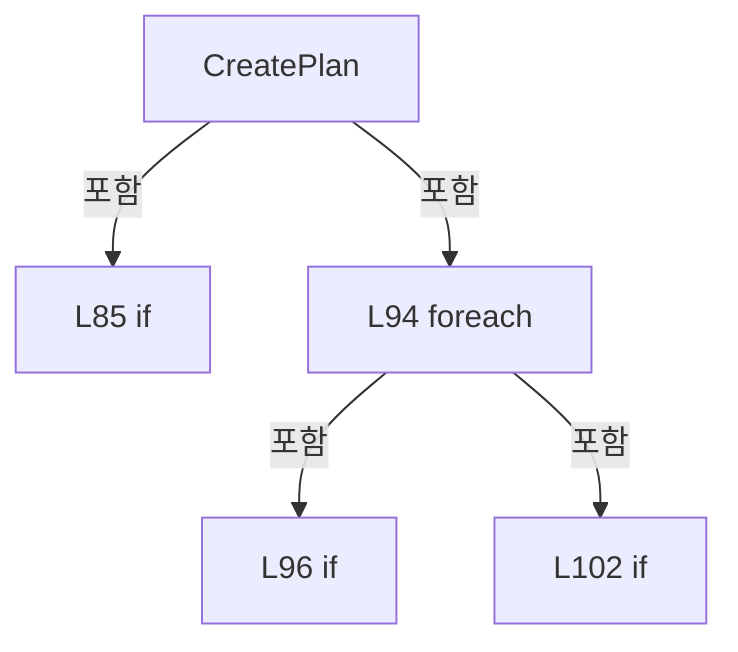

변경 전 점검: 입력/반환 타입, 위 호출자, 예외/취소 경로, 공유 상태와 저장·전송 소비자를 함께 확인합니다. 값의 단위나 물리 방향을 이름만으로 확정하지 않습니다.

### PropertyDeclaration `CurrentPoint` · L116–125

[Drilling.Common/Review/CReviewManager.cs:116–125](https://github.com/kjuws10-rgb/A3Drilling/blob/96e22cd027c84bf302b23f2949b98985d7f301bb/Drilling.Common/Review/CReviewManager.cs#L116-L125)

| 항목 | 실제 추출 값 |
| --- | --- |
| 서명 | Drilling.Common.Review.ST_REVIEW_PLAN_POINT? Drilling.Common.Review.CReviewManager.CurrentPoint |
| 접근/수식자 | Public / public |
| 반환/값 타입 | Drilling.Common.Review.ST_REVIEW_PLAN_POINT? |
| 소속 타입 | NamedType:Drilling.Common.Review.CReviewManager |

현재 부분 분석에서 직접 연결된 호출자는 없습니다. XAML/이벤트/인터페이스·델리게이트·외부 진입을 추가 확인해야 하며, 미사용으로 판정한 것이 아닙니다.

변경 전 점검: 입력/반환 타입, 위 호출자, 예외/취소 경로, 공유 상태와 저장·전송 소비자를 함께 확인합니다. 값의 단위나 물리 방향을 이름만으로 확정하지 않습니다.

### GetAccessorDeclaration `get_CurrentPoint` · L118–124

[Drilling.Common/Review/CReviewManager.cs:118–124](https://github.com/kjuws10-rgb/A3Drilling/blob/96e22cd027c84bf302b23f2949b98985d7f301bb/Drilling.Common/Review/CReviewManager.cs#L118-L124)

| 항목 | 실제 추출 값 |
| --- | --- |
| 서명 | Drilling.Common.Review.ST_REVIEW_PLAN_POINT? Drilling.Common.Review.CReviewManager.CurrentPoint.get |
| 접근/수식자 | Public / get |
| 반환/값 타입 | Drilling.Common.Review.ST_REVIEW_PLAN_POINT? |
| 소속 타입 | NamedType:Drilling.Common.Review.CReviewManager |

현재 부분 분석에서 직접 연결된 호출자는 없습니다. XAML/이벤트/인터페이스·델리게이트·외부 진입을 추가 확인해야 하며, 미사용으로 판정한 것이 아닙니다.

본문의 실제 연산·분기·예외·반환 순서(원문 위치 순):

| 원본 행 | 종류 | 주석 해설 |
| --- | --- | --- |
| 120 | lock | 공유 상태의 임계 구역에 진입합니다: lock (_stateLock) |
| 122 | return | 호출자에게 값 또는 제어를 반환합니다: return _currentPoint; |

제어 구문의 포함 구조(실제 실행 순서/CFG가 아닌 구문 탐색 그림):

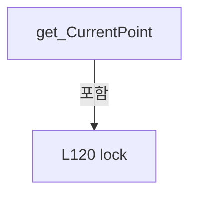

변경 전 점검: 입력/반환 타입, 위 호출자, 예외/취소 경로, 공유 상태와 저장·전송 소비자를 함께 확인합니다. 값의 단위나 물리 방향을 이름만으로 확정하지 않습니다.

### PropertyDeclaration `LastMeasuredPoint` · L127–136

[Drilling.Common/Review/CReviewManager.cs:127–136](https://github.com/kjuws10-rgb/A3Drilling/blob/96e22cd027c84bf302b23f2949b98985d7f301bb/Drilling.Common/Review/CReviewManager.cs#L127-L136)

| 항목 | 실제 추출 값 |
| --- | --- |
| 서명 | Drilling.Common.Review.ST_REVIEW_PLAN_POINT? Drilling.Common.Review.CReviewManager.LastMeasuredPoint |
| 접근/수식자 | Public / public |
| 반환/값 타입 | Drilling.Common.Review.ST_REVIEW_PLAN_POINT? |
| 소속 타입 | NamedType:Drilling.Common.Review.CReviewManager |

현재 부분 분석에서 직접 연결된 호출자는 없습니다. XAML/이벤트/인터페이스·델리게이트·외부 진입을 추가 확인해야 하며, 미사용으로 판정한 것이 아닙니다.

변경 전 점검: 입력/반환 타입, 위 호출자, 예외/취소 경로, 공유 상태와 저장·전송 소비자를 함께 확인합니다. 값의 단위나 물리 방향을 이름만으로 확정하지 않습니다.

### GetAccessorDeclaration `get_LastMeasuredPoint` · L129–135

[Drilling.Common/Review/CReviewManager.cs:129–135](https://github.com/kjuws10-rgb/A3Drilling/blob/96e22cd027c84bf302b23f2949b98985d7f301bb/Drilling.Common/Review/CReviewManager.cs#L129-L135)

| 항목 | 실제 추출 값 |
| --- | --- |
| 서명 | Drilling.Common.Review.ST_REVIEW_PLAN_POINT? Drilling.Common.Review.CReviewManager.LastMeasuredPoint.get |
| 접근/수식자 | Public / get |
| 반환/값 타입 | Drilling.Common.Review.ST_REVIEW_PLAN_POINT? |
| 소속 타입 | NamedType:Drilling.Common.Review.CReviewManager |

현재 부분 분석에서 직접 연결된 호출자는 없습니다. XAML/이벤트/인터페이스·델리게이트·외부 진입을 추가 확인해야 하며, 미사용으로 판정한 것이 아닙니다.

본문의 실제 연산·분기·예외·반환 순서(원문 위치 순):

| 원본 행 | 종류 | 주석 해설 |
| --- | --- | --- |
| 131 | lock | 공유 상태의 임계 구역에 진입합니다: lock (_stateLock) |
| 133 | return | 호출자에게 값 또는 제어를 반환합니다: return _lastMeasuredPoint; |

제어 구문의 포함 구조(실제 실행 순서/CFG가 아닌 구문 탐색 그림):

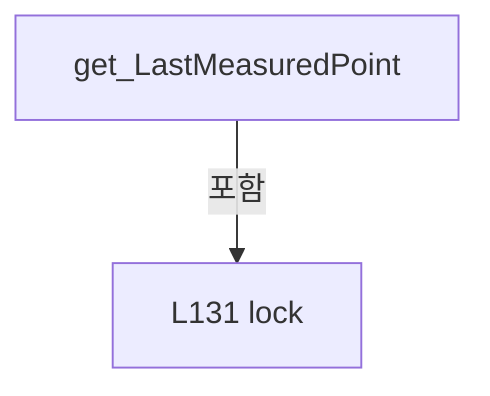

변경 전 점검: 입력/반환 타입, 위 호출자, 예외/취소 경로, 공유 상태와 저장·전송 소비자를 함께 확인합니다. 값의 단위나 물리 방향을 이름만으로 확정하지 않습니다.

### MethodDeclaration `GetShotBeamPositions` · L138–148

[Drilling.Common/Review/CReviewManager.cs:138–148](https://github.com/kjuws10-rgb/A3Drilling/blob/96e22cd027c84bf302b23f2949b98985d7f301bb/Drilling.Common/Review/CReviewManager.cs#L138-L148)

| 항목 | 실제 추출 값 |
| --- | --- |
| 서명 | System.Collections.Generic.IReadOnlyList<Drilling.Common.Review.ST_REVIEW_BEAM_POSITION> Drilling.Common.Review.CReviewManager.GetShotBeamPositions(Drilling.Common.Managers.ST_RECIPE_DEFINITION, Drilling.Common.Review.ST_REVIEW_PLAN_POINT, double, double, double) |
| 접근/수식자 | Public / public, static |
| 반환/값 타입 | System.Collections.Generic.IReadOnlyList<Drilling.Common.Review.ST_REVIEW_BEAM_POSITION> |
| 소속 타입 | NamedType:Drilling.Common.Review.CReviewManager |

입력 계약:

| 이름 | 타입 | 전달 | 선택/기본값 |
| --- | --- | --- | --- |
| recipe | Drilling.Common.Managers.ST_RECIPE_DEFINITION | None | False /  |
| point | Drilling.Common.Review.ST_REVIEW_PLAN_POINT | None | False /  |
| stageScanDirectionY | double | None | False /  |
| shiftOffsetX | double | None | True / 0 |
| shiftOffsetY | double | None | True / 0 |

정적 호출자로 확인된 위치:

| 호출 파일/행 | 호출 표현식 | 런타임 분기 가능 |
| --- | --- | --- |
| [Drilling.Common/Review/CReviewManager.cs:1399–1404](https://github.com/kjuws10-rgb/A3Drilling/blob/96e22cd027c84bf302b23f2949b98985d7f301bb/Drilling.Common/Review/CReviewManager.cs#L1399-L1404) | GetShotBeamPositions | False |
| [Drilling.UI/Menu/Menus/CMenuCorrection.cs:7341–7341](https://github.com/kjuws10-rgb/A3Drilling/blob/96e22cd027c84bf302b23f2949b98985d7f301bb/Drilling.UI/Menu/Menus/CMenuCorrection.cs#L7341-L7341) | CReviewManager.GetShotBeamPositions | False |
| [Drilling.UI/Menu/Menus/CMenuReview.cs:3223–3223](https://github.com/kjuws10-rgb/A3Drilling/blob/96e22cd027c84bf302b23f2949b98985d7f301bb/Drilling.UI/Menu/Menus/CMenuReview.cs#L3223-L3223) | CReviewManager.GetShotBeamPositions | False |
| [Drilling.UI/Menu/Menus/CMenuReview.cs:3560–3560](https://github.com/kjuws10-rgb/A3Drilling/blob/96e22cd027c84bf302b23f2949b98985d7f301bb/Drilling.UI/Menu/Menus/CMenuReview.cs#L3560-L3560) | CReviewManager.GetShotBeamPositions | False |
| [Drilling.UI/Menu/Menus/CMenuReview.cs:4761–4766](https://github.com/kjuws10-rgb/A3Drilling/blob/96e22cd027c84bf302b23f2949b98985d7f301bb/Drilling.UI/Menu/Menus/CMenuReview.cs#L4761-L4766) | CReviewManager.GetShotBeamPositions | False |

호출하는 대상과 해석 범위:

| 원본 행 | 표현식 | 분석 상태 | 대상/소스 위치 |
| --- | --- | --- | --- |
| 145 | CreateShotBeamPositionCalculator | resolved | System.Func<Drilling.Common.Review.ST_REVIEW_PLAN_POINT, int, Drilling.Common.Review.ST_REVIEW_BEAM_POSITION> Drilling.Common.Review.CReviewManager.CreateShotBeamPositionCalculator(Drilling.Common.Managers.ST_RECIPE_DEFINITION, double, double, double) · Drilling.Common/Review/CReviewManager.cs:151 |
| 146 | ReadInt | resolved | int Drilling.Common.Review.CReviewManager.ReadInt(Drilling.Common.Managers.ST_RECIPE_DEFINITION, int, params string[]) · Drilling.Common/Review/CReviewManager.cs:1275 |
| 147 | Enumerable.Range(1, splitBeamCount * splitBeamCount).Select(beam => calculate(point, beam)).ToArray | resolved | Drilling.Common.Review.ST_REVIEW_BEAM_POSITION[] System.Collections.Generic.IEnumerable<Drilling.Common.Review.ST_REVIEW_BEAM_POSITION>.ToArray<Drilling.Common.Review.ST_REVIEW_BEAM_POSITION>() |
| 147 | Enumerable.Range(1, splitBeamCount * splitBeamCount).Select | resolved | System.Collections.Generic.IEnumerable<Drilling.Common.Review.ST_REVIEW_BEAM_POSITION> System.Collections.Generic.IEnumerable<int>.Select<int, Drilling.Common.Review.ST_REVIEW_BEAM_POSITION>(System.Func<int, Drilling.Common.Review.ST_REVIEW_BEAM_POSITION>) |
| 147 | Enumerable.Range | resolved | System.Collections.Generic.IEnumerable<int> System.Linq.Enumerable.Range(int, int) |
| 147 | calculate | resolved · 동적 구현 선택 가능 | Drilling.Common.Review.ST_REVIEW_BEAM_POSITION System.Func<Drilling.Common.Review.ST_REVIEW_PLAN_POINT, int, Drilling.Common.Review.ST_REVIEW_BEAM_POSITION>.Invoke(Drilling.Common.Review.ST_REVIEW_PLAN_POINT, int) |

본문의 실제 연산·분기·예외·반환 순서(원문 위치 순):

| 원본 행 | 종류 | 주석 해설 |
| --- | --- | --- |
| 145 | call | 함수·델리게이트 또는 객체 생성자를 호출합니다: CreateShotBeamPositionCalculator(recipe, stageScanDirectionY, shiftOffsetX, shiftOffsetY) |
| 145 | local-declaration | 지역 변수를 선언합니다: var calculate = CreateShotBeamPositionCalculator(recipe, stageScanDirectionY, shiftOffsetX, shiftOffsetY); |
| 145 | variable-initializer | 변수의 초기값을 지정합니다: calculate = CreateShotBeamPositionCalculator(recipe, stageScanDirectionY, shiftOffsetX, shiftOffsetY) |
| 146 | call | 함수·델리게이트 또는 객체 생성자를 호출합니다: ReadInt(recipe, 0, "SPLITED_BEAM_COUNT") |
| 146 | local-declaration | 지역 변수를 선언합니다: var splitBeamCount = ReadInt(recipe, 0, "SPLITED_BEAM_COUNT"); |
| 146 | variable-initializer | 변수의 초기값을 지정합니다: splitBeamCount = ReadInt(recipe, 0, "SPLITED_BEAM_COUNT") |
| 147 | call | 함수·델리게이트 또는 객체 생성자를 호출합니다: Enumerable.Range(1, splitBeamCount * splitBeamCount).Select(beam => calculate(point, beam)).ToArray() |
| 147 | call | 함수·델리게이트 또는 객체 생성자를 호출합니다: Enumerable.Range(1, splitBeamCount * splitBeamCount).Select(beam => calculate(point, beam)) |
| 147 | call | 함수·델리게이트 또는 객체 생성자를 호출합니다: Enumerable.Range(1, splitBeamCount * splitBeamCount) |
| 147 | call | 함수·델리게이트 또는 객체 생성자를 호출합니다: calculate(point, beam) |
| 147 | return | 호출자에게 값 또는 제어를 반환합니다: return Enumerable.Range(1, splitBeamCount * splitBeamCount).Select(beam => calculate(point, beam)).ToArray(); |

변경 전 점검: 입력/반환 타입, 위 호출자, 예외/취소 경로, 공유 상태와 저장·전송 소비자를 함께 확인합니다. 값의 단위나 물리 방향을 이름만으로 확정하지 않습니다.

### MethodDeclaration `CreateShotBeamPositionCalculator` · L151–193

[Drilling.Common/Review/CReviewManager.cs:151–193](https://github.com/kjuws10-rgb/A3Drilling/blob/96e22cd027c84bf302b23f2949b98985d7f301bb/Drilling.Common/Review/CReviewManager.cs#L151-L193)

| 항목 | 실제 추출 값 |
| --- | --- |
| 서명 | System.Func<Drilling.Common.Review.ST_REVIEW_PLAN_POINT, int, Drilling.Common.Review.ST_REVIEW_BEAM_POSITION> Drilling.Common.Review.CReviewManager.CreateShotBeamPositionCalculator(Drilling.Common.Managers.ST_RECIPE_DEFINITION, double, double, double) |
| 접근/수식자 | Public / public, static |
| 반환/값 타입 | System.Func<Drilling.Common.Review.ST_REVIEW_PLAN_POINT, int, Drilling.Common.Review.ST_REVIEW_BEAM_POSITION> |
| 소속 타입 | NamedType:Drilling.Common.Review.CReviewManager |

원본 XML 주석:

````xml
/// <summary>Build recipe lookup and Cell geometry once for a batch. No device access or live recipe mutation.</summary>
````

입력 계약:

| 이름 | 타입 | 전달 | 선택/기본값 |
| --- | --- | --- | --- |
| recipe | Drilling.Common.Managers.ST_RECIPE_DEFINITION | None | False /  |
| stageScanDirectionY | double | None | False /  |
| shiftOffsetX | double | None | True / 0 |
| shiftOffsetY | double | None | True / 0 |

정적 호출자로 확인된 위치:

| 호출 파일/행 | 호출 표현식 | 런타임 분기 가능 |
| --- | --- | --- |
| [Drilling.Common/Review/CAutoFineReviewCoordinator.cs:225–225](https://github.com/kjuws10-rgb/A3Drilling/blob/96e22cd027c84bf302b23f2949b98985d7f301bb/Drilling.Common/Review/CAutoFineReviewCoordinator.cs#L225-L225) | CReviewManager.CreateShotBeamPositionCalculator | False |
| [Drilling.Common/Review/CReviewManager.cs:145–145](https://github.com/kjuws10-rgb/A3Drilling/blob/96e22cd027c84bf302b23f2949b98985d7f301bb/Drilling.Common/Review/CReviewManager.cs#L145-L145) | CreateShotBeamPositionCalculator | False |
| [Drilling.Common/Review/CZeroDefenceRecipePlan.cs:34–34](https://github.com/kjuws10-rgb/A3Drilling/blob/96e22cd027c84bf302b23f2949b98985d7f301bb/Drilling.Common/Review/CZeroDefenceRecipePlan.cs#L34-L34) | CReviewManager.CreateShotBeamPositionCalculator | False |
| [Drilling.UI/Menu/Menus/CMenuCorrection.cs:6221–6221](https://github.com/kjuws10-rgb/A3Drilling/blob/96e22cd027c84bf302b23f2949b98985d7f301bb/Drilling.UI/Menu/Menus/CMenuCorrection.cs#L6221-L6221) | CReviewManager.CreateShotBeamPositionCalculator | False |

호출하는 대상과 해석 범위:

| 원본 행 | 표현식 | 분석 상태 | 대상/소스 위치 |
| --- | --- | --- | --- |
| 157 | ValidateShiftOffset | resolved | void Drilling.Common.Review.CReviewManager.ValidateShiftOffset(double, double) · Drilling.Common/Review/CReviewManager.cs:987 |
| 158 | ReadInt | resolved | int Drilling.Common.Review.CReviewManager.ReadInt(Drilling.Common.Managers.ST_RECIPE_DEFINITION, int, params string[]) · Drilling.Common/Review/CReviewManager.cs:1275 |
| 159 | ValidateBeamNo | resolved | void Drilling.Common.Review.CReviewManager.ValidateBeamNo(int, int) · Drilling.Common/Review/CReviewManager.cs:973 |
| 160 | recipe.Parameters.GroupBy(parameter => parameter.Key, StringComparer.OrdinalIgnoreCase).ToDictionary | resolved | System.Collections.Generic.Dictionary<string, string> System.Collections.Generic.IEnumerable<System.Linq.IGrouping<string, Drilling.Common.Managers.ST_RECIPE_PARAMETER>>.ToDictionary<System.Linq.IGrouping<string, Drilling.Common.Managers.ST_RECIPE_PARAMETER>, string, string>(System.Func<System.Linq.IGrouping<string, Drilling.Common.Managers.ST_RECIPE_PARAMETER>, string>, System.Func<System.Linq.IGrouping<string, Drilling.Common.Managers.ST_RECIPE_PARAMETER>, string>, System.Collections.Generic.IEqualityComparer<string>?) |
| 160 | recipe.Parameters.GroupBy | resolved | System.Collections.Generic.IEnumerable<System.Linq.IGrouping<string, Drilling.Common.Managers.ST_RECIPE_PARAMETER>> System.Collections.Generic.IEnumerable<Drilling.Common.Managers.ST_RECIPE_PARAMETER>.GroupBy<Drilling.Common.Managers.ST_RECIPE_PARAMETER, string>(System.Func<Drilling.Common.Managers.ST_RECIPE_PARAMETER, string>, System.Collections.Generic.IEqualityComparer<string>?) |
| 160 | group.Last | resolved | Drilling.Common.Managers.ST_RECIPE_PARAMETER System.Collections.Generic.IEnumerable<Drilling.Common.Managers.ST_RECIPE_PARAMETER>.Last<Drilling.Common.Managers.ST_RECIPE_PARAMETER>() |
| 161 | ReadDouble | resolved | double Drilling.Common.Review.CReviewManager.ReadDouble(Drilling.Common.Managers.ST_RECIPE_DEFINITION, double, params string[]) · Drilling.Common/Review/CReviewManager.cs:1315 |
| 162 | ReadDouble | resolved | double Drilling.Common.Review.CReviewManager.ReadDouble(Drilling.Common.Managers.ST_RECIPE_DEFINITION, double, params string[]) · Drilling.Common/Review/CReviewManager.cs:1315 |
| 163 | ReadDouble | resolved | double Drilling.Common.Review.CReviewManager.ReadDouble(Drilling.Common.Managers.ST_RECIPE_DEFINITION, double, params string[]) · Drilling.Common/Review/CReviewManager.cs:1315 |
| 164 | ReadDouble | resolved | double Drilling.Common.Review.CReviewManager.ReadDouble(Drilling.Common.Managers.ST_RECIPE_DEFINITION, double, params string[]) · Drilling.Common/Review/CReviewManager.cs:1315 |
| 165 | ReadDouble | resolved | double Drilling.Common.Review.CReviewManager.ReadDouble(Drilling.Common.Managers.ST_RECIPE_DEFINITION, double, params string[]) · Drilling.Common/Review/CReviewManager.cs:1315 |
| 166 | new System.Collections.Concurrent.ConcurrentDictionary<int, (double Rotation, double BeamPitch)> | resolved | System.Collections.Concurrent.ConcurrentDictionary<int, (double Rotation, double BeamPitch)>.ConcurrentDictionary() |
| 169 | ValidateBeamNo | resolved | void Drilling.Common.Review.CReviewManager.ValidateBeamNo(int, int) · Drilling.Common/Review/CReviewManager.cs:973 |
| 170 | cells.GetOrAdd | resolved | (double Rotation, double BeamPitch) System.Collections.Concurrent.ConcurrentDictionary<int, (double Rotation, double BeamPitch)>.GetOrAdd(int, System.Func<int, (double Rotation, double BeamPitch)>) |
| 172 | CRecipeModelPixelCountReader.ReadPatternForCell | resolved | Drilling.Common.Recipe.ST_RECIPE_MODEL_PATTERN Drilling.Common.Recipe.CRecipeModelPixelCountReader.ReadPatternForCell(System.Collections.Generic.IReadOnlyDictionary<string, string>, int) · Drilling.Common/Recipe/CCellPatternCalculator.cs:444 |
| 173 | ReadDouble | resolved | double Drilling.Common.Review.CReviewManager.ReadDouble(Drilling.Common.Managers.ST_RECIPE_DEFINITION, double, params string[]) · Drilling.Common/Review/CReviewManager.cs:1315 |
| 174 | CCellPatternCalculator.Calculate | resolved | Drilling.Common.Recipe.ST_CELL_PATTERN_LAYOUT Drilling.Common.Recipe.CCellPatternCalculator.Calculate(Drilling.Common.Recipe.ST_CELL_PATTERN_DEFINITION, bool) · Drilling.Common/Recipe/CCellPatternCalculator.cs:66 |
| 174 | new ST_CELL_PATTERN_DEFINITION | resolved | Drilling.Common.Recipe.ST_CELL_PATTERN_DEFINITION.ST_CELL_PATTERN_DEFINITION(int, double, double, double, double, int, int, int, int, double, double) · Drilling.Common/Recipe/CCellPatternCalculator.cs:277 |
| 176 | new InvalidOperationException | resolved | System.InvalidOperationException.InvalidOperationException(string?) |
| 179 | CalculateBeamOffset | resolved | Drilling.Common.Review.ST_REVIEW_COORDINATE_OFFSET Drilling.Common.Review.CReviewManager.CalculateBeamOffset(int, int, double) · Drilling.Common/Review/CReviewManager.cs:951 |
| 180 | CalculateReviewTarget | resolved | Drilling.Common.Review.ST_REVIEW_COORDINATE_OFFSET Drilling.Common.Review.CReviewManager.CalculateReviewTarget(double, double, double, double, double, double, double, double) · Drilling.Common/Review/CReviewManager.cs:994 |
| 189 | double.IsFinite | resolved | bool double.IsFinite(double) |
| 189 | double.IsFinite | resolved | bool double.IsFinite(double) |
| 190 | new InvalidOperationException | resolved | System.InvalidOperationException.InvalidOperationException(string?) |
| 191 | new ST_REVIEW_BEAM_POSITION | resolved | Drilling.Common.Review.ST_REVIEW_BEAM_POSITION.ST_REVIEW_BEAM_POSITION(int, double, double) · Drilling.Common/Review/CReviewManager.cs:4110 |

본문의 실제 연산·분기·예외·반환 순서(원문 위치 순):

| 원본 행 | 종류 | 주석 해설 |
| --- | --- | --- |
| 157 | call | 함수·델리게이트 또는 객체 생성자를 호출합니다: ValidateShiftOffset(shiftOffsetX, shiftOffsetY) |
| 158 | call | 함수·델리게이트 또는 객체 생성자를 호출합니다: ReadInt(recipe, 0, "SPLITED_BEAM_COUNT") |
| 158 | local-declaration | 지역 변수를 선언합니다: var splitBeamCount = ReadInt(recipe, 0, "SPLITED_BEAM_COUNT"); |
| 158 | variable-initializer | 변수의 초기값을 지정합니다: splitBeamCount = ReadInt(recipe, 0, "SPLITED_BEAM_COUNT") |
| 159 | call | 함수·델리게이트 또는 객체 생성자를 호출합니다: ValidateBeamNo(1, splitBeamCount) |
| 160 | call | 함수·델리게이트 또는 객체 생성자를 호출합니다: recipe.Parameters.GroupBy(parameter => parameter.Key, StringComparer.OrdinalIgnoreCase).ToDictionary(group => group.Key, group => group.Last().Value, StringComparer.OrdinalIgnoreCase) |
| 160 | call | 함수·델리게이트 또는 객체 생성자를 호출합니다: recipe.Parameters.GroupBy(parameter => parameter.Key, StringComparer.OrdinalIgnoreCase) |
| 160 | call | 함수·델리게이트 또는 객체 생성자를 호출합니다: group.Last() |
| 160 | local-declaration | 지역 변수를 선언합니다: var parameters = recipe.Parameters.GroupBy(parameter => parameter.Key, StringComparer.OrdinalIgnoreCase).ToDictionary(group => group.Key, group => group.Last().Value, StringComparer.OrdinalIgnoreCase); |
| 160 | variable-initializer | 변수의 초기값을 지정합니다: parameters = recipe.Parameters.GroupBy(parameter => parameter.Key, StringComparer.OrdinalIgnoreCase).ToDictionary(group => group.Key, group => group.Last().Value, StringComparer.OrdinalIgnoreCase) |
| 161 | call | 함수·델리게이트 또는 객체 생성자를 호출합니다: ReadDouble(recipe, 0.0, "PIXEL_SIZE") |
| 161 | local-declaration | 지역 변수를 선언합니다: var pixelSize = ReadDouble(recipe, 0.0, "PIXEL_SIZE"); |
| 161 | variable-initializer | 변수의 초기값을 지정합니다: pixelSize = ReadDouble(recipe, 0.0, "PIXEL_SIZE") |
| 162 | call | 함수·델리게이트 또는 객체 생성자를 호출합니다: ReadDouble(recipe, 55.0, "AK_MARGIN_X", "ALIGN_MARGIN_X") |
| 162 | local-declaration | 지역 변수를 선언합니다: var marginX = ReadDouble(recipe, 55.0, "AK_MARGIN_X", "ALIGN_MARGIN_X"); |
| 162 | variable-initializer | 변수의 초기값을 지정합니다: marginX = ReadDouble(recipe, 55.0, "AK_MARGIN_X", "ALIGN_MARGIN_X") |
| 163 | call | 함수·델리게이트 또는 객체 생성자를 호출합니다: ReadDouble(recipe, 45.0, "AK_MARGIN_Y", "ALIGN_MARGIN_Y") |
| 163 | local-declaration | 지역 변수를 선언합니다: var marginY = ReadDouble(recipe, 45.0, "AK_MARGIN_Y", "ALIGN_MARGIN_Y"); |
| 163 | variable-initializer | 변수의 초기값을 지정합니다: marginY = ReadDouble(recipe, 45.0, "AK_MARGIN_Y", "ALIGN_MARGIN_Y") |
| 164 | call | 함수·델리게이트 또는 객체 생성자를 호출합니다: ReadDouble(recipe, 0.0, "REVIEW_CAMERA_ALIGN_KEY_POS_X") |
| 164 | local-declaration | 지역 변수를 선언합니다: var cameraAlignX = ReadDouble(recipe, 0.0, "REVIEW_CAMERA_ALIGN_KEY_POS_X"); |
| 164 | variable-initializer | 변수의 초기값을 지정합니다: cameraAlignX = ReadDouble(recipe, 0.0, "REVIEW_CAMERA_ALIGN_KEY_POS_X") |
| 165 | call | 함수·델리게이트 또는 객체 생성자를 호출합니다: ReadDouble(recipe, 0.0, "REVIEW_CAMERA_ALIGN_KEY_POS_Y") |
| 165 | local-declaration | 지역 변수를 선언합니다: var cameraAlignY = ReadDouble(recipe, 0.0, "REVIEW_CAMERA_ALIGN_KEY_POS_Y"); |
| 165 | variable-initializer | 변수의 초기값을 지정합니다: cameraAlignY = ReadDouble(recipe, 0.0, "REVIEW_CAMERA_ALIGN_KEY_POS_Y") |
| 166 | call | 함수·델리게이트 또는 객체 생성자를 호출합니다: new System.Collections.Concurrent.ConcurrentDictionary<int, (double Rotation, double BeamPitch)>() |
| 166 | local-declaration | 지역 변수를 선언합니다: var cells = new System.Collections.Concurrent.ConcurrentDictionary<int, (double Rotation, double BeamPitch)>(); |
| 166 | variable-initializer | 변수의 초기값을 지정합니다: cells = new System.Collections.Concurrent.ConcurrentDictionary<int, (double Rotation, double BeamPitch)>() |
| 167 | return | 호출자에게 값 또는 제어를 반환합니다: return (point, beamNo) => { ValidateBeamNo(beamNo, splitBeamCount); var cell = cells.GetOrAdd(point.CellNo, cellNo => { var model = CRecipeModelPixelCountReader.ReadPatternForCell(parameters, cellNo); var rotation = ReadDouble(rec |
| 169 | call | 함수·델리게이트 또는 객체 생성자를 호출합니다: ValidateBeamNo(beamNo, splitBeamCount) |
| 170 | call | 함수·델리게이트 또는 객체 생성자를 호출합니다: cells.GetOrAdd(point.CellNo, cellNo => { var model = CRecipeModelPixelCountReader.ReadPatternForCell(parameters, cellNo); var rotation = ReadDouble(recipe, 0.0, $"CELL{cellNo}_ROTATION"); var layout = CCellPatternCalcula… |
| 170 | local-declaration | 지역 변수를 선언합니다: var cell = cells.GetOrAdd(point.CellNo, cellNo => { var model = CRecipeModelPixelCountReader.ReadPatternForCell(parameters, cellNo); var rotation = ReadDouble(recipe, 0.0, $"CELL{cellNo}_ROTATION"); var layout = CCellPatternCalcul |
| 170 | variable-initializer | 변수의 초기값을 지정합니다: cell = cells.GetOrAdd(point.CellNo, cellNo => { var model = CRecipeModelPixelCountReader.ReadPatternForCell(parameters, cellNo); var rotation = ReadDouble(recipe, 0.0, $"CELL{cellNo}_ROTATION"); var layout = CCellPatternCalculator |
| 172 | call | 함수·델리게이트 또는 객체 생성자를 호출합니다: CRecipeModelPixelCountReader.ReadPatternForCell(parameters, cellNo) |
| 172 | local-declaration | 지역 변수를 선언합니다: var model = CRecipeModelPixelCountReader.ReadPatternForCell(parameters, cellNo); |
| 172 | variable-initializer | 변수의 초기값을 지정합니다: model = CRecipeModelPixelCountReader.ReadPatternForCell(parameters, cellNo) |
| 173 | call | 함수·델리게이트 또는 객체 생성자를 호출합니다: ReadDouble(recipe, 0.0, $"CELL{cellNo}_ROTATION") |
| 173 | local-declaration | 지역 변수를 선언합니다: var rotation = ReadDouble(recipe, 0.0, $"CELL{cellNo}_ROTATION"); |
| 173 | variable-initializer | 변수의 초기값을 지정합니다: rotation = ReadDouble(recipe, 0.0, $"CELL{cellNo}_ROTATION") |
| 174 | call | 함수·델리게이트 또는 객체 생성자를 호출합니다: CCellPatternCalculator.Calculate(new ST_CELL_PATTERN_DEFINITION(cellNo, 0, 0, rotation, pixelSize, model.PixelCountX, model.PixelCountY, model.ProcessPitch, splitBeamCount), includeShotCenters: false) |
| 174 | call | 함수·델리게이트 또는 객체 생성자를 호출합니다: new ST_CELL_PATTERN_DEFINITION(cellNo, 0, 0, rotation, pixelSize, model.PixelCountX, model.PixelCountY, model.ProcessPitch, splitBeamCount) |
| 174 | local-declaration | 지역 변수를 선언합니다: var layout = CCellPatternCalculator.Calculate(new ST_CELL_PATTERN_DEFINITION(cellNo, 0, 0, rotation, pixelSize, model.PixelCountX, model.PixelCountY, model.ProcessPitch, splitBeamCount), includeShotCenters: false); |
| 174 | variable-initializer | 변수의 초기값을 지정합니다: layout = CCellPatternCalculator.Calculate(new ST_CELL_PATTERN_DEFINITION(cellNo, 0, 0, rotation, pixelSize, model.PixelCountX, model.PixelCountY, model.ProcessPitch, splitBeamCount), includeShotCenters: false) |
| 175 | if | 조건에 따라 분기합니다: if (!layout.IsValid) |
| 176 | call | 함수·델리게이트 또는 객체 생성자를 호출합니다: new InvalidOperationException(layout.ValidationMessage) |
| 176 | throw | 예외를 발생/전달합니다: throw new InvalidOperationException(layout.ValidationMessage); |
| 177 | return | 호출자에게 값 또는 제어를 반환합니다: return (rotation, layout.BeamPitchMillimeters); |
| 179 | call | 함수·델리게이트 또는 객체 생성자를 호출합니다: CalculateBeamOffset(beamNo, splitBeamCount, cell.BeamPitch) |
| 179 | local-declaration | 지역 변수를 선언합니다: var offset = CalculateBeamOffset(beamNo, splitBeamCount, cell.BeamPitch); |
| 179 | variable-initializer | 변수의 초기값을 지정합니다: offset = CalculateBeamOffset(beamNo, splitBeamCount, cell.BeamPitch) |
| 180 | call | 함수·델리게이트 또는 객체 생성자를 호출합니다: CalculateReviewTarget( point.DesignX - marginX + shiftOffsetX, point.DesignY - marginY + shiftOffsetY, cameraAlignX, cameraAlignY, offset.X, offset.Y, cell.Rotation, stageScanDirectionY) |
| 180 | local-declaration | 지역 변수를 선언합니다: var target = CalculateReviewTarget( point.DesignX - marginX + shiftOffsetX, point.DesignY - marginY + shiftOffsetY, cameraAlignX, cameraAlignY, offset.X, offset.Y, cell.Rotation, stageScanDirectionY); |
| 180 | variable-initializer | 변수의 초기값을 지정합니다: target = CalculateReviewTarget( point.DesignX - marginX + shiftOffsetX, point.DesignY - marginY + shiftOffsetY, cameraAlignX, cameraAlignY, offset.X, offset.Y, cell.Rotation, stageScanDirectionY) |
| 189 | call | 함수·델리게이트 또는 객체 생성자를 호출합니다: double.IsFinite(target.X) |
| 189 | call | 함수·델리게이트 또는 객체 생성자를 호출합니다: double.IsFinite(target.Y) |
| 189 | if | 조건에 따라 분기합니다: if (!double.IsFinite(target.X) &#124;&#124; !double.IsFinite(target.Y)) |
| 190 | call | 함수·델리게이트 또는 객체 생성자를 호출합니다: new InvalidOperationException($"Beam {beamNo}의 목표 위치를 계산할 수 없습니다.") |
| 190 | throw | 예외를 발생/전달합니다: throw new InvalidOperationException($"Beam {beamNo}의 목표 위치를 계산할 수 없습니다."); |
| 191 | call | 함수·델리게이트 또는 객체 생성자를 호출합니다: new ST_REVIEW_BEAM_POSITION(beamNo, target.Y, target.X) |
| 191 | return | 호출자에게 값 또는 제어를 반환합니다: return new ST_REVIEW_BEAM_POSITION(beamNo, target.Y, target.X); |

제어 구문의 포함 구조(실제 실행 순서/CFG가 아닌 구문 탐색 그림):

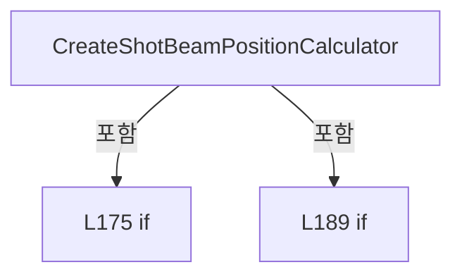

변경 전 점검: 입력/반환 타입, 위 호출자, 예외/취소 경로, 공유 상태와 저장·전송 소비자를 함께 확인합니다. 값의 단위나 물리 방향을 이름만으로 확정하지 않습니다.

### MethodDeclaration `CreateAllPlan` · L195–198

[Drilling.Common/Review/CReviewManager.cs:195–198](https://github.com/kjuws10-rgb/A3Drilling/blob/96e22cd027c84bf302b23f2949b98985d7f301bb/Drilling.Common/Review/CReviewManager.cs#L195-L198)

| 항목 | 실제 추출 값 |
| --- | --- |
| 서명 | Drilling.Common.Review.ST_REVIEW_PLAN Drilling.Common.Review.CReviewManager.CreateAllPlan(Drilling.Common.Managers.ST_RECIPE_DEFINITION, int) |
| 접근/수식자 | Public / public |
| 반환/값 타입 | Drilling.Common.Review.ST_REVIEW_PLAN |
| 소속 타입 | NamedType:Drilling.Common.Review.CReviewManager |

입력 계약:

| 이름 | 타입 | 전달 | 선택/기본값 |
| --- | --- | --- | --- |
| recipe | Drilling.Common.Managers.ST_RECIPE_DEFINITION | None | False /  |
| selectedBeamNo | int | None | False /  |

정적 호출자로 확인된 위치:

| 호출 파일/행 | 호출 표현식 | 런타임 분기 가능 |
| --- | --- | --- |
| [Drilling.UI/Menu/Menus/CMenuCorrection.ReviewData.Offset.cs:145–145](https://github.com/kjuws10-rgb/A3Drilling/blob/96e22cd027c84bf302b23f2949b98985d7f301bb/Drilling.UI/Menu/Menus/CMenuCorrection.ReviewData.Offset.cs#L145-L145) | _reviewManager.CreateAllPlan | False |
| [Drilling.UI/Menu/Menus/CMenuCorrection.ReviewData.Offset.cs:265–265](https://github.com/kjuws10-rgb/A3Drilling/blob/96e22cd027c84bf302b23f2949b98985d7f301bb/Drilling.UI/Menu/Menus/CMenuCorrection.ReviewData.Offset.cs#L265-L265) | _reviewManager.CreateAllPlan | False |
| [Drilling.UI/Menu/Menus/CMenuCorrection.cs:1859–1859](https://github.com/kjuws10-rgb/A3Drilling/blob/96e22cd027c84bf302b23f2949b98985d7f301bb/Drilling.UI/Menu/Menus/CMenuCorrection.cs#L1859-L1859) | _reviewManager.CreateAllPlan | False |
| [Drilling.UI/Menu/Menus/CMenuReview.cs:477–477](https://github.com/kjuws10-rgb/A3Drilling/blob/96e22cd027c84bf302b23f2949b98985d7f301bb/Drilling.UI/Menu/Menus/CMenuReview.cs#L477-L477) | _reviewManager.CreateAllPlan | False |
| [Drilling.UI/Menu/Menus/CMenuReview.cs:3594–3594](https://github.com/kjuws10-rgb/A3Drilling/blob/96e22cd027c84bf302b23f2949b98985d7f301bb/Drilling.UI/Menu/Menus/CMenuReview.cs#L3594-L3594) | _reviewManager.CreateAllPlan | False |
| [Drilling.UI/Menu/Menus/CMenuReview.cs:4249–4249](https://github.com/kjuws10-rgb/A3Drilling/blob/96e22cd027c84bf302b23f2949b98985d7f301bb/Drilling.UI/Menu/Menus/CMenuReview.cs#L4249-L4249) | _reviewManager.CreateAllPlan | False |

호출하는 대상과 해석 범위:

| 원본 행 | 표현식 | 분석 상태 | 대상/소스 위치 |
| --- | --- | --- | --- |
| 197 | CreateAllPlan | resolved | Drilling.Common.Review.ST_REVIEW_PLAN Drilling.Common.Review.CReviewManager.CreateAllPlan(Drilling.Common.Managers.ST_RECIPE_DEFINITION, int, double, double) · Drilling.Common/Review/CReviewManager.cs:200 |

본문의 실제 연산·분기·예외·반환 순서(원문 위치 순):

| 원본 행 | 종류 | 주석 해설 |
| --- | --- | --- |
| 197 | call | 함수·델리게이트 또는 객체 생성자를 호출합니다: CreateAllPlan(recipe, selectedBeamNo, 0.0, 0.0) |
| 197 | return | 호출자에게 값 또는 제어를 반환합니다: return CreateAllPlan(recipe, selectedBeamNo, 0.0, 0.0); |

변경 전 점검: 입력/반환 타입, 위 호출자, 예외/취소 경로, 공유 상태와 저장·전송 소비자를 함께 확인합니다. 값의 단위나 물리 방향을 이름만으로 확정하지 않습니다.

### MethodDeclaration `CreateAllPlan` · L200–209

[Drilling.Common/Review/CReviewManager.cs:200–209](https://github.com/kjuws10-rgb/A3Drilling/blob/96e22cd027c84bf302b23f2949b98985d7f301bb/Drilling.Common/Review/CReviewManager.cs#L200-L209)

| 항목 | 실제 추출 값 |
| --- | --- |
| 서명 | Drilling.Common.Review.ST_REVIEW_PLAN Drilling.Common.Review.CReviewManager.CreateAllPlan(Drilling.Common.Managers.ST_RECIPE_DEFINITION, int, double, double) |
| 접근/수식자 | Public / public |
| 반환/값 타입 | Drilling.Common.Review.ST_REVIEW_PLAN |
| 소속 타입 | NamedType:Drilling.Common.Review.CReviewManager |

입력 계약:

| 이름 | 타입 | 전달 | 선택/기본값 |
| --- | --- | --- | --- |
| recipe | Drilling.Common.Managers.ST_RECIPE_DEFINITION | None | False /  |
| selectedBeamNo | int | None | False /  |
| shiftOffsetX | double | None | False /  |
| shiftOffsetY | double | None | False /  |

정적 호출자로 확인된 위치:

| 호출 파일/행 | 호출 표현식 | 런타임 분기 가능 |
| --- | --- | --- |
| [Drilling.Common/Review/CReviewManager.cs:84–84](https://github.com/kjuws10-rgb/A3Drilling/blob/96e22cd027c84bf302b23f2949b98985d7f301bb/Drilling.Common/Review/CReviewManager.cs#L84-L84) | CreateAllPlan | False |
| [Drilling.Common/Review/CReviewManager.cs:197–197](https://github.com/kjuws10-rgb/A3Drilling/blob/96e22cd027c84bf302b23f2949b98985d7f301bb/Drilling.Common/Review/CReviewManager.cs#L197-L197) | CreateAllPlan | False |
| [Drilling.UI/Menu/Menus/CMenuReview.cs:2550–2550](https://github.com/kjuws10-rgb/A3Drilling/blob/96e22cd027c84bf302b23f2949b98985d7f301bb/Drilling.UI/Menu/Menus/CMenuReview.cs#L2550-L2550) | _reviewManager.CreateAllPlan | False |
| [Drilling.UI/Menu/Menus/CMenuReview.cs:2800–2800](https://github.com/kjuws10-rgb/A3Drilling/blob/96e22cd027c84bf302b23f2949b98985d7f301bb/Drilling.UI/Menu/Menus/CMenuReview.cs#L2800-L2800) | _reviewManager.CreateAllPlan | False |
| [Drilling.UI/Menu/Menus/CMenuReview.cs:3990–3990](https://github.com/kjuws10-rgb/A3Drilling/blob/96e22cd027c84bf302b23f2949b98985d7f301bb/Drilling.UI/Menu/Menus/CMenuReview.cs#L3990-L3990) | _reviewManager.CreateAllPlan | False |

호출하는 대상과 해석 범위:

| 원본 행 | 표현식 | 분석 상태 | 대상/소스 위치 |
| --- | --- | --- | --- |
| 206 | ValidateShiftOffset | resolved | void Drilling.Common.Review.CReviewManager.ValidateShiftOffset(double, double) · Drilling.Common/Review/CReviewManager.cs:987 |
| 207 | ValidateBeamNo | resolved | void Drilling.Common.Review.CReviewManager.ValidateBeamNo(int, int) · Drilling.Common/Review/CReviewManager.cs:973 |
| 207 | ReadInt | resolved | int Drilling.Common.Review.CReviewManager.ReadInt(Drilling.Common.Managers.ST_RECIPE_DEFINITION, int, params string[]) · Drilling.Common/Review/CReviewManager.cs:1275 |
| 208 | CreatePlanCore | resolved | Drilling.Common.Review.ST_REVIEW_PLAN Drilling.Common.Review.CReviewManager.CreatePlanCore(Drilling.Common.Managers.ST_RECIPE_DEFINITION, System.Func<Drilling.Common.Review.ST_REVIEW_PLAN_POINT, bool>, int, bool, double, double) · Drilling.Common/Review/CReviewManager.cs:496 |

본문의 실제 연산·분기·예외·반환 순서(원문 위치 순):

| 원본 행 | 종류 | 주석 해설 |
| --- | --- | --- |
| 206 | call | 함수·델리게이트 또는 객체 생성자를 호출합니다: ValidateShiftOffset(shiftOffsetX, shiftOffsetY) |
| 207 | call | 함수·델리게이트 또는 객체 생성자를 호출합니다: ValidateBeamNo(selectedBeamNo, ReadInt(recipe, 0, "SPLITED_BEAM_COUNT")) |
| 207 | call | 함수·델리게이트 또는 객체 생성자를 호출합니다: ReadInt(recipe, 0, "SPLITED_BEAM_COUNT") |
| 208 | call | 함수·델리게이트 또는 객체 생성자를 호출합니다: CreatePlanCore(recipe, _ => true, selectedBeamNo, selectAllAssignedPoints: true, shiftOffsetX, shiftOffsetY) |
| 208 | return | 호출자에게 값 또는 제어를 반환합니다: return CreatePlanCore(recipe, _ => true, selectedBeamNo, selectAllAssignedPoints: true, shiftOffsetX, shiftOffsetY); |

변경 전 점검: 입력/반환 타입, 위 호출자, 예외/취소 경로, 공유 상태와 저장·전송 소비자를 함께 확인합니다. 값의 단위나 물리 방향을 이름만으로 확정하지 않습니다.

### MethodDeclaration `SelectGlassLineShotKeys` · L211–246

[Drilling.Common/Review/CReviewManager.cs:211–246](https://github.com/kjuws10-rgb/A3Drilling/blob/96e22cd027c84bf302b23f2949b98985d7f301bb/Drilling.Common/Review/CReviewManager.cs#L211-L246)

| 항목 | 실제 추출 값 |
| --- | --- |
| 서명 | System.Collections.Generic.IReadOnlyList<string> Drilling.Common.Review.CReviewManager.SelectGlassLineShotKeys(Drilling.Common.Review.ST_REVIEW_PLAN, string) |
| 접근/수식자 | Public / public, static |
| 반환/값 타입 | System.Collections.Generic.IReadOnlyList<string> |
| 소속 타입 | NamedType:Drilling.Common.Review.CReviewManager |

입력 계약:

| 이름 | 타입 | 전달 | 선택/기본값 |
| --- | --- | --- | --- |
| plan | Drilling.Common.Review.ST_REVIEW_PLAN | None | False /  |
| anchorShotKey | string | None | False /  |

정적 호출자로 확인된 위치:

| 호출 파일/행 | 호출 표현식 | 런타임 분기 가능 |
| --- | --- | --- |
| [Drilling.UI/Menu/Menus/CMenuReview.cs:2037–2037](https://github.com/kjuws10-rgb/A3Drilling/blob/96e22cd027c84bf302b23f2949b98985d7f301bb/Drilling.UI/Menu/Menus/CMenuReview.cs#L2037-L2037) | CReviewManager.SelectGlassLineShotKeys | False |
| [Drilling.UI/Menu/Menus/CMenuReview.cs:2078–2078](https://github.com/kjuws10-rgb/A3Drilling/blob/96e22cd027c84bf302b23f2949b98985d7f301bb/Drilling.UI/Menu/Menus/CMenuReview.cs#L2078-L2078) | CReviewManager.SelectGlassLineShotKeys | False |

호출하는 대상과 해석 범위:

| 원본 행 | 표현식 | 분석 상태 | 대상/소스 위치 |
| --- | --- | --- | --- |
| 215 | ArgumentNullException.ThrowIfNull | resolved | void System.ArgumentNullException.ThrowIfNull(object?, string?) |
| 216 | NormalizeShotKey | resolved | string Drilling.Common.Review.CReviewManager.NormalizeShotKey(string) · Drilling.Common/Review/CReviewManager.cs:1238 |
| 217 | plan.Points .Where(point => point.Use && point.HeadNo > 0 && double.IsFinite(point.DesignX) && double.IsFinite(point.DesignY)) .ToArray | resolved | Drilling.Common.Review.ST_REVIEW_PLAN_POINT[] System.Collections.Generic.IEnumerable<Drilling.Common.Review.ST_REVIEW_PLAN_POINT>.ToArray<Drilling.Common.Review.ST_REVIEW_PLAN_POINT>() |
| 217 | plan.Points .Where | resolved | System.Collections.Generic.IEnumerable<Drilling.Common.Review.ST_REVIEW_PLAN_POINT> System.Collections.Generic.IEnumerable<Drilling.Common.Review.ST_REVIEW_PLAN_POINT>.Where<Drilling.Common.Review.ST_REVIEW_PLAN_POINT>(System.Func<Drilling.Common.Review.ST_REVIEW_PLAN_POINT, bool>) |
| 221 | double.IsFinite | resolved | bool double.IsFinite(double) |
| 222 | double.IsFinite | resolved | bool double.IsFinite(double) |
| 224 | executablePoints.Any | resolved | bool System.Collections.Generic.IEnumerable<Drilling.Common.Review.ST_REVIEW_PLAN_POINT>.Any<Drilling.Common.Review.ST_REVIEW_PLAN_POINT>(System.Func<Drilling.Common.Review.ST_REVIEW_PLAN_POINT, bool>) |
| 224 | point.ShotKey.Equals | resolved | bool string.Equals(string?, System.StringComparison) |
| 229 | CreateIofLines | resolved | System.Collections.Generic.IReadOnlyList<System.Collections.Generic.IReadOnlyList<Drilling.Common.Review.ST_REVIEW_PLAN_POINT>> Drilling.Common.Review.CReviewManager.CreateIofLines(System.Collections.Generic.IReadOnlyList<Drilling.Common.Review.ST_REVIEW_PLAN_POINT>) · Drilling.Common/Review/CReviewManager.cs:2185 |
| 231 | line.Any | resolved | bool System.Collections.Generic.IEnumerable<Drilling.Common.Review.ST_REVIEW_PLAN_POINT>.Any<Drilling.Common.Review.ST_REVIEW_PLAN_POINT>(System.Func<Drilling.Common.Review.ST_REVIEW_PLAN_POINT, bool>) |
| 231 | point.ShotKey.Equals | resolved | bool string.Equals(string?, System.StringComparison) |
| 236 | line .OrderBy(point => point.DesignX) .ThenBy(point => point.CellNo) .ThenBy(point => point.ShotNo) .Select(point => point.ShotKey) .Distinct(StringComparer.OrdinalIgnoreCase) .ToArray | resolved | string[] System.Collections.Generic.IEnumerable<string>.ToArray<string>() |
| 236 | line .OrderBy(point => point.DesignX) .ThenBy(point => point.CellNo) .ThenBy(point => point.ShotNo) .Select(point => point.ShotKey) .Distinct | resolved | System.Collections.Generic.IEnumerable<string> System.Collections.Generic.IEnumerable<string>.Distinct<string>(System.Collections.Generic.IEqualityComparer<string>?) |
| 236 | line .OrderBy(point => point.DesignX) .ThenBy(point => point.CellNo) .ThenBy(point => point.ShotNo) .Select | resolved | System.Collections.Generic.IEnumerable<string> System.Collections.Generic.IEnumerable<Drilling.Common.Review.ST_REVIEW_PLAN_POINT>.Select<Drilling.Common.Review.ST_REVIEW_PLAN_POINT, string>(System.Func<Drilling.Common.Review.ST_REVIEW_PLAN_POINT, string>) |
| 236 | line .OrderBy(point => point.DesignX) .ThenBy(point => point.CellNo) .ThenBy | resolved | System.Linq.IOrderedEnumerable<Drilling.Common.Review.ST_REVIEW_PLAN_POINT> System.Linq.IOrderedEnumerable<Drilling.Common.Review.ST_REVIEW_PLAN_POINT>.ThenBy<Drilling.Common.Review.ST_REVIEW_PLAN_POINT, int>(System.Func<Drilling.Common.Review.ST_REVIEW_PLAN_POINT, int>) |
| 236 | line .OrderBy(point => point.DesignX) .ThenBy | resolved | System.Linq.IOrderedEnumerable<Drilling.Common.Review.ST_REVIEW_PLAN_POINT> System.Linq.IOrderedEnumerable<Drilling.Common.Review.ST_REVIEW_PLAN_POINT>.ThenBy<Drilling.Common.Review.ST_REVIEW_PLAN_POINT, int>(System.Func<Drilling.Common.Review.ST_REVIEW_PLAN_POINT, int>) |
| 236 | line .OrderBy | resolved | System.Linq.IOrderedEnumerable<Drilling.Common.Review.ST_REVIEW_PLAN_POINT> System.Collections.Generic.IEnumerable<Drilling.Common.Review.ST_REVIEW_PLAN_POINT>.OrderBy<Drilling.Common.Review.ST_REVIEW_PLAN_POINT, double>(System.Func<Drilling.Common.Review.ST_REVIEW_PLAN_POINT, double>) |

본문의 실제 연산·분기·예외·반환 순서(원문 위치 순):

| 원본 행 | 종류 | 주석 해설 |
| --- | --- | --- |
| 215 | call | 함수·델리게이트 또는 객체 생성자를 호출합니다: ArgumentNullException.ThrowIfNull(plan) |
| 216 | call | 함수·델리게이트 또는 객체 생성자를 호출합니다: NormalizeShotKey(anchorShotKey) |
| 216 | local-declaration | 지역 변수를 선언합니다: var normalizedAnchorKey = NormalizeShotKey(anchorShotKey); |
| 216 | variable-initializer | 변수의 초기값을 지정합니다: normalizedAnchorKey = NormalizeShotKey(anchorShotKey) |
| 217 | call | 함수·델리게이트 또는 객체 생성자를 호출합니다: plan.Points .Where(point => point.Use && point.HeadNo > 0 && double.IsFinite(point.DesignX) && double.IsFinite(point.DesignY)) |
| 217 | call | 함수·델리게이트 또는 객체 생성자를 호출합니다: plan.Points .Where(point => point.Use && point.HeadNo > 0 && double.IsFinite(point.DesignX) && double.IsFinite(point.DesignY)) .ToArray() |
| 217 | local-declaration | 지역 변수를 선언합니다: var executablePoints = plan.Points .Where(point => point.Use && point.HeadNo > 0 && double.IsFinite(point.DesignX) && double.IsFinite(point.DesignY)) .ToArray(); |
| 217 | variable-initializer | 변수의 초기값을 지정합니다: executablePoints = plan.Points .Where(point => point.Use && point.HeadNo > 0 && double.IsFinite(point.DesignX) && double.IsFinite(point.DesignY)) .ToArray() |
| 221 | call | 함수·델리게이트 또는 객체 생성자를 호출합니다: double.IsFinite(point.DesignX) |
| 222 | call | 함수·델리게이트 또는 객체 생성자를 호출합니다: double.IsFinite(point.DesignY) |
| 224 | call | 함수·델리게이트 또는 객체 생성자를 호출합니다: executablePoints.Any(point => point.ShotKey.Equals(normalizedAnchorKey, StringComparison.OrdinalIgnoreCase)) |
| 224 | call | 함수·델리게이트 또는 객체 생성자를 호출합니다: point.ShotKey.Equals(normalizedAnchorKey, StringComparison.OrdinalIgnoreCase) |
| 224 | if | 조건에 따라 분기합니다: if (!executablePoints.Any(point => point.ShotKey.Equals(normalizedAnchorKey, StringComparison.OrdinalIgnoreCase))) |
| 226 | return | 호출자에게 값 또는 제어를 반환합니다: return []; |
| 229 | call | 함수·델리게이트 또는 객체 생성자를 호출합니다: CreateIofLines(executablePoints) |
| 229 | foreach | 컬렉션 요소를 순회합니다: foreach (var line in CreateIofLines(executablePoints)) |
| 231 | call | 함수·델리게이트 또는 객체 생성자를 호출합니다: line.Any(point => point.ShotKey.Equals(normalizedAnchorKey, StringComparison.OrdinalIgnoreCase)) |
| 231 | call | 함수·델리게이트 또는 객체 생성자를 호출합니다: point.ShotKey.Equals(normalizedAnchorKey, StringComparison.OrdinalIgnoreCase) |
| 231 | if | 조건에 따라 분기합니다: if (!line.Any(point => point.ShotKey.Equals(normalizedAnchorKey, StringComparison.OrdinalIgnoreCase))) |
| 233 | continue | 다음 반복으로 진행합니다: continue; |
| 236 | call | 함수·델리게이트 또는 객체 생성자를 호출합니다: line .OrderBy(point => point.DesignX) |
| 236 | call | 함수·델리게이트 또는 객체 생성자를 호출합니다: line .OrderBy(point => point.DesignX) .ThenBy(point => point.CellNo) |
| 236 | call | 함수·델리게이트 또는 객체 생성자를 호출합니다: line .OrderBy(point => point.DesignX) .ThenBy(point => point.CellNo) .ThenBy(point => point.ShotNo) |
| 236 | call | 함수·델리게이트 또는 객체 생성자를 호출합니다: line .OrderBy(point => point.DesignX) .ThenBy(point => point.CellNo) .ThenBy(point => point.ShotNo) .Select(point => point.ShotKey) |
| 236 | call | 함수·델리게이트 또는 객체 생성자를 호출합니다: line .OrderBy(point => point.DesignX) .ThenBy(point => point.CellNo) .ThenBy(point => point.ShotNo) .Select(point => point.ShotKey) .Distinct(StringComparer.OrdinalIgnoreCase) |
| 236 | call | 함수·델리게이트 또는 객체 생성자를 호출합니다: line .OrderBy(point => point.DesignX) .ThenBy(point => point.CellNo) .ThenBy(point => point.ShotNo) .Select(point => point.ShotKey) .Distinct(StringComparer.OrdinalIgnoreCase) .ToArray() |
| 236 | return | 호출자에게 값 또는 제어를 반환합니다: return line .OrderBy(point => point.DesignX) .ThenBy(point => point.CellNo) .ThenBy(point => point.ShotNo) .Select(point => point.ShotKey) .Distinct(StringComparer.OrdinalIgnoreCase) .ToArray(); |
| 245 | return | 호출자에게 값 또는 제어를 반환합니다: return []; |

제어 구문의 포함 구조(실제 실행 순서/CFG가 아닌 구문 탐색 그림):


변경 전 점검: 입력/반환 타입, 위 호출자, 예외/취소 경로, 공유 상태와 저장·전송 소비자를 함께 확인합니다. 값의 단위나 물리 방향을 이름만으로 확정하지 않습니다.

### MethodDeclaration `ApplyShiftOffset` · L248–273

[Drilling.Common/Review/CReviewManager.cs:248–273](https://github.com/kjuws10-rgb/A3Drilling/blob/96e22cd027c84bf302b23f2949b98985d7f301bb/Drilling.Common/Review/CReviewManager.cs#L248-L273)

| 항목 | 실제 추출 값 |
| --- | --- |
| 서명 | Drilling.Common.Review.ST_REVIEW_PLAN Drilling.Common.Review.CReviewManager.ApplyShiftOffset(Drilling.Common.Review.ST_REVIEW_PLAN, double, double) |
| 접근/수식자 | Public / public, static |
| 반환/값 타입 | Drilling.Common.Review.ST_REVIEW_PLAN |
| 소속 타입 | NamedType:Drilling.Common.Review.CReviewManager |

입력 계약:

| 이름 | 타입 | 전달 | 선택/기본값 |
| --- | --- | --- | --- |
| plan | Drilling.Common.Review.ST_REVIEW_PLAN | None | False /  |
| shiftOffsetX | double | None | False /  |
| shiftOffsetY | double | None | False /  |

정적 호출자로 확인된 위치:

| 호출 파일/행 | 호출 표현식 | 런타임 분기 가능 |
| --- | --- | --- |
| [Drilling.UI/Menu/Menus/CMenuCorrection.cs:6354–6354](https://github.com/kjuws10-rgb/A3Drilling/blob/96e22cd027c84bf302b23f2949b98985d7f301bb/Drilling.UI/Menu/Menus/CMenuCorrection.cs#L6354-L6354) | CReviewManager.ApplyShiftOffset | False |
| [Drilling.UI/Menu/Menus/CMenuCorrection.cs:7377–7377](https://github.com/kjuws10-rgb/A3Drilling/blob/96e22cd027c84bf302b23f2949b98985d7f301bb/Drilling.UI/Menu/Menus/CMenuCorrection.cs#L7377-L7377) | CReviewManager.ApplyShiftOffset | False |

호출하는 대상과 해석 범위:

| 원본 행 | 표현식 | 분석 상태 | 대상/소스 위치 |
| --- | --- | --- | --- |
| 250 | ValidateShiftOffset | resolved | void Drilling.Common.Review.CReviewManager.ValidateShiftOffset(double, double) · Drilling.Common/Review/CReviewManager.cs:987 |
| 265 | plan.CorrectionPlan.SourcePoints.Select(Apply).ToArray | resolved | Drilling.Common.Review.ST_REVIEW_PLAN_POINT[] System.Collections.Generic.IEnumerable<Drilling.Common.Review.ST_REVIEW_PLAN_POINT>.ToArray<Drilling.Common.Review.ST_REVIEW_PLAN_POINT>() |
| 265 | plan.CorrectionPlan.SourcePoints.Select | resolved | System.Collections.Generic.IEnumerable<Drilling.Common.Review.ST_REVIEW_PLAN_POINT> System.Collections.Generic.IEnumerable<Drilling.Common.Review.ST_REVIEW_PLAN_POINT>.Select<Drilling.Common.Review.ST_REVIEW_PLAN_POINT, Drilling.Common.Review.ST_REVIEW_PLAN_POINT>(System.Func<Drilling.Common.Review.ST_REVIEW_PLAN_POINT, Drilling.Common.Review.ST_REVIEW_PLAN_POINT>) |
| 268 | plan.Points.Select(Apply).ToArray | resolved | Drilling.Common.Review.ST_REVIEW_PLAN_POINT[] System.Collections.Generic.IEnumerable<Drilling.Common.Review.ST_REVIEW_PLAN_POINT>.ToArray<Drilling.Common.Review.ST_REVIEW_PLAN_POINT>() |
| 268 | plan.Points.Select | resolved | System.Collections.Generic.IEnumerable<Drilling.Common.Review.ST_REVIEW_PLAN_POINT> System.Collections.Generic.IEnumerable<Drilling.Common.Review.ST_REVIEW_PLAN_POINT>.Select<Drilling.Common.Review.ST_REVIEW_PLAN_POINT, Drilling.Common.Review.ST_REVIEW_PLAN_POINT>(System.Func<Drilling.Common.Review.ST_REVIEW_PLAN_POINT, Drilling.Common.Review.ST_REVIEW_PLAN_POINT>) |

본문의 실제 연산·분기·예외·반환 순서(원문 위치 순):

| 원본 행 | 종류 | 주석 해설 |
| --- | --- | --- |
| 250 | call | 함수·델리게이트 또는 객체 생성자를 호출합니다: ValidateShiftOffset(shiftOffsetX, shiftOffsetY) |
| 251 | local-declaration | 지역 변수를 선언합니다: var deltaX = shiftOffsetX - plan.ShiftOffsetX; |
| 251 | variable-initializer | 변수의 초기값을 지정합니다: deltaX = shiftOffsetX - plan.ShiftOffsetX |
| 252 | local-declaration | 지역 변수를 선언합니다: var deltaY = plan.StageScanDirectionY * (shiftOffsetY - plan.ShiftOffsetY); |
| 252 | variable-initializer | 변수의 초기값을 지정합니다: deltaY = plan.StageScanDirectionY * (shiftOffsetY - plan.ShiftOffsetY) |
| 263 | conditional-expression | 조건에 따라 결과식을 선택합니다: plan.CorrectionPlan is null ? null : plan.CorrectionPlan with { SourcePoints = plan.CorrectionPlan.SourcePoints.Select(Apply).ToArray() } |
| 263 | local-declaration | 지역 변수를 선언합니다: var correction = plan.CorrectionPlan is null ? null : plan.CorrectionPlan with { SourcePoints = plan.CorrectionPlan.SourcePoints.Select(Apply).ToArray() }; |
| 263 | variable-initializer | 변수의 초기값을 지정합니다: correction = plan.CorrectionPlan is null ? null : plan.CorrectionPlan with { SourcePoints = plan.CorrectionPlan.SourcePoints.Select(Apply).ToArray() } |
| 265 | assignment | 값을 대상에 대입합니다: SourcePoints = plan.CorrectionPlan.SourcePoints.Select(Apply).ToArray() |
| 265 | call | 함수·델리게이트 또는 객체 생성자를 호출합니다: plan.CorrectionPlan.SourcePoints.Select(Apply).ToArray() |
| 265 | call | 함수·델리게이트 또는 객체 생성자를 호출합니다: plan.CorrectionPlan.SourcePoints.Select(Apply) |
| 266 | return | 호출자에게 값 또는 제어를 반환합니다: return plan with { Points = plan.Points.Select(Apply).ToArray(), CorrectionPlan = correction, ShiftOffsetX = shiftOffsetX, ShiftOffsetY = shiftOffsetY }; |
| 268 | assignment | 값을 대상에 대입합니다: Points = plan.Points.Select(Apply).ToArray() |
| 268 | call | 함수·델리게이트 또는 객체 생성자를 호출합니다: plan.Points.Select(Apply).ToArray() |
| 268 | call | 함수·델리게이트 또는 객체 생성자를 호출합니다: plan.Points.Select(Apply) |
| 269 | assignment | 값을 대상에 대입합니다: CorrectionPlan = correction |
| 270 | assignment | 값을 대상에 대입합니다: ShiftOffsetX = shiftOffsetX |
| 271 | assignment | 값을 대상에 대입합니다: ShiftOffsetY = shiftOffsetY |

변경 전 점검: 입력/반환 타입, 위 호출자, 예외/취소 경로, 공유 상태와 저장·전송 소비자를 함께 확인합니다. 값의 단위나 물리 방향을 이름만으로 확정하지 않습니다.

### LocalFunctionStatement `Apply` · L254–261

[Drilling.Common/Review/CReviewManager.cs:254–261](https://github.com/kjuws10-rgb/A3Drilling/blob/96e22cd027c84bf302b23f2949b98985d7f301bb/Drilling.Common/Review/CReviewManager.cs#L254-L261)

| 항목 | 실제 추출 값 |
| --- | --- |
| 서명 | Drilling.Common.Review.ST_REVIEW_PLAN_POINT Apply(Drilling.Common.Review.ST_REVIEW_PLAN_POINT) |
| 접근/수식자 | Private /  |
| 반환/값 타입 | Drilling.Common.Review.ST_REVIEW_PLAN_POINT |
| 소속 타입 | NamedType:Drilling.Common.Review.CReviewManager |

입력 계약:

| 이름 | 타입 | 전달 | 선택/기본값 |
| --- | --- | --- | --- |
| point | Drilling.Common.Review.ST_REVIEW_PLAN_POINT | None | False /  |

현재 부분 분석에서 직접 연결된 호출자는 없습니다. XAML/이벤트/인터페이스·델리게이트·외부 진입을 추가 확인해야 하며, 미사용으로 판정한 것이 아닙니다.

호출하는 대상과 해석 범위:

| 원본 행 | 표현식 | 분석 상태 | 대상/소스 위치 |
| --- | --- | --- | --- |
| 258 | double.IsFinite | resolved | bool double.IsFinite(double) |
| 258 | double.IsFinite | resolved | bool double.IsFinite(double) |
| 259 | new InvalidOperationException | resolved | System.InvalidOperationException.InvalidOperationException(string?) |

본문의 실제 연산·분기·예외·반환 순서(원문 위치 순):

| 원본 행 | 종류 | 주석 해설 |
| --- | --- | --- |
| 256 | local-declaration | 지역 변수를 선언합니다: var targetX = point.ReviewTargetX + deltaX; |
| 256 | variable-initializer | 변수의 초기값을 지정합니다: targetX = point.ReviewTargetX + deltaX |
| 257 | local-declaration | 지역 변수를 선언합니다: var targetY = point.ReviewTargetY + deltaY; |
| 257 | variable-initializer | 변수의 초기값을 지정합니다: targetY = point.ReviewTargetY + deltaY |
| 258 | call | 함수·델리게이트 또는 객체 생성자를 호출합니다: double.IsFinite(targetX) |
| 258 | call | 함수·델리게이트 또는 객체 생성자를 호출합니다: double.IsFinite(targetY) |
| 258 | if | 조건에 따라 분기합니다: if (!double.IsFinite(targetX) &#124;&#124; !double.IsFinite(targetY)) |
| 259 | call | 함수·델리게이트 또는 객체 생성자를 호출합니다: new InvalidOperationException($"Shift Offset 적용 후 Review 목표 좌표가 유효하지 않습니다. X={targetX:R}, Y={targetY:R}") |
| 259 | throw | 예외를 발생/전달합니다: throw new InvalidOperationException($"Shift Offset 적용 후 Review 목표 좌표가 유효하지 않습니다. X={targetX:R}, Y={targetY:R}"); |
| 260 | assignment | 값을 대상에 대입합니다: ReviewTargetX = targetX |
| 260 | assignment | 값을 대상에 대입합니다: ReviewTargetY = targetY |
| 260 | return | 호출자에게 값 또는 제어를 반환합니다: return point with { ReviewTargetX = targetX, ReviewTargetY = targetY }; |

제어 구문의 포함 구조(실제 실행 순서/CFG가 아닌 구문 탐색 그림):


변경 전 점검: 입력/반환 타입, 위 호출자, 예외/취소 경로, 공유 상태와 저장·전송 소비자를 함께 확인합니다. 값의 단위나 물리 방향을 이름만으로 확정하지 않습니다.

### MethodDeclaration `GetHeadScopes` · L280–283

[Drilling.Common/Review/CReviewManager.cs:280–283](https://github.com/kjuws10-rgb/A3Drilling/blob/96e22cd027c84bf302b23f2949b98985d7f301bb/Drilling.Common/Review/CReviewManager.cs#L280-L283)

| 항목 | 실제 추출 값 |
| --- | --- |
| 서명 | System.Collections.Generic.IReadOnlyList<Drilling.Common.Review.ST_REVIEW_HEAD_SCOPE> Drilling.Common.Review.CReviewManager.GetHeadScopes(Drilling.Common.Managers.ST_RECIPE_DEFINITION) |
| 접근/수식자 | Public / public |
| 반환/값 타입 | System.Collections.Generic.IReadOnlyList<Drilling.Common.Review.ST_REVIEW_HEAD_SCOPE> |
| 소속 타입 | NamedType:Drilling.Common.Review.CReviewManager |

원본 XML 주석:

````xml
/// <summary>
        /// Returns the same physical head scan fields used while assigning Review
        /// plan points.  Review UI uses these values to render a global Head scope
        /// exactly like Main, instead of inferring a range from Cell columns.
        /// </summary>
````

입력 계약:

| 이름 | 타입 | 전달 | 선택/기본값 |
| --- | --- | --- | --- |
| recipe | Drilling.Common.Managers.ST_RECIPE_DEFINITION | None | False /  |

정적 호출자로 확인된 위치:

| 호출 파일/행 | 호출 표현식 | 런타임 분기 가능 |
| --- | --- | --- |
| [Drilling.UI/Menu/Menus/CMenuReview.cs:1164–1164](https://github.com/kjuws10-rgb/A3Drilling/blob/96e22cd027c84bf302b23f2949b98985d7f301bb/Drilling.UI/Menu/Menus/CMenuReview.cs#L1164-L1164) | _reviewManager.GetHeadScopes | False |
| [Drilling.UI/Menu/Menus/CMenuReview.cs:4366–4366](https://github.com/kjuws10-rgb/A3Drilling/blob/96e22cd027c84bf302b23f2949b98985d7f301bb/Drilling.UI/Menu/Menus/CMenuReview.cs#L4366-L4366) | _reviewManager.GetHeadScopes | False |

호출하는 대상과 해석 범위:

| 원본 행 | 표현식 | 분석 상태 | 대상/소스 위치 |
| --- | --- | --- | --- |
| 282 | LoadReviewCoordinateSettings(recipe).HeadLayout.Fields.Select(field => new ST_REVIEW_HEAD_SCOPE(field.HeadNo, field.PositionX, field.ScanFieldWidthX)).ToArray | resolved | Drilling.Common.Review.ST_REVIEW_HEAD_SCOPE[] System.Collections.Generic.IEnumerable<Drilling.Common.Review.ST_REVIEW_HEAD_SCOPE>.ToArray<Drilling.Common.Review.ST_REVIEW_HEAD_SCOPE>() |
| 282 | LoadReviewCoordinateSettings(recipe).HeadLayout.Fields.Select | resolved | System.Collections.Generic.IEnumerable<Drilling.Common.Review.ST_REVIEW_HEAD_SCOPE> System.Collections.Generic.IEnumerable<Drilling.Common.Review.CReviewManager.ST_REVIEW_HEAD_FIELD>.Select<Drilling.Common.Review.CReviewManager.ST_REVIEW_HEAD_FIELD, Drilling.Common.Review.ST_REVIEW_HEAD_SCOPE>(System.Func<Drilling.Common.Review.CReviewManager.ST_REVIEW_HEAD_FIELD, Drilling.Common.Review.ST_REVIEW_HEAD_SCOPE>) |
| 282 | LoadReviewCoordinateSettings | resolved | Drilling.Common.Review.CReviewManager.ST_REVIEW_COORDINATE_SETTINGS Drilling.Common.Review.CReviewManager.LoadReviewCoordinateSettings(Drilling.Common.Managers.ST_RECIPE_DEFINITION) · Drilling.Common/Review/CReviewManager.cs:594 |
| 282 | new ST_REVIEW_HEAD_SCOPE | resolved | Drilling.Common.Review.ST_REVIEW_HEAD_SCOPE.ST_REVIEW_HEAD_SCOPE(int, double, double) · Drilling.Common/Review/CReviewManager.cs:4117 |

본문의 실제 연산·분기·예외·반환 순서(원문 위치 순):

| 원본 행 | 종류 | 주석 해설 |
| --- | --- | --- |
| 282 | call | 함수·델리게이트 또는 객체 생성자를 호출합니다: LoadReviewCoordinateSettings(recipe).HeadLayout.Fields.Select(field => new ST_REVIEW_HEAD_SCOPE(field.HeadNo, field.PositionX, field.ScanFieldWidthX)).ToArray() |
| 282 | call | 함수·델리게이트 또는 객체 생성자를 호출합니다: LoadReviewCoordinateSettings(recipe).HeadLayout.Fields.Select(field => new ST_REVIEW_HEAD_SCOPE(field.HeadNo, field.PositionX, field.ScanFieldWidthX)) |
| 282 | call | 함수·델리게이트 또는 객체 생성자를 호출합니다: LoadReviewCoordinateSettings(recipe) |
| 282 | call | 함수·델리게이트 또는 객체 생성자를 호출합니다: new ST_REVIEW_HEAD_SCOPE(field.HeadNo, field.PositionX, field.ScanFieldWidthX) |
| 282 | return | 호출자에게 값 또는 제어를 반환합니다: return LoadReviewCoordinateSettings(recipe).HeadLayout.Fields.Select(field => new ST_REVIEW_HEAD_SCOPE(field.HeadNo, field.PositionX, field.ScanFieldWidthX)).ToArray(); |

변경 전 점검: 입력/반환 타입, 위 호출자, 예외/취소 경로, 공유 상태와 저장·전송 소비자를 함께 확인합니다. 값의 단위나 물리 방향을 이름만으로 확정하지 않습니다.

### MethodDeclaration `Start` · L285–288

[Drilling.Common/Review/CReviewManager.cs:285–288](https://github.com/kjuws10-rgb/A3Drilling/blob/96e22cd027c84bf302b23f2949b98985d7f301bb/Drilling.Common/Review/CReviewManager.cs#L285-L288)

| 항목 | 실제 추출 값 |
| --- | --- |
| 서명 | System.Threading.Tasks.Task<Drilling.Common.Review.ST_REVIEW_SEQUENCE_STATUS> Drilling.Common.Review.CReviewManager.Start(Drilling.Common.Review.ST_REVIEW_PLAN, string?, System.Action<Drilling.Common.Review.ST_REVIEW_PLAN>?, System.Threading.CancellationToken) |
| 접근/수식자 | Public / public |
| 반환/값 타입 | System.Threading.Tasks.Task<Drilling.Common.Review.ST_REVIEW_SEQUENCE_STATUS> |
| 소속 타입 | NamedType:Drilling.Common.Review.CReviewManager |

입력 계약:

| 이름 | 타입 | 전달 | 선택/기본값 |
| --- | --- | --- | --- |
| plan | Drilling.Common.Review.ST_REVIEW_PLAN | None | False /  |
| productId | string? | None | False /  |
| progress | System.Action<Drilling.Common.Review.ST_REVIEW_PLAN>? | None | True / null |
| cancellationToken | System.Threading.CancellationToken | None | True / null |

현재 부분 분석에서 직접 연결된 호출자는 없습니다. XAML/이벤트/인터페이스·델리게이트·외부 진입을 추가 확인해야 하며, 미사용으로 판정한 것이 아닙니다.

호출하는 대상과 해석 범위:

| 원본 행 | 표현식 | 분석 상태 | 대상/소스 위치 |
| --- | --- | --- | --- |
| 287 | Start | resolved | System.Threading.Tasks.Task<Drilling.Common.Review.ST_REVIEW_SEQUENCE_STATUS> Drilling.Common.Review.CReviewManager.Start(Drilling.Common.Review.ST_REVIEW_PLAN, string?, Drilling.Common.Product.ST_PRODUCT_REVIEW_DATA?, bool, System.Action<Drilling.Common.Review.ST_REVIEW_PLAN>?, System.Threading.CancellationToken) · Drilling.Common/Review/CReviewManager.cs:290 |

본문의 실제 연산·분기·예외·반환 순서(원문 위치 순):

| 원본 행 | 종류 | 주석 해설 |
| --- | --- | --- |
| 287 | call | 함수·델리게이트 또는 객체 생성자를 호출합니다: Start(plan, productId, null, false, progress, cancellationToken) |
| 287 | return | 호출자에게 값 또는 제어를 반환합니다: return Start(plan, productId, null, false, progress, cancellationToken); |

변경 전 점검: 입력/반환 타입, 위 호출자, 예외/취소 경로, 공유 상태와 저장·전송 소비자를 함께 확인합니다. 값의 단위나 물리 방향을 이름만으로 확정하지 않습니다.

### MethodDeclaration `Start` · L290–439

[Drilling.Common/Review/CReviewManager.cs:290–439](https://github.com/kjuws10-rgb/A3Drilling/blob/96e22cd027c84bf302b23f2949b98985d7f301bb/Drilling.Common/Review/CReviewManager.cs#L290-L439)

| 항목 | 실제 추출 값 |
| --- | --- |
| 서명 | System.Threading.Tasks.Task<Drilling.Common.Review.ST_REVIEW_SEQUENCE_STATUS> Drilling.Common.Review.CReviewManager.Start(Drilling.Common.Review.ST_REVIEW_PLAN, string?, Drilling.Common.Product.ST_PRODUCT_REVIEW_DATA?, bool, System.Action<Drilling.Common.Review.ST_REVIEW_PLAN>?, System.Threading.CancellationToken) |
| 접근/수식자 | Public / public, async |
| 반환/값 타입 | System.Threading.Tasks.Task<Drilling.Common.Review.ST_REVIEW_SEQUENCE_STATUS> |
| 소속 타입 | NamedType:Drilling.Common.Review.CReviewManager |

입력 계약:

| 이름 | 타입 | 전달 | 선택/기본값 |
| --- | --- | --- | --- |
| plan | Drilling.Common.Review.ST_REVIEW_PLAN | None | False /  |
| productId | string? | None | False /  |
| checkpoint | Drilling.Common.Product.ST_PRODUCT_REVIEW_DATA? | None | False /  |
| resumeCheckpoint | bool | None | False /  |
| progress | System.Action<Drilling.Common.Review.ST_REVIEW_PLAN>? | None | True / null |
| cancellationToken | System.Threading.CancellationToken | None | True / null |

정적 호출자로 확인된 위치:

| 호출 파일/행 | 호출 표현식 | 런타임 분기 가능 |
| --- | --- | --- |
| [Drilling.Common/Review/CReviewManager.cs:287–287](https://github.com/kjuws10-rgb/A3Drilling/blob/96e22cd027c84bf302b23f2949b98985d7f301bb/Drilling.Common/Review/CReviewManager.cs#L287-L287) | Start | False |
| [Drilling.UI/Menu/Menus/CMenuReview.cs:4048–4048](https://github.com/kjuws10-rgb/A3Drilling/blob/96e22cd027c84bf302b23f2949b98985d7f301bb/Drilling.UI/Menu/Menus/CMenuReview.cs#L4048-L4048) | _reviewManager.Start | False |

호출하는 대상과 해석 범위:

| 원본 행 | 표현식 | 분석 상태 | 대상/소스 위치 |
| --- | --- | --- | --- |
| 299 | _sequenceLock.WaitAsync | resolved | System.Threading.Tasks.Task<bool> System.Threading.SemaphoreSlim.WaitAsync(int, System.Threading.CancellationToken) |
| 301 | CreateStatus | resolved | Drilling.Common.Review.ST_REVIEW_SEQUENCE_STATUS Drilling.Common.Review.CReviewManager.CreateStatus(Drilling.Common.Review.ST_REVIEW_PLAN, Drilling.Common.Review.EN_REVIEW_SEQUENCE_STATE, string) · Drilling.Common/Review/CReviewManager.cs:1115 |
| 309 | ResolveReviewProductId | resolved | string? Drilling.Common.Review.CReviewManager.ResolveReviewProductId(Drilling.Common.Review.ST_REVIEW_PLAN, string?) · Drilling.Common/Review/CReviewManager.cs:1579 |
| 310 | SetReviewProductId | resolved | void Drilling.Common.Review.CReviewManager.SetReviewProductId(string?) · Drilling.Common/Review/CReviewManager.cs:1064 |
| 311 | Interlocked.Exchange | resolved | int System.Threading.Interlocked.Exchange(ref int, int) |
| 312 | plan.ReviewPoints.FirstOrDefault | resolved | Drilling.Common.Review.ST_REVIEW_PLAN_POINT? System.Collections.Generic.IEnumerable<Drilling.Common.Review.ST_REVIEW_PLAN_POINT>.FirstOrDefault<Drilling.Common.Review.ST_REVIEW_PLAN_POINT>(System.Func<Drilling.Common.Review.ST_REVIEW_PLAN_POINT, bool>) |
| 316 | WriteReviewLog | resolved | void Drilling.Common.Review.CReviewManager.WriteReviewLog(string, string) · Drilling.Common/Review/CReviewManager.cs:1022 |
| 317 | CreateStatus | resolved | Drilling.Common.Review.ST_REVIEW_SEQUENCE_STATUS Drilling.Common.Review.CReviewManager.CreateStatus(Drilling.Common.Review.ST_REVIEW_PLAN, Drilling.Common.Review.EN_REVIEW_SEQUENCE_STATE, string) · Drilling.Common/Review/CReviewManager.cs:1115 |
| 323 | WriteReviewLog | resolved | void Drilling.Common.Review.CReviewManager.WriteReviewLog(string, string) · Drilling.Common/Review/CReviewManager.cs:1022 |
| 324 | CreateStatus | resolved | Drilling.Common.Review.ST_REVIEW_SEQUENCE_STATUS Drilling.Common.Review.CReviewManager.CreateStatus(Drilling.Common.Review.ST_REVIEW_PLAN, Drilling.Common.Review.EN_REVIEW_SEQUENCE_STATE, string) · Drilling.Common/Review/CReviewManager.cs:1115 |
| 328 | SetActivePoints | resolved | void Drilling.Common.Review.CReviewManager.SetActivePoints(Drilling.Common.Review.ST_REVIEW_PLAN_POINT?, Drilling.Common.Review.ST_REVIEW_PLAN_POINT?) · Drilling.Common/Review/CReviewManager.cs:1055 |
| 329 | RestoreCheckpoint | resolved | Drilling.Common.Review.ST_REVIEW_PLAN Drilling.Common.Review.CReviewManager.RestoreCheckpoint(Drilling.Common.Review.ST_REVIEW_PLAN, Drilling.Common.Product.ST_PRODUCT_REVIEW_DATA) · Drilling.Common/Review/CReviewManager.cs:1736 |
| 329 | ResetPlanForRun | resolved | Drilling.Common.Review.ST_REVIEW_PLAN Drilling.Common.Review.CReviewManager.ResetPlanForRun(Drilling.Common.Review.ST_REVIEW_PLAN) · Drilling.Common/Review/CReviewManager.cs:1080 |
| 330 | PrepareRuntimePlan | resolved | Drilling.Common.Review.ST_REVIEW_PLAN Drilling.Common.Review.CReviewManager.PrepareRuntimePlan(Drilling.Common.Review.ST_REVIEW_PLAN) · Drilling.Common/Review/CReviewManager.cs:1094 |
| 331 | SetCurrentPlan | resolved | void Drilling.Common.Review.CReviewManager.SetCurrentPlan(Drilling.Common.Review.ST_REVIEW_PLAN, System.Action<Drilling.Common.Review.ST_REVIEW_PLAN>?) · Drilling.Common/Review/CReviewManager.cs:1045 |
| 333 | ValidateReviewMoveMethod | resolved | void Drilling.Common.Review.CReviewManager.ValidateReviewMoveMethod(Drilling.Common.Review.ST_REVIEW_PLAN) · Drilling.Common/Review/CReviewManager.cs:2526 |
| 334 | OpenReviewStageMotion | resolved | Drilling.Common.Review.CReviewManager.CReviewStageMotion Drilling.Common.Review.CReviewManager.OpenReviewStageMotion(double?) · Drilling.Common/Review/CReviewManager.cs:2537 |
| 335 | WriteReviewLog | resolved | void Drilling.Common.Review.CReviewManager.WriteReviewLog(string, string) · Drilling.Common/Review/CReviewManager.cs:1022 |
| 336 | string.IsNullOrWhiteSpace | resolved | bool string.IsNullOrWhiteSpace(string?) |
| 338 | productManager.SetReviewRunning | resolved | System.Threading.Tasks.Task<Drilling.Common.Product.ST_PRODUCT_DATA> Drilling.Common.Product.CProductManager.SetReviewRunning(string, Drilling.Common.Product.ST_PRODUCT_REVIEW_DATA, System.Threading.CancellationToken) · Drilling.Common/Product/CProductManager.cs:444 |
| 338 | CreateProductReviewData | resolved | Drilling.Common.Product.ST_PRODUCT_REVIEW_DATA Drilling.Common.Review.CReviewManager.CreateProductReviewData(Drilling.Common.Review.ST_REVIEW_PLAN, System.DateTimeOffset?) · Drilling.Common/Review/CReviewManager.cs:1625 |
| 341 | IsPointToPoint | resolved | bool Drilling.Common.Review.CReviewManager.IsPointToPoint(Drilling.Common.Review.ST_REVIEW_PLAN) · Drilling.Common/Review/CReviewManager.cs:1670 |
| 343 | RunIofSequence | resolved | System.Threading.Tasks.Task<Drilling.Common.Review.ST_REVIEW_SEQUENCE_STATUS> Drilling.Common.Review.CReviewManager.RunIofSequence(Drilling.Common.Review.ST_REVIEW_PLAN, string?, System.Action<Drilling.Common.Review.ST_REVIEW_PLAN>?, System.Threading.CancellationToken, System.Collections.Generic.IReadOnlyList<Drilling.Common.Review.ST_REVIEW_PLAN_POINT>?, bool) · Drilling.Common/Review/CReviewManager.cs:1952 |
| 346 | OrderPtoPFromCurrentPosition | resolved | System.Collections.Generic.IEnumerable<Drilling.Common.Review.ST_REVIEW_PLAN_POINT> Drilling.Common.Review.CReviewManager.OrderPtoPFromCurrentPosition(System.Collections.Generic.IEnumerable<Drilling.Common.Review.ST_REVIEW_PLAN_POINT>, bool) · Drilling.Common/Review/CReviewManager.cs:2627 |
| 346 | workingPlan.ReviewPoints.Where | resolved | System.Collections.Generic.IEnumerable<Drilling.Common.Review.ST_REVIEW_PLAN_POINT> System.Collections.Generic.IEnumerable<Drilling.Common.Review.ST_REVIEW_PLAN_POINT>.Where<Drilling.Common.Review.ST_REVIEW_PLAN_POINT>(System.Func<Drilling.Common.Review.ST_REVIEW_PLAN_POINT, bool>) |
| 348 | cancellationToken.ThrowIfCancellationRequested | resolved | void System.Threading.CancellationToken.ThrowIfCancellationRequested() |
| 357 | SetWaitingPointsReady | resolved | Drilling.Common.Review.ST_REVIEW_PLAN Drilling.Common.Review.CReviewManager.SetWaitingPointsReady(Drilling.Common.Review.ST_REVIEW_PLAN) · Drilling.Common/Review/CReviewManager.cs:1089 |
| 358 | SetCurrentPlan | resolved | void Drilling.Common.Review.CReviewManager.SetCurrentPlan(Drilling.Common.Review.ST_REVIEW_PLAN, System.Action<Drilling.Common.Review.ST_REVIEW_PLAN>?) · Drilling.Common/Review/CReviewManager.cs:1045 |
| 359 | CreateStoppedStatus | resolved | System.Threading.Tasks.Task<Drilling.Common.Review.ST_REVIEW_SEQUENCE_STATUS> Drilling.Common.Review.CReviewManager.CreateStoppedStatus(Drilling.Common.Review.ST_REVIEW_PLAN, string?, string) · Drilling.Common/Review/CReviewManager.cs:1851 |
| 369 | SetActivePoints | resolved | void Drilling.Common.Review.CReviewManager.SetActivePoints(Drilling.Common.Review.ST_REVIEW_PLAN_POINT?, Drilling.Common.Review.ST_REVIEW_PLAN_POINT?) · Drilling.Common/Review/CReviewManager.cs:1055 |
| 370 | UpdatePoint | resolved | Drilling.Common.Review.ST_REVIEW_PLAN Drilling.Common.Review.CReviewManager.UpdatePoint(Drilling.Common.Review.ST_REVIEW_PLAN, Drilling.Common.Review.ST_REVIEW_PLAN_POINT) · Drilling.Common/Review/CReviewManager.cs:1110 |
| 371 | SetCurrentPlan | resolved | void Drilling.Common.Review.CReviewManager.SetCurrentPlan(Drilling.Common.Review.ST_REVIEW_PLAN, System.Action<Drilling.Common.Review.ST_REVIEW_PLAN>?) · Drilling.Common/Review/CReviewManager.cs:1045 |
| 372 | MoveStageY | resolved | System.Threading.Tasks.Task Drilling.Common.Review.CReviewManager.MoveStageY(Drilling.Common.Review.ST_REVIEW_PLAN_POINT, System.Threading.CancellationToken) · Drilling.Common/Review/CReviewManager.cs:1897 |
| 376 | UpdatePoint | resolved | Drilling.Common.Review.ST_REVIEW_PLAN Drilling.Common.Review.CReviewManager.UpdatePoint(Drilling.Common.Review.ST_REVIEW_PLAN, Drilling.Common.Review.ST_REVIEW_PLAN_POINT) · Drilling.Common/Review/CReviewManager.cs:1110 |
| 377 | SetCurrentPlan | resolved | void Drilling.Common.Review.CReviewManager.SetCurrentPlan(Drilling.Common.Review.ST_REVIEW_PLAN, System.Action<Drilling.Common.Review.ST_REVIEW_PLAN>?) · Drilling.Common/Review/CReviewManager.cs:1045 |
| 378 | CreateStoppedStatus | resolved | System.Threading.Tasks.Task<Drilling.Common.Review.ST_REVIEW_SEQUENCE_STATUS> Drilling.Common.Review.CReviewManager.CreateStoppedStatus(Drilling.Common.Review.ST_REVIEW_PLAN, string?, string) · Drilling.Common/Review/CReviewManager.cs:1851 |
| 381 | MoveVisionX | resolved | System.Threading.Tasks.Task Drilling.Common.Review.CReviewManager.MoveVisionX(Drilling.Common.Review.ST_REVIEW_PLAN_POINT, bool, System.Threading.CancellationToken) · Drilling.Common/Review/CReviewManager.cs:1906 |
| 385 | UpdatePoint | resolved | Drilling.Common.Review.ST_REVIEW_PLAN Drilling.Common.Review.CReviewManager.UpdatePoint(Drilling.Common.Review.ST_REVIEW_PLAN, Drilling.Common.Review.ST_REVIEW_PLAN_POINT) · Drilling.Common/Review/CReviewManager.cs:1110 |
| 386 | SetCurrentPlan | resolved | void Drilling.Common.Review.CReviewManager.SetCurrentPlan(Drilling.Common.Review.ST_REVIEW_PLAN, System.Action<Drilling.Common.Review.ST_REVIEW_PLAN>?) · Drilling.Common/Review/CReviewManager.cs:1045 |
| 387 | CreateStoppedStatus | resolved | System.Threading.Tasks.Task<Drilling.Common.Review.ST_REVIEW_SEQUENCE_STATUS> Drilling.Common.Review.CReviewManager.CreateStoppedStatus(Drilling.Common.Review.ST_REVIEW_PLAN, string?, string) · Drilling.Common/Review/CReviewManager.cs:1851 |
| 390 | MeasureVision | resolved | System.Threading.Tasks.Task<Drilling.Common.Review.CReviewManager.ST_REVIEW_MEASURE_RESULT> Drilling.Common.Review.CReviewManager.MeasureVision(Drilling.Common.Review.ST_REVIEW_PLAN_POINT, System.Threading.CancellationToken) · Drilling.Common/Review/CReviewManager.cs:1918 |
| 394 | UpdatePoint | resolved | Drilling.Common.Review.ST_REVIEW_PLAN Drilling.Common.Review.CReviewManager.UpdatePoint(Drilling.Common.Review.ST_REVIEW_PLAN, Drilling.Common.Review.ST_REVIEW_PLAN_POINT) · Drilling.Common/Review/CReviewManager.cs:1110 |
| 395 | SetCurrentPlan | resolved | void Drilling.Common.Review.CReviewManager.SetCurrentPlan(Drilling.Common.Review.ST_REVIEW_PLAN, System.Action<Drilling.Common.Review.ST_REVIEW_PLAN>?) · Drilling.Common/Review/CReviewManager.cs:1045 |
| 396 | CreateStoppedStatus | resolved | System.Threading.Tasks.Task<Drilling.Common.Review.ST_REVIEW_SEQUENCE_STATUS> Drilling.Common.Review.CReviewManager.CreateStoppedStatus(Drilling.Common.Review.ST_REVIEW_PLAN, string?, string) · Drilling.Common/Review/CReviewManager.cs:1851 |
| 399 | ApplyMeasurement | resolved | Drilling.Common.Review.ST_REVIEW_PLAN_POINT Drilling.Common.Review.CReviewManager.ApplyMeasurement(Drilling.Common.Review.ST_REVIEW_PLAN, Drilling.Common.Review.ST_REVIEW_PLAN_POINT, Drilling.Common.Review.CReviewManager.ST_REVIEW_MEASURE_RESULT) · Drilling.Common/Review/CReviewManager.cs:2290 |
| 400 | SetActivePoints | resolved | void Drilling.Common.Review.CReviewManager.SetActivePoints(Drilling.Common.Review.ST_REVIEW_PLAN_POINT?, Drilling.Common.Review.ST_REVIEW_PLAN_POINT?) · Drilling.Common/Review/CReviewManager.cs:1055 |
| 401 | UpdatePoint | resolved | Drilling.Common.Review.ST_REVIEW_PLAN Drilling.Common.Review.CReviewManager.UpdatePoint(Drilling.Common.Review.ST_REVIEW_PLAN, Drilling.Common.Review.ST_REVIEW_PLAN_POINT) · Drilling.Common/Review/CReviewManager.cs:1110 |
| 402 | SetCurrentPlan | resolved | void Drilling.Common.Review.CReviewManager.SetCurrentPlan(Drilling.Common.Review.ST_REVIEW_PLAN, System.Action<Drilling.Common.Review.ST_REVIEW_PLAN>?) · Drilling.Common/Review/CReviewManager.cs:1045 |
| 403 | SaveProgressToProduct | resolved | System.Threading.Tasks.Task Drilling.Common.Review.CReviewManager.SaveProgressToProduct(Drilling.Common.Review.ST_REVIEW_PLAN, string?, System.Threading.CancellationToken) · Drilling.Common/Review/CReviewManager.cs:1615 |
| 406 | WriteReviewNgSummary | resolved | void Drilling.Common.Review.CReviewManager.WriteReviewNgSummary(string, System.Collections.Generic.IEnumerable<Drilling.Common.Review.ST_REVIEW_PLAN_POINT>) · Drilling.Common/Review/CReviewManager.cs:1147 |
| 408 | SetCurrentPlan | resolved | void Drilling.Common.Review.CReviewManager.SetCurrentPlan(Drilling.Common.Review.ST_REVIEW_PLAN, System.Action<Drilling.Common.Review.ST_REVIEW_PLAN>?) · Drilling.Common/Review/CReviewManager.cs:1045 |
| 409 | SaveResultForProduct | resolved | System.Threading.Tasks.Task Drilling.Common.Review.CReviewManager.SaveResultForProduct(Drilling.Common.Review.ST_REVIEW_PLAN, System.Collections.Generic.IReadOnlyList<Drilling.Common.Review.ST_REVIEW_PLAN_POINT>, string?, System.Threading.CancellationToken) · Drilling.Common/Review/CReviewManager.cs:1599 |
| 410 | WriteReviewLog | resolved | void Drilling.Common.Review.CReviewManager.WriteReviewLog(string, string) · Drilling.Common/Review/CReviewManager.cs:1022 |
| 411 | CreateStatus | resolved | Drilling.Common.Review.ST_REVIEW_SEQUENCE_STATUS Drilling.Common.Review.CReviewManager.CreateStatus(Drilling.Common.Review.ST_REVIEW_PLAN, Drilling.Common.Review.EN_REVIEW_SEQUENCE_STATE, string) · Drilling.Common/Review/CReviewManager.cs:1115 |
| 415 | .Stop | resolved | void Drilling.Common.Review.CReviewManager.CReviewStageMotion.Stop() · Drilling.Common/Review/CReviewManager.cs:2585 |
| 417 | SetWaitingPointsReady | resolved | Drilling.Common.Review.ST_REVIEW_PLAN Drilling.Common.Review.CReviewManager.SetWaitingPointsReady(Drilling.Common.Review.ST_REVIEW_PLAN) · Drilling.Common/Review/CReviewManager.cs:1089 |
| 418 | SetCurrentPlan | resolved | void Drilling.Common.Review.CReviewManager.SetCurrentPlan(Drilling.Common.Review.ST_REVIEW_PLAN, System.Action<Drilling.Common.Review.ST_REVIEW_PLAN>?) · Drilling.Common/Review/CReviewManager.cs:1045 |
| 419 | CreateStoppedStatus | resolved | System.Threading.Tasks.Task<Drilling.Common.Review.ST_REVIEW_SEQUENCE_STATUS> Drilling.Common.Review.CReviewManager.CreateStoppedStatus(Drilling.Common.Review.ST_REVIEW_PLAN, string?, string) · Drilling.Common/Review/CReviewManager.cs:1851 |
| 423 | .Stop | resolved | void Drilling.Common.Review.CReviewManager.CReviewStageMotion.Stop() · Drilling.Common/Review/CReviewManager.cs:2585 |
| 425 | SetWaitingPointsReady | resolved | Drilling.Common.Review.ST_REVIEW_PLAN Drilling.Common.Review.CReviewManager.SetWaitingPointsReady(Drilling.Common.Review.ST_REVIEW_PLAN) · Drilling.Common/Review/CReviewManager.cs:1089 |
| 426 | SetCurrentPlan | resolved | void Drilling.Common.Review.CReviewManager.SetCurrentPlan(Drilling.Common.Review.ST_REVIEW_PLAN, System.Action<Drilling.Common.Review.ST_REVIEW_PLAN>?) · Drilling.Common/Review/CReviewManager.cs:1045 |
| 427 | WriteReviewError | resolved | void Drilling.Common.Review.CReviewManager.WriteReviewError() · Drilling.Common/Review/CReviewManager.cs:1040 |
| 428 | TrySetProductReviewError | resolved | System.Threading.Tasks.Task<Drilling.Common.Review.CReviewManager.ST_PRODUCT_REVIEW_UPDATE_RESULT> Drilling.Common.Review.CReviewManager.TrySetProductReviewError(string?, string) · Drilling.Common/Review/CReviewManager.cs:1815 |
| 429 | CreateStatus | resolved | Drilling.Common.Review.ST_REVIEW_SEQUENCE_STATUS Drilling.Common.Review.CReviewManager.CreateStatus(Drilling.Common.Review.ST_REVIEW_PLAN, Drilling.Common.Review.EN_REVIEW_SEQUENCE_STATE, string) · Drilling.Common/Review/CReviewManager.cs:1115 |
| 429 | AppendUpdateResult | resolved | string Drilling.Common.Review.CReviewManager.AppendUpdateResult(string, Drilling.Common.Review.CReviewManager.ST_PRODUCT_REVIEW_UPDATE_RESULT) · Drilling.Common/Review/CReviewManager.cs:1887 |
| 434 | RememberInterruptedReview | resolved | void Drilling.Common.Review.CReviewManager.RememberInterruptedReview(string?) · Drilling.Common/Review/CReviewManager.cs:2589 |
| 435 | .Dispose | resolved | void Drilling.Common.Review.CReviewManager.CReviewStageMotion.Dispose() · Drilling.Common/Review/CReviewManager.cs:2586 |
| 437 | _sequenceLock.Release | resolved | int System.Threading.SemaphoreSlim.Release() |

본문의 실제 연산·분기·예외·반환 순서(원문 위치 순):

| 원본 행 | 종류 | 주석 해설 |
| --- | --- | --- |
| 299 | await | 비동기 완료를 기다립니다: await _sequenceLock.WaitAsync(0, cancellationToken) |
| 299 | call | 함수·델리게이트 또는 객체 생성자를 호출합니다: _sequenceLock.WaitAsync(0, cancellationToken) |
| 299 | if | 조건에 따라 분기합니다: if (!await _sequenceLock.WaitAsync(0, cancellationToken)) |
| 301 | call | 함수·델리게이트 또는 객체 생성자를 호출합니다: CreateStatus(CurrentPlan ?? plan, EN_REVIEW_SEQUENCE_STATE.Running, "Review sequence is already running.") |
| 301 | return | 호출자에게 값 또는 제어를 반환합니다: return CreateStatus(CurrentPlan ?? plan, EN_REVIEW_SEQUENCE_STATE.Running, "Review sequence is already running."); |
| 304 | local-declaration | 지역 변수를 선언합니다: string? reviewProductId = null; |
| 304 | variable-initializer | 변수의 초기값을 지정합니다: reviewProductId = null |
| 305 | local-declaration | 지역 변수를 선언합니다: var runInitialized = false; |
| 305 | variable-initializer | 변수의 초기값을 지정합니다: runInitialized = false |
| 306 | try | 예외 처리 범위입니다: try |
| 308 | assignment | 값을 대상에 대입합니다: LastSavedResultPath = null |
| 309 | assignment | 값을 대상에 대입합니다: reviewProductId = ResolveReviewProductId(plan, productId) |
| 309 | call | 함수·델리게이트 또는 객체 생성자를 호출합니다: ResolveReviewProductId(plan, productId) |
| 310 | call | 함수·델리게이트 또는 객체 생성자를 호출합니다: SetReviewProductId(reviewProductId) |
| 311 | call | 함수·델리게이트 또는 객체 생성자를 호출합니다: Interlocked.Exchange(ref _stopRequested, 0) |
| 312 | call | 함수·델리게이트 또는 객체 생성자를 호출합니다: plan.ReviewPoints.FirstOrDefault(point => point.HeadNo <= 0) |
| 312 | local-declaration | 지역 변수를 선언합니다: var unassignedPoint = plan.ReviewPoints.FirstOrDefault(point => point.HeadNo <= 0); |
| 312 | variable-initializer | 변수의 초기값을 지정합니다: unassignedPoint = plan.ReviewPoints.FirstOrDefault(point => point.HeadNo <= 0) |
| 313 | if | 조건에 따라 분기합니다: if (unassignedPoint is not null) |
| 315 | assignment | 값을 대상에 대입합니다: SequenceState = EN_REVIEW_SEQUENCE_STATE.Failed |
| 316 | call | 함수·델리게이트 또는 객체 생성자를 호출합니다: WriteReviewLog("START", "Review could not start because a processing Head is not assigned.") |
| 317 | call | 함수·델리게이트 또는 객체 생성자를 호출합니다: CreateStatus(plan, SequenceState, $"Review point {unassignedPoint.ShotKey} is not assigned to a processing Head.") |
| 317 | return | 호출자에게 값 또는 제어를 반환합니다: return CreateStatus(plan, SequenceState, $"Review point {unassignedPoint.ShotKey} is not assigned to a processing Head."); |
| 320 | if | 조건에 따라 분기합니다: if (plan.ReviewPoints.Count == 0) |
| 322 | assignment | 값을 대상에 대입합니다: SequenceState = EN_REVIEW_SEQUENCE_STATE.Failed |
| 323 | call | 함수·델리게이트 또는 객체 생성자를 호출합니다: WriteReviewLog("START", "Review could not start because there is no inspection target.") |
| 324 | call | 함수·델리게이트 또는 객체 생성자를 호출합니다: CreateStatus(plan, SequenceState, "Executable review point is empty.") |
| 324 | return | 호출자에게 값 또는 제어를 반환합니다: return CreateStatus(plan, SequenceState, "Executable review point is empty."); |
| 327 | assignment | 값을 대상에 대입합니다: SequenceState = EN_REVIEW_SEQUENCE_STATE.Running |
| 328 | call | 함수·델리게이트 또는 객체 생성자를 호출합니다: SetActivePoints(null, null) |
| 329 | call | 함수·델리게이트 또는 객체 생성자를 호출합니다: RestoreCheckpoint(plan, checkpoint) |
| 329 | call | 함수·델리게이트 또는 객체 생성자를 호출합니다: ResetPlanForRun(plan) |
| 329 | conditional-expression | 조건에 따라 결과식을 선택합니다: resumeCheckpoint && checkpoint is not null ? RestoreCheckpoint(plan, checkpoint) : ResetPlanForRun(plan) |
| 329 | local-declaration | 지역 변수를 선언합니다: var workingPlan = resumeCheckpoint && checkpoint is not null ? RestoreCheckpoint(plan, checkpoint) : ResetPlanForRun(plan); |
| 329 | variable-initializer | 변수의 초기값을 지정합니다: workingPlan = resumeCheckpoint && checkpoint is not null ? RestoreCheckpoint(plan, checkpoint) : ResetPlanForRun(plan) |
| 330 | assignment | 값을 대상에 대입합니다: workingPlan = PrepareRuntimePlan(workingPlan) |
| 330 | call | 함수·델리게이트 또는 객체 생성자를 호출합니다: PrepareRuntimePlan(workingPlan) |
| 331 | call | 함수·델리게이트 또는 객체 생성자를 호출합니다: SetCurrentPlan(workingPlan, progress) |
| 332 | assignment | 값을 대상에 대입합니다: runInitialized = true |
| 333 | call | 함수·델리게이트 또는 객체 생성자를 호출합니다: ValidateReviewMoveMethod(workingPlan) |
| 334 | assignment | 값을 대상에 대입합니다: _reviewStageMotion = OpenReviewStageMotion(workingPlan.StageSpeed) |
| 334 | call | 함수·델리게이트 또는 객체 생성자를 호출합니다: OpenReviewStageMotion(workingPlan.StageSpeed) |
| 335 | call | 함수·델리게이트 또는 객체 생성자를 호출합니다: WriteReviewLog(resumeCheckpoint && checkpoint is not null ? "RESUME" : "START", resumeCheckpoint && checkpoint is not null ? "Review resumed." : "Review started.") |
| 335 | conditional-expression | 조건에 따라 결과식을 선택합니다: resumeCheckpoint && checkpoint is not null ? "RESUME" : "START" |
| 335 | conditional-expression | 조건에 따라 결과식을 선택합니다: resumeCheckpoint && checkpoint is not null ? "Review resumed." : "Review started." |
| 336 | call | 함수·델리게이트 또는 객체 생성자를 호출합니다: string.IsNullOrWhiteSpace(reviewProductId) |
| 336 | if | 조건에 따라 분기합니다: if (!string.IsNullOrWhiteSpace(reviewProductId) && productManager is not null) |
| 338 | await | 비동기 완료를 기다립니다: await productManager.SetReviewRunning(reviewProductId, CreateProductReviewData(workingPlan, resumeCheckpoint ? checkpoint?.SavedAt : null), cancellationToken) |
| 338 | call | 함수·델리게이트 또는 객체 생성자를 호출합니다: productManager.SetReviewRunning(reviewProductId, CreateProductReviewData(workingPlan, resumeCheckpoint ? checkpoint?.SavedAt : null), cancellationToken) |
| 338 | call | 함수·델리게이트 또는 객체 생성자를 호출합니다: CreateProductReviewData(workingPlan, resumeCheckpoint ? checkpoint?.SavedAt : null) |
| 338 | conditional-expression | 조건에 따라 결과식을 선택합니다: resumeCheckpoint ? checkpoint?.SavedAt : null |
| 341 | call | 함수·델리게이트 또는 객체 생성자를 호출합니다: IsPointToPoint(workingPlan) |
| 341 | if | 조건에 따라 분기합니다: if (!IsPointToPoint(workingPlan)) |
| 343 | await | 비동기 완료를 기다립니다: await RunIofSequence(workingPlan, reviewProductId, progress, cancellationToken, resumeFromCurrentPosition: resumeCheckpoint) |
| 343 | call | 함수·델리게이트 또는 객체 생성자를 호출합니다: RunIofSequence(workingPlan, reviewProductId, progress, cancellationToken, resumeFromCurrentPosition: resumeCheckpoint) |
| 343 | return | 호출자에게 값 또는 제어를 반환합니다: return await RunIofSequence(workingPlan, reviewProductId, progress, cancellationToken, resumeFromCurrentPosition: resumeCheckpoint); |
| 346 | call | 함수·델리게이트 또는 객체 생성자를 호출합니다: OrderPtoPFromCurrentPosition(workingPlan.ReviewPoints.Where(point => point.State is not (EN_REVIEW_POINT_STATE.Ok or EN_REVIEW_POINT_STATE.Ng)), resumeCheckpoint) |
| 346 | call | 함수·델리게이트 또는 객체 생성자를 호출합니다: workingPlan.ReviewPoints.Where(point => point.State is not (EN_REVIEW_POINT_STATE.Ok or EN_REVIEW_POINT_STATE.Ng)) |
| 346 | foreach | 컬렉션 요소를 순회합니다: foreach (var point in OrderPtoPFromCurrentPosition(workingPlan.ReviewPoints.Where(point => point.State is not (EN_REVIEW_POINT_STATE.Ok or EN_REVIEW_POINT_STATE.Ng)), resumeCheckpoint)) |
| 348 | call | 함수·델리게이트 또는 객체 생성자를 호출합니다: cancellationToken.ThrowIfCancellationRequested() |
| 349 | if | 조건에 따라 분기합니다: if (point.State is EN_REVIEW_POINT_STATE.Ok or EN_REVIEW_POINT_STATE.Ng) |
| 351 | continue | 다음 반복으로 진행합니다: continue; |
| 354 | if | 조건에 따라 분기합니다: if (IsStopRequested) |
| 356 | assignment | 값을 대상에 대입합니다: SequenceState = EN_REVIEW_SEQUENCE_STATE.Stopped |
| 357 | assignment | 값을 대상에 대입합니다: workingPlan = SetWaitingPointsReady(workingPlan) |
| 357 | call | 함수·델리게이트 또는 객체 생성자를 호출합니다: SetWaitingPointsReady(workingPlan) |
| 358 | call | 함수·델리게이트 또는 객체 생성자를 호출합니다: SetCurrentPlan(workingPlan, progress) |
| 359 | await | 비동기 완료를 기다립니다: await CreateStoppedStatus(workingPlan, reviewProductId, "Review sequence stopped.") |
| 359 | call | 함수·델리게이트 또는 객체 생성자를 호출합니다: CreateStoppedStatus(workingPlan, reviewProductId, "Review sequence stopped.") |
| 359 | return | 호출자에게 값 또는 제어를 반환합니다: return await CreateStoppedStatus(workingPlan, reviewProductId, "Review sequence stopped."); |
| 362 | local-declaration | 지역 변수를 선언합니다: var currentPoint = point with { State = EN_REVIEW_POINT_STATE.Current, Judge = "WAIT", VisionResultCode = null, NgReason = "" }; |
| 362 | variable-initializer | 변수의 초기값을 지정합니다: currentPoint = point with { State = EN_REVIEW_POINT_STATE.Current, Judge = "WAIT", VisionResultCode = null, NgReason = "" } |
| 364 | assignment | 값을 대상에 대입합니다: State = EN_REVIEW_POINT_STATE.Current |
| 365 | assignment | 값을 대상에 대입합니다: Judge = "WAIT" |
| 366 | assignment | 값을 대상에 대입합니다: VisionResultCode = null |
| 367 | assignment | 값을 대상에 대입합니다: NgReason = "" |
| 369 | call | 함수·델리게이트 또는 객체 생성자를 호출합니다: SetActivePoints(currentPoint, LastMeasuredPoint) |
| 370 | assignment | 값을 대상에 대입합니다: workingPlan = UpdatePoint(workingPlan, currentPoint) |
| 370 | call | 함수·델리게이트 또는 객체 생성자를 호출합니다: UpdatePoint(workingPlan, currentPoint) |
| 371 | call | 함수·델리게이트 또는 객체 생성자를 호출합니다: SetCurrentPlan(workingPlan, progress) |
| 372 | await | 비동기 완료를 기다립니다: await MoveStageY(currentPoint, cancellationToken) |
| 372 | call | 함수·델리게이트 또는 객체 생성자를 호출합니다: MoveStageY(currentPoint, cancellationToken) |
| 373 | if | 조건에 따라 분기합니다: if (IsStopRequested) |
| 375 | assignment | 값을 대상에 대입합니다: SequenceState = EN_REVIEW_SEQUENCE_STATE.Stopped |
| 376 | assignment | 값을 대상에 대입합니다: workingPlan = UpdatePoint(workingPlan, currentPoint with { State = EN_REVIEW_POINT_STATE.Ready }) |
| 376 | assignment | 값을 대상에 대입합니다: State = EN_REVIEW_POINT_STATE.Ready |
| 376 | call | 함수·델리게이트 또는 객체 생성자를 호출합니다: UpdatePoint(workingPlan, currentPoint with { State = EN_REVIEW_POINT_STATE.Ready }) |
| 377 | call | 함수·델리게이트 또는 객체 생성자를 호출합니다: SetCurrentPlan(workingPlan, progress) |
| 378 | await | 비동기 완료를 기다립니다: await CreateStoppedStatus(workingPlan, reviewProductId, "Review sequence stopped.") |
| 378 | call | 함수·델리게이트 또는 객체 생성자를 호출합니다: CreateStoppedStatus(workingPlan, reviewProductId, "Review sequence stopped.") |
| 378 | return | 호출자에게 값 또는 제어를 반환합니다: return await CreateStoppedStatus(workingPlan, reviewProductId, "Review sequence stopped."); |
| 381 | await | 비동기 완료를 기다립니다: await MoveVisionX(currentPoint, waitForMoveCompletion: true, cancellationToken) |
| 381 | call | 함수·델리게이트 또는 객체 생성자를 호출합니다: MoveVisionX(currentPoint, waitForMoveCompletion: true, cancellationToken) |
| 382 | if | 조건에 따라 분기합니다: if (IsStopRequested) |
| 384 | assignment | 값을 대상에 대입합니다: SequenceState = EN_REVIEW_SEQUENCE_STATE.Stopped |
| 385 | assignment | 값을 대상에 대입합니다: workingPlan = UpdatePoint(workingPlan, currentPoint with { State = EN_REVIEW_POINT_STATE.Ready }) |
| 385 | assignment | 값을 대상에 대입합니다: State = EN_REVIEW_POINT_STATE.Ready |
| 385 | call | 함수·델리게이트 또는 객체 생성자를 호출합니다: UpdatePoint(workingPlan, currentPoint with { State = EN_REVIEW_POINT_STATE.Ready }) |
| 386 | call | 함수·델리게이트 또는 객체 생성자를 호출합니다: SetCurrentPlan(workingPlan, progress) |
| 387 | await | 비동기 완료를 기다립니다: await CreateStoppedStatus(workingPlan, reviewProductId, "Review sequence stopped.") |
| 387 | call | 함수·델리게이트 또는 객체 생성자를 호출합니다: CreateStoppedStatus(workingPlan, reviewProductId, "Review sequence stopped.") |
| 387 | return | 호출자에게 값 또는 제어를 반환합니다: return await CreateStoppedStatus(workingPlan, reviewProductId, "Review sequence stopped."); |
| 390 | await | 비동기 완료를 기다립니다: await MeasureVision(currentPoint, cancellationToken) |
| 390 | call | 함수·델리게이트 또는 객체 생성자를 호출합니다: MeasureVision(currentPoint, cancellationToken) |
| 390 | local-declaration | 지역 변수를 선언합니다: var measurement = await MeasureVision(currentPoint, cancellationToken); |
| 390 | variable-initializer | 변수의 초기값을 지정합니다: measurement = await MeasureVision(currentPoint, cancellationToken) |
| 391 | if | 조건에 따라 분기합니다: if (IsStopRequested) |
| 393 | assignment | 값을 대상에 대입합니다: SequenceState = EN_REVIEW_SEQUENCE_STATE.Stopped |
| 394 | assignment | 값을 대상에 대입합니다: workingPlan = UpdatePoint(workingPlan, currentPoint with { State = EN_REVIEW_POINT_STATE.Ready }) |
| 394 | assignment | 값을 대상에 대입합니다: State = EN_REVIEW_POINT_STATE.Ready |
| 394 | call | 함수·델리게이트 또는 객체 생성자를 호출합니다: UpdatePoint(workingPlan, currentPoint with { State = EN_REVIEW_POINT_STATE.Ready }) |
| 395 | call | 함수·델리게이트 또는 객체 생성자를 호출합니다: SetCurrentPlan(workingPlan, progress) |
| 396 | await | 비동기 완료를 기다립니다: await CreateStoppedStatus(workingPlan, reviewProductId, "Review sequence stopped.") |
| 396 | call | 함수·델리게이트 또는 객체 생성자를 호출합니다: CreateStoppedStatus(workingPlan, reviewProductId, "Review sequence stopped.") |
| 396 | return | 호출자에게 값 또는 제어를 반환합니다: return await CreateStoppedStatus(workingPlan, reviewProductId, "Review sequence stopped."); |
| 399 | call | 함수·델리게이트 또는 객체 생성자를 호출합니다: ApplyMeasurement(workingPlan, currentPoint, measurement) |
| 399 | local-declaration | 지역 변수를 선언합니다: var measuredPoint = ApplyMeasurement(workingPlan, currentPoint, measurement); |
| 399 | variable-initializer | 변수의 초기값을 지정합니다: measuredPoint = ApplyMeasurement(workingPlan, currentPoint, measurement) |
| 400 | call | 함수·델리게이트 또는 객체 생성자를 호출합니다: SetActivePoints(null, measuredPoint) |
| 401 | assignment | 값을 대상에 대입합니다: workingPlan = UpdatePoint(workingPlan, measuredPoint) |
| 401 | call | 함수·델리게이트 또는 객체 생성자를 호출합니다: UpdatePoint(workingPlan, measuredPoint) |
| 402 | call | 함수·델리게이트 또는 객체 생성자를 호출합니다: SetCurrentPlan(workingPlan, progress) |
| 403 | await | 비동기 완료를 기다립니다: await SaveProgressToProduct(workingPlan, reviewProductId, cancellationToken) |
| 403 | call | 함수·델리게이트 또는 객체 생성자를 호출합니다: SaveProgressToProduct(workingPlan, reviewProductId, cancellationToken) |
| 406 | call | 함수·델리게이트 또는 객체 생성자를 호출합니다: WriteReviewNgSummary("P2P_RUN", workingPlan.ReviewPoints) |
| 407 | assignment | 값을 대상에 대입합니다: SequenceState = EN_REVIEW_SEQUENCE_STATE.Completed |
| 408 | call | 함수·델리게이트 또는 객체 생성자를 호출합니다: SetCurrentPlan(workingPlan, progress) |
| 409 | await | 비동기 완료를 기다립니다: await SaveResultForProduct(workingPlan, workingPlan.ReviewPoints, reviewProductId, cancellationToken) |
| 409 | call | 함수·델리게이트 또는 객체 생성자를 호출합니다: SaveResultForProduct(workingPlan, workingPlan.ReviewPoints, reviewProductId, cancellationToken) |
| 410 | call | 함수·델리게이트 또는 객체 생성자를 호출합니다: WriteReviewLog("COMPLETE", "Review completed.") |
| 411 | call | 함수·델리게이트 또는 객체 생성자를 호출합니다: CreateStatus(workingPlan, SequenceState, "Review sequence completed.") |
| 411 | return | 호출자에게 값 또는 제어를 반환합니다: return CreateStatus(workingPlan, SequenceState, "Review sequence completed."); |
| 413 | catch | 지정 예외를 처리합니다: catch (OperationCanceledException) |
| 415 | call | 함수·델리게이트 또는 객체 생성자를 호출합니다: .Stop() |
| 416 | assignment | 값을 대상에 대입합니다: SequenceState = EN_REVIEW_SEQUENCE_STATE.Stopped |
| 417 | call | 함수·델리게이트 또는 객체 생성자를 호출합니다: SetWaitingPointsReady(CurrentPlan ?? plan) |
| 417 | local-declaration | 지역 변수를 선언합니다: var stoppedPlan = SetWaitingPointsReady(CurrentPlan ?? plan); |
| 417 | variable-initializer | 변수의 초기값을 지정합니다: stoppedPlan = SetWaitingPointsReady(CurrentPlan ?? plan) |
| 418 | call | 함수·델리게이트 또는 객체 생성자를 호출합니다: SetCurrentPlan(stoppedPlan, progress) |
| 419 | await | 비동기 완료를 기다립니다: await CreateStoppedStatus(stoppedPlan, reviewProductId, "Review sequence canceled.") |
| 419 | call | 함수·델리게이트 또는 객체 생성자를 호출합니다: CreateStoppedStatus(stoppedPlan, reviewProductId, "Review sequence canceled.") |
| 419 | return | 호출자에게 값 또는 제어를 반환합니다: return await CreateStoppedStatus(stoppedPlan, reviewProductId, "Review sequence canceled."); |
| 421 | catch | 지정 예외를 처리합니다: catch (Exception ex) |
| 423 | call | 함수·델리게이트 또는 객체 생성자를 호출합니다: .Stop() |
| 424 | assignment | 값을 대상에 대입합니다: SequenceState = EN_REVIEW_SEQUENCE_STATE.Failed |
| 425 | call | 함수·델리게이트 또는 객체 생성자를 호출합니다: SetWaitingPointsReady(CurrentPlan ?? plan) |
| 425 | local-declaration | 지역 변수를 선언합니다: var failedPlan = SetWaitingPointsReady(CurrentPlan ?? plan); |
| 425 | variable-initializer | 변수의 초기값을 지정합니다: failedPlan = SetWaitingPointsReady(CurrentPlan ?? plan) |
| 426 | call | 함수·델리게이트 또는 객체 생성자를 호출합니다: SetCurrentPlan(failedPlan, progress) |
| 427 | call | 함수·델리게이트 또는 객체 생성자를 호출합니다: WriteReviewError() |
| 428 | await | 비동기 완료를 기다립니다: await TrySetProductReviewError(reviewProductId, ex.Message) |
| 428 | call | 함수·델리게이트 또는 객체 생성자를 호출합니다: TrySetProductReviewError(reviewProductId, ex.Message) |
| 428 | local-declaration | 지역 변수를 선언합니다: var updateResult = await TrySetProductReviewError(reviewProductId, ex.Message); |
| 428 | variable-initializer | 변수의 초기값을 지정합니다: updateResult = await TrySetProductReviewError(reviewProductId, ex.Message) |
| 429 | call | 함수·델리게이트 또는 객체 생성자를 호출합니다: CreateStatus(failedPlan, SequenceState, AppendUpdateResult(ex.Message, updateResult)) |
| 429 | call | 함수·델리게이트 또는 객체 생성자를 호출합니다: AppendUpdateResult(ex.Message, updateResult) |
| 429 | return | 호출자에게 값 또는 제어를 반환합니다: return CreateStatus(failedPlan, SequenceState, AppendUpdateResult(ex.Message, updateResult)); |
| 431 | finally | 종료 정리 구간입니다: finally |
| 433 | if | 조건에 따라 분기합니다: if (runInitialized) |
| 434 | call | 함수·델리게이트 또는 객체 생성자를 호출합니다: RememberInterruptedReview(reviewProductId) |
| 435 | call | 함수·델리게이트 또는 객체 생성자를 호출합니다: .Dispose() |
| 436 | assignment | 값을 대상에 대입합니다: _reviewStageMotion = null |
| 437 | call | 함수·델리게이트 또는 객체 생성자를 호출합니다: _sequenceLock.Release() |

제어 구문의 포함 구조(실제 실행 순서/CFG가 아닌 구문 탐색 그림):

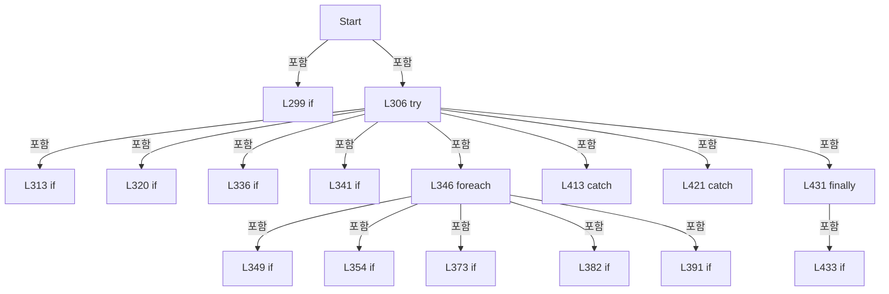

변경 전 점검: 입력/반환 타입, 위 호출자, 예외/취소 경로, 공유 상태와 저장·전송 소비자를 함께 확인합니다. 값의 단위나 물리 방향을 이름만으로 확정하지 않습니다.

### MethodDeclaration `Stop` · L441–451

[Drilling.Common/Review/CReviewManager.cs:441–451](https://github.com/kjuws10-rgb/A3Drilling/blob/96e22cd027c84bf302b23f2949b98985d7f301bb/Drilling.Common/Review/CReviewManager.cs#L441-L451)

| 항목 | 실제 추출 값 |
| --- | --- |
| 서명 | void Drilling.Common.Review.CReviewManager.Stop() |
| 접근/수식자 | Public / public |
| 반환/값 타입 | void |
| 소속 타입 | NamedType:Drilling.Common.Review.CReviewManager |

정적 호출자로 확인된 위치:

| 호출 파일/행 | 호출 표현식 | 런타임 분기 가능 |
| --- | --- | --- |
| [Drilling.UI/CRootView.cs:2675–2675](https://github.com/kjuws10-rgb/A3Drilling/blob/96e22cd027c84bf302b23f2949b98985d7f301bb/Drilling.UI/CRootView.cs#L2675-L2675) | _reviewManager.Stop | False |
| [Drilling.UI/Menu/Menus/CMenuCorrection.ReviewData.Reinspection.cs:336–336](https://github.com/kjuws10-rgb/A3Drilling/blob/96e22cd027c84bf302b23f2949b98985d7f301bb/Drilling.UI/Menu/Menus/CMenuCorrection.ReviewData.Reinspection.cs#L336-L336) | _reviewManager.Stop | False |
| [Drilling.UI/Menu/Menus/CMenuCorrection.ReviewData.Reinspection.cs:664–664](https://github.com/kjuws10-rgb/A3Drilling/blob/96e22cd027c84bf302b23f2949b98985d7f301bb/Drilling.UI/Menu/Menus/CMenuCorrection.ReviewData.Reinspection.cs#L664-L664) | _reviewManager.Stop | False |
| [Drilling.UI/Menu/Menus/CMenuCorrection.cs:2589–2589](https://github.com/kjuws10-rgb/A3Drilling/blob/96e22cd027c84bf302b23f2949b98985d7f301bb/Drilling.UI/Menu/Menus/CMenuCorrection.cs#L2589-L2589) | _reviewManager.Stop | False |
| [Drilling.UI/Menu/Menus/CMenuReview.cs:2342–2342](https://github.com/kjuws10-rgb/A3Drilling/blob/96e22cd027c84bf302b23f2949b98985d7f301bb/Drilling.UI/Menu/Menus/CMenuReview.cs#L2342-L2342) | _reviewManager.Stop | False |
| [Drilling.UI/Menu/Menus/CMenuReview.cs:4169–4169](https://github.com/kjuws10-rgb/A3Drilling/blob/96e22cd027c84bf302b23f2949b98985d7f301bb/Drilling.UI/Menu/Menus/CMenuReview.cs#L4169-L4169) | _reviewManager.Stop | False |

호출하는 대상과 해석 범위:

| 원본 행 | 표현식 | 분석 상태 | 대상/소스 위치 |
| --- | --- | --- | --- |
| 443 | Interlocked.Exchange | resolved | int System.Threading.Interlocked.Exchange(ref int, int) |
| 444 | .Stop | resolved | void Drilling.Common.Review.CReviewManager.CReviewStageMotion.Stop() · Drilling.Common/Review/CReviewManager.cs:2585 |
| 446 | WriteReviewLog | resolved | void Drilling.Common.Review.CReviewManager.WriteReviewLog(string, string) · Drilling.Common/Review/CReviewManager.cs:1022 |

본문의 실제 연산·분기·예외·반환 순서(원문 위치 순):

| 원본 행 | 종류 | 주석 해설 |
| --- | --- | --- |
| 443 | call | 함수·델리게이트 또는 객체 생성자를 호출합니다: Interlocked.Exchange(ref _stopRequested, 1) |
| 444 | call | 함수·델리게이트 또는 객체 생성자를 호출합니다: .Stop() |
| 445 | local-declaration | 지역 변수를 선언합니다: var plan = CurrentPlan; |
| 445 | variable-initializer | 변수의 초기값을 지정합니다: plan = CurrentPlan |
| 446 | call | 함수·델리게이트 또는 객체 생성자를 호출합니다: WriteReviewLog("STOP_REQUEST", "Review stop requested.") |
| 447 | if | 조건에 따라 분기합니다: if (SequenceState == EN_REVIEW_SEQUENCE_STATE.Running) |
| 449 | assignment | 값을 대상에 대입합니다: SequenceState = EN_REVIEW_SEQUENCE_STATE.Stopping |

제어 구문의 포함 구조(실제 실행 순서/CFG가 아닌 구문 탐색 그림):

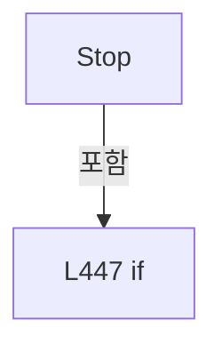

변경 전 점검: 입력/반환 타입, 위 호출자, 예외/취소 경로, 공유 상태와 저장·전송 소비자를 함께 확인합니다. 값의 단위나 물리 방향을 이름만으로 확정하지 않습니다.

### MethodDeclaration `FindIncompleteProductReview` · L453–464

[Drilling.Common/Review/CReviewManager.cs:453–464](https://github.com/kjuws10-rgb/A3Drilling/blob/96e22cd027c84bf302b23f2949b98985d7f301bb/Drilling.Common/Review/CReviewManager.cs#L453-L464)

| 항목 | 실제 추출 값 |
| --- | --- |
| 서명 | System.Threading.Tasks.Task<Drilling.Common.Product.ST_PRODUCT_REVIEW_DATA?> Drilling.Common.Review.CReviewManager.FindIncompleteProductReview(Drilling.Common.Review.ST_REVIEW_PLAN, string, System.Threading.CancellationToken) |
| 접근/수식자 | Public / public |
| 반환/값 타입 | System.Threading.Tasks.Task<Drilling.Common.Product.ST_PRODUCT_REVIEW_DATA?> |
| 소속 타입 | NamedType:Drilling.Common.Review.CReviewManager |

입력 계약:

| 이름 | 타입 | 전달 | 선택/기본값 |
| --- | --- | --- | --- |
| plan | Drilling.Common.Review.ST_REVIEW_PLAN | None | False /  |
| glassId | string | None | False /  |
| cancellationToken | System.Threading.CancellationToken | None | True / null |

정적 호출자로 확인된 위치:

| 호출 파일/행 | 호출 표현식 | 런타임 분기 가능 |
| --- | --- | --- |
| [Drilling.UI/Menu/Menus/CMenuReview.cs:4033–4033](https://github.com/kjuws10-rgb/A3Drilling/blob/96e22cd027c84bf302b23f2949b98985d7f301bb/Drilling.UI/Menu/Menus/CMenuReview.cs#L4033-L4033) | _reviewManager.FindIncompleteProductReview | False |

호출하는 대상과 해석 범위:

| 원본 행 | 표현식 | 분석 상태 | 대상/소스 위치 |
| --- | --- | --- | --- |
| 455 | cancellationToken.ThrowIfCancellationRequested | resolved | void System.Threading.CancellationToken.ThrowIfCancellationRequested() |
| 456 | FindInterruptedReviewCheckpoint | resolved | Drilling.Common.Product.ST_PRODUCT_REVIEW_DATA? Drilling.Common.Review.CReviewManager.FindInterruptedReviewCheckpoint(Drilling.Common.Review.ST_REVIEW_PLAN, string?) · Drilling.Common/Review/CReviewManager.cs:2598 |
| 457 | Task.FromResult<ST_PRODUCT_REVIEW_DATA?> | resolved | System.Threading.Tasks.Task<Drilling.Common.Product.ST_PRODUCT_REVIEW_DATA?> System.Threading.Tasks.Task.FromResult<Drilling.Common.Product.ST_PRODUCT_REVIEW_DATA?>(Drilling.Common.Product.ST_PRODUCT_REVIEW_DATA?) |
| 458 | string.IsNullOrWhiteSpace | resolved | bool string.IsNullOrWhiteSpace(string?) |
| 458 | product.GlassId.Equals | resolved | bool string.Equals(string?, System.StringComparison) |
| 458 | IsMatchingIncompleteReview | resolved | bool Drilling.Common.Review.CReviewManager.IsMatchingIncompleteReview(Drilling.Common.Review.ST_REVIEW_PLAN, string, Drilling.Common.Product.ST_PRODUCT_REVIEW_DATA) · Drilling.Common/Review/CReviewManager.cs:1675 |
| 460 | Task.FromResult<ST_PRODUCT_REVIEW_DATA?> | resolved | System.Threading.Tasks.Task<Drilling.Common.Product.ST_PRODUCT_REVIEW_DATA?> System.Threading.Tasks.Task.FromResult<Drilling.Common.Product.ST_PRODUCT_REVIEW_DATA?>(Drilling.Common.Product.ST_PRODUCT_REVIEW_DATA?) |
| 463 | Task.FromResult<ST_PRODUCT_REVIEW_DATA?> | resolved | System.Threading.Tasks.Task<Drilling.Common.Product.ST_PRODUCT_REVIEW_DATA?> System.Threading.Tasks.Task.FromResult<Drilling.Common.Product.ST_PRODUCT_REVIEW_DATA?>(Drilling.Common.Product.ST_PRODUCT_REVIEW_DATA?) |

본문의 실제 연산·분기·예외·반환 순서(원문 위치 순):

| 원본 행 | 종류 | 주석 해설 |
| --- | --- | --- |
| 455 | call | 함수·델리게이트 또는 객체 생성자를 호출합니다: cancellationToken.ThrowIfCancellationRequested() |
| 456 | call | 함수·델리게이트 또는 객체 생성자를 호출합니다: FindInterruptedReviewCheckpoint(plan, glassId) |
| 456 | if | 조건에 따라 분기합니다: if (FindInterruptedReviewCheckpoint(plan, glassId)is { } interrupted) |
| 457 | call | 함수·델리게이트 또는 객체 생성자를 호출합니다: Task.FromResult<ST_PRODUCT_REVIEW_DATA?>(interrupted) |
| 457 | return | 호출자에게 값 또는 제어를 반환합니다: return Task.FromResult<ST_PRODUCT_REVIEW_DATA?>(interrupted); |
| 458 | call | 함수·델리게이트 또는 객체 생성자를 호출합니다: string.IsNullOrWhiteSpace(glassId) |
| 458 | call | 함수·델리게이트 또는 객체 생성자를 호출합니다: product.GlassId.Equals(glassId, StringComparison.OrdinalIgnoreCase) |
| 458 | call | 함수·델리게이트 또는 객체 생성자를 호출합니다: IsMatchingIncompleteReview(plan, product.RecipeId, product.Review) |
| 458 | if | 조건에 따라 분기합니다: if (string.IsNullOrWhiteSpace(glassId) &#124;&#124; productManager?.Current is not { } product &#124;&#124; !product.GlassId.Equals(glassId, StringComparison.OrdinalIgnoreCase) &#124;&#124; !IsMatchingIncompleteReview(plan, product.RecipeId, product.Revi…) |
| 460 | call | 함수·델리게이트 또는 객체 생성자를 호출합니다: Task.FromResult<ST_PRODUCT_REVIEW_DATA?>(null) |
| 460 | return | 호출자에게 값 또는 제어를 반환합니다: return Task.FromResult<ST_PRODUCT_REVIEW_DATA?>(null); |
| 463 | call | 함수·델리게이트 또는 객체 생성자를 호출합니다: Task.FromResult<ST_PRODUCT_REVIEW_DATA?>(product.Review) |
| 463 | return | 호출자에게 값 또는 제어를 반환합니다: return Task.FromResult<ST_PRODUCT_REVIEW_DATA?>(product.Review); |

제어 구문의 포함 구조(실제 실행 순서/CFG가 아닌 구문 탐색 그림):

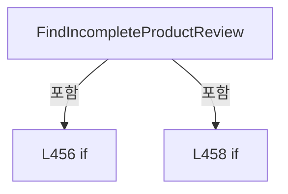

변경 전 점검: 입력/반환 타입, 위 호출자, 예외/취소 경로, 공유 상태와 저장·전송 소비자를 함께 확인합니다. 값의 단위나 물리 방향을 이름만으로 확정하지 않습니다.

### MethodDeclaration `GetScannerAxisTransform` · L466–474

[Drilling.Common/Review/CReviewManager.cs:466–474](https://github.com/kjuws10-rgb/A3Drilling/blob/96e22cd027c84bf302b23f2949b98985d7f301bb/Drilling.Common/Review/CReviewManager.cs#L466-L474)

| 항목 | 실제 추출 값 |
| --- | --- |
| 서명 | Drilling.Common.Recipe.ST_SCANNER_AXIS_TRANSFORM Drilling.Common.Review.CReviewManager.GetScannerAxisTransform(int) |
| 접근/수식자 | Public / public |
| 반환/값 타입 | Drilling.Common.Recipe.ST_SCANNER_AXIS_TRANSFORM |
| 소속 타입 | NamedType:Drilling.Common.Review.CReviewManager |

입력 계약:

| 이름 | 타입 | 전달 | 선택/기본값 |
| --- | --- | --- | --- |
| headNo | int | None | False /  |

현재 부분 분석에서 직접 연결된 호출자는 없습니다. XAML/이벤트/인터페이스·델리게이트·외부 진입을 추가 확인해야 하며, 미사용으로 판정한 것이 아닙니다.

호출하는 대상과 해석 범위:

| 원본 행 | 표현식 | 분석 상태 | 대상/소스 위치 |
| --- | --- | --- | --- |
| 470 | new ArgumentOutOfRangeException | resolved | System.ArgumentOutOfRangeException.ArgumentOutOfRangeException(string?, object?, string?) |
| 470 | nameof | unresolved | None |
| 473 | CScannerAxisTransform.Read | resolved | Drilling.Common.Recipe.ST_SCANNER_AXIS_TRANSFORM Drilling.Common.Recipe.CScannerAxisTransform.Read(System.Collections.Generic.IReadOnlyList<Drilling.Common.Managers.ST_SYSTEM_PARAMETER>, int) · Drilling.Common/Recipe/CShotCoordinatePlanBuilder.cs:1246 |
| 473 | settingManager.LoadSection | resolved | System.Collections.Generic.IReadOnlyList<Drilling.Common.Managers.ST_SYSTEM_PARAMETER> Drilling.Common.Managers.CSettingManager.LoadSection(Drilling.Common.Managers.EN_SETTING_TAB, System.Threading.CancellationToken) · Drilling.Common/Managers/CSettingManager.cs:26 |

본문의 실제 연산·분기·예외·반환 순서(원문 위치 순):

| 원본 행 | 종류 | 주석 해설 |
| --- | --- | --- |
| 468 | if | 조건에 따라 분기합니다: if (headNo is < 1 or > DefaultHeadCount) |
| 470 | call | 함수·델리게이트 또는 객체 생성자를 호출합니다: new ArgumentOutOfRangeException(nameof(headNo), headNo, $"Head number must be between 1 and {DefaultHeadCount}.") |
| 470 | call | 함수·델리게이트 또는 객체 생성자를 호출합니다: nameof(headNo) |
| 470 | throw | 예외를 발생/전달합니다: throw new ArgumentOutOfRangeException(nameof(headNo), headNo, $"Head number must be between 1 and {DefaultHeadCount}."); |
| 473 | call | 함수·델리게이트 또는 객체 생성자를 호출합니다: CScannerAxisTransform.Read(settingManager.LoadSection(EN_SETTING_TAB.Option), headNo) |
| 473 | call | 함수·델리게이트 또는 객체 생성자를 호출합니다: settingManager.LoadSection(EN_SETTING_TAB.Option) |
| 473 | return | 호출자에게 값 또는 제어를 반환합니다: return CScannerAxisTransform.Read(settingManager.LoadSection(EN_SETTING_TAB.Option), headNo); |

제어 구문의 포함 구조(실제 실행 순서/CFG가 아닌 구문 탐색 그림):

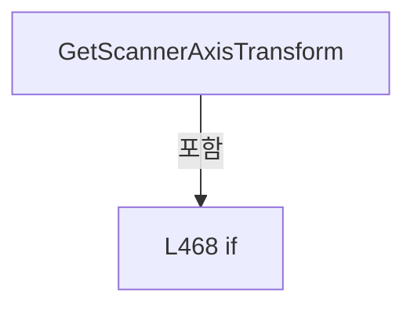

변경 전 점검: 입력/반환 타입, 위 호출자, 예외/취소 경로, 공유 상태와 저장·전송 소비자를 함께 확인합니다. 값의 단위나 물리 방향을 이름만으로 확정하지 않습니다.

### MethodDeclaration `RetryRemaining` · L476–494

[Drilling.Common/Review/CReviewManager.cs:476–494](https://github.com/kjuws10-rgb/A3Drilling/blob/96e22cd027c84bf302b23f2949b98985d7f301bb/Drilling.Common/Review/CReviewManager.cs#L476-L494)

| 항목 | 실제 추출 값 |
| --- | --- |
| 서명 | System.Threading.Tasks.Task<Drilling.Common.Review.ST_REVIEW_SEQUENCE_STATUS> Drilling.Common.Review.CReviewManager.RetryRemaining(System.Action<Drilling.Common.Review.ST_REVIEW_PLAN>?, System.Threading.CancellationToken) |
| 접근/수식자 | Public / public, async |
| 반환/값 타입 | System.Threading.Tasks.Task<Drilling.Common.Review.ST_REVIEW_SEQUENCE_STATUS> |
| 소속 타입 | NamedType:Drilling.Common.Review.CReviewManager |

입력 계약:

| 이름 | 타입 | 전달 | 선택/기본값 |
| --- | --- | --- | --- |
| progress | System.Action<Drilling.Common.Review.ST_REVIEW_PLAN>? | None | True / null |
| cancellationToken | System.Threading.CancellationToken | None | True / null |

정적 호출자로 확인된 위치:

| 호출 파일/행 | 호출 표현식 | 런타임 분기 가능 |
| --- | --- | --- |
| [Drilling.UI/Menu/Menus/CMenuReview.cs:4196–4196](https://github.com/kjuws10-rgb/A3Drilling/blob/96e22cd027c84bf302b23f2949b98985d7f301bb/Drilling.UI/Menu/Menus/CMenuReview.cs#L4196-L4196) | _reviewManager.RetryRemaining | False |

호출하는 대상과 해석 범위:

| 원본 행 | 표현식 | 분석 상태 | 대상/소스 위치 |
| --- | --- | --- | --- |
| 481 | new ST_REVIEW_SEQUENCE_STATUS | resolved | Drilling.Common.Review.ST_REVIEW_SEQUENCE_STATUS.ST_REVIEW_SEQUENCE_STATUS(Drilling.Common.Review.EN_REVIEW_SEQUENCE_STATE, int, int, int, string) · Drilling.Common/Review/CReviewManager.cs:4045 |
| 484 | SetWaitingPointsReady | resolved | Drilling.Common.Review.ST_REVIEW_PLAN Drilling.Common.Review.CReviewManager.SetWaitingPointsReady(Drilling.Common.Review.ST_REVIEW_PLAN) · Drilling.Common/Review/CReviewManager.cs:1089 |
| 485 | SetCurrentPlan | resolved | void Drilling.Common.Review.CReviewManager.SetCurrentPlan(Drilling.Common.Review.ST_REVIEW_PLAN, System.Action<Drilling.Common.Review.ST_REVIEW_PLAN>?) · Drilling.Common/Review/CReviewManager.cs:1045 |
| 486 | plan.ReviewPoints.Where | resolved | System.Collections.Generic.IEnumerable<Drilling.Common.Review.ST_REVIEW_PLAN_POINT> System.Collections.Generic.IEnumerable<Drilling.Common.Review.ST_REVIEW_PLAN_POINT>.Where<Drilling.Common.Review.ST_REVIEW_PLAN_POINT>(System.Func<Drilling.Common.Review.ST_REVIEW_PLAN_POINT, bool>) |
| 487 | OrderByReviewSequence(points).ToArray | resolved | Drilling.Common.Review.ST_REVIEW_PLAN_POINT[] System.Collections.Generic.IEnumerable<Drilling.Common.Review.ST_REVIEW_PLAN_POINT>.ToArray<Drilling.Common.Review.ST_REVIEW_PLAN_POINT>() |
| 487 | OrderByReviewSequence | resolved | System.Collections.Generic.IReadOnlyList<Drilling.Common.Review.ST_REVIEW_PLAN_POINT> Drilling.Common.Review.CReviewManager.OrderByReviewSequence(System.Collections.Generic.IEnumerable<Drilling.Common.Review.ST_REVIEW_PLAN_POINT>) · Drilling.Common/Review/CReviewManager.cs:1178 |
| 490 | CreateStatus | resolved | Drilling.Common.Review.ST_REVIEW_SEQUENCE_STATUS Drilling.Common.Review.CReviewManager.CreateStatus(Drilling.Common.Review.ST_REVIEW_PLAN, Drilling.Common.Review.EN_REVIEW_SEQUENCE_STATE, string) · Drilling.Common/Review/CReviewManager.cs:1115 |
| 493 | RunRetryPoints | resolved | System.Threading.Tasks.Task<Drilling.Common.Review.ST_REVIEW_SEQUENCE_STATUS> Drilling.Common.Review.CReviewManager.RunRetryPoints(System.Collections.Generic.IReadOnlyList<Drilling.Common.Review.ST_REVIEW_PLAN_POINT>, string, System.Action<Drilling.Common.Review.ST_REVIEW_PLAN>?, System.Threading.CancellationToken) · Drilling.Common/Review/CReviewManager.cs:2406 |

본문의 실제 연산·분기·예외·반환 순서(원문 위치 순):

| 원본 행 | 종류 | 주석 해설 |
| --- | --- | --- |
| 478 | local-declaration | 지역 변수를 선언합니다: var plan = CurrentPlan; |
| 478 | variable-initializer | 변수의 초기값을 지정합니다: plan = CurrentPlan |
| 479 | if | 조건에 따라 분기합니다: if (plan is null) |
| 481 | call | 함수·델리게이트 또는 객체 생성자를 호출합니다: new ST_REVIEW_SEQUENCE_STATUS(EN_REVIEW_SEQUENCE_STATE.Idle, 0, 0, 0, "Review plan is empty.") |
| 481 | return | 호출자에게 값 또는 제어를 반환합니다: return new ST_REVIEW_SEQUENCE_STATUS(EN_REVIEW_SEQUENCE_STATE.Idle, 0, 0, 0, "Review plan is empty."); |
| 484 | assignment | 값을 대상에 대입합니다: plan = SetWaitingPointsReady(plan) |
| 484 | call | 함수·델리게이트 또는 객체 생성자를 호출합니다: SetWaitingPointsReady(plan) |
| 485 | call | 함수·델리게이트 또는 객체 생성자를 호출합니다: SetCurrentPlan(plan, progress) |
| 486 | call | 함수·델리게이트 또는 객체 생성자를 호출합니다: plan.ReviewPoints.Where(point => point.State == EN_REVIEW_POINT_STATE.Ready) |
| 486 | local-declaration | 지역 변수를 선언합니다: var points = plan.ReviewPoints.Where(point => point.State == EN_REVIEW_POINT_STATE.Ready); |
| 486 | variable-initializer | 변수의 초기값을 지정합니다: points = plan.ReviewPoints.Where(point => point.State == EN_REVIEW_POINT_STATE.Ready) |
| 487 | call | 함수·델리게이트 또는 객체 생성자를 호출합니다: OrderByReviewSequence(points).ToArray() |
| 487 | call | 함수·델리게이트 또는 객체 생성자를 호출합니다: OrderByReviewSequence(points) |
| 487 | local-declaration | 지역 변수를 선언합니다: var orderedPoints = OrderByReviewSequence(points).ToArray(); |
| 487 | variable-initializer | 변수의 초기값을 지정합니다: orderedPoints = OrderByReviewSequence(points).ToArray() |
| 488 | if | 조건에 따라 분기합니다: if (orderedPoints.Length == 0) |
| 490 | call | 함수·델리게이트 또는 객체 생성자를 호출합니다: CreateStatus(plan, SequenceState, "Ready review point is empty.") |
| 490 | return | 호출자에게 값 또는 제어를 반환합니다: return CreateStatus(plan, SequenceState, "Ready review point is empty."); |
| 493 | await | 비동기 완료를 기다립니다: await RunRetryPoints(orderedPoints, "Review ready point retry completed.", progress, cancellationToken) |
| 493 | call | 함수·델리게이트 또는 객체 생성자를 호출합니다: RunRetryPoints(orderedPoints, "Review ready point retry completed.", progress, cancellationToken) |
| 493 | return | 호출자에게 값 또는 제어를 반환합니다: return await RunRetryPoints(orderedPoints, "Review ready point retry completed.", progress, cancellationToken); |

제어 구문의 포함 구조(실제 실행 순서/CFG가 아닌 구문 탐색 그림):

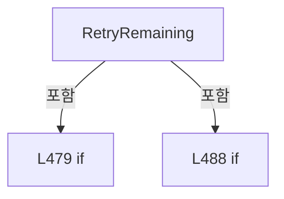

변경 전 점검: 입력/반환 타입, 위 호출자, 예외/취소 경로, 공유 상태와 저장·전송 소비자를 함께 확인합니다. 값의 단위나 물리 방향을 이름만으로 확정하지 않습니다.

### MethodDeclaration `CreatePlanCore` · L496–548

[Drilling.Common/Review/CReviewManager.cs:496–548](https://github.com/kjuws10-rgb/A3Drilling/blob/96e22cd027c84bf302b23f2949b98985d7f301bb/Drilling.Common/Review/CReviewManager.cs#L496-L548)

| 항목 | 실제 추출 값 |
| --- | --- |
| 서명 | Drilling.Common.Review.ST_REVIEW_PLAN Drilling.Common.Review.CReviewManager.CreatePlanCore(Drilling.Common.Managers.ST_RECIPE_DEFINITION, System.Func<Drilling.Common.Review.ST_REVIEW_PLAN_POINT, bool>, int, bool, double, double) |
| 접근/수식자 | Private / private |
| 반환/값 타입 | Drilling.Common.Review.ST_REVIEW_PLAN |
| 소속 타입 | NamedType:Drilling.Common.Review.CReviewManager |

입력 계약:

| 이름 | 타입 | 전달 | 선택/기본값 |
| --- | --- | --- | --- |
| recipe | Drilling.Common.Managers.ST_RECIPE_DEFINITION | None | False /  |
| useSelector | System.Func<Drilling.Common.Review.ST_REVIEW_PLAN_POINT, bool> | None | False /  |
| selectedBeamNo | int | None | True / 1 |
| selectAllAssignedPoints | bool | None | True / false |
| shiftOffsetX | double | None | True / 0 |
| shiftOffsetY | double | None | True / 0 |

정적 호출자로 확인된 위치:

| 호출 파일/행 | 호출 표현식 | 런타임 분기 가능 |
| --- | --- | --- |
| [Drilling.Common/Review/CReviewManager.cs:208–208](https://github.com/kjuws10-rgb/A3Drilling/blob/96e22cd027c84bf302b23f2949b98985d7f301bb/Drilling.Common/Review/CReviewManager.cs#L208-L208) | CreatePlanCore | False |

호출하는 대상과 해석 범위:

| 원본 행 | 표현식 | 분석 상태 | 대상/소스 위치 |
| --- | --- | --- | --- |
| 505 | ReadRequiredCellCount | resolved | int Drilling.Common.Review.CReviewManager.ReadRequiredCellCount(Drilling.Common.Managers.ST_RECIPE_DEFINITION, string) · Drilling.Common/Review/CReviewManager.cs:1286 |
| 506 | ReadDouble | resolved | double Drilling.Common.Review.CReviewManager.ReadDouble(Drilling.Common.Managers.ST_RECIPE_DEFINITION, double, params string[]) · Drilling.Common/Review/CReviewManager.cs:1315 |
| 507 | ReadDouble | resolved | double Drilling.Common.Review.CReviewManager.ReadDouble(Drilling.Common.Managers.ST_RECIPE_DEFINITION, double, params string[]) · Drilling.Common/Review/CReviewManager.cs:1315 |
| 508 | LoadReviewCoordinateSettings | resolved | Drilling.Common.Review.CReviewManager.ST_REVIEW_COORDINATE_SETTINGS Drilling.Common.Review.CReviewManager.LoadReviewCoordinateSettings(Drilling.Common.Managers.ST_RECIPE_DEFINITION) · Drilling.Common/Review/CReviewManager.cs:594 |
| 509 | BuildRuntimeCoordinateParameters | resolved | System.Collections.Generic.IReadOnlyDictionary<string, string> Drilling.Common.Review.CReviewManager.BuildRuntimeCoordinateParameters(Drilling.Common.Managers.ST_RECIPE_DEFINITION) · Drilling.Common/Review/CReviewManager.cs:568 |
| 510 | CShotCoordinatePlanBuilder.ReadDirection | resolved | double Drilling.Common.Recipe.CShotCoordinatePlanBuilder.ReadDirection(System.Collections.Generic.IReadOnlyDictionary<string, string>, double, params string[]) · Drilling.Common/Recipe/CShotCoordinatePlanBuilder.cs:505 |
| 511 | CShotCoordinatePlanBuilder.Build | resolved | Drilling.Common.Recipe.ST_SHOT_COORDINATE_PLAN Drilling.Common.Recipe.CShotCoordinatePlanBuilder.Build(System.Collections.Generic.IReadOnlyDictionary<string, string>) · Drilling.Common/Recipe/CShotCoordinatePlanBuilder.cs:11 |
| 512 | BuildReviewExcludedShots | resolved | System.Collections.Generic.IReadOnlyDictionary<string, string> Drilling.Common.Review.CReviewManager.BuildReviewExcludedShots(System.Collections.Generic.IReadOnlyDictionary<string, string>, System.Collections.Generic.IReadOnlyList<Drilling.Common.Recipe.ST_HEAD_SHOT_POINT>) · Drilling.Common/Review/CReviewManager.cs:550 |
| 513 | processCoordinatePlan.Shots.GroupBy(shot => (shot.CellNo, shot.CellShotNo)).ToDictionary | resolved | System.Collections.Generic.Dictionary<(int CellNo, int CellShotNo), int> System.Collections.Generic.IEnumerable<System.Linq.IGrouping<(int CellNo, int CellShotNo), Drilling.Common.Recipe.ST_HEAD_SHOT_POINT>>.ToDictionary<System.Linq.IGrouping<(int CellNo, int CellShotNo), Drilling.Common.Recipe.ST_HEAD_SHOT_POINT>, (int CellNo, int CellShotNo), int>(System.Func<System.Linq.IGrouping<(int CellNo, int CellShotNo), Drilling.Common.Recipe.ST_HEAD_SHOT_POINT>, (int CellNo, int CellShotNo)>, System.Func<System.Linq.IGrouping<(int CellNo, int CellShotNo), Drilling.Common.Recipe.ST_HEAD_SHOT_POINT>, int>) |
| 513 | processCoordinatePlan.Shots.GroupBy | resolved | System.Collections.Generic.IEnumerable<System.Linq.IGrouping<(int CellNo, int CellShotNo), Drilling.Common.Recipe.ST_HEAD_SHOT_POINT>> System.Collections.Generic.IEnumerable<Drilling.Common.Recipe.ST_HEAD_SHOT_POINT>.GroupBy<Drilling.Common.Recipe.ST_HEAD_SHOT_POINT, (int CellNo, int CellShotNo)>(System.Func<Drilling.Common.Recipe.ST_HEAD_SHOT_POINT, (int CellNo, int CellShotNo)>) |
| 513 | group.Last | resolved | Drilling.Common.Recipe.ST_HEAD_SHOT_POINT System.Collections.Generic.IEnumerable<Drilling.Common.Recipe.ST_HEAD_SHOT_POINT>.Last<Drilling.Common.Recipe.ST_HEAD_SHOT_POINT>() |
| 514 | BuildShotPoints | resolved | System.Collections.Generic.IReadOnlyList<Drilling.Common.Review.ST_REVIEW_PLAN_POINT> Drilling.Common.Review.CReviewManager.BuildShotPoints(Drilling.Common.Managers.ST_RECIPE_DEFINITION, int, int, Drilling.Common.Review.CReviewManager.ST_REVIEW_COORDINATE_SETTINGS, System.Collections.Generic.IReadOnlyDictionary<(int CellNo, int CellShotNo), int>, double, int, bool, System.Collections.Generic.IReadOnlyDictionary<string, string>, double, double) · Drilling.Common/Review/CReviewManager.cs:674 |
| 528 | points.Select(point => { var use = point.HeadNo > 0 && !excludedShots.ContainsKey(point.ShotKey) && useSelector(point); return point with { BeamNo = selectedBeamNo, Use = use, State = use ? EN_REVIEW_POINT_STATE.Ready : EN_REVIEW_POINT_STATE.Skip, Judge = use ? "WAIT" : "-" }; }).ToArray | resolved | Drilling.Common.Review.ST_REVIEW_PLAN_POINT[] System.Collections.Generic.IEnumerable<Drilling.Common.Review.ST_REVIEW_PLAN_POINT>.ToArray<Drilling.Common.Review.ST_REVIEW_PLAN_POINT>() |
| 528 | points.Select | resolved | System.Collections.Generic.IEnumerable<Drilling.Common.Review.ST_REVIEW_PLAN_POINT> System.Collections.Generic.IEnumerable<Drilling.Common.Review.ST_REVIEW_PLAN_POINT>.Select<Drilling.Common.Review.ST_REVIEW_PLAN_POINT, Drilling.Common.Review.ST_REVIEW_PLAN_POINT>(System.Func<Drilling.Common.Review.ST_REVIEW_PLAN_POINT, Drilling.Common.Review.ST_REVIEW_PLAN_POINT>) |
| 530 | excludedShots.ContainsKey | resolved · 동적 구현 선택 가능 | bool System.Collections.Generic.IReadOnlyDictionary<string, string>.ContainsKey(string) |
| 530 | useSelector | resolved · 동적 구현 선택 가능 | bool System.Func<Drilling.Common.Review.ST_REVIEW_PLAN_POINT, bool>.Invoke(Drilling.Common.Review.ST_REVIEW_PLAN_POINT) |
| 541 | new ST_REVIEW_PLAN | resolved | Drilling.Common.Review.ST_REVIEW_PLAN.ST_REVIEW_PLAN(string, int, double, double, Drilling.Common.Review.EN_VISION_FLIP_TYPE, System.DateTimeOffset, System.Collections.Generic.IReadOnlyList<Drilling.Common.Review.ST_REVIEW_PLAN_POINT>) · Drilling.Common/Review/CReviewManager.cs:4144 |
| 544 | ReadDouble | resolved | double Drilling.Common.Review.CReviewManager.ReadDouble(Drilling.Common.Managers.ST_RECIPE_DEFINITION, double, params string[]) · Drilling.Common/Review/CReviewManager.cs:1315 |

본문의 실제 연산·분기·예외·반환 순서(원문 위치 순):

| 원본 행 | 종류 | 주석 해설 |
| --- | --- | --- |
| 504 | local-declaration | 지역 변수를 선언합니다: const int headCount = DefaultHeadCount; |
| 504 | variable-initializer | 변수의 초기값을 지정합니다: headCount = DefaultHeadCount |
| 505 | call | 함수·델리게이트 또는 객체 생성자를 호출합니다: ReadRequiredCellCount(recipe, "MAX_CELL_NUMBER") |
| 505 | local-declaration | 지역 변수를 선언합니다: var cellCount = ReadRequiredCellCount(recipe, "MAX_CELL_NUMBER"); |
| 505 | variable-initializer | 변수의 초기값을 지정합니다: cellCount = ReadRequiredCellCount(recipe, "MAX_CELL_NUMBER") |
| 506 | call | 함수·델리게이트 또는 객체 생성자를 호출합니다: ReadDouble(recipe, 0.030, "REVIEW_TOLERANCE_X") |
| 506 | local-declaration | 지역 변수를 선언합니다: var toleranceX = ReadDouble(recipe, 0.030, "REVIEW_TOLERANCE_X"); |
| 506 | variable-initializer | 변수의 초기값을 지정합니다: toleranceX = ReadDouble(recipe, 0.030, "REVIEW_TOLERANCE_X") |
| 507 | call | 함수·델리게이트 또는 객체 생성자를 호출합니다: ReadDouble(recipe, 0.030, "REVIEW_TOLERANCE_Y") |
| 507 | local-declaration | 지역 변수를 선언합니다: var toleranceY = ReadDouble(recipe, 0.030, "REVIEW_TOLERANCE_Y"); |
| 507 | variable-initializer | 변수의 초기값을 지정합니다: toleranceY = ReadDouble(recipe, 0.030, "REVIEW_TOLERANCE_Y") |
| 508 | call | 함수·델리게이트 또는 객체 생성자를 호출합니다: LoadReviewCoordinateSettings(recipe) |
| 508 | local-declaration | 지역 변수를 선언합니다: var coordinateSettings = LoadReviewCoordinateSettings(recipe); |
| 508 | variable-initializer | 변수의 초기값을 지정합니다: coordinateSettings = LoadReviewCoordinateSettings(recipe) |
| 509 | call | 함수·델리게이트 또는 객체 생성자를 호출합니다: BuildRuntimeCoordinateParameters(recipe) |
| 509 | local-declaration | 지역 변수를 선언합니다: var runtimeCoordinateParameters = BuildRuntimeCoordinateParameters(recipe); |
| 509 | variable-initializer | 변수의 초기값을 지정합니다: runtimeCoordinateParameters = BuildRuntimeCoordinateParameters(recipe) |
| 510 | call | 함수·델리게이트 또는 객체 생성자를 호출합니다: CShotCoordinatePlanBuilder.ReadDirection(runtimeCoordinateParameters, -1.0, "STAGE_SCAN_DIRECTION_Y") |
| 510 | local-declaration | 지역 변수를 선언합니다: var stageScanDirectionY = CShotCoordinatePlanBuilder.ReadDirection(runtimeCoordinateParameters, -1.0, "STAGE_SCAN_DIRECTION_Y"); |
| 510 | variable-initializer | 변수의 초기값을 지정합니다: stageScanDirectionY = CShotCoordinatePlanBuilder.ReadDirection(runtimeCoordinateParameters, -1.0, "STAGE_SCAN_DIRECTION_Y") |
| 511 | call | 함수·델리게이트 또는 객체 생성자를 호출합니다: CShotCoordinatePlanBuilder.Build(runtimeCoordinateParameters) |
| 511 | local-declaration | 지역 변수를 선언합니다: var processCoordinatePlan = CShotCoordinatePlanBuilder.Build(runtimeCoordinateParameters); |
| 511 | variable-initializer | 변수의 초기값을 지정합니다: processCoordinatePlan = CShotCoordinatePlanBuilder.Build(runtimeCoordinateParameters) |
| 512 | call | 함수·델리게이트 또는 객체 생성자를 호출합니다: BuildReviewExcludedShots(runtimeCoordinateParameters, processCoordinatePlan.Shots) |
| 512 | local-declaration | 지역 변수를 선언합니다: var excludedShots = BuildReviewExcludedShots(runtimeCoordinateParameters, processCoordinatePlan.Shots); |
| 512 | variable-initializer | 변수의 초기값을 지정합니다: excludedShots = BuildReviewExcludedShots(runtimeCoordinateParameters, processCoordinatePlan.Shots) |
| 513 | call | 함수·델리게이트 또는 객체 생성자를 호출합니다: processCoordinatePlan.Shots.GroupBy(shot => (shot.CellNo, shot.CellShotNo)).ToDictionary(group => group.Key, group => group.Last().HeadNo) |
| 513 | call | 함수·델리게이트 또는 객체 생성자를 호출합니다: processCoordinatePlan.Shots.GroupBy(shot => (shot.CellNo, shot.CellShotNo)) |
| 513 | call | 함수·델리게이트 또는 객체 생성자를 호출합니다: group.Last() |
| 513 | local-declaration | 지역 변수를 선언합니다: var assignedHeadNos = processCoordinatePlan.Shots.GroupBy(shot => (shot.CellNo, shot.CellShotNo)).ToDictionary(group => group.Key, group => group.Last().HeadNo); |
| 513 | variable-initializer | 변수의 초기값을 지정합니다: assignedHeadNos = processCoordinatePlan.Shots.GroupBy(shot => (shot.CellNo, shot.CellShotNo)).ToDictionary(group => group.Key, group => group.Last().HeadNo) |
| 514 | call | 함수·델리게이트 또는 객체 생성자를 호출합니다: BuildShotPoints( recipe, headCount, cellCount, coordinateSettings, assignedHeadNos, stageScanDirectionY, selectedBeamNo, selectAllAssignedPoints, excludedShots, shiftOffsetX, shiftOffsetY) |
| 514 | local-declaration | 지역 변수를 선언합니다: IReadOnlyList<ST_REVIEW_PLAN_POINT> points = BuildShotPoints( recipe, headCount, cellCount, coordinateSettings, assignedHeadNos, stageScanDirectionY, selectedBeamNo, selectAllAssignedPoints, excludedShots, shiftOffsetX, shiftOffse |
| 514 | variable-initializer | 변수의 초기값을 지정합니다: points = BuildShotPoints( recipe, headCount, cellCount, coordinateSettings, assignedHeadNos, stageScanDirectionY, selectedBeamNo, selectAllAssignedPoints, excludedShots, shiftOffsetX, shiftOffsetY) |
| 526 | if | 조건에 따라 분기합니다: if (!selectAllAssignedPoints) |
| 528 | assignment | 값을 대상에 대입합니다: points = points.Select(point => { var use = point.HeadNo > 0 && !excludedShots.ContainsKey(point.ShotKey) && useSelector(point); return point with { BeamNo = selectedBeamNo, Use = use, State = use ? EN_REVIEW_POINT_STATE.Ready : E |
| 528 | call | 함수·델리게이트 또는 객체 생성자를 호출합니다: points.Select(point => { var use = point.HeadNo > 0 && !excludedShots.ContainsKey(point.ShotKey) && useSelector(point); return point with { BeamNo = selectedBeamNo, Use = use, State = use ? EN_REVIEW_POINT_STATE.Ready : … |
| 528 | call | 함수·델리게이트 또는 객체 생성자를 호출합니다: points.Select(point => { var use = point.HeadNo > 0 && !excludedShots.ContainsKey(point.ShotKey) && useSelector(point); return point with { BeamNo = selectedBeamNo, Use = use, State = use ? EN_REVIEW_POINT_STATE.Ready : … |
| 530 | call | 함수·델리게이트 또는 객체 생성자를 호출합니다: excludedShots.ContainsKey(point.ShotKey) |
| 530 | call | 함수·델리게이트 또는 객체 생성자를 호출합니다: useSelector(point) |
| 530 | local-declaration | 지역 변수를 선언합니다: var use = point.HeadNo > 0 && !excludedShots.ContainsKey(point.ShotKey) && useSelector(point); |
| 530 | variable-initializer | 변수의 초기값을 지정합니다: use = point.HeadNo > 0 && !excludedShots.ContainsKey(point.ShotKey) && useSelector(point) |
| 531 | return | 호출자에게 값 또는 제어를 반환합니다: return point with { BeamNo = selectedBeamNo, Use = use, State = use ? EN_REVIEW_POINT_STATE.Ready : EN_REVIEW_POINT_STATE.Skip, Judge = use ? "WAIT" : "-" }; |
| 533 | assignment | 값을 대상에 대입합니다: BeamNo = selectedBeamNo |
| 534 | assignment | 값을 대상에 대입합니다: Use = use |
| 535 | assignment | 값을 대상에 대입합니다: State = use ? EN_REVIEW_POINT_STATE.Ready : EN_REVIEW_POINT_STATE.Skip |
| 535 | conditional-expression | 조건에 따라 결과식을 선택합니다: use ? EN_REVIEW_POINT_STATE.Ready : EN_REVIEW_POINT_STATE.Skip |
| 536 | assignment | 값을 대상에 대입합니다: Judge = use ? "WAIT" : "-" |
| 536 | conditional-expression | 조건에 따라 결과식을 선택합니다: use ? "WAIT" : "-" |
| 541 | call | 함수·델리게이트 또는 객체 생성자를 호출합니다: new ST_REVIEW_PLAN(recipe.Id, cellCount, toleranceX, toleranceY, coordinateSettings.VisionFlipType, DateTimeOffset.Now, points) { StageScanDirectionY = stageScanDirectionY, StageSpeed = ReadDouble(recipe, 0, "STAGE_SPEED… |
| 541 | return | 호출자에게 값 또는 제어를 반환합니다: return new ST_REVIEW_PLAN(recipe.Id, cellCount, toleranceX, toleranceY, coordinateSettings.VisionFlipType, DateTimeOffset.Now, points) { StageScanDirectionY = stageScanDirectionY, StageSpeed = ReadDouble(recipe, 0, "STAGE_SPEED"), |
| 543 | assignment | 값을 대상에 대입합니다: StageScanDirectionY = stageScanDirectionY |
| 544 | assignment | 값을 대상에 대입합니다: StageSpeed = ReadDouble(recipe, 0, "STAGE_SPEED") |
| 544 | call | 함수·델리게이트 또는 객체 생성자를 호출합니다: ReadDouble(recipe, 0, "STAGE_SPEED") |
| 545 | assignment | 값을 대상에 대입합니다: ShiftOffsetX = shiftOffsetX |
| 546 | assignment | 값을 대상에 대입합니다: ShiftOffsetY = shiftOffsetY |

제어 구문의 포함 구조(실제 실행 순서/CFG가 아닌 구문 탐색 그림):

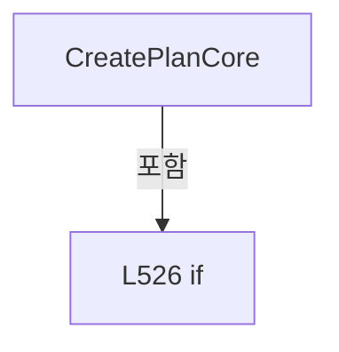

변경 전 점검: 입력/반환 타입, 위 호출자, 예외/취소 경로, 공유 상태와 저장·전송 소비자를 함께 확인합니다. 값의 단위나 물리 방향을 이름만으로 확정하지 않습니다.

### MethodDeclaration `BuildReviewExcludedShots` · L550–566

[Drilling.Common/Review/CReviewManager.cs:550–566](https://github.com/kjuws10-rgb/A3Drilling/blob/96e22cd027c84bf302b23f2949b98985d7f301bb/Drilling.Common/Review/CReviewManager.cs#L550-L566)

| 항목 | 실제 추출 값 |
| --- | --- |
| 서명 | System.Collections.Generic.IReadOnlyDictionary<string, string> Drilling.Common.Review.CReviewManager.BuildReviewExcludedShots(System.Collections.Generic.IReadOnlyDictionary<string, string>, System.Collections.Generic.IReadOnlyList<Drilling.Common.Recipe.ST_HEAD_SHOT_POINT>) |
| 접근/수식자 | Private / private, static |
| 반환/값 타입 | System.Collections.Generic.IReadOnlyDictionary<string, string> |
| 소속 타입 | NamedType:Drilling.Common.Review.CReviewManager |

입력 계약:

| 이름 | 타입 | 전달 | 선택/기본값 |
| --- | --- | --- | --- |
| runtimeCoordinateParameters | System.Collections.Generic.IReadOnlyDictionary<string, string> | None | False /  |
| processShots | System.Collections.Generic.IReadOnlyList<Drilling.Common.Recipe.ST_HEAD_SHOT_POINT> | None | False /  |

정적 호출자로 확인된 위치:

| 호출 파일/행 | 호출 표현식 | 런타임 분기 가능 |
| --- | --- | --- |
| [Drilling.Common/Review/CReviewManager.cs:512–512](https://github.com/kjuws10-rgb/A3Drilling/blob/96e22cd027c84bf302b23f2949b98985d7f301bb/Drilling.Common/Review/CReviewManager.cs#L512-L512) | BuildReviewExcludedShots | False |

호출하는 대상과 해석 범위:

| 원본 행 | 표현식 | 분석 상태 | 대상/소스 위치 |
| --- | --- | --- | --- |
| 552 | CRecipeShotMaskingPlan.Build | resolved | Drilling.Common.Recipe.CRecipeShotMaskingPlan Drilling.Common.Recipe.CRecipeShotMaskingPlan.Build(System.Collections.Generic.IReadOnlyDictionary<string, string>) · Drilling.Common/Recipe/CShotCoordinatePlanBuilder.cs:813 |
| 553 | new Dictionary<string, string> | resolved | System.Collections.Generic.Dictionary<string, string>.Dictionary(System.Collections.Generic.IEqualityComparer<string>?) |
| 556 | maskingPlan.EvaluateShot | resolved | Drilling.Common.Recipe.ST_RECIPE_SHOT_MASKING_RESULT Drilling.Common.Recipe.CRecipeShotMaskingPlan.EvaluateShot(Drilling.Common.Recipe.ST_HEAD_SHOT_POINT) · Drilling.Common/Recipe/CShotCoordinatePlanBuilder.cs:853 |
| 562 | NormalizeShotKey | resolved | string Drilling.Common.Review.CReviewManager.NormalizeShotKey(string) · Drilling.Common/Review/CReviewManager.cs:1238 |

본문의 실제 연산·분기·예외·반환 순서(원문 위치 순):

| 원본 행 | 종류 | 주석 해설 |
| --- | --- | --- |
| 552 | call | 함수·델리게이트 또는 객체 생성자를 호출합니다: CRecipeShotMaskingPlan.Build(runtimeCoordinateParameters) |
| 552 | local-declaration | 지역 변수를 선언합니다: var maskingPlan = CRecipeShotMaskingPlan.Build(runtimeCoordinateParameters); |
| 552 | variable-initializer | 변수의 초기값을 지정합니다: maskingPlan = CRecipeShotMaskingPlan.Build(runtimeCoordinateParameters) |
| 553 | call | 함수·델리게이트 또는 객체 생성자를 호출합니다: new Dictionary<string, string>(StringComparer.OrdinalIgnoreCase) |
| 553 | local-declaration | 지역 변수를 선언합니다: var excludedShots = new Dictionary<string, string>(StringComparer.OrdinalIgnoreCase); |
| 553 | variable-initializer | 변수의 초기값을 지정합니다: excludedShots = new Dictionary<string, string>(StringComparer.OrdinalIgnoreCase) |
| 554 | foreach | 컬렉션 요소를 순회합니다: foreach (var shot in processShots) |
| 556 | call | 함수·델리게이트 또는 객체 생성자를 호출합니다: maskingPlan.EvaluateShot(shot) |
| 556 | local-declaration | 지역 변수를 선언합니다: var exclusion = maskingPlan.EvaluateShot(shot); |
| 556 | variable-initializer | 변수의 초기값을 지정합니다: exclusion = maskingPlan.EvaluateShot(shot) |
| 557 | if | 조건에 따라 분기합니다: if (!exclusion.ShouldSkipLaser) |
| 559 | continue | 다음 반복으로 진행합니다: continue; |
| 562 | assignment | 값을 대상에 대입합니다: excludedShots[NormalizeShotKey(shot.ShotKey)] = exclusion.IsMasked && exclusion.IsChessSkipped ? "MASKING + CHESS" : exclusion.IsMasked ? "MASKING" : "CHESS" |
| 562 | call | 함수·델리게이트 또는 객체 생성자를 호출합니다: NormalizeShotKey(shot.ShotKey) |
| 562 | conditional-expression | 조건에 따라 결과식을 선택합니다: exclusion.IsMasked && exclusion.IsChessSkipped ? "MASKING + CHESS" : exclusion.IsMasked ? "MASKING" : "CHESS" |
| 562 | conditional-expression | 조건에 따라 결과식을 선택합니다: exclusion.IsMasked ? "MASKING" : "CHESS" |
| 565 | return | 호출자에게 값 또는 제어를 반환합니다: return excludedShots; |

제어 구문의 포함 구조(실제 실행 순서/CFG가 아닌 구문 탐색 그림):


변경 전 점검: 입력/반환 타입, 위 호출자, 예외/취소 경로, 공유 상태와 저장·전송 소비자를 함께 확인합니다. 값의 단위나 물리 방향을 이름만으로 확정하지 않습니다.

### MethodDeclaration `BuildRuntimeCoordinateParameters` · L568–592

[Drilling.Common/Review/CReviewManager.cs:568–592](https://github.com/kjuws10-rgb/A3Drilling/blob/96e22cd027c84bf302b23f2949b98985d7f301bb/Drilling.Common/Review/CReviewManager.cs#L568-L592)

| 항목 | 실제 추출 값 |
| --- | --- |
| 서명 | System.Collections.Generic.IReadOnlyDictionary<string, string> Drilling.Common.Review.CReviewManager.BuildRuntimeCoordinateParameters(Drilling.Common.Managers.ST_RECIPE_DEFINITION) |
| 접근/수식자 | Private / private |
| 반환/값 타입 | System.Collections.Generic.IReadOnlyDictionary<string, string> |
| 소속 타입 | NamedType:Drilling.Common.Review.CReviewManager |

입력 계약:

| 이름 | 타입 | 전달 | 선택/기본값 |
| --- | --- | --- | --- |
| recipe | Drilling.Common.Managers.ST_RECIPE_DEFINITION | None | False /  |

정적 호출자로 확인된 위치:

| 호출 파일/행 | 호출 표현식 | 런타임 분기 가능 |
| --- | --- | --- |
| [Drilling.Common/Review/CReviewManager.cs:509–509](https://github.com/kjuws10-rgb/A3Drilling/blob/96e22cd027c84bf302b23f2949b98985d7f301bb/Drilling.Common/Review/CReviewManager.cs#L509-L509) | BuildRuntimeCoordinateParameters | False |

호출하는 대상과 해석 범위:

| 원본 행 | 표현식 | 분석 상태 | 대상/소스 위치 |
| --- | --- | --- | --- |
| 570 | recipe.Parameters.Where(parameter => !string.IsNullOrWhiteSpace(parameter.Key)).GroupBy(parameter => parameter.Key, StringComparer.OrdinalIgnoreCase).ToDictionary | resolved | System.Collections.Generic.Dictionary<string, string> System.Collections.Generic.IEnumerable<System.Linq.IGrouping<string, Drilling.Common.Managers.ST_RECIPE_PARAMETER>>.ToDictionary<System.Linq.IGrouping<string, Drilling.Common.Managers.ST_RECIPE_PARAMETER>, string, string>(System.Func<System.Linq.IGrouping<string, Drilling.Common.Managers.ST_RECIPE_PARAMETER>, string>, System.Func<System.Linq.IGrouping<string, Drilling.Common.Managers.ST_RECIPE_PARAMETER>, string>, System.Collections.Generic.IEqualityComparer<string>?) |
| 570 | recipe.Parameters.Where(parameter => !string.IsNullOrWhiteSpace(parameter.Key)).GroupBy | resolved | System.Collections.Generic.IEnumerable<System.Linq.IGrouping<string, Drilling.Common.Managers.ST_RECIPE_PARAMETER>> System.Collections.Generic.IEnumerable<Drilling.Common.Managers.ST_RECIPE_PARAMETER>.GroupBy<Drilling.Common.Managers.ST_RECIPE_PARAMETER, string>(System.Func<Drilling.Common.Managers.ST_RECIPE_PARAMETER, string>, System.Collections.Generic.IEqualityComparer<string>?) |
| 570 | recipe.Parameters.Where | resolved | System.Collections.Generic.IEnumerable<Drilling.Common.Managers.ST_RECIPE_PARAMETER> System.Collections.Generic.IEnumerable<Drilling.Common.Managers.ST_RECIPE_PARAMETER>.Where<Drilling.Common.Managers.ST_RECIPE_PARAMETER>(System.Func<Drilling.Common.Managers.ST_RECIPE_PARAMETER, bool>) |
| 570 | string.IsNullOrWhiteSpace | resolved | bool string.IsNullOrWhiteSpace(string?) |
| 570 | group.Last | resolved | Drilling.Common.Managers.ST_RECIPE_PARAMETER System.Collections.Generic.IEnumerable<Drilling.Common.Managers.ST_RECIPE_PARAMETER>.Last<Drilling.Common.Managers.ST_RECIPE_PARAMETER>() |
| 582 | settingManager.LoadSection | resolved | System.Collections.Generic.IReadOnlyList<Drilling.Common.Managers.ST_SYSTEM_PARAMETER> Drilling.Common.Managers.CSettingManager.LoadSection(Drilling.Common.Managers.EN_SETTING_TAB, System.Threading.CancellationToken) · Drilling.Common/Managers/CSettingManager.cs:26 |
| 584 | string.IsNullOrWhiteSpace | resolved | bool string.IsNullOrWhiteSpace(string?) |

본문의 실제 연산·분기·예외·반환 순서(원문 위치 순):

| 원본 행 | 종류 | 주석 해설 |
| --- | --- | --- |
| 570 | call | 함수·델리게이트 또는 객체 생성자를 호출합니다: recipe.Parameters.Where(parameter => !string.IsNullOrWhiteSpace(parameter.Key)).GroupBy(parameter => parameter.Key, StringComparer.OrdinalIgnoreCase).ToDictionary(group => group.Key, group => group.Last().Value, StringCo… |
| 570 | call | 함수·델리게이트 또는 객체 생성자를 호출합니다: recipe.Parameters.Where(parameter => !string.IsNullOrWhiteSpace(parameter.Key)).GroupBy(parameter => parameter.Key, StringComparer.OrdinalIgnoreCase) |
| 570 | call | 함수·델리게이트 또는 객체 생성자를 호출합니다: recipe.Parameters.Where(parameter => !string.IsNullOrWhiteSpace(parameter.Key)) |
| 570 | call | 함수·델리게이트 또는 객체 생성자를 호출합니다: string.IsNullOrWhiteSpace(parameter.Key) |
| 570 | call | 함수·델리게이트 또는 객체 생성자를 호출합니다: group.Last() |
| 570 | local-declaration | 지역 변수를 선언합니다: var parameters = recipe.Parameters.Where(parameter => !string.IsNullOrWhiteSpace(parameter.Key)).GroupBy(parameter => parameter.Key, StringComparer.OrdinalIgnoreCase).ToDictionary(group => group.Key, group => group.Last().Value, S |
| 570 | variable-initializer | 변수의 초기값을 지정합니다: parameters = recipe.Parameters.Where(parameter => !string.IsNullOrWhiteSpace(parameter.Key)).GroupBy(parameter => parameter.Key, StringComparer.OrdinalIgnoreCase).ToDictionary(group => group.Key, group => group.Last().Value, Strin |
| 574 | foreach | 컬렉션 요소를 순회합니다: foreach (var tab in new[] { EN_SETTING_TAB.Option, EN_SETTING_TAB.Motor }) |
| 582 | call | 함수·델리게이트 또는 객체 생성자를 호출합니다: settingManager.LoadSection(tab) |
| 582 | foreach | 컬렉션 요소를 순회합니다: foreach (var setting in settingManager.LoadSection(tab)) |
| 584 | call | 함수·델리게이트 또는 객체 생성자를 호출합니다: string.IsNullOrWhiteSpace(setting.Key) |
| 584 | if | 조건에 따라 분기합니다: if (!string.IsNullOrWhiteSpace(setting.Key)) |
| 586 | assignment | 값을 대상에 대입합니다: parameters[setting.Key] = setting.Value |
| 591 | return | 호출자에게 값 또는 제어를 반환합니다: return parameters; |

제어 구문의 포함 구조(실제 실행 순서/CFG가 아닌 구문 탐색 그림):

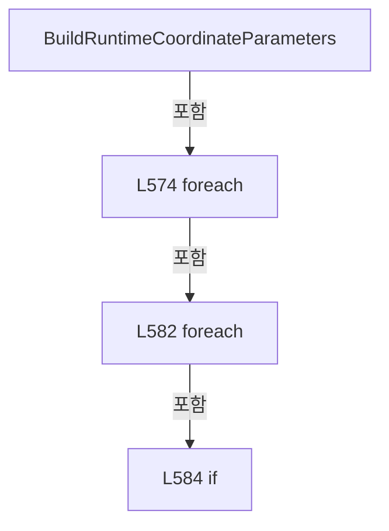

변경 전 점검: 입력/반환 타입, 위 호출자, 예외/취소 경로, 공유 상태와 저장·전송 소비자를 함께 확인합니다. 값의 단위나 물리 방향을 이름만으로 확정하지 않습니다.

### MethodDeclaration `LoadReviewCoordinateSettings` · L594–609

[Drilling.Common/Review/CReviewManager.cs:594–609](https://github.com/kjuws10-rgb/A3Drilling/blob/96e22cd027c84bf302b23f2949b98985d7f301bb/Drilling.Common/Review/CReviewManager.cs#L594-L609)

| 항목 | 실제 추출 값 |
| --- | --- |
| 서명 | Drilling.Common.Review.CReviewManager.ST_REVIEW_COORDINATE_SETTINGS Drilling.Common.Review.CReviewManager.LoadReviewCoordinateSettings(Drilling.Common.Managers.ST_RECIPE_DEFINITION) |
| 접근/수식자 | Private / private |
| 반환/값 타입 | Drilling.Common.Review.CReviewManager.ST_REVIEW_COORDINATE_SETTINGS |
| 소속 타입 | NamedType:Drilling.Common.Review.CReviewManager |

입력 계약:

| 이름 | 타입 | 전달 | 선택/기본값 |
| --- | --- | --- | --- |
| recipe | Drilling.Common.Managers.ST_RECIPE_DEFINITION | None | False /  |

정적 호출자로 확인된 위치:

| 호출 파일/행 | 호출 표현식 | 런타임 분기 가능 |
| --- | --- | --- |
| [Drilling.Common/Review/CReviewManager.cs:282–282](https://github.com/kjuws10-rgb/A3Drilling/blob/96e22cd027c84bf302b23f2949b98985d7f301bb/Drilling.Common/Review/CReviewManager.cs#L282-L282) | LoadReviewCoordinateSettings | False |
| [Drilling.Common/Review/CReviewManager.cs:508–508](https://github.com/kjuws10-rgb/A3Drilling/blob/96e22cd027c84bf302b23f2949b98985d7f301bb/Drilling.Common/Review/CReviewManager.cs#L508-L508) | LoadReviewCoordinateSettings | False |

호출하는 대상과 해석 범위:

| 원본 행 | 표현식 | 분석 상태 | 대상/소스 위치 |
| --- | --- | --- | --- |
| 596 | settingManager.LoadSection | resolved | System.Collections.Generic.IReadOnlyList<Drilling.Common.Managers.ST_SYSTEM_PARAMETER> Drilling.Common.Managers.CSettingManager.LoadSection(Drilling.Common.Managers.EN_SETTING_TAB, System.Threading.CancellationToken) · Drilling.Common/Managers/CSettingManager.cs:26 |
| 597 | CReviewManager.ParseVisionFlipType | resolved | Drilling.Common.Review.EN_VISION_FLIP_TYPE Drilling.Common.Review.CReviewManager.ParseVisionFlipType(string?, string?, string?) · Drilling.Common/Review/CReviewManager.cs:3725 |
| 597 | ReadSettingText | resolved | string Drilling.Common.Review.CReviewManager.ReadSettingText(System.Collections.Generic.IReadOnlyList<Drilling.Common.Managers.ST_SYSTEM_PARAMETER>, string, params string[]) · Drilling.Common/Review/CReviewManager.cs:659 |
| 597 | ReadSettingText | resolved | string Drilling.Common.Review.CReviewManager.ReadSettingText(System.Collections.Generic.IReadOnlyList<Drilling.Common.Managers.ST_SYSTEM_PARAMETER>, string, params string[]) · Drilling.Common/Review/CReviewManager.cs:659 |
| 597 | ReadSettingText | resolved | string Drilling.Common.Review.CReviewManager.ReadSettingText(System.Collections.Generic.IReadOnlyList<Drilling.Common.Managers.ST_SYSTEM_PARAMETER>, string, params string[]) · Drilling.Common/Review/CReviewManager.cs:659 |
| 598 | Enumerable.Range(1, 8).Select(headNo => { var position = ReadHeadPositionX(optionSettings, headNo); const double fallbackWidthX = 110.0; var widthX = ReadSettingDouble(optionSettings, fallbackWidthX, $"H{headNo:00}_SCAN_FIELD_WIDTH_X", $"H{headNo:00}_HEAD_FIELD_WIDTH_X"); return new ST_REVIEW_HEAD_FIELD(headNo, position, widthX > 0.0 ? widthX : fal… | resolved | Drilling.Common.Review.CReviewManager.ST_REVIEW_HEAD_FIELD[] System.Collections.Generic.IEnumerable<Drilling.Common.Review.CReviewManager.ST_REVIEW_HEAD_FIELD>.ToArray<Drilling.Common.Review.CReviewManager.ST_REVIEW_HEAD_FIELD>() |
| 598 | Enumerable.Range(1, 8).Select | resolved | System.Collections.Generic.IEnumerable<Drilling.Common.Review.CReviewManager.ST_REVIEW_HEAD_FIELD> System.Collections.Generic.IEnumerable<int>.Select<int, Drilling.Common.Review.CReviewManager.ST_REVIEW_HEAD_FIELD>(System.Func<int, Drilling.Common.Review.CReviewManager.ST_REVIEW_HEAD_FIELD>) |
| 598 | Enumerable.Range | resolved | System.Collections.Generic.IEnumerable<int> System.Linq.Enumerable.Range(int, int) |
| 600 | ReadHeadPositionX | resolved | double Drilling.Common.Review.CReviewManager.ReadHeadPositionX(System.Collections.Generic.IReadOnlyList<Drilling.Common.Managers.ST_SYSTEM_PARAMETER>, int) · Drilling.Common/Review/CReviewManager.cs:611 |
| 602 | ReadSettingDouble | resolved | double Drilling.Common.Review.CReviewManager.ReadSettingDouble(System.Collections.Generic.IReadOnlyList<Drilling.Common.Managers.ST_SYSTEM_PARAMETER>, double, params string[]) · Drilling.Common/Review/CReviewManager.cs:620 |
| 603 | new ST_REVIEW_HEAD_FIELD | resolved | Drilling.Common.Review.CReviewManager.ST_REVIEW_HEAD_FIELD.ST_REVIEW_HEAD_FIELD(int, double, double) · Drilling.Common/Review/CReviewManager.cs:1231 |
| 607 | headFields.Where(field => ReadSettingBoolean(optionSettings, true, $"H{field.HeadNo:00}_USE")).Select(field => field.HeadNo).ToArray | resolved | int[] System.Collections.Generic.IEnumerable<int>.ToArray<int>() |
| 607 | headFields.Where(field => ReadSettingBoolean(optionSettings, true, $"H{field.HeadNo:00}_USE")).Select | resolved | System.Collections.Generic.IEnumerable<int> System.Collections.Generic.IEnumerable<Drilling.Common.Review.CReviewManager.ST_REVIEW_HEAD_FIELD>.Select<Drilling.Common.Review.CReviewManager.ST_REVIEW_HEAD_FIELD, int>(System.Func<Drilling.Common.Review.CReviewManager.ST_REVIEW_HEAD_FIELD, int>) |
| 607 | headFields.Where | resolved | System.Collections.Generic.IEnumerable<Drilling.Common.Review.CReviewManager.ST_REVIEW_HEAD_FIELD> System.Collections.Generic.IEnumerable<Drilling.Common.Review.CReviewManager.ST_REVIEW_HEAD_FIELD>.Where<Drilling.Common.Review.CReviewManager.ST_REVIEW_HEAD_FIELD>(System.Func<Drilling.Common.Review.CReviewManager.ST_REVIEW_HEAD_FIELD, bool>) |
| 607 | ReadSettingBoolean | resolved | bool Drilling.Common.Review.CReviewManager.ReadSettingBoolean(System.Collections.Generic.IReadOnlyList<Drilling.Common.Managers.ST_SYSTEM_PARAMETER>, bool, params string[]) · Drilling.Common/Review/CReviewManager.cs:638 |
| 608 | new ST_REVIEW_COORDINATE_SETTINGS | resolved | Drilling.Common.Review.CReviewManager.ST_REVIEW_COORDINATE_SETTINGS.ST_REVIEW_COORDINATE_SETTINGS(Drilling.Common.Review.CReviewManager.ST_REVIEW_HEAD_LAYOUT, System.Collections.Generic.IReadOnlyList<int>, Drilling.Common.Review.EN_VISION_FLIP_TYPE) · Drilling.Common/Review/CReviewManager.cs:1232 |
| 608 | new ST_REVIEW_HEAD_LAYOUT | resolved | Drilling.Common.Review.CReviewManager.ST_REVIEW_HEAD_LAYOUT.ST_REVIEW_HEAD_LAYOUT(System.Collections.Generic.IReadOnlyList<Drilling.Common.Review.CReviewManager.ST_REVIEW_HEAD_FIELD>) · Drilling.Common/Review/CReviewManager.cs:1223 |

본문의 실제 연산·분기·예외·반환 순서(원문 위치 순):

| 원본 행 | 종류 | 주석 해설 |
| --- | --- | --- |
| 596 | call | 함수·델리게이트 또는 객체 생성자를 호출합니다: settingManager.LoadSection(EN_SETTING_TAB.Option) |
| 596 | local-declaration | 지역 변수를 선언합니다: var optionSettings = settingManager.LoadSection(EN_SETTING_TAB.Option); |
| 596 | variable-initializer | 변수의 초기값을 지정합니다: optionSettings = settingManager.LoadSection(EN_SETTING_TAB.Option) |
| 597 | call | 함수·델리게이트 또는 객체 생성자를 호출합니다: CReviewManager.ParseVisionFlipType(ReadSettingText(optionSettings, "", "VisionXFlip"), ReadSettingText(optionSettings, "", "VisionYFlip"), ReadSettingText(optionSettings, "", "VisionXyFlip")) |
| 597 | call | 함수·델리게이트 또는 객체 생성자를 호출합니다: ReadSettingText(optionSettings, "", "VisionXFlip") |
| 597 | call | 함수·델리게이트 또는 객체 생성자를 호출합니다: ReadSettingText(optionSettings, "", "VisionYFlip") |
| 597 | call | 함수·델리게이트 또는 객체 생성자를 호출합니다: ReadSettingText(optionSettings, "", "VisionXyFlip") |
| 597 | local-declaration | 지역 변수를 선언합니다: var visionFlipType = CReviewManager.ParseVisionFlipType(ReadSettingText(optionSettings, "", "VisionXFlip"), ReadSettingText(optionSettings, "", "VisionYFlip"), ReadSettingText(optionSettings, "", "VisionXyFlip")); |
| 597 | variable-initializer | 변수의 초기값을 지정합니다: visionFlipType = CReviewManager.ParseVisionFlipType(ReadSettingText(optionSettings, "", "VisionXFlip"), ReadSettingText(optionSettings, "", "VisionYFlip"), ReadSettingText(optionSettings, "", "VisionXyFlip")) |
| 598 | call | 함수·델리게이트 또는 객체 생성자를 호출합니다: Enumerable.Range(1, 8) |
| 598 | call | 함수·델리게이트 또는 객체 생성자를 호출합니다: Enumerable.Range(1, 8).Select(headNo => { var position = ReadHeadPositionX(optionSettings, headNo); const double fallbackWidthX = 110.0; var widthX = ReadSettingDouble(optionSettings, fallbackWidthX, $"H{headNo:00}_SCAN_… |
| 598 | call | 함수·델리게이트 또는 객체 생성자를 호출합니다: Enumerable.Range(1, 8).Select(headNo => { var position = ReadHeadPositionX(optionSettings, headNo); const double fallbackWidthX = 110.0; var widthX = ReadSettingDouble(optionSettings, fallbackWidthX, $"H{headNo:00}_SCAN_… |
| 598 | local-declaration | 지역 변수를 선언합니다: var headFields = Enumerable.Range(1, 8).Select(headNo => { var position = ReadHeadPositionX(optionSettings, headNo); const double fallbackWidthX = 110.0; var widthX = ReadSettingDouble(optionSettings, fallbackWidthX, $"H{headNo:00 |
| 598 | variable-initializer | 변수의 초기값을 지정합니다: headFields = Enumerable.Range(1, 8).Select(headNo => { var position = ReadHeadPositionX(optionSettings, headNo); const double fallbackWidthX = 110.0; var widthX = ReadSettingDouble(optionSettings, fallbackWidthX, $"H{headNo:00}_SC |
| 600 | call | 함수·델리게이트 또는 객체 생성자를 호출합니다: ReadHeadPositionX(optionSettings, headNo) |
| 600 | local-declaration | 지역 변수를 선언합니다: var position = ReadHeadPositionX(optionSettings, headNo); |
| 600 | variable-initializer | 변수의 초기값을 지정합니다: position = ReadHeadPositionX(optionSettings, headNo) |
| 601 | local-declaration | 지역 변수를 선언합니다: const double fallbackWidthX = 110.0; |
| 601 | variable-initializer | 변수의 초기값을 지정합니다: fallbackWidthX = 110.0 |
| 602 | call | 함수·델리게이트 또는 객체 생성자를 호출합니다: ReadSettingDouble(optionSettings, fallbackWidthX, $"H{headNo:00}_SCAN_FIELD_WIDTH_X", $"H{headNo:00}_HEAD_FIELD_WIDTH_X") |
| 602 | local-declaration | 지역 변수를 선언합니다: var widthX = ReadSettingDouble(optionSettings, fallbackWidthX, $"H{headNo:00}_SCAN_FIELD_WIDTH_X", $"H{headNo:00}_HEAD_FIELD_WIDTH_X"); |
| 602 | variable-initializer | 변수의 초기값을 지정합니다: widthX = ReadSettingDouble(optionSettings, fallbackWidthX, $"H{headNo:00}_SCAN_FIELD_WIDTH_X", $"H{headNo:00}_HEAD_FIELD_WIDTH_X") |
| 603 | call | 함수·델리게이트 또는 객체 생성자를 호출합니다: new ST_REVIEW_HEAD_FIELD(headNo, position, widthX > 0.0 ? widthX : fallbackWidthX) |
| 603 | conditional-expression | 조건에 따라 결과식을 선택합니다: widthX > 0.0 ? widthX : fallbackWidthX |
| 603 | return | 호출자에게 값 또는 제어를 반환합니다: return new ST_REVIEW_HEAD_FIELD(headNo, position, widthX > 0.0 ? widthX : fallbackWidthX); |
| 607 | call | 함수·델리게이트 또는 객체 생성자를 호출합니다: headFields.Where(field => ReadSettingBoolean(optionSettings, true, $"H{field.HeadNo:00}_USE")).Select(field => field.HeadNo).ToArray() |
| 607 | call | 함수·델리게이트 또는 객체 생성자를 호출합니다: headFields.Where(field => ReadSettingBoolean(optionSettings, true, $"H{field.HeadNo:00}_USE")).Select(field => field.HeadNo) |
| 607 | call | 함수·델리게이트 또는 객체 생성자를 호출합니다: headFields.Where(field => ReadSettingBoolean(optionSettings, true, $"H{field.HeadNo:00}_USE")) |
| 607 | call | 함수·델리게이트 또는 객체 생성자를 호출합니다: ReadSettingBoolean(optionSettings, true, $"H{field.HeadNo:00}_USE") |
| 607 | local-declaration | 지역 변수를 선언합니다: var activeHeadNos = headFields.Where(field => ReadSettingBoolean(optionSettings, true, $"H{field.HeadNo:00}_USE")).Select(field => field.HeadNo).ToArray(); |
| 607 | variable-initializer | 변수의 초기값을 지정합니다: activeHeadNos = headFields.Where(field => ReadSettingBoolean(optionSettings, true, $"H{field.HeadNo:00}_USE")).Select(field => field.HeadNo).ToArray() |
| 608 | call | 함수·델리게이트 또는 객체 생성자를 호출합니다: new ST_REVIEW_COORDINATE_SETTINGS(new ST_REVIEW_HEAD_LAYOUT(headFields), activeHeadNos, visionFlipType) |
| 608 | call | 함수·델리게이트 또는 객체 생성자를 호출합니다: new ST_REVIEW_HEAD_LAYOUT(headFields) |
| 608 | return | 호출자에게 값 또는 제어를 반환합니다: return new ST_REVIEW_COORDINATE_SETTINGS(new ST_REVIEW_HEAD_LAYOUT(headFields), activeHeadNos, visionFlipType); |

변경 전 점검: 입력/반환 타입, 위 호출자, 예외/취소 경로, 공유 상태와 저장·전송 소비자를 함께 확인합니다. 값의 단위나 물리 방향을 이름만으로 확정하지 않습니다.

### MethodDeclaration `ReadHeadPositionX` · L611–618

[Drilling.Common/Review/CReviewManager.cs:611–618](https://github.com/kjuws10-rgb/A3Drilling/blob/96e22cd027c84bf302b23f2949b98985d7f301bb/Drilling.Common/Review/CReviewManager.cs#L611-L618)

| 항목 | 실제 추출 값 |
| --- | --- |
| 서명 | double Drilling.Common.Review.CReviewManager.ReadHeadPositionX(System.Collections.Generic.IReadOnlyList<Drilling.Common.Managers.ST_SYSTEM_PARAMETER>, int) |
| 접근/수식자 | Private / private, static |
| 반환/값 타입 | double |
| 소속 타입 | NamedType:Drilling.Common.Review.CReviewManager |

입력 계약:

| 이름 | 타입 | 전달 | 선택/기본값 |
| --- | --- | --- | --- |
| settings | System.Collections.Generic.IReadOnlyList<Drilling.Common.Managers.ST_SYSTEM_PARAMETER> | None | False /  |
| headNo | int | None | False /  |

정적 호출자로 확인된 위치:

| 호출 파일/행 | 호출 표현식 | 런타임 분기 가능 |
| --- | --- | --- |
| [Drilling.Common/Review/CReviewManager.cs:600–600](https://github.com/kjuws10-rgb/A3Drilling/blob/96e22cd027c84bf302b23f2949b98985d7f301bb/Drilling.Common/Review/CReviewManager.cs#L600-L600) | ReadHeadPositionX | False |

호출하는 대상과 해석 범위:

| 원본 행 | 표현식 | 분석 상태 | 대상/소스 위치 |
| --- | --- | --- | --- |
| 615 | ReadSettingDouble | resolved | double Drilling.Common.Review.CReviewManager.ReadSettingDouble(System.Collections.Generic.IReadOnlyList<Drilling.Common.Managers.ST_SYSTEM_PARAMETER>, double, params string[]) · Drilling.Common/Review/CReviewManager.cs:620 |
| 616 | ReadSettingDouble | resolved | double Drilling.Common.Review.CReviewManager.ReadSettingDouble(System.Collections.Generic.IReadOnlyList<Drilling.Common.Managers.ST_SYSTEM_PARAMETER>, double, params string[]) · Drilling.Common/Review/CReviewManager.cs:620 |

본문의 실제 연산·분기·예외·반환 순서(원문 위치 순):

| 원본 행 | 종류 | 주석 해설 |
| --- | --- | --- |
| 613 | local-declaration | 지역 변수를 선언합니다: const double fallbackHead1PositionX = -5.0; |
| 613 | variable-initializer | 변수의 초기값을 지정합니다: fallbackHead1PositionX = -5.0 |
| 614 | local-declaration | 지역 변수를 선언합니다: const double fallbackHeadGapX = 200.0; |
| 614 | variable-initializer | 변수의 초기값을 지정합니다: fallbackHeadGapX = 200.0 |
| 615 | call | 함수·델리게이트 또는 객체 생성자를 호출합니다: ReadSettingDouble(settings, fallbackHead1PositionX, "H01_AK_POSITION_X") |
| 615 | local-declaration | 지역 변수를 선언합니다: var head1PositionX = ReadSettingDouble(settings, fallbackHead1PositionX, "H01_AK_POSITION_X"); |
| 615 | variable-initializer | 변수의 초기값을 지정합니다: head1PositionX = ReadSettingDouble(settings, fallbackHead1PositionX, "H01_AK_POSITION_X") |
| 616 | call | 함수·델리게이트 또는 객체 생성자를 호출합니다: ReadSettingDouble(settings, fallbackHeadGapX, "HeadGapX") |
| 616 | local-declaration | 지역 변수를 선언합니다: var headGapX = ReadSettingDouble(settings, fallbackHeadGapX, "HeadGapX"); |
| 616 | variable-initializer | 변수의 초기값을 지정합니다: headGapX = ReadSettingDouble(settings, fallbackHeadGapX, "HeadGapX") |
| 617 | return | 호출자에게 값 또는 제어를 반환합니다: return head1PositionX + ((headNo - 1) * headGapX); |

변경 전 점검: 입력/반환 타입, 위 호출자, 예외/취소 경로, 공유 상태와 저장·전송 소비자를 함께 확인합니다. 값의 단위나 물리 방향을 이름만으로 확정하지 않습니다.

### MethodDeclaration `ReadSettingDouble` · L620–636

[Drilling.Common/Review/CReviewManager.cs:620–636](https://github.com/kjuws10-rgb/A3Drilling/blob/96e22cd027c84bf302b23f2949b98985d7f301bb/Drilling.Common/Review/CReviewManager.cs#L620-L636)

| 항목 | 실제 추출 값 |
| --- | --- |
| 서명 | double Drilling.Common.Review.CReviewManager.ReadSettingDouble(System.Collections.Generic.IReadOnlyList<Drilling.Common.Managers.ST_SYSTEM_PARAMETER>, double, params string[]) |
| 접근/수식자 | Private / private, static |
| 반환/값 타입 | double |
| 소속 타입 | NamedType:Drilling.Common.Review.CReviewManager |

입력 계약:

| 이름 | 타입 | 전달 | 선택/기본값 |
| --- | --- | --- | --- |
| settings | System.Collections.Generic.IReadOnlyList<Drilling.Common.Managers.ST_SYSTEM_PARAMETER> | None | False /  |
| defaultValue | double | None | False /  |
| keys | string[] | None | False /  |

정적 호출자로 확인된 위치:

| 호출 파일/행 | 호출 표현식 | 런타임 분기 가능 |
| --- | --- | --- |
| [Drilling.Common/Review/CReviewManager.cs:602–602](https://github.com/kjuws10-rgb/A3Drilling/blob/96e22cd027c84bf302b23f2949b98985d7f301bb/Drilling.Common/Review/CReviewManager.cs#L602-L602) | ReadSettingDouble | False |
| [Drilling.Common/Review/CReviewManager.cs:615–615](https://github.com/kjuws10-rgb/A3Drilling/blob/96e22cd027c84bf302b23f2949b98985d7f301bb/Drilling.Common/Review/CReviewManager.cs#L615-L615) | ReadSettingDouble | False |
| [Drilling.Common/Review/CReviewManager.cs:616–616](https://github.com/kjuws10-rgb/A3Drilling/blob/96e22cd027c84bf302b23f2949b98985d7f301bb/Drilling.Common/Review/CReviewManager.cs#L616-L616) | ReadSettingDouble | False |

호출하는 대상과 해석 범위:

| 원본 행 | 표현식 | 분석 상태 | 대상/소스 위치 |
| --- | --- | --- | --- |
| 624 | keys.Any | resolved | bool System.Collections.Generic.IEnumerable<string>.Any<string>(System.Func<string, bool>) |
| 624 | key.Equals | resolved | bool string.Equals(string?, System.StringComparison) |
| 624 | key.Equals | resolved | bool string.Equals(string?, System.StringComparison) |
| 629 | double.TryParse | resolved | bool double.TryParse(string?, System.Globalization.NumberStyles, System.IFormatProvider?, out double) |

본문의 실제 연산·분기·예외·반환 순서(원문 위치 순):

| 원본 행 | 종류 | 주석 해설 |
| --- | --- | --- |
| 622 | foreach | 컬렉션 요소를 순회합니다: foreach (var setting in settings) |
| 624 | call | 함수·델리게이트 또는 객체 생성자를 호출합니다: keys.Any(key => key.Equals(setting.Key, StringComparison.OrdinalIgnoreCase) &#124;&#124; key.Equals(setting.Name, StringComparison.OrdinalIgnoreCase)) |
| 624 | call | 함수·델리게이트 또는 객체 생성자를 호출합니다: key.Equals(setting.Key, StringComparison.OrdinalIgnoreCase) |
| 624 | call | 함수·델리게이트 또는 객체 생성자를 호출합니다: key.Equals(setting.Name, StringComparison.OrdinalIgnoreCase) |
| 624 | if | 조건에 따라 분기합니다: if (!keys.Any(key => key.Equals(setting.Key, StringComparison.OrdinalIgnoreCase) &#124;&#124; key.Equals(setting.Name, StringComparison.OrdinalIgnoreCase))) |
| 626 | continue | 다음 반복으로 진행합니다: continue; |
| 629 | call | 함수·델리게이트 또는 객체 생성자를 호출합니다: double.TryParse(setting.Value, NumberStyles.Float, CultureInfo.InvariantCulture, out var parsed) |
| 629 | if | 조건에 따라 분기합니다: if (double.TryParse(setting.Value, NumberStyles.Float, CultureInfo.InvariantCulture, out var parsed)) |
| 631 | return | 호출자에게 값 또는 제어를 반환합니다: return parsed; |
| 635 | return | 호출자에게 값 또는 제어를 반환합니다: return defaultValue; |

제어 구문의 포함 구조(실제 실행 순서/CFG가 아닌 구문 탐색 그림):

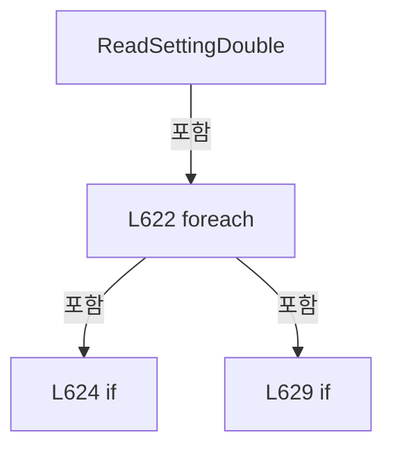

변경 전 점검: 입력/반환 타입, 위 호출자, 예외/취소 경로, 공유 상태와 저장·전송 소비자를 함께 확인합니다. 값의 단위나 물리 방향을 이름만으로 확정하지 않습니다.

### MethodDeclaration `ReadSettingBoolean` · L638–657

[Drilling.Common/Review/CReviewManager.cs:638–657](https://github.com/kjuws10-rgb/A3Drilling/blob/96e22cd027c84bf302b23f2949b98985d7f301bb/Drilling.Common/Review/CReviewManager.cs#L638-L657)

| 항목 | 실제 추출 값 |
| --- | --- |
| 서명 | bool Drilling.Common.Review.CReviewManager.ReadSettingBoolean(System.Collections.Generic.IReadOnlyList<Drilling.Common.Managers.ST_SYSTEM_PARAMETER>, bool, params string[]) |
| 접근/수식자 | Private / private, static |
| 반환/값 타입 | bool |
| 소속 타입 | NamedType:Drilling.Common.Review.CReviewManager |

입력 계약:

| 이름 | 타입 | 전달 | 선택/기본값 |
| --- | --- | --- | --- |
| settings | System.Collections.Generic.IReadOnlyList<Drilling.Common.Managers.ST_SYSTEM_PARAMETER> | None | False /  |
| defaultValue | bool | None | False /  |
| keys | string[] | None | False /  |

정적 호출자로 확인된 위치:

| 호출 파일/행 | 호출 표현식 | 런타임 분기 가능 |
| --- | --- | --- |
| [Drilling.Common/Review/CReviewManager.cs:607–607](https://github.com/kjuws10-rgb/A3Drilling/blob/96e22cd027c84bf302b23f2949b98985d7f301bb/Drilling.Common/Review/CReviewManager.cs#L607-L607) | ReadSettingBoolean | False |

호출하는 대상과 해석 범위:

| 원본 행 | 표현식 | 분석 상태 | 대상/소스 위치 |
| --- | --- | --- | --- |
| 640 | ReadSettingText | resolved | string Drilling.Common.Review.CReviewManager.ReadSettingText(System.Collections.Generic.IReadOnlyList<Drilling.Common.Managers.ST_SYSTEM_PARAMETER>, string, params string[]) · Drilling.Common/Review/CReviewManager.cs:659 |
| 641 | string.IsNullOrWhiteSpace | resolved | bool string.IsNullOrWhiteSpace(string?) |
| 646 | bool.TryParse | resolved | bool bool.TryParse(string?, out bool) |
| 651 | text.Trim().ToUpperInvariant | resolved | string string.ToUpperInvariant() |
| 651 | text.Trim | resolved | string string.Trim() |

본문의 실제 연산·분기·예외·반환 순서(원문 위치 순):

| 원본 행 | 종류 | 주석 해설 |
| --- | --- | --- |
| 640 | call | 함수·델리게이트 또는 객체 생성자를 호출합니다: ReadSettingText(settings, "", keys) |
| 640 | local-declaration | 지역 변수를 선언합니다: var text = ReadSettingText(settings, "", keys); |
| 640 | variable-initializer | 변수의 초기값을 지정합니다: text = ReadSettingText(settings, "", keys) |
| 641 | call | 함수·델리게이트 또는 객체 생성자를 호출합니다: string.IsNullOrWhiteSpace(text) |
| 641 | if | 조건에 따라 분기합니다: if (string.IsNullOrWhiteSpace(text)) |
| 643 | return | 호출자에게 값 또는 제어를 반환합니다: return defaultValue; |
| 646 | call | 함수·델리게이트 또는 객체 생성자를 호출합니다: bool.TryParse(text, out var parsed) |
| 646 | if | 조건에 따라 분기합니다: if (bool.TryParse(text, out var parsed)) |
| 648 | return | 호출자에게 값 또는 제어를 반환합니다: return parsed; |
| 651 | call | 함수·델리게이트 또는 객체 생성자를 호출합니다: text.Trim().ToUpperInvariant() |
| 651 | call | 함수·델리게이트 또는 객체 생성자를 호출합니다: text.Trim() |
| 651 | return | 호출자에게 값 또는 제어를 반환합니다: return text.Trim().ToUpperInvariant() switch { "1" or "ON" or "YES" or "Y" => true, "0" or "OFF" or "NO" or "N" => false, _ => defaultValue }; |
| 651 | switch-expression | 값별 결과식을 선택합니다: text.Trim().ToUpperInvariant() switch { "1" or "ON" or "YES" or "Y" => true, "0" or "OFF" or "NO" or "N" => false, _ => defaultValue } |

제어 구문의 포함 구조(실제 실행 순서/CFG가 아닌 구문 탐색 그림):

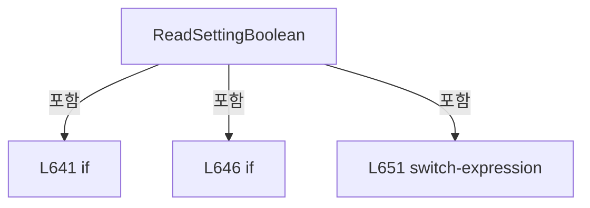

변경 전 점검: 입력/반환 타입, 위 호출자, 예외/취소 경로, 공유 상태와 저장·전송 소비자를 함께 확인합니다. 값의 단위나 물리 방향을 이름만으로 확정하지 않습니다.

### MethodDeclaration `ReadSettingText` · L659–672

[Drilling.Common/Review/CReviewManager.cs:659–672](https://github.com/kjuws10-rgb/A3Drilling/blob/96e22cd027c84bf302b23f2949b98985d7f301bb/Drilling.Common/Review/CReviewManager.cs#L659-L672)

| 항목 | 실제 추출 값 |
| --- | --- |
| 서명 | string Drilling.Common.Review.CReviewManager.ReadSettingText(System.Collections.Generic.IReadOnlyList<Drilling.Common.Managers.ST_SYSTEM_PARAMETER>, string, params string[]) |
| 접근/수식자 | Private / private, static |
| 반환/값 타입 | string |
| 소속 타입 | NamedType:Drilling.Common.Review.CReviewManager |

입력 계약:

| 이름 | 타입 | 전달 | 선택/기본값 |
| --- | --- | --- | --- |
| settings | System.Collections.Generic.IReadOnlyList<Drilling.Common.Managers.ST_SYSTEM_PARAMETER> | None | False /  |
| defaultValue | string | None | False /  |
| keys | string[] | None | False /  |

정적 호출자로 확인된 위치:

| 호출 파일/행 | 호출 표현식 | 런타임 분기 가능 |
| --- | --- | --- |
| [Drilling.Common/Review/CReviewManager.cs:597–597](https://github.com/kjuws10-rgb/A3Drilling/blob/96e22cd027c84bf302b23f2949b98985d7f301bb/Drilling.Common/Review/CReviewManager.cs#L597-L597) | ReadSettingText | False |
| [Drilling.Common/Review/CReviewManager.cs:597–597](https://github.com/kjuws10-rgb/A3Drilling/blob/96e22cd027c84bf302b23f2949b98985d7f301bb/Drilling.Common/Review/CReviewManager.cs#L597-L597) | ReadSettingText | False |
| [Drilling.Common/Review/CReviewManager.cs:597–597](https://github.com/kjuws10-rgb/A3Drilling/blob/96e22cd027c84bf302b23f2949b98985d7f301bb/Drilling.Common/Review/CReviewManager.cs#L597-L597) | ReadSettingText | False |
| [Drilling.Common/Review/CReviewManager.cs:640–640](https://github.com/kjuws10-rgb/A3Drilling/blob/96e22cd027c84bf302b23f2949b98985d7f301bb/Drilling.Common/Review/CReviewManager.cs#L640-L640) | ReadSettingText | False |

호출하는 대상과 해석 범위:

| 원본 행 | 표현식 | 분석 상태 | 대상/소스 위치 |
| --- | --- | --- | --- |
| 663 | keys.Any | resolved | bool System.Collections.Generic.IEnumerable<string>.Any<string>(System.Func<string, bool>) |
| 663 | key.Equals | resolved | bool string.Equals(string?, System.StringComparison) |
| 663 | key.Equals | resolved | bool string.Equals(string?, System.StringComparison) |
| 668 | string.IsNullOrWhiteSpace | resolved | bool string.IsNullOrWhiteSpace(string?) |
| 668 | setting.Value.Trim | resolved | string string.Trim() |

본문의 실제 연산·분기·예외·반환 순서(원문 위치 순):

| 원본 행 | 종류 | 주석 해설 |
| --- | --- | --- |
| 661 | foreach | 컬렉션 요소를 순회합니다: foreach (var setting in settings) |
| 663 | call | 함수·델리게이트 또는 객체 생성자를 호출합니다: keys.Any(key => key.Equals(setting.Key, StringComparison.OrdinalIgnoreCase) &#124;&#124; key.Equals(setting.Name, StringComparison.OrdinalIgnoreCase)) |
| 663 | call | 함수·델리게이트 또는 객체 생성자를 호출합니다: key.Equals(setting.Key, StringComparison.OrdinalIgnoreCase) |
| 663 | call | 함수·델리게이트 또는 객체 생성자를 호출합니다: key.Equals(setting.Name, StringComparison.OrdinalIgnoreCase) |
| 663 | if | 조건에 따라 분기합니다: if (!keys.Any(key => key.Equals(setting.Key, StringComparison.OrdinalIgnoreCase) &#124;&#124; key.Equals(setting.Name, StringComparison.OrdinalIgnoreCase))) |
| 665 | continue | 다음 반복으로 진행합니다: continue; |
| 668 | call | 함수·델리게이트 또는 객체 생성자를 호출합니다: string.IsNullOrWhiteSpace(setting.Value) |
| 668 | call | 함수·델리게이트 또는 객체 생성자를 호출합니다: setting.Value.Trim() |
| 668 | conditional-expression | 조건에 따라 결과식을 선택합니다: string.IsNullOrWhiteSpace(setting.Value) ? defaultValue : setting.Value.Trim() |
| 668 | return | 호출자에게 값 또는 제어를 반환합니다: return string.IsNullOrWhiteSpace(setting.Value) ? defaultValue : setting.Value.Trim(); |
| 671 | return | 호출자에게 값 또는 제어를 반환합니다: return defaultValue; |

제어 구문의 포함 구조(실제 실행 순서/CFG가 아닌 구문 탐색 그림):

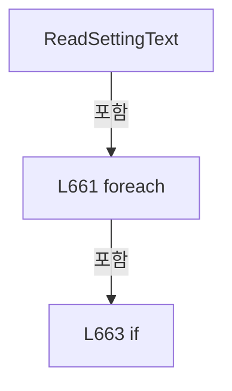

변경 전 점검: 입력/반환 타입, 위 호출자, 예외/취소 경로, 공유 상태와 저장·전송 소비자를 함께 확인합니다. 값의 단위나 물리 방향을 이름만으로 확정하지 않습니다.

### MethodDeclaration `BuildShotPoints` · L674–771

[Drilling.Common/Review/CReviewManager.cs:674–771](https://github.com/kjuws10-rgb/A3Drilling/blob/96e22cd027c84bf302b23f2949b98985d7f301bb/Drilling.Common/Review/CReviewManager.cs#L674-L771)

| 항목 | 실제 추출 값 |
| --- | --- |
| 서명 | System.Collections.Generic.IReadOnlyList<Drilling.Common.Review.ST_REVIEW_PLAN_POINT> Drilling.Common.Review.CReviewManager.BuildShotPoints(Drilling.Common.Managers.ST_RECIPE_DEFINITION, int, int, Drilling.Common.Review.CReviewManager.ST_REVIEW_COORDINATE_SETTINGS, System.Collections.Generic.IReadOnlyDictionary<(int CellNo, int CellShotNo), int>, double, int, bool, System.Collections.Generic.IReadOnlyDictionary<string, string>, double, double) |
| 접근/수식자 | Private / private, static |
| 반환/값 타입 | System.Collections.Generic.IReadOnlyList<Drilling.Common.Review.ST_REVIEW_PLAN_POINT> |
| 소속 타입 | NamedType:Drilling.Common.Review.CReviewManager |

입력 계약:

| 이름 | 타입 | 전달 | 선택/기본값 |
| --- | --- | --- | --- |
| recipe | Drilling.Common.Managers.ST_RECIPE_DEFINITION | None | False /  |
| headCount | int | None | False /  |
| cellCount | int | None | False /  |
| coordinateSettings | Drilling.Common.Review.CReviewManager.ST_REVIEW_COORDINATE_SETTINGS | None | False /  |
| assignedHeadNos | System.Collections.Generic.IReadOnlyDictionary<(int CellNo, int CellShotNo), int> | None | False /  |
| stageScanDirectionY | double | None | False /  |
| selectedBeamNo | int | None | False /  |
| selectAllAssignedPoints | bool | None | False /  |
| excludedShots | System.Collections.Generic.IReadOnlyDictionary<string, string> | None | False /  |
| shiftOffsetX | double | None | False /  |
| shiftOffsetY | double | None | False /  |

정적 호출자로 확인된 위치:

| 호출 파일/행 | 호출 표현식 | 런타임 분기 가능 |
| --- | --- | --- |
| [Drilling.Common/Review/CReviewManager.cs:514–525](https://github.com/kjuws10-rgb/A3Drilling/blob/96e22cd027c84bf302b23f2949b98985d7f301bb/Drilling.Common/Review/CReviewManager.cs#L514-L525) | BuildShotPoints | False |

호출하는 대상과 해석 범위:

| 원본 행 | 표현식 | 분석 상태 | 대상/소스 위치 |
| --- | --- | --- | --- |
| 689 | ReadDouble | resolved | double Drilling.Common.Review.CReviewManager.ReadDouble(Drilling.Common.Managers.ST_RECIPE_DEFINITION, double, params string[]) · Drilling.Common/Review/CReviewManager.cs:1315 |
| 690 | ReadDouble | resolved | double Drilling.Common.Review.CReviewManager.ReadDouble(Drilling.Common.Managers.ST_RECIPE_DEFINITION, double, params string[]) · Drilling.Common/Review/CReviewManager.cs:1315 |
| 691 | ReadDouble | resolved | double Drilling.Common.Review.CReviewManager.ReadDouble(Drilling.Common.Managers.ST_RECIPE_DEFINITION, double, params string[]) · Drilling.Common/Review/CReviewManager.cs:1315 |
| 692 | ReadDouble | resolved | double Drilling.Common.Review.CReviewManager.ReadDouble(Drilling.Common.Managers.ST_RECIPE_DEFINITION, double, params string[]) · Drilling.Common/Review/CReviewManager.cs:1315 |
| 693 | ReadDouble | resolved | double Drilling.Common.Review.CReviewManager.ReadDouble(Drilling.Common.Managers.ST_RECIPE_DEFINITION, double, params string[]) · Drilling.Common/Review/CReviewManager.cs:1315 |
| 694 | ReadInt | resolved | int Drilling.Common.Review.CReviewManager.ReadInt(Drilling.Common.Managers.ST_RECIPE_DEFINITION, int, params string[]) · Drilling.Common/Review/CReviewManager.cs:1275 |
| 695 | recipe.Parameters.GroupBy(parameter => parameter.Key, StringComparer.OrdinalIgnoreCase).ToDictionary | resolved | System.Collections.Generic.Dictionary<string, string> System.Collections.Generic.IEnumerable<System.Linq.IGrouping<string, Drilling.Common.Managers.ST_RECIPE_PARAMETER>>.ToDictionary<System.Linq.IGrouping<string, Drilling.Common.Managers.ST_RECIPE_PARAMETER>, string, string>(System.Func<System.Linq.IGrouping<string, Drilling.Common.Managers.ST_RECIPE_PARAMETER>, string>, System.Func<System.Linq.IGrouping<string, Drilling.Common.Managers.ST_RECIPE_PARAMETER>, string>, System.Collections.Generic.IEqualityComparer<string>?) |
| 695 | recipe.Parameters.GroupBy | resolved | System.Collections.Generic.IEnumerable<System.Linq.IGrouping<string, Drilling.Common.Managers.ST_RECIPE_PARAMETER>> System.Collections.Generic.IEnumerable<Drilling.Common.Managers.ST_RECIPE_PARAMETER>.GroupBy<Drilling.Common.Managers.ST_RECIPE_PARAMETER, string>(System.Func<Drilling.Common.Managers.ST_RECIPE_PARAMETER, string>, System.Collections.Generic.IEqualityComparer<string>?) |
| 695 | group.Last | resolved | Drilling.Common.Managers.ST_RECIPE_PARAMETER System.Collections.Generic.IEnumerable<Drilling.Common.Managers.ST_RECIPE_PARAMETER>.Last<Drilling.Common.Managers.ST_RECIPE_PARAMETER>() |
| 696 | CRecipeModelPixelCountReader.ReadModelTypeCount | resolved | int Drilling.Common.Recipe.CRecipeModelPixelCountReader.ReadModelTypeCount(System.Collections.Generic.IReadOnlyDictionary<string, string>) · Drilling.Common/Recipe/CCellPatternCalculator.cs:428 |
| 697 | ValidateBeamNo | resolved | void Drilling.Common.Review.CReviewManager.ValidateBeamNo(int, int) · Drilling.Common/Review/CReviewManager.cs:973 |
| 698 | new List<ST_CELL_PATTERN_DEFINITION> | resolved | System.Collections.Generic.List<Drilling.Common.Recipe.ST_CELL_PATTERN_DEFINITION>.List(int) |
| 701 | ReadDouble | resolved | double Drilling.Common.Review.CReviewManager.ReadDouble(Drilling.Common.Managers.ST_RECIPE_DEFINITION, double, params string[]) · Drilling.Common/Review/CReviewManager.cs:1315 |
| 702 | ReadDouble | resolved | double Drilling.Common.Review.CReviewManager.ReadDouble(Drilling.Common.Managers.ST_RECIPE_DEFINITION, double, params string[]) · Drilling.Common/Review/CReviewManager.cs:1315 |
| 703 | ReadDouble | resolved | double Drilling.Common.Review.CReviewManager.ReadDouble(Drilling.Common.Managers.ST_RECIPE_DEFINITION, double, params string[]) · Drilling.Common/Review/CReviewManager.cs:1315 |
| 704 | CRecipeModelPixelCountReader.ReadCellModelType | resolved | int Drilling.Common.Recipe.CRecipeModelPixelCountReader.ReadCellModelType(System.Collections.Generic.IReadOnlyDictionary<string, string>, int, int) · Drilling.Common/Recipe/CCellPatternCalculator.cs:433 |
| 705 | CRecipeModelPixelCountReader.ReadPatternForModel | resolved | Drilling.Common.Recipe.ST_RECIPE_MODEL_PATTERN Drilling.Common.Recipe.CRecipeModelPixelCountReader.ReadPatternForModel(System.Collections.Generic.IReadOnlyDictionary<string, string>, int) · Drilling.Common/Recipe/CCellPatternCalculator.cs:455 |
| 706 | new ST_CELL_PATTERN_DEFINITION | resolved | Drilling.Common.Recipe.ST_CELL_PATTERN_DEFINITION.ST_CELL_PATTERN_DEFINITION(int, double, double, double, double, int, int, int, int, double, double) · Drilling.Common/Recipe/CCellPatternCalculator.cs:277 |
| 707 | definitions.Add | resolved | void System.Collections.Generic.List<Drilling.Common.Recipe.ST_CELL_PATTERN_DEFINITION>.Add(Drilling.Common.Recipe.ST_CELL_PATTERN_DEFINITION) |
| 710 | CRecipeCellPatternCatalog.Create | resolved | Drilling.Common.Recipe.CRecipeCellPatternCatalog Drilling.Common.Recipe.CRecipeCellPatternCatalog.Create(System.Collections.Generic.IEnumerable<Drilling.Common.Recipe.ST_CELL_PATTERN_DEFINITION>) · Drilling.Common/Recipe/CCellPatternCalculator.cs:349 |
| 716 | cellCatalog.Cells.ToDictionary | resolved | System.Collections.Generic.Dictionary<int, int> System.Collections.Generic.IEnumerable<Drilling.Common.Recipe.ST_RECIPE_CELL_PATTERN_ENTRY>.ToDictionary<Drilling.Common.Recipe.ST_RECIPE_CELL_PATTERN_ENTRY, int, int>(System.Func<Drilling.Common.Recipe.ST_RECIPE_CELL_PATTERN_ENTRY, int>, System.Func<Drilling.Common.Recipe.ST_RECIPE_CELL_PATTERN_ENTRY, int>) |
| 717 | assignedHeadNos.Count | resolved | int System.Collections.Generic.IEnumerable<System.Collections.Generic.KeyValuePair<(int CellNo, int CellShotNo), int>>.Count<System.Collections.Generic.KeyValuePair<(int CellNo, int CellShotNo), int>>(System.Func<System.Collections.Generic.KeyValuePair<(int CellNo, int CellShotNo), int>, bool>) |
| 717 | shotCounts.TryGetValue | resolved | bool System.Collections.Generic.Dictionary<int, int>.TryGetValue(int, out int) |
| 720 | new CLazyReviewPointList | resolved | Drilling.Common.Review.CReviewManager.CLazyReviewPointList.CLazyReviewPointList(Drilling.Common.Recipe.CRecipeCellPatternCatalog, bool, System.Func<Drilling.Common.Recipe.ST_RECIPE_CELL_PATTERN_ENTRY, int, Drilling.Common.Review.ST_REVIEW_PLAN_POINT>) · Drilling.Common/Review/CReviewManager.cs:901 |
| 722 | CRecipeCellPatternCatalog.GetShotCenter | resolved | Drilling.Common.Recipe.ST_SHOT_GROUP_CENTER Drilling.Common.Recipe.CRecipeCellPatternCatalog.GetShotCenter(Drilling.Common.Recipe.ST_RECIPE_CELL_PATTERN_ENTRY, int) · Drilling.Common/Recipe/CCellPatternCalculator.cs:382 |
| 723 | CalculateBeamOffset | resolved | Drilling.Common.Review.ST_REVIEW_COORDINATE_OFFSET Drilling.Common.Review.CReviewManager.CalculateBeamOffset(int, int, double) · Drilling.Common/Review/CReviewManager.cs:951 |
| 725 | CReviewShotNameFormatter.ToMatrixName | resolved | string Drilling.Common.Review.CReviewShotNameFormatter.ToMatrixName(int, int) · Drilling.Common/Review/CReviewManager.cs:4120 |
| 726 | assignedHeadNos.TryGetValue | resolved · 동적 구현 선택 가능 | bool System.Collections.Generic.IReadOnlyDictionary<(int CellNo, int CellShotNo), int>.TryGetValue((int CellNo, int CellShotNo), out int) |
| 727 | CalculateReviewTarget | resolved | Drilling.Common.Review.ST_REVIEW_COORDINATE_OFFSET Drilling.Common.Review.CReviewManager.CalculateReviewTarget(double, double, double, double, double, double, double, double) · Drilling.Common/Review/CReviewManager.cs:994 |
| 738 | double.IsFinite | resolved | bool double.IsFinite(double) |
| 738 | double.IsFinite | resolved | bool double.IsFinite(double) |
| 740 | new InvalidOperationException | resolved | System.InvalidOperationException.InvalidOperationException(string?) |
| 743 | ToShotKey | resolved | string Drilling.Common.Review.CReviewManager.ToShotKey(int, int) · Drilling.Common/Review/CReviewManager.cs:1233 |
| 744 | excludedShots.TryGetValue | resolved · 동적 구현 선택 가능 | bool System.Collections.Generic.IReadOnlyDictionary<string, string>.TryGetValue(string, out string) |
| 746 | new ST_REVIEW_PLAN_POINT | resolved | Drilling.Common.Review.ST_REVIEW_PLAN_POINT.ST_REVIEW_PLAN_POINT(int, string, int, int, int, int, int, bool, double, double, double, double, double, double, Drilling.Common.Review.EN_REVIEW_POINT_STATE, string) · Drilling.Common/Review/CReviewManager.cs:4046 |

본문의 실제 연산·분기·예외·반환 순서(원문 위치 순):

| 원본 행 | 종류 | 주석 해설 |
| --- | --- | --- |
| 688 | local-declaration | 지역 변수를 선언합니다: var headLayout = coordinateSettings.HeadLayout; |
| 688 | variable-initializer | 변수의 초기값을 지정합니다: headLayout = coordinateSettings.HeadLayout |
| 689 | call | 함수·델리게이트 또는 객체 생성자를 호출합니다: ReadDouble(recipe, 55.0, "AK_MARGIN_X", "ALIGN_MARGIN_X") |
| 689 | local-declaration | 지역 변수를 선언합니다: var akMarginX = ReadDouble(recipe, 55.0, "AK_MARGIN_X", "ALIGN_MARGIN_X"); |
| 689 | variable-initializer | 변수의 초기값을 지정합니다: akMarginX = ReadDouble(recipe, 55.0, "AK_MARGIN_X", "ALIGN_MARGIN_X") |
| 690 | call | 함수·델리게이트 또는 객체 생성자를 호출합니다: ReadDouble(recipe, 45.0, "AK_MARGIN_Y", "ALIGN_MARGIN_Y") |
| 690 | local-declaration | 지역 변수를 선언합니다: var akMarginY = ReadDouble(recipe, 45.0, "AK_MARGIN_Y", "ALIGN_MARGIN_Y"); |
| 690 | variable-initializer | 변수의 초기값을 지정합니다: akMarginY = ReadDouble(recipe, 45.0, "AK_MARGIN_Y", "ALIGN_MARGIN_Y") |
| 691 | call | 함수·델리게이트 또는 객체 생성자를 호출합니다: ReadDouble(recipe, 0.0, "REVIEW_CAMERA_ALIGN_KEY_POS_X") |
| 691 | local-declaration | 지역 변수를 선언합니다: var reviewCameraAlignKeyPosX = ReadDouble(recipe, 0.0, "REVIEW_CAMERA_ALIGN_KEY_POS_X"); |
| 691 | variable-initializer | 변수의 초기값을 지정합니다: reviewCameraAlignKeyPosX = ReadDouble(recipe, 0.0, "REVIEW_CAMERA_ALIGN_KEY_POS_X") |
| 692 | call | 함수·델리게이트 또는 객체 생성자를 호출합니다: ReadDouble(recipe, 0.0, "REVIEW_CAMERA_ALIGN_KEY_POS_Y") |
| 692 | local-declaration | 지역 변수를 선언합니다: var reviewCameraAlignKeyPosY = ReadDouble(recipe, 0.0, "REVIEW_CAMERA_ALIGN_KEY_POS_Y"); |
| 692 | variable-initializer | 변수의 초기값을 지정합니다: reviewCameraAlignKeyPosY = ReadDouble(recipe, 0.0, "REVIEW_CAMERA_ALIGN_KEY_POS_Y") |
| 693 | call | 함수·델리게이트 또는 객체 생성자를 호출합니다: ReadDouble(recipe, 0.0, "PIXEL_SIZE") |
| 693 | local-declaration | 지역 변수를 선언합니다: var pixelSize = ReadDouble(recipe, 0.0, "PIXEL_SIZE"); |
| 693 | variable-initializer | 변수의 초기값을 지정합니다: pixelSize = ReadDouble(recipe, 0.0, "PIXEL_SIZE") |
| 694 | call | 함수·델리게이트 또는 객체 생성자를 호출합니다: ReadInt(recipe, 0, "SPLITED_BEAM_COUNT") |
| 694 | local-declaration | 지역 변수를 선언합니다: var splitBeamCount = ReadInt(recipe, 0, "SPLITED_BEAM_COUNT"); |
| 694 | variable-initializer | 변수의 초기값을 지정합니다: splitBeamCount = ReadInt(recipe, 0, "SPLITED_BEAM_COUNT") |
| 695 | call | 함수·델리게이트 또는 객체 생성자를 호출합니다: recipe.Parameters.GroupBy(parameter => parameter.Key, StringComparer.OrdinalIgnoreCase).ToDictionary(group => group.Key, group => group.Last().Value, StringComparer.OrdinalIgnoreCase) |
| 695 | call | 함수·델리게이트 또는 객체 생성자를 호출합니다: recipe.Parameters.GroupBy(parameter => parameter.Key, StringComparer.OrdinalIgnoreCase) |
| 695 | call | 함수·델리게이트 또는 객체 생성자를 호출합니다: group.Last() |
| 695 | local-declaration | 지역 변수를 선언합니다: var recipeParameterMap = recipe.Parameters.GroupBy(parameter => parameter.Key, StringComparer.OrdinalIgnoreCase).ToDictionary(group => group.Key, group => group.Last().Value, StringComparer.OrdinalIgnoreCase); |
| 695 | variable-initializer | 변수의 초기값을 지정합니다: recipeParameterMap = recipe.Parameters.GroupBy(parameter => parameter.Key, StringComparer.OrdinalIgnoreCase).ToDictionary(group => group.Key, group => group.Last().Value, StringComparer.OrdinalIgnoreCase) |
| 696 | call | 함수·델리게이트 또는 객체 생성자를 호출합니다: CRecipeModelPixelCountReader.ReadModelTypeCount(recipeParameterMap) |
| 696 | local-declaration | 지역 변수를 선언합니다: var modelTypeCount = CRecipeModelPixelCountReader.ReadModelTypeCount(recipeParameterMap); |
| 696 | variable-initializer | 변수의 초기값을 지정합니다: modelTypeCount = CRecipeModelPixelCountReader.ReadModelTypeCount(recipeParameterMap) |
| 697 | call | 함수·델리게이트 또는 객체 생성자를 호출합니다: ValidateBeamNo(selectedBeamNo, splitBeamCount) |
| 698 | call | 함수·델리게이트 또는 객체 생성자를 호출합니다: new List<ST_CELL_PATTERN_DEFINITION>(cellCount) |
| 698 | local-declaration | 지역 변수를 선언합니다: var definitions = new List<ST_CELL_PATTERN_DEFINITION>(cellCount); |
| 698 | variable-initializer | 변수의 초기값을 지정합니다: definitions = new List<ST_CELL_PATTERN_DEFINITION>(cellCount) |
| 699 | variable-initializer | 변수의 초기값을 지정합니다: cellNo = 1 |
| 699 | for | 초기화·조건·증감이 있는 반복입니다: for (var cellNo = 1; cellNo <= cellCount; cellNo++) |
| 701 | call | 함수·델리게이트 또는 객체 생성자를 호출합니다: ReadDouble(recipe, 0.0, $"CELL{cellNo}_ALIGN_TO_1ST_PIXEL_X") |
| 701 | local-declaration | 지역 변수를 선언합니다: var firstTargetX = ReadDouble(recipe, 0.0, $"CELL{cellNo}_ALIGN_TO_1ST_PIXEL_X"); |
| 701 | variable-initializer | 변수의 초기값을 지정합니다: firstTargetX = ReadDouble(recipe, 0.0, $"CELL{cellNo}_ALIGN_TO_1ST_PIXEL_X") |
| 702 | call | 함수·델리게이트 또는 객체 생성자를 호출합니다: ReadDouble(recipe, 0.0, $"CELL{cellNo}_ALIGN_TO_1ST_PIXEL_Y") |
| 702 | local-declaration | 지역 변수를 선언합니다: var firstTargetY = ReadDouble(recipe, 0.0, $"CELL{cellNo}_ALIGN_TO_1ST_PIXEL_Y"); |
| 702 | variable-initializer | 변수의 초기값을 지정합니다: firstTargetY = ReadDouble(recipe, 0.0, $"CELL{cellNo}_ALIGN_TO_1ST_PIXEL_Y") |
| 703 | call | 함수·델리게이트 또는 객체 생성자를 호출합니다: ReadDouble(recipe, 0.0, $"CELL{cellNo}_ROTATION") |
| 703 | local-declaration | 지역 변수를 선언합니다: var rotation = ReadDouble(recipe, 0.0, $"CELL{cellNo}_ROTATION"); |
| 703 | variable-initializer | 변수의 초기값을 지정합니다: rotation = ReadDouble(recipe, 0.0, $"CELL{cellNo}_ROTATION") |
| 704 | call | 함수·델리게이트 또는 객체 생성자를 호출합니다: CRecipeModelPixelCountReader.ReadCellModelType(recipeParameterMap, cellNo, modelTypeCount) |
| 704 | local-declaration | 지역 변수를 선언합니다: var modelType = CRecipeModelPixelCountReader.ReadCellModelType(recipeParameterMap, cellNo, modelTypeCount); |
| 704 | variable-initializer | 변수의 초기값을 지정합니다: modelType = CRecipeModelPixelCountReader.ReadCellModelType(recipeParameterMap, cellNo, modelTypeCount) |
| 705 | call | 함수·델리게이트 또는 객체 생성자를 호출합니다: CRecipeModelPixelCountReader.ReadPatternForModel(recipeParameterMap, modelType) |
| 705 | local-declaration | 지역 변수를 선언합니다: var modelPattern = CRecipeModelPixelCountReader.ReadPatternForModel(recipeParameterMap, modelType); |
| 705 | variable-initializer | 변수의 초기값을 지정합니다: modelPattern = CRecipeModelPixelCountReader.ReadPatternForModel(recipeParameterMap, modelType) |
| 706 | call | 함수·델리게이트 또는 객체 생성자를 호출합니다: new ST_CELL_PATTERN_DEFINITION(cellNo, firstTargetX, firstTargetY, rotation, pixelSize, modelPattern.PixelCountX, modelPattern.PixelCountY, modelPattern.ProcessPitch, splitBeamCount, akMarginX, akMarginY) |
| 706 | local-declaration | 지역 변수를 선언합니다: var patternDefinition = new ST_CELL_PATTERN_DEFINITION(cellNo, firstTargetX, firstTargetY, rotation, pixelSize, modelPattern.PixelCountX, modelPattern.PixelCountY, modelPattern.ProcessPitch, splitBeamCount, akMarginX, akMarginY); |
| 706 | variable-initializer | 변수의 초기값을 지정합니다: patternDefinition = new ST_CELL_PATTERN_DEFINITION(cellNo, firstTargetX, firstTargetY, rotation, pixelSize, modelPattern.PixelCountX, modelPattern.PixelCountY, modelPattern.ProcessPitch, splitBeamCount, akMarginX, akMarginY) |
| 707 | call | 함수·델리게이트 또는 객체 생성자를 호출합니다: definitions.Add(patternDefinition) |
| 710 | call | 함수·델리게이트 또는 객체 생성자를 호출합니다: CRecipeCellPatternCatalog.Create(definitions) |
| 710 | local-declaration | 지역 변수를 선언합니다: var cellCatalog = CRecipeCellPatternCatalog.Create(definitions); |
| 710 | variable-initializer | 변수의 초기값을 지정합니다: cellCatalog = CRecipeCellPatternCatalog.Create(definitions) |
| 711 | local-declaration | 지역 변수를 선언합니다: var allPointsSelected = false; |
| 711 | variable-initializer | 변수의 초기값을 지정합니다: allPointsSelected = false |
| 712 | if | 조건에 따라 분기합니다: if (selectAllAssignedPoints && excludedShots.Count == 0) |
| 716 | call | 함수·델리게이트 또는 객체 생성자를 호출합니다: cellCatalog.Cells.ToDictionary(cell => cell.Definition.CellNo, cell => cell.Count) |
| 716 | local-declaration | 지역 변수를 선언합니다: var shotCounts = cellCatalog.Cells.ToDictionary(cell => cell.Definition.CellNo, cell => cell.Count); |
| 716 | variable-initializer | 변수의 초기값을 지정합니다: shotCounts = cellCatalog.Cells.ToDictionary(cell => cell.Definition.CellNo, cell => cell.Count) |
| 717 | assignment | 값을 대상에 대입합니다: allPointsSelected = assignedHeadNos.Count(pair => pair.Value > 0 && shotCounts.TryGetValue(pair.Key.CellNo, out var count) && pair.Key.CellShotNo >= 1 && pair.Key.CellShotNo <= count) == cellCatalog.Count |
| 717 | call | 함수·델리게이트 또는 객체 생성자를 호출합니다: assignedHeadNos.Count(pair => pair.Value > 0 && shotCounts.TryGetValue(pair.Key.CellNo, out var count) && pair.Key.CellShotNo >= 1 && pair.Key.CellShotNo <= count) |
| 717 | call | 함수·델리게이트 또는 객체 생성자를 호출합니다: shotCounts.TryGetValue(pair.Key.CellNo, out var count) |
| 720 | call | 함수·델리게이트 또는 객체 생성자를 호출합니다: new CLazyReviewPointList(cellCatalog, allPointsSelected, (cell, pointIndex) => { var shotGroup = CRecipeCellPatternCatalog.GetShotCenter(cell, pointIndex); var beamOffset = CalculateBeamOffset(selectedBeamNo, splitBeamCo… |
| 720 | return | 호출자에게 값 또는 제어를 반환합니다: return new CLazyReviewPointList(cellCatalog, allPointsSelected, (cell, pointIndex) => { var shotGroup = CRecipeCellPatternCatalog.GetShotCenter(cell, pointIndex); var beamOffset = CalculateBeamOffset(selectedBeamNo, splitBeamCount |
| 722 | call | 함수·델리게이트 또는 객체 생성자를 호출합니다: CRecipeCellPatternCatalog.GetShotCenter(cell, pointIndex) |
| 722 | local-declaration | 지역 변수를 선언합니다: var shotGroup = CRecipeCellPatternCatalog.GetShotCenter(cell, pointIndex); |
| 722 | variable-initializer | 변수의 초기값을 지정합니다: shotGroup = CRecipeCellPatternCatalog.GetShotCenter(cell, pointIndex) |
| 723 | call | 함수·델리게이트 또는 객체 생성자를 호출합니다: CalculateBeamOffset(selectedBeamNo, splitBeamCount, cell.Layout.BeamPitchMillimeters) |
| 723 | local-declaration | 지역 변수를 선언합니다: var beamOffset = CalculateBeamOffset(selectedBeamNo, splitBeamCount, cell.Layout.BeamPitchMillimeters); |
| 723 | variable-initializer | 변수의 초기값을 지정합니다: beamOffset = CalculateBeamOffset(selectedBeamNo, splitBeamCount, cell.Layout.BeamPitchMillimeters) |
| 724 | local-declaration | 지역 변수를 선언합니다: var cellNo = cell.Definition.CellNo; |
| 724 | variable-initializer | 변수의 초기값을 지정합니다: cellNo = cell.Definition.CellNo |
| 725 | call | 함수·델리게이트 또는 객체 생성자를 호출합니다: CReviewShotNameFormatter.ToMatrixName(shotGroup.CellShotNo, cell.Layout.GroupCountX) |
| 725 | local-declaration | 지역 변수를 선언합니다: var shotName = CReviewShotNameFormatter.ToMatrixName(shotGroup.CellShotNo, cell.Layout.GroupCountX); |
| 725 | variable-initializer | 변수의 초기값을 지정합니다: shotName = CReviewShotNameFormatter.ToMatrixName(shotGroup.CellShotNo, cell.Layout.GroupCountX) |
| 726 | call | 함수·델리게이트 또는 객체 생성자를 호출합니다: assignedHeadNos.TryGetValue((cellNo, shotGroup.CellShotNo), out var processHeadNo) |
| 726 | conditional-expression | 조건에 따라 결과식을 선택합니다: assignedHeadNos.TryGetValue((cellNo, shotGroup.CellShotNo), out var processHeadNo) ? processHeadNo : 0 |
| 726 | local-declaration | 지역 변수를 선언합니다: var headNo = assignedHeadNos.TryGetValue((cellNo, shotGroup.CellShotNo), out var processHeadNo) ? processHeadNo : 0; |
| 726 | variable-initializer | 변수의 초기값을 지정합니다: headNo = assignedHeadNos.TryGetValue((cellNo, shotGroup.CellShotNo), out var processHeadNo) ? processHeadNo : 0 |
| 727 | call | 함수·델리게이트 또는 객체 생성자를 호출합니다: CalculateReviewTarget( shotGroup.DesignX - akMarginX + shiftOffsetX, shotGroup.DesignY - akMarginY + shiftOffsetY, reviewCameraAlignKeyPosX, reviewCameraAlignKeyPosY, beamOffset.X, beamOffset.Y, cell.Definition.RotationD… |
| 727 | local-declaration | 지역 변수를 선언합니다: var reviewTarget = CalculateReviewTarget( shotGroup.DesignX - akMarginX + shiftOffsetX, shotGroup.DesignY - akMarginY + shiftOffsetY, reviewCameraAlignKeyPosX, reviewCameraAlignKeyPosY, beamOffset.X, beamOffset.Y, cell.Definition. |
| 727 | variable-initializer | 변수의 초기값을 지정합니다: reviewTarget = CalculateReviewTarget( shotGroup.DesignX - akMarginX + shiftOffsetX, shotGroup.DesignY - akMarginY + shiftOffsetY, reviewCameraAlignKeyPosX, reviewCameraAlignKeyPosY, beamOffset.X, beamOffset.Y, cell.Definition.Rota |
| 738 | call | 함수·델리게이트 또는 객체 생성자를 호출합니다: double.IsFinite(reviewTarget.X) |
| 738 | call | 함수·델리게이트 또는 객체 생성자를 호출합니다: double.IsFinite(reviewTarget.Y) |
| 738 | if | 조건에 따라 분기합니다: if (!double.IsFinite(reviewTarget.X) &#124;&#124; !double.IsFinite(reviewTarget.Y)) |
| 740 | call | 함수·델리게이트 또는 객체 생성자를 호출합니다: new InvalidOperationException($"Cell{cellNo} Shot Group {shotGroup.CellShotNo} produced a non-finite review target. " + $"X={reviewTarget.X:R}, Y={reviewTarget.Y:R}.") |
| 740 | throw | 예외를 발생/전달합니다: throw new InvalidOperationException($"Cell{cellNo} Shot Group {shotGroup.CellShotNo} produced a non-finite review target. " + $"X={reviewTarget.X:R}, Y={reviewTarget.Y:R}."); |
| 743 | call | 함수·델리게이트 또는 객체 생성자를 호출합니다: ToShotKey(cellNo, shotGroup.CellShotNo) |
| 743 | local-declaration | 지역 변수를 선언합니다: var shotKey = ToShotKey(cellNo, shotGroup.CellShotNo); |
| 743 | variable-initializer | 변수의 초기값을 지정합니다: shotKey = ToShotKey(cellNo, shotGroup.CellShotNo) |
| 744 | call | 함수·델리게이트 또는 객체 생성자를 호출합니다: excludedShots.TryGetValue(shotKey, out var exclusionReason) |
| 744 | local-declaration | 지역 변수를 선언합니다: var isExcluded = excludedShots.TryGetValue(shotKey, out var exclusionReason); |
| 744 | variable-initializer | 변수의 초기값을 지정합니다: isExcluded = excludedShots.TryGetValue(shotKey, out var exclusionReason) |
| 745 | local-declaration | 지역 변수를 선언합니다: var use = selectAllAssignedPoints && headNo > 0 && !isExcluded; |
| 745 | variable-initializer | 변수의 초기값을 지정합니다: use = selectAllAssignedPoints && headNo > 0 && !isExcluded |
| 746 | call | 함수·델리게이트 또는 객체 생성자를 호출합니다: new ST_REVIEW_PLAN_POINT( cell.StartIndex + pointIndex + 1, shotKey, headNo, cellNo, shotGroup.CellShotNo, cell.Layout.GroupCountX, cell.Layout.GroupCountY, use, shotGroup.DesignX, shotGroup.DesignY, reviewTarget.X, revi… |
| 746 | return | 호출자에게 값 또는 제어를 반환합니다: return new ST_REVIEW_PLAN_POINT( cell.StartIndex + pointIndex + 1, shotKey, headNo, cellNo, shotGroup.CellShotNo, cell.Layout.GroupCountX, cell.Layout.GroupCountY, use, shotGroup.DesignX, shotGroup.DesignY, reviewTarget.X, reviewT |
| 761 | conditional-expression | 조건에 따라 결과식을 선택합니다: use ? EN_REVIEW_POINT_STATE.Ready : EN_REVIEW_POINT_STATE.Skip |
| 762 | conditional-expression | 조건에 따라 결과식을 선택합니다: use ? "WAIT" : "-" |
| 765 | assignment | 값을 대상에 대입합니다: BeamNo = selectedBeamNo |
| 766 | assignment | 값을 대상에 대입합니다: BeamOffsetGx = beamOffset.X |
| 767 | assignment | 값을 대상에 대입합니다: BeamOffsetGy = beamOffset.Y |
| 768 | assignment | 값을 대상에 대입합니다: ExclusionReason = exclusionReason ?? "" |

제어 구문의 포함 구조(실제 실행 순서/CFG가 아닌 구문 탐색 그림):


변경 전 점검: 입력/반환 타입, 위 호출자, 예외/취소 경로, 공유 상태와 저장·전송 소비자를 함께 확인합니다. 값의 단위나 물리 방향을 이름만으로 확정하지 않습니다.

### MethodDeclaration `GetMeasuredResultRows` · L773–785

[Drilling.Common/Review/CReviewManager.cs:773–785](https://github.com/kjuws10-rgb/A3Drilling/blob/96e22cd027c84bf302b23f2949b98985d7f301bb/Drilling.Common/Review/CReviewManager.cs#L773-L785)

| 항목 | 실제 추출 값 |
| --- | --- |
| 서명 | System.Collections.Generic.IReadOnlyList<Drilling.Common.Review.ST_REVIEW_PLAN_POINT> Drilling.Common.Review.CReviewManager.GetMeasuredResultRows(System.Collections.Generic.IReadOnlyList<Drilling.Common.Review.ST_REVIEW_PLAN_POINT>) |
| 접근/수식자 | Private / private, static |
| 반환/값 타입 | System.Collections.Generic.IReadOnlyList<Drilling.Common.Review.ST_REVIEW_PLAN_POINT> |
| 소속 타입 | NamedType:Drilling.Common.Review.CReviewManager |

입력 계약:

| 이름 | 타입 | 전달 | 선택/기본값 |
| --- | --- | --- | --- |
| results | System.Collections.Generic.IReadOnlyList<Drilling.Common.Review.ST_REVIEW_PLAN_POINT> | None | False /  |

정적 호출자로 확인된 위치:

| 호출 파일/행 | 호출 표현식 | 런타임 분기 가능 |
| --- | --- | --- |
| [Drilling.Common/Review/CReviewManager.cs:1602–1602](https://github.com/kjuws10-rgb/A3Drilling/blob/96e22cd027c84bf302b23f2949b98985d7f301bb/Drilling.Common/Review/CReviewManager.cs#L1602-L1602) | GetMeasuredResultRows | False |

호출하는 대상과 해석 범위:

| 원본 행 | 표현식 | 분석 상태 | 대상/소스 위치 |
| --- | --- | --- | --- |
| 775 | new List<ST_REVIEW_PLAN_POINT> | resolved | System.Collections.Generic.List<Drilling.Common.Review.ST_REVIEW_PLAN_POINT>.List() |
| 780 | measuredRows.Add | resolved | void System.Collections.Generic.List<Drilling.Common.Review.ST_REVIEW_PLAN_POINT>.Add(Drilling.Common.Review.ST_REVIEW_PLAN_POINT) |

본문의 실제 연산·분기·예외·반환 순서(원문 위치 순):

| 원본 행 | 종류 | 주석 해설 |
| --- | --- | --- |
| 775 | call | 함수·델리게이트 또는 객체 생성자를 호출합니다: new List<ST_REVIEW_PLAN_POINT>() |
| 775 | local-declaration | 지역 변수를 선언합니다: var measuredRows = new List<ST_REVIEW_PLAN_POINT>(); |
| 775 | variable-initializer | 변수의 초기값을 지정합니다: measuredRows = new List<ST_REVIEW_PLAN_POINT>() |
| 776 | foreach | 컬렉션 요소를 순회합니다: foreach (var point in results) |
| 778 | if | 조건에 따라 분기합니다: if (point.Use && point.State is EN_REVIEW_POINT_STATE.Ok or EN_REVIEW_POINT_STATE.Ng) |
| 780 | call | 함수·델리게이트 또는 객체 생성자를 호출합니다: measuredRows.Add(point) |
| 784 | return | 호출자에게 값 또는 제어를 반환합니다: return measuredRows; |

제어 구문의 포함 구조(실제 실행 순서/CFG가 아닌 구문 탐색 그림):

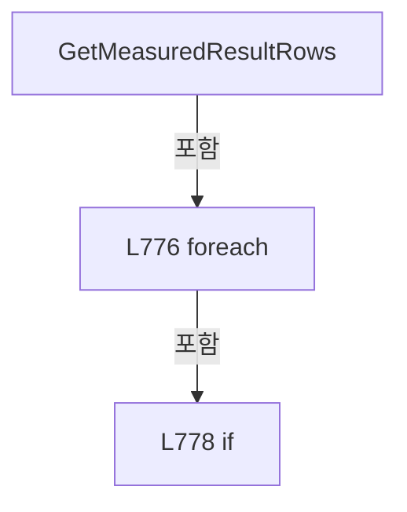

변경 전 점검: 입력/반환 타입, 위 호출자, 예외/취소 경로, 공유 상태와 저장·전송 소비자를 함께 확인합니다. 값의 단위나 물리 방향을 이름만으로 확정하지 않습니다.

### MethodDeclaration `ProjectCorrectionRows` · L787–808

[Drilling.Common/Review/CReviewManager.cs:787–808](https://github.com/kjuws10-rgb/A3Drilling/blob/96e22cd027c84bf302b23f2949b98985d7f301bb/Drilling.Common/Review/CReviewManager.cs#L787-L808)

| 항목 | 실제 추출 값 |
| --- | --- |
| 서명 | System.Collections.Generic.IReadOnlyList<Drilling.Common.Review.ST_REVIEW_PLAN_POINT> Drilling.Common.Review.CReviewManager.ProjectCorrectionRows(Drilling.Common.Review.ST_REVIEW_PLAN, System.Collections.Generic.IReadOnlyList<Drilling.Common.Review.ST_REVIEW_PLAN_POINT>) |
| 접근/수식자 | Public / public, static |
| 반환/값 타입 | System.Collections.Generic.IReadOnlyList<Drilling.Common.Review.ST_REVIEW_PLAN_POINT> |
| 소속 타입 | NamedType:Drilling.Common.Review.CReviewManager |

입력 계약:

| 이름 | 타입 | 전달 | 선택/기본값 |
| --- | --- | --- | --- |
| plan | Drilling.Common.Review.ST_REVIEW_PLAN | None | False /  |
| measuredResults | System.Collections.Generic.IReadOnlyList<Drilling.Common.Review.ST_REVIEW_PLAN_POINT> | None | False /  |

정적 호출자로 확인된 위치:

| 호출 파일/행 | 호출 표현식 | 런타임 분기 가능 |
| --- | --- | --- |
| [Drilling.UI/Menu/Menus/CMenuCorrection.ReviewData.Offset.cs:428–428](https://github.com/kjuws10-rgb/A3Drilling/blob/96e22cd027c84bf302b23f2949b98985d7f301bb/Drilling.UI/Menu/Menus/CMenuCorrection.ReviewData.Offset.cs#L428-L428) | CReviewManager.ProjectCorrectionRows | False |
| [Drilling.UI/Menu/Menus/CMenuCorrection.cs:1913–1913](https://github.com/kjuws10-rgb/A3Drilling/blob/96e22cd027c84bf302b23f2949b98985d7f301bb/Drilling.UI/Menu/Menus/CMenuCorrection.cs#L1913-L1913) | CReviewManager.ProjectCorrectionRows | False |

호출하는 대상과 해석 범위:

| 원본 행 | 표현식 | 분석 상태 | 대상/소스 위치 |
| --- | --- | --- | --- |
| 794 | measuredResults.Where(point => point.Use && point.State is EN_REVIEW_POINT_STATE.Ok or EN_REVIEW_POINT_STATE.Ng).ToArray | resolved | Drilling.Common.Review.ST_REVIEW_PLAN_POINT[] System.Collections.Generic.IEnumerable<Drilling.Common.Review.ST_REVIEW_PLAN_POINT>.ToArray<Drilling.Common.Review.ST_REVIEW_PLAN_POINT>() |
| 794 | measuredResults.Where | resolved | System.Collections.Generic.IEnumerable<Drilling.Common.Review.ST_REVIEW_PLAN_POINT> System.Collections.Generic.IEnumerable<Drilling.Common.Review.ST_REVIEW_PLAN_POINT>.Where<Drilling.Common.Review.ST_REVIEW_PLAN_POINT>(System.Func<Drilling.Common.Review.ST_REVIEW_PLAN_POINT, bool>) |
| 802 | ProjectSimpleResultRows | resolved | System.Collections.Generic.IReadOnlyList<Drilling.Common.Review.ST_REVIEW_PLAN_POINT> Drilling.Common.Review.CReviewManager.ProjectSimpleResultRows(Drilling.Common.Review.ST_REVIEW_CORRECTION_PLAN, System.Collections.Generic.IReadOnlyList<Drilling.Common.Review.ST_REVIEW_PLAN_POINT>) · Drilling.Common/Review/CReviewManager.cs:810 |
| 803 | ProjectRoughResultRows | resolved | System.Collections.Generic.IReadOnlyList<Drilling.Common.Review.ST_REVIEW_PLAN_POINT> Drilling.Common.Review.CReviewManager.ProjectRoughResultRows(Drilling.Common.Review.ST_REVIEW_CORRECTION_PLAN, System.Collections.Generic.IReadOnlyList<Drilling.Common.Review.ST_REVIEW_PLAN_POINT>) · Drilling.Common/Review/CReviewManager.cs:821 |
| 804 | ProjectFineResultRows | resolved | System.Collections.Generic.IReadOnlyList<Drilling.Common.Review.ST_REVIEW_PLAN_POINT> Drilling.Common.Review.CReviewManager.ProjectFineResultRows(System.Collections.Generic.IReadOnlyList<Drilling.Common.Review.ST_REVIEW_PLAN_POINT>, System.Collections.Generic.IReadOnlyList<Drilling.Common.Review.ST_REVIEW_PLAN_POINT>) · Drilling.Common/Review/CReviewManager.cs:827 |

본문의 실제 연산·분기·예외·반환 순서(원문 위치 순):

| 원본 행 | 종류 | 주석 해설 |
| --- | --- | --- |
| 789 | if | 조건에 따라 분기합니다: if (plan.CorrectionPlan is not { SourcePoints.Count: > 0 } projection) |
| 791 | return | 호출자에게 값 또는 제어를 반환합니다: return measuredResults; |
| 794 | call | 함수·델리게이트 또는 객체 생성자를 호출합니다: measuredResults.Where(point => point.Use && point.State is EN_REVIEW_POINT_STATE.Ok or EN_REVIEW_POINT_STATE.Ng).ToArray() |
| 794 | call | 함수·델리게이트 또는 객체 생성자를 호출합니다: measuredResults.Where(point => point.Use && point.State is EN_REVIEW_POINT_STATE.Ok or EN_REVIEW_POINT_STATE.Ng) |
| 794 | local-declaration | 지역 변수를 선언합니다: var measuredPoints = measuredResults.Where(point => point.Use && point.State is EN_REVIEW_POINT_STATE.Ok or EN_REVIEW_POINT_STATE.Ng).ToArray(); |
| 794 | variable-initializer | 변수의 초기값을 지정합니다: measuredPoints = measuredResults.Where(point => point.Use && point.State is EN_REVIEW_POINT_STATE.Ok or EN_REVIEW_POINT_STATE.Ng).ToArray() |
| 795 | if | 조건에 따라 분기합니다: if (measuredPoints.Length == 0) |
| 797 | return | 호출자에게 값 또는 제어를 반환합니다: return measuredResults; |
| 800 | return | 호출자에게 값 또는 제어를 반환합니다: return projection.Rule switch { EN_REVIEW_CORRECTION_RULE.Simple => ProjectSimpleResultRows(projection, measuredPoints), EN_REVIEW_CORRECTION_RULE.Rough => ProjectRoughResultRows(projection, measuredPoints), EN_REVIEW_CORRECTION_R |
| 800 | switch-expression | 값별 결과식을 선택합니다: projection.Rule switch { EN_REVIEW_CORRECTION_RULE.Simple => ProjectSimpleResultRows(projection, measuredPoints), EN_REVIEW_CORRECTION_RULE.Rough => ProjectRoughResultRows(projection, measuredPoints), EN_REVIEW_CORRECTION_RULE.Fin |
| 802 | call | 함수·델리게이트 또는 객체 생성자를 호출합니다: ProjectSimpleResultRows(projection, measuredPoints) |
| 803 | call | 함수·델리게이트 또는 객체 생성자를 호출합니다: ProjectRoughResultRows(projection, measuredPoints) |
| 804 | call | 함수·델리게이트 또는 객체 생성자를 호출합니다: ProjectFineResultRows(projection.SourcePoints, measuredPoints) |

제어 구문의 포함 구조(실제 실행 순서/CFG가 아닌 구문 탐색 그림):

```mermaid
flowchart TD
 M["ProjectCorrectionRows"]
 N0["L789 if"]
 M -->|포함| N0
 N1["L795 if"]
 M -->|포함| N1
 N2["L800 switch-expression"]
 M -->|포함| N2
```

변경 전 점검: 입력/반환 타입, 위 호출자, 예외/취소 경로, 공유 상태와 저장·전송 소비자를 함께 확인합니다. 값의 단위나 물리 방향을 이름만으로 확정하지 않습니다.

### MethodDeclaration `ProjectSimpleResultRows` · L810–819

[Drilling.Common/Review/CReviewManager.cs:810–819](https://github.com/kjuws10-rgb/A3Drilling/blob/96e22cd027c84bf302b23f2949b98985d7f301bb/Drilling.Common/Review/CReviewManager.cs#L810-L819)

| 항목 | 실제 추출 값 |
| --- | --- |
| 서명 | System.Collections.Generic.IReadOnlyList<Drilling.Common.Review.ST_REVIEW_PLAN_POINT> Drilling.Common.Review.CReviewManager.ProjectSimpleResultRows(Drilling.Common.Review.ST_REVIEW_CORRECTION_PLAN, System.Collections.Generic.IReadOnlyList<Drilling.Common.Review.ST_REVIEW_PLAN_POINT>) |
| 접근/수식자 | Private / private, static |
| 반환/값 타입 | System.Collections.Generic.IReadOnlyList<Drilling.Common.Review.ST_REVIEW_PLAN_POINT> |
| 소속 타입 | NamedType:Drilling.Common.Review.CReviewManager |

입력 계약:

| 이름 | 타입 | 전달 | 선택/기본값 |
| --- | --- | --- | --- |
| projection | Drilling.Common.Review.ST_REVIEW_CORRECTION_PLAN | None | False /  |
| measuredPoints | System.Collections.Generic.IReadOnlyList<Drilling.Common.Review.ST_REVIEW_PLAN_POINT> | None | False /  |

정적 호출자로 확인된 위치:

| 호출 파일/행 | 호출 표현식 | 런타임 분기 가능 |
| --- | --- | --- |
| [Drilling.Common/Review/CReviewManager.cs:802–802](https://github.com/kjuws10-rgb/A3Drilling/blob/96e22cd027c84bf302b23f2949b98985d7f301bb/Drilling.Common/Review/CReviewManager.cs#L802-L802) | ProjectSimpleResultRows | False |

호출하는 대상과 해석 범위:

| 원본 행 | 표현식 | 분석 상태 | 대상/소스 위치 |
| --- | --- | --- | --- |
| 818 | projection.SourcePoints.Where(point => point.HeadNo == measuredPoint.HeadNo && (projection.Scope != EN_REVIEW_CORRECTION_SCOPE.HeadCell &#124;&#124; point.CellNo == measuredPoint.CellNo)).Where(point => point.HeadNo > 0).Select(point => CopyMeasurement(point, measuredPoint)).ToArray | resolved | Drilling.Common.Review.ST_REVIEW_PLAN_POINT[] System.Collections.Generic.IEnumerable<Drilling.Common.Review.ST_REVIEW_PLAN_POINT>.ToArray<Drilling.Common.Review.ST_REVIEW_PLAN_POINT>() |
| 818 | projection.SourcePoints.Where(point => point.HeadNo == measuredPoint.HeadNo && (projection.Scope != EN_REVIEW_CORRECTION_SCOPE.HeadCell &#124;&#124; point.CellNo == measuredPoint.CellNo)).Where(point => point.HeadNo > 0).Select | resolved | System.Collections.Generic.IEnumerable<Drilling.Common.Review.ST_REVIEW_PLAN_POINT> System.Collections.Generic.IEnumerable<Drilling.Common.Review.ST_REVIEW_PLAN_POINT>.Select<Drilling.Common.Review.ST_REVIEW_PLAN_POINT, Drilling.Common.Review.ST_REVIEW_PLAN_POINT>(System.Func<Drilling.Common.Review.ST_REVIEW_PLAN_POINT, Drilling.Common.Review.ST_REVIEW_PLAN_POINT>) |
| 818 | projection.SourcePoints.Where(point => point.HeadNo == measuredPoint.HeadNo && (projection.Scope != EN_REVIEW_CORRECTION_SCOPE.HeadCell &#124;&#124; point.CellNo == measuredPoint.CellNo)).Where | resolved | System.Collections.Generic.IEnumerable<Drilling.Common.Review.ST_REVIEW_PLAN_POINT> System.Collections.Generic.IEnumerable<Drilling.Common.Review.ST_REVIEW_PLAN_POINT>.Where<Drilling.Common.Review.ST_REVIEW_PLAN_POINT>(System.Func<Drilling.Common.Review.ST_REVIEW_PLAN_POINT, bool>) |
| 818 | projection.SourcePoints.Where | resolved | System.Collections.Generic.IEnumerable<Drilling.Common.Review.ST_REVIEW_PLAN_POINT> System.Collections.Generic.IEnumerable<Drilling.Common.Review.ST_REVIEW_PLAN_POINT>.Where<Drilling.Common.Review.ST_REVIEW_PLAN_POINT>(System.Func<Drilling.Common.Review.ST_REVIEW_PLAN_POINT, bool>) |
| 818 | CopyMeasurement | resolved | Drilling.Common.Review.ST_REVIEW_PLAN_POINT Drilling.Common.Review.CReviewManager.CopyMeasurement(Drilling.Common.Review.ST_REVIEW_PLAN_POINT, Drilling.Common.Review.ST_REVIEW_PLAN_POINT) · Drilling.Common/Review/CReviewManager.cs:892 |

본문의 실제 연산·분기·예외·반환 순서(원문 위치 순):

| 원본 행 | 종류 | 주석 해설 |
| --- | --- | --- |
| 812 | if | 조건에 따라 분기합니다: if (measuredPoints.Count != 1) |
| 814 | return | 호출자에게 값 또는 제어를 반환합니다: return measuredPoints; |
| 817 | local-declaration | 지역 변수를 선언합니다: var measuredPoint = measuredPoints[0]; |
| 817 | variable-initializer | 변수의 초기값을 지정합니다: measuredPoint = measuredPoints[0] |
| 818 | call | 함수·델리게이트 또는 객체 생성자를 호출합니다: projection.SourcePoints.Where(point => point.HeadNo == measuredPoint.HeadNo && (projection.Scope != EN_REVIEW_CORRECTION_SCOPE.HeadCell &#124;&#124; point.CellNo == measuredPoint.CellNo)).Where(point => point.HeadNo > 0).Select(po… |
| 818 | call | 함수·델리게이트 또는 객체 생성자를 호출합니다: projection.SourcePoints.Where(point => point.HeadNo == measuredPoint.HeadNo && (projection.Scope != EN_REVIEW_CORRECTION_SCOPE.HeadCell &#124;&#124; point.CellNo == measuredPoint.CellNo)).Where(point => point.HeadNo > 0).Select(po… |
| 818 | call | 함수·델리게이트 또는 객체 생성자를 호출합니다: projection.SourcePoints.Where(point => point.HeadNo == measuredPoint.HeadNo && (projection.Scope != EN_REVIEW_CORRECTION_SCOPE.HeadCell &#124;&#124; point.CellNo == measuredPoint.CellNo)).Where(point => point.HeadNo > 0) |
| 818 | call | 함수·델리게이트 또는 객체 생성자를 호출합니다: projection.SourcePoints.Where(point => point.HeadNo == measuredPoint.HeadNo && (projection.Scope != EN_REVIEW_CORRECTION_SCOPE.HeadCell &#124;&#124; point.CellNo == measuredPoint.CellNo)) |
| 818 | call | 함수·델리게이트 또는 객체 생성자를 호출합니다: CopyMeasurement(point, measuredPoint) |
| 818 | return | 호출자에게 값 또는 제어를 반환합니다: return projection.SourcePoints.Where(point => point.HeadNo == measuredPoint.HeadNo && (projection.Scope != EN_REVIEW_CORRECTION_SCOPE.HeadCell &#124;&#124; point.CellNo == measuredPoint.CellNo)).Where(point => point.HeadNo > 0).Select(point |

제어 구문의 포함 구조(실제 실행 순서/CFG가 아닌 구문 탐색 그림):

```mermaid
flowchart TD
 M["ProjectSimpleResultRows"]
 N0["L812 if"]
 M -->|포함| N0
```

변경 전 점검: 입력/반환 타입, 위 호출자, 예외/취소 경로, 공유 상태와 저장·전송 소비자를 함께 확인합니다. 값의 단위나 물리 방향을 이름만으로 확정하지 않습니다.

### MethodDeclaration `ProjectRoughResultRows` · L821–825

[Drilling.Common/Review/CReviewManager.cs:821–825](https://github.com/kjuws10-rgb/A3Drilling/blob/96e22cd027c84bf302b23f2949b98985d7f301bb/Drilling.Common/Review/CReviewManager.cs#L821-L825)

| 항목 | 실제 추출 값 |
| --- | --- |
| 서명 | System.Collections.Generic.IReadOnlyList<Drilling.Common.Review.ST_REVIEW_PLAN_POINT> Drilling.Common.Review.CReviewManager.ProjectRoughResultRows(Drilling.Common.Review.ST_REVIEW_CORRECTION_PLAN, System.Collections.Generic.IReadOnlyList<Drilling.Common.Review.ST_REVIEW_PLAN_POINT>) |
| 접근/수식자 | Private / private, static |
| 반환/값 타입 | System.Collections.Generic.IReadOnlyList<Drilling.Common.Review.ST_REVIEW_PLAN_POINT> |
| 소속 타입 | NamedType:Drilling.Common.Review.CReviewManager |

입력 계약:

| 이름 | 타입 | 전달 | 선택/기본값 |
| --- | --- | --- | --- |
| projection | Drilling.Common.Review.ST_REVIEW_CORRECTION_PLAN | None | False /  |
| measuredPoints | System.Collections.Generic.IReadOnlyList<Drilling.Common.Review.ST_REVIEW_PLAN_POINT> | None | False /  |

정적 호출자로 확인된 위치:

| 호출 파일/행 | 호출 표현식 | 런타임 분기 가능 |
| --- | --- | --- |
| [Drilling.Common/Review/CReviewManager.cs:803–803](https://github.com/kjuws10-rgb/A3Drilling/blob/96e22cd027c84bf302b23f2949b98985d7f301bb/Drilling.Common/Review/CReviewManager.cs#L803-L803) | ProjectRoughResultRows | False |

호출하는 대상과 해석 범위:

| 원본 행 | 표현식 | 분석 상태 | 대상/소스 위치 |
| --- | --- | --- | --- |
| 823 | measuredPoints.GroupBy(point => projection.Scope == EN_REVIEW_CORRECTION_SCOPE.HeadCell ? (point.HeadNo, point.CellNo) : (point.HeadNo, 0)).ToDictionary | resolved | System.Collections.Generic.Dictionary<(int HeadNo, int), Drilling.Common.Review.ST_REVIEW_PLAN_POINT> System.Collections.Generic.IEnumerable<System.Linq.IGrouping<(int HeadNo, int), Drilling.Common.Review.ST_REVIEW_PLAN_POINT>>.ToDictionary<System.Linq.IGrouping<(int HeadNo, int), Drilling.Common.Review.ST_REVIEW_PLAN_POINT>, (int HeadNo, int), Drilling.Common.Review.ST_REVIEW_PLAN_POINT>(System.Func<System.Linq.IGrouping<(int HeadNo, int), Drilling.Common.Review.ST_REVIEW_PLAN_POINT>, (int HeadNo, int)>, System.Func<System.Linq.IGrouping<(int HeadNo, int), Drilling.Common.Review.ST_REVIEW_PLAN_POINT>, Drilling.Common.Review.ST_REVIEW_PLAN_POINT>) |
| 823 | measuredPoints.GroupBy | resolved | System.Collections.Generic.IEnumerable<System.Linq.IGrouping<(int HeadNo, int), Drilling.Common.Review.ST_REVIEW_PLAN_POINT>> System.Collections.Generic.IEnumerable<Drilling.Common.Review.ST_REVIEW_PLAN_POINT>.GroupBy<Drilling.Common.Review.ST_REVIEW_PLAN_POINT, (int HeadNo, int)>(System.Func<Drilling.Common.Review.ST_REVIEW_PLAN_POINT, (int HeadNo, int)>) |
| 823 | group.First | resolved | Drilling.Common.Review.ST_REVIEW_PLAN_POINT System.Collections.Generic.IEnumerable<Drilling.Common.Review.ST_REVIEW_PLAN_POINT>.First<Drilling.Common.Review.ST_REVIEW_PLAN_POINT>() |
| 824 | projection.SourcePoints.Where(point => point.HeadNo > 0).Select(point => new { Point = point, Key = projection.Scope == EN_REVIEW_CORRECTION_SCOPE.HeadCell ? (point.HeadNo, point.CellNo) : (point.HeadNo, 0) }).Where(item => measurements.ContainsKey(item.Key)).Select(item => CopyMeasurement(item.Point, measurements[item.Key])).ToArray | resolved | Drilling.Common.Review.ST_REVIEW_PLAN_POINT[] System.Collections.Generic.IEnumerable<Drilling.Common.Review.ST_REVIEW_PLAN_POINT>.ToArray<Drilling.Common.Review.ST_REVIEW_PLAN_POINT>() |
| 824 | projection.SourcePoints.Where(point => point.HeadNo > 0).Select(point => new { Point = point, Key = projection.Scope == EN_REVIEW_CORRECTION_SCOPE.HeadCell ? (point.HeadNo, point.CellNo) : (point.HeadNo, 0) }).Where(item => measurements.ContainsKey(item.Key)).Select | resolved | System.Collections.Generic.IEnumerable<Drilling.Common.Review.ST_REVIEW_PLAN_POINT> System.Collections.Generic.IEnumerable<<anonymous type: Drilling.Common.Review.ST_REVIEW_PLAN_POINT Point, (int HeadNo, int) Key>>.Select<<anonymous type: Drilling.Common.Review.ST_REVIEW_PLAN_POINT Point, (int HeadNo, int) Key>, Drilling.Common.Review.ST_REVIEW_PLAN_POINT>(System.Func<<anonymous type: Drilling.Common.Review.ST_REVIEW_PLAN_POINT Point, (int HeadNo, int) Key>, Drilling.Common.Review.ST_REVIEW_PLAN_POINT>) |
| 824 | projection.SourcePoints.Where(point => point.HeadNo > 0).Select(point => new { Point = point, Key = projection.Scope == EN_REVIEW_CORRECTION_SCOPE.HeadCell ? (point.HeadNo, point.CellNo) : (point.HeadNo, 0) }).Where | resolved | System.Collections.Generic.IEnumerable<<anonymous type: Drilling.Common.Review.ST_REVIEW_PLAN_POINT Point, (int HeadNo, int) Key>> System.Collections.Generic.IEnumerable<<anonymous type: Drilling.Common.Review.ST_REVIEW_PLAN_POINT Point, (int HeadNo, int) Key>>.Where<<anonymous type: Drilling.Common.Review.ST_REVIEW_PLAN_POINT Point, (int HeadNo, int) Key>>(System.Func<<anonymous type: Drilling.Common.Review.ST_REVIEW_PLAN_POINT Point, (int HeadNo, int) Key>, bool>) |
| 824 | projection.SourcePoints.Where(point => point.HeadNo > 0).Select | resolved | System.Collections.Generic.IEnumerable<<anonymous type: Drilling.Common.Review.ST_REVIEW_PLAN_POINT Point, (int HeadNo, int) Key>> System.Collections.Generic.IEnumerable<Drilling.Common.Review.ST_REVIEW_PLAN_POINT>.Select<Drilling.Common.Review.ST_REVIEW_PLAN_POINT, <anonymous type: Drilling.Common.Review.ST_REVIEW_PLAN_POINT Point, (int HeadNo, int) Key>>(System.Func<Drilling.Common.Review.ST_REVIEW_PLAN_POINT, <anonymous type: Drilling.Common.Review.ST_REVIEW_PLAN_POINT Point, (int HeadNo, int) Key>>) |
| 824 | projection.SourcePoints.Where | resolved | System.Collections.Generic.IEnumerable<Drilling.Common.Review.ST_REVIEW_PLAN_POINT> System.Collections.Generic.IEnumerable<Drilling.Common.Review.ST_REVIEW_PLAN_POINT>.Where<Drilling.Common.Review.ST_REVIEW_PLAN_POINT>(System.Func<Drilling.Common.Review.ST_REVIEW_PLAN_POINT, bool>) |
| 824 | measurements.ContainsKey | resolved | bool System.Collections.Generic.Dictionary<(int HeadNo, int), Drilling.Common.Review.ST_REVIEW_PLAN_POINT>.ContainsKey((int HeadNo, int)) |
| 824 | CopyMeasurement | resolved | Drilling.Common.Review.ST_REVIEW_PLAN_POINT Drilling.Common.Review.CReviewManager.CopyMeasurement(Drilling.Common.Review.ST_REVIEW_PLAN_POINT, Drilling.Common.Review.ST_REVIEW_PLAN_POINT) · Drilling.Common/Review/CReviewManager.cs:892 |

본문의 실제 연산·분기·예외·반환 순서(원문 위치 순):

| 원본 행 | 종류 | 주석 해설 |
| --- | --- | --- |
| 823 | call | 함수·델리게이트 또는 객체 생성자를 호출합니다: measuredPoints.GroupBy(point => projection.Scope == EN_REVIEW_CORRECTION_SCOPE.HeadCell ? (point.HeadNo, point.CellNo) : (point.HeadNo, 0)).ToDictionary(group => group.Key, group => group.First()) |
| 823 | call | 함수·델리게이트 또는 객체 생성자를 호출합니다: measuredPoints.GroupBy(point => projection.Scope == EN_REVIEW_CORRECTION_SCOPE.HeadCell ? (point.HeadNo, point.CellNo) : (point.HeadNo, 0)) |
| 823 | call | 함수·델리게이트 또는 객체 생성자를 호출합니다: group.First() |
| 823 | conditional-expression | 조건에 따라 결과식을 선택합니다: projection.Scope == EN_REVIEW_CORRECTION_SCOPE.HeadCell ? (point.HeadNo, point.CellNo) : (point.HeadNo, 0) |
| 823 | local-declaration | 지역 변수를 선언합니다: var measurements = measuredPoints.GroupBy(point => projection.Scope == EN_REVIEW_CORRECTION_SCOPE.HeadCell ? (point.HeadNo, point.CellNo) : (point.HeadNo, 0)).ToDictionary(group => group.Key, group => group.First()); |
| 823 | variable-initializer | 변수의 초기값을 지정합니다: measurements = measuredPoints.GroupBy(point => projection.Scope == EN_REVIEW_CORRECTION_SCOPE.HeadCell ? (point.HeadNo, point.CellNo) : (point.HeadNo, 0)).ToDictionary(group => group.Key, group => group.First()) |
| 824 | call | 함수·델리게이트 또는 객체 생성자를 호출합니다: projection.SourcePoints.Where(point => point.HeadNo > 0).Select(point => new { Point = point, Key = projection.Scope == EN_REVIEW_CORRECTION_SCOPE.HeadCell ? (point.HeadNo, point.CellNo) : (point.HeadNo, 0) }).Where(item… |
| 824 | call | 함수·델리게이트 또는 객체 생성자를 호출합니다: projection.SourcePoints.Where(point => point.HeadNo > 0).Select(point => new { Point = point, Key = projection.Scope == EN_REVIEW_CORRECTION_SCOPE.HeadCell ? (point.HeadNo, point.CellNo) : (point.HeadNo, 0) }).Where(item… |
| 824 | call | 함수·델리게이트 또는 객체 생성자를 호출합니다: projection.SourcePoints.Where(point => point.HeadNo > 0).Select(point => new { Point = point, Key = projection.Scope == EN_REVIEW_CORRECTION_SCOPE.HeadCell ? (point.HeadNo, point.CellNo) : (point.HeadNo, 0) }).Where(item… |
| 824 | call | 함수·델리게이트 또는 객체 생성자를 호출합니다: projection.SourcePoints.Where(point => point.HeadNo > 0).Select(point => new { Point = point, Key = projection.Scope == EN_REVIEW_CORRECTION_SCOPE.HeadCell ? (point.HeadNo, point.CellNo) : (point.HeadNo, 0) }) |
| 824 | call | 함수·델리게이트 또는 객체 생성자를 호출합니다: projection.SourcePoints.Where(point => point.HeadNo > 0) |
| 824 | call | 함수·델리게이트 또는 객체 생성자를 호출합니다: measurements.ContainsKey(item.Key) |
| 824 | call | 함수·델리게이트 또는 객체 생성자를 호출합니다: CopyMeasurement(item.Point, measurements[item.Key]) |
| 824 | conditional-expression | 조건에 따라 결과식을 선택합니다: projection.Scope == EN_REVIEW_CORRECTION_SCOPE.HeadCell ? (point.HeadNo, point.CellNo) : (point.HeadNo, 0) |
| 824 | return | 호출자에게 값 또는 제어를 반환합니다: return projection.SourcePoints.Where(point => point.HeadNo > 0).Select(point => new { Point = point, Key = projection.Scope == EN_REVIEW_CORRECTION_SCOPE.HeadCell ? (point.HeadNo, point.CellNo) : (point.HeadNo, 0) }).Where(item => |

변경 전 점검: 입력/반환 타입, 위 호출자, 예외/취소 경로, 공유 상태와 저장·전송 소비자를 함께 확인합니다. 값의 단위나 물리 방향을 이름만으로 확정하지 않습니다.

### MethodDeclaration `ProjectFineResultRows` · L827–842

[Drilling.Common/Review/CReviewManager.cs:827–842](https://github.com/kjuws10-rgb/A3Drilling/blob/96e22cd027c84bf302b23f2949b98985d7f301bb/Drilling.Common/Review/CReviewManager.cs#L827-L842)

| 항목 | 실제 추출 값 |
| --- | --- |
| 서명 | System.Collections.Generic.IReadOnlyList<Drilling.Common.Review.ST_REVIEW_PLAN_POINT> Drilling.Common.Review.CReviewManager.ProjectFineResultRows(System.Collections.Generic.IReadOnlyList<Drilling.Common.Review.ST_REVIEW_PLAN_POINT>, System.Collections.Generic.IReadOnlyList<Drilling.Common.Review.ST_REVIEW_PLAN_POINT>) |
| 접근/수식자 | Private / private, static |
| 반환/값 타입 | System.Collections.Generic.IReadOnlyList<Drilling.Common.Review.ST_REVIEW_PLAN_POINT> |
| 소속 타입 | NamedType:Drilling.Common.Review.CReviewManager |

입력 계약:

| 이름 | 타입 | 전달 | 선택/기본값 |
| --- | --- | --- | --- |
| sourcePoints | System.Collections.Generic.IReadOnlyList<Drilling.Common.Review.ST_REVIEW_PLAN_POINT> | None | False /  |
| measuredPoints | System.Collections.Generic.IReadOnlyList<Drilling.Common.Review.ST_REVIEW_PLAN_POINT> | None | False /  |

정적 호출자로 확인된 위치:

| 호출 파일/행 | 호출 표현식 | 런타임 분기 가능 |
| --- | --- | --- |
| [Drilling.Common/Review/CReviewManager.cs:804–804](https://github.com/kjuws10-rgb/A3Drilling/blob/96e22cd027c84bf302b23f2949b98985d7f301bb/Drilling.Common/Review/CReviewManager.cs#L804-L804) | ProjectFineResultRows | False |

호출하는 대상과 해석 범위:

| 원본 행 | 표현식 | 분석 상태 | 대상/소스 위치 |
| --- | --- | --- | --- |
| 829 | measuredPoints.Where(point => point.HeadNo > 0 && double.IsFinite(point.DesignX) && double.IsFinite(point.DesignY)).GroupBy(point => (point.HeadNo, X: FineCoordinateKey(point.DesignX))).ToDictionary | resolved | System.Collections.Generic.Dictionary<(int HeadNo, double X), Drilling.Common.Review.ST_REVIEW_PLAN_POINT[]> System.Collections.Generic.IEnumerable<System.Linq.IGrouping<(int HeadNo, double X), Drilling.Common.Review.ST_REVIEW_PLAN_POINT>>.ToDictionary<System.Linq.IGrouping<(int HeadNo, double X), Drilling.Common.Review.ST_REVIEW_PLAN_POINT>, (int HeadNo, double X), Drilling.Common.Review.ST_REVIEW_PLAN_POINT[]>(System.Func<System.Linq.IGrouping<(int HeadNo, double X), Drilling.Common.Review.ST_REVIEW_PLAN_POINT>, (int HeadNo, double X)>, System.Func<System.Linq.IGrouping<(int HeadNo, double X), Drilling.Common.Review.ST_REVIEW_PLAN_POINT>, Drilling.Common.Review.ST_REVIEW_PLAN_POINT[]>) |
| 829 | measuredPoints.Where(point => point.HeadNo > 0 && double.IsFinite(point.DesignX) && double.IsFinite(point.DesignY)).GroupBy | resolved | System.Collections.Generic.IEnumerable<System.Linq.IGrouping<(int HeadNo, double X), Drilling.Common.Review.ST_REVIEW_PLAN_POINT>> System.Collections.Generic.IEnumerable<Drilling.Common.Review.ST_REVIEW_PLAN_POINT>.GroupBy<Drilling.Common.Review.ST_REVIEW_PLAN_POINT, (int HeadNo, double X)>(System.Func<Drilling.Common.Review.ST_REVIEW_PLAN_POINT, (int HeadNo, double X)>) |
| 829 | measuredPoints.Where | resolved | System.Collections.Generic.IEnumerable<Drilling.Common.Review.ST_REVIEW_PLAN_POINT> System.Collections.Generic.IEnumerable<Drilling.Common.Review.ST_REVIEW_PLAN_POINT>.Where<Drilling.Common.Review.ST_REVIEW_PLAN_POINT>(System.Func<Drilling.Common.Review.ST_REVIEW_PLAN_POINT, bool>) |
| 829 | double.IsFinite | resolved | bool double.IsFinite(double) |
| 829 | double.IsFinite | resolved | bool double.IsFinite(double) |
| 829 | FineCoordinateKey | resolved | double Drilling.Common.Review.CReviewManager.FineCoordinateKey(double) · Drilling.Common/Review/CReviewManager.cs:900 |
| 829 | group.GroupBy(point => FineCoordinateKey(point.DesignY)).Select(yGroup => yGroup.First()).OrderBy(point => point.DesignY).ToArray | resolved | Drilling.Common.Review.ST_REVIEW_PLAN_POINT[] System.Collections.Generic.IEnumerable<Drilling.Common.Review.ST_REVIEW_PLAN_POINT>.ToArray<Drilling.Common.Review.ST_REVIEW_PLAN_POINT>() |
| 829 | group.GroupBy(point => FineCoordinateKey(point.DesignY)).Select(yGroup => yGroup.First()).OrderBy | resolved | System.Linq.IOrderedEnumerable<Drilling.Common.Review.ST_REVIEW_PLAN_POINT> System.Collections.Generic.IEnumerable<Drilling.Common.Review.ST_REVIEW_PLAN_POINT>.OrderBy<Drilling.Common.Review.ST_REVIEW_PLAN_POINT, double>(System.Func<Drilling.Common.Review.ST_REVIEW_PLAN_POINT, double>) |
| 829 | group.GroupBy(point => FineCoordinateKey(point.DesignY)).Select | resolved | System.Collections.Generic.IEnumerable<Drilling.Common.Review.ST_REVIEW_PLAN_POINT> System.Collections.Generic.IEnumerable<System.Linq.IGrouping<double, Drilling.Common.Review.ST_REVIEW_PLAN_POINT>>.Select<System.Linq.IGrouping<double, Drilling.Common.Review.ST_REVIEW_PLAN_POINT>, Drilling.Common.Review.ST_REVIEW_PLAN_POINT>(System.Func<System.Linq.IGrouping<double, Drilling.Common.Review.ST_REVIEW_PLAN_POINT>, Drilling.Common.Review.ST_REVIEW_PLAN_POINT>) |
| 829 | group.GroupBy | resolved | System.Collections.Generic.IEnumerable<System.Linq.IGrouping<double, Drilling.Common.Review.ST_REVIEW_PLAN_POINT>> System.Collections.Generic.IEnumerable<Drilling.Common.Review.ST_REVIEW_PLAN_POINT>.GroupBy<Drilling.Common.Review.ST_REVIEW_PLAN_POINT, double>(System.Func<Drilling.Common.Review.ST_REVIEW_PLAN_POINT, double>) |
| 829 | FineCoordinateKey | resolved | double Drilling.Common.Review.CReviewManager.FineCoordinateKey(double) · Drilling.Common/Review/CReviewManager.cs:900 |
| 829 | yGroup.First | resolved | Drilling.Common.Review.ST_REVIEW_PLAN_POINT System.Collections.Generic.IEnumerable<Drilling.Common.Review.ST_REVIEW_PLAN_POINT>.First<Drilling.Common.Review.ST_REVIEW_PLAN_POINT>() |
| 830 | new List<ST_REVIEW_PLAN_POINT> | resolved | System.Collections.Generic.List<Drilling.Common.Review.ST_REVIEW_PLAN_POINT>.List(int) |
| 831 | sourcePoints.Where | resolved | System.Collections.Generic.IEnumerable<Drilling.Common.Review.ST_REVIEW_PLAN_POINT> System.Collections.Generic.IEnumerable<Drilling.Common.Review.ST_REVIEW_PLAN_POINT>.Where<Drilling.Common.Review.ST_REVIEW_PLAN_POINT>(System.Func<Drilling.Common.Review.ST_REVIEW_PLAN_POINT, bool>) |
| 831 | double.IsFinite | resolved | bool double.IsFinite(double) |
| 831 | double.IsFinite | resolved | bool double.IsFinite(double) |
| 833 | anchorsByHeadAndX.TryGetValue | resolved | bool System.Collections.Generic.Dictionary<(int HeadNo, double X), Drilling.Common.Review.ST_REVIEW_PLAN_POINT[]>.TryGetValue((int HeadNo, double X), out Drilling.Common.Review.ST_REVIEW_PLAN_POINT[]) |
| 833 | FineCoordinateKey | resolved | double Drilling.Common.Review.CReviewManager.FineCoordinateKey(double) · Drilling.Common/Review/CReviewManager.cs:900 |
| 838 | rows.Add | resolved | void System.Collections.Generic.List<Drilling.Common.Review.ST_REVIEW_PLAN_POINT>.Add(Drilling.Common.Review.ST_REVIEW_PLAN_POINT) |
| 838 | InterpolateFineMeasurementAcrossGlass | resolved | Drilling.Common.Review.ST_REVIEW_PLAN_POINT Drilling.Common.Review.CReviewManager.InterpolateFineMeasurementAcrossGlass(Drilling.Common.Review.ST_REVIEW_PLAN_POINT, System.Collections.Generic.IReadOnlyList<Drilling.Common.Review.ST_REVIEW_PLAN_POINT>) · Drilling.Common/Review/CReviewManager.cs:844 |

본문의 실제 연산·분기·예외·반환 순서(원문 위치 순):

| 원본 행 | 종류 | 주석 해설 |
| --- | --- | --- |
| 829 | call | 함수·델리게이트 또는 객체 생성자를 호출합니다: measuredPoints.Where(point => point.HeadNo > 0 && double.IsFinite(point.DesignX) && double.IsFinite(point.DesignY)).GroupBy(point => (point.HeadNo, X: FineCoordinateKey(point.DesignX))).ToDictionary(group => group.Key, g… |
| 829 | call | 함수·델리게이트 또는 객체 생성자를 호출합니다: measuredPoints.Where(point => point.HeadNo > 0 && double.IsFinite(point.DesignX) && double.IsFinite(point.DesignY)).GroupBy(point => (point.HeadNo, X: FineCoordinateKey(point.DesignX))) |
| 829 | call | 함수·델리게이트 또는 객체 생성자를 호출합니다: measuredPoints.Where(point => point.HeadNo > 0 && double.IsFinite(point.DesignX) && double.IsFinite(point.DesignY)) |
| 829 | call | 함수·델리게이트 또는 객체 생성자를 호출합니다: double.IsFinite(point.DesignX) |
| 829 | call | 함수·델리게이트 또는 객체 생성자를 호출합니다: double.IsFinite(point.DesignY) |
| 829 | call | 함수·델리게이트 또는 객체 생성자를 호출합니다: FineCoordinateKey(point.DesignX) |
| 829 | call | 함수·델리게이트 또는 객체 생성자를 호출합니다: group.GroupBy(point => FineCoordinateKey(point.DesignY)).Select(yGroup => yGroup.First()).OrderBy(point => point.DesignY).ToArray() |
| 829 | call | 함수·델리게이트 또는 객체 생성자를 호출합니다: group.GroupBy(point => FineCoordinateKey(point.DesignY)).Select(yGroup => yGroup.First()).OrderBy(point => point.DesignY) |
| 829 | call | 함수·델리게이트 또는 객체 생성자를 호출합니다: group.GroupBy(point => FineCoordinateKey(point.DesignY)).Select(yGroup => yGroup.First()) |
| 829 | call | 함수·델리게이트 또는 객체 생성자를 호출합니다: group.GroupBy(point => FineCoordinateKey(point.DesignY)) |
| 829 | call | 함수·델리게이트 또는 객체 생성자를 호출합니다: FineCoordinateKey(point.DesignY) |
| 829 | call | 함수·델리게이트 또는 객체 생성자를 호출합니다: yGroup.First() |
| 829 | local-declaration | 지역 변수를 선언합니다: var anchorsByHeadAndX = measuredPoints.Where(point => point.HeadNo > 0 && double.IsFinite(point.DesignX) && double.IsFinite(point.DesignY)).GroupBy(point => (point.HeadNo, X: FineCoordinateKey(point.DesignX))).ToDictionary(group = |
| 829 | variable-initializer | 변수의 초기값을 지정합니다: anchorsByHeadAndX = measuredPoints.Where(point => point.HeadNo > 0 && double.IsFinite(point.DesignX) && double.IsFinite(point.DesignY)).GroupBy(point => (point.HeadNo, X: FineCoordinateKey(point.DesignX))).ToDictionary(group => gr |
| 830 | call | 함수·델리게이트 또는 객체 생성자를 호출합니다: new List<ST_REVIEW_PLAN_POINT>(sourcePoints.Count) |
| 830 | local-declaration | 지역 변수를 선언합니다: var rows = new List<ST_REVIEW_PLAN_POINT>(sourcePoints.Count); |
| 830 | variable-initializer | 변수의 초기값을 지정합니다: rows = new List<ST_REVIEW_PLAN_POINT>(sourcePoints.Count) |
| 831 | call | 함수·델리게이트 또는 객체 생성자를 호출합니다: sourcePoints.Where(point => point.HeadNo > 0 && double.IsFinite(point.DesignX) && double.IsFinite(point.DesignY)) |
| 831 | call | 함수·델리게이트 또는 객체 생성자를 호출합니다: double.IsFinite(point.DesignX) |
| 831 | call | 함수·델리게이트 또는 객체 생성자를 호출합니다: double.IsFinite(point.DesignY) |
| 831 | foreach | 컬렉션 요소를 순회합니다: foreach (var point in sourcePoints.Where(point => point.HeadNo > 0 && double.IsFinite(point.DesignX) && double.IsFinite(point.DesignY))) |
| 833 | call | 함수·델리게이트 또는 객체 생성자를 호출합니다: anchorsByHeadAndX.TryGetValue((point.HeadNo, FineCoordinateKey(point.DesignX)), out var anchors) |
| 833 | call | 함수·델리게이트 또는 객체 생성자를 호출합니다: FineCoordinateKey(point.DesignX) |
| 833 | if | 조건에 따라 분기합니다: if (!anchorsByHeadAndX.TryGetValue((point.HeadNo, FineCoordinateKey(point.DesignX)), out var anchors) &#124;&#124; anchors.Length == 0) |
| 835 | continue | 다음 반복으로 진행합니다: continue; |
| 838 | call | 함수·델리게이트 또는 객체 생성자를 호출합니다: rows.Add(InterpolateFineMeasurementAcrossGlass(point, anchors)) |
| 838 | call | 함수·델리게이트 또는 객체 생성자를 호출합니다: InterpolateFineMeasurementAcrossGlass(point, anchors) |
| 841 | return | 호출자에게 값 또는 제어를 반환합니다: return rows; |

제어 구문의 포함 구조(실제 실행 순서/CFG가 아닌 구문 탐색 그림):

```mermaid
flowchart TD
 M["ProjectFineResultRows"]
 N0["L831 foreach"]
 M -->|포함| N0
 N1["L833 if"]
 N0 -->|포함| N1
```

변경 전 점검: 입력/반환 타입, 위 호출자, 예외/취소 경로, 공유 상태와 저장·전송 소비자를 함께 확인합니다. 값의 단위나 물리 방향을 이름만으로 확정하지 않습니다.

### MethodDeclaration `InterpolateFineMeasurementAcrossGlass` · L844–853

[Drilling.Common/Review/CReviewManager.cs:844–853](https://github.com/kjuws10-rgb/A3Drilling/blob/96e22cd027c84bf302b23f2949b98985d7f301bb/Drilling.Common/Review/CReviewManager.cs#L844-L853)

| 항목 | 실제 추출 값 |
| --- | --- |
| 서명 | Drilling.Common.Review.ST_REVIEW_PLAN_POINT Drilling.Common.Review.CReviewManager.InterpolateFineMeasurementAcrossGlass(Drilling.Common.Review.ST_REVIEW_PLAN_POINT, System.Collections.Generic.IReadOnlyList<Drilling.Common.Review.ST_REVIEW_PLAN_POINT>) |
| 접근/수식자 | Private / private, static |
| 반환/값 타입 | Drilling.Common.Review.ST_REVIEW_PLAN_POINT |
| 소속 타입 | NamedType:Drilling.Common.Review.CReviewManager |

입력 계약:

| 이름 | 타입 | 전달 | 선택/기본값 |
| --- | --- | --- | --- |
| point | Drilling.Common.Review.ST_REVIEW_PLAN_POINT | None | False /  |
| anchors | System.Collections.Generic.IReadOnlyList<Drilling.Common.Review.ST_REVIEW_PLAN_POINT> | None | False /  |

정적 호출자로 확인된 위치:

| 호출 파일/행 | 호출 표현식 | 런타임 분기 가능 |
| --- | --- | --- |
| [Drilling.Common/Review/CReviewManager.cs:838–838](https://github.com/kjuws10-rgb/A3Drilling/blob/96e22cd027c84bf302b23f2949b98985d7f301bb/Drilling.Common/Review/CReviewManager.cs#L838-L838) | InterpolateFineMeasurementAcrossGlass | False |

호출하는 대상과 해석 범위:

| 원본 행 | 표현식 | 분석 상태 | 대상/소스 위치 |
| --- | --- | --- | --- |
| 846 | InterpolateFineMeasurement | resolved | Drilling.Common.Review.ST_REVIEW_PLAN_POINT Drilling.Common.Review.CReviewManager.InterpolateFineMeasurement(Drilling.Common.Review.ST_REVIEW_PLAN_POINT, System.Collections.Generic.IReadOnlyList<Drilling.Common.Review.ST_REVIEW_PLAN_POINT>) · Drilling.Common/Review/CReviewManager.cs:855 |
| 847 | anchors.Any | resolved | bool System.Collections.Generic.IEnumerable<Drilling.Common.Review.ST_REVIEW_PLAN_POINT>.Any<Drilling.Common.Review.ST_REVIEW_PLAN_POINT>(System.Func<Drilling.Common.Review.ST_REVIEW_PLAN_POINT, bool>) |
| 847 | anchor.Judge.Equals | resolved | bool string.Equals(string?, System.StringComparison) |

본문의 실제 연산·분기·예외·반환 순서(원문 위치 순):

| 원본 행 | 종류 | 주석 해설 |
| --- | --- | --- |
| 846 | call | 함수·델리게이트 또는 객체 생성자를 호출합니다: InterpolateFineMeasurement(point, anchors) |
| 846 | local-declaration | 지역 변수를 선언합니다: var projected = InterpolateFineMeasurement(point, anchors); |
| 846 | variable-initializer | 변수의 초기값을 지정합니다: projected = InterpolateFineMeasurement(point, anchors) |
| 847 | call | 함수·델리게이트 또는 객체 생성자를 호출합니다: anchors.Any(anchor => anchor.Judge.Equals("NG", StringComparison.OrdinalIgnoreCase)) |
| 847 | call | 함수·델리게이트 또는 객체 생성자를 호출합니다: anchor.Judge.Equals("NG", StringComparison.OrdinalIgnoreCase) |
| 847 | conditional-expression | 조건에 따라 결과식을 선택합니다: anchors.Any(anchor => anchor.Judge.Equals("NG", StringComparison.OrdinalIgnoreCase)) ? "NG" : "OK" |
| 847 | local-declaration | 지역 변수를 선언합니다: var judge = anchors.Any(anchor => anchor.Judge.Equals("NG", StringComparison.OrdinalIgnoreCase)) ? "NG" : "OK"; |
| 847 | variable-initializer | 변수의 초기값을 지정합니다: judge = anchors.Any(anchor => anchor.Judge.Equals("NG", StringComparison.OrdinalIgnoreCase)) ? "NG" : "OK" |
| 848 | return | 호출자에게 값 또는 제어를 반환합니다: return projected with { State = judge == "NG" ? EN_REVIEW_POINT_STATE.Ng : EN_REVIEW_POINT_STATE.Ok, Judge = judge }; |
| 850 | assignment | 값을 대상에 대입합니다: State = judge == "NG" ? EN_REVIEW_POINT_STATE.Ng : EN_REVIEW_POINT_STATE.Ok |
| 850 | conditional-expression | 조건에 따라 결과식을 선택합니다: judge == "NG" ? EN_REVIEW_POINT_STATE.Ng : EN_REVIEW_POINT_STATE.Ok |
| 851 | assignment | 값을 대상에 대입합니다: Judge = judge |

변경 전 점검: 입력/반환 타입, 위 호출자, 예외/취소 경로, 공유 상태와 저장·전송 소비자를 함께 확인합니다. 값의 단위나 물리 방향을 이름만으로 확정하지 않습니다.

### MethodDeclaration `InterpolateFineMeasurement` · L855–890

[Drilling.Common/Review/CReviewManager.cs:855–890](https://github.com/kjuws10-rgb/A3Drilling/blob/96e22cd027c84bf302b23f2949b98985d7f301bb/Drilling.Common/Review/CReviewManager.cs#L855-L890)

| 항목 | 실제 추출 값 |
| --- | --- |
| 서명 | Drilling.Common.Review.ST_REVIEW_PLAN_POINT Drilling.Common.Review.CReviewManager.InterpolateFineMeasurement(Drilling.Common.Review.ST_REVIEW_PLAN_POINT, System.Collections.Generic.IReadOnlyList<Drilling.Common.Review.ST_REVIEW_PLAN_POINT>) |
| 접근/수식자 | Private / private, static |
| 반환/값 타입 | Drilling.Common.Review.ST_REVIEW_PLAN_POINT |
| 소속 타입 | NamedType:Drilling.Common.Review.CReviewManager |

입력 계약:

| 이름 | 타입 | 전달 | 선택/기본값 |
| --- | --- | --- | --- |
| point | Drilling.Common.Review.ST_REVIEW_PLAN_POINT | None | False /  |
| anchors | System.Collections.Generic.IReadOnlyList<Drilling.Common.Review.ST_REVIEW_PLAN_POINT> | None | False /  |

정적 호출자로 확인된 위치:

| 호출 파일/행 | 호출 표현식 | 런타임 분기 가능 |
| --- | --- | --- |
| [Drilling.Common/Review/CReviewManager.cs:846–846](https://github.com/kjuws10-rgb/A3Drilling/blob/96e22cd027c84bf302b23f2949b98985d7f301bb/Drilling.Common/Review/CReviewManager.cs#L846-L846) | InterpolateFineMeasurement | False |

호출하는 대상과 해석 범위:

| 원본 행 | 표현식 | 분석 상태 | 대상/소스 위치 |
| --- | --- | --- | --- |
| 859 | CopyMeasurement | resolved | Drilling.Common.Review.ST_REVIEW_PLAN_POINT Drilling.Common.Review.CReviewManager.CopyMeasurement(Drilling.Common.Review.ST_REVIEW_PLAN_POINT, Drilling.Common.Review.ST_REVIEW_PLAN_POINT) · Drilling.Common/Review/CReviewManager.cs:892 |
| 864 | CopyMeasurement | resolved | Drilling.Common.Review.ST_REVIEW_PLAN_POINT Drilling.Common.Review.CReviewManager.CopyMeasurement(Drilling.Common.Review.ST_REVIEW_PLAN_POINT, Drilling.Common.Review.ST_REVIEW_PLAN_POINT) · Drilling.Common/Review/CReviewManager.cs:892 |
| 877 | Math.Abs | resolved | double System.Math.Abs(double) |
| 877 | Math.Clamp | resolved | double System.Math.Clamp(double, double, double) |
| 878 | lower.Judge.Equals | resolved | bool string.Equals(string?, System.StringComparison) |
| 878 | upper.Judge.Equals | resolved | bool string.Equals(string?, System.StringComparison) |
| 889 | CopyMeasurement | resolved | Drilling.Common.Review.ST_REVIEW_PLAN_POINT Drilling.Common.Review.CReviewManager.CopyMeasurement(Drilling.Common.Review.ST_REVIEW_PLAN_POINT, Drilling.Common.Review.ST_REVIEW_PLAN_POINT) · Drilling.Common/Review/CReviewManager.cs:892 |

본문의 실제 연산·분기·예외·반환 순서(원문 위치 순):

| 원본 행 | 종류 | 주석 해설 |
| --- | --- | --- |
| 857 | if | 조건에 따라 분기합니다: if (anchors.Count == 1 &#124;&#124; point.DesignY <= anchors[0].DesignY) |
| 859 | call | 함수·델리게이트 또는 객체 생성자를 호출합니다: CopyMeasurement(point, anchors[0]) |
| 859 | return | 호출자에게 값 또는 제어를 반환합니다: return CopyMeasurement(point, anchors[0]); |
| 862 | if | 조건에 따라 분기합니다: if (point.DesignY >= anchors[^1].DesignY) |
| 864 | call | 함수·델리게이트 또는 객체 생성자를 호출합니다: CopyMeasurement(point, anchors[^1]) |
| 864 | return | 호출자에게 값 또는 제어를 반환합니다: return CopyMeasurement(point, anchors[^1]); |
| 867 | variable-initializer | 변수의 초기값을 지정합니다: index = 1 |
| 867 | for | 초기화·조건·증감이 있는 반복입니다: for (var index = 1; index < anchors.Count; index++) |
| 869 | local-declaration | 지역 변수를 선언합니다: var upper = anchors[index]; |
| 869 | variable-initializer | 변수의 초기값을 지정합니다: upper = anchors[index] |
| 870 | if | 조건에 따라 분기합니다: if (point.DesignY > upper.DesignY) |
| 872 | continue | 다음 반복으로 진행합니다: continue; |
| 875 | local-declaration | 지역 변수를 선언합니다: var lower = anchors[index - 1]; |
| 875 | variable-initializer | 변수의 초기값을 지정합니다: lower = anchors[index - 1] |
| 876 | local-declaration | 지역 변수를 선언합니다: var distance = upper.DesignY - lower.DesignY; |
| 876 | variable-initializer | 변수의 초기값을 지정합니다: distance = upper.DesignY - lower.DesignY |
| 877 | call | 함수·델리게이트 또는 객체 생성자를 호출합니다: Math.Abs(distance) |
| 877 | call | 함수·델리게이트 또는 객체 생성자를 호출합니다: Math.Clamp((point.DesignY - lower.DesignY) / distance, 0.0, 1.0) |
| 877 | conditional-expression | 조건에 따라 결과식을 선택합니다: Math.Abs(distance) <= double.Epsilon ? 0.0 : Math.Clamp((point.DesignY - lower.DesignY) / distance, 0.0, 1.0) |
| 877 | local-declaration | 지역 변수를 선언합니다: var ratio = Math.Abs(distance) <= double.Epsilon ? 0.0 : Math.Clamp((point.DesignY - lower.DesignY) / distance, 0.0, 1.0); |
| 877 | variable-initializer | 변수의 초기값을 지정합니다: ratio = Math.Abs(distance) <= double.Epsilon ? 0.0 : Math.Clamp((point.DesignY - lower.DesignY) / distance, 0.0, 1.0) |
| 878 | call | 함수·델리게이트 또는 객체 생성자를 호출합니다: lower.Judge.Equals("NG", StringComparison.OrdinalIgnoreCase) |
| 878 | call | 함수·델리게이트 또는 객체 생성자를 호출합니다: upper.Judge.Equals("NG", StringComparison.OrdinalIgnoreCase) |
| 878 | conditional-expression | 조건에 따라 결과식을 선택합니다: lower.Judge.Equals("NG", StringComparison.OrdinalIgnoreCase) &#124;&#124; upper.Judge.Equals("NG", StringComparison.OrdinalIgnoreCase) ? "NG" : "OK" |
| 878 | local-declaration | 지역 변수를 선언합니다: var judge = lower.Judge.Equals("NG", StringComparison.OrdinalIgnoreCase) &#124;&#124; upper.Judge.Equals("NG", StringComparison.OrdinalIgnoreCase) ? "NG" : "OK"; |
| 878 | variable-initializer | 변수의 초기값을 지정합니다: judge = lower.Judge.Equals("NG", StringComparison.OrdinalIgnoreCase) &#124;&#124; upper.Judge.Equals("NG", StringComparison.OrdinalIgnoreCase) ? "NG" : "OK" |
| 879 | return | 호출자에게 값 또는 제어를 반환합니다: return point with { Use = true, ErrorX = lower.ErrorX + ((upper.ErrorX - lower.ErrorX) * ratio), ErrorY = lower.ErrorY + ((upper.ErrorY - lower.ErrorY) * ratio), State = judge == "NG" ? EN_REVIEW_POINT_STATE.Ng : EN_REVIEW_POINT_S |
| 881 | assignment | 값을 대상에 대입합니다: Use = true |
| 882 | assignment | 값을 대상에 대입합니다: ErrorX = lower.ErrorX + ((upper.ErrorX - lower.ErrorX) * ratio) |
| 883 | assignment | 값을 대상에 대입합니다: ErrorY = lower.ErrorY + ((upper.ErrorY - lower.ErrorY) * ratio) |
| 884 | assignment | 값을 대상에 대입합니다: State = judge == "NG" ? EN_REVIEW_POINT_STATE.Ng : EN_REVIEW_POINT_STATE.Ok |
| 884 | conditional-expression | 조건에 따라 결과식을 선택합니다: judge == "NG" ? EN_REVIEW_POINT_STATE.Ng : EN_REVIEW_POINT_STATE.Ok |
| 885 | assignment | 값을 대상에 대입합니다: Judge = judge |
| 889 | call | 함수·델리게이트 또는 객체 생성자를 호출합니다: CopyMeasurement(point, anchors[^1]) |
| 889 | return | 호출자에게 값 또는 제어를 반환합니다: return CopyMeasurement(point, anchors[^1]); |

제어 구문의 포함 구조(실제 실행 순서/CFG가 아닌 구문 탐색 그림):

```mermaid
flowchart TD
 M["InterpolateFineMeasurement"]
 N0["L857 if"]
 M -->|포함| N0
 N1["L862 if"]
 M -->|포함| N1
 N2["L867 for"]
 M -->|포함| N2
 N3["L870 if"]
 N2 -->|포함| N3
```

변경 전 점검: 입력/반환 타입, 위 호출자, 예외/취소 경로, 공유 상태와 저장·전송 소비자를 함께 확인합니다. 값의 단위나 물리 방향을 이름만으로 확정하지 않습니다.

### MethodDeclaration `CopyMeasurement` · L892–899

[Drilling.Common/Review/CReviewManager.cs:892–899](https://github.com/kjuws10-rgb/A3Drilling/blob/96e22cd027c84bf302b23f2949b98985d7f301bb/Drilling.Common/Review/CReviewManager.cs#L892-L899)

| 항목 | 실제 추출 값 |
| --- | --- |
| 서명 | Drilling.Common.Review.ST_REVIEW_PLAN_POINT Drilling.Common.Review.CReviewManager.CopyMeasurement(Drilling.Common.Review.ST_REVIEW_PLAN_POINT, Drilling.Common.Review.ST_REVIEW_PLAN_POINT) |
| 접근/수식자 | Private / private, static |
| 반환/값 타입 | Drilling.Common.Review.ST_REVIEW_PLAN_POINT |
| 소속 타입 | NamedType:Drilling.Common.Review.CReviewManager |

입력 계약:

| 이름 | 타입 | 전달 | 선택/기본값 |
| --- | --- | --- | --- |
| target | Drilling.Common.Review.ST_REVIEW_PLAN_POINT | None | False /  |
| measurement | Drilling.Common.Review.ST_REVIEW_PLAN_POINT | None | False /  |

정적 호출자로 확인된 위치:

| 호출 파일/행 | 호출 표현식 | 런타임 분기 가능 |
| --- | --- | --- |
| [Drilling.Common/Review/CReviewManager.cs:818–818](https://github.com/kjuws10-rgb/A3Drilling/blob/96e22cd027c84bf302b23f2949b98985d7f301bb/Drilling.Common/Review/CReviewManager.cs#L818-L818) | CopyMeasurement | False |
| [Drilling.Common/Review/CReviewManager.cs:824–824](https://github.com/kjuws10-rgb/A3Drilling/blob/96e22cd027c84bf302b23f2949b98985d7f301bb/Drilling.Common/Review/CReviewManager.cs#L824-L824) | CopyMeasurement | False |
| [Drilling.Common/Review/CReviewManager.cs:859–859](https://github.com/kjuws10-rgb/A3Drilling/blob/96e22cd027c84bf302b23f2949b98985d7f301bb/Drilling.Common/Review/CReviewManager.cs#L859-L859) | CopyMeasurement | False |
| [Drilling.Common/Review/CReviewManager.cs:864–864](https://github.com/kjuws10-rgb/A3Drilling/blob/96e22cd027c84bf302b23f2949b98985d7f301bb/Drilling.Common/Review/CReviewManager.cs#L864-L864) | CopyMeasurement | False |
| [Drilling.Common/Review/CReviewManager.cs:889–889](https://github.com/kjuws10-rgb/A3Drilling/blob/96e22cd027c84bf302b23f2949b98985d7f301bb/Drilling.Common/Review/CReviewManager.cs#L889-L889) | CopyMeasurement | False |

본문의 실제 연산·분기·예외·반환 순서(원문 위치 순):

| 원본 행 | 종류 | 주석 해설 |
| --- | --- | --- |
| 894 | assignment | 값을 대상에 대입합니다: Use = true |
| 895 | assignment | 값을 대상에 대입합니다: ErrorX = measurement.ErrorX |
| 896 | assignment | 값을 대상에 대입합니다: ErrorY = measurement.ErrorY |
| 897 | assignment | 값을 대상에 대입합니다: State = measurement.State |
| 898 | assignment | 값을 대상에 대입합니다: Judge = measurement.Judge |

변경 전 점검: 입력/반환 타입, 위 호출자, 예외/취소 경로, 공유 상태와 저장·전송 소비자를 함께 확인합니다. 값의 단위나 물리 방향을 이름만으로 확정하지 않습니다.

### MethodDeclaration `FineCoordinateKey` · L900–900

[Drilling.Common/Review/CReviewManager.cs:900–900](https://github.com/kjuws10-rgb/A3Drilling/blob/96e22cd027c84bf302b23f2949b98985d7f301bb/Drilling.Common/Review/CReviewManager.cs#L900-L900)

| 항목 | 실제 추출 값 |
| --- | --- |
| 서명 | double Drilling.Common.Review.CReviewManager.FineCoordinateKey(double) |
| 접근/수식자 | Private / private, static |
| 반환/값 타입 | double |
| 소속 타입 | NamedType:Drilling.Common.Review.CReviewManager |

입력 계약:

| 이름 | 타입 | 전달 | 선택/기본값 |
| --- | --- | --- | --- |
| value | double | None | False /  |

정적 호출자로 확인된 위치:

| 호출 파일/행 | 호출 표현식 | 런타임 분기 가능 |
| --- | --- | --- |
| [Drilling.Common/Review/CReviewManager.cs:829–829](https://github.com/kjuws10-rgb/A3Drilling/blob/96e22cd027c84bf302b23f2949b98985d7f301bb/Drilling.Common/Review/CReviewManager.cs#L829-L829) | FineCoordinateKey | False |
| [Drilling.Common/Review/CReviewManager.cs:829–829](https://github.com/kjuws10-rgb/A3Drilling/blob/96e22cd027c84bf302b23f2949b98985d7f301bb/Drilling.Common/Review/CReviewManager.cs#L829-L829) | FineCoordinateKey | False |
| [Drilling.Common/Review/CReviewManager.cs:833–833](https://github.com/kjuws10-rgb/A3Drilling/blob/96e22cd027c84bf302b23f2949b98985d7f301bb/Drilling.Common/Review/CReviewManager.cs#L833-L833) | FineCoordinateKey | False |

호출하는 대상과 해석 범위:

| 원본 행 | 표현식 | 분석 상태 | 대상/소스 위치 |
| --- | --- | --- | --- |
| 900 | Math.Round | resolved | double System.Math.Round(double, int) |

본문의 실제 연산·분기·예외·반환 순서(원문 위치 순):

| 원본 행 | 종류 | 주석 해설 |
| --- | --- | --- |
| 900 | call | 함수·델리게이트 또는 객체 생성자를 호출합니다: Math.Round(value, 6) |

변경 전 점검: 입력/반환 타입, 위 호출자, 예외/취소 경로, 공유 상태와 저장·전송 소비자를 함께 확인합니다. 값의 단위나 물리 방향을 이름만으로 확정하지 않습니다.

### FieldDeclaration `_pointCache` · L903–903

[Drilling.Common/Review/CReviewManager.cs:903–903](https://github.com/kjuws10-rgb/A3Drilling/blob/96e22cd027c84bf302b23f2949b98985d7f301bb/Drilling.Common/Review/CReviewManager.cs#L903-L903)

| 항목 | 실제 추출 값 |
| --- | --- |
| 서명 | Drilling.Common.Review.ST_REVIEW_PLAN_POINT?[] Drilling.Common.Review.CReviewManager.CLazyReviewPointList._pointCache |
| 접근/수식자 | Private / private, readonly |
| 반환/값 타입 | Drilling.Common.Review.ST_REVIEW_PLAN_POINT?[] |
| 소속 타입 | NamedType:Drilling.Common.Review.CReviewManager.CLazyReviewPointList |

현재 부분 분석에서 직접 연결된 호출자는 없습니다. XAML/이벤트/인터페이스·델리게이트·외부 진입을 추가 확인해야 하며, 미사용으로 판정한 것이 아닙니다.

본문의 실제 연산·분기·예외·반환 순서(원문 위치 순):

| 원본 행 | 종류 | 주석 해설 |
| --- | --- | --- |
| 903 | variable-initializer | 변수의 초기값을 지정합니다: _pointCache = new ST_REVIEW_PLAN_POINT? [catalog.Count] |

변경 전 점검: 입력/반환 타입, 위 호출자, 예외/취소 경로, 공유 상태와 저장·전송 소비자를 함께 확인합니다. 값의 단위나 물리 방향을 이름만으로 확정하지 않습니다.

### PropertyDeclaration `Count` · L904–904

[Drilling.Common/Review/CReviewManager.cs:904–904](https://github.com/kjuws10-rgb/A3Drilling/blob/96e22cd027c84bf302b23f2949b98985d7f301bb/Drilling.Common/Review/CReviewManager.cs#L904-L904)

| 항목 | 실제 추출 값 |
| --- | --- |
| 서명 | int Drilling.Common.Review.CReviewManager.CLazyReviewPointList.Count |
| 접근/수식자 | Public / public |
| 반환/값 타입 | int |
| 소속 타입 | NamedType:Drilling.Common.Review.CReviewManager.CLazyReviewPointList |

현재 부분 분석에서 직접 연결된 호출자는 없습니다. XAML/이벤트/인터페이스·델리게이트·외부 진입을 추가 확인해야 하며, 미사용으로 판정한 것이 아닙니다.

변경 전 점검: 입력/반환 타입, 위 호출자, 예외/취소 경로, 공유 상태와 저장·전송 소비자를 함께 확인합니다. 값의 단위나 물리 방향을 이름만으로 확정하지 않습니다.

### PropertyDeclaration `AreAllPointsSelected` · L905–905

[Drilling.Common/Review/CReviewManager.cs:905–905](https://github.com/kjuws10-rgb/A3Drilling/blob/96e22cd027c84bf302b23f2949b98985d7f301bb/Drilling.Common/Review/CReviewManager.cs#L905-L905)

| 항목 | 실제 추출 값 |
| --- | --- |
| 서명 | bool Drilling.Common.Review.CReviewManager.CLazyReviewPointList.AreAllPointsSelected |
| 접근/수식자 | Public / public |
| 반환/값 타입 | bool |
| 소속 타입 | NamedType:Drilling.Common.Review.CReviewManager.CLazyReviewPointList |

현재 부분 분석에서 직접 연결된 호출자는 없습니다. XAML/이벤트/인터페이스·델리게이트·외부 진입을 추가 확인해야 하며, 미사용으로 판정한 것이 아닙니다.

변경 전 점검: 입력/반환 타입, 위 호출자, 예외/취소 경로, 공유 상태와 저장·전송 소비자를 함께 확인합니다. 값의 단위나 물리 방향을 이름만으로 확정하지 않습니다.

### PropertyDeclaration `PatternCellCount` · L906–906

[Drilling.Common/Review/CReviewManager.cs:906–906](https://github.com/kjuws10-rgb/A3Drilling/blob/96e22cd027c84bf302b23f2949b98985d7f301bb/Drilling.Common/Review/CReviewManager.cs#L906-L906)

| 항목 | 실제 추출 값 |
| --- | --- |
| 서명 | int Drilling.Common.Review.CReviewManager.CLazyReviewPointList.PatternCellCount |
| 접근/수식자 | Public / public |
| 반환/값 타입 | int |
| 소속 타입 | NamedType:Drilling.Common.Review.CReviewManager.CLazyReviewPointList |

현재 부분 분석에서 직접 연결된 호출자는 없습니다. XAML/이벤트/인터페이스·델리게이트·외부 진입을 추가 확인해야 하며, 미사용으로 판정한 것이 아닙니다.

변경 전 점검: 입력/반환 타입, 위 호출자, 예외/취소 경로, 공유 상태와 저장·전송 소비자를 함께 확인합니다. 값의 단위나 물리 방향을 이름만으로 확정하지 않습니다.

### MethodDeclaration `GetCellRange` · L908–917

[Drilling.Common/Review/CReviewManager.cs:908–917](https://github.com/kjuws10-rgb/A3Drilling/blob/96e22cd027c84bf302b23f2949b98985d7f301bb/Drilling.Common/Review/CReviewManager.cs#L908-L917)

| 항목 | 실제 추출 값 |
| --- | --- |
| 서명 | Drilling.Common.Review.ST_REVIEW_CELL_POINT_RANGE Drilling.Common.Review.CReviewManager.CLazyReviewPointList.GetCellRange(int) |
| 접근/수식자 | Public / public |
| 반환/값 타입 | Drilling.Common.Review.ST_REVIEW_CELL_POINT_RANGE |
| 소속 타입 | NamedType:Drilling.Common.Review.CReviewManager.CLazyReviewPointList |

입력 계약:

| 이름 | 타입 | 전달 | 선택/기본값 |
| --- | --- | --- | --- |
| zeroBasedCellIndex | int | None | False /  |

현재 부분 분석에서 직접 연결된 호출자는 없습니다. XAML/이벤트/인터페이스·델리게이트·외부 진입을 추가 확인해야 하며, 미사용으로 판정한 것이 아닙니다.

호출하는 대상과 해석 범위:

| 원본 행 | 표현식 | 분석 상태 | 대상/소스 위치 |
| --- | --- | --- | --- |
| 912 | new ArgumentOutOfRangeException | resolved | System.ArgumentOutOfRangeException.ArgumentOutOfRangeException(string?) |
| 912 | nameof | unresolved | None |
| 916 | new ST_REVIEW_CELL_POINT_RANGE | resolved | Drilling.Common.Review.ST_REVIEW_CELL_POINT_RANGE.ST_REVIEW_CELL_POINT_RANGE(int, int, int, int) · Drilling.Common/Review/CReviewManager.cs:4007 |

본문의 실제 연산·분기·예외·반환 순서(원문 위치 순):

| 원본 행 | 종류 | 주석 해설 |
| --- | --- | --- |
| 910 | if | 조건에 따라 분기합니다: if ((uint)zeroBasedCellIndex >= (uint)catalog.CellCount) |
| 912 | call | 함수·델리게이트 또는 객체 생성자를 호출합니다: new ArgumentOutOfRangeException(nameof(zeroBasedCellIndex)) |
| 912 | call | 함수·델리게이트 또는 객체 생성자를 호출합니다: nameof(zeroBasedCellIndex) |
| 912 | throw | 예외를 발생/전달합니다: throw new ArgumentOutOfRangeException(nameof(zeroBasedCellIndex)); |
| 915 | local-declaration | 지역 변수를 선언합니다: var cell = catalog.Cells[zeroBasedCellIndex]; |
| 915 | variable-initializer | 변수의 초기값을 지정합니다: cell = catalog.Cells[zeroBasedCellIndex] |
| 916 | call | 함수·델리게이트 또는 객체 생성자를 호출합니다: new ST_REVIEW_CELL_POINT_RANGE(cell.StartIndex, cell.Count, cell.Layout.GroupCountX, cell.Layout.GroupCountY) |
| 916 | return | 호출자에게 값 또는 제어를 반환합니다: return new ST_REVIEW_CELL_POINT_RANGE(cell.StartIndex, cell.Count, cell.Layout.GroupCountX, cell.Layout.GroupCountY); |

제어 구문의 포함 구조(실제 실행 순서/CFG가 아닌 구문 탐색 그림):

```mermaid
flowchart TD
 M["GetCellRange"]
 N0["L910 if"]
 M -->|포함| N0
```

변경 전 점검: 입력/반환 타입, 위 호출자, 예외/취소 경로, 공유 상태와 저장·전송 소비자를 함께 확인합니다. 값의 단위나 물리 방향을 이름만으로 확정하지 않습니다.

### IndexerDeclaration `this[]` · L919–938

[Drilling.Common/Review/CReviewManager.cs:919–938](https://github.com/kjuws10-rgb/A3Drilling/blob/96e22cd027c84bf302b23f2949b98985d7f301bb/Drilling.Common/Review/CReviewManager.cs#L919-L938)

| 항목 | 실제 추출 값 |
| --- | --- |
| 서명 | Drilling.Common.Review.ST_REVIEW_PLAN_POINT Drilling.Common.Review.CReviewManager.CLazyReviewPointList.this[int] |
| 접근/수식자 | Public / public, this |
| 반환/값 타입 | Drilling.Common.Review.ST_REVIEW_PLAN_POINT |
| 소속 타입 | NamedType:Drilling.Common.Review.CReviewManager.CLazyReviewPointList |

입력 계약:

| 이름 | 타입 | 전달 | 선택/기본값 |
| --- | --- | --- | --- |
| index | int | None | False /  |

현재 부분 분석에서 직접 연결된 호출자는 없습니다. XAML/이벤트/인터페이스·델리게이트·외부 진입을 추가 확인해야 하며, 미사용으로 판정한 것이 아닙니다.

변경 전 점검: 입력/반환 타입, 위 호출자, 예외/취소 경로, 공유 상태와 저장·전송 소비자를 함께 확인합니다. 값의 단위나 물리 방향을 이름만으로 확정하지 않습니다.

### GetAccessorDeclaration `get_Item` · L921–937

[Drilling.Common/Review/CReviewManager.cs:921–937](https://github.com/kjuws10-rgb/A3Drilling/blob/96e22cd027c84bf302b23f2949b98985d7f301bb/Drilling.Common/Review/CReviewManager.cs#L921-L937)

| 항목 | 실제 추출 값 |
| --- | --- |
| 서명 | Drilling.Common.Review.ST_REVIEW_PLAN_POINT Drilling.Common.Review.CReviewManager.CLazyReviewPointList.this[int].get |
| 접근/수식자 | Public / get |
| 반환/값 타입 | Drilling.Common.Review.ST_REVIEW_PLAN_POINT |
| 소속 타입 | NamedType:Drilling.Common.Review.CReviewManager.CLazyReviewPointList |

입력 계약:

| 이름 | 타입 | 전달 | 선택/기본값 |
| --- | --- | --- | --- |
| index | int | None | False /  |

현재 부분 분석에서 직접 연결된 호출자는 없습니다. XAML/이벤트/인터페이스·델리게이트·외부 진입을 추가 확인해야 하며, 미사용으로 판정한 것이 아닙니다.

호출하는 대상과 해석 범위:

| 원본 행 | 표현식 | 분석 상태 | 대상/소스 위치 |
| --- | --- | --- | --- |
| 925 | new ArgumentOutOfRangeException | resolved | System.ArgumentOutOfRangeException.ArgumentOutOfRangeException(string?) |
| 925 | nameof | unresolved | None |
| 928 | Volatile.Read | resolved | Drilling.Common.Review.ST_REVIEW_PLAN_POINT? System.Threading.Volatile.Read<Drilling.Common.Review.ST_REVIEW_PLAN_POINT?>(ref readonly Drilling.Common.Review.ST_REVIEW_PLAN_POINT?) |
| 934 | catalog.Resolve | resolved | (Drilling.Common.Recipe.ST_RECIPE_CELL_PATTERN_ENTRY Cell, int PointIndex) Drilling.Common.Recipe.CRecipeCellPatternCatalog.Resolve(int) · Drilling.Common/Recipe/CCellPatternCalculator.cs:392 |
| 935 | pointFactory | resolved · 동적 구현 선택 가능 | Drilling.Common.Review.ST_REVIEW_PLAN_POINT System.Func<Drilling.Common.Recipe.ST_RECIPE_CELL_PATTERN_ENTRY, int, Drilling.Common.Review.ST_REVIEW_PLAN_POINT>.Invoke(Drilling.Common.Recipe.ST_RECIPE_CELL_PATTERN_ENTRY, int) |
| 936 | Interlocked.CompareExchange | resolved | Drilling.Common.Review.ST_REVIEW_PLAN_POINT? System.Threading.Interlocked.CompareExchange<Drilling.Common.Review.ST_REVIEW_PLAN_POINT?>(ref Drilling.Common.Review.ST_REVIEW_PLAN_POINT?, Drilling.Common.Review.ST_REVIEW_PLAN_POINT?, Drilling.Common.Review.ST_REVIEW_PLAN_POINT?) |

본문의 실제 연산·분기·예외·반환 순서(원문 위치 순):

| 원본 행 | 종류 | 주석 해설 |
| --- | --- | --- |
| 923 | if | 조건에 따라 분기합니다: if ((uint)index >= (uint)Count) |
| 925 | call | 함수·델리게이트 또는 객체 생성자를 호출합니다: new ArgumentOutOfRangeException(nameof(index)) |
| 925 | call | 함수·델리게이트 또는 객체 생성자를 호출합니다: nameof(index) |
| 925 | throw | 예외를 발생/전달합니다: throw new ArgumentOutOfRangeException(nameof(index)); |
| 928 | call | 함수·델리게이트 또는 객체 생성자를 호출합니다: Volatile.Read(ref _pointCache[index]) |
| 928 | local-declaration | 지역 변수를 선언합니다: var cached = Volatile.Read(ref _pointCache[index]); |
| 928 | variable-initializer | 변수의 초기값을 지정합니다: cached = Volatile.Read(ref _pointCache[index]) |
| 929 | if | 조건에 따라 분기합니다: if (cached is not null) |
| 931 | return | 호출자에게 값 또는 제어를 반환합니다: return cached; |
| 934 | assignment | 값을 대상에 대입합니다: var(cell, pointIndex) = catalog.Resolve(index) |
| 934 | call | 함수·델리게이트 또는 객체 생성자를 호출합니다: catalog.Resolve(index) |
| 935 | call | 함수·델리게이트 또는 객체 생성자를 호출합니다: pointFactory(cell, pointIndex) |
| 935 | local-declaration | 지역 변수를 선언합니다: var created = pointFactory(cell, pointIndex); |
| 935 | variable-initializer | 변수의 초기값을 지정합니다: created = pointFactory(cell, pointIndex) |
| 936 | call | 함수·델리게이트 또는 객체 생성자를 호출합니다: Interlocked.CompareExchange(ref _pointCache[index], created, null) |
| 936 | return | 호출자에게 값 또는 제어를 반환합니다: return Interlocked.CompareExchange(ref _pointCache[index], created, null) ?? created; |

제어 구문의 포함 구조(실제 실행 순서/CFG가 아닌 구문 탐색 그림):

```mermaid
flowchart TD
 M["get_Item"]
 N0["L923 if"]
 M -->|포함| N0
 N1["L929 if"]
 M -->|포함| N1
```

변경 전 점검: 입력/반환 타입, 위 호출자, 예외/취소 경로, 공유 상태와 저장·전송 소비자를 함께 확인합니다. 값의 단위나 물리 방향을 이름만으로 확정하지 않습니다.

### MethodDeclaration `GetEnumerator` · L940–946

[Drilling.Common/Review/CReviewManager.cs:940–946](https://github.com/kjuws10-rgb/A3Drilling/blob/96e22cd027c84bf302b23f2949b98985d7f301bb/Drilling.Common/Review/CReviewManager.cs#L940-L946)

| 항목 | 실제 추출 값 |
| --- | --- |
| 서명 | System.Collections.Generic.IEnumerator<Drilling.Common.Review.ST_REVIEW_PLAN_POINT> Drilling.Common.Review.CReviewManager.CLazyReviewPointList.GetEnumerator() |
| 접근/수식자 | Public / public |
| 반환/값 타입 | System.Collections.Generic.IEnumerator<Drilling.Common.Review.ST_REVIEW_PLAN_POINT> |
| 소속 타입 | NamedType:Drilling.Common.Review.CReviewManager.CLazyReviewPointList |

정적 호출자로 확인된 위치:

| 호출 파일/행 | 호출 표현식 | 런타임 분기 가능 |
| --- | --- | --- |
| [Drilling.Common/Review/CReviewManager.cs:948–948](https://github.com/kjuws10-rgb/A3Drilling/blob/96e22cd027c84bf302b23f2949b98985d7f301bb/Drilling.Common/Review/CReviewManager.cs#L948-L948) | GetEnumerator | False |

본문의 실제 연산·분기·예외·반환 순서(원문 위치 순):

| 원본 행 | 종류 | 주석 해설 |
| --- | --- | --- |
| 942 | variable-initializer | 변수의 초기값을 지정합니다: index = 0 |
| 942 | for | 초기화·조건·증감이 있는 반복입니다: for (var index = 0; index < Count; index++) |
| 944 | yield | 열거값/종료를 전달합니다: yield return this[index]; |

제어 구문의 포함 구조(실제 실행 순서/CFG가 아닌 구문 탐색 그림):

```mermaid
flowchart TD
 M["GetEnumerator"]
 N0["L942 for"]
 M -->|포함| N0
```

변경 전 점검: 입력/반환 타입, 위 호출자, 예외/취소 경로, 공유 상태와 저장·전송 소비자를 함께 확인합니다. 값의 단위나 물리 방향을 이름만으로 확정하지 않습니다.

### MethodDeclaration `System.Collections.IEnumerable.GetEnumerator` · L948–948

[Drilling.Common/Review/CReviewManager.cs:948–948](https://github.com/kjuws10-rgb/A3Drilling/blob/96e22cd027c84bf302b23f2949b98985d7f301bb/Drilling.Common/Review/CReviewManager.cs#L948-L948)

| 항목 | 실제 추출 값 |
| --- | --- |
| 서명 | System.Collections.IEnumerator Drilling.Common.Review.CReviewManager.CLazyReviewPointList.System.Collections.IEnumerable.GetEnumerator() |
| 접근/수식자 | Private /  |
| 반환/값 타입 | System.Collections.IEnumerator |
| 소속 타입 | NamedType:Drilling.Common.Review.CReviewManager.CLazyReviewPointList |

현재 부분 분석에서 직접 연결된 호출자는 없습니다. XAML/이벤트/인터페이스·델리게이트·외부 진입을 추가 확인해야 하며, 미사용으로 판정한 것이 아닙니다.

호출하는 대상과 해석 범위:

| 원본 행 | 표현식 | 분석 상태 | 대상/소스 위치 |
| --- | --- | --- | --- |
| 948 | GetEnumerator | resolved | System.Collections.Generic.IEnumerator<Drilling.Common.Review.ST_REVIEW_PLAN_POINT> Drilling.Common.Review.CReviewManager.CLazyReviewPointList.GetEnumerator() · Drilling.Common/Review/CReviewManager.cs:940 |

본문의 실제 연산·분기·예외·반환 순서(원문 위치 순):

| 원본 행 | 종류 | 주석 해설 |
| --- | --- | --- |
| 948 | call | 함수·델리게이트 또는 객체 생성자를 호출합니다: GetEnumerator() |

변경 전 점검: 입력/반환 타입, 위 호출자, 예외/취소 경로, 공유 상태와 저장·전송 소비자를 함께 확인합니다. 값의 단위나 물리 방향을 이름만으로 확정하지 않습니다.

### MethodDeclaration `CalculateBeamOffset` · L951–971

[Drilling.Common/Review/CReviewManager.cs:951–971](https://github.com/kjuws10-rgb/A3Drilling/blob/96e22cd027c84bf302b23f2949b98985d7f301bb/Drilling.Common/Review/CReviewManager.cs#L951-L971)

| 항목 | 실제 추출 값 |
| --- | --- |
| 서명 | Drilling.Common.Review.ST_REVIEW_COORDINATE_OFFSET Drilling.Common.Review.CReviewManager.CalculateBeamOffset(int, int, double) |
| 접근/수식자 | Private / private, static |
| 반환/값 타입 | Drilling.Common.Review.ST_REVIEW_COORDINATE_OFFSET |
| 소속 타입 | NamedType:Drilling.Common.Review.CReviewManager |

입력 계약:

| 이름 | 타입 | 전달 | 선택/기본값 |
| --- | --- | --- | --- |
| beamNo | int | None | False /  |
| splitBeamCount | int | None | False /  |
| doePitch | double | None | False /  |

정적 호출자로 확인된 위치:

| 호출 파일/행 | 호출 표현식 | 런타임 분기 가능 |
| --- | --- | --- |
| [Drilling.Common/Review/CReviewManager.cs:179–179](https://github.com/kjuws10-rgb/A3Drilling/blob/96e22cd027c84bf302b23f2949b98985d7f301bb/Drilling.Common/Review/CReviewManager.cs#L179-L179) | CalculateBeamOffset | False |
| [Drilling.Common/Review/CReviewManager.cs:723–723](https://github.com/kjuws10-rgb/A3Drilling/blob/96e22cd027c84bf302b23f2949b98985d7f301bb/Drilling.Common/Review/CReviewManager.cs#L723-L723) | CalculateBeamOffset | False |

호출하는 대상과 해석 범위:

| 원본 행 | 표현식 | 분석 상태 | 대상/소스 위치 |
| --- | --- | --- | --- |
| 953 | ValidateBeamNo | resolved | void Drilling.Common.Review.CReviewManager.ValidateBeamNo(int, int) · Drilling.Common/Review/CReviewManager.cs:973 |
| 954 | double.IsFinite | resolved | bool double.IsFinite(double) |
| 956 | new InvalidOperationException | resolved | System.InvalidOperationException.InvalidOperationException(string?) |
| 965 | double.IsFinite | resolved | bool double.IsFinite(double) |
| 965 | double.IsFinite | resolved | bool double.IsFinite(double) |
| 967 | new InvalidOperationException | resolved | System.InvalidOperationException.InvalidOperationException(string?) |
| 970 | new ST_REVIEW_COORDINATE_OFFSET | resolved | Drilling.Common.Review.ST_REVIEW_COORDINATE_OFFSET.ST_REVIEW_COORDINATE_OFFSET(double, double) · Drilling.Common/Review/CReviewManager.cs:3769 |

본문의 실제 연산·분기·예외·반환 순서(원문 위치 순):

| 원본 행 | 종류 | 주석 해설 |
| --- | --- | --- |
| 953 | call | 함수·델리게이트 또는 객체 생성자를 호출합니다: ValidateBeamNo(beamNo, splitBeamCount) |
| 954 | call | 함수·델리게이트 또는 객체 생성자를 호출합니다: double.IsFinite(doePitch) |
| 954 | if | 조건에 따라 분기합니다: if (!double.IsFinite(doePitch) &#124;&#124; doePitch <= 0.0) |
| 956 | call | 함수·델리게이트 또는 객체 생성자를 호출합니다: new InvalidOperationException($"DOE pitch must be a finite value greater than 0. Current value: {doePitch}") |
| 956 | throw | 예외를 발생/전달합니다: throw new InvalidOperationException($"DOE pitch must be a finite value greater than 0. Current value: {doePitch}"); |
| 959 | local-declaration | 지역 변수를 선언합니다: var normalizedBeamNo = beamNo - 1; |
| 959 | variable-initializer | 변수의 초기값을 지정합니다: normalizedBeamNo = beamNo - 1 |
| 960 | local-declaration | 지역 변수를 선언합니다: var column = normalizedBeamNo % splitBeamCount; |
| 960 | variable-initializer | 변수의 초기값을 지정합니다: column = normalizedBeamNo % splitBeamCount |
| 961 | local-declaration | 지역 변수를 선언합니다: var row = normalizedBeamNo / splitBeamCount; |
| 961 | variable-initializer | 변수의 초기값을 지정합니다: row = normalizedBeamNo / splitBeamCount |
| 962 | local-declaration | 지역 변수를 선언합니다: var center = (splitBeamCount - 1) / 2.0; |
| 962 | variable-initializer | 변수의 초기값을 지정합니다: center = (splitBeamCount - 1) / 2.0 |
| 963 | local-declaration | 지역 변수를 선언합니다: var offsetX = (column - center) * doePitch; |
| 963 | variable-initializer | 변수의 초기값을 지정합니다: offsetX = (column - center) * doePitch |
| 964 | local-declaration | 지역 변수를 선언합니다: var offsetY = (row - center) * doePitch; |
| 964 | variable-initializer | 변수의 초기값을 지정합니다: offsetY = (row - center) * doePitch |
| 965 | call | 함수·델리게이트 또는 객체 생성자를 호출합니다: double.IsFinite(offsetX) |
| 965 | call | 함수·델리게이트 또는 객체 생성자를 호출합니다: double.IsFinite(offsetY) |
| 965 | if | 조건에 따라 분기합니다: if (!double.IsFinite(offsetX) &#124;&#124; !double.IsFinite(offsetY)) |
| 967 | call | 함수·델리게이트 또는 객체 생성자를 호출합니다: new InvalidOperationException("DOE beam offset calculation produced a non-finite value.") |
| 967 | throw | 예외를 발생/전달합니다: throw new InvalidOperationException("DOE beam offset calculation produced a non-finite value."); |
| 970 | call | 함수·델리게이트 또는 객체 생성자를 호출합니다: new ST_REVIEW_COORDINATE_OFFSET(offsetX, offsetY) |
| 970 | return | 호출자에게 값 또는 제어를 반환합니다: return new ST_REVIEW_COORDINATE_OFFSET(offsetX, offsetY); |

제어 구문의 포함 구조(실제 실행 순서/CFG가 아닌 구문 탐색 그림):

```mermaid
flowchart TD
 M["CalculateBeamOffset"]
 N0["L954 if"]
 M -->|포함| N0
 N1["L965 if"]
 M -->|포함| N1
```

변경 전 점검: 입력/반환 타입, 위 호출자, 예외/취소 경로, 공유 상태와 저장·전송 소비자를 함께 확인합니다. 값의 단위나 물리 방향을 이름만으로 확정하지 않습니다.

### MethodDeclaration `ValidateBeamNo` · L973–985

[Drilling.Common/Review/CReviewManager.cs:973–985](https://github.com/kjuws10-rgb/A3Drilling/blob/96e22cd027c84bf302b23f2949b98985d7f301bb/Drilling.Common/Review/CReviewManager.cs#L973-L985)

| 항목 | 실제 추출 값 |
| --- | --- |
| 서명 | void Drilling.Common.Review.CReviewManager.ValidateBeamNo(int, int) |
| 접근/수식자 | Private / private, static |
| 반환/값 타입 | void |
| 소속 타입 | NamedType:Drilling.Common.Review.CReviewManager |

입력 계약:

| 이름 | 타입 | 전달 | 선택/기본값 |
| --- | --- | --- | --- |
| beamNo | int | None | False /  |
| splitBeamCount | int | None | True / 4 |

정적 호출자로 확인된 위치:

| 호출 파일/행 | 호출 표현식 | 런타임 분기 가능 |
| --- | --- | --- |
| [Drilling.Common/Review/CReviewManager.cs:82–82](https://github.com/kjuws10-rgb/A3Drilling/blob/96e22cd027c84bf302b23f2949b98985d7f301bb/Drilling.Common/Review/CReviewManager.cs#L82-L82) | ValidateBeamNo | False |
| [Drilling.Common/Review/CReviewManager.cs:159–159](https://github.com/kjuws10-rgb/A3Drilling/blob/96e22cd027c84bf302b23f2949b98985d7f301bb/Drilling.Common/Review/CReviewManager.cs#L159-L159) | ValidateBeamNo | False |
| [Drilling.Common/Review/CReviewManager.cs:169–169](https://github.com/kjuws10-rgb/A3Drilling/blob/96e22cd027c84bf302b23f2949b98985d7f301bb/Drilling.Common/Review/CReviewManager.cs#L169-L169) | ValidateBeamNo | False |
| [Drilling.Common/Review/CReviewManager.cs:207–207](https://github.com/kjuws10-rgb/A3Drilling/blob/96e22cd027c84bf302b23f2949b98985d7f301bb/Drilling.Common/Review/CReviewManager.cs#L207-L207) | ValidateBeamNo | False |
| [Drilling.Common/Review/CReviewManager.cs:697–697](https://github.com/kjuws10-rgb/A3Drilling/blob/96e22cd027c84bf302b23f2949b98985d7f301bb/Drilling.Common/Review/CReviewManager.cs#L697-L697) | ValidateBeamNo | False |
| [Drilling.Common/Review/CReviewManager.cs:953–953](https://github.com/kjuws10-rgb/A3Drilling/blob/96e22cd027c84bf302b23f2949b98985d7f301bb/Drilling.Common/Review/CReviewManager.cs#L953-L953) | ValidateBeamNo | False |
| [Drilling.Common/Review/CReviewManager.cs:1387–1387](https://github.com/kjuws10-rgb/A3Drilling/blob/96e22cd027c84bf302b23f2949b98985d7f301bb/Drilling.Common/Review/CReviewManager.cs#L1387-L1387) | ValidateBeamNo | False |

호출하는 대상과 해석 범위:

| 원본 행 | 표현식 | 분석 상태 | 대상/소스 위치 |
| --- | --- | --- | --- |
| 975 | CCellPatternCalculator.IsSupportedSplitBeamCount | resolved | bool Drilling.Common.Recipe.CCellPatternCalculator.IsSupportedSplitBeamCount(int) · Drilling.Common/Recipe/CCellPatternCalculator.cs:15 |
| 977 | new InvalidOperationException | resolved | System.InvalidOperationException.InvalidOperationException(string?) |
| 983 | new ArgumentOutOfRangeException | resolved | System.ArgumentOutOfRangeException.ArgumentOutOfRangeException(string?, object?, string?) |
| 983 | nameof | unresolved | None |

본문의 실제 연산·분기·예외·반환 순서(원문 위치 순):

| 원본 행 | 종류 | 주석 해설 |
| --- | --- | --- |
| 975 | call | 함수·델리게이트 또는 객체 생성자를 호출합니다: CCellPatternCalculator.IsSupportedSplitBeamCount(splitBeamCount) |
| 975 | if | 조건에 따라 분기합니다: if (!CCellPatternCalculator.IsSupportedSplitBeamCount(splitBeamCount)) |
| 977 | call | 함수·델리게이트 또는 객체 생성자를 호출합니다: new InvalidOperationException("SPLITED_BEAM_COUNT must be either 1 or 4 before a review beam can be selected.") |
| 977 | throw | 예외를 발생/전달합니다: throw new InvalidOperationException("SPLITED_BEAM_COUNT must be either 1 or 4 before a review beam can be selected."); |
| 980 | local-declaration | 지역 변수를 선언합니다: var maximumBeamNo = (long)splitBeamCount * splitBeamCount; |
| 980 | variable-initializer | 변수의 초기값을 지정합니다: maximumBeamNo = (long)splitBeamCount * splitBeamCount |
| 981 | if | 조건에 따라 분기합니다: if (beamNo < 1 &#124;&#124; beamNo > maximumBeamNo) |
| 983 | call | 함수·델리게이트 또는 객체 생성자를 호출합니다: new ArgumentOutOfRangeException(nameof(beamNo), beamNo, $"Review beam number must be between 1 and {maximumBeamNo}.") |
| 983 | call | 함수·델리게이트 또는 객체 생성자를 호출합니다: nameof(beamNo) |
| 983 | throw | 예외를 발생/전달합니다: throw new ArgumentOutOfRangeException(nameof(beamNo), beamNo, $"Review beam number must be between 1 and {maximumBeamNo}."); |

제어 구문의 포함 구조(실제 실행 순서/CFG가 아닌 구문 탐색 그림):

```mermaid
flowchart TD
 M["ValidateBeamNo"]
 N0["L975 if"]
 M -->|포함| N0
 N1["L981 if"]
 M -->|포함| N1
```

변경 전 점검: 입력/반환 타입, 위 호출자, 예외/취소 경로, 공유 상태와 저장·전송 소비자를 함께 확인합니다. 값의 단위나 물리 방향을 이름만으로 확정하지 않습니다.

### MethodDeclaration `ValidateShiftOffset` · L987–992

[Drilling.Common/Review/CReviewManager.cs:987–992](https://github.com/kjuws10-rgb/A3Drilling/blob/96e22cd027c84bf302b23f2949b98985d7f301bb/Drilling.Common/Review/CReviewManager.cs#L987-L992)

| 항목 | 실제 추출 값 |
| --- | --- |
| 서명 | void Drilling.Common.Review.CReviewManager.ValidateShiftOffset(double, double) |
| 접근/수식자 | Private / private, static |
| 반환/값 타입 | void |
| 소속 타입 | NamedType:Drilling.Common.Review.CReviewManager |

입력 계약:

| 이름 | 타입 | 전달 | 선택/기본값 |
| --- | --- | --- | --- |
| shiftOffsetX | double | None | False /  |
| shiftOffsetY | double | None | False /  |

정적 호출자로 확인된 위치:

| 호출 파일/행 | 호출 표현식 | 런타임 분기 가능 |
| --- | --- | --- |
| [Drilling.Common/Review/CReviewManager.cs:81–81](https://github.com/kjuws10-rgb/A3Drilling/blob/96e22cd027c84bf302b23f2949b98985d7f301bb/Drilling.Common/Review/CReviewManager.cs#L81-L81) | ValidateShiftOffset | False |
| [Drilling.Common/Review/CReviewManager.cs:157–157](https://github.com/kjuws10-rgb/A3Drilling/blob/96e22cd027c84bf302b23f2949b98985d7f301bb/Drilling.Common/Review/CReviewManager.cs#L157-L157) | ValidateShiftOffset | False |
| [Drilling.Common/Review/CReviewManager.cs:206–206](https://github.com/kjuws10-rgb/A3Drilling/blob/96e22cd027c84bf302b23f2949b98985d7f301bb/Drilling.Common/Review/CReviewManager.cs#L206-L206) | ValidateShiftOffset | False |
| [Drilling.Common/Review/CReviewManager.cs:250–250](https://github.com/kjuws10-rgb/A3Drilling/blob/96e22cd027c84bf302b23f2949b98985d7f301bb/Drilling.Common/Review/CReviewManager.cs#L250-L250) | ValidateShiftOffset | False |

호출하는 대상과 해석 범위:

| 원본 행 | 표현식 | 분석 상태 | 대상/소스 위치 |
| --- | --- | --- | --- |
| 989 | double.IsFinite | resolved | bool double.IsFinite(double) |
| 989 | double.IsFinite | resolved | bool double.IsFinite(double) |
| 990 | new ArgumentOutOfRangeException | resolved | System.ArgumentOutOfRangeException.ArgumentOutOfRangeException(string?, string?) |
| 990 | nameof | unresolved | None |

본문의 실제 연산·분기·예외·반환 순서(원문 위치 순):

| 원본 행 | 종류 | 주석 해설 |
| --- | --- | --- |
| 989 | call | 함수·델리게이트 또는 객체 생성자를 호출합니다: double.IsFinite(shiftOffsetX) |
| 989 | call | 함수·델리게이트 또는 객체 생성자를 호출합니다: double.IsFinite(shiftOffsetY) |
| 989 | if | 조건에 따라 분기합니다: if (!double.IsFinite(shiftOffsetX) &#124;&#124; !double.IsFinite(shiftOffsetY)) |
| 990 | call | 함수·델리게이트 또는 객체 생성자를 호출합니다: nameof(shiftOffsetX) |
| 990 | call | 함수·델리게이트 또는 객체 생성자를 호출합니다: new ArgumentOutOfRangeException(nameof(shiftOffsetX), $"Review Shift Offset은 유한한 값이어야 합니다. X={shiftOffsetX:R}, Y={shiftOffsetY:R}") |
| 990 | throw | 예외를 발생/전달합니다: throw new ArgumentOutOfRangeException(nameof(shiftOffsetX), $"Review Shift Offset은 유한한 값이어야 합니다. X={shiftOffsetX:R}, Y={shiftOffsetY:R}"); |

제어 구문의 포함 구조(실제 실행 순서/CFG가 아닌 구문 탐색 그림):

```mermaid
flowchart TD
 M["ValidateShiftOffset"]
 N0["L989 if"]
 M -->|포함| N0
```

변경 전 점검: 입력/반환 타입, 위 호출자, 예외/취소 경로, 공유 상태와 저장·전송 소비자를 함께 확인합니다. 값의 단위나 물리 방향을 이름만으로 확정하지 않습니다.

### MethodDeclaration `CalculateReviewTarget` · L994–1007

[Drilling.Common/Review/CReviewManager.cs:994–1007](https://github.com/kjuws10-rgb/A3Drilling/blob/96e22cd027c84bf302b23f2949b98985d7f301bb/Drilling.Common/Review/CReviewManager.cs#L994-L1007)

| 항목 | 실제 추출 값 |
| --- | --- |
| 서명 | Drilling.Common.Review.ST_REVIEW_COORDINATE_OFFSET Drilling.Common.Review.CReviewManager.CalculateReviewTarget(double, double, double, double, double, double, double, double) |
| 접근/수식자 | Private / private, static |
| 반환/값 타입 | Drilling.Common.Review.ST_REVIEW_COORDINATE_OFFSET |
| 소속 타입 | NamedType:Drilling.Common.Review.CReviewManager |

입력 계약:

| 이름 | 타입 | 전달 | 선택/기본값 |
| --- | --- | --- | --- |
| shotFromAlignKeyX | double | None | False /  |
| shotFromAlignKeyY | double | None | False /  |
| reviewCameraAlignKeyPosX | double | None | False /  |
| reviewCameraAlignKeyPosY | double | None | False /  |
| beamOffsetLocalX | double | None | False /  |
| beamOffsetLocalY | double | None | False /  |
| cellRotationDegrees | double | None | False /  |
| stageScanDirectionY | double | None | False /  |

정적 호출자로 확인된 위치:

| 호출 파일/행 | 호출 표현식 | 런타임 분기 가능 |
| --- | --- | --- |
| [Drilling.Common/Review/CReviewManager.cs:180–188](https://github.com/kjuws10-rgb/A3Drilling/blob/96e22cd027c84bf302b23f2949b98985d7f301bb/Drilling.Common/Review/CReviewManager.cs#L180-L188) | CalculateReviewTarget | False |
| [Drilling.Common/Review/CReviewManager.cs:727–735](https://github.com/kjuws10-rgb/A3Drilling/blob/96e22cd027c84bf302b23f2949b98985d7f301bb/Drilling.Common/Review/CReviewManager.cs#L727-L735) | CalculateReviewTarget | False |

호출하는 대상과 해석 범위:

| 원본 행 | 표현식 | 분석 상태 | 대상/소스 위치 |
| --- | --- | --- | --- |
| 1005 | RotateLocalOffset | resolved | Drilling.Common.Review.ST_REVIEW_COORDINATE_OFFSET Drilling.Common.Review.CReviewManager.RotateLocalOffset(double, double, double) · Drilling.Common/Review/CReviewManager.cs:1009 |
| 1006 | new ST_REVIEW_COORDINATE_OFFSET | resolved | Drilling.Common.Review.ST_REVIEW_COORDINATE_OFFSET.ST_REVIEW_COORDINATE_OFFSET(double, double) · Drilling.Common/Review/CReviewManager.cs:3769 |

본문의 실제 연산·분기·예외·반환 순서(원문 위치 순):

| 원본 행 | 종류 | 주석 해설 |
| --- | --- | --- |
| 1005 | call | 함수·델리게이트 또는 객체 생성자를 호출합니다: RotateLocalOffset(beamOffsetLocalX, beamOffsetLocalY, cellRotationDegrees) |
| 1005 | local-declaration | 지역 변수를 선언합니다: var beamOffset = RotateLocalOffset(beamOffsetLocalX, beamOffsetLocalY, cellRotationDegrees); |
| 1005 | variable-initializer | 변수의 초기값을 지정합니다: beamOffset = RotateLocalOffset(beamOffsetLocalX, beamOffsetLocalY, cellRotationDegrees) |
| 1006 | call | 함수·델리게이트 또는 객체 생성자를 호출합니다: new ST_REVIEW_COORDINATE_OFFSET(reviewCameraAlignKeyPosX + shotFromAlignKeyX + beamOffset.X, reviewCameraAlignKeyPosY + (stageScanDirectionY * (shotFromAlignKeyY + beamOffset.Y))) |
| 1006 | return | 호출자에게 값 또는 제어를 반환합니다: return new ST_REVIEW_COORDINATE_OFFSET(reviewCameraAlignKeyPosX + shotFromAlignKeyX + beamOffset.X, reviewCameraAlignKeyPosY + (stageScanDirectionY * (shotFromAlignKeyY + beamOffset.Y))); |

변경 전 점검: 입력/반환 타입, 위 호출자, 예외/취소 경로, 공유 상태와 저장·전송 소비자를 함께 확인합니다. 값의 단위나 물리 방향을 이름만으로 확정하지 않습니다.

### MethodDeclaration `RotateLocalOffset` · L1009–1015

[Drilling.Common/Review/CReviewManager.cs:1009–1015](https://github.com/kjuws10-rgb/A3Drilling/blob/96e22cd027c84bf302b23f2949b98985d7f301bb/Drilling.Common/Review/CReviewManager.cs#L1009-L1015)

| 항목 | 실제 추출 값 |
| --- | --- |
| 서명 | Drilling.Common.Review.ST_REVIEW_COORDINATE_OFFSET Drilling.Common.Review.CReviewManager.RotateLocalOffset(double, double, double) |
| 접근/수식자 | Private / private, static |
| 반환/값 타입 | Drilling.Common.Review.ST_REVIEW_COORDINATE_OFFSET |
| 소속 타입 | NamedType:Drilling.Common.Review.CReviewManager |

입력 계약:

| 이름 | 타입 | 전달 | 선택/기본값 |
| --- | --- | --- | --- |
| localX | double | None | False /  |
| localY | double | None | False /  |
| rotationDegrees | double | None | False /  |

정적 호출자로 확인된 위치:

| 호출 파일/행 | 호출 표현식 | 런타임 분기 가능 |
| --- | --- | --- |
| [Drilling.Common/Review/CReviewManager.cs:1005–1005](https://github.com/kjuws10-rgb/A3Drilling/blob/96e22cd027c84bf302b23f2949b98985d7f301bb/Drilling.Common/Review/CReviewManager.cs#L1005-L1005) | RotateLocalOffset | False |

호출하는 대상과 해석 범위:

| 원본 행 | 표현식 | 분석 상태 | 대상/소스 위치 |
| --- | --- | --- | --- |
| 1012 | Math.Cos | resolved | double System.Math.Cos(double) |
| 1013 | Math.Sin | resolved | double System.Math.Sin(double) |
| 1014 | new ST_REVIEW_COORDINATE_OFFSET | resolved | Drilling.Common.Review.ST_REVIEW_COORDINATE_OFFSET.ST_REVIEW_COORDINATE_OFFSET(double, double) · Drilling.Common/Review/CReviewManager.cs:3769 |

본문의 실제 연산·분기·예외·반환 순서(원문 위치 순):

| 원본 행 | 종류 | 주석 해설 |
| --- | --- | --- |
| 1011 | local-declaration | 지역 변수를 선언합니다: var radians = rotationDegrees * Math.PI / 180.0; |
| 1011 | variable-initializer | 변수의 초기값을 지정합니다: radians = rotationDegrees * Math.PI / 180.0 |
| 1012 | call | 함수·델리게이트 또는 객체 생성자를 호출합니다: Math.Cos(radians) |
| 1012 | local-declaration | 지역 변수를 선언합니다: var cos = Math.Cos(radians); |
| 1012 | variable-initializer | 변수의 초기값을 지정합니다: cos = Math.Cos(radians) |
| 1013 | call | 함수·델리게이트 또는 객체 생성자를 호출합니다: Math.Sin(radians) |
| 1013 | local-declaration | 지역 변수를 선언합니다: var sin = Math.Sin(radians); |
| 1013 | variable-initializer | 변수의 초기값을 지정합니다: sin = Math.Sin(radians) |
| 1014 | call | 함수·델리게이트 또는 객체 생성자를 호출합니다: new ST_REVIEW_COORDINATE_OFFSET((localX * cos) - (localY * sin), (localX * sin) + (localY * cos)) |
| 1014 | return | 호출자에게 값 또는 제어를 반환합니다: return new ST_REVIEW_COORDINATE_OFFSET((localX * cos) - (localY * sin), (localX * sin) + (localY * cos)); |

변경 전 점검: 입력/반환 타입, 위 호출자, 예외/취소 경로, 공유 상태와 저장·전송 소비자를 함께 확인합니다. 값의 단위나 물리 방향을 이름만으로 확정하지 않습니다.

### MethodDeclaration `FormatDouble` · L1017–1020

[Drilling.Common/Review/CReviewManager.cs:1017–1020](https://github.com/kjuws10-rgb/A3Drilling/blob/96e22cd027c84bf302b23f2949b98985d7f301bb/Drilling.Common/Review/CReviewManager.cs#L1017-L1020)

| 항목 | 실제 추출 값 |
| --- | --- |
| 서명 | string Drilling.Common.Review.CReviewManager.FormatDouble(double) |
| 접근/수식자 | Private / private, static |
| 반환/값 타입 | string |
| 소속 타입 | NamedType:Drilling.Common.Review.CReviewManager |

입력 계약:

| 이름 | 타입 | 전달 | 선택/기본값 |
| --- | --- | --- | --- |
| value | double | None | False /  |

정적 호출자로 확인된 위치:

| 호출 파일/행 | 호출 표현식 | 런타임 분기 가능 |
| --- | --- | --- |
| [Drilling.Common/Review/CReviewManager.cs:1913–1913](https://github.com/kjuws10-rgb/A3Drilling/blob/96e22cd027c84bf302b23f2949b98985d7f301bb/Drilling.Common/Review/CReviewManager.cs#L1913-L1913) | FormatDouble | False |
| [Drilling.Common/Review/CReviewManager.cs:1913–1913](https://github.com/kjuws10-rgb/A3Drilling/blob/96e22cd027c84bf302b23f2949b98985d7f301bb/Drilling.Common/Review/CReviewManager.cs#L1913-L1913) | FormatDouble | False |
| [Drilling.Common/Review/CReviewManager.cs:2264–2264](https://github.com/kjuws10-rgb/A3Drilling/blob/96e22cd027c84bf302b23f2949b98985d7f301bb/Drilling.Common/Review/CReviewManager.cs#L2264-L2264) | FormatDouble | False |
| [Drilling.Common/Review/CReviewManager.cs:2264–2264](https://github.com/kjuws10-rgb/A3Drilling/blob/96e22cd027c84bf302b23f2949b98985d7f301bb/Drilling.Common/Review/CReviewManager.cs#L2264-L2264) | FormatDouble | False |

호출하는 대상과 해석 범위:

| 원본 행 | 표현식 | 분석 상태 | 대상/소스 위치 |
| --- | --- | --- | --- |
| 1019 | value.ToString | resolved | string double.ToString(string?, System.IFormatProvider?) |

본문의 실제 연산·분기·예외·반환 순서(원문 위치 순):

| 원본 행 | 종류 | 주석 해설 |
| --- | --- | --- |
| 1019 | call | 함수·델리게이트 또는 객체 생성자를 호출합니다: value.ToString("0.000000", CultureInfo.InvariantCulture) |
| 1019 | return | 호출자에게 값 또는 제어를 반환합니다: return value.ToString("0.000000", CultureInfo.InvariantCulture); |

변경 전 점검: 입력/반환 타입, 위 호출자, 예외/취소 경로, 공유 상태와 저장·전송 소비자를 함께 확인합니다. 값의 단위나 물리 방향을 이름만으로 확정하지 않습니다.

### MethodDeclaration `WriteReviewLog` · L1022–1038

[Drilling.Common/Review/CReviewManager.cs:1022–1038](https://github.com/kjuws10-rgb/A3Drilling/blob/96e22cd027c84bf302b23f2949b98985d7f301bb/Drilling.Common/Review/CReviewManager.cs#L1022-L1038)

| 항목 | 실제 추출 값 |
| --- | --- |
| 서명 | void Drilling.Common.Review.CReviewManager.WriteReviewLog(string, string) |
| 접근/수식자 | Private / private |
| 반환/값 타입 | void |
| 소속 타입 | NamedType:Drilling.Common.Review.CReviewManager |

입력 계약:

| 이름 | 타입 | 전달 | 선택/기본값 |
| --- | --- | --- | --- |
| action | string | None | False /  |
| detail | string | None | False /  |

정적 호출자로 확인된 위치:

| 호출 파일/행 | 호출 표현식 | 런타임 분기 가능 |
| --- | --- | --- |
| [Drilling.Common/Review/CReviewManager.cs:316–316](https://github.com/kjuws10-rgb/A3Drilling/blob/96e22cd027c84bf302b23f2949b98985d7f301bb/Drilling.Common/Review/CReviewManager.cs#L316-L316) | WriteReviewLog | False |
| [Drilling.Common/Review/CReviewManager.cs:323–323](https://github.com/kjuws10-rgb/A3Drilling/blob/96e22cd027c84bf302b23f2949b98985d7f301bb/Drilling.Common/Review/CReviewManager.cs#L323-L323) | WriteReviewLog | False |
| [Drilling.Common/Review/CReviewManager.cs:335–335](https://github.com/kjuws10-rgb/A3Drilling/blob/96e22cd027c84bf302b23f2949b98985d7f301bb/Drilling.Common/Review/CReviewManager.cs#L335-L335) | WriteReviewLog | False |
| [Drilling.Common/Review/CReviewManager.cs:410–410](https://github.com/kjuws10-rgb/A3Drilling/blob/96e22cd027c84bf302b23f2949b98985d7f301bb/Drilling.Common/Review/CReviewManager.cs#L410-L410) | WriteReviewLog | False |
| [Drilling.Common/Review/CReviewManager.cs:446–446](https://github.com/kjuws10-rgb/A3Drilling/blob/96e22cd027c84bf302b23f2949b98985d7f301bb/Drilling.Common/Review/CReviewManager.cs#L446-L446) | WriteReviewLog | False |
| [Drilling.Common/Review/CReviewManager.cs:1042–1042](https://github.com/kjuws10-rgb/A3Drilling/blob/96e22cd027c84bf302b23f2949b98985d7f301bb/Drilling.Common/Review/CReviewManager.cs#L1042-L1042) | WriteReviewLog | False |
| [Drilling.Common/Review/CReviewManager.cs:1151–1151](https://github.com/kjuws10-rgb/A3Drilling/blob/96e22cd027c84bf302b23f2949b98985d7f301bb/Drilling.Common/Review/CReviewManager.cs#L1151-L1151) | WriteReviewLog | False |
| [Drilling.Common/Review/CReviewManager.cs:1605–1605](https://github.com/kjuws10-rgb/A3Drilling/blob/96e22cd027c84bf302b23f2949b98985d7f301bb/Drilling.Common/Review/CReviewManager.cs#L1605-L1605) | WriteReviewLog | False |
| [Drilling.Common/Review/CReviewManager.cs:1853–1853](https://github.com/kjuws10-rgb/A3Drilling/blob/96e22cd027c84bf302b23f2949b98985d7f301bb/Drilling.Common/Review/CReviewManager.cs#L1853-L1853) | WriteReviewLog | False |
| [Drilling.Common/Review/CReviewManager.cs:1913–1913](https://github.com/kjuws10-rgb/A3Drilling/blob/96e22cd027c84bf302b23f2949b98985d7f301bb/Drilling.Common/Review/CReviewManager.cs#L1913-L1913) | WriteReviewLog | False |
| [Drilling.Common/Review/CReviewManager.cs:1922–1922](https://github.com/kjuws10-rgb/A3Drilling/blob/96e22cd027c84bf302b23f2949b98985d7f301bb/Drilling.Common/Review/CReviewManager.cs#L1922-L1922) | WriteReviewLog | False |
| [Drilling.Common/Review/CReviewManager.cs:1942–1942](https://github.com/kjuws10-rgb/A3Drilling/blob/96e22cd027c84bf302b23f2949b98985d7f301bb/Drilling.Common/Review/CReviewManager.cs#L1942-L1942) | WriteReviewLog | False |
| [Drilling.Common/Review/CReviewManager.cs:1947–1947](https://github.com/kjuws10-rgb/A3Drilling/blob/96e22cd027c84bf302b23f2949b98985d7f301bb/Drilling.Common/Review/CReviewManager.cs#L1947-L1947) | WriteReviewLog | False |
| [Drilling.Common/Review/CReviewManager.cs:1977–1977](https://github.com/kjuws10-rgb/A3Drilling/blob/96e22cd027c84bf302b23f2949b98985d7f301bb/Drilling.Common/Review/CReviewManager.cs#L1977-L1977) | WriteReviewLog | False |
| [Drilling.Common/Review/CReviewManager.cs:1984–1984](https://github.com/kjuws10-rgb/A3Drilling/blob/96e22cd027c84bf302b23f2949b98985d7f301bb/Drilling.Common/Review/CReviewManager.cs#L1984-L1984) | WriteReviewLog | False |
| [Drilling.Common/Review/CReviewManager.cs:1988–1988](https://github.com/kjuws10-rgb/A3Drilling/blob/96e22cd027c84bf302b23f2949b98985d7f301bb/Drilling.Common/Review/CReviewManager.cs#L1988-L1988) | WriteReviewLog | False |
| [Drilling.Common/Review/CReviewManager.cs:1993–1993](https://github.com/kjuws10-rgb/A3Drilling/blob/96e22cd027c84bf302b23f2949b98985d7f301bb/Drilling.Common/Review/CReviewManager.cs#L1993-L1993) | WriteReviewLog | False |
| [Drilling.Common/Review/CReviewManager.cs:2020–2020](https://github.com/kjuws10-rgb/A3Drilling/blob/96e22cd027c84bf302b23f2949b98985d7f301bb/Drilling.Common/Review/CReviewManager.cs#L2020-L2020) | WriteReviewLog | False |
| [Drilling.Common/Review/CReviewManager.cs:2422–2422](https://github.com/kjuws10-rgb/A3Drilling/blob/96e22cd027c84bf302b23f2949b98985d7f301bb/Drilling.Common/Review/CReviewManager.cs#L2422-L2422) | WriteReviewLog | False |
| [Drilling.Common/Review/CReviewManager.cs:2488–2488](https://github.com/kjuws10-rgb/A3Drilling/blob/96e22cd027c84bf302b23f2949b98985d7f301bb/Drilling.Common/Review/CReviewManager.cs#L2488-L2488) | WriteReviewLog | False |
| [Drilling.Common/Review/CReviewManager.cs:2642–2642](https://github.com/kjuws10-rgb/A3Drilling/blob/96e22cd027c84bf302b23f2949b98985d7f301bb/Drilling.Common/Review/CReviewManager.cs#L2642-L2642) | WriteReviewLog | False |
| [Drilling.Common/Review/CReviewManager.cs:3019–3019](https://github.com/kjuws10-rgb/A3Drilling/blob/96e22cd027c84bf302b23f2949b98985d7f301bb/Drilling.Common/Review/CReviewManager.cs#L3019-L3019) | WriteReviewLog | False |
| [Drilling.Common/Review/CReviewManager.cs:3084–3084](https://github.com/kjuws10-rgb/A3Drilling/blob/96e22cd027c84bf302b23f2949b98985d7f301bb/Drilling.Common/Review/CReviewManager.cs#L3084-L3084) | WriteReviewLog | False |
| [Drilling.Common/Review/CReviewManager.cs:3093–3093](https://github.com/kjuws10-rgb/A3Drilling/blob/96e22cd027c84bf302b23f2949b98985d7f301bb/Drilling.Common/Review/CReviewManager.cs#L3093-L3093) | WriteReviewLog | False |
| [Drilling.Common/Review/CReviewManager.cs:3166–3166](https://github.com/kjuws10-rgb/A3Drilling/blob/96e22cd027c84bf302b23f2949b98985d7f301bb/Drilling.Common/Review/CReviewManager.cs#L3166-L3166) | WriteReviewLog | False |
| [Drilling.Common/Review/CReviewManager.cs:3292–3292](https://github.com/kjuws10-rgb/A3Drilling/blob/96e22cd027c84bf302b23f2949b98985d7f301bb/Drilling.Common/Review/CReviewManager.cs#L3292-L3292) | WriteReviewLog | False |
| [Drilling.Common/Review/CReviewManager.cs:3297–3297](https://github.com/kjuws10-rgb/A3Drilling/blob/96e22cd027c84bf302b23f2949b98985d7f301bb/Drilling.Common/Review/CReviewManager.cs#L3297-L3297) | WriteReviewLog | False |
| [Drilling.Common/Review/CReviewManager.cs:3476–3476](https://github.com/kjuws10-rgb/A3Drilling/blob/96e22cd027c84bf302b23f2949b98985d7f301bb/Drilling.Common/Review/CReviewManager.cs#L3476-L3476) | WriteReviewLog | False |
| [Drilling.Common/Review/CReviewManager.cs:3485–3485](https://github.com/kjuws10-rgb/A3Drilling/blob/96e22cd027c84bf302b23f2949b98985d7f301bb/Drilling.Common/Review/CReviewManager.cs#L3485-L3485) | WriteReviewLog | False |

호출하는 대상과 해석 범위:

| 원본 행 | 표현식 | 분석 상태 | 대상/소스 위치 |
| --- | --- | --- | --- |
| 1031 | logManager.WriteSequence | unresolved | None |
| 1032 | logManager.WriteStationState | unresolved | None |
| 1036 | System.Diagnostics.Trace.TraceError | resolved | void System.Diagnostics.Trace.TraceError(string?) |

본문의 실제 연산·분기·예외·반환 순서(원문 위치 순):

| 원본 행 | 종류 | 주석 해설 |
| --- | --- | --- |
| 1024 | if | 조건에 따라 분기합니다: if (logManager is null) |
| 1026 | return | 호출자에게 값 또는 제어를 반환합니다: return; |
| 1029 | try | 예외 처리 범위입니다: try |
| 1031 | call | 함수·델리게이트 또는 객체 생성자를 호출합니다: logManager.WriteSequence("INFO", $"REVIEW_{action}", detail) |
| 1032 | call | 함수·델리게이트 또는 객체 생성자를 호출합니다: logManager.WriteStationState("PROCESS", "INSPECTION", $"REVIEW_{action}", detail) |
| 1034 | catch | 지정 예외를 처리합니다: catch (Exception exception) |
| 1036 | call | 함수·델리게이트 또는 객체 생성자를 호출합니다: System.Diagnostics.Trace.TraceError($"Review log write failed. Action={action}, Error={exception.Message}") |

제어 구문의 포함 구조(실제 실행 순서/CFG가 아닌 구문 탐색 그림):

```mermaid
flowchart TD
 M["WriteReviewLog"]
 N0["L1024 if"]
 M -->|포함| N0
 N1["L1029 try"]
 M -->|포함| N1
 N2["L1034 catch"]
 N1 -->|포함| N2
```

변경 전 점검: 입력/반환 타입, 위 호출자, 예외/취소 경로, 공유 상태와 저장·전송 소비자를 함께 확인합니다. 값의 단위나 물리 방향을 이름만으로 확정하지 않습니다.

### MethodDeclaration `WriteReviewError` · L1040–1043

[Drilling.Common/Review/CReviewManager.cs:1040–1043](https://github.com/kjuws10-rgb/A3Drilling/blob/96e22cd027c84bf302b23f2949b98985d7f301bb/Drilling.Common/Review/CReviewManager.cs#L1040-L1043)

| 항목 | 실제 추출 값 |
| --- | --- |
| 서명 | void Drilling.Common.Review.CReviewManager.WriteReviewError() |
| 접근/수식자 | Private / private |
| 반환/값 타입 | void |
| 소속 타입 | NamedType:Drilling.Common.Review.CReviewManager |

정적 호출자로 확인된 위치:

| 호출 파일/행 | 호출 표현식 | 런타임 분기 가능 |
| --- | --- | --- |
| [Drilling.Common/Review/CReviewManager.cs:427–427](https://github.com/kjuws10-rgb/A3Drilling/blob/96e22cd027c84bf302b23f2949b98985d7f301bb/Drilling.Common/Review/CReviewManager.cs#L427-L427) | WriteReviewError | False |
| [Drilling.Common/Review/CReviewManager.cs:2505–2505](https://github.com/kjuws10-rgb/A3Drilling/blob/96e22cd027c84bf302b23f2949b98985d7f301bb/Drilling.Common/Review/CReviewManager.cs#L2505-L2505) | WriteReviewError | False |

호출하는 대상과 해석 범위:

| 원본 행 | 표현식 | 분석 상태 | 대상/소스 위치 |
| --- | --- | --- | --- |
| 1042 | WriteReviewLog | resolved | void Drilling.Common.Review.CReviewManager.WriteReviewLog(string, string) · Drilling.Common/Review/CReviewManager.cs:1022 |

본문의 실제 연산·분기·예외·반환 순서(원문 위치 순):

| 원본 행 | 종류 | 주석 해설 |
| --- | --- | --- |
| 1042 | call | 함수·델리게이트 또는 객체 생성자를 호출합니다: WriteReviewLog("ERROR", "Review failed.") |

변경 전 점검: 입력/반환 타입, 위 호출자, 예외/취소 경로, 공유 상태와 저장·전송 소비자를 함께 확인합니다. 값의 단위나 물리 방향을 이름만으로 확정하지 않습니다.

### MethodDeclaration `SetCurrentPlan` · L1045–1053

[Drilling.Common/Review/CReviewManager.cs:1045–1053](https://github.com/kjuws10-rgb/A3Drilling/blob/96e22cd027c84bf302b23f2949b98985d7f301bb/Drilling.Common/Review/CReviewManager.cs#L1045-L1053)

| 항목 | 실제 추출 값 |
| --- | --- |
| 서명 | void Drilling.Common.Review.CReviewManager.SetCurrentPlan(Drilling.Common.Review.ST_REVIEW_PLAN, System.Action<Drilling.Common.Review.ST_REVIEW_PLAN>?) |
| 접근/수식자 | Private / private |
| 반환/값 타입 | void |
| 소속 타입 | NamedType:Drilling.Common.Review.CReviewManager |

입력 계약:

| 이름 | 타입 | 전달 | 선택/기본값 |
| --- | --- | --- | --- |
| plan | Drilling.Common.Review.ST_REVIEW_PLAN | None | False /  |
| progress | System.Action<Drilling.Common.Review.ST_REVIEW_PLAN>? | None | False /  |

정적 호출자로 확인된 위치:

| 호출 파일/행 | 호출 표현식 | 런타임 분기 가능 |
| --- | --- | --- |
| [Drilling.Common/Review/CReviewManager.cs:331–331](https://github.com/kjuws10-rgb/A3Drilling/blob/96e22cd027c84bf302b23f2949b98985d7f301bb/Drilling.Common/Review/CReviewManager.cs#L331-L331) | SetCurrentPlan | False |
| [Drilling.Common/Review/CReviewManager.cs:358–358](https://github.com/kjuws10-rgb/A3Drilling/blob/96e22cd027c84bf302b23f2949b98985d7f301bb/Drilling.Common/Review/CReviewManager.cs#L358-L358) | SetCurrentPlan | False |
| [Drilling.Common/Review/CReviewManager.cs:371–371](https://github.com/kjuws10-rgb/A3Drilling/blob/96e22cd027c84bf302b23f2949b98985d7f301bb/Drilling.Common/Review/CReviewManager.cs#L371-L371) | SetCurrentPlan | False |
| [Drilling.Common/Review/CReviewManager.cs:377–377](https://github.com/kjuws10-rgb/A3Drilling/blob/96e22cd027c84bf302b23f2949b98985d7f301bb/Drilling.Common/Review/CReviewManager.cs#L377-L377) | SetCurrentPlan | False |
| [Drilling.Common/Review/CReviewManager.cs:386–386](https://github.com/kjuws10-rgb/A3Drilling/blob/96e22cd027c84bf302b23f2949b98985d7f301bb/Drilling.Common/Review/CReviewManager.cs#L386-L386) | SetCurrentPlan | False |
| [Drilling.Common/Review/CReviewManager.cs:395–395](https://github.com/kjuws10-rgb/A3Drilling/blob/96e22cd027c84bf302b23f2949b98985d7f301bb/Drilling.Common/Review/CReviewManager.cs#L395-L395) | SetCurrentPlan | False |
| [Drilling.Common/Review/CReviewManager.cs:402–402](https://github.com/kjuws10-rgb/A3Drilling/blob/96e22cd027c84bf302b23f2949b98985d7f301bb/Drilling.Common/Review/CReviewManager.cs#L402-L402) | SetCurrentPlan | False |
| [Drilling.Common/Review/CReviewManager.cs:408–408](https://github.com/kjuws10-rgb/A3Drilling/blob/96e22cd027c84bf302b23f2949b98985d7f301bb/Drilling.Common/Review/CReviewManager.cs#L408-L408) | SetCurrentPlan | False |
| [Drilling.Common/Review/CReviewManager.cs:418–418](https://github.com/kjuws10-rgb/A3Drilling/blob/96e22cd027c84bf302b23f2949b98985d7f301bb/Drilling.Common/Review/CReviewManager.cs#L418-L418) | SetCurrentPlan | False |
| [Drilling.Common/Review/CReviewManager.cs:426–426](https://github.com/kjuws10-rgb/A3Drilling/blob/96e22cd027c84bf302b23f2949b98985d7f301bb/Drilling.Common/Review/CReviewManager.cs#L426-L426) | SetCurrentPlan | False |
| [Drilling.Common/Review/CReviewManager.cs:485–485](https://github.com/kjuws10-rgb/A3Drilling/blob/96e22cd027c84bf302b23f2949b98985d7f301bb/Drilling.Common/Review/CReviewManager.cs#L485-L485) | SetCurrentPlan | False |
| [Drilling.Common/Review/CReviewManager.cs:1976–1976](https://github.com/kjuws10-rgb/A3Drilling/blob/96e22cd027c84bf302b23f2949b98985d7f301bb/Drilling.Common/Review/CReviewManager.cs#L1976-L1976) | SetCurrentPlan | False |
| [Drilling.Common/Review/CReviewManager.cs:2012–2012](https://github.com/kjuws10-rgb/A3Drilling/blob/96e22cd027c84bf302b23f2949b98985d7f301bb/Drilling.Common/Review/CReviewManager.cs#L2012-L2012) | SetCurrentPlan | False |
| [Drilling.Common/Review/CReviewManager.cs:2018–2018](https://github.com/kjuws10-rgb/A3Drilling/blob/96e22cd027c84bf302b23f2949b98985d7f301bb/Drilling.Common/Review/CReviewManager.cs#L2018-L2018) | SetCurrentPlan | False |
| [Drilling.Common/Review/CReviewManager.cs:2029–2029](https://github.com/kjuws10-rgb/A3Drilling/blob/96e22cd027c84bf302b23f2949b98985d7f301bb/Drilling.Common/Review/CReviewManager.cs#L2029-L2029) | SetCurrentPlan | False |
| [Drilling.Common/Review/CReviewManager.cs:2421–2421](https://github.com/kjuws10-rgb/A3Drilling/blob/96e22cd027c84bf302b23f2949b98985d7f301bb/Drilling.Common/Review/CReviewManager.cs#L2421-L2421) | SetCurrentPlan | False |
| [Drilling.Common/Review/CReviewManager.cs:2451–2451](https://github.com/kjuws10-rgb/A3Drilling/blob/96e22cd027c84bf302b23f2949b98985d7f301bb/Drilling.Common/Review/CReviewManager.cs#L2451-L2451) | SetCurrentPlan | False |
| [Drilling.Common/Review/CReviewManager.cs:2457–2457](https://github.com/kjuws10-rgb/A3Drilling/blob/96e22cd027c84bf302b23f2949b98985d7f301bb/Drilling.Common/Review/CReviewManager.cs#L2457-L2457) | SetCurrentPlan | False |
| [Drilling.Common/Review/CReviewManager.cs:2466–2466](https://github.com/kjuws10-rgb/A3Drilling/blob/96e22cd027c84bf302b23f2949b98985d7f301bb/Drilling.Common/Review/CReviewManager.cs#L2466-L2466) | SetCurrentPlan | False |
| [Drilling.Common/Review/CReviewManager.cs:2475–2475](https://github.com/kjuws10-rgb/A3Drilling/blob/96e22cd027c84bf302b23f2949b98985d7f301bb/Drilling.Common/Review/CReviewManager.cs#L2475-L2475) | SetCurrentPlan | False |
| [Drilling.Common/Review/CReviewManager.cs:2482–2482](https://github.com/kjuws10-rgb/A3Drilling/blob/96e22cd027c84bf302b23f2949b98985d7f301bb/Drilling.Common/Review/CReviewManager.cs#L2482-L2482) | SetCurrentPlan | False |
| [Drilling.Common/Review/CReviewManager.cs:2496–2496](https://github.com/kjuws10-rgb/A3Drilling/blob/96e22cd027c84bf302b23f2949b98985d7f301bb/Drilling.Common/Review/CReviewManager.cs#L2496-L2496) | SetCurrentPlan | False |
| [Drilling.Common/Review/CReviewManager.cs:2504–2504](https://github.com/kjuws10-rgb/A3Drilling/blob/96e22cd027c84bf302b23f2949b98985d7f301bb/Drilling.Common/Review/CReviewManager.cs#L2504-L2504) | SetCurrentPlan | False |

호출하는 대상과 해석 범위:

| 원본 행 | 표현식 | 분석 상태 | 대상/소스 위치 |
| --- | --- | --- | --- |
| 1052 | .Invoke | resolved · 동적 구현 선택 가능 | void System.Action<Drilling.Common.Review.ST_REVIEW_PLAN>.Invoke(Drilling.Common.Review.ST_REVIEW_PLAN) |

본문의 실제 연산·분기·예외·반환 순서(원문 위치 순):

| 원본 행 | 종류 | 주석 해설 |
| --- | --- | --- |
| 1047 | lock | 공유 상태의 임계 구역에 진입합니다: lock (_stateLock) |
| 1049 | assignment | 값을 대상에 대입합니다: _currentPlan = plan |
| 1052 | call | 함수·델리게이트 또는 객체 생성자를 호출합니다: .Invoke(plan) |

제어 구문의 포함 구조(실제 실행 순서/CFG가 아닌 구문 탐색 그림):

```mermaid
flowchart TD
 M["SetCurrentPlan"]
 N0["L1047 lock"]
 M -->|포함| N0
```

변경 전 점검: 입력/반환 타입, 위 호출자, 예외/취소 경로, 공유 상태와 저장·전송 소비자를 함께 확인합니다. 값의 단위나 물리 방향을 이름만으로 확정하지 않습니다.

### MethodDeclaration `SetActivePoints` · L1055–1062

[Drilling.Common/Review/CReviewManager.cs:1055–1062](https://github.com/kjuws10-rgb/A3Drilling/blob/96e22cd027c84bf302b23f2949b98985d7f301bb/Drilling.Common/Review/CReviewManager.cs#L1055-L1062)

| 항목 | 실제 추출 값 |
| --- | --- |
| 서명 | void Drilling.Common.Review.CReviewManager.SetActivePoints(Drilling.Common.Review.ST_REVIEW_PLAN_POINT?, Drilling.Common.Review.ST_REVIEW_PLAN_POINT?) |
| 접근/수식자 | Private / private |
| 반환/값 타입 | void |
| 소속 타입 | NamedType:Drilling.Common.Review.CReviewManager |

입력 계약:

| 이름 | 타입 | 전달 | 선택/기본값 |
| --- | --- | --- | --- |
| currentPoint | Drilling.Common.Review.ST_REVIEW_PLAN_POINT? | None | False /  |
| lastMeasuredPoint | Drilling.Common.Review.ST_REVIEW_PLAN_POINT? | None | False /  |

정적 호출자로 확인된 위치:

| 호출 파일/행 | 호출 표현식 | 런타임 분기 가능 |
| --- | --- | --- |
| [Drilling.Common/Review/CReviewManager.cs:328–328](https://github.com/kjuws10-rgb/A3Drilling/blob/96e22cd027c84bf302b23f2949b98985d7f301bb/Drilling.Common/Review/CReviewManager.cs#L328-L328) | SetActivePoints | False |
| [Drilling.Common/Review/CReviewManager.cs:369–369](https://github.com/kjuws10-rgb/A3Drilling/blob/96e22cd027c84bf302b23f2949b98985d7f301bb/Drilling.Common/Review/CReviewManager.cs#L369-L369) | SetActivePoints | False |
| [Drilling.Common/Review/CReviewManager.cs:400–400](https://github.com/kjuws10-rgb/A3Drilling/blob/96e22cd027c84bf302b23f2949b98985d7f301bb/Drilling.Common/Review/CReviewManager.cs#L400-L400) | SetActivePoints | False |
| [Drilling.Common/Review/CReviewManager.cs:1975–1975](https://github.com/kjuws10-rgb/A3Drilling/blob/96e22cd027c84bf302b23f2949b98985d7f301bb/Drilling.Common/Review/CReviewManager.cs#L1975-L1975) | SetActivePoints | False |
| [Drilling.Common/Review/CReviewManager.cs:2011–2011](https://github.com/kjuws10-rgb/A3Drilling/blob/96e22cd027c84bf302b23f2949b98985d7f301bb/Drilling.Common/Review/CReviewManager.cs#L2011-L2011) | SetActivePoints | False |
| [Drilling.Common/Review/CReviewManager.cs:2028–2028](https://github.com/kjuws10-rgb/A3Drilling/blob/96e22cd027c84bf302b23f2949b98985d7f301bb/Drilling.Common/Review/CReviewManager.cs#L2028-L2028) | SetActivePoints | False |
| [Drilling.Common/Review/CReviewManager.cs:2449–2449](https://github.com/kjuws10-rgb/A3Drilling/blob/96e22cd027c84bf302b23f2949b98985d7f301bb/Drilling.Common/Review/CReviewManager.cs#L2449-L2449) | SetActivePoints | False |
| [Drilling.Common/Review/CReviewManager.cs:2480–2480](https://github.com/kjuws10-rgb/A3Drilling/blob/96e22cd027c84bf302b23f2949b98985d7f301bb/Drilling.Common/Review/CReviewManager.cs#L2480-L2480) | SetActivePoints | False |

본문의 실제 연산·분기·예외·반환 순서(원문 위치 순):

| 원본 행 | 종류 | 주석 해설 |
| --- | --- | --- |
| 1057 | lock | 공유 상태의 임계 구역에 진입합니다: lock (_stateLock) |
| 1059 | assignment | 값을 대상에 대입합니다: _currentPoint = currentPoint |
| 1060 | assignment | 값을 대상에 대입합니다: _lastMeasuredPoint = lastMeasuredPoint |

제어 구문의 포함 구조(실제 실행 순서/CFG가 아닌 구문 탐색 그림):

```mermaid
flowchart TD
 M["SetActivePoints"]
 N0["L1057 lock"]
 M -->|포함| N0
```

변경 전 점검: 입력/반환 타입, 위 호출자, 예외/취소 경로, 공유 상태와 저장·전송 소비자를 함께 확인합니다. 값의 단위나 물리 방향을 이름만으로 확정하지 않습니다.

### MethodDeclaration `SetReviewProductId` · L1064–1070

[Drilling.Common/Review/CReviewManager.cs:1064–1070](https://github.com/kjuws10-rgb/A3Drilling/blob/96e22cd027c84bf302b23f2949b98985d7f301bb/Drilling.Common/Review/CReviewManager.cs#L1064-L1070)

| 항목 | 실제 추출 값 |
| --- | --- |
| 서명 | void Drilling.Common.Review.CReviewManager.SetReviewProductId(string?) |
| 접근/수식자 | Private / private |
| 반환/값 타입 | void |
| 소속 타입 | NamedType:Drilling.Common.Review.CReviewManager |

입력 계약:

| 이름 | 타입 | 전달 | 선택/기본값 |
| --- | --- | --- | --- |
| productId | string? | None | False /  |

정적 호출자로 확인된 위치:

| 호출 파일/행 | 호출 표현식 | 런타임 분기 가능 |
| --- | --- | --- |
| [Drilling.Common/Review/CReviewManager.cs:310–310](https://github.com/kjuws10-rgb/A3Drilling/blob/96e22cd027c84bf302b23f2949b98985d7f301bb/Drilling.Common/Review/CReviewManager.cs#L310-L310) | SetReviewProductId | False |

호출하는 대상과 해석 범위:

| 원본 행 | 표현식 | 분석 상태 | 대상/소스 위치 |
| --- | --- | --- | --- |
| 1068 | string.IsNullOrWhiteSpace | resolved | bool string.IsNullOrWhiteSpace(string?) |

본문의 실제 연산·분기·예외·반환 순서(원문 위치 순):

| 원본 행 | 종류 | 주석 해설 |
| --- | --- | --- |
| 1066 | lock | 공유 상태의 임계 구역에 진입합니다: lock (_stateLock) |
| 1068 | assignment | 값을 대상에 대입합니다: _reviewProductId = string.IsNullOrWhiteSpace(productId) ? null : productId |
| 1068 | call | 함수·델리게이트 또는 객체 생성자를 호출합니다: string.IsNullOrWhiteSpace(productId) |
| 1068 | conditional-expression | 조건에 따라 결과식을 선택합니다: string.IsNullOrWhiteSpace(productId) ? null : productId |

제어 구문의 포함 구조(실제 실행 순서/CFG가 아닌 구문 탐색 그림):

```mermaid
flowchart TD
 M["SetReviewProductId"]
 N0["L1066 lock"]
 M -->|포함| N0
```

변경 전 점검: 입력/반환 타입, 위 호출자, 예외/취소 경로, 공유 상태와 저장·전송 소비자를 함께 확인합니다. 값의 단위나 물리 방향을 이름만으로 확정하지 않습니다.

### MethodDeclaration `GetReviewProductId` · L1072–1078

[Drilling.Common/Review/CReviewManager.cs:1072–1078](https://github.com/kjuws10-rgb/A3Drilling/blob/96e22cd027c84bf302b23f2949b98985d7f301bb/Drilling.Common/Review/CReviewManager.cs#L1072-L1078)

| 항목 | 실제 추출 값 |
| --- | --- |
| 서명 | string? Drilling.Common.Review.CReviewManager.GetReviewProductId() |
| 접근/수식자 | Private / private |
| 반환/값 타입 | string? |
| 소속 타입 | NamedType:Drilling.Common.Review.CReviewManager |

정적 호출자로 확인된 위치:

| 호출 파일/행 | 호출 표현식 | 런타임 분기 가능 |
| --- | --- | --- |
| [Drilling.Common/Review/CReviewManager.cs:2413–2413](https://github.com/kjuws10-rgb/A3Drilling/blob/96e22cd027c84bf302b23f2949b98985d7f301bb/Drilling.Common/Review/CReviewManager.cs#L2413-L2413) | GetReviewProductId | False |

본문의 실제 연산·분기·예외·반환 순서(원문 위치 순):

| 원본 행 | 종류 | 주석 해설 |
| --- | --- | --- |
| 1074 | lock | 공유 상태의 임계 구역에 진입합니다: lock (_stateLock) |
| 1076 | return | 호출자에게 값 또는 제어를 반환합니다: return _reviewProductId; |

제어 구문의 포함 구조(실제 실행 순서/CFG가 아닌 구문 탐색 그림):

```mermaid
flowchart TD
 M["GetReviewProductId"]
 N0["L1074 lock"]
 M -->|포함| N0
```

변경 전 점검: 입력/반환 타입, 위 호출자, 예외/취소 경로, 공유 상태와 저장·전송 소비자를 함께 확인합니다. 값의 단위나 물리 방향을 이름만으로 확정하지 않습니다.

### MethodDeclaration `ResetPlanForRun` · L1080–1087

[Drilling.Common/Review/CReviewManager.cs:1080–1087](https://github.com/kjuws10-rgb/A3Drilling/blob/96e22cd027c84bf302b23f2949b98985d7f301bb/Drilling.Common/Review/CReviewManager.cs#L1080-L1087)

| 항목 | 실제 추출 값 |
| --- | --- |
| 서명 | Drilling.Common.Review.ST_REVIEW_PLAN Drilling.Common.Review.CReviewManager.ResetPlanForRun(Drilling.Common.Review.ST_REVIEW_PLAN) |
| 접근/수식자 | Private / private, static |
| 반환/값 타입 | Drilling.Common.Review.ST_REVIEW_PLAN |
| 소속 타입 | NamedType:Drilling.Common.Review.CReviewManager |

입력 계약:

| 이름 | 타입 | 전달 | 선택/기본값 |
| --- | --- | --- | --- |
| plan | Drilling.Common.Review.ST_REVIEW_PLAN | None | False /  |

정적 호출자로 확인된 위치:

| 호출 파일/행 | 호출 표현식 | 런타임 분기 가능 |
| --- | --- | --- |
| [Drilling.Common/Review/CReviewManager.cs:329–329](https://github.com/kjuws10-rgb/A3Drilling/blob/96e22cd027c84bf302b23f2949b98985d7f301bb/Drilling.Common/Review/CReviewManager.cs#L329-L329) | ResetPlanForRun | False |

호출하는 대상과 해석 범위:

| 원본 행 | 표현식 | 분석 상태 | 대상/소스 위치 |
| --- | --- | --- | --- |
| 1082 | OrderByReviewSequence(plan.ReviewPoints).Select(point => point.ShotKey).FirstOrDefault | resolved | string? System.Collections.Generic.IEnumerable<string>.FirstOrDefault<string>() |
| 1082 | OrderByReviewSequence(plan.ReviewPoints).Select | resolved | System.Collections.Generic.IEnumerable<string> System.Collections.Generic.IEnumerable<Drilling.Common.Review.ST_REVIEW_PLAN_POINT>.Select<Drilling.Common.Review.ST_REVIEW_PLAN_POINT, string>(System.Func<Drilling.Common.Review.ST_REVIEW_PLAN_POINT, string>) |
| 1082 | OrderByReviewSequence | resolved | System.Collections.Generic.IReadOnlyList<Drilling.Common.Review.ST_REVIEW_PLAN_POINT> Drilling.Common.Review.CReviewManager.OrderByReviewSequence(System.Collections.Generic.IEnumerable<Drilling.Common.Review.ST_REVIEW_PLAN_POINT>) · Drilling.Common/Review/CReviewManager.cs:1178 |
| 1085 | plan.Points.Select(point => point.Use ? point with { ErrorX = 0.0, ErrorY = 0.0, State = point.ShotKey.Equals(firstShotKey, StringComparison.OrdinalIgnoreCase) ? EN_REVIEW_POINT_STATE.Current : EN_REVIEW_POINT_STATE.Ready, Judge = "WAIT", VisionResultCode = null, NgReason = "" } : point with { State = EN_REVIEW_POINT_STATE.Skip, Judge = "-", Vision… | resolved | Drilling.Common.Review.ST_REVIEW_PLAN_POINT[] System.Collections.Generic.IEnumerable<Drilling.Common.Review.ST_REVIEW_PLAN_POINT>.ToArray<Drilling.Common.Review.ST_REVIEW_PLAN_POINT>() |
| 1085 | plan.Points.Select | resolved | System.Collections.Generic.IEnumerable<Drilling.Common.Review.ST_REVIEW_PLAN_POINT> System.Collections.Generic.IEnumerable<Drilling.Common.Review.ST_REVIEW_PLAN_POINT>.Select<Drilling.Common.Review.ST_REVIEW_PLAN_POINT, Drilling.Common.Review.ST_REVIEW_PLAN_POINT>(System.Func<Drilling.Common.Review.ST_REVIEW_PLAN_POINT, Drilling.Common.Review.ST_REVIEW_PLAN_POINT>) |
| 1085 | point.ShotKey.Equals | resolved | bool string.Equals(string?, System.StringComparison) |

본문의 실제 연산·분기·예외·반환 순서(원문 위치 순):

| 원본 행 | 종류 | 주석 해설 |
| --- | --- | --- |
| 1082 | call | 함수·델리게이트 또는 객체 생성자를 호출합니다: OrderByReviewSequence(plan.ReviewPoints).Select(point => point.ShotKey).FirstOrDefault() |
| 1082 | call | 함수·델리게이트 또는 객체 생성자를 호출합니다: OrderByReviewSequence(plan.ReviewPoints).Select(point => point.ShotKey) |
| 1082 | call | 함수·델리게이트 또는 객체 생성자를 호출합니다: OrderByReviewSequence(plan.ReviewPoints) |
| 1082 | local-declaration | 지역 변수를 선언합니다: var firstShotKey = OrderByReviewSequence(plan.ReviewPoints).Select(point => point.ShotKey).FirstOrDefault(); |
| 1082 | variable-initializer | 변수의 초기값을 지정합니다: firstShotKey = OrderByReviewSequence(plan.ReviewPoints).Select(point => point.ShotKey).FirstOrDefault() |
| 1083 | return | 호출자에게 값 또는 제어를 반환합니다: return plan with { Points = plan.Points.Select(point => point.Use ? point with { ErrorX = 0.0, ErrorY = 0.0, State = point.ShotKey.Equals(firstShotKey, StringComparison.OrdinalIgnoreCase) ? EN_REVIEW_POINT_STATE.Current : EN_REVIE |
| 1085 | assignment | 값을 대상에 대입합니다: Points = plan.Points.Select(point => point.Use ? point with { ErrorX = 0.0, ErrorY = 0.0, State = point.ShotKey.Equals(firstShotKey, StringComparison.OrdinalIgnoreCase) ? EN_REVIEW_POINT_STATE.Current : EN_REVIEW_POINT_STATE.Ready |
| 1085 | assignment | 값을 대상에 대입합니다: ErrorX = 0.0 |
| 1085 | assignment | 값을 대상에 대입합니다: ErrorY = 0.0 |
| 1085 | assignment | 값을 대상에 대입합니다: State = point.ShotKey.Equals(firstShotKey, StringComparison.OrdinalIgnoreCase) ? EN_REVIEW_POINT_STATE.Current : EN_REVIEW_POINT_STATE.Ready |
| 1085 | assignment | 값을 대상에 대입합니다: Judge = "WAIT" |
| 1085 | assignment | 값을 대상에 대입합니다: VisionResultCode = null |
| 1085 | assignment | 값을 대상에 대입합니다: NgReason = "" |
| 1085 | assignment | 값을 대상에 대입합니다: State = EN_REVIEW_POINT_STATE.Skip |
| 1085 | assignment | 값을 대상에 대입합니다: Judge = "-" |
| 1085 | assignment | 값을 대상에 대입합니다: VisionResultCode = null |
| 1085 | assignment | 값을 대상에 대입합니다: NgReason = "" |
| 1085 | call | 함수·델리게이트 또는 객체 생성자를 호출합니다: plan.Points.Select(point => point.Use ? point with { ErrorX = 0.0, ErrorY = 0.0, State = point.ShotKey.Equals(firstShotKey, StringComparison.OrdinalIgnoreCase) ? EN_REVIEW_POINT_STATE.Current : EN_REVIEW_POINT_STATE.Read… |
| 1085 | call | 함수·델리게이트 또는 객체 생성자를 호출합니다: plan.Points.Select(point => point.Use ? point with { ErrorX = 0.0, ErrorY = 0.0, State = point.ShotKey.Equals(firstShotKey, StringComparison.OrdinalIgnoreCase) ? EN_REVIEW_POINT_STATE.Current : EN_REVIEW_POINT_STATE.Read… |
| 1085 | call | 함수·델리게이트 또는 객체 생성자를 호출합니다: point.ShotKey.Equals(firstShotKey, StringComparison.OrdinalIgnoreCase) |
| 1085 | conditional-expression | 조건에 따라 결과식을 선택합니다: point.Use ? point with { ErrorX = 0.0, ErrorY = 0.0, State = point.ShotKey.Equals(firstShotKey, StringComparison.OrdinalIgnoreCase) ? EN_REVIEW_POINT_STATE.Current : EN_REVIEW_POINT_STATE.Ready, Judge = "WAIT", VisionResultCode =  |
| 1085 | conditional-expression | 조건에 따라 결과식을 선택합니다: point.ShotKey.Equals(firstShotKey, StringComparison.OrdinalIgnoreCase) ? EN_REVIEW_POINT_STATE.Current : EN_REVIEW_POINT_STATE.Ready |

변경 전 점검: 입력/반환 타입, 위 호출자, 예외/취소 경로, 공유 상태와 저장·전송 소비자를 함께 확인합니다. 값의 단위나 물리 방향을 이름만으로 확정하지 않습니다.

### MethodDeclaration `SetWaitingPointsReady` · L1089–1092

[Drilling.Common/Review/CReviewManager.cs:1089–1092](https://github.com/kjuws10-rgb/A3Drilling/blob/96e22cd027c84bf302b23f2949b98985d7f301bb/Drilling.Common/Review/CReviewManager.cs#L1089-L1092)

| 항목 | 실제 추출 값 |
| --- | --- |
| 서명 | Drilling.Common.Review.ST_REVIEW_PLAN Drilling.Common.Review.CReviewManager.SetWaitingPointsReady(Drilling.Common.Review.ST_REVIEW_PLAN) |
| 접근/수식자 | Private / private, static |
| 반환/값 타입 | Drilling.Common.Review.ST_REVIEW_PLAN |
| 소속 타입 | NamedType:Drilling.Common.Review.CReviewManager |

입력 계약:

| 이름 | 타입 | 전달 | 선택/기본값 |
| --- | --- | --- | --- |
| plan | Drilling.Common.Review.ST_REVIEW_PLAN | None | False /  |

정적 호출자로 확인된 위치:

| 호출 파일/행 | 호출 표현식 | 런타임 분기 가능 |
| --- | --- | --- |
| [Drilling.Common/Review/CReviewManager.cs:357–357](https://github.com/kjuws10-rgb/A3Drilling/blob/96e22cd027c84bf302b23f2949b98985d7f301bb/Drilling.Common/Review/CReviewManager.cs#L357-L357) | SetWaitingPointsReady | False |
| [Drilling.Common/Review/CReviewManager.cs:417–417](https://github.com/kjuws10-rgb/A3Drilling/blob/96e22cd027c84bf302b23f2949b98985d7f301bb/Drilling.Common/Review/CReviewManager.cs#L417-L417) | SetWaitingPointsReady | False |
| [Drilling.Common/Review/CReviewManager.cs:425–425](https://github.com/kjuws10-rgb/A3Drilling/blob/96e22cd027c84bf302b23f2949b98985d7f301bb/Drilling.Common/Review/CReviewManager.cs#L425-L425) | SetWaitingPointsReady | False |
| [Drilling.Common/Review/CReviewManager.cs:484–484](https://github.com/kjuws10-rgb/A3Drilling/blob/96e22cd027c84bf302b23f2949b98985d7f301bb/Drilling.Common/Review/CReviewManager.cs#L484-L484) | SetWaitingPointsReady | False |
| [Drilling.Common/Review/CReviewManager.cs:2027–2027](https://github.com/kjuws10-rgb/A3Drilling/blob/96e22cd027c84bf302b23f2949b98985d7f301bb/Drilling.Common/Review/CReviewManager.cs#L2027-L2027) | SetWaitingPointsReady | False |
| [Drilling.Common/Review/CReviewManager.cs:2495–2495](https://github.com/kjuws10-rgb/A3Drilling/blob/96e22cd027c84bf302b23f2949b98985d7f301bb/Drilling.Common/Review/CReviewManager.cs#L2495-L2495) | SetWaitingPointsReady | False |
| [Drilling.Common/Review/CReviewManager.cs:2503–2503](https://github.com/kjuws10-rgb/A3Drilling/blob/96e22cd027c84bf302b23f2949b98985d7f301bb/Drilling.Common/Review/CReviewManager.cs#L2503-L2503) | SetWaitingPointsReady | False |

호출하는 대상과 해석 범위:

| 원본 행 | 표현식 | 분석 상태 | 대상/소스 위치 |
| --- | --- | --- | --- |
| 1091 | UpdatePoints | resolved | Drilling.Common.Review.ST_REVIEW_PLAN Drilling.Common.Review.CReviewManager.UpdatePoints(Drilling.Common.Review.ST_REVIEW_PLAN, System.Collections.Generic.IReadOnlyList<Drilling.Common.Review.ST_REVIEW_PLAN_POINT>) · Drilling.Common/Review/CReviewManager.cs:1100 |
| 1091 | plan.ReviewPoints.Where(point => point.State == EN_REVIEW_POINT_STATE.Current).Select(point => point with { State = EN_REVIEW_POINT_STATE.Ready }).ToArray | resolved | Drilling.Common.Review.ST_REVIEW_PLAN_POINT[] System.Collections.Generic.IEnumerable<Drilling.Common.Review.ST_REVIEW_PLAN_POINT>.ToArray<Drilling.Common.Review.ST_REVIEW_PLAN_POINT>() |
| 1091 | plan.ReviewPoints.Where(point => point.State == EN_REVIEW_POINT_STATE.Current).Select | resolved | System.Collections.Generic.IEnumerable<Drilling.Common.Review.ST_REVIEW_PLAN_POINT> System.Collections.Generic.IEnumerable<Drilling.Common.Review.ST_REVIEW_PLAN_POINT>.Select<Drilling.Common.Review.ST_REVIEW_PLAN_POINT, Drilling.Common.Review.ST_REVIEW_PLAN_POINT>(System.Func<Drilling.Common.Review.ST_REVIEW_PLAN_POINT, Drilling.Common.Review.ST_REVIEW_PLAN_POINT>) |
| 1091 | plan.ReviewPoints.Where | resolved | System.Collections.Generic.IEnumerable<Drilling.Common.Review.ST_REVIEW_PLAN_POINT> System.Collections.Generic.IEnumerable<Drilling.Common.Review.ST_REVIEW_PLAN_POINT>.Where<Drilling.Common.Review.ST_REVIEW_PLAN_POINT>(System.Func<Drilling.Common.Review.ST_REVIEW_PLAN_POINT, bool>) |

본문의 실제 연산·분기·예외·반환 순서(원문 위치 순):

| 원본 행 | 종류 | 주석 해설 |
| --- | --- | --- |
| 1091 | assignment | 값을 대상에 대입합니다: State = EN_REVIEW_POINT_STATE.Ready |
| 1091 | call | 함수·델리게이트 또는 객체 생성자를 호출합니다: UpdatePoints(plan, plan.ReviewPoints.Where(point => point.State == EN_REVIEW_POINT_STATE.Current).Select(point => point with { State = EN_REVIEW_POINT_STATE.Ready }).ToArray()) |
| 1091 | call | 함수·델리게이트 또는 객체 생성자를 호출합니다: plan.ReviewPoints.Where(point => point.State == EN_REVIEW_POINT_STATE.Current).Select(point => point with { State = EN_REVIEW_POINT_STATE.Ready }).ToArray() |
| 1091 | call | 함수·델리게이트 또는 객체 생성자를 호출합니다: plan.ReviewPoints.Where(point => point.State == EN_REVIEW_POINT_STATE.Current).Select(point => point with { State = EN_REVIEW_POINT_STATE.Ready }) |
| 1091 | call | 함수·델리게이트 또는 객체 생성자를 호출합니다: plan.ReviewPoints.Where(point => point.State == EN_REVIEW_POINT_STATE.Current) |
| 1091 | return | 호출자에게 값 또는 제어를 반환합니다: return UpdatePoints(plan, plan.ReviewPoints.Where(point => point.State == EN_REVIEW_POINT_STATE.Current).Select(point => point with { State = EN_REVIEW_POINT_STATE.Ready }).ToArray()); |

변경 전 점검: 입력/반환 타입, 위 호출자, 예외/취소 경로, 공유 상태와 저장·전송 소비자를 함께 확인합니다. 값의 단위나 물리 방향을 이름만으로 확정하지 않습니다.

### MethodDeclaration `PrepareRuntimePlan` · L1094–1099

[Drilling.Common/Review/CReviewManager.cs:1094–1099](https://github.com/kjuws10-rgb/A3Drilling/blob/96e22cd027c84bf302b23f2949b98985d7f301bb/Drilling.Common/Review/CReviewManager.cs#L1094-L1099)

| 항목 | 실제 추출 값 |
| --- | --- |
| 서명 | Drilling.Common.Review.ST_REVIEW_PLAN Drilling.Common.Review.CReviewManager.PrepareRuntimePlan(Drilling.Common.Review.ST_REVIEW_PLAN) |
| 접근/수식자 | Private / private, static |
| 반환/값 타입 | Drilling.Common.Review.ST_REVIEW_PLAN |
| 소속 타입 | NamedType:Drilling.Common.Review.CReviewManager |

입력 계약:

| 이름 | 타입 | 전달 | 선택/기본값 |
| --- | --- | --- | --- |
| plan | Drilling.Common.Review.ST_REVIEW_PLAN | None | False /  |

정적 호출자로 확인된 위치:

| 호출 파일/행 | 호출 표현식 | 런타임 분기 가능 |
| --- | --- | --- |
| [Drilling.Common/Review/CReviewManager.cs:330–330](https://github.com/kjuws10-rgb/A3Drilling/blob/96e22cd027c84bf302b23f2949b98985d7f301bb/Drilling.Common/Review/CReviewManager.cs#L330-L330) | PrepareRuntimePlan | False |
| [Drilling.Common/Review/CReviewManager.cs:2416–2416](https://github.com/kjuws10-rgb/A3Drilling/blob/96e22cd027c84bf302b23f2949b98985d7f301bb/Drilling.Common/Review/CReviewManager.cs#L2416-L2416) | PrepareRuntimePlan | False |

호출하는 대상과 해석 범위:

| 원본 행 | 표현식 | 분석 상태 | 대상/소스 위치 |
| --- | --- | --- | --- |
| 1096 | new CReviewRuntimePoints | resolved | Drilling.Common.Review.CReviewRuntimePoints.CReviewRuntimePoints(System.Collections.Generic.IReadOnlyList<Drilling.Common.Review.ST_REVIEW_PLAN_POINT>) · Drilling.Common/Review/CReviewManager.cs:4552 |
| 1097 | Guid.NewGuid | resolved | System.Guid System.Guid.NewGuid() |

본문의 실제 연산·분기·예외·반환 순서(원문 위치 순):

| 원본 행 | 종류 | 주석 해설 |
| --- | --- | --- |
| 1096 | assignment | 값을 대상에 대입합니다: Points = plan.Points is CReviewRuntimePoints ? plan.Points : new CReviewRuntimePoints(plan.Points) |
| 1096 | call | 함수·델리게이트 또는 객체 생성자를 호출합니다: new CReviewRuntimePoints(plan.Points) |
| 1096 | conditional-expression | 조건에 따라 결과식을 선택합니다: plan.Points is CReviewRuntimePoints ? plan.Points : new CReviewRuntimePoints(plan.Points) |
| 1097 | assignment | 값을 대상에 대입합니다: RuntimeId = Guid.NewGuid() |
| 1097 | call | 함수·델리게이트 또는 객체 생성자를 호출합니다: Guid.NewGuid() |
| 1098 | assignment | 값을 대상에 대입합니다: PointUpdates = null |

변경 전 점검: 입력/반환 타입, 위 호출자, 예외/취소 경로, 공유 상태와 저장·전송 소비자를 함께 확인합니다. 값의 단위나 물리 방향을 이름만으로 확정하지 않습니다.

### MethodDeclaration `UpdatePoints` · L1100–1108

[Drilling.Common/Review/CReviewManager.cs:1100–1108](https://github.com/kjuws10-rgb/A3Drilling/blob/96e22cd027c84bf302b23f2949b98985d7f301bb/Drilling.Common/Review/CReviewManager.cs#L1100-L1108)

| 항목 | 실제 추출 값 |
| --- | --- |
| 서명 | Drilling.Common.Review.ST_REVIEW_PLAN Drilling.Common.Review.CReviewManager.UpdatePoints(Drilling.Common.Review.ST_REVIEW_PLAN, System.Collections.Generic.IReadOnlyList<Drilling.Common.Review.ST_REVIEW_PLAN_POINT>) |
| 접근/수식자 | Private / private, static |
| 반환/값 타입 | Drilling.Common.Review.ST_REVIEW_PLAN |
| 소속 타입 | NamedType:Drilling.Common.Review.CReviewManager |

입력 계약:

| 이름 | 타입 | 전달 | 선택/기본값 |
| --- | --- | --- | --- |
| plan | Drilling.Common.Review.ST_REVIEW_PLAN | None | False /  |
| updates | System.Collections.Generic.IReadOnlyList<Drilling.Common.Review.ST_REVIEW_PLAN_POINT> | None | False /  |

정적 호출자로 확인된 위치:

| 호출 파일/행 | 호출 표현식 | 런타임 분기 가능 |
| --- | --- | --- |
| [Drilling.Common/Review/CReviewManager.cs:1091–1091](https://github.com/kjuws10-rgb/A3Drilling/blob/96e22cd027c84bf302b23f2949b98985d7f301bb/Drilling.Common/Review/CReviewManager.cs#L1091-L1091) | UpdatePoints | False |
| [Drilling.Common/Review/CReviewManager.cs:1112–1112](https://github.com/kjuws10-rgb/A3Drilling/blob/96e22cd027c84bf302b23f2949b98985d7f301bb/Drilling.Common/Review/CReviewManager.cs#L1112-L1112) | UpdatePoints | False |
| [Drilling.Common/Review/CReviewManager.cs:2010–2010](https://github.com/kjuws10-rgb/A3Drilling/blob/96e22cd027c84bf302b23f2949b98985d7f301bb/Drilling.Common/Review/CReviewManager.cs#L2010-L2010) | UpdatePoints | False |
| [Drilling.Common/Review/CReviewManager.cs:2208–2214](https://github.com/kjuws10-rgb/A3Drilling/blob/96e22cd027c84bf302b23f2949b98985d7f301bb/Drilling.Common/Review/CReviewManager.cs#L2208-L2214) | UpdatePoints | False |

호출하는 대상과 해석 범위:

| 원본 행 | 표현식 | 분석 상태 | 대상/소스 위치 |
| --- | --- | --- | --- |
| 1102 | new CReviewRuntimePoints | resolved | Drilling.Common.Review.CReviewRuntimePoints.CReviewRuntimePoints(System.Collections.Generic.IReadOnlyList<Drilling.Common.Review.ST_REVIEW_PLAN_POINT>) · Drilling.Common/Review/CReviewManager.cs:4552 |
| 1105 | points.Update | resolved | Drilling.Common.Review.CReviewRuntimePoints Drilling.Common.Review.CReviewRuntimePoints.Update(System.Collections.Generic.IReadOnlyList<Drilling.Common.Review.ST_REVIEW_PLAN_POINT>) · Drilling.Common/Review/CReviewManager.cs:4563 |

본문의 실제 연산·분기·예외·반환 순서(원문 위치 순):

| 원본 행 | 종류 | 주석 해설 |
| --- | --- | --- |
| 1102 | call | 함수·델리게이트 또는 객체 생성자를 호출합니다: new CReviewRuntimePoints(plan.Points) |
| 1102 | local-declaration | 지역 변수를 선언합니다: var points = plan.Points as CReviewRuntimePoints ?? new CReviewRuntimePoints(plan.Points); |
| 1102 | variable-initializer | 변수의 초기값을 지정합니다: points = plan.Points as CReviewRuntimePoints ?? new CReviewRuntimePoints(plan.Points) |
| 1103 | return | 호출자에게 값 또는 제어를 반환합니다: return plan with { Points = points.Update(updates), PointUpdates = updates }; |
| 1105 | assignment | 값을 대상에 대입합니다: Points = points.Update(updates) |
| 1105 | call | 함수·델리게이트 또는 객체 생성자를 호출합니다: points.Update(updates) |
| 1106 | assignment | 값을 대상에 대입합니다: PointUpdates = updates |

변경 전 점검: 입력/반환 타입, 위 호출자, 예외/취소 경로, 공유 상태와 저장·전송 소비자를 함께 확인합니다. 값의 단위나 물리 방향을 이름만으로 확정하지 않습니다.

### MethodDeclaration `UpdatePoint` · L1110–1113

[Drilling.Common/Review/CReviewManager.cs:1110–1113](https://github.com/kjuws10-rgb/A3Drilling/blob/96e22cd027c84bf302b23f2949b98985d7f301bb/Drilling.Common/Review/CReviewManager.cs#L1110-L1113)

| 항목 | 실제 추출 값 |
| --- | --- |
| 서명 | Drilling.Common.Review.ST_REVIEW_PLAN Drilling.Common.Review.CReviewManager.UpdatePoint(Drilling.Common.Review.ST_REVIEW_PLAN, Drilling.Common.Review.ST_REVIEW_PLAN_POINT) |
| 접근/수식자 | Private / private, static |
| 반환/값 타입 | Drilling.Common.Review.ST_REVIEW_PLAN |
| 소속 타입 | NamedType:Drilling.Common.Review.CReviewManager |

입력 계약:

| 이름 | 타입 | 전달 | 선택/기본값 |
| --- | --- | --- | --- |
| plan | Drilling.Common.Review.ST_REVIEW_PLAN | None | False /  |
| point | Drilling.Common.Review.ST_REVIEW_PLAN_POINT | None | False /  |

정적 호출자로 확인된 위치:

| 호출 파일/행 | 호출 표현식 | 런타임 분기 가능 |
| --- | --- | --- |
| [Drilling.Common/Review/CReviewManager.cs:370–370](https://github.com/kjuws10-rgb/A3Drilling/blob/96e22cd027c84bf302b23f2949b98985d7f301bb/Drilling.Common/Review/CReviewManager.cs#L370-L370) | UpdatePoint | False |
| [Drilling.Common/Review/CReviewManager.cs:376–376](https://github.com/kjuws10-rgb/A3Drilling/blob/96e22cd027c84bf302b23f2949b98985d7f301bb/Drilling.Common/Review/CReviewManager.cs#L376-L376) | UpdatePoint | False |
| [Drilling.Common/Review/CReviewManager.cs:385–385](https://github.com/kjuws10-rgb/A3Drilling/blob/96e22cd027c84bf302b23f2949b98985d7f301bb/Drilling.Common/Review/CReviewManager.cs#L385-L385) | UpdatePoint | False |
| [Drilling.Common/Review/CReviewManager.cs:394–394](https://github.com/kjuws10-rgb/A3Drilling/blob/96e22cd027c84bf302b23f2949b98985d7f301bb/Drilling.Common/Review/CReviewManager.cs#L394-L394) | UpdatePoint | False |
| [Drilling.Common/Review/CReviewManager.cs:401–401](https://github.com/kjuws10-rgb/A3Drilling/blob/96e22cd027c84bf302b23f2949b98985d7f301bb/Drilling.Common/Review/CReviewManager.cs#L401-L401) | UpdatePoint | False |
| [Drilling.Common/Review/CReviewManager.cs:2450–2450](https://github.com/kjuws10-rgb/A3Drilling/blob/96e22cd027c84bf302b23f2949b98985d7f301bb/Drilling.Common/Review/CReviewManager.cs#L2450-L2450) | UpdatePoint | False |
| [Drilling.Common/Review/CReviewManager.cs:2456–2456](https://github.com/kjuws10-rgb/A3Drilling/blob/96e22cd027c84bf302b23f2949b98985d7f301bb/Drilling.Common/Review/CReviewManager.cs#L2456-L2456) | UpdatePoint | False |
| [Drilling.Common/Review/CReviewManager.cs:2465–2465](https://github.com/kjuws10-rgb/A3Drilling/blob/96e22cd027c84bf302b23f2949b98985d7f301bb/Drilling.Common/Review/CReviewManager.cs#L2465-L2465) | UpdatePoint | False |
| [Drilling.Common/Review/CReviewManager.cs:2474–2474](https://github.com/kjuws10-rgb/A3Drilling/blob/96e22cd027c84bf302b23f2949b98985d7f301bb/Drilling.Common/Review/CReviewManager.cs#L2474-L2474) | UpdatePoint | False |
| [Drilling.Common/Review/CReviewManager.cs:2481–2481](https://github.com/kjuws10-rgb/A3Drilling/blob/96e22cd027c84bf302b23f2949b98985d7f301bb/Drilling.Common/Review/CReviewManager.cs#L2481-L2481) | UpdatePoint | False |

호출하는 대상과 해석 범위:

| 원본 행 | 표현식 | 분석 상태 | 대상/소스 위치 |
| --- | --- | --- | --- |
| 1112 | UpdatePoints | resolved | Drilling.Common.Review.ST_REVIEW_PLAN Drilling.Common.Review.CReviewManager.UpdatePoints(Drilling.Common.Review.ST_REVIEW_PLAN, System.Collections.Generic.IReadOnlyList<Drilling.Common.Review.ST_REVIEW_PLAN_POINT>) · Drilling.Common/Review/CReviewManager.cs:1100 |

본문의 실제 연산·분기·예외·반환 순서(원문 위치 순):

| 원본 행 | 종류 | 주석 해설 |
| --- | --- | --- |
| 1112 | call | 함수·델리게이트 또는 객체 생성자를 호출합니다: UpdatePoints(plan, [point]) |
| 1112 | return | 호출자에게 값 또는 제어를 반환합니다: return UpdatePoints(plan, [point]); |

변경 전 점검: 입력/반환 타입, 위 호출자, 예외/취소 경로, 공유 상태와 저장·전송 소비자를 함께 확인합니다. 값의 단위나 물리 방향을 이름만으로 확정하지 않습니다.

### MethodDeclaration `CreateStatus` · L1115–1121

[Drilling.Common/Review/CReviewManager.cs:1115–1121](https://github.com/kjuws10-rgb/A3Drilling/blob/96e22cd027c84bf302b23f2949b98985d7f301bb/Drilling.Common/Review/CReviewManager.cs#L1115-L1121)

| 항목 | 실제 추출 값 |
| --- | --- |
| 서명 | Drilling.Common.Review.ST_REVIEW_SEQUENCE_STATUS Drilling.Common.Review.CReviewManager.CreateStatus(Drilling.Common.Review.ST_REVIEW_PLAN, Drilling.Common.Review.EN_REVIEW_SEQUENCE_STATE, string) |
| 접근/수식자 | Private / private, static |
| 반환/값 타입 | Drilling.Common.Review.ST_REVIEW_SEQUENCE_STATUS |
| 소속 타입 | NamedType:Drilling.Common.Review.CReviewManager |

입력 계약:

| 이름 | 타입 | 전달 | 선택/기본값 |
| --- | --- | --- | --- |
| plan | Drilling.Common.Review.ST_REVIEW_PLAN | None | False /  |
| state | Drilling.Common.Review.EN_REVIEW_SEQUENCE_STATE | None | False /  |
| message | string | None | False /  |

정적 호출자로 확인된 위치:

| 호출 파일/행 | 호출 표현식 | 런타임 분기 가능 |
| --- | --- | --- |
| [Drilling.Common/Review/CReviewManager.cs:301–301](https://github.com/kjuws10-rgb/A3Drilling/blob/96e22cd027c84bf302b23f2949b98985d7f301bb/Drilling.Common/Review/CReviewManager.cs#L301-L301) | CreateStatus | False |
| [Drilling.Common/Review/CReviewManager.cs:317–317](https://github.com/kjuws10-rgb/A3Drilling/blob/96e22cd027c84bf302b23f2949b98985d7f301bb/Drilling.Common/Review/CReviewManager.cs#L317-L317) | CreateStatus | False |
| [Drilling.Common/Review/CReviewManager.cs:324–324](https://github.com/kjuws10-rgb/A3Drilling/blob/96e22cd027c84bf302b23f2949b98985d7f301bb/Drilling.Common/Review/CReviewManager.cs#L324-L324) | CreateStatus | False |
| [Drilling.Common/Review/CReviewManager.cs:411–411](https://github.com/kjuws10-rgb/A3Drilling/blob/96e22cd027c84bf302b23f2949b98985d7f301bb/Drilling.Common/Review/CReviewManager.cs#L411-L411) | CreateStatus | False |
| [Drilling.Common/Review/CReviewManager.cs:429–429](https://github.com/kjuws10-rgb/A3Drilling/blob/96e22cd027c84bf302b23f2949b98985d7f301bb/Drilling.Common/Review/CReviewManager.cs#L429-L429) | CreateStatus | False |
| [Drilling.Common/Review/CReviewManager.cs:490–490](https://github.com/kjuws10-rgb/A3Drilling/blob/96e22cd027c84bf302b23f2949b98985d7f301bb/Drilling.Common/Review/CReviewManager.cs#L490-L490) | CreateStatus | False |
| [Drilling.Common/Review/CReviewManager.cs:1860–1860](https://github.com/kjuws10-rgb/A3Drilling/blob/96e22cd027c84bf302b23f2949b98985d7f301bb/Drilling.Common/Review/CReviewManager.cs#L1860-L1860) | CreateStatus | False |
| [Drilling.Common/Review/CReviewManager.cs:2021–2021](https://github.com/kjuws10-rgb/A3Drilling/blob/96e22cd027c84bf302b23f2949b98985d7f301bb/Drilling.Common/Review/CReviewManager.cs#L2021-L2021) | CreateStatus | False |
| [Drilling.Common/Review/CReviewManager.cs:2410–2410](https://github.com/kjuws10-rgb/A3Drilling/blob/96e22cd027c84bf302b23f2949b98985d7f301bb/Drilling.Common/Review/CReviewManager.cs#L2410-L2410) | CreateStatus | False |
| [Drilling.Common/Review/CReviewManager.cs:2489–2489](https://github.com/kjuws10-rgb/A3Drilling/blob/96e22cd027c84bf302b23f2949b98985d7f301bb/Drilling.Common/Review/CReviewManager.cs#L2489-L2489) | CreateStatus | False |
| [Drilling.Common/Review/CReviewManager.cs:2507–2507](https://github.com/kjuws10-rgb/A3Drilling/blob/96e22cd027c84bf302b23f2949b98985d7f301bb/Drilling.Common/Review/CReviewManager.cs#L2507-L2507) | CreateStatus | False |

호출하는 대상과 해석 범위:

| 원본 행 | 표현식 | 분석 상태 | 대상/소스 위치 |
| --- | --- | --- | --- |
| 1118 | reviewPoints.Count | resolved | int System.Collections.Generic.IEnumerable<Drilling.Common.Review.ST_REVIEW_PLAN_POINT>.Count<Drilling.Common.Review.ST_REVIEW_PLAN_POINT>(System.Func<Drilling.Common.Review.ST_REVIEW_PLAN_POINT, bool>) |
| 1119 | reviewPoints.Count | resolved | int System.Collections.Generic.IEnumerable<Drilling.Common.Review.ST_REVIEW_PLAN_POINT>.Count<Drilling.Common.Review.ST_REVIEW_PLAN_POINT>(System.Func<Drilling.Common.Review.ST_REVIEW_PLAN_POINT, bool>) |
| 1120 | new ST_REVIEW_SEQUENCE_STATUS | resolved | Drilling.Common.Review.ST_REVIEW_SEQUENCE_STATUS.ST_REVIEW_SEQUENCE_STATUS(Drilling.Common.Review.EN_REVIEW_SEQUENCE_STATE, int, int, int, string) · Drilling.Common/Review/CReviewManager.cs:4045 |

본문의 실제 연산·분기·예외·반환 순서(원문 위치 순):

| 원본 행 | 종류 | 주석 해설 |
| --- | --- | --- |
| 1117 | local-declaration | 지역 변수를 선언합니다: var reviewPoints = plan.ReviewPoints; |
| 1117 | variable-initializer | 변수의 초기값을 지정합니다: reviewPoints = plan.ReviewPoints |
| 1118 | call | 함수·델리게이트 또는 객체 생성자를 호출합니다: reviewPoints.Count(point => point.State is EN_REVIEW_POINT_STATE.Ok or EN_REVIEW_POINT_STATE.Ng) |
| 1118 | local-declaration | 지역 변수를 선언합니다: var completedCount = reviewPoints.Count(point => point.State is EN_REVIEW_POINT_STATE.Ok or EN_REVIEW_POINT_STATE.Ng); |
| 1118 | variable-initializer | 변수의 초기값을 지정합니다: completedCount = reviewPoints.Count(point => point.State is EN_REVIEW_POINT_STATE.Ok or EN_REVIEW_POINT_STATE.Ng) |
| 1119 | call | 함수·델리게이트 또는 객체 생성자를 호출합니다: reviewPoints.Count(point => point.State == EN_REVIEW_POINT_STATE.Ng) |
| 1119 | local-declaration | 지역 변수를 선언합니다: var ngCount = reviewPoints.Count(point => point.State == EN_REVIEW_POINT_STATE.Ng); |
| 1119 | variable-initializer | 변수의 초기값을 지정합니다: ngCount = reviewPoints.Count(point => point.State == EN_REVIEW_POINT_STATE.Ng) |
| 1120 | call | 함수·델리게이트 또는 객체 생성자를 호출합니다: new ST_REVIEW_SEQUENCE_STATUS(state, reviewPoints.Count, completedCount, ngCount, message) |
| 1120 | return | 호출자에게 값 또는 제어를 반환합니다: return new ST_REVIEW_SEQUENCE_STATUS(state, reviewPoints.Count, completedCount, ngCount, message); |

변경 전 점검: 입력/반환 타입, 위 호출자, 예외/취소 경로, 공유 상태와 저장·전송 소비자를 함께 확인합니다. 값의 단위나 물리 방향을 이름만으로 확정하지 않습니다.

### MethodDeclaration `SummarizeReviewResults` · L1123–1145

[Drilling.Common/Review/CReviewManager.cs:1123–1145](https://github.com/kjuws10-rgb/A3Drilling/blob/96e22cd027c84bf302b23f2949b98985d7f301bb/Drilling.Common/Review/CReviewManager.cs#L1123-L1145)

| 항목 | 실제 추출 값 |
| --- | --- |
| 서명 | Drilling.Common.Review.ST_REVIEW_NG_SUMMARY Drilling.Common.Review.CReviewManager.SummarizeReviewResults(System.Collections.Generic.IEnumerable<Drilling.Common.Review.ST_REVIEW_PLAN_POINT>) |
| 접근/수식자 | Public / public, static |
| 반환/값 타입 | Drilling.Common.Review.ST_REVIEW_NG_SUMMARY |
| 소속 타입 | NamedType:Drilling.Common.Review.CReviewManager |

입력 계약:

| 이름 | 타입 | 전달 | 선택/기본값 |
| --- | --- | --- | --- |
| points | System.Collections.Generic.IEnumerable<Drilling.Common.Review.ST_REVIEW_PLAN_POINT> | None | False /  |

정적 호출자로 확인된 위치:

| 호출 파일/행 | 호출 표현식 | 런타임 분기 가능 |
| --- | --- | --- |
| [Drilling.Common/Review/CAutoFineReviewCoordinator.cs:57–57](https://github.com/kjuws10-rgb/A3Drilling/blob/96e22cd027c84bf302b23f2949b98985d7f301bb/Drilling.Common/Review/CAutoFineReviewCoordinator.cs#L57-L57) | CReviewManager.SummarizeReviewResults | False |
| [Drilling.Common/Review/CAutoFineReviewCoordinator.cs:107–107](https://github.com/kjuws10-rgb/A3Drilling/blob/96e22cd027c84bf302b23f2949b98985d7f301bb/Drilling.Common/Review/CAutoFineReviewCoordinator.cs#L107-L107) | CReviewManager.SummarizeReviewResults | False |
| [Drilling.Common/Review/CReviewManager.cs:1149–1149](https://github.com/kjuws10-rgb/A3Drilling/blob/96e22cd027c84bf302b23f2949b98985d7f301bb/Drilling.Common/Review/CReviewManager.cs#L1149-L1149) | SummarizeReviewResults | False |

호출하는 대상과 해석 범위:

| 원본 행 | 표현식 | 분석 상태 | 대상/소스 위치 |
| --- | --- | --- | --- |
| 1125 | ArgumentNullException.ThrowIfNull | resolved | void System.ArgumentNullException.ThrowIfNull(object?, string?) |
| 1126 | points.Where(point => point.State is EN_REVIEW_POINT_STATE.Ok or EN_REVIEW_POINT_STATE.Ng).ToArray | resolved | Drilling.Common.Review.ST_REVIEW_PLAN_POINT[] System.Collections.Generic.IEnumerable<Drilling.Common.Review.ST_REVIEW_PLAN_POINT>.ToArray<Drilling.Common.Review.ST_REVIEW_PLAN_POINT>() |
| 1126 | points.Where | resolved | System.Collections.Generic.IEnumerable<Drilling.Common.Review.ST_REVIEW_PLAN_POINT> System.Collections.Generic.IEnumerable<Drilling.Common.Review.ST_REVIEW_PLAN_POINT>.Where<Drilling.Common.Review.ST_REVIEW_PLAN_POINT>(System.Func<Drilling.Common.Review.ST_REVIEW_PLAN_POINT, bool>) |
| 1127 | measured .Where(point => point.VisionResultCode.HasValue) .GroupBy(point => point.VisionResultCode!.Value) .OrderBy(group => group.Key) .ToDictionary | resolved | System.Collections.Generic.Dictionary<int, int> System.Collections.Generic.IEnumerable<System.Linq.IGrouping<int, Drilling.Common.Review.ST_REVIEW_PLAN_POINT>>.ToDictionary<System.Linq.IGrouping<int, Drilling.Common.Review.ST_REVIEW_PLAN_POINT>, int, int>(System.Func<System.Linq.IGrouping<int, Drilling.Common.Review.ST_REVIEW_PLAN_POINT>, int>, System.Func<System.Linq.IGrouping<int, Drilling.Common.Review.ST_REVIEW_PLAN_POINT>, int>) |
| 1127 | measured .Where(point => point.VisionResultCode.HasValue) .GroupBy(point => point.VisionResultCode!.Value) .OrderBy | resolved | System.Linq.IOrderedEnumerable<System.Linq.IGrouping<int, Drilling.Common.Review.ST_REVIEW_PLAN_POINT>> System.Collections.Generic.IEnumerable<System.Linq.IGrouping<int, Drilling.Common.Review.ST_REVIEW_PLAN_POINT>>.OrderBy<System.Linq.IGrouping<int, Drilling.Common.Review.ST_REVIEW_PLAN_POINT>, int>(System.Func<System.Linq.IGrouping<int, Drilling.Common.Review.ST_REVIEW_PLAN_POINT>, int>) |
| 1127 | measured .Where(point => point.VisionResultCode.HasValue) .GroupBy | resolved | System.Collections.Generic.IEnumerable<System.Linq.IGrouping<int, Drilling.Common.Review.ST_REVIEW_PLAN_POINT>> System.Collections.Generic.IEnumerable<Drilling.Common.Review.ST_REVIEW_PLAN_POINT>.GroupBy<Drilling.Common.Review.ST_REVIEW_PLAN_POINT, int>(System.Func<Drilling.Common.Review.ST_REVIEW_PLAN_POINT, int>) |
| 1127 | measured .Where | resolved | System.Collections.Generic.IEnumerable<Drilling.Common.Review.ST_REVIEW_PLAN_POINT> System.Collections.Generic.IEnumerable<Drilling.Common.Review.ST_REVIEW_PLAN_POINT>.Where<Drilling.Common.Review.ST_REVIEW_PLAN_POINT>(System.Func<Drilling.Common.Review.ST_REVIEW_PLAN_POINT, bool>) |
| 1131 | group.Count | resolved | int System.Collections.Generic.IEnumerable<Drilling.Common.Review.ST_REVIEW_PLAN_POINT>.Count<Drilling.Common.Review.ST_REVIEW_PLAN_POINT>() |
| 1132 | measured.Where(point => point.State == EN_REVIEW_POINT_STATE.Ng).ToArray | resolved | Drilling.Common.Review.ST_REVIEW_PLAN_POINT[] System.Collections.Generic.IEnumerable<Drilling.Common.Review.ST_REVIEW_PLAN_POINT>.ToArray<Drilling.Common.Review.ST_REVIEW_PLAN_POINT>() |
| 1132 | measured.Where | resolved | System.Collections.Generic.IEnumerable<Drilling.Common.Review.ST_REVIEW_PLAN_POINT> System.Collections.Generic.IEnumerable<Drilling.Common.Review.ST_REVIEW_PLAN_POINT>.Where<Drilling.Common.Review.ST_REVIEW_PLAN_POINT>(System.Func<Drilling.Common.Review.ST_REVIEW_PLAN_POINT, bool>) |
| 1133 | ng.FirstOrDefault | resolved | Drilling.Common.Review.ST_REVIEW_PLAN_POINT? System.Collections.Generic.IEnumerable<Drilling.Common.Review.ST_REVIEW_PLAN_POINT>.FirstOrDefault<Drilling.Common.Review.ST_REVIEW_PLAN_POINT>() |
| 1134 | new ST_REVIEW_NG_SUMMARY | resolved | Drilling.Common.Review.ST_REVIEW_NG_SUMMARY.ST_REVIEW_NG_SUMMARY(int, int, int, int, int, int, int, int, System.Collections.Generic.IReadOnlyDictionary<int, int>, string) · Drilling.Common/Review/CReviewManager.cs:4082 |
| 1138 | ng.Count | resolved | int System.Collections.Generic.IEnumerable<Drilling.Common.Review.ST_REVIEW_PLAN_POINT>.Count<Drilling.Common.Review.ST_REVIEW_PLAN_POINT>(System.Func<Drilling.Common.Review.ST_REVIEW_PLAN_POINT, bool>) |
| 1139 | ng.Count | resolved | int System.Collections.Generic.IEnumerable<Drilling.Common.Review.ST_REVIEW_PLAN_POINT>.Count<Drilling.Common.Review.ST_REVIEW_PLAN_POINT>(System.Func<Drilling.Common.Review.ST_REVIEW_PLAN_POINT, bool>) |
| 1140 | ng.Count | resolved | int System.Collections.Generic.IEnumerable<Drilling.Common.Review.ST_REVIEW_PLAN_POINT>.Count<Drilling.Common.Review.ST_REVIEW_PLAN_POINT>(System.Func<Drilling.Common.Review.ST_REVIEW_PLAN_POINT, bool>) |
| 1141 | ng.Count | resolved | int System.Collections.Generic.IEnumerable<Drilling.Common.Review.ST_REVIEW_PLAN_POINT>.Count<Drilling.Common.Review.ST_REVIEW_PLAN_POINT>(System.Func<Drilling.Common.Review.ST_REVIEW_PLAN_POINT, bool>) |
| 1142 | ng.Count | resolved | int System.Collections.Generic.IEnumerable<Drilling.Common.Review.ST_REVIEW_PLAN_POINT>.Count<Drilling.Common.Review.ST_REVIEW_PLAN_POINT>(System.Func<Drilling.Common.Review.ST_REVIEW_PLAN_POINT, bool>) |

본문의 실제 연산·분기·예외·반환 순서(원문 위치 순):

| 원본 행 | 종류 | 주석 해설 |
| --- | --- | --- |
| 1125 | call | 함수·델리게이트 또는 객체 생성자를 호출합니다: ArgumentNullException.ThrowIfNull(points) |
| 1126 | call | 함수·델리게이트 또는 객체 생성자를 호출합니다: points.Where(point => point.State is EN_REVIEW_POINT_STATE.Ok or EN_REVIEW_POINT_STATE.Ng).ToArray() |
| 1126 | call | 함수·델리게이트 또는 객체 생성자를 호출합니다: points.Where(point => point.State is EN_REVIEW_POINT_STATE.Ok or EN_REVIEW_POINT_STATE.Ng) |
| 1126 | local-declaration | 지역 변수를 선언합니다: var measured = points.Where(point => point.State is EN_REVIEW_POINT_STATE.Ok or EN_REVIEW_POINT_STATE.Ng).ToArray(); |
| 1126 | variable-initializer | 변수의 초기값을 지정합니다: measured = points.Where(point => point.State is EN_REVIEW_POINT_STATE.Ok or EN_REVIEW_POINT_STATE.Ng).ToArray() |
| 1127 | call | 함수·델리게이트 또는 객체 생성자를 호출합니다: measured .Where(point => point.VisionResultCode.HasValue) |
| 1127 | call | 함수·델리게이트 또는 객체 생성자를 호출합니다: measured .Where(point => point.VisionResultCode.HasValue) .GroupBy(point => point.VisionResultCode!.Value) |
| 1127 | call | 함수·델리게이트 또는 객체 생성자를 호출합니다: measured .Where(point => point.VisionResultCode.HasValue) .GroupBy(point => point.VisionResultCode!.Value) .OrderBy(group => group.Key) |
| 1127 | call | 함수·델리게이트 또는 객체 생성자를 호출합니다: measured .Where(point => point.VisionResultCode.HasValue) .GroupBy(point => point.VisionResultCode!.Value) .OrderBy(group => group.Key) .ToDictionary(group => group.Key, group => group.Count()) |
| 1127 | local-declaration | 지역 변수를 선언합니다: var resultCodes = measured .Where(point => point.VisionResultCode.HasValue) .GroupBy(point => point.VisionResultCode!.Value) .OrderBy(group => group.Key) .ToDictionary(group => group.Key, group => group.Count()); |
| 1127 | variable-initializer | 변수의 초기값을 지정합니다: resultCodes = measured .Where(point => point.VisionResultCode.HasValue) .GroupBy(point => point.VisionResultCode!.Value) .OrderBy(group => group.Key) .ToDictionary(group => group.Key, group => group.Count()) |
| 1131 | call | 함수·델리게이트 또는 객체 생성자를 호출합니다: group.Count() |
| 1132 | call | 함수·델리게이트 또는 객체 생성자를 호출합니다: measured.Where(point => point.State == EN_REVIEW_POINT_STATE.Ng).ToArray() |
| 1132 | call | 함수·델리게이트 또는 객체 생성자를 호출합니다: measured.Where(point => point.State == EN_REVIEW_POINT_STATE.Ng) |
| 1132 | local-declaration | 지역 변수를 선언합니다: var ng = measured.Where(point => point.State == EN_REVIEW_POINT_STATE.Ng).ToArray(); |
| 1132 | variable-initializer | 변수의 초기값을 지정합니다: ng = measured.Where(point => point.State == EN_REVIEW_POINT_STATE.Ng).ToArray() |
| 1133 | call | 함수·델리게이트 또는 객체 생성자를 호출합니다: ng.FirstOrDefault() |
| 1133 | local-declaration | 지역 변수를 선언합니다: var firstNg = ng.FirstOrDefault(); |
| 1133 | variable-initializer | 변수의 초기값을 지정합니다: firstNg = ng.FirstOrDefault() |
| 1134 | call | 함수·델리게이트 또는 객체 생성자를 호출합니다: new ST_REVIEW_NG_SUMMARY( measured.Length, measured.Length - ng.Length, ng.Length, ng.Count(point => point.NgReason == CReviewNgReasons.VisionFind), ng.Count(point => point.NgReason == CReviewNgReasons.ToleranceX), ng.Co… |
| 1134 | return | 호출자에게 값 또는 제어를 반환합니다: return new ST_REVIEW_NG_SUMMARY( measured.Length, measured.Length - ng.Length, ng.Length, ng.Count(point => point.NgReason == CReviewNgReasons.VisionFind), ng.Count(point => point.NgReason == CReviewNgReasons.ToleranceX), ng.Count |
| 1138 | call | 함수·델리게이트 또는 객체 생성자를 호출합니다: ng.Count(point => point.NgReason == CReviewNgReasons.VisionFind) |
| 1139 | call | 함수·델리게이트 또는 객체 생성자를 호출합니다: ng.Count(point => point.NgReason == CReviewNgReasons.ToleranceX) |
| 1140 | call | 함수·델리게이트 또는 객체 생성자를 호출합니다: ng.Count(point => point.NgReason == CReviewNgReasons.ToleranceY) |
| 1141 | call | 함수·델리게이트 또는 객체 생성자를 호출합니다: ng.Count(point => point.NgReason == CReviewNgReasons.ToleranceXy) |
| 1142 | call | 함수·델리게이트 또는 객체 생성자를 호출합니다: ng.Count(point => point.NgReason is not (CReviewNgReasons.VisionFind or CReviewNgReasons.ToleranceX or CReviewNgReasons.ToleranceY or CReviewNgReasons.ToleranceXy)) |
| 1144 | conditional-expression | 조건에 따라 결과식을 선택합니다: firstNg is null ? "" : $"H{firstNg.HeadNo:00}/CELL{firstNg.CellNo:00}/{firstNg.ShotKey}/B{firstNg.BeamNo}" |

변경 전 점검: 입력/반환 타입, 위 호출자, 예외/취소 경로, 공유 상태와 저장·전송 소비자를 함께 확인합니다. 값의 단위나 물리 방향을 이름만으로 확정하지 않습니다.

### MethodDeclaration `WriteReviewNgSummary` · L1147–1152

[Drilling.Common/Review/CReviewManager.cs:1147–1152](https://github.com/kjuws10-rgb/A3Drilling/blob/96e22cd027c84bf302b23f2949b98985d7f301bb/Drilling.Common/Review/CReviewManager.cs#L1147-L1152)

| 항목 | 실제 추출 값 |
| --- | --- |
| 서명 | void Drilling.Common.Review.CReviewManager.WriteReviewNgSummary(string, System.Collections.Generic.IEnumerable<Drilling.Common.Review.ST_REVIEW_PLAN_POINT>) |
| 접근/수식자 | Private / private |
| 반환/값 타입 | void |
| 소속 타입 | NamedType:Drilling.Common.Review.CReviewManager |

입력 계약:

| 이름 | 타입 | 전달 | 선택/기본값 |
| --- | --- | --- | --- |
| scope | string | None | False /  |
| points | System.Collections.Generic.IEnumerable<Drilling.Common.Review.ST_REVIEW_PLAN_POINT> | None | False /  |

정적 호출자로 확인된 위치:

| 호출 파일/행 | 호출 표현식 | 런타임 분기 가능 |
| --- | --- | --- |
| [Drilling.Common/Review/CReviewManager.cs:406–406](https://github.com/kjuws10-rgb/A3Drilling/blob/96e22cd027c84bf302b23f2949b98985d7f301bb/Drilling.Common/Review/CReviewManager.cs#L406-L406) | WriteReviewNgSummary | False |
| [Drilling.Common/Review/CReviewManager.cs:2016–2016](https://github.com/kjuws10-rgb/A3Drilling/blob/96e22cd027c84bf302b23f2949b98985d7f301bb/Drilling.Common/Review/CReviewManager.cs#L2016-L2016) | WriteReviewNgSummary | False |
| [Drilling.Common/Review/CReviewManager.cs:3069–3069](https://github.com/kjuws10-rgb/A3Drilling/blob/96e22cd027c84bf302b23f2949b98985d7f301bb/Drilling.Common/Review/CReviewManager.cs#L3069-L3069) | WriteReviewNgSummary | False |

호출하는 대상과 해석 범위:

| 원본 행 | 표현식 | 분석 상태 | 대상/소스 위치 |
| --- | --- | --- | --- |
| 1149 | SummarizeReviewResults | resolved | Drilling.Common.Review.ST_REVIEW_NG_SUMMARY Drilling.Common.Review.CReviewManager.SummarizeReviewResults(System.Collections.Generic.IEnumerable<Drilling.Common.Review.ST_REVIEW_PLAN_POINT>) · Drilling.Common/Review/CReviewManager.cs:1123 |
| 1151 | WriteReviewLog | resolved | void Drilling.Common.Review.CReviewManager.WriteReviewLog(string, string) · Drilling.Common/Review/CReviewManager.cs:1022 |
| 1151 | summary.ToLogText | resolved | string Drilling.Common.Review.ST_REVIEW_NG_SUMMARY.ToLogText(string) · Drilling.Common/Review/CReviewManager.cs:4098 |

본문의 실제 연산·분기·예외·반환 순서(원문 위치 순):

| 원본 행 | 종류 | 주석 해설 |
| --- | --- | --- |
| 1149 | call | 함수·델리게이트 또는 객체 생성자를 호출합니다: SummarizeReviewResults(points) |
| 1149 | local-declaration | 지역 변수를 선언합니다: var summary = SummarizeReviewResults(points); |
| 1149 | variable-initializer | 변수의 초기값을 지정합니다: summary = SummarizeReviewResults(points) |
| 1150 | if | 조건에 따라 분기합니다: if (summary.TotalCount > 0) |
| 1151 | call | 함수·델리게이트 또는 객체 생성자를 호출합니다: WriteReviewLog("NG_SUMMARY", summary.ToLogText(scope)) |
| 1151 | call | 함수·델리게이트 또는 객체 생성자를 호출합니다: summary.ToLogText(scope) |

제어 구문의 포함 구조(실제 실행 순서/CFG가 아닌 구문 탐색 그림):

```mermaid
flowchart TD
 M["WriteReviewNgSummary"]
 N0["L1150 if"]
 M -->|포함| N0
```

변경 전 점검: 입력/반환 타입, 위 호출자, 예외/취소 경로, 공유 상태와 저장·전송 소비자를 함께 확인합니다. 값의 단위나 물리 방향을 이름만으로 확정하지 않습니다.

### PropertyDeclaration `MarkFind` · L1156–1156

[Drilling.Common/Review/CReviewManager.cs:1156–1156](https://github.com/kjuws10-rgb/A3Drilling/blob/96e22cd027c84bf302b23f2949b98985d7f301bb/Drilling.Common/Review/CReviewManager.cs#L1156-L1156)

| 항목 | 실제 추출 값 |
| --- | --- |
| 서명 | Drilling.Common.Interface.Vision.ST_VISION_MARK_FIND? Drilling.Common.Review.CReviewManager.ST_REVIEW_MEASURE_RESULT.MarkFind |
| 접근/수식자 | Public / public |
| 반환/값 타입 | Drilling.Common.Interface.Vision.ST_VISION_MARK_FIND? |
| 소속 타입 | NamedType:Drilling.Common.Review.CReviewManager.ST_REVIEW_MEASURE_RESULT |

현재 부분 분석에서 직접 연결된 호출자는 없습니다. XAML/이벤트/인터페이스·델리게이트·외부 진입을 추가 확인해야 하며, 미사용으로 판정한 것이 아닙니다.

변경 전 점검: 입력/반환 타입, 위 호출자, 예외/취소 경로, 공유 상태와 저장·전송 소비자를 함께 확인합니다. 값의 단위나 물리 방향을 이름만으로 확정하지 않습니다.

### GetAccessorDeclaration `get_MarkFind` · L1156–1156

[Drilling.Common/Review/CReviewManager.cs:1156–1156](https://github.com/kjuws10-rgb/A3Drilling/blob/96e22cd027c84bf302b23f2949b98985d7f301bb/Drilling.Common/Review/CReviewManager.cs#L1156-L1156)

| 항목 | 실제 추출 값 |
| --- | --- |
| 서명 | Drilling.Common.Interface.Vision.ST_VISION_MARK_FIND? Drilling.Common.Review.CReviewManager.ST_REVIEW_MEASURE_RESULT.MarkFind.get |
| 접근/수식자 | Public / get |
| 반환/값 타입 | Drilling.Common.Interface.Vision.ST_VISION_MARK_FIND? |
| 소속 타입 | NamedType:Drilling.Common.Review.CReviewManager.ST_REVIEW_MEASURE_RESULT |

현재 부분 분석에서 직접 연결된 호출자는 없습니다. XAML/이벤트/인터페이스·델리게이트·외부 진입을 추가 확인해야 하며, 미사용으로 판정한 것이 아닙니다.

변경 전 점검: 입력/반환 타입, 위 호출자, 예외/취소 경로, 공유 상태와 저장·전송 소비자를 함께 확인합니다. 값의 단위나 물리 방향을 이름만으로 확정하지 않습니다.

### InitAccessorDeclaration `set_MarkFind` · L1156–1156

[Drilling.Common/Review/CReviewManager.cs:1156–1156](https://github.com/kjuws10-rgb/A3Drilling/blob/96e22cd027c84bf302b23f2949b98985d7f301bb/Drilling.Common/Review/CReviewManager.cs#L1156-L1156)

| 항목 | 실제 추출 값 |
| --- | --- |
| 서명 | void Drilling.Common.Review.CReviewManager.ST_REVIEW_MEASURE_RESULT.MarkFind.init |
| 접근/수식자 | Public / init |
| 반환/값 타입 | void |
| 소속 타입 | NamedType:Drilling.Common.Review.CReviewManager.ST_REVIEW_MEASURE_RESULT |

입력 계약:

| 이름 | 타입 | 전달 | 선택/기본값 |
| --- | --- | --- | --- |
| value | Drilling.Common.Interface.Vision.ST_VISION_MARK_FIND? | None | False /  |

현재 부분 분석에서 직접 연결된 호출자는 없습니다. XAML/이벤트/인터페이스·델리게이트·외부 진입을 추가 확인해야 하며, 미사용으로 판정한 것이 아닙니다.

변경 전 점검: 입력/반환 타입, 위 호출자, 예외/취소 경로, 공유 상태와 저장·전송 소비자를 함께 확인합니다. 값의 단위나 물리 방향을 이름만으로 확정하지 않습니다.

### PropertyDeclaration `Resolution` · L1157–1157

[Drilling.Common/Review/CReviewManager.cs:1157–1157](https://github.com/kjuws10-rgb/A3Drilling/blob/96e22cd027c84bf302b23f2949b98985d7f301bb/Drilling.Common/Review/CReviewManager.cs#L1157-L1157)

| 항목 | 실제 추출 값 |
| --- | --- |
| 서명 | int Drilling.Common.Review.CReviewManager.ST_REVIEW_MEASURE_RESULT.Resolution |
| 접근/수식자 | Public / public |
| 반환/값 타입 | int |
| 소속 타입 | NamedType:Drilling.Common.Review.CReviewManager.ST_REVIEW_MEASURE_RESULT |

현재 부분 분석에서 직접 연결된 호출자는 없습니다. XAML/이벤트/인터페이스·델리게이트·외부 진입을 추가 확인해야 하며, 미사용으로 판정한 것이 아닙니다.

변경 전 점검: 입력/반환 타입, 위 호출자, 예외/취소 경로, 공유 상태와 저장·전송 소비자를 함께 확인합니다. 값의 단위나 물리 방향을 이름만으로 확정하지 않습니다.

### GetAccessorDeclaration `get_Resolution` · L1157–1157

[Drilling.Common/Review/CReviewManager.cs:1157–1157](https://github.com/kjuws10-rgb/A3Drilling/blob/96e22cd027c84bf302b23f2949b98985d7f301bb/Drilling.Common/Review/CReviewManager.cs#L1157-L1157)

| 항목 | 실제 추출 값 |
| --- | --- |
| 서명 | int Drilling.Common.Review.CReviewManager.ST_REVIEW_MEASURE_RESULT.Resolution.get |
| 접근/수식자 | Public / get |
| 반환/값 타입 | int |
| 소속 타입 | NamedType:Drilling.Common.Review.CReviewManager.ST_REVIEW_MEASURE_RESULT |

현재 부분 분석에서 직접 연결된 호출자는 없습니다. XAML/이벤트/인터페이스·델리게이트·외부 진입을 추가 확인해야 하며, 미사용으로 판정한 것이 아닙니다.

변경 전 점검: 입력/반환 타입, 위 호출자, 예외/취소 경로, 공유 상태와 저장·전송 소비자를 함께 확인합니다. 값의 단위나 물리 방향을 이름만으로 확정하지 않습니다.

### InitAccessorDeclaration `set_Resolution` · L1157–1157

[Drilling.Common/Review/CReviewManager.cs:1157–1157](https://github.com/kjuws10-rgb/A3Drilling/blob/96e22cd027c84bf302b23f2949b98985d7f301bb/Drilling.Common/Review/CReviewManager.cs#L1157-L1157)

| 항목 | 실제 추출 값 |
| --- | --- |
| 서명 | void Drilling.Common.Review.CReviewManager.ST_REVIEW_MEASURE_RESULT.Resolution.init |
| 접근/수식자 | Public / init |
| 반환/값 타입 | void |
| 소속 타입 | NamedType:Drilling.Common.Review.CReviewManager.ST_REVIEW_MEASURE_RESULT |

입력 계약:

| 이름 | 타입 | 전달 | 선택/기본값 |
| --- | --- | --- | --- |
| value | int | None | False /  |

현재 부분 분석에서 직접 연결된 호출자는 없습니다. XAML/이벤트/인터페이스·델리게이트·외부 진입을 추가 확인해야 하며, 미사용으로 판정한 것이 아닙니다.

변경 전 점검: 입력/반환 타입, 위 호출자, 예외/취소 경로, 공유 상태와 저장·전송 소비자를 함께 확인합니다. 값의 단위나 물리 방향을 이름만으로 확정하지 않습니다.

### PropertyDeclaration `CameraResolution` · L1158–1158

[Drilling.Common/Review/CReviewManager.cs:1158–1158](https://github.com/kjuws10-rgb/A3Drilling/blob/96e22cd027c84bf302b23f2949b98985d7f301bb/Drilling.Common/Review/CReviewManager.cs#L1158-L1158)

| 항목 | 실제 추출 값 |
| --- | --- |
| 서명 | double Drilling.Common.Review.CReviewManager.ST_REVIEW_MEASURE_RESULT.CameraResolution |
| 접근/수식자 | Public / public |
| 반환/값 타입 | double |
| 소속 타입 | NamedType:Drilling.Common.Review.CReviewManager.ST_REVIEW_MEASURE_RESULT |

현재 부분 분석에서 직접 연결된 호출자는 없습니다. XAML/이벤트/인터페이스·델리게이트·외부 진입을 추가 확인해야 하며, 미사용으로 판정한 것이 아닙니다.

변경 전 점검: 입력/반환 타입, 위 호출자, 예외/취소 경로, 공유 상태와 저장·전송 소비자를 함께 확인합니다. 값의 단위나 물리 방향을 이름만으로 확정하지 않습니다.

### GetAccessorDeclaration `get_CameraResolution` · L1158–1158

[Drilling.Common/Review/CReviewManager.cs:1158–1158](https://github.com/kjuws10-rgb/A3Drilling/blob/96e22cd027c84bf302b23f2949b98985d7f301bb/Drilling.Common/Review/CReviewManager.cs#L1158-L1158)

| 항목 | 실제 추출 값 |
| --- | --- |
| 서명 | double Drilling.Common.Review.CReviewManager.ST_REVIEW_MEASURE_RESULT.CameraResolution.get |
| 접근/수식자 | Public / get |
| 반환/값 타입 | double |
| 소속 타입 | NamedType:Drilling.Common.Review.CReviewManager.ST_REVIEW_MEASURE_RESULT |

현재 부분 분석에서 직접 연결된 호출자는 없습니다. XAML/이벤트/인터페이스·델리게이트·외부 진입을 추가 확인해야 하며, 미사용으로 판정한 것이 아닙니다.

변경 전 점검: 입력/반환 타입, 위 호출자, 예외/취소 경로, 공유 상태와 저장·전송 소비자를 함께 확인합니다. 값의 단위나 물리 방향을 이름만으로 확정하지 않습니다.

### InitAccessorDeclaration `set_CameraResolution` · L1158–1158

[Drilling.Common/Review/CReviewManager.cs:1158–1158](https://github.com/kjuws10-rgb/A3Drilling/blob/96e22cd027c84bf302b23f2949b98985d7f301bb/Drilling.Common/Review/CReviewManager.cs#L1158-L1158)

| 항목 | 실제 추출 값 |
| --- | --- |
| 서명 | void Drilling.Common.Review.CReviewManager.ST_REVIEW_MEASURE_RESULT.CameraResolution.init |
| 접근/수식자 | Public / init |
| 반환/값 타입 | void |
| 소속 타입 | NamedType:Drilling.Common.Review.CReviewManager.ST_REVIEW_MEASURE_RESULT |

입력 계약:

| 이름 | 타입 | 전달 | 선택/기본값 |
| --- | --- | --- | --- |
| value | double | None | False /  |

현재 부분 분석에서 직접 연결된 호출자는 없습니다. XAML/이벤트/인터페이스·델리게이트·외부 진입을 추가 확인해야 하며, 미사용으로 판정한 것이 아닙니다.

변경 전 점검: 입력/반환 타입, 위 호출자, 예외/취소 경로, 공유 상태와 저장·전송 소비자를 함께 확인합니다. 값의 단위나 물리 방향을 이름만으로 확정하지 않습니다.

### PropertyDeclaration `ErrorMillimeters` · L1159–1159

[Drilling.Common/Review/CReviewManager.cs:1159–1159](https://github.com/kjuws10-rgb/A3Drilling/blob/96e22cd027c84bf302b23f2949b98985d7f301bb/Drilling.Common/Review/CReviewManager.cs#L1159-L1159)

| 항목 | 실제 추출 값 |
| --- | --- |
| 서명 | Drilling.Common.Review.ST_REVIEW_COORDINATE_OFFSET? Drilling.Common.Review.CReviewManager.ST_REVIEW_MEASURE_RESULT.ErrorMillimeters |
| 접근/수식자 | Public / public |
| 반환/값 타입 | Drilling.Common.Review.ST_REVIEW_COORDINATE_OFFSET? |
| 소속 타입 | NamedType:Drilling.Common.Review.CReviewManager.ST_REVIEW_MEASURE_RESULT |

현재 부분 분석에서 직접 연결된 호출자는 없습니다. XAML/이벤트/인터페이스·델리게이트·외부 진입을 추가 확인해야 하며, 미사용으로 판정한 것이 아닙니다.

변경 전 점검: 입력/반환 타입, 위 호출자, 예외/취소 경로, 공유 상태와 저장·전송 소비자를 함께 확인합니다. 값의 단위나 물리 방향을 이름만으로 확정하지 않습니다.

### GetAccessorDeclaration `get_ErrorMillimeters` · L1159–1159

[Drilling.Common/Review/CReviewManager.cs:1159–1159](https://github.com/kjuws10-rgb/A3Drilling/blob/96e22cd027c84bf302b23f2949b98985d7f301bb/Drilling.Common/Review/CReviewManager.cs#L1159-L1159)

| 항목 | 실제 추출 값 |
| --- | --- |
| 서명 | Drilling.Common.Review.ST_REVIEW_COORDINATE_OFFSET? Drilling.Common.Review.CReviewManager.ST_REVIEW_MEASURE_RESULT.ErrorMillimeters.get |
| 접근/수식자 | Public / get |
| 반환/값 타입 | Drilling.Common.Review.ST_REVIEW_COORDINATE_OFFSET? |
| 소속 타입 | NamedType:Drilling.Common.Review.CReviewManager.ST_REVIEW_MEASURE_RESULT |

현재 부분 분석에서 직접 연결된 호출자는 없습니다. XAML/이벤트/인터페이스·델리게이트·외부 진입을 추가 확인해야 하며, 미사용으로 판정한 것이 아닙니다.

변경 전 점검: 입력/반환 타입, 위 호출자, 예외/취소 경로, 공유 상태와 저장·전송 소비자를 함께 확인합니다. 값의 단위나 물리 방향을 이름만으로 확정하지 않습니다.

### InitAccessorDeclaration `set_ErrorMillimeters` · L1159–1159

[Drilling.Common/Review/CReviewManager.cs:1159–1159](https://github.com/kjuws10-rgb/A3Drilling/blob/96e22cd027c84bf302b23f2949b98985d7f301bb/Drilling.Common/Review/CReviewManager.cs#L1159-L1159)

| 항목 | 실제 추출 값 |
| --- | --- |
| 서명 | void Drilling.Common.Review.CReviewManager.ST_REVIEW_MEASURE_RESULT.ErrorMillimeters.init |
| 접근/수식자 | Public / init |
| 반환/값 타입 | void |
| 소속 타입 | NamedType:Drilling.Common.Review.CReviewManager.ST_REVIEW_MEASURE_RESULT |

입력 계약:

| 이름 | 타입 | 전달 | 선택/기본값 |
| --- | --- | --- | --- |
| value | Drilling.Common.Review.ST_REVIEW_COORDINATE_OFFSET? | None | False /  |

현재 부분 분석에서 직접 연결된 호출자는 없습니다. XAML/이벤트/인터페이스·델리게이트·외부 진입을 추가 확인해야 하며, 미사용으로 판정한 것이 아닙니다.

변경 전 점검: 입력/반환 타입, 위 호출자, 예외/취소 경로, 공유 상태와 저장·전송 소비자를 함께 확인합니다. 값의 단위나 물리 방향을 이름만으로 확정하지 않습니다.

### PropertyDeclaration `VisionResultCode` · L1160–1160

[Drilling.Common/Review/CReviewManager.cs:1160–1160](https://github.com/kjuws10-rgb/A3Drilling/blob/96e22cd027c84bf302b23f2949b98985d7f301bb/Drilling.Common/Review/CReviewManager.cs#L1160-L1160)

| 항목 | 실제 추출 값 |
| --- | --- |
| 서명 | int? Drilling.Common.Review.CReviewManager.ST_REVIEW_MEASURE_RESULT.VisionResultCode |
| 접근/수식자 | Public / public |
| 반환/값 타입 | int? |
| 소속 타입 | NamedType:Drilling.Common.Review.CReviewManager.ST_REVIEW_MEASURE_RESULT |

현재 부분 분석에서 직접 연결된 호출자는 없습니다. XAML/이벤트/인터페이스·델리게이트·외부 진입을 추가 확인해야 하며, 미사용으로 판정한 것이 아닙니다.

변경 전 점검: 입력/반환 타입, 위 호출자, 예외/취소 경로, 공유 상태와 저장·전송 소비자를 함께 확인합니다. 값의 단위나 물리 방향을 이름만으로 확정하지 않습니다.

### GetAccessorDeclaration `get_VisionResultCode` · L1160–1160

[Drilling.Common/Review/CReviewManager.cs:1160–1160](https://github.com/kjuws10-rgb/A3Drilling/blob/96e22cd027c84bf302b23f2949b98985d7f301bb/Drilling.Common/Review/CReviewManager.cs#L1160-L1160)

| 항목 | 실제 추출 값 |
| --- | --- |
| 서명 | int? Drilling.Common.Review.CReviewManager.ST_REVIEW_MEASURE_RESULT.VisionResultCode.get |
| 접근/수식자 | Public / get |
| 반환/값 타입 | int? |
| 소속 타입 | NamedType:Drilling.Common.Review.CReviewManager.ST_REVIEW_MEASURE_RESULT |

현재 부분 분석에서 직접 연결된 호출자는 없습니다. XAML/이벤트/인터페이스·델리게이트·외부 진입을 추가 확인해야 하며, 미사용으로 판정한 것이 아닙니다.

변경 전 점검: 입력/반환 타입, 위 호출자, 예외/취소 경로, 공유 상태와 저장·전송 소비자를 함께 확인합니다. 값의 단위나 물리 방향을 이름만으로 확정하지 않습니다.

### InitAccessorDeclaration `set_VisionResultCode` · L1160–1160

[Drilling.Common/Review/CReviewManager.cs:1160–1160](https://github.com/kjuws10-rgb/A3Drilling/blob/96e22cd027c84bf302b23f2949b98985d7f301bb/Drilling.Common/Review/CReviewManager.cs#L1160-L1160)

| 항목 | 실제 추출 값 |
| --- | --- |
| 서명 | void Drilling.Common.Review.CReviewManager.ST_REVIEW_MEASURE_RESULT.VisionResultCode.init |
| 접근/수식자 | Public / init |
| 반환/값 타입 | void |
| 소속 타입 | NamedType:Drilling.Common.Review.CReviewManager.ST_REVIEW_MEASURE_RESULT |

입력 계약:

| 이름 | 타입 | 전달 | 선택/기본값 |
| --- | --- | --- | --- |
| value | int? | None | False /  |

현재 부분 분석에서 직접 연결된 호출자는 없습니다. XAML/이벤트/인터페이스·델리게이트·외부 진입을 추가 확인해야 하며, 미사용으로 판정한 것이 아닙니다.

변경 전 점검: 입력/반환 타입, 위 호출자, 예외/취소 경로, 공유 상태와 저장·전송 소비자를 함께 확인합니다. 값의 단위나 물리 방향을 이름만으로 확정하지 않습니다.

### PropertyDeclaration `NgReason` · L1161–1161

[Drilling.Common/Review/CReviewManager.cs:1161–1161](https://github.com/kjuws10-rgb/A3Drilling/blob/96e22cd027c84bf302b23f2949b98985d7f301bb/Drilling.Common/Review/CReviewManager.cs#L1161-L1161)

| 항목 | 실제 추출 값 |
| --- | --- |
| 서명 | string Drilling.Common.Review.CReviewManager.ST_REVIEW_MEASURE_RESULT.NgReason |
| 접근/수식자 | Public / public |
| 반환/값 타입 | string |
| 소속 타입 | NamedType:Drilling.Common.Review.CReviewManager.ST_REVIEW_MEASURE_RESULT |

현재 부분 분석에서 직접 연결된 호출자는 없습니다. XAML/이벤트/인터페이스·델리게이트·외부 진입을 추가 확인해야 하며, 미사용으로 판정한 것이 아닙니다.

변경 전 점검: 입력/반환 타입, 위 호출자, 예외/취소 경로, 공유 상태와 저장·전송 소비자를 함께 확인합니다. 값의 단위나 물리 방향을 이름만으로 확정하지 않습니다.

### GetAccessorDeclaration `get_NgReason` · L1161–1161

[Drilling.Common/Review/CReviewManager.cs:1161–1161](https://github.com/kjuws10-rgb/A3Drilling/blob/96e22cd027c84bf302b23f2949b98985d7f301bb/Drilling.Common/Review/CReviewManager.cs#L1161-L1161)

| 항목 | 실제 추출 값 |
| --- | --- |
| 서명 | string Drilling.Common.Review.CReviewManager.ST_REVIEW_MEASURE_RESULT.NgReason.get |
| 접근/수식자 | Public / get |
| 반환/값 타입 | string |
| 소속 타입 | NamedType:Drilling.Common.Review.CReviewManager.ST_REVIEW_MEASURE_RESULT |

현재 부분 분석에서 직접 연결된 호출자는 없습니다. XAML/이벤트/인터페이스·델리게이트·외부 진입을 추가 확인해야 하며, 미사용으로 판정한 것이 아닙니다.

변경 전 점검: 입력/반환 타입, 위 호출자, 예외/취소 경로, 공유 상태와 저장·전송 소비자를 함께 확인합니다. 값의 단위나 물리 방향을 이름만으로 확정하지 않습니다.

### InitAccessorDeclaration `set_NgReason` · L1161–1161

[Drilling.Common/Review/CReviewManager.cs:1161–1161](https://github.com/kjuws10-rgb/A3Drilling/blob/96e22cd027c84bf302b23f2949b98985d7f301bb/Drilling.Common/Review/CReviewManager.cs#L1161-L1161)

| 항목 | 실제 추출 값 |
| --- | --- |
| 서명 | void Drilling.Common.Review.CReviewManager.ST_REVIEW_MEASURE_RESULT.NgReason.init |
| 접근/수식자 | Public / init |
| 반환/값 타입 | void |
| 소속 타입 | NamedType:Drilling.Common.Review.CReviewManager.ST_REVIEW_MEASURE_RESULT |

입력 계약:

| 이름 | 타입 | 전달 | 선택/기본값 |
| --- | --- | --- | --- |
| value | string | None | False /  |

현재 부분 분석에서 직접 연결된 호출자는 없습니다. XAML/이벤트/인터페이스·델리게이트·외부 진입을 추가 확인해야 하며, 미사용으로 판정한 것이 아닙니다.

변경 전 점검: 입력/반환 타입, 위 호출자, 예외/취소 경로, 공유 상태와 저장·전송 소비자를 함께 확인합니다. 값의 단위나 물리 방향을 이름만으로 확정하지 않습니다.

### EnumMemberDeclaration `Success` · L1166–1166

[Drilling.Common/Review/CReviewManager.cs:1166–1166](https://github.com/kjuws10-rgb/A3Drilling/blob/96e22cd027c84bf302b23f2949b98985d7f301bb/Drilling.Common/Review/CReviewManager.cs#L1166-L1166)

| 항목 | 실제 추출 값 |
| --- | --- |
| 서명 | Drilling.Common.Review.CReviewManager.EN_PRODUCT_REVIEW_UPDATE_OUTCOME.Success |
| 접근/수식자 | Public /  |
| 반환/값 타입 | Drilling.Common.Review.CReviewManager.EN_PRODUCT_REVIEW_UPDATE_OUTCOME |
| 소속 타입 | NamedType:Drilling.Common.Review.CReviewManager.EN_PRODUCT_REVIEW_UPDATE_OUTCOME |

현재 부분 분석에서 직접 연결된 호출자는 없습니다. XAML/이벤트/인터페이스·델리게이트·외부 진입을 추가 확인해야 하며, 미사용으로 판정한 것이 아닙니다.

변경 전 점검: 입력/반환 타입, 위 호출자, 예외/취소 경로, 공유 상태와 저장·전송 소비자를 함께 확인합니다. 값의 단위나 물리 방향을 이름만으로 확정하지 않습니다.

### EnumMemberDeclaration `NotApplicable` · L1167–1167

[Drilling.Common/Review/CReviewManager.cs:1167–1167](https://github.com/kjuws10-rgb/A3Drilling/blob/96e22cd027c84bf302b23f2949b98985d7f301bb/Drilling.Common/Review/CReviewManager.cs#L1167-L1167)

| 항목 | 실제 추출 값 |
| --- | --- |
| 서명 | Drilling.Common.Review.CReviewManager.EN_PRODUCT_REVIEW_UPDATE_OUTCOME.NotApplicable |
| 접근/수식자 | Public /  |
| 반환/값 타입 | Drilling.Common.Review.CReviewManager.EN_PRODUCT_REVIEW_UPDATE_OUTCOME |
| 소속 타입 | NamedType:Drilling.Common.Review.CReviewManager.EN_PRODUCT_REVIEW_UPDATE_OUTCOME |

현재 부분 분석에서 직접 연결된 호출자는 없습니다. XAML/이벤트/인터페이스·델리게이트·외부 진입을 추가 확인해야 하며, 미사용으로 판정한 것이 아닙니다.

변경 전 점검: 입력/반환 타입, 위 호출자, 예외/취소 경로, 공유 상태와 저장·전송 소비자를 함께 확인합니다. 값의 단위나 물리 방향을 이름만으로 확정하지 않습니다.

### EnumMemberDeclaration `ProductReplaced` · L1168–1168

[Drilling.Common/Review/CReviewManager.cs:1168–1168](https://github.com/kjuws10-rgb/A3Drilling/blob/96e22cd027c84bf302b23f2949b98985d7f301bb/Drilling.Common/Review/CReviewManager.cs#L1168-L1168)

| 항목 | 실제 추출 값 |
| --- | --- |
| 서명 | Drilling.Common.Review.CReviewManager.EN_PRODUCT_REVIEW_UPDATE_OUTCOME.ProductReplaced |
| 접근/수식자 | Public /  |
| 반환/값 타입 | Drilling.Common.Review.CReviewManager.EN_PRODUCT_REVIEW_UPDATE_OUTCOME |
| 소속 타입 | NamedType:Drilling.Common.Review.CReviewManager.EN_PRODUCT_REVIEW_UPDATE_OUTCOME |

현재 부분 분석에서 직접 연결된 호출자는 없습니다. XAML/이벤트/인터페이스·델리게이트·외부 진입을 추가 확인해야 하며, 미사용으로 판정한 것이 아닙니다.

변경 전 점검: 입력/반환 타입, 위 호출자, 예외/취소 경로, 공유 상태와 저장·전송 소비자를 함께 확인합니다. 값의 단위나 물리 방향을 이름만으로 확정하지 않습니다.

### EnumMemberDeclaration `Failed` · L1169–1169

[Drilling.Common/Review/CReviewManager.cs:1169–1169](https://github.com/kjuws10-rgb/A3Drilling/blob/96e22cd027c84bf302b23f2949b98985d7f301bb/Drilling.Common/Review/CReviewManager.cs#L1169-L1169)

| 항목 | 실제 추출 값 |
| --- | --- |
| 서명 | Drilling.Common.Review.CReviewManager.EN_PRODUCT_REVIEW_UPDATE_OUTCOME.Failed |
| 접근/수식자 | Public /  |
| 반환/값 타입 | Drilling.Common.Review.CReviewManager.EN_PRODUCT_REVIEW_UPDATE_OUTCOME |
| 소속 타입 | NamedType:Drilling.Common.Review.CReviewManager.EN_PRODUCT_REVIEW_UPDATE_OUTCOME |

현재 부분 분석에서 직접 연결된 호출자는 없습니다. XAML/이벤트/인터페이스·델리게이트·외부 진입을 추가 확인해야 하며, 미사용으로 판정한 것이 아닙니다.

변경 전 점검: 입력/반환 타입, 위 호출자, 예외/취소 경로, 공유 상태와 저장·전송 소비자를 함께 확인합니다. 값의 단위나 물리 방향을 이름만으로 확정하지 않습니다.

### FieldDeclaration `Success` · L1174–1174

[Drilling.Common/Review/CReviewManager.cs:1174–1174](https://github.com/kjuws10-rgb/A3Drilling/blob/96e22cd027c84bf302b23f2949b98985d7f301bb/Drilling.Common/Review/CReviewManager.cs#L1174-L1174)

| 항목 | 실제 추출 값 |
| --- | --- |
| 서명 | Drilling.Common.Review.CReviewManager.ST_PRODUCT_REVIEW_UPDATE_RESULT Drilling.Common.Review.CReviewManager.ST_PRODUCT_REVIEW_UPDATE_RESULT.Success |
| 접근/수식자 | Public / public, static, readonly |
| 반환/값 타입 | Drilling.Common.Review.CReviewManager.ST_PRODUCT_REVIEW_UPDATE_RESULT |
| 소속 타입 | NamedType:Drilling.Common.Review.CReviewManager.ST_PRODUCT_REVIEW_UPDATE_RESULT |

현재 부분 분석에서 직접 연결된 호출자는 없습니다. XAML/이벤트/인터페이스·델리게이트·외부 진입을 추가 확인해야 하며, 미사용으로 판정한 것이 아닙니다.

호출하는 대상과 해석 범위:

| 원본 행 | 표현식 | 분석 상태 | 대상/소스 위치 |
| --- | --- | --- | --- |
| 1174 | new | resolved | Drilling.Common.Review.CReviewManager.ST_PRODUCT_REVIEW_UPDATE_RESULT.ST_PRODUCT_REVIEW_UPDATE_RESULT(Drilling.Common.Review.CReviewManager.EN_PRODUCT_REVIEW_UPDATE_OUTCOME, string) · Drilling.Common/Review/CReviewManager.cs:1172 |

본문의 실제 연산·분기·예외·반환 순서(원문 위치 순):

| 원본 행 | 종류 | 주석 해설 |
| --- | --- | --- |
| 1174 | call | 함수·델리게이트 또는 객체 생성자를 호출합니다: new(EN_PRODUCT_REVIEW_UPDATE_OUTCOME.Success, string.Empty) |
| 1174 | variable-initializer | 변수의 초기값을 지정합니다: Success = new(EN_PRODUCT_REVIEW_UPDATE_OUTCOME.Success, string.Empty) |

변경 전 점검: 입력/반환 타입, 위 호출자, 예외/취소 경로, 공유 상태와 저장·전송 소비자를 함께 확인합니다. 값의 단위나 물리 방향을 이름만으로 확정하지 않습니다.

### FieldDeclaration `NotApplicable` · L1175–1175

[Drilling.Common/Review/CReviewManager.cs:1175–1175](https://github.com/kjuws10-rgb/A3Drilling/blob/96e22cd027c84bf302b23f2949b98985d7f301bb/Drilling.Common/Review/CReviewManager.cs#L1175-L1175)

| 항목 | 실제 추출 값 |
| --- | --- |
| 서명 | Drilling.Common.Review.CReviewManager.ST_PRODUCT_REVIEW_UPDATE_RESULT Drilling.Common.Review.CReviewManager.ST_PRODUCT_REVIEW_UPDATE_RESULT.NotApplicable |
| 접근/수식자 | Public / public, static, readonly |
| 반환/값 타입 | Drilling.Common.Review.CReviewManager.ST_PRODUCT_REVIEW_UPDATE_RESULT |
| 소속 타입 | NamedType:Drilling.Common.Review.CReviewManager.ST_PRODUCT_REVIEW_UPDATE_RESULT |

현재 부분 분석에서 직접 연결된 호출자는 없습니다. XAML/이벤트/인터페이스·델리게이트·외부 진입을 추가 확인해야 하며, 미사용으로 판정한 것이 아닙니다.

호출하는 대상과 해석 범위:

| 원본 행 | 표현식 | 분석 상태 | 대상/소스 위치 |
| --- | --- | --- | --- |
| 1175 | new | resolved | Drilling.Common.Review.CReviewManager.ST_PRODUCT_REVIEW_UPDATE_RESULT.ST_PRODUCT_REVIEW_UPDATE_RESULT(Drilling.Common.Review.CReviewManager.EN_PRODUCT_REVIEW_UPDATE_OUTCOME, string) · Drilling.Common/Review/CReviewManager.cs:1172 |

본문의 실제 연산·분기·예외·반환 순서(원문 위치 순):

| 원본 행 | 종류 | 주석 해설 |
| --- | --- | --- |
| 1175 | call | 함수·델리게이트 또는 객체 생성자를 호출합니다: new(EN_PRODUCT_REVIEW_UPDATE_OUTCOME.NotApplicable, string.Empty) |
| 1175 | variable-initializer | 변수의 초기값을 지정합니다: NotApplicable = new(EN_PRODUCT_REVIEW_UPDATE_OUTCOME.NotApplicable, string.Empty) |

변경 전 점검: 입력/반환 타입, 위 호출자, 예외/취소 경로, 공유 상태와 저장·전송 소비자를 함께 확인합니다. 값의 단위나 물리 방향을 이름만으로 확정하지 않습니다.

### MethodDeclaration `OrderByReviewSequence` · L1178–1221

[Drilling.Common/Review/CReviewManager.cs:1178–1221](https://github.com/kjuws10-rgb/A3Drilling/blob/96e22cd027c84bf302b23f2949b98985d7f301bb/Drilling.Common/Review/CReviewManager.cs#L1178-L1221)

| 항목 | 실제 추출 값 |
| --- | --- |
| 서명 | System.Collections.Generic.IReadOnlyList<Drilling.Common.Review.ST_REVIEW_PLAN_POINT> Drilling.Common.Review.CReviewManager.OrderByReviewSequence(System.Collections.Generic.IEnumerable<Drilling.Common.Review.ST_REVIEW_PLAN_POINT>) |
| 접근/수식자 | Private / private, static |
| 반환/값 타입 | System.Collections.Generic.IReadOnlyList<Drilling.Common.Review.ST_REVIEW_PLAN_POINT> |
| 소속 타입 | NamedType:Drilling.Common.Review.CReviewManager |

입력 계약:

| 이름 | 타입 | 전달 | 선택/기본값 |
| --- | --- | --- | --- |
| points | System.Collections.Generic.IEnumerable<Drilling.Common.Review.ST_REVIEW_PLAN_POINT> | None | False /  |

정적 호출자로 확인된 위치:

| 호출 파일/행 | 호출 표현식 | 런타임 분기 가능 |
| --- | --- | --- |
| [Drilling.Common/Review/CReviewManager.cs:487–487](https://github.com/kjuws10-rgb/A3Drilling/blob/96e22cd027c84bf302b23f2949b98985d7f301bb/Drilling.Common/Review/CReviewManager.cs#L487-L487) | OrderByReviewSequence | False |
| [Drilling.Common/Review/CReviewManager.cs:1082–1082](https://github.com/kjuws10-rgb/A3Drilling/blob/96e22cd027c84bf302b23f2949b98985d7f301bb/Drilling.Common/Review/CReviewManager.cs#L1082-L1082) | OrderByReviewSequence | False |
| [Drilling.Common/Review/CReviewManager.cs:2187–2187](https://github.com/kjuws10-rgb/A3Drilling/blob/96e22cd027c84bf302b23f2949b98985d7f301bb/Drilling.Common/Review/CReviewManager.cs#L2187-L2187) | OrderByReviewSequence | False |

호출하는 대상과 해석 범위:

| 원본 행 | 표현식 | 분석 상태 | 대상/소스 위치 |
| --- | --- | --- | --- |
| 1200 | points.OrderBy(GetDesignY).ThenBy(GetDesignX).ThenBy(GetCellNo).ThenBy(GetShotNo).ToArray | resolved | Drilling.Common.Review.ST_REVIEW_PLAN_POINT[] System.Collections.Generic.IEnumerable<Drilling.Common.Review.ST_REVIEW_PLAN_POINT>.ToArray<Drilling.Common.Review.ST_REVIEW_PLAN_POINT>() |
| 1200 | points.OrderBy(GetDesignY).ThenBy(GetDesignX).ThenBy(GetCellNo).ThenBy | resolved | System.Linq.IOrderedEnumerable<Drilling.Common.Review.ST_REVIEW_PLAN_POINT> System.Linq.IOrderedEnumerable<Drilling.Common.Review.ST_REVIEW_PLAN_POINT>.ThenBy<Drilling.Common.Review.ST_REVIEW_PLAN_POINT, int>(System.Func<Drilling.Common.Review.ST_REVIEW_PLAN_POINT, int>) |
| 1200 | points.OrderBy(GetDesignY).ThenBy(GetDesignX).ThenBy | resolved | System.Linq.IOrderedEnumerable<Drilling.Common.Review.ST_REVIEW_PLAN_POINT> System.Linq.IOrderedEnumerable<Drilling.Common.Review.ST_REVIEW_PLAN_POINT>.ThenBy<Drilling.Common.Review.ST_REVIEW_PLAN_POINT, int>(System.Func<Drilling.Common.Review.ST_REVIEW_PLAN_POINT, int>) |
| 1200 | points.OrderBy(GetDesignY).ThenBy | resolved | System.Linq.IOrderedEnumerable<Drilling.Common.Review.ST_REVIEW_PLAN_POINT> System.Linq.IOrderedEnumerable<Drilling.Common.Review.ST_REVIEW_PLAN_POINT>.ThenBy<Drilling.Common.Review.ST_REVIEW_PLAN_POINT, double>(System.Func<Drilling.Common.Review.ST_REVIEW_PLAN_POINT, double>) |
| 1200 | points.OrderBy | resolved | System.Linq.IOrderedEnumerable<Drilling.Common.Review.ST_REVIEW_PLAN_POINT> System.Collections.Generic.IEnumerable<Drilling.Common.Review.ST_REVIEW_PLAN_POINT>.OrderBy<Drilling.Common.Review.ST_REVIEW_PLAN_POINT, double>(System.Func<Drilling.Common.Review.ST_REVIEW_PLAN_POINT, double>) |
| 1201 | new List<List<ST_REVIEW_PLAN_POINT>> | resolved | System.Collections.Generic.List<System.Collections.Generic.List<Drilling.Common.Review.ST_REVIEW_PLAN_POINT>>.List() |
| 1204 | Math.Abs | resolved | double System.Math.Abs(double) |
| 1206 | rows.Add | resolved | void System.Collections.Generic.List<System.Collections.Generic.List<Drilling.Common.Review.ST_REVIEW_PLAN_POINT>>.Add(System.Collections.Generic.List<Drilling.Common.Review.ST_REVIEW_PLAN_POINT>) |
| 1206 | new List<ST_REVIEW_PLAN_POINT> | resolved | System.Collections.Generic.List<Drilling.Common.Review.ST_REVIEW_PLAN_POINT>.List() |
| 1209 | rows[^1].Add | resolved | void System.Collections.Generic.List<Drilling.Common.Review.ST_REVIEW_PLAN_POINT>.Add(Drilling.Common.Review.ST_REVIEW_PLAN_POINT) |
| 1212 | new List<ST_REVIEW_PLAN_POINT> | resolved | System.Collections.Generic.List<Drilling.Common.Review.ST_REVIEW_PLAN_POINT>.List(int) |
| 1216 | row.OrderBy(GetDesignX).ThenBy(GetCellNo).ThenBy | resolved | System.Linq.IOrderedEnumerable<Drilling.Common.Review.ST_REVIEW_PLAN_POINT> System.Linq.IOrderedEnumerable<Drilling.Common.Review.ST_REVIEW_PLAN_POINT>.ThenBy<Drilling.Common.Review.ST_REVIEW_PLAN_POINT, int>(System.Func<Drilling.Common.Review.ST_REVIEW_PLAN_POINT, int>) |
| 1216 | row.OrderBy(GetDesignX).ThenBy | resolved | System.Linq.IOrderedEnumerable<Drilling.Common.Review.ST_REVIEW_PLAN_POINT> System.Linq.IOrderedEnumerable<Drilling.Common.Review.ST_REVIEW_PLAN_POINT>.ThenBy<Drilling.Common.Review.ST_REVIEW_PLAN_POINT, int>(System.Func<Drilling.Common.Review.ST_REVIEW_PLAN_POINT, int>) |
| 1216 | row.OrderBy | resolved | System.Linq.IOrderedEnumerable<Drilling.Common.Review.ST_REVIEW_PLAN_POINT> System.Collections.Generic.IEnumerable<Drilling.Common.Review.ST_REVIEW_PLAN_POINT>.OrderBy<Drilling.Common.Review.ST_REVIEW_PLAN_POINT, double>(System.Func<Drilling.Common.Review.ST_REVIEW_PLAN_POINT, double>) |
| 1216 | row.OrderByDescending(GetDesignX).ThenBy(GetCellNo).ThenBy | resolved | System.Linq.IOrderedEnumerable<Drilling.Common.Review.ST_REVIEW_PLAN_POINT> System.Linq.IOrderedEnumerable<Drilling.Common.Review.ST_REVIEW_PLAN_POINT>.ThenBy<Drilling.Common.Review.ST_REVIEW_PLAN_POINT, int>(System.Func<Drilling.Common.Review.ST_REVIEW_PLAN_POINT, int>) |
| 1216 | row.OrderByDescending(GetDesignX).ThenBy | resolved | System.Linq.IOrderedEnumerable<Drilling.Common.Review.ST_REVIEW_PLAN_POINT> System.Linq.IOrderedEnumerable<Drilling.Common.Review.ST_REVIEW_PLAN_POINT>.ThenBy<Drilling.Common.Review.ST_REVIEW_PLAN_POINT, int>(System.Func<Drilling.Common.Review.ST_REVIEW_PLAN_POINT, int>) |
| 1216 | row.OrderByDescending | resolved | System.Linq.IOrderedEnumerable<Drilling.Common.Review.ST_REVIEW_PLAN_POINT> System.Collections.Generic.IEnumerable<Drilling.Common.Review.ST_REVIEW_PLAN_POINT>.OrderByDescending<Drilling.Common.Review.ST_REVIEW_PLAN_POINT, double>(System.Func<Drilling.Common.Review.ST_REVIEW_PLAN_POINT, double>) |
| 1217 | orderedPoints.AddRange | resolved | void System.Collections.Generic.List<Drilling.Common.Review.ST_REVIEW_PLAN_POINT>.AddRange(System.Collections.Generic.IEnumerable<Drilling.Common.Review.ST_REVIEW_PLAN_POINT>) |

본문의 실제 연산·분기·예외·반환 순서(원문 위치 순):

| 원본 행 | 종류 | 주석 해설 |
| --- | --- | --- |
| 1200 | call | 함수·델리게이트 또는 객체 생성자를 호출합니다: points.OrderBy(GetDesignY).ThenBy(GetDesignX).ThenBy(GetCellNo).ThenBy(GetShotNo).ToArray() |
| 1200 | call | 함수·델리게이트 또는 객체 생성자를 호출합니다: points.OrderBy(GetDesignY).ThenBy(GetDesignX).ThenBy(GetCellNo).ThenBy(GetShotNo) |
| 1200 | call | 함수·델리게이트 또는 객체 생성자를 호출합니다: points.OrderBy(GetDesignY).ThenBy(GetDesignX).ThenBy(GetCellNo) |
| 1200 | call | 함수·델리게이트 또는 객체 생성자를 호출합니다: points.OrderBy(GetDesignY).ThenBy(GetDesignX) |
| 1200 | call | 함수·델리게이트 또는 객체 생성자를 호출합니다: points.OrderBy(GetDesignY) |
| 1200 | local-declaration | 지역 변수를 선언합니다: var source = points.OrderBy(GetDesignY).ThenBy(GetDesignX).ThenBy(GetCellNo).ThenBy(GetShotNo).ToArray(); |
| 1200 | variable-initializer | 변수의 초기값을 지정합니다: source = points.OrderBy(GetDesignY).ThenBy(GetDesignX).ThenBy(GetCellNo).ThenBy(GetShotNo).ToArray() |
| 1201 | call | 함수·델리게이트 또는 객체 생성자를 호출합니다: new List<List<ST_REVIEW_PLAN_POINT>>() |
| 1201 | local-declaration | 지역 변수를 선언합니다: var rows = new List<List<ST_REVIEW_PLAN_POINT>>(); |
| 1201 | variable-initializer | 변수의 초기값을 지정합니다: rows = new List<List<ST_REVIEW_PLAN_POINT>>() |
| 1202 | foreach | 컬렉션 요소를 순회합니다: foreach (var point in source) |
| 1204 | call | 함수·델리게이트 또는 객체 생성자를 호출합니다: Math.Abs(point.DesignY - rows[^1][0].DesignY) |
| 1204 | if | 조건에 따라 분기합니다: if (rows.Count == 0 &#124;&#124; Math.Abs(point.DesignY - rows[^1][0].DesignY) > ReviewSequenceRowTolerance) |
| 1206 | call | 함수·델리게이트 또는 객체 생성자를 호출합니다: rows.Add(new List<ST_REVIEW_PLAN_POINT>()) |
| 1206 | call | 함수·델리게이트 또는 객체 생성자를 호출합니다: new List<ST_REVIEW_PLAN_POINT>() |
| 1209 | call | 함수·델리게이트 또는 객체 생성자를 호출합니다: rows[^1].Add(point) |
| 1212 | call | 함수·델리게이트 또는 객체 생성자를 호출합니다: new List<ST_REVIEW_PLAN_POINT>(source.Length) |
| 1212 | local-declaration | 지역 변수를 선언합니다: var orderedPoints = new List<ST_REVIEW_PLAN_POINT>(source.Length); |
| 1212 | variable-initializer | 변수의 초기값을 지정합니다: orderedPoints = new List<ST_REVIEW_PLAN_POINT>(source.Length) |
| 1213 | variable-initializer | 변수의 초기값을 지정합니다: rowIndex = 0 |
| 1213 | for | 초기화·조건·증감이 있는 반복입니다: for (var rowIndex = 0; rowIndex < rows.Count; rowIndex++) |
| 1215 | local-declaration | 지역 변수를 선언합니다: var row = rows[rowIndex]; |
| 1215 | variable-initializer | 변수의 초기값을 지정합니다: row = rows[rowIndex] |
| 1216 | call | 함수·델리게이트 또는 객체 생성자를 호출합니다: row.OrderBy(GetDesignX).ThenBy(GetCellNo).ThenBy(GetShotNo) |
| 1216 | call | 함수·델리게이트 또는 객체 생성자를 호출합니다: row.OrderBy(GetDesignX).ThenBy(GetCellNo) |
| 1216 | call | 함수·델리게이트 또는 객체 생성자를 호출합니다: row.OrderBy(GetDesignX) |
| 1216 | call | 함수·델리게이트 또는 객체 생성자를 호출합니다: row.OrderByDescending(GetDesignX).ThenBy(GetCellNo).ThenBy(GetShotNo) |
| 1216 | call | 함수·델리게이트 또는 객체 생성자를 호출합니다: row.OrderByDescending(GetDesignX).ThenBy(GetCellNo) |
| 1216 | call | 함수·델리게이트 또는 객체 생성자를 호출합니다: row.OrderByDescending(GetDesignX) |
| 1216 | conditional-expression | 조건에 따라 결과식을 선택합니다: rowIndex % 2 == 0 ? row.OrderBy(GetDesignX).ThenBy(GetCellNo).ThenBy(GetShotNo) : row.OrderByDescending(GetDesignX).ThenBy(GetCellNo).ThenBy(GetShotNo) |
| 1216 | local-declaration | 지역 변수를 선언합니다: var orderedRow = rowIndex % 2 == 0 ? row.OrderBy(GetDesignX).ThenBy(GetCellNo).ThenBy(GetShotNo) : row.OrderByDescending(GetDesignX).ThenBy(GetCellNo).ThenBy(GetShotNo); |
| 1216 | variable-initializer | 변수의 초기값을 지정합니다: orderedRow = rowIndex % 2 == 0 ? row.OrderBy(GetDesignX).ThenBy(GetCellNo).ThenBy(GetShotNo) : row.OrderByDescending(GetDesignX).ThenBy(GetCellNo).ThenBy(GetShotNo) |
| 1217 | call | 함수·델리게이트 또는 객체 생성자를 호출합니다: orderedPoints.AddRange(orderedRow) |
| 1220 | return | 호출자에게 값 또는 제어를 반환합니다: return orderedPoints; |

제어 구문의 포함 구조(실제 실행 순서/CFG가 아닌 구문 탐색 그림):

```mermaid
flowchart TD
 M["OrderByReviewSequence"]
 N0["L1202 foreach"]
 M -->|포함| N0
 N1["L1204 if"]
 N0 -->|포함| N1
 N2["L1213 for"]
 M -->|포함| N2
```

변경 전 점검: 입력/반환 타입, 위 호출자, 예외/취소 경로, 공유 상태와 저장·전송 소비자를 함께 확인합니다. 값의 단위나 물리 방향을 이름만으로 확정하지 않습니다.

### LocalFunctionStatement `GetDesignY` · L1180–1183

[Drilling.Common/Review/CReviewManager.cs:1180–1183](https://github.com/kjuws10-rgb/A3Drilling/blob/96e22cd027c84bf302b23f2949b98985d7f301bb/Drilling.Common/Review/CReviewManager.cs#L1180-L1183)

| 항목 | 실제 추출 값 |
| --- | --- |
| 서명 | double GetDesignY(Drilling.Common.Review.ST_REVIEW_PLAN_POINT) |
| 접근/수식자 | Private / static |
| 반환/값 타입 | double |
| 소속 타입 | NamedType:Drilling.Common.Review.CReviewManager |

입력 계약:

| 이름 | 타입 | 전달 | 선택/기본값 |
| --- | --- | --- | --- |
| point | Drilling.Common.Review.ST_REVIEW_PLAN_POINT | None | False /  |

현재 부분 분석에서 직접 연결된 호출자는 없습니다. XAML/이벤트/인터페이스·델리게이트·외부 진입을 추가 확인해야 하며, 미사용으로 판정한 것이 아닙니다.

본문의 실제 연산·분기·예외·반환 순서(원문 위치 순):

| 원본 행 | 종류 | 주석 해설 |
| --- | --- | --- |
| 1182 | return | 호출자에게 값 또는 제어를 반환합니다: return point.DesignY; |

변경 전 점검: 입력/반환 타입, 위 호출자, 예외/취소 경로, 공유 상태와 저장·전송 소비자를 함께 확인합니다. 값의 단위나 물리 방향을 이름만으로 확정하지 않습니다.

### LocalFunctionStatement `GetDesignX` · L1185–1188

[Drilling.Common/Review/CReviewManager.cs:1185–1188](https://github.com/kjuws10-rgb/A3Drilling/blob/96e22cd027c84bf302b23f2949b98985d7f301bb/Drilling.Common/Review/CReviewManager.cs#L1185-L1188)

| 항목 | 실제 추출 값 |
| --- | --- |
| 서명 | double GetDesignX(Drilling.Common.Review.ST_REVIEW_PLAN_POINT) |
| 접근/수식자 | Private / static |
| 반환/값 타입 | double |
| 소속 타입 | NamedType:Drilling.Common.Review.CReviewManager |

입력 계약:

| 이름 | 타입 | 전달 | 선택/기본값 |
| --- | --- | --- | --- |
| point | Drilling.Common.Review.ST_REVIEW_PLAN_POINT | None | False /  |

현재 부분 분석에서 직접 연결된 호출자는 없습니다. XAML/이벤트/인터페이스·델리게이트·외부 진입을 추가 확인해야 하며, 미사용으로 판정한 것이 아닙니다.

본문의 실제 연산·분기·예외·반환 순서(원문 위치 순):

| 원본 행 | 종류 | 주석 해설 |
| --- | --- | --- |
| 1187 | return | 호출자에게 값 또는 제어를 반환합니다: return point.DesignX; |

변경 전 점검: 입력/반환 타입, 위 호출자, 예외/취소 경로, 공유 상태와 저장·전송 소비자를 함께 확인합니다. 값의 단위나 물리 방향을 이름만으로 확정하지 않습니다.

### LocalFunctionStatement `GetCellNo` · L1190–1193

[Drilling.Common/Review/CReviewManager.cs:1190–1193](https://github.com/kjuws10-rgb/A3Drilling/blob/96e22cd027c84bf302b23f2949b98985d7f301bb/Drilling.Common/Review/CReviewManager.cs#L1190-L1193)

| 항목 | 실제 추출 값 |
| --- | --- |
| 서명 | int GetCellNo(Drilling.Common.Review.ST_REVIEW_PLAN_POINT) |
| 접근/수식자 | Private / static |
| 반환/값 타입 | int |
| 소속 타입 | NamedType:Drilling.Common.Review.CReviewManager |

입력 계약:

| 이름 | 타입 | 전달 | 선택/기본값 |
| --- | --- | --- | --- |
| point | Drilling.Common.Review.ST_REVIEW_PLAN_POINT | None | False /  |

현재 부분 분석에서 직접 연결된 호출자는 없습니다. XAML/이벤트/인터페이스·델리게이트·외부 진입을 추가 확인해야 하며, 미사용으로 판정한 것이 아닙니다.

본문의 실제 연산·분기·예외·반환 순서(원문 위치 순):

| 원본 행 | 종류 | 주석 해설 |
| --- | --- | --- |
| 1192 | return | 호출자에게 값 또는 제어를 반환합니다: return point.CellNo; |

변경 전 점검: 입력/반환 타입, 위 호출자, 예외/취소 경로, 공유 상태와 저장·전송 소비자를 함께 확인합니다. 값의 단위나 물리 방향을 이름만으로 확정하지 않습니다.

### LocalFunctionStatement `GetShotNo` · L1195–1198

[Drilling.Common/Review/CReviewManager.cs:1195–1198](https://github.com/kjuws10-rgb/A3Drilling/blob/96e22cd027c84bf302b23f2949b98985d7f301bb/Drilling.Common/Review/CReviewManager.cs#L1195-L1198)

| 항목 | 실제 추출 값 |
| --- | --- |
| 서명 | int GetShotNo(Drilling.Common.Review.ST_REVIEW_PLAN_POINT) |
| 접근/수식자 | Private / static |
| 반환/값 타입 | int |
| 소속 타입 | NamedType:Drilling.Common.Review.CReviewManager |

입력 계약:

| 이름 | 타입 | 전달 | 선택/기본값 |
| --- | --- | --- | --- |
| point | Drilling.Common.Review.ST_REVIEW_PLAN_POINT | None | False /  |

현재 부분 분석에서 직접 연결된 호출자는 없습니다. XAML/이벤트/인터페이스·델리게이트·외부 진입을 추가 확인해야 하며, 미사용으로 판정한 것이 아닙니다.

본문의 실제 연산·분기·예외·반환 순서(원문 위치 순):

| 원본 행 | 종류 | 주석 해설 |
| --- | --- | --- |
| 1197 | return | 호출자에게 값 또는 제어를 반환합니다: return point.ShotNo; |

변경 전 점검: 입력/반환 타입, 위 호출자, 예외/취소 경로, 공유 상태와 저장·전송 소비자를 함께 확인합니다. 값의 단위나 물리 방향을 이름만으로 확정하지 않습니다.

### MethodDeclaration `GetFieldOrUnassigned` · L1225–1228

[Drilling.Common/Review/CReviewManager.cs:1225–1228](https://github.com/kjuws10-rgb/A3Drilling/blob/96e22cd027c84bf302b23f2949b98985d7f301bb/Drilling.Common/Review/CReviewManager.cs#L1225-L1228)

| 항목 | 실제 추출 값 |
| --- | --- |
| 서명 | Drilling.Common.Review.CReviewManager.ST_REVIEW_HEAD_FIELD Drilling.Common.Review.CReviewManager.ST_REVIEW_HEAD_LAYOUT.GetFieldOrUnassigned(int) |
| 접근/수식자 | Public / public |
| 반환/값 타입 | Drilling.Common.Review.CReviewManager.ST_REVIEW_HEAD_FIELD |
| 소속 타입 | NamedType:Drilling.Common.Review.CReviewManager.ST_REVIEW_HEAD_LAYOUT |

입력 계약:

| 이름 | 타입 | 전달 | 선택/기본값 |
| --- | --- | --- | --- |
| headNo | int | None | False /  |

현재 부분 분석에서 직접 연결된 호출자는 없습니다. XAML/이벤트/인터페이스·델리게이트·외부 진입을 추가 확인해야 하며, 미사용으로 판정한 것이 아닙니다.

호출하는 대상과 해석 범위:

| 원본 행 | 표현식 | 분석 상태 | 대상/소스 위치 |
| --- | --- | --- | --- |
| 1227 | Fields.FirstOrDefault | resolved | Drilling.Common.Review.CReviewManager.ST_REVIEW_HEAD_FIELD? System.Collections.Generic.IEnumerable<Drilling.Common.Review.CReviewManager.ST_REVIEW_HEAD_FIELD>.FirstOrDefault<Drilling.Common.Review.CReviewManager.ST_REVIEW_HEAD_FIELD>(System.Func<Drilling.Common.Review.CReviewManager.ST_REVIEW_HEAD_FIELD, bool>) |
| 1227 | new ST_REVIEW_HEAD_FIELD | resolved | Drilling.Common.Review.CReviewManager.ST_REVIEW_HEAD_FIELD.ST_REVIEW_HEAD_FIELD(int, double, double) · Drilling.Common/Review/CReviewManager.cs:1231 |

본문의 실제 연산·분기·예외·반환 순서(원문 위치 순):

| 원본 행 | 종류 | 주석 해설 |
| --- | --- | --- |
| 1227 | call | 함수·델리게이트 또는 객체 생성자를 호출합니다: Fields.FirstOrDefault(field => field.HeadNo == headNo) |
| 1227 | call | 함수·델리게이트 또는 객체 생성자를 호출합니다: new ST_REVIEW_HEAD_FIELD(0, 0.0, 0.0) |
| 1227 | return | 호출자에게 값 또는 제어를 반환합니다: return Fields.FirstOrDefault(field => field.HeadNo == headNo) ?? new ST_REVIEW_HEAD_FIELD(0, 0.0, 0.0); |

변경 전 점검: 입력/반환 타입, 위 호출자, 예외/취소 경로, 공유 상태와 저장·전송 소비자를 함께 확인합니다. 값의 단위나 물리 방향을 이름만으로 확정하지 않습니다.

### MethodDeclaration `ToShotKey` · L1233–1236

[Drilling.Common/Review/CReviewManager.cs:1233–1236](https://github.com/kjuws10-rgb/A3Drilling/blob/96e22cd027c84bf302b23f2949b98985d7f301bb/Drilling.Common/Review/CReviewManager.cs#L1233-L1236)

| 항목 | 실제 추출 값 |
| --- | --- |
| 서명 | string Drilling.Common.Review.CReviewManager.ToShotKey(int, int) |
| 접근/수식자 | Public / public, static |
| 반환/값 타입 | string |
| 소속 타입 | NamedType:Drilling.Common.Review.CReviewManager |

입력 계약:

| 이름 | 타입 | 전달 | 선택/기본값 |
| --- | --- | --- | --- |
| cellNo | int | None | False /  |
| shotNo | int | None | False /  |

정적 호출자로 확인된 위치:

| 호출 파일/행 | 호출 표현식 | 런타임 분기 가능 |
| --- | --- | --- |
| [Drilling.Common/Review/CReviewManager.cs:743–743](https://github.com/kjuws10-rgb/A3Drilling/blob/96e22cd027c84bf302b23f2949b98985d7f301bb/Drilling.Common/Review/CReviewManager.cs#L743-L743) | ToShotKey | False |
| [Drilling.Common/Review/CReviewManager.cs:1259–1259](https://github.com/kjuws10-rgb/A3Drilling/blob/96e22cd027c84bf302b23f2949b98985d7f301bb/Drilling.Common/Review/CReviewManager.cs#L1259-L1259) | ToShotKey | False |
| [Drilling.UI/Menu/Menus/CMenuCorrection.ReviewData.Display.cs:455–455](https://github.com/kjuws10-rgb/A3Drilling/blob/96e22cd027c84bf302b23f2949b98985d7f301bb/Drilling.UI/Menu/Menus/CMenuCorrection.ReviewData.Display.cs#L455-L455) | CReviewManager.ToShotKey | False |
| [Drilling.UI/Menu/Menus/CReviewGlassPreviewBuilder.cs:527–527](https://github.com/kjuws10-rgb/A3Drilling/blob/96e22cd027c84bf302b23f2949b98985d7f301bb/Drilling.UI/Menu/Menus/CReviewGlassPreviewBuilder.cs#L527-L527) | CReviewManager.ToShotKey | False |

호출하는 대상과 해석 범위:

| 원본 행 | 표현식 | 분석 상태 | 대상/소스 위치 |
| --- | --- | --- | --- |
| 1235 | Math.Max | resolved | int System.Math.Max(int, int) |
| 1235 | Math.Max | resolved | int System.Math.Max(int, int) |

본문의 실제 연산·분기·예외·반환 순서(원문 위치 순):

| 원본 행 | 종류 | 주석 해설 |
| --- | --- | --- |
| 1235 | call | 함수·델리게이트 또는 객체 생성자를 호출합니다: Math.Max(1, cellNo) |
| 1235 | call | 함수·델리게이트 또는 객체 생성자를 호출합니다: Math.Max(1, shotNo) |
| 1235 | return | 호출자에게 값 또는 제어를 반환합니다: return $"CELL{Math.Max(1, cellNo):000}_SHOT{Math.Max(1, shotNo):0000}"; |

변경 전 점검: 입력/반환 타입, 위 호출자, 예외/취소 경로, 공유 상태와 저장·전송 소비자를 함께 확인합니다. 값의 단위나 물리 방향을 이름만으로 확정하지 않습니다.

### MethodDeclaration `NormalizeShotKey` · L1238–1264

[Drilling.Common/Review/CReviewManager.cs:1238–1264](https://github.com/kjuws10-rgb/A3Drilling/blob/96e22cd027c84bf302b23f2949b98985d7f301bb/Drilling.Common/Review/CReviewManager.cs#L1238-L1264)

| 항목 | 실제 추출 값 |
| --- | --- |
| 서명 | string Drilling.Common.Review.CReviewManager.NormalizeShotKey(string) |
| 접근/수식자 | Public / public, static |
| 반환/값 타입 | string |
| 소속 타입 | NamedType:Drilling.Common.Review.CReviewManager |

입력 계약:

| 이름 | 타입 | 전달 | 선택/기본값 |
| --- | --- | --- | --- |
| value | string | None | False /  |

정적 호출자로 확인된 위치:

| 호출 파일/행 | 호출 표현식 | 런타임 분기 가능 |
| --- | --- | --- |
| [Drilling.Common/Review/CReviewManager.cs:216–216](https://github.com/kjuws10-rgb/A3Drilling/blob/96e22cd027c84bf302b23f2949b98985d7f301bb/Drilling.Common/Review/CReviewManager.cs#L216-L216) | NormalizeShotKey | False |
| [Drilling.Common/Review/CReviewManager.cs:562–562](https://github.com/kjuws10-rgb/A3Drilling/blob/96e22cd027c84bf302b23f2949b98985d7f301bb/Drilling.Common/Review/CReviewManager.cs#L562-L562) | NormalizeShotKey | False |
| [Drilling.Common/Review/CReviewManager.cs:1270–1270](https://github.com/kjuws10-rgb/A3Drilling/blob/96e22cd027c84bf302b23f2949b98985d7f301bb/Drilling.Common/Review/CReviewManager.cs#L1270-L1270) | NormalizeShotKey | False |
| [Drilling.Common/Review/CReviewManager.cs:1381–1381](https://github.com/kjuws10-rgb/A3Drilling/blob/96e22cd027c84bf302b23f2949b98985d7f301bb/Drilling.Common/Review/CReviewManager.cs#L1381-L1381) | NormalizeShotKey | False |
| [Drilling.Common/Review/CReviewRulePlanBuilder.cs:21–21](https://github.com/kjuws10-rgb/A3Drilling/blob/96e22cd027c84bf302b23f2949b98985d7f301bb/Drilling.Common/Review/CReviewRulePlanBuilder.cs#L21-L21) | CReviewManager.NormalizeShotKey | False |
| [Drilling.File/ReviewResult/CReviewResultFile.cs:338–338](https://github.com/kjuws10-rgb/A3Drilling/blob/96e22cd027c84bf302b23f2949b98985d7f301bb/Drilling.File/ReviewResult/CReviewResultFile.cs#L338-L338) | CReviewManager.NormalizeShotKey | False |
| [Drilling.File/ReviewResult/CReviewResultFile.cs:339–339](https://github.com/kjuws10-rgb/A3Drilling/blob/96e22cd027c84bf302b23f2949b98985d7f301bb/Drilling.File/ReviewResult/CReviewResultFile.cs#L339-L339) | CReviewManager.NormalizeShotKey | False |
| [Drilling.File/ReviewResult/CReviewResultFile.cs:494–494](https://github.com/kjuws10-rgb/A3Drilling/blob/96e22cd027c84bf302b23f2949b98985d7f301bb/Drilling.File/ReviewResult/CReviewResultFile.cs#L494-L494) | CReviewManager.NormalizeShotKey | False |
| [Drilling.UI/Menu/Menus/CMenuCorrection.ReviewData.Display.cs:467–467](https://github.com/kjuws10-rgb/A3Drilling/blob/96e22cd027c84bf302b23f2949b98985d7f301bb/Drilling.UI/Menu/Menus/CMenuCorrection.ReviewData.Display.cs#L467-L467) | CReviewManager.NormalizeShotKey | False |
| [Drilling.UI/Menu/Menus/CMenuReview.cs:593–593](https://github.com/kjuws10-rgb/A3Drilling/blob/96e22cd027c84bf302b23f2949b98985d7f301bb/Drilling.UI/Menu/Menus/CMenuReview.cs#L593-L593) | CReviewManager.NormalizeShotKey | False |
| [Drilling.UI/Menu/Menus/CMenuReview.cs:825–825](https://github.com/kjuws10-rgb/A3Drilling/blob/96e22cd027c84bf302b23f2949b98985d7f301bb/Drilling.UI/Menu/Menus/CMenuReview.cs#L825-L825) | CReviewManager.NormalizeShotKey | False |
| [Drilling.UI/Menu/Menus/CMenuReview.cs:1241–1241](https://github.com/kjuws10-rgb/A3Drilling/blob/96e22cd027c84bf302b23f2949b98985d7f301bb/Drilling.UI/Menu/Menus/CMenuReview.cs#L1241-L1241) | CReviewManager.NormalizeShotKey | False |
| [Drilling.UI/Menu/Menus/CMenuReview.cs:1549–1549](https://github.com/kjuws10-rgb/A3Drilling/blob/96e22cd027c84bf302b23f2949b98985d7f301bb/Drilling.UI/Menu/Menus/CMenuReview.cs#L1549-L1549) | CReviewManager.NormalizeShotKey | False |
| [Drilling.UI/Menu/Menus/CMenuReview.cs:1901–1901](https://github.com/kjuws10-rgb/A3Drilling/blob/96e22cd027c84bf302b23f2949b98985d7f301bb/Drilling.UI/Menu/Menus/CMenuReview.cs#L1901-L1901) | CReviewManager.NormalizeShotKey | False |
| [Drilling.UI/Menu/Menus/CMenuReview.cs:3214–3214](https://github.com/kjuws10-rgb/A3Drilling/blob/96e22cd027c84bf302b23f2949b98985d7f301bb/Drilling.UI/Menu/Menus/CMenuReview.cs#L3214-L3214) | CReviewManager.NormalizeShotKey | False |

호출하는 대상과 해석 범위:

| 원본 행 | 표현식 | 분석 상태 | 대상/소스 위치 |
| --- | --- | --- | --- |
| 1240 | value.Trim().ToUpperInvariant | resolved | string string.ToUpperInvariant() |
| 1240 | value.Trim | resolved | string string.Trim() |
| 1241 | string.IsNullOrWhiteSpace | resolved | bool string.IsNullOrWhiteSpace(string?) |
| 1246 | text.IndexOf | resolved | int string.IndexOf(string, System.StringComparison) |
| 1250 | text.IndexOf | resolved | int string.IndexOf(string, System.StringComparison) |
| 1253 | text.StartsWith | resolved | bool string.StartsWith(string, System.StringComparison) |
| 1255 | new string | resolved | string.String(char[]?) |
| 1255 | text[4..shotIndex].Where(char.IsDigit).ToArray | resolved | char[] System.Collections.Generic.IEnumerable<char>.ToArray<char>() |
| 1255 | text[4..shotIndex].Where | resolved | System.Collections.Generic.IEnumerable<char> System.Collections.Generic.IEnumerable<char>.Where<char>(System.Func<char, bool>) |
| 1256 | new string | resolved | string.String(char[]?) |
| 1256 | text[(shotIndex + keyLength)..].Where(char.IsDigit).ToArray | resolved | char[] System.Collections.Generic.IEnumerable<char>.ToArray<char>() |
| 1256 | text[(shotIndex + keyLength)..].Where | resolved | System.Collections.Generic.IEnumerable<char> System.Collections.Generic.IEnumerable<char>.Where<char>(System.Func<char, bool>) |
| 1257 | int.TryParse | resolved | bool int.TryParse(string?, System.Globalization.NumberStyles, System.IFormatProvider?, out int) |
| 1257 | int.TryParse | resolved | bool int.TryParse(string?, System.Globalization.NumberStyles, System.IFormatProvider?, out int) |
| 1259 | ToShotKey | resolved | string Drilling.Common.Review.CReviewManager.ToShotKey(int, int) · Drilling.Common/Review/CReviewManager.cs:1233 |

본문의 실제 연산·분기·예외·반환 순서(원문 위치 순):

| 원본 행 | 종류 | 주석 해설 |
| --- | --- | --- |
| 1240 | call | 함수·델리게이트 또는 객체 생성자를 호출합니다: value.Trim().ToUpperInvariant() |
| 1240 | call | 함수·델리게이트 또는 객체 생성자를 호출합니다: value.Trim() |
| 1240 | local-declaration | 지역 변수를 선언합니다: var text = value.Trim().ToUpperInvariant(); |
| 1240 | variable-initializer | 변수의 초기값을 지정합니다: text = value.Trim().ToUpperInvariant() |
| 1241 | call | 함수·델리게이트 또는 객체 생성자를 호출합니다: string.IsNullOrWhiteSpace(text) |
| 1241 | if | 조건에 따라 분기합니다: if (string.IsNullOrWhiteSpace(text)) |
| 1243 | return | 호출자에게 값 또는 제어를 반환합니다: return ""; |
| 1246 | call | 함수·델리게이트 또는 객체 생성자를 호출합니다: text.IndexOf("_SHOT", StringComparison.OrdinalIgnoreCase) |
| 1246 | local-declaration | 지역 변수를 선언합니다: var shotIndex = text.IndexOf("_SHOT", StringComparison.OrdinalIgnoreCase); |
| 1246 | variable-initializer | 변수의 초기값을 지정합니다: shotIndex = text.IndexOf("_SHOT", StringComparison.OrdinalIgnoreCase) |
| 1247 | local-declaration | 지역 변수를 선언합니다: const int keyLength = 5; |
| 1247 | variable-initializer | 변수의 초기값을 지정합니다: keyLength = 5 |
| 1248 | if | 조건에 따라 분기합니다: if (shotIndex < 0) |
| 1250 | assignment | 값을 대상에 대입합니다: shotIndex = text.IndexOf("_HOLE", StringComparison.OrdinalIgnoreCase) |
| 1250 | call | 함수·델리게이트 또는 객체 생성자를 호출합니다: text.IndexOf("_HOLE", StringComparison.OrdinalIgnoreCase) |
| 1253 | call | 함수·델리게이트 또는 객체 생성자를 호출합니다: text.StartsWith("CELL", StringComparison.OrdinalIgnoreCase) |
| 1253 | if | 조건에 따라 분기합니다: if (text.StartsWith("CELL", StringComparison.OrdinalIgnoreCase) && shotIndex > 4) |
| 1255 | call | 함수·델리게이트 또는 객체 생성자를 호출합니다: new string (text[4..shotIndex].Where(char.IsDigit).ToArray()) |
| 1255 | call | 함수·델리게이트 또는 객체 생성자를 호출합니다: text[4..shotIndex].Where(char.IsDigit).ToArray() |
| 1255 | call | 함수·델리게이트 또는 객체 생성자를 호출합니다: text[4..shotIndex].Where(char.IsDigit) |
| 1255 | local-declaration | 지역 변수를 선언합니다: var cellDigits = new string (text[4..shotIndex].Where(char.IsDigit).ToArray()); |
| 1255 | variable-initializer | 변수의 초기값을 지정합니다: cellDigits = new string (text[4..shotIndex].Where(char.IsDigit).ToArray()) |
| 1256 | call | 함수·델리게이트 또는 객체 생성자를 호출합니다: new string (text[(shotIndex + keyLength)..].Where(char.IsDigit).ToArray()) |
| 1256 | call | 함수·델리게이트 또는 객체 생성자를 호출합니다: text[(shotIndex + keyLength)..].Where(char.IsDigit).ToArray() |
| 1256 | call | 함수·델리게이트 또는 객체 생성자를 호출합니다: text[(shotIndex + keyLength)..].Where(char.IsDigit) |
| 1256 | local-declaration | 지역 변수를 선언합니다: var shotDigits = new string (text[(shotIndex + keyLength)..].Where(char.IsDigit).ToArray()); |
| 1256 | variable-initializer | 변수의 초기값을 지정합니다: shotDigits = new string (text[(shotIndex + keyLength)..].Where(char.IsDigit).ToArray()) |
| 1257 | call | 함수·델리게이트 또는 객체 생성자를 호출합니다: int.TryParse(cellDigits, NumberStyles.Integer, CultureInfo.InvariantCulture, out var cellNo) |
| 1257 | call | 함수·델리게이트 또는 객체 생성자를 호출합니다: int.TryParse(shotDigits, NumberStyles.Integer, CultureInfo.InvariantCulture, out var shotNo) |
| 1257 | if | 조건에 따라 분기합니다: if (int.TryParse(cellDigits, NumberStyles.Integer, CultureInfo.InvariantCulture, out var cellNo) && int.TryParse(shotDigits, NumberStyles.Integer, CultureInfo.InvariantCulture, out var shotNo) && cellNo > 0 && shotNo > 0) |
| 1259 | call | 함수·델리게이트 또는 객체 생성자를 호출합니다: ToShotKey(cellNo, shotNo) |
| 1259 | return | 호출자에게 값 또는 제어를 반환합니다: return ToShotKey(cellNo, shotNo); |
| 1263 | return | 호출자에게 값 또는 제어를 반환합니다: return ""; |

제어 구문의 포함 구조(실제 실행 순서/CFG가 아닌 구문 탐색 그림):

```mermaid
flowchart TD
 M["NormalizeShotKey"]
 N0["L1241 if"]
 M -->|포함| N0
 N1["L1248 if"]
 M -->|포함| N1
 N2["L1253 if"]
 M -->|포함| N2
 N3["L1257 if"]
 N2 -->|포함| N3
```

변경 전 점검: 입력/반환 타입, 위 호출자, 예외/취소 경로, 공유 상태와 저장·전송 소비자를 함께 확인합니다. 값의 단위나 물리 방향을 이름만으로 확정하지 않습니다.

### MethodDeclaration `TryParseShotKey` · L1266–1273

[Drilling.Common/Review/CReviewManager.cs:1266–1273](https://github.com/kjuws10-rgb/A3Drilling/blob/96e22cd027c84bf302b23f2949b98985d7f301bb/Drilling.Common/Review/CReviewManager.cs#L1266-L1273)

| 항목 | 실제 추출 값 |
| --- | --- |
| 서명 | bool Drilling.Common.Review.CReviewManager.TryParseShotKey(string, out int, out int) |
| 접근/수식자 | Private / private, static |
| 반환/값 타입 | bool |
| 소속 타입 | NamedType:Drilling.Common.Review.CReviewManager |

입력 계약:

| 이름 | 타입 | 전달 | 선택/기본값 |
| --- | --- | --- | --- |
| value | string | None | False /  |
| cellNo | int | Out | False /  |
| shotNo | int | Out | False /  |

정적 호출자로 확인된 위치:

| 호출 파일/행 | 호출 표현식 | 런타임 분기 가능 |
| --- | --- | --- |
| [Drilling.Common/Review/CReviewManager.cs:96–96](https://github.com/kjuws10-rgb/A3Drilling/blob/96e22cd027c84bf302b23f2949b98985d7f301bb/Drilling.Common/Review/CReviewManager.cs#L96-L96) | TryParseShotKey | False |
| [Drilling.Common/Review/CReviewManager.cs:1391–1391](https://github.com/kjuws10-rgb/A3Drilling/blob/96e22cd027c84bf302b23f2949b98985d7f301bb/Drilling.Common/Review/CReviewManager.cs#L1391-L1391) | TryParseShotKey | False |

호출하는 대상과 해석 범위:

| 원본 행 | 표현식 | 분석 상태 | 대상/소스 위치 |
| --- | --- | --- | --- |
| 1270 | NormalizeShotKey | resolved | string Drilling.Common.Review.CReviewManager.NormalizeShotKey(string) · Drilling.Common/Review/CReviewManager.cs:1238 |
| 1271 | normalized.IndexOf | resolved | int string.IndexOf(string, System.StringComparison) |
| 1272 | int.TryParse | resolved | bool int.TryParse(System.ReadOnlySpan<char>, System.Globalization.NumberStyles, System.IFormatProvider?, out int) |
| 1272 | normalized.AsSpan | resolved | System.ReadOnlySpan<char> string?.AsSpan(int, int) |
| 1272 | int.TryParse | resolved | bool int.TryParse(System.ReadOnlySpan<char>, System.Globalization.NumberStyles, System.IFormatProvider?, out int) |
| 1272 | normalized.AsSpan | resolved | System.ReadOnlySpan<char> string?.AsSpan(int) |

본문의 실제 연산·분기·예외·반환 순서(원문 위치 순):

| 원본 행 | 종류 | 주석 해설 |
| --- | --- | --- |
| 1268 | assignment | 값을 대상에 대입합니다: cellNo = 0 |
| 1269 | assignment | 값을 대상에 대입합니다: shotNo = 0 |
| 1270 | call | 함수·델리게이트 또는 객체 생성자를 호출합니다: NormalizeShotKey(value) |
| 1270 | local-declaration | 지역 변수를 선언합니다: var normalized = NormalizeShotKey(value); |
| 1270 | variable-initializer | 변수의 초기값을 지정합니다: normalized = NormalizeShotKey(value) |
| 1271 | call | 함수·델리게이트 또는 객체 생성자를 호출합니다: normalized.IndexOf("_SHOT", StringComparison.Ordinal) |
| 1271 | local-declaration | 지역 변수를 선언합니다: var separator = normalized.IndexOf("_SHOT", StringComparison.Ordinal); |
| 1271 | variable-initializer | 변수의 초기값을 지정합니다: separator = normalized.IndexOf("_SHOT", StringComparison.Ordinal) |
| 1272 | call | 함수·델리게이트 또는 객체 생성자를 호출합니다: int.TryParse(normalized.AsSpan(4, separator - 4), NumberStyles.Integer, CultureInfo.InvariantCulture, out cellNo) |
| 1272 | call | 함수·델리게이트 또는 객체 생성자를 호출합니다: normalized.AsSpan(4, separator - 4) |
| 1272 | call | 함수·델리게이트 또는 객체 생성자를 호출합니다: int.TryParse(normalized.AsSpan(separator + 5), NumberStyles.Integer, CultureInfo.InvariantCulture, out shotNo) |
| 1272 | call | 함수·델리게이트 또는 객체 생성자를 호출합니다: normalized.AsSpan(separator + 5) |
| 1272 | return | 호출자에게 값 또는 제어를 반환합니다: return separator > 4 && int.TryParse(normalized.AsSpan(4, separator - 4), NumberStyles.Integer, CultureInfo.InvariantCulture, out cellNo) && int.TryParse(normalized.AsSpan(separator + 5), NumberStyles.Integer, CultureInfo.Invarian |

변경 전 점검: 입력/반환 타입, 위 호출자, 예외/취소 경로, 공유 상태와 저장·전송 소비자를 함께 확인합니다. 값의 단위나 물리 방향을 이름만으로 확정하지 않습니다.

### MethodDeclaration `ReadInt` · L1275–1284

[Drilling.Common/Review/CReviewManager.cs:1275–1284](https://github.com/kjuws10-rgb/A3Drilling/blob/96e22cd027c84bf302b23f2949b98985d7f301bb/Drilling.Common/Review/CReviewManager.cs#L1275-L1284)

| 항목 | 실제 추출 값 |
| --- | --- |
| 서명 | int Drilling.Common.Review.CReviewManager.ReadInt(Drilling.Common.Managers.ST_RECIPE_DEFINITION, int, params string[]) |
| 접근/수식자 | Private / private, static |
| 반환/값 타입 | int |
| 소속 타입 | NamedType:Drilling.Common.Review.CReviewManager |

입력 계약:

| 이름 | 타입 | 전달 | 선택/기본값 |
| --- | --- | --- | --- |
| recipe | Drilling.Common.Managers.ST_RECIPE_DEFINITION | None | False /  |
| defaultValue | int | None | False /  |
| keys | string[] | None | False /  |

정적 호출자로 확인된 위치:

| 호출 파일/행 | 호출 표현식 | 런타임 분기 가능 |
| --- | --- | --- |
| [Drilling.Common/Review/CReviewManager.cs:82–82](https://github.com/kjuws10-rgb/A3Drilling/blob/96e22cd027c84bf302b23f2949b98985d7f301bb/Drilling.Common/Review/CReviewManager.cs#L82-L82) | ReadInt | False |
| [Drilling.Common/Review/CReviewManager.cs:146–146](https://github.com/kjuws10-rgb/A3Drilling/blob/96e22cd027c84bf302b23f2949b98985d7f301bb/Drilling.Common/Review/CReviewManager.cs#L146-L146) | ReadInt | False |
| [Drilling.Common/Review/CReviewManager.cs:158–158](https://github.com/kjuws10-rgb/A3Drilling/blob/96e22cd027c84bf302b23f2949b98985d7f301bb/Drilling.Common/Review/CReviewManager.cs#L158-L158) | ReadInt | False |
| [Drilling.Common/Review/CReviewManager.cs:207–207](https://github.com/kjuws10-rgb/A3Drilling/blob/96e22cd027c84bf302b23f2949b98985d7f301bb/Drilling.Common/Review/CReviewManager.cs#L207-L207) | ReadInt | False |
| [Drilling.Common/Review/CReviewManager.cs:694–694](https://github.com/kjuws10-rgb/A3Drilling/blob/96e22cd027c84bf302b23f2949b98985d7f301bb/Drilling.Common/Review/CReviewManager.cs#L694-L694) | ReadInt | False |
| [Drilling.Common/Review/CReviewManager.cs:1379–1379](https://github.com/kjuws10-rgb/A3Drilling/blob/96e22cd027c84bf302b23f2949b98985d7f301bb/Drilling.Common/Review/CReviewManager.cs#L1379-L1379) | ReadInt | False |

호출하는 대상과 해석 범위:

| 원본 행 | 표현식 | 분석 상태 | 대상/소스 위치 |
| --- | --- | --- | --- |
| 1277 | ReadText | resolved | string Drilling.Common.Review.CReviewManager.ReadText(Drilling.Common.Managers.ST_RECIPE_DEFINITION, params string[]) · Drilling.Common/Review/CReviewManager.cs:1321 |
| 1278 | int.TryParse | resolved | bool int.TryParse(string?, System.Globalization.NumberStyles, System.IFormatProvider?, out int) |
| 1283 | double.TryParse | resolved | bool double.TryParse(string?, System.Globalization.NumberStyles, System.IFormatProvider?, out double) |
| 1283 | Math.Round | resolved | double System.Math.Round(double) |

본문의 실제 연산·분기·예외·반환 순서(원문 위치 순):

| 원본 행 | 종류 | 주석 해설 |
| --- | --- | --- |
| 1277 | call | 함수·델리게이트 또는 객체 생성자를 호출합니다: ReadText(recipe, keys) |
| 1277 | local-declaration | 지역 변수를 선언합니다: var value = ReadText(recipe, keys); |
| 1277 | variable-initializer | 변수의 초기값을 지정합니다: value = ReadText(recipe, keys) |
| 1278 | call | 함수·델리게이트 또는 객체 생성자를 호출합니다: int.TryParse(value, NumberStyles.Integer, CultureInfo.InvariantCulture, out var intValue) |
| 1278 | if | 조건에 따라 분기합니다: if (int.TryParse(value, NumberStyles.Integer, CultureInfo.InvariantCulture, out var intValue)) |
| 1280 | return | 호출자에게 값 또는 제어를 반환합니다: return intValue; |
| 1283 | call | 함수·델리게이트 또는 객체 생성자를 호출합니다: double.TryParse(value, NumberStyles.Float, CultureInfo.InvariantCulture, out var doubleValue) |
| 1283 | call | 함수·델리게이트 또는 객체 생성자를 호출합니다: Math.Round(doubleValue) |
| 1283 | conditional-expression | 조건에 따라 결과식을 선택합니다: double.TryParse(value, NumberStyles.Float, CultureInfo.InvariantCulture, out var doubleValue) ? (int)Math.Round(doubleValue) : defaultValue |
| 1283 | return | 호출자에게 값 또는 제어를 반환합니다: return double.TryParse(value, NumberStyles.Float, CultureInfo.InvariantCulture, out var doubleValue) ? (int)Math.Round(doubleValue) : defaultValue; |

제어 구문의 포함 구조(실제 실행 순서/CFG가 아닌 구문 탐색 그림):

```mermaid
flowchart TD
 M["ReadInt"]
 N0["L1278 if"]
 M -->|포함| N0
```

변경 전 점검: 입력/반환 타입, 위 호출자, 예외/취소 경로, 공유 상태와 저장·전송 소비자를 함께 확인합니다. 값의 단위나 물리 방향을 이름만으로 확정하지 않습니다.

### MethodDeclaration `ReadRequiredCellCount` · L1286–1298

[Drilling.Common/Review/CReviewManager.cs:1286–1298](https://github.com/kjuws10-rgb/A3Drilling/blob/96e22cd027c84bf302b23f2949b98985d7f301bb/Drilling.Common/Review/CReviewManager.cs#L1286-L1298)

| 항목 | 실제 추출 값 |
| --- | --- |
| 서명 | int Drilling.Common.Review.CReviewManager.ReadRequiredCellCount(Drilling.Common.Managers.ST_RECIPE_DEFINITION, string) |
| 접근/수식자 | Private / private, static |
| 반환/값 타입 | int |
| 소속 타입 | NamedType:Drilling.Common.Review.CReviewManager |

입력 계약:

| 이름 | 타입 | 전달 | 선택/기본값 |
| --- | --- | --- | --- |
| recipe | Drilling.Common.Managers.ST_RECIPE_DEFINITION | None | False /  |
| key | string | None | False /  |

정적 호출자로 확인된 위치:

| 호출 파일/행 | 호출 표현식 | 런타임 분기 가능 |
| --- | --- | --- |
| [Drilling.Common/Review/CReviewManager.cs:505–505](https://github.com/kjuws10-rgb/A3Drilling/blob/96e22cd027c84bf302b23f2949b98985d7f301bb/Drilling.Common/Review/CReviewManager.cs#L505-L505) | ReadRequiredCellCount | False |

호출하는 대상과 해석 범위:

| 원본 행 | 표현식 | 분석 상태 | 대상/소스 위치 |
| --- | --- | --- | --- |
| 1288 | FindParameter | resolved | Drilling.Common.Managers.ST_RECIPE_PARAMETER? Drilling.Common.Review.CReviewManager.FindParameter(Drilling.Common.Managers.ST_RECIPE_DEFINITION, string) · Drilling.Common/Review/CReviewManager.cs:1300 |
| 1289 | .Trim | resolved | string string.Trim() |
| 1290 | GetParameterMinimum | resolved | int Drilling.Common.Review.CReviewManager.GetParameterMinimum(Drilling.Common.Managers.ST_RECIPE_PARAMETER?) · Drilling.Common/Review/CReviewManager.cs:1305 |
| 1291 | GetParameterMaximum | resolved | int? Drilling.Common.Review.CReviewManager.GetParameterMaximum(Drilling.Common.Managers.ST_RECIPE_PARAMETER?, int) · Drilling.Common/Review/CReviewManager.cs:1310 |
| 1292 | CCellPatternCalculator.TryParseCellCount | resolved | bool Drilling.Common.Recipe.CCellPatternCalculator.TryParseCellCount(string?, int, int?, out int, out string) · Drilling.Common/Recipe/CCellPatternCalculator.cs:35 |
| 1297 | new InvalidOperationException | resolved | System.InvalidOperationException.InvalidOperationException(string?) |

본문의 실제 연산·분기·예외·반환 순서(원문 위치 순):

| 원본 행 | 종류 | 주석 해설 |
| --- | --- | --- |
| 1288 | call | 함수·델리게이트 또는 객체 생성자를 호출합니다: FindParameter(recipe, key) |
| 1288 | local-declaration | 지역 변수를 선언합니다: var parameter = FindParameter(recipe, key); |
| 1288 | variable-initializer | 변수의 초기값을 지정합니다: parameter = FindParameter(recipe, key) |
| 1289 | call | 함수·델리게이트 또는 객체 생성자를 호출합니다: .Trim() |
| 1289 | local-declaration | 지역 변수를 선언합니다: var value = parameter?.Value?.Trim() ?? ""; |
| 1289 | variable-initializer | 변수의 초기값을 지정합니다: value = parameter?.Value?.Trim() ?? "" |
| 1290 | call | 함수·델리게이트 또는 객체 생성자를 호출합니다: GetParameterMinimum(parameter) |
| 1290 | local-declaration | 지역 변수를 선언합니다: var minimum = GetParameterMinimum(parameter); |
| 1290 | variable-initializer | 변수의 초기값을 지정합니다: minimum = GetParameterMinimum(parameter) |
| 1291 | call | 함수·델리게이트 또는 객체 생성자를 호출합니다: GetParameterMaximum(parameter, minimum) |
| 1291 | local-declaration | 지역 변수를 선언합니다: var maximum = GetParameterMaximum(parameter, minimum); |
| 1291 | variable-initializer | 변수의 초기값을 지정합니다: maximum = GetParameterMaximum(parameter, minimum) |
| 1292 | call | 함수·델리게이트 또는 객체 생성자를 호출합니다: CCellPatternCalculator.TryParseCellCount(value, minimum, maximum, out var cellCount, out var validationMessage) |
| 1292 | if | 조건에 따라 분기합니다: if (CCellPatternCalculator.TryParseCellCount(value, minimum, maximum, out var cellCount, out var validationMessage)) |
| 1294 | return | 호출자에게 값 또는 제어를 반환합니다: return cellCount; |
| 1297 | call | 함수·델리게이트 또는 객체 생성자를 호출합니다: new InvalidOperationException(validationMessage) |
| 1297 | throw | 예외를 발생/전달합니다: throw new InvalidOperationException(validationMessage); |

제어 구문의 포함 구조(실제 실행 순서/CFG가 아닌 구문 탐색 그림):

```mermaid
flowchart TD
 M["ReadRequiredCellCount"]
 N0["L1292 if"]
 M -->|포함| N0
```

변경 전 점검: 입력/반환 타입, 위 호출자, 예외/취소 경로, 공유 상태와 저장·전송 소비자를 함께 확인합니다. 값의 단위나 물리 방향을 이름만으로 확정하지 않습니다.

### MethodDeclaration `FindParameter` · L1300–1303

[Drilling.Common/Review/CReviewManager.cs:1300–1303](https://github.com/kjuws10-rgb/A3Drilling/blob/96e22cd027c84bf302b23f2949b98985d7f301bb/Drilling.Common/Review/CReviewManager.cs#L1300-L1303)

| 항목 | 실제 추출 값 |
| --- | --- |
| 서명 | Drilling.Common.Managers.ST_RECIPE_PARAMETER? Drilling.Common.Review.CReviewManager.FindParameter(Drilling.Common.Managers.ST_RECIPE_DEFINITION, string) |
| 접근/수식자 | Private / private, static |
| 반환/값 타입 | Drilling.Common.Managers.ST_RECIPE_PARAMETER? |
| 소속 타입 | NamedType:Drilling.Common.Review.CReviewManager |

입력 계약:

| 이름 | 타입 | 전달 | 선택/기본값 |
| --- | --- | --- | --- |
| recipe | Drilling.Common.Managers.ST_RECIPE_DEFINITION | None | False /  |
| key | string | None | False /  |

정적 호출자로 확인된 위치:

| 호출 파일/행 | 호출 표현식 | 런타임 분기 가능 |
| --- | --- | --- |
| [Drilling.Common/Review/CReviewManager.cs:1288–1288](https://github.com/kjuws10-rgb/A3Drilling/blob/96e22cd027c84bf302b23f2949b98985d7f301bb/Drilling.Common/Review/CReviewManager.cs#L1288-L1288) | FindParameter | False |

호출하는 대상과 해석 범위:

| 원본 행 | 표현식 | 분석 상태 | 대상/소스 위치 |
| --- | --- | --- | --- |
| 1302 | recipe.Parameters.FirstOrDefault | resolved | Drilling.Common.Managers.ST_RECIPE_PARAMETER? System.Collections.Generic.IEnumerable<Drilling.Common.Managers.ST_RECIPE_PARAMETER>.FirstOrDefault<Drilling.Common.Managers.ST_RECIPE_PARAMETER>(System.Func<Drilling.Common.Managers.ST_RECIPE_PARAMETER, bool>) |
| 1302 | item.Key.Equals | resolved | bool string.Equals(string?, System.StringComparison) |
| 1302 | item.Name.Equals | resolved | bool string.Equals(string?, System.StringComparison) |

본문의 실제 연산·분기·예외·반환 순서(원문 위치 순):

| 원본 행 | 종류 | 주석 해설 |
| --- | --- | --- |
| 1302 | call | 함수·델리게이트 또는 객체 생성자를 호출합니다: recipe.Parameters.FirstOrDefault(item => item.Key.Equals(key, StringComparison.OrdinalIgnoreCase) &#124;&#124; item.Name.Equals(key, StringComparison.OrdinalIgnoreCase)) |
| 1302 | call | 함수·델리게이트 또는 객체 생성자를 호출합니다: item.Key.Equals(key, StringComparison.OrdinalIgnoreCase) |
| 1302 | call | 함수·델리게이트 또는 객체 생성자를 호출합니다: item.Name.Equals(key, StringComparison.OrdinalIgnoreCase) |
| 1302 | return | 호출자에게 값 또는 제어를 반환합니다: return recipe.Parameters.FirstOrDefault(item => item.Key.Equals(key, StringComparison.OrdinalIgnoreCase) &#124;&#124; item.Name.Equals(key, StringComparison.OrdinalIgnoreCase)); |

변경 전 점검: 입력/반환 타입, 위 호출자, 예외/취소 경로, 공유 상태와 저장·전송 소비자를 함께 확인합니다. 값의 단위나 물리 방향을 이름만으로 확정하지 않습니다.

### MethodDeclaration `GetParameterMinimum` · L1305–1308

[Drilling.Common/Review/CReviewManager.cs:1305–1308](https://github.com/kjuws10-rgb/A3Drilling/blob/96e22cd027c84bf302b23f2949b98985d7f301bb/Drilling.Common/Review/CReviewManager.cs#L1305-L1308)

| 항목 | 실제 추출 값 |
| --- | --- |
| 서명 | int Drilling.Common.Review.CReviewManager.GetParameterMinimum(Drilling.Common.Managers.ST_RECIPE_PARAMETER?) |
| 접근/수식자 | Private / private, static |
| 반환/값 타입 | int |
| 소속 타입 | NamedType:Drilling.Common.Review.CReviewManager |

입력 계약:

| 이름 | 타입 | 전달 | 선택/기본값 |
| --- | --- | --- | --- |
| parameter | Drilling.Common.Managers.ST_RECIPE_PARAMETER? | None | False /  |

정적 호출자로 확인된 위치:

| 호출 파일/행 | 호출 표현식 | 런타임 분기 가능 |
| --- | --- | --- |
| [Drilling.Common/Review/CReviewManager.cs:1290–1290](https://github.com/kjuws10-rgb/A3Drilling/blob/96e22cd027c84bf302b23f2949b98985d7f301bb/Drilling.Common/Review/CReviewManager.cs#L1290-L1290) | GetParameterMinimum | False |

호출하는 대상과 해석 범위:

| 원본 행 | 표현식 | 분석 상태 | 대상/소스 위치 |
| --- | --- | --- | --- |
| 1307 | Math.Max | resolved | int System.Math.Max(int, int) |
| 1307 | Math.Ceiling | resolved | double System.Math.Ceiling(double) |

본문의 실제 연산·분기·예외·반환 순서(원문 위치 순):

| 원본 행 | 종류 | 주석 해설 |
| --- | --- | --- |
| 1307 | call | 함수·델리게이트 또는 객체 생성자를 호출합니다: Math.Max(CCellPatternCalculator.MinCellCount, (int)Math.Ceiling(parameter.Min)) |
| 1307 | call | 함수·델리게이트 또는 객체 생성자를 호출합니다: Math.Ceiling(parameter.Min) |
| 1307 | conditional-expression | 조건에 따라 결과식을 선택합니다: parameter is not null && parameter.Max > parameter.Min ? Math.Max(CCellPatternCalculator.MinCellCount, (int)Math.Ceiling(parameter.Min)) : CCellPatternCalculator.MinCellCount |
| 1307 | return | 호출자에게 값 또는 제어를 반환합니다: return parameter is not null && parameter.Max > parameter.Min ? Math.Max(CCellPatternCalculator.MinCellCount, (int)Math.Ceiling(parameter.Min)) : CCellPatternCalculator.MinCellCount; |

변경 전 점검: 입력/반환 타입, 위 호출자, 예외/취소 경로, 공유 상태와 저장·전송 소비자를 함께 확인합니다. 값의 단위나 물리 방향을 이름만으로 확정하지 않습니다.

### MethodDeclaration `GetParameterMaximum` · L1310–1313

[Drilling.Common/Review/CReviewManager.cs:1310–1313](https://github.com/kjuws10-rgb/A3Drilling/blob/96e22cd027c84bf302b23f2949b98985d7f301bb/Drilling.Common/Review/CReviewManager.cs#L1310-L1313)

| 항목 | 실제 추출 값 |
| --- | --- |
| 서명 | int? Drilling.Common.Review.CReviewManager.GetParameterMaximum(Drilling.Common.Managers.ST_RECIPE_PARAMETER?, int) |
| 접근/수식자 | Private / private, static |
| 반환/값 타입 | int? |
| 소속 타입 | NamedType:Drilling.Common.Review.CReviewManager |

입력 계약:

| 이름 | 타입 | 전달 | 선택/기본값 |
| --- | --- | --- | --- |
| parameter | Drilling.Common.Managers.ST_RECIPE_PARAMETER? | None | False /  |
| minimum | int | None | False /  |

정적 호출자로 확인된 위치:

| 호출 파일/행 | 호출 표현식 | 런타임 분기 가능 |
| --- | --- | --- |
| [Drilling.Common/Review/CReviewManager.cs:1291–1291](https://github.com/kjuws10-rgb/A3Drilling/blob/96e22cd027c84bf302b23f2949b98985d7f301bb/Drilling.Common/Review/CReviewManager.cs#L1291-L1291) | GetParameterMaximum | False |

호출하는 대상과 해석 범위:

| 원본 행 | 표현식 | 분석 상태 | 대상/소스 위치 |
| --- | --- | --- | --- |
| 1312 | Math.Floor | resolved | double System.Math.Floor(double) |

본문의 실제 연산·분기·예외·반환 순서(원문 위치 순):

| 원본 행 | 종류 | 주석 해설 |
| --- | --- | --- |
| 1312 | call | 함수·델리게이트 또는 객체 생성자를 호출합니다: Math.Floor(parameter.Max) |
| 1312 | conditional-expression | 조건에 따라 결과식을 선택합니다: parameter is not null && parameter.Max >= minimum ? (int)Math.Floor(parameter.Max) : null |
| 1312 | return | 호출자에게 값 또는 제어를 반환합니다: return parameter is not null && parameter.Max >= minimum ? (int)Math.Floor(parameter.Max) : null; |

변경 전 점검: 입력/반환 타입, 위 호출자, 예외/취소 경로, 공유 상태와 저장·전송 소비자를 함께 확인합니다. 값의 단위나 물리 방향을 이름만으로 확정하지 않습니다.

### MethodDeclaration `ReadDouble` · L1315–1319

[Drilling.Common/Review/CReviewManager.cs:1315–1319](https://github.com/kjuws10-rgb/A3Drilling/blob/96e22cd027c84bf302b23f2949b98985d7f301bb/Drilling.Common/Review/CReviewManager.cs#L1315-L1319)

| 항목 | 실제 추출 값 |
| --- | --- |
| 서명 | double Drilling.Common.Review.CReviewManager.ReadDouble(Drilling.Common.Managers.ST_RECIPE_DEFINITION, double, params string[]) |
| 접근/수식자 | Private / private, static |
| 반환/값 타입 | double |
| 소속 타입 | NamedType:Drilling.Common.Review.CReviewManager |

입력 계약:

| 이름 | 타입 | 전달 | 선택/기본값 |
| --- | --- | --- | --- |
| recipe | Drilling.Common.Managers.ST_RECIPE_DEFINITION | None | False /  |
| defaultValue | double | None | False /  |
| keys | string[] | None | False /  |

정적 호출자로 확인된 위치:

| 호출 파일/행 | 호출 표현식 | 런타임 분기 가능 |
| --- | --- | --- |
| [Drilling.Common/Review/CReviewManager.cs:161–161](https://github.com/kjuws10-rgb/A3Drilling/blob/96e22cd027c84bf302b23f2949b98985d7f301bb/Drilling.Common/Review/CReviewManager.cs#L161-L161) | ReadDouble | False |
| [Drilling.Common/Review/CReviewManager.cs:162–162](https://github.com/kjuws10-rgb/A3Drilling/blob/96e22cd027c84bf302b23f2949b98985d7f301bb/Drilling.Common/Review/CReviewManager.cs#L162-L162) | ReadDouble | False |
| [Drilling.Common/Review/CReviewManager.cs:163–163](https://github.com/kjuws10-rgb/A3Drilling/blob/96e22cd027c84bf302b23f2949b98985d7f301bb/Drilling.Common/Review/CReviewManager.cs#L163-L163) | ReadDouble | False |
| [Drilling.Common/Review/CReviewManager.cs:164–164](https://github.com/kjuws10-rgb/A3Drilling/blob/96e22cd027c84bf302b23f2949b98985d7f301bb/Drilling.Common/Review/CReviewManager.cs#L164-L164) | ReadDouble | False |
| [Drilling.Common/Review/CReviewManager.cs:165–165](https://github.com/kjuws10-rgb/A3Drilling/blob/96e22cd027c84bf302b23f2949b98985d7f301bb/Drilling.Common/Review/CReviewManager.cs#L165-L165) | ReadDouble | False |
| [Drilling.Common/Review/CReviewManager.cs:173–173](https://github.com/kjuws10-rgb/A3Drilling/blob/96e22cd027c84bf302b23f2949b98985d7f301bb/Drilling.Common/Review/CReviewManager.cs#L173-L173) | ReadDouble | False |
| [Drilling.Common/Review/CReviewManager.cs:506–506](https://github.com/kjuws10-rgb/A3Drilling/blob/96e22cd027c84bf302b23f2949b98985d7f301bb/Drilling.Common/Review/CReviewManager.cs#L506-L506) | ReadDouble | False |
| [Drilling.Common/Review/CReviewManager.cs:507–507](https://github.com/kjuws10-rgb/A3Drilling/blob/96e22cd027c84bf302b23f2949b98985d7f301bb/Drilling.Common/Review/CReviewManager.cs#L507-L507) | ReadDouble | False |
| [Drilling.Common/Review/CReviewManager.cs:544–544](https://github.com/kjuws10-rgb/A3Drilling/blob/96e22cd027c84bf302b23f2949b98985d7f301bb/Drilling.Common/Review/CReviewManager.cs#L544-L544) | ReadDouble | False |
| [Drilling.Common/Review/CReviewManager.cs:689–689](https://github.com/kjuws10-rgb/A3Drilling/blob/96e22cd027c84bf302b23f2949b98985d7f301bb/Drilling.Common/Review/CReviewManager.cs#L689-L689) | ReadDouble | False |
| [Drilling.Common/Review/CReviewManager.cs:690–690](https://github.com/kjuws10-rgb/A3Drilling/blob/96e22cd027c84bf302b23f2949b98985d7f301bb/Drilling.Common/Review/CReviewManager.cs#L690-L690) | ReadDouble | False |
| [Drilling.Common/Review/CReviewManager.cs:691–691](https://github.com/kjuws10-rgb/A3Drilling/blob/96e22cd027c84bf302b23f2949b98985d7f301bb/Drilling.Common/Review/CReviewManager.cs#L691-L691) | ReadDouble | False |
| [Drilling.Common/Review/CReviewManager.cs:692–692](https://github.com/kjuws10-rgb/A3Drilling/blob/96e22cd027c84bf302b23f2949b98985d7f301bb/Drilling.Common/Review/CReviewManager.cs#L692-L692) | ReadDouble | False |
| [Drilling.Common/Review/CReviewManager.cs:693–693](https://github.com/kjuws10-rgb/A3Drilling/blob/96e22cd027c84bf302b23f2949b98985d7f301bb/Drilling.Common/Review/CReviewManager.cs#L693-L693) | ReadDouble | False |
| [Drilling.Common/Review/CReviewManager.cs:701–701](https://github.com/kjuws10-rgb/A3Drilling/blob/96e22cd027c84bf302b23f2949b98985d7f301bb/Drilling.Common/Review/CReviewManager.cs#L701-L701) | ReadDouble | False |
| [Drilling.Common/Review/CReviewManager.cs:702–702](https://github.com/kjuws10-rgb/A3Drilling/blob/96e22cd027c84bf302b23f2949b98985d7f301bb/Drilling.Common/Review/CReviewManager.cs#L702-L702) | ReadDouble | False |
| [Drilling.Common/Review/CReviewManager.cs:703–703](https://github.com/kjuws10-rgb/A3Drilling/blob/96e22cd027c84bf302b23f2949b98985d7f301bb/Drilling.Common/Review/CReviewManager.cs#L703-L703) | ReadDouble | False |

호출하는 대상과 해석 범위:

| 원본 행 | 표현식 | 분석 상태 | 대상/소스 위치 |
| --- | --- | --- | --- |
| 1317 | ReadText | resolved | string Drilling.Common.Review.CReviewManager.ReadText(Drilling.Common.Managers.ST_RECIPE_DEFINITION, params string[]) · Drilling.Common/Review/CReviewManager.cs:1321 |
| 1318 | double.TryParse | resolved | bool double.TryParse(string?, System.Globalization.NumberStyles, System.IFormatProvider?, out double) |

본문의 실제 연산·분기·예외·반환 순서(원문 위치 순):

| 원본 행 | 종류 | 주석 해설 |
| --- | --- | --- |
| 1317 | call | 함수·델리게이트 또는 객체 생성자를 호출합니다: ReadText(recipe, keys) |
| 1317 | local-declaration | 지역 변수를 선언합니다: var value = ReadText(recipe, keys); |
| 1317 | variable-initializer | 변수의 초기값을 지정합니다: value = ReadText(recipe, keys) |
| 1318 | call | 함수·델리게이트 또는 객체 생성자를 호출합니다: double.TryParse(value, NumberStyles.Float, CultureInfo.InvariantCulture, out var doubleValue) |
| 1318 | conditional-expression | 조건에 따라 결과식을 선택합니다: double.TryParse(value, NumberStyles.Float, CultureInfo.InvariantCulture, out var doubleValue) ? doubleValue : defaultValue |
| 1318 | return | 호출자에게 값 또는 제어를 반환합니다: return double.TryParse(value, NumberStyles.Float, CultureInfo.InvariantCulture, out var doubleValue) ? doubleValue : defaultValue; |

변경 전 점검: 입력/반환 타입, 위 호출자, 예외/취소 경로, 공유 상태와 저장·전송 소비자를 함께 확인합니다. 값의 단위나 물리 방향을 이름만으로 확정하지 않습니다.

### MethodDeclaration `ReadText` · L1321–1333

[Drilling.Common/Review/CReviewManager.cs:1321–1333](https://github.com/kjuws10-rgb/A3Drilling/blob/96e22cd027c84bf302b23f2949b98985d7f301bb/Drilling.Common/Review/CReviewManager.cs#L1321-L1333)

| 항목 | 실제 추출 값 |
| --- | --- |
| 서명 | string Drilling.Common.Review.CReviewManager.ReadText(Drilling.Common.Managers.ST_RECIPE_DEFINITION, params string[]) |
| 접근/수식자 | Private / private, static |
| 반환/값 타입 | string |
| 소속 타입 | NamedType:Drilling.Common.Review.CReviewManager |

입력 계약:

| 이름 | 타입 | 전달 | 선택/기본값 |
| --- | --- | --- | --- |
| recipe | Drilling.Common.Managers.ST_RECIPE_DEFINITION | None | False /  |
| keys | string[] | None | False /  |

정적 호출자로 확인된 위치:

| 호출 파일/행 | 호출 표현식 | 런타임 분기 가능 |
| --- | --- | --- |
| [Drilling.Common/Review/CReviewManager.cs:1277–1277](https://github.com/kjuws10-rgb/A3Drilling/blob/96e22cd027c84bf302b23f2949b98985d7f301bb/Drilling.Common/Review/CReviewManager.cs#L1277-L1277) | ReadText | False |
| [Drilling.Common/Review/CReviewManager.cs:1317–1317](https://github.com/kjuws10-rgb/A3Drilling/blob/96e22cd027c84bf302b23f2949b98985d7f301bb/Drilling.Common/Review/CReviewManager.cs#L1317-L1317) | ReadText | False |

호출하는 대상과 해석 범위:

| 원본 행 | 표현식 | 분석 상태 | 대상/소스 위치 |
| --- | --- | --- | --- |
| 1323 | RecipeParameterIndexes.GetValue | resolved | System.Collections.Generic.Dictionary<string, string> System.Runtime.CompilerServices.ConditionalWeakTable<Drilling.Common.Managers.ST_RECIPE_DEFINITION, System.Collections.Generic.Dictionary<string, string>>.GetValue(Drilling.Common.Managers.ST_RECIPE_DEFINITION, System.Runtime.CompilerServices.ConditionalWeakTable<Drilling.Common.Managers.ST_RECIPE_DEFINITION, System.Collections.Generic.Dictionary<string, string>>.CreateValueCallback) |
| 1323 | CreateRecipeParameterIndex | resolved | System.Collections.Generic.Dictionary<string, string> Drilling.Common.Review.CReviewManager.CreateRecipeParameterIndex(Drilling.Common.Managers.ST_RECIPE_DEFINITION) · Drilling.Common/Review/CReviewManager.cs:1335 |
| 1326 | parameters.TryGetValue | resolved | bool System.Collections.Generic.Dictionary<string, string>.TryGetValue(string, out string) |
| 1326 | string.IsNullOrWhiteSpace | resolved | bool string.IsNullOrWhiteSpace(string?) |

본문의 실제 연산·분기·예외·반환 순서(원문 위치 순):

| 원본 행 | 종류 | 주석 해설 |
| --- | --- | --- |
| 1323 | call | 함수·델리게이트 또는 객체 생성자를 호출합니다: RecipeParameterIndexes.GetValue(recipe, static definition => CreateRecipeParameterIndex(definition)) |
| 1323 | call | 함수·델리게이트 또는 객체 생성자를 호출합니다: CreateRecipeParameterIndex(definition) |
| 1323 | local-declaration | 지역 변수를 선언합니다: var parameters = RecipeParameterIndexes.GetValue(recipe, static definition => CreateRecipeParameterIndex(definition)); |
| 1323 | variable-initializer | 변수의 초기값을 지정합니다: parameters = RecipeParameterIndexes.GetValue(recipe, static definition => CreateRecipeParameterIndex(definition)) |
| 1324 | foreach | 컬렉션 요소를 순회합니다: foreach (var key in keys) |
| 1326 | call | 함수·델리게이트 또는 객체 생성자를 호출합니다: parameters.TryGetValue(key, out var value) |
| 1326 | call | 함수·델리게이트 또는 객체 생성자를 호출합니다: string.IsNullOrWhiteSpace(value) |
| 1326 | if | 조건에 따라 분기합니다: if (parameters.TryGetValue(key, out var value) && !string.IsNullOrWhiteSpace(value)) |
| 1328 | return | 호출자에게 값 또는 제어를 반환합니다: return value; |
| 1332 | return | 호출자에게 값 또는 제어를 반환합니다: return ""; |

제어 구문의 포함 구조(실제 실행 순서/CFG가 아닌 구문 탐색 그림):

```mermaid
flowchart TD
 M["ReadText"]
 N0["L1324 foreach"]
 M -->|포함| N0
 N1["L1326 if"]
 N0 -->|포함| N1
```

변경 전 점검: 입력/반환 타입, 위 호출자, 예외/취소 경로, 공유 상태와 저장·전송 소비자를 함께 확인합니다. 값의 단위나 물리 방향을 이름만으로 확정하지 않습니다.

### MethodDeclaration `CreateRecipeParameterIndex` · L1335–1353

[Drilling.Common/Review/CReviewManager.cs:1335–1353](https://github.com/kjuws10-rgb/A3Drilling/blob/96e22cd027c84bf302b23f2949b98985d7f301bb/Drilling.Common/Review/CReviewManager.cs#L1335-L1353)

| 항목 | 실제 추출 값 |
| --- | --- |
| 서명 | System.Collections.Generic.Dictionary<string, string> Drilling.Common.Review.CReviewManager.CreateRecipeParameterIndex(Drilling.Common.Managers.ST_RECIPE_DEFINITION) |
| 접근/수식자 | Private / private, static |
| 반환/값 타입 | System.Collections.Generic.Dictionary<string, string> |
| 소속 타입 | NamedType:Drilling.Common.Review.CReviewManager |

입력 계약:

| 이름 | 타입 | 전달 | 선택/기본값 |
| --- | --- | --- | --- |
| recipe | Drilling.Common.Managers.ST_RECIPE_DEFINITION | None | False /  |

정적 호출자로 확인된 위치:

| 호출 파일/행 | 호출 표현식 | 런타임 분기 가능 |
| --- | --- | --- |
| [Drilling.Common/Review/CReviewManager.cs:1323–1323](https://github.com/kjuws10-rgb/A3Drilling/blob/96e22cd027c84bf302b23f2949b98985d7f301bb/Drilling.Common/Review/CReviewManager.cs#L1323-L1323) | CreateRecipeParameterIndex | False |

호출하는 대상과 해석 범위:

| 원본 행 | 표현식 | 분석 상태 | 대상/소스 위치 |
| --- | --- | --- | --- |
| 1337 | new Dictionary<string, string> | resolved | System.Collections.Generic.Dictionary<string, string>.Dictionary(System.Collections.Generic.IEqualityComparer<string>?) |
| 1340 | .Trim | resolved | string string.Trim() |
| 1341 | string.IsNullOrWhiteSpace | resolved | bool string.IsNullOrWhiteSpace(string?) |
| 1343 | parameters.TryAdd | resolved | bool System.Collections.Generic.Dictionary<string, string>.TryAdd(string, string) |
| 1346 | string.IsNullOrWhiteSpace | resolved | bool string.IsNullOrWhiteSpace(string?) |
| 1348 | parameters.TryAdd | resolved | bool System.Collections.Generic.Dictionary<string, string>.TryAdd(string, string) |

본문의 실제 연산·분기·예외·반환 순서(원문 위치 순):

| 원본 행 | 종류 | 주석 해설 |
| --- | --- | --- |
| 1337 | call | 함수·델리게이트 또는 객체 생성자를 호출합니다: new Dictionary<string, string>(StringComparer.OrdinalIgnoreCase) |
| 1337 | local-declaration | 지역 변수를 선언합니다: var parameters = new Dictionary<string, string>(StringComparer.OrdinalIgnoreCase); |
| 1337 | variable-initializer | 변수의 초기값을 지정합니다: parameters = new Dictionary<string, string>(StringComparer.OrdinalIgnoreCase) |
| 1338 | foreach | 컬렉션 요소를 순회합니다: foreach (var parameter in recipe.Parameters) |
| 1340 | call | 함수·델리게이트 또는 객체 생성자를 호출합니다: .Trim() |
| 1340 | local-declaration | 지역 변수를 선언합니다: var value = parameter.Value?.Trim() ?? ""; |
| 1340 | variable-initializer | 변수의 초기값을 지정합니다: value = parameter.Value?.Trim() ?? "" |
| 1341 | call | 함수·델리게이트 또는 객체 생성자를 호출합니다: string.IsNullOrWhiteSpace(parameter.Key) |
| 1341 | if | 조건에 따라 분기합니다: if (!string.IsNullOrWhiteSpace(parameter.Key)) |
| 1343 | call | 함수·델리게이트 또는 객체 생성자를 호출합니다: parameters.TryAdd(parameter.Key, value) |
| 1346 | call | 함수·델리게이트 또는 객체 생성자를 호출합니다: string.IsNullOrWhiteSpace(parameter.Name) |
| 1346 | if | 조건에 따라 분기합니다: if (!string.IsNullOrWhiteSpace(parameter.Name)) |
| 1348 | call | 함수·델리게이트 또는 객체 생성자를 호출합니다: parameters.TryAdd(parameter.Name, value) |
| 1352 | return | 호출자에게 값 또는 제어를 반환합니다: return parameters; |

제어 구문의 포함 구조(실제 실행 순서/CFG가 아닌 구문 탐색 그림):

```mermaid
flowchart TD
 M["CreateRecipeParameterIndex"]
 N0["L1338 foreach"]
 M -->|포함| N0
 N1["L1341 if"]
 N0 -->|포함| N1
 N2["L1346 if"]
 N0 -->|포함| N2
```

변경 전 점검: 입력/반환 타입, 위 호출자, 예외/취소 경로, 공유 상태와 저장·전송 소비자를 함께 확인합니다. 값의 단위나 물리 방향을 이름만으로 확정하지 않습니다.

### MethodDeclaration `BuildBeamInspectionTargets` · L1357–1367

[Drilling.Common/Review/CReviewManager.cs:1357–1367](https://github.com/kjuws10-rgb/A3Drilling/blob/96e22cd027c84bf302b23f2949b98985d7f301bb/Drilling.Common/Review/CReviewManager.cs#L1357-L1367)

| 항목 | 실제 추출 값 |
| --- | --- |
| 서명 | System.Collections.Generic.IReadOnlyList<Drilling.Common.Review.ST_REVIEW_PLAN_POINT> Drilling.Common.Review.CReviewManager.BuildBeamInspectionTargets(Drilling.Common.Managers.ST_RECIPE_DEFINITION, Drilling.Common.Review.ST_REVIEW_PLAN, System.Collections.Generic.IReadOnlyCollection<string>, System.Collections.Generic.IReadOnlyCollection<int>) |
| 접근/수식자 | Public / public, static |
| 반환/값 타입 | System.Collections.Generic.IReadOnlyList<Drilling.Common.Review.ST_REVIEW_PLAN_POINT> |
| 소속 타입 | NamedType:Drilling.Common.Review.CReviewManager |

입력 계약:

| 이름 | 타입 | 전달 | 선택/기본값 |
| --- | --- | --- | --- |
| recipe | Drilling.Common.Managers.ST_RECIPE_DEFINITION | None | False /  |
| allPlan | Drilling.Common.Review.ST_REVIEW_PLAN | None | False /  |
| shotKeys | System.Collections.Generic.IReadOnlyCollection<string> | None | False /  |
| beamNos | System.Collections.Generic.IReadOnlyCollection<int> | None | False /  |

현재 부분 분석에서 직접 연결된 호출자는 없습니다. XAML/이벤트/인터페이스·델리게이트·외부 진입을 추가 확인해야 하며, 미사용으로 판정한 것이 아닙니다.

호출하는 대상과 해석 범위:

| 원본 행 | 표현식 | 분석 상태 | 대상/소스 위치 |
| --- | --- | --- | --- |
| 1360 | new InvalidOperationException | resolved | System.InvalidOperationException.InvalidOperationException(string?) |
| 1361 | beamNos.Distinct().Order().ToArray | resolved | int[] System.Collections.Generic.IEnumerable<int>.ToArray<int>() |
| 1361 | beamNos.Distinct().Order | resolved | System.Linq.IOrderedEnumerable<int> System.Collections.Generic.IEnumerable<int>.Order<int>() |
| 1361 | beamNos.Distinct | resolved | System.Collections.Generic.IEnumerable<int> System.Collections.Generic.IEnumerable<int>.Distinct<int>() |
| 1362 | shotKeys .Distinct(StringComparer.OrdinalIgnoreCase) .Select(shotKey => new ST_BEAM_INSPECTION_ASSIGNMENT(shotKey, beams)) .ToArray | resolved | Drilling.Common.Review.ST_BEAM_INSPECTION_ASSIGNMENT[] System.Collections.Generic.IEnumerable<Drilling.Common.Review.ST_BEAM_INSPECTION_ASSIGNMENT>.ToArray<Drilling.Common.Review.ST_BEAM_INSPECTION_ASSIGNMENT>() |
| 1362 | shotKeys .Distinct(StringComparer.OrdinalIgnoreCase) .Select | resolved | System.Collections.Generic.IEnumerable<Drilling.Common.Review.ST_BEAM_INSPECTION_ASSIGNMENT> System.Collections.Generic.IEnumerable<string>.Select<string, Drilling.Common.Review.ST_BEAM_INSPECTION_ASSIGNMENT>(System.Func<string, Drilling.Common.Review.ST_BEAM_INSPECTION_ASSIGNMENT>) |
| 1362 | shotKeys .Distinct | resolved | System.Collections.Generic.IEnumerable<string> System.Collections.Generic.IEnumerable<string>.Distinct<string>(System.Collections.Generic.IEqualityComparer<string>?) |
| 1364 | new ST_BEAM_INSPECTION_ASSIGNMENT | resolved | Drilling.Common.Review.ST_BEAM_INSPECTION_ASSIGNMENT.ST_BEAM_INSPECTION_ASSIGNMENT(string, System.Collections.Generic.IReadOnlyCollection<int>) · Drilling.Common/Review/CReviewManager.cs:3970 |
| 1366 | BuildBeamInspectionTargets | resolved | System.Collections.Generic.IReadOnlyList<Drilling.Common.Review.ST_REVIEW_PLAN_POINT> Drilling.Common.Review.CReviewManager.BuildBeamInspectionTargets(Drilling.Common.Managers.ST_RECIPE_DEFINITION, Drilling.Common.Review.ST_REVIEW_PLAN, System.Collections.Generic.IReadOnlyCollection<Drilling.Common.Review.ST_BEAM_INSPECTION_ASSIGNMENT>) · Drilling.Common/Review/CReviewManager.cs:1369 |

본문의 실제 연산·분기·예외·반환 순서(원문 위치 순):

| 원본 행 | 종류 | 주석 해설 |
| --- | --- | --- |
| 1359 | if | 조건에 따라 분기합니다: if (shotKeys.Count == 0 &#124;&#124; beamNos.Count == 0) |
| 1360 | call | 함수·델리게이트 또는 객체 생성자를 호출합니다: new InvalidOperationException("Shot과 Beam을 각각 하나 이상 선택해 주세요.") |
| 1360 | throw | 예외를 발생/전달합니다: throw new InvalidOperationException("Shot과 Beam을 각각 하나 이상 선택해 주세요."); |
| 1361 | call | 함수·델리게이트 또는 객체 생성자를 호출합니다: beamNos.Distinct().Order().ToArray() |
| 1361 | call | 함수·델리게이트 또는 객체 생성자를 호출합니다: beamNos.Distinct().Order() |
| 1361 | call | 함수·델리게이트 또는 객체 생성자를 호출합니다: beamNos.Distinct() |
| 1361 | local-declaration | 지역 변수를 선언합니다: var beams = beamNos.Distinct().Order().ToArray(); |
| 1361 | variable-initializer | 변수의 초기값을 지정합니다: beams = beamNos.Distinct().Order().ToArray() |
| 1362 | call | 함수·델리게이트 또는 객체 생성자를 호출합니다: shotKeys .Distinct(StringComparer.OrdinalIgnoreCase) |
| 1362 | call | 함수·델리게이트 또는 객체 생성자를 호출합니다: shotKeys .Distinct(StringComparer.OrdinalIgnoreCase) .Select(shotKey => new ST_BEAM_INSPECTION_ASSIGNMENT(shotKey, beams)) |
| 1362 | call | 함수·델리게이트 또는 객체 생성자를 호출합니다: shotKeys .Distinct(StringComparer.OrdinalIgnoreCase) .Select(shotKey => new ST_BEAM_INSPECTION_ASSIGNMENT(shotKey, beams)) .ToArray() |
| 1362 | local-declaration | 지역 변수를 선언합니다: var assignments = shotKeys .Distinct(StringComparer.OrdinalIgnoreCase) .Select(shotKey => new ST_BEAM_INSPECTION_ASSIGNMENT(shotKey, beams)) .ToArray(); |
| 1362 | variable-initializer | 변수의 초기값을 지정합니다: assignments = shotKeys .Distinct(StringComparer.OrdinalIgnoreCase) .Select(shotKey => new ST_BEAM_INSPECTION_ASSIGNMENT(shotKey, beams)) .ToArray() |
| 1364 | call | 함수·델리게이트 또는 객체 생성자를 호출합니다: new ST_BEAM_INSPECTION_ASSIGNMENT(shotKey, beams) |
| 1366 | call | 함수·델리게이트 또는 객체 생성자를 호출합니다: BuildBeamInspectionTargets(recipe, allPlan, assignments) |
| 1366 | return | 호출자에게 값 또는 제어를 반환합니다: return BuildBeamInspectionTargets(recipe, allPlan, assignments); |

제어 구문의 포함 구조(실제 실행 순서/CFG가 아닌 구문 탐색 그림):

```mermaid
flowchart TD
 M["BuildBeamInspectionTargets"]
 N0["L1359 if"]
 M -->|포함| N0
```

변경 전 점검: 입력/반환 타입, 위 호출자, 예외/취소 경로, 공유 상태와 저장·전송 소비자를 함께 확인합니다. 값의 단위나 물리 방향을 이름만으로 확정하지 않습니다.

### MethodDeclaration `BuildBeamInspectionTargets` · L1369–1413

[Drilling.Common/Review/CReviewManager.cs:1369–1413](https://github.com/kjuws10-rgb/A3Drilling/blob/96e22cd027c84bf302b23f2949b98985d7f301bb/Drilling.Common/Review/CReviewManager.cs#L1369-L1413)

| 항목 | 실제 추출 값 |
| --- | --- |
| 서명 | System.Collections.Generic.IReadOnlyList<Drilling.Common.Review.ST_REVIEW_PLAN_POINT> Drilling.Common.Review.CReviewManager.BuildBeamInspectionTargets(Drilling.Common.Managers.ST_RECIPE_DEFINITION, Drilling.Common.Review.ST_REVIEW_PLAN, System.Collections.Generic.IReadOnlyCollection<Drilling.Common.Review.ST_BEAM_INSPECTION_ASSIGNMENT>) |
| 접근/수식자 | Public / public, static |
| 반환/값 타입 | System.Collections.Generic.IReadOnlyList<Drilling.Common.Review.ST_REVIEW_PLAN_POINT> |
| 소속 타입 | NamedType:Drilling.Common.Review.CReviewManager |

입력 계약:

| 이름 | 타입 | 전달 | 선택/기본값 |
| --- | --- | --- | --- |
| recipe | Drilling.Common.Managers.ST_RECIPE_DEFINITION | None | False /  |
| allPlan | Drilling.Common.Review.ST_REVIEW_PLAN | None | False /  |
| assignments | System.Collections.Generic.IReadOnlyCollection<Drilling.Common.Review.ST_BEAM_INSPECTION_ASSIGNMENT> | None | False /  |

정적 호출자로 확인된 위치:

| 호출 파일/행 | 호출 표현식 | 런타임 분기 가능 |
| --- | --- | --- |
| [Drilling.Common/Review/CReviewManager.cs:1366–1366](https://github.com/kjuws10-rgb/A3Drilling/blob/96e22cd027c84bf302b23f2949b98985d7f301bb/Drilling.Common/Review/CReviewManager.cs#L1366-L1366) | BuildBeamInspectionTargets | False |
| [Drilling.Common/Review/CReviewManager.cs:1440–1440](https://github.com/kjuws10-rgb/A3Drilling/blob/96e22cd027c84bf302b23f2949b98985d7f301bb/Drilling.Common/Review/CReviewManager.cs#L1440-L1440) | BuildBeamInspectionTargets | False |

호출하는 대상과 해석 범위:

| 원본 행 | 표현식 | 분석 상태 | 대상/소스 위치 |
| --- | --- | --- | --- |
| 1375 | new InvalidOperationException | resolved | System.InvalidOperationException.InvalidOperationException(string?) |
| 1376 | assignments.Any | resolved | bool System.Collections.Generic.IEnumerable<Drilling.Common.Review.ST_BEAM_INSPECTION_ASSIGNMENT>.Any<Drilling.Common.Review.ST_BEAM_INSPECTION_ASSIGNMENT>(System.Func<Drilling.Common.Review.ST_BEAM_INSPECTION_ASSIGNMENT, bool>) |
| 1376 | string.IsNullOrWhiteSpace | resolved | bool string.IsNullOrWhiteSpace(string?) |
| 1377 | new InvalidOperationException | resolved | System.InvalidOperationException.InvalidOperationException(string?) |
| 1379 | ReadInt | resolved | int Drilling.Common.Review.CReviewManager.ReadInt(Drilling.Common.Managers.ST_RECIPE_DEFINITION, int, params string[]) · Drilling.Common/Review/CReviewManager.cs:1275 |
| 1380 | assignments .GroupBy(assignment => NormalizeShotKey(assignment.ShotKey), StringComparer.OrdinalIgnoreCase) .Select(group => new ST_BEAM_INSPECTION_ASSIGNMENT( group.Key, group.SelectMany(assignment => assignment.BeamNos).Distinct().Order().ToArray())) .ToArray | resolved | Drilling.Common.Review.ST_BEAM_INSPECTION_ASSIGNMENT[] System.Collections.Generic.IEnumerable<Drilling.Common.Review.ST_BEAM_INSPECTION_ASSIGNMENT>.ToArray<Drilling.Common.Review.ST_BEAM_INSPECTION_ASSIGNMENT>() |
| 1380 | assignments .GroupBy(assignment => NormalizeShotKey(assignment.ShotKey), StringComparer.OrdinalIgnoreCase) .Select | resolved | System.Collections.Generic.IEnumerable<Drilling.Common.Review.ST_BEAM_INSPECTION_ASSIGNMENT> System.Collections.Generic.IEnumerable<System.Linq.IGrouping<string, Drilling.Common.Review.ST_BEAM_INSPECTION_ASSIGNMENT>>.Select<System.Linq.IGrouping<string, Drilling.Common.Review.ST_BEAM_INSPECTION_ASSIGNMENT>, Drilling.Common.Review.ST_BEAM_INSPECTION_ASSIGNMENT>(System.Func<System.Linq.IGrouping<string, Drilling.Common.Review.ST_BEAM_INSPECTION_ASSIGNMENT>, Drilling.Common.Review.ST_BEAM_INSPECTION_ASSIGNMENT>) |
| 1380 | assignments .GroupBy | resolved | System.Collections.Generic.IEnumerable<System.Linq.IGrouping<string, Drilling.Common.Review.ST_BEAM_INSPECTION_ASSIGNMENT>> System.Collections.Generic.IEnumerable<Drilling.Common.Review.ST_BEAM_INSPECTION_ASSIGNMENT>.GroupBy<Drilling.Common.Review.ST_BEAM_INSPECTION_ASSIGNMENT, string>(System.Func<Drilling.Common.Review.ST_BEAM_INSPECTION_ASSIGNMENT, string>, System.Collections.Generic.IEqualityComparer<string>?) |
| 1381 | NormalizeShotKey | resolved | string Drilling.Common.Review.CReviewManager.NormalizeShotKey(string) · Drilling.Common/Review/CReviewManager.cs:1238 |
| 1382 | new ST_BEAM_INSPECTION_ASSIGNMENT | resolved | Drilling.Common.Review.ST_BEAM_INSPECTION_ASSIGNMENT.ST_BEAM_INSPECTION_ASSIGNMENT(string, System.Collections.Generic.IReadOnlyCollection<int>) · Drilling.Common/Review/CReviewManager.cs:3970 |
| 1384 | group.SelectMany(assignment => assignment.BeamNos).Distinct().Order().ToArray | resolved | int[] System.Collections.Generic.IEnumerable<int>.ToArray<int>() |
| 1384 | group.SelectMany(assignment => assignment.BeamNos).Distinct().Order | resolved | System.Linq.IOrderedEnumerable<int> System.Collections.Generic.IEnumerable<int>.Order<int>() |
| 1384 | group.SelectMany(assignment => assignment.BeamNos).Distinct | resolved | System.Collections.Generic.IEnumerable<int> System.Collections.Generic.IEnumerable<int>.Distinct<int>() |
| 1384 | group.SelectMany | resolved | System.Collections.Generic.IEnumerable<int> System.Collections.Generic.IEnumerable<Drilling.Common.Review.ST_BEAM_INSPECTION_ASSIGNMENT>.SelectMany<Drilling.Common.Review.ST_BEAM_INSPECTION_ASSIGNMENT, int>(System.Func<Drilling.Common.Review.ST_BEAM_INSPECTION_ASSIGNMENT, System.Collections.Generic.IEnumerable<int>>) |
| 1386 | normalizedAssignments.SelectMany(assignment => assignment.BeamNos).Distinct | resolved | System.Collections.Generic.IEnumerable<int> System.Collections.Generic.IEnumerable<int>.Distinct<int>() |
| 1386 | normalizedAssignments.SelectMany | resolved | System.Collections.Generic.IEnumerable<int> System.Collections.Generic.IEnumerable<Drilling.Common.Review.ST_BEAM_INSPECTION_ASSIGNMENT>.SelectMany<Drilling.Common.Review.ST_BEAM_INSPECTION_ASSIGNMENT, int>(System.Func<Drilling.Common.Review.ST_BEAM_INSPECTION_ASSIGNMENT, System.Collections.Generic.IEnumerable<int>>) |
| 1387 | ValidateBeamNo | resolved | void Drilling.Common.Review.CReviewManager.ValidateBeamNo(int, int) · Drilling.Common/Review/CReviewManager.cs:973 |
| 1388 | normalizedAssignments .Select(assignment => ( Assignment: assignment, Point: TryParseShotKey(assignment.ShotKey, out var cell, out var shot) ? allPlan.FindPoint(cell, shot) : null)) .ToArray | resolved | (Drilling.Common.Review.ST_BEAM_INSPECTION_ASSIGNMENT Assignment, Drilling.Common.Review.ST_REVIEW_PLAN_POINT? Point)[] System.Collections.Generic.IEnumerable<(Drilling.Common.Review.ST_BEAM_INSPECTION_ASSIGNMENT Assignment, Drilling.Common.Review.ST_REVIEW_PLAN_POINT? Point)>.ToArray<(Drilling.Common.Review.ST_BEAM_INSPECTION_ASSIGNMENT Assignment, Drilling.Common.Review.ST_REVIEW_PLAN_POINT? Point)>() |
| 1388 | normalizedAssignments .Select | resolved | System.Collections.Generic.IEnumerable<(Drilling.Common.Review.ST_BEAM_INSPECTION_ASSIGNMENT Assignment, Drilling.Common.Review.ST_REVIEW_PLAN_POINT? Point)> System.Collections.Generic.IEnumerable<Drilling.Common.Review.ST_BEAM_INSPECTION_ASSIGNMENT>.Select<Drilling.Common.Review.ST_BEAM_INSPECTION_ASSIGNMENT, (Drilling.Common.Review.ST_BEAM_INSPECTION_ASSIGNMENT Assignment, Drilling.Common.Review.ST_REVIEW_PLAN_POINT? Point)>(System.Func<Drilling.Common.Review.ST_BEAM_INSPECTION_ASSIGNMENT, (Drilling.Common.Review.ST_BEAM_INSPECTION_ASSIGNMENT Assignment, Drilling.Common.Review.ST_REVIEW_PLAN_POINT? Point)>) |
| 1391 | TryParseShotKey | resolved | bool Drilling.Common.Review.CReviewManager.TryParseShotKey(string, out int, out int) · Drilling.Common/Review/CReviewManager.cs:1266 |
| 1391 | allPlan.FindPoint | resolved | Drilling.Common.Review.ST_REVIEW_PLAN_POINT? Drilling.Common.Review.ST_REVIEW_PLAN.FindPoint(int, int) · Drilling.Common/Review/CReviewManager.cs:4182 |
| 1393 | shots.Any | resolved | bool System.Collections.Generic.IEnumerable<(Drilling.Common.Review.ST_BEAM_INSPECTION_ASSIGNMENT Assignment, Drilling.Common.Review.ST_REVIEW_PLAN_POINT? Point)>.Any<(Drilling.Common.Review.ST_BEAM_INSPECTION_ASSIGNMENT Assignment, Drilling.Common.Review.ST_REVIEW_PLAN_POINT? Point)>(System.Func<(Drilling.Common.Review.ST_BEAM_INSPECTION_ASSIGNMENT Assignment, Drilling.Common.Review.ST_REVIEW_PLAN_POINT? Point), bool>) |
| 1393 | string.IsNullOrWhiteSpace | resolved | bool string.IsNullOrWhiteSpace(string?) |
| 1394 | new InvalidOperationException | resolved | System.InvalidOperationException.InvalidOperationException(string?) |
| 1395 | new List<ST_REVIEW_PLAN_POINT> | resolved | System.Collections.Generic.List<Drilling.Common.Review.ST_REVIEW_PLAN_POINT>.List() |
| 1396 | shots.OrderBy(item => item.Point!.CellNo).ThenBy | resolved | System.Linq.IOrderedEnumerable<(Drilling.Common.Review.ST_BEAM_INSPECTION_ASSIGNMENT Assignment, Drilling.Common.Review.ST_REVIEW_PLAN_POINT? Point)> System.Linq.IOrderedEnumerable<(Drilling.Common.Review.ST_BEAM_INSPECTION_ASSIGNMENT Assignment, Drilling.Common.Review.ST_REVIEW_PLAN_POINT? Point)>.ThenBy<(Drilling.Common.Review.ST_BEAM_INSPECTION_ASSIGNMENT Assignment, Drilling.Common.Review.ST_REVIEW_PLAN_POINT? Point), int>(System.Func<(Drilling.Common.Review.ST_BEAM_INSPECTION_ASSIGNMENT Assignment, Drilling.Common.Review.ST_REVIEW_PLAN_POINT? Point), int>) |
| 1396 | shots.OrderBy | resolved | System.Linq.IOrderedEnumerable<(Drilling.Common.Review.ST_BEAM_INSPECTION_ASSIGNMENT Assignment, Drilling.Common.Review.ST_REVIEW_PLAN_POINT? Point)> System.Collections.Generic.IEnumerable<(Drilling.Common.Review.ST_BEAM_INSPECTION_ASSIGNMENT Assignment, Drilling.Common.Review.ST_REVIEW_PLAN_POINT? Point)>.OrderBy<(Drilling.Common.Review.ST_BEAM_INSPECTION_ASSIGNMENT Assignment, Drilling.Common.Review.ST_REVIEW_PLAN_POINT? Point), int>(System.Func<(Drilling.Common.Review.ST_BEAM_INSPECTION_ASSIGNMENT Assignment, Drilling.Common.Review.ST_REVIEW_PLAN_POINT? Point), int>) |
| 1399 | GetShotBeamPositions( recipe, shot, allPlan.StageScanDirectionY, allPlan.ShiftOffsetX, allPlan.ShiftOffsetY).ToDictionary | resolved | System.Collections.Generic.Dictionary<int, Drilling.Common.Review.ST_REVIEW_BEAM_POSITION> System.Collections.Generic.IEnumerable<Drilling.Common.Review.ST_REVIEW_BEAM_POSITION>.ToDictionary<Drilling.Common.Review.ST_REVIEW_BEAM_POSITION, int>(System.Func<Drilling.Common.Review.ST_REVIEW_BEAM_POSITION, int>) |
| 1399 | GetShotBeamPositions | resolved | System.Collections.Generic.IReadOnlyList<Drilling.Common.Review.ST_REVIEW_BEAM_POSITION> Drilling.Common.Review.CReviewManager.GetShotBeamPositions(Drilling.Common.Managers.ST_RECIPE_DEFINITION, Drilling.Common.Review.ST_REVIEW_PLAN_POINT, double, double, double) · Drilling.Common/Review/CReviewManager.cs:138 |
| 1408 | targets.Add | resolved | void System.Collections.Generic.List<Drilling.Common.Review.ST_REVIEW_PLAN_POINT>.Add(Drilling.Common.Review.ST_REVIEW_PLAN_POINT) |

본문의 실제 연산·분기·예외·반환 순서(원문 위치 순):

| 원본 행 | 종류 | 주석 해설 |
| --- | --- | --- |
| 1374 | if | 조건에 따라 분기합니다: if (assignments.Count == 0) |
| 1375 | call | 함수·델리게이트 또는 객체 생성자를 호출합니다: new InvalidOperationException("검사할 Shot을 하나 이상 선택해 주세요.") |
| 1375 | throw | 예외를 발생/전달합니다: throw new InvalidOperationException("검사할 Shot을 하나 이상 선택해 주세요."); |
| 1376 | call | 함수·델리게이트 또는 객체 생성자를 호출합니다: assignments.Any(assignment => string.IsNullOrWhiteSpace(assignment.ShotKey) &#124;&#124; assignment.BeamNos.Count == 0) |
| 1376 | call | 함수·델리게이트 또는 객체 생성자를 호출합니다: string.IsNullOrWhiteSpace(assignment.ShotKey) |
| 1376 | if | 조건에 따라 분기합니다: if (assignments.Any(assignment => string.IsNullOrWhiteSpace(assignment.ShotKey) &#124;&#124; assignment.BeamNos.Count == 0)) |
| 1377 | call | 함수·델리게이트 또는 객체 생성자를 호출합니다: new InvalidOperationException("선택한 모든 Shot에 Beam을 하나 이상 지정해 주세요.") |
| 1377 | throw | 예외를 발생/전달합니다: throw new InvalidOperationException("선택한 모든 Shot에 Beam을 하나 이상 지정해 주세요."); |
| 1379 | call | 함수·델리게이트 또는 객체 생성자를 호출합니다: ReadInt(recipe, 0, "SPLITED_BEAM_COUNT") |
| 1379 | local-declaration | 지역 변수를 선언합니다: var splitCount = ReadInt(recipe, 0, "SPLITED_BEAM_COUNT"); |
| 1379 | variable-initializer | 변수의 초기값을 지정합니다: splitCount = ReadInt(recipe, 0, "SPLITED_BEAM_COUNT") |
| 1380 | call | 함수·델리게이트 또는 객체 생성자를 호출합니다: assignments .GroupBy(assignment => NormalizeShotKey(assignment.ShotKey), StringComparer.OrdinalIgnoreCase) |
| 1380 | call | 함수·델리게이트 또는 객체 생성자를 호출합니다: assignments .GroupBy(assignment => NormalizeShotKey(assignment.ShotKey), StringComparer.OrdinalIgnoreCase) .Select(group => new ST_BEAM_INSPECTION_ASSIGNMENT( group.Key, group.SelectMany(assignment => assignment.BeamNos)… |
| 1380 | call | 함수·델리게이트 또는 객체 생성자를 호출합니다: assignments .GroupBy(assignment => NormalizeShotKey(assignment.ShotKey), StringComparer.OrdinalIgnoreCase) .Select(group => new ST_BEAM_INSPECTION_ASSIGNMENT( group.Key, group.SelectMany(assignment => assignment.BeamNos)… |
| 1380 | local-declaration | 지역 변수를 선언합니다: var normalizedAssignments = assignments .GroupBy(assignment => NormalizeShotKey(assignment.ShotKey), StringComparer.OrdinalIgnoreCase) .Select(group => new ST_BEAM_INSPECTION_ASSIGNMENT( group.Key, group.SelectMany(assignment => a |
| 1380 | variable-initializer | 변수의 초기값을 지정합니다: normalizedAssignments = assignments .GroupBy(assignment => NormalizeShotKey(assignment.ShotKey), StringComparer.OrdinalIgnoreCase) .Select(group => new ST_BEAM_INSPECTION_ASSIGNMENT( group.Key, group.SelectMany(assignment => assig |
| 1381 | call | 함수·델리게이트 또는 객체 생성자를 호출합니다: NormalizeShotKey(assignment.ShotKey) |
| 1382 | call | 함수·델리게이트 또는 객체 생성자를 호출합니다: new ST_BEAM_INSPECTION_ASSIGNMENT( group.Key, group.SelectMany(assignment => assignment.BeamNos).Distinct().Order().ToArray()) |
| 1384 | call | 함수·델리게이트 또는 객체 생성자를 호출합니다: group.SelectMany(assignment => assignment.BeamNos).Distinct().Order().ToArray() |
| 1384 | call | 함수·델리게이트 또는 객체 생성자를 호출합니다: group.SelectMany(assignment => assignment.BeamNos).Distinct().Order() |
| 1384 | call | 함수·델리게이트 또는 객체 생성자를 호출합니다: group.SelectMany(assignment => assignment.BeamNos).Distinct() |
| 1384 | call | 함수·델리게이트 또는 객체 생성자를 호출합니다: group.SelectMany(assignment => assignment.BeamNos) |
| 1386 | call | 함수·델리게이트 또는 객체 생성자를 호출합니다: normalizedAssignments.SelectMany(assignment => assignment.BeamNos).Distinct() |
| 1386 | call | 함수·델리게이트 또는 객체 생성자를 호출합니다: normalizedAssignments.SelectMany(assignment => assignment.BeamNos) |
| 1386 | foreach | 컬렉션 요소를 순회합니다: foreach (var beam in normalizedAssignments.SelectMany(assignment => assignment.BeamNos).Distinct()) |
| 1387 | call | 함수·델리게이트 또는 객체 생성자를 호출합니다: ValidateBeamNo(beam, splitCount) |
| 1388 | call | 함수·델리게이트 또는 객체 생성자를 호출합니다: normalizedAssignments .Select(assignment => ( Assignment: assignment, Point: TryParseShotKey(assignment.ShotKey, out var cell, out var shot) ? allPlan.FindPoint(cell, shot) : null)) |
| 1388 | call | 함수·델리게이트 또는 객체 생성자를 호출합니다: normalizedAssignments .Select(assignment => ( Assignment: assignment, Point: TryParseShotKey(assignment.ShotKey, out var cell, out var shot) ? allPlan.FindPoint(cell, shot) : null)) .ToArray() |
| 1388 | local-declaration | 지역 변수를 선언합니다: var shots = normalizedAssignments .Select(assignment => ( Assignment: assignment, Point: TryParseShotKey(assignment.ShotKey, out var cell, out var shot) ? allPlan.FindPoint(cell, shot) : null)) .ToArray(); |
| 1388 | variable-initializer | 변수의 초기값을 지정합니다: shots = normalizedAssignments .Select(assignment => ( Assignment: assignment, Point: TryParseShotKey(assignment.ShotKey, out var cell, out var shot) ? allPlan.FindPoint(cell, shot) : null)) .ToArray() |
| 1391 | call | 함수·델리게이트 또는 객체 생성자를 호출합니다: TryParseShotKey(assignment.ShotKey, out var cell, out var shot) |
| 1391 | call | 함수·델리게이트 또는 객체 생성자를 호출합니다: allPlan.FindPoint(cell, shot) |
| 1391 | conditional-expression | 조건에 따라 결과식을 선택합니다: TryParseShotKey(assignment.ShotKey, out var cell, out var shot) ? allPlan.FindPoint(cell, shot) : null |
| 1393 | call | 함수·델리게이트 또는 객체 생성자를 호출합니다: shots.Any(item => item.Point is null &#124;&#124; item.Point.HeadNo <= 0 &#124;&#124; !string.IsNullOrWhiteSpace(item.Point.ExclusionReason)) |
| 1393 | call | 함수·델리게이트 또는 객체 생성자를 호출합니다: string.IsNullOrWhiteSpace(item.Point.ExclusionReason) |
| 1393 | if | 조건에 따라 분기합니다: if (shots.Any(item => item.Point is null &#124;&#124; item.Point.HeadNo <= 0 &#124;&#124; !string.IsNullOrWhiteSpace(item.Point.ExclusionReason))) |
| 1394 | call | 함수·델리게이트 또는 객체 생성자를 호출합니다: new InvalidOperationException("선택한 Shot에 미할당 또는 MASKING/CHESS 제외 항목이 있습니다. 선택을 확인해 주세요.") |
| 1394 | throw | 예외를 발생/전달합니다: throw new InvalidOperationException("선택한 Shot에 미할당 또는 MASKING/CHESS 제외 항목이 있습니다. 선택을 확인해 주세요."); |
| 1395 | call | 함수·델리게이트 또는 객체 생성자를 호출합니다: new List<ST_REVIEW_PLAN_POINT>() |
| 1395 | local-declaration | 지역 변수를 선언합니다: var targets = new List<ST_REVIEW_PLAN_POINT>(); |
| 1395 | variable-initializer | 변수의 초기값을 지정합니다: targets = new List<ST_REVIEW_PLAN_POINT>() |
| 1396 | call | 함수·델리게이트 또는 객체 생성자를 호출합니다: shots.OrderBy(item => item.Point!.CellNo).ThenBy(item => item.Point!.ShotNo) |
| 1396 | call | 함수·델리게이트 또는 객체 생성자를 호출합니다: shots.OrderBy(item => item.Point!.CellNo) |
| 1396 | foreach | 컬렉션 요소를 순회합니다: foreach (var item in shots.OrderBy(item => item.Point!.CellNo).ThenBy(item => item.Point!.ShotNo)) |
| 1398 | local-declaration | 지역 변수를 선언합니다: var shot = item.Point!; |
| 1398 | variable-initializer | 변수의 초기값을 지정합니다: shot = item.Point! |
| 1399 | call | 함수·델리게이트 또는 객체 생성자를 호출합니다: GetShotBeamPositions( recipe, shot, allPlan.StageScanDirectionY, allPlan.ShiftOffsetX, allPlan.ShiftOffsetY).ToDictionary(p => p.BeamNo) |
| 1399 | call | 함수·델리게이트 또는 객체 생성자를 호출합니다: GetShotBeamPositions( recipe, shot, allPlan.StageScanDirectionY, allPlan.ShiftOffsetX, allPlan.ShiftOffsetY) |
| 1399 | local-declaration | 지역 변수를 선언합니다: var positions = GetShotBeamPositions( recipe, shot, allPlan.StageScanDirectionY, allPlan.ShiftOffsetX, allPlan.ShiftOffsetY).ToDictionary(p => p.BeamNo); |
| 1399 | variable-initializer | 변수의 초기값을 지정합니다: positions = GetShotBeamPositions( recipe, shot, allPlan.StageScanDirectionY, allPlan.ShiftOffsetX, allPlan.ShiftOffsetY).ToDictionary(p => p.BeamNo) |
| 1405 | foreach | 컬렉션 요소를 순회합니다: foreach (var beam in item.Assignment.BeamNos) |
| 1407 | local-declaration | 지역 변수를 선언합니다: var position = positions[beam]; |
| 1407 | variable-initializer | 변수의 초기값을 지정합니다: position = positions[beam] |
| 1408 | assignment | 값을 대상에 대입합니다: PointNo = targets.Count + 1 |
| 1408 | assignment | 값을 대상에 대입합니다: BeamNo = beam |
| 1408 | assignment | 값을 대상에 대입합니다: Use = true |
| 1408 | assignment | 값을 대상에 대입합니다: ReviewTargetX = position.ReviewX |
| 1408 | assignment | 값을 대상에 대입합니다: ReviewTargetY = position.StageY |
| 1408 | assignment | 값을 대상에 대입합니다: State = EN_REVIEW_POINT_STATE.Ready |
| 1408 | assignment | 값을 대상에 대입합니다: Judge = "WAIT" |
| 1408 | assignment | 값을 대상에 대입합니다: ErrorX = 0 |
| 1408 | assignment | 값을 대상에 대입합니다: ErrorY = 0 |
| 1408 | assignment | 값을 대상에 대입합니다: VisionResultCode = null |
| 1408 | assignment | 값을 대상에 대입합니다: NgReason = "" |
| 1408 | call | 함수·델리게이트 또는 객체 생성자를 호출합니다: targets.Add(shot with { PointNo = targets.Count + 1, BeamNo = beam, Use = true, ReviewTargetX = position.ReviewX, ReviewTargetY = position.StageY, State = EN_REVIEW_POINT_STATE.Ready, Judge = "WAIT", ErrorX = 0, ErrorY =… |
| 1412 | return | 호출자에게 값 또는 제어를 반환합니다: return targets; |

제어 구문의 포함 구조(실제 실행 순서/CFG가 아닌 구문 탐색 그림):

```mermaid
flowchart TD
 M["BuildBeamInspectionTargets"]
 N0["L1374 if"]
 M -->|포함| N0
 N1["L1376 if"]
 M -->|포함| N1
 N2["L1386 foreach"]
 M -->|포함| N2
 N3["L1393 if"]
 M -->|포함| N3
 N4["L1396 foreach"]
 M -->|포함| N4
 N5["L1405 foreach"]
 N4 -->|포함| N5
```

변경 전 점검: 입력/반환 타입, 위 호출자, 예외/취소 경로, 공유 상태와 저장·전송 소비자를 함께 확인합니다. 값의 단위나 물리 방향을 이름만으로 확정하지 않습니다.

### MethodDeclaration `StartBeamInspection` · L1415–1430

[Drilling.Common/Review/CReviewManager.cs:1415–1430](https://github.com/kjuws10-rgb/A3Drilling/blob/96e22cd027c84bf302b23f2949b98985d7f301bb/Drilling.Common/Review/CReviewManager.cs#L1415-L1430)

| 항목 | 실제 추출 값 |
| --- | --- |
| 서명 | System.Threading.Tasks.Task<Drilling.Common.Review.ST_BEAM_INSPECTION_SNAPSHOT> Drilling.Common.Review.CReviewManager.StartBeamInspection(Drilling.Common.Managers.ST_RECIPE_DEFINITION, Drilling.Common.Review.ST_REVIEW_PLAN, System.Collections.Generic.IReadOnlyCollection<string>, System.Collections.Generic.IReadOnlyCollection<int>, System.Action<Drilling.Common.Review.ST_BEAM_INSPECTION_SNAPSHOT>, System.Threading.CancellationToken) |
| 접근/수식자 | Public / public, async |
| 반환/값 타입 | System.Threading.Tasks.Task<Drilling.Common.Review.ST_BEAM_INSPECTION_SNAPSHOT> |
| 소속 타입 | NamedType:Drilling.Common.Review.CReviewManager |

입력 계약:

| 이름 | 타입 | 전달 | 선택/기본값 |
| --- | --- | --- | --- |
| recipe | Drilling.Common.Managers.ST_RECIPE_DEFINITION | None | False /  |
| allPlan | Drilling.Common.Review.ST_REVIEW_PLAN | None | False /  |
| shotKeys | System.Collections.Generic.IReadOnlyCollection<string> | None | False /  |
| beamNos | System.Collections.Generic.IReadOnlyCollection<int> | None | False /  |
| progress | System.Action<Drilling.Common.Review.ST_BEAM_INSPECTION_SNAPSHOT> | None | False /  |
| cancellationToken | System.Threading.CancellationToken | None | True / null |

현재 부분 분석에서 직접 연결된 호출자는 없습니다. XAML/이벤트/인터페이스·델리게이트·외부 진입을 추가 확인해야 하며, 미사용으로 판정한 것이 아닙니다.

호출하는 대상과 해석 범위:

| 원본 행 | 표현식 | 분석 상태 | 대상/소스 위치 |
| --- | --- | --- | --- |
| 1424 | beamNos.Distinct().Order().ToArray | resolved | int[] System.Collections.Generic.IEnumerable<int>.ToArray<int>() |
| 1424 | beamNos.Distinct().Order | resolved | System.Linq.IOrderedEnumerable<int> System.Collections.Generic.IEnumerable<int>.Order<int>() |
| 1424 | beamNos.Distinct | resolved | System.Collections.Generic.IEnumerable<int> System.Collections.Generic.IEnumerable<int>.Distinct<int>() |
| 1425 | shotKeys .Distinct(StringComparer.OrdinalIgnoreCase) .Select(shotKey => new ST_BEAM_INSPECTION_ASSIGNMENT(shotKey, beams)) .ToArray | resolved | Drilling.Common.Review.ST_BEAM_INSPECTION_ASSIGNMENT[] System.Collections.Generic.IEnumerable<Drilling.Common.Review.ST_BEAM_INSPECTION_ASSIGNMENT>.ToArray<Drilling.Common.Review.ST_BEAM_INSPECTION_ASSIGNMENT>() |
| 1425 | shotKeys .Distinct(StringComparer.OrdinalIgnoreCase) .Select | resolved | System.Collections.Generic.IEnumerable<Drilling.Common.Review.ST_BEAM_INSPECTION_ASSIGNMENT> System.Collections.Generic.IEnumerable<string>.Select<string, Drilling.Common.Review.ST_BEAM_INSPECTION_ASSIGNMENT>(System.Func<string, Drilling.Common.Review.ST_BEAM_INSPECTION_ASSIGNMENT>) |
| 1425 | shotKeys .Distinct | resolved | System.Collections.Generic.IEnumerable<string> System.Collections.Generic.IEnumerable<string>.Distinct<string>(System.Collections.Generic.IEqualityComparer<string>?) |
| 1427 | new ST_BEAM_INSPECTION_ASSIGNMENT | resolved | Drilling.Common.Review.ST_BEAM_INSPECTION_ASSIGNMENT.ST_BEAM_INSPECTION_ASSIGNMENT(string, System.Collections.Generic.IReadOnlyCollection<int>) · Drilling.Common/Review/CReviewManager.cs:3970 |
| 1429 | StartBeamInspection | resolved | System.Threading.Tasks.Task<Drilling.Common.Review.ST_BEAM_INSPECTION_SNAPSHOT> Drilling.Common.Review.CReviewManager.StartBeamInspection(Drilling.Common.Managers.ST_RECIPE_DEFINITION, Drilling.Common.Review.ST_REVIEW_PLAN, System.Collections.Generic.IReadOnlyCollection<Drilling.Common.Review.ST_BEAM_INSPECTION_ASSIGNMENT>, System.Action<Drilling.Common.Review.ST_BEAM_INSPECTION_SNAPSHOT>, System.Threading.CancellationToken) · Drilling.Common/Review/CReviewManager.cs:1432 |

본문의 실제 연산·분기·예외·반환 순서(원문 위치 순):

| 원본 행 | 종류 | 주석 해설 |
| --- | --- | --- |
| 1424 | call | 함수·델리게이트 또는 객체 생성자를 호출합니다: beamNos.Distinct().Order().ToArray() |
| 1424 | call | 함수·델리게이트 또는 객체 생성자를 호출합니다: beamNos.Distinct().Order() |
| 1424 | call | 함수·델리게이트 또는 객체 생성자를 호출합니다: beamNos.Distinct() |
| 1424 | local-declaration | 지역 변수를 선언합니다: var beams = beamNos.Distinct().Order().ToArray(); |
| 1424 | variable-initializer | 변수의 초기값을 지정합니다: beams = beamNos.Distinct().Order().ToArray() |
| 1425 | call | 함수·델리게이트 또는 객체 생성자를 호출합니다: shotKeys .Distinct(StringComparer.OrdinalIgnoreCase) |
| 1425 | call | 함수·델리게이트 또는 객체 생성자를 호출합니다: shotKeys .Distinct(StringComparer.OrdinalIgnoreCase) .Select(shotKey => new ST_BEAM_INSPECTION_ASSIGNMENT(shotKey, beams)) |
| 1425 | call | 함수·델리게이트 또는 객체 생성자를 호출합니다: shotKeys .Distinct(StringComparer.OrdinalIgnoreCase) .Select(shotKey => new ST_BEAM_INSPECTION_ASSIGNMENT(shotKey, beams)) .ToArray() |
| 1425 | local-declaration | 지역 변수를 선언합니다: var assignments = shotKeys .Distinct(StringComparer.OrdinalIgnoreCase) .Select(shotKey => new ST_BEAM_INSPECTION_ASSIGNMENT(shotKey, beams)) .ToArray(); |
| 1425 | variable-initializer | 변수의 초기값을 지정합니다: assignments = shotKeys .Distinct(StringComparer.OrdinalIgnoreCase) .Select(shotKey => new ST_BEAM_INSPECTION_ASSIGNMENT(shotKey, beams)) .ToArray() |
| 1427 | call | 함수·델리게이트 또는 객체 생성자를 호출합니다: new ST_BEAM_INSPECTION_ASSIGNMENT(shotKey, beams) |
| 1429 | await | 비동기 완료를 기다립니다: await StartBeamInspection(recipe, allPlan, assignments, progress, cancellationToken) |
| 1429 | call | 함수·델리게이트 또는 객체 생성자를 호출합니다: StartBeamInspection(recipe, allPlan, assignments, progress, cancellationToken) |
| 1429 | return | 호출자에게 값 또는 제어를 반환합니다: return await StartBeamInspection(recipe, allPlan, assignments, progress, cancellationToken); |

변경 전 점검: 입력/반환 타입, 위 호출자, 예외/취소 경로, 공유 상태와 저장·전송 소비자를 함께 확인합니다. 값의 단위나 물리 방향을 이름만으로 확정하지 않습니다.

### MethodDeclaration `StartBeamInspection` · L1432–1557

[Drilling.Common/Review/CReviewManager.cs:1432–1557](https://github.com/kjuws10-rgb/A3Drilling/blob/96e22cd027c84bf302b23f2949b98985d7f301bb/Drilling.Common/Review/CReviewManager.cs#L1432-L1557)

| 항목 | 실제 추출 값 |
| --- | --- |
| 서명 | System.Threading.Tasks.Task<Drilling.Common.Review.ST_BEAM_INSPECTION_SNAPSHOT> Drilling.Common.Review.CReviewManager.StartBeamInspection(Drilling.Common.Managers.ST_RECIPE_DEFINITION, Drilling.Common.Review.ST_REVIEW_PLAN, System.Collections.Generic.IReadOnlyCollection<Drilling.Common.Review.ST_BEAM_INSPECTION_ASSIGNMENT>, System.Action<Drilling.Common.Review.ST_BEAM_INSPECTION_SNAPSHOT>, System.Threading.CancellationToken) |
| 접근/수식자 | Public / public, async |
| 반환/값 타입 | System.Threading.Tasks.Task<Drilling.Common.Review.ST_BEAM_INSPECTION_SNAPSHOT> |
| 소속 타입 | NamedType:Drilling.Common.Review.CReviewManager |

입력 계약:

| 이름 | 타입 | 전달 | 선택/기본값 |
| --- | --- | --- | --- |
| recipe | Drilling.Common.Managers.ST_RECIPE_DEFINITION | None | False /  |
| allPlan | Drilling.Common.Review.ST_REVIEW_PLAN | None | False /  |
| assignments | System.Collections.Generic.IReadOnlyCollection<Drilling.Common.Review.ST_BEAM_INSPECTION_ASSIGNMENT> | None | False /  |
| progress | System.Action<Drilling.Common.Review.ST_BEAM_INSPECTION_SNAPSHOT> | None | False /  |
| cancellationToken | System.Threading.CancellationToken | None | True / null |

정적 호출자로 확인된 위치:

| 호출 파일/행 | 호출 표현식 | 런타임 분기 가능 |
| --- | --- | --- |
| [Drilling.Common/Review/CReviewManager.cs:1429–1429](https://github.com/kjuws10-rgb/A3Drilling/blob/96e22cd027c84bf302b23f2949b98985d7f301bb/Drilling.Common/Review/CReviewManager.cs#L1429-L1429) | StartBeamInspection | False |
| [Drilling.UI/Menu/Menus/CMenuReview.cs:2813–2813](https://github.com/kjuws10-rgb/A3Drilling/blob/96e22cd027c84bf302b23f2949b98985d7f301bb/Drilling.UI/Menu/Menus/CMenuReview.cs#L2813-L2813) | _reviewManager.StartBeamInspection | False |

호출하는 대상과 해석 범위:

| 원본 행 | 표현식 | 분석 상태 | 대상/소스 위치 |
| --- | --- | --- | --- |
| 1440 | BuildBeamInspectionTargets(recipe, allPlan, assignments).ToArray | resolved | Drilling.Common.Review.ST_REVIEW_PLAN_POINT[] System.Collections.Generic.IEnumerable<Drilling.Common.Review.ST_REVIEW_PLAN_POINT>.ToArray<Drilling.Common.Review.ST_REVIEW_PLAN_POINT>() |
| 1440 | BuildBeamInspectionTargets | resolved | System.Collections.Generic.IReadOnlyList<Drilling.Common.Review.ST_REVIEW_PLAN_POINT> Drilling.Common.Review.CReviewManager.BuildBeamInspectionTargets(Drilling.Common.Managers.ST_RECIPE_DEFINITION, Drilling.Common.Review.ST_REVIEW_PLAN, System.Collections.Generic.IReadOnlyCollection<Drilling.Common.Review.ST_BEAM_INSPECTION_ASSIGNMENT>) · Drilling.Common/Review/CReviewManager.cs:1369 |
| 1441 | IsReviewDeviceSimulation | resolved | bool Drilling.Common.Review.CReviewManager.IsReviewDeviceSimulation(Drilling.Common.Interface.EN_EQP_MODULE, int) · Drilling.Common/Review/CReviewManager.cs:2519 |
| 1441 | GetReviewStageDeviceNo | resolved | int Drilling.Common.Review.CReviewManager.GetReviewStageDeviceNo() · Drilling.Common/Review/CReviewManager.cs:2518 |
| 1442 | IsReviewSimulation | resolved | bool Drilling.Common.Review.CReviewManager.IsReviewSimulation() · Drilling.Common/Review/CReviewManager.cs:2285 |
| 1443 | _sequenceLock.WaitAsync | resolved | System.Threading.Tasks.Task<bool> System.Threading.SemaphoreSlim.WaitAsync(int, System.Threading.CancellationToken) |
| 1444 | new InvalidOperationException | resolved | System.InvalidOperationException.InvalidOperationException(string?) |
| 1495 | Interlocked.Exchange | resolved | int System.Threading.Interlocked.Exchange(ref int, int) |
| 1496 | OpenReviewStageMotion | resolved | Drilling.Common.Review.CReviewManager.CReviewStageMotion Drilling.Common.Review.CReviewManager.OpenReviewStageMotion(double?) · Drilling.Common/Review/CReviewManager.cs:2537 |
| 1498 | Publish | resolved | Drilling.Common.Review.ST_BEAM_INSPECTION_SNAPSHOT Publish(string) · Drilling.Common/Review/CReviewManager.cs:1448 |
| 1501 | cancellationToken.ThrowIfCancellationRequested | resolved | void System.Threading.CancellationToken.ThrowIfCancellationRequested() |
| 1509 | Publish | resolved | Drilling.Common.Review.ST_BEAM_INSPECTION_SNAPSHOT Publish(string) · Drilling.Common/Review/CReviewManager.cs:1448 |
| 1510 | motion.MoveAndWait | resolved | System.Threading.Tasks.Task Drilling.Common.Review.CReviewManager.CReviewStageMotion.MoveAndWait(Drilling.Common.Review.ST_REVIEW_PLAN_POINT, System.Threading.CancellationToken, bool) · Drilling.Common/Review/CReviewManager.cs:2581 |
| 1511 | Task.Delay | resolved | System.Threading.Tasks.Task System.Threading.Tasks.Task.Delay(int, System.Threading.CancellationToken) |
| 1514 | MeasureVision | resolved | System.Threading.Tasks.Task<Drilling.Common.Review.CReviewManager.ST_REVIEW_MEASURE_RESULT> Drilling.Common.Review.CReviewManager.MeasureVision(Drilling.Common.Review.ST_REVIEW_PLAN_POINT, System.Threading.CancellationToken) · Drilling.Common/Review/CReviewManager.cs:1918 |
| 1515 | ApplyMeasurement | resolved | Drilling.Common.Review.ST_REVIEW_PLAN_POINT Drilling.Common.Review.CReviewManager.ApplyMeasurement(Drilling.Common.Review.ST_REVIEW_PLAN, Drilling.Common.Review.ST_REVIEW_PLAN_POINT, Drilling.Common.Review.CReviewManager.ST_REVIEW_MEASURE_RESULT) · Drilling.Common/Review/CReviewManager.cs:2290 |
| 1516 | Publish | resolved | Drilling.Common.Review.ST_BEAM_INSPECTION_SNAPSHOT Publish(string) · Drilling.Common/Review/CReviewManager.cs:1448 |
| 1519 | targets.All | resolved | bool System.Collections.Generic.IEnumerable<Drilling.Common.Review.ST_REVIEW_PLAN_POINT>.All<Drilling.Common.Review.ST_REVIEW_PLAN_POINT>(System.Func<Drilling.Common.Review.ST_REVIEW_PLAN_POINT, bool>) |
| 1527 | Finish | resolved | System.Threading.Tasks.Task<Drilling.Common.Review.ST_BEAM_INSPECTION_SNAPSHOT> Finish(string) · Drilling.Common/Review/CReviewManager.cs:1461 |
| 1538 | Finish | resolved | System.Threading.Tasks.Task<Drilling.Common.Review.ST_BEAM_INSPECTION_SNAPSHOT> Finish(string) · Drilling.Common/Review/CReviewManager.cs:1461 |
| 1550 | Finish | resolved | System.Threading.Tasks.Task<Drilling.Common.Review.ST_BEAM_INSPECTION_SNAPSHOT> Finish(string) · Drilling.Common/Review/CReviewManager.cs:1461 |
| 1554 | .Dispose | resolved | void Drilling.Common.Review.CReviewManager.CReviewStageMotion.Dispose() · Drilling.Common/Review/CReviewManager.cs:2586 |
| 1555 | _sequenceLock.Release | resolved | int System.Threading.SemaphoreSlim.Release() |

본문의 실제 연산·분기·예외·반환 순서(원문 위치 순):

| 원본 행 | 종류 | 주석 해설 |
| --- | --- | --- |
| 1440 | call | 함수·델리게이트 또는 객체 생성자를 호출합니다: BuildBeamInspectionTargets(recipe, allPlan, assignments).ToArray() |
| 1440 | call | 함수·델리게이트 또는 객체 생성자를 호출합니다: BuildBeamInspectionTargets(recipe, allPlan, assignments) |
| 1440 | local-declaration | 지역 변수를 선언합니다: var targets = BuildBeamInspectionTargets(recipe, allPlan, assignments).ToArray(); |
| 1440 | variable-initializer | 변수의 초기값을 지정합니다: targets = BuildBeamInspectionTargets(recipe, allPlan, assignments).ToArray() |
| 1441 | call | 함수·델리게이트 또는 객체 생성자를 호출합니다: IsReviewDeviceSimulation(EN_EQP_MODULE.Melsec, GetReviewStageDeviceNo()) |
| 1441 | call | 함수·델리게이트 또는 객체 생성자를 호출합니다: GetReviewStageDeviceNo() |
| 1441 | local-declaration | 지역 변수를 선언합니다: var stageSimulation = IsReviewDeviceSimulation(EN_EQP_MODULE.Melsec, GetReviewStageDeviceNo()); |
| 1441 | variable-initializer | 변수의 초기값을 지정합니다: stageSimulation = IsReviewDeviceSimulation(EN_EQP_MODULE.Melsec, GetReviewStageDeviceNo()) |
| 1442 | call | 함수·델리게이트 또는 객체 생성자를 호출합니다: IsReviewSimulation() |
| 1442 | local-declaration | 지역 변수를 선언합니다: var visionSimulation = IsReviewSimulation(); |
| 1442 | variable-initializer | 변수의 초기값을 지정합니다: visionSimulation = IsReviewSimulation() |
| 1443 | await | 비동기 완료를 기다립니다: await _sequenceLock.WaitAsync(0, cancellationToken) |
| 1443 | call | 함수·델리게이트 또는 객체 생성자를 호출합니다: _sequenceLock.WaitAsync(0, cancellationToken) |
| 1443 | if | 조건에 따라 분기합니다: if (!await _sequenceLock.WaitAsync(0, cancellationToken)) |
| 1444 | call | 함수·델리게이트 또는 객체 생성자를 호출합니다: new InvalidOperationException("다른 Review 검사가 진행 중입니다.") |
| 1444 | throw | 예외를 발생/전달합니다: throw new InvalidOperationException("다른 Review 검사가 진행 중입니다."); |
| 1445 | local-declaration | 지역 변수를 선언합니다: var activeIndex = -1; |
| 1445 | variable-initializer | 변수의 초기값을 지정합니다: activeIndex = -1 |
| 1446 | local-declaration | 지역 변수를 선언합니다: CReviewStageMotion? motion = null; |
| 1446 | variable-initializer | 변수의 초기값을 지정합니다: motion = null |
| 1447 | local-declaration | 지역 변수를 선언합니다: var glassId = productManager?.Current?.GlassId ?? ""; |
| 1447 | variable-initializer | 변수의 초기값을 지정합니다: glassId = productManager?.Current?.GlassId ?? "" |
| 1493 | try | 예외 처리 범위입니다: try |
| 1495 | call | 함수·델리게이트 또는 객체 생성자를 호출합니다: Interlocked.Exchange(ref _stopRequested, 0) |
| 1496 | assignment | 값을 대상에 대입합니다: motion = OpenReviewStageMotion(allPlan.StageSpeed) |
| 1496 | call | 함수·델리게이트 또는 객체 생성자를 호출합니다: OpenReviewStageMotion(allPlan.StageSpeed) |
| 1497 | assignment | 값을 대상에 대입합니다: SequenceState = EN_REVIEW_SEQUENCE_STATE.Running |
| 1498 | call | 함수·델리게이트 또는 객체 생성자를 호출합니다: Publish("Beam Inspection 시작") |
| 1499 | variable-initializer | 변수의 초기값을 지정합니다: index = 0 |
| 1499 | for | 초기화·조건·증감이 있는 반복입니다: for (var index = 0; index < targets.Length; index++) |
| 1501 | call | 함수·델리게이트 또는 객체 생성자를 호출합니다: cancellationToken.ThrowIfCancellationRequested() |
| 1502 | if | 조건에 따라 분기합니다: if (IsStopRequested) |
| 1503 | break | 해당 반복/분기 구간을 종료합니다: break; |
| 1504 | assignment | 값을 대상에 대입합니다: activeIndex = index |
| 1505 | assignment | 값을 대상에 대입합니다: targets[index] = targets[index] with { State = EN_REVIEW_POINT_STATE.Current } |
| 1507 | assignment | 값을 대상에 대입합니다: State = EN_REVIEW_POINT_STATE.Current |
| 1509 | call | 함수·델리게이트 또는 객체 생성자를 호출합니다: Publish("측정 중") |
| 1510 | await | 비동기 완료를 기다립니다: await motion.MoveAndWait(targets[index], cancellationToken) |
| 1510 | call | 함수·델리게이트 또는 객체 생성자를 호출합니다: motion.MoveAndWait(targets[index], cancellationToken) |
| 1511 | await | 비동기 완료를 기다립니다: await Task.Delay(250, cancellationToken) |
| 1511 | call | 함수·델리게이트 또는 객체 생성자를 호출합니다: Task.Delay(250, cancellationToken) |
| 1512 | if | 조건에 따라 분기합니다: if (IsStopRequested) |
| 1513 | break | 해당 반복/분기 구간을 종료합니다: break; |
| 1514 | await | 비동기 완료를 기다립니다: await MeasureVision(targets[index], cancellationToken) |
| 1514 | call | 함수·델리게이트 또는 객체 생성자를 호출합니다: MeasureVision(targets[index], cancellationToken) |
| 1514 | local-declaration | 지역 변수를 선언합니다: var measurement = await MeasureVision(targets[index], cancellationToken); |
| 1514 | variable-initializer | 변수의 초기값을 지정합니다: measurement = await MeasureVision(targets[index], cancellationToken) |
| 1515 | assignment | 값을 대상에 대입합니다: targets[index] = ApplyMeasurement(allPlan, targets[index], measurement) |
| 1515 | call | 함수·델리게이트 또는 객체 생성자를 호출합니다: ApplyMeasurement(allPlan, targets[index], measurement) |
| 1516 | call | 함수·델리게이트 또는 객체 생성자를 호출합니다: Publish("측정 완료") |
| 1519 | assignment | 값을 대상에 대입합니다: SequenceState = targets.All(p => p.State is EN_REVIEW_POINT_STATE.Ok or EN_REVIEW_POINT_STATE.Ng) ? EN_REVIEW_SEQUENCE_STATE.Completed : EN_REVIEW_SEQUENCE_STATE.Stopped |
| 1519 | call | 함수·델리게이트 또는 객체 생성자를 호출합니다: targets.All(p => p.State is EN_REVIEW_POINT_STATE.Ok or EN_REVIEW_POINT_STATE.Ng) |
| 1519 | conditional-expression | 조건에 따라 결과식을 선택합니다: targets.All(p => p.State is EN_REVIEW_POINT_STATE.Ok or EN_REVIEW_POINT_STATE.Ng) ? EN_REVIEW_SEQUENCE_STATE.Completed : EN_REVIEW_SEQUENCE_STATE.Stopped |
| 1520 | variable-initializer | 변수의 초기값을 지정합니다: i = 0 |
| 1520 | for | 초기화·조건·증감이 있는 반복입니다: for (var i = 0; i < targets.Length; i++) |
| 1521 | if | 조건에 따라 분기합니다: if (targets[i].State == EN_REVIEW_POINT_STATE.Current) |
| 1522 | assignment | 값을 대상에 대입합니다: targets[i] = targets[i] with { State = EN_REVIEW_POINT_STATE.Ready } |
| 1524 | assignment | 값을 대상에 대입합니다: State = EN_REVIEW_POINT_STATE.Ready |
| 1526 | assignment | 값을 대상에 대입합니다: activeIndex = -1 |
| 1527 | await | 비동기 완료를 기다립니다: await Finish(SequenceState == EN_REVIEW_SEQUENCE_STATE.Completed ? "검사 완료" : "검사 중지") |
| 1527 | call | 함수·델리게이트 또는 객체 생성자를 호출합니다: Finish(SequenceState == EN_REVIEW_SEQUENCE_STATE.Completed ? "검사 완료" : "검사 중지") |
| 1527 | conditional-expression | 조건에 따라 결과식을 선택합니다: SequenceState == EN_REVIEW_SEQUENCE_STATE.Completed ? "검사 완료" : "검사 중지" |
| 1527 | return | 호출자에게 값 또는 제어를 반환합니다: return await Finish(SequenceState == EN_REVIEW_SEQUENCE_STATE.Completed ? "검사 완료" : "검사 중지"); |
| 1529 | catch | 지정 예외를 처리합니다: catch (OperationCanceledException) |
| 1531 | assignment | 값을 대상에 대입합니다: SequenceState = EN_REVIEW_SEQUENCE_STATE.Stopped |
| 1532 | if | 조건에 따라 분기합니다: if (activeIndex >= 0 && targets[activeIndex].State == EN_REVIEW_POINT_STATE.Current) |
| 1533 | assignment | 값을 대상에 대입합니다: targets[activeIndex] = targets[activeIndex] with { State = EN_REVIEW_POINT_STATE.Ready } |
| 1535 | assignment | 값을 대상에 대입합니다: State = EN_REVIEW_POINT_STATE.Ready |
| 1537 | assignment | 값을 대상에 대입합니다: activeIndex = -1 |
| 1538 | await | 비동기 완료를 기다립니다: await Finish("검사 취소") |
| 1538 | call | 함수·델리게이트 또는 객체 생성자를 호출합니다: Finish("검사 취소") |
| 1538 | return | 호출자에게 값 또는 제어를 반환합니다: return await Finish("검사 취소"); |
| 1540 | catch | 지정 예외를 처리합니다: catch (Exception exception) |
| 1542 | assignment | 값을 대상에 대입합니다: SequenceState = EN_REVIEW_SEQUENCE_STATE.Failed |
| 1543 | if | 조건에 따라 분기합니다: if (activeIndex >= 0 && targets[activeIndex].State == EN_REVIEW_POINT_STATE.Current) |
| 1544 | assignment | 값을 대상에 대입합니다: targets[activeIndex] = targets[activeIndex] with { State = EN_REVIEW_POINT_STATE.Ready, Judge = "ERROR" } |
| 1546 | assignment | 값을 대상에 대입합니다: State = EN_REVIEW_POINT_STATE.Ready |
| 1547 | assignment | 값을 대상에 대입합니다: Judge = "ERROR" |
| 1549 | assignment | 값을 대상에 대입합니다: activeIndex = -1 |
| 1550 | await | 비동기 완료를 기다립니다: await Finish(exception.Message) |
| 1550 | call | 함수·델리게이트 또는 객체 생성자를 호출합니다: Finish(exception.Message) |
| 1550 | return | 호출자에게 값 또는 제어를 반환합니다: return await Finish(exception.Message); |
| 1552 | finally | 종료 정리 구간입니다: finally |
| 1554 | call | 함수·델리게이트 또는 객체 생성자를 호출합니다: .Dispose() |
| 1555 | call | 함수·델리게이트 또는 객체 생성자를 호출합니다: _sequenceLock.Release() |

제어 구문의 포함 구조(실제 실행 순서/CFG가 아닌 구문 탐색 그림):

```mermaid
flowchart TD
 M["StartBeamInspection"]
 N0["L1443 if"]
 M -->|포함| N0
 N1["L1493 try"]
 M -->|포함| N1
 N2["L1499 for"]
 N1 -->|포함| N2
 N3["L1502 if"]
 N2 -->|포함| N3
 N4["L1512 if"]
 N2 -->|포함| N4
 N5["L1520 for"]
 N1 -->|포함| N5
 N6["L1521 if"]
 N5 -->|포함| N6
 N7["L1529 catch"]
 N1 -->|포함| N7
 N8["L1532 if"]
 N7 -->|포함| N8
 N9["L1540 catch"]
 N1 -->|포함| N9
 N10["L1543 if"]
 N9 -->|포함| N10
 N11["L1552 finally"]
 N1 -->|포함| N11
```

변경 전 점검: 입력/반환 타입, 위 호출자, 예외/취소 경로, 공유 상태와 저장·전송 소비자를 함께 확인합니다. 값의 단위나 물리 방향을 이름만으로 확정하지 않습니다.

### LocalFunctionStatement `Publish` · L1448–1459

[Drilling.Common/Review/CReviewManager.cs:1448–1459](https://github.com/kjuws10-rgb/A3Drilling/blob/96e22cd027c84bf302b23f2949b98985d7f301bb/Drilling.Common/Review/CReviewManager.cs#L1448-L1459)

| 항목 | 실제 추출 값 |
| --- | --- |
| 서명 | Drilling.Common.Review.ST_BEAM_INSPECTION_SNAPSHOT Publish(string) |
| 접근/수식자 | Private /  |
| 반환/값 타입 | Drilling.Common.Review.ST_BEAM_INSPECTION_SNAPSHOT |
| 소속 타입 | NamedType:Drilling.Common.Review.CReviewManager |

입력 계약:

| 이름 | 타입 | 전달 | 선택/기본값 |
| --- | --- | --- | --- |
| message | string | None | False /  |

정적 호출자로 확인된 위치:

| 호출 파일/행 | 호출 표현식 | 런타임 분기 가능 |
| --- | --- | --- |
| [Drilling.Common/Review/CReviewManager.cs:1498–1498](https://github.com/kjuws10-rgb/A3Drilling/blob/96e22cd027c84bf302b23f2949b98985d7f301bb/Drilling.Common/Review/CReviewManager.cs#L1498-L1498) | Publish | False |
| [Drilling.Common/Review/CReviewManager.cs:1509–1509](https://github.com/kjuws10-rgb/A3Drilling/blob/96e22cd027c84bf302b23f2949b98985d7f301bb/Drilling.Common/Review/CReviewManager.cs#L1509-L1509) | Publish | False |
| [Drilling.Common/Review/CReviewManager.cs:1516–1516](https://github.com/kjuws10-rgb/A3Drilling/blob/96e22cd027c84bf302b23f2949b98985d7f301bb/Drilling.Common/Review/CReviewManager.cs#L1516-L1516) | Publish | False |

호출하는 대상과 해석 범위:

| 원본 행 | 표현식 | 분석 상태 | 대상/소스 위치 |
| --- | --- | --- | --- |
| 1450 | new ST_BEAM_INSPECTION_SNAPSHOT | resolved | Drilling.Common.Review.ST_BEAM_INSPECTION_SNAPSHOT.ST_BEAM_INSPECTION_SNAPSHOT(string, System.Collections.Generic.IReadOnlyList<Drilling.Common.Review.ST_REVIEW_PLAN_POINT>, Drilling.Common.Review.EN_REVIEW_SEQUENCE_STATE, int, string, bool) · Drilling.Common/Review/CReviewManager.cs:3972 |
| 1450 | Array.AsReadOnly | resolved | System.Collections.ObjectModel.ReadOnlyCollection<Drilling.Common.Review.ST_REVIEW_PLAN_POINT> System.Array.AsReadOnly<Drilling.Common.Review.ST_REVIEW_PLAN_POINT>(Drilling.Common.Review.ST_REVIEW_PLAN_POINT[]) |
| 1450 | targets.ToArray | resolved | Drilling.Common.Review.ST_REVIEW_PLAN_POINT[] System.Collections.Generic.IEnumerable<Drilling.Common.Review.ST_REVIEW_PLAN_POINT>.ToArray<Drilling.Common.Review.ST_REVIEW_PLAN_POINT>() |
| 1457 | progress | resolved · 동적 구현 선택 가능 | void System.Action<Drilling.Common.Review.ST_BEAM_INSPECTION_SNAPSHOT>.Invoke(Drilling.Common.Review.ST_BEAM_INSPECTION_SNAPSHOT) |

본문의 실제 연산·분기·예외·반환 순서(원문 위치 순):

| 원본 행 | 종류 | 주석 해설 |
| --- | --- | --- |
| 1450 | call | 함수·델리게이트 또는 객체 생성자를 호출합니다: Array.AsReadOnly(targets.ToArray()) |
| 1450 | call | 함수·델리게이트 또는 객체 생성자를 호출합니다: targets.ToArray() |
| 1450 | call | 함수·델리게이트 또는 객체 생성자를 호출합니다: new ST_BEAM_INSPECTION_SNAPSHOT(recipe.Id, Array.AsReadOnly(targets.ToArray()), SequenceState, activeIndex, message, stageSimulation &#124;&#124; visionSimulation) { IsStageSimulation = stageSimulation, IsVisionSimulation = vision… |
| 1450 | local-declaration | 지역 변수를 선언합니다: var snapshot = new ST_BEAM_INSPECTION_SNAPSHOT(recipe.Id, Array.AsReadOnly(targets.ToArray()), SequenceState, activeIndex, message, stageSimulation &#124;&#124; visionSimulation) { IsStageSimulation = stageSimulation, IsVisionSimulation = v |
| 1450 | variable-initializer | 변수의 초기값을 지정합니다: snapshot = new ST_BEAM_INSPECTION_SNAPSHOT(recipe.Id, Array.AsReadOnly(targets.ToArray()), SequenceState, activeIndex, message, stageSimulation &#124;&#124; visionSimulation) { IsStageSimulation = stageSimulation, IsVisionSimulation = visio |
| 1452 | assignment | 값을 대상에 대입합니다: IsStageSimulation = stageSimulation |
| 1453 | assignment | 값을 대상에 대입합니다: IsVisionSimulation = visionSimulation |
| 1454 | assignment | 값을 대상에 대입합니다: ShiftOffsetX = allPlan.ShiftOffsetX |
| 1455 | assignment | 값을 대상에 대입합니다: ShiftOffsetY = allPlan.ShiftOffsetY |
| 1457 | call | 함수·델리게이트 또는 객체 생성자를 호출합니다: progress(snapshot) |
| 1458 | return | 호출자에게 값 또는 제어를 반환합니다: return snapshot; |

변경 전 점검: 입력/반환 타입, 위 호출자, 예외/취소 경로, 공유 상태와 저장·전송 소비자를 함께 확인합니다. 값의 단위나 물리 방향을 이름만으로 확정하지 않습니다.

### LocalFunctionStatement `Finish` · L1461–1491

[Drilling.Common/Review/CReviewManager.cs:1461–1491](https://github.com/kjuws10-rgb/A3Drilling/blob/96e22cd027c84bf302b23f2949b98985d7f301bb/Drilling.Common/Review/CReviewManager.cs#L1461-L1491)

| 항목 | 실제 추출 값 |
| --- | --- |
| 서명 | System.Threading.Tasks.Task<Drilling.Common.Review.ST_BEAM_INSPECTION_SNAPSHOT> Finish(string) |
| 접근/수식자 | Private / async |
| 반환/값 타입 | System.Threading.Tasks.Task<Drilling.Common.Review.ST_BEAM_INSPECTION_SNAPSHOT> |
| 소속 타입 | NamedType:Drilling.Common.Review.CReviewManager |

입력 계약:

| 이름 | 타입 | 전달 | 선택/기본값 |
| --- | --- | --- | --- |
| message | string | None | False /  |

정적 호출자로 확인된 위치:

| 호출 파일/행 | 호출 표현식 | 런타임 분기 가능 |
| --- | --- | --- |
| [Drilling.Common/Review/CReviewManager.cs:1527–1527](https://github.com/kjuws10-rgb/A3Drilling/blob/96e22cd027c84bf302b23f2949b98985d7f301bb/Drilling.Common/Review/CReviewManager.cs#L1527-L1527) | Finish | False |
| [Drilling.Common/Review/CReviewManager.cs:1538–1538](https://github.com/kjuws10-rgb/A3Drilling/blob/96e22cd027c84bf302b23f2949b98985d7f301bb/Drilling.Common/Review/CReviewManager.cs#L1538-L1538) | Finish | False |
| [Drilling.Common/Review/CReviewManager.cs:1550–1550](https://github.com/kjuws10-rgb/A3Drilling/blob/96e22cd027c84bf302b23f2949b98985d7f301bb/Drilling.Common/Review/CReviewManager.cs#L1550-L1550) | Finish | False |

호출하는 대상과 해석 범위:

| 원본 행 | 표현식 | 분석 상태 | 대상/소스 위치 |
| --- | --- | --- | --- |
| 1463 | .Dispose | resolved | void Drilling.Common.Review.CReviewManager.CReviewStageMotion.Dispose() · Drilling.Common/Review/CReviewManager.cs:2586 |
| 1465 | new ST_BEAM_INSPECTION_SNAPSHOT | resolved | Drilling.Common.Review.ST_BEAM_INSPECTION_SNAPSHOT.ST_BEAM_INSPECTION_SNAPSHOT(string, System.Collections.Generic.IReadOnlyList<Drilling.Common.Review.ST_REVIEW_PLAN_POINT>, Drilling.Common.Review.EN_REVIEW_SEQUENCE_STATE, int, string, bool) · Drilling.Common/Review/CReviewManager.cs:3972 |
| 1465 | Array.AsReadOnly | resolved | System.Collections.ObjectModel.ReadOnlyCollection<Drilling.Common.Review.ST_REVIEW_PLAN_POINT> System.Array.AsReadOnly<Drilling.Common.Review.ST_REVIEW_PLAN_POINT>(Drilling.Common.Review.ST_REVIEW_PLAN_POINT[]) |
| 1465 | targets.ToArray | resolved | Drilling.Common.Review.ST_REVIEW_PLAN_POINT[] System.Collections.Generic.IEnumerable<Drilling.Common.Review.ST_REVIEW_PLAN_POINT>.ToArray<Drilling.Common.Review.ST_REVIEW_PLAN_POINT>() |
| 1475 | reviewResultFile.SaveBeamInspection | resolved · 동적 구현 선택 가능 | System.Threading.Tasks.Task<string> Drilling.Common.Review.CReviewResultFileBase.SaveBeamInspection(Drilling.Common.Review.ST_BEAM_INSPECTION_SNAPSHOT, string, System.DateTimeOffset, System.Threading.CancellationToken) · Drilling.Common/Review/CReviewManager.cs:4323 |
| 1489 | progress | resolved · 동적 구현 선택 가능 | void System.Action<Drilling.Common.Review.ST_BEAM_INSPECTION_SNAPSHOT>.Invoke(Drilling.Common.Review.ST_BEAM_INSPECTION_SNAPSHOT) |

본문의 실제 연산·분기·예외·반환 순서(원문 위치 순):

| 원본 행 | 종류 | 주석 해설 |
| --- | --- | --- |
| 1463 | call | 함수·델리게이트 또는 객체 생성자를 호출합니다: .Dispose() |
| 1464 | assignment | 값을 대상에 대입합니다: motion = null |
| 1465 | call | 함수·델리게이트 또는 객체 생성자를 호출합니다: Array.AsReadOnly(targets.ToArray()) |
| 1465 | call | 함수·델리게이트 또는 객체 생성자를 호출합니다: targets.ToArray() |
| 1465 | call | 함수·델리게이트 또는 객체 생성자를 호출합니다: new ST_BEAM_INSPECTION_SNAPSHOT(recipe.Id, Array.AsReadOnly(targets.ToArray()), SequenceState, -1, message, stageSimulation &#124;&#124; visionSimulation) { IsStageSimulation = stageSimulation, IsVisionSimulation = visionSimulatio… |
| 1465 | local-declaration | 지역 변수를 선언합니다: var snapshot = new ST_BEAM_INSPECTION_SNAPSHOT(recipe.Id, Array.AsReadOnly(targets.ToArray()), SequenceState, -1, message, stageSimulation &#124;&#124; visionSimulation) { IsStageSimulation = stageSimulation, IsVisionSimulation = visionSimu |
| 1465 | variable-initializer | 변수의 초기값을 지정합니다: snapshot = new ST_BEAM_INSPECTION_SNAPSHOT(recipe.Id, Array.AsReadOnly(targets.ToArray()), SequenceState, -1, message, stageSimulation &#124;&#124; visionSimulation) { IsStageSimulation = stageSimulation, IsVisionSimulation = visionSimulati |
| 1467 | assignment | 값을 대상에 대입합니다: IsStageSimulation = stageSimulation |
| 1468 | assignment | 값을 대상에 대입합니다: IsVisionSimulation = visionSimulation |
| 1469 | assignment | 값을 대상에 대입합니다: ShiftOffsetX = allPlan.ShiftOffsetX |
| 1470 | assignment | 값을 대상에 대입합니다: ShiftOffsetY = allPlan.ShiftOffsetY |
| 1472 | try | 예외 처리 범위입니다: try |
| 1475 | await | 비동기 완료를 기다립니다: await reviewResultFile.SaveBeamInspection(snapshot, glassId, DateTimeOffset.Now, CancellationToken.None) |
| 1475 | call | 함수·델리게이트 또는 객체 생성자를 호출합니다: reviewResultFile.SaveBeamInspection(snapshot, glassId, DateTimeOffset.Now, CancellationToken.None) |
| 1475 | local-declaration | 지역 변수를 선언합니다: var path = await reviewResultFile.SaveBeamInspection(snapshot, glassId, DateTimeOffset.Now, CancellationToken.None); |
| 1475 | variable-initializer | 변수의 초기값을 지정합니다: path = await reviewResultFile.SaveBeamInspection(snapshot, glassId, DateTimeOffset.Now, CancellationToken.None) |
| 1476 | assignment | 값을 대상에 대입합니다: snapshot = snapshot with { SavedPath = path } |
| 1478 | assignment | 값을 대상에 대입합니다: SavedPath = path |
| 1481 | catch | 지정 예외를 처리합니다: catch (Exception exception) |
| 1483 | assignment | 값을 대상에 대입합니다: snapshot = snapshot with { SaveError = exception.Message } |
| 1485 | assignment | 값을 대상에 대입합니다: SaveError = exception.Message |
| 1489 | call | 함수·델리게이트 또는 객체 생성자를 호출합니다: progress(snapshot) |
| 1490 | return | 호출자에게 값 또는 제어를 반환합니다: return snapshot; |

제어 구문의 포함 구조(실제 실행 순서/CFG가 아닌 구문 탐색 그림):

```mermaid
flowchart TD
 M["Finish"]
 N0["L1472 try"]
 M -->|포함| N0
 N1["L1481 catch"]
 N0 -->|포함| N1
```

변경 전 점검: 입력/반환 타입, 위 호출자, 예외/취소 경로, 공유 상태와 저장·전송 소비자를 함께 확인합니다. 값의 단위나 물리 방향을 이름만으로 확정하지 않습니다.

### MethodDeclaration `LoadLastBeamInspection` · L1559–1559

[Drilling.Common/Review/CReviewManager.cs:1559–1559](https://github.com/kjuws10-rgb/A3Drilling/blob/96e22cd027c84bf302b23f2949b98985d7f301bb/Drilling.Common/Review/CReviewManager.cs#L1559-L1559)

| 항목 | 실제 추출 값 |
| --- | --- |
| 서명 | System.Threading.Tasks.Task<Drilling.Common.Review.ST_BEAM_INSPECTION_RESULT_FILE_DATA?> Drilling.Common.Review.CReviewManager.LoadLastBeamInspection(System.Threading.CancellationToken) |
| 접근/수식자 | Public / public |
| 반환/값 타입 | System.Threading.Tasks.Task<Drilling.Common.Review.ST_BEAM_INSPECTION_RESULT_FILE_DATA?> |
| 소속 타입 | NamedType:Drilling.Common.Review.CReviewManager |

입력 계약:

| 이름 | 타입 | 전달 | 선택/기본값 |
| --- | --- | --- | --- |
| cancellationToken | System.Threading.CancellationToken | None | True / null |

정적 호출자로 확인된 위치:

| 호출 파일/행 | 호출 표현식 | 런타임 분기 가능 |
| --- | --- | --- |
| [Drilling.UI/Menu/Menus/CMenuReview.cs:3310–3310](https://github.com/kjuws10-rgb/A3Drilling/blob/96e22cd027c84bf302b23f2949b98985d7f301bb/Drilling.UI/Menu/Menus/CMenuReview.cs#L3310-L3310) | _reviewManager.LoadLastBeamInspection | False |

호출하는 대상과 해석 범위:

| 원본 행 | 표현식 | 분석 상태 | 대상/소스 위치 |
| --- | --- | --- | --- |
| 1559 | reviewResultFile.LoadLastBeamInspection | resolved · 동적 구현 선택 가능 | System.Threading.Tasks.Task<Drilling.Common.Review.ST_BEAM_INSPECTION_RESULT_FILE_DATA?> Drilling.Common.Review.CReviewResultFileBase.LoadLastBeamInspection(System.Threading.CancellationToken) · Drilling.Common/Review/CReviewManager.cs:4322 |

본문의 실제 연산·분기·예외·반환 순서(원문 위치 순):

| 원본 행 | 종류 | 주석 해설 |
| --- | --- | --- |
| 1559 | call | 함수·델리게이트 또는 객체 생성자를 호출합니다: reviewResultFile.LoadLastBeamInspection(cancellationToken) |

변경 전 점검: 입력/반환 타입, 위 호출자, 예외/취소 경로, 공유 상태와 저장·전송 소비자를 함께 확인합니다. 값의 단위나 물리 방향을 이름만으로 확정하지 않습니다.

### MethodDeclaration `LoadLastManualReviewResult` · L1561–1576

[Drilling.Common/Review/CReviewManager.cs:1561–1576](https://github.com/kjuws10-rgb/A3Drilling/blob/96e22cd027c84bf302b23f2949b98985d7f301bb/Drilling.Common/Review/CReviewManager.cs#L1561-L1576)

| 항목 | 실제 추출 값 |
| --- | --- |
| 서명 | System.Threading.Tasks.Task<Drilling.Common.Review.ST_REVIEW_RESULT_FILE_DATA?> Drilling.Common.Review.CReviewManager.LoadLastManualReviewResult(string, string, System.Threading.CancellationToken) |
| 접근/수식자 | Public / public, async |
| 반환/값 타입 | System.Threading.Tasks.Task<Drilling.Common.Review.ST_REVIEW_RESULT_FILE_DATA?> |
| 소속 타입 | NamedType:Drilling.Common.Review.CReviewManager |

입력 계약:

| 이름 | 타입 | 전달 | 선택/기본값 |
| --- | --- | --- | --- |
| recipeId | string | None | False /  |
| resultType | string | None | False /  |
| cancellationToken | System.Threading.CancellationToken | None | True / null |

정적 호출자로 확인된 위치:

| 호출 파일/행 | 호출 표현식 | 런타임 분기 가능 |
| --- | --- | --- |
| [Drilling.UI/Menu/Menus/CMenuReview.cs:2506–2506](https://github.com/kjuws10-rgb/A3Drilling/blob/96e22cd027c84bf302b23f2949b98985d7f301bb/Drilling.UI/Menu/Menus/CMenuReview.cs#L2506-L2506) | _reviewManager.LoadLastManualReviewResult | False |

호출하는 대상과 해석 범위:

| 원본 행 | 표현식 | 분석 상태 | 대상/소스 위치 |
| --- | --- | --- | --- |
| 1566 | recipeId.Trim | resolved | string string.Trim() |
| 1567 | resultType.Trim().ToUpperInvariant | resolved | string string.ToUpperInvariant() |
| 1567 | resultType.Trim | resolved | string string.Trim() |
| 1568 | reviewResultFile.ListCorrectionResults(cancellationToken).ConfigureAwait | resolved | System.Runtime.CompilerServices.ConfiguredTaskAwaitable<System.Collections.Generic.IReadOnlyList<Drilling.Common.Review.ST_REVIEW_RESULT_CATALOG_ITEM>> System.Threading.Tasks.Task<System.Collections.Generic.IReadOnlyList<Drilling.Common.Review.ST_REVIEW_RESULT_CATALOG_ITEM>>.ConfigureAwait(bool) |
| 1568 | reviewResultFile.ListCorrectionResults | resolved · 동적 구현 선택 가능 | System.Threading.Tasks.Task<System.Collections.Generic.IReadOnlyList<Drilling.Common.Review.ST_REVIEW_RESULT_CATALOG_ITEM>> Drilling.Common.Review.CReviewResultFileBase.ListCorrectionResults(System.Threading.CancellationToken) · Drilling.Common/Review/CReviewManager.cs:4329 |
| 1569 | catalog.FirstOrDefault | resolved | Drilling.Common.Review.ST_REVIEW_RESULT_CATALOG_ITEM? System.Collections.Generic.IEnumerable<Drilling.Common.Review.ST_REVIEW_RESULT_CATALOG_ITEM>.FirstOrDefault<Drilling.Common.Review.ST_REVIEW_RESULT_CATALOG_ITEM>(System.Func<Drilling.Common.Review.ST_REVIEW_RESULT_CATALOG_ITEM, bool>) |
| 1570 | item.Source.Equals | resolved | bool string.Equals(string?, System.StringComparison) |
| 1571 | item.RecipeId.Equals | resolved | bool string.Equals(string?, System.StringComparison) |
| 1572 | item.ResultType.Equals | resolved | bool string.Equals(string?, System.StringComparison) |
| 1575 | reviewResultFile.Load(latest.FilePath, cancellationToken).ConfigureAwait | resolved | System.Runtime.CompilerServices.ConfiguredTaskAwaitable<Drilling.Common.Review.ST_REVIEW_RESULT_FILE_DATA> System.Threading.Tasks.Task<Drilling.Common.Review.ST_REVIEW_RESULT_FILE_DATA>.ConfigureAwait(bool) |
| 1575 | reviewResultFile.Load | resolved | System.Threading.Tasks.Task<Drilling.Common.Review.ST_REVIEW_RESULT_FILE_DATA> Drilling.Common.Review.CReviewResultFileBase.Load(string, System.Threading.CancellationToken) · Drilling.Common/Review/CReviewManager.cs:4332 |

본문의 실제 연산·분기·예외·반환 순서(원문 위치 순):

| 원본 행 | 종류 | 주석 해설 |
| --- | --- | --- |
| 1566 | call | 함수·델리게이트 또는 객체 생성자를 호출합니다: recipeId.Trim() |
| 1566 | local-declaration | 지역 변수를 선언합니다: var normalizedRecipe = recipeId.Trim(); |
| 1566 | variable-initializer | 변수의 초기값을 지정합니다: normalizedRecipe = recipeId.Trim() |
| 1567 | call | 함수·델리게이트 또는 객체 생성자를 호출합니다: resultType.Trim().ToUpperInvariant() |
| 1567 | call | 함수·델리게이트 또는 객체 생성자를 호출합니다: resultType.Trim() |
| 1567 | local-declaration | 지역 변수를 선언합니다: var normalizedType = resultType.Trim().ToUpperInvariant(); |
| 1567 | variable-initializer | 변수의 초기값을 지정합니다: normalizedType = resultType.Trim().ToUpperInvariant() |
| 1568 | await | 비동기 완료를 기다립니다: await reviewResultFile.ListCorrectionResults(cancellationToken).ConfigureAwait(false) |
| 1568 | call | 함수·델리게이트 또는 객체 생성자를 호출합니다: reviewResultFile.ListCorrectionResults(cancellationToken).ConfigureAwait(false) |
| 1568 | call | 함수·델리게이트 또는 객체 생성자를 호출합니다: reviewResultFile.ListCorrectionResults(cancellationToken) |
| 1568 | local-declaration | 지역 변수를 선언합니다: var catalog = await reviewResultFile.ListCorrectionResults(cancellationToken).ConfigureAwait(false); |
| 1568 | variable-initializer | 변수의 초기값을 지정합니다: catalog = await reviewResultFile.ListCorrectionResults(cancellationToken).ConfigureAwait(false) |
| 1569 | call | 함수·델리게이트 또는 객체 생성자를 호출합니다: catalog.FirstOrDefault(item => item.Source.Equals("MANUAL", StringComparison.OrdinalIgnoreCase) && item.RecipeId.Equals(normalizedRecipe, StringComparison.OrdinalIgnoreCase) && item.ResultType.Equals(normalizedType, Stri… |
| 1569 | local-declaration | 지역 변수를 선언합니다: var latest = catalog.FirstOrDefault(item => item.Source.Equals("MANUAL", StringComparison.OrdinalIgnoreCase) && item.RecipeId.Equals(normalizedRecipe, StringComparison.OrdinalIgnoreCase) && item.ResultType.Equals(normalizedType, S |
| 1569 | variable-initializer | 변수의 초기값을 지정합니다: latest = catalog.FirstOrDefault(item => item.Source.Equals("MANUAL", StringComparison.OrdinalIgnoreCase) && item.RecipeId.Equals(normalizedRecipe, StringComparison.OrdinalIgnoreCase) && item.ResultType.Equals(normalizedType, Strin |
| 1570 | call | 함수·델리게이트 또는 객체 생성자를 호출합니다: item.Source.Equals("MANUAL", StringComparison.OrdinalIgnoreCase) |
| 1571 | call | 함수·델리게이트 또는 객체 생성자를 호출합니다: item.RecipeId.Equals(normalizedRecipe, StringComparison.OrdinalIgnoreCase) |
| 1572 | call | 함수·델리게이트 또는 객체 생성자를 호출합니다: item.ResultType.Equals(normalizedType, StringComparison.OrdinalIgnoreCase) |
| 1573 | conditional-expression | 조건에 따라 결과식을 선택합니다: latest is null ? null : await reviewResultFile.Load(latest.FilePath, cancellationToken).ConfigureAwait(false) |
| 1573 | return | 호출자에게 값 또는 제어를 반환합니다: return latest is null ? null : await reviewResultFile.Load(latest.FilePath, cancellationToken).ConfigureAwait(false); |
| 1575 | await | 비동기 완료를 기다립니다: await reviewResultFile.Load(latest.FilePath, cancellationToken).ConfigureAwait(false) |
| 1575 | call | 함수·델리게이트 또는 객체 생성자를 호출합니다: reviewResultFile.Load(latest.FilePath, cancellationToken).ConfigureAwait(false) |
| 1575 | call | 함수·델리게이트 또는 객체 생성자를 호출합니다: reviewResultFile.Load(latest.FilePath, cancellationToken) |

변경 전 점검: 입력/반환 타입, 위 호출자, 예외/취소 경로, 공유 상태와 저장·전송 소비자를 함께 확인합니다. 값의 단위나 물리 방향을 이름만으로 확정하지 않습니다.

### MethodDeclaration `ResolveReviewProductId` · L1579–1597

[Drilling.Common/Review/CReviewManager.cs:1579–1597](https://github.com/kjuws10-rgb/A3Drilling/blob/96e22cd027c84bf302b23f2949b98985d7f301bb/Drilling.Common/Review/CReviewManager.cs#L1579-L1597)

| 항목 | 실제 추출 값 |
| --- | --- |
| 서명 | string? Drilling.Common.Review.CReviewManager.ResolveReviewProductId(Drilling.Common.Review.ST_REVIEW_PLAN, string?) |
| 접근/수식자 | Private / private |
| 반환/값 타입 | string? |
| 소속 타입 | NamedType:Drilling.Common.Review.CReviewManager |

입력 계약:

| 이름 | 타입 | 전달 | 선택/기본값 |
| --- | --- | --- | --- |
| plan | Drilling.Common.Review.ST_REVIEW_PLAN | None | False /  |
| productId | string? | None | False /  |

정적 호출자로 확인된 위치:

| 호출 파일/행 | 호출 표현식 | 런타임 분기 가능 |
| --- | --- | --- |
| [Drilling.Common/Review/CReviewManager.cs:309–309](https://github.com/kjuws10-rgb/A3Drilling/blob/96e22cd027c84bf302b23f2949b98985d7f301bb/Drilling.Common/Review/CReviewManager.cs#L309-L309) | ResolveReviewProductId | False |

호출하는 대상과 해석 범위:

| 원본 행 | 표현식 | 분석 상태 | 대상/소스 위치 |
| --- | --- | --- | --- |
| 1581 | string.IsNullOrWhiteSpace | resolved | bool string.IsNullOrWhiteSpace(string?) |
| 1586 | product.GlassId.Equals | resolved | bool string.Equals(string?, System.StringComparison) |
| 1588 | new InvalidOperationException | resolved | System.InvalidOperationException.InvalidOperationException(string?) |
| 1591 | string.IsNullOrWhiteSpace | resolved | bool string.IsNullOrWhiteSpace(string?) |
| 1591 | product.RecipeId.Equals | resolved | bool string.Equals(string?, System.StringComparison) |
| 1593 | new InvalidOperationException | resolved | System.InvalidOperationException.InvalidOperationException(string?) |

본문의 실제 연산·분기·예외·반환 순서(원문 위치 순):

| 원본 행 | 종류 | 주석 해설 |
| --- | --- | --- |
| 1581 | call | 함수·델리게이트 또는 객체 생성자를 호출합니다: string.IsNullOrWhiteSpace(productId) |
| 1581 | if | 조건에 따라 분기합니다: if (string.IsNullOrWhiteSpace(productId) &#124;&#124; productManager?.Current is not { } product) |
| 1583 | return | 호출자에게 값 또는 제어를 반환합니다: return null; |
| 1586 | call | 함수·델리게이트 또는 객체 생성자를 호출합니다: product.GlassId.Equals(productId, StringComparison.OrdinalIgnoreCase) |
| 1586 | if | 조건에 따라 분기합니다: if (!product.GlassId.Equals(productId, StringComparison.OrdinalIgnoreCase)) |
| 1588 | call | 함수·델리게이트 또는 객체 생성자를 호출합니다: new InvalidOperationException($"Review Glass ID mismatch. Current={product.GlassId}, Input={productId}") |
| 1588 | throw | 예외를 발생/전달합니다: throw new InvalidOperationException($"Review Glass ID mismatch. Current={product.GlassId}, Input={productId}"); |
| 1591 | call | 함수·델리게이트 또는 객체 생성자를 호출합니다: string.IsNullOrWhiteSpace(product.RecipeId) |
| 1591 | call | 함수·델리게이트 또는 객체 생성자를 호출합니다: product.RecipeId.Equals(plan.RecipeId, StringComparison.OrdinalIgnoreCase) |
| 1591 | if | 조건에 따라 분기합니다: if (!string.IsNullOrWhiteSpace(product.RecipeId) && !product.RecipeId.Equals(plan.RecipeId, StringComparison.OrdinalIgnoreCase)) |
| 1593 | call | 함수·델리게이트 또는 객체 생성자를 호출합니다: new InvalidOperationException($"Review Recipe mismatch. Product={product.RecipeId}, Review={plan.RecipeId}") |
| 1593 | throw | 예외를 발생/전달합니다: throw new InvalidOperationException($"Review Recipe mismatch. Product={product.RecipeId}, Review={plan.RecipeId}"); |
| 1596 | return | 호출자에게 값 또는 제어를 반환합니다: return product.GlassId; |

제어 구문의 포함 구조(실제 실행 순서/CFG가 아닌 구문 탐색 그림):

```mermaid
flowchart TD
 M["ResolveReviewProductId"]
 N0["L1581 if"]
 M -->|포함| N0
 N1["L1586 if"]
 M -->|포함| N1
 N2["L1591 if"]
 M -->|포함| N2
```

변경 전 점검: 입력/반환 타입, 위 호출자, 예외/취소 경로, 공유 상태와 저장·전송 소비자를 함께 확인합니다. 값의 단위나 물리 방향을 이름만으로 확정하지 않습니다.

### MethodDeclaration `SaveResultForProduct` · L1599–1613

[Drilling.Common/Review/CReviewManager.cs:1599–1613](https://github.com/kjuws10-rgb/A3Drilling/blob/96e22cd027c84bf302b23f2949b98985d7f301bb/Drilling.Common/Review/CReviewManager.cs#L1599-L1613)

| 항목 | 실제 추출 값 |
| --- | --- |
| 서명 | System.Threading.Tasks.Task Drilling.Common.Review.CReviewManager.SaveResultForProduct(Drilling.Common.Review.ST_REVIEW_PLAN, System.Collections.Generic.IReadOnlyList<Drilling.Common.Review.ST_REVIEW_PLAN_POINT>, string?, System.Threading.CancellationToken) |
| 접근/수식자 | Private / private, async |
| 반환/값 타입 | System.Threading.Tasks.Task |
| 소속 타입 | NamedType:Drilling.Common.Review.CReviewManager |

입력 계약:

| 이름 | 타입 | 전달 | 선택/기본값 |
| --- | --- | --- | --- |
| plan | Drilling.Common.Review.ST_REVIEW_PLAN | None | False /  |
| results | System.Collections.Generic.IReadOnlyList<Drilling.Common.Review.ST_REVIEW_PLAN_POINT> | None | False /  |
| reviewProductId | string? | None | False /  |
| cancellationToken | System.Threading.CancellationToken | None | False /  |

정적 호출자로 확인된 위치:

| 호출 파일/행 | 호출 표현식 | 런타임 분기 가능 |
| --- | --- | --- |
| [Drilling.Common/Review/CReviewManager.cs:409–409](https://github.com/kjuws10-rgb/A3Drilling/blob/96e22cd027c84bf302b23f2949b98985d7f301bb/Drilling.Common/Review/CReviewManager.cs#L409-L409) | SaveResultForProduct | False |
| [Drilling.Common/Review/CReviewManager.cs:2019–2019](https://github.com/kjuws10-rgb/A3Drilling/blob/96e22cd027c84bf302b23f2949b98985d7f301bb/Drilling.Common/Review/CReviewManager.cs#L2019-L2019) | SaveResultForProduct | False |
| [Drilling.Common/Review/CReviewManager.cs:2487–2487](https://github.com/kjuws10-rgb/A3Drilling/blob/96e22cd027c84bf302b23f2949b98985d7f301bb/Drilling.Common/Review/CReviewManager.cs#L2487-L2487) | SaveResultForProduct | False |

호출하는 대상과 해석 범위:

| 원본 행 | 표현식 | 분석 상태 | 대상/소스 위치 |
| --- | --- | --- | --- |
| 1602 | GetMeasuredResultRows | resolved | System.Collections.Generic.IReadOnlyList<Drilling.Common.Review.ST_REVIEW_PLAN_POINT> Drilling.Common.Review.CReviewManager.GetMeasuredResultRows(System.Collections.Generic.IReadOnlyList<Drilling.Common.Review.ST_REVIEW_PLAN_POINT>) · Drilling.Common/Review/CReviewManager.cs:773 |
| 1603 | reviewResultFile.Save(new ST_REVIEW_RESULT_DATA(plan, resultFileRows, savedAt, reviewProductId ?? "", plan.InspectionMethod) { ResultStatus = "COMPLETED", TotalCount = plan.ReviewPoints.Count, TargetFilePath = null }, cancellationToken).ConfigureAwait | resolved | System.Runtime.CompilerServices.ConfiguredTaskAwaitable System.Threading.Tasks.Task.ConfigureAwait(bool) |
| 1603 | reviewResultFile.Save | resolved | System.Threading.Tasks.Task Drilling.Common.Review.CReviewResultFileBase.Save(Drilling.Common.Review.ST_REVIEW_RESULT_DATA, System.Threading.CancellationToken) · Drilling.Common/Review/CReviewManager.cs:4333 |
| 1603 | new ST_REVIEW_RESULT_DATA | resolved | Drilling.Common.Review.ST_REVIEW_RESULT_DATA.ST_REVIEW_RESULT_DATA(Drilling.Common.Review.ST_REVIEW_PLAN, System.Collections.Generic.IReadOnlyList<Drilling.Common.Review.ST_REVIEW_PLAN_POINT>, System.DateTimeOffset, string, string) · Drilling.Common/Review/CReviewManager.cs:4232 |
| 1605 | WriteReviewLog | resolved | void Drilling.Common.Review.CReviewManager.WriteReviewLog(string, string) · Drilling.Common/Review/CReviewManager.cs:1022 |
| 1606 | string.IsNullOrWhiteSpace | resolved | bool string.IsNullOrWhiteSpace(string?) |
| 1611 | CreateProductReviewResults | resolved | System.Collections.Generic.IReadOnlyList<Drilling.Common.Product.ST_PRODUCT_REVIEW_RESULT> Drilling.Common.Review.CReviewManager.CreateProductReviewResults(System.Collections.Generic.IReadOnlyList<Drilling.Common.Review.ST_REVIEW_PLAN_POINT>) · Drilling.Common/Review/CReviewManager.cs:1650 |
| 1612 | productManager.SetReviewCompleted(reviewProductId, savedAt, productResults, CancellationToken.None).ConfigureAwait | resolved | System.Runtime.CompilerServices.ConfiguredTaskAwaitable<Drilling.Common.Product.ST_PRODUCT_DATA> System.Threading.Tasks.Task<Drilling.Common.Product.ST_PRODUCT_DATA>.ConfigureAwait(bool) |
| 1612 | productManager.SetReviewCompleted | resolved | System.Threading.Tasks.Task<Drilling.Common.Product.ST_PRODUCT_DATA> Drilling.Common.Product.CProductManager.SetReviewCompleted(string, System.DateTimeOffset, System.Collections.Generic.IReadOnlyList<Drilling.Common.Product.ST_PRODUCT_REVIEW_RESULT>, System.Threading.CancellationToken) · Drilling.Common/Product/CProductManager.cs:490 |

본문의 실제 연산·분기·예외·반환 순서(원문 위치 순):

| 원본 행 | 종류 | 주석 해설 |
| --- | --- | --- |
| 1601 | local-declaration | 지역 변수를 선언합니다: var savedAt = DateTimeOffset.Now; |
| 1601 | variable-initializer | 변수의 초기값을 지정합니다: savedAt = DateTimeOffset.Now |
| 1602 | call | 함수·델리게이트 또는 객체 생성자를 호출합니다: GetMeasuredResultRows(results) |
| 1602 | local-declaration | 지역 변수를 선언합니다: var resultFileRows = GetMeasuredResultRows(results); |
| 1602 | variable-initializer | 변수의 초기값을 지정합니다: resultFileRows = GetMeasuredResultRows(results) |
| 1603 | assignment | 값을 대상에 대입합니다: ResultStatus = "COMPLETED" |
| 1603 | assignment | 값을 대상에 대입합니다: TotalCount = plan.ReviewPoints.Count |
| 1603 | assignment | 값을 대상에 대입합니다: TargetFilePath = null |
| 1603 | await | 비동기 완료를 기다립니다: await reviewResultFile.Save(new ST_REVIEW_RESULT_DATA(plan, resultFileRows, savedAt, reviewProductId ?? "", plan.InspectionMethod) { ResultStatus = "COMPLETED", TotalCount = plan.ReviewPoints.Count, TargetFilePath = null }, cancel |
| 1603 | call | 함수·델리게이트 또는 객체 생성자를 호출합니다: reviewResultFile.Save(new ST_REVIEW_RESULT_DATA(plan, resultFileRows, savedAt, reviewProductId ?? "", plan.InspectionMethod) { ResultStatus = "COMPLETED", TotalCount = plan.ReviewPoints.Count, TargetFilePath = null }, ca… |
| 1603 | call | 함수·델리게이트 또는 객체 생성자를 호출합니다: reviewResultFile.Save(new ST_REVIEW_RESULT_DATA(plan, resultFileRows, savedAt, reviewProductId ?? "", plan.InspectionMethod) { ResultStatus = "COMPLETED", TotalCount = plan.ReviewPoints.Count, TargetFilePath = null }, ca… |
| 1603 | call | 함수·델리게이트 또는 객체 생성자를 호출합니다: new ST_REVIEW_RESULT_DATA(plan, resultFileRows, savedAt, reviewProductId ?? "", plan.InspectionMethod) { ResultStatus = "COMPLETED", TotalCount = plan.ReviewPoints.Count, TargetFilePath = null } |
| 1604 | assignment | 값을 대상에 대입합니다: LastSavedResultPath = reviewResultFile.LastSavedPath |
| 1605 | call | 함수·델리게이트 또는 객체 생성자를 호출합니다: WriteReviewLog("RESULT_FILE_SAVED", "Review result file saved.") |
| 1606 | call | 함수·델리게이트 또는 객체 생성자를 호출합니다: string.IsNullOrWhiteSpace(reviewProductId) |
| 1606 | if | 조건에 따라 분기합니다: if (string.IsNullOrWhiteSpace(reviewProductId) &#124;&#124; productManager is null) |
| 1608 | return | 호출자에게 값 또는 제어를 반환합니다: return; |
| 1611 | call | 함수·델리게이트 또는 객체 생성자를 호출합니다: CreateProductReviewResults(results) |
| 1611 | local-declaration | 지역 변수를 선언합니다: var productResults = CreateProductReviewResults(results); |
| 1611 | variable-initializer | 변수의 초기값을 지정합니다: productResults = CreateProductReviewResults(results) |
| 1612 | await | 비동기 완료를 기다립니다: await productManager.SetReviewCompleted(reviewProductId, savedAt, productResults, CancellationToken.None).ConfigureAwait(false) |
| 1612 | call | 함수·델리게이트 또는 객체 생성자를 호출합니다: productManager.SetReviewCompleted(reviewProductId, savedAt, productResults, CancellationToken.None).ConfigureAwait(false) |
| 1612 | call | 함수·델리게이트 또는 객체 생성자를 호출합니다: productManager.SetReviewCompleted(reviewProductId, savedAt, productResults, CancellationToken.None) |

제어 구문의 포함 구조(실제 실행 순서/CFG가 아닌 구문 탐색 그림):

```mermaid
flowchart TD
 M["SaveResultForProduct"]
 N0["L1606 if"]
 M -->|포함| N0
```

변경 전 점검: 입력/반환 타입, 위 호출자, 예외/취소 경로, 공유 상태와 저장·전송 소비자를 함께 확인합니다. 값의 단위나 물리 방향을 이름만으로 확정하지 않습니다.

### MethodDeclaration `SaveProgressToProduct` · L1615–1623

[Drilling.Common/Review/CReviewManager.cs:1615–1623](https://github.com/kjuws10-rgb/A3Drilling/blob/96e22cd027c84bf302b23f2949b98985d7f301bb/Drilling.Common/Review/CReviewManager.cs#L1615-L1623)

| 항목 | 실제 추출 값 |
| --- | --- |
| 서명 | System.Threading.Tasks.Task Drilling.Common.Review.CReviewManager.SaveProgressToProduct(Drilling.Common.Review.ST_REVIEW_PLAN, string?, System.Threading.CancellationToken) |
| 접근/수식자 | Private / private, async |
| 반환/값 타입 | System.Threading.Tasks.Task |
| 소속 타입 | NamedType:Drilling.Common.Review.CReviewManager |

입력 계약:

| 이름 | 타입 | 전달 | 선택/기본값 |
| --- | --- | --- | --- |
| plan | Drilling.Common.Review.ST_REVIEW_PLAN | None | False /  |
| reviewProductId | string? | None | False /  |
| cancellationToken | System.Threading.CancellationToken | None | False /  |

정적 호출자로 확인된 위치:

| 호출 파일/행 | 호출 표현식 | 런타임 분기 가능 |
| --- | --- | --- |
| [Drilling.Common/Review/CReviewManager.cs:403–403](https://github.com/kjuws10-rgb/A3Drilling/blob/96e22cd027c84bf302b23f2949b98985d7f301bb/Drilling.Common/Review/CReviewManager.cs#L403-L403) | SaveProgressToProduct | False |
| [Drilling.Common/Review/CReviewManager.cs:2013–2013](https://github.com/kjuws10-rgb/A3Drilling/blob/96e22cd027c84bf302b23f2949b98985d7f301bb/Drilling.Common/Review/CReviewManager.cs#L2013-L2013) | SaveProgressToProduct | False |
| [Drilling.Common/Review/CReviewManager.cs:2483–2483](https://github.com/kjuws10-rgb/A3Drilling/blob/96e22cd027c84bf302b23f2949b98985d7f301bb/Drilling.Common/Review/CReviewManager.cs#L2483-L2483) | SaveProgressToProduct | False |

호출하는 대상과 해석 범위:

| 원본 행 | 표현식 | 분석 상태 | 대상/소스 위치 |
| --- | --- | --- | --- |
| 1617 | string.IsNullOrWhiteSpace | resolved | bool string.IsNullOrWhiteSpace(string?) |
| 1622 | productManager.SetReviewProgress(reviewProductId, CreateProductReviewData(plan, DateTimeOffset.Now), cancellationToken).ConfigureAwait | resolved | System.Runtime.CompilerServices.ConfiguredTaskAwaitable<Drilling.Common.Product.ST_PRODUCT_DATA> System.Threading.Tasks.Task<Drilling.Common.Product.ST_PRODUCT_DATA>.ConfigureAwait(bool) |
| 1622 | productManager.SetReviewProgress | resolved | System.Threading.Tasks.Task<Drilling.Common.Product.ST_PRODUCT_DATA> Drilling.Common.Product.CProductManager.SetReviewProgress(string, Drilling.Common.Product.ST_PRODUCT_REVIEW_DATA, System.Threading.CancellationToken) · Drilling.Common/Product/CProductManager.cs:466 |
| 1622 | CreateProductReviewData | resolved | Drilling.Common.Product.ST_PRODUCT_REVIEW_DATA Drilling.Common.Review.CReviewManager.CreateProductReviewData(Drilling.Common.Review.ST_REVIEW_PLAN, System.DateTimeOffset?) · Drilling.Common/Review/CReviewManager.cs:1625 |

본문의 실제 연산·분기·예외·반환 순서(원문 위치 순):

| 원본 행 | 종류 | 주석 해설 |
| --- | --- | --- |
| 1617 | call | 함수·델리게이트 또는 객체 생성자를 호출합니다: string.IsNullOrWhiteSpace(reviewProductId) |
| 1617 | if | 조건에 따라 분기합니다: if (string.IsNullOrWhiteSpace(reviewProductId) &#124;&#124; productManager is null) |
| 1619 | return | 호출자에게 값 또는 제어를 반환합니다: return; |
| 1622 | await | 비동기 완료를 기다립니다: await productManager.SetReviewProgress(reviewProductId, CreateProductReviewData(plan, DateTimeOffset.Now), cancellationToken).ConfigureAwait(false) |
| 1622 | call | 함수·델리게이트 또는 객체 생성자를 호출합니다: productManager.SetReviewProgress(reviewProductId, CreateProductReviewData(plan, DateTimeOffset.Now), cancellationToken).ConfigureAwait(false) |
| 1622 | call | 함수·델리게이트 또는 객체 생성자를 호출합니다: productManager.SetReviewProgress(reviewProductId, CreateProductReviewData(plan, DateTimeOffset.Now), cancellationToken) |
| 1622 | call | 함수·델리게이트 또는 객체 생성자를 호출합니다: CreateProductReviewData(plan, DateTimeOffset.Now) |

제어 구문의 포함 구조(실제 실행 순서/CFG가 아닌 구문 탐색 그림):

```mermaid
flowchart TD
 M["SaveProgressToProduct"]
 N0["L1617 if"]
 M -->|포함| N0
```

변경 전 점검: 입력/반환 타입, 위 호출자, 예외/취소 경로, 공유 상태와 저장·전송 소비자를 함께 확인합니다. 값의 단위나 물리 방향을 이름만으로 확정하지 않습니다.

### MethodDeclaration `CreateProductReviewData` · L1625–1648

[Drilling.Common/Review/CReviewManager.cs:1625–1648](https://github.com/kjuws10-rgb/A3Drilling/blob/96e22cd027c84bf302b23f2949b98985d7f301bb/Drilling.Common/Review/CReviewManager.cs#L1625-L1648)

| 항목 | 실제 추출 값 |
| --- | --- |
| 서명 | Drilling.Common.Product.ST_PRODUCT_REVIEW_DATA Drilling.Common.Review.CReviewManager.CreateProductReviewData(Drilling.Common.Review.ST_REVIEW_PLAN, System.DateTimeOffset?) |
| 접근/수식자 | Private / private, static |
| 반환/값 타입 | Drilling.Common.Product.ST_PRODUCT_REVIEW_DATA |
| 소속 타입 | NamedType:Drilling.Common.Review.CReviewManager |

입력 계약:

| 이름 | 타입 | 전달 | 선택/기본값 |
| --- | --- | --- | --- |
| plan | Drilling.Common.Review.ST_REVIEW_PLAN | None | False /  |
| savedAt | System.DateTimeOffset? | None | False /  |

정적 호출자로 확인된 위치:

| 호출 파일/행 | 호출 표현식 | 런타임 분기 가능 |
| --- | --- | --- |
| [Drilling.Common/Review/CReviewManager.cs:338–338](https://github.com/kjuws10-rgb/A3Drilling/blob/96e22cd027c84bf302b23f2949b98985d7f301bb/Drilling.Common/Review/CReviewManager.cs#L338-L338) | CreateProductReviewData | False |
| [Drilling.Common/Review/CReviewManager.cs:1622–1622](https://github.com/kjuws10-rgb/A3Drilling/blob/96e22cd027c84bf302b23f2949b98985d7f301bb/Drilling.Common/Review/CReviewManager.cs#L1622-L1622) | CreateProductReviewData | False |
| [Drilling.Common/Review/CReviewManager.cs:2425–2425](https://github.com/kjuws10-rgb/A3Drilling/blob/96e22cd027c84bf302b23f2949b98985d7f301bb/Drilling.Common/Review/CReviewManager.cs#L2425-L2425) | CreateProductReviewData | False |
| [Drilling.Common/Review/CReviewManager.cs:2615–2615](https://github.com/kjuws10-rgb/A3Drilling/blob/96e22cd027c84bf302b23f2949b98985d7f301bb/Drilling.Common/Review/CReviewManager.cs#L2615-L2615) | CreateProductReviewData | False |

호출하는 대상과 해석 범위:

| 원본 행 | 표현식 | 분석 상태 | 대상/소스 위치 |
| --- | --- | --- | --- |
| 1635 | new ST_PRODUCT_REVIEW_DATA | resolved | Drilling.Common.Product.ST_PRODUCT_REVIEW_DATA.ST_PRODUCT_REVIEW_DATA(Drilling.Common.Product.EN_PRODUCT_PROCESS_STATE, System.DateTimeOffset?, System.Collections.Generic.IReadOnlyList<Drilling.Common.Product.ST_PRODUCT_REVIEW_RESULT>) · Drilling.Common/Product/CProductManager.cs:1003 |
| 1635 | CreateProductReviewResults | resolved | System.Collections.Generic.IReadOnlyList<Drilling.Common.Product.ST_PRODUCT_REVIEW_RESULT> Drilling.Common.Review.CReviewManager.CreateProductReviewResults(System.Collections.Generic.IReadOnlyList<Drilling.Common.Review.ST_REVIEW_PLAN_POINT>) · Drilling.Common/Review/CReviewManager.cs:1650 |
| 1639 | .Rule.ToString().ToUpperInvariant | resolved | string string.ToUpperInvariant() |
| 1639 | .Rule.ToString | resolved · 동적 구현 선택 가능 | string System.Enum.ToString() |
| 1643 | FormatShotName | resolved | string Drilling.Common.Review.CReviewManager.FormatShotName(Drilling.Common.Review.ST_REVIEW_PLAN_POINT?) · Drilling.Common/Review/CReviewManager.cs:1785 |
| 1644 | projection.RoughReference.ToString().ToUpperInvariant | resolved | string string.ToUpperInvariant() |
| 1644 | projection.RoughReference.ToString | resolved · 동적 구현 선택 가능 | string System.Enum.ToString() |

본문의 실제 연산·분기·예외·반환 순서(원문 위치 순):

| 원본 행 | 종류 | 주석 해설 |
| --- | --- | --- |
| 1627 | local-declaration | 지역 변수를 선언합니다: var projection = plan.CorrectionPlan; |
| 1627 | variable-initializer | 변수의 초기값을 지정합니다: projection = plan.CorrectionPlan |
| 1628 | local-declaration | 지역 변수를 선언합니다: ST_REVIEW_PLAN_POINT? referencePoint = null; |
| 1628 | variable-initializer | 변수의 초기값을 지정합니다: referencePoint = null |
| 1629 | foreach | 컬렉션 요소를 순회합니다: foreach (var point in plan.ReviewPoints) |
| 1631 | assignment | 값을 대상에 대입합니다: referencePoint = point |
| 1632 | break | 해당 반복/분기 구간을 종료합니다: break; |
| 1635 | call | 함수·델리게이트 또는 객체 생성자를 호출합니다: CreateProductReviewResults(plan.ReviewPoints) |
| 1635 | call | 함수·델리게이트 또는 객체 생성자를 호출합니다: new ST_PRODUCT_REVIEW_DATA(EN_PRODUCT_PROCESS_STATE.Running, savedAt, CreateProductReviewResults(plan.ReviewPoints)) { InspectionMethod = plan.InspectionMethod, RecipeId = plan.RecipeId, Rule = projection?.Rule.ToString(… |
| 1635 | return | 호출자에게 값 또는 제어를 반환합니다: return new ST_PRODUCT_REVIEW_DATA(EN_PRODUCT_PROCESS_STATE.Running, savedAt, CreateProductReviewResults(plan.ReviewPoints)) { InspectionMethod = plan.InspectionMethod, RecipeId = plan.RecipeId, Rule = projection?.Rule.ToString().T |
| 1637 | assignment | 값을 대상에 대입합니다: InspectionMethod = plan.InspectionMethod |
| 1638 | assignment | 값을 대상에 대입합니다: RecipeId = plan.RecipeId |
| 1639 | assignment | 값을 대상에 대입합니다: Rule = projection?.Rule.ToString().ToUpperInvariant() ?? "ALL" |
| 1639 | call | 함수·델리게이트 또는 객체 생성자를 호출합니다: .Rule.ToString().ToUpperInvariant() |
| 1639 | call | 함수·델리게이트 또는 객체 생성자를 호출합니다: .Rule.ToString() |
| 1640 | assignment | 값을 대상에 대입합니다: RuleScope = projection is null ? "" : projection.Scope == EN_REVIEW_CORRECTION_SCOPE.HeadCell ? "HEAD_CELL" : "HEAD" |
| 1640 | conditional-expression | 조건에 따라 결과식을 선택합니다: projection is null ? "" : projection.Scope == EN_REVIEW_CORRECTION_SCOPE.HeadCell ? "HEAD_CELL" : "HEAD" |
| 1640 | conditional-expression | 조건에 따라 결과식을 선택합니다: projection.Scope == EN_REVIEW_CORRECTION_SCOPE.HeadCell ? "HEAD_CELL" : "HEAD" |
| 1641 | assignment | 값을 대상에 대입합니다: BeamNo = referencePoint?.BeamNo ?? DefaultReviewBeamNo |
| 1642 | assignment | 값을 대상에 대입합니다: ReferenceCellNo = projection?.Rule == EN_REVIEW_CORRECTION_RULE.Simple ? referencePoint?.CellNo : null |
| 1642 | conditional-expression | 조건에 따라 결과식을 선택합니다: projection?.Rule == EN_REVIEW_CORRECTION_RULE.Simple ? referencePoint?.CellNo : null |
| 1643 | assignment | 값을 대상에 대입합니다: ReferenceShot = projection?.Rule == EN_REVIEW_CORRECTION_RULE.Simple ? FormatShotName(referencePoint) : "" |
| 1643 | call | 함수·델리게이트 또는 객체 생성자를 호출합니다: FormatShotName(referencePoint) |
| 1643 | conditional-expression | 조건에 따라 결과식을 선택합니다: projection?.Rule == EN_REVIEW_CORRECTION_RULE.Simple ? FormatShotName(referencePoint) : "" |
| 1644 | assignment | 값을 대상에 대입합니다: RoughReference = projection?.Rule == EN_REVIEW_CORRECTION_RULE.Rough ? projection.RoughReference.ToString().ToUpperInvariant() : "" |
| 1644 | call | 함수·델리게이트 또는 객체 생성자를 호출합니다: projection.RoughReference.ToString().ToUpperInvariant() |
| 1644 | call | 함수·델리게이트 또는 객체 생성자를 호출합니다: projection.RoughReference.ToString() |
| 1644 | conditional-expression | 조건에 따라 결과식을 선택합니다: projection?.Rule == EN_REVIEW_CORRECTION_RULE.Rough ? projection.RoughReference.ToString().ToUpperInvariant() : "" |
| 1645 | assignment | 값을 대상에 대입합니다: FineLineCount = projection?.Rule == EN_REVIEW_CORRECTION_RULE.Fine ? projection.FineLineCount : 0 |
| 1645 | conditional-expression | 조건에 따라 결과식을 선택합니다: projection?.Rule == EN_REVIEW_CORRECTION_RULE.Fine ? projection.FineLineCount : 0 |
| 1646 | assignment | 값을 대상에 대입합니다: TotalCount = plan.ReviewPoints.Count |

제어 구문의 포함 구조(실제 실행 순서/CFG가 아닌 구문 탐색 그림):

```mermaid
flowchart TD
 M["CreateProductReviewData"]
 N0["L1629 foreach"]
 M -->|포함| N0
```

변경 전 점검: 입력/반환 타입, 위 호출자, 예외/취소 경로, 공유 상태와 저장·전송 소비자를 함께 확인합니다. 값의 단위나 물리 방향을 이름만으로 확정하지 않습니다.

### MethodDeclaration `CreateProductReviewResults` · L1650–1668

[Drilling.Common/Review/CReviewManager.cs:1650–1668](https://github.com/kjuws10-rgb/A3Drilling/blob/96e22cd027c84bf302b23f2949b98985d7f301bb/Drilling.Common/Review/CReviewManager.cs#L1650-L1668)

| 항목 | 실제 추출 값 |
| --- | --- |
| 서명 | System.Collections.Generic.IReadOnlyList<Drilling.Common.Product.ST_PRODUCT_REVIEW_RESULT> Drilling.Common.Review.CReviewManager.CreateProductReviewResults(System.Collections.Generic.IReadOnlyList<Drilling.Common.Review.ST_REVIEW_PLAN_POINT>) |
| 접근/수식자 | Private / private, static |
| 반환/값 타입 | System.Collections.Generic.IReadOnlyList<Drilling.Common.Product.ST_PRODUCT_REVIEW_RESULT> |
| 소속 타입 | NamedType:Drilling.Common.Review.CReviewManager |

입력 계약:

| 이름 | 타입 | 전달 | 선택/기본값 |
| --- | --- | --- | --- |
| results | System.Collections.Generic.IReadOnlyList<Drilling.Common.Review.ST_REVIEW_PLAN_POINT> | None | False /  |

정적 호출자로 확인된 위치:

| 호출 파일/행 | 호출 표현식 | 런타임 분기 가능 |
| --- | --- | --- |
| [Drilling.Common/Review/CReviewManager.cs:1611–1611](https://github.com/kjuws10-rgb/A3Drilling/blob/96e22cd027c84bf302b23f2949b98985d7f301bb/Drilling.Common/Review/CReviewManager.cs#L1611-L1611) | CreateProductReviewResults | False |
| [Drilling.Common/Review/CReviewManager.cs:1635–1635](https://github.com/kjuws10-rgb/A3Drilling/blob/96e22cd027c84bf302b23f2949b98985d7f301bb/Drilling.Common/Review/CReviewManager.cs#L1635-L1635) | CreateProductReviewResults | False |

호출하는 대상과 해석 범위:

| 원본 행 | 표현식 | 분석 상태 | 대상/소스 위치 |
| --- | --- | --- | --- |
| 1652 | new List<ST_PRODUCT_REVIEW_RESULT> | resolved | System.Collections.Generic.List<Drilling.Common.Product.ST_PRODUCT_REVIEW_RESULT>.List() |
| 1660 | productResults.Add | resolved | void System.Collections.Generic.List<Drilling.Common.Product.ST_PRODUCT_REVIEW_RESULT>.Add(Drilling.Common.Product.ST_PRODUCT_REVIEW_RESULT) |
| 1660 | new ST_PRODUCT_REVIEW_RESULT | resolved | Drilling.Common.Product.ST_PRODUCT_REVIEW_RESULT.ST_PRODUCT_REVIEW_RESULT(string, int, int, int, double, double, string) · Drilling.Common/Product/CProductManager.cs:998 |
| 1660 | FormatShotName | resolved | string Drilling.Common.Review.CReviewManager.FormatShotName(Drilling.Common.Review.ST_REVIEW_PLAN_POINT?) · Drilling.Common/Review/CReviewManager.cs:1785 |

본문의 실제 연산·분기·예외·반환 순서(원문 위치 순):

| 원본 행 | 종류 | 주석 해설 |
| --- | --- | --- |
| 1652 | call | 함수·델리게이트 또는 객체 생성자를 호출합니다: new List<ST_PRODUCT_REVIEW_RESULT>() |
| 1652 | local-declaration | 지역 변수를 선언합니다: var productResults = new List<ST_PRODUCT_REVIEW_RESULT>(); |
| 1652 | variable-initializer | 변수의 초기값을 지정합니다: productResults = new List<ST_PRODUCT_REVIEW_RESULT>() |
| 1653 | foreach | 컬렉션 요소를 순회합니다: foreach (var point in results) |
| 1655 | if | 조건에 따라 분기합니다: if (!point.Use &#124;&#124; point.State is not (EN_REVIEW_POINT_STATE.Ok or EN_REVIEW_POINT_STATE.Ng)) |
| 1657 | continue | 다음 반복으로 진행합니다: continue; |
| 1660 | call | 함수·델리게이트 또는 객체 생성자를 호출합니다: FormatShotName(point) |
| 1660 | call | 함수·델리게이트 또는 객체 생성자를 호출합니다: productResults.Add(new ST_PRODUCT_REVIEW_RESULT($"CELL{point.CellNo}_{FormatShotName(point)}", point.HeadNo, point.CellNo, point.BeamNo, point.ErrorX, point.ErrorY, point.Judge) { VisionResultCode = point.VisionResultCod… |
| 1660 | call | 함수·델리게이트 또는 객체 생성자를 호출합니다: new ST_PRODUCT_REVIEW_RESULT($"CELL{point.CellNo}_{FormatShotName(point)}", point.HeadNo, point.CellNo, point.BeamNo, point.ErrorX, point.ErrorY, point.Judge) { VisionResultCode = point.VisionResultCode, NgReason = point… |
| 1662 | assignment | 값을 대상에 대입합니다: VisionResultCode = point.VisionResultCode |
| 1663 | assignment | 값을 대상에 대입합니다: NgReason = point.NgReason |
| 1667 | return | 호출자에게 값 또는 제어를 반환합니다: return productResults; |

제어 구문의 포함 구조(실제 실행 순서/CFG가 아닌 구문 탐색 그림):

```mermaid
flowchart TD
 M["CreateProductReviewResults"]
 N0["L1653 foreach"]
 M -->|포함| N0
 N1["L1655 if"]
 N0 -->|포함| N1
```

변경 전 점검: 입력/반환 타입, 위 호출자, 예외/취소 경로, 공유 상태와 저장·전송 소비자를 함께 확인합니다. 값의 단위나 물리 방향을 이름만으로 확정하지 않습니다.

### MethodDeclaration `IsPointToPoint` · L1670–1673

[Drilling.Common/Review/CReviewManager.cs:1670–1673](https://github.com/kjuws10-rgb/A3Drilling/blob/96e22cd027c84bf302b23f2949b98985d7f301bb/Drilling.Common/Review/CReviewManager.cs#L1670-L1673)

| 항목 | 실제 추출 값 |
| --- | --- |
| 서명 | bool Drilling.Common.Review.CReviewManager.IsPointToPoint(Drilling.Common.Review.ST_REVIEW_PLAN) |
| 접근/수식자 | Private / private, static |
| 반환/값 타입 | bool |
| 소속 타입 | NamedType:Drilling.Common.Review.CReviewManager |

입력 계약:

| 이름 | 타입 | 전달 | 선택/기본값 |
| --- | --- | --- | --- |
| plan | Drilling.Common.Review.ST_REVIEW_PLAN | None | False /  |

정적 호출자로 확인된 위치:

| 호출 파일/행 | 호출 표현식 | 런타임 분기 가능 |
| --- | --- | --- |
| [Drilling.Common/Review/CReviewManager.cs:341–341](https://github.com/kjuws10-rgb/A3Drilling/blob/96e22cd027c84bf302b23f2949b98985d7f301bb/Drilling.Common/Review/CReviewManager.cs#L341-L341) | IsPointToPoint | False |
| [Drilling.Common/Review/CReviewManager.cs:2428–2428](https://github.com/kjuws10-rgb/A3Drilling/blob/96e22cd027c84bf302b23f2949b98985d7f301bb/Drilling.Common/Review/CReviewManager.cs#L2428-L2428) | IsPointToPoint | False |
| [Drilling.Common/Review/CReviewManager.cs:2528–2528](https://github.com/kjuws10-rgb/A3Drilling/blob/96e22cd027c84bf302b23f2949b98985d7f301bb/Drilling.Common/Review/CReviewManager.cs#L2528-L2528) | IsPointToPoint | False |

호출하는 대상과 해석 범위:

| 원본 행 | 표현식 | 분석 상태 | 대상/소스 위치 |
| --- | --- | --- | --- |
| 1672 | plan.InspectionMethod.Equals | resolved | bool string.Equals(string?, System.StringComparison) |

본문의 실제 연산·분기·예외·반환 순서(원문 위치 순):

| 원본 행 | 종류 | 주석 해설 |
| --- | --- | --- |
| 1672 | call | 함수·델리게이트 또는 객체 생성자를 호출합니다: plan.InspectionMethod.Equals("P2P", StringComparison.OrdinalIgnoreCase) |
| 1672 | return | 호출자에게 값 또는 제어를 반환합니다: return plan.InspectionMethod.Equals("P2P", StringComparison.OrdinalIgnoreCase); |

변경 전 점검: 입력/반환 타입, 위 호출자, 예외/취소 경로, 공유 상태와 저장·전송 소비자를 함께 확인합니다. 값의 단위나 물리 방향을 이름만으로 확정하지 않습니다.

### MethodDeclaration `IsMatchingIncompleteReview` · L1675–1734

[Drilling.Common/Review/CReviewManager.cs:1675–1734](https://github.com/kjuws10-rgb/A3Drilling/blob/96e22cd027c84bf302b23f2949b98985d7f301bb/Drilling.Common/Review/CReviewManager.cs#L1675-L1734)

| 항목 | 실제 추출 값 |
| --- | --- |
| 서명 | bool Drilling.Common.Review.CReviewManager.IsMatchingIncompleteReview(Drilling.Common.Review.ST_REVIEW_PLAN, string, Drilling.Common.Product.ST_PRODUCT_REVIEW_DATA) |
| 접근/수식자 | Private / private, static |
| 반환/값 타입 | bool |
| 소속 타입 | NamedType:Drilling.Common.Review.CReviewManager |

입력 계약:

| 이름 | 타입 | 전달 | 선택/기본값 |
| --- | --- | --- | --- |
| plan | Drilling.Common.Review.ST_REVIEW_PLAN | None | False /  |
| productRecipeId | string | None | False /  |
| review | Drilling.Common.Product.ST_PRODUCT_REVIEW_DATA | None | False /  |

정적 호출자로 확인된 위치:

| 호출 파일/행 | 호출 표현식 | 런타임 분기 가능 |
| --- | --- | --- |
| [Drilling.Common/Review/CReviewManager.cs:458–458](https://github.com/kjuws10-rgb/A3Drilling/blob/96e22cd027c84bf302b23f2949b98985d7f301bb/Drilling.Common/Review/CReviewManager.cs#L458-L458) | IsMatchingIncompleteReview | False |

호출하는 대상과 해석 범위:

| 원본 행 | 표현식 | 분석 상태 | 대상/소스 위치 |
| --- | --- | --- | --- |
| 1677 | string.IsNullOrWhiteSpace | resolved | bool string.IsNullOrWhiteSpace(string?) |
| 1678 | string.IsNullOrWhiteSpace | resolved | bool string.IsNullOrWhiteSpace(string?) |
| 1678 | checkpointRecipeId.Equals | resolved | bool string.Equals(string?, System.StringComparison) |
| 1678 | review.InspectionMethod.Equals | resolved | bool string.Equals(string?, System.StringComparison) |
| 1684 | .Rule.ToString().ToUpperInvariant | resolved | string string.ToUpperInvariant() |
| 1684 | .Rule.ToString | resolved · 동적 구현 선택 가능 | string System.Enum.ToString() |
| 1686 | review.Rule.Equals | resolved | bool string.Equals(string?, System.StringComparison) |
| 1686 | review.RuleScope.Equals | resolved | bool string.Equals(string?, System.StringComparison) |
| 1704 | review.ReferenceShot.Equals | resolved | bool string.Equals(string?, System.StringComparison) |
| 1704 | FormatShotName | resolved | string Drilling.Common.Review.CReviewManager.FormatShotName(Drilling.Common.Review.ST_REVIEW_PLAN_POINT?) · Drilling.Common/Review/CReviewManager.cs:1785 |
| 1709 | review.RoughReference.Equals | resolved | bool string.Equals(string?, System.StringComparison) |
| 1709 | projection.RoughReference.ToString | resolved · 동적 구현 선택 가능 | string System.Enum.ToString() |
| 1719 | new HashSet<string> | resolved | System.Collections.Generic.HashSet<string>.HashSet(System.Collections.Generic.IEqualityComparer<string>?) |
| 1722 | planKeys.Add | resolved | bool System.Collections.Generic.HashSet<string>.Add(string) |
| 1722 | CreateCheckpointPointKey | resolved | string Drilling.Common.Review.CReviewManager.CreateCheckpointPointKey(Drilling.Common.Review.ST_REVIEW_PLAN_POINT) · Drilling.Common/Review/CReviewManager.cs:1780 |
| 1727 | planKeys.Contains | resolved | bool System.Collections.Generic.HashSet<string>.Contains(string) |
| 1727 | CreateCheckpointPointKey | resolved | string Drilling.Common.Review.CReviewManager.CreateCheckpointPointKey(Drilling.Common.Product.ST_PRODUCT_REVIEW_RESULT) · Drilling.Common/Review/CReviewManager.cs:1795 |

본문의 실제 연산·분기·예외·반환 순서(원문 위치 순):

| 원본 행 | 종류 | 주석 해설 |
| --- | --- | --- |
| 1677 | call | 함수·델리게이트 또는 객체 생성자를 호출합니다: string.IsNullOrWhiteSpace(review.RecipeId) |
| 1677 | conditional-expression | 조건에 따라 결과식을 선택합니다: string.IsNullOrWhiteSpace(review.RecipeId) ? productRecipeId : review.RecipeId |
| 1677 | local-declaration | 지역 변수를 선언합니다: var checkpointRecipeId = string.IsNullOrWhiteSpace(review.RecipeId) ? productRecipeId : review.RecipeId; |
| 1677 | variable-initializer | 변수의 초기값을 지정합니다: checkpointRecipeId = string.IsNullOrWhiteSpace(review.RecipeId) ? productRecipeId : review.RecipeId |
| 1678 | call | 함수·델리게이트 또는 객체 생성자를 호출합니다: string.IsNullOrWhiteSpace(checkpointRecipeId) |
| 1678 | call | 함수·델리게이트 또는 객체 생성자를 호출합니다: checkpointRecipeId.Equals(plan.RecipeId, StringComparison.OrdinalIgnoreCase) |
| 1678 | call | 함수·델리게이트 또는 객체 생성자를 호출합니다: review.InspectionMethod.Equals(plan.InspectionMethod, StringComparison.OrdinalIgnoreCase) |
| 1678 | if | 조건에 따라 분기합니다: if (review.State is EN_PRODUCT_PROCESS_STATE.NotStarted or EN_PRODUCT_PROCESS_STATE.Completed &#124;&#124; review.Results.Count == 0 &#124;&#124; (!string.IsNullOrWhiteSpace(checkpointRecipeId) && !checkpointRecipeId.Equals(plan.RecipeId, Strin…) |
| 1680 | return | 호출자에게 값 또는 제어를 반환합니다: return false; |
| 1683 | local-declaration | 지역 변수를 선언합니다: var projection = plan.CorrectionPlan; |
| 1683 | variable-initializer | 변수의 초기값을 지정합니다: projection = plan.CorrectionPlan |
| 1684 | call | 함수·델리게이트 또는 객체 생성자를 호출합니다: .Rule.ToString().ToUpperInvariant() |
| 1684 | call | 함수·델리게이트 또는 객체 생성자를 호출합니다: .Rule.ToString() |
| 1684 | local-declaration | 지역 변수를 선언합니다: var expectedRule = projection?.Rule.ToString().ToUpperInvariant() ?? "ALL"; |
| 1684 | variable-initializer | 변수의 초기값을 지정합니다: expectedRule = projection?.Rule.ToString().ToUpperInvariant() ?? "ALL" |
| 1685 | conditional-expression | 조건에 따라 결과식을 선택합니다: projection is null ? "" : projection.Scope == EN_REVIEW_CORRECTION_SCOPE.HeadCell ? "HEAD_CELL" : "HEAD" |
| 1685 | conditional-expression | 조건에 따라 결과식을 선택합니다: projection.Scope == EN_REVIEW_CORRECTION_SCOPE.HeadCell ? "HEAD_CELL" : "HEAD" |
| 1685 | local-declaration | 지역 변수를 선언합니다: var expectedScope = projection is null ? "" : projection.Scope == EN_REVIEW_CORRECTION_SCOPE.HeadCell ? "HEAD_CELL" : "HEAD"; |
| 1685 | variable-initializer | 변수의 초기값을 지정합니다: expectedScope = projection is null ? "" : projection.Scope == EN_REVIEW_CORRECTION_SCOPE.HeadCell ? "HEAD_CELL" : "HEAD" |
| 1686 | call | 함수·델리게이트 또는 객체 생성자를 호출합니다: review.Rule.Equals(expectedRule, StringComparison.OrdinalIgnoreCase) |
| 1686 | call | 함수·델리게이트 또는 객체 생성자를 호출합니다: review.RuleScope.Equals(expectedScope, StringComparison.OrdinalIgnoreCase) |
| 1686 | if | 조건에 따라 분기합니다: if (!review.Rule.Equals(expectedRule, StringComparison.OrdinalIgnoreCase) &#124;&#124; !review.RuleScope.Equals(expectedScope, StringComparison.OrdinalIgnoreCase)) |
| 1688 | return | 호출자에게 값 또는 제어를 반환합니다: return false; |
| 1691 | local-declaration | 지역 변수를 선언합니다: ST_REVIEW_PLAN_POINT? referencePoint = null; |
| 1691 | variable-initializer | 변수의 초기값을 지정합니다: referencePoint = null |
| 1692 | foreach | 컬렉션 요소를 순회합니다: foreach (var point in plan.ReviewPoints) |
| 1694 | assignment | 값을 대상에 대입합니다: referencePoint = point |
| 1695 | break | 해당 반복/분기 구간을 종료합니다: break; |
| 1698 | local-declaration | 지역 변수를 선언합니다: var expectedBeamNo = referencePoint?.BeamNo ?? DefaultReviewBeamNo; |
| 1698 | variable-initializer | 변수의 초기값을 지정합니다: expectedBeamNo = referencePoint?.BeamNo ?? DefaultReviewBeamNo |
| 1699 | if | 조건에 따라 분기합니다: if (review.BeamNo != expectedBeamNo) |
| 1701 | return | 호출자에게 값 또는 제어를 반환합니다: return false; |
| 1704 | call | 함수·델리게이트 또는 객체 생성자를 호출합니다: review.ReferenceShot.Equals(FormatShotName(referencePoint), StringComparison.OrdinalIgnoreCase) |
| 1704 | call | 함수·델리게이트 또는 객체 생성자를 호출합니다: FormatShotName(referencePoint) |
| 1704 | if | 조건에 따라 분기합니다: if (projection?.Rule == EN_REVIEW_CORRECTION_RULE.Simple && (review.ReferenceCellNo != referencePoint?.CellNo &#124;&#124; !review.ReferenceShot.Equals(FormatShotName(referencePoint), StringComparison.OrdinalIgnoreCase))) |
| 1706 | return | 호출자에게 값 또는 제어를 반환합니다: return false; |
| 1709 | call | 함수·델리게이트 또는 객체 생성자를 호출합니다: review.RoughReference.Equals(projection.RoughReference.ToString(), StringComparison.OrdinalIgnoreCase) |
| 1709 | call | 함수·델리게이트 또는 객체 생성자를 호출합니다: projection.RoughReference.ToString() |
| 1709 | if | 조건에 따라 분기합니다: if (projection?.Rule == EN_REVIEW_CORRECTION_RULE.Rough && !review.RoughReference.Equals(projection.RoughReference.ToString(), StringComparison.OrdinalIgnoreCase)) |
| 1711 | return | 호출자에게 값 또는 제어를 반환합니다: return false; |
| 1714 | if | 조건에 따라 분기합니다: if (projection?.Rule == EN_REVIEW_CORRECTION_RULE.Fine && review.FineLineCount != projection.FineLineCount) |
| 1716 | return | 호출자에게 값 또는 제어를 반환합니다: return false; |
| 1719 | call | 함수·델리게이트 또는 객체 생성자를 호출합니다: new HashSet<string>(StringComparer.OrdinalIgnoreCase) |
| 1719 | local-declaration | 지역 변수를 선언합니다: var planKeys = new HashSet<string>(StringComparer.OrdinalIgnoreCase); |
| 1719 | variable-initializer | 변수의 초기값을 지정합니다: planKeys = new HashSet<string>(StringComparer.OrdinalIgnoreCase) |
| 1720 | foreach | 컬렉션 요소를 순회합니다: foreach (var point in plan.ReviewPoints) |
| 1722 | call | 함수·델리게이트 또는 객체 생성자를 호출합니다: planKeys.Add(CreateCheckpointPointKey(point)) |
| 1722 | call | 함수·델리게이트 또는 객체 생성자를 호출합니다: CreateCheckpointPointKey(point) |
| 1725 | foreach | 컬렉션 요소를 순회합니다: foreach (var result in review.Results) |
| 1727 | call | 함수·델리게이트 또는 객체 생성자를 호출합니다: planKeys.Contains(CreateCheckpointPointKey(result)) |
| 1727 | call | 함수·델리게이트 또는 객체 생성자를 호출합니다: CreateCheckpointPointKey(result) |
| 1727 | if | 조건에 따라 분기합니다: if (!planKeys.Contains(CreateCheckpointPointKey(result))) |
| 1729 | return | 호출자에게 값 또는 제어를 반환합니다: return false; |
| 1733 | return | 호출자에게 값 또는 제어를 반환합니다: return true; |

제어 구문의 포함 구조(실제 실행 순서/CFG가 아닌 구문 탐색 그림):

```mermaid
flowchart TD
 M["IsMatchingIncompleteReview"]
 N0["L1678 if"]
 M -->|포함| N0
 N1["L1686 if"]
 M -->|포함| N1
 N2["L1692 foreach"]
 M -->|포함| N2
 N3["L1699 if"]
 M -->|포함| N3
 N4["L1704 if"]
 M -->|포함| N4
 N5["L1709 if"]
 M -->|포함| N5
 N6["L1714 if"]
 M -->|포함| N6
 N7["L1720 foreach"]
 M -->|포함| N7
 N8["L1725 foreach"]
 M -->|포함| N8
 N9["L1727 if"]
 N8 -->|포함| N9
```

변경 전 점검: 입력/반환 타입, 위 호출자, 예외/취소 경로, 공유 상태와 저장·전송 소비자를 함께 확인합니다. 값의 단위나 물리 방향을 이름만으로 확정하지 않습니다.

### MethodDeclaration `RestoreCheckpoint` · L1736–1778

[Drilling.Common/Review/CReviewManager.cs:1736–1778](https://github.com/kjuws10-rgb/A3Drilling/blob/96e22cd027c84bf302b23f2949b98985d7f301bb/Drilling.Common/Review/CReviewManager.cs#L1736-L1778)

| 항목 | 실제 추출 값 |
| --- | --- |
| 서명 | Drilling.Common.Review.ST_REVIEW_PLAN Drilling.Common.Review.CReviewManager.RestoreCheckpoint(Drilling.Common.Review.ST_REVIEW_PLAN, Drilling.Common.Product.ST_PRODUCT_REVIEW_DATA) |
| 접근/수식자 | Private / private, static |
| 반환/값 타입 | Drilling.Common.Review.ST_REVIEW_PLAN |
| 소속 타입 | NamedType:Drilling.Common.Review.CReviewManager |

입력 계약:

| 이름 | 타입 | 전달 | 선택/기본값 |
| --- | --- | --- | --- |
| plan | Drilling.Common.Review.ST_REVIEW_PLAN | None | False /  |
| checkpoint | Drilling.Common.Product.ST_PRODUCT_REVIEW_DATA | None | False /  |

정적 호출자로 확인된 위치:

| 호출 파일/행 | 호출 표현식 | 런타임 분기 가능 |
| --- | --- | --- |
| [Drilling.Common/Review/CReviewManager.cs:329–329](https://github.com/kjuws10-rgb/A3Drilling/blob/96e22cd027c84bf302b23f2949b98985d7f301bb/Drilling.Common/Review/CReviewManager.cs#L329-L329) | RestoreCheckpoint | False |

호출하는 대상과 해석 범위:

| 원본 행 | 표현식 | 분석 상태 | 대상/소스 위치 |
| --- | --- | --- | --- |
| 1738 | new Dictionary<string, ST_PRODUCT_REVIEW_RESULT> | resolved | System.Collections.Generic.Dictionary<string, Drilling.Common.Product.ST_PRODUCT_REVIEW_RESULT>.Dictionary(System.Collections.Generic.IEqualityComparer<string>?) |
| 1741 | CreateCheckpointPointKey | resolved | string Drilling.Common.Review.CReviewManager.CreateCheckpointPointKey(Drilling.Common.Product.ST_PRODUCT_REVIEW_RESULT) · Drilling.Common/Review/CReviewManager.cs:1795 |
| 1748 | measuredRows.TryGetValue | resolved | bool System.Collections.Generic.Dictionary<string, Drilling.Common.Product.ST_PRODUCT_REVIEW_RESULT>.TryGetValue(string, out Drilling.Common.Product.ST_PRODUCT_REVIEW_RESULT) |
| 1748 | CreateCheckpointPointKey | resolved | string Drilling.Common.Review.CReviewManager.CreateCheckpointPointKey(Drilling.Common.Review.ST_REVIEW_PLAN_POINT) · Drilling.Common/Review/CReviewManager.cs:1780 |
| 1762 | measured.Judge.Equals | resolved | bool string.Equals(string?, System.StringComparison) |

본문의 실제 연산·분기·예외·반환 순서(원문 위치 순):

| 원본 행 | 종류 | 주석 해설 |
| --- | --- | --- |
| 1738 | call | 함수·델리게이트 또는 객체 생성자를 호출합니다: new Dictionary<string, ST_PRODUCT_REVIEW_RESULT>(StringComparer.OrdinalIgnoreCase) |
| 1738 | local-declaration | 지역 변수를 선언합니다: var measuredRows = new Dictionary<string, ST_PRODUCT_REVIEW_RESULT>(StringComparer.OrdinalIgnoreCase); |
| 1738 | variable-initializer | 변수의 초기값을 지정합니다: measuredRows = new Dictionary<string, ST_PRODUCT_REVIEW_RESULT>(StringComparer.OrdinalIgnoreCase) |
| 1739 | foreach | 컬렉션 요소를 순회합니다: foreach (var result in checkpoint.Results) |
| 1741 | assignment | 값을 대상에 대입합니다: measuredRows[CreateCheckpointPointKey(result)] = result |
| 1741 | call | 함수·델리게이트 또는 객체 생성자를 호출합니다: CreateCheckpointPointKey(result) |
| 1744 | local-declaration | 지역 변수를 선언합니다: var points = new ST_REVIEW_PLAN_POINT[plan.Points.Count]; |
| 1744 | variable-initializer | 변수의 초기값을 지정합니다: points = new ST_REVIEW_PLAN_POINT[plan.Points.Count] |
| 1745 | variable-initializer | 변수의 초기값을 지정합니다: index = 0 |
| 1745 | for | 초기화·조건·증감이 있는 반복입니다: for (var index = 0; index < plan.Points.Count; index++) |
| 1747 | local-declaration | 지역 변수를 선언합니다: var point = plan.Points[index]; |
| 1747 | variable-initializer | 변수의 초기값을 지정합니다: point = plan.Points[index] |
| 1748 | call | 함수·델리게이트 또는 객체 생성자를 호출합니다: measuredRows.TryGetValue(CreateCheckpointPointKey(point), out var measured) |
| 1748 | call | 함수·델리게이트 또는 객체 생성자를 호출합니다: CreateCheckpointPointKey(point) |
| 1748 | if | 조건에 따라 분기합니다: if (!point.Use &#124;&#124; !measuredRows.TryGetValue(CreateCheckpointPointKey(point), out var measured)) |
| 1750 | assignment | 값을 대상에 대입합니다: points[index] = point with { ErrorX = 0.0, ErrorY = 0.0, State = point.Use ? EN_REVIEW_POINT_STATE.Ready : EN_REVIEW_POINT_STATE.Skip, Judge = point.Use ? "WAIT" : "SKIP", VisionResultCode = null, NgReason = "" } |
| 1752 | assignment | 값을 대상에 대입합니다: ErrorX = 0.0 |
| 1753 | assignment | 값을 대상에 대입합니다: ErrorY = 0.0 |
| 1754 | assignment | 값을 대상에 대입합니다: State = point.Use ? EN_REVIEW_POINT_STATE.Ready : EN_REVIEW_POINT_STATE.Skip |
| 1754 | conditional-expression | 조건에 따라 결과식을 선택합니다: point.Use ? EN_REVIEW_POINT_STATE.Ready : EN_REVIEW_POINT_STATE.Skip |
| 1755 | assignment | 값을 대상에 대입합니다: Judge = point.Use ? "WAIT" : "SKIP" |
| 1755 | conditional-expression | 조건에 따라 결과식을 선택합니다: point.Use ? "WAIT" : "SKIP" |
| 1756 | assignment | 값을 대상에 대입합니다: VisionResultCode = null |
| 1757 | assignment | 값을 대상에 대입합니다: NgReason = "" |
| 1759 | continue | 다음 반복으로 진행합니다: continue; |
| 1762 | call | 함수·델리게이트 또는 객체 생성자를 호출합니다: measured.Judge.Equals("NG", StringComparison.OrdinalIgnoreCase) |
| 1762 | conditional-expression | 조건에 따라 결과식을 선택합니다: measured.Judge.Equals("NG", StringComparison.OrdinalIgnoreCase) ? EN_REVIEW_POINT_STATE.Ng : EN_REVIEW_POINT_STATE.Ok |
| 1762 | local-declaration | 지역 변수를 선언합니다: var state = measured.Judge.Equals("NG", StringComparison.OrdinalIgnoreCase) ? EN_REVIEW_POINT_STATE.Ng : EN_REVIEW_POINT_STATE.Ok; |
| 1762 | variable-initializer | 변수의 초기값을 지정합니다: state = measured.Judge.Equals("NG", StringComparison.OrdinalIgnoreCase) ? EN_REVIEW_POINT_STATE.Ng : EN_REVIEW_POINT_STATE.Ok |
| 1763 | assignment | 값을 대상에 대입합니다: points[index] = point with { ErrorX = measured.ErrorX, ErrorY = measured.ErrorY, State = state, Judge = state == EN_REVIEW_POINT_STATE.Ng ? "NG" : "OK", VisionResultCode = measured.VisionResultCode, NgReason = measured.NgReason } |
| 1765 | assignment | 값을 대상에 대입합니다: ErrorX = measured.ErrorX |
| 1766 | assignment | 값을 대상에 대입합니다: ErrorY = measured.ErrorY |
| 1767 | assignment | 값을 대상에 대입합니다: State = state |
| 1768 | assignment | 값을 대상에 대입합니다: Judge = state == EN_REVIEW_POINT_STATE.Ng ? "NG" : "OK" |
| 1768 | conditional-expression | 조건에 따라 결과식을 선택합니다: state == EN_REVIEW_POINT_STATE.Ng ? "NG" : "OK" |
| 1769 | assignment | 값을 대상에 대입합니다: VisionResultCode = measured.VisionResultCode |
| 1770 | assignment | 값을 대상에 대입합니다: NgReason = measured.NgReason |
| 1774 | return | 호출자에게 값 또는 제어를 반환합니다: return plan with { Points = points }; |
| 1776 | assignment | 값을 대상에 대입합니다: Points = points |

제어 구문의 포함 구조(실제 실행 순서/CFG가 아닌 구문 탐색 그림):

```mermaid
flowchart TD
 M["RestoreCheckpoint"]
 N0["L1739 foreach"]
 M -->|포함| N0
 N1["L1745 for"]
 M -->|포함| N1
 N2["L1748 if"]
 N1 -->|포함| N2
```

변경 전 점검: 입력/반환 타입, 위 호출자, 예외/취소 경로, 공유 상태와 저장·전송 소비자를 함께 확인합니다. 값의 단위나 물리 방향을 이름만으로 확정하지 않습니다.

### MethodDeclaration `CreateCheckpointPointKey` · L1780–1783

[Drilling.Common/Review/CReviewManager.cs:1780–1783](https://github.com/kjuws10-rgb/A3Drilling/blob/96e22cd027c84bf302b23f2949b98985d7f301bb/Drilling.Common/Review/CReviewManager.cs#L1780-L1783)

| 항목 | 실제 추출 값 |
| --- | --- |
| 서명 | string Drilling.Common.Review.CReviewManager.CreateCheckpointPointKey(Drilling.Common.Review.ST_REVIEW_PLAN_POINT) |
| 접근/수식자 | Private / private, static |
| 반환/값 타입 | string |
| 소속 타입 | NamedType:Drilling.Common.Review.CReviewManager |

입력 계약:

| 이름 | 타입 | 전달 | 선택/기본값 |
| --- | --- | --- | --- |
| point | Drilling.Common.Review.ST_REVIEW_PLAN_POINT | None | False /  |

정적 호출자로 확인된 위치:

| 호출 파일/행 | 호출 표현식 | 런타임 분기 가능 |
| --- | --- | --- |
| [Drilling.Common/Review/CReviewManager.cs:1722–1722](https://github.com/kjuws10-rgb/A3Drilling/blob/96e22cd027c84bf302b23f2949b98985d7f301bb/Drilling.Common/Review/CReviewManager.cs#L1722-L1722) | CreateCheckpointPointKey | False |
| [Drilling.Common/Review/CReviewManager.cs:1748–1748](https://github.com/kjuws10-rgb/A3Drilling/blob/96e22cd027c84bf302b23f2949b98985d7f301bb/Drilling.Common/Review/CReviewManager.cs#L1748-L1748) | CreateCheckpointPointKey | False |

호출하는 대상과 해석 범위:

| 원본 행 | 표현식 | 분석 상태 | 대상/소스 위치 |
| --- | --- | --- | --- |
| 1782 | CreateCheckpointPointKey | resolved | string Drilling.Common.Review.CReviewManager.CreateCheckpointPointKey(int, int, string, string) · Drilling.Common/Review/CReviewManager.cs:1800 |
| 1782 | FormatShotName | resolved | string Drilling.Common.Review.CReviewManager.FormatShotName(Drilling.Common.Review.ST_REVIEW_PLAN_POINT?) · Drilling.Common/Review/CReviewManager.cs:1785 |

본문의 실제 연산·분기·예외·반환 순서(원문 위치 순):

| 원본 행 | 종류 | 주석 해설 |
| --- | --- | --- |
| 1782 | call | 함수·델리게이트 또는 객체 생성자를 호출합니다: CreateCheckpointPointKey(point.HeadNo, point.CellNo, FormatShotName(point), point.ShotKey) |
| 1782 | call | 함수·델리게이트 또는 객체 생성자를 호출합니다: FormatShotName(point) |
| 1782 | return | 호출자에게 값 또는 제어를 반환합니다: return CreateCheckpointPointKey(point.HeadNo, point.CellNo, FormatShotName(point), point.ShotKey); |

변경 전 점검: 입력/반환 타입, 위 호출자, 예외/취소 경로, 공유 상태와 저장·전송 소비자를 함께 확인합니다. 값의 단위나 물리 방향을 이름만으로 확정하지 않습니다.

### MethodDeclaration `FormatShotName` · L1785–1788

[Drilling.Common/Review/CReviewManager.cs:1785–1788](https://github.com/kjuws10-rgb/A3Drilling/blob/96e22cd027c84bf302b23f2949b98985d7f301bb/Drilling.Common/Review/CReviewManager.cs#L1785-L1788)

| 항목 | 실제 추출 값 |
| --- | --- |
| 서명 | string Drilling.Common.Review.CReviewManager.FormatShotName(Drilling.Common.Review.ST_REVIEW_PLAN_POINT?) |
| 접근/수식자 | Private / private, static |
| 반환/값 타입 | string |
| 소속 타입 | NamedType:Drilling.Common.Review.CReviewManager |

입력 계약:

| 이름 | 타입 | 전달 | 선택/기본값 |
| --- | --- | --- | --- |
| point | Drilling.Common.Review.ST_REVIEW_PLAN_POINT? | None | False /  |

정적 호출자로 확인된 위치:

| 호출 파일/행 | 호출 표현식 | 런타임 분기 가능 |
| --- | --- | --- |
| [Drilling.Common/Review/CReviewManager.cs:1643–1643](https://github.com/kjuws10-rgb/A3Drilling/blob/96e22cd027c84bf302b23f2949b98985d7f301bb/Drilling.Common/Review/CReviewManager.cs#L1643-L1643) | FormatShotName | False |
| [Drilling.Common/Review/CReviewManager.cs:1660–1660](https://github.com/kjuws10-rgb/A3Drilling/blob/96e22cd027c84bf302b23f2949b98985d7f301bb/Drilling.Common/Review/CReviewManager.cs#L1660-L1660) | FormatShotName | False |
| [Drilling.Common/Review/CReviewManager.cs:1704–1704](https://github.com/kjuws10-rgb/A3Drilling/blob/96e22cd027c84bf302b23f2949b98985d7f301bb/Drilling.Common/Review/CReviewManager.cs#L1704-L1704) | FormatShotName | False |
| [Drilling.Common/Review/CReviewManager.cs:1782–1782](https://github.com/kjuws10-rgb/A3Drilling/blob/96e22cd027c84bf302b23f2949b98985d7f301bb/Drilling.Common/Review/CReviewManager.cs#L1782-L1782) | FormatShotName | False |

호출하는 대상과 해석 범위:

| 원본 행 | 표현식 | 분석 상태 | 대상/소스 위치 |
| --- | --- | --- | --- |
| 1787 | CReviewShotNameFormatter.ToMatrixName | resolved | string Drilling.Common.Review.CReviewShotNameFormatter.ToMatrixName(int, int) · Drilling.Common/Review/CReviewManager.cs:4120 |

본문의 실제 연산·분기·예외·반환 순서(원문 위치 순):

| 원본 행 | 종류 | 주석 해설 |
| --- | --- | --- |
| 1787 | call | 함수·델리게이트 또는 객체 생성자를 호출합니다: CReviewShotNameFormatter.ToMatrixName(point.ShotNo, point.PixelCountX) |
| 1787 | conditional-expression | 조건에 따라 결과식을 선택합니다: point is null ? "" : CReviewShotNameFormatter.ToMatrixName(point.ShotNo, point.PixelCountX) |
| 1787 | return | 호출자에게 값 또는 제어를 반환합니다: return point is null ? "" : CReviewShotNameFormatter.ToMatrixName(point.ShotNo, point.PixelCountX); |

변경 전 점검: 입력/반환 타입, 위 호출자, 예외/취소 경로, 공유 상태와 저장·전송 소비자를 함께 확인합니다. 값의 단위나 물리 방향을 이름만으로 확정하지 않습니다.

### MethodDeclaration `CreateCheckpointPointKey` · L1790–1793

[Drilling.Common/Review/CReviewManager.cs:1790–1793](https://github.com/kjuws10-rgb/A3Drilling/blob/96e22cd027c84bf302b23f2949b98985d7f301bb/Drilling.Common/Review/CReviewManager.cs#L1790-L1793)

| 항목 | 실제 추출 값 |
| --- | --- |
| 서명 | string Drilling.Common.Review.CReviewManager.CreateCheckpointPointKey(Drilling.Common.Review.ST_REVIEW_RESULT_FILE_ROW) |
| 접근/수식자 | Private / private, static |
| 반환/값 타입 | string |
| 소속 타입 | NamedType:Drilling.Common.Review.CReviewManager |

입력 계약:

| 이름 | 타입 | 전달 | 선택/기본값 |
| --- | --- | --- | --- |
| row | Drilling.Common.Review.ST_REVIEW_RESULT_FILE_ROW | None | False /  |

현재 부분 분석에서 직접 연결된 호출자는 없습니다. XAML/이벤트/인터페이스·델리게이트·외부 진입을 추가 확인해야 하며, 미사용으로 판정한 것이 아닙니다.

호출하는 대상과 해석 범위:

| 원본 행 | 표현식 | 분석 상태 | 대상/소스 위치 |
| --- | --- | --- | --- |
| 1792 | CreateCheckpointPointKey | resolved | string Drilling.Common.Review.CReviewManager.CreateCheckpointPointKey(int, int, string, string) · Drilling.Common/Review/CReviewManager.cs:1800 |

본문의 실제 연산·분기·예외·반환 순서(원문 위치 순):

| 원본 행 | 종류 | 주석 해설 |
| --- | --- | --- |
| 1792 | call | 함수·델리게이트 또는 객체 생성자를 호출합니다: CreateCheckpointPointKey(row.HeadNo, row.CellNo, row.ShotName, row.ShotKey) |
| 1792 | return | 호출자에게 값 또는 제어를 반환합니다: return CreateCheckpointPointKey(row.HeadNo, row.CellNo, row.ShotName, row.ShotKey); |

변경 전 점검: 입력/반환 타입, 위 호출자, 예외/취소 경로, 공유 상태와 저장·전송 소비자를 함께 확인합니다. 값의 단위나 물리 방향을 이름만으로 확정하지 않습니다.

### MethodDeclaration `CreateCheckpointPointKey` · L1795–1798

[Drilling.Common/Review/CReviewManager.cs:1795–1798](https://github.com/kjuws10-rgb/A3Drilling/blob/96e22cd027c84bf302b23f2949b98985d7f301bb/Drilling.Common/Review/CReviewManager.cs#L1795-L1798)

| 항목 | 실제 추출 값 |
| --- | --- |
| 서명 | string Drilling.Common.Review.CReviewManager.CreateCheckpointPointKey(Drilling.Common.Product.ST_PRODUCT_REVIEW_RESULT) |
| 접근/수식자 | Private / private, static |
| 반환/값 타입 | string |
| 소속 타입 | NamedType:Drilling.Common.Review.CReviewManager |

입력 계약:

| 이름 | 타입 | 전달 | 선택/기본값 |
| --- | --- | --- | --- |
| result | Drilling.Common.Product.ST_PRODUCT_REVIEW_RESULT | None | False /  |

정적 호출자로 확인된 위치:

| 호출 파일/행 | 호출 표현식 | 런타임 분기 가능 |
| --- | --- | --- |
| [Drilling.Common/Review/CReviewManager.cs:1727–1727](https://github.com/kjuws10-rgb/A3Drilling/blob/96e22cd027c84bf302b23f2949b98985d7f301bb/Drilling.Common/Review/CReviewManager.cs#L1727-L1727) | CreateCheckpointPointKey | False |
| [Drilling.Common/Review/CReviewManager.cs:1741–1741](https://github.com/kjuws10-rgb/A3Drilling/blob/96e22cd027c84bf302b23f2949b98985d7f301bb/Drilling.Common/Review/CReviewManager.cs#L1741-L1741) | CreateCheckpointPointKey | False |

호출하는 대상과 해석 범위:

| 원본 행 | 표현식 | 분석 상태 | 대상/소스 위치 |
| --- | --- | --- | --- |
| 1797 | CreateCheckpointPointKey | resolved | string Drilling.Common.Review.CReviewManager.CreateCheckpointPointKey(int, int, string, string) · Drilling.Common/Review/CReviewManager.cs:1800 |

본문의 실제 연산·분기·예외·반환 순서(원문 위치 순):

| 원본 행 | 종류 | 주석 해설 |
| --- | --- | --- |
| 1797 | call | 함수·델리게이트 또는 객체 생성자를 호출합니다: CreateCheckpointPointKey(result.HeadNo, result.CellNo, "", result.ShotKey) |
| 1797 | return | 호출자에게 값 또는 제어를 반환합니다: return CreateCheckpointPointKey(result.HeadNo, result.CellNo, "", result.ShotKey); |

변경 전 점검: 입력/반환 타입, 위 호출자, 예외/취소 경로, 공유 상태와 저장·전송 소비자를 함께 확인합니다. 값의 단위나 물리 방향을 이름만으로 확정하지 않습니다.

### MethodDeclaration `CreateCheckpointPointKey` · L1800–1813

[Drilling.Common/Review/CReviewManager.cs:1800–1813](https://github.com/kjuws10-rgb/A3Drilling/blob/96e22cd027c84bf302b23f2949b98985d7f301bb/Drilling.Common/Review/CReviewManager.cs#L1800-L1813)

| 항목 | 실제 추출 값 |
| --- | --- |
| 서명 | string Drilling.Common.Review.CReviewManager.CreateCheckpointPointKey(int, int, string, string) |
| 접근/수식자 | Private / private, static |
| 반환/값 타입 | string |
| 소속 타입 | NamedType:Drilling.Common.Review.CReviewManager |

입력 계약:

| 이름 | 타입 | 전달 | 선택/기본값 |
| --- | --- | --- | --- |
| headNo | int | None | False /  |
| cellNo | int | None | False /  |
| shotName | string | None | False /  |
| shotKey | string | None | False /  |

정적 호출자로 확인된 위치:

| 호출 파일/행 | 호출 표현식 | 런타임 분기 가능 |
| --- | --- | --- |
| [Drilling.Common/Review/CReviewManager.cs:1782–1782](https://github.com/kjuws10-rgb/A3Drilling/blob/96e22cd027c84bf302b23f2949b98985d7f301bb/Drilling.Common/Review/CReviewManager.cs#L1782-L1782) | CreateCheckpointPointKey | False |
| [Drilling.Common/Review/CReviewManager.cs:1792–1792](https://github.com/kjuws10-rgb/A3Drilling/blob/96e22cd027c84bf302b23f2949b98985d7f301bb/Drilling.Common/Review/CReviewManager.cs#L1792-L1792) | CreateCheckpointPointKey | False |
| [Drilling.Common/Review/CReviewManager.cs:1797–1797](https://github.com/kjuws10-rgb/A3Drilling/blob/96e22cd027c84bf302b23f2949b98985d7f301bb/Drilling.Common/Review/CReviewManager.cs#L1797-L1797) | CreateCheckpointPointKey | False |

호출하는 대상과 해석 범위:

| 원본 행 | 표현식 | 분석 상태 | 대상/소스 위치 |
| --- | --- | --- | --- |
| 1802 | shotName.Trim().ToUpperInvariant | resolved | string string.ToUpperInvariant() |
| 1802 | shotName.Trim | resolved | string string.Trim() |
| 1803 | string.IsNullOrWhiteSpace | resolved | bool string.IsNullOrWhiteSpace(string?) |
| 1805 | shotKey.LastIndexOf | resolved | int string.LastIndexOf(char) |
| 1808 | shotKey[(separatorIndex + 1)..].Trim().ToUpperInvariant | resolved | string string.ToUpperInvariant() |
| 1808 | shotKey[(separatorIndex + 1)..].Trim | resolved | string string.Trim() |

본문의 실제 연산·분기·예외·반환 순서(원문 위치 순):

| 원본 행 | 종류 | 주석 해설 |
| --- | --- | --- |
| 1802 | call | 함수·델리게이트 또는 객체 생성자를 호출합니다: shotName.Trim().ToUpperInvariant() |
| 1802 | call | 함수·델리게이트 또는 객체 생성자를 호출합니다: shotName.Trim() |
| 1802 | local-declaration | 지역 변수를 선언합니다: var normalizedShotName = shotName.Trim().ToUpperInvariant(); |
| 1802 | variable-initializer | 변수의 초기값을 지정합니다: normalizedShotName = shotName.Trim().ToUpperInvariant() |
| 1803 | call | 함수·델리게이트 또는 객체 생성자를 호출합니다: string.IsNullOrWhiteSpace(normalizedShotName) |
| 1803 | if | 조건에 따라 분기합니다: if (string.IsNullOrWhiteSpace(normalizedShotName)) |
| 1805 | call | 함수·델리게이트 또는 객체 생성자를 호출합니다: shotKey.LastIndexOf('_') |
| 1805 | local-declaration | 지역 변수를 선언합니다: var separatorIndex = shotKey.LastIndexOf('_'); |
| 1805 | variable-initializer | 변수의 초기값을 지정합니다: separatorIndex = shotKey.LastIndexOf('_') |
| 1806 | if | 조건에 따라 분기합니다: if (separatorIndex >= 0 && separatorIndex + 1 < shotKey.Length) |
| 1808 | assignment | 값을 대상에 대입합니다: normalizedShotName = shotKey[(separatorIndex + 1)..].Trim().ToUpperInvariant() |
| 1808 | call | 함수·델리게이트 또는 객체 생성자를 호출합니다: shotKey[(separatorIndex + 1)..].Trim().ToUpperInvariant() |
| 1808 | call | 함수·델리게이트 또는 객체 생성자를 호출합니다: shotKey[(separatorIndex + 1)..].Trim() |
| 1812 | return | 호출자에게 값 또는 제어를 반환합니다: return $"H{headNo:00}&#124;CELL{cellNo:000}&#124;{normalizedShotName}"; |

제어 구문의 포함 구조(실제 실행 순서/CFG가 아닌 구문 탐색 그림):

```mermaid
flowchart TD
 M["CreateCheckpointPointKey"]
 N0["L1803 if"]
 M -->|포함| N0
 N1["L1806 if"]
 N0 -->|포함| N1
```

변경 전 점검: 입력/반환 타입, 위 호출자, 예외/취소 경로, 공유 상태와 저장·전송 소비자를 함께 확인합니다. 값의 단위나 물리 방향을 이름만으로 확정하지 않습니다.

### MethodDeclaration `TrySetProductReviewError` · L1815–1831

[Drilling.Common/Review/CReviewManager.cs:1815–1831](https://github.com/kjuws10-rgb/A3Drilling/blob/96e22cd027c84bf302b23f2949b98985d7f301bb/Drilling.Common/Review/CReviewManager.cs#L1815-L1831)

| 항목 | 실제 추출 값 |
| --- | --- |
| 서명 | System.Threading.Tasks.Task<Drilling.Common.Review.CReviewManager.ST_PRODUCT_REVIEW_UPDATE_RESULT> Drilling.Common.Review.CReviewManager.TrySetProductReviewError(string?, string) |
| 접근/수식자 | Private / private, async |
| 반환/값 타입 | System.Threading.Tasks.Task<Drilling.Common.Review.CReviewManager.ST_PRODUCT_REVIEW_UPDATE_RESULT> |
| 소속 타입 | NamedType:Drilling.Common.Review.CReviewManager |

입력 계약:

| 이름 | 타입 | 전달 | 선택/기본값 |
| --- | --- | --- | --- |
| reviewProductId | string? | None | False /  |
| message | string | None | False /  |

정적 호출자로 확인된 위치:

| 호출 파일/행 | 호출 표현식 | 런타임 분기 가능 |
| --- | --- | --- |
| [Drilling.Common/Review/CReviewManager.cs:428–428](https://github.com/kjuws10-rgb/A3Drilling/blob/96e22cd027c84bf302b23f2949b98985d7f301bb/Drilling.Common/Review/CReviewManager.cs#L428-L428) | TrySetProductReviewError | False |
| [Drilling.Common/Review/CReviewManager.cs:2506–2506](https://github.com/kjuws10-rgb/A3Drilling/blob/96e22cd027c84bf302b23f2949b98985d7f301bb/Drilling.Common/Review/CReviewManager.cs#L2506-L2506) | TrySetProductReviewError | False |

호출하는 대상과 해석 범위:

| 원본 행 | 표현식 | 분석 상태 | 대상/소스 위치 |
| --- | --- | --- | --- |
| 1817 | string.IsNullOrWhiteSpace | resolved | bool string.IsNullOrWhiteSpace(string?) |
| 1824 | productManager.SetReviewError | resolved | System.Threading.Tasks.Task<Drilling.Common.Product.ST_PRODUCT_DATA> Drilling.Common.Product.CProductManager.SetReviewError(string, string, System.Threading.CancellationToken) · Drilling.Common/Product/CProductManager.cs:536 |
| 1829 | LogProductReviewUpdateFailure | resolved | Drilling.Common.Review.CReviewManager.ST_PRODUCT_REVIEW_UPDATE_RESULT Drilling.Common.Review.CReviewManager.LogProductReviewUpdateFailure(string, string, System.Exception) · Drilling.Common/Review/CReviewManager.cs:1863 |

본문의 실제 연산·분기·예외·반환 순서(원문 위치 순):

| 원본 행 | 종류 | 주석 해설 |
| --- | --- | --- |
| 1817 | call | 함수·델리게이트 또는 객체 생성자를 호출합니다: string.IsNullOrWhiteSpace(reviewProductId) |
| 1817 | if | 조건에 따라 분기합니다: if (string.IsNullOrWhiteSpace(reviewProductId) &#124;&#124; productManager is null) |
| 1819 | return | 호출자에게 값 또는 제어를 반환합니다: return ST_PRODUCT_REVIEW_UPDATE_RESULT.NotApplicable; |
| 1822 | try | 예외 처리 범위입니다: try |
| 1824 | await | 비동기 완료를 기다립니다: await productManager.SetReviewError(reviewProductId, message, CancellationToken.None) |
| 1824 | call | 함수·델리게이트 또는 객체 생성자를 호출합니다: productManager.SetReviewError(reviewProductId, message, CancellationToken.None) |
| 1825 | return | 호출자에게 값 또는 제어를 반환합니다: return ST_PRODUCT_REVIEW_UPDATE_RESULT.Success; |
| 1827 | catch | 지정 예외를 처리합니다: catch (Exception ex) |
| 1829 | call | 함수·델리게이트 또는 객체 생성자를 호출합니다: LogProductReviewUpdateFailure(reviewProductId, "REVIEW ERROR UPDATE", ex) |
| 1829 | return | 호출자에게 값 또는 제어를 반환합니다: return LogProductReviewUpdateFailure(reviewProductId, "REVIEW ERROR UPDATE", ex); |

제어 구문의 포함 구조(실제 실행 순서/CFG가 아닌 구문 탐색 그림):

```mermaid
flowchart TD
 M["TrySetProductReviewError"]
 N0["L1817 if"]
 M -->|포함| N0
 N1["L1822 try"]
 M -->|포함| N1
 N2["L1827 catch"]
 N1 -->|포함| N2
```

변경 전 점검: 입력/반환 타입, 위 호출자, 예외/취소 경로, 공유 상태와 저장·전송 소비자를 함께 확인합니다. 값의 단위나 물리 방향을 이름만으로 확정하지 않습니다.

### MethodDeclaration `TrySetProductReviewStopped` · L1833–1849

[Drilling.Common/Review/CReviewManager.cs:1833–1849](https://github.com/kjuws10-rgb/A3Drilling/blob/96e22cd027c84bf302b23f2949b98985d7f301bb/Drilling.Common/Review/CReviewManager.cs#L1833-L1849)

| 항목 | 실제 추출 값 |
| --- | --- |
| 서명 | System.Threading.Tasks.Task<Drilling.Common.Review.CReviewManager.ST_PRODUCT_REVIEW_UPDATE_RESULT> Drilling.Common.Review.CReviewManager.TrySetProductReviewStopped(string?, string) |
| 접근/수식자 | Private / private, async |
| 반환/값 타입 | System.Threading.Tasks.Task<Drilling.Common.Review.CReviewManager.ST_PRODUCT_REVIEW_UPDATE_RESULT> |
| 소속 타입 | NamedType:Drilling.Common.Review.CReviewManager |

입력 계약:

| 이름 | 타입 | 전달 | 선택/기본값 |
| --- | --- | --- | --- |
| reviewProductId | string? | None | False /  |
| message | string | None | False /  |

정적 호출자로 확인된 위치:

| 호출 파일/행 | 호출 표현식 | 런타임 분기 가능 |
| --- | --- | --- |
| [Drilling.Common/Review/CReviewManager.cs:1854–1854](https://github.com/kjuws10-rgb/A3Drilling/blob/96e22cd027c84bf302b23f2949b98985d7f301bb/Drilling.Common/Review/CReviewManager.cs#L1854-L1854) | TrySetProductReviewStopped | False |

호출하는 대상과 해석 범위:

| 원본 행 | 표현식 | 분석 상태 | 대상/소스 위치 |
| --- | --- | --- | --- |
| 1835 | string.IsNullOrWhiteSpace | resolved | bool string.IsNullOrWhiteSpace(string?) |
| 1842 | productManager.SetReviewStopped | resolved | System.Threading.Tasks.Task<Drilling.Common.Product.ST_PRODUCT_DATA> Drilling.Common.Product.CProductManager.SetReviewStopped(string, string, System.Threading.CancellationToken) · Drilling.Common/Product/CProductManager.cs:514 |
| 1847 | LogProductReviewUpdateFailure | resolved | Drilling.Common.Review.CReviewManager.ST_PRODUCT_REVIEW_UPDATE_RESULT Drilling.Common.Review.CReviewManager.LogProductReviewUpdateFailure(string, string, System.Exception) · Drilling.Common/Review/CReviewManager.cs:1863 |

본문의 실제 연산·분기·예외·반환 순서(원문 위치 순):

| 원본 행 | 종류 | 주석 해설 |
| --- | --- | --- |
| 1835 | call | 함수·델리게이트 또는 객체 생성자를 호출합니다: string.IsNullOrWhiteSpace(reviewProductId) |
| 1835 | if | 조건에 따라 분기합니다: if (string.IsNullOrWhiteSpace(reviewProductId) &#124;&#124; productManager is null) |
| 1837 | return | 호출자에게 값 또는 제어를 반환합니다: return ST_PRODUCT_REVIEW_UPDATE_RESULT.NotApplicable; |
| 1840 | try | 예외 처리 범위입니다: try |
| 1842 | await | 비동기 완료를 기다립니다: await productManager.SetReviewStopped(reviewProductId, message, CancellationToken.None) |
| 1842 | call | 함수·델리게이트 또는 객체 생성자를 호출합니다: productManager.SetReviewStopped(reviewProductId, message, CancellationToken.None) |
| 1843 | return | 호출자에게 값 또는 제어를 반환합니다: return ST_PRODUCT_REVIEW_UPDATE_RESULT.Success; |
| 1845 | catch | 지정 예외를 처리합니다: catch (Exception ex) |
| 1847 | call | 함수·델리게이트 또는 객체 생성자를 호출합니다: LogProductReviewUpdateFailure(reviewProductId, "REVIEW STOP UPDATE", ex) |
| 1847 | return | 호출자에게 값 또는 제어를 반환합니다: return LogProductReviewUpdateFailure(reviewProductId, "REVIEW STOP UPDATE", ex); |

제어 구문의 포함 구조(실제 실행 순서/CFG가 아닌 구문 탐색 그림):

```mermaid
flowchart TD
 M["TrySetProductReviewStopped"]
 N0["L1835 if"]
 M -->|포함| N0
 N1["L1840 try"]
 M -->|포함| N1
 N2["L1845 catch"]
 N1 -->|포함| N2
```

변경 전 점검: 입력/반환 타입, 위 호출자, 예외/취소 경로, 공유 상태와 저장·전송 소비자를 함께 확인합니다. 값의 단위나 물리 방향을 이름만으로 확정하지 않습니다.

### MethodDeclaration `CreateStoppedStatus` · L1851–1861

[Drilling.Common/Review/CReviewManager.cs:1851–1861](https://github.com/kjuws10-rgb/A3Drilling/blob/96e22cd027c84bf302b23f2949b98985d7f301bb/Drilling.Common/Review/CReviewManager.cs#L1851-L1861)

| 항목 | 실제 추출 값 |
| --- | --- |
| 서명 | System.Threading.Tasks.Task<Drilling.Common.Review.ST_REVIEW_SEQUENCE_STATUS> Drilling.Common.Review.CReviewManager.CreateStoppedStatus(Drilling.Common.Review.ST_REVIEW_PLAN, string?, string) |
| 접근/수식자 | Private / private, async |
| 반환/값 타입 | System.Threading.Tasks.Task<Drilling.Common.Review.ST_REVIEW_SEQUENCE_STATUS> |
| 소속 타입 | NamedType:Drilling.Common.Review.CReviewManager |

입력 계약:

| 이름 | 타입 | 전달 | 선택/기본값 |
| --- | --- | --- | --- |
| plan | Drilling.Common.Review.ST_REVIEW_PLAN | None | False /  |
| reviewProductId | string? | None | False /  |
| message | string | None | False /  |

정적 호출자로 확인된 위치:

| 호출 파일/행 | 호출 표현식 | 런타임 분기 가능 |
| --- | --- | --- |
| [Drilling.Common/Review/CReviewManager.cs:359–359](https://github.com/kjuws10-rgb/A3Drilling/blob/96e22cd027c84bf302b23f2949b98985d7f301bb/Drilling.Common/Review/CReviewManager.cs#L359-L359) | CreateStoppedStatus | False |
| [Drilling.Common/Review/CReviewManager.cs:378–378](https://github.com/kjuws10-rgb/A3Drilling/blob/96e22cd027c84bf302b23f2949b98985d7f301bb/Drilling.Common/Review/CReviewManager.cs#L378-L378) | CreateStoppedStatus | False |
| [Drilling.Common/Review/CReviewManager.cs:387–387](https://github.com/kjuws10-rgb/A3Drilling/blob/96e22cd027c84bf302b23f2949b98985d7f301bb/Drilling.Common/Review/CReviewManager.cs#L387-L387) | CreateStoppedStatus | False |
| [Drilling.Common/Review/CReviewManager.cs:396–396](https://github.com/kjuws10-rgb/A3Drilling/blob/96e22cd027c84bf302b23f2949b98985d7f301bb/Drilling.Common/Review/CReviewManager.cs#L396-L396) | CreateStoppedStatus | False |
| [Drilling.Common/Review/CReviewManager.cs:419–419](https://github.com/kjuws10-rgb/A3Drilling/blob/96e22cd027c84bf302b23f2949b98985d7f301bb/Drilling.Common/Review/CReviewManager.cs#L419-L419) | CreateStoppedStatus | False |
| [Drilling.Common/Review/CReviewManager.cs:2030–2030](https://github.com/kjuws10-rgb/A3Drilling/blob/96e22cd027c84bf302b23f2949b98985d7f301bb/Drilling.Common/Review/CReviewManager.cs#L2030-L2030) | CreateStoppedStatus | False |
| [Drilling.Common/Review/CReviewManager.cs:2439–2439](https://github.com/kjuws10-rgb/A3Drilling/blob/96e22cd027c84bf302b23f2949b98985d7f301bb/Drilling.Common/Review/CReviewManager.cs#L2439-L2439) | CreateStoppedStatus | False |
| [Drilling.Common/Review/CReviewManager.cs:2458–2458](https://github.com/kjuws10-rgb/A3Drilling/blob/96e22cd027c84bf302b23f2949b98985d7f301bb/Drilling.Common/Review/CReviewManager.cs#L2458-L2458) | CreateStoppedStatus | False |
| [Drilling.Common/Review/CReviewManager.cs:2467–2467](https://github.com/kjuws10-rgb/A3Drilling/blob/96e22cd027c84bf302b23f2949b98985d7f301bb/Drilling.Common/Review/CReviewManager.cs#L2467-L2467) | CreateStoppedStatus | False |
| [Drilling.Common/Review/CReviewManager.cs:2476–2476](https://github.com/kjuws10-rgb/A3Drilling/blob/96e22cd027c84bf302b23f2949b98985d7f301bb/Drilling.Common/Review/CReviewManager.cs#L2476-L2476) | CreateStoppedStatus | False |
| [Drilling.Common/Review/CReviewManager.cs:2497–2497](https://github.com/kjuws10-rgb/A3Drilling/blob/96e22cd027c84bf302b23f2949b98985d7f301bb/Drilling.Common/Review/CReviewManager.cs#L2497-L2497) | CreateStoppedStatus | False |

호출하는 대상과 해석 범위:

| 원본 행 | 표현식 | 분석 상태 | 대상/소스 위치 |
| --- | --- | --- | --- |
| 1853 | WriteReviewLog | resolved | void Drilling.Common.Review.CReviewManager.WriteReviewLog(string, string) · Drilling.Common/Review/CReviewManager.cs:1022 |
| 1854 | TrySetProductReviewStopped | resolved | System.Threading.Tasks.Task<Drilling.Common.Review.CReviewManager.ST_PRODUCT_REVIEW_UPDATE_RESULT> Drilling.Common.Review.CReviewManager.TrySetProductReviewStopped(string?, string) · Drilling.Common/Review/CReviewManager.cs:1833 |
| 1860 | CreateStatus | resolved | Drilling.Common.Review.ST_REVIEW_SEQUENCE_STATUS Drilling.Common.Review.CReviewManager.CreateStatus(Drilling.Common.Review.ST_REVIEW_PLAN, Drilling.Common.Review.EN_REVIEW_SEQUENCE_STATE, string) · Drilling.Common/Review/CReviewManager.cs:1115 |
| 1860 | AppendUpdateResult | resolved | string Drilling.Common.Review.CReviewManager.AppendUpdateResult(string, Drilling.Common.Review.CReviewManager.ST_PRODUCT_REVIEW_UPDATE_RESULT) · Drilling.Common/Review/CReviewManager.cs:1887 |

본문의 실제 연산·분기·예외·반환 순서(원문 위치 순):

| 원본 행 | 종류 | 주석 해설 |
| --- | --- | --- |
| 1853 | call | 함수·델리게이트 또는 객체 생성자를 호출합니다: WriteReviewLog("STOP", message) |
| 1854 | await | 비동기 완료를 기다립니다: await TrySetProductReviewStopped(reviewProductId, message) |
| 1854 | call | 함수·델리게이트 또는 객체 생성자를 호출합니다: TrySetProductReviewStopped(reviewProductId, message) |
| 1854 | local-declaration | 지역 변수를 선언합니다: var updateResult = await TrySetProductReviewStopped(reviewProductId, message); |
| 1854 | variable-initializer | 변수의 초기값을 지정합니다: updateResult = await TrySetProductReviewStopped(reviewProductId, message) |
| 1855 | if | 조건에 따라 분기합니다: if (updateResult.Outcome == EN_PRODUCT_REVIEW_UPDATE_OUTCOME.Failed) |
| 1857 | assignment | 값을 대상에 대입합니다: SequenceState = EN_REVIEW_SEQUENCE_STATE.Failed |
| 1860 | call | 함수·델리게이트 또는 객체 생성자를 호출합니다: CreateStatus(plan, SequenceState, AppendUpdateResult(message, updateResult)) |
| 1860 | call | 함수·델리게이트 또는 객체 생성자를 호출합니다: AppendUpdateResult(message, updateResult) |
| 1860 | return | 호출자에게 값 또는 제어를 반환합니다: return CreateStatus(plan, SequenceState, AppendUpdateResult(message, updateResult)); |

제어 구문의 포함 구조(실제 실행 순서/CFG가 아닌 구문 탐색 그림):

```mermaid
flowchart TD
 M["CreateStoppedStatus"]
 N0["L1855 if"]
 M -->|포함| N0
```

변경 전 점검: 입력/반환 타입, 위 호출자, 예외/취소 경로, 공유 상태와 저장·전송 소비자를 함께 확인합니다. 값의 단위나 물리 방향을 이름만으로 확정하지 않습니다.

### MethodDeclaration `LogProductReviewUpdateFailure` · L1863–1885

[Drilling.Common/Review/CReviewManager.cs:1863–1885](https://github.com/kjuws10-rgb/A3Drilling/blob/96e22cd027c84bf302b23f2949b98985d7f301bb/Drilling.Common/Review/CReviewManager.cs#L1863-L1885)

| 항목 | 실제 추출 값 |
| --- | --- |
| 서명 | Drilling.Common.Review.CReviewManager.ST_PRODUCT_REVIEW_UPDATE_RESULT Drilling.Common.Review.CReviewManager.LogProductReviewUpdateFailure(string, string, System.Exception) |
| 접근/수식자 | Private / private |
| 반환/값 타입 | Drilling.Common.Review.CReviewManager.ST_PRODUCT_REVIEW_UPDATE_RESULT |
| 소속 타입 | NamedType:Drilling.Common.Review.CReviewManager |

입력 계약:

| 이름 | 타입 | 전달 | 선택/기본값 |
| --- | --- | --- | --- |
| reviewProductId | string | None | False /  |
| action | string | None | False /  |
| exception | System.Exception | None | False /  |

정적 호출자로 확인된 위치:

| 호출 파일/행 | 호출 표현식 | 런타임 분기 가능 |
| --- | --- | --- |
| [Drilling.Common/Review/CReviewManager.cs:1829–1829](https://github.com/kjuws10-rgb/A3Drilling/blob/96e22cd027c84bf302b23f2949b98985d7f301bb/Drilling.Common/Review/CReviewManager.cs#L1829-L1829) | LogProductReviewUpdateFailure | False |
| [Drilling.Common/Review/CReviewManager.cs:1847–1847](https://github.com/kjuws10-rgb/A3Drilling/blob/96e22cd027c84bf302b23f2949b98985d7f301bb/Drilling.Common/Review/CReviewManager.cs#L1847-L1847) | LogProductReviewUpdateFailure | False |

호출하는 대상과 해석 범위:

| 원본 행 | 표현식 | 분석 상태 | 대상/소스 위치 |
| --- | --- | --- | --- |
| 1865 | string.Equals | resolved | bool string.Equals(string?, string?, System.StringComparison) |
| 1872 | System.Diagnostics.Trace.TraceError | resolved | void System.Diagnostics.Trace.TraceError(string?) |
| 1876 | logManager.WriteProductEvent | unresolved | None |
| 1881 | System.Diagnostics.Trace.TraceError | resolved | void System.Diagnostics.Trace.TraceError(string?) |
| 1884 | new ST_PRODUCT_REVIEW_UPDATE_RESULT | resolved | Drilling.Common.Review.CReviewManager.ST_PRODUCT_REVIEW_UPDATE_RESULT.ST_PRODUCT_REVIEW_UPDATE_RESULT(Drilling.Common.Review.CReviewManager.EN_PRODUCT_REVIEW_UPDATE_OUTCOME, string) · Drilling.Common/Review/CReviewManager.cs:1172 |

본문의 실제 연산·분기·예외·반환 순서(원문 위치 순):

| 원본 행 | 종류 | 주석 해설 |
| --- | --- | --- |
| 1865 | call | 함수·델리게이트 또는 객체 생성자를 호출합니다: string.Equals(current.GlassId, reviewProductId, StringComparison.Ordinal) |
| 1865 | local-declaration | 지역 변수를 선언합니다: var productWasReplaced = productManager?.Current is not { } current &#124;&#124; !string.Equals(current.GlassId, reviewProductId, StringComparison.Ordinal); |
| 1865 | variable-initializer | 변수의 초기값을 지정합니다: productWasReplaced = productManager?.Current is not { } current &#124;&#124; !string.Equals(current.GlassId, reviewProductId, StringComparison.Ordinal) |
| 1866 | conditional-expression | 조건에 따라 결과식을 선택합니다: productWasReplaced ? EN_PRODUCT_REVIEW_UPDATE_OUTCOME.ProductReplaced : EN_PRODUCT_REVIEW_UPDATE_OUTCOME.Failed |
| 1866 | local-declaration | 지역 변수를 선언합니다: var outcome = productWasReplaced ? EN_PRODUCT_REVIEW_UPDATE_OUTCOME.ProductReplaced : EN_PRODUCT_REVIEW_UPDATE_OUTCOME.Failed; |
| 1866 | variable-initializer | 변수의 초기값을 지정합니다: outcome = productWasReplaced ? EN_PRODUCT_REVIEW_UPDATE_OUTCOME.ProductReplaced : EN_PRODUCT_REVIEW_UPDATE_OUTCOME.Failed |
| 1867 | conditional-expression | 조건에 따라 결과식을 선택합니다: productWasReplaced ? $"Product changed before Review state could be updated. Error={exception.Message}" : $"Failed to persist Product Review state. Error={exception}" |
| 1867 | local-declaration | 지역 변수를 선언합니다: var detail = productWasReplaced ? $"Product changed before Review state could be updated. Error={exception.Message}" : $"Failed to persist Product Review state. Error={exception}"; |
| 1867 | variable-initializer | 변수의 초기값을 지정합니다: detail = productWasReplaced ? $"Product changed before Review state could be updated. Error={exception.Message}" : $"Failed to persist Product Review state. Error={exception}" |
| 1868 | try | 예외 처리 범위입니다: try |
| 1870 | if | 조건에 따라 분기합니다: if (logManager is null) |
| 1872 | call | 함수·델리게이트 또는 객체 생성자를 호출합니다: System.Diagnostics.Trace.TraceError(detail) |
| 1874 | else | 앞 조건이 거짓인 경로입니다: else |
| 1876 | call | 함수·델리게이트 또는 객체 생성자를 호출합니다: logManager.WriteProductEvent(reviewProductId, action, "REVIEW", outcome == EN_PRODUCT_REVIEW_UPDATE_OUTCOME.Failed ? "FAILED" : "SKIPPED", detail) |
| 1876 | conditional-expression | 조건에 따라 결과식을 선택합니다: outcome == EN_PRODUCT_REVIEW_UPDATE_OUTCOME.Failed ? "FAILED" : "SKIPPED" |
| 1879 | catch | 지정 예외를 처리합니다: catch (Exception logException) |
| 1881 | call | 함수·델리게이트 또는 객체 생성자를 호출합니다: System.Diagnostics.Trace.TraceError($"{detail} Product event logging also failed: {logException}") |
| 1884 | call | 함수·델리게이트 또는 객체 생성자를 호출합니다: new ST_PRODUCT_REVIEW_UPDATE_RESULT(outcome, detail) |
| 1884 | return | 호출자에게 값 또는 제어를 반환합니다: return new ST_PRODUCT_REVIEW_UPDATE_RESULT(outcome, detail); |

제어 구문의 포함 구조(실제 실행 순서/CFG가 아닌 구문 탐색 그림):

```mermaid
flowchart TD
 M["LogProductReviewUpdateFailure"]
 N0["L1868 try"]
 M -->|포함| N0
 N1["L1870 if"]
 N0 -->|포함| N1
 N2["L1874 else"]
 N1 -->|포함| N2
 N3["L1879 catch"]
 N0 -->|포함| N3
```

변경 전 점검: 입력/반환 타입, 위 호출자, 예외/취소 경로, 공유 상태와 저장·전송 소비자를 함께 확인합니다. 값의 단위나 물리 방향을 이름만으로 확정하지 않습니다.

### MethodDeclaration `AppendUpdateResult` · L1887–1895

[Drilling.Common/Review/CReviewManager.cs:1887–1895](https://github.com/kjuws10-rgb/A3Drilling/blob/96e22cd027c84bf302b23f2949b98985d7f301bb/Drilling.Common/Review/CReviewManager.cs#L1887-L1895)

| 항목 | 실제 추출 값 |
| --- | --- |
| 서명 | string Drilling.Common.Review.CReviewManager.AppendUpdateResult(string, Drilling.Common.Review.CReviewManager.ST_PRODUCT_REVIEW_UPDATE_RESULT) |
| 접근/수식자 | Private / private, static |
| 반환/값 타입 | string |
| 소속 타입 | NamedType:Drilling.Common.Review.CReviewManager |

입력 계약:

| 이름 | 타입 | 전달 | 선택/기본값 |
| --- | --- | --- | --- |
| message | string | None | False /  |
| updateResult | Drilling.Common.Review.CReviewManager.ST_PRODUCT_REVIEW_UPDATE_RESULT | None | False /  |

정적 호출자로 확인된 위치:

| 호출 파일/행 | 호출 표현식 | 런타임 분기 가능 |
| --- | --- | --- |
| [Drilling.Common/Review/CReviewManager.cs:429–429](https://github.com/kjuws10-rgb/A3Drilling/blob/96e22cd027c84bf302b23f2949b98985d7f301bb/Drilling.Common/Review/CReviewManager.cs#L429-L429) | AppendUpdateResult | False |
| [Drilling.Common/Review/CReviewManager.cs:1860–1860](https://github.com/kjuws10-rgb/A3Drilling/blob/96e22cd027c84bf302b23f2949b98985d7f301bb/Drilling.Common/Review/CReviewManager.cs#L1860-L1860) | AppendUpdateResult | False |
| [Drilling.Common/Review/CReviewManager.cs:2507–2507](https://github.com/kjuws10-rgb/A3Drilling/blob/96e22cd027c84bf302b23f2949b98985d7f301bb/Drilling.Common/Review/CReviewManager.cs#L2507-L2507) | AppendUpdateResult | False |

본문의 실제 연산·분기·예외·반환 순서(원문 위치 순):

| 원본 행 | 종류 | 주석 해설 |
| --- | --- | --- |
| 1889 | return | 호출자에게 값 또는 제어를 반환합니다: return updateResult.Outcome switch { EN_PRODUCT_REVIEW_UPDATE_OUTCOME.ProductReplaced => $"{message} Product changed; Product Review state update was skipped.", EN_PRODUCT_REVIEW_UPDATE_OUTCOME.Failed => $"{message} Product Review |
| 1889 | switch-expression | 값별 결과식을 선택합니다: updateResult.Outcome switch { EN_PRODUCT_REVIEW_UPDATE_OUTCOME.ProductReplaced => $"{message} Product changed; Product Review state update was skipped.", EN_PRODUCT_REVIEW_UPDATE_OUTCOME.Failed => $"{message} Product Review state  |

제어 구문의 포함 구조(실제 실행 순서/CFG가 아닌 구문 탐색 그림):

```mermaid
flowchart TD
 M["AppendUpdateResult"]
 N0["L1889 switch-expression"]
 M -->|포함| N0
```

변경 전 점검: 입력/반환 타입, 위 호출자, 예외/취소 경로, 공유 상태와 저장·전송 소비자를 함께 확인합니다. 값의 단위나 물리 방향을 이름만으로 확정하지 않습니다.

### MethodDeclaration `MoveStageY` · L1897–1904

[Drilling.Common/Review/CReviewManager.cs:1897–1904](https://github.com/kjuws10-rgb/A3Drilling/blob/96e22cd027c84bf302b23f2949b98985d7f301bb/Drilling.Common/Review/CReviewManager.cs#L1897-L1904)

| 항목 | 실제 추출 값 |
| --- | --- |
| 서명 | System.Threading.Tasks.Task Drilling.Common.Review.CReviewManager.MoveStageY(Drilling.Common.Review.ST_REVIEW_PLAN_POINT, System.Threading.CancellationToken) |
| 접근/수식자 | Private / private |
| 반환/값 타입 | System.Threading.Tasks.Task |
| 소속 타입 | NamedType:Drilling.Common.Review.CReviewManager |

입력 계약:

| 이름 | 타입 | 전달 | 선택/기본값 |
| --- | --- | --- | --- |
| point | Drilling.Common.Review.ST_REVIEW_PLAN_POINT | None | False /  |
| cancellationToken | System.Threading.CancellationToken | None | False /  |

정적 호출자로 확인된 위치:

| 호출 파일/행 | 호출 표현식 | 런타임 분기 가능 |
| --- | --- | --- |
| [Drilling.Common/Review/CReviewManager.cs:372–372](https://github.com/kjuws10-rgb/A3Drilling/blob/96e22cd027c84bf302b23f2949b98985d7f301bb/Drilling.Common/Review/CReviewManager.cs#L372-L372) | MoveStageY | False |
| [Drilling.Common/Review/CReviewManager.cs:2452–2452](https://github.com/kjuws10-rgb/A3Drilling/blob/96e22cd027c84bf302b23f2949b98985d7f301bb/Drilling.Common/Review/CReviewManager.cs#L2452-L2452) | MoveStageY | False |

호출하는 대상과 해석 범위:

| 원본 행 | 표현식 | 분석 상태 | 대상/소스 위치 |
| --- | --- | --- | --- |
| 1899 | cancellationToken.ThrowIfCancellationRequested | resolved | void System.Threading.CancellationToken.ThrowIfCancellationRequested() |
| 1901 | new OperationCanceledException | resolved | System.OperationCanceledException.OperationCanceledException(string?) |
| 1902 | (_reviewStageMotion ?? throw new InvalidOperationException("Review Stage 이동이 준비되지 않았습니다.")).MoveStageY | resolved | void Drilling.Common.Review.CReviewManager.CReviewStageMotion.MoveStageY(double) · Drilling.Common/Review/CReviewManager.cs:2569 |
| 1902 | new InvalidOperationException | resolved | System.InvalidOperationException.InvalidOperationException(string?) |

본문의 실제 연산·분기·예외·반환 순서(원문 위치 순):

| 원본 행 | 종류 | 주석 해설 |
| --- | --- | --- |
| 1899 | call | 함수·델리게이트 또는 객체 생성자를 호출합니다: cancellationToken.ThrowIfCancellationRequested() |
| 1900 | if | 조건에 따라 분기합니다: if (IsStopRequested) |
| 1901 | call | 함수·델리게이트 또는 객체 생성자를 호출합니다: new OperationCanceledException("Review Stop") |
| 1901 | throw | 예외를 발생/전달합니다: throw new OperationCanceledException("Review Stop"); |
| 1902 | call | 함수·델리게이트 또는 객체 생성자를 호출합니다: (_reviewStageMotion ?? throw new InvalidOperationException("Review Stage 이동이 준비되지 않았습니다.")).MoveStageY(point.ReviewTargetY) |
| 1902 | call | 함수·델리게이트 또는 객체 생성자를 호출합니다: new InvalidOperationException("Review Stage 이동이 준비되지 않았습니다.") |
| 1902 | throw | 예외를 발생/전달합니다: throw new InvalidOperationException("Review Stage 이동이 준비되지 않았습니다.") |
| 1903 | return | 호출자에게 값 또는 제어를 반환합니다: return Task.CompletedTask; |

제어 구문의 포함 구조(실제 실행 순서/CFG가 아닌 구문 탐색 그림):

```mermaid
flowchart TD
 M["MoveStageY"]
 N0["L1900 if"]
 M -->|포함| N0
```

변경 전 점검: 입력/반환 타입, 위 호출자, 예외/취소 경로, 공유 상태와 저장·전송 소비자를 함께 확인합니다. 값의 단위나 물리 방향을 이름만으로 확정하지 않습니다.

### MethodDeclaration `MoveVisionX` · L1906–1916

[Drilling.Common/Review/CReviewManager.cs:1906–1916](https://github.com/kjuws10-rgb/A3Drilling/blob/96e22cd027c84bf302b23f2949b98985d7f301bb/Drilling.Common/Review/CReviewManager.cs#L1906-L1916)

| 항목 | 실제 추출 값 |
| --- | --- |
| 서명 | System.Threading.Tasks.Task Drilling.Common.Review.CReviewManager.MoveVisionX(Drilling.Common.Review.ST_REVIEW_PLAN_POINT, bool, System.Threading.CancellationToken) |
| 접근/수식자 | Private / private, async |
| 반환/값 타입 | System.Threading.Tasks.Task |
| 소속 타입 | NamedType:Drilling.Common.Review.CReviewManager |

입력 계약:

| 이름 | 타입 | 전달 | 선택/기본값 |
| --- | --- | --- | --- |
| point | Drilling.Common.Review.ST_REVIEW_PLAN_POINT | None | False /  |
| waitForMoveCompletion | bool | None | False /  |
| cancellationToken | System.Threading.CancellationToken | None | False /  |

정적 호출자로 확인된 위치:

| 호출 파일/행 | 호출 표현식 | 런타임 분기 가능 |
| --- | --- | --- |
| [Drilling.Common/Review/CReviewManager.cs:381–381](https://github.com/kjuws10-rgb/A3Drilling/blob/96e22cd027c84bf302b23f2949b98985d7f301bb/Drilling.Common/Review/CReviewManager.cs#L381-L381) | MoveVisionX | False |
| [Drilling.Common/Review/CReviewManager.cs:2461–2461](https://github.com/kjuws10-rgb/A3Drilling/blob/96e22cd027c84bf302b23f2949b98985d7f301bb/Drilling.Common/Review/CReviewManager.cs#L2461-L2461) | MoveVisionX | False |

호출하는 대상과 해석 범위:

| 원본 행 | 표현식 | 분석 상태 | 대상/소스 위치 |
| --- | --- | --- | --- |
| 1908 | cancellationToken.ThrowIfCancellationRequested | resolved | void System.Threading.CancellationToken.ThrowIfCancellationRequested() |
| 1910 | new OperationCanceledException | resolved | System.OperationCanceledException.OperationCanceledException(string?) |
| 1911 | new InvalidOperationException | resolved | System.InvalidOperationException.InvalidOperationException(string?) |
| 1912 | motion.MoveReviewX | resolved | void Drilling.Common.Review.CReviewManager.CReviewStageMotion.MoveReviewX(double, System.Threading.CancellationToken) · Drilling.Common/Review/CReviewManager.cs:2570 |
| 1913 | WriteReviewLog | resolved | void Drilling.Common.Review.CReviewManager.WriteReviewLog(string, string) · Drilling.Common/Review/CReviewManager.cs:1022 |
| 1913 | FormatDouble | resolved | string Drilling.Common.Review.CReviewManager.FormatDouble(double) · Drilling.Common/Review/CReviewManager.cs:1017 |
| 1913 | FormatDouble | resolved | string Drilling.Common.Review.CReviewManager.FormatDouble(double) · Drilling.Common/Review/CReviewManager.cs:1017 |
| 1915 | motion.WaitForArrival | resolved | System.Threading.Tasks.Task Drilling.Common.Review.CReviewManager.CReviewStageMotion.WaitForArrival(Drilling.Common.Review.ST_REVIEW_PLAN_POINT, System.Threading.CancellationToken) · Drilling.Common/Review/CReviewManager.cs:2583 |

본문의 실제 연산·분기·예외·반환 순서(원문 위치 순):

| 원본 행 | 종류 | 주석 해설 |
| --- | --- | --- |
| 1908 | call | 함수·델리게이트 또는 객체 생성자를 호출합니다: cancellationToken.ThrowIfCancellationRequested() |
| 1909 | if | 조건에 따라 분기합니다: if (IsStopRequested) |
| 1910 | call | 함수·델리게이트 또는 객체 생성자를 호출합니다: new OperationCanceledException("Review Stop") |
| 1910 | throw | 예외를 발생/전달합니다: throw new OperationCanceledException("Review Stop"); |
| 1911 | call | 함수·델리게이트 또는 객체 생성자를 호출합니다: new InvalidOperationException("Review Stage 이동이 준비되지 않았습니다.") |
| 1911 | local-declaration | 지역 변수를 선언합니다: var motion = _reviewStageMotion ?? throw new InvalidOperationException("Review Stage 이동이 준비되지 않았습니다."); |
| 1911 | throw | 예외를 발생/전달합니다: throw new InvalidOperationException("Review Stage 이동이 준비되지 않았습니다.") |
| 1911 | variable-initializer | 변수의 초기값을 지정합니다: motion = _reviewStageMotion ?? throw new InvalidOperationException("Review Stage 이동이 준비되지 않았습니다.") |
| 1912 | call | 함수·델리게이트 또는 객체 생성자를 호출합니다: motion.MoveReviewX(point.ReviewTargetX, cancellationToken) |
| 1913 | call | 함수·델리게이트 또는 객체 생성자를 호출합니다: WriteReviewLog("MOVE", $"Stage move. X={FormatDouble(point.ReviewTargetX)}, Y={FormatDouble(point.ReviewTargetY)}") |
| 1913 | call | 함수·델리게이트 또는 객체 생성자를 호출합니다: FormatDouble(point.ReviewTargetX) |
| 1913 | call | 함수·델리게이트 또는 객체 생성자를 호출합니다: FormatDouble(point.ReviewTargetY) |
| 1914 | if | 조건에 따라 분기합니다: if (waitForMoveCompletion) |
| 1915 | await | 비동기 완료를 기다립니다: await motion.WaitForArrival(point, cancellationToken) |
| 1915 | call | 함수·델리게이트 또는 객체 생성자를 호출합니다: motion.WaitForArrival(point, cancellationToken) |

제어 구문의 포함 구조(실제 실행 순서/CFG가 아닌 구문 탐색 그림):

```mermaid
flowchart TD
 M["MoveVisionX"]
 N0["L1909 if"]
 M -->|포함| N0
 N1["L1914 if"]
 M -->|포함| N1
```

변경 전 점검: 입력/반환 타입, 위 호출자, 예외/취소 경로, 공유 상태와 저장·전송 소비자를 함께 확인합니다. 값의 단위나 물리 방향을 이름만으로 확정하지 않습니다.

### MethodDeclaration `MeasureVision` · L1918–1950

[Drilling.Common/Review/CReviewManager.cs:1918–1950](https://github.com/kjuws10-rgb/A3Drilling/blob/96e22cd027c84bf302b23f2949b98985d7f301bb/Drilling.Common/Review/CReviewManager.cs#L1918-L1950)

| 항목 | 실제 추출 값 |
| --- | --- |
| 서명 | System.Threading.Tasks.Task<Drilling.Common.Review.CReviewManager.ST_REVIEW_MEASURE_RESULT> Drilling.Common.Review.CReviewManager.MeasureVision(Drilling.Common.Review.ST_REVIEW_PLAN_POINT, System.Threading.CancellationToken) |
| 접근/수식자 | Private / private, async |
| 반환/값 타입 | System.Threading.Tasks.Task<Drilling.Common.Review.CReviewManager.ST_REVIEW_MEASURE_RESULT> |
| 소속 타입 | NamedType:Drilling.Common.Review.CReviewManager |

입력 계약:

| 이름 | 타입 | 전달 | 선택/기본값 |
| --- | --- | --- | --- |
| point | Drilling.Common.Review.ST_REVIEW_PLAN_POINT | None | False /  |
| cancellationToken | System.Threading.CancellationToken | None | False /  |

정적 호출자로 확인된 위치:

| 호출 파일/행 | 호출 표현식 | 런타임 분기 가능 |
| --- | --- | --- |
| [Drilling.Common/Review/CReviewManager.cs:390–390](https://github.com/kjuws10-rgb/A3Drilling/blob/96e22cd027c84bf302b23f2949b98985d7f301bb/Drilling.Common/Review/CReviewManager.cs#L390-L390) | MeasureVision | False |
| [Drilling.Common/Review/CReviewManager.cs:1514–1514](https://github.com/kjuws10-rgb/A3Drilling/blob/96e22cd027c84bf302b23f2949b98985d7f301bb/Drilling.Common/Review/CReviewManager.cs#L1514-L1514) | MeasureVision | False |
| [Drilling.Common/Review/CReviewManager.cs:2470–2470](https://github.com/kjuws10-rgb/A3Drilling/blob/96e22cd027c84bf302b23f2949b98985d7f301bb/Drilling.Common/Review/CReviewManager.cs#L2470-L2470) | MeasureVision | False |
| [Drilling.Common/Review/CReviewManager.cs:2809–2809](https://github.com/kjuws10-rgb/A3Drilling/blob/96e22cd027c84bf302b23f2949b98985d7f301bb/Drilling.Common/Review/CReviewManager.cs#L2809-L2809) | MeasureVision | False |
| [Drilling.Common/Review/CReviewManager.cs:3263–3263](https://github.com/kjuws10-rgb/A3Drilling/blob/96e22cd027c84bf302b23f2949b98985d7f301bb/Drilling.Common/Review/CReviewManager.cs#L3263-L3263) | MeasureVision | False |
| [Drilling.Common/Review/CReviewManager.cs:3404–3404](https://github.com/kjuws10-rgb/A3Drilling/blob/96e22cd027c84bf302b23f2949b98985d7f301bb/Drilling.Common/Review/CReviewManager.cs#L3404-L3404) | MeasureVision | False |

호출하는 대상과 해석 범위:

| 원본 행 | 표현식 | 분석 상태 | 대상/소스 위치 |
| --- | --- | --- | --- |
| 1920 | cancellationToken.ThrowIfCancellationRequested | resolved | void System.Threading.CancellationToken.ThrowIfCancellationRequested() |
| 1921 | IsReviewSimulation | resolved | bool Drilling.Common.Review.CReviewManager.IsReviewSimulation() · Drilling.Common/Review/CReviewManager.cs:2285 |
| 1922 | WriteReviewLog | resolved | void Drilling.Common.Review.CReviewManager.WriteReviewLog(string, string) · Drilling.Common/Review/CReviewManager.cs:1022 |
| 1928 | CreateTemporaryVisionMeasurement | resolved | Drilling.Common.Review.CReviewManager.ST_REVIEW_MEASURE_RESULT Drilling.Common.Review.CReviewManager.CreateTemporaryVisionMeasurement(Drilling.Common.Review.ST_REVIEW_PLAN_POINT) · Drilling.Common/Review/CReviewManager.cs:2242 |
| 1932 | CreateMarkFindSingleCommand | resolved | string Drilling.Common.Review.CReviewManager.CreateMarkFindSingleCommand(Drilling.Common.Review.ST_REVIEW_PLAN_POINT) · Drilling.Common/Review/CReviewManager.cs:2232 |
| 1933 | interfaceManager.ExecuteFunction | resolved · 동적 구현 선택 가능 | System.Threading.Tasks.Task<string> Drilling.Common.Interface.CInterfaceManager.ExecuteFunction(Drilling.Common.Interface.EN_EQP_MODULE, int, string, System.Threading.CancellationToken) · Drilling.Common/Interface/CInterfaceManager.cs:320 |
| 1934 | string.IsNullOrWhiteSpace | resolved | bool string.IsNullOrWhiteSpace(string?) |
| 1936 | new InvalidDataException | resolved | System.IO.InvalidDataException.InvalidDataException(string?) |
| 1939 | ParseVisionResponse | resolved | Drilling.Common.Review.CReviewManager.ST_REVIEW_MEASURE_RESULT Drilling.Common.Review.CReviewManager.ParseVisionResponse(string, Drilling.Common.Review.ST_REVIEW_PLAN_POINT) · Drilling.Common/Review/CReviewManager.cs:2331 |
| 1942 | WriteReviewLog | resolved | void Drilling.Common.Review.CReviewManager.WriteReviewLog(string, string) · Drilling.Common/Review/CReviewManager.cs:1022 |
| 1947 | WriteReviewLog | resolved | void Drilling.Common.Review.CReviewManager.WriteReviewLog(string, string) · Drilling.Common/Review/CReviewManager.cs:1022 |

본문의 실제 연산·분기·예외·반환 순서(원문 위치 순):

| 원본 행 | 종류 | 주석 해설 |
| --- | --- | --- |
| 1920 | call | 함수·델리게이트 또는 객체 생성자를 호출합니다: cancellationToken.ThrowIfCancellationRequested() |
| 1921 | call | 함수·델리게이트 또는 객체 생성자를 호출합니다: IsReviewSimulation() |
| 1921 | local-declaration | 지역 변수를 선언합니다: var isSimulation = IsReviewSimulation(); |
| 1921 | variable-initializer | 변수의 초기값을 지정합니다: isSimulation = IsReviewSimulation() |
| 1922 | call | 함수·델리게이트 또는 객체 생성자를 호출합니다: WriteReviewLog("MEASURE_START", "Measurement started.") |
| 1923 | try | 예외 처리 범위입니다: try |
| 1925 | local-declaration | 지역 변수를 선언합니다: ST_REVIEW_MEASURE_RESULT measurement; |
| 1926 | if | 조건에 따라 분기합니다: if (isSimulation) |
| 1928 | assignment | 값을 대상에 대입합니다: measurement = CreateTemporaryVisionMeasurement(point) |
| 1928 | call | 함수·델리게이트 또는 객체 생성자를 호출합니다: CreateTemporaryVisionMeasurement(point) |
| 1930 | else | 앞 조건이 거짓인 경로입니다: else |
| 1932 | call | 함수·델리게이트 또는 객체 생성자를 호출합니다: CreateMarkFindSingleCommand(point) |
| 1932 | local-declaration | 지역 변수를 선언합니다: var command = CreateMarkFindSingleCommand(point); |
| 1932 | variable-initializer | 변수의 초기값을 지정합니다: command = CreateMarkFindSingleCommand(point) |
| 1933 | await | 비동기 완료를 기다립니다: await interfaceManager.ExecuteFunction(EN_EQP_MODULE.Vision, 0, command, cancellationToken) |
| 1933 | call | 함수·델리게이트 또는 객체 생성자를 호출합니다: interfaceManager.ExecuteFunction(EN_EQP_MODULE.Vision, 0, command, cancellationToken) |
| 1933 | local-declaration | 지역 변수를 선언합니다: var response = await interfaceManager.ExecuteFunction(EN_EQP_MODULE.Vision, 0, command, cancellationToken); |
| 1933 | variable-initializer | 변수의 초기값을 지정합니다: response = await interfaceManager.ExecuteFunction(EN_EQP_MODULE.Vision, 0, command, cancellationToken) |
| 1934 | call | 함수·델리게이트 또는 객체 생성자를 호출합니다: string.IsNullOrWhiteSpace(response) |
| 1934 | if | 조건에 따라 분기합니다: if (string.IsNullOrWhiteSpace(response)) |
| 1936 | call | 함수·델리게이트 또는 객체 생성자를 호출합니다: new InvalidDataException($"Vision Mark Find Single response is empty. Shot={point.ShotKey}") |
| 1936 | throw | 예외를 발생/전달합니다: throw new InvalidDataException($"Vision Mark Find Single response is empty. Shot={point.ShotKey}"); |
| 1939 | assignment | 값을 대상에 대입합니다: measurement = ParseVisionResponse(response, point) |
| 1939 | call | 함수·델리게이트 또는 객체 생성자를 호출합니다: ParseVisionResponse(response, point) |
| 1942 | call | 함수·델리게이트 또는 객체 생성자를 호출합니다: WriteReviewLog("RESULT_RECEIVED", "Inspection result received.") |
| 1943 | return | 호출자에게 값 또는 제어를 반환합니다: return measurement; |
| 1945 | catch | 지정 예외를 처리합니다: catch (Exception exception) when (exception is not OperationCanceledException) |
| 1947 | call | 함수·델리게이트 또는 객체 생성자를 호출합니다: WriteReviewLog("MEASURE_ERROR", "Measurement failed.") |
| 1948 | throw | 예외를 발생/전달합니다: throw; |

제어 구문의 포함 구조(실제 실행 순서/CFG가 아닌 구문 탐색 그림):

```mermaid
flowchart TD
 M["MeasureVision"]
 N0["L1923 try"]
 M -->|포함| N0
 N1["L1926 if"]
 N0 -->|포함| N1
 N2["L1930 else"]
 N1 -->|포함| N2
 N3["L1934 if"]
 N2 -->|포함| N3
 N4["L1945 catch"]
 N0 -->|포함| N4
```

변경 전 점검: 입력/반환 타입, 위 호출자, 예외/취소 경로, 공유 상태와 저장·전송 소비자를 함께 확인합니다. 값의 단위나 물리 방향을 이름만으로 확정하지 않습니다.

### MethodDeclaration `RunIofSequence` · L1952–2022

[Drilling.Common/Review/CReviewManager.cs:1952–2022](https://github.com/kjuws10-rgb/A3Drilling/blob/96e22cd027c84bf302b23f2949b98985d7f301bb/Drilling.Common/Review/CReviewManager.cs#L1952-L2022)

| 항목 | 실제 추출 값 |
| --- | --- |
| 서명 | System.Threading.Tasks.Task<Drilling.Common.Review.ST_REVIEW_SEQUENCE_STATUS> Drilling.Common.Review.CReviewManager.RunIofSequence(Drilling.Common.Review.ST_REVIEW_PLAN, string?, System.Action<Drilling.Common.Review.ST_REVIEW_PLAN>?, System.Threading.CancellationToken, System.Collections.Generic.IReadOnlyList<Drilling.Common.Review.ST_REVIEW_PLAN_POINT>?, bool) |
| 접근/수식자 | Private / private, async |
| 반환/값 타입 | System.Threading.Tasks.Task<Drilling.Common.Review.ST_REVIEW_SEQUENCE_STATUS> |
| 소속 타입 | NamedType:Drilling.Common.Review.CReviewManager |

입력 계약:

| 이름 | 타입 | 전달 | 선택/기본값 |
| --- | --- | --- | --- |
| workingPlan | Drilling.Common.Review.ST_REVIEW_PLAN | None | False /  |
| reviewProductId | string? | None | False /  |
| progress | System.Action<Drilling.Common.Review.ST_REVIEW_PLAN>? | None | False /  |
| cancellationToken | System.Threading.CancellationToken | None | False /  |
| runPoints | System.Collections.Generic.IReadOnlyList<Drilling.Common.Review.ST_REVIEW_PLAN_POINT>? | None | True / null |
| resumeFromCurrentPosition | bool | None | True / false |

정적 호출자로 확인된 위치:

| 호출 파일/행 | 호출 표현식 | 런타임 분기 가능 |
| --- | --- | --- |
| [Drilling.Common/Review/CReviewManager.cs:343–343](https://github.com/kjuws10-rgb/A3Drilling/blob/96e22cd027c84bf302b23f2949b98985d7f301bb/Drilling.Common/Review/CReviewManager.cs#L343-L343) | RunIofSequence | False |
| [Drilling.Common/Review/CReviewManager.cs:2430–2430](https://github.com/kjuws10-rgb/A3Drilling/blob/96e22cd027c84bf302b23f2949b98985d7f301bb/Drilling.Common/Review/CReviewManager.cs#L2430-L2430) | RunIofSequence | False |

호출하는 대상과 해석 범위:

| 원본 행 | 표현식 | 분석 상태 | 대상/소스 위치 |
| --- | --- | --- | --- |
| 1961 | workingPlan.ReviewPoints.Where(point => point.State is not (EN_REVIEW_POINT_STATE.Ok or EN_REVIEW_POINT_STATE.Ng)).ToArray | resolved | Drilling.Common.Review.ST_REVIEW_PLAN_POINT[] System.Collections.Generic.IEnumerable<Drilling.Common.Review.ST_REVIEW_PLAN_POINT>.ToArray<Drilling.Common.Review.ST_REVIEW_PLAN_POINT>() |
| 1961 | workingPlan.ReviewPoints.Where | resolved | System.Collections.Generic.IEnumerable<Drilling.Common.Review.ST_REVIEW_PLAN_POINT> System.Collections.Generic.IEnumerable<Drilling.Common.Review.ST_REVIEW_PLAN_POINT>.Where<Drilling.Common.Review.ST_REVIEW_PLAN_POINT>(System.Func<Drilling.Common.Review.ST_REVIEW_PLAN_POINT, bool>) |
| 1962 | CreateIofLines | resolved | System.Collections.Generic.IReadOnlyList<System.Collections.Generic.IReadOnlyList<Drilling.Common.Review.ST_REVIEW_PLAN_POINT>> Drilling.Common.Review.CReviewManager.CreateIofLines(System.Collections.Generic.IReadOnlyList<Drilling.Common.Review.ST_REVIEW_PLAN_POINT>) · Drilling.Common/Review/CReviewManager.cs:2185 |
| 1965 | cancellationToken.ThrowIfCancellationRequested | resolved | void System.Threading.CancellationToken.ThrowIfCancellationRequested() |
| 1968 | StopIofSequence | resolved | System.Threading.Tasks.Task<Drilling.Common.Review.ST_REVIEW_SEQUENCE_STATUS> Drilling.Common.Review.CReviewManager.StopIofSequence(Drilling.Common.Review.ST_REVIEW_PLAN, string?, System.Action<Drilling.Common.Review.ST_REVIEW_PLAN>?, string) · Drilling.Common/Review/CReviewManager.cs:2024 |
| 1973 | OrderLineFromCurrentPosition | resolved | System.Collections.Generic.IReadOnlyList<Drilling.Common.Review.ST_REVIEW_PLAN_POINT> Drilling.Common.Review.CReviewManager.OrderLineFromCurrentPosition(System.Collections.Generic.IReadOnlyList<Drilling.Common.Review.ST_REVIEW_PLAN_POINT>, double) · Drilling.Common/Review/CReviewManager.cs:2621 |
| 1974 | SetIofLineCurrent | resolved | Drilling.Common.Review.ST_REVIEW_PLAN Drilling.Common.Review.CReviewManager.SetIofLineCurrent(Drilling.Common.Review.ST_REVIEW_PLAN, System.Collections.Generic.IReadOnlyList<Drilling.Common.Review.ST_REVIEW_PLAN_POINT>) · Drilling.Common/Review/CReviewManager.cs:2206 |
| 1975 | SetActivePoints | resolved | void Drilling.Common.Review.CReviewManager.SetActivePoints(Drilling.Common.Review.ST_REVIEW_PLAN_POINT?, Drilling.Common.Review.ST_REVIEW_PLAN_POINT?) · Drilling.Common/Review/CReviewManager.cs:1055 |
| 1976 | SetCurrentPlan | resolved | void Drilling.Common.Review.CReviewManager.SetCurrentPlan(Drilling.Common.Review.ST_REVIEW_PLAN, System.Action<Drilling.Common.Review.ST_REVIEW_PLAN>?) · Drilling.Common/Review/CReviewManager.cs:1045 |
| 1977 | WriteReviewLog | resolved | void Drilling.Common.Review.CReviewManager.WriteReviewLog(string, string) · Drilling.Common/Review/CReviewManager.cs:1022 |
| 1981 | MeasureVisionLine | resolved | System.Threading.Tasks.Task<System.Collections.Generic.IReadOnlyList<Drilling.Common.Review.CReviewManager.ST_REVIEW_MEASURE_RESULT>> Drilling.Common.Review.CReviewManager.MeasureVisionLine(System.Collections.Generic.IReadOnlyList<Drilling.Common.Review.ST_REVIEW_PLAN_POINT>, System.Threading.CancellationToken) · Drilling.Common/Review/CReviewManager.cs:2033 |
| 1984 | WriteReviewLog | resolved | void Drilling.Common.Review.CReviewManager.WriteReviewLog(string, string) · Drilling.Common/Review/CReviewManager.cs:1022 |
| 1988 | WriteReviewLog | resolved | void Drilling.Common.Review.CReviewManager.WriteReviewLog(string, string) · Drilling.Common/Review/CReviewManager.cs:1022 |
| 1993 | WriteReviewLog | resolved | void Drilling.Common.Review.CReviewManager.WriteReviewLog(string, string) · Drilling.Common/Review/CReviewManager.cs:1022 |
| 1999 | StopIofSequence | resolved | System.Threading.Tasks.Task<Drilling.Common.Review.ST_REVIEW_SEQUENCE_STATUS> Drilling.Common.Review.CReviewManager.StopIofSequence(Drilling.Common.Review.ST_REVIEW_PLAN, string?, System.Action<Drilling.Common.Review.ST_REVIEW_PLAN>?, string) · Drilling.Common/Review/CReviewManager.cs:2024 |
| 2005 | GetPlanPoint | resolved | Drilling.Common.Review.ST_REVIEW_PLAN_POINT Drilling.Common.Review.CReviewManager.GetPlanPoint(Drilling.Common.Review.ST_REVIEW_PLAN, string) · Drilling.Common/Review/CReviewManager.cs:2217 |
| 2006 | ApplyMeasurement | resolved | Drilling.Common.Review.ST_REVIEW_PLAN_POINT Drilling.Common.Review.CReviewManager.ApplyMeasurement(Drilling.Common.Review.ST_REVIEW_PLAN, Drilling.Common.Review.ST_REVIEW_PLAN_POINT, Drilling.Common.Review.CReviewManager.ST_REVIEW_MEASURE_RESULT) · Drilling.Common/Review/CReviewManager.cs:2290 |
| 2010 | UpdatePoints | resolved | Drilling.Common.Review.ST_REVIEW_PLAN Drilling.Common.Review.CReviewManager.UpdatePoints(Drilling.Common.Review.ST_REVIEW_PLAN, System.Collections.Generic.IReadOnlyList<Drilling.Common.Review.ST_REVIEW_PLAN_POINT>) · Drilling.Common/Review/CReviewManager.cs:1100 |
| 2011 | SetActivePoints | resolved | void Drilling.Common.Review.CReviewManager.SetActivePoints(Drilling.Common.Review.ST_REVIEW_PLAN_POINT?, Drilling.Common.Review.ST_REVIEW_PLAN_POINT?) · Drilling.Common/Review/CReviewManager.cs:1055 |
| 2012 | SetCurrentPlan | resolved | void Drilling.Common.Review.CReviewManager.SetCurrentPlan(Drilling.Common.Review.ST_REVIEW_PLAN, System.Action<Drilling.Common.Review.ST_REVIEW_PLAN>?) · Drilling.Common/Review/CReviewManager.cs:1045 |
| 2013 | SaveProgressToProduct | resolved | System.Threading.Tasks.Task Drilling.Common.Review.CReviewManager.SaveProgressToProduct(Drilling.Common.Review.ST_REVIEW_PLAN, string?, System.Threading.CancellationToken) · Drilling.Common/Review/CReviewManager.cs:1615 |
| 2016 | WriteReviewNgSummary | resolved | void Drilling.Common.Review.CReviewManager.WriteReviewNgSummary(string, System.Collections.Generic.IEnumerable<Drilling.Common.Review.ST_REVIEW_PLAN_POINT>) · Drilling.Common/Review/CReviewManager.cs:1147 |
| 2018 | SetCurrentPlan | resolved | void Drilling.Common.Review.CReviewManager.SetCurrentPlan(Drilling.Common.Review.ST_REVIEW_PLAN, System.Action<Drilling.Common.Review.ST_REVIEW_PLAN>?) · Drilling.Common/Review/CReviewManager.cs:1045 |
| 2019 | SaveResultForProduct | resolved | System.Threading.Tasks.Task Drilling.Common.Review.CReviewManager.SaveResultForProduct(Drilling.Common.Review.ST_REVIEW_PLAN, System.Collections.Generic.IReadOnlyList<Drilling.Common.Review.ST_REVIEW_PLAN_POINT>, string?, System.Threading.CancellationToken) · Drilling.Common/Review/CReviewManager.cs:1599 |
| 2020 | WriteReviewLog | resolved | void Drilling.Common.Review.CReviewManager.WriteReviewLog(string, string) · Drilling.Common/Review/CReviewManager.cs:1022 |
| 2021 | CreateStatus | resolved | Drilling.Common.Review.ST_REVIEW_SEQUENCE_STATUS Drilling.Common.Review.CReviewManager.CreateStatus(Drilling.Common.Review.ST_REVIEW_PLAN, Drilling.Common.Review.EN_REVIEW_SEQUENCE_STATE, string) · Drilling.Common/Review/CReviewManager.cs:1115 |

본문의 실제 연산·분기·예외·반환 순서(원문 위치 순):

| 원본 행 | 종류 | 주석 해설 |
| --- | --- | --- |
| 1961 | call | 함수·델리게이트 또는 객체 생성자를 호출합니다: workingPlan.ReviewPoints.Where(point => point.State is not (EN_REVIEW_POINT_STATE.Ok or EN_REVIEW_POINT_STATE.Ng)).ToArray() |
| 1961 | call | 함수·델리게이트 또는 객체 생성자를 호출합니다: workingPlan.ReviewPoints.Where(point => point.State is not (EN_REVIEW_POINT_STATE.Ok or EN_REVIEW_POINT_STATE.Ng)) |
| 1961 | local-declaration | 지역 변수를 선언합니다: var pendingPoints = runPoints ?? workingPlan.ReviewPoints.Where(point => point.State is not (EN_REVIEW_POINT_STATE.Ok or EN_REVIEW_POINT_STATE.Ng)).ToArray(); |
| 1961 | variable-initializer | 변수의 초기값을 지정합니다: pendingPoints = runPoints ?? workingPlan.ReviewPoints.Where(point => point.State is not (EN_REVIEW_POINT_STATE.Ok or EN_REVIEW_POINT_STATE.Ng)).ToArray() |
| 1962 | call | 함수·델리게이트 또는 객체 생성자를 호출합니다: CreateIofLines(pendingPoints) |
| 1962 | local-declaration | 지역 변수를 선언합니다: var lines = CreateIofLines(pendingPoints); |
| 1962 | variable-initializer | 변수의 초기값을 지정합니다: lines = CreateIofLines(pendingPoints) |
| 1963 | variable-initializer | 변수의 초기값을 지정합니다: lineIndex = 0 |
| 1963 | for | 초기화·조건·증감이 있는 반복입니다: for (var lineIndex = 0; lineIndex < lines.Count; lineIndex++) |
| 1965 | call | 함수·델리게이트 또는 객체 생성자를 호출합니다: cancellationToken.ThrowIfCancellationRequested() |
| 1966 | if | 조건에 따라 분기합니다: if (IsStopRequested) |
| 1968 | await | 비동기 완료를 기다립니다: await StopIofSequence(workingPlan, reviewProductId, progress, "Review IOF sequence stopped.") |
| 1968 | call | 함수·델리게이트 또는 객체 생성자를 호출합니다: StopIofSequence(workingPlan, reviewProductId, progress, "Review IOF sequence stopped.") |
| 1968 | return | 호출자에게 값 또는 제어를 반환합니다: return await StopIofSequence(workingPlan, reviewProductId, progress, "Review IOF sequence stopped."); |
| 1973 | call | 함수·델리게이트 또는 객체 생성자를 호출합니다: OrderLineFromCurrentPosition(lines[lineIndex], _reviewStageMotion!.ReviewXPosition) |
| 1973 | conditional-expression | 조건에 따라 결과식을 선택합니다: resumeFromCurrentPosition &#124;&#124; runPoints is not null &#124;&#124; lineIndex > 0 ? OrderLineFromCurrentPosition(lines[lineIndex], _reviewStageMotion!.ReviewXPosition) : lines[lineIndex] |
| 1973 | local-declaration | 지역 변수를 선언합니다: var line = resumeFromCurrentPosition &#124;&#124; runPoints is not null &#124;&#124; lineIndex > 0 ? OrderLineFromCurrentPosition(lines[lineIndex], _reviewStageMotion!.ReviewXPosition) : lines[lineIndex]; |
| 1973 | variable-initializer | 변수의 초기값을 지정합니다: line = resumeFromCurrentPosition &#124;&#124; runPoints is not null &#124;&#124; lineIndex > 0 ? OrderLineFromCurrentPosition(lines[lineIndex], _reviewStageMotion!.ReviewXPosition) : lines[lineIndex] |
| 1974 | assignment | 값을 대상에 대입합니다: workingPlan = SetIofLineCurrent(workingPlan, line) |
| 1974 | call | 함수·델리게이트 또는 객체 생성자를 호출합니다: SetIofLineCurrent(workingPlan, line) |
| 1975 | call | 함수·델리게이트 또는 객체 생성자를 호출합니다: SetActivePoints(line[0], LastMeasuredPoint) |
| 1976 | call | 함수·델리게이트 또는 객체 생성자를 호출합니다: SetCurrentPlan(workingPlan, progress) |
| 1977 | call | 함수·델리게이트 또는 객체 생성자를 호출합니다: WriteReviewLog("MEASURE_START", "Measurement started.") |
| 1978 | local-declaration | 지역 변수를 선언합니다: IReadOnlyList<ST_REVIEW_MEASURE_RESULT> measurements; |
| 1979 | try | 예외 처리 범위입니다: try |
| 1981 | assignment | 값을 대상에 대입합니다: measurements = await MeasureVisionLine(line, cancellationToken) |
| 1981 | await | 비동기 완료를 기다립니다: await MeasureVisionLine(line, cancellationToken) |
| 1981 | call | 함수·델리게이트 또는 객체 생성자를 호출합니다: MeasureVisionLine(line, cancellationToken) |
| 1982 | if | 조건에 따라 분기합니다: if (IsStopRequested) |
| 1984 | call | 함수·델리게이트 또는 객체 생성자를 호출합니다: WriteReviewLog("MEASURE_STOPPED", "Measurement stopped.") |
| 1986 | else | 앞 조건이 거짓인 경로입니다: else |
| 1988 | call | 함수·델리게이트 또는 객체 생성자를 호출합니다: WriteReviewLog("RESULT_RECEIVED", "Inspection result received.") |
| 1991 | catch | 지정 예외를 처리합니다: catch (Exception exception) when (exception is not OperationCanceledException) |
| 1993 | call | 함수·델리게이트 또는 객체 생성자를 호출합니다: WriteReviewLog("MEASURE_ERROR", "Measurement failed.") |
| 1994 | throw | 예외를 발생/전달합니다: throw; |
| 1997 | if | 조건에 따라 분기합니다: if (IsStopRequested) |
| 1999 | await | 비동기 완료를 기다립니다: await StopIofSequence(workingPlan, reviewProductId, progress, "Review IOF sequence stopped.") |
| 1999 | call | 함수·델리게이트 또는 객체 생성자를 호출합니다: StopIofSequence(workingPlan, reviewProductId, progress, "Review IOF sequence stopped.") |
| 1999 | return | 호출자에게 값 또는 제어를 반환합니다: return await StopIofSequence(workingPlan, reviewProductId, progress, "Review IOF sequence stopped."); |
| 2002 | local-declaration | 지역 변수를 선언합니다: var measuredLine = new ST_REVIEW_PLAN_POINT[line.Count]; |
| 2002 | variable-initializer | 변수의 초기값을 지정합니다: measuredLine = new ST_REVIEW_PLAN_POINT[line.Count] |
| 2003 | variable-initializer | 변수의 초기값을 지정합니다: index = 0 |
| 2003 | for | 초기화·조건·증감이 있는 반복입니다: for (var index = 0; index < line.Count; index++) |
| 2005 | call | 함수·델리게이트 또는 객체 생성자를 호출합니다: GetPlanPoint(workingPlan, line[index].ShotKey) |
| 2005 | local-declaration | 지역 변수를 선언합니다: var currentPoint = GetPlanPoint(workingPlan, line[index].ShotKey); |
| 2005 | variable-initializer | 변수의 초기값을 지정합니다: currentPoint = GetPlanPoint(workingPlan, line[index].ShotKey) |
| 2006 | call | 함수·델리게이트 또는 객체 생성자를 호출합니다: ApplyMeasurement(workingPlan, currentPoint, measurements[index]) |
| 2006 | local-declaration | 지역 변수를 선언합니다: var measuredPoint = ApplyMeasurement(workingPlan, currentPoint, measurements[index]); |
| 2006 | variable-initializer | 변수의 초기값을 지정합니다: measuredPoint = ApplyMeasurement(workingPlan, currentPoint, measurements[index]) |
| 2007 | assignment | 값을 대상에 대입합니다: measuredLine[index] = measuredPoint |
| 2010 | assignment | 값을 대상에 대입합니다: workingPlan = UpdatePoints(workingPlan, measuredLine) |
| 2010 | call | 함수·델리게이트 또는 객체 생성자를 호출합니다: UpdatePoints(workingPlan, measuredLine) |
| 2011 | call | 함수·델리게이트 또는 객체 생성자를 호출합니다: SetActivePoints(null, measuredLine[^1]) |
| 2012 | call | 함수·델리게이트 또는 객체 생성자를 호출합니다: SetCurrentPlan(workingPlan, progress) |
| 2013 | await | 비동기 완료를 기다립니다: await SaveProgressToProduct(workingPlan, reviewProductId, cancellationToken) |
| 2013 | call | 함수·델리게이트 또는 객체 생성자를 호출합니다: SaveProgressToProduct(workingPlan, reviewProductId, cancellationToken) |
| 2016 | call | 함수·델리게이트 또는 객체 생성자를 호출합니다: WriteReviewNgSummary(runPoints is null ? "IOF_RUN" : "IOF_RETRY", workingPlan.ReviewPoints) |
| 2016 | conditional-expression | 조건에 따라 결과식을 선택합니다: runPoints is null ? "IOF_RUN" : "IOF_RETRY" |
| 2017 | assignment | 값을 대상에 대입합니다: SequenceState = EN_REVIEW_SEQUENCE_STATE.Completed |
| 2018 | call | 함수·델리게이트 또는 객체 생성자를 호출합니다: SetCurrentPlan(workingPlan, progress) |
| 2019 | await | 비동기 완료를 기다립니다: await SaveResultForProduct(workingPlan, workingPlan.ReviewPoints, reviewProductId, cancellationToken) |
| 2019 | call | 함수·델리게이트 또는 객체 생성자를 호출합니다: SaveResultForProduct(workingPlan, workingPlan.ReviewPoints, reviewProductId, cancellationToken) |
| 2020 | call | 함수·델리게이트 또는 객체 생성자를 호출합니다: WriteReviewLog(runPoints is null ? "COMPLETE" : "RETRY_COMPLETE", runPoints is null ? "Review completed." : "Review retry completed.") |
| 2020 | conditional-expression | 조건에 따라 결과식을 선택합니다: runPoints is null ? "COMPLETE" : "RETRY_COMPLETE" |
| 2020 | conditional-expression | 조건에 따라 결과식을 선택합니다: runPoints is null ? "Review completed." : "Review retry completed." |
| 2021 | call | 함수·델리게이트 또는 객체 생성자를 호출합니다: CreateStatus(workingPlan, SequenceState, "Review IOF sequence completed.") |
| 2021 | return | 호출자에게 값 또는 제어를 반환합니다: return CreateStatus(workingPlan, SequenceState, "Review IOF sequence completed."); |

제어 구문의 포함 구조(실제 실행 순서/CFG가 아닌 구문 탐색 그림):

```mermaid
flowchart TD
 M["RunIofSequence"]
 N0["L1963 for"]
 M -->|포함| N0
 N1["L1966 if"]
 N0 -->|포함| N1
 N2["L1979 try"]
 N0 -->|포함| N2
 N3["L1982 if"]
 N2 -->|포함| N3
 N4["L1986 else"]
 N3 -->|포함| N4
 N5["L1991 catch"]
 N2 -->|포함| N5
 N6["L1997 if"]
 N0 -->|포함| N6
 N7["L2003 for"]
 N0 -->|포함| N7
```

변경 전 점검: 입력/반환 타입, 위 호출자, 예외/취소 경로, 공유 상태와 저장·전송 소비자를 함께 확인합니다. 값의 단위나 물리 방향을 이름만으로 확정하지 않습니다.

### MethodDeclaration `StopIofSequence` · L2024–2031

[Drilling.Common/Review/CReviewManager.cs:2024–2031](https://github.com/kjuws10-rgb/A3Drilling/blob/96e22cd027c84bf302b23f2949b98985d7f301bb/Drilling.Common/Review/CReviewManager.cs#L2024-L2031)

| 항목 | 실제 추출 값 |
| --- | --- |
| 서명 | System.Threading.Tasks.Task<Drilling.Common.Review.ST_REVIEW_SEQUENCE_STATUS> Drilling.Common.Review.CReviewManager.StopIofSequence(Drilling.Common.Review.ST_REVIEW_PLAN, string?, System.Action<Drilling.Common.Review.ST_REVIEW_PLAN>?, string) |
| 접근/수식자 | Private / private, async |
| 반환/값 타입 | System.Threading.Tasks.Task<Drilling.Common.Review.ST_REVIEW_SEQUENCE_STATUS> |
| 소속 타입 | NamedType:Drilling.Common.Review.CReviewManager |

입력 계약:

| 이름 | 타입 | 전달 | 선택/기본값 |
| --- | --- | --- | --- |
| workingPlan | Drilling.Common.Review.ST_REVIEW_PLAN | None | False /  |
| reviewProductId | string? | None | False /  |
| progress | System.Action<Drilling.Common.Review.ST_REVIEW_PLAN>? | None | False /  |
| message | string | None | False /  |

정적 호출자로 확인된 위치:

| 호출 파일/행 | 호출 표현식 | 런타임 분기 가능 |
| --- | --- | --- |
| [Drilling.Common/Review/CReviewManager.cs:1968–1968](https://github.com/kjuws10-rgb/A3Drilling/blob/96e22cd027c84bf302b23f2949b98985d7f301bb/Drilling.Common/Review/CReviewManager.cs#L1968-L1968) | StopIofSequence | False |
| [Drilling.Common/Review/CReviewManager.cs:1999–1999](https://github.com/kjuws10-rgb/A3Drilling/blob/96e22cd027c84bf302b23f2949b98985d7f301bb/Drilling.Common/Review/CReviewManager.cs#L1999-L1999) | StopIofSequence | False |

호출하는 대상과 해석 범위:

| 원본 행 | 표현식 | 분석 상태 | 대상/소스 위치 |
| --- | --- | --- | --- |
| 2027 | SetWaitingPointsReady | resolved | Drilling.Common.Review.ST_REVIEW_PLAN Drilling.Common.Review.CReviewManager.SetWaitingPointsReady(Drilling.Common.Review.ST_REVIEW_PLAN) · Drilling.Common/Review/CReviewManager.cs:1089 |
| 2028 | SetActivePoints | resolved | void Drilling.Common.Review.CReviewManager.SetActivePoints(Drilling.Common.Review.ST_REVIEW_PLAN_POINT?, Drilling.Common.Review.ST_REVIEW_PLAN_POINT?) · Drilling.Common/Review/CReviewManager.cs:1055 |
| 2029 | SetCurrentPlan | resolved | void Drilling.Common.Review.CReviewManager.SetCurrentPlan(Drilling.Common.Review.ST_REVIEW_PLAN, System.Action<Drilling.Common.Review.ST_REVIEW_PLAN>?) · Drilling.Common/Review/CReviewManager.cs:1045 |
| 2030 | CreateStoppedStatus | resolved | System.Threading.Tasks.Task<Drilling.Common.Review.ST_REVIEW_SEQUENCE_STATUS> Drilling.Common.Review.CReviewManager.CreateStoppedStatus(Drilling.Common.Review.ST_REVIEW_PLAN, string?, string) · Drilling.Common/Review/CReviewManager.cs:1851 |

본문의 실제 연산·분기·예외·반환 순서(원문 위치 순):

| 원본 행 | 종류 | 주석 해설 |
| --- | --- | --- |
| 2026 | assignment | 값을 대상에 대입합니다: SequenceState = EN_REVIEW_SEQUENCE_STATE.Stopped |
| 2027 | assignment | 값을 대상에 대입합니다: workingPlan = SetWaitingPointsReady(workingPlan) |
| 2027 | call | 함수·델리게이트 또는 객체 생성자를 호출합니다: SetWaitingPointsReady(workingPlan) |
| 2028 | call | 함수·델리게이트 또는 객체 생성자를 호출합니다: SetActivePoints(null, LastMeasuredPoint) |
| 2029 | call | 함수·델리게이트 또는 객체 생성자를 호출합니다: SetCurrentPlan(workingPlan, progress) |
| 2030 | await | 비동기 완료를 기다립니다: await CreateStoppedStatus(workingPlan, reviewProductId, message) |
| 2030 | call | 함수·델리게이트 또는 객체 생성자를 호출합니다: CreateStoppedStatus(workingPlan, reviewProductId, message) |
| 2030 | return | 호출자에게 값 또는 제어를 반환합니다: return await CreateStoppedStatus(workingPlan, reviewProductId, message); |

변경 전 점검: 입력/반환 타입, 위 호출자, 예외/취소 경로, 공유 상태와 저장·전송 소비자를 함께 확인합니다. 값의 단위나 물리 방향을 이름만으로 확정하지 않습니다.

### MethodDeclaration `MeasureVisionLine` · L2033–2080

[Drilling.Common/Review/CReviewManager.cs:2033–2080](https://github.com/kjuws10-rgb/A3Drilling/blob/96e22cd027c84bf302b23f2949b98985d7f301bb/Drilling.Common/Review/CReviewManager.cs#L2033-L2080)

| 항목 | 실제 추출 값 |
| --- | --- |
| 서명 | System.Threading.Tasks.Task<System.Collections.Generic.IReadOnlyList<Drilling.Common.Review.CReviewManager.ST_REVIEW_MEASURE_RESULT>> Drilling.Common.Review.CReviewManager.MeasureVisionLine(System.Collections.Generic.IReadOnlyList<Drilling.Common.Review.ST_REVIEW_PLAN_POINT>, System.Threading.CancellationToken) |
| 접근/수식자 | Private / private, async |
| 반환/값 타입 | System.Threading.Tasks.Task<System.Collections.Generic.IReadOnlyList<Drilling.Common.Review.CReviewManager.ST_REVIEW_MEASURE_RESULT>> |
| 소속 타입 | NamedType:Drilling.Common.Review.CReviewManager |

입력 계약:

| 이름 | 타입 | 전달 | 선택/기본값 |
| --- | --- | --- | --- |
| line | System.Collections.Generic.IReadOnlyList<Drilling.Common.Review.ST_REVIEW_PLAN_POINT> | None | False /  |
| cancellationToken | System.Threading.CancellationToken | None | False /  |

정적 호출자로 확인된 위치:

| 호출 파일/행 | 호출 표현식 | 런타임 분기 가능 |
| --- | --- | --- |
| [Drilling.Common/Review/CReviewManager.cs:1981–1981](https://github.com/kjuws10-rgb/A3Drilling/blob/96e22cd027c84bf302b23f2949b98985d7f301bb/Drilling.Common/Review/CReviewManager.cs#L1981-L1981) | MeasureVisionLine | False |

호출하는 대상과 해석 범위:

| 원본 행 | 표현식 | 분석 상태 | 대상/소스 위치 |
| --- | --- | --- | --- |
| 2037 | new InvalidOperationException | resolved | System.InvalidOperationException.InvalidOperationException(string?) |
| 2040 | MoveIofLineStart | resolved | System.Threading.Tasks.Task Drilling.Common.Review.CReviewManager.MoveIofLineStart(Drilling.Common.Review.ST_REVIEW_PLAN_POINT, System.Threading.CancellationToken) · Drilling.Common/Review/CReviewManager.cs:2095 |
| 2041 | (_reviewStageMotion ?? throw new InvalidOperationException("Review Stage 이동이 준비되지 않았습니다.")).PrepareIof | resolved | System.Threading.Tasks.Task<Drilling.Common.Station.ST_STAGE_IOF_PLAN> Drilling.Common.Review.CReviewManager.CReviewStageMotion.PrepareIof(System.Collections.Generic.IReadOnlyList<Drilling.Common.Review.ST_REVIEW_PLAN_POINT>, System.Threading.CancellationToken) · Drilling.Common/Review/CReviewManager.cs:2584 |
| 2041 | new InvalidOperationException | resolved | System.InvalidOperationException.InvalidOperationException(string?) |
| 2042 | cancellationToken.ThrowIfCancellationRequested | resolved | void System.Threading.CancellationToken.ThrowIfCancellationRequested() |
| 2048 | IsReviewSimulation | resolved | bool Drilling.Common.Review.CReviewManager.IsReviewSimulation() · Drilling.Common/Review/CReviewManager.cs:2285 |
| 2050 | MoveIofLineEnd | resolved | System.Threading.Tasks.Task Drilling.Common.Review.CReviewManager.MoveIofLineEnd(Drilling.Common.Review.ST_REVIEW_PLAN_POINT, System.Threading.CancellationToken) · Drilling.Common/Review/CReviewManager.cs:2101 |
| 2059 | CreateTemporaryVisionMeasurement | resolved | Drilling.Common.Review.CReviewManager.ST_REVIEW_MEASURE_RESULT Drilling.Common.Review.CReviewManager.CreateTemporaryVisionMeasurement(Drilling.Common.Review.ST_REVIEW_PLAN_POINT) · Drilling.Common/Review/CReviewManager.cs:2242 |
| 2065 | ExecuteVisionCommand | resolved | System.Threading.Tasks.Task<string> Drilling.Common.Review.CReviewManager.ExecuteVisionCommand(string, string, System.Threading.CancellationToken) · Drilling.Common/Review/CReviewManager.cs:2082 |
| 2065 | CreateFlyingReadyCommand | resolved | string Drilling.Common.Review.CReviewManager.CreateFlyingReadyCommand(System.Collections.Generic.IReadOnlyList<Drilling.Common.Review.ST_REVIEW_PLAN_POINT>, bool) · Drilling.Common/Review/CReviewManager.cs:2107 |
| 2068 | MoveIofLineEnd | resolved | System.Threading.Tasks.Task Drilling.Common.Review.CReviewManager.MoveIofLineEnd(Drilling.Common.Review.ST_REVIEW_PLAN_POINT, System.Threading.CancellationToken) · Drilling.Common/Review/CReviewManager.cs:2101 |
| 2069 | cancellationToken.ThrowIfCancellationRequested | resolved | void System.Threading.CancellationToken.ThrowIfCancellationRequested() |
| 2075 | ExecuteVisionCommand | resolved | System.Threading.Tasks.Task<string> Drilling.Common.Review.CReviewManager.ExecuteVisionCommand(string, string, System.Threading.CancellationToken) · Drilling.Common/Review/CReviewManager.cs:2082 |
| 2078 | ExecuteVisionCommand | resolved | System.Threading.Tasks.Task<string> Drilling.Common.Review.CReviewManager.ExecuteVisionCommand(string, string, System.Threading.CancellationToken) · Drilling.Common/Review/CReviewManager.cs:2082 |
| 2079 | ParseVisionLineResponse | resolved | System.Collections.Generic.IReadOnlyList<Drilling.Common.Review.CReviewManager.ST_REVIEW_MEASURE_RESULT> Drilling.Common.Review.CReviewManager.ParseVisionLineResponse(string, System.Collections.Generic.IReadOnlyList<Drilling.Common.Review.ST_REVIEW_PLAN_POINT>) · Drilling.Common/Review/CReviewManager.cs:2139 |

본문의 실제 연산·분기·예외·반환 순서(원문 위치 순):

| 원본 행 | 종류 | 주석 해설 |
| --- | --- | --- |
| 2035 | if | 조건에 따라 분기합니다: if (line.Count == 0) |
| 2037 | call | 함수·델리게이트 또는 객체 생성자를 호출합니다: new InvalidOperationException("Vision IOF line is empty.") |
| 2037 | throw | 예외를 발생/전달합니다: throw new InvalidOperationException("Vision IOF line is empty."); |
| 2040 | await | 비동기 완료를 기다립니다: await MoveIofLineStart(line[0], cancellationToken) |
| 2040 | call | 함수·델리게이트 또는 객체 생성자를 호출합니다: MoveIofLineStart(line[0], cancellationToken) |
| 2041 | await | 비동기 완료를 기다립니다: await (_reviewStageMotion ?? throw new InvalidOperationException("Review Stage 이동이 준비되지 않았습니다.")).PrepareIof(line, cancellationToken) |
| 2041 | call | 함수·델리게이트 또는 객체 생성자를 호출합니다: (_reviewStageMotion ?? throw new InvalidOperationException("Review Stage 이동이 준비되지 않았습니다.")).PrepareIof(line, cancellationToken) |
| 2041 | call | 함수·델리게이트 또는 객체 생성자를 호출합니다: new InvalidOperationException("Review Stage 이동이 준비되지 않았습니다.") |
| 2041 | throw | 예외를 발생/전달합니다: throw new InvalidOperationException("Review Stage 이동이 준비되지 않았습니다.") |
| 2042 | call | 함수·델리게이트 또는 객체 생성자를 호출합니다: cancellationToken.ThrowIfCancellationRequested() |
| 2043 | if | 조건에 따라 분기합니다: if (IsStopRequested) |
| 2045 | return | 호출자에게 값 또는 제어를 반환합니다: return[]; |
| 2048 | call | 함수·델리게이트 또는 객체 생성자를 호출합니다: IsReviewSimulation() |
| 2048 | if | 조건에 따라 분기합니다: if (IsReviewSimulation()) |
| 2050 | await | 비동기 완료를 기다립니다: await MoveIofLineEnd(line[^1], cancellationToken) |
| 2050 | call | 함수·델리게이트 또는 객체 생성자를 호출합니다: MoveIofLineEnd(line[^1], cancellationToken) |
| 2051 | if | 조건에 따라 분기합니다: if (IsStopRequested) |
| 2053 | return | 호출자에게 값 또는 제어를 반환합니다: return[]; |
| 2056 | local-declaration | 지역 변수를 선언합니다: var temporaryResults = new ST_REVIEW_MEASURE_RESULT[line.Count]; |
| 2056 | variable-initializer | 변수의 초기값을 지정합니다: temporaryResults = new ST_REVIEW_MEASURE_RESULT[line.Count] |
| 2057 | variable-initializer | 변수의 초기값을 지정합니다: index = 0 |
| 2057 | for | 초기화·조건·증감이 있는 반복입니다: for (var index = 0; index < line.Count; index++) |
| 2059 | assignment | 값을 대상에 대입합니다: temporaryResults[index] = CreateTemporaryVisionMeasurement(line[index]) |
| 2059 | call | 함수·델리게이트 또는 객체 생성자를 호출합니다: CreateTemporaryVisionMeasurement(line[index]) |
| 2062 | return | 호출자에게 값 또는 제어를 반환합니다: return temporaryResults; |
| 2065 | await | 비동기 완료를 기다립니다: await ExecuteVisionCommand(CreateFlyingReadyCommand(line), "Vision Flying Ready response is empty.", cancellationToken) |
| 2065 | call | 함수·델리게이트 또는 객체 생성자를 호출합니다: ExecuteVisionCommand(CreateFlyingReadyCommand(line), "Vision Flying Ready response is empty.", cancellationToken) |
| 2065 | call | 함수·델리게이트 또는 객체 생성자를 호출합니다: CreateFlyingReadyCommand(line) |
| 2066 | if | 조건에 따라 분기합니다: if (IsStopRequested) |
| 2067 | return | 호출자에게 값 또는 제어를 반환합니다: return[]; |
| 2068 | await | 비동기 완료를 기다립니다: await MoveIofLineEnd(line[^1], cancellationToken) |
| 2068 | call | 함수·델리게이트 또는 객체 생성자를 호출합니다: MoveIofLineEnd(line[^1], cancellationToken) |
| 2069 | call | 함수·델리게이트 또는 객체 생성자를 호출합니다: cancellationToken.ThrowIfCancellationRequested() |
| 2070 | if | 조건에 따라 분기합니다: if (IsStopRequested) |
| 2072 | return | 호출자에게 값 또는 제어를 반환합니다: return[]; |
| 2075 | await | 비동기 완료를 기다립니다: await ExecuteVisionCommand("FLYING_MOVE_DONE", "Vision Flying Move Done response is empty.", cancellationToken) |
| 2075 | call | 함수·델리게이트 또는 객체 생성자를 호출합니다: ExecuteVisionCommand("FLYING_MOVE_DONE", "Vision Flying Move Done response is empty.", cancellationToken) |
| 2076 | if | 조건에 따라 분기합니다: if (IsStopRequested) |
| 2077 | return | 호출자에게 값 또는 제어를 반환합니다: return[]; |
| 2078 | await | 비동기 완료를 기다립니다: await ExecuteVisionCommand("MARK_FIND_LINE", "Vision Mark Find Line response is empty.", cancellationToken) |
| 2078 | call | 함수·델리게이트 또는 객체 생성자를 호출합니다: ExecuteVisionCommand("MARK_FIND_LINE", "Vision Mark Find Line response is empty.", cancellationToken) |
| 2078 | local-declaration | 지역 변수를 선언합니다: var response = await ExecuteVisionCommand("MARK_FIND_LINE", "Vision Mark Find Line response is empty.", cancellationToken); |
| 2078 | variable-initializer | 변수의 초기값을 지정합니다: response = await ExecuteVisionCommand("MARK_FIND_LINE", "Vision Mark Find Line response is empty.", cancellationToken) |
| 2079 | call | 함수·델리게이트 또는 객체 생성자를 호출합니다: ParseVisionLineResponse(response, line) |
| 2079 | return | 호출자에게 값 또는 제어를 반환합니다: return ParseVisionLineResponse(response, line); |

제어 구문의 포함 구조(실제 실행 순서/CFG가 아닌 구문 탐색 그림):

```mermaid
flowchart TD
 M["MeasureVisionLine"]
 N0["L2035 if"]
 M -->|포함| N0
 N1["L2043 if"]
 M -->|포함| N1
 N2["L2048 if"]
 M -->|포함| N2
 N3["L2051 if"]
 N2 -->|포함| N3
 N4["L2057 for"]
 N2 -->|포함| N4
 N5["L2066 if"]
 M -->|포함| N5
 N6["L2070 if"]
 M -->|포함| N6
 N7["L2076 if"]
 M -->|포함| N7
```

변경 전 점검: 입력/반환 타입, 위 호출자, 예외/취소 경로, 공유 상태와 저장·전송 소비자를 함께 확인합니다. 값의 단위나 물리 방향을 이름만으로 확정하지 않습니다.

### MethodDeclaration `ExecuteVisionCommand` · L2082–2093

[Drilling.Common/Review/CReviewManager.cs:2082–2093](https://github.com/kjuws10-rgb/A3Drilling/blob/96e22cd027c84bf302b23f2949b98985d7f301bb/Drilling.Common/Review/CReviewManager.cs#L2082-L2093)

| 항목 | 실제 추출 값 |
| --- | --- |
| 서명 | System.Threading.Tasks.Task<string> Drilling.Common.Review.CReviewManager.ExecuteVisionCommand(string, string, System.Threading.CancellationToken) |
| 접근/수식자 | Private / private, async |
| 반환/값 타입 | System.Threading.Tasks.Task<string> |
| 소속 타입 | NamedType:Drilling.Common.Review.CReviewManager |

입력 계약:

| 이름 | 타입 | 전달 | 선택/기본값 |
| --- | --- | --- | --- |
| command | string | None | False /  |
| emptyResponseMessage | string | None | False /  |
| cancellationToken | System.Threading.CancellationToken | None | False /  |

정적 호출자로 확인된 위치:

| 호출 파일/행 | 호출 표현식 | 런타임 분기 가능 |
| --- | --- | --- |
| [Drilling.Common/Review/CReviewManager.cs:2065–2065](https://github.com/kjuws10-rgb/A3Drilling/blob/96e22cd027c84bf302b23f2949b98985d7f301bb/Drilling.Common/Review/CReviewManager.cs#L2065-L2065) | ExecuteVisionCommand | False |
| [Drilling.Common/Review/CReviewManager.cs:2075–2075](https://github.com/kjuws10-rgb/A3Drilling/blob/96e22cd027c84bf302b23f2949b98985d7f301bb/Drilling.Common/Review/CReviewManager.cs#L2075-L2075) | ExecuteVisionCommand | False |
| [Drilling.Common/Review/CReviewManager.cs:2078–2078](https://github.com/kjuws10-rgb/A3Drilling/blob/96e22cd027c84bf302b23f2949b98985d7f301bb/Drilling.Common/Review/CReviewManager.cs#L2078-L2078) | ExecuteVisionCommand | False |
| [Drilling.Common/Review/CReviewManager.cs:2799–2799](https://github.com/kjuws10-rgb/A3Drilling/blob/96e22cd027c84bf302b23f2949b98985d7f301bb/Drilling.Common/Review/CReviewManager.cs#L2799-L2799) | ExecuteVisionCommand | False |
| [Drilling.Common/Review/CReviewManager.cs:2842–2842](https://github.com/kjuws10-rgb/A3Drilling/blob/96e22cd027c84bf302b23f2949b98985d7f301bb/Drilling.Common/Review/CReviewManager.cs#L2842-L2842) | ExecuteVisionCommand | False |
| [Drilling.Common/Review/CReviewManager.cs:2843–2843](https://github.com/kjuws10-rgb/A3Drilling/blob/96e22cd027c84bf302b23f2949b98985d7f301bb/Drilling.Common/Review/CReviewManager.cs#L2843-L2843) | ExecuteVisionCommand | False |
| [Drilling.Common/Review/CReviewManager.cs:2860–2860](https://github.com/kjuws10-rgb/A3Drilling/blob/96e22cd027c84bf302b23f2949b98985d7f301bb/Drilling.Common/Review/CReviewManager.cs#L2860-L2860) | ExecuteVisionCommand | False |
| [Drilling.Common/Review/CReviewManager.cs:2891–2891](https://github.com/kjuws10-rgb/A3Drilling/blob/96e22cd027c84bf302b23f2949b98985d7f301bb/Drilling.Common/Review/CReviewManager.cs#L2891-L2891) | ExecuteVisionCommand | False |
| [Drilling.Common/Review/CReviewManager.cs:3267–3267](https://github.com/kjuws10-rgb/A3Drilling/blob/96e22cd027c84bf302b23f2949b98985d7f301bb/Drilling.Common/Review/CReviewManager.cs#L3267-L3267) | ExecuteVisionCommand | False |
| [Drilling.Common/Review/CReviewManager.cs:3538–3538](https://github.com/kjuws10-rgb/A3Drilling/blob/96e22cd027c84bf302b23f2949b98985d7f301bb/Drilling.Common/Review/CReviewManager.cs#L3538-L3538) | _owner.ExecuteVisionCommand | False |
| [Drilling.Common/Review/CReviewManager.cs:3541–3541](https://github.com/kjuws10-rgb/A3Drilling/blob/96e22cd027c84bf302b23f2949b98985d7f301bb/Drilling.Common/Review/CReviewManager.cs#L3541-L3541) | _owner.ExecuteVisionCommand | False |
| [Drilling.Common/Review/CReviewManager.cs:3567–3567](https://github.com/kjuws10-rgb/A3Drilling/blob/96e22cd027c84bf302b23f2949b98985d7f301bb/Drilling.Common/Review/CReviewManager.cs#L3567-L3567) | _owner.ExecuteVisionCommand | False |
| [Drilling.Common/Review/CReviewManager.cs:3574–3574](https://github.com/kjuws10-rgb/A3Drilling/blob/96e22cd027c84bf302b23f2949b98985d7f301bb/Drilling.Common/Review/CReviewManager.cs#L3574-L3574) | _owner.ExecuteVisionCommand | False |

호출하는 대상과 해석 범위:

| 원본 행 | 표현식 | 분석 상태 | 대상/소스 위치 |
| --- | --- | --- | --- |
| 2084 | interfaceManager.ExecuteFunction | resolved · 동적 구현 선택 가능 | System.Threading.Tasks.Task<string> Drilling.Common.Interface.CInterfaceManager.ExecuteFunction(Drilling.Common.Interface.EN_EQP_MODULE, int, string, System.Threading.CancellationToken) · Drilling.Common/Interface/CInterfaceManager.cs:320 |
| 2085 | string.IsNullOrWhiteSpace | resolved | bool string.IsNullOrWhiteSpace(string?) |
| 2087 | new InvalidDataException | resolved | System.IO.InvalidDataException.InvalidDataException(string?) |
| 2090 | response.StartsWith | resolved | bool string.StartsWith(string, System.StringComparison) |
| 2091 | new CFlyingCountMismatchException | resolved | Drilling.Common.Review.CFlyingCountMismatchException.CFlyingCountMismatchException(string) · Drilling.Common/Review/CReviewManager.cs:3759 |

본문의 실제 연산·분기·예외·반환 순서(원문 위치 순):

| 원본 행 | 종류 | 주석 해설 |
| --- | --- | --- |
| 2084 | await | 비동기 완료를 기다립니다: await interfaceManager.ExecuteFunction(EN_EQP_MODULE.Vision, 0, command, cancellationToken) |
| 2084 | call | 함수·델리게이트 또는 객체 생성자를 호출합니다: interfaceManager.ExecuteFunction(EN_EQP_MODULE.Vision, 0, command, cancellationToken) |
| 2084 | local-declaration | 지역 변수를 선언합니다: var response = await interfaceManager.ExecuteFunction(EN_EQP_MODULE.Vision, 0, command, cancellationToken); |
| 2084 | variable-initializer | 변수의 초기값을 지정합니다: response = await interfaceManager.ExecuteFunction(EN_EQP_MODULE.Vision, 0, command, cancellationToken) |
| 2085 | call | 함수·델리게이트 또는 객체 생성자를 호출합니다: string.IsNullOrWhiteSpace(response) |
| 2085 | if | 조건에 따라 분기합니다: if (string.IsNullOrWhiteSpace(response)) |
| 2087 | call | 함수·델리게이트 또는 객체 생성자를 호출합니다: new InvalidDataException(emptyResponseMessage) |
| 2087 | throw | 예외를 발생/전달합니다: throw new InvalidDataException(emptyResponseMessage); |
| 2090 | call | 함수·델리게이트 또는 객체 생성자를 호출합니다: response.StartsWith("NCK:1002:", StringComparison.OrdinalIgnoreCase) |
| 2090 | if | 조건에 따라 분기합니다: if (response.StartsWith("NCK:1002:", StringComparison.OrdinalIgnoreCase)) |
| 2091 | call | 함수·델리게이트 또는 객체 생성자를 호출합니다: new CFlyingCountMismatchException(response) |
| 2091 | throw | 예외를 발생/전달합니다: throw new CFlyingCountMismatchException(response); |
| 2092 | return | 호출자에게 값 또는 제어를 반환합니다: return response; |

제어 구문의 포함 구조(실제 실행 순서/CFG가 아닌 구문 탐색 그림):

```mermaid
flowchart TD
 M["ExecuteVisionCommand"]
 N0["L2085 if"]
 M -->|포함| N0
 N1["L2090 if"]
 M -->|포함| N1
```

변경 전 점검: 입력/반환 타입, 위 호출자, 예외/취소 경로, 공유 상태와 저장·전송 소비자를 함께 확인합니다. 값의 단위나 물리 방향을 이름만으로 확정하지 않습니다.

### MethodDeclaration `MoveIofLineStart` · L2095–2099

[Drilling.Common/Review/CReviewManager.cs:2095–2099](https://github.com/kjuws10-rgb/A3Drilling/blob/96e22cd027c84bf302b23f2949b98985d7f301bb/Drilling.Common/Review/CReviewManager.cs#L2095-L2099)

| 항목 | 실제 추출 값 |
| --- | --- |
| 서명 | System.Threading.Tasks.Task Drilling.Common.Review.CReviewManager.MoveIofLineStart(Drilling.Common.Review.ST_REVIEW_PLAN_POINT, System.Threading.CancellationToken) |
| 접근/수식자 | Private / private, async |
| 반환/값 타입 | System.Threading.Tasks.Task |
| 소속 타입 | NamedType:Drilling.Common.Review.CReviewManager |

입력 계약:

| 이름 | 타입 | 전달 | 선택/기본값 |
| --- | --- | --- | --- |
| point | Drilling.Common.Review.ST_REVIEW_PLAN_POINT | None | False /  |
| cancellationToken | System.Threading.CancellationToken | None | False /  |

정적 호출자로 확인된 위치:

| 호출 파일/행 | 호출 표현식 | 런타임 분기 가능 |
| --- | --- | --- |
| [Drilling.Common/Review/CReviewManager.cs:2040–2040](https://github.com/kjuws10-rgb/A3Drilling/blob/96e22cd027c84bf302b23f2949b98985d7f301bb/Drilling.Common/Review/CReviewManager.cs#L2040-L2040) | MoveIofLineStart | False |

호출하는 대상과 해석 범위:

| 원본 행 | 표현식 | 분석 상태 | 대상/소스 위치 |
| --- | --- | --- | --- |
| 2098 | (_reviewStageMotion ?? throw new InvalidOperationException("Review Stage 이동이 준비되지 않았습니다.")).MoveAndWait | resolved | System.Threading.Tasks.Task Drilling.Common.Review.CReviewManager.CReviewStageMotion.MoveAndWait(Drilling.Common.Review.ST_REVIEW_PLAN_POINT, System.Threading.CancellationToken, bool) · Drilling.Common/Review/CReviewManager.cs:2581 |
| 2098 | new InvalidOperationException | resolved | System.InvalidOperationException.InvalidOperationException(string?) |

본문의 실제 연산·분기·예외·반환 순서(원문 위치 순):

| 원본 행 | 종류 | 주석 해설 |
| --- | --- | --- |
| 2098 | await | 비동기 완료를 기다립니다: await (_reviewStageMotion ?? throw new InvalidOperationException("Review Stage 이동이 준비되지 않았습니다.")).MoveAndWait(point, cancellationToken) |
| 2098 | call | 함수·델리게이트 또는 객체 생성자를 호출합니다: (_reviewStageMotion ?? throw new InvalidOperationException("Review Stage 이동이 준비되지 않았습니다.")).MoveAndWait(point, cancellationToken) |
| 2098 | call | 함수·델리게이트 또는 객체 생성자를 호출합니다: new InvalidOperationException("Review Stage 이동이 준비되지 않았습니다.") |
| 2098 | throw | 예외를 발생/전달합니다: throw new InvalidOperationException("Review Stage 이동이 준비되지 않았습니다.") |

변경 전 점검: 입력/반환 타입, 위 호출자, 예외/취소 경로, 공유 상태와 저장·전송 소비자를 함께 확인합니다. 값의 단위나 물리 방향을 이름만으로 확정하지 않습니다.

### MethodDeclaration `MoveIofLineEnd` · L2101–2105

[Drilling.Common/Review/CReviewManager.cs:2101–2105](https://github.com/kjuws10-rgb/A3Drilling/blob/96e22cd027c84bf302b23f2949b98985d7f301bb/Drilling.Common/Review/CReviewManager.cs#L2101-L2105)

| 항목 | 실제 추출 값 |
| --- | --- |
| 서명 | System.Threading.Tasks.Task Drilling.Common.Review.CReviewManager.MoveIofLineEnd(Drilling.Common.Review.ST_REVIEW_PLAN_POINT, System.Threading.CancellationToken) |
| 접근/수식자 | Private / private, async |
| 반환/값 타입 | System.Threading.Tasks.Task |
| 소속 타입 | NamedType:Drilling.Common.Review.CReviewManager |

입력 계약:

| 이름 | 타입 | 전달 | 선택/기본값 |
| --- | --- | --- | --- |
| point | Drilling.Common.Review.ST_REVIEW_PLAN_POINT | None | False /  |
| cancellationToken | System.Threading.CancellationToken | None | False /  |

정적 호출자로 확인된 위치:

| 호출 파일/행 | 호출 표현식 | 런타임 분기 가능 |
| --- | --- | --- |
| [Drilling.Common/Review/CReviewManager.cs:2050–2050](https://github.com/kjuws10-rgb/A3Drilling/blob/96e22cd027c84bf302b23f2949b98985d7f301bb/Drilling.Common/Review/CReviewManager.cs#L2050-L2050) | MoveIofLineEnd | False |
| [Drilling.Common/Review/CReviewManager.cs:2068–2068](https://github.com/kjuws10-rgb/A3Drilling/blob/96e22cd027c84bf302b23f2949b98985d7f301bb/Drilling.Common/Review/CReviewManager.cs#L2068-L2068) | MoveIofLineEnd | False |

호출하는 대상과 해석 범위:

| 원본 행 | 표현식 | 분석 상태 | 대상/소스 위치 |
| --- | --- | --- | --- |
| 2104 | (_reviewStageMotion ?? throw new InvalidOperationException("Review Stage 이동이 준비되지 않았습니다.")).MoveAndWait | resolved | System.Threading.Tasks.Task Drilling.Common.Review.CReviewManager.CReviewStageMotion.MoveAndWait(Drilling.Common.Review.ST_REVIEW_PLAN_POINT, System.Threading.CancellationToken, bool) · Drilling.Common/Review/CReviewManager.cs:2581 |
| 2104 | new InvalidOperationException | resolved | System.InvalidOperationException.InvalidOperationException(string?) |

본문의 실제 연산·분기·예외·반환 순서(원문 위치 순):

| 원본 행 | 종류 | 주석 해설 |
| --- | --- | --- |
| 2104 | await | 비동기 완료를 기다립니다: await (_reviewStageMotion ?? throw new InvalidOperationException("Review Stage 이동이 준비되지 않았습니다.")).MoveAndWait(point, cancellationToken, reviewXOnly: true) |
| 2104 | call | 함수·델리게이트 또는 객체 생성자를 호출합니다: (_reviewStageMotion ?? throw new InvalidOperationException("Review Stage 이동이 준비되지 않았습니다.")).MoveAndWait(point, cancellationToken, reviewXOnly: true) |
| 2104 | call | 함수·델리게이트 또는 객체 생성자를 호출합니다: new InvalidOperationException("Review Stage 이동이 준비되지 않았습니다.") |
| 2104 | throw | 예외를 발생/전달합니다: throw new InvalidOperationException("Review Stage 이동이 준비되지 않았습니다.") |

변경 전 점검: 입력/반환 타입, 위 호출자, 예외/취소 경로, 공유 상태와 저장·전송 소비자를 함께 확인합니다. 값의 단위나 물리 방향을 이름만으로 확정하지 않습니다.

### MethodDeclaration `CreateFlyingReadyCommand` · L2107–2128

[Drilling.Common/Review/CReviewManager.cs:2107–2128](https://github.com/kjuws10-rgb/A3Drilling/blob/96e22cd027c84bf302b23f2949b98985d7f301bb/Drilling.Common/Review/CReviewManager.cs#L2107-L2128)

| 항목 | 실제 추출 값 |
| --- | --- |
| 서명 | string Drilling.Common.Review.CReviewManager.CreateFlyingReadyCommand(System.Collections.Generic.IReadOnlyList<Drilling.Common.Review.ST_REVIEW_PLAN_POINT>, bool) |
| 접근/수식자 | Private / private |
| 반환/값 타입 | string |
| 소속 타입 | NamedType:Drilling.Common.Review.CReviewManager |

입력 계약:

| 이름 | 타입 | 전달 | 선택/기본값 |
| --- | --- | --- | --- |
| line | System.Collections.Generic.IReadOnlyList<Drilling.Common.Review.ST_REVIEW_PLAN_POINT> | None | False /  |
| zeroLine | bool | None | True / false |

정적 호출자로 확인된 위치:

| 호출 파일/행 | 호출 표현식 | 런타임 분기 가능 |
| --- | --- | --- |
| [Drilling.Common/Review/CReviewManager.cs:2065–2065](https://github.com/kjuws10-rgb/A3Drilling/blob/96e22cd027c84bf302b23f2949b98985d7f301bb/Drilling.Common/Review/CReviewManager.cs#L2065-L2065) | CreateFlyingReadyCommand | False |
| [Drilling.Common/Review/CReviewManager.cs:2843–2843](https://github.com/kjuws10-rgb/A3Drilling/blob/96e22cd027c84bf302b23f2949b98985d7f301bb/Drilling.Common/Review/CReviewManager.cs#L2843-L2843) | CreateFlyingReadyCommand | False |
| [Drilling.Common/Review/CReviewManager.cs:3541–3541](https://github.com/kjuws10-rgb/A3Drilling/blob/96e22cd027c84bf302b23f2949b98985d7f301bb/Drilling.Common/Review/CReviewManager.cs#L3541-L3541) | _owner.CreateFlyingReadyCommand | False |

호출하는 대상과 해석 범위:

| 원본 행 | 표현식 | 분석 상태 | 대상/소스 위치 |
| --- | --- | --- | --- |
| 2109 | settingManager.GetVisionMaxHoleCountPerLine | resolved | int Drilling.Common.Managers.CSettingManager.GetVisionMaxHoleCountPerLine() · Drilling.Common/Managers/CSettingManager.cs:104 |
| 2112 | new InvalidOperationException | resolved | System.InvalidOperationException.InvalidOperationException(string?) |
| 2115 | new StringBuilder | resolved | System.Text.StringBuilder.StringBuilder() |
| 2116 | builder.Append("FLYING_READY:").Append(zeroLine ? 1 : IofInspectionType).Append | resolved | System.Text.StringBuilder System.Text.StringBuilder.Append(char) |
| 2116 | builder.Append("FLYING_READY:").Append | resolved | System.Text.StringBuilder System.Text.StringBuilder.Append(int) |
| 2116 | builder.Append | resolved | System.Text.StringBuilder System.Text.StringBuilder.Append(string?) |
| 2121 | builder.Append | resolved | System.Text.StringBuilder System.Text.StringBuilder.Append(char) |
| 2124 | AppendVisionMarkSearch | resolved | void Drilling.Common.Review.CReviewManager.AppendVisionMarkSearch(System.Text.StringBuilder, Drilling.Common.Review.ST_REVIEW_PLAN_POINT) · Drilling.Common/Review/CReviewManager.cs:2130 |
| 2127 | builder.ToString | resolved · 동적 구현 선택 가능 | string System.Text.StringBuilder.ToString() |

본문의 실제 연산·분기·예외·반환 순서(원문 위치 순):

| 원본 행 | 종류 | 주석 해설 |
| --- | --- | --- |
| 2109 | call | 함수·델리게이트 또는 객체 생성자를 호출합니다: settingManager.GetVisionMaxHoleCountPerLine() |
| 2109 | local-declaration | 지역 변수를 선언합니다: var maximum = settingManager.GetVisionMaxHoleCountPerLine(); |
| 2109 | variable-initializer | 변수의 초기값을 지정합니다: maximum = settingManager.GetVisionMaxHoleCountPerLine() |
| 2110 | if | 조건에 따라 분기합니다: if (line.Count > maximum) |
| 2112 | call | 함수·델리게이트 또는 객체 생성자를 호출합니다: new InvalidOperationException($"Vision IOF 라인 Shot 수({line.Count})가 MaxHoleCountPerLine({maximum})을 초과합니다.") |
| 2112 | throw | 예외를 발생/전달합니다: throw new InvalidOperationException($"Vision IOF 라인 Shot 수({line.Count})가 MaxHoleCountPerLine({maximum})을 초과합니다."); |
| 2115 | call | 함수·델리게이트 또는 객체 생성자를 호출합니다: new StringBuilder() |
| 2115 | local-declaration | 지역 변수를 선언합니다: var builder = new StringBuilder(); |
| 2115 | variable-initializer | 변수의 초기값을 지정합니다: builder = new StringBuilder() |
| 2116 | call | 함수·델리게이트 또는 객체 생성자를 호출합니다: builder.Append("FLYING_READY:").Append(zeroLine ? 1 : IofInspectionType).Append(':') |
| 2116 | call | 함수·델리게이트 또는 객체 생성자를 호출합니다: builder.Append("FLYING_READY:").Append(zeroLine ? 1 : IofInspectionType) |
| 2116 | call | 함수·델리게이트 또는 객체 생성자를 호출합니다: builder.Append("FLYING_READY:") |
| 2116 | conditional-expression | 조건에 따라 결과식을 선택합니다: zeroLine ? 1 : IofInspectionType |
| 2117 | variable-initializer | 변수의 초기값을 지정합니다: index = 0 |
| 2117 | for | 초기화·조건·증감이 있는 반복입니다: for (var index = 0; index < line.Count; index++) |
| 2119 | if | 조건에 따라 분기합니다: if (index > 0) |
| 2121 | call | 함수·델리게이트 또는 객체 생성자를 호출합니다: builder.Append(';') |
| 2124 | call | 함수·델리게이트 또는 객체 생성자를 호출합니다: AppendVisionMarkSearch(builder, line[index]) |
| 2127 | call | 함수·델리게이트 또는 객체 생성자를 호출합니다: builder.ToString() |
| 2127 | return | 호출자에게 값 또는 제어를 반환합니다: return builder.ToString(); |

제어 구문의 포함 구조(실제 실행 순서/CFG가 아닌 구문 탐색 그림):

```mermaid
flowchart TD
 M["CreateFlyingReadyCommand"]
 N0["L2110 if"]
 M -->|포함| N0
 N1["L2117 for"]
 M -->|포함| N1
 N2["L2119 if"]
 N1 -->|포함| N2
```

변경 전 점검: 입력/반환 타입, 위 호출자, 예외/취소 경로, 공유 상태와 저장·전송 소비자를 함께 확인합니다. 값의 단위나 물리 방향을 이름만으로 확정하지 않습니다.

### MethodDeclaration `AppendVisionMarkSearch` · L2130–2137

[Drilling.Common/Review/CReviewManager.cs:2130–2137](https://github.com/kjuws10-rgb/A3Drilling/blob/96e22cd027c84bf302b23f2949b98985d7f301bb/Drilling.Common/Review/CReviewManager.cs#L2130-L2137)

| 항목 | 실제 추출 값 |
| --- | --- |
| 서명 | void Drilling.Common.Review.CReviewManager.AppendVisionMarkSearch(System.Text.StringBuilder, Drilling.Common.Review.ST_REVIEW_PLAN_POINT) |
| 접근/수식자 | Private / private, static |
| 반환/값 타입 | void |
| 소속 타입 | NamedType:Drilling.Common.Review.CReviewManager |

입력 계약:

| 이름 | 타입 | 전달 | 선택/기본값 |
| --- | --- | --- | --- |
| builder | System.Text.StringBuilder | None | False /  |
| point | Drilling.Common.Review.ST_REVIEW_PLAN_POINT | None | False /  |

정적 호출자로 확인된 위치:

| 호출 파일/행 | 호출 표현식 | 런타임 분기 가능 |
| --- | --- | --- |
| [Drilling.Common/Review/CReviewManager.cs:2124–2124](https://github.com/kjuws10-rgb/A3Drilling/blob/96e22cd027c84bf302b23f2949b98985d7f301bb/Drilling.Common/Review/CReviewManager.cs#L2124-L2124) | AppendVisionMarkSearch | False |

호출하는 대상과 해석 범위:

| 원본 행 | 표현식 | 분석 상태 | 대상/소스 위치 |
| --- | --- | --- | --- |
| 2132 | Math.Max | resolved | int System.Math.Max(int, int) |
| 2133 | Math.Max | resolved | int System.Math.Max(int, int) |
| 2136 | builder.Append(point.CellNo).Append(',').Append(point.BeamNo).Append(',').Append(indexY).Append(',').Append(indexX).Append(',').Append(indexY).Append(',').Append | resolved | System.Text.StringBuilder System.Text.StringBuilder.Append(int) |
| 2136 | builder.Append(point.CellNo).Append(',').Append(point.BeamNo).Append(',').Append(indexY).Append(',').Append(indexX).Append(',').Append(indexY).Append | resolved | System.Text.StringBuilder System.Text.StringBuilder.Append(char) |
| 2136 | builder.Append(point.CellNo).Append(',').Append(point.BeamNo).Append(',').Append(indexY).Append(',').Append(indexX).Append(',').Append | resolved | System.Text.StringBuilder System.Text.StringBuilder.Append(int) |
| 2136 | builder.Append(point.CellNo).Append(',').Append(point.BeamNo).Append(',').Append(indexY).Append(',').Append(indexX).Append | resolved | System.Text.StringBuilder System.Text.StringBuilder.Append(char) |
| 2136 | builder.Append(point.CellNo).Append(',').Append(point.BeamNo).Append(',').Append(indexY).Append(',').Append | resolved | System.Text.StringBuilder System.Text.StringBuilder.Append(int) |
| 2136 | builder.Append(point.CellNo).Append(',').Append(point.BeamNo).Append(',').Append(indexY).Append | resolved | System.Text.StringBuilder System.Text.StringBuilder.Append(char) |
| 2136 | builder.Append(point.CellNo).Append(',').Append(point.BeamNo).Append(',').Append | resolved | System.Text.StringBuilder System.Text.StringBuilder.Append(int) |
| 2136 | builder.Append(point.CellNo).Append(',').Append(point.BeamNo).Append | resolved | System.Text.StringBuilder System.Text.StringBuilder.Append(char) |
| 2136 | builder.Append(point.CellNo).Append(',').Append | resolved | System.Text.StringBuilder System.Text.StringBuilder.Append(int) |
| 2136 | builder.Append(point.CellNo).Append | resolved | System.Text.StringBuilder System.Text.StringBuilder.Append(char) |
| 2136 | builder.Append | resolved | System.Text.StringBuilder System.Text.StringBuilder.Append(int) |

본문의 실제 연산·분기·예외·반환 순서(원문 위치 순):

| 원본 행 | 종류 | 주석 해설 |
| --- | --- | --- |
| 2132 | call | 함수·델리게이트 또는 객체 생성자를 호출합니다: Math.Max(1, point.PixelCountX) |
| 2132 | local-declaration | 지역 변수를 선언합니다: var columnCount = Math.Max(1, point.PixelCountX); |
| 2132 | variable-initializer | 변수의 초기값을 지정합니다: columnCount = Math.Max(1, point.PixelCountX) |
| 2133 | call | 함수·델리게이트 또는 객체 생성자를 호출합니다: Math.Max(0, point.ShotNo - 1) |
| 2133 | local-declaration | 지역 변수를 선언합니다: var zeroBasedShotNo = Math.Max(0, point.ShotNo - 1); |
| 2133 | variable-initializer | 변수의 초기값을 지정합니다: zeroBasedShotNo = Math.Max(0, point.ShotNo - 1) |
| 2134 | local-declaration | 지역 변수를 선언합니다: var indexX = (zeroBasedShotNo % columnCount) + 1; |
| 2134 | variable-initializer | 변수의 초기값을 지정합니다: indexX = (zeroBasedShotNo % columnCount) + 1 |
| 2135 | local-declaration | 지역 변수를 선언합니다: var indexY = (zeroBasedShotNo / columnCount) + 1; |
| 2135 | variable-initializer | 변수의 초기값을 지정합니다: indexY = (zeroBasedShotNo / columnCount) + 1 |
| 2136 | call | 함수·델리게이트 또는 객체 생성자를 호출합니다: builder.Append(point.CellNo).Append(',').Append(point.BeamNo).Append(',').Append(indexY).Append(',').Append(indexX).Append(',').Append(indexY).Append(',').Append(point.HeadNo) |
| 2136 | call | 함수·델리게이트 또는 객체 생성자를 호출합니다: builder.Append(point.CellNo).Append(',').Append(point.BeamNo).Append(',').Append(indexY).Append(',').Append(indexX).Append(',').Append(indexY).Append(',') |
| 2136 | call | 함수·델리게이트 또는 객체 생성자를 호출합니다: builder.Append(point.CellNo).Append(',').Append(point.BeamNo).Append(',').Append(indexY).Append(',').Append(indexX).Append(',').Append(indexY) |
| 2136 | call | 함수·델리게이트 또는 객체 생성자를 호출합니다: builder.Append(point.CellNo).Append(',').Append(point.BeamNo).Append(',').Append(indexY).Append(',').Append(indexX).Append(',') |
| 2136 | call | 함수·델리게이트 또는 객체 생성자를 호출합니다: builder.Append(point.CellNo).Append(',').Append(point.BeamNo).Append(',').Append(indexY).Append(',').Append(indexX) |
| 2136 | call | 함수·델리게이트 또는 객체 생성자를 호출합니다: builder.Append(point.CellNo).Append(',').Append(point.BeamNo).Append(',').Append(indexY).Append(',') |
| 2136 | call | 함수·델리게이트 또는 객체 생성자를 호출합니다: builder.Append(point.CellNo).Append(',').Append(point.BeamNo).Append(',').Append(indexY) |
| 2136 | call | 함수·델리게이트 또는 객체 생성자를 호출합니다: builder.Append(point.CellNo).Append(',').Append(point.BeamNo).Append(',') |
| 2136 | call | 함수·델리게이트 또는 객체 생성자를 호출합니다: builder.Append(point.CellNo).Append(',').Append(point.BeamNo) |
| 2136 | call | 함수·델리게이트 또는 객체 생성자를 호출합니다: builder.Append(point.CellNo).Append(',') |
| 2136 | call | 함수·델리게이트 또는 객체 생성자를 호출합니다: builder.Append(point.CellNo) |

변경 전 점검: 입력/반환 타입, 위 호출자, 예외/취소 경로, 공유 상태와 저장·전송 소비자를 함께 확인합니다. 값의 단위나 물리 방향을 이름만으로 확정하지 않습니다.

### MethodDeclaration `ParseVisionLineResponse` · L2139–2183

[Drilling.Common/Review/CReviewManager.cs:2139–2183](https://github.com/kjuws10-rgb/A3Drilling/blob/96e22cd027c84bf302b23f2949b98985d7f301bb/Drilling.Common/Review/CReviewManager.cs#L2139-L2183)

| 항목 | 실제 추출 값 |
| --- | --- |
| 서명 | System.Collections.Generic.IReadOnlyList<Drilling.Common.Review.CReviewManager.ST_REVIEW_MEASURE_RESULT> Drilling.Common.Review.CReviewManager.ParseVisionLineResponse(string, System.Collections.Generic.IReadOnlyList<Drilling.Common.Review.ST_REVIEW_PLAN_POINT>) |
| 접근/수식자 | Private / private |
| 반환/값 타입 | System.Collections.Generic.IReadOnlyList<Drilling.Common.Review.CReviewManager.ST_REVIEW_MEASURE_RESULT> |
| 소속 타입 | NamedType:Drilling.Common.Review.CReviewManager |

입력 계약:

| 이름 | 타입 | 전달 | 선택/기본값 |
| --- | --- | --- | --- |
| response | string | None | False /  |
| line | System.Collections.Generic.IReadOnlyList<Drilling.Common.Review.ST_REVIEW_PLAN_POINT> | None | False /  |

정적 호출자로 확인된 위치:

| 호출 파일/행 | 호출 표현식 | 런타임 분기 가능 |
| --- | --- | --- |
| [Drilling.Common/Review/CReviewManager.cs:2079–2079](https://github.com/kjuws10-rgb/A3Drilling/blob/96e22cd027c84bf302b23f2949b98985d7f301bb/Drilling.Common/Review/CReviewManager.cs#L2079-L2079) | ParseVisionLineResponse | False |
| [Drilling.Common/Review/CReviewManager.cs:2892–2892](https://github.com/kjuws10-rgb/A3Drilling/blob/96e22cd027c84bf302b23f2949b98985d7f301bb/Drilling.Common/Review/CReviewManager.cs#L2892-L2892) | ParseVisionLineResponse | False |
| [Drilling.Common/Review/CReviewManager.cs:3576–3576](https://github.com/kjuws10-rgb/A3Drilling/blob/96e22cd027c84bf302b23f2949b98985d7f301bb/Drilling.Common/Review/CReviewManager.cs#L3576-L3576) | _owner.ParseVisionLineResponse | False |

호출하는 대상과 해석 범위:

| 원본 행 | 표현식 | 분석 상태 | 대상/소스 위치 |
| --- | --- | --- | --- |
| 2142 | response.IndexOf | resolved | int string.IndexOf(string, System.StringComparison) |
| 2145 | new InvalidDataException | resolved | System.IO.InvalidDataException.InvalidDataException(string?) |
| 2148 | SplitResponse | resolved | System.Collections.Generic.IReadOnlyDictionary<string, string> Drilling.Common.Review.CReviewManager.SplitResponse(string) · Drilling.Common/Review/CReviewManager.cs:2371 |
| 2149 | TryReadInt | resolved | bool Drilling.Common.Review.CReviewManager.TryReadInt(System.Collections.Generic.IReadOnlyDictionary<string, string>, string, out int) · Drilling.Common/Review/CReviewManager.cs:2395 |
| 2149 | TryReadInt | resolved | bool Drilling.Common.Review.CReviewManager.TryReadInt(System.Collections.Generic.IReadOnlyDictionary<string, string>, string, out int) · Drilling.Common/Review/CReviewManager.cs:2395 |
| 2151 | new InvalidDataException | resolved | System.IO.InvalidDataException.InvalidDataException(string?) |
| 2158 | new InvalidDataException | resolved | System.IO.InvalidDataException.InvalidDataException(string?) |
| 2162 | marksText.Split | resolved | string[] string.Split(char, System.StringSplitOptions) |
| 2165 | new InvalidDataException | resolved | System.IO.InvalidDataException.InvalidDataException(string?) |
| 2169 | settingManager.GetVisionCameraResolution | resolved | double Drilling.Common.Managers.CSettingManager.GetVisionCameraResolution() · Drilling.Common/Managers/CSettingManager.cs:113 |
| 2172 | markTexts[index].Split | resolved | string[] string.Split(char, System.StringSplitOptions) |
| 2173 | int.TryParse | resolved | bool int.TryParse(string?, System.Globalization.NumberStyles, System.IFormatProvider?, out int) |
| 2173 | double.TryParse | resolved | bool double.TryParse(string?, System.Globalization.NumberStyles, System.IFormatProvider?, out double) |
| 2173 | double.TryParse | resolved | bool double.TryParse(string?, System.Globalization.NumberStyles, System.IFormatProvider?, out double) |
| 2173 | double.TryParse | resolved | bool double.TryParse(string?, System.Globalization.NumberStyles, System.IFormatProvider?, out double) |
| 2173 | double.TryParse | resolved | bool double.TryParse(string?, System.Globalization.NumberStyles, System.IFormatProvider?, out double) |
| 2175 | new InvalidDataException | resolved | System.IO.InvalidDataException.InvalidDataException(string?) |
| 2179 | CreateVisionMeasurement | resolved | Drilling.Common.Review.CReviewManager.ST_REVIEW_MEASURE_RESULT Drilling.Common.Review.CReviewManager.CreateVisionMeasurement(Drilling.Common.Review.ST_REVIEW_PLAN_POINT, Drilling.Common.Interface.Vision.ST_VISION_MARK_FIND, int, string, string?, double?) · Drilling.Common/Review/CReviewManager.cs:2342 |
| 2179 | new | resolved | Drilling.Common.Interface.Vision.ST_VISION_MARK_FIND.ST_VISION_MARK_FIND(int, double, double, double, double) · Drilling.Common/Interface/Vision/CVisionComm.cs:544 |

본문의 실제 연산·분기·예외·반환 순서(원문 위치 순):

| 원본 행 | 종류 | 주석 해설 |
| --- | --- | --- |
| 2141 | local-declaration | 지역 변수를 선언합니다: const string marksToken = ":MARKS="; |
| 2141 | variable-initializer | 변수의 초기값을 지정합니다: marksToken = ":MARKS=" |
| 2142 | call | 함수·델리게이트 또는 객체 생성자를 호출합니다: response.IndexOf(marksToken, StringComparison.OrdinalIgnoreCase) |
| 2142 | local-declaration | 지역 변수를 선언합니다: var marksIndex = response.IndexOf(marksToken, StringComparison.OrdinalIgnoreCase); |
| 2142 | variable-initializer | 변수의 초기값을 지정합니다: marksIndex = response.IndexOf(marksToken, StringComparison.OrdinalIgnoreCase) |
| 2143 | if | 조건에 따라 분기합니다: if (marksIndex < 0) |
| 2145 | call | 함수·델리게이트 또는 객체 생성자를 호출합니다: new InvalidDataException($"Vision Mark Find Line response has no result array. Response={response}") |
| 2145 | throw | 예외를 발생/전달합니다: throw new InvalidDataException($"Vision Mark Find Line response has no result array. Response={response}"); |
| 2148 | call | 함수·델리게이트 또는 객체 생성자를 호출합니다: SplitResponse(response[..marksIndex]) |
| 2148 | local-declaration | 지역 변수를 선언합니다: var headerValues = SplitResponse(response[..marksIndex]); |
| 2148 | variable-initializer | 변수의 초기값을 지정합니다: headerValues = SplitResponse(response[..marksIndex]) |
| 2149 | call | 함수·델리게이트 또는 객체 생성자를 호출합니다: TryReadInt(headerValues, "RESOLUTION", out var resolution) |
| 2149 | call | 함수·델리게이트 또는 객체 생성자를 호출합니다: TryReadInt(headerValues, "COUNT", out var resultCount) |
| 2149 | if | 조건에 따라 분기합니다: if (!TryReadInt(headerValues, "RESOLUTION", out var resolution) &#124;&#124; resolution <= 0 &#124;&#124; !TryReadInt(headerValues, "COUNT", out var resultCount)) |
| 2151 | call | 함수·델리게이트 또는 객체 생성자를 호출합니다: new InvalidDataException($"Vision Mark Find Line header is invalid. Response={response}") |
| 2151 | throw | 예외를 발생/전달합니다: throw new InvalidDataException($"Vision Mark Find Line header is invalid. Response={response}"); |
| 2154 | if | 조건에 따라 분기합니다: if (resultCount != line.Count) |
| 2158 | call | 함수·델리게이트 또는 객체 생성자를 호출합니다: new InvalidDataException($"Vision Mark Find Line count mismatch. Requested={line.Count}, Received={resultCount}. Requested는 이번 라인 검사점 수, Received는 응답 nFindHoleCount(유효 결과 수)이며 고정 수신 버퍼 용량이 아닙니다.") |
| 2158 | throw | 예외를 발생/전달합니다: throw new InvalidDataException($"Vision Mark Find Line count mismatch. Requested={line.Count}, Received={resultCount}. Requested는 이번 라인 검사점 수, Received는 응답 nFindHoleCount(유효 결과 수)이며 고정 수신 버퍼 용량이 아닙니다."); |
| 2161 | local-declaration | 지역 변수를 선언합니다: var marksText = response[(marksIndex + marksToken.Length)..]; |
| 2161 | variable-initializer | 변수의 초기값을 지정합니다: marksText = response[(marksIndex + marksToken.Length)..] |
| 2162 | call | 함수·델리게이트 또는 객체 생성자를 호출합니다: marksText.Split(';', StringSplitOptions.RemoveEmptyEntries &#124; StringSplitOptions.TrimEntries) |
| 2162 | local-declaration | 지역 변수를 선언합니다: var markTexts = marksText.Split(';', StringSplitOptions.RemoveEmptyEntries &#124; StringSplitOptions.TrimEntries); |
| 2162 | variable-initializer | 변수의 초기값을 지정합니다: markTexts = marksText.Split(';', StringSplitOptions.RemoveEmptyEntries &#124; StringSplitOptions.TrimEntries) |
| 2163 | if | 조건에 따라 분기합니다: if (markTexts.Length != resultCount) |
| 2165 | call | 함수·델리게이트 또는 객체 생성자를 호출합니다: new InvalidDataException($"Vision Mark Find Line result array mismatch. Header={resultCount}, Body={markTexts.Length}.") |
| 2165 | throw | 예외를 발생/전달합니다: throw new InvalidDataException($"Vision Mark Find Line result array mismatch. Header={resultCount}, Body={markTexts.Length}."); |
| 2168 | local-declaration | 지역 변수를 선언합니다: var measurements = new ST_REVIEW_MEASURE_RESULT[resultCount]; |
| 2168 | variable-initializer | 변수의 초기값을 지정합니다: measurements = new ST_REVIEW_MEASURE_RESULT[resultCount] |
| 2169 | call | 함수·델리게이트 또는 객체 생성자를 호출합니다: settingManager.GetVisionCameraResolution() |
| 2169 | local-declaration | 지역 변수를 선언합니다: var cameraResolution = settingManager.GetVisionCameraResolution(); |
| 2169 | variable-initializer | 변수의 초기값을 지정합니다: cameraResolution = settingManager.GetVisionCameraResolution() |
| 2170 | variable-initializer | 변수의 초기값을 지정합니다: index = 0 |
| 2170 | for | 초기화·조건·증감이 있는 반복입니다: for (var index = 0; index < resultCount; index++) |
| 2172 | call | 함수·델리게이트 또는 객체 생성자를 호출합니다: markTexts[index].Split(',', StringSplitOptions.TrimEntries) |
| 2172 | local-declaration | 지역 변수를 선언합니다: var fields = markTexts[index].Split(',', StringSplitOptions.TrimEntries); |
| 2172 | variable-initializer | 변수의 초기값을 지정합니다: fields = markTexts[index].Split(',', StringSplitOptions.TrimEntries) |
| 2173 | call | 함수·델리게이트 또는 객체 생성자를 호출합니다: int.TryParse(fields[0], NumberStyles.Integer, CultureInfo.InvariantCulture, out var result) |
| 2173 | call | 함수·델리게이트 또는 객체 생성자를 호출합니다: double.TryParse(fields[1], NumberStyles.Float, CultureInfo.InvariantCulture, out var targetX) |
| 2173 | call | 함수·델리게이트 또는 객체 생성자를 호출합니다: double.TryParse(fields[2], NumberStyles.Float, CultureInfo.InvariantCulture, out var targetY) |
| 2173 | call | 함수·델리게이트 또는 객체 생성자를 호출합니다: double.TryParse(fields[3], NumberStyles.Float, CultureInfo.InvariantCulture, out var shotX) |
| 2173 | call | 함수·델리게이트 또는 객체 생성자를 호출합니다: double.TryParse(fields[4], NumberStyles.Float, CultureInfo.InvariantCulture, out var shotY) |
| 2173 | if | 조건에 따라 분기합니다: if (fields.Length != 5 &#124;&#124; !int.TryParse(fields[0], NumberStyles.Integer, CultureInfo.InvariantCulture, out var result) &#124;&#124; !double.TryParse(fields[1], NumberStyles.Float, CultureInfo.InvariantCulture, out var targetX) &#124;&#124; !dou…) |
| 2175 | call | 함수·델리게이트 또는 객체 생성자를 호출합니다: new InvalidDataException($"Vision Mark Find Line result is invalid. Index={index}, Value={markTexts[index]}") |
| 2175 | throw | 예외를 발생/전달합니다: throw new InvalidDataException($"Vision Mark Find Line result is invalid. Index={index}, Value={markTexts[index]}"); |
| 2178 | local-declaration | 지역 변수를 선언합니다: var point = line[index]; |
| 2178 | variable-initializer | 변수의 초기값을 지정합니다: point = line[index] |
| 2179 | assignment | 값을 대상에 대입합니다: measurements[index] = CreateVisionMeasurement(point, new(result, targetX, targetY, shotX, shotY), resolution, markTexts[index], cameraResolution: cameraResolution) |
| 2179 | call | 함수·델리게이트 또는 객체 생성자를 호출합니다: CreateVisionMeasurement(point, new(result, targetX, targetY, shotX, shotY), resolution, markTexts[index], cameraResolution: cameraResolution) |
| 2179 | call | 함수·델리게이트 또는 객체 생성자를 호출합니다: new(result, targetX, targetY, shotX, shotY) |
| 2182 | return | 호출자에게 값 또는 제어를 반환합니다: return measurements; |

제어 구문의 포함 구조(실제 실행 순서/CFG가 아닌 구문 탐색 그림):

```mermaid
flowchart TD
 M["ParseVisionLineResponse"]
 N0["L2143 if"]
 M -->|포함| N0
 N1["L2149 if"]
 M -->|포함| N1
 N2["L2154 if"]
 M -->|포함| N2
 N3["L2163 if"]
 M -->|포함| N3
 N4["L2170 for"]
 M -->|포함| N4
 N5["L2173 if"]
 N4 -->|포함| N5
```

변경 전 점검: 입력/반환 타입, 위 호출자, 예외/취소 경로, 공유 상태와 저장·전송 소비자를 함께 확인합니다. 값의 단위나 물리 방향을 이름만으로 확정하지 않습니다.

### MethodDeclaration `CreateIofLines` · L2185–2204

[Drilling.Common/Review/CReviewManager.cs:2185–2204](https://github.com/kjuws10-rgb/A3Drilling/blob/96e22cd027c84bf302b23f2949b98985d7f301bb/Drilling.Common/Review/CReviewManager.cs#L2185-L2204)

| 항목 | 실제 추출 값 |
| --- | --- |
| 서명 | System.Collections.Generic.IReadOnlyList<System.Collections.Generic.IReadOnlyList<Drilling.Common.Review.ST_REVIEW_PLAN_POINT>> Drilling.Common.Review.CReviewManager.CreateIofLines(System.Collections.Generic.IReadOnlyList<Drilling.Common.Review.ST_REVIEW_PLAN_POINT>) |
| 접근/수식자 | Private / private, static |
| 반환/값 타입 | System.Collections.Generic.IReadOnlyList<System.Collections.Generic.IReadOnlyList<Drilling.Common.Review.ST_REVIEW_PLAN_POINT>> |
| 소속 타입 | NamedType:Drilling.Common.Review.CReviewManager |

입력 계약:

| 이름 | 타입 | 전달 | 선택/기본값 |
| --- | --- | --- | --- |
| points | System.Collections.Generic.IReadOnlyList<Drilling.Common.Review.ST_REVIEW_PLAN_POINT> | None | False /  |

정적 호출자로 확인된 위치:

| 호출 파일/행 | 호출 표현식 | 런타임 분기 가능 |
| --- | --- | --- |
| [Drilling.Common/Review/CReviewManager.cs:229–229](https://github.com/kjuws10-rgb/A3Drilling/blob/96e22cd027c84bf302b23f2949b98985d7f301bb/Drilling.Common/Review/CReviewManager.cs#L229-L229) | CreateIofLines | False |
| [Drilling.Common/Review/CReviewManager.cs:1962–1962](https://github.com/kjuws10-rgb/A3Drilling/blob/96e22cd027c84bf302b23f2949b98985d7f301bb/Drilling.Common/Review/CReviewManager.cs#L1962-L1962) | CreateIofLines | False |
| [Drilling.Common/Review/CReviewManager.cs:2530–2530](https://github.com/kjuws10-rgb/A3Drilling/blob/96e22cd027c84bf302b23f2949b98985d7f301bb/Drilling.Common/Review/CReviewManager.cs#L2530-L2530) | CreateIofLines | False |
| [Drilling.Common/Review/CReviewManager.cs:2629–2629](https://github.com/kjuws10-rgb/A3Drilling/blob/96e22cd027c84bf302b23f2949b98985d7f301bb/Drilling.Common/Review/CReviewManager.cs#L2629-L2629) | CreateIofLines | False |

호출하는 대상과 해석 범위:

| 원본 행 | 표현식 | 분석 상태 | 대상/소스 위치 |
| --- | --- | --- | --- |
| 2187 | OrderByReviewSequence | resolved | System.Collections.Generic.IReadOnlyList<Drilling.Common.Review.ST_REVIEW_PLAN_POINT> Drilling.Common.Review.CReviewManager.OrderByReviewSequence(System.Collections.Generic.IEnumerable<Drilling.Common.Review.ST_REVIEW_PLAN_POINT>) · Drilling.Common/Review/CReviewManager.cs:1178 |
| 2188 | new List<IReadOnlyList<ST_REVIEW_PLAN_POINT>> | resolved | System.Collections.Generic.List<System.Collections.Generic.IReadOnlyList<Drilling.Common.Review.ST_REVIEW_PLAN_POINT>>.List() |
| 2193 | Math.Abs | resolved | double System.Math.Abs(double) |
| 2196 | lines.Add | resolved | void System.Collections.Generic.List<System.Collections.Generic.IReadOnlyList<Drilling.Common.Review.ST_REVIEW_PLAN_POINT>>.Add(System.Collections.Generic.IReadOnlyList<Drilling.Common.Review.ST_REVIEW_PLAN_POINT>) |
| 2200 | currentLine.Add | resolved | void System.Collections.Generic.List<Drilling.Common.Review.ST_REVIEW_PLAN_POINT>.Add(Drilling.Common.Review.ST_REVIEW_PLAN_POINT) |

본문의 실제 연산·분기·예외·반환 순서(원문 위치 순):

| 원본 행 | 종류 | 주석 해설 |
| --- | --- | --- |
| 2187 | call | 함수·델리게이트 또는 객체 생성자를 호출합니다: OrderByReviewSequence(points) |
| 2187 | local-declaration | 지역 변수를 선언합니다: var orderedPoints = OrderByReviewSequence(points); |
| 2187 | variable-initializer | 변수의 초기값을 지정합니다: orderedPoints = OrderByReviewSequence(points) |
| 2188 | call | 함수·델리게이트 또는 객체 생성자를 호출합니다: new List<IReadOnlyList<ST_REVIEW_PLAN_POINT>>() |
| 2188 | local-declaration | 지역 변수를 선언합니다: var lines = new List<IReadOnlyList<ST_REVIEW_PLAN_POINT>>(); |
| 2188 | variable-initializer | 변수의 초기값을 지정합니다: lines = new List<IReadOnlyList<ST_REVIEW_PLAN_POINT>>() |
| 2189 | local-declaration | 지역 변수를 선언합니다: List<ST_REVIEW_PLAN_POINT>? currentLine = null; |
| 2189 | variable-initializer | 변수의 초기값을 지정합니다: currentLine = null |
| 2190 | local-declaration | 지역 변수를 선언합니다: double currentDesignY = 0.0; |
| 2190 | variable-initializer | 변수의 초기값을 지정합니다: currentDesignY = 0.0 |
| 2191 | foreach | 컬렉션 요소를 순회합니다: foreach (var point in orderedPoints) |
| 2193 | call | 함수·델리게이트 또는 객체 생성자를 호출합니다: Math.Abs(point.DesignY - currentDesignY) |
| 2193 | if | 조건에 따라 분기합니다: if (currentLine is null &#124;&#124; Math.Abs(point.DesignY - currentDesignY) > ReviewSequenceRowTolerance) |
| 2195 | assignment | 값을 대상에 대입합니다: currentLine = [] |
| 2196 | call | 함수·델리게이트 또는 객체 생성자를 호출합니다: lines.Add(currentLine) |
| 2197 | assignment | 값을 대상에 대입합니다: currentDesignY = point.DesignY |
| 2200 | call | 함수·델리게이트 또는 객체 생성자를 호출합니다: currentLine.Add(point) |
| 2203 | return | 호출자에게 값 또는 제어를 반환합니다: return lines; |

제어 구문의 포함 구조(실제 실행 순서/CFG가 아닌 구문 탐색 그림):

```mermaid
flowchart TD
 M["CreateIofLines"]
 N0["L2191 foreach"]
 M -->|포함| N0
 N1["L2193 if"]
 N0 -->|포함| N1
```

변경 전 점검: 입력/반환 타입, 위 호출자, 예외/취소 경로, 공유 상태와 저장·전송 소비자를 함께 확인합니다. 값의 단위나 물리 방향을 이름만으로 확정하지 않습니다.

### MethodDeclaration `SetIofLineCurrent` · L2206–2215

[Drilling.Common/Review/CReviewManager.cs:2206–2215](https://github.com/kjuws10-rgb/A3Drilling/blob/96e22cd027c84bf302b23f2949b98985d7f301bb/Drilling.Common/Review/CReviewManager.cs#L2206-L2215)

| 항목 | 실제 추출 값 |
| --- | --- |
| 서명 | Drilling.Common.Review.ST_REVIEW_PLAN Drilling.Common.Review.CReviewManager.SetIofLineCurrent(Drilling.Common.Review.ST_REVIEW_PLAN, System.Collections.Generic.IReadOnlyList<Drilling.Common.Review.ST_REVIEW_PLAN_POINT>) |
| 접근/수식자 | Private / private, static |
| 반환/값 타입 | Drilling.Common.Review.ST_REVIEW_PLAN |
| 소속 타입 | NamedType:Drilling.Common.Review.CReviewManager |

입력 계약:

| 이름 | 타입 | 전달 | 선택/기본값 |
| --- | --- | --- | --- |
| plan | Drilling.Common.Review.ST_REVIEW_PLAN | None | False /  |
| line | System.Collections.Generic.IReadOnlyList<Drilling.Common.Review.ST_REVIEW_PLAN_POINT> | None | False /  |

정적 호출자로 확인된 위치:

| 호출 파일/행 | 호출 표현식 | 런타임 분기 가능 |
| --- | --- | --- |
| [Drilling.Common/Review/CReviewManager.cs:1974–1974](https://github.com/kjuws10-rgb/A3Drilling/blob/96e22cd027c84bf302b23f2949b98985d7f301bb/Drilling.Common/Review/CReviewManager.cs#L1974-L1974) | SetIofLineCurrent | False |

호출하는 대상과 해석 범위:

| 원본 행 | 표현식 | 분석 상태 | 대상/소스 위치 |
| --- | --- | --- | --- |
| 2208 | UpdatePoints | resolved | Drilling.Common.Review.ST_REVIEW_PLAN Drilling.Common.Review.CReviewManager.UpdatePoints(Drilling.Common.Review.ST_REVIEW_PLAN, System.Collections.Generic.IReadOnlyList<Drilling.Common.Review.ST_REVIEW_PLAN_POINT>) · Drilling.Common/Review/CReviewManager.cs:1100 |
| 2208 | line.Select(point => GetPlanPoint(plan, point.ShotKey) with { State = EN_REVIEW_POINT_STATE.Current, Judge = "WAIT", VisionResultCode = null, NgReason = "" }).ToArray | resolved | Drilling.Common.Review.ST_REVIEW_PLAN_POINT[] System.Collections.Generic.IEnumerable<Drilling.Common.Review.ST_REVIEW_PLAN_POINT>.ToArray<Drilling.Common.Review.ST_REVIEW_PLAN_POINT>() |
| 2208 | line.Select | resolved | System.Collections.Generic.IEnumerable<Drilling.Common.Review.ST_REVIEW_PLAN_POINT> System.Collections.Generic.IEnumerable<Drilling.Common.Review.ST_REVIEW_PLAN_POINT>.Select<Drilling.Common.Review.ST_REVIEW_PLAN_POINT, Drilling.Common.Review.ST_REVIEW_PLAN_POINT>(System.Func<Drilling.Common.Review.ST_REVIEW_PLAN_POINT, Drilling.Common.Review.ST_REVIEW_PLAN_POINT>) |
| 2208 | GetPlanPoint | resolved | Drilling.Common.Review.ST_REVIEW_PLAN_POINT Drilling.Common.Review.CReviewManager.GetPlanPoint(Drilling.Common.Review.ST_REVIEW_PLAN, string) · Drilling.Common/Review/CReviewManager.cs:2217 |

본문의 실제 연산·분기·예외·반환 순서(원문 위치 순):

| 원본 행 | 종류 | 주석 해설 |
| --- | --- | --- |
| 2208 | call | 함수·델리게이트 또는 객체 생성자를 호출합니다: GetPlanPoint(plan, point.ShotKey) |
| 2208 | call | 함수·델리게이트 또는 객체 생성자를 호출합니다: UpdatePoints(plan, line.Select(point => GetPlanPoint(plan, point.ShotKey) with { State = EN_REVIEW_POINT_STATE.Current, Judge = "WAIT", VisionResultCode = null, NgReason = "" }).ToArray()) |
| 2208 | call | 함수·델리게이트 또는 객체 생성자를 호출합니다: line.Select(point => GetPlanPoint(plan, point.ShotKey) with { State = EN_REVIEW_POINT_STATE.Current, Judge = "WAIT", VisionResultCode = null, NgReason = "" }).ToArray() |
| 2208 | call | 함수·델리게이트 또는 객체 생성자를 호출합니다: line.Select(point => GetPlanPoint(plan, point.ShotKey) with { State = EN_REVIEW_POINT_STATE.Current, Judge = "WAIT", VisionResultCode = null, NgReason = "" }) |
| 2208 | return | 호출자에게 값 또는 제어를 반환합니다: return UpdatePoints(plan, line.Select(point => GetPlanPoint(plan, point.ShotKey) with { State = EN_REVIEW_POINT_STATE.Current, Judge = "WAIT", VisionResultCode = null, NgReason = "" }).ToArray()); |
| 2210 | assignment | 값을 대상에 대입합니다: State = EN_REVIEW_POINT_STATE.Current |
| 2211 | assignment | 값을 대상에 대입합니다: Judge = "WAIT" |
| 2212 | assignment | 값을 대상에 대입합니다: VisionResultCode = null |
| 2213 | assignment | 값을 대상에 대입합니다: NgReason = "" |

변경 전 점검: 입력/반환 타입, 위 호출자, 예외/취소 경로, 공유 상태와 저장·전송 소비자를 함께 확인합니다. 값의 단위나 물리 방향을 이름만으로 확정하지 않습니다.

### MethodDeclaration `GetPlanPoint` · L2217–2230

[Drilling.Common/Review/CReviewManager.cs:2217–2230](https://github.com/kjuws10-rgb/A3Drilling/blob/96e22cd027c84bf302b23f2949b98985d7f301bb/Drilling.Common/Review/CReviewManager.cs#L2217-L2230)

| 항목 | 실제 추출 값 |
| --- | --- |
| 서명 | Drilling.Common.Review.ST_REVIEW_PLAN_POINT Drilling.Common.Review.CReviewManager.GetPlanPoint(Drilling.Common.Review.ST_REVIEW_PLAN, string) |
| 접근/수식자 | Private / private, static |
| 반환/값 타입 | Drilling.Common.Review.ST_REVIEW_PLAN_POINT |
| 소속 타입 | NamedType:Drilling.Common.Review.CReviewManager |

입력 계약:

| 이름 | 타입 | 전달 | 선택/기본값 |
| --- | --- | --- | --- |
| plan | Drilling.Common.Review.ST_REVIEW_PLAN | None | False /  |
| shotKey | string | None | False /  |

정적 호출자로 확인된 위치:

| 호출 파일/행 | 호출 표현식 | 런타임 분기 가능 |
| --- | --- | --- |
| [Drilling.Common/Review/CReviewManager.cs:2005–2005](https://github.com/kjuws10-rgb/A3Drilling/blob/96e22cd027c84bf302b23f2949b98985d7f301bb/Drilling.Common/Review/CReviewManager.cs#L2005-L2005) | GetPlanPoint | False |
| [Drilling.Common/Review/CReviewManager.cs:2208–2208](https://github.com/kjuws10-rgb/A3Drilling/blob/96e22cd027c84bf302b23f2949b98985d7f301bb/Drilling.Common/Review/CReviewManager.cs#L2208-L2208) | GetPlanPoint | False |

호출하는 대상과 해석 범위:

| 원본 행 | 표현식 | 분석 상태 | 대상/소스 위치 |
| --- | --- | --- | --- |
| 2220 | runtime.Find | resolved | Drilling.Common.Review.ST_REVIEW_PLAN_POINT? Drilling.Common.Review.CReviewRuntimePoints.Find(string) · Drilling.Common/Review/CReviewManager.cs:4577 |
| 2220 | new InvalidOperationException | resolved | System.InvalidOperationException.InvalidOperationException(string?) |
| 2223 | point.ShotKey.Equals | resolved | bool string.Equals(string?, System.StringComparison) |
| 2229 | new InvalidOperationException | resolved | System.InvalidOperationException.InvalidOperationException(string?) |

본문의 실제 연산·분기·예외·반환 순서(원문 위치 순):

| 원본 행 | 종류 | 주석 해설 |
| --- | --- | --- |
| 2219 | if | 조건에 따라 분기합니다: if (plan.Points is CReviewRuntimePoints runtime) |
| 2220 | call | 함수·델리게이트 또는 객체 생성자를 호출합니다: runtime.Find(shotKey) |
| 2220 | call | 함수·델리게이트 또는 객체 생성자를 호출합니다: new InvalidOperationException($"Review point was not found. Shot={shotKey}") |
| 2220 | return | 호출자에게 값 또는 제어를 반환합니다: return runtime.Find(shotKey) ?? throw new InvalidOperationException($"Review point was not found. Shot={shotKey}"); |
| 2220 | throw | 예외를 발생/전달합니다: throw new InvalidOperationException($"Review point was not found. Shot={shotKey}") |
| 2221 | foreach | 컬렉션 요소를 순회합니다: foreach (var point in plan.Points) |
| 2223 | call | 함수·델리게이트 또는 객체 생성자를 호출합니다: point.ShotKey.Equals(shotKey, StringComparison.OrdinalIgnoreCase) |
| 2223 | if | 조건에 따라 분기합니다: if (point.ShotKey.Equals(shotKey, StringComparison.OrdinalIgnoreCase)) |
| 2225 | return | 호출자에게 값 또는 제어를 반환합니다: return point; |
| 2229 | call | 함수·델리게이트 또는 객체 생성자를 호출합니다: new InvalidOperationException($"Review point was not found. Shot={shotKey}") |
| 2229 | throw | 예외를 발생/전달합니다: throw new InvalidOperationException($"Review point was not found. Shot={shotKey}"); |

제어 구문의 포함 구조(실제 실행 순서/CFG가 아닌 구문 탐색 그림):

```mermaid
flowchart TD
 M["GetPlanPoint"]
 N0["L2219 if"]
 M -->|포함| N0
 N1["L2221 foreach"]
 M -->|포함| N1
 N2["L2223 if"]
 N1 -->|포함| N2
```

변경 전 점검: 입력/반환 타입, 위 호출자, 예외/취소 경로, 공유 상태와 저장·전송 소비자를 함께 확인합니다. 값의 단위나 물리 방향을 이름만으로 확정하지 않습니다.

### MethodDeclaration `CreateMarkFindSingleCommand` · L2232–2240

[Drilling.Common/Review/CReviewManager.cs:2232–2240](https://github.com/kjuws10-rgb/A3Drilling/blob/96e22cd027c84bf302b23f2949b98985d7f301bb/Drilling.Common/Review/CReviewManager.cs#L2232-L2240)

| 항목 | 실제 추출 값 |
| --- | --- |
| 서명 | string Drilling.Common.Review.CReviewManager.CreateMarkFindSingleCommand(Drilling.Common.Review.ST_REVIEW_PLAN_POINT) |
| 접근/수식자 | Private / private, static |
| 반환/값 타입 | string |
| 소속 타입 | NamedType:Drilling.Common.Review.CReviewManager |

입력 계약:

| 이름 | 타입 | 전달 | 선택/기본값 |
| --- | --- | --- | --- |
| point | Drilling.Common.Review.ST_REVIEW_PLAN_POINT | None | False /  |

정적 호출자로 확인된 위치:

| 호출 파일/행 | 호출 표현식 | 런타임 분기 가능 |
| --- | --- | --- |
| [Drilling.Common/Review/CReviewManager.cs:1932–1932](https://github.com/kjuws10-rgb/A3Drilling/blob/96e22cd027c84bf302b23f2949b98985d7f301bb/Drilling.Common/Review/CReviewManager.cs#L1932-L1932) | CreateMarkFindSingleCommand | False |
| [Drilling.Common/Review/CReviewManager.cs:3159–3159](https://github.com/kjuws10-rgb/A3Drilling/blob/96e22cd027c84bf302b23f2949b98985d7f301bb/Drilling.Common/Review/CReviewManager.cs#L3159-L3159) | CreateMarkFindSingleCommand | False |

호출하는 대상과 해석 범위:

| 원본 행 | 표현식 | 분석 상태 | 대상/소스 위치 |
| --- | --- | --- | --- |
| 2234 | Math.Max | resolved | int System.Math.Max(int, int) |
| 2235 | Math.Max | resolved | int System.Math.Max(int, int) |
| 2239 | string.Create | resolved | string string.Create(System.IFormatProvider?, ref System.Runtime.CompilerServices.DefaultInterpolatedStringHandler) |

본문의 실제 연산·분기·예외·반환 순서(원문 위치 순):

| 원본 행 | 종류 | 주석 해설 |
| --- | --- | --- |
| 2234 | call | 함수·델리게이트 또는 객체 생성자를 호출합니다: Math.Max(1, point.PixelCountX) |
| 2234 | local-declaration | 지역 변수를 선언합니다: var columnCount = Math.Max(1, point.PixelCountX); |
| 2234 | variable-initializer | 변수의 초기값을 지정합니다: columnCount = Math.Max(1, point.PixelCountX) |
| 2235 | call | 함수·델리게이트 또는 객체 생성자를 호출합니다: Math.Max(0, point.ShotNo - 1) |
| 2235 | local-declaration | 지역 변수를 선언합니다: var zeroBasedShotNo = Math.Max(0, point.ShotNo - 1); |
| 2235 | variable-initializer | 변수의 초기값을 지정합니다: zeroBasedShotNo = Math.Max(0, point.ShotNo - 1) |
| 2236 | local-declaration | 지역 변수를 선언합니다: var indexX = (zeroBasedShotNo % columnCount) + 1; |
| 2236 | variable-initializer | 변수의 초기값을 지정합니다: indexX = (zeroBasedShotNo % columnCount) + 1 |
| 2237 | local-declaration | 지역 변수를 선언합니다: var indexY = (zeroBasedShotNo / columnCount) + 1; |
| 2237 | variable-initializer | 변수의 초기값을 지정합니다: indexY = (zeroBasedShotNo / columnCount) + 1 |
| 2238 | local-declaration | 지역 변수를 선언합니다: var lineNo = indexY; |
| 2238 | variable-initializer | 변수의 초기값을 지정합니다: lineNo = indexY |
| 2239 | call | 함수·델리게이트 또는 객체 생성자를 호출합니다: string.Create(CultureInfo.InvariantCulture, $"MARK_FIND_SINGLE:{point.CellNo},{point.BeamNo},{lineNo},{indexX},{indexY},{point.HeadNo}") |
| 2239 | return | 호출자에게 값 또는 제어를 반환합니다: return string.Create(CultureInfo.InvariantCulture, $"MARK_FIND_SINGLE:{point.CellNo},{point.BeamNo},{lineNo},{indexX},{indexY},{point.HeadNo}"); |

변경 전 점검: 입력/반환 타입, 위 호출자, 예외/취소 경로, 공유 상태와 저장·전송 소비자를 함께 확인합니다. 값의 단위나 물리 방향을 이름만으로 확정하지 않습니다.

### MethodDeclaration `CreateTemporaryVisionMeasurement` · L2242–2272

[Drilling.Common/Review/CReviewManager.cs:2242–2272](https://github.com/kjuws10-rgb/A3Drilling/blob/96e22cd027c84bf302b23f2949b98985d7f301bb/Drilling.Common/Review/CReviewManager.cs#L2242-L2272)

| 항목 | 실제 추출 값 |
| --- | --- |
| 서명 | Drilling.Common.Review.CReviewManager.ST_REVIEW_MEASURE_RESULT Drilling.Common.Review.CReviewManager.CreateTemporaryVisionMeasurement(Drilling.Common.Review.ST_REVIEW_PLAN_POINT) |
| 접근/수식자 | Private / private |
| 반환/값 타입 | Drilling.Common.Review.CReviewManager.ST_REVIEW_MEASURE_RESULT |
| 소속 타입 | NamedType:Drilling.Common.Review.CReviewManager |

입력 계약:

| 이름 | 타입 | 전달 | 선택/기본값 |
| --- | --- | --- | --- |
| point | Drilling.Common.Review.ST_REVIEW_PLAN_POINT | None | False /  |

정적 호출자로 확인된 위치:

| 호출 파일/행 | 호출 표현식 | 런타임 분기 가능 |
| --- | --- | --- |
| [Drilling.Common/Review/CReviewManager.cs:1928–1928](https://github.com/kjuws10-rgb/A3Drilling/blob/96e22cd027c84bf302b23f2949b98985d7f301bb/Drilling.Common/Review/CReviewManager.cs#L1928-L1928) | CreateTemporaryVisionMeasurement | False |
| [Drilling.Common/Review/CReviewManager.cs:2059–2059](https://github.com/kjuws10-rgb/A3Drilling/blob/96e22cd027c84bf302b23f2949b98985d7f301bb/Drilling.Common/Review/CReviewManager.cs#L2059-L2059) | CreateTemporaryVisionMeasurement | False |
| [Drilling.Common/Review/CReviewManager.cs:3044–3044](https://github.com/kjuws10-rgb/A3Drilling/blob/96e22cd027c84bf302b23f2949b98985d7f301bb/Drilling.Common/Review/CReviewManager.cs#L3044-L3044) | CreateTemporaryVisionMeasurement | False |
| [Drilling.Common/Review/CReviewManager.cs:3265–3265](https://github.com/kjuws10-rgb/A3Drilling/blob/96e22cd027c84bf302b23f2949b98985d7f301bb/Drilling.Common/Review/CReviewManager.cs#L3265-L3265) | CreateTemporaryVisionMeasurement | False |

호출하는 대상과 해석 범위:

| 원본 행 | 표현식 | 분석 상태 | 대상/소스 위치 |
| --- | --- | --- | --- |
| 2247 | Random.Shared.Next | resolved · 동적 구현 선택 가능 | int System.Random.Next(int) |
| 2248 | CreateRandomSignedValue | resolved | double Drilling.Common.Review.CReviewManager.CreateRandomSignedValue(double) · Drilling.Common/Review/CReviewManager.cs:2274 |
| 2249 | CreateRandomSignedValue | resolved | double Drilling.Common.Review.CReviewManager.CreateRandomSignedValue(double) · Drilling.Common/Review/CReviewManager.cs:2274 |
| 2252 | Random.Shared.Next | resolved · 동적 구현 선택 가능 | int System.Random.Next(int) |
| 2254 | CreateRandomSignedValue | resolved | double Drilling.Common.Review.CReviewManager.CreateRandomSignedValue(double, double) · Drilling.Common/Review/CReviewManager.cs:2279 |
| 2258 | CreateRandomSignedValue | resolved | double Drilling.Common.Review.CReviewManager.CreateRandomSignedValue(double, double) · Drilling.Common/Review/CReviewManager.cs:2279 |
| 2262 | Math.Round | resolved | double System.Math.Round(double, int, System.MidpointRounding) |
| 2263 | Math.Round | resolved | double System.Math.Round(double, int, System.MidpointRounding) |
| 2264 | FormatCommand | resolved | string Drilling.Common.Review.CReviewManager.FormatCommand(string, params (string Key, string Value)[]) · Drilling.Common/Review/CReviewManager.cs:2401 |
| 2264 | FormatDouble | resolved | string Drilling.Common.Review.CReviewManager.FormatDouble(double) · Drilling.Common/Review/CReviewManager.cs:1017 |
| 2264 | FormatDouble | resolved | string Drilling.Common.Review.CReviewManager.FormatDouble(double) · Drilling.Common/Review/CReviewManager.cs:1017 |
| 2268 | settingManager.GetVisionCameraResolution | resolved | double Drilling.Common.Managers.CSettingManager.GetVisionCameraResolution() · Drilling.Common/Managers/CSettingManager.cs:113 |
| 2269 | new ST_VISION_MARK_FIND | resolved | Drilling.Common.Interface.Vision.ST_VISION_MARK_FIND.ST_VISION_MARK_FIND(int, double, double, double, double) · Drilling.Common/Interface/Vision/CVisionComm.cs:544 |
| 2271 | CreateVisionMeasurement | resolved | Drilling.Common.Review.CReviewManager.ST_REVIEW_MEASURE_RESULT Drilling.Common.Review.CReviewManager.CreateVisionMeasurement(Drilling.Common.Review.ST_REVIEW_PLAN_POINT, Drilling.Common.Interface.Vision.ST_VISION_MARK_FIND, int, string, string?, double?) · Drilling.Common/Review/CReviewManager.cs:2342 |

본문의 실제 연산·분기·예외·반환 순서(원문 위치 순):

| 원본 행 | 종류 | 주석 해설 |
| --- | --- | --- |
| 2244 | local-declaration | 지역 변수를 선언합니다: const double normalErrorLimit = 0.0200; |
| 2244 | variable-initializer | 변수의 초기값을 지정합니다: normalErrorLimit = 0.0200 |
| 2245 | local-declaration | 지역 변수를 선언합니다: const double ngErrorMinimum = 0.0350; |
| 2245 | variable-initializer | 변수의 초기값을 지정합니다: ngErrorMinimum = 0.0350 |
| 2246 | local-declaration | 지역 변수를 선언합니다: const double ngErrorRange = 0.0200; |
| 2246 | variable-initializer | 변수의 초기값을 지정합니다: ngErrorRange = 0.0200 |
| 2247 | call | 함수·델리게이트 또는 객체 생성자를 호출합니다: Random.Shared.Next(10) |
| 2247 | local-declaration | 지역 변수를 선언합니다: var createNgSample = Random.Shared.Next(10) == 0; |
| 2247 | variable-initializer | 변수의 초기값을 지정합니다: createNgSample = Random.Shared.Next(10) == 0 |
| 2248 | call | 함수·델리게이트 또는 객체 생성자를 호출합니다: CreateRandomSignedValue(normalErrorLimit) |
| 2248 | local-declaration | 지역 변수를 선언합니다: var errorX = CreateRandomSignedValue(normalErrorLimit); |
| 2248 | variable-initializer | 변수의 초기값을 지정합니다: errorX = CreateRandomSignedValue(normalErrorLimit) |
| 2249 | call | 함수·델리게이트 또는 객체 생성자를 호출합니다: CreateRandomSignedValue(normalErrorLimit) |
| 2249 | local-declaration | 지역 변수를 선언합니다: var errorY = CreateRandomSignedValue(normalErrorLimit); |
| 2249 | variable-initializer | 변수의 초기값을 지정합니다: errorY = CreateRandomSignedValue(normalErrorLimit) |
| 2250 | if | 조건에 따라 분기합니다: if (createNgSample) |
| 2252 | call | 함수·델리게이트 또는 객체 생성자를 호출합니다: Random.Shared.Next(2) |
| 2252 | if | 조건에 따라 분기합니다: if (Random.Shared.Next(2) == 0) |
| 2254 | assignment | 값을 대상에 대입합니다: errorX = CreateRandomSignedValue(ngErrorMinimum, ngErrorRange) |
| 2254 | call | 함수·델리게이트 또는 객체 생성자를 호출합니다: CreateRandomSignedValue(ngErrorMinimum, ngErrorRange) |
| 2256 | else | 앞 조건이 거짓인 경로입니다: else |
| 2258 | assignment | 값을 대상에 대입합니다: errorY = CreateRandomSignedValue(ngErrorMinimum, ngErrorRange) |
| 2258 | call | 함수·델리게이트 또는 객체 생성자를 호출합니다: CreateRandomSignedValue(ngErrorMinimum, ngErrorRange) |
| 2262 | assignment | 값을 대상에 대입합니다: errorX = Math.Round(errorX, 4, MidpointRounding.AwayFromZero) |
| 2262 | call | 함수·델리게이트 또는 객체 생성자를 호출합니다: Math.Round(errorX, 4, MidpointRounding.AwayFromZero) |
| 2263 | assignment | 값을 대상에 대입합니다: errorY = Math.Round(errorY, 4, MidpointRounding.AwayFromZero) |
| 2263 | call | 함수·델리게이트 또는 객체 생성자를 호출합니다: Math.Round(errorY, 4, MidpointRounding.AwayFromZero) |
| 2264 | call | 함수·델리게이트 또는 객체 생성자를 호출합니다: FormatCommand("TEMPORARY_RANDOM_VISION_RESULT", ("X", FormatDouble(point.ReviewTargetX + errorX)), ("Y", FormatDouble(point.ReviewTargetY + errorY))) |
| 2264 | call | 함수·델리게이트 또는 객체 생성자를 호출합니다: FormatDouble(point.ReviewTargetX + errorX) |
| 2264 | call | 함수·델리게이트 또는 객체 생성자를 호출합니다: FormatDouble(point.ReviewTargetY + errorY) |
| 2264 | local-declaration | 지역 변수를 선언합니다: var response = FormatCommand("TEMPORARY_RANDOM_VISION_RESULT", ("X", FormatDouble(point.ReviewTargetX + errorX)), ("Y", FormatDouble(point.ReviewTargetY + errorY))); |
| 2264 | variable-initializer | 변수의 초기값을 지정합니다: response = FormatCommand("TEMPORARY_RANDOM_VISION_RESULT", ("X", FormatDouble(point.ReviewTargetX + errorX)), ("Y", FormatDouble(point.ReviewTargetY + errorY))) |
| 2268 | call | 함수·델리게이트 또는 객체 생성자를 호출합니다: settingManager.GetVisionCameraResolution() |
| 2268 | local-declaration | 지역 변수를 선언합니다: var cameraResolution = settingManager.GetVisionCameraResolution(); |
| 2268 | variable-initializer | 변수의 초기값을 지정합니다: cameraResolution = settingManager.GetVisionCameraResolution() |
| 2269 | call | 함수·델리게이트 또는 객체 생성자를 호출합니다: new ST_VISION_MARK_FIND(0, point.ReviewTargetX / cameraResolution, point.ReviewTargetY / cameraResolution, (point.ReviewTargetX - errorX) / cameraResolution, (point.ReviewTargetY - errorY) / cameraResolution) |
| 2269 | local-declaration | 지역 변수를 선언합니다: var mark = new ST_VISION_MARK_FIND(0, point.ReviewTargetX / cameraResolution, point.ReviewTargetY / cameraResolution, (point.ReviewTargetX - errorX) / cameraResolution, (point.ReviewTargetY - errorY) / cameraResolution); |
| 2269 | variable-initializer | 변수의 초기값을 지정합니다: mark = new ST_VISION_MARK_FIND(0, point.ReviewTargetX / cameraResolution, point.ReviewTargetY / cameraResolution, (point.ReviewTargetX - errorX) / cameraResolution, (point.ReviewTargetY - errorY) / cameraResolution) |
| 2271 | call | 함수·델리게이트 또는 객체 생성자를 호출합니다: CreateVisionMeasurement(point, mark, 1, response, cameraResolution: cameraResolution) |
| 2271 | return | 호출자에게 값 또는 제어를 반환합니다: return CreateVisionMeasurement(point, mark, 1, response, cameraResolution: cameraResolution); |

제어 구문의 포함 구조(실제 실행 순서/CFG가 아닌 구문 탐색 그림):

```mermaid
flowchart TD
 M["CreateTemporaryVisionMeasurement"]
 N0["L2250 if"]
 M -->|포함| N0
 N1["L2252 if"]
 N0 -->|포함| N1
 N2["L2256 else"]
 N1 -->|포함| N2
```

변경 전 점검: 입력/반환 타입, 위 호출자, 예외/취소 경로, 공유 상태와 저장·전송 소비자를 함께 확인합니다. 값의 단위나 물리 방향을 이름만으로 확정하지 않습니다.

### MethodDeclaration `CreateRandomSignedValue` · L2274–2277

[Drilling.Common/Review/CReviewManager.cs:2274–2277](https://github.com/kjuws10-rgb/A3Drilling/blob/96e22cd027c84bf302b23f2949b98985d7f301bb/Drilling.Common/Review/CReviewManager.cs#L2274-L2277)

| 항목 | 실제 추출 값 |
| --- | --- |
| 서명 | double Drilling.Common.Review.CReviewManager.CreateRandomSignedValue(double) |
| 접근/수식자 | Private / private, static |
| 반환/값 타입 | double |
| 소속 타입 | NamedType:Drilling.Common.Review.CReviewManager |

입력 계약:

| 이름 | 타입 | 전달 | 선택/기본값 |
| --- | --- | --- | --- |
| maximum | double | None | False /  |

정적 호출자로 확인된 위치:

| 호출 파일/행 | 호출 표현식 | 런타임 분기 가능 |
| --- | --- | --- |
| [Drilling.Common/Review/CReviewManager.cs:2248–2248](https://github.com/kjuws10-rgb/A3Drilling/blob/96e22cd027c84bf302b23f2949b98985d7f301bb/Drilling.Common/Review/CReviewManager.cs#L2248-L2248) | CreateRandomSignedValue | False |
| [Drilling.Common/Review/CReviewManager.cs:2249–2249](https://github.com/kjuws10-rgb/A3Drilling/blob/96e22cd027c84bf302b23f2949b98985d7f301bb/Drilling.Common/Review/CReviewManager.cs#L2249-L2249) | CreateRandomSignedValue | False |

호출하는 대상과 해석 범위:

| 원본 행 | 표현식 | 분석 상태 | 대상/소스 위치 |
| --- | --- | --- | --- |
| 2276 | Random.Shared.NextDouble | resolved · 동적 구현 선택 가능 | double System.Random.NextDouble() |

본문의 실제 연산·분기·예외·반환 순서(원문 위치 순):

| 원본 행 | 종류 | 주석 해설 |
| --- | --- | --- |
| 2276 | call | 함수·델리게이트 또는 객체 생성자를 호출합니다: Random.Shared.NextDouble() |
| 2276 | return | 호출자에게 값 또는 제어를 반환합니다: return ((Random.Shared.NextDouble() * 2.0) - 1.0) * maximum; |

변경 전 점검: 입력/반환 타입, 위 호출자, 예외/취소 경로, 공유 상태와 저장·전송 소비자를 함께 확인합니다. 값의 단위나 물리 방향을 이름만으로 확정하지 않습니다.

### MethodDeclaration `CreateRandomSignedValue` · L2279–2283

[Drilling.Common/Review/CReviewManager.cs:2279–2283](https://github.com/kjuws10-rgb/A3Drilling/blob/96e22cd027c84bf302b23f2949b98985d7f301bb/Drilling.Common/Review/CReviewManager.cs#L2279-L2283)

| 항목 | 실제 추출 값 |
| --- | --- |
| 서명 | double Drilling.Common.Review.CReviewManager.CreateRandomSignedValue(double, double) |
| 접근/수식자 | Private / private, static |
| 반환/값 타입 | double |
| 소속 타입 | NamedType:Drilling.Common.Review.CReviewManager |

입력 계약:

| 이름 | 타입 | 전달 | 선택/기본값 |
| --- | --- | --- | --- |
| minimum | double | None | False /  |
| range | double | None | False /  |

정적 호출자로 확인된 위치:

| 호출 파일/행 | 호출 표현식 | 런타임 분기 가능 |
| --- | --- | --- |
| [Drilling.Common/Review/CReviewManager.cs:2254–2254](https://github.com/kjuws10-rgb/A3Drilling/blob/96e22cd027c84bf302b23f2949b98985d7f301bb/Drilling.Common/Review/CReviewManager.cs#L2254-L2254) | CreateRandomSignedValue | False |
| [Drilling.Common/Review/CReviewManager.cs:2258–2258](https://github.com/kjuws10-rgb/A3Drilling/blob/96e22cd027c84bf302b23f2949b98985d7f301bb/Drilling.Common/Review/CReviewManager.cs#L2258-L2258) | CreateRandomSignedValue | False |

호출하는 대상과 해석 범위:

| 원본 행 | 표현식 | 분석 상태 | 대상/소스 위치 |
| --- | --- | --- | --- |
| 2281 | Random.Shared.Next | resolved · 동적 구현 선택 가능 | int System.Random.Next(int) |
| 2282 | Random.Shared.NextDouble | resolved · 동적 구현 선택 가능 | double System.Random.NextDouble() |

본문의 실제 연산·분기·예외·반환 순서(원문 위치 순):

| 원본 행 | 종류 | 주석 해설 |
| --- | --- | --- |
| 2281 | call | 함수·델리게이트 또는 객체 생성자를 호출합니다: Random.Shared.Next(2) |
| 2281 | conditional-expression | 조건에 따라 결과식을 선택합니다: Random.Shared.Next(2) == 0 ? -1.0 : 1.0 |
| 2281 | local-declaration | 지역 변수를 선언합니다: var sign = Random.Shared.Next(2) == 0 ? -1.0 : 1.0; |
| 2281 | variable-initializer | 변수의 초기값을 지정합니다: sign = Random.Shared.Next(2) == 0 ? -1.0 : 1.0 |
| 2282 | call | 함수·델리게이트 또는 객체 생성자를 호출합니다: Random.Shared.NextDouble() |
| 2282 | return | 호출자에게 값 또는 제어를 반환합니다: return sign * (minimum + (Random.Shared.NextDouble() * range)); |

변경 전 점검: 입력/반환 타입, 위 호출자, 예외/취소 경로, 공유 상태와 저장·전송 소비자를 함께 확인합니다. 값의 단위나 물리 방향을 이름만으로 확정하지 않습니다.

### MethodDeclaration `IsReviewSimulation` · L2285–2288

[Drilling.Common/Review/CReviewManager.cs:2285–2288](https://github.com/kjuws10-rgb/A3Drilling/blob/96e22cd027c84bf302b23f2949b98985d7f301bb/Drilling.Common/Review/CReviewManager.cs#L2285-L2288)

| 항목 | 실제 추출 값 |
| --- | --- |
| 서명 | bool Drilling.Common.Review.CReviewManager.IsReviewSimulation() |
| 접근/수식자 | Private / private |
| 반환/값 타입 | bool |
| 소속 타입 | NamedType:Drilling.Common.Review.CReviewManager |

정적 호출자로 확인된 위치:

| 호출 파일/행 | 호출 표현식 | 런타임 분기 가능 |
| --- | --- | --- |
| [Drilling.Common/Review/CReviewManager.cs:1442–1442](https://github.com/kjuws10-rgb/A3Drilling/blob/96e22cd027c84bf302b23f2949b98985d7f301bb/Drilling.Common/Review/CReviewManager.cs#L1442-L1442) | IsReviewSimulation | False |
| [Drilling.Common/Review/CReviewManager.cs:1921–1921](https://github.com/kjuws10-rgb/A3Drilling/blob/96e22cd027c84bf302b23f2949b98985d7f301bb/Drilling.Common/Review/CReviewManager.cs#L1921-L1921) | IsReviewSimulation | False |
| [Drilling.Common/Review/CReviewManager.cs:2048–2048](https://github.com/kjuws10-rgb/A3Drilling/blob/96e22cd027c84bf302b23f2949b98985d7f301bb/Drilling.Common/Review/CReviewManager.cs#L2048-L2048) | IsReviewSimulation | False |
| [Drilling.Common/Review/CReviewManager.cs:2659–2659](https://github.com/kjuws10-rgb/A3Drilling/blob/96e22cd027c84bf302b23f2949b98985d7f301bb/Drilling.Common/Review/CReviewManager.cs#L2659-L2659) | IsReviewSimulation | False |
| [Drilling.Common/Review/CReviewManager.cs:2704–2704](https://github.com/kjuws10-rgb/A3Drilling/blob/96e22cd027c84bf302b23f2949b98985d7f301bb/Drilling.Common/Review/CReviewManager.cs#L2704-L2704) | IsReviewSimulation | False |
| [Drilling.Common/Review/CReviewManager.cs:3140–3140](https://github.com/kjuws10-rgb/A3Drilling/blob/96e22cd027c84bf302b23f2949b98985d7f301bb/Drilling.Common/Review/CReviewManager.cs#L3140-L3140) | IsReviewSimulation | False |
| [Drilling.Common/Review/CReviewManager.cs:3148–3148](https://github.com/kjuws10-rgb/A3Drilling/blob/96e22cd027c84bf302b23f2949b98985d7f301bb/Drilling.Common/Review/CReviewManager.cs#L3148-L3148) | IsReviewSimulation | False |
| [Drilling.Common/Review/CReviewManager.cs:3157–3157](https://github.com/kjuws10-rgb/A3Drilling/blob/96e22cd027c84bf302b23f2949b98985d7f301bb/Drilling.Common/Review/CReviewManager.cs#L3157-L3157) | IsReviewSimulation | False |
| [Drilling.Common/Review/CReviewManager.cs:3161–3161](https://github.com/kjuws10-rgb/A3Drilling/blob/96e22cd027c84bf302b23f2949b98985d7f301bb/Drilling.Common/Review/CReviewManager.cs#L3161-L3161) | IsReviewSimulation | False |
| [Drilling.Common/Review/CReviewManager.cs:3185–3185](https://github.com/kjuws10-rgb/A3Drilling/blob/96e22cd027c84bf302b23f2949b98985d7f301bb/Drilling.Common/Review/CReviewManager.cs#L3185-L3185) | _owner.IsReviewSimulation | False |
| [Drilling.Common/Review/CReviewManager.cs:3194–3194](https://github.com/kjuws10-rgb/A3Drilling/blob/96e22cd027c84bf302b23f2949b98985d7f301bb/Drilling.Common/Review/CReviewManager.cs#L3194-L3194) | _owner.IsReviewSimulation | False |
| [Drilling.Common/Review/CReviewManager.cs:3254–3254](https://github.com/kjuws10-rgb/A3Drilling/blob/96e22cd027c84bf302b23f2949b98985d7f301bb/Drilling.Common/Review/CReviewManager.cs#L3254-L3254) | IsReviewSimulation | False |
| [Drilling.Common/Review/CReviewManager.cs:3351–3351](https://github.com/kjuws10-rgb/A3Drilling/blob/96e22cd027c84bf302b23f2949b98985d7f301bb/Drilling.Common/Review/CReviewManager.cs#L3351-L3351) | IsReviewSimulation | False |
| [Drilling.Common/Review/CReviewManager.cs:3509–3509](https://github.com/kjuws10-rgb/A3Drilling/blob/96e22cd027c84bf302b23f2949b98985d7f301bb/Drilling.Common/Review/CReviewManager.cs#L3509-L3509) | IsReviewSimulation | False |

호출하는 대상과 해석 범위:

| 원본 행 | 표현식 | 분석 상태 | 대상/소스 위치 |
| --- | --- | --- | --- |
| 2287 | IsReviewDeviceSimulation | resolved | bool Drilling.Common.Review.CReviewManager.IsReviewDeviceSimulation(Drilling.Common.Interface.EN_EQP_MODULE, int) · Drilling.Common/Review/CReviewManager.cs:2519 |

본문의 실제 연산·분기·예외·반환 순서(원문 위치 순):

| 원본 행 | 종류 | 주석 해설 |
| --- | --- | --- |
| 2287 | call | 함수·델리게이트 또는 객체 생성자를 호출합니다: IsReviewDeviceSimulation(EN_EQP_MODULE.Vision, 0) |
| 2287 | return | 호출자에게 값 또는 제어를 반환합니다: return IsReviewDeviceSimulation(EN_EQP_MODULE.Vision, 0); |

변경 전 점검: 입력/반환 타입, 위 호출자, 예외/취소 경로, 공유 상태와 저장·전송 소비자를 함께 확인합니다. 값의 단위나 물리 방향을 이름만으로 확정하지 않습니다.

### MethodDeclaration `ApplyMeasurement` · L2290–2294

[Drilling.Common/Review/CReviewManager.cs:2290–2294](https://github.com/kjuws10-rgb/A3Drilling/blob/96e22cd027c84bf302b23f2949b98985d7f301bb/Drilling.Common/Review/CReviewManager.cs#L2290-L2294)

| 항목 | 실제 추출 값 |
| --- | --- |
| 서명 | Drilling.Common.Review.ST_REVIEW_PLAN_POINT Drilling.Common.Review.CReviewManager.ApplyMeasurement(Drilling.Common.Review.ST_REVIEW_PLAN, Drilling.Common.Review.ST_REVIEW_PLAN_POINT, Drilling.Common.Review.CReviewManager.ST_REVIEW_MEASURE_RESULT) |
| 접근/수식자 | Private / private, static |
| 반환/값 타입 | Drilling.Common.Review.ST_REVIEW_PLAN_POINT |
| 소속 타입 | NamedType:Drilling.Common.Review.CReviewManager |

입력 계약:

| 이름 | 타입 | 전달 | 선택/기본값 |
| --- | --- | --- | --- |
| plan | Drilling.Common.Review.ST_REVIEW_PLAN | None | False /  |
| point | Drilling.Common.Review.ST_REVIEW_PLAN_POINT | None | False /  |
| measurement | Drilling.Common.Review.CReviewManager.ST_REVIEW_MEASURE_RESULT | None | False /  |

정적 호출자로 확인된 위치:

| 호출 파일/행 | 호출 표현식 | 런타임 분기 가능 |
| --- | --- | --- |
| [Drilling.Common/Review/CReviewManager.cs:399–399](https://github.com/kjuws10-rgb/A3Drilling/blob/96e22cd027c84bf302b23f2949b98985d7f301bb/Drilling.Common/Review/CReviewManager.cs#L399-L399) | ApplyMeasurement | False |
| [Drilling.Common/Review/CReviewManager.cs:1515–1515](https://github.com/kjuws10-rgb/A3Drilling/blob/96e22cd027c84bf302b23f2949b98985d7f301bb/Drilling.Common/Review/CReviewManager.cs#L1515-L1515) | ApplyMeasurement | False |
| [Drilling.Common/Review/CReviewManager.cs:2006–2006](https://github.com/kjuws10-rgb/A3Drilling/blob/96e22cd027c84bf302b23f2949b98985d7f301bb/Drilling.Common/Review/CReviewManager.cs#L2006-L2006) | ApplyMeasurement | False |
| [Drilling.Common/Review/CReviewManager.cs:2479–2479](https://github.com/kjuws10-rgb/A3Drilling/blob/96e22cd027c84bf302b23f2949b98985d7f301bb/Drilling.Common/Review/CReviewManager.cs#L2479-L2479) | ApplyMeasurement | False |
| [Drilling.Common/Review/CReviewManager.cs:3498–3498](https://github.com/kjuws10-rgb/A3Drilling/blob/96e22cd027c84bf302b23f2949b98985d7f301bb/Drilling.Common/Review/CReviewManager.cs#L3498-L3498) | ApplyMeasurement | False |

호출하는 대상과 해석 범위:

| 원본 행 | 표현식 | 분석 상태 | 대상/소스 위치 |
| --- | --- | --- | --- |
| 2292 | new ST_REVIEW_COORDINATE_OFFSET | resolved | Drilling.Common.Review.ST_REVIEW_COORDINATE_OFFSET.ST_REVIEW_COORDINATE_OFFSET(double, double) · Drilling.Common/Review/CReviewManager.cs:3769 |
| 2293 | ApplyMeasurementError | resolved | Drilling.Common.Review.ST_REVIEW_PLAN_POINT Drilling.Common.Review.CReviewManager.ApplyMeasurementError(Drilling.Common.Review.ST_REVIEW_PLAN, Drilling.Common.Review.ST_REVIEW_PLAN_POINT, double, double, string, int?, string) · Drilling.Common/Review/CReviewManager.cs:2296 |

본문의 실제 연산·분기·예외·반환 순서(원문 위치 순):

| 원본 행 | 종류 | 주석 해설 |
| --- | --- | --- |
| 2292 | call | 함수·델리게이트 또는 객체 생성자를 호출합니다: new ST_REVIEW_COORDINATE_OFFSET(measurement.X - point.ReviewTargetX, measurement.Y - point.ReviewTargetY) |
| 2292 | local-declaration | 지역 변수를 선언합니다: var error = measurement.ErrorMillimeters ?? new ST_REVIEW_COORDINATE_OFFSET(measurement.X - point.ReviewTargetX, measurement.Y - point.ReviewTargetY); |
| 2292 | variable-initializer | 변수의 초기값을 지정합니다: error = measurement.ErrorMillimeters ?? new ST_REVIEW_COORDINATE_OFFSET(measurement.X - point.ReviewTargetX, measurement.Y - point.ReviewTargetY) |
| 2293 | call | 함수·델리게이트 또는 객체 생성자를 호출합니다: ApplyMeasurementError(plan, point, error.X, error.Y, measurement.Judge, measurement.VisionResultCode, measurement.NgReason) |
| 2293 | return | 호출자에게 값 또는 제어를 반환합니다: return ApplyMeasurementError(plan, point, error.X, error.Y, measurement.Judge, measurement.VisionResultCode, measurement.NgReason); |

변경 전 점검: 입력/반환 타입, 위 호출자, 예외/취소 경로, 공유 상태와 저장·전송 소비자를 함께 확인합니다. 값의 단위나 물리 방향을 이름만으로 확정하지 않습니다.

### MethodDeclaration `ApplyMeasurementError` · L2296–2329

[Drilling.Common/Review/CReviewManager.cs:2296–2329](https://github.com/kjuws10-rgb/A3Drilling/blob/96e22cd027c84bf302b23f2949b98985d7f301bb/Drilling.Common/Review/CReviewManager.cs#L2296-L2329)

| 항목 | 실제 추출 값 |
| --- | --- |
| 서명 | Drilling.Common.Review.ST_REVIEW_PLAN_POINT Drilling.Common.Review.CReviewManager.ApplyMeasurementError(Drilling.Common.Review.ST_REVIEW_PLAN, Drilling.Common.Review.ST_REVIEW_PLAN_POINT, double, double, string, int?, string) |
| 접근/수식자 | Private / private, static |
| 반환/값 타입 | Drilling.Common.Review.ST_REVIEW_PLAN_POINT |
| 소속 타입 | NamedType:Drilling.Common.Review.CReviewManager |

입력 계약:

| 이름 | 타입 | 전달 | 선택/기본값 |
| --- | --- | --- | --- |
| plan | Drilling.Common.Review.ST_REVIEW_PLAN | None | False /  |
| point | Drilling.Common.Review.ST_REVIEW_PLAN_POINT | None | False /  |
| errorX | double | None | False /  |
| errorY | double | None | False /  |
| measurementJudge | string | None | False /  |
| visionResultCode | int? | None | True / null |
| measurementNgReason | string | None | True / "" |

정적 호출자로 확인된 위치:

| 호출 파일/행 | 호출 표현식 | 런타임 분기 가능 |
| --- | --- | --- |
| [Drilling.Common/Review/CReviewManager.cs:2293–2293](https://github.com/kjuws10-rgb/A3Drilling/blob/96e22cd027c84bf302b23f2949b98985d7f301bb/Drilling.Common/Review/CReviewManager.cs#L2293-L2293) | ApplyMeasurementError | False |

호출하는 대상과 해석 범위:

| 원본 행 | 표현식 | 분석 상태 | 대상/소스 위치 |
| --- | --- | --- | --- |
| 2305 | VisionErrorToStageOffset | resolved | Drilling.Common.Review.ST_REVIEW_COORDINATE_OFFSET Drilling.Common.Review.CReviewManager.VisionErrorToStageOffset(double, double, Drilling.Common.Review.EN_VISION_FLIP_TYPE) · Drilling.Common/Review/CReviewManager.cs:3668 |
| 2306 | string.IsNullOrWhiteSpace | resolved | bool string.IsNullOrWhiteSpace(string?) |
| 2306 | measurementJudge.Trim().Equals | resolved | bool string.Equals(string?, System.StringComparison) |
| 2306 | measurementJudge.Trim | resolved | string string.Trim() |
| 2306 | measurementJudge.Trim().Equals | resolved | bool string.Equals(string?, System.StringComparison) |
| 2306 | measurementJudge.Trim | resolved | string string.Trim() |
| 2307 | Math.Abs | resolved | double System.Math.Abs(double) |
| 2308 | Math.Abs | resolved | double System.Math.Abs(double) |
| 2313 | string.IsNullOrWhiteSpace | resolved | bool string.IsNullOrWhiteSpace(string?) |
| 2319 | judge.Equals | resolved | bool string.Equals(string?, System.StringComparison) |

본문의 실제 연산·분기·예외·반환 순서(원문 위치 순):

| 원본 행 | 종류 | 주석 해설 |
| --- | --- | --- |
| 2305 | call | 함수·델리게이트 또는 객체 생성자를 호출합니다: VisionErrorToStageOffset(errorX, errorY, plan.VisionFlipType) |
| 2305 | local-declaration | 지역 변수를 선언합니다: var converted = VisionErrorToStageOffset(errorX, errorY, plan.VisionFlipType); |
| 2305 | variable-initializer | 변수의 초기값을 지정합니다: converted = VisionErrorToStageOffset(errorX, errorY, plan.VisionFlipType) |
| 2306 | call | 함수·델리게이트 또는 객체 생성자를 호출합니다: string.IsNullOrWhiteSpace(measurementJudge) |
| 2306 | call | 함수·델리게이트 또는 객체 생성자를 호출합니다: measurementJudge.Trim().Equals("WAIT", StringComparison.OrdinalIgnoreCase) |
| 2306 | call | 함수·델리게이트 또는 객체 생성자를 호출합니다: measurementJudge.Trim() |
| 2306 | call | 함수·델리게이트 또는 객체 생성자를 호출합니다: measurementJudge.Trim().Equals("OK", StringComparison.OrdinalIgnoreCase) |
| 2306 | call | 함수·델리게이트 또는 객체 생성자를 호출합니다: measurementJudge.Trim() |
| 2306 | local-declaration | 지역 변수를 선언합니다: var findOk = string.IsNullOrWhiteSpace(measurementJudge) &#124;&#124; measurementJudge.Trim().Equals("WAIT", StringComparison.OrdinalIgnoreCase) &#124;&#124; measurementJudge.Trim().Equals("OK", StringComparison.OrdinalIgnoreCase); |
| 2306 | variable-initializer | 변수의 초기값을 지정합니다: findOk = string.IsNullOrWhiteSpace(measurementJudge) &#124;&#124; measurementJudge.Trim().Equals("WAIT", StringComparison.OrdinalIgnoreCase) &#124;&#124; measurementJudge.Trim().Equals("OK", StringComparison.OrdinalIgnoreCase) |
| 2307 | call | 함수·델리게이트 또는 객체 생성자를 호출합니다: Math.Abs(converted.X) |
| 2307 | local-declaration | 지역 변수를 선언합니다: var xExceeded = Math.Abs(converted.X) > plan.ToleranceX; |
| 2307 | variable-initializer | 변수의 초기값을 지정합니다: xExceeded = Math.Abs(converted.X) > plan.ToleranceX |
| 2308 | call | 함수·델리게이트 또는 객체 생성자를 호출합니다: Math.Abs(converted.Y) |
| 2308 | local-declaration | 지역 변수를 선언합니다: var yExceeded = Math.Abs(converted.Y) > plan.ToleranceY; |
| 2308 | variable-initializer | 변수의 초기값을 지정합니다: yExceeded = Math.Abs(converted.Y) > plan.ToleranceY |
| 2309 | conditional-expression | 조건에 따라 결과식을 선택합니다: findOk && !xExceeded && !yExceeded ? "OK" : "NG" |
| 2309 | local-declaration | 지역 변수를 선언합니다: var judge = findOk && !xExceeded && !yExceeded ? "OK" : "NG"; |
| 2309 | variable-initializer | 변수의 초기값을 지정합니다: judge = findOk && !xExceeded && !yExceeded ? "OK" : "NG" |
| 2310 | conditional-expression | 조건에 따라 결과식을 선택합니다: judge == "OK" ? "" : !findOk ? string.IsNullOrWhiteSpace(measurementNgReason) ? CReviewNgReasons.VisionFind : measurementNgReason : xExceeded && yExceeded ? CReviewNgReasons.ToleranceXy : xExceeded ? CReviewNgReasons.ToleranceX :  |
| 2310 | local-declaration | 지역 변수를 선언합니다: var ngReason = judge == "OK" ? "" : !findOk ? string.IsNullOrWhiteSpace(measurementNgReason) ? CReviewNgReasons.VisionFind : measurementNgReason : xExceeded && yExceeded ? CReviewNgReasons.ToleranceXy : xExceeded ? CReviewNgReason |
| 2310 | variable-initializer | 변수의 초기값을 지정합니다: ngReason = judge == "OK" ? "" : !findOk ? string.IsNullOrWhiteSpace(measurementNgReason) ? CReviewNgReasons.VisionFind : measurementNgReason : xExceeded && yExceeded ? CReviewNgReasons.ToleranceXy : xExceeded ? CReviewNgReasons.To |
| 2312 | conditional-expression | 조건에 따라 결과식을 선택합니다: !findOk ? string.IsNullOrWhiteSpace(measurementNgReason) ? CReviewNgReasons.VisionFind : measurementNgReason : xExceeded && yExceeded ? CReviewNgReasons.ToleranceXy : xExceeded ? CReviewNgReasons.ToleranceX : CReviewNgReasons.Tole |
| 2313 | call | 함수·델리게이트 또는 객체 생성자를 호출합니다: string.IsNullOrWhiteSpace(measurementNgReason) |
| 2313 | conditional-expression | 조건에 따라 결과식을 선택합니다: string.IsNullOrWhiteSpace(measurementNgReason) ? CReviewNgReasons.VisionFind : measurementNgReason |
| 2314 | conditional-expression | 조건에 따라 결과식을 선택합니다: xExceeded && yExceeded ? CReviewNgReasons.ToleranceXy : xExceeded ? CReviewNgReasons.ToleranceX : CReviewNgReasons.ToleranceY |
| 2316 | conditional-expression | 조건에 따라 결과식을 선택합니다: xExceeded ? CReviewNgReasons.ToleranceX : CReviewNgReasons.ToleranceY |
| 2319 | call | 함수·델리게이트 또는 객체 생성자를 호출합니다: judge.Equals("OK", StringComparison.OrdinalIgnoreCase) |
| 2319 | conditional-expression | 조건에 따라 결과식을 선택합니다: judge.Equals("OK", StringComparison.OrdinalIgnoreCase) ? EN_REVIEW_POINT_STATE.Ok : EN_REVIEW_POINT_STATE.Ng |
| 2319 | local-declaration | 지역 변수를 선언합니다: var state = judge.Equals("OK", StringComparison.OrdinalIgnoreCase) ? EN_REVIEW_POINT_STATE.Ok : EN_REVIEW_POINT_STATE.Ng; |
| 2319 | variable-initializer | 변수의 초기값을 지정합니다: state = judge.Equals("OK", StringComparison.OrdinalIgnoreCase) ? EN_REVIEW_POINT_STATE.Ok : EN_REVIEW_POINT_STATE.Ng |
| 2320 | return | 호출자에게 값 또는 제어를 반환합니다: return point with { ErrorX = errorX, ErrorY = errorY, State = state, Judge = judge, VisionResultCode = visionResultCode, NgReason = ngReason }; |
| 2322 | assignment | 값을 대상에 대입합니다: ErrorX = errorX |
| 2323 | assignment | 값을 대상에 대입합니다: ErrorY = errorY |
| 2324 | assignment | 값을 대상에 대입합니다: State = state |
| 2325 | assignment | 값을 대상에 대입합니다: Judge = judge |
| 2326 | assignment | 값을 대상에 대입합니다: VisionResultCode = visionResultCode |
| 2327 | assignment | 값을 대상에 대입합니다: NgReason = ngReason |

변경 전 점검: 입력/반환 타입, 위 호출자, 예외/취소 경로, 공유 상태와 저장·전송 소비자를 함께 확인합니다. 값의 단위나 물리 방향을 이름만으로 확정하지 않습니다.

### MethodDeclaration `ParseVisionResponse` · L2331–2340

[Drilling.Common/Review/CReviewManager.cs:2331–2340](https://github.com/kjuws10-rgb/A3Drilling/blob/96e22cd027c84bf302b23f2949b98985d7f301bb/Drilling.Common/Review/CReviewManager.cs#L2331-L2340)

| 항목 | 실제 추출 값 |
| --- | --- |
| 서명 | Drilling.Common.Review.CReviewManager.ST_REVIEW_MEASURE_RESULT Drilling.Common.Review.CReviewManager.ParseVisionResponse(string, Drilling.Common.Review.ST_REVIEW_PLAN_POINT) |
| 접근/수식자 | Private / private |
| 반환/값 타입 | Drilling.Common.Review.CReviewManager.ST_REVIEW_MEASURE_RESULT |
| 소속 타입 | NamedType:Drilling.Common.Review.CReviewManager |

입력 계약:

| 이름 | 타입 | 전달 | 선택/기본값 |
| --- | --- | --- | --- |
| response | string | None | False /  |
| point | Drilling.Common.Review.ST_REVIEW_PLAN_POINT | None | False /  |

정적 호출자로 확인된 위치:

| 호출 파일/행 | 호출 표현식 | 런타임 분기 가능 |
| --- | --- | --- |
| [Drilling.Common/Review/CReviewManager.cs:1939–1939](https://github.com/kjuws10-rgb/A3Drilling/blob/96e22cd027c84bf302b23f2949b98985d7f301bb/Drilling.Common/Review/CReviewManager.cs#L1939-L1939) | ParseVisionResponse | False |
| [Drilling.Common/Review/CReviewManager.cs:3164–3164](https://github.com/kjuws10-rgb/A3Drilling/blob/96e22cd027c84bf302b23f2949b98985d7f301bb/Drilling.Common/Review/CReviewManager.cs#L3164-L3164) | ParseVisionResponse | False |
| [Drilling.Common/Review/CReviewManager.cs:3267–3267](https://github.com/kjuws10-rgb/A3Drilling/blob/96e22cd027c84bf302b23f2949b98985d7f301bb/Drilling.Common/Review/CReviewManager.cs#L3267-L3267) | ParseVisionResponse | False |

호출하는 대상과 해석 범위:

| 원본 행 | 표현식 | 분석 상태 | 대상/소스 위치 |
| --- | --- | --- | --- |
| 2333 | SplitResponse | resolved | System.Collections.Generic.IReadOnlyDictionary<string, string> Drilling.Common.Review.CReviewManager.SplitResponse(string) · Drilling.Common/Review/CReviewManager.cs:2371 |
| 2334 | TryReadInt | resolved | bool Drilling.Common.Review.CReviewManager.TryReadInt(System.Collections.Generic.IReadOnlyDictionary<string, string>, string, out int) · Drilling.Common/Review/CReviewManager.cs:2395 |
| 2334 | TryReadInt | resolved | bool Drilling.Common.Review.CReviewManager.TryReadInt(System.Collections.Generic.IReadOnlyDictionary<string, string>, string, out int) · Drilling.Common/Review/CReviewManager.cs:2395 |
| 2334 | TryReadDouble | resolved | bool Drilling.Common.Review.CReviewManager.TryReadDouble(System.Collections.Generic.IReadOnlyDictionary<string, string>, string, out double) · Drilling.Common/Review/CReviewManager.cs:2389 |
| 2334 | TryReadDouble | resolved | bool Drilling.Common.Review.CReviewManager.TryReadDouble(System.Collections.Generic.IReadOnlyDictionary<string, string>, string, out double) · Drilling.Common/Review/CReviewManager.cs:2389 |
| 2334 | TryReadDouble | resolved | bool Drilling.Common.Review.CReviewManager.TryReadDouble(System.Collections.Generic.IReadOnlyDictionary<string, string>, string, out double) · Drilling.Common/Review/CReviewManager.cs:2389 |
| 2334 | TryReadDouble | resolved | bool Drilling.Common.Review.CReviewManager.TryReadDouble(System.Collections.Generic.IReadOnlyDictionary<string, string>, string, out double) · Drilling.Common/Review/CReviewManager.cs:2389 |
| 2336 | new InvalidDataException | resolved | System.IO.InvalidDataException.InvalidDataException(string?) |
| 2339 | CreateVisionMeasurement | resolved | Drilling.Common.Review.CReviewManager.ST_REVIEW_MEASURE_RESULT Drilling.Common.Review.CReviewManager.CreateVisionMeasurement(Drilling.Common.Review.ST_REVIEW_PLAN_POINT, Drilling.Common.Interface.Vision.ST_VISION_MARK_FIND, int, string, string?, double?) · Drilling.Common/Review/CReviewManager.cs:2342 |
| 2339 | new | resolved | Drilling.Common.Interface.Vision.ST_VISION_MARK_FIND.ST_VISION_MARK_FIND(int, double, double, double, double) · Drilling.Common/Interface/Vision/CVisionComm.cs:544 |

본문의 실제 연산·분기·예외·반환 순서(원문 위치 순):

| 원본 행 | 종류 | 주석 해설 |
| --- | --- | --- |
| 2333 | call | 함수·델리게이트 또는 객체 생성자를 호출합니다: SplitResponse(response) |
| 2333 | local-declaration | 지역 변수를 선언합니다: var values = SplitResponse(response); |
| 2333 | variable-initializer | 변수의 초기값을 지정합니다: values = SplitResponse(response) |
| 2334 | call | 함수·델리게이트 또는 객체 생성자를 호출합니다: TryReadInt(values, "RESOLUTION", out var resolution) |
| 2334 | call | 함수·델리게이트 또는 객체 생성자를 호출합니다: TryReadInt(values, "RESULT", out var result) |
| 2334 | call | 함수·델리게이트 또는 객체 생성자를 호출합니다: TryReadDouble(values, "TARGET_X", out var targetX) |
| 2334 | call | 함수·델리게이트 또는 객체 생성자를 호출합니다: TryReadDouble(values, "TARGET_Y", out var targetY) |
| 2334 | call | 함수·델리게이트 또는 객체 생성자를 호출합니다: TryReadDouble(values, "HOLE_X", out var holeX) |
| 2334 | call | 함수·델리게이트 또는 객체 생성자를 호출합니다: TryReadDouble(values, "HOLE_Y", out var holeY) |
| 2334 | if | 조건에 따라 분기합니다: if (!TryReadInt(values, "RESOLUTION", out var resolution) &#124;&#124; !TryReadInt(values, "RESULT", out var result) &#124;&#124; !TryReadDouble(values, "TARGET_X", out var targetX) &#124;&#124; !TryReadDouble(values, "TARGET_Y", out var targetY) &#124;&#124; !Try…) |
| 2336 | call | 함수·델리게이트 또는 객체 생성자를 호출합니다: new InvalidDataException($"Vision Mark Find Single response is invalid. Shot={point.ShotKey}, Response={response}") |
| 2336 | throw | 예외를 발생/전달합니다: throw new InvalidDataException($"Vision Mark Find Single response is invalid. Shot={point.ShotKey}, Response={response}"); |
| 2339 | call | 함수·델리게이트 또는 객체 생성자를 호출합니다: CreateVisionMeasurement(point, new(result, targetX, targetY, holeX, holeY), resolution, response) |
| 2339 | call | 함수·델리게이트 또는 객체 생성자를 호출합니다: new(result, targetX, targetY, holeX, holeY) |
| 2339 | return | 호출자에게 값 또는 제어를 반환합니다: return CreateVisionMeasurement(point, new(result, targetX, targetY, holeX, holeY), resolution, response); |

제어 구문의 포함 구조(실제 실행 순서/CFG가 아닌 구문 탐색 그림):

```mermaid
flowchart TD
 M["ParseVisionResponse"]
 N0["L2334 if"]
 M -->|포함| N0
```

변경 전 점검: 입력/반환 타입, 위 호출자, 예외/취소 경로, 공유 상태와 저장·전송 소비자를 함께 확인합니다. 값의 단위나 물리 방향을 이름만으로 확정하지 않습니다.

### MethodDeclaration `CreateVisionMeasurement` · L2342–2356

[Drilling.Common/Review/CReviewManager.cs:2342–2356](https://github.com/kjuws10-rgb/A3Drilling/blob/96e22cd027c84bf302b23f2949b98985d7f301bb/Drilling.Common/Review/CReviewManager.cs#L2342-L2356)

| 항목 | 실제 추출 값 |
| --- | --- |
| 서명 | Drilling.Common.Review.CReviewManager.ST_REVIEW_MEASURE_RESULT Drilling.Common.Review.CReviewManager.CreateVisionMeasurement(Drilling.Common.Review.ST_REVIEW_PLAN_POINT, Drilling.Common.Interface.Vision.ST_VISION_MARK_FIND, int, string, string?, double?) |
| 접근/수식자 | Private / private |
| 반환/값 타입 | Drilling.Common.Review.CReviewManager.ST_REVIEW_MEASURE_RESULT |
| 소속 타입 | NamedType:Drilling.Common.Review.CReviewManager |

입력 계약:

| 이름 | 타입 | 전달 | 선택/기본값 |
| --- | --- | --- | --- |
| point | Drilling.Common.Review.ST_REVIEW_PLAN_POINT | None | False /  |
| mark | Drilling.Common.Interface.Vision.ST_VISION_MARK_FIND | None | False /  |
| resolution | int | None | False /  |
| response | string | None | False /  |
| judge | string? | None | True / null |
| cameraResolution | double? | None | True / null |

정적 호출자로 확인된 위치:

| 호출 파일/행 | 호출 표현식 | 런타임 분기 가능 |
| --- | --- | --- |
| [Drilling.Common/Review/CReviewManager.cs:2179–2179](https://github.com/kjuws10-rgb/A3Drilling/blob/96e22cd027c84bf302b23f2949b98985d7f301bb/Drilling.Common/Review/CReviewManager.cs#L2179-L2179) | CreateVisionMeasurement | False |
| [Drilling.Common/Review/CReviewManager.cs:2271–2271](https://github.com/kjuws10-rgb/A3Drilling/blob/96e22cd027c84bf302b23f2949b98985d7f301bb/Drilling.Common/Review/CReviewManager.cs#L2271-L2271) | CreateVisionMeasurement | False |
| [Drilling.Common/Review/CReviewManager.cs:2339–2339](https://github.com/kjuws10-rgb/A3Drilling/blob/96e22cd027c84bf302b23f2949b98985d7f301bb/Drilling.Common/Review/CReviewManager.cs#L2339-L2339) | CreateVisionMeasurement | False |
| [Drilling.Common/Review/CReviewManager.cs:2807–2807](https://github.com/kjuws10-rgb/A3Drilling/blob/96e22cd027c84bf302b23f2949b98985d7f301bb/Drilling.Common/Review/CReviewManager.cs#L2807-L2807) | CreateVisionMeasurement | False |
| [Drilling.Common/Review/CReviewManager.cs:2887–2887](https://github.com/kjuws10-rgb/A3Drilling/blob/96e22cd027c84bf302b23f2949b98985d7f301bb/Drilling.Common/Review/CReviewManager.cs#L2887-L2887) | CreateVisionMeasurement | False |
| [Drilling.Common/Review/CReviewManager.cs:3408–3409](https://github.com/kjuws10-rgb/A3Drilling/blob/96e22cd027c84bf302b23f2949b98985d7f301bb/Drilling.Common/Review/CReviewManager.cs#L3408-L3409) | CreateVisionMeasurement | False |
| [Drilling.Common/Review/CReviewManager.cs:3560–3561](https://github.com/kjuws10-rgb/A3Drilling/blob/96e22cd027c84bf302b23f2949b98985d7f301bb/Drilling.Common/Review/CReviewManager.cs#L3560-L3561) | _owner.CreateVisionMeasurement | False |

호출하는 대상과 해석 범위:

| 원본 행 | 표현식 | 분석 상태 | 대상/소스 위치 |
| --- | --- | --- | --- |
| 2344 | settingManager.GetVisionCameraResolution | resolved | double Drilling.Common.Managers.CSettingManager.GetVisionCameraResolution() · Drilling.Common/Managers/CSettingManager.cs:113 |
| 2345 | VisionPixelsToMillimeters | resolved | Drilling.Common.Review.ST_REVIEW_COORDINATE_OFFSET Drilling.Common.Review.CReviewManager.VisionPixelsToMillimeters(Drilling.Common.Interface.Vision.ST_VISION_MARK_FIND, int, double) · Drilling.Common/Review/CReviewManager.cs:2359 |
| 2347 | new ST_REVIEW_MEASURE_RESULT | resolved | Drilling.Common.Review.CReviewManager.ST_REVIEW_MEASURE_RESULT.ST_REVIEW_MEASURE_RESULT(double, double, string, string) · Drilling.Common/Review/CReviewManager.cs:1154 |

본문의 실제 연산·분기·예외·반환 순서(원문 위치 순):

| 원본 행 | 종류 | 주석 해설 |
| --- | --- | --- |
| 2344 | call | 함수·델리게이트 또는 객체 생성자를 호출합니다: settingManager.GetVisionCameraResolution() |
| 2344 | local-declaration | 지역 변수를 선언합니다: var camera = cameraResolution ?? settingManager.GetVisionCameraResolution(); |
| 2344 | variable-initializer | 변수의 초기값을 지정합니다: camera = cameraResolution ?? settingManager.GetVisionCameraResolution() |
| 2345 | call | 함수·델리게이트 또는 객체 생성자를 호출합니다: VisionPixelsToMillimeters(mark, resolution, camera) |
| 2345 | local-declaration | 지역 변수를 선언합니다: var error = VisionPixelsToMillimeters(mark, resolution, camera); |
| 2345 | variable-initializer | 변수의 초기값을 지정합니다: error = VisionPixelsToMillimeters(mark, resolution, camera) |
| 2347 | conditional-expression | 조건에 따라 결과식을 선택합니다: mark.Result == 0 ? judge ?? "OK" : "NG" |
| 2347 | call | 함수·델리게이트 또는 객체 생성자를 호출합니다: new ST_REVIEW_MEASURE_RESULT(point.ReviewTargetX + error.X, point.ReviewTargetY + error.Y, mark.Result == 0 ? judge ?? "OK" : "NG", response) { MarkFind = mark, Resolution = resolution, CameraResolution = camera, ErrorMi… |
| 2347 | return | 호출자에게 값 또는 제어를 반환합니다: return new ST_REVIEW_MEASURE_RESULT(point.ReviewTargetX + error.X, point.ReviewTargetY + error.Y, mark.Result == 0 ? judge ?? "OK" : "NG", response) { MarkFind = mark, Resolution = resolution, CameraResolution = camera, ErrorMilli |
| 2349 | assignment | 값을 대상에 대입합니다: MarkFind = mark |
| 2350 | assignment | 값을 대상에 대입합니다: Resolution = resolution |
| 2351 | assignment | 값을 대상에 대입합니다: CameraResolution = camera |
| 2352 | assignment | 값을 대상에 대입합니다: ErrorMillimeters = error |
| 2353 | assignment | 값을 대상에 대입합니다: VisionResultCode = mark.Result |
| 2354 | assignment | 값을 대상에 대입합니다: NgReason = mark.Result == 0 ? "" : CReviewNgReasons.VisionFind |
| 2354 | conditional-expression | 조건에 따라 결과식을 선택합니다: mark.Result == 0 ? "" : CReviewNgReasons.VisionFind |

변경 전 점검: 입력/반환 타입, 위 호출자, 예외/취소 경로, 공유 상태와 저장·전송 소비자를 함께 확인합니다. 값의 단위나 물리 방향을 이름만으로 확정하지 않습니다.

### MethodDeclaration `VisionPixelsToMillimeters` · L2359–2369

[Drilling.Common/Review/CReviewManager.cs:2359–2369](https://github.com/kjuws10-rgb/A3Drilling/blob/96e22cd027c84bf302b23f2949b98985d7f301bb/Drilling.Common/Review/CReviewManager.cs#L2359-L2369)

| 항목 | 실제 추출 값 |
| --- | --- |
| 서명 | Drilling.Common.Review.ST_REVIEW_COORDINATE_OFFSET Drilling.Common.Review.CReviewManager.VisionPixelsToMillimeters(Drilling.Common.Interface.Vision.ST_VISION_MARK_FIND, int, double) |
| 접근/수식자 | Public / public, static |
| 반환/값 타입 | Drilling.Common.Review.ST_REVIEW_COORDINATE_OFFSET |
| 소속 타입 | NamedType:Drilling.Common.Review.CReviewManager |

원본 XML 주석:

````xml
/// <summary>Camera pixels to mm, before Vision Flip and independent of Head direction.</summary>
````

입력 계약:

| 이름 | 타입 | 전달 | 선택/기본값 |
| --- | --- | --- | --- |
| mark | Drilling.Common.Interface.Vision.ST_VISION_MARK_FIND | None | False /  |
| resolution | int | None | False /  |
| cameraResolution | double | None | False /  |

정적 호출자로 확인된 위치:

| 호출 파일/행 | 호출 표현식 | 런타임 분기 가능 |
| --- | --- | --- |
| [Drilling.Common/Review/CReviewManager.cs:2345–2345](https://github.com/kjuws10-rgb/A3Drilling/blob/96e22cd027c84bf302b23f2949b98985d7f301bb/Drilling.Common/Review/CReviewManager.cs#L2345-L2345) | VisionPixelsToMillimeters | False |

호출하는 대상과 해석 범위:

| 원본 행 | 표현식 | 분석 상태 | 대상/소스 위치 |
| --- | --- | --- | --- |
| 2361 | double.IsFinite | resolved | bool double.IsFinite(double) |
| 2362 | new InvalidDataException | resolved | System.IO.InvalidDataException.InvalidDataException(string?) |
| 2366 | double.IsFinite | resolved | bool double.IsFinite(double) |
| 2366 | double.IsFinite | resolved | bool double.IsFinite(double) |
| 2366 | double.IsFinite | resolved | bool double.IsFinite(double) |
| 2366 | double.IsFinite | resolved | bool double.IsFinite(double) |
| 2366 | double.IsFinite | resolved | bool double.IsFinite(double) |
| 2366 | double.IsFinite | resolved | bool double.IsFinite(double) |
| 2366 | double.IsFinite | resolved | bool double.IsFinite(double) |
| 2367 | new InvalidDataException | resolved | System.IO.InvalidDataException.InvalidDataException(string?) |
| 2368 | new | resolved | Drilling.Common.Review.ST_REVIEW_COORDINATE_OFFSET.ST_REVIEW_COORDINATE_OFFSET(double, double) · Drilling.Common/Review/CReviewManager.cs:3769 |

본문의 실제 연산·분기·예외·반환 순서(원문 위치 순):

| 원본 행 | 종류 | 주석 해설 |
| --- | --- | --- |
| 2361 | call | 함수·델리게이트 또는 객체 생성자를 호출합니다: double.IsFinite(cameraResolution) |
| 2361 | if | 조건에 따라 분기합니다: if (resolution <= 0 &#124;&#124; !double.IsFinite(cameraResolution) &#124;&#124; cameraResolution <= 0) |
| 2362 | call | 함수·델리게이트 또는 객체 생성자를 호출합니다: new InvalidDataException("Vision nResolution 및 Review_Camera_Resolution(mm/pixel)은 0보다 커야 합니다.") |
| 2362 | throw | 예외를 발생/전달합니다: throw new InvalidDataException("Vision nResolution 및 Review_Camera_Resolution(mm/pixel)은 0보다 커야 합니다."); |
| 2363 | local-declaration | 지역 변수를 선언합니다: var factor = cameraResolution * resolution; |
| 2363 | variable-initializer | 변수의 초기값을 지정합니다: factor = cameraResolution * resolution |
| 2364 | local-declaration | 지역 변수를 선언합니다: var x = factor * (mark.TargetMarkX - mark.HoleX); |
| 2364 | variable-initializer | 변수의 초기값을 지정합니다: x = factor * (mark.TargetMarkX - mark.HoleX) |
| 2365 | local-declaration | 지역 변수를 선언합니다: var y = factor * (mark.TargetMarkY - mark.HoleY); |
| 2365 | variable-initializer | 변수의 초기값을 지정합니다: y = factor * (mark.TargetMarkY - mark.HoleY) |
| 2366 | call | 함수·델리게이트 또는 객체 생성자를 호출합니다: double.IsFinite(mark.TargetMarkX) |
| 2366 | call | 함수·델리게이트 또는 객체 생성자를 호출합니다: double.IsFinite(mark.TargetMarkY) |
| 2366 | call | 함수·델리게이트 또는 객체 생성자를 호출합니다: double.IsFinite(mark.HoleX) |
| 2366 | call | 함수·델리게이트 또는 객체 생성자를 호출합니다: double.IsFinite(mark.HoleY) |
| 2366 | call | 함수·델리게이트 또는 객체 생성자를 호출합니다: double.IsFinite(factor) |
| 2366 | call | 함수·델리게이트 또는 객체 생성자를 호출합니다: double.IsFinite(x) |
| 2366 | call | 함수·델리게이트 또는 객체 생성자를 호출합니다: double.IsFinite(y) |
| 2366 | if | 조건에 따라 분기합니다: if (!double.IsFinite(mark.TargetMarkX) &#124;&#124; !double.IsFinite(mark.TargetMarkY) &#124;&#124; !double.IsFinite(mark.HoleX) &#124;&#124; !double.IsFinite(mark.HoleY) &#124;&#124; !double.IsFinite(factor) &#124;&#124; !double.IsFinite(x) &#124;&#124; !double.IsFinite(y)) |
| 2367 | call | 함수·델리게이트 또는 객체 생성자를 호출합니다: new InvalidDataException("Vision Pixel 좌표 또는 mm 환산값이 유효하지 않습니다.") |
| 2367 | throw | 예외를 발생/전달합니다: throw new InvalidDataException("Vision Pixel 좌표 또는 mm 환산값이 유효하지 않습니다."); |
| 2368 | call | 함수·델리게이트 또는 객체 생성자를 호출합니다: new(x, y) |
| 2368 | return | 호출자에게 값 또는 제어를 반환합니다: return new(x, y); |

제어 구문의 포함 구조(실제 실행 순서/CFG가 아닌 구문 탐색 그림):

```mermaid
flowchart TD
 M["VisionPixelsToMillimeters"]
 N0["L2361 if"]
 M -->|포함| N0
 N1["L2366 if"]
 M -->|포함| N1
```

변경 전 점검: 입력/반환 타입, 위 호출자, 예외/취소 경로, 공유 상태와 저장·전송 소비자를 함께 확인합니다. 값의 단위나 물리 방향을 이름만으로 확정하지 않습니다.

### MethodDeclaration `SplitResponse` · L2371–2387

[Drilling.Common/Review/CReviewManager.cs:2371–2387](https://github.com/kjuws10-rgb/A3Drilling/blob/96e22cd027c84bf302b23f2949b98985d7f301bb/Drilling.Common/Review/CReviewManager.cs#L2371-L2387)

| 항목 | 실제 추출 값 |
| --- | --- |
| 서명 | System.Collections.Generic.IReadOnlyDictionary<string, string> Drilling.Common.Review.CReviewManager.SplitResponse(string) |
| 접근/수식자 | Private / private, static |
| 반환/값 타입 | System.Collections.Generic.IReadOnlyDictionary<string, string> |
| 소속 타입 | NamedType:Drilling.Common.Review.CReviewManager |

입력 계약:

| 이름 | 타입 | 전달 | 선택/기본값 |
| --- | --- | --- | --- |
| response | string | None | False /  |

정적 호출자로 확인된 위치:

| 호출 파일/행 | 호출 표현식 | 런타임 분기 가능 |
| --- | --- | --- |
| [Drilling.Common/Review/CReviewManager.cs:2148–2148](https://github.com/kjuws10-rgb/A3Drilling/blob/96e22cd027c84bf302b23f2949b98985d7f301bb/Drilling.Common/Review/CReviewManager.cs#L2148-L2148) | SplitResponse | False |
| [Drilling.Common/Review/CReviewManager.cs:2333–2333](https://github.com/kjuws10-rgb/A3Drilling/blob/96e22cd027c84bf302b23f2949b98985d7f301bb/Drilling.Common/Review/CReviewManager.cs#L2333-L2333) | SplitResponse | False |

호출하는 대상과 해석 범위:

| 원본 행 | 표현식 | 분석 상태 | 대상/소스 위치 |
| --- | --- | --- | --- |
| 2373 | new Dictionary<string, string> | resolved | System.Collections.Generic.Dictionary<string, string>.Dictionary(System.Collections.Generic.IEqualityComparer<string>?) |
| 2374 | response.Split | resolved | string[] string.Split(char[]?, System.StringSplitOptions) |
| 2377 | token.IndexOf | resolved | int string.IndexOf(char) |
| 2383 | token[..separatorIndex].Trim | resolved | string string.Trim() |
| 2383 | token[(separatorIndex + 1)..].Trim | resolved | string string.Trim() |

본문의 실제 연산·분기·예외·반환 순서(원문 위치 순):

| 원본 행 | 종류 | 주석 해설 |
| --- | --- | --- |
| 2373 | call | 함수·델리게이트 또는 객체 생성자를 호출합니다: new Dictionary<string, string>(StringComparer.OrdinalIgnoreCase) |
| 2373 | local-declaration | 지역 변수를 선언합니다: var values = new Dictionary<string, string>(StringComparer.OrdinalIgnoreCase); |
| 2373 | variable-initializer | 변수의 초기값을 지정합니다: values = new Dictionary<string, string>(StringComparer.OrdinalIgnoreCase) |
| 2374 | call | 함수·델리게이트 또는 객체 생성자를 호출합니다: response.Split([':', ';', ',', '&#124;', '\r', '\n', ' '], StringSplitOptions.RemoveEmptyEntries &#124; StringSplitOptions.TrimEntries) |
| 2374 | local-declaration | 지역 변수를 선언합니다: var tokens = response.Split([':', ';', ',', '&#124;', '\r', '\n', ' '], StringSplitOptions.RemoveEmptyEntries &#124; StringSplitOptions.TrimEntries); |
| 2374 | variable-initializer | 변수의 초기값을 지정합니다: tokens = response.Split([':', ';', ',', '&#124;', '\r', '\n', ' '], StringSplitOptions.RemoveEmptyEntries &#124; StringSplitOptions.TrimEntries) |
| 2375 | foreach | 컬렉션 요소를 순회합니다: foreach (var token in tokens) |
| 2377 | call | 함수·델리게이트 또는 객체 생성자를 호출합니다: token.IndexOf('=') |
| 2377 | local-declaration | 지역 변수를 선언합니다: var separatorIndex = token.IndexOf('='); |
| 2377 | variable-initializer | 변수의 초기값을 지정합니다: separatorIndex = token.IndexOf('=') |
| 2378 | if | 조건에 따라 분기합니다: if (separatorIndex <= 0 &#124;&#124; separatorIndex == token.Length - 1) |
| 2380 | continue | 다음 반복으로 진행합니다: continue; |
| 2383 | assignment | 값을 대상에 대입합니다: values[token[..separatorIndex].Trim()] = token[(separatorIndex + 1)..].Trim() |
| 2383 | call | 함수·델리게이트 또는 객체 생성자를 호출합니다: token[..separatorIndex].Trim() |
| 2383 | call | 함수·델리게이트 또는 객체 생성자를 호출합니다: token[(separatorIndex + 1)..].Trim() |
| 2386 | return | 호출자에게 값 또는 제어를 반환합니다: return values; |

제어 구문의 포함 구조(실제 실행 순서/CFG가 아닌 구문 탐색 그림):

```mermaid
flowchart TD
 M["SplitResponse"]
 N0["L2375 foreach"]
 M -->|포함| N0
 N1["L2378 if"]
 N0 -->|포함| N1
```

변경 전 점검: 입력/반환 타입, 위 호출자, 예외/취소 경로, 공유 상태와 저장·전송 소비자를 함께 확인합니다. 값의 단위나 물리 방향을 이름만으로 확정하지 않습니다.

### MethodDeclaration `TryReadDouble` · L2389–2393

[Drilling.Common/Review/CReviewManager.cs:2389–2393](https://github.com/kjuws10-rgb/A3Drilling/blob/96e22cd027c84bf302b23f2949b98985d7f301bb/Drilling.Common/Review/CReviewManager.cs#L2389-L2393)

| 항목 | 실제 추출 값 |
| --- | --- |
| 서명 | bool Drilling.Common.Review.CReviewManager.TryReadDouble(System.Collections.Generic.IReadOnlyDictionary<string, string>, string, out double) |
| 접근/수식자 | Private / private, static |
| 반환/값 타입 | bool |
| 소속 타입 | NamedType:Drilling.Common.Review.CReviewManager |

입력 계약:

| 이름 | 타입 | 전달 | 선택/기본값 |
| --- | --- | --- | --- |
| values | System.Collections.Generic.IReadOnlyDictionary<string, string> | None | False /  |
| key | string | None | False /  |
| value | double | Out | False /  |

정적 호출자로 확인된 위치:

| 호출 파일/행 | 호출 표현식 | 런타임 분기 가능 |
| --- | --- | --- |
| [Drilling.Common/Review/CReviewManager.cs:2334–2334](https://github.com/kjuws10-rgb/A3Drilling/blob/96e22cd027c84bf302b23f2949b98985d7f301bb/Drilling.Common/Review/CReviewManager.cs#L2334-L2334) | TryReadDouble | False |
| [Drilling.Common/Review/CReviewManager.cs:2334–2334](https://github.com/kjuws10-rgb/A3Drilling/blob/96e22cd027c84bf302b23f2949b98985d7f301bb/Drilling.Common/Review/CReviewManager.cs#L2334-L2334) | TryReadDouble | False |
| [Drilling.Common/Review/CReviewManager.cs:2334–2334](https://github.com/kjuws10-rgb/A3Drilling/blob/96e22cd027c84bf302b23f2949b98985d7f301bb/Drilling.Common/Review/CReviewManager.cs#L2334-L2334) | TryReadDouble | False |
| [Drilling.Common/Review/CReviewManager.cs:2334–2334](https://github.com/kjuws10-rgb/A3Drilling/blob/96e22cd027c84bf302b23f2949b98985d7f301bb/Drilling.Common/Review/CReviewManager.cs#L2334-L2334) | TryReadDouble | False |

호출하는 대상과 해석 범위:

| 원본 행 | 표현식 | 분석 상태 | 대상/소스 위치 |
| --- | --- | --- | --- |
| 2392 | values.TryGetValue | resolved · 동적 구현 선택 가능 | bool System.Collections.Generic.IReadOnlyDictionary<string, string>.TryGetValue(string, out string) |
| 2392 | double.TryParse | resolved | bool double.TryParse(string?, System.Globalization.NumberStyles, System.IFormatProvider?, out double) |

본문의 실제 연산·분기·예외·반환 순서(원문 위치 순):

| 원본 행 | 종류 | 주석 해설 |
| --- | --- | --- |
| 2391 | assignment | 값을 대상에 대입합니다: value = 0.0 |
| 2392 | call | 함수·델리게이트 또는 객체 생성자를 호출합니다: values.TryGetValue(key, out var text) |
| 2392 | call | 함수·델리게이트 또는 객체 생성자를 호출합니다: double.TryParse(text, NumberStyles.Float, CultureInfo.InvariantCulture, out value) |
| 2392 | return | 호출자에게 값 또는 제어를 반환합니다: return values.TryGetValue(key, out var text) && double.TryParse(text, NumberStyles.Float, CultureInfo.InvariantCulture, out value); |

변경 전 점검: 입력/반환 타입, 위 호출자, 예외/취소 경로, 공유 상태와 저장·전송 소비자를 함께 확인합니다. 값의 단위나 물리 방향을 이름만으로 확정하지 않습니다.

### MethodDeclaration `TryReadInt` · L2395–2399

[Drilling.Common/Review/CReviewManager.cs:2395–2399](https://github.com/kjuws10-rgb/A3Drilling/blob/96e22cd027c84bf302b23f2949b98985d7f301bb/Drilling.Common/Review/CReviewManager.cs#L2395-L2399)

| 항목 | 실제 추출 값 |
| --- | --- |
| 서명 | bool Drilling.Common.Review.CReviewManager.TryReadInt(System.Collections.Generic.IReadOnlyDictionary<string, string>, string, out int) |
| 접근/수식자 | Private / private, static |
| 반환/값 타입 | bool |
| 소속 타입 | NamedType:Drilling.Common.Review.CReviewManager |

입력 계약:

| 이름 | 타입 | 전달 | 선택/기본값 |
| --- | --- | --- | --- |
| values | System.Collections.Generic.IReadOnlyDictionary<string, string> | None | False /  |
| key | string | None | False /  |
| value | int | Out | False /  |

정적 호출자로 확인된 위치:

| 호출 파일/행 | 호출 표현식 | 런타임 분기 가능 |
| --- | --- | --- |
| [Drilling.Common/Review/CReviewManager.cs:2149–2149](https://github.com/kjuws10-rgb/A3Drilling/blob/96e22cd027c84bf302b23f2949b98985d7f301bb/Drilling.Common/Review/CReviewManager.cs#L2149-L2149) | TryReadInt | False |
| [Drilling.Common/Review/CReviewManager.cs:2149–2149](https://github.com/kjuws10-rgb/A3Drilling/blob/96e22cd027c84bf302b23f2949b98985d7f301bb/Drilling.Common/Review/CReviewManager.cs#L2149-L2149) | TryReadInt | False |
| [Drilling.Common/Review/CReviewManager.cs:2334–2334](https://github.com/kjuws10-rgb/A3Drilling/blob/96e22cd027c84bf302b23f2949b98985d7f301bb/Drilling.Common/Review/CReviewManager.cs#L2334-L2334) | TryReadInt | False |
| [Drilling.Common/Review/CReviewManager.cs:2334–2334](https://github.com/kjuws10-rgb/A3Drilling/blob/96e22cd027c84bf302b23f2949b98985d7f301bb/Drilling.Common/Review/CReviewManager.cs#L2334-L2334) | TryReadInt | False |

호출하는 대상과 해석 범위:

| 원본 행 | 표현식 | 분석 상태 | 대상/소스 위치 |
| --- | --- | --- | --- |
| 2398 | values.TryGetValue | resolved · 동적 구현 선택 가능 | bool System.Collections.Generic.IReadOnlyDictionary<string, string>.TryGetValue(string, out string) |
| 2398 | int.TryParse | resolved | bool int.TryParse(string?, System.Globalization.NumberStyles, System.IFormatProvider?, out int) |

본문의 실제 연산·분기·예외·반환 순서(원문 위치 순):

| 원본 행 | 종류 | 주석 해설 |
| --- | --- | --- |
| 2397 | assignment | 값을 대상에 대입합니다: value = 0 |
| 2398 | call | 함수·델리게이트 또는 객체 생성자를 호출합니다: values.TryGetValue(key, out var text) |
| 2398 | call | 함수·델리게이트 또는 객체 생성자를 호출합니다: int.TryParse(text, NumberStyles.Integer, CultureInfo.InvariantCulture, out value) |
| 2398 | return | 호출자에게 값 또는 제어를 반환합니다: return values.TryGetValue(key, out var text) && int.TryParse(text, NumberStyles.Integer, CultureInfo.InvariantCulture, out value); |

변경 전 점검: 입력/반환 타입, 위 호출자, 예외/취소 경로, 공유 상태와 저장·전송 소비자를 함께 확인합니다. 값의 단위나 물리 방향을 이름만으로 확정하지 않습니다.

### MethodDeclaration `FormatCommand` · L2401–2404

[Drilling.Common/Review/CReviewManager.cs:2401–2404](https://github.com/kjuws10-rgb/A3Drilling/blob/96e22cd027c84bf302b23f2949b98985d7f301bb/Drilling.Common/Review/CReviewManager.cs#L2401-L2404)

| 항목 | 실제 추출 값 |
| --- | --- |
| 서명 | string Drilling.Common.Review.CReviewManager.FormatCommand(string, params (string Key, string Value)[]) |
| 접근/수식자 | Private / private, static |
| 반환/값 타입 | string |
| 소속 타입 | NamedType:Drilling.Common.Review.CReviewManager |

입력 계약:

| 이름 | 타입 | 전달 | 선택/기본값 |
| --- | --- | --- | --- |
| command | string | None | False /  |
| arguments | (string Key, string Value)[] | None | False /  |

정적 호출자로 확인된 위치:

| 호출 파일/행 | 호출 표현식 | 런타임 분기 가능 |
| --- | --- | --- |
| [Drilling.Common/Review/CReviewManager.cs:2264–2264](https://github.com/kjuws10-rgb/A3Drilling/blob/96e22cd027c84bf302b23f2949b98985d7f301bb/Drilling.Common/Review/CReviewManager.cs#L2264-L2264) | FormatCommand | False |

호출하는 대상과 해석 범위:

| 원본 행 | 표현식 | 분석 상태 | 대상/소스 위치 |
| --- | --- | --- | --- |
| 2403 | string.Join | resolved | string string.Join(string?, System.Collections.Generic.IEnumerable<string?>) |
| 2403 | new[] { command }.Concat | resolved | System.Collections.Generic.IEnumerable<string> System.Collections.Generic.IEnumerable<string>.Concat<string>(System.Collections.Generic.IEnumerable<string>) |
| 2403 | arguments.Select | resolved | System.Collections.Generic.IEnumerable<string> System.Collections.Generic.IEnumerable<(string Key, string Value)>.Select<(string Key, string Value), string>(System.Func<(string Key, string Value), string>) |

본문의 실제 연산·분기·예외·반환 순서(원문 위치 순):

| 원본 행 | 종류 | 주석 해설 |
| --- | --- | --- |
| 2403 | call | 함수·델리게이트 또는 객체 생성자를 호출합니다: string.Join(";", new[] { command }.Concat(arguments.Select(argument => $"{argument.Key}={argument.Value}"))) |
| 2403 | call | 함수·델리게이트 또는 객체 생성자를 호출합니다: new[] { command }.Concat(arguments.Select(argument => $"{argument.Key}={argument.Value}")) |
| 2403 | call | 함수·델리게이트 또는 객체 생성자를 호출합니다: arguments.Select(argument => $"{argument.Key}={argument.Value}") |
| 2403 | return | 호출자에게 값 또는 제어를 반환합니다: return string.Join(";", new[] { command }.Concat(arguments.Select(argument => $"{argument.Key}={argument.Value}"))); |

변경 전 점검: 입력/반환 타입, 위 호출자, 예외/취소 경로, 공유 상태와 저장·전송 소비자를 함께 확인합니다. 값의 단위나 물리 방향을 이름만으로 확정하지 않습니다.

### MethodDeclaration `RunRetryPoints` · L2406–2516

[Drilling.Common/Review/CReviewManager.cs:2406–2516](https://github.com/kjuws10-rgb/A3Drilling/blob/96e22cd027c84bf302b23f2949b98985d7f301bb/Drilling.Common/Review/CReviewManager.cs#L2406-L2516)

| 항목 | 실제 추출 값 |
| --- | --- |
| 서명 | System.Threading.Tasks.Task<Drilling.Common.Review.ST_REVIEW_SEQUENCE_STATUS> Drilling.Common.Review.CReviewManager.RunRetryPoints(System.Collections.Generic.IReadOnlyList<Drilling.Common.Review.ST_REVIEW_PLAN_POINT>, string, System.Action<Drilling.Common.Review.ST_REVIEW_PLAN>?, System.Threading.CancellationToken) |
| 접근/수식자 | Private / private, async |
| 반환/값 타입 | System.Threading.Tasks.Task<Drilling.Common.Review.ST_REVIEW_SEQUENCE_STATUS> |
| 소속 타입 | NamedType:Drilling.Common.Review.CReviewManager |

입력 계약:

| 이름 | 타입 | 전달 | 선택/기본값 |
| --- | --- | --- | --- |
| retryPoints | System.Collections.Generic.IReadOnlyList<Drilling.Common.Review.ST_REVIEW_PLAN_POINT> | None | False /  |
| completedMessage | string | None | False /  |
| progress | System.Action<Drilling.Common.Review.ST_REVIEW_PLAN>? | None | False /  |
| cancellationToken | System.Threading.CancellationToken | None | False /  |

정적 호출자로 확인된 위치:

| 호출 파일/행 | 호출 표현식 | 런타임 분기 가능 |
| --- | --- | --- |
| [Drilling.Common/Review/CReviewManager.cs:493–493](https://github.com/kjuws10-rgb/A3Drilling/blob/96e22cd027c84bf302b23f2949b98985d7f301bb/Drilling.Common/Review/CReviewManager.cs#L493-L493) | RunRetryPoints | False |

호출하는 대상과 해석 범위:

| 원본 행 | 표현식 | 분석 상태 | 대상/소스 위치 |
| --- | --- | --- | --- |
| 2408 | _sequenceLock.WaitAsync | resolved | System.Threading.Tasks.Task<bool> System.Threading.SemaphoreSlim.WaitAsync(int, System.Threading.CancellationToken) |
| 2410 | CreateStatus | resolved | Drilling.Common.Review.ST_REVIEW_SEQUENCE_STATUS Drilling.Common.Review.CReviewManager.CreateStatus(Drilling.Common.Review.ST_REVIEW_PLAN, Drilling.Common.Review.EN_REVIEW_SEQUENCE_STATE, string) · Drilling.Common/Review/CReviewManager.cs:1115 |
| 2413 | GetReviewProductId | resolved | string? Drilling.Common.Review.CReviewManager.GetReviewProductId() · Drilling.Common/Review/CReviewManager.cs:1072 |
| 2416 | PrepareRuntimePlan | resolved | Drilling.Common.Review.ST_REVIEW_PLAN Drilling.Common.Review.CReviewManager.PrepareRuntimePlan(Drilling.Common.Review.ST_REVIEW_PLAN) · Drilling.Common/Review/CReviewManager.cs:1094 |
| 2417 | Interlocked.Exchange | resolved | int System.Threading.Interlocked.Exchange(ref int, int) |
| 2418 | ValidateReviewMoveMethod | resolved | void Drilling.Common.Review.CReviewManager.ValidateReviewMoveMethod(Drilling.Common.Review.ST_REVIEW_PLAN) · Drilling.Common/Review/CReviewManager.cs:2526 |
| 2419 | OpenReviewStageMotion | resolved | Drilling.Common.Review.CReviewManager.CReviewStageMotion Drilling.Common.Review.CReviewManager.OpenReviewStageMotion(double?) · Drilling.Common/Review/CReviewManager.cs:2537 |
| 2421 | SetCurrentPlan | resolved | void Drilling.Common.Review.CReviewManager.SetCurrentPlan(Drilling.Common.Review.ST_REVIEW_PLAN, System.Action<Drilling.Common.Review.ST_REVIEW_PLAN>?) · Drilling.Common/Review/CReviewManager.cs:1045 |
| 2422 | WriteReviewLog | resolved | void Drilling.Common.Review.CReviewManager.WriteReviewLog(string, string) · Drilling.Common/Review/CReviewManager.cs:1022 |
| 2423 | string.IsNullOrWhiteSpace | resolved | bool string.IsNullOrWhiteSpace(string?) |
| 2425 | productManager.SetReviewRunning | resolved | System.Threading.Tasks.Task<Drilling.Common.Product.ST_PRODUCT_DATA> Drilling.Common.Product.CProductManager.SetReviewRunning(string, Drilling.Common.Product.ST_PRODUCT_REVIEW_DATA, System.Threading.CancellationToken) · Drilling.Common/Product/CProductManager.cs:444 |
| 2425 | CreateProductReviewData | resolved | Drilling.Common.Product.ST_PRODUCT_REVIEW_DATA Drilling.Common.Review.CReviewManager.CreateProductReviewData(Drilling.Common.Review.ST_REVIEW_PLAN, System.DateTimeOffset?) · Drilling.Common/Review/CReviewManager.cs:1625 |
| 2428 | IsPointToPoint | resolved | bool Drilling.Common.Review.CReviewManager.IsPointToPoint(Drilling.Common.Review.ST_REVIEW_PLAN) · Drilling.Common/Review/CReviewManager.cs:1670 |
| 2430 | RunIofSequence | resolved | System.Threading.Tasks.Task<Drilling.Common.Review.ST_REVIEW_SEQUENCE_STATUS> Drilling.Common.Review.CReviewManager.RunIofSequence(Drilling.Common.Review.ST_REVIEW_PLAN, string?, System.Action<Drilling.Common.Review.ST_REVIEW_PLAN>?, System.Threading.CancellationToken, System.Collections.Generic.IReadOnlyList<Drilling.Common.Review.ST_REVIEW_PLAN_POINT>?, bool) · Drilling.Common/Review/CReviewManager.cs:1952 |
| 2433 | OrderPtoPFromCurrentPosition | resolved | System.Collections.Generic.IEnumerable<Drilling.Common.Review.ST_REVIEW_PLAN_POINT> Drilling.Common.Review.CReviewManager.OrderPtoPFromCurrentPosition(System.Collections.Generic.IEnumerable<Drilling.Common.Review.ST_REVIEW_PLAN_POINT>, bool) · Drilling.Common/Review/CReviewManager.cs:2627 |
| 2435 | cancellationToken.ThrowIfCancellationRequested | resolved | void System.Threading.CancellationToken.ThrowIfCancellationRequested() |
| 2439 | CreateStoppedStatus | resolved | System.Threading.Tasks.Task<Drilling.Common.Review.ST_REVIEW_SEQUENCE_STATUS> Drilling.Common.Review.CReviewManager.CreateStoppedStatus(Drilling.Common.Review.ST_REVIEW_PLAN, string?, string) · Drilling.Common/Review/CReviewManager.cs:1851 |
| 2449 | SetActivePoints | resolved | void Drilling.Common.Review.CReviewManager.SetActivePoints(Drilling.Common.Review.ST_REVIEW_PLAN_POINT?, Drilling.Common.Review.ST_REVIEW_PLAN_POINT?) · Drilling.Common/Review/CReviewManager.cs:1055 |
| 2450 | UpdatePoint | resolved | Drilling.Common.Review.ST_REVIEW_PLAN Drilling.Common.Review.CReviewManager.UpdatePoint(Drilling.Common.Review.ST_REVIEW_PLAN, Drilling.Common.Review.ST_REVIEW_PLAN_POINT) · Drilling.Common/Review/CReviewManager.cs:1110 |
| 2451 | SetCurrentPlan | resolved | void Drilling.Common.Review.CReviewManager.SetCurrentPlan(Drilling.Common.Review.ST_REVIEW_PLAN, System.Action<Drilling.Common.Review.ST_REVIEW_PLAN>?) · Drilling.Common/Review/CReviewManager.cs:1045 |
| 2452 | MoveStageY | resolved | System.Threading.Tasks.Task Drilling.Common.Review.CReviewManager.MoveStageY(Drilling.Common.Review.ST_REVIEW_PLAN_POINT, System.Threading.CancellationToken) · Drilling.Common/Review/CReviewManager.cs:1897 |
| 2456 | UpdatePoint | resolved | Drilling.Common.Review.ST_REVIEW_PLAN Drilling.Common.Review.CReviewManager.UpdatePoint(Drilling.Common.Review.ST_REVIEW_PLAN, Drilling.Common.Review.ST_REVIEW_PLAN_POINT) · Drilling.Common/Review/CReviewManager.cs:1110 |
| 2457 | SetCurrentPlan | resolved | void Drilling.Common.Review.CReviewManager.SetCurrentPlan(Drilling.Common.Review.ST_REVIEW_PLAN, System.Action<Drilling.Common.Review.ST_REVIEW_PLAN>?) · Drilling.Common/Review/CReviewManager.cs:1045 |
| 2458 | CreateStoppedStatus | resolved | System.Threading.Tasks.Task<Drilling.Common.Review.ST_REVIEW_SEQUENCE_STATUS> Drilling.Common.Review.CReviewManager.CreateStoppedStatus(Drilling.Common.Review.ST_REVIEW_PLAN, string?, string) · Drilling.Common/Review/CReviewManager.cs:1851 |
| 2461 | MoveVisionX | resolved | System.Threading.Tasks.Task Drilling.Common.Review.CReviewManager.MoveVisionX(Drilling.Common.Review.ST_REVIEW_PLAN_POINT, bool, System.Threading.CancellationToken) · Drilling.Common/Review/CReviewManager.cs:1906 |
| 2465 | UpdatePoint | resolved | Drilling.Common.Review.ST_REVIEW_PLAN Drilling.Common.Review.CReviewManager.UpdatePoint(Drilling.Common.Review.ST_REVIEW_PLAN, Drilling.Common.Review.ST_REVIEW_PLAN_POINT) · Drilling.Common/Review/CReviewManager.cs:1110 |
| 2466 | SetCurrentPlan | resolved | void Drilling.Common.Review.CReviewManager.SetCurrentPlan(Drilling.Common.Review.ST_REVIEW_PLAN, System.Action<Drilling.Common.Review.ST_REVIEW_PLAN>?) · Drilling.Common/Review/CReviewManager.cs:1045 |
| 2467 | CreateStoppedStatus | resolved | System.Threading.Tasks.Task<Drilling.Common.Review.ST_REVIEW_SEQUENCE_STATUS> Drilling.Common.Review.CReviewManager.CreateStoppedStatus(Drilling.Common.Review.ST_REVIEW_PLAN, string?, string) · Drilling.Common/Review/CReviewManager.cs:1851 |
| 2470 | MeasureVision | resolved | System.Threading.Tasks.Task<Drilling.Common.Review.CReviewManager.ST_REVIEW_MEASURE_RESULT> Drilling.Common.Review.CReviewManager.MeasureVision(Drilling.Common.Review.ST_REVIEW_PLAN_POINT, System.Threading.CancellationToken) · Drilling.Common/Review/CReviewManager.cs:1918 |
| 2474 | UpdatePoint | resolved | Drilling.Common.Review.ST_REVIEW_PLAN Drilling.Common.Review.CReviewManager.UpdatePoint(Drilling.Common.Review.ST_REVIEW_PLAN, Drilling.Common.Review.ST_REVIEW_PLAN_POINT) · Drilling.Common/Review/CReviewManager.cs:1110 |
| 2475 | SetCurrentPlan | resolved | void Drilling.Common.Review.CReviewManager.SetCurrentPlan(Drilling.Common.Review.ST_REVIEW_PLAN, System.Action<Drilling.Common.Review.ST_REVIEW_PLAN>?) · Drilling.Common/Review/CReviewManager.cs:1045 |
| 2476 | CreateStoppedStatus | resolved | System.Threading.Tasks.Task<Drilling.Common.Review.ST_REVIEW_SEQUENCE_STATUS> Drilling.Common.Review.CReviewManager.CreateStoppedStatus(Drilling.Common.Review.ST_REVIEW_PLAN, string?, string) · Drilling.Common/Review/CReviewManager.cs:1851 |
| 2479 | ApplyMeasurement | resolved | Drilling.Common.Review.ST_REVIEW_PLAN_POINT Drilling.Common.Review.CReviewManager.ApplyMeasurement(Drilling.Common.Review.ST_REVIEW_PLAN, Drilling.Common.Review.ST_REVIEW_PLAN_POINT, Drilling.Common.Review.CReviewManager.ST_REVIEW_MEASURE_RESULT) · Drilling.Common/Review/CReviewManager.cs:2290 |
| 2480 | SetActivePoints | resolved | void Drilling.Common.Review.CReviewManager.SetActivePoints(Drilling.Common.Review.ST_REVIEW_PLAN_POINT?, Drilling.Common.Review.ST_REVIEW_PLAN_POINT?) · Drilling.Common/Review/CReviewManager.cs:1055 |
| 2481 | UpdatePoint | resolved | Drilling.Common.Review.ST_REVIEW_PLAN Drilling.Common.Review.CReviewManager.UpdatePoint(Drilling.Common.Review.ST_REVIEW_PLAN, Drilling.Common.Review.ST_REVIEW_PLAN_POINT) · Drilling.Common/Review/CReviewManager.cs:1110 |
| 2482 | SetCurrentPlan | resolved | void Drilling.Common.Review.CReviewManager.SetCurrentPlan(Drilling.Common.Review.ST_REVIEW_PLAN, System.Action<Drilling.Common.Review.ST_REVIEW_PLAN>?) · Drilling.Common/Review/CReviewManager.cs:1045 |
| 2483 | SaveProgressToProduct | resolved | System.Threading.Tasks.Task Drilling.Common.Review.CReviewManager.SaveProgressToProduct(Drilling.Common.Review.ST_REVIEW_PLAN, string?, System.Threading.CancellationToken) · Drilling.Common/Review/CReviewManager.cs:1615 |
| 2487 | SaveResultForProduct | resolved | System.Threading.Tasks.Task Drilling.Common.Review.CReviewManager.SaveResultForProduct(Drilling.Common.Review.ST_REVIEW_PLAN, System.Collections.Generic.IReadOnlyList<Drilling.Common.Review.ST_REVIEW_PLAN_POINT>, string?, System.Threading.CancellationToken) · Drilling.Common/Review/CReviewManager.cs:1599 |
| 2488 | WriteReviewLog | resolved | void Drilling.Common.Review.CReviewManager.WriteReviewLog(string, string) · Drilling.Common/Review/CReviewManager.cs:1022 |
| 2489 | CreateStatus | resolved | Drilling.Common.Review.ST_REVIEW_SEQUENCE_STATUS Drilling.Common.Review.CReviewManager.CreateStatus(Drilling.Common.Review.ST_REVIEW_PLAN, Drilling.Common.Review.EN_REVIEW_SEQUENCE_STATE, string) · Drilling.Common/Review/CReviewManager.cs:1115 |
| 2493 | .Stop | resolved | void Drilling.Common.Review.CReviewManager.CReviewStageMotion.Stop() · Drilling.Common/Review/CReviewManager.cs:2585 |
| 2495 | SetWaitingPointsReady | resolved | Drilling.Common.Review.ST_REVIEW_PLAN Drilling.Common.Review.CReviewManager.SetWaitingPointsReady(Drilling.Common.Review.ST_REVIEW_PLAN) · Drilling.Common/Review/CReviewManager.cs:1089 |
| 2496 | SetCurrentPlan | resolved | void Drilling.Common.Review.CReviewManager.SetCurrentPlan(Drilling.Common.Review.ST_REVIEW_PLAN, System.Action<Drilling.Common.Review.ST_REVIEW_PLAN>?) · Drilling.Common/Review/CReviewManager.cs:1045 |
| 2497 | CreateStoppedStatus | resolved | System.Threading.Tasks.Task<Drilling.Common.Review.ST_REVIEW_SEQUENCE_STATUS> Drilling.Common.Review.CReviewManager.CreateStoppedStatus(Drilling.Common.Review.ST_REVIEW_PLAN, string?, string) · Drilling.Common/Review/CReviewManager.cs:1851 |
| 2501 | .Stop | resolved | void Drilling.Common.Review.CReviewManager.CReviewStageMotion.Stop() · Drilling.Common/Review/CReviewManager.cs:2585 |
| 2503 | SetWaitingPointsReady | resolved | Drilling.Common.Review.ST_REVIEW_PLAN Drilling.Common.Review.CReviewManager.SetWaitingPointsReady(Drilling.Common.Review.ST_REVIEW_PLAN) · Drilling.Common/Review/CReviewManager.cs:1089 |
| 2504 | SetCurrentPlan | resolved | void Drilling.Common.Review.CReviewManager.SetCurrentPlan(Drilling.Common.Review.ST_REVIEW_PLAN, System.Action<Drilling.Common.Review.ST_REVIEW_PLAN>?) · Drilling.Common/Review/CReviewManager.cs:1045 |
| 2505 | WriteReviewError | resolved | void Drilling.Common.Review.CReviewManager.WriteReviewError() · Drilling.Common/Review/CReviewManager.cs:1040 |
| 2506 | TrySetProductReviewError | resolved | System.Threading.Tasks.Task<Drilling.Common.Review.CReviewManager.ST_PRODUCT_REVIEW_UPDATE_RESULT> Drilling.Common.Review.CReviewManager.TrySetProductReviewError(string?, string) · Drilling.Common/Review/CReviewManager.cs:1815 |
| 2507 | CreateStatus | resolved | Drilling.Common.Review.ST_REVIEW_SEQUENCE_STATUS Drilling.Common.Review.CReviewManager.CreateStatus(Drilling.Common.Review.ST_REVIEW_PLAN, Drilling.Common.Review.EN_REVIEW_SEQUENCE_STATE, string) · Drilling.Common/Review/CReviewManager.cs:1115 |
| 2507 | AppendUpdateResult | resolved | string Drilling.Common.Review.CReviewManager.AppendUpdateResult(string, Drilling.Common.Review.CReviewManager.ST_PRODUCT_REVIEW_UPDATE_RESULT) · Drilling.Common/Review/CReviewManager.cs:1887 |
| 2511 | RememberInterruptedReview | resolved | void Drilling.Common.Review.CReviewManager.RememberInterruptedReview(string?) · Drilling.Common/Review/CReviewManager.cs:2589 |
| 2512 | .Dispose | resolved | void Drilling.Common.Review.CReviewManager.CReviewStageMotion.Dispose() · Drilling.Common/Review/CReviewManager.cs:2586 |
| 2514 | _sequenceLock.Release | resolved | int System.Threading.SemaphoreSlim.Release() |

본문의 실제 연산·분기·예외·반환 순서(원문 위치 순):

| 원본 행 | 종류 | 주석 해설 |
| --- | --- | --- |
| 2408 | await | 비동기 완료를 기다립니다: await _sequenceLock.WaitAsync(0, cancellationToken) |
| 2408 | call | 함수·델리게이트 또는 객체 생성자를 호출합니다: _sequenceLock.WaitAsync(0, cancellationToken) |
| 2408 | if | 조건에 따라 분기합니다: if (!await _sequenceLock.WaitAsync(0, cancellationToken)) |
| 2410 | call | 함수·델리게이트 또는 객체 생성자를 호출합니다: CreateStatus(CurrentPlan!, EN_REVIEW_SEQUENCE_STATE.Running, "Review sequence is already running.") |
| 2410 | return | 호출자에게 값 또는 제어를 반환합니다: return CreateStatus(CurrentPlan!, EN_REVIEW_SEQUENCE_STATE.Running, "Review sequence is already running."); |
| 2413 | call | 함수·델리게이트 또는 객체 생성자를 호출합니다: GetReviewProductId() |
| 2413 | local-declaration | 지역 변수를 선언합니다: var reviewProductId = GetReviewProductId(); |
| 2413 | variable-initializer | 변수의 초기값을 지정합니다: reviewProductId = GetReviewProductId() |
| 2414 | try | 예외 처리 범위입니다: try |
| 2416 | call | 함수·델리게이트 또는 객체 생성자를 호출합니다: PrepareRuntimePlan(CurrentPlan!) |
| 2416 | local-declaration | 지역 변수를 선언합니다: var workingPlan = PrepareRuntimePlan(CurrentPlan!); |
| 2416 | variable-initializer | 변수의 초기값을 지정합니다: workingPlan = PrepareRuntimePlan(CurrentPlan!) |
| 2417 | call | 함수·델리게이트 또는 객체 생성자를 호출합니다: Interlocked.Exchange(ref _stopRequested, 0) |
| 2418 | call | 함수·델리게이트 또는 객체 생성자를 호출합니다: ValidateReviewMoveMethod(workingPlan) |
| 2419 | assignment | 값을 대상에 대입합니다: _reviewStageMotion = OpenReviewStageMotion(workingPlan.StageSpeed) |
| 2419 | call | 함수·델리게이트 또는 객체 생성자를 호출합니다: OpenReviewStageMotion(workingPlan.StageSpeed) |
| 2420 | assignment | 값을 대상에 대입합니다: SequenceState = EN_REVIEW_SEQUENCE_STATE.Running |
| 2421 | call | 함수·델리게이트 또는 객체 생성자를 호출합니다: SetCurrentPlan(workingPlan, progress) |
| 2422 | call | 함수·델리게이트 또는 객체 생성자를 호출합니다: WriteReviewLog("RETRY_START", "Review retry started.") |
| 2423 | call | 함수·델리게이트 또는 객체 생성자를 호출합니다: string.IsNullOrWhiteSpace(reviewProductId) |
| 2423 | if | 조건에 따라 분기합니다: if (!string.IsNullOrWhiteSpace(reviewProductId) && productManager is not null) |
| 2425 | await | 비동기 완료를 기다립니다: await productManager.SetReviewRunning(reviewProductId, CreateProductReviewData(workingPlan, DateTimeOffset.Now), cancellationToken) |
| 2425 | call | 함수·델리게이트 또는 객체 생성자를 호출합니다: productManager.SetReviewRunning(reviewProductId, CreateProductReviewData(workingPlan, DateTimeOffset.Now), cancellationToken) |
| 2425 | call | 함수·델리게이트 또는 객체 생성자를 호출합니다: CreateProductReviewData(workingPlan, DateTimeOffset.Now) |
| 2428 | call | 함수·델리게이트 또는 객체 생성자를 호출합니다: IsPointToPoint(workingPlan) |
| 2428 | if | 조건에 따라 분기합니다: if (!IsPointToPoint(workingPlan)) |
| 2430 | await | 비동기 완료를 기다립니다: await RunIofSequence(workingPlan, reviewProductId, progress, cancellationToken, retryPoints) |
| 2430 | call | 함수·델리게이트 또는 객체 생성자를 호출합니다: RunIofSequence(workingPlan, reviewProductId, progress, cancellationToken, retryPoints) |
| 2430 | return | 호출자에게 값 또는 제어를 반환합니다: return await RunIofSequence(workingPlan, reviewProductId, progress, cancellationToken, retryPoints); |
| 2433 | call | 함수·델리게이트 또는 객체 생성자를 호출합니다: OrderPtoPFromCurrentPosition(retryPoints, resume: true) |
| 2433 | foreach | 컬렉션 요소를 순회합니다: foreach (var point in OrderPtoPFromCurrentPosition(retryPoints, resume: true)) |
| 2435 | call | 함수·델리게이트 또는 객체 생성자를 호출합니다: cancellationToken.ThrowIfCancellationRequested() |
| 2436 | if | 조건에 따라 분기합니다: if (IsStopRequested) |
| 2438 | assignment | 값을 대상에 대입합니다: SequenceState = EN_REVIEW_SEQUENCE_STATE.Stopped |
| 2439 | await | 비동기 완료를 기다립니다: await CreateStoppedStatus(workingPlan, reviewProductId, "Review retry stopped.") |
| 2439 | call | 함수·델리게이트 또는 객체 생성자를 호출합니다: CreateStoppedStatus(workingPlan, reviewProductId, "Review retry stopped.") |
| 2439 | return | 호출자에게 값 또는 제어를 반환합니다: return await CreateStoppedStatus(workingPlan, reviewProductId, "Review retry stopped."); |
| 2442 | local-declaration | 지역 변수를 선언합니다: var currentPoint = point with { State = EN_REVIEW_POINT_STATE.Current, Judge = "WAIT", VisionResultCode = null, NgReason = "" }; |
| 2442 | variable-initializer | 변수의 초기값을 지정합니다: currentPoint = point with { State = EN_REVIEW_POINT_STATE.Current, Judge = "WAIT", VisionResultCode = null, NgReason = "" } |
| 2444 | assignment | 값을 대상에 대입합니다: State = EN_REVIEW_POINT_STATE.Current |
| 2445 | assignment | 값을 대상에 대입합니다: Judge = "WAIT" |
| 2446 | assignment | 값을 대상에 대입합니다: VisionResultCode = null |
| 2447 | assignment | 값을 대상에 대입합니다: NgReason = "" |
| 2449 | call | 함수·델리게이트 또는 객체 생성자를 호출합니다: SetActivePoints(currentPoint, LastMeasuredPoint) |
| 2450 | assignment | 값을 대상에 대입합니다: workingPlan = UpdatePoint(workingPlan, currentPoint) |
| 2450 | call | 함수·델리게이트 또는 객체 생성자를 호출합니다: UpdatePoint(workingPlan, currentPoint) |
| 2451 | call | 함수·델리게이트 또는 객체 생성자를 호출합니다: SetCurrentPlan(workingPlan, progress) |
| 2452 | await | 비동기 완료를 기다립니다: await MoveStageY(currentPoint, cancellationToken) |
| 2452 | call | 함수·델리게이트 또는 객체 생성자를 호출합니다: MoveStageY(currentPoint, cancellationToken) |
| 2453 | if | 조건에 따라 분기합니다: if (IsStopRequested) |
| 2455 | assignment | 값을 대상에 대입합니다: SequenceState = EN_REVIEW_SEQUENCE_STATE.Stopped |
| 2456 | assignment | 값을 대상에 대입합니다: workingPlan = UpdatePoint(workingPlan, currentPoint with { State = EN_REVIEW_POINT_STATE.Ready }) |
| 2456 | assignment | 값을 대상에 대입합니다: State = EN_REVIEW_POINT_STATE.Ready |
| 2456 | call | 함수·델리게이트 또는 객체 생성자를 호출합니다: UpdatePoint(workingPlan, currentPoint with { State = EN_REVIEW_POINT_STATE.Ready }) |
| 2457 | call | 함수·델리게이트 또는 객체 생성자를 호출합니다: SetCurrentPlan(workingPlan, progress) |
| 2458 | await | 비동기 완료를 기다립니다: await CreateStoppedStatus(workingPlan, reviewProductId, "Review retry stopped.") |
| 2458 | call | 함수·델리게이트 또는 객체 생성자를 호출합니다: CreateStoppedStatus(workingPlan, reviewProductId, "Review retry stopped.") |
| 2458 | return | 호출자에게 값 또는 제어를 반환합니다: return await CreateStoppedStatus(workingPlan, reviewProductId, "Review retry stopped."); |
| 2461 | await | 비동기 완료를 기다립니다: await MoveVisionX(currentPoint, waitForMoveCompletion: true, cancellationToken) |
| 2461 | call | 함수·델리게이트 또는 객체 생성자를 호출합니다: MoveVisionX(currentPoint, waitForMoveCompletion: true, cancellationToken) |
| 2462 | if | 조건에 따라 분기합니다: if (IsStopRequested) |
| 2464 | assignment | 값을 대상에 대입합니다: SequenceState = EN_REVIEW_SEQUENCE_STATE.Stopped |
| 2465 | assignment | 값을 대상에 대입합니다: workingPlan = UpdatePoint(workingPlan, currentPoint with { State = EN_REVIEW_POINT_STATE.Ready }) |
| 2465 | assignment | 값을 대상에 대입합니다: State = EN_REVIEW_POINT_STATE.Ready |
| 2465 | call | 함수·델리게이트 또는 객체 생성자를 호출합니다: UpdatePoint(workingPlan, currentPoint with { State = EN_REVIEW_POINT_STATE.Ready }) |
| 2466 | call | 함수·델리게이트 또는 객체 생성자를 호출합니다: SetCurrentPlan(workingPlan, progress) |
| 2467 | await | 비동기 완료를 기다립니다: await CreateStoppedStatus(workingPlan, reviewProductId, "Review retry stopped.") |
| 2467 | call | 함수·델리게이트 또는 객체 생성자를 호출합니다: CreateStoppedStatus(workingPlan, reviewProductId, "Review retry stopped.") |
| 2467 | return | 호출자에게 값 또는 제어를 반환합니다: return await CreateStoppedStatus(workingPlan, reviewProductId, "Review retry stopped."); |
| 2470 | await | 비동기 완료를 기다립니다: await MeasureVision(currentPoint, cancellationToken) |
| 2470 | call | 함수·델리게이트 또는 객체 생성자를 호출합니다: MeasureVision(currentPoint, cancellationToken) |
| 2470 | local-declaration | 지역 변수를 선언합니다: var measurement = await MeasureVision(currentPoint, cancellationToken); |
| 2470 | variable-initializer | 변수의 초기값을 지정합니다: measurement = await MeasureVision(currentPoint, cancellationToken) |
| 2471 | if | 조건에 따라 분기합니다: if (IsStopRequested) |
| 2473 | assignment | 값을 대상에 대입합니다: SequenceState = EN_REVIEW_SEQUENCE_STATE.Stopped |
| 2474 | assignment | 값을 대상에 대입합니다: workingPlan = UpdatePoint(workingPlan, currentPoint with { State = EN_REVIEW_POINT_STATE.Ready }) |
| 2474 | assignment | 값을 대상에 대입합니다: State = EN_REVIEW_POINT_STATE.Ready |
| 2474 | call | 함수·델리게이트 또는 객체 생성자를 호출합니다: UpdatePoint(workingPlan, currentPoint with { State = EN_REVIEW_POINT_STATE.Ready }) |
| 2475 | call | 함수·델리게이트 또는 객체 생성자를 호출합니다: SetCurrentPlan(workingPlan, progress) |
| 2476 | await | 비동기 완료를 기다립니다: await CreateStoppedStatus(workingPlan, reviewProductId, "Review retry stopped.") |
| 2476 | call | 함수·델리게이트 또는 객체 생성자를 호출합니다: CreateStoppedStatus(workingPlan, reviewProductId, "Review retry stopped.") |
| 2476 | return | 호출자에게 값 또는 제어를 반환합니다: return await CreateStoppedStatus(workingPlan, reviewProductId, "Review retry stopped."); |
| 2479 | call | 함수·델리게이트 또는 객체 생성자를 호출합니다: ApplyMeasurement(workingPlan, currentPoint, measurement) |
| 2479 | local-declaration | 지역 변수를 선언합니다: var measuredPoint = ApplyMeasurement(workingPlan, currentPoint, measurement); |
| 2479 | variable-initializer | 변수의 초기값을 지정합니다: measuredPoint = ApplyMeasurement(workingPlan, currentPoint, measurement) |
| 2480 | call | 함수·델리게이트 또는 객체 생성자를 호출합니다: SetActivePoints(null, measuredPoint) |
| 2481 | assignment | 값을 대상에 대입합니다: workingPlan = UpdatePoint(workingPlan, measuredPoint) |
| 2481 | call | 함수·델리게이트 또는 객체 생성자를 호출합니다: UpdatePoint(workingPlan, measuredPoint) |
| 2482 | call | 함수·델리게이트 또는 객체 생성자를 호출합니다: SetCurrentPlan(workingPlan, progress) |
| 2483 | await | 비동기 완료를 기다립니다: await SaveProgressToProduct(workingPlan, reviewProductId, cancellationToken) |
| 2483 | call | 함수·델리게이트 또는 객체 생성자를 호출합니다: SaveProgressToProduct(workingPlan, reviewProductId, cancellationToken) |
| 2486 | assignment | 값을 대상에 대입합니다: SequenceState = EN_REVIEW_SEQUENCE_STATE.Completed |
| 2487 | await | 비동기 완료를 기다립니다: await SaveResultForProduct(workingPlan, workingPlan.ReviewPoints, reviewProductId, cancellationToken) |
| 2487 | call | 함수·델리게이트 또는 객체 생성자를 호출합니다: SaveResultForProduct(workingPlan, workingPlan.ReviewPoints, reviewProductId, cancellationToken) |
| 2488 | call | 함수·델리게이트 또는 객체 생성자를 호출합니다: WriteReviewLog("RETRY_COMPLETE", "Review retry completed.") |
| 2489 | call | 함수·델리게이트 또는 객체 생성자를 호출합니다: CreateStatus(workingPlan, SequenceState, completedMessage) |
| 2489 | return | 호출자에게 값 또는 제어를 반환합니다: return CreateStatus(workingPlan, SequenceState, completedMessage); |
| 2491 | catch | 지정 예외를 처리합니다: catch (OperationCanceledException) |
| 2493 | call | 함수·델리게이트 또는 객체 생성자를 호출합니다: .Stop() |
| 2494 | assignment | 값을 대상에 대입합니다: SequenceState = EN_REVIEW_SEQUENCE_STATE.Stopped |
| 2495 | call | 함수·델리게이트 또는 객체 생성자를 호출합니다: SetWaitingPointsReady(CurrentPlan!) |
| 2495 | local-declaration | 지역 변수를 선언합니다: var stoppedPlan = SetWaitingPointsReady(CurrentPlan!); |
| 2495 | variable-initializer | 변수의 초기값을 지정합니다: stoppedPlan = SetWaitingPointsReady(CurrentPlan!) |
| 2496 | call | 함수·델리게이트 또는 객체 생성자를 호출합니다: SetCurrentPlan(stoppedPlan, progress) |
| 2497 | await | 비동기 완료를 기다립니다: await CreateStoppedStatus(stoppedPlan, reviewProductId, "Review retry canceled.") |
| 2497 | call | 함수·델리게이트 또는 객체 생성자를 호출합니다: CreateStoppedStatus(stoppedPlan, reviewProductId, "Review retry canceled.") |
| 2497 | return | 호출자에게 값 또는 제어를 반환합니다: return await CreateStoppedStatus(stoppedPlan, reviewProductId, "Review retry canceled."); |
| 2499 | catch | 지정 예외를 처리합니다: catch (Exception ex) |
| 2501 | call | 함수·델리게이트 또는 객체 생성자를 호출합니다: .Stop() |
| 2502 | assignment | 값을 대상에 대입합니다: SequenceState = EN_REVIEW_SEQUENCE_STATE.Failed |
| 2503 | call | 함수·델리게이트 또는 객체 생성자를 호출합니다: SetWaitingPointsReady(CurrentPlan!) |
| 2503 | local-declaration | 지역 변수를 선언합니다: var failedPlan = SetWaitingPointsReady(CurrentPlan!); |
| 2503 | variable-initializer | 변수의 초기값을 지정합니다: failedPlan = SetWaitingPointsReady(CurrentPlan!) |
| 2504 | call | 함수·델리게이트 또는 객체 생성자를 호출합니다: SetCurrentPlan(failedPlan, progress) |
| 2505 | call | 함수·델리게이트 또는 객체 생성자를 호출합니다: WriteReviewError() |
| 2506 | await | 비동기 완료를 기다립니다: await TrySetProductReviewError(reviewProductId, ex.Message) |
| 2506 | call | 함수·델리게이트 또는 객체 생성자를 호출합니다: TrySetProductReviewError(reviewProductId, ex.Message) |
| 2506 | local-declaration | 지역 변수를 선언합니다: var updateResult = await TrySetProductReviewError(reviewProductId, ex.Message); |
| 2506 | variable-initializer | 변수의 초기값을 지정합니다: updateResult = await TrySetProductReviewError(reviewProductId, ex.Message) |
| 2507 | call | 함수·델리게이트 또는 객체 생성자를 호출합니다: CreateStatus(failedPlan, SequenceState, AppendUpdateResult(ex.Message, updateResult)) |
| 2507 | call | 함수·델리게이트 또는 객체 생성자를 호출합니다: AppendUpdateResult(ex.Message, updateResult) |
| 2507 | return | 호출자에게 값 또는 제어를 반환합니다: return CreateStatus(failedPlan, SequenceState, AppendUpdateResult(ex.Message, updateResult)); |
| 2509 | finally | 종료 정리 구간입니다: finally |
| 2511 | call | 함수·델리게이트 또는 객체 생성자를 호출합니다: RememberInterruptedReview(reviewProductId) |
| 2512 | call | 함수·델리게이트 또는 객체 생성자를 호출합니다: .Dispose() |
| 2513 | assignment | 값을 대상에 대입합니다: _reviewStageMotion = null |
| 2514 | call | 함수·델리게이트 또는 객체 생성자를 호출합니다: _sequenceLock.Release() |

제어 구문의 포함 구조(실제 실행 순서/CFG가 아닌 구문 탐색 그림):

```mermaid
flowchart TD
 M["RunRetryPoints"]
 N0["L2408 if"]
 M -->|포함| N0
 N1["L2414 try"]
 M -->|포함| N1
 N2["L2423 if"]
 N1 -->|포함| N2
 N3["L2428 if"]
 N1 -->|포함| N3
 N4["L2433 foreach"]
 N1 -->|포함| N4
 N5["L2436 if"]
 N4 -->|포함| N5
 N6["L2453 if"]
 N4 -->|포함| N6
 N7["L2462 if"]
 N4 -->|포함| N7
 N8["L2471 if"]
 N4 -->|포함| N8
 N9["L2491 catch"]
 N1 -->|포함| N9
 N10["L2499 catch"]
 N1 -->|포함| N10
 N11["L2509 finally"]
 N1 -->|포함| N11
```

변경 전 점검: 입력/반환 타입, 위 호출자, 예외/취소 경로, 공유 상태와 저장·전송 소비자를 함께 확인합니다. 값의 단위나 물리 방향을 이름만으로 확정하지 않습니다.

### MethodDeclaration `GetReviewStageDeviceNo` · L2518–2518

[Drilling.Common/Review/CReviewManager.cs:2518–2518](https://github.com/kjuws10-rgb/A3Drilling/blob/96e22cd027c84bf302b23f2949b98985d7f301bb/Drilling.Common/Review/CReviewManager.cs#L2518-L2518)

| 항목 | 실제 추출 값 |
| --- | --- |
| 서명 | int Drilling.Common.Review.CReviewManager.GetReviewStageDeviceNo() |
| 접근/수식자 | Private / private |
| 반환/값 타입 | int |
| 소속 타입 | NamedType:Drilling.Common.Review.CReviewManager |

정적 호출자로 확인된 위치:

| 호출 파일/행 | 호출 표현식 | 런타임 분기 가능 |
| --- | --- | --- |
| [Drilling.Common/Review/CReviewManager.cs:1441–1441](https://github.com/kjuws10-rgb/A3Drilling/blob/96e22cd027c84bf302b23f2949b98985d7f301bb/Drilling.Common/Review/CReviewManager.cs#L1441-L1441) | GetReviewStageDeviceNo | False |
| [Drilling.Common/Review/CReviewManager.cs:2533–2533](https://github.com/kjuws10-rgb/A3Drilling/blob/96e22cd027c84bf302b23f2949b98985d7f301bb/Drilling.Common/Review/CReviewManager.cs#L2533-L2533) | GetReviewStageDeviceNo | False |
| [Drilling.Common/Review/CReviewManager.cs:2539–2539](https://github.com/kjuws10-rgb/A3Drilling/blob/96e22cd027c84bf302b23f2949b98985d7f301bb/Drilling.Common/Review/CReviewManager.cs#L2539-L2539) | GetReviewStageDeviceNo | False |
| [Drilling.Common/Review/CReviewManager.cs:2653–2653](https://github.com/kjuws10-rgb/A3Drilling/blob/96e22cd027c84bf302b23f2949b98985d7f301bb/Drilling.Common/Review/CReviewManager.cs#L2653-L2653) | GetReviewStageDeviceNo | False |
| [Drilling.Common/Review/CReviewManager.cs:2656–2656](https://github.com/kjuws10-rgb/A3Drilling/blob/96e22cd027c84bf302b23f2949b98985d7f301bb/Drilling.Common/Review/CReviewManager.cs#L2656-L2656) | GetReviewStageDeviceNo | False |
| [Drilling.Common/Review/CReviewManager.cs:2657–2657](https://github.com/kjuws10-rgb/A3Drilling/blob/96e22cd027c84bf302b23f2949b98985d7f301bb/Drilling.Common/Review/CReviewManager.cs#L2657-L2657) | GetReviewStageDeviceNo | False |
| [Drilling.Common/Review/CReviewManager.cs:2675–2675](https://github.com/kjuws10-rgb/A3Drilling/blob/96e22cd027c84bf302b23f2949b98985d7f301bb/Drilling.Common/Review/CReviewManager.cs#L2675-L2675) | GetReviewStageDeviceNo | False |
| [Drilling.Common/Review/CReviewManager.cs:2702–2702](https://github.com/kjuws10-rgb/A3Drilling/blob/96e22cd027c84bf302b23f2949b98985d7f301bb/Drilling.Common/Review/CReviewManager.cs#L2702-L2702) | GetReviewStageDeviceNo | False |
| [Drilling.Common/Review/CReviewManager.cs:3144–3144](https://github.com/kjuws10-rgb/A3Drilling/blob/96e22cd027c84bf302b23f2949b98985d7f301bb/Drilling.Common/Review/CReviewManager.cs#L3144-L3144) | GetReviewStageDeviceNo | False |
| [Drilling.Common/Review/CReviewManager.cs:3226–3226](https://github.com/kjuws10-rgb/A3Drilling/blob/96e22cd027c84bf302b23f2949b98985d7f301bb/Drilling.Common/Review/CReviewManager.cs#L3226-L3226) | GetReviewStageDeviceNo | False |
| [Drilling.Common/Review/CReviewManager.cs:3340–3340](https://github.com/kjuws10-rgb/A3Drilling/blob/96e22cd027c84bf302b23f2949b98985d7f301bb/Drilling.Common/Review/CReviewManager.cs#L3340-L3340) | GetReviewStageDeviceNo | False |

호출하는 대상과 해석 범위:

| 원본 행 | 표현식 | 분석 상태 | 대상/소스 위치 |
| --- | --- | --- | --- |
| 2518 | interfaceManager.Melsec.Map.FirstOrDefault | resolved | Drilling.Common.Interface.ST_MELSEC_MAP_DATA? System.Collections.Generic.IEnumerable<Drilling.Common.Interface.ST_MELSEC_MAP_DATA>.FirstOrDefault<Drilling.Common.Interface.ST_MELSEC_MAP_DATA>(System.Func<Drilling.Common.Interface.ST_MELSEC_MAP_DATA, bool>) |
| 2518 | row.Id.Equals | resolved | bool string.Equals(string?, System.StringComparison) |
| 2518 | interfaceManager.GetInterfaceList(EN_EQP_MODULE.Melsec).FirstOrDefault | resolved | Drilling.Common.Interface.ST_INTERFACE_DATA? System.Collections.Generic.IEnumerable<Drilling.Common.Interface.ST_INTERFACE_DATA>.FirstOrDefault<Drilling.Common.Interface.ST_INTERFACE_DATA>() |
| 2518 | interfaceManager.GetInterfaceList | resolved | System.Collections.Generic.IReadOnlyList<Drilling.Common.Interface.ST_INTERFACE_DATA> Drilling.Common.Interface.CInterfaceManager.GetInterfaceList(Drilling.Common.Interface.EN_EQP_MODULE?) · Drilling.Common/Interface/CInterfaceManager.cs:442 |

본문의 실제 연산·분기·예외·반환 순서(원문 위치 순):

| 원본 행 | 종류 | 주석 해설 |
| --- | --- | --- |
| 2518 | call | 함수·델리게이트 또는 객체 생성자를 호출합니다: interfaceManager.Melsec.Map.FirstOrDefault(row => row.Id.Equals("MOTOR_STAGE_Y_CUR_POS", StringComparison.OrdinalIgnoreCase)) |
| 2518 | call | 함수·델리게이트 또는 객체 생성자를 호출합니다: row.Id.Equals("MOTOR_STAGE_Y_CUR_POS", StringComparison.OrdinalIgnoreCase) |
| 2518 | call | 함수·델리게이트 또는 객체 생성자를 호출합니다: interfaceManager.GetInterfaceList(EN_EQP_MODULE.Melsec).FirstOrDefault() |
| 2518 | call | 함수·델리게이트 또는 객체 생성자를 호출합니다: interfaceManager.GetInterfaceList(EN_EQP_MODULE.Melsec) |

변경 전 점검: 입력/반환 타입, 위 호출자, 예외/취소 경로, 공유 상태와 저장·전송 소비자를 함께 확인합니다. 값의 단위나 물리 방향을 이름만으로 확정하지 않습니다.

### MethodDeclaration `IsReviewDeviceSimulation` · L2519–2524

[Drilling.Common/Review/CReviewManager.cs:2519–2524](https://github.com/kjuws10-rgb/A3Drilling/blob/96e22cd027c84bf302b23f2949b98985d7f301bb/Drilling.Common/Review/CReviewManager.cs#L2519-L2524)

| 항목 | 실제 추출 값 |
| --- | --- |
| 서명 | bool Drilling.Common.Review.CReviewManager.IsReviewDeviceSimulation(Drilling.Common.Interface.EN_EQP_MODULE, int) |
| 접근/수식자 | Private / private |
| 반환/값 타입 | bool |
| 소속 타입 | NamedType:Drilling.Common.Review.CReviewManager |

입력 계약:

| 이름 | 타입 | 전달 | 선택/기본값 |
| --- | --- | --- | --- |
| module | Drilling.Common.Interface.EN_EQP_MODULE | None | False /  |
| number | int | None | False /  |

정적 호출자로 확인된 위치:

| 호출 파일/행 | 호출 표현식 | 런타임 분기 가능 |
| --- | --- | --- |
| [Drilling.Common/Review/CReviewManager.cs:1441–1441](https://github.com/kjuws10-rgb/A3Drilling/blob/96e22cd027c84bf302b23f2949b98985d7f301bb/Drilling.Common/Review/CReviewManager.cs#L1441-L1441) | IsReviewDeviceSimulation | False |
| [Drilling.Common/Review/CReviewManager.cs:2287–2287](https://github.com/kjuws10-rgb/A3Drilling/blob/96e22cd027c84bf302b23f2949b98985d7f301bb/Drilling.Common/Review/CReviewManager.cs#L2287-L2287) | IsReviewDeviceSimulation | False |
| [Drilling.Common/Review/CReviewManager.cs:2540–2540](https://github.com/kjuws10-rgb/A3Drilling/blob/96e22cd027c84bf302b23f2949b98985d7f301bb/Drilling.Common/Review/CReviewManager.cs#L2540-L2540) | IsReviewDeviceSimulation | False |
| [Drilling.Common/Review/CReviewManager.cs:2653–2653](https://github.com/kjuws10-rgb/A3Drilling/blob/96e22cd027c84bf302b23f2949b98985d7f301bb/Drilling.Common/Review/CReviewManager.cs#L2653-L2653) | IsReviewDeviceSimulation | False |
| [Drilling.Common/Review/CReviewManager.cs:2703–2703](https://github.com/kjuws10-rgb/A3Drilling/blob/96e22cd027c84bf302b23f2949b98985d7f301bb/Drilling.Common/Review/CReviewManager.cs#L2703-L2703) | IsReviewDeviceSimulation | False |
| [Drilling.Common/Review/CReviewManager.cs:3148–3148](https://github.com/kjuws10-rgb/A3Drilling/blob/96e22cd027c84bf302b23f2949b98985d7f301bb/Drilling.Common/Review/CReviewManager.cs#L3148-L3148) | IsReviewDeviceSimulation | False |
| [Drilling.Common/Review/CReviewManager.cs:3227–3227](https://github.com/kjuws10-rgb/A3Drilling/blob/96e22cd027c84bf302b23f2949b98985d7f301bb/Drilling.Common/Review/CReviewManager.cs#L3227-L3227) | IsReviewDeviceSimulation | False |
| [Drilling.Common/Review/CReviewManager.cs:3341–3341](https://github.com/kjuws10-rgb/A3Drilling/blob/96e22cd027c84bf302b23f2949b98985d7f301bb/Drilling.Common/Review/CReviewManager.cs#L3341-L3341) | IsReviewDeviceSimulation | False |

호출하는 대상과 해석 범위:

| 원본 행 | 표현식 | 분석 상태 | 대상/소스 위치 |
| --- | --- | --- | --- |
| 2522 | interfaceManager.GetInterfaceCommunicationList(module).FirstOrDefault | resolved | Drilling.Common.Interface.ST_INTERFACE_COMM_STATUS? System.Collections.Generic.IEnumerable<Drilling.Common.Interface.ST_INTERFACE_COMM_STATUS>.FirstOrDefault<Drilling.Common.Interface.ST_INTERFACE_COMM_STATUS>(System.Func<Drilling.Common.Interface.ST_INTERFACE_COMM_STATUS, bool>) |
| 2522 | interfaceManager.GetInterfaceCommunicationList | resolved | System.Collections.Generic.IReadOnlyList<Drilling.Common.Interface.ST_INTERFACE_COMM_STATUS> Drilling.Common.Interface.CInterfaceManager.GetInterfaceCommunicationList(Drilling.Common.Interface.EN_EQP_MODULE?) · Drilling.Common/Interface/CInterfaceManager.cs:472 |

본문의 실제 연산·분기·예외·반환 순서(원문 위치 순):

| 원본 행 | 종류 | 주석 해설 |
| --- | --- | --- |
| 2522 | call | 함수·델리게이트 또는 객체 생성자를 호출합니다: interfaceManager.GetInterfaceCommunicationList(module).FirstOrDefault(row => row.Number == number) |
| 2522 | call | 함수·델리게이트 또는 객체 생성자를 호출합니다: interfaceManager.GetInterfaceCommunicationList(module) |
| 2522 | local-declaration | 지역 변수를 선언합니다: var device = interfaceManager.GetInterfaceCommunicationList(module).FirstOrDefault(row => row.Number == number); |
| 2522 | variable-initializer | 변수의 초기값을 지정합니다: device = interfaceManager.GetInterfaceCommunicationList(module).FirstOrDefault(row => row.Number == number) |
| 2523 | return | 호출자에게 값 또는 제어를 반환합니다: return device?.IsSimulation ?? (interfaceManager.Devices.Count == 0 && interfaceManager.IsSimulation); |

변경 전 점검: 입력/반환 타입, 위 호출자, 예외/취소 경로, 공유 상태와 저장·전송 소비자를 함께 확인합니다. 값의 단위나 물리 방향을 이름만으로 확정하지 않습니다.

### MethodDeclaration `ValidateReviewMoveMethod` · L2526–2535

[Drilling.Common/Review/CReviewManager.cs:2526–2535](https://github.com/kjuws10-rgb/A3Drilling/blob/96e22cd027c84bf302b23f2949b98985d7f301bb/Drilling.Common/Review/CReviewManager.cs#L2526-L2535)

| 항목 | 실제 추출 값 |
| --- | --- |
| 서명 | void Drilling.Common.Review.CReviewManager.ValidateReviewMoveMethod(Drilling.Common.Review.ST_REVIEW_PLAN) |
| 접근/수식자 | Private / private |
| 반환/값 타입 | void |
| 소속 타입 | NamedType:Drilling.Common.Review.CReviewManager |

입력 계약:

| 이름 | 타입 | 전달 | 선택/기본값 |
| --- | --- | --- | --- |
| plan | Drilling.Common.Review.ST_REVIEW_PLAN | None | False /  |

정적 호출자로 확인된 위치:

| 호출 파일/행 | 호출 표현식 | 런타임 분기 가능 |
| --- | --- | --- |
| [Drilling.Common/Review/CReviewManager.cs:333–333](https://github.com/kjuws10-rgb/A3Drilling/blob/96e22cd027c84bf302b23f2949b98985d7f301bb/Drilling.Common/Review/CReviewManager.cs#L333-L333) | ValidateReviewMoveMethod | False |
| [Drilling.Common/Review/CReviewManager.cs:2418–2418](https://github.com/kjuws10-rgb/A3Drilling/blob/96e22cd027c84bf302b23f2949b98985d7f301bb/Drilling.Common/Review/CReviewManager.cs#L2418-L2418) | ValidateReviewMoveMethod | False |

호출하는 대상과 해석 범위:

| 원본 행 | 표현식 | 분석 상태 | 대상/소스 위치 |
| --- | --- | --- | --- |
| 2528 | IsPointToPoint | resolved | bool Drilling.Common.Review.CReviewManager.IsPointToPoint(Drilling.Common.Review.ST_REVIEW_PLAN) · Drilling.Common/Review/CReviewManager.cs:1670 |
| 2530 | CreateIofLines(plan.ReviewPoints.ToArray()).Select(line => line.Count).DefaultIfEmpty().Max | resolved | int System.Collections.Generic.IEnumerable<int>.Max() |
| 2530 | CreateIofLines(plan.ReviewPoints.ToArray()).Select(line => line.Count).DefaultIfEmpty | resolved | System.Collections.Generic.IEnumerable<int> System.Collections.Generic.IEnumerable<int>.DefaultIfEmpty<int>() |
| 2530 | CreateIofLines(plan.ReviewPoints.ToArray()).Select | resolved | System.Collections.Generic.IEnumerable<int> System.Collections.Generic.IEnumerable<System.Collections.Generic.IReadOnlyList<Drilling.Common.Review.ST_REVIEW_PLAN_POINT>>.Select<System.Collections.Generic.IReadOnlyList<Drilling.Common.Review.ST_REVIEW_PLAN_POINT>, int>(System.Func<System.Collections.Generic.IReadOnlyList<Drilling.Common.Review.ST_REVIEW_PLAN_POINT>, int>) |
| 2530 | CreateIofLines | resolved | System.Collections.Generic.IReadOnlyList<System.Collections.Generic.IReadOnlyList<Drilling.Common.Review.ST_REVIEW_PLAN_POINT>> Drilling.Common.Review.CReviewManager.CreateIofLines(System.Collections.Generic.IReadOnlyList<Drilling.Common.Review.ST_REVIEW_PLAN_POINT>) · Drilling.Common/Review/CReviewManager.cs:2185 |
| 2530 | plan.ReviewPoints.ToArray | resolved | Drilling.Common.Review.ST_REVIEW_PLAN_POINT[] System.Collections.Generic.IEnumerable<Drilling.Common.Review.ST_REVIEW_PLAN_POINT>.ToArray<Drilling.Common.Review.ST_REVIEW_PLAN_POINT>() |
| 2531 | settingManager.GetVisionMaxHoleCountPerLine | resolved | int Drilling.Common.Managers.CSettingManager.GetVisionMaxHoleCountPerLine() · Drilling.Common/Managers/CSettingManager.cs:104 |
| 2532 | new InvalidOperationException | resolved | System.InvalidOperationException.InvalidOperationException(string?) |
| 2533 | interfaceManager.StageReviewSequences.ValidateIofReadiness | resolved | void Drilling.Common.Station.CStageReviewSequences.ValidateIofReadiness(int, int) · Drilling.Common/Station/CStageReviewSequences.cs:143 |
| 2533 | GetReviewStageDeviceNo | resolved | int Drilling.Common.Review.CReviewManager.GetReviewStageDeviceNo() · Drilling.Common/Review/CReviewManager.cs:2518 |

본문의 실제 연산·분기·예외·반환 순서(원문 위치 순):

| 원본 행 | 종류 | 주석 해설 |
| --- | --- | --- |
| 2528 | call | 함수·델리게이트 또는 객체 생성자를 호출합니다: IsPointToPoint(plan) |
| 2528 | if | 조건에 따라 분기합니다: if (!IsPointToPoint(plan)) |
| 2530 | call | 함수·델리게이트 또는 객체 생성자를 호출합니다: CreateIofLines(plan.ReviewPoints.ToArray()).Select(line => line.Count).DefaultIfEmpty().Max() |
| 2530 | call | 함수·델리게이트 또는 객체 생성자를 호출합니다: CreateIofLines(plan.ReviewPoints.ToArray()).Select(line => line.Count).DefaultIfEmpty() |
| 2530 | call | 함수·델리게이트 또는 객체 생성자를 호출합니다: CreateIofLines(plan.ReviewPoints.ToArray()).Select(line => line.Count) |
| 2530 | call | 함수·델리게이트 또는 객체 생성자를 호출합니다: CreateIofLines(plan.ReviewPoints.ToArray()) |
| 2530 | call | 함수·델리게이트 또는 객체 생성자를 호출합니다: plan.ReviewPoints.ToArray() |
| 2530 | local-declaration | 지역 변수를 선언합니다: var count = CreateIofLines(plan.ReviewPoints.ToArray()).Select(line => line.Count).DefaultIfEmpty().Max(); |
| 2530 | variable-initializer | 변수의 초기값을 지정합니다: count = CreateIofLines(plan.ReviewPoints.ToArray()).Select(line => line.Count).DefaultIfEmpty().Max() |
| 2531 | call | 함수·델리게이트 또는 객체 생성자를 호출합니다: settingManager.GetVisionMaxHoleCountPerLine() |
| 2531 | if | 조건에 따라 분기합니다: if (count > settingManager.GetVisionMaxHoleCountPerLine()) |
| 2532 | call | 함수·델리게이트 또는 객체 생성자를 호출합니다: new InvalidOperationException($"Vision IOF 라인 Shot 수({count})가 Setting-Review MaxHoleCountPerLine을 초과합니다.") |
| 2532 | throw | 예외를 발생/전달합니다: throw new InvalidOperationException($"Vision IOF 라인 Shot 수({count})가 Setting-Review MaxHoleCountPerLine을 초과합니다."); |
| 2533 | call | 함수·델리게이트 또는 객체 생성자를 호출합니다: interfaceManager.StageReviewSequences.ValidateIofReadiness(GetReviewStageDeviceNo(), count) |
| 2533 | call | 함수·델리게이트 또는 객체 생성자를 호출합니다: GetReviewStageDeviceNo() |

제어 구문의 포함 구조(실제 실행 순서/CFG가 아닌 구문 탐색 그림):

```mermaid
flowchart TD
 M["ValidateReviewMoveMethod"]
 N0["L2528 if"]
 M -->|포함| N0
 N1["L2531 if"]
 N0 -->|포함| N1
```

변경 전 점검: 입력/반환 타입, 위 호출자, 예외/취소 경로, 공유 상태와 저장·전송 소비자를 함께 확인합니다. 값의 단위나 물리 방향을 이름만으로 확정하지 않습니다.

### MethodDeclaration `OpenReviewStageMotion` · L2537–2553

[Drilling.Common/Review/CReviewManager.cs:2537–2553](https://github.com/kjuws10-rgb/A3Drilling/blob/96e22cd027c84bf302b23f2949b98985d7f301bb/Drilling.Common/Review/CReviewManager.cs#L2537-L2553)

| 항목 | 실제 추출 값 |
| --- | --- |
| 서명 | Drilling.Common.Review.CReviewManager.CReviewStageMotion Drilling.Common.Review.CReviewManager.OpenReviewStageMotion(double?) |
| 접근/수식자 | Private / private |
| 반환/값 타입 | Drilling.Common.Review.CReviewManager.CReviewStageMotion |
| 소속 타입 | NamedType:Drilling.Common.Review.CReviewManager |

입력 계약:

| 이름 | 타입 | 전달 | 선택/기본값 |
| --- | --- | --- | --- |
| stageSpeed | double? | None | True / null |

정적 호출자로 확인된 위치:

| 호출 파일/행 | 호출 표현식 | 런타임 분기 가능 |
| --- | --- | --- |
| [Drilling.Common/Review/CReviewManager.cs:334–334](https://github.com/kjuws10-rgb/A3Drilling/blob/96e22cd027c84bf302b23f2949b98985d7f301bb/Drilling.Common/Review/CReviewManager.cs#L334-L334) | OpenReviewStageMotion | False |
| [Drilling.Common/Review/CReviewManager.cs:1496–1496](https://github.com/kjuws10-rgb/A3Drilling/blob/96e22cd027c84bf302b23f2949b98985d7f301bb/Drilling.Common/Review/CReviewManager.cs#L1496-L1496) | OpenReviewStageMotion | False |
| [Drilling.Common/Review/CReviewManager.cs:2419–2419](https://github.com/kjuws10-rgb/A3Drilling/blob/96e22cd027c84bf302b23f2949b98985d7f301bb/Drilling.Common/Review/CReviewManager.cs#L2419-L2419) | OpenReviewStageMotion | False |
| [Drilling.Common/Review/CReviewManager.cs:2737–2737](https://github.com/kjuws10-rgb/A3Drilling/blob/96e22cd027c84bf302b23f2949b98985d7f301bb/Drilling.Common/Review/CReviewManager.cs#L2737-L2737) | OpenReviewStageMotion | False |
| [Drilling.Common/Review/CReviewManager.cs:3179–3179](https://github.com/kjuws10-rgb/A3Drilling/blob/96e22cd027c84bf302b23f2949b98985d7f301bb/Drilling.Common/Review/CReviewManager.cs#L3179-L3179) | owner.OpenReviewStageMotion | False |
| [Drilling.Common/Review/CReviewManager.cs:3237–3237](https://github.com/kjuws10-rgb/A3Drilling/blob/96e22cd027c84bf302b23f2949b98985d7f301bb/Drilling.Common/Review/CReviewManager.cs#L3237-L3237) | OpenReviewStageMotion | False |
| [Drilling.Common/Review/CReviewManager.cs:3363–3363](https://github.com/kjuws10-rgb/A3Drilling/blob/96e22cd027c84bf302b23f2949b98985d7f301bb/Drilling.Common/Review/CReviewManager.cs#L3363-L3363) | OpenReviewStageMotion | False |

호출하는 대상과 해석 범위:

| 원본 행 | 표현식 | 분석 상태 | 대상/소스 위치 |
| --- | --- | --- | --- |
| 2539 | GetReviewStageDeviceNo | resolved | int Drilling.Common.Review.CReviewManager.GetReviewStageDeviceNo() · Drilling.Common/Review/CReviewManager.cs:2518 |
| 2540 | IsReviewDeviceSimulation | resolved | bool Drilling.Common.Review.CReviewManager.IsReviewDeviceSimulation(Drilling.Common.Interface.EN_EQP_MODULE, int) · Drilling.Common/Review/CReviewManager.cs:2519 |
| 2545 | double.IsFinite | resolved | bool double.IsFinite(double) |
| 2546 | new InvalidOperationException | resolved | System.InvalidOperationException.InvalidOperationException(string?) |
| 2549 | interfaceManager.StageReviewSequences.ValidateMoveReadiness | resolved | void Drilling.Common.Station.CStageReviewSequences.ValidateMoveReadiness(int) · Drilling.Common/Station/CStageReviewSequences.cs:118 |
| 2551 | ST_REVIEW_MOTION_PARAMETERS.Read | resolved | Drilling.Common.Review.ST_REVIEW_MOTION_PARAMETERS Drilling.Common.Review.ST_REVIEW_MOTION_PARAMETERS.Read(Drilling.Common.Managers.CSettingManager) · Drilling.Common/Review/CReviewManager.cs:4500 |
| 2552 | new | resolved | Drilling.Common.Review.CReviewManager.CReviewStageMotion.CReviewStageMotion(Drilling.Common.Station.CStageReviewSequences.Session, Drilling.Common.Review.ST_REVIEW_MOTION_PARAMETERS, double) · Drilling.Common/Review/CReviewManager.cs:2562 |
| 2552 | interfaceManager.StageReviewSequences.Open | resolved | Drilling.Common.Station.CStageReviewSequences.Session Drilling.Common.Station.CStageReviewSequences.Open(int, System.Func<bool>?, bool, bool) · Drilling.Common/Station/CStageReviewSequences.cs:177 |

본문의 실제 연산·분기·예외·반환 순서(원문 위치 순):

| 원본 행 | 종류 | 주석 해설 |
| --- | --- | --- |
| 2539 | call | 함수·델리게이트 또는 객체 생성자를 호출합니다: GetReviewStageDeviceNo() |
| 2539 | local-declaration | 지역 변수를 선언합니다: var number = GetReviewStageDeviceNo(); |
| 2539 | variable-initializer | 변수의 초기값을 지정합니다: number = GetReviewStageDeviceNo() |
| 2540 | call | 함수·델리게이트 또는 객체 생성자를 호출합니다: IsReviewDeviceSimulation(EN_EQP_MODULE.Melsec, number) |
| 2540 | local-declaration | 지역 변수를 선언합니다: var simulation = IsReviewDeviceSimulation(EN_EQP_MODULE.Melsec, number); |
| 2540 | variable-initializer | 변수의 초기값을 지정합니다: simulation = IsReviewDeviceSimulation(EN_EQP_MODULE.Melsec, number) |
| 2544 | conditional-expression | 조건에 따라 결과식을 선택합니다: simulation ? 1000 : double.NaN |
| 2544 | local-declaration | 지역 변수를 선언합니다: var moveSpeed = stageSpeed ?? (simulation ? 1000 : double.NaN); |
| 2544 | variable-initializer | 변수의 초기값을 지정합니다: moveSpeed = stageSpeed ?? (simulation ? 1000 : double.NaN) |
| 2545 | call | 함수·델리게이트 또는 객체 생성자를 호출합니다: double.IsFinite(moveSpeed) |
| 2545 | if | 조건에 따라 분기합니다: if (!double.IsFinite(moveSpeed) &#124;&#124; moveSpeed <= 0) |
| 2546 | call | 함수·델리게이트 또는 객체 생성자를 호출합니다: new InvalidOperationException("Recipe STAGE_SPEED는 0보다 큰 유한한 숫자여야 합니다.") |
| 2546 | throw | 예외를 발생/전달합니다: throw new InvalidOperationException("Recipe STAGE_SPEED는 0보다 큰 유한한 숫자여야 합니다."); |
| 2547 | if | 조건에 따라 분기합니다: if (!simulation) |
| 2549 | call | 함수·델리게이트 또는 객체 생성자를 호출합니다: interfaceManager.StageReviewSequences.ValidateMoveReadiness(number) |
| 2551 | call | 함수·델리게이트 또는 객체 생성자를 호출합니다: ST_REVIEW_MOTION_PARAMETERS.Read(settingManager) |
| 2551 | local-declaration | 지역 변수를 선언합니다: var parameters = ST_REVIEW_MOTION_PARAMETERS.Read(settingManager); |
| 2551 | variable-initializer | 변수의 초기값을 지정합니다: parameters = ST_REVIEW_MOTION_PARAMETERS.Read(settingManager) |
| 2552 | call | 함수·델리게이트 또는 객체 생성자를 호출합니다: new(interfaceManager.StageReviewSequences.Open(number, () => IsStopRequested), parameters, moveSpeed) |
| 2552 | call | 함수·델리게이트 또는 객체 생성자를 호출합니다: interfaceManager.StageReviewSequences.Open(number, () => IsStopRequested) |
| 2552 | return | 호출자에게 값 또는 제어를 반환합니다: return new(interfaceManager.StageReviewSequences.Open(number, () => IsStopRequested), parameters, moveSpeed); |

제어 구문의 포함 구조(실제 실행 순서/CFG가 아닌 구문 탐색 그림):

```mermaid
flowchart TD
 M["OpenReviewStageMotion"]
 N0["L2545 if"]
 M -->|포함| N0
 N1["L2547 if"]
 M -->|포함| N1
```

변경 전 점검: 입력/반환 타입, 위 호출자, 예외/취소 경로, 공유 상태와 저장·전송 소비자를 함께 확인합니다. 값의 단위나 물리 방향을 이름만으로 확정하지 않습니다.

### FieldDeclaration `_session` · L2557–2557

[Drilling.Common/Review/CReviewManager.cs:2557–2557](https://github.com/kjuws10-rgb/A3Drilling/blob/96e22cd027c84bf302b23f2949b98985d7f301bb/Drilling.Common/Review/CReviewManager.cs#L2557-L2557)

| 항목 | 실제 추출 값 |
| --- | --- |
| 서명 | Drilling.Common.Station.CStageReviewSequences.Session Drilling.Common.Review.CReviewManager.CReviewStageMotion._session |
| 접근/수식자 | Private / private, readonly |
| 반환/값 타입 | Drilling.Common.Station.CStageReviewSequences.Session |
| 소속 타입 | NamedType:Drilling.Common.Review.CReviewManager.CReviewStageMotion |

현재 부분 분석에서 직접 연결된 호출자는 없습니다. XAML/이벤트/인터페이스·델리게이트·외부 진입을 추가 확인해야 하며, 미사용으로 판정한 것이 아닙니다.

변경 전 점검: 입력/반환 타입, 위 호출자, 예외/취소 경로, 공유 상태와 저장·전송 소비자를 함께 확인합니다. 값의 단위나 물리 방향을 이름만으로 확정하지 않습니다.

### FieldDeclaration `_motion` · L2558–2558

[Drilling.Common/Review/CReviewManager.cs:2558–2558](https://github.com/kjuws10-rgb/A3Drilling/blob/96e22cd027c84bf302b23f2949b98985d7f301bb/Drilling.Common/Review/CReviewManager.cs#L2558-L2558)

| 항목 | 실제 추출 값 |
| --- | --- |
| 서명 | Drilling.Common.Review.ST_REVIEW_MOTION_PARAMETERS Drilling.Common.Review.CReviewManager.CReviewStageMotion._motion |
| 접근/수식자 | Private / private, readonly |
| 반환/값 타입 | Drilling.Common.Review.ST_REVIEW_MOTION_PARAMETERS |
| 소속 타입 | NamedType:Drilling.Common.Review.CReviewManager.CReviewStageMotion |

현재 부분 분석에서 직접 연결된 호출자는 없습니다. XAML/이벤트/인터페이스·델리게이트·외부 진입을 추가 확인해야 하며, 미사용으로 판정한 것이 아닙니다.

변경 전 점검: 입력/반환 타입, 위 호출자, 예외/취소 경로, 공유 상태와 저장·전송 소비자를 함께 확인합니다. 값의 단위나 물리 방향을 이름만으로 확정하지 않습니다.

### FieldDeclaration `_stageSpeed` · L2559–2559

[Drilling.Common/Review/CReviewManager.cs:2559–2559](https://github.com/kjuws10-rgb/A3Drilling/blob/96e22cd027c84bf302b23f2949b98985d7f301bb/Drilling.Common/Review/CReviewManager.cs#L2559-L2559)

| 항목 | 실제 추출 값 |
| --- | --- |
| 서명 | double Drilling.Common.Review.CReviewManager.CReviewStageMotion._stageSpeed |
| 접근/수식자 | Private / private, readonly |
| 반환/값 타입 | double |
| 소속 타입 | NamedType:Drilling.Common.Review.CReviewManager.CReviewStageMotion |

현재 부분 분석에서 직접 연결된 호출자는 없습니다. XAML/이벤트/인터페이스·델리게이트·외부 진입을 추가 확인해야 하며, 미사용으로 판정한 것이 아닙니다.

변경 전 점검: 입력/반환 타입, 위 호출자, 예외/취소 경로, 공유 상태와 저장·전송 소비자를 함께 확인합니다. 값의 단위나 물리 방향을 이름만으로 확정하지 않습니다.

### FieldDeclaration `_pendingY` · L2560–2560

[Drilling.Common/Review/CReviewManager.cs:2560–2560](https://github.com/kjuws10-rgb/A3Drilling/blob/96e22cd027c84bf302b23f2949b98985d7f301bb/Drilling.Common/Review/CReviewManager.cs#L2560-L2560)

| 항목 | 실제 추출 값 |
| --- | --- |
| 서명 | double? Drilling.Common.Review.CReviewManager.CReviewStageMotion._pendingY |
| 접근/수식자 | Private / private |
| 반환/값 타입 | double? |
| 소속 타입 | NamedType:Drilling.Common.Review.CReviewManager.CReviewStageMotion |

현재 부분 분석에서 직접 연결된 호출자는 없습니다. XAML/이벤트/인터페이스·델리게이트·외부 진입을 추가 확인해야 하며, 미사용으로 판정한 것이 아닙니다.

변경 전 점검: 입력/반환 타입, 위 호출자, 예외/취소 경로, 공유 상태와 저장·전송 소비자를 함께 확인합니다. 값의 단위나 물리 방향을 이름만으로 확정하지 않습니다.

### FieldDeclaration `_pending` · L2561–2561

[Drilling.Common/Review/CReviewManager.cs:2561–2561](https://github.com/kjuws10-rgb/A3Drilling/blob/96e22cd027c84bf302b23f2949b98985d7f301bb/Drilling.Common/Review/CReviewManager.cs#L2561-L2561)

| 항목 | 실제 추출 값 |
| --- | --- |
| 서명 | System.Threading.Tasks.Task Drilling.Common.Review.CReviewManager.CReviewStageMotion._pending |
| 접근/수식자 | Private / private |
| 반환/값 타입 | System.Threading.Tasks.Task |
| 소속 타입 | NamedType:Drilling.Common.Review.CReviewManager.CReviewStageMotion |

현재 부분 분석에서 직접 연결된 호출자는 없습니다. XAML/이벤트/인터페이스·델리게이트·외부 진입을 추가 확인해야 하며, 미사용으로 판정한 것이 아닙니다.

본문의 실제 연산·분기·예외·반환 순서(원문 위치 순):

| 원본 행 | 종류 | 주석 해설 |
| --- | --- | --- |
| 2561 | variable-initializer | 변수의 초기값을 지정합니다: _pending = Task.CompletedTask |

변경 전 점검: 입력/반환 타입, 위 호출자, 예외/취소 경로, 공유 상태와 저장·전송 소비자를 함께 확인합니다. 값의 단위나 물리 방향을 이름만으로 확정하지 않습니다.

### ConstructorDeclaration `.ctor` · L2562–2567

[Drilling.Common/Review/CReviewManager.cs:2562–2567](https://github.com/kjuws10-rgb/A3Drilling/blob/96e22cd027c84bf302b23f2949b98985d7f301bb/Drilling.Common/Review/CReviewManager.cs#L2562-L2567)

| 항목 | 실제 추출 값 |
| --- | --- |
| 서명 | Drilling.Common.Review.CReviewManager.CReviewStageMotion.CReviewStageMotion(Drilling.Common.Station.CStageReviewSequences.Session, Drilling.Common.Review.ST_REVIEW_MOTION_PARAMETERS, double) |
| 접근/수식자 | Public / public |
| 반환/값 타입 | void |
| 소속 타입 | NamedType:Drilling.Common.Review.CReviewManager.CReviewStageMotion |

입력 계약:

| 이름 | 타입 | 전달 | 선택/기본값 |
| --- | --- | --- | --- |
| session | Drilling.Common.Station.CStageReviewSequences.Session | None | False /  |
| motion | Drilling.Common.Review.ST_REVIEW_MOTION_PARAMETERS | None | False /  |
| stageSpeed | double | None | False /  |

정적 호출자로 확인된 위치:

| 호출 파일/행 | 호출 표현식 | 런타임 분기 가능 |
| --- | --- | --- |
| [Drilling.Common/Review/CReviewManager.cs:2552–2552](https://github.com/kjuws10-rgb/A3Drilling/blob/96e22cd027c84bf302b23f2949b98985d7f301bb/Drilling.Common/Review/CReviewManager.cs#L2552-L2552) | new | False |

본문의 실제 연산·분기·예외·반환 순서(원문 위치 순):

| 원본 행 | 종류 | 주석 해설 |
| --- | --- | --- |
| 2564 | assignment | 값을 대상에 대입합니다: _session = session |
| 2565 | assignment | 값을 대상에 대입합니다: _motion = motion |
| 2566 | assignment | 값을 대상에 대입합니다: _stageSpeed = stageSpeed |

변경 전 점검: 입력/반환 타입, 위 호출자, 예외/취소 경로, 공유 상태와 저장·전송 소비자를 함께 확인합니다. 값의 단위나 물리 방향을 이름만으로 확정하지 않습니다.

### MethodDeclaration `MoveStageY` · L2569–2569

[Drilling.Common/Review/CReviewManager.cs:2569–2569](https://github.com/kjuws10-rgb/A3Drilling/blob/96e22cd027c84bf302b23f2949b98985d7f301bb/Drilling.Common/Review/CReviewManager.cs#L2569-L2569)

| 항목 | 실제 추출 값 |
| --- | --- |
| 서명 | void Drilling.Common.Review.CReviewManager.CReviewStageMotion.MoveStageY(double) |
| 접근/수식자 | Public / public |
| 반환/값 타입 | void |
| 소속 타입 | NamedType:Drilling.Common.Review.CReviewManager.CReviewStageMotion |

입력 계약:

| 이름 | 타입 | 전달 | 선택/기본값 |
| --- | --- | --- | --- |
| position | double | None | False /  |

정적 호출자로 확인된 위치:

| 호출 파일/행 | 호출 표현식 | 런타임 분기 가능 |
| --- | --- | --- |
| [Drilling.Common/Review/CReviewManager.cs:1902–1902](https://github.com/kjuws10-rgb/A3Drilling/blob/96e22cd027c84bf302b23f2949b98985d7f301bb/Drilling.Common/Review/CReviewManager.cs#L1902-L1902) | (_reviewStageMotion ?? throw new InvalidOperationException("Review Stage 이동이 준비되지 않았습니다.")).MoveStageY | False |

본문의 실제 연산·분기·예외·반환 순서(원문 위치 순):

| 원본 행 | 종류 | 주석 해설 |
| --- | --- | --- |
| 2569 | assignment | 값을 대상에 대입합니다: _pendingY = position |

변경 전 점검: 입력/반환 타입, 위 호출자, 예외/취소 경로, 공유 상태와 저장·전송 소비자를 함께 확인합니다. 값의 단위나 물리 방향을 이름만으로 확정하지 않습니다.

### MethodDeclaration `MoveReviewX` · L2570–2575

[Drilling.Common/Review/CReviewManager.cs:2570–2575](https://github.com/kjuws10-rgb/A3Drilling/blob/96e22cd027c84bf302b23f2949b98985d7f301bb/Drilling.Common/Review/CReviewManager.cs#L2570-L2575)

| 항목 | 실제 추출 값 |
| --- | --- |
| 서명 | void Drilling.Common.Review.CReviewManager.CReviewStageMotion.MoveReviewX(double, System.Threading.CancellationToken) |
| 접근/수식자 | Public / public |
| 반환/값 타입 | void |
| 소속 타입 | NamedType:Drilling.Common.Review.CReviewManager.CReviewStageMotion |

입력 계약:

| 이름 | 타입 | 전달 | 선택/기본값 |
| --- | --- | --- | --- |
| position | double | None | False /  |
| token | System.Threading.CancellationToken | None | False /  |

정적 호출자로 확인된 위치:

| 호출 파일/행 | 호출 표현식 | 런타임 분기 가능 |
| --- | --- | --- |
| [Drilling.Common/Review/CReviewManager.cs:1912–1912](https://github.com/kjuws10-rgb/A3Drilling/blob/96e22cd027c84bf302b23f2949b98985d7f301bb/Drilling.Common/Review/CReviewManager.cs#L1912-L1912) | motion.MoveReviewX | False |

호출하는 대상과 해석 범위:

| 원본 행 | 표현식 | 분석 상태 | 대상/소스 위치 |
| --- | --- | --- | --- |
| 2574 | _session.Move | resolved | System.Threading.Tasks.Task Drilling.Common.Station.CStageReviewSequences.Session.Move(Drilling.Common.Station.ST_STAGE_MOVE_TARGET, System.Threading.CancellationToken) · Drilling.Common/Station/CStageReviewSequences.cs:538 |
| 2574 | new | resolved | Drilling.Common.Station.ST_STAGE_MOVE_TARGET.ST_STAGE_MOVE_TARGET(double, double, double, double, double, Drilling.Common.Station.EN_STAGE_MOVE_MODE) · Drilling.Common/Station/CStageReviewSequences.cs:941 |

본문의 실제 연산·분기·예외·반환 순서(원문 위치 순):

| 원본 행 | 종류 | 주석 해설 |
| --- | --- | --- |
| 2572 | local-declaration | 지역 변수를 선언합니다: var y = _pendingY ?? _session.CurrentY; |
| 2572 | variable-initializer | 변수의 초기값을 지정합니다: y = _pendingY ?? _session.CurrentY |
| 2573 | assignment | 값을 대상에 대입합니다: _pendingY = null |
| 2574 | assignment | 값을 대상에 대입합니다: _pending = _session.Move(new(position, y, _motion.Speed, _stageSpeed, _motion.Acceleration), token) |
| 2574 | call | 함수·델리게이트 또는 객체 생성자를 호출합니다: _session.Move(new(position, y, _motion.Speed, _stageSpeed, _motion.Acceleration), token) |
| 2574 | call | 함수·델리게이트 또는 객체 생성자를 호출합니다: new(position, y, _motion.Speed, _stageSpeed, _motion.Acceleration) |

변경 전 점검: 입력/반환 타입, 위 호출자, 예외/취소 경로, 공유 상태와 저장·전송 소비자를 함께 확인합니다. 값의 단위나 물리 방향을 이름만으로 확정하지 않습니다.

### PropertyDeclaration `ReviewXPosition` · L2577–2577

[Drilling.Common/Review/CReviewManager.cs:2577–2577](https://github.com/kjuws10-rgb/A3Drilling/blob/96e22cd027c84bf302b23f2949b98985d7f301bb/Drilling.Common/Review/CReviewManager.cs#L2577-L2577)

| 항목 | 실제 추출 값 |
| --- | --- |
| 서명 | double Drilling.Common.Review.CReviewManager.CReviewStageMotion.ReviewXPosition |
| 접근/수식자 | Public / public |
| 반환/값 타입 | double |
| 소속 타입 | NamedType:Drilling.Common.Review.CReviewManager.CReviewStageMotion |

현재 부분 분석에서 직접 연결된 호출자는 없습니다. XAML/이벤트/인터페이스·델리게이트·외부 진입을 추가 확인해야 하며, 미사용으로 판정한 것이 아닙니다.

변경 전 점검: 입력/반환 타입, 위 호출자, 예외/취소 경로, 공유 상태와 저장·전송 소비자를 함께 확인합니다. 값의 단위나 물리 방향을 이름만으로 확정하지 않습니다.

### PropertyDeclaration `Position` · L2578–2578

[Drilling.Common/Review/CReviewManager.cs:2578–2578](https://github.com/kjuws10-rgb/A3Drilling/blob/96e22cd027c84bf302b23f2949b98985d7f301bb/Drilling.Common/Review/CReviewManager.cs#L2578-L2578)

| 항목 | 실제 추출 값 |
| --- | --- |
| 서명 | (double X, double Y) Drilling.Common.Review.CReviewManager.CReviewStageMotion.Position |
| 접근/수식자 | Public / public |
| 반환/값 타입 | (double X, double Y) |
| 소속 타입 | NamedType:Drilling.Common.Review.CReviewManager.CReviewStageMotion |

현재 부분 분석에서 직접 연결된 호출자는 없습니다. XAML/이벤트/인터페이스·델리게이트·외부 진입을 추가 확인해야 하며, 미사용으로 판정한 것이 아닙니다.

변경 전 점검: 입력/반환 타입, 위 호출자, 예외/취소 경로, 공유 상태와 저장·전송 소비자를 함께 확인합니다. 값의 단위나 물리 방향을 이름만으로 확정하지 않습니다.

### MethodDeclaration `ReadReviewXPosition` · L2579–2579

[Drilling.Common/Review/CReviewManager.cs:2579–2579](https://github.com/kjuws10-rgb/A3Drilling/blob/96e22cd027c84bf302b23f2949b98985d7f301bb/Drilling.Common/Review/CReviewManager.cs#L2579-L2579)

| 항목 | 실제 추출 값 |
| --- | --- |
| 서명 | System.Threading.Tasks.Task<double> Drilling.Common.Review.CReviewManager.CReviewStageMotion.ReadReviewXPosition(System.Threading.CancellationToken) |
| 접근/수식자 | Public / public |
| 반환/값 타입 | System.Threading.Tasks.Task<double> |
| 소속 타입 | NamedType:Drilling.Common.Review.CReviewManager.CReviewStageMotion |

입력 계약:

| 이름 | 타입 | 전달 | 선택/기본값 |
| --- | --- | --- | --- |
| token | System.Threading.CancellationToken | None | False /  |

정적 호출자로 확인된 위치:

| 호출 파일/행 | 호출 표현식 | 런타임 분기 가능 |
| --- | --- | --- |
| [Drilling.Common/Review/CReviewManager.cs:2770–2770](https://github.com/kjuws10-rgb/A3Drilling/blob/96e22cd027c84bf302b23f2949b98985d7f301bb/Drilling.Common/Review/CReviewManager.cs#L2770-L2770) | motion.ReadReviewXPosition | False |
| [Drilling.Common/Review/CReviewManager.cs:2911–2911](https://github.com/kjuws10-rgb/A3Drilling/blob/96e22cd027c84bf302b23f2949b98985d7f301bb/Drilling.Common/Review/CReviewManager.cs#L2911-L2911) | motion.ReadReviewXPosition | False |

호출하는 대상과 해석 범위:

| 원본 행 | 표현식 | 분석 상태 | 대상/소스 위치 |
| --- | --- | --- | --- |
| 2579 | _session.ReadStationaryPosition | resolved | System.Threading.Tasks.Task<double> Drilling.Common.Station.CStageReviewSequences.Session.ReadStationaryPosition(Drilling.Common.Motion.EN_MANUAL_STAGE_AXIS, System.Threading.CancellationToken) · Drilling.Common/Station/CStageReviewSequences.cs:526 |

본문의 실제 연산·분기·예외·반환 순서(원문 위치 순):

| 원본 행 | 종류 | 주석 해설 |
| --- | --- | --- |
| 2579 | call | 함수·델리게이트 또는 객체 생성자를 호출합니다: _session.ReadStationaryPosition(EN_MANUAL_STAGE_AXIS.ReviewX, token) |

변경 전 점검: 입력/반환 타입, 위 호출자, 예외/취소 경로, 공유 상태와 저장·전송 소비자를 함께 확인합니다. 값의 단위나 물리 방향을 이름만으로 확정하지 않습니다.

### MethodDeclaration `MoveAndWait` · L2581–2581

[Drilling.Common/Review/CReviewManager.cs:2581–2581](https://github.com/kjuws10-rgb/A3Drilling/blob/96e22cd027c84bf302b23f2949b98985d7f301bb/Drilling.Common/Review/CReviewManager.cs#L2581-L2581)

| 항목 | 실제 추출 값 |
| --- | --- |
| 서명 | System.Threading.Tasks.Task Drilling.Common.Review.CReviewManager.CReviewStageMotion.MoveAndWait(Drilling.Common.Review.ST_REVIEW_PLAN_POINT, System.Threading.CancellationToken, bool) |
| 접근/수식자 | Public / public |
| 반환/값 타입 | System.Threading.Tasks.Task |
| 소속 타입 | NamedType:Drilling.Common.Review.CReviewManager.CReviewStageMotion |

입력 계약:

| 이름 | 타입 | 전달 | 선택/기본값 |
| --- | --- | --- | --- |
| point | Drilling.Common.Review.ST_REVIEW_PLAN_POINT | None | False /  |
| token | System.Threading.CancellationToken | None | False /  |
| reviewXOnly | bool | None | True / false |

정적 호출자로 확인된 위치:

| 호출 파일/행 | 호출 표현식 | 런타임 분기 가능 |
| --- | --- | --- |
| [Drilling.Common/Review/CReviewManager.cs:1510–1510](https://github.com/kjuws10-rgb/A3Drilling/blob/96e22cd027c84bf302b23f2949b98985d7f301bb/Drilling.Common/Review/CReviewManager.cs#L1510-L1510) | motion.MoveAndWait | False |
| [Drilling.Common/Review/CReviewManager.cs:2098–2098](https://github.com/kjuws10-rgb/A3Drilling/blob/96e22cd027c84bf302b23f2949b98985d7f301bb/Drilling.Common/Review/CReviewManager.cs#L2098-L2098) | (_reviewStageMotion ?? throw new InvalidOperationException("Review Stage 이동이 준비되지 않았습니다.")).MoveAndWait | False |
| [Drilling.Common/Review/CReviewManager.cs:2104–2104](https://github.com/kjuws10-rgb/A3Drilling/blob/96e22cd027c84bf302b23f2949b98985d7f301bb/Drilling.Common/Review/CReviewManager.cs#L2104-L2104) | (_reviewStageMotion ?? throw new InvalidOperationException("Review Stage 이동이 준비되지 않았습니다.")).MoveAndWait | False |
| [Drilling.Common/Review/CReviewManager.cs:3029–3029](https://github.com/kjuws10-rgb/A3Drilling/blob/96e22cd027c84bf302b23f2949b98985d7f301bb/Drilling.Common/Review/CReviewManager.cs#L3029-L3029) | motion!.MoveAndWait | False |
| [Drilling.Common/Review/CReviewManager.cs:3180–3180](https://github.com/kjuws10-rgb/A3Drilling/blob/96e22cd027c84bf302b23f2949b98985d7f301bb/Drilling.Common/Review/CReviewManager.cs#L3180-L3180) | _motion.MoveAndWait | False |
| [Drilling.Common/Review/CReviewManager.cs:3246–3246](https://github.com/kjuws10-rgb/A3Drilling/blob/96e22cd027c84bf302b23f2949b98985d7f301bb/Drilling.Common/Review/CReviewManager.cs#L3246-L3246) | motion!.MoveAndWait | False |
| [Drilling.Common/Review/CReviewManager.cs:3397–3397](https://github.com/kjuws10-rgb/A3Drilling/blob/96e22cd027c84bf302b23f2949b98985d7f301bb/Drilling.Common/Review/CReviewManager.cs#L3397-L3397) | motion.MoveAndWait | False |

호출하는 대상과 해석 범위:

| 원본 행 | 표현식 | 분석 상태 | 대상/소스 위치 |
| --- | --- | --- | --- |
| 2581 | _session.Move | resolved | System.Threading.Tasks.Task Drilling.Common.Station.CStageReviewSequences.Session.Move(Drilling.Common.Station.ST_STAGE_MOVE_TARGET, System.Threading.CancellationToken) · Drilling.Common/Station/CStageReviewSequences.cs:538 |
| 2581 | new | resolved | Drilling.Common.Station.ST_STAGE_MOVE_TARGET.ST_STAGE_MOVE_TARGET(double, double, double, double, double, Drilling.Common.Station.EN_STAGE_MOVE_MODE) · Drilling.Common/Station/CStageReviewSequences.cs:941 |

본문의 실제 연산·분기·예외·반환 순서(원문 위치 순):

| 원본 행 | 종류 | 주석 해설 |
| --- | --- | --- |
| 2581 | call | 함수·델리게이트 또는 객체 생성자를 호출합니다: _session.Move(new(point.ReviewTargetX, point.ReviewTargetY, _motion.Speed, _stageSpeed, _motion.Acceleration, reviewXOnly ? EN_STAGE_MOVE_MODE.ReviewX : EN_STAGE_MOVE_MODE.XY), token) |
| 2581 | call | 함수·델리게이트 또는 객체 생성자를 호출합니다: new(point.ReviewTargetX, point.ReviewTargetY, _motion.Speed, _stageSpeed, _motion.Acceleration, reviewXOnly ? EN_STAGE_MOVE_MODE.ReviewX : EN_STAGE_MOVE_MODE.XY) |
| 2581 | conditional-expression | 조건에 따라 결과식을 선택합니다: reviewXOnly ? EN_STAGE_MOVE_MODE.ReviewX : EN_STAGE_MOVE_MODE.XY |

변경 전 점검: 입력/반환 타입, 위 호출자, 예외/취소 경로, 공유 상태와 저장·전송 소비자를 함께 확인합니다. 값의 단위나 물리 방향을 이름만으로 확정하지 않습니다.

### MethodDeclaration `VerifyArrival` · L2582–2582

[Drilling.Common/Review/CReviewManager.cs:2582–2582](https://github.com/kjuws10-rgb/A3Drilling/blob/96e22cd027c84bf302b23f2949b98985d7f301bb/Drilling.Common/Review/CReviewManager.cs#L2582-L2582)

| 항목 | 실제 추출 값 |
| --- | --- |
| 서명 | System.Threading.Tasks.Task Drilling.Common.Review.CReviewManager.CReviewStageMotion.VerifyArrival(Drilling.Common.Review.ST_REVIEW_PLAN_POINT, System.Threading.CancellationToken) |
| 접근/수식자 | Public / public |
| 반환/값 타입 | System.Threading.Tasks.Task |
| 소속 타입 | NamedType:Drilling.Common.Review.CReviewManager.CReviewStageMotion |

입력 계약:

| 이름 | 타입 | 전달 | 선택/기본값 |
| --- | --- | --- | --- |
| point | Drilling.Common.Review.ST_REVIEW_PLAN_POINT | None | False /  |
| token | System.Threading.CancellationToken | None | False /  |

정적 호출자로 확인된 위치:

| 호출 파일/행 | 호출 표현식 | 런타임 분기 가능 |
| --- | --- | --- |
| [Drilling.Common/Review/CReviewManager.cs:3034–3034](https://github.com/kjuws10-rgb/A3Drilling/blob/96e22cd027c84bf302b23f2949b98985d7f301bb/Drilling.Common/Review/CReviewManager.cs#L3034-L3034) | motion!.VerifyArrival | False |

호출하는 대상과 해석 범위:

| 원본 행 | 표현식 | 분석 상태 | 대상/소스 위치 |
| --- | --- | --- | --- |
| 2582 | _session.VerifyArrival | resolved | System.Threading.Tasks.Task Drilling.Common.Station.CStageReviewSequences.Session.VerifyArrival(Drilling.Common.Station.ST_STAGE_MOVE_TARGET, System.Threading.CancellationToken) · Drilling.Common/Station/CStageReviewSequences.cs:656 |
| 2582 | new | resolved | Drilling.Common.Station.ST_STAGE_MOVE_TARGET.ST_STAGE_MOVE_TARGET(double, double, double, double, double, Drilling.Common.Station.EN_STAGE_MOVE_MODE) · Drilling.Common/Station/CStageReviewSequences.cs:941 |

본문의 실제 연산·분기·예외·반환 순서(원문 위치 순):

| 원본 행 | 종류 | 주석 해설 |
| --- | --- | --- |
| 2582 | call | 함수·델리게이트 또는 객체 생성자를 호출합니다: _session.VerifyArrival(new(point.ReviewTargetX, point.ReviewTargetY, _motion.Speed, _stageSpeed, _motion.Acceleration), token) |
| 2582 | call | 함수·델리게이트 또는 객체 생성자를 호출합니다: new(point.ReviewTargetX, point.ReviewTargetY, _motion.Speed, _stageSpeed, _motion.Acceleration) |

변경 전 점검: 입력/반환 타입, 위 호출자, 예외/취소 경로, 공유 상태와 저장·전송 소비자를 함께 확인합니다. 값의 단위나 물리 방향을 이름만으로 확정하지 않습니다.

### MethodDeclaration `WaitForArrival` · L2583–2583

[Drilling.Common/Review/CReviewManager.cs:2583–2583](https://github.com/kjuws10-rgb/A3Drilling/blob/96e22cd027c84bf302b23f2949b98985d7f301bb/Drilling.Common/Review/CReviewManager.cs#L2583-L2583)

| 항목 | 실제 추출 값 |
| --- | --- |
| 서명 | System.Threading.Tasks.Task Drilling.Common.Review.CReviewManager.CReviewStageMotion.WaitForArrival(Drilling.Common.Review.ST_REVIEW_PLAN_POINT, System.Threading.CancellationToken) |
| 접근/수식자 | Public / public |
| 반환/값 타입 | System.Threading.Tasks.Task |
| 소속 타입 | NamedType:Drilling.Common.Review.CReviewManager.CReviewStageMotion |

입력 계약:

| 이름 | 타입 | 전달 | 선택/기본값 |
| --- | --- | --- | --- |
| point | Drilling.Common.Review.ST_REVIEW_PLAN_POINT | None | False /  |
| token | System.Threading.CancellationToken | None | False /  |

정적 호출자로 확인된 위치:

| 호출 파일/행 | 호출 표현식 | 런타임 분기 가능 |
| --- | --- | --- |
| [Drilling.Common/Review/CReviewManager.cs:1915–1915](https://github.com/kjuws10-rgb/A3Drilling/blob/96e22cd027c84bf302b23f2949b98985d7f301bb/Drilling.Common/Review/CReviewManager.cs#L1915-L1915) | motion.WaitForArrival | False |

호출하는 대상과 해석 범위:

| 원본 행 | 표현식 | 분석 상태 | 대상/소스 위치 |
| --- | --- | --- | --- |
| 2583 | _pending.WaitAsync | resolved | System.Threading.Tasks.Task System.Threading.Tasks.Task.WaitAsync(System.Threading.CancellationToken) |

본문의 실제 연산·분기·예외·반환 순서(원문 위치 순):

| 원본 행 | 종류 | 주석 해설 |
| --- | --- | --- |
| 2583 | call | 함수·델리게이트 또는 객체 생성자를 호출합니다: _pending.WaitAsync(token) |

변경 전 점검: 입력/반환 타입, 위 호출자, 예외/취소 경로, 공유 상태와 저장·전송 소비자를 함께 확인합니다. 값의 단위나 물리 방향을 이름만으로 확정하지 않습니다.

### MethodDeclaration `PrepareIof` · L2584–2584

[Drilling.Common/Review/CReviewManager.cs:2584–2584](https://github.com/kjuws10-rgb/A3Drilling/blob/96e22cd027c84bf302b23f2949b98985d7f301bb/Drilling.Common/Review/CReviewManager.cs#L2584-L2584)

| 항목 | 실제 추출 값 |
| --- | --- |
| 서명 | System.Threading.Tasks.Task<Drilling.Common.Station.ST_STAGE_IOF_PLAN> Drilling.Common.Review.CReviewManager.CReviewStageMotion.PrepareIof(System.Collections.Generic.IReadOnlyList<Drilling.Common.Review.ST_REVIEW_PLAN_POINT>, System.Threading.CancellationToken) |
| 접근/수식자 | Public / public |
| 반환/값 타입 | System.Threading.Tasks.Task<Drilling.Common.Station.ST_STAGE_IOF_PLAN> |
| 소속 타입 | NamedType:Drilling.Common.Review.CReviewManager.CReviewStageMotion |

입력 계약:

| 이름 | 타입 | 전달 | 선택/기본값 |
| --- | --- | --- | --- |
| points | System.Collections.Generic.IReadOnlyList<Drilling.Common.Review.ST_REVIEW_PLAN_POINT> | None | False /  |
| token | System.Threading.CancellationToken | None | False /  |

정적 호출자로 확인된 위치:

| 호출 파일/행 | 호출 표현식 | 런타임 분기 가능 |
| --- | --- | --- |
| [Drilling.Common/Review/CReviewManager.cs:2041–2041](https://github.com/kjuws10-rgb/A3Drilling/blob/96e22cd027c84bf302b23f2949b98985d7f301bb/Drilling.Common/Review/CReviewManager.cs#L2041-L2041) | (_reviewStageMotion ?? throw new InvalidOperationException("Review Stage 이동이 준비되지 않았습니다.")).PrepareIof | False |
| [Drilling.Common/Review/CReviewManager.cs:2837–2837](https://github.com/kjuws10-rgb/A3Drilling/blob/96e22cd027c84bf302b23f2949b98985d7f301bb/Drilling.Common/Review/CReviewManager.cs#L2837-L2837) | motion!.PrepareIof | False |

호출하는 대상과 해석 범위:

| 원본 행 | 표현식 | 분석 상태 | 대상/소스 위치 |
| --- | --- | --- | --- |
| 2584 | _session.PrepareIof | resolved | System.Threading.Tasks.Task<Drilling.Common.Station.ST_STAGE_IOF_PLAN> Drilling.Common.Station.CStageReviewSequences.Session.PrepareIof(System.Collections.Generic.IReadOnlyList<Drilling.Common.Station.ST_STAGE_IOF_POINT>, bool, System.Threading.CancellationToken) · Drilling.Common/Station/CStageReviewSequences.cs:742 |
| 2584 | points.Select(point => new ST_STAGE_IOF_POINT(point.ReviewTargetX, point.ReviewTargetY)).ToArray | resolved | Drilling.Common.Station.ST_STAGE_IOF_POINT[] System.Collections.Generic.IEnumerable<Drilling.Common.Station.ST_STAGE_IOF_POINT>.ToArray<Drilling.Common.Station.ST_STAGE_IOF_POINT>() |
| 2584 | points.Select | resolved | System.Collections.Generic.IEnumerable<Drilling.Common.Station.ST_STAGE_IOF_POINT> System.Collections.Generic.IEnumerable<Drilling.Common.Review.ST_REVIEW_PLAN_POINT>.Select<Drilling.Common.Review.ST_REVIEW_PLAN_POINT, Drilling.Common.Station.ST_STAGE_IOF_POINT>(System.Func<Drilling.Common.Review.ST_REVIEW_PLAN_POINT, Drilling.Common.Station.ST_STAGE_IOF_POINT>) |
| 2584 | new ST_STAGE_IOF_POINT | resolved | Drilling.Common.Station.ST_STAGE_IOF_POINT.ST_STAGE_IOF_POINT(double, double) · Drilling.Common/Station/CStageReviewSequences.cs:942 |

본문의 실제 연산·분기·예외·반환 순서(원문 위치 순):

| 원본 행 | 종류 | 주석 해설 |
| --- | --- | --- |
| 2584 | call | 함수·델리게이트 또는 객체 생성자를 호출합니다: _session.PrepareIof(points.Select(point => new ST_STAGE_IOF_POINT(point.ReviewTargetX, point.ReviewTargetY)).ToArray(), false, token) |
| 2584 | call | 함수·델리게이트 또는 객체 생성자를 호출합니다: points.Select(point => new ST_STAGE_IOF_POINT(point.ReviewTargetX, point.ReviewTargetY)).ToArray() |
| 2584 | call | 함수·델리게이트 또는 객체 생성자를 호출합니다: points.Select(point => new ST_STAGE_IOF_POINT(point.ReviewTargetX, point.ReviewTargetY)) |
| 2584 | call | 함수·델리게이트 또는 객체 생성자를 호출합니다: new ST_STAGE_IOF_POINT(point.ReviewTargetX, point.ReviewTargetY) |

변경 전 점검: 입력/반환 타입, 위 호출자, 예외/취소 경로, 공유 상태와 저장·전송 소비자를 함께 확인합니다. 값의 단위나 물리 방향을 이름만으로 확정하지 않습니다.

### MethodDeclaration `Stop` · L2585–2585

[Drilling.Common/Review/CReviewManager.cs:2585–2585](https://github.com/kjuws10-rgb/A3Drilling/blob/96e22cd027c84bf302b23f2949b98985d7f301bb/Drilling.Common/Review/CReviewManager.cs#L2585-L2585)

| 항목 | 실제 추출 값 |
| --- | --- |
| 서명 | void Drilling.Common.Review.CReviewManager.CReviewStageMotion.Stop() |
| 접근/수식자 | Public / public |
| 반환/값 타입 | void |
| 소속 타입 | NamedType:Drilling.Common.Review.CReviewManager.CReviewStageMotion |

정적 호출자로 확인된 위치:

| 호출 파일/행 | 호출 표현식 | 런타임 분기 가능 |
| --- | --- | --- |
| [Drilling.Common/Review/CReviewManager.cs:415–415](https://github.com/kjuws10-rgb/A3Drilling/blob/96e22cd027c84bf302b23f2949b98985d7f301bb/Drilling.Common/Review/CReviewManager.cs#L415-L415) | .Stop | False |
| [Drilling.Common/Review/CReviewManager.cs:423–423](https://github.com/kjuws10-rgb/A3Drilling/blob/96e22cd027c84bf302b23f2949b98985d7f301bb/Drilling.Common/Review/CReviewManager.cs#L423-L423) | .Stop | False |
| [Drilling.Common/Review/CReviewManager.cs:444–444](https://github.com/kjuws10-rgb/A3Drilling/blob/96e22cd027c84bf302b23f2949b98985d7f301bb/Drilling.Common/Review/CReviewManager.cs#L444-L444) | .Stop | False |
| [Drilling.Common/Review/CReviewManager.cs:2493–2493](https://github.com/kjuws10-rgb/A3Drilling/blob/96e22cd027c84bf302b23f2949b98985d7f301bb/Drilling.Common/Review/CReviewManager.cs#L2493-L2493) | .Stop | False |
| [Drilling.Common/Review/CReviewManager.cs:2501–2501](https://github.com/kjuws10-rgb/A3Drilling/blob/96e22cd027c84bf302b23f2949b98985d7f301bb/Drilling.Common/Review/CReviewManager.cs#L2501-L2501) | .Stop | False |

호출하는 대상과 해석 범위:

| 원본 행 | 표현식 | 분석 상태 | 대상/소스 위치 |
| --- | --- | --- | --- |
| 2585 | _session.Stop | resolved | void Drilling.Common.Station.CStageReviewSequences.Session.Stop() · Drilling.Common/Station/CStageReviewSequences.cs:493 |

본문의 실제 연산·분기·예외·반환 순서(원문 위치 순):

| 원본 행 | 종류 | 주석 해설 |
| --- | --- | --- |
| 2585 | call | 함수·델리게이트 또는 객체 생성자를 호출합니다: _session.Stop() |

변경 전 점검: 입력/반환 타입, 위 호출자, 예외/취소 경로, 공유 상태와 저장·전송 소비자를 함께 확인합니다. 값의 단위나 물리 방향을 이름만으로 확정하지 않습니다.

### MethodDeclaration `Dispose` · L2586–2586

[Drilling.Common/Review/CReviewManager.cs:2586–2586](https://github.com/kjuws10-rgb/A3Drilling/blob/96e22cd027c84bf302b23f2949b98985d7f301bb/Drilling.Common/Review/CReviewManager.cs#L2586-L2586)

| 항목 | 실제 추출 값 |
| --- | --- |
| 서명 | void Drilling.Common.Review.CReviewManager.CReviewStageMotion.Dispose() |
| 접근/수식자 | Public / public |
| 반환/값 타입 | void |
| 소속 타입 | NamedType:Drilling.Common.Review.CReviewManager.CReviewStageMotion |

정적 호출자로 확인된 위치:

| 호출 파일/행 | 호출 표현식 | 런타임 분기 가능 |
| --- | --- | --- |
| [Drilling.Common/Review/CReviewManager.cs:435–435](https://github.com/kjuws10-rgb/A3Drilling/blob/96e22cd027c84bf302b23f2949b98985d7f301bb/Drilling.Common/Review/CReviewManager.cs#L435-L435) | .Dispose | False |
| [Drilling.Common/Review/CReviewManager.cs:1463–1463](https://github.com/kjuws10-rgb/A3Drilling/blob/96e22cd027c84bf302b23f2949b98985d7f301bb/Drilling.Common/Review/CReviewManager.cs#L1463-L1463) | .Dispose | False |
| [Drilling.Common/Review/CReviewManager.cs:1554–1554](https://github.com/kjuws10-rgb/A3Drilling/blob/96e22cd027c84bf302b23f2949b98985d7f301bb/Drilling.Common/Review/CReviewManager.cs#L1554-L1554) | .Dispose | False |
| [Drilling.Common/Review/CReviewManager.cs:2512–2512](https://github.com/kjuws10-rgb/A3Drilling/blob/96e22cd027c84bf302b23f2949b98985d7f301bb/Drilling.Common/Review/CReviewManager.cs#L2512-L2512) | .Dispose | False |
| [Drilling.Common/Review/CReviewManager.cs:3052–3052](https://github.com/kjuws10-rgb/A3Drilling/blob/96e22cd027c84bf302b23f2949b98985d7f301bb/Drilling.Common/Review/CReviewManager.cs#L3052-L3052) | .Dispose | False |
| [Drilling.Common/Review/CReviewManager.cs:3207–3207](https://github.com/kjuws10-rgb/A3Drilling/blob/96e22cd027c84bf302b23f2949b98985d7f301bb/Drilling.Common/Review/CReviewManager.cs#L3207-L3207) | _motion.Dispose | False |
| [Drilling.Common/Review/CReviewManager.cs:3317–3317](https://github.com/kjuws10-rgb/A3Drilling/blob/96e22cd027c84bf302b23f2949b98985d7f301bb/Drilling.Common/Review/CReviewManager.cs#L3317-L3317) | .Dispose | False |
| [Drilling.Common/Review/CReviewManager.cs:3443–3443](https://github.com/kjuws10-rgb/A3Drilling/blob/96e22cd027c84bf302b23f2949b98985d7f301bb/Drilling.Common/Review/CReviewManager.cs#L3443-L3443) | .Dispose | False |

호출하는 대상과 해석 범위:

| 원본 행 | 표현식 | 분석 상태 | 대상/소스 위치 |
| --- | --- | --- | --- |
| 2586 | _session.Dispose | resolved | void Drilling.Common.Station.CStageReviewSequences.Session.Dispose() · Drilling.Common/Station/CStageReviewSequences.cs:500 |

본문의 실제 연산·분기·예외·반환 순서(원문 위치 순):

| 원본 행 | 종류 | 주석 해설 |
| --- | --- | --- |
| 2586 | call | 함수·델리게이트 또는 객체 생성자를 호출합니다: _session.Dispose() |

변경 전 점검: 입력/반환 타입, 위 호출자, 예외/취소 경로, 공유 상태와 저장·전송 소비자를 함께 확인합니다. 값의 단위나 물리 방향을 이름만으로 확정하지 않습니다.

### MethodDeclaration `RememberInterruptedReview` · L2589–2596

[Drilling.Common/Review/CReviewManager.cs:2589–2596](https://github.com/kjuws10-rgb/A3Drilling/blob/96e22cd027c84bf302b23f2949b98985d7f301bb/Drilling.Common/Review/CReviewManager.cs#L2589-L2596)

| 항목 | 실제 추출 값 |
| --- | --- |
| 서명 | void Drilling.Common.Review.CReviewManager.RememberInterruptedReview(string?) |
| 접근/수식자 | Private / private |
| 반환/값 타입 | void |
| 소속 타입 | NamedType:Drilling.Common.Review.CReviewManager |

입력 계약:

| 이름 | 타입 | 전달 | 선택/기본값 |
| --- | --- | --- | --- |
| productId | string? | None | False /  |

정적 호출자로 확인된 위치:

| 호출 파일/행 | 호출 표현식 | 런타임 분기 가능 |
| --- | --- | --- |
| [Drilling.Common/Review/CReviewManager.cs:434–434](https://github.com/kjuws10-rgb/A3Drilling/blob/96e22cd027c84bf302b23f2949b98985d7f301bb/Drilling.Common/Review/CReviewManager.cs#L434-L434) | RememberInterruptedReview | False |
| [Drilling.Common/Review/CReviewManager.cs:2511–2511](https://github.com/kjuws10-rgb/A3Drilling/blob/96e22cd027c84bf302b23f2949b98985d7f301bb/Drilling.Common/Review/CReviewManager.cs#L2511-L2511) | RememberInterruptedReview | False |

본문의 실제 연산·분기·예외·반환 순서(원문 위치 순):

| 원본 행 | 종류 | 주석 해설 |
| --- | --- | --- |
| 2591 | lock | 공유 상태의 임계 구역에 진입합니다: lock (_stateLock) |
| 2593 | assignment | 값을 대상에 대입합니다: _interruptedReviewPlan = SequenceState is EN_REVIEW_SEQUENCE_STATE.Stopped or EN_REVIEW_SEQUENCE_STATE.Failed ? _currentPlan : null |
| 2593 | conditional-expression | 조건에 따라 결과식을 선택합니다: SequenceState is EN_REVIEW_SEQUENCE_STATE.Stopped or EN_REVIEW_SEQUENCE_STATE.Failed ? _currentPlan : null |
| 2594 | assignment | 값을 대상에 대입합니다: _interruptedReviewProductId = productId |

제어 구문의 포함 구조(실제 실행 순서/CFG가 아닌 구문 탐색 그림):

```mermaid
flowchart TD
 M["RememberInterruptedReview"]
 N0["L2591 lock"]
 M -->|포함| N0
```

변경 전 점검: 입력/반환 타입, 위 호출자, 예외/취소 경로, 공유 상태와 저장·전송 소비자를 함께 확인합니다. 값의 단위나 물리 방향을 이름만으로 확정하지 않습니다.

### MethodDeclaration `FindInterruptedReviewCheckpoint` · L2598–2619

[Drilling.Common/Review/CReviewManager.cs:2598–2619](https://github.com/kjuws10-rgb/A3Drilling/blob/96e22cd027c84bf302b23f2949b98985d7f301bb/Drilling.Common/Review/CReviewManager.cs#L2598-L2619)

| 항목 | 실제 추출 값 |
| --- | --- |
| 서명 | Drilling.Common.Product.ST_PRODUCT_REVIEW_DATA? Drilling.Common.Review.CReviewManager.FindInterruptedReviewCheckpoint(Drilling.Common.Review.ST_REVIEW_PLAN, string?) |
| 접근/수식자 | Private / private |
| 반환/값 타입 | Drilling.Common.Product.ST_PRODUCT_REVIEW_DATA? |
| 소속 타입 | NamedType:Drilling.Common.Review.CReviewManager |

입력 계약:

| 이름 | 타입 | 전달 | 선택/기본값 |
| --- | --- | --- | --- |
| plan | Drilling.Common.Review.ST_REVIEW_PLAN | None | False /  |
| productId | string? | None | False /  |

정적 호출자로 확인된 위치:

| 호출 파일/행 | 호출 표현식 | 런타임 분기 가능 |
| --- | --- | --- |
| [Drilling.Common/Review/CReviewManager.cs:456–456](https://github.com/kjuws10-rgb/A3Drilling/blob/96e22cd027c84bf302b23f2949b98985d7f301bb/Drilling.Common/Review/CReviewManager.cs#L456-L456) | FindInterruptedReviewCheckpoint | False |

호출하는 대상과 해석 범위:

| 원본 행 | 표현식 | 분석 상태 | 대상/소스 위치 |
| --- | --- | --- | --- |
| 2603 | string.Equals | resolved | bool string.Equals(string?, string?, System.StringComparison) |
| 2609 | previous.RecipeId.Equals | resolved | bool string.Equals(string?, System.StringComparison) |
| 2609 | previous.InspectionMethod.Equals | resolved | bool string.Equals(string?, System.StringComparison) |
| 2609 | previous.ReviewPoints.Any | resolved | bool System.Collections.Generic.IEnumerable<Drilling.Common.Review.ST_REVIEW_PLAN_POINT>.Any<Drilling.Common.Review.ST_REVIEW_PLAN_POINT>(System.Func<Drilling.Common.Review.ST_REVIEW_PLAN_POINT, bool>) |
| 2611 | previous.Points.ToDictionary | resolved | System.Collections.Generic.Dictionary<string, Drilling.Common.Review.ST_REVIEW_PLAN_POINT> System.Collections.Generic.IEnumerable<Drilling.Common.Review.ST_REVIEW_PLAN_POINT>.ToDictionary<Drilling.Common.Review.ST_REVIEW_PLAN_POINT, string>(System.Func<Drilling.Common.Review.ST_REVIEW_PLAN_POINT, string>, System.Collections.Generic.IEqualityComparer<string>?) |
| 2613 | points.TryGetValue | resolved | bool System.Collections.Generic.Dictionary<string, Drilling.Common.Review.ST_REVIEW_PLAN_POINT>.TryGetValue(string, out Drilling.Common.Review.ST_REVIEW_PLAN_POINT) |
| 2615 | CreateProductReviewData | resolved | Drilling.Common.Product.ST_PRODUCT_REVIEW_DATA Drilling.Common.Review.CReviewManager.CreateProductReviewData(Drilling.Common.Review.ST_REVIEW_PLAN, System.DateTimeOffset?) · Drilling.Common/Review/CReviewManager.cs:1625 |

본문의 실제 연산·분기·예외·반환 순서(원문 위치 순):

| 원본 행 | 종류 | 주석 해설 |
| --- | --- | --- |
| 2600 | local-declaration | 지역 변수를 선언합니다: ST_REVIEW_PLAN? previous; |
| 2601 | lock | 공유 상태의 임계 구역에 진입합니다: lock (_stateLock) |
| 2603 | call | 함수·델리게이트 또는 객체 생성자를 호출합니다: string.Equals(_interruptedReviewProductId ?? "", productId ?? "", StringComparison.OrdinalIgnoreCase) |
| 2603 | if | 조건에 따라 분기합니다: if (!string.Equals(_interruptedReviewProductId ?? "", productId ?? "", StringComparison.OrdinalIgnoreCase)) |
| 2604 | return | 호출자에게 값 또는 제어를 반환합니다: return null; |
| 2605 | assignment | 값을 대상에 대입합니다: previous = _interruptedReviewPlan |
| 2609 | call | 함수·델리게이트 또는 객체 생성자를 호출합니다: previous.RecipeId.Equals(plan.RecipeId, StringComparison.OrdinalIgnoreCase) |
| 2609 | call | 함수·델리게이트 또는 객체 생성자를 호출합니다: previous.InspectionMethod.Equals(plan.InspectionMethod, StringComparison.OrdinalIgnoreCase) |
| 2609 | call | 함수·델리게이트 또는 객체 생성자를 호출합니다: previous.ReviewPoints.Any(point => point.State is EN_REVIEW_POINT_STATE.Ready or EN_REVIEW_POINT_STATE.Current) |
| 2609 | if | 조건에 따라 분기합니다: if (previous is null &#124;&#124; !previous.RecipeId.Equals(plan.RecipeId, StringComparison.OrdinalIgnoreCase) &#124;&#124; !previous.InspectionMethod.Equals(plan.InspectionMethod, StringComparison.OrdinalIgnoreCase) &#124;&#124; previous.VisionFlipType …) |
| 2610 | return | 호출자에게 값 또는 제어를 반환합니다: return null; |
| 2611 | call | 함수·델리게이트 또는 객체 생성자를 호출합니다: previous.Points.ToDictionary(point => point.ShotKey, StringComparer.OrdinalIgnoreCase) |
| 2611 | local-declaration | 지역 변수를 선언합니다: var points = previous.Points.ToDictionary(point => point.ShotKey, StringComparer.OrdinalIgnoreCase); |
| 2611 | variable-initializer | 변수의 초기값을 지정합니다: points = previous.Points.ToDictionary(point => point.ShotKey, StringComparer.OrdinalIgnoreCase) |
| 2612 | foreach | 컬렉션 요소를 순회합니다: foreach (var point in plan.Points) |
| 2613 | call | 함수·델리게이트 또는 객체 생성자를 호출합니다: points.TryGetValue(point.ShotKey, out var old) |
| 2613 | if | 조건에 따라 분기합니다: if (!points.TryGetValue(point.ShotKey, out var old) &#124;&#124; old.Use != point.Use &#124;&#124; old.HeadNo != point.HeadNo &#124;&#124; old.BeamNo != point.BeamNo &#124;&#124; old.DesignX != point.DesignX &#124;&#124; old.DesignY != point.DesignY &#124;&#124; old.ReviewTargetX != …) |
| 2614 | return | 호출자에게 값 또는 제어를 반환합니다: return null; |
| 2615 | call | 함수·델리게이트 또는 객체 생성자를 호출합니다: CreateProductReviewData(previous, DateTimeOffset.Now) |
| 2615 | return | 호출자에게 값 또는 제어를 반환합니다: return CreateProductReviewData(previous, DateTimeOffset.Now)with { State = EN_PRODUCT_PROCESS_STATE.Stopped }; |
| 2617 | assignment | 값을 대상에 대입합니다: State = EN_PRODUCT_PROCESS_STATE.Stopped |

제어 구문의 포함 구조(실제 실행 순서/CFG가 아닌 구문 탐색 그림):

```mermaid
flowchart TD
 M["FindInterruptedReviewCheckpoint"]
 N0["L2601 lock"]
 M -->|포함| N0
 N1["L2603 if"]
 N0 -->|포함| N1
 N2["L2609 if"]
 M -->|포함| N2
 N3["L2612 foreach"]
 M -->|포함| N3
 N4["L2613 if"]
 N3 -->|포함| N4
```

변경 전 점검: 입력/반환 타입, 위 호출자, 예외/취소 경로, 공유 상태와 저장·전송 소비자를 함께 확인합니다. 값의 단위나 물리 방향을 이름만으로 확정하지 않습니다.

### MethodDeclaration `OrderLineFromCurrentPosition` · L2621–2625

[Drilling.Common/Review/CReviewManager.cs:2621–2625](https://github.com/kjuws10-rgb/A3Drilling/blob/96e22cd027c84bf302b23f2949b98985d7f301bb/Drilling.Common/Review/CReviewManager.cs#L2621-L2625)

| 항목 | 실제 추출 값 |
| --- | --- |
| 서명 | System.Collections.Generic.IReadOnlyList<Drilling.Common.Review.ST_REVIEW_PLAN_POINT> Drilling.Common.Review.CReviewManager.OrderLineFromCurrentPosition(System.Collections.Generic.IReadOnlyList<Drilling.Common.Review.ST_REVIEW_PLAN_POINT>, double) |
| 접근/수식자 | Private / private, static |
| 반환/값 타입 | System.Collections.Generic.IReadOnlyList<Drilling.Common.Review.ST_REVIEW_PLAN_POINT> |
| 소속 타입 | NamedType:Drilling.Common.Review.CReviewManager |

입력 계약:

| 이름 | 타입 | 전달 | 선택/기본값 |
| --- | --- | --- | --- |
| line | System.Collections.Generic.IReadOnlyList<Drilling.Common.Review.ST_REVIEW_PLAN_POINT> | None | False /  |
| currentReviewX | double | None | False /  |

정적 호출자로 확인된 위치:

| 호출 파일/행 | 호출 표현식 | 런타임 분기 가능 |
| --- | --- | --- |
| [Drilling.Common/Review/CReviewManager.cs:1973–1973](https://github.com/kjuws10-rgb/A3Drilling/blob/96e22cd027c84bf302b23f2949b98985d7f301bb/Drilling.Common/Review/CReviewManager.cs#L1973-L1973) | OrderLineFromCurrentPosition | False |
| [Drilling.Common/Review/CReviewManager.cs:2634–2634](https://github.com/kjuws10-rgb/A3Drilling/blob/96e22cd027c84bf302b23f2949b98985d7f301bb/Drilling.Common/Review/CReviewManager.cs#L2634-L2634) | OrderLineFromCurrentPosition | False |

호출하는 대상과 해석 범위:

| 원본 행 | 표현식 | 분석 상태 | 대상/소스 위치 |
| --- | --- | --- | --- |
| 2623 | line.OrderBy(point => point.ReviewTargetX).ThenBy(point => point.CellNo).ThenBy(point => point.ShotNo).ToArray | resolved | Drilling.Common.Review.ST_REVIEW_PLAN_POINT[] System.Collections.Generic.IEnumerable<Drilling.Common.Review.ST_REVIEW_PLAN_POINT>.ToArray<Drilling.Common.Review.ST_REVIEW_PLAN_POINT>() |
| 2623 | line.OrderBy(point => point.ReviewTargetX).ThenBy(point => point.CellNo).ThenBy | resolved | System.Linq.IOrderedEnumerable<Drilling.Common.Review.ST_REVIEW_PLAN_POINT> System.Linq.IOrderedEnumerable<Drilling.Common.Review.ST_REVIEW_PLAN_POINT>.ThenBy<Drilling.Common.Review.ST_REVIEW_PLAN_POINT, int>(System.Func<Drilling.Common.Review.ST_REVIEW_PLAN_POINT, int>) |
| 2623 | line.OrderBy(point => point.ReviewTargetX).ThenBy | resolved | System.Linq.IOrderedEnumerable<Drilling.Common.Review.ST_REVIEW_PLAN_POINT> System.Linq.IOrderedEnumerable<Drilling.Common.Review.ST_REVIEW_PLAN_POINT>.ThenBy<Drilling.Common.Review.ST_REVIEW_PLAN_POINT, int>(System.Func<Drilling.Common.Review.ST_REVIEW_PLAN_POINT, int>) |
| 2623 | line.OrderBy | resolved | System.Linq.IOrderedEnumerable<Drilling.Common.Review.ST_REVIEW_PLAN_POINT> System.Collections.Generic.IEnumerable<Drilling.Common.Review.ST_REVIEW_PLAN_POINT>.OrderBy<Drilling.Common.Review.ST_REVIEW_PLAN_POINT, double>(System.Func<Drilling.Common.Review.ST_REVIEW_PLAN_POINT, double>) |
| 2624 | Math.Abs | resolved | double System.Math.Abs(double) |
| 2624 | Math.Abs | resolved | double System.Math.Abs(double) |
| 2624 | sorted.Reverse().ToArray | resolved | Drilling.Common.Review.ST_REVIEW_PLAN_POINT[] System.Collections.Generic.IEnumerable<Drilling.Common.Review.ST_REVIEW_PLAN_POINT>.ToArray<Drilling.Common.Review.ST_REVIEW_PLAN_POINT>() |
| 2624 | sorted.Reverse | resolved | System.Collections.Generic.IEnumerable<Drilling.Common.Review.ST_REVIEW_PLAN_POINT> Drilling.Common.Review.ST_REVIEW_PLAN_POINT[].Reverse<Drilling.Common.Review.ST_REVIEW_PLAN_POINT>() |

본문의 실제 연산·분기·예외·반환 순서(원문 위치 순):

| 원본 행 | 종류 | 주석 해설 |
| --- | --- | --- |
| 2623 | call | 함수·델리게이트 또는 객체 생성자를 호출합니다: line.OrderBy(point => point.ReviewTargetX).ThenBy(point => point.CellNo).ThenBy(point => point.ShotNo).ToArray() |
| 2623 | call | 함수·델리게이트 또는 객체 생성자를 호출합니다: line.OrderBy(point => point.ReviewTargetX).ThenBy(point => point.CellNo).ThenBy(point => point.ShotNo) |
| 2623 | call | 함수·델리게이트 또는 객체 생성자를 호출합니다: line.OrderBy(point => point.ReviewTargetX).ThenBy(point => point.CellNo) |
| 2623 | call | 함수·델리게이트 또는 객체 생성자를 호출합니다: line.OrderBy(point => point.ReviewTargetX) |
| 2623 | local-declaration | 지역 변수를 선언합니다: var sorted = line.OrderBy(point => point.ReviewTargetX).ThenBy(point => point.CellNo).ThenBy(point => point.ShotNo).ToArray(); |
| 2623 | variable-initializer | 변수의 초기값을 지정합니다: sorted = line.OrderBy(point => point.ReviewTargetX).ThenBy(point => point.CellNo).ThenBy(point => point.ShotNo).ToArray() |
| 2624 | call | 함수·델리게이트 또는 객체 생성자를 호출합니다: Math.Abs(currentReviewX - sorted[0].ReviewTargetX) |
| 2624 | call | 함수·델리게이트 또는 객체 생성자를 호출합니다: Math.Abs(currentReviewX - sorted[^1].ReviewTargetX) |
| 2624 | call | 함수·델리게이트 또는 객체 생성자를 호출합니다: sorted.Reverse().ToArray() |
| 2624 | call | 함수·델리게이트 또는 객체 생성자를 호출합니다: sorted.Reverse() |
| 2624 | conditional-expression | 조건에 따라 결과식을 선택합니다: Math.Abs(currentReviewX - sorted[0].ReviewTargetX) <= Math.Abs(currentReviewX - sorted[^1].ReviewTargetX) ? sorted : sorted.Reverse().ToArray() |
| 2624 | return | 호출자에게 값 또는 제어를 반환합니다: return Math.Abs(currentReviewX - sorted[0].ReviewTargetX) <= Math.Abs(currentReviewX - sorted[^1].ReviewTargetX) ? sorted : sorted.Reverse().ToArray(); |

변경 전 점검: 입력/반환 타입, 위 호출자, 예외/취소 경로, 공유 상태와 저장·전송 소비자를 함께 확인합니다. 값의 단위나 물리 방향을 이름만으로 확정하지 않습니다.

### MethodDeclaration `OrderPtoPFromCurrentPosition` · L2627–2638

[Drilling.Common/Review/CReviewManager.cs:2627–2638](https://github.com/kjuws10-rgb/A3Drilling/blob/96e22cd027c84bf302b23f2949b98985d7f301bb/Drilling.Common/Review/CReviewManager.cs#L2627-L2638)

| 항목 | 실제 추출 값 |
| --- | --- |
| 서명 | System.Collections.Generic.IEnumerable<Drilling.Common.Review.ST_REVIEW_PLAN_POINT> Drilling.Common.Review.CReviewManager.OrderPtoPFromCurrentPosition(System.Collections.Generic.IEnumerable<Drilling.Common.Review.ST_REVIEW_PLAN_POINT>, bool) |
| 접근/수식자 | Private / private |
| 반환/값 타입 | System.Collections.Generic.IEnumerable<Drilling.Common.Review.ST_REVIEW_PLAN_POINT> |
| 소속 타입 | NamedType:Drilling.Common.Review.CReviewManager |

입력 계약:

| 이름 | 타입 | 전달 | 선택/기본값 |
| --- | --- | --- | --- |
| points | System.Collections.Generic.IEnumerable<Drilling.Common.Review.ST_REVIEW_PLAN_POINT> | None | False /  |
| resume | bool | None | False /  |

정적 호출자로 확인된 위치:

| 호출 파일/행 | 호출 표현식 | 런타임 분기 가능 |
| --- | --- | --- |
| [Drilling.Common/Review/CReviewManager.cs:346–346](https://github.com/kjuws10-rgb/A3Drilling/blob/96e22cd027c84bf302b23f2949b98985d7f301bb/Drilling.Common/Review/CReviewManager.cs#L346-L346) | OrderPtoPFromCurrentPosition | False |
| [Drilling.Common/Review/CReviewManager.cs:2433–2433](https://github.com/kjuws10-rgb/A3Drilling/blob/96e22cd027c84bf302b23f2949b98985d7f301bb/Drilling.Common/Review/CReviewManager.cs#L2433-L2433) | OrderPtoPFromCurrentPosition | False |

호출하는 대상과 해석 범위:

| 원본 행 | 표현식 | 분석 상태 | 대상/소스 위치 |
| --- | --- | --- | --- |
| 2629 | CreateIofLines | resolved | System.Collections.Generic.IReadOnlyList<System.Collections.Generic.IReadOnlyList<Drilling.Common.Review.ST_REVIEW_PLAN_POINT>> Drilling.Common.Review.CReviewManager.CreateIofLines(System.Collections.Generic.IReadOnlyList<Drilling.Common.Review.ST_REVIEW_PLAN_POINT>) · Drilling.Common/Review/CReviewManager.cs:2185 |
| 2629 | points.ToArray | resolved | Drilling.Common.Review.ST_REVIEW_PLAN_POINT[] System.Collections.Generic.IEnumerable<Drilling.Common.Review.ST_REVIEW_PLAN_POINT>.ToArray<Drilling.Common.Review.ST_REVIEW_PLAN_POINT>() |
| 2634 | OrderLineFromCurrentPosition | resolved | System.Collections.Generic.IReadOnlyList<Drilling.Common.Review.ST_REVIEW_PLAN_POINT> Drilling.Common.Review.CReviewManager.OrderLineFromCurrentPosition(System.Collections.Generic.IReadOnlyList<Drilling.Common.Review.ST_REVIEW_PLAN_POINT>, double) · Drilling.Common/Review/CReviewManager.cs:2621 |

본문의 실제 연산·분기·예외·반환 순서(원문 위치 순):

| 원본 행 | 종류 | 주석 해설 |
| --- | --- | --- |
| 2629 | call | 함수·델리게이트 또는 객체 생성자를 호출합니다: CreateIofLines(points.ToArray()) |
| 2629 | call | 함수·델리게이트 또는 객체 생성자를 호출합니다: points.ToArray() |
| 2629 | local-declaration | 지역 변수를 선언합니다: var rows = CreateIofLines(points.ToArray()); |
| 2629 | variable-initializer | 변수의 초기값을 지정합니다: rows = CreateIofLines(points.ToArray()) |
| 2630 | variable-initializer | 변수의 초기값을 지정합니다: index = 0 |
| 2630 | for | 초기화·조건·증감이 있는 반복입니다: for (var index = 0; index < rows.Count; index++) |
| 2634 | call | 함수·델리게이트 또는 객체 생성자를 호출합니다: OrderLineFromCurrentPosition(rows[index], _reviewStageMotion!.ReviewXPosition) |
| 2634 | conditional-expression | 조건에 따라 결과식을 선택합니다: resume &#124;&#124; index > 0 ? OrderLineFromCurrentPosition(rows[index], _reviewStageMotion!.ReviewXPosition) : rows[index] |
| 2634 | local-declaration | 지역 변수를 선언합니다: var row = resume &#124;&#124; index > 0 ? OrderLineFromCurrentPosition(rows[index], _reviewStageMotion!.ReviewXPosition) : rows[index]; |
| 2634 | variable-initializer | 변수의 초기값을 지정합니다: row = resume &#124;&#124; index > 0 ? OrderLineFromCurrentPosition(rows[index], _reviewStageMotion!.ReviewXPosition) : rows[index] |
| 2635 | foreach | 컬렉션 요소를 순회합니다: foreach (var point in row) |
| 2636 | yield | 열거값/종료를 전달합니다: yield return point; |

제어 구문의 포함 구조(실제 실행 순서/CFG가 아닌 구문 탐색 그림):

```mermaid
flowchart TD
 M["OrderPtoPFromCurrentPosition"]
 N0["L2630 for"]
 M -->|포함| N0
 N1["L2635 foreach"]
 N0 -->|포함| N1
```

변경 전 점검: 입력/반환 타입, 위 호출자, 예외/취소 경로, 공유 상태와 저장·전송 소비자를 함께 확인합니다. 값의 단위나 물리 방향을 이름만으로 확정하지 않습니다.

### MethodDeclaration `RecordAutoFineLog` · L2642–2642

[Drilling.Common/Review/CReviewManager.cs:2642–2642](https://github.com/kjuws10-rgb/A3Drilling/blob/96e22cd027c84bf302b23f2949b98985d7f301bb/Drilling.Common/Review/CReviewManager.cs#L2642-L2642)

| 항목 | 실제 추출 값 |
| --- | --- |
| 서명 | void Drilling.Common.Review.CReviewManager.RecordAutoFineLog(string, string) |
| 접근/수식자 | Internal / internal |
| 반환/값 타입 | void |
| 소속 타입 | NamedType:Drilling.Common.Review.CReviewManager |

입력 계약:

| 이름 | 타입 | 전달 | 선택/기본값 |
| --- | --- | --- | --- |
| action | string | None | False /  |
| message | string | None | False /  |

정적 호출자로 확인된 위치:

| 호출 파일/행 | 호출 표현식 | 런타임 분기 가능 |
| --- | --- | --- |
| [Drilling.Common/Review/CAutoFineReviewCoordinator.cs:40–40](https://github.com/kjuws10-rgb/A3Drilling/blob/96e22cd027c84bf302b23f2949b98985d7f301bb/Drilling.Common/Review/CAutoFineReviewCoordinator.cs#L40-L40) | review.RecordAutoFineLog | False |
| [Drilling.Common/Review/CAutoFineReviewCoordinator.cs:59–59](https://github.com/kjuws10-rgb/A3Drilling/blob/96e22cd027c84bf302b23f2949b98985d7f301bb/Drilling.Common/Review/CAutoFineReviewCoordinator.cs#L59-L59) | review.RecordAutoFineLog | False |
| [Drilling.Common/Review/CAutoFineReviewCoordinator.cs:65–65](https://github.com/kjuws10-rgb/A3Drilling/blob/96e22cd027c84bf302b23f2949b98985d7f301bb/Drilling.Common/Review/CAutoFineReviewCoordinator.cs#L65-L65) | review.RecordAutoFineLog | False |
| [Drilling.Common/Review/CAutoFineReviewCoordinator.cs:72–72](https://github.com/kjuws10-rgb/A3Drilling/blob/96e22cd027c84bf302b23f2949b98985d7f301bb/Drilling.Common/Review/CAutoFineReviewCoordinator.cs#L72-L72) | review.RecordAutoFineLog | False |
| [Drilling.Common/Review/CAutoFineReviewCoordinator.cs:109–109](https://github.com/kjuws10-rgb/A3Drilling/blob/96e22cd027c84bf302b23f2949b98985d7f301bb/Drilling.Common/Review/CAutoFineReviewCoordinator.cs#L109-L109) | review.RecordAutoFineLog | False |
| [Drilling.Common/Review/CAutoFineReviewCoordinator.cs:119–119](https://github.com/kjuws10-rgb/A3Drilling/blob/96e22cd027c84bf302b23f2949b98985d7f301bb/Drilling.Common/Review/CAutoFineReviewCoordinator.cs#L119-L119) | review.RecordAutoFineLog | False |
| [Drilling.Common/Review/CAutoFineReviewCoordinator.cs:160–160](https://github.com/kjuws10-rgb/A3Drilling/blob/96e22cd027c84bf302b23f2949b98985d7f301bb/Drilling.Common/Review/CAutoFineReviewCoordinator.cs#L160-L160) | review.RecordAutoFineLog | False |
| [Drilling.Common/Review/CAutoFineReviewCoordinator.cs:168–168](https://github.com/kjuws10-rgb/A3Drilling/blob/96e22cd027c84bf302b23f2949b98985d7f301bb/Drilling.Common/Review/CAutoFineReviewCoordinator.cs#L168-L168) | review.RecordAutoFineLog | False |

호출하는 대상과 해석 범위:

| 원본 행 | 표현식 | 분석 상태 | 대상/소스 위치 |
| --- | --- | --- | --- |
| 2642 | WriteReviewLog | resolved | void Drilling.Common.Review.CReviewManager.WriteReviewLog(string, string) · Drilling.Common/Review/CReviewManager.cs:1022 |

본문의 실제 연산·분기·예외·반환 순서(원문 위치 순):

| 원본 행 | 종류 | 주석 해설 |
| --- | --- | --- |
| 2642 | call | 함수·델리게이트 또는 객체 생성자를 호출합니다: WriteReviewLog(action, message) |

변경 전 점검: 입력/반환 타입, 위 호출자, 예외/취소 경로, 공유 상태와 저장·전송 소비자를 함께 확인합니다. 값의 단위나 물리 방향을 이름만으로 확정하지 않습니다.

### MethodDeclaration `ValidateFinePreparation` · L2643–2663

[Drilling.Common/Review/CReviewManager.cs:2643–2663](https://github.com/kjuws10-rgb/A3Drilling/blob/96e22cd027c84bf302b23f2949b98985d7f301bb/Drilling.Common/Review/CReviewManager.cs#L2643-L2663)

| 항목 | 실제 추출 값 |
| --- | --- |
| 서명 | void Drilling.Common.Review.CReviewManager.ValidateFinePreparation(Drilling.Common.Review.ST_FINE_REVIEW_REQUEST) |
| 접근/수식자 | Public / public |
| 반환/값 타입 | void |
| 소속 타입 | NamedType:Drilling.Common.Review.CReviewManager |

입력 계약:

| 이름 | 타입 | 전달 | 선택/기본값 |
| --- | --- | --- | --- |
| request | Drilling.Common.Review.ST_FINE_REVIEW_REQUEST | None | False /  |

정적 호출자로 확인된 위치:

| 호출 파일/행 | 호출 표현식 | 런타임 분기 가능 |
| --- | --- | --- |
| [Drilling.Common/Review/CReviewManager.cs:2674–2674](https://github.com/kjuws10-rgb/A3Drilling/blob/96e22cd027c84bf302b23f2949b98985d7f301bb/Drilling.Common/Review/CReviewManager.cs#L2674-L2674) | ValidateFinePreparation | False |
| [Drilling.Common/Review/CReviewManager.cs:2701–2701](https://github.com/kjuws10-rgb/A3Drilling/blob/96e22cd027c84bf302b23f2949b98985d7f301bb/Drilling.Common/Review/CReviewManager.cs#L2701-L2701) | ValidateFinePreparation | False |

호출하는 대상과 해석 범위:

| 원본 행 | 표현식 | 분석 상태 | 대상/소스 위치 |
| --- | --- | --- | --- |
| 2645 | ValidateFineRequest | resolved | void Drilling.Common.Review.CReviewManager.ValidateFineRequest(Drilling.Common.Review.ST_FINE_REVIEW_REQUEST) · Drilling.Common/Review/CReviewManager.cs:3111 |
| 2648 | settingManager.GetVisionMaxHoleCountPerLine | resolved | int Drilling.Common.Managers.CSettingManager.GetVisionMaxHoleCountPerLine() · Drilling.Common/Managers/CSettingManager.cs:104 |
| 2649 | request.Lines.FirstOrDefault | resolved | Drilling.Common.Review.ST_FINE_REVIEW_LINE? System.Collections.Generic.IEnumerable<Drilling.Common.Review.ST_FINE_REVIEW_LINE>.FirstOrDefault<Drilling.Common.Review.ST_FINE_REVIEW_LINE>(System.Func<Drilling.Common.Review.ST_FINE_REVIEW_LINE, bool>) |
| 2651 | new InvalidOperationException | resolved | System.InvalidOperationException.InvalidOperationException(string?) |
| 2653 | IsReviewDeviceSimulation | resolved | bool Drilling.Common.Review.CReviewManager.IsReviewDeviceSimulation(Drilling.Common.Interface.EN_EQP_MODULE, int) · Drilling.Common/Review/CReviewManager.cs:2519 |
| 2653 | GetReviewStageDeviceNo | resolved | int Drilling.Common.Review.CReviewManager.GetReviewStageDeviceNo() · Drilling.Common/Review/CReviewManager.cs:2518 |
| 2656 | interfaceManager.StageReviewSequences.ValidateIofReadiness | resolved | void Drilling.Common.Station.CStageReviewSequences.ValidateIofReadiness(int, int) · Drilling.Common/Station/CStageReviewSequences.cs:143 |
| 2656 | GetReviewStageDeviceNo | resolved | int Drilling.Common.Review.CReviewManager.GetReviewStageDeviceNo() · Drilling.Common/Review/CReviewManager.cs:2518 |
| 2656 | request.Lines.Select(line => line.Points.Count).DefaultIfEmpty().Max | resolved | int System.Collections.Generic.IEnumerable<int>.Max() |
| 2656 | request.Lines.Select(line => line.Points.Count).DefaultIfEmpty | resolved | System.Collections.Generic.IEnumerable<int> System.Collections.Generic.IEnumerable<int>.DefaultIfEmpty<int>() |
| 2656 | request.Lines.Select | resolved | System.Collections.Generic.IEnumerable<int> System.Collections.Generic.IEnumerable<Drilling.Common.Review.ST_FINE_REVIEW_LINE>.Select<Drilling.Common.Review.ST_FINE_REVIEW_LINE, int>(System.Func<Drilling.Common.Review.ST_FINE_REVIEW_LINE, int>) |
| 2657 | interfaceManager.StageReviewSequences.ValidateMoveReadiness | resolved | void Drilling.Common.Station.CStageReviewSequences.ValidateMoveReadiness(int) · Drilling.Common/Station/CStageReviewSequences.cs:118 |
| 2657 | GetReviewStageDeviceNo | resolved | int Drilling.Common.Review.CReviewManager.GetReviewStageDeviceNo() · Drilling.Common/Review/CReviewManager.cs:2518 |
| 2658 | ReadFineStageSpeed | resolved | double Drilling.Common.Review.CReviewManager.ReadFineStageSpeed(Drilling.Common.Review.ST_FINE_REVIEW_REQUEST) · Drilling.Common/Review/CReviewManager.cs:2665 |
| 2659 | IsReviewSimulation | resolved | bool Drilling.Common.Review.CReviewManager.IsReviewSimulation() · Drilling.Common/Review/CReviewManager.cs:2285 |
| 2659 | interfaceManager.IsConnect | resolved | bool Drilling.Common.Interface.CInterfaceManager.IsConnect(Drilling.Common.Interface.EN_EQP_MODULE, int) · Drilling.Common/Interface/CInterfaceManager.cs:338 |
| 2660 | new InvalidOperationException | resolved | System.InvalidOperationException.InvalidOperationException(string?) |
| 2662 | ST_REVIEW_MOTION_PARAMETERS.Read | resolved | Drilling.Common.Review.ST_REVIEW_MOTION_PARAMETERS Drilling.Common.Review.ST_REVIEW_MOTION_PARAMETERS.Read(Drilling.Common.Managers.CSettingManager) · Drilling.Common/Review/CReviewManager.cs:4500 |

본문의 실제 연산·분기·예외·반환 순서(원문 위치 순):

| 원본 행 | 종류 | 주석 해설 |
| --- | --- | --- |
| 2645 | call | 함수·델리게이트 또는 객체 생성자를 호출합니다: ValidateFineRequest(request) |
| 2646 | if | 조건에 따라 분기합니다: if (request.Method == EN_FINE_INSPECTION_METHOD.Flying) |
| 2648 | call | 함수·델리게이트 또는 객체 생성자를 호출합니다: settingManager.GetVisionMaxHoleCountPerLine() |
| 2648 | local-declaration | 지역 변수를 선언합니다: var maximum = settingManager.GetVisionMaxHoleCountPerLine(); |
| 2648 | variable-initializer | 변수의 초기값을 지정합니다: maximum = settingManager.GetVisionMaxHoleCountPerLine() |
| 2649 | call | 함수·델리게이트 또는 객체 생성자를 호출합니다: request.Lines.FirstOrDefault(line => line.Points.Count > maximum) |
| 2649 | local-declaration | 지역 변수를 선언합니다: var excessive = request.Lines.FirstOrDefault(line => line.Points.Count > maximum); |
| 2649 | variable-initializer | 변수의 초기값을 지정합니다: excessive = request.Lines.FirstOrDefault(line => line.Points.Count > maximum) |
| 2650 | if | 조건에 따라 분기합니다: if (excessive is not null) |
| 2651 | call | 함수·델리게이트 또는 객체 생성자를 호출합니다: new InvalidOperationException($"Line #{excessive.Number} Shot 수({excessive.Points.Count})가 MaxHoleCountPerLine({maximum})을 초과합니다.") |
| 2651 | throw | 예외를 발생/전달합니다: throw new InvalidOperationException($"Line #{excessive.Number} Shot 수({excessive.Points.Count})가 MaxHoleCountPerLine({maximum})을 초과합니다."); |
| 2653 | call | 함수·델리게이트 또는 객체 생성자를 호출합니다: IsReviewDeviceSimulation(EN_EQP_MODULE.Melsec, GetReviewStageDeviceNo()) |
| 2653 | call | 함수·델리게이트 또는 객체 생성자를 호출합니다: GetReviewStageDeviceNo() |
| 2653 | if | 조건에 따라 분기합니다: if (!IsReviewDeviceSimulation(EN_EQP_MODULE.Melsec, GetReviewStageDeviceNo())) |
| 2655 | if | 조건에 따라 분기합니다: if (request.Method != EN_FINE_INSPECTION_METHOD.PtoP) |
| 2656 | call | 함수·델리게이트 또는 객체 생성자를 호출합니다: interfaceManager.StageReviewSequences.ValidateIofReadiness(GetReviewStageDeviceNo(), request.Lines.Select(line => line.Points.Count).DefaultIfEmpty().Max()) |
| 2656 | call | 함수·델리게이트 또는 객체 생성자를 호출합니다: GetReviewStageDeviceNo() |
| 2656 | call | 함수·델리게이트 또는 객체 생성자를 호출합니다: request.Lines.Select(line => line.Points.Count).DefaultIfEmpty().Max() |
| 2656 | call | 함수·델리게이트 또는 객체 생성자를 호출합니다: request.Lines.Select(line => line.Points.Count).DefaultIfEmpty() |
| 2656 | call | 함수·델리게이트 또는 객체 생성자를 호출합니다: request.Lines.Select(line => line.Points.Count) |
| 2657 | call | 함수·델리게이트 또는 객체 생성자를 호출합니다: interfaceManager.StageReviewSequences.ValidateMoveReadiness(GetReviewStageDeviceNo()) |
| 2657 | call | 함수·델리게이트 또는 객체 생성자를 호출합니다: GetReviewStageDeviceNo() |
| 2658 | assignment | 값을 대상에 대입합니다: _ = ReadFineStageSpeed(request) |
| 2658 | call | 함수·델리게이트 또는 객체 생성자를 호출합니다: ReadFineStageSpeed(request) |
| 2659 | call | 함수·델리게이트 또는 객체 생성자를 호출합니다: IsReviewSimulation() |
| 2659 | call | 함수·델리게이트 또는 객체 생성자를 호출합니다: interfaceManager.IsConnect(EN_EQP_MODULE.Vision, 0) |
| 2659 | if | 조건에 따라 분기합니다: if (!IsReviewSimulation() && !interfaceManager.IsConnect(EN_EQP_MODULE.Vision, 0)) |
| 2660 | call | 함수·델리게이트 또는 객체 생성자를 호출합니다: new InvalidOperationException("Review의 Vision 장치가 연결되어 있지 않습니다.") |
| 2660 | throw | 예외를 발생/전달합니다: throw new InvalidOperationException("Review의 Vision 장치가 연결되어 있지 않습니다."); |
| 2662 | assignment | 값을 대상에 대입합니다: _ = ST_REVIEW_MOTION_PARAMETERS.Read(settingManager) |
| 2662 | call | 함수·델리게이트 또는 객체 생성자를 호출합니다: ST_REVIEW_MOTION_PARAMETERS.Read(settingManager) |

제어 구문의 포함 구조(실제 실행 순서/CFG가 아닌 구문 탐색 그림):

```mermaid
flowchart TD
 M["ValidateFinePreparation"]
 N0["L2646 if"]
 M -->|포함| N0
 N1["L2650 if"]
 N0 -->|포함| N1
 N2["L2653 if"]
 M -->|포함| N2
 N3["L2655 if"]
 N2 -->|포함| N3
 N4["L2659 if"]
 N2 -->|포함| N4
```

변경 전 점검: 입력/반환 타입, 위 호출자, 예외/취소 경로, 공유 상태와 저장·전송 소비자를 함께 확인합니다. 값의 단위나 물리 방향을 이름만으로 확정하지 않습니다.

### MethodDeclaration `ReadFineStageSpeed` · L2665–2667

[Drilling.Common/Review/CReviewManager.cs:2665–2667](https://github.com/kjuws10-rgb/A3Drilling/blob/96e22cd027c84bf302b23f2949b98985d7f301bb/Drilling.Common/Review/CReviewManager.cs#L2665-L2667)

| 항목 | 실제 추출 값 |
| --- | --- |
| 서명 | double Drilling.Common.Review.CReviewManager.ReadFineStageSpeed(Drilling.Common.Review.ST_FINE_REVIEW_REQUEST) |
| 접근/수식자 | Private / private, static |
| 반환/값 타입 | double |
| 소속 타입 | NamedType:Drilling.Common.Review.CReviewManager |

입력 계약:

| 이름 | 타입 | 전달 | 선택/기본값 |
| --- | --- | --- | --- |
| request | Drilling.Common.Review.ST_FINE_REVIEW_REQUEST | None | False /  |

정적 호출자로 확인된 위치:

| 호출 파일/행 | 호출 표현식 | 런타임 분기 가능 |
| --- | --- | --- |
| [Drilling.Common/Review/CReviewManager.cs:2658–2658](https://github.com/kjuws10-rgb/A3Drilling/blob/96e22cd027c84bf302b23f2949b98985d7f301bb/Drilling.Common/Review/CReviewManager.cs#L2658-L2658) | ReadFineStageSpeed | False |
| [Drilling.Common/Review/CReviewManager.cs:2736–2736](https://github.com/kjuws10-rgb/A3Drilling/blob/96e22cd027c84bf302b23f2949b98985d7f301bb/Drilling.Common/Review/CReviewManager.cs#L2736-L2736) | ReadFineStageSpeed | False |

호출하는 대상과 해석 범위:

| 원본 행 | 표현식 | 분석 상태 | 대상/소스 위치 |
| --- | --- | --- | --- |
| 2665 | .Parameters.TryGetValue | resolved · 동적 구현 선택 가능 | bool System.Collections.Generic.IReadOnlyDictionary<string, string>.TryGetValue(string, out string) |
| 2666 | double.TryParse | resolved | bool double.TryParse(string?, System.Globalization.NumberStyles, System.IFormatProvider?, out double) |
| 2666 | double.IsFinite | resolved | bool double.IsFinite(double) |
| 2667 | new InvalidOperationException | resolved | System.InvalidOperationException.InvalidOperationException(string?) |

본문의 실제 연산·분기·예외·반환 순서(원문 위치 순):

| 원본 행 | 종류 | 주석 해설 |
| --- | --- | --- |
| 2665 | call | 함수·델리게이트 또는 객체 생성자를 호출합니다: .Parameters.TryGetValue("STAGE_SPEED", out var text) |
| 2665 | conditional-expression | 조건에 따라 결과식을 선택합니다: request.Context?.Parameters.TryGetValue("STAGE_SPEED", out var text) == true && double.TryParse(text, NumberStyles.Float, CultureInfo.InvariantCulture, out var speed) && double.IsFinite(speed) && speed > 0 ? speed : throw new Inva |
| 2666 | call | 함수·델리게이트 또는 객체 생성자를 호출합니다: double.TryParse(text, NumberStyles.Float, CultureInfo.InvariantCulture, out var speed) |
| 2666 | call | 함수·델리게이트 또는 객체 생성자를 호출합니다: double.IsFinite(speed) |
| 2667 | call | 함수·델리게이트 또는 객체 생성자를 호출합니다: new InvalidOperationException("PtoP의 Recipe STAGE_SPEED는 0보다 큰 유한한 숫자여야 합니다.") |
| 2667 | throw | 예외를 발생/전달합니다: throw new InvalidOperationException("PtoP의 Recipe STAGE_SPEED는 0보다 큰 유한한 숫자여야 합니다.") |

변경 전 점검: 입력/반환 타입, 위 호출자, 예외/취소 경로, 공유 상태와 저장·전송 소비자를 함께 확인합니다. 값의 단위나 물리 방향을 이름만으로 확정하지 않습니다.

### MethodDeclaration `CreateAutoFinePlan` · L2669–2683

[Drilling.Common/Review/CReviewManager.cs:2669–2683](https://github.com/kjuws10-rgb/A3Drilling/blob/96e22cd027c84bf302b23f2949b98985d7f301bb/Drilling.Common/Review/CReviewManager.cs#L2669-L2683)

| 항목 | 실제 추출 값 |
| --- | --- |
| 서명 | Drilling.Common.Review.ST_AUTO_FINE_PLAN Drilling.Common.Review.CReviewManager.CreateAutoFinePlan(Drilling.Common.Review.ST_AUTO_REVIEW_INPUT, System.Threading.CancellationToken) |
| 접근/수식자 | Public / public |
| 반환/값 타입 | Drilling.Common.Review.ST_AUTO_FINE_PLAN |
| 소속 타입 | NamedType:Drilling.Common.Review.CReviewManager |

입력 계약:

| 이름 | 타입 | 전달 | 선택/기본값 |
| --- | --- | --- | --- |
| input | Drilling.Common.Review.ST_AUTO_REVIEW_INPUT | None | False /  |
| token | System.Threading.CancellationToken | None | True / null |

정적 호출자로 확인된 위치:

| 호출 파일/행 | 호출 표현식 | 런타임 분기 가능 |
| --- | --- | --- |
| [Drilling.Common/Review/CAutoFineReviewCoordinator.cs:36–36](https://github.com/kjuws10-rgb/A3Drilling/blob/96e22cd027c84bf302b23f2949b98985d7f301bb/Drilling.Common/Review/CAutoFineReviewCoordinator.cs#L36-L36) | review.CreateAutoFinePlan | False |
| [Drilling.Common/Review/CReviewManager.cs:2689–2689](https://github.com/kjuws10-rgb/A3Drilling/blob/96e22cd027c84bf302b23f2949b98985d7f301bb/Drilling.Common/Review/CReviewManager.cs#L2689-L2689) | CreateAutoFinePlan | False |

호출하는 대상과 해석 범위:

| 원본 행 | 표현식 | 분석 상태 | 대상/소스 위치 |
| --- | --- | --- | --- |
| 2671 | token.ThrowIfCancellationRequested | resolved | void System.Threading.CancellationToken.ThrowIfCancellationRequested() |
| 2672 | settingManager.LoadSection(Drilling.Common.Managers.EN_SETTING_TAB.Option, token).Concat(settingManager.LoadSection(Drilling.Common.Managers.EN_SETTING_TAB.Motor, token)).ToArray | resolved | Drilling.Common.Managers.ST_SYSTEM_PARAMETER[] System.Collections.Generic.IEnumerable<Drilling.Common.Managers.ST_SYSTEM_PARAMETER>.ToArray<Drilling.Common.Managers.ST_SYSTEM_PARAMETER>() |
| 2672 | settingManager.LoadSection(Drilling.Common.Managers.EN_SETTING_TAB.Option, token).Concat | resolved | System.Collections.Generic.IEnumerable<Drilling.Common.Managers.ST_SYSTEM_PARAMETER> System.Collections.Generic.IEnumerable<Drilling.Common.Managers.ST_SYSTEM_PARAMETER>.Concat<Drilling.Common.Managers.ST_SYSTEM_PARAMETER>(System.Collections.Generic.IEnumerable<Drilling.Common.Managers.ST_SYSTEM_PARAMETER>) |
| 2672 | settingManager.LoadSection | resolved | System.Collections.Generic.IReadOnlyList<Drilling.Common.Managers.ST_SYSTEM_PARAMETER> Drilling.Common.Managers.CSettingManager.LoadSection(Drilling.Common.Managers.EN_SETTING_TAB, System.Threading.CancellationToken) · Drilling.Common/Managers/CSettingManager.cs:26 |
| 2672 | settingManager.LoadSection | resolved | System.Collections.Generic.IReadOnlyList<Drilling.Common.Managers.ST_SYSTEM_PARAMETER> Drilling.Common.Managers.CSettingManager.LoadSection(Drilling.Common.Managers.EN_SETTING_TAB, System.Threading.CancellationToken) · Drilling.Common/Managers/CSettingManager.cs:26 |
| 2673 | CAutoFineReviewCoordinator.BuildPlan | resolved | Drilling.Common.Review.ST_AUTO_FINE_PLAN Drilling.Common.Review.CAutoFineReviewCoordinator.BuildPlan(Drilling.Common.Review.ST_AUTO_REVIEW_INPUT, System.Collections.Generic.IReadOnlyList<Drilling.Common.Managers.ST_SYSTEM_PARAMETER>) · Drilling.Common/Review/CAutoFineReviewCoordinator.cs:203 |
| 2674 | ValidateFinePreparation | resolved | void Drilling.Common.Review.CReviewManager.ValidateFinePreparation(Drilling.Common.Review.ST_FINE_REVIEW_REQUEST) · Drilling.Common/Review/CReviewManager.cs:2643 |
| 2675 | FineMonitor.Stage | resolved | System.Guid Drilling.Common.Review.CFineReviewMonitorStore.Stage(Drilling.Common.Review.ST_FINE_REVIEW_REQUEST, int) · Drilling.Common/Review/CAutoFineReviewCoordinator.cs:405 |
| 2675 | GetReviewStageDeviceNo | resolved | int Drilling.Common.Review.CReviewManager.GetReviewStageDeviceNo() · Drilling.Common/Review/CReviewManager.cs:2518 |

본문의 실제 연산·분기·예외·반환 순서(원문 위치 순):

| 원본 행 | 종류 | 주석 해설 |
| --- | --- | --- |
| 2671 | call | 함수·델리게이트 또는 객체 생성자를 호출합니다: token.ThrowIfCancellationRequested() |
| 2672 | call | 함수·델리게이트 또는 객체 생성자를 호출합니다: settingManager.LoadSection(Drilling.Common.Managers.EN_SETTING_TAB.Option, token).Concat(settingManager.LoadSection(Drilling.Common.Managers.EN_SETTING_TAB.Motor, token)).ToArray() |
| 2672 | call | 함수·델리게이트 또는 객체 생성자를 호출합니다: settingManager.LoadSection(Drilling.Common.Managers.EN_SETTING_TAB.Option, token).Concat(settingManager.LoadSection(Drilling.Common.Managers.EN_SETTING_TAB.Motor, token)) |
| 2672 | call | 함수·델리게이트 또는 객체 생성자를 호출합니다: settingManager.LoadSection(Drilling.Common.Managers.EN_SETTING_TAB.Option, token) |
| 2672 | call | 함수·델리게이트 또는 객체 생성자를 호출합니다: settingManager.LoadSection(Drilling.Common.Managers.EN_SETTING_TAB.Motor, token) |
| 2672 | local-declaration | 지역 변수를 선언합니다: var settings = settingManager.LoadSection(Drilling.Common.Managers.EN_SETTING_TAB.Option, token).Concat(settingManager.LoadSection(Drilling.Common.Managers.EN_SETTING_TAB.Motor, token)).ToArray(); |
| 2672 | variable-initializer | 변수의 초기값을 지정합니다: settings = settingManager.LoadSection(Drilling.Common.Managers.EN_SETTING_TAB.Option, token).Concat(settingManager.LoadSection(Drilling.Common.Managers.EN_SETTING_TAB.Motor, token)).ToArray() |
| 2673 | call | 함수·델리게이트 또는 객체 생성자를 호출합니다: CAutoFineReviewCoordinator.BuildPlan(input, settings) |
| 2673 | local-declaration | 지역 변수를 선언합니다: var plan = CAutoFineReviewCoordinator.BuildPlan(input, settings); |
| 2673 | variable-initializer | 변수의 초기값을 지정합니다: plan = CAutoFineReviewCoordinator.BuildPlan(input, settings) |
| 2674 | call | 함수·델리게이트 또는 객체 생성자를 호출합니다: ValidateFinePreparation(plan.Request) |
| 2675 | call | 함수·델리게이트 또는 객체 생성자를 호출합니다: FineMonitor.Stage(plan.Request, GetReviewStageDeviceNo()) |
| 2675 | call | 함수·델리게이트 또는 객체 생성자를 호출합니다: GetReviewStageDeviceNo() |
| 2675 | local-declaration | 지역 변수를 선언합니다: var id = FineMonitor.Stage(plan.Request, GetReviewStageDeviceNo()); |
| 2675 | variable-initializer | 변수의 초기값을 지정합니다: id = FineMonitor.Stage(plan.Request, GetReviewStageDeviceNo()) |
| 2676 | return | 호출자에게 값 또는 제어를 반환합니다: return plan with { Request = plan.Request with { PreparedMonitorRunId = id } }; |
| 2678 | assignment | 값을 대상에 대입합니다: Request = plan.Request with { PreparedMonitorRunId = id } |
| 2680 | assignment | 값을 대상에 대입합니다: PreparedMonitorRunId = id |

변경 전 점검: 입력/반환 타입, 위 호출자, 예외/취소 경로, 공유 상태와 저장·전송 소비자를 함께 확인합니다. 값의 단위나 물리 방향을 이름만으로 확정하지 않습니다.

### MethodDeclaration `CreateZeroLineFollowUpPlan` · L2687–2690

[Drilling.Common/Review/CReviewManager.cs:2687–2690](https://github.com/kjuws10-rgb/A3Drilling/blob/96e22cd027c84bf302b23f2949b98985d7f301bb/Drilling.Common/Review/CReviewManager.cs#L2687-L2690)

| 항목 | 실제 추출 값 |
| --- | --- |
| 서명 | Drilling.Common.Review.ST_AUTO_FINE_PLAN Drilling.Common.Review.CReviewManager.CreateZeroLineFollowUpPlan(Drilling.Common.Review.ST_AUTO_REVIEW_INPUT, System.Threading.CancellationToken) |
| 접근/수식자 | Public / public |
| 반환/값 타입 | Drilling.Common.Review.ST_AUTO_FINE_PLAN |
| 소속 타입 | NamedType:Drilling.Common.Review.CReviewManager |

원본 XML 주석:

````xml
/// <summary>Inspection-only follow-up, prepared at the owning Stage Review handshake.
        /// Uses one topmost-Cell middle row IOF line; never applies or saves correction offsets.</summary>
````

입력 계약:

| 이름 | 타입 | 전달 | 선택/기본값 |
| --- | --- | --- | --- |
| input | Drilling.Common.Review.ST_AUTO_REVIEW_INPUT | None | False /  |
| token | System.Threading.CancellationToken | None | True / null |

정적 호출자로 확인된 위치:

| 호출 파일/행 | 호출 표현식 | 런타임 분기 가능 |
| --- | --- | --- |
| [Drilling.Common/Review/CAutoFineReviewCoordinator.cs:36–36](https://github.com/kjuws10-rgb/A3Drilling/blob/96e22cd027c84bf302b23f2949b98985d7f301bb/Drilling.Common/Review/CAutoFineReviewCoordinator.cs#L36-L36) | review.CreateZeroLineFollowUpPlan | False |

호출하는 대상과 해석 범위:

| 원본 행 | 표현식 | 분석 상태 | 대상/소스 위치 |
| --- | --- | --- | --- |
| 2689 | CreateAutoFinePlan | resolved | Drilling.Common.Review.ST_AUTO_FINE_PLAN Drilling.Common.Review.CReviewManager.CreateAutoFinePlan(Drilling.Common.Review.ST_AUTO_REVIEW_INPUT, System.Threading.CancellationToken) · Drilling.Common/Review/CReviewManager.cs:2669 |

본문의 실제 연산·분기·예외·반환 순서(원문 위치 순):

| 원본 행 | 종류 | 주석 해설 |
| --- | --- | --- |
| 2689 | assignment | 값을 대상에 대입합니다: ZeroLineFollowUp = true |
| 2689 | call | 함수·델리게이트 또는 객체 생성자를 호출합니다: CreateAutoFinePlan(input with { ZeroLineFollowUp = true }, token) |
| 2689 | return | 호출자에게 값 또는 제어를 반환합니다: return CreateAutoFinePlan(input with { ZeroLineFollowUp = true }, token); |

변경 전 점검: 입력/반환 타입, 위 호출자, 예외/취소 경로, 공유 상태와 저장·전송 소비자를 함께 확인합니다. 값의 단위나 물리 방향을 이름만으로 확정하지 않습니다.

### MethodDeclaration `StartFineCorrection` · L2694–3100

[Drilling.Common/Review/CReviewManager.cs:2694–3100](https://github.com/kjuws10-rgb/A3Drilling/blob/96e22cd027c84bf302b23f2949b98985d7f301bb/Drilling.Common/Review/CReviewManager.cs#L2694-L3100)

| 항목 | 실제 추출 값 |
| --- | --- |
| 서명 | System.Threading.Tasks.Task<Drilling.Common.Review.ST_FINE_REVIEW_SNAPSHOT> Drilling.Common.Review.CReviewManager.StartFineCorrection(Drilling.Common.Review.ST_FINE_REVIEW_REQUEST, System.Action<Drilling.Common.Review.ST_FINE_REVIEW_SNAPSHOT>, System.Threading.CancellationToken, System.Func<System.Collections.Generic.IReadOnlyList<Drilling.Common.Review.ST_REVIEW_PLAN_POINT>, System.Threading.CancellationToken, System.Threading.Tasks.Task<System.Collections.Generic.IReadOnlyList<Drilling.Common.Interface.Vision.ST_VISION_MARK_FIND>>>?) |
| 접근/수식자 | Public / public, async |
| 반환/값 타입 | System.Threading.Tasks.Task<Drilling.Common.Review.ST_FINE_REVIEW_SNAPSHOT> |
| 소속 타입 | NamedType:Drilling.Common.Review.CReviewManager |

원본 XML 주석:

````xml
/// <summary>PtoP and Flying use the shared Process Move / IOF transactions.
        /// MELSEC and Vision independently follow their owning device's simulation setting.</summary>
````

입력 계약:

| 이름 | 타입 | 전달 | 선택/기본값 |
| --- | --- | --- | --- |
| request | Drilling.Common.Review.ST_FINE_REVIEW_REQUEST | None | False /  |
| progress | System.Action<Drilling.Common.Review.ST_FINE_REVIEW_SNAPSHOT> | None | False /  |
| cancellationToken | System.Threading.CancellationToken | None | True / null |
| simulationMeasurement | System.Func<System.Collections.Generic.IReadOnlyList<Drilling.Common.Review.ST_REVIEW_PLAN_POINT>, System.Threading.CancellationToken, System.Threading.Tasks.Task<System.Collections.Generic.IReadOnlyList<Drilling.Common.Interface.Vision.ST_VISION_MARK_FIND>>>? | None | True / null |

정적 호출자로 확인된 위치:

| 호출 파일/행 | 호출 표현식 | 런타임 분기 가능 |
| --- | --- | --- |
| [Drilling.Common/Review/CAutoFineReviewCoordinator.cs:47–49](https://github.com/kjuws10-rgb/A3Drilling/blob/96e22cd027c84bf302b23f2949b98985d7f301bb/Drilling.Common/Review/CAutoFineReviewCoordinator.cs#L47-L49) | review.StartFineCorrection | False |
| [Drilling.UI/Menu/Menus/CMenuCorrection.cs:3004–3004](https://github.com/kjuws10-rgb/A3Drilling/blob/96e22cd027c84bf302b23f2949b98985d7f301bb/Drilling.UI/Menu/Menus/CMenuCorrection.cs#L3004-L3004) | _reviewManager.StartFineCorrection | False |

호출하는 대상과 해석 범위:

| 원본 행 | 표현식 | 분석 상태 | 대상/소스 위치 |
| --- | --- | --- | --- |
| 2701 | ValidateFinePreparation | resolved | void Drilling.Common.Review.CReviewManager.ValidateFinePreparation(Drilling.Common.Review.ST_FINE_REVIEW_REQUEST) · Drilling.Common/Review/CReviewManager.cs:2643 |
| 2702 | GetReviewStageDeviceNo | resolved | int Drilling.Common.Review.CReviewManager.GetReviewStageDeviceNo() · Drilling.Common/Review/CReviewManager.cs:2518 |
| 2703 | IsReviewDeviceSimulation | resolved | bool Drilling.Common.Review.CReviewManager.IsReviewDeviceSimulation(Drilling.Common.Interface.EN_EQP_MODULE, int) · Drilling.Common/Review/CReviewManager.cs:2519 |
| 2704 | IsReviewSimulation | resolved | bool Drilling.Common.Review.CReviewManager.IsReviewSimulation() · Drilling.Common/Review/CReviewManager.cs:2285 |
| 2706 | new InvalidOperationException | resolved | System.InvalidOperationException.InvalidOperationException(string?) |
| 2707 | ST_REVIEW_MOTION_PARAMETERS.Read | resolved | Drilling.Common.Review.ST_REVIEW_MOTION_PARAMETERS Drilling.Common.Review.ST_REVIEW_MOTION_PARAMETERS.Read(Drilling.Common.Managers.CSettingManager) · Drilling.Common/Review/CReviewManager.cs:4500 |
| 2708 | _sequenceLock.WaitAsync | resolved | System.Threading.Tasks.Task<bool> System.Threading.SemaphoreSlim.WaitAsync(int, System.Threading.CancellationToken) |
| 2709 | new InvalidOperationException | resolved | System.InvalidOperationException.InvalidOperationException(string?) |
| 2711 | request.Lines.ToArray | resolved | Drilling.Common.Review.ST_FINE_REVIEW_LINE[] System.Collections.Generic.IEnumerable<Drilling.Common.Review.ST_FINE_REVIEW_LINE>.ToArray<Drilling.Common.Review.ST_FINE_REVIEW_LINE>() |
| 2712 | new HashSet<string> | resolved | System.Collections.Generic.HashSet<string>.HashSet(System.Collections.Generic.IEqualityComparer<string>?) |
| 2713 | new Dictionary<string, int> | resolved | System.Collections.Generic.Dictionary<string, int>.Dictionary(System.Collections.Generic.IEqualityComparer<string>?) |
| 2735 | .Parameters.ContainsKey | resolved · 동적 구현 선택 가능 | bool System.Collections.Generic.IReadOnlyDictionary<string, string>.ContainsKey(string) |
| 2736 | ReadFineStageSpeed | resolved | double Drilling.Common.Review.CReviewManager.ReadFineStageSpeed(Drilling.Common.Review.ST_FINE_REVIEW_REQUEST) · Drilling.Common/Review/CReviewManager.cs:2665 |
| 2737 | OpenReviewStageMotion | resolved | Drilling.Common.Review.CReviewManager.CReviewStageMotion Drilling.Common.Review.CReviewManager.OpenReviewStageMotion(double?) · Drilling.Common/Review/CReviewManager.cs:2537 |
| 2739 | FineMonitor.Begin | resolved | System.Guid Drilling.Common.Review.CFineReviewMonitorStore.Begin(Drilling.Common.Review.ST_FINE_REVIEW_REQUEST, int) · Drilling.Common/Review/CAutoFineReviewCoordinator.cs:385 |
| 2741 | Interlocked.Exchange | resolved | int System.Threading.Interlocked.Exchange(ref int, int) |
| 2743 | Array.FindIndex | resolved | int System.Array.FindIndex<Drilling.Common.Review.ST_FINE_REVIEW_LINE>(Drilling.Common.Review.ST_FINE_REVIEW_LINE[], System.Predicate<Drilling.Common.Review.ST_FINE_REVIEW_LINE>) |
| 2748 | line.Points.All | resolved | bool System.Collections.Generic.IEnumerable<Drilling.Common.Review.ST_REVIEW_PLAN_POINT>.All<Drilling.Common.Review.ST_REVIEW_PLAN_POINT>(System.Func<Drilling.Common.Review.ST_REVIEW_PLAN_POINT, bool>) |
| 2753 | Array.AsReadOnly | resolved | System.Collections.ObjectModel.ReadOnlyCollection<Drilling.Common.Review.ST_REVIEW_PLAN_POINT> System.Array.AsReadOnly<Drilling.Common.Review.ST_REVIEW_PLAN_POINT>(Drilling.Common.Review.ST_REVIEW_PLAN_POINT[]) |
| 2753 | line.Points.Select(ClearFinePoint).ToArray | resolved | Drilling.Common.Review.ST_REVIEW_PLAN_POINT[] System.Collections.Generic.IEnumerable<Drilling.Common.Review.ST_REVIEW_PLAN_POINT>.ToArray<Drilling.Common.Review.ST_REVIEW_PLAN_POINT>() |
| 2753 | line.Points.Select | resolved | System.Collections.Generic.IEnumerable<Drilling.Common.Review.ST_REVIEW_PLAN_POINT> System.Collections.Generic.IEnumerable<Drilling.Common.Review.ST_REVIEW_PLAN_POINT>.Select<Drilling.Common.Review.ST_REVIEW_PLAN_POINT, Drilling.Common.Review.ST_REVIEW_PLAN_POINT>(System.Func<Drilling.Common.Review.ST_REVIEW_PLAN_POINT, Drilling.Common.Review.ST_REVIEW_PLAN_POINT>) |
| 2757 | Publish | resolved | Drilling.Common.Review.ST_FINE_REVIEW_SNAPSHOT Publish(string) · Drilling.Common/Review/CReviewManager.cs:2720 |
| 2761 | CheckStop | resolved | void CheckStop() · Drilling.Common/Review/CReviewManager.cs:3004 |
| 2764 | original.Points.OrderBy(point => point.ReviewTargetX).ThenBy(point => point.CellNo).ToArray | resolved | Drilling.Common.Review.ST_REVIEW_PLAN_POINT[] System.Collections.Generic.IEnumerable<Drilling.Common.Review.ST_REVIEW_PLAN_POINT>.ToArray<Drilling.Common.Review.ST_REVIEW_PLAN_POINT>() |
| 2764 | original.Points.OrderBy(point => point.ReviewTargetX).ThenBy | resolved | System.Linq.IOrderedEnumerable<Drilling.Common.Review.ST_REVIEW_PLAN_POINT> System.Linq.IOrderedEnumerable<Drilling.Common.Review.ST_REVIEW_PLAN_POINT>.ThenBy<Drilling.Common.Review.ST_REVIEW_PLAN_POINT, int>(System.Func<Drilling.Common.Review.ST_REVIEW_PLAN_POINT, int>) |
| 2764 | original.Points.OrderBy | resolved | System.Linq.IOrderedEnumerable<Drilling.Common.Review.ST_REVIEW_PLAN_POINT> System.Collections.Generic.IEnumerable<Drilling.Common.Review.ST_REVIEW_PLAN_POINT>.OrderBy<Drilling.Common.Review.ST_REVIEW_PLAN_POINT, double>(System.Func<Drilling.Common.Review.ST_REVIEW_PLAN_POINT, double>) |
| 2765 | sorted.Reverse().ToArray | resolved | Drilling.Common.Review.ST_REVIEW_PLAN_POINT[] System.Collections.Generic.IEnumerable<Drilling.Common.Review.ST_REVIEW_PLAN_POINT>.ToArray<Drilling.Common.Review.ST_REVIEW_PLAN_POINT>() |
| 2765 | sorted.Reverse | resolved | System.Collections.Generic.IEnumerable<Drilling.Common.Review.ST_REVIEW_PLAN_POINT> Drilling.Common.Review.ST_REVIEW_PLAN_POINT[].Reverse<Drilling.Common.Review.ST_REVIEW_PLAN_POINT>() |
| 2770 | motion.ReadReviewXPosition | resolved | System.Threading.Tasks.Task<double> Drilling.Common.Review.CReviewManager.CReviewStageMotion.ReadReviewXPosition(System.Threading.CancellationToken) · Drilling.Common/Review/CReviewManager.cs:2579 |
| 2771 | Math.Abs | resolved | double System.Math.Abs(double) |
| 2771 | Math.Abs | resolved | double System.Math.Abs(double) |
| 2771 | sorted.Reverse().ToArray | resolved | Drilling.Common.Review.ST_REVIEW_PLAN_POINT[] System.Collections.Generic.IEnumerable<Drilling.Common.Review.ST_REVIEW_PLAN_POINT>.ToArray<Drilling.Common.Review.ST_REVIEW_PLAN_POINT>() |
| 2771 | sorted.Reverse | resolved | System.Collections.Generic.IEnumerable<Drilling.Common.Review.ST_REVIEW_PLAN_POINT> Drilling.Common.Review.ST_REVIEW_PLAN_POINT[].Reverse<Drilling.Common.Review.ST_REVIEW_PLAN_POINT>() |
| 2776 | Array.AsReadOnly | resolved | System.Collections.ObjectModel.ReadOnlyCollection<Drilling.Common.Review.ST_REVIEW_PLAN_POINT> System.Array.AsReadOnly<Drilling.Common.Review.ST_REVIEW_PLAN_POINT>(Drilling.Common.Review.ST_REVIEW_PLAN_POINT[]) |
| 2787 | CheckStop | resolved | void CheckStop() · Drilling.Common/Review/CReviewManager.cs:3004 |
| 2792 | ReplaceLine | resolved | void ReplaceLine(int, System.Collections.Generic.IReadOnlyList<Drilling.Common.Review.ST_REVIEW_PLAN_POINT>, Drilling.Common.Review.EN_FINE_REVIEW_LINE_STATE) · Drilling.Common/Review/CReviewManager.cs:3011 |
| 2793 | Publish | resolved | Drilling.Common.Review.ST_FINE_REVIEW_SNAPSHOT Publish(string) · Drilling.Common/Review/CReviewManager.cs:2720 |
| 2794 | MoveAndWait | resolved | System.Threading.Tasks.Task MoveAndWait(Drilling.Common.Review.ST_REVIEW_PLAN_POINT, System.Threading.CancellationToken?, bool, bool) · Drilling.Common/Review/CReviewManager.cs:3022 |
| 2795 | Task.Delay | resolved | System.Threading.Tasks.Task System.Threading.Tasks.Task.Delay(int, System.Threading.CancellationToken) |
| 2796 | CheckStop | resolved | void CheckStop() · Drilling.Common/Review/CReviewManager.cs:3004 |
| 2799 | ExecuteVisionCommand | resolved | System.Threading.Tasks.Task<string> Drilling.Common.Review.CReviewManager.ExecuteVisionCommand(string, string, System.Threading.CancellationToken) · Drilling.Common/Review/CReviewManager.cs:2082 |
| 2803 | attempted.Add | resolved | bool System.Collections.Generic.HashSet<string>.Add(string) |
| 2807 | CreateVisionMeasurement | resolved | Drilling.Common.Review.CReviewManager.ST_REVIEW_MEASURE_RESULT Drilling.Common.Review.CReviewManager.CreateVisionMeasurement(Drilling.Common.Review.ST_REVIEW_PLAN_POINT, Drilling.Common.Interface.Vision.ST_VISION_MARK_FIND, int, string, string?, double?) · Drilling.Common/Review/CReviewManager.cs:2342 |
| 2807 | SimulatedMarks | resolved | System.Threading.Tasks.Task<System.Collections.Generic.IReadOnlyList<Drilling.Common.Interface.Vision.ST_VISION_MARK_FIND>> SimulatedMarks(System.Collections.Generic.IReadOnlyList<Drilling.Common.Review.ST_REVIEW_PLAN_POINT>, System.Threading.CancellationToken?) · Drilling.Common/Review/CReviewManager.cs:3038 |
| 2809 | MeasureVision | resolved | System.Threading.Tasks.Task<Drilling.Common.Review.CReviewManager.ST_REVIEW_MEASURE_RESULT> Drilling.Common.Review.CReviewManager.MeasureVision(Drilling.Common.Review.ST_REVIEW_PLAN_POINT, System.Threading.CancellationToken) · Drilling.Common/Review/CReviewManager.cs:1918 |
| 2810 | ApplyRoughMeasurement | resolved | Drilling.Common.Review.ST_REVIEW_PLAN_POINT Drilling.Common.Review.CReviewManager.ApplyRoughMeasurement(Drilling.Common.Review.ST_REVIEW_PLAN, Drilling.Common.Review.ST_REVIEW_PLAN_POINT, Drilling.Common.Review.CReviewManager.ST_REVIEW_MEASURE_RESULT) · Drilling.Common/Review/CReviewManager.cs:3493 |
| 2812 | ReplaceLine | resolved | void ReplaceLine(int, System.Collections.Generic.IReadOnlyList<Drilling.Common.Review.ST_REVIEW_PLAN_POINT>, Drilling.Common.Review.EN_FINE_REVIEW_LINE_STATE) · Drilling.Common/Review/CReviewManager.cs:3011 |
| 2813 | Publish | resolved | Drilling.Common.Review.ST_FINE_REVIEW_SNAPSHOT Publish(string) · Drilling.Common/Review/CReviewManager.cs:2720 |
| 2816 | LogNgAttempt | resolved | void LogNgAttempt(int, int, System.Collections.Generic.IReadOnlyList<Drilling.Common.Review.ST_REVIEW_PLAN_POINT>) · Drilling.Common/Review/CReviewManager.cs:3016 |
| 2818 | new InvalidDataException | resolved | System.IO.InvalidDataException.InvalidDataException(string?) |
| 2828 | ordered.Select(point => point with { State = EN_REVIEW_POINT_STATE.Current }).ToArray | resolved | Drilling.Common.Review.ST_REVIEW_PLAN_POINT[] System.Collections.Generic.IEnumerable<Drilling.Common.Review.ST_REVIEW_PLAN_POINT>.ToArray<Drilling.Common.Review.ST_REVIEW_PLAN_POINT>() |
| 2828 | ordered.Select | resolved | System.Collections.Generic.IEnumerable<Drilling.Common.Review.ST_REVIEW_PLAN_POINT> System.Collections.Generic.IEnumerable<Drilling.Common.Review.ST_REVIEW_PLAN_POINT>.Select<Drilling.Common.Review.ST_REVIEW_PLAN_POINT, Drilling.Common.Review.ST_REVIEW_PLAN_POINT>(System.Func<Drilling.Common.Review.ST_REVIEW_PLAN_POINT, Drilling.Common.Review.ST_REVIEW_PLAN_POINT>) |
| 2829 | ReplaceLine | resolved | void ReplaceLine(int, System.Collections.Generic.IReadOnlyList<Drilling.Common.Review.ST_REVIEW_PLAN_POINT>, Drilling.Common.Review.EN_FINE_REVIEW_LINE_STATE) · Drilling.Common/Review/CReviewManager.cs:3011 |
| 2830 | Publish | resolved | Drilling.Common.Review.ST_FINE_REVIEW_SNAPSHOT Publish(string) · Drilling.Common/Review/CReviewManager.cs:2720 |
| 2831 | MoveAndWait | resolved | System.Threading.Tasks.Task MoveAndWait(Drilling.Common.Review.ST_REVIEW_PLAN_POINT, System.Threading.CancellationToken?, bool, bool) · Drilling.Common/Review/CReviewManager.cs:3022 |
| 2833 | CheckStop | resolved | void CheckStop() · Drilling.Common/Review/CReviewManager.cs:3004 |
| 2835 | Array.AsReadOnly | resolved | System.Collections.ObjectModel.ReadOnlyCollection<Drilling.Common.Review.ST_REVIEW_PLAN_POINT> System.Array.AsReadOnly<Drilling.Common.Review.ST_REVIEW_PLAN_POINT>(Drilling.Common.Review.ST_REVIEW_PLAN_POINT[]) |
| 2835 | ordered.ToArray | resolved | Drilling.Common.Review.ST_REVIEW_PLAN_POINT[] System.Collections.Generic.IEnumerable<Drilling.Common.Review.ST_REVIEW_PLAN_POINT>.ToArray<Drilling.Common.Review.ST_REVIEW_PLAN_POINT>() |
| 2836 | Publish | resolved | Drilling.Common.Review.ST_FINE_REVIEW_SNAPSHOT Publish(string) · Drilling.Common/Review/CReviewManager.cs:2720 |
| 2837 | motion!.PrepareIof | resolved | System.Threading.Tasks.Task<Drilling.Common.Station.ST_STAGE_IOF_PLAN> Drilling.Common.Review.CReviewManager.CReviewStageMotion.PrepareIof(System.Collections.Generic.IReadOnlyList<Drilling.Common.Review.ST_REVIEW_PLAN_POINT>, System.Threading.CancellationToken) · Drilling.Common/Review/CReviewManager.cs:2584 |
| 2838 | CheckStop | resolved | void CheckStop() · Drilling.Common/Review/CReviewManager.cs:3004 |
| 2842 | ExecuteVisionCommand | resolved | System.Threading.Tasks.Task<string> Drilling.Common.Review.CReviewManager.ExecuteVisionCommand(string, string, System.Threading.CancellationToken) · Drilling.Common/Review/CReviewManager.cs:2082 |
| 2843 | ExecuteVisionCommand | resolved | System.Threading.Tasks.Task<string> Drilling.Common.Review.CReviewManager.ExecuteVisionCommand(string, string, System.Threading.CancellationToken) · Drilling.Common/Review/CReviewManager.cs:2082 |
| 2843 | CreateFlyingReadyCommand | resolved | string Drilling.Common.Review.CReviewManager.CreateFlyingReadyCommand(System.Collections.Generic.IReadOnlyList<Drilling.Common.Review.ST_REVIEW_PLAN_POINT>, bool) · Drilling.Common/Review/CReviewManager.cs:2107 |
| 2846 | CheckStop | resolved | void CheckStop() · Drilling.Common/Review/CReviewManager.cs:3004 |
| 2847 | Publish | resolved | Drilling.Common.Review.ST_FINE_REVIEW_SNAPSHOT Publish(string) · Drilling.Common/Review/CReviewManager.cs:2720 |
| 2848 | MoveAndWait | resolved | System.Threading.Tasks.Task MoveAndWait(Drilling.Common.Review.ST_REVIEW_PLAN_POINT, System.Threading.CancellationToken?, bool, bool) · Drilling.Common/Review/CReviewManager.cs:3022 |
| 2849 | CheckStop | resolved | void CheckStop() · Drilling.Common/Review/CReviewManager.cs:3004 |
| 2852 | attempted.Add | resolved | bool System.Collections.Generic.HashSet<string>.Add(string) |
| 2860 | ExecuteVisionCommand | resolved | System.Threading.Tasks.Task<string> Drilling.Common.Review.CReviewManager.ExecuteVisionCommand(string, string, System.Threading.CancellationToken) · Drilling.Common/Review/CReviewManager.cs:2082 |
| 2867 | ordered.Reverse().ToArray | resolved | Drilling.Common.Review.ST_REVIEW_PLAN_POINT[] System.Collections.Generic.IEnumerable<Drilling.Common.Review.ST_REVIEW_PLAN_POINT>.ToArray<Drilling.Common.Review.ST_REVIEW_PLAN_POINT>() |
| 2867 | ordered.Reverse | resolved | System.Collections.Generic.IEnumerable<Drilling.Common.Review.ST_REVIEW_PLAN_POINT> Drilling.Common.Review.ST_REVIEW_PLAN_POINT[].Reverse<Drilling.Common.Review.ST_REVIEW_PLAN_POINT>() |
| 2868 | Publish | resolved | Drilling.Common.Review.ST_FINE_REVIEW_SNAPSHOT Publish(string) · Drilling.Common/Review/CReviewManager.cs:2720 |
| 2874 | new InvalidDataException | resolved | System.IO.InvalidDataException.InvalidDataException(string?, System.Exception?) |
| 2875 | new InvalidDataException | resolved | System.IO.InvalidDataException.InvalidDataException(string?, System.Exception?) |
| 2878 | CheckStop | resolved | void CheckStop() · Drilling.Common/Review/CReviewManager.cs:3004 |
| 2910 | lines[nextIndex].Points.OrderBy(point => point.ReviewTargetX).ThenBy(point => point.CellNo).ToArray | resolved | Drilling.Common.Review.ST_REVIEW_PLAN_POINT[] System.Collections.Generic.IEnumerable<Drilling.Common.Review.ST_REVIEW_PLAN_POINT>.ToArray<Drilling.Common.Review.ST_REVIEW_PLAN_POINT>() |
| 2910 | lines[nextIndex].Points.OrderBy(point => point.ReviewTargetX).ThenBy | resolved | System.Linq.IOrderedEnumerable<Drilling.Common.Review.ST_REVIEW_PLAN_POINT> System.Linq.IOrderedEnumerable<Drilling.Common.Review.ST_REVIEW_PLAN_POINT>.ThenBy<Drilling.Common.Review.ST_REVIEW_PLAN_POINT, int>(System.Func<Drilling.Common.Review.ST_REVIEW_PLAN_POINT, int>) |
| 2910 | lines[nextIndex].Points.OrderBy | resolved | System.Linq.IOrderedEnumerable<Drilling.Common.Review.ST_REVIEW_PLAN_POINT> System.Collections.Generic.IEnumerable<Drilling.Common.Review.ST_REVIEW_PLAN_POINT>.OrderBy<Drilling.Common.Review.ST_REVIEW_PLAN_POINT, double>(System.Func<Drilling.Common.Review.ST_REVIEW_PLAN_POINT, double>) |
| 2911 | motion.ReadReviewXPosition | resolved | System.Threading.Tasks.Task<double> Drilling.Common.Review.CReviewManager.CReviewStageMotion.ReadReviewXPosition(System.Threading.CancellationToken) · Drilling.Common/Review/CReviewManager.cs:2579 |
| 2912 | Math.Abs | resolved | double System.Math.Abs(double) |
| 2912 | Math.Abs | resolved | double System.Math.Abs(double) |
| 2913 | CancellationTokenSource.CreateLinkedTokenSource | resolved | System.Threading.CancellationTokenSource System.Threading.CancellationTokenSource.CreateLinkedTokenSource(System.Threading.CancellationToken) |
| 2927 | ReceiveLine | resolved | System.Threading.Tasks.Task ReceiveLine(System.Threading.CancellationToken) · Drilling.Common/Review/CReviewManager.cs:2881 |
| 2928 | Prefetch | resolved | System.Threading.Tasks.Task Prefetch() · Drilling.Common/Review/CReviewManager.cs:2914 |
| 2929 | Task.WhenAny | resolved | System.Threading.Tasks.Task<System.Threading.Tasks.Task> System.Threading.Tasks.Task.WhenAny(System.Threading.Tasks.Task, System.Threading.Tasks.Task) |
| 2931 | overlap.Cancel | resolved | void System.Threading.CancellationTokenSource.Cancel() |
| 2934 | Task.WhenAll | resolved | System.Threading.Tasks.Task System.Threading.Tasks.Task.WhenAll(params System.ReadOnlySpan<System.Threading.Tasks.Task>) |
| 2938 | overlap.Cancel | resolved | void System.Threading.CancellationTokenSource.Cancel() |
| 2946 | ReceiveLine | resolved | System.Threading.Tasks.Task ReceiveLine(System.Threading.CancellationToken) · Drilling.Common/Review/CReviewManager.cs:2881 |
| 2947 | ordered.Any | resolved | bool System.Collections.Generic.IEnumerable<Drilling.Common.Review.ST_REVIEW_PLAN_POINT>.Any<Drilling.Common.Review.ST_REVIEW_PLAN_POINT>(System.Func<Drilling.Common.Review.ST_REVIEW_PLAN_POINT, bool>) |
| 2949 | LogNgAttempt | resolved | void LogNgAttempt(int, int, System.Collections.Generic.IReadOnlyList<Drilling.Common.Review.ST_REVIEW_PLAN_POINT>) · Drilling.Common/Review/CReviewManager.cs:3016 |
| 2951 | new InvalidDataException | resolved | System.IO.InvalidDataException.InvalidDataException(string?) |
| 2953 | ordered.Reverse().ToArray | resolved | Drilling.Common.Review.ST_REVIEW_PLAN_POINT[] System.Collections.Generic.IEnumerable<Drilling.Common.Review.ST_REVIEW_PLAN_POINT>.ToArray<Drilling.Common.Review.ST_REVIEW_PLAN_POINT>() |
| 2953 | ordered.Reverse | resolved | System.Collections.Generic.IEnumerable<Drilling.Common.Review.ST_REVIEW_PLAN_POINT> Drilling.Common.Review.ST_REVIEW_PLAN_POINT[].Reverse<Drilling.Common.Review.ST_REVIEW_PLAN_POINT>() |
| 2954 | Publish | resolved | Drilling.Common.Review.ST_FINE_REVIEW_SNAPSHOT Publish(string) · Drilling.Common/Review/CReviewManager.cs:2720 |
| 2962 | ordered.Any | resolved | bool System.Collections.Generic.IEnumerable<Drilling.Common.Review.ST_REVIEW_PLAN_POINT>.Any<Drilling.Common.Review.ST_REVIEW_PLAN_POINT>(System.Func<Drilling.Common.Review.ST_REVIEW_PLAN_POINT, bool>) |
| 2963 | ReplaceLine | resolved | void ReplaceLine(int, System.Collections.Generic.IReadOnlyList<Drilling.Common.Review.ST_REVIEW_PLAN_POINT>, Drilling.Common.Review.EN_FINE_REVIEW_LINE_STATE) · Drilling.Common/Review/CReviewManager.cs:3011 |
| 2969 | Finish | resolved | System.Threading.Tasks.Task<Drilling.Common.Review.ST_FINE_REVIEW_SNAPSHOT> Finish(string) · Drilling.Common/Review/CReviewManager.cs:3056 |
| 2972 | Publish | resolved | Drilling.Common.Review.ST_FINE_REVIEW_SNAPSHOT Publish(string) · Drilling.Common/Review/CReviewManager.cs:2720 |
| 2976 | Finish | resolved | System.Threading.Tasks.Task<Drilling.Common.Review.ST_FINE_REVIEW_SNAPSHOT> Finish(string) · Drilling.Common/Review/CReviewManager.cs:3056 |
| 2981 | Finish | resolved | System.Threading.Tasks.Task<Drilling.Common.Review.ST_FINE_REVIEW_SNAPSHOT> Finish(string) · Drilling.Common/Review/CReviewManager.cs:3056 |
| 2992 | Array.AsReadOnly | resolved | System.Collections.ObjectModel.ReadOnlyCollection<Drilling.Common.Review.ST_REVIEW_PLAN_POINT> System.Array.AsReadOnly<Drilling.Common.Review.ST_REVIEW_PLAN_POINT>(Drilling.Common.Review.ST_REVIEW_PLAN_POINT[]) |
| 2992 | line.Points.Select(point => point.State == EN_REVIEW_POINT_STATE.Current ? ClearFinePoint(point)with { Judge = "ERROR" } : point).ToArray | resolved | Drilling.Common.Review.ST_REVIEW_PLAN_POINT[] System.Collections.Generic.IEnumerable<Drilling.Common.Review.ST_REVIEW_PLAN_POINT>.ToArray<Drilling.Common.Review.ST_REVIEW_PLAN_POINT>() |
| 2992 | line.Points.Select | resolved | System.Collections.Generic.IEnumerable<Drilling.Common.Review.ST_REVIEW_PLAN_POINT> System.Collections.Generic.IEnumerable<Drilling.Common.Review.ST_REVIEW_PLAN_POINT>.Select<Drilling.Common.Review.ST_REVIEW_PLAN_POINT, Drilling.Common.Review.ST_REVIEW_PLAN_POINT>(System.Func<Drilling.Common.Review.ST_REVIEW_PLAN_POINT, Drilling.Common.Review.ST_REVIEW_PLAN_POINT>) |
| 2992 | ClearFinePoint | resolved | Drilling.Common.Review.ST_REVIEW_PLAN_POINT Drilling.Common.Review.CReviewManager.ClearFinePoint(Drilling.Common.Review.ST_REVIEW_PLAN_POINT) · Drilling.Common/Review/CReviewManager.cs:3102 |
| 2996 | Finish | resolved | System.Threading.Tasks.Task<Drilling.Common.Review.ST_FINE_REVIEW_SNAPSHOT> Finish(string) · Drilling.Common/Review/CReviewManager.cs:3056 |
| 3000 | ReleaseMotion | resolved | void ReleaseMotion() · Drilling.Common/Review/CReviewManager.cs:3050 |
| 3001 | _sequenceLock.Release | resolved | int System.Threading.SemaphoreSlim.Release() |

본문의 실제 연산·분기·예외·반환 순서(원문 위치 순):

| 원본 행 | 종류 | 주석 해설 |
| --- | --- | --- |
| 2701 | call | 함수·델리게이트 또는 객체 생성자를 호출합니다: ValidateFinePreparation(request) |
| 2702 | call | 함수·델리게이트 또는 객체 생성자를 호출합니다: GetReviewStageDeviceNo() |
| 2702 | local-declaration | 지역 변수를 선언합니다: var deviceNo = GetReviewStageDeviceNo(); |
| 2702 | variable-initializer | 변수의 초기값을 지정합니다: deviceNo = GetReviewStageDeviceNo() |
| 2703 | call | 함수·델리게이트 또는 객체 생성자를 호출합니다: IsReviewDeviceSimulation(EN_EQP_MODULE.Melsec, deviceNo) |
| 2703 | local-declaration | 지역 변수를 선언합니다: var stageSimulation = IsReviewDeviceSimulation(EN_EQP_MODULE.Melsec, deviceNo); |
| 2703 | variable-initializer | 변수의 초기값을 지정합니다: stageSimulation = IsReviewDeviceSimulation(EN_EQP_MODULE.Melsec, deviceNo) |
| 2704 | call | 함수·델리게이트 또는 객체 생성자를 호출합니다: IsReviewSimulation() |
| 2704 | local-declaration | 지역 변수를 선언합니다: var visionSimulation = IsReviewSimulation(); |
| 2704 | variable-initializer | 변수의 초기값을 지정합니다: visionSimulation = IsReviewSimulation() |
| 2705 | if | 조건에 따라 분기합니다: if (simulationMeasurement is not null && !visionSimulation) |
| 2706 | call | 함수·델리게이트 또는 객체 생성자를 호출합니다: new InvalidOperationException("실제 Vision 모드에서는 시뮬레이션 측정값을 사용할 수 없습니다.") |
| 2706 | throw | 예외를 발생/전달합니다: throw new InvalidOperationException("실제 Vision 모드에서는 시뮬레이션 측정값을 사용할 수 없습니다."); |
| 2707 | call | 함수·델리게이트 또는 객체 생성자를 호출합니다: ST_REVIEW_MOTION_PARAMETERS.Read(settingManager) |
| 2707 | local-declaration | 지역 변수를 선언합니다: var reviewMotion = ST_REVIEW_MOTION_PARAMETERS.Read(settingManager); |
| 2707 | variable-initializer | 변수의 초기값을 지정합니다: reviewMotion = ST_REVIEW_MOTION_PARAMETERS.Read(settingManager) |
| 2708 | await | 비동기 완료를 기다립니다: await _sequenceLock.WaitAsync(0, cancellationToken) |
| 2708 | call | 함수·델리게이트 또는 객체 생성자를 호출합니다: _sequenceLock.WaitAsync(0, cancellationToken) |
| 2708 | if | 조건에 따라 분기합니다: if (!await _sequenceLock.WaitAsync(0, cancellationToken)) |
| 2709 | call | 함수·델리게이트 또는 객체 생성자를 호출합니다: new InvalidOperationException("다른 Review 검사가 진행 중입니다.") |
| 2709 | throw | 예외를 발생/전달합니다: throw new InvalidOperationException("다른 Review 검사가 진행 중입니다."); |
| 2710 | local-declaration | 지역 변수를 선언합니다: CReviewStageMotion? motion = null; |
| 2710 | variable-initializer | 변수의 초기값을 지정합니다: motion = null |
| 2711 | call | 함수·델리게이트 또는 객체 생성자를 호출합니다: request.Lines.ToArray() |
| 2711 | local-declaration | 지역 변수를 선언합니다: var lines = request.Lines.ToArray(); |
| 2711 | variable-initializer | 변수의 초기값을 지정합니다: lines = request.Lines.ToArray() |
| 2712 | call | 함수·델리게이트 또는 객체 생성자를 호출합니다: new HashSet<string>(StringComparer.OrdinalIgnoreCase) |
| 2712 | local-declaration | 지역 변수를 선언합니다: var attempted = new HashSet<string>(StringComparer.OrdinalIgnoreCase); |
| 2712 | variable-initializer | 변수의 초기값을 지정합니다: attempted = new HashSet<string>(StringComparer.OrdinalIgnoreCase) |
| 2713 | call | 함수·델리게이트 또는 객체 생성자를 호출합니다: new Dictionary<string, int>(StringComparer.OrdinalIgnoreCase) |
| 2713 | local-declaration | 지역 변수를 선언합니다: var captureAttempts = new Dictionary<string, int>(StringComparer.OrdinalIgnoreCase); |
| 2713 | variable-initializer | 변수의 초기값을 지정합니다: captureAttempts = new Dictionary<string, int>(StringComparer.OrdinalIgnoreCase) |
| 2714 | local-declaration | 지역 변수를 선언합니다: var activeLine = -1; |
| 2714 | variable-initializer | 변수의 초기값을 지정합니다: activeLine = -1 |
| 2715 | local-declaration | 지역 변수를 선언합니다: var started = false; |
| 2715 | variable-initializer | 변수의 초기값을 지정합니다: started = false |
| 2716 | local-declaration | 지역 변수를 선언합니다: var ngPause = false; |
| 2716 | variable-initializer | 변수의 초기값을 지정합니다: ngPause = false |
| 2717 | local-declaration | 지역 변수를 선언합니다: var runId = Guid.Empty; |
| 2717 | variable-initializer | 변수의 초기값을 지정합니다: runId = Guid.Empty |
| 2718 | local-declaration | 지역 변수를 선언합니다: var prefetchedIndex = -1; |
| 2718 | variable-initializer | 변수의 초기값을 지정합니다: prefetchedIndex = -1 |
| 2719 | local-declaration | 지역 변수를 선언합니다: var prefetchedShotKey = ""; |
| 2719 | variable-initializer | 변수의 초기값을 지정합니다: prefetchedShotKey = "" |
| 2733 | try | 예외 처리 범위입니다: try |
| 2735 | call | 함수·델리게이트 또는 객체 생성자를 호출합니다: .Parameters.ContainsKey("STAGE_SPEED") |
| 2735 | conditional-expression | 조건에 따라 결과식을 선택합니다: stageSimulation && request.Context?.Parameters.ContainsKey("STAGE_SPEED") != true ? request.Plan.StageSpeed : ReadFineStageSpeed(request) |
| 2735 | local-declaration | 지역 변수를 선언합니다: var stageSpeed = stageSimulation && request.Context?.Parameters.ContainsKey("STAGE_SPEED") != true ? request.Plan.StageSpeed : ReadFineStageSpeed(request); |
| 2735 | variable-initializer | 변수의 초기값을 지정합니다: stageSpeed = stageSimulation && request.Context?.Parameters.ContainsKey("STAGE_SPEED") != true ? request.Plan.StageSpeed : ReadFineStageSpeed(request) |
| 2736 | call | 함수·델리게이트 또는 객체 생성자를 호출합니다: ReadFineStageSpeed(request) |
| 2737 | assignment | 값을 대상에 대입합니다: motion = OpenReviewStageMotion(stageSpeed) |
| 2737 | call | 함수·델리게이트 또는 객체 생성자를 호출합니다: OpenReviewStageMotion(stageSpeed) |
| 2738 | assignment | 값을 대상에 대입합니다: started = true |
| 2739 | assignment | 값을 대상에 대입합니다: runId = FineMonitor.Begin(request, deviceNo) |
| 2739 | call | 함수·델리게이트 또는 객체 생성자를 호출합니다: FineMonitor.Begin(request, deviceNo) |
| 2740 | assignment | 값을 대상에 대입합니다: LastSavedResultPath = null |
| 2741 | call | 함수·델리게이트 또는 객체 생성자를 호출합니다: Interlocked.Exchange(ref _stopRequested, 0) |
| 2742 | assignment | 값을 대상에 대입합니다: SequenceState = EN_REVIEW_SEQUENCE_STATE.Running |
| 2743 | call | 함수·델리게이트 또는 객체 생성자를 호출합니다: Array.FindIndex(lines, line => line.Number == request.StartLineNo) |
| 2743 | local-declaration | 지역 변수를 선언합니다: var firstIndex = Array.FindIndex(lines, line => line.Number == request.StartLineNo); |
| 2743 | variable-initializer | 변수의 초기값을 지정합니다: firstIndex = Array.FindIndex(lines, line => line.Number == request.StartLineNo) |
| 2744 | variable-initializer | 변수의 초기값을 지정합니다: i = 0 |
| 2744 | for | 초기화·조건·증감이 있는 반복입니다: for (var i = 0; i < lines.Length; i++) |
| 2745 | if | 조건에 따라 분기합니다: if (!request.IsResume &#124;&#124; i >= firstIndex) |
| 2747 | local-declaration | 지역 변수를 선언합니다: var line = lines[i]; |
| 2747 | variable-initializer | 변수의 초기값을 지정합니다: line = lines[i] |
| 2748 | call | 함수·델리게이트 또는 객체 생성자를 호출합니다: line.Points.All(point => point.State == EN_REVIEW_POINT_STATE.Ready && point.Judge == "WAIT" && point.ErrorX == 0 && point.ErrorY == 0) |
| 2748 | local-declaration | 지역 변수를 선언합니다: var clean = line.Points.All(point => point.State == EN_REVIEW_POINT_STATE.Ready && point.Judge == "WAIT" && point.ErrorX == 0 && point.ErrorY == 0); |
| 2748 | variable-initializer | 변수의 초기값을 지정합니다: clean = line.Points.All(point => point.State == EN_REVIEW_POINT_STATE.Ready && point.Judge == "WAIT" && point.ErrorX == 0 && point.ErrorY == 0) |
| 2749 | if | 조건에 따라 분기합니다: if (!clean &#124;&#124; line.State != EN_FINE_REVIEW_LINE_STATE.Wait) |
| 2750 | assignment | 값을 대상에 대입합니다: lines[i] = line with { State = EN_FINE_REVIEW_LINE_STATE.Wait, Points = clean ? line.Points : Array.AsReadOnly(line.Points.Select(ClearFinePoint).ToArray()) } |
| 2752 | assignment | 값을 대상에 대입합니다: State = EN_FINE_REVIEW_LINE_STATE.Wait |
| 2753 | assignment | 값을 대상에 대입합니다: Points = clean ? line.Points : Array.AsReadOnly(line.Points.Select(ClearFinePoint).ToArray()) |
| 2753 | call | 함수·델리게이트 또는 객체 생성자를 호출합니다: Array.AsReadOnly(line.Points.Select(ClearFinePoint).ToArray()) |
| 2753 | call | 함수·델리게이트 또는 객체 생성자를 호출합니다: line.Points.Select(ClearFinePoint).ToArray() |
| 2753 | call | 함수·델리게이트 또는 객체 생성자를 호출합니다: line.Points.Select(ClearFinePoint) |
| 2753 | conditional-expression | 조건에 따라 결과식을 선택합니다: clean ? line.Points : Array.AsReadOnly(line.Points.Select(ClearFinePoint).ToArray()) |
| 2757 | call | 함수·델리게이트 또는 객체 생성자를 호출합니다: Publish("FINE 검사 시작") |
| 2758 | local-declaration | 지역 변수를 선언합니다: var ptpKeepAliveSent = false; |
| 2758 | variable-initializer | 변수의 초기값을 지정합니다: ptpKeepAliveSent = false |
| 2759 | variable-initializer | 변수의 초기값을 지정합니다: index = firstIndex |
| 2759 | for | 초기화·조건·증감이 있는 반복입니다: for (var index = firstIndex; index < lines.Length; index++) |
| 2761 | call | 함수·델리게이트 또는 객체 생성자를 호출합니다: CheckStop() |
| 2762 | assignment | 값을 대상에 대입합니다: activeLine = index |
| 2763 | local-declaration | 지역 변수를 선언합니다: var original = lines[index]; |
| 2763 | variable-initializer | 변수의 초기값을 지정합니다: original = lines[index] |
| 2764 | call | 함수·델리게이트 또는 객체 생성자를 호출합니다: original.Points.OrderBy(point => point.ReviewTargetX).ThenBy(point => point.CellNo).ToArray() |
| 2764 | call | 함수·델리게이트 또는 객체 생성자를 호출합니다: original.Points.OrderBy(point => point.ReviewTargetX).ThenBy(point => point.CellNo) |
| 2764 | call | 함수·델리게이트 또는 객체 생성자를 호출합니다: original.Points.OrderBy(point => point.ReviewTargetX) |
| 2764 | local-declaration | 지역 변수를 선언합니다: var sorted = original.Points.OrderBy(point => point.ReviewTargetX).ThenBy(point => point.CellNo).ToArray(); |
| 2764 | variable-initializer | 변수의 초기값을 지정합니다: sorted = original.Points.OrderBy(point => point.ReviewTargetX).ThenBy(point => point.CellNo).ToArray() |
| 2765 | call | 함수·델리게이트 또는 객체 생성자를 호출합니다: sorted.Reverse().ToArray() |
| 2765 | call | 함수·델리게이트 또는 객체 생성자를 호출합니다: sorted.Reverse() |
| 2765 | conditional-expression | 조건에 따라 결과식을 선택합니다: original.Points[0].DesignX <= original.Points[^1].DesignX ? sorted : sorted.Reverse().ToArray() |
| 2765 | local-declaration | 지역 변수를 선언합니다: var ordered = original.Points[0].DesignX <= original.Points[^1].DesignX ? sorted : sorted.Reverse().ToArray(); |
| 2765 | variable-initializer | 변수의 초기값을 지정합니다: ordered = original.Points[0].DesignX <= original.Points[^1].DesignX ? sorted : sorted.Reverse().ToArray() |
| 2768 | if | 조건에 따라 분기합니다: if (request.Context?.Origin == "AUTO" &#124;&#124; request.IsResume &#124;&#124; index > firstIndex) |
| 2770 | await | 비동기 완료를 기다립니다: await motion.ReadReviewXPosition(cancellationToken) |
| 2770 | call | 함수·델리게이트 또는 객체 생성자를 호출합니다: motion.ReadReviewXPosition(cancellationToken) |
| 2770 | local-declaration | 지역 변수를 선언합니다: var x = await motion.ReadReviewXPosition(cancellationToken); |
| 2770 | variable-initializer | 변수의 초기값을 지정합니다: x = await motion.ReadReviewXPosition(cancellationToken) |
| 2771 | assignment | 값을 대상에 대입합니다: ordered = Math.Abs(x - sorted[0].ReviewTargetX) <= Math.Abs(x - sorted[^1].ReviewTargetX) ? sorted : sorted.Reverse().ToArray() |
| 2771 | call | 함수·델리게이트 또는 객체 생성자를 호출합니다: Math.Abs(x - sorted[0].ReviewTargetX) |
| 2771 | call | 함수·델리게이트 또는 객체 생성자를 호출합니다: Math.Abs(x - sorted[^1].ReviewTargetX) |
| 2771 | call | 함수·델리게이트 또는 객체 생성자를 호출합니다: sorted.Reverse().ToArray() |
| 2771 | call | 함수·델리게이트 또는 객체 생성자를 호출합니다: sorted.Reverse() |
| 2771 | conditional-expression | 조건에 따라 결과식을 선택합니다: Math.Abs(x - sorted[0].ReviewTargetX) <= Math.Abs(x - sorted[^1].ReviewTargetX) ? sorted : sorted.Reverse().ToArray() |
| 2774 | assignment | 값을 대상에 대입합니다: lines[index] = original with { Points = Array.AsReadOnly(ordered), State = EN_FINE_REVIEW_LINE_STATE.Running } |
| 2776 | assignment | 값을 대상에 대입합니다: Points = Array.AsReadOnly(ordered) |
| 2776 | call | 함수·델리게이트 또는 객체 생성자를 호출합니다: Array.AsReadOnly(ordered) |
| 2777 | assignment | 값을 대상에 대입합니다: State = EN_FINE_REVIEW_LINE_STATE.Running |
| 2779 | if | 조건에 따라 분기합니다: if (request.Method == EN_FINE_INSPECTION_METHOD.PtoP) |
| 2781 | variable-initializer | 변수의 초기값을 지정합니다: pointIndex = 0 |
| 2781 | for | 초기화·조건·증감이 있는 반복입니다: for (var pointIndex = 0; pointIndex < ordered.Length; pointIndex++) |
| 2783 | local-declaration | 지역 변수를 선언합니다: var point = ordered[pointIndex]; |
| 2783 | variable-initializer | 변수의 초기값을 지정합니다: point = ordered[pointIndex] |
| 2784 | local-declaration | 지역 변수를 선언합니다: var pointRetry = 0; |
| 2784 | variable-initializer | 변수의 초기값을 지정합니다: pointRetry = 0 |
| 2785 | while | 조건을 먼저 확인하며 반복합니다: while (true) |
| 2787 | call | 함수·델리게이트 또는 객체 생성자를 호출합니다: CheckStop() |
| 2788 | assignment | 값을 대상에 대입합니다: ordered[pointIndex] = point with { State = EN_REVIEW_POINT_STATE.Current } |
| 2790 | assignment | 값을 대상에 대입합니다: State = EN_REVIEW_POINT_STATE.Current |
| 2792 | call | 함수·델리게이트 또는 객체 생성자를 호출합니다: ReplaceLine(index, ordered, EN_FINE_REVIEW_LINE_STATE.Running) |
| 2793 | call | 함수·델리게이트 또는 객체 생성자를 호출합니다: Publish($"Line #{original.Number} / {pointIndex + 1} / {ordered.Length} · " + (pointRetry == 0 ? "위치 이동" : $"Shot 즉시 재시도 {pointRetry} / {request.CountMismatchRetries}")) |
| 2793 | conditional-expression | 조건에 따라 결과식을 선택합니다: pointRetry == 0 ? "위치 이동" : $"Shot 즉시 재시도 {pointRetry} / {request.CountMismatchRetries}" |
| 2794 | await | 비동기 완료를 기다립니다: await MoveAndWait(point, alreadyPositioned: pointRetry > 0) |
| 2794 | call | 함수·델리게이트 또는 객체 생성자를 호출합니다: MoveAndWait(point, alreadyPositioned: pointRetry > 0) |
| 2795 | await | 비동기 완료를 기다립니다: await Task.Delay(250, cancellationToken) |
| 2795 | call | 함수·델리게이트 또는 객체 생성자를 호출합니다: Task.Delay(250, cancellationToken) |
| 2796 | call | 함수·델리게이트 또는 객체 생성자를 호출합니다: CheckStop() |
| 2797 | if | 조건에 따라 분기합니다: if (request.Context?.Origin == "AUTO" && !visionSimulation && !ptpKeepAliveSent) |
| 2799 | await | 비동기 완료를 기다립니다: await ExecuteVisionCommand("KEEP_ALIVE_REQUEST", "Vision Keep Alive 응답이 없습니다.", cancellationToken) |
| 2799 | call | 함수·델리게이트 또는 객체 생성자를 호출합니다: ExecuteVisionCommand("KEEP_ALIVE_REQUEST", "Vision Keep Alive 응답이 없습니다.", cancellationToken) |
| 2800 | assignment | 값을 대상에 대입합니다: ptpKeepAliveSent = true |
| 2803 | call | 함수·델리게이트 또는 객체 생성자를 호출합니다: attempted.Add(point.ShotKey) |
| 2804 | assignment | 값을 대상에 대입합니다: captureAttempts[point.ShotKey] = pointRetry + 1 |
| 2805 | local-declaration | 지역 변수를 선언합니다: ST_REVIEW_MEASURE_RESULT measurement; |
| 2806 | if | 조건에 따라 분기합니다: if (visionSimulation) |
| 2807 | assignment | 값을 대상에 대입합니다: measurement = CreateVisionMeasurement(point, (await SimulatedMarks([point]))[0], 1, "FINE_SIMULATION") |
| 2807 | await | 비동기 완료를 기다립니다: await SimulatedMarks([point]) |
| 2807 | call | 함수·델리게이트 또는 객체 생성자를 호출합니다: CreateVisionMeasurement(point, (await SimulatedMarks([point]))[0], 1, "FINE_SIMULATION") |
| 2807 | call | 함수·델리게이트 또는 객체 생성자를 호출합니다: SimulatedMarks([point]) |
| 2808 | else | 앞 조건이 거짓인 경로입니다: else |
| 2809 | assignment | 값을 대상에 대입합니다: measurement = await MeasureVision(point, cancellationToken) |
| 2809 | await | 비동기 완료를 기다립니다: await MeasureVision(point, cancellationToken) |
| 2809 | call | 함수·델리게이트 또는 객체 생성자를 호출합니다: MeasureVision(point, cancellationToken) |
| 2810 | assignment | 값을 대상에 대입합니다: point = ApplyRoughMeasurement(request.Plan, point, measurement) |
| 2810 | call | 함수·델리게이트 또는 객체 생성자를 호출합니다: ApplyRoughMeasurement(request.Plan, point, measurement) |
| 2811 | assignment | 값을 대상에 대입합니다: ordered[pointIndex] = point |
| 2812 | call | 함수·델리게이트 또는 객체 생성자를 호출합니다: ReplaceLine(index, ordered, EN_FINE_REVIEW_LINE_STATE.Running) |
| 2813 | call | 함수·델리게이트 또는 객체 생성자를 호출합니다: Publish($"Line #{original.Number} · Shot 측정 완료") |
| 2814 | if | 조건에 따라 분기합니다: if (!request.ImmediateRetry &#124;&#124; point.State != EN_REVIEW_POINT_STATE.Ng) |
| 2815 | break | 해당 반복/분기 구간을 종료합니다: break; |
| 2816 | call | 함수·델리게이트 또는 객체 생성자를 호출합니다: LogNgAttempt(original.Number, pointRetry + 1, [point]) |
| 2817 | if | 조건에 따라 분기합니다: if (pointRetry >= request.CountMismatchRetries) |
| 2818 | call | 함수·델리게이트 또는 객체 생성자를 호출합니다: new InvalidDataException($"Line #{original.Number} / {point.ShotKey} NG 즉시 재시도 한도 {request.CountMismatchRetries}회 초과") |
| 2818 | throw | 예외를 발생/전달합니다: throw new InvalidDataException($"Line #{original.Number} / {point.ShotKey} NG 즉시 재시도 한도 {request.CountMismatchRetries}회 초과"); |
| 2823 | else | 앞 조건이 거짓인 경로입니다: else |
| 2825 | local-declaration | 지역 변수를 선언합니다: var countRetry = 0; |
| 2825 | variable-initializer | 변수의 초기값을 지정합니다: countRetry = 0 |
| 2826 | while | 조건을 먼저 확인하며 반복합니다: while (true) |
| 2828 | assignment | 값을 대상에 대입합니다: ordered = ordered.Select(point => point with { State = EN_REVIEW_POINT_STATE.Current }).ToArray() |
| 2828 | assignment | 값을 대상에 대입합니다: State = EN_REVIEW_POINT_STATE.Current |
| 2828 | call | 함수·델리게이트 또는 객체 생성자를 호출합니다: ordered.Select(point => point with { State = EN_REVIEW_POINT_STATE.Current }).ToArray() |
| 2828 | call | 함수·델리게이트 또는 객체 생성자를 호출합니다: ordered.Select(point => point with { State = EN_REVIEW_POINT_STATE.Current }) |
| 2829 | call | 함수·델리게이트 또는 객체 생성자를 호출합니다: ReplaceLine(index, ordered, EN_FINE_REVIEW_LINE_STATE.Running) |
| 2830 | call | 함수·델리게이트 또는 객체 생성자를 호출합니다: Publish($"Line #{original.Number} · 시작 위치 이동") |
| 2831 | await | 비동기 완료를 기다립니다: await MoveAndWait(ordered[0], alreadyPositioned: countRetry > 0 &#124;&#124; prefetchedIndex == index && prefetchedShotKey == ordered[0].ShotKey) |
| 2831 | call | 함수·델리게이트 또는 객체 생성자를 호출합니다: MoveAndWait(ordered[0], alreadyPositioned: countRetry > 0 &#124;&#124; prefetchedIndex == index && prefetchedShotKey == ordered[0].ShotKey) |
| 2832 | assignment | 값을 대상에 대입합니다: prefetchedIndex = -1 |
| 2833 | call | 함수·델리게이트 또는 객체 생성자를 호출합니다: CheckStop() |
| 2835 | call | 함수·델리게이트 또는 객체 생성자를 호출합니다: Array.AsReadOnly(ordered.ToArray()) |
| 2835 | call | 함수·델리게이트 또는 객체 생성자를 호출합니다: ordered.ToArray() |
| 2835 | local-declaration | 지역 변수를 선언합니다: var triggerBuffer = Array.AsReadOnly(ordered.ToArray()); |
| 2835 | variable-initializer | 변수의 초기값을 지정합니다: triggerBuffer = Array.AsReadOnly(ordered.ToArray()) |
| 2836 | call | 함수·델리게이트 또는 객체 생성자를 호출합니다: Publish($"Line #{original.Number} · 공통 IOF Buffer 준비 {triggerBuffer.Count}개") |
| 2837 | await | 비동기 완료를 기다립니다: await motion!.PrepareIof(triggerBuffer, cancellationToken) |
| 2837 | call | 함수·델리게이트 또는 객체 생성자를 호출합니다: motion!.PrepareIof(triggerBuffer, cancellationToken) |
| 2838 | call | 함수·델리게이트 또는 객체 생성자를 호출합니다: CheckStop() |
| 2839 | if | 조건에 따라 분기합니다: if (!visionSimulation) |
| 2841 | if | 조건에 따라 분기합니다: if (request.Context?.Origin == "AUTO") |
| 2842 | await | 비동기 완료를 기다립니다: await ExecuteVisionCommand("KEEP_ALIVE_REQUEST", "Vision Keep Alive 응답이 없습니다.", cancellationToken) |
| 2842 | call | 함수·델리게이트 또는 객체 생성자를 호출합니다: ExecuteVisionCommand("KEEP_ALIVE_REQUEST", "Vision Keep Alive 응답이 없습니다.", cancellationToken) |
| 2843 | await | 비동기 완료를 기다립니다: await ExecuteVisionCommand(CreateFlyingReadyCommand(ordered), "Flying Ready 응답이 없습니다.", cancellationToken) |
| 2843 | call | 함수·델리게이트 또는 객체 생성자를 호출합니다: ExecuteVisionCommand(CreateFlyingReadyCommand(ordered), "Flying Ready 응답이 없습니다.", cancellationToken) |
| 2843 | call | 함수·델리게이트 또는 객체 생성자를 호출합니다: CreateFlyingReadyCommand(ordered) |
| 2846 | call | 함수·델리게이트 또는 객체 생성자를 호출합니다: CheckStop() |
| 2847 | call | 함수·델리게이트 또는 객체 생성자를 호출합니다: Publish($"Line #{original.Number} · IOF 준비 완료 / X Flying 이동") |
| 2848 | await | 비동기 완료를 기다립니다: await MoveAndWait(triggerBuffer[^1], reviewXOnly: true) |
| 2848 | call | 함수·델리게이트 또는 객체 생성자를 호출합니다: MoveAndWait(triggerBuffer[^1], reviewXOnly: true) |
| 2849 | call | 함수·델리게이트 또는 객체 생성자를 호출합니다: CheckStop() |
| 2850 | foreach | 컬렉션 요소를 순회합니다: foreach (var point in triggerBuffer) |
| 2852 | call | 함수·델리게이트 또는 객체 생성자를 호출합니다: attempted.Add(point.ShotKey) |
| 2853 | assignment | 값을 대상에 대입합니다: captureAttempts[point.ShotKey] = countRetry + 1 |
| 2856 | if | 조건에 따라 분기합니다: if (!visionSimulation) |
| 2858 | try | 예외 처리 범위입니다: try |
| 2860 | await | 비동기 완료를 기다립니다: await ExecuteVisionCommand("FLYING_MOVE_DONE", "Flying Move Done 응답이 없습니다.", cancellationToken) |
| 2860 | call | 함수·델리게이트 또는 객체 생성자를 호출합니다: ExecuteVisionCommand("FLYING_MOVE_DONE", "Flying Move Done 응답이 없습니다.", cancellationToken) |
| 2862 | catch | 지정 예외를 처리합니다: catch (CFlyingCountMismatchException) when ((request.Context?.Origin != "AUTO" &#124;&#124; request.ImmediateRetry) && countRetry < request.CountMismatchRetries) |
| 2867 | assignment | 값을 대상에 대입합니다: ordered = ordered.Reverse().ToArray() |
| 2867 | call | 함수·델리게이트 또는 객체 생성자를 호출합니다: ordered.Reverse().ToArray() |
| 2867 | call | 함수·델리게이트 또는 객체 생성자를 호출합니다: ordered.Reverse() |
| 2868 | call | 함수·델리게이트 또는 객체 생성자를 호출합니다: Publish($"Line #{original.Number} Count NCK · 반대 방향 재시도 {countRetry} / {request.CountMismatchRetries}") |
| 2869 | continue | 다음 반복으로 진행합니다: continue; |
| 2871 | catch | 지정 예외를 처리합니다: catch (CFlyingCountMismatchException error) |
| 2873 | if | 조건에 따라 분기합니다: if (request.Context?.Origin == "AUTO" && !request.ImmediateRetry) |
| 2874 | call | 함수·델리게이트 또는 객체 생성자를 호출합니다: new InvalidDataException($"Line #{original.Number} Count NCK / NG 즉시 재시도 OFF", error) |
| 2874 | throw | 예외를 발생/전달합니다: throw new InvalidDataException($"Line #{original.Number} Count NCK / NG 즉시 재시도 OFF", error); |
| 2875 | call | 함수·델리게이트 또는 객체 생성자를 호출합니다: new InvalidDataException($"Line #{original.Number} Count NCK 재시도 한도 {request.CountMismatchRetries}회 초과", error) |
| 2875 | throw | 예외를 발생/전달합니다: throw new InvalidDataException($"Line #{original.Number} Count NCK 재시도 한도 {request.CountMismatchRetries}회 초과", error); |
| 2878 | call | 함수·델리게이트 또는 객체 생성자를 호출합니다: CheckStop() |
| 2905 | if | 조건에 따라 분기합니다: if (request.Context?.Origin == "AUTO" && !request.ImmediateRetry && index + 1 < lines.Length) |
| 2909 | local-declaration | 지역 변수를 선언합니다: var nextIndex = index + 1; |
| 2909 | variable-initializer | 변수의 초기값을 지정합니다: nextIndex = index + 1 |
| 2910 | call | 함수·델리게이트 또는 객체 생성자를 호출합니다: lines[nextIndex].Points.OrderBy(point => point.ReviewTargetX).ThenBy(point => point.CellNo).ToArray() |
| 2910 | call | 함수·델리게이트 또는 객체 생성자를 호출합니다: lines[nextIndex].Points.OrderBy(point => point.ReviewTargetX).ThenBy(point => point.CellNo) |
| 2910 | call | 함수·델리게이트 또는 객체 생성자를 호출합니다: lines[nextIndex].Points.OrderBy(point => point.ReviewTargetX) |
| 2910 | local-declaration | 지역 변수를 선언합니다: var next = lines[nextIndex].Points.OrderBy(point => point.ReviewTargetX).ThenBy(point => point.CellNo).ToArray(); |
| 2910 | variable-initializer | 변수의 초기값을 지정합니다: next = lines[nextIndex].Points.OrderBy(point => point.ReviewTargetX).ThenBy(point => point.CellNo).ToArray() |
| 2911 | await | 비동기 완료를 기다립니다: await motion.ReadReviewXPosition(cancellationToken) |
| 2911 | call | 함수·델리게이트 또는 객체 생성자를 호출합니다: motion.ReadReviewXPosition(cancellationToken) |
| 2911 | local-declaration | 지역 변수를 선언합니다: var x = await motion.ReadReviewXPosition(cancellationToken); |
| 2911 | variable-initializer | 변수의 초기값을 지정합니다: x = await motion.ReadReviewXPosition(cancellationToken) |
| 2912 | call | 함수·델리게이트 또는 객체 생성자를 호출합니다: Math.Abs(x - next[0].ReviewTargetX) |
| 2912 | call | 함수·델리게이트 또는 객체 생성자를 호출합니다: Math.Abs(x - next[^1].ReviewTargetX) |
| 2912 | conditional-expression | 조건에 따라 결과식을 선택합니다: Math.Abs(x - next[0].ReviewTargetX) <= Math.Abs(x - next[^1].ReviewTargetX) ? next[0] : next[^1] |
| 2912 | local-declaration | 지역 변수를 선언합니다: var nextStart = Math.Abs(x - next[0].ReviewTargetX) <= Math.Abs(x - next[^1].ReviewTargetX) ? next[0] : next[^1]; |
| 2912 | variable-initializer | 변수의 초기값을 지정합니다: nextStart = Math.Abs(x - next[0].ReviewTargetX) <= Math.Abs(x - next[^1].ReviewTargetX) ? next[0] : next[^1] |
| 2913 | call | 함수·델리게이트 또는 객체 생성자를 호출합니다: CancellationTokenSource.CreateLinkedTokenSource(cancellationToken) |
| 2913 | using-declaration | 정리할 자원을 선언합니다: using var overlap = CancellationTokenSource.CreateLinkedTokenSource(cancellationToken); |
| 2913 | variable-initializer | 변수의 초기값을 지정합니다: overlap = CancellationTokenSource.CreateLinkedTokenSource(cancellationToken) |
| 2927 | call | 함수·델리게이트 또는 객체 생성자를 호출합니다: ReceiveLine(overlap.Token) |
| 2927 | local-declaration | 지역 변수를 선언합니다: var receive = ReceiveLine(overlap.Token); |
| 2927 | variable-initializer | 변수의 초기값을 지정합니다: receive = ReceiveLine(overlap.Token) |
| 2928 | call | 함수·델리게이트 또는 객체 생성자를 호출합니다: Prefetch() |
| 2928 | local-declaration | 지역 변수를 선언합니다: var move = Prefetch(); |
| 2928 | variable-initializer | 변수의 초기값을 지정합니다: move = Prefetch() |
| 2929 | await | 비동기 완료를 기다립니다: await Task.WhenAny(receive, move) |
| 2929 | call | 함수·델리게이트 또는 객체 생성자를 호출합니다: Task.WhenAny(receive, move) |
| 2929 | local-declaration | 지역 변수를 선언합니다: var first = await Task.WhenAny(receive, move); |
| 2929 | variable-initializer | 변수의 초기값을 지정합니다: first = await Task.WhenAny(receive, move) |
| 2930 | if | 조건에 따라 분기합니다: if (first.IsFaulted &#124;&#124; first.IsCanceled) |
| 2931 | call | 함수·델리게이트 또는 객체 생성자를 호출합니다: overlap.Cancel() |
| 2932 | try | 예외 처리 범위입니다: try |
| 2934 | await | 비동기 완료를 기다립니다: await Task.WhenAll(receive, move) |
| 2934 | call | 함수·델리게이트 또는 객체 생성자를 호출합니다: Task.WhenAll(receive, move) |
| 2936 | catch | 지정 예외를 처리합니다: catch  |
| 2938 | call | 함수·델리게이트 또는 객체 생성자를 호출합니다: overlap.Cancel() |
| 2939 | throw | 예외를 발생/전달합니다: throw; |
| 2942 | assignment | 값을 대상에 대입합니다: prefetchedIndex = nextIndex |
| 2943 | assignment | 값을 대상에 대입합니다: prefetchedShotKey = nextStart.ShotKey |
| 2945 | else | 앞 조건이 거짓인 경로입니다: else |
| 2946 | await | 비동기 완료를 기다립니다: await ReceiveLine(cancellationToken) |
| 2946 | call | 함수·델리게이트 또는 객체 생성자를 호출합니다: ReceiveLine(cancellationToken) |
| 2947 | call | 함수·델리게이트 또는 객체 생성자를 호출합니다: ordered.Any(point => point.State == EN_REVIEW_POINT_STATE.Ng) |
| 2947 | if | 조건에 따라 분기합니다: if (request.ImmediateRetry && ordered.Any(point => point.State == EN_REVIEW_POINT_STATE.Ng)) |
| 2949 | call | 함수·델리게이트 또는 객체 생성자를 호출합니다: LogNgAttempt(original.Number, countRetry + 1, ordered) |
| 2950 | if | 조건에 따라 분기합니다: if (countRetry >= request.CountMismatchRetries) |
| 2951 | call | 함수·델리게이트 또는 객체 생성자를 호출합니다: new InvalidDataException($"Line #{original.Number} NG 즉시 재시도 한도 {request.CountMismatchRetries}회 초과") |
| 2951 | throw | 예외를 발생/전달합니다: throw new InvalidDataException($"Line #{original.Number} NG 즉시 재시도 한도 {request.CountMismatchRetries}회 초과"); |
| 2953 | assignment | 값을 대상에 대입합니다: ordered = ordered.Reverse().ToArray() |
| 2953 | call | 함수·델리게이트 또는 객체 생성자를 호출합니다: ordered.Reverse().ToArray() |
| 2953 | call | 함수·델리게이트 또는 객체 생성자를 호출합니다: ordered.Reverse() |
| 2954 | call | 함수·델리게이트 또는 객체 생성자를 호출합니다: Publish($"Line #{original.Number} NG · 반대 방향 즉시 재시도 {countRetry} / {request.CountMismatchRetries}") |
| 2955 | continue | 다음 반복으로 진행합니다: continue; |
| 2958 | break | 해당 반복/분기 구간을 종료합니다: break; |
| 2962 | call | 함수·델리게이트 또는 객체 생성자를 호출합니다: ordered.Any(point => point.State == EN_REVIEW_POINT_STATE.Ng) |
| 2962 | conditional-expression | 조건에 따라 결과식을 선택합니다: ordered.Any(point => point.State == EN_REVIEW_POINT_STATE.Ng) ? EN_FINE_REVIEW_LINE_STATE.Ng : EN_FINE_REVIEW_LINE_STATE.Complete |
| 2962 | local-declaration | 지역 변수를 선언합니다: var state = ordered.Any(point => point.State == EN_REVIEW_POINT_STATE.Ng) ? EN_FINE_REVIEW_LINE_STATE.Ng : EN_FINE_REVIEW_LINE_STATE.Complete; |
| 2962 | variable-initializer | 변수의 초기값을 지정합니다: state = ordered.Any(point => point.State == EN_REVIEW_POINT_STATE.Ng) ? EN_FINE_REVIEW_LINE_STATE.Ng : EN_FINE_REVIEW_LINE_STATE.Complete |
| 2963 | call | 함수·델리게이트 또는 객체 생성자를 호출합니다: ReplaceLine(index, ordered, state) |
| 2964 | assignment | 값을 대상에 대입합니다: activeLine = -1 |
| 2965 | if | 조건에 따라 분기합니다: if (request.StopOnNgLine && request.Method == EN_FINE_INSPECTION_METHOD.Flying && state == EN_FINE_REVIEW_LINE_STATE.Ng) |
| 2967 | assignment | 값을 대상에 대입합니다: ngPause = true |
| 2968 | assignment | 값을 대상에 대입합니다: SequenceState = EN_REVIEW_SEQUENCE_STATE.Stopped |
| 2969 | await | 비동기 완료를 기다립니다: await Finish($"Line #{original.Number} NG · 라인 끝 위치에서 대기합니다. NG RETRY를 선택해 주세요.") |
| 2969 | call | 함수·델리게이트 또는 객체 생성자를 호출합니다: Finish($"Line #{original.Number} NG · 라인 끝 위치에서 대기합니다. NG RETRY를 선택해 주세요.") |
| 2969 | return | 호출자에게 값 또는 제어를 반환합니다: return await Finish($"Line #{original.Number} NG · 라인 끝 위치에서 대기합니다. NG RETRY를 선택해 주세요."); |
| 2972 | call | 함수·델리게이트 또는 객체 생성자를 호출합니다: Publish($"Line #{original.Number} 검사 완료") |
| 2975 | assignment | 값을 대상에 대입합니다: SequenceState = EN_REVIEW_SEQUENCE_STATE.Completed |
| 2976 | await | 비동기 완료를 기다립니다: await Finish("FINE 검사 완료") |
| 2976 | call | 함수·델리게이트 또는 객체 생성자를 호출합니다: Finish("FINE 검사 완료") |
| 2976 | return | 호출자에게 값 또는 제어를 반환합니다: return await Finish("FINE 검사 완료"); |
| 2978 | catch | 지정 예외를 처리합니다: catch (OperationCanceledException) |
| 2980 | assignment | 값을 대상에 대입합니다: SequenceState = EN_REVIEW_SEQUENCE_STATE.Stopped |
| 2981 | await | 비동기 완료를 기다립니다: await Finish("FINE 검사 중지") |
| 2981 | call | 함수·델리게이트 또는 객체 생성자를 호출합니다: Finish("FINE 검사 중지") |
| 2981 | return | 호출자에게 값 또는 제어를 반환합니다: return await Finish("FINE 검사 중지"); |
| 2983 | catch | 지정 예외를 처리합니다: catch (Exception error) |
| 2985 | assignment | 값을 대상에 대입합니다: SequenceState = EN_REVIEW_SEQUENCE_STATE.Failed |
| 2986 | if | 조건에 따라 분기합니다: if (activeLine >= 0) |
| 2988 | local-declaration | 지역 변수를 선언합니다: var line = lines[activeLine]; |
| 2988 | variable-initializer | 변수의 초기값을 지정합니다: line = lines[activeLine] |
| 2989 | assignment | 값을 대상에 대입합니다: lines[activeLine] = line with { State = EN_FINE_REVIEW_LINE_STATE.Error, Points = Array.AsReadOnly(line.Points.Select(point => point.State == EN_REVIEW_POINT_STATE.Current ? ClearFinePoint(point)with { Judge = "ERROR" } : point).T |
| 2991 | assignment | 값을 대상에 대입합니다: State = EN_FINE_REVIEW_LINE_STATE.Error |
| 2992 | assignment | 값을 대상에 대입합니다: Points = Array.AsReadOnly(line.Points.Select(point => point.State == EN_REVIEW_POINT_STATE.Current ? ClearFinePoint(point)with { Judge = "ERROR" } : point).ToArray()) |
| 2992 | assignment | 값을 대상에 대입합니다: Judge = "ERROR" |
| 2992 | call | 함수·델리게이트 또는 객체 생성자를 호출합니다: Array.AsReadOnly(line.Points.Select(point => point.State == EN_REVIEW_POINT_STATE.Current ? ClearFinePoint(point)with { Judge = "ERROR" } : point).ToArray()) |
| 2992 | call | 함수·델리게이트 또는 객체 생성자를 호출합니다: line.Points.Select(point => point.State == EN_REVIEW_POINT_STATE.Current ? ClearFinePoint(point)with { Judge = "ERROR" } : point).ToArray() |
| 2992 | call | 함수·델리게이트 또는 객체 생성자를 호출합니다: line.Points.Select(point => point.State == EN_REVIEW_POINT_STATE.Current ? ClearFinePoint(point)with { Judge = "ERROR" } : point) |
| 2992 | call | 함수·델리게이트 또는 객체 생성자를 호출합니다: ClearFinePoint(point) |
| 2992 | conditional-expression | 조건에 따라 결과식을 선택합니다: point.State == EN_REVIEW_POINT_STATE.Current ? ClearFinePoint(point)with { Judge = "ERROR" } : point |
| 2996 | await | 비동기 완료를 기다립니다: await Finish(error.Message) |
| 2996 | call | 함수·델리게이트 또는 객체 생성자를 호출합니다: Finish(error.Message) |
| 2996 | return | 호출자에게 값 또는 제어를 반환합니다: return await Finish(error.Message); |
| 2998 | finally | 종료 정리 구간입니다: finally |
| 3000 | call | 함수·델리게이트 또는 객체 생성자를 호출합니다: ReleaseMotion() |
| 3001 | call | 함수·델리게이트 또는 객체 생성자를 호출합니다: _sequenceLock.Release() |

제어 구문의 포함 구조(실제 실행 순서/CFG가 아닌 구문 탐색 그림):

```mermaid
flowchart TD
 M["StartFineCorrection"]
 N0["L2705 if"]
 M -->|포함| N0
 N1["L2708 if"]
 M -->|포함| N1
 N2["L2733 try"]
 M -->|포함| N2
 N3["L2744 for"]
 N2 -->|포함| N3
 N4["L2745 if"]
 N3 -->|포함| N4
 N5["L2749 if"]
 N4 -->|포함| N5
 N6["L2759 for"]
 N2 -->|포함| N6
 N7["L2768 if"]
 N6 -->|포함| N7
 N8["L2779 if"]
 N6 -->|포함| N8
 N9["L2781 for"]
 N8 -->|포함| N9
 N10["L2785 while"]
 N9 -->|포함| N10
 N11["L2797 if"]
 N10 -->|포함| N11
 N12["L2806 if"]
 N10 -->|포함| N12
 N13["L2808 else"]
 N12 -->|포함| N13
 N14["L2814 if"]
 N10 -->|포함| N14
 N15["L2817 if"]
 N10 -->|포함| N15
 N16["L2823 else"]
 N8 -->|포함| N16
 N17["L2826 while"]
 N16 -->|포함| N17
 N18["L2839 if"]
 N17 -->|포함| N18
 N19["L2841 if"]
 N18 -->|포함| N19
 N20["L2850 foreach"]
 N17 -->|포함| N20
 N21["L2856 if"]
 N17 -->|포함| N21
 N22["L2858 try"]
 N21 -->|포함| N22
 N23["L2862 catch"]
 N22 -->|포함| N23
 N24["L2871 catch"]
 N22 -->|포함| N24
 N25["L2873 if"]
 N24 -->|포함| N25
 N26["L2905 if"]
 N17 -->|포함| N26
 N27["L2930 if"]
 N26 -->|포함| N27
 N28["L2932 try"]
 N26 -->|포함| N28
 N29["L2936 catch"]
 N28 -->|포함| N29
 N30["L2945 else"]
 N26 -->|포함| N30
 N31["L2947 if"]
 N17 -->|포함| N31
 N32["L2950 if"]
 N31 -->|포함| N32
 N33["L2965 if"]
 N6 -->|포함| N33
 N34["L2978 catch"]
 N2 -->|포함| N34
 N35["L2983 catch"]
 N2 -->|포함| N35
 N36["L2986 if"]
 N35 -->|포함| N36
 N37["L2998 finally"]
 N2 -->|포함| N37
```

변경 전 점검: 입력/반환 타입, 위 호출자, 예외/취소 경로, 공유 상태와 저장·전송 소비자를 함께 확인합니다. 값의 단위나 물리 방향을 이름만으로 확정하지 않습니다.

### LocalFunctionStatement `Publish` · L2720–2731

[Drilling.Common/Review/CReviewManager.cs:2720–2731](https://github.com/kjuws10-rgb/A3Drilling/blob/96e22cd027c84bf302b23f2949b98985d7f301bb/Drilling.Common/Review/CReviewManager.cs#L2720-L2731)

| 항목 | 실제 추출 값 |
| --- | --- |
| 서명 | Drilling.Common.Review.ST_FINE_REVIEW_SNAPSHOT Publish(string) |
| 접근/수식자 | Private /  |
| 반환/값 타입 | Drilling.Common.Review.ST_FINE_REVIEW_SNAPSHOT |
| 소속 타입 | NamedType:Drilling.Common.Review.CReviewManager |

입력 계약:

| 이름 | 타입 | 전달 | 선택/기본값 |
| --- | --- | --- | --- |
| message | string | None | False /  |

정적 호출자로 확인된 위치:

| 호출 파일/행 | 호출 표현식 | 런타임 분기 가능 |
| --- | --- | --- |
| [Drilling.Common/Review/CReviewManager.cs:2757–2757](https://github.com/kjuws10-rgb/A3Drilling/blob/96e22cd027c84bf302b23f2949b98985d7f301bb/Drilling.Common/Review/CReviewManager.cs#L2757-L2757) | Publish | False |
| [Drilling.Common/Review/CReviewManager.cs:2793–2793](https://github.com/kjuws10-rgb/A3Drilling/blob/96e22cd027c84bf302b23f2949b98985d7f301bb/Drilling.Common/Review/CReviewManager.cs#L2793-L2793) | Publish | False |
| [Drilling.Common/Review/CReviewManager.cs:2813–2813](https://github.com/kjuws10-rgb/A3Drilling/blob/96e22cd027c84bf302b23f2949b98985d7f301bb/Drilling.Common/Review/CReviewManager.cs#L2813-L2813) | Publish | False |
| [Drilling.Common/Review/CReviewManager.cs:2830–2830](https://github.com/kjuws10-rgb/A3Drilling/blob/96e22cd027c84bf302b23f2949b98985d7f301bb/Drilling.Common/Review/CReviewManager.cs#L2830-L2830) | Publish | False |
| [Drilling.Common/Review/CReviewManager.cs:2836–2836](https://github.com/kjuws10-rgb/A3Drilling/blob/96e22cd027c84bf302b23f2949b98985d7f301bb/Drilling.Common/Review/CReviewManager.cs#L2836-L2836) | Publish | False |
| [Drilling.Common/Review/CReviewManager.cs:2847–2847](https://github.com/kjuws10-rgb/A3Drilling/blob/96e22cd027c84bf302b23f2949b98985d7f301bb/Drilling.Common/Review/CReviewManager.cs#L2847-L2847) | Publish | False |
| [Drilling.Common/Review/CReviewManager.cs:2868–2868](https://github.com/kjuws10-rgb/A3Drilling/blob/96e22cd027c84bf302b23f2949b98985d7f301bb/Drilling.Common/Review/CReviewManager.cs#L2868-L2868) | Publish | False |
| [Drilling.Common/Review/CReviewManager.cs:2902–2902](https://github.com/kjuws10-rgb/A3Drilling/blob/96e22cd027c84bf302b23f2949b98985d7f301bb/Drilling.Common/Review/CReviewManager.cs#L2902-L2902) | Publish | False |
| [Drilling.Common/Review/CReviewManager.cs:2954–2954](https://github.com/kjuws10-rgb/A3Drilling/blob/96e22cd027c84bf302b23f2949b98985d7f301bb/Drilling.Common/Review/CReviewManager.cs#L2954-L2954) | Publish | False |
| [Drilling.Common/Review/CReviewManager.cs:2972–2972](https://github.com/kjuws10-rgb/A3Drilling/blob/96e22cd027c84bf302b23f2949b98985d7f301bb/Drilling.Common/Review/CReviewManager.cs#L2972-L2972) | Publish | False |
| [Drilling.Common/Review/CReviewManager.cs:3066–3066](https://github.com/kjuws10-rgb/A3Drilling/blob/96e22cd027c84bf302b23f2949b98985d7f301bb/Drilling.Common/Review/CReviewManager.cs#L3066-L3066) | Publish | False |

호출하는 대상과 해석 범위:

| 원본 행 | 표현식 | 분석 상태 | 대상/소스 위치 |
| --- | --- | --- | --- |
| 2722 | new ST_FINE_REVIEW_SNAPSHOT | resolved | Drilling.Common.Review.ST_FINE_REVIEW_SNAPSHOT.ST_FINE_REVIEW_SNAPSHOT(string, System.Collections.Generic.IReadOnlyList<Drilling.Common.Review.ST_FINE_REVIEW_LINE>, Drilling.Common.Review.EN_REVIEW_SEQUENCE_STATE, string, bool) · Drilling.Common/Review/CReviewManager.cs:4440 |
| 2722 | Array.AsReadOnly | resolved | System.Collections.ObjectModel.ReadOnlyCollection<Drilling.Common.Review.ST_FINE_REVIEW_LINE> System.Array.AsReadOnly<Drilling.Common.Review.ST_FINE_REVIEW_LINE>(Drilling.Common.Review.ST_FINE_REVIEW_LINE[]) |
| 2722 | lines.ToArray | resolved | Drilling.Common.Review.ST_FINE_REVIEW_LINE[] System.Collections.Generic.IEnumerable<Drilling.Common.Review.ST_FINE_REVIEW_LINE>.ToArray<Drilling.Common.Review.ST_FINE_REVIEW_LINE>() |
| 2727 | .WriteSequence | unresolved | None |
| 2728 | FineMonitor.Publish | resolved | void Drilling.Common.Review.CFineReviewMonitorStore.Publish(Drilling.Common.Review.ST_FINE_REVIEW_SNAPSHOT) · Drilling.Common/Review/CAutoFineReviewCoordinator.cs:436 |
| 2729 | progress | resolved · 동적 구현 선택 가능 | void System.Action<Drilling.Common.Review.ST_FINE_REVIEW_SNAPSHOT>.Invoke(Drilling.Common.Review.ST_FINE_REVIEW_SNAPSHOT) |

본문의 실제 연산·분기·예외·반환 순서(원문 위치 순):

| 원본 행 | 종류 | 주석 해설 |
| --- | --- | --- |
| 2722 | call | 함수·델리게이트 또는 객체 생성자를 호출합니다: Array.AsReadOnly(lines.ToArray()) |
| 2722 | call | 함수·델리게이트 또는 객체 생성자를 호출합니다: lines.ToArray() |
| 2722 | call | 함수·델리게이트 또는 객체 생성자를 호출합니다: new ST_FINE_REVIEW_SNAPSHOT(request.Plan.RecipeId, Array.AsReadOnly(lines.ToArray()), SequenceState, message, ngPause) { RunId = runId } |
| 2722 | local-declaration | 지역 변수를 선언합니다: var snapshot = new ST_FINE_REVIEW_SNAPSHOT(request.Plan.RecipeId, Array.AsReadOnly(lines.ToArray()), SequenceState, message, ngPause) { RunId = runId }; |
| 2722 | variable-initializer | 변수의 초기값을 지정합니다: snapshot = new ST_FINE_REVIEW_SNAPSHOT(request.Plan.RecipeId, Array.AsReadOnly(lines.ToArray()), SequenceState, message, ngPause) { RunId = runId } |
| 2724 | assignment | 값을 대상에 대입합니다: RunId = runId |
| 2727 | call | 함수·델리게이트 또는 객체 생성자를 호출합니다: .WriteSequence("INFO", "FINE_PROGRESS", $"Run={runId}; LineIndex={activeLine}; State={SequenceState}; {message}", $"Recipe={request.Plan.RecipeId}; Glass={request.Context?.GlassId}") |
| 2728 | call | 함수·델리게이트 또는 객체 생성자를 호출합니다: FineMonitor.Publish(snapshot) |
| 2729 | call | 함수·델리게이트 또는 객체 생성자를 호출합니다: progress(snapshot) |
| 2730 | return | 호출자에게 값 또는 제어를 반환합니다: return snapshot; |

변경 전 점검: 입력/반환 타입, 위 호출자, 예외/취소 경로, 공유 상태와 저장·전송 소비자를 함께 확인합니다. 값의 단위나 물리 방향을 이름만으로 확정하지 않습니다.

### LocalFunctionStatement `ReceiveLine` · L2881–2903

[Drilling.Common/Review/CReviewManager.cs:2881–2903](https://github.com/kjuws10-rgb/A3Drilling/blob/96e22cd027c84bf302b23f2949b98985d7f301bb/Drilling.Common/Review/CReviewManager.cs#L2881-L2903)

| 항목 | 실제 추출 값 |
| --- | --- |
| 서명 | System.Threading.Tasks.Task ReceiveLine(System.Threading.CancellationToken) |
| 접근/수식자 | Private / async |
| 반환/값 타입 | System.Threading.Tasks.Task |
| 소속 타입 | NamedType:Drilling.Common.Review.CReviewManager |

입력 계약:

| 이름 | 타입 | 전달 | 선택/기본값 |
| --- | --- | --- | --- |
| token | System.Threading.CancellationToken | None | False /  |

정적 호출자로 확인된 위치:

| 호출 파일/행 | 호출 표현식 | 런타임 분기 가능 |
| --- | --- | --- |
| [Drilling.Common/Review/CReviewManager.cs:2927–2927](https://github.com/kjuws10-rgb/A3Drilling/blob/96e22cd027c84bf302b23f2949b98985d7f301bb/Drilling.Common/Review/CReviewManager.cs#L2927-L2927) | ReceiveLine | False |
| [Drilling.Common/Review/CReviewManager.cs:2946–2946](https://github.com/kjuws10-rgb/A3Drilling/blob/96e22cd027c84bf302b23f2949b98985d7f301bb/Drilling.Common/Review/CReviewManager.cs#L2946-L2946) | ReceiveLine | False |

호출하는 대상과 해석 범위:

| 원본 행 | 표현식 | 분석 상태 | 대상/소스 위치 |
| --- | --- | --- | --- |
| 2886 | SimulatedMarks | resolved | System.Threading.Tasks.Task<System.Collections.Generic.IReadOnlyList<Drilling.Common.Interface.Vision.ST_VISION_MARK_FIND>> SimulatedMarks(System.Collections.Generic.IReadOnlyList<Drilling.Common.Review.ST_REVIEW_PLAN_POINT>, System.Threading.CancellationToken?) · Drilling.Common/Review/CReviewManager.cs:3038 |
| 2887 | triggerBuffer.Select((point, i) => CreateVisionMeasurement(point, marks[i], 1, "FINE_SIMULATION")).ToArray | resolved | Drilling.Common.Review.CReviewManager.ST_REVIEW_MEASURE_RESULT[] System.Collections.Generic.IEnumerable<Drilling.Common.Review.CReviewManager.ST_REVIEW_MEASURE_RESULT>.ToArray<Drilling.Common.Review.CReviewManager.ST_REVIEW_MEASURE_RESULT>() |
| 2887 | triggerBuffer.Select | resolved | System.Collections.Generic.IEnumerable<Drilling.Common.Review.CReviewManager.ST_REVIEW_MEASURE_RESULT> System.Collections.Generic.IEnumerable<Drilling.Common.Review.ST_REVIEW_PLAN_POINT>.Select<Drilling.Common.Review.ST_REVIEW_PLAN_POINT, Drilling.Common.Review.CReviewManager.ST_REVIEW_MEASURE_RESULT>(System.Func<Drilling.Common.Review.ST_REVIEW_PLAN_POINT, int, Drilling.Common.Review.CReviewManager.ST_REVIEW_MEASURE_RESULT>) |
| 2887 | CreateVisionMeasurement | resolved | Drilling.Common.Review.CReviewManager.ST_REVIEW_MEASURE_RESULT Drilling.Common.Review.CReviewManager.CreateVisionMeasurement(Drilling.Common.Review.ST_REVIEW_PLAN_POINT, Drilling.Common.Interface.Vision.ST_VISION_MARK_FIND, int, string, string?, double?) · Drilling.Common/Review/CReviewManager.cs:2342 |
| 2891 | ExecuteVisionCommand | resolved | System.Threading.Tasks.Task<string> Drilling.Common.Review.CReviewManager.ExecuteVisionCommand(string, string, System.Threading.CancellationToken) · Drilling.Common/Review/CReviewManager.cs:2082 |
| 2892 | ParseVisionLineResponse | resolved | System.Collections.Generic.IReadOnlyList<Drilling.Common.Review.CReviewManager.ST_REVIEW_MEASURE_RESULT> Drilling.Common.Review.CReviewManager.ParseVisionLineResponse(string, System.Collections.Generic.IReadOnlyList<Drilling.Common.Review.ST_REVIEW_PLAN_POINT>) · Drilling.Common/Review/CReviewManager.cs:2139 |
| 2895 | CheckStop | resolved | void CheckStop() · Drilling.Common/Review/CReviewManager.cs:3004 |
| 2896 | token.ThrowIfCancellationRequested | resolved | void System.Threading.CancellationToken.ThrowIfCancellationRequested() |
| 2898 | new InvalidDataException | resolved | System.IO.InvalidDataException.InvalidDataException(string?) |
| 2900 | triggerBuffer.Select((point, i) => ApplyRoughMeasurement(request.Plan, point, measurements[i])).ToArray | resolved | Drilling.Common.Review.ST_REVIEW_PLAN_POINT[] System.Collections.Generic.IEnumerable<Drilling.Common.Review.ST_REVIEW_PLAN_POINT>.ToArray<Drilling.Common.Review.ST_REVIEW_PLAN_POINT>() |
| 2900 | triggerBuffer.Select | resolved | System.Collections.Generic.IEnumerable<Drilling.Common.Review.ST_REVIEW_PLAN_POINT> System.Collections.Generic.IEnumerable<Drilling.Common.Review.ST_REVIEW_PLAN_POINT>.Select<Drilling.Common.Review.ST_REVIEW_PLAN_POINT, Drilling.Common.Review.ST_REVIEW_PLAN_POINT>(System.Func<Drilling.Common.Review.ST_REVIEW_PLAN_POINT, int, Drilling.Common.Review.ST_REVIEW_PLAN_POINT>) |
| 2900 | ApplyRoughMeasurement | resolved | Drilling.Common.Review.ST_REVIEW_PLAN_POINT Drilling.Common.Review.CReviewManager.ApplyRoughMeasurement(Drilling.Common.Review.ST_REVIEW_PLAN, Drilling.Common.Review.ST_REVIEW_PLAN_POINT, Drilling.Common.Review.CReviewManager.ST_REVIEW_MEASURE_RESULT) · Drilling.Common/Review/CReviewManager.cs:3493 |
| 2901 | ReplaceLine | resolved | void ReplaceLine(int, System.Collections.Generic.IReadOnlyList<Drilling.Common.Review.ST_REVIEW_PLAN_POINT>, Drilling.Common.Review.EN_FINE_REVIEW_LINE_STATE) · Drilling.Common/Review/CReviewManager.cs:3011 |
| 2901 | ordered.Any | resolved | bool System.Collections.Generic.IEnumerable<Drilling.Common.Review.ST_REVIEW_PLAN_POINT>.Any<Drilling.Common.Review.ST_REVIEW_PLAN_POINT>(System.Func<Drilling.Common.Review.ST_REVIEW_PLAN_POINT, bool>) |
| 2902 | Publish | resolved | Drilling.Common.Review.ST_FINE_REVIEW_SNAPSHOT Publish(string) · Drilling.Common/Review/CReviewManager.cs:2720 |

본문의 실제 연산·분기·예외·반환 순서(원문 위치 순):

| 원본 행 | 종류 | 주석 해설 |
| --- | --- | --- |
| 2883 | local-declaration | 지역 변수를 선언합니다: IReadOnlyList<ST_REVIEW_MEASURE_RESULT> measurements; |
| 2884 | if | 조건에 따라 분기합니다: if (visionSimulation) |
| 2886 | await | 비동기 완료를 기다립니다: await SimulatedMarks(triggerBuffer, token) |
| 2886 | call | 함수·델리게이트 또는 객체 생성자를 호출합니다: SimulatedMarks(triggerBuffer, token) |
| 2886 | local-declaration | 지역 변수를 선언합니다: var marks = await SimulatedMarks(triggerBuffer, token); |
| 2886 | variable-initializer | 변수의 초기값을 지정합니다: marks = await SimulatedMarks(triggerBuffer, token) |
| 2887 | assignment | 값을 대상에 대입합니다: measurements = triggerBuffer.Select((point, i) => CreateVisionMeasurement(point, marks[i], 1, "FINE_SIMULATION")).ToArray() |
| 2887 | call | 함수·델리게이트 또는 객체 생성자를 호출합니다: triggerBuffer.Select((point, i) => CreateVisionMeasurement(point, marks[i], 1, "FINE_SIMULATION")).ToArray() |
| 2887 | call | 함수·델리게이트 또는 객체 생성자를 호출합니다: triggerBuffer.Select((point, i) => CreateVisionMeasurement(point, marks[i], 1, "FINE_SIMULATION")) |
| 2887 | call | 함수·델리게이트 또는 객체 생성자를 호출합니다: CreateVisionMeasurement(point, marks[i], 1, "FINE_SIMULATION") |
| 2889 | else | 앞 조건이 거짓인 경로입니다: else |
| 2891 | await | 비동기 완료를 기다립니다: await ExecuteVisionCommand("MARK_FIND_LINE", "Mark Find Line 응답이 없습니다.", token) |
| 2891 | call | 함수·델리게이트 또는 객체 생성자를 호출합니다: ExecuteVisionCommand("MARK_FIND_LINE", "Mark Find Line 응답이 없습니다.", token) |
| 2891 | local-declaration | 지역 변수를 선언합니다: var response = await ExecuteVisionCommand("MARK_FIND_LINE", "Mark Find Line 응답이 없습니다.", token); |
| 2891 | variable-initializer | 변수의 초기값을 지정합니다: response = await ExecuteVisionCommand("MARK_FIND_LINE", "Mark Find Line 응답이 없습니다.", token) |
| 2892 | assignment | 값을 대상에 대입합니다: measurements = ParseVisionLineResponse(response, triggerBuffer) |
| 2892 | call | 함수·델리게이트 또는 객체 생성자를 호출합니다: ParseVisionLineResponse(response, triggerBuffer) |
| 2895 | call | 함수·델리게이트 또는 객체 생성자를 호출합니다: CheckStop() |
| 2896 | call | 함수·델리게이트 또는 객체 생성자를 호출합니다: token.ThrowIfCancellationRequested() |
| 2897 | if | 조건에 따라 분기합니다: if (measurements.Count != triggerBuffer.Count) |
| 2898 | call | 함수·델리게이트 또는 객체 생성자를 호출합니다: new InvalidDataException($"라인 결과 수가 일치하지 않습니다. 요청={triggerBuffer.Count}, 수신={measurements.Count}") |
| 2898 | throw | 예외를 발생/전달합니다: throw new InvalidDataException($"라인 결과 수가 일치하지 않습니다. 요청={triggerBuffer.Count}, 수신={measurements.Count}"); |
| 2900 | assignment | 값을 대상에 대입합니다: ordered = triggerBuffer.Select((point, i) => ApplyRoughMeasurement(request.Plan, point, measurements[i])).ToArray() |
| 2900 | call | 함수·델리게이트 또는 객체 생성자를 호출합니다: triggerBuffer.Select((point, i) => ApplyRoughMeasurement(request.Plan, point, measurements[i])).ToArray() |
| 2900 | call | 함수·델리게이트 또는 객체 생성자를 호출합니다: triggerBuffer.Select((point, i) => ApplyRoughMeasurement(request.Plan, point, measurements[i])) |
| 2900 | call | 함수·델리게이트 또는 객체 생성자를 호출합니다: ApplyRoughMeasurement(request.Plan, point, measurements[i]) |
| 2901 | call | 함수·델리게이트 또는 객체 생성자를 호출합니다: ReplaceLine(index, ordered, ordered.Any(point => point.State == EN_REVIEW_POINT_STATE.Ng) ? EN_FINE_REVIEW_LINE_STATE.Ng : EN_FINE_REVIEW_LINE_STATE.Complete) |
| 2901 | call | 함수·델리게이트 또는 객체 생성자를 호출합니다: ordered.Any(point => point.State == EN_REVIEW_POINT_STATE.Ng) |
| 2901 | conditional-expression | 조건에 따라 결과식을 선택합니다: ordered.Any(point => point.State == EN_REVIEW_POINT_STATE.Ng) ? EN_FINE_REVIEW_LINE_STATE.Ng : EN_FINE_REVIEW_LINE_STATE.Complete |
| 2902 | call | 함수·델리게이트 또는 객체 생성자를 호출합니다: Publish($"Line #{original.Number} · 검사 결과 수신") |

제어 구문의 포함 구조(실제 실행 순서/CFG가 아닌 구문 탐색 그림):

```mermaid
flowchart TD
 M["ReceiveLine"]
 N0["L2884 if"]
 M -->|포함| N0
 N1["L2889 else"]
 N0 -->|포함| N1
 N2["L2897 if"]
 M -->|포함| N2
```

변경 전 점검: 입력/반환 타입, 위 호출자, 예외/취소 경로, 공유 상태와 저장·전송 소비자를 함께 확인합니다. 값의 단위나 물리 방향을 이름만으로 확정하지 않습니다.

### LocalFunctionStatement `Prefetch` · L2914–2925

[Drilling.Common/Review/CReviewManager.cs:2914–2925](https://github.com/kjuws10-rgb/A3Drilling/blob/96e22cd027c84bf302b23f2949b98985d7f301bb/Drilling.Common/Review/CReviewManager.cs#L2914-L2925)

| 항목 | 실제 추출 값 |
| --- | --- |
| 서명 | System.Threading.Tasks.Task Prefetch() |
| 접근/수식자 | Private / async |
| 반환/값 타입 | System.Threading.Tasks.Task |
| 소속 타입 | NamedType:Drilling.Common.Review.CReviewManager |

정적 호출자로 확인된 위치:

| 호출 파일/행 | 호출 표현식 | 런타임 분기 가능 |
| --- | --- | --- |
| [Drilling.Common/Review/CReviewManager.cs:2928–2928](https://github.com/kjuws10-rgb/A3Drilling/blob/96e22cd027c84bf302b23f2949b98985d7f301bb/Drilling.Common/Review/CReviewManager.cs#L2928-L2928) | Prefetch | False |

호출하는 대상과 해석 범위:

| 원본 행 | 표현식 | 분석 상태 | 대상/소스 위치 |
| --- | --- | --- | --- |
| 2918 | MoveAndWait | resolved | System.Threading.Tasks.Task MoveAndWait(Drilling.Common.Review.ST_REVIEW_PLAN_POINT, System.Threading.CancellationToken?, bool, bool) · Drilling.Common/Review/CReviewManager.cs:3022 |

본문의 실제 연산·분기·예외·반환 순서(원문 위치 순):

| 원본 행 | 종류 | 주석 해설 |
| --- | --- | --- |
| 2916 | try | 예외 처리 범위입니다: try |
| 2918 | await | 비동기 완료를 기다립니다: await MoveAndWait(nextStart, overlap.Token) |
| 2918 | call | 함수·델리게이트 또는 객체 생성자를 호출합니다: MoveAndWait(nextStart, overlap.Token) |
| 2920 | catch | 지정 예외를 처리합니다: catch (Exception error) when (error is not OperationCanceledException) |
| 2922 | assignment | 값을 대상에 대입합니다: activeLine = nextIndex |
| 2923 | throw | 예외를 발생/전달합니다: throw; |

제어 구문의 포함 구조(실제 실행 순서/CFG가 아닌 구문 탐색 그림):

```mermaid
flowchart TD
 M["Prefetch"]
 N0["L2916 try"]
 M -->|포함| N0
 N1["L2920 catch"]
 N0 -->|포함| N1
```

변경 전 점검: 입력/반환 타입, 위 호출자, 예외/취소 경로, 공유 상태와 저장·전송 소비자를 함께 확인합니다. 값의 단위나 물리 방향을 이름만으로 확정하지 않습니다.

### LocalFunctionStatement `CheckStop` · L3004–3009

[Drilling.Common/Review/CReviewManager.cs:3004–3009](https://github.com/kjuws10-rgb/A3Drilling/blob/96e22cd027c84bf302b23f2949b98985d7f301bb/Drilling.Common/Review/CReviewManager.cs#L3004-L3009)

| 항목 | 실제 추출 값 |
| --- | --- |
| 서명 | void CheckStop() |
| 접근/수식자 | Private /  |
| 반환/값 타입 | void |
| 소속 타입 | NamedType:Drilling.Common.Review.CReviewManager |

정적 호출자로 확인된 위치:

| 호출 파일/행 | 호출 표현식 | 런타임 분기 가능 |
| --- | --- | --- |
| [Drilling.Common/Review/CReviewManager.cs:2761–2761](https://github.com/kjuws10-rgb/A3Drilling/blob/96e22cd027c84bf302b23f2949b98985d7f301bb/Drilling.Common/Review/CReviewManager.cs#L2761-L2761) | CheckStop | False |
| [Drilling.Common/Review/CReviewManager.cs:2787–2787](https://github.com/kjuws10-rgb/A3Drilling/blob/96e22cd027c84bf302b23f2949b98985d7f301bb/Drilling.Common/Review/CReviewManager.cs#L2787-L2787) | CheckStop | False |
| [Drilling.Common/Review/CReviewManager.cs:2796–2796](https://github.com/kjuws10-rgb/A3Drilling/blob/96e22cd027c84bf302b23f2949b98985d7f301bb/Drilling.Common/Review/CReviewManager.cs#L2796-L2796) | CheckStop | False |
| [Drilling.Common/Review/CReviewManager.cs:2833–2833](https://github.com/kjuws10-rgb/A3Drilling/blob/96e22cd027c84bf302b23f2949b98985d7f301bb/Drilling.Common/Review/CReviewManager.cs#L2833-L2833) | CheckStop | False |
| [Drilling.Common/Review/CReviewManager.cs:2838–2838](https://github.com/kjuws10-rgb/A3Drilling/blob/96e22cd027c84bf302b23f2949b98985d7f301bb/Drilling.Common/Review/CReviewManager.cs#L2838-L2838) | CheckStop | False |
| [Drilling.Common/Review/CReviewManager.cs:2846–2846](https://github.com/kjuws10-rgb/A3Drilling/blob/96e22cd027c84bf302b23f2949b98985d7f301bb/Drilling.Common/Review/CReviewManager.cs#L2846-L2846) | CheckStop | False |
| [Drilling.Common/Review/CReviewManager.cs:2849–2849](https://github.com/kjuws10-rgb/A3Drilling/blob/96e22cd027c84bf302b23f2949b98985d7f301bb/Drilling.Common/Review/CReviewManager.cs#L2849-L2849) | CheckStop | False |
| [Drilling.Common/Review/CReviewManager.cs:2878–2878](https://github.com/kjuws10-rgb/A3Drilling/blob/96e22cd027c84bf302b23f2949b98985d7f301bb/Drilling.Common/Review/CReviewManager.cs#L2878-L2878) | CheckStop | False |
| [Drilling.Common/Review/CReviewManager.cs:2895–2895](https://github.com/kjuws10-rgb/A3Drilling/blob/96e22cd027c84bf302b23f2949b98985d7f301bb/Drilling.Common/Review/CReviewManager.cs#L2895-L2895) | CheckStop | False |
| [Drilling.Common/Review/CReviewManager.cs:3025–3025](https://github.com/kjuws10-rgb/A3Drilling/blob/96e22cd027c84bf302b23f2949b98985d7f301bb/Drilling.Common/Review/CReviewManager.cs#L3025-L3025) | CheckStop | False |
| [Drilling.Common/Review/CReviewManager.cs:3042–3042](https://github.com/kjuws10-rgb/A3Drilling/blob/96e22cd027c84bf302b23f2949b98985d7f301bb/Drilling.Common/Review/CReviewManager.cs#L3042-L3042) | CheckStop | False |

호출하는 대상과 해석 범위:

| 원본 행 | 표현식 | 분석 상태 | 대상/소스 위치 |
| --- | --- | --- | --- |
| 3006 | cancellationToken.ThrowIfCancellationRequested | resolved | void System.Threading.CancellationToken.ThrowIfCancellationRequested() |
| 3008 | new OperationCanceledException | resolved | System.OperationCanceledException.OperationCanceledException(string?) |

본문의 실제 연산·분기·예외·반환 순서(원문 위치 순):

| 원본 행 | 종류 | 주석 해설 |
| --- | --- | --- |
| 3006 | call | 함수·델리게이트 또는 객체 생성자를 호출합니다: cancellationToken.ThrowIfCancellationRequested() |
| 3007 | if | 조건에 따라 분기합니다: if (IsStopRequested) |
| 3008 | call | 함수·델리게이트 또는 객체 생성자를 호출합니다: new OperationCanceledException("Review Stop") |
| 3008 | throw | 예외를 발생/전달합니다: throw new OperationCanceledException("Review Stop"); |

제어 구문의 포함 구조(실제 실행 순서/CFG가 아닌 구문 탐색 그림):

```mermaid
flowchart TD
 M["CheckStop"]
 N0["L3007 if"]
 M -->|포함| N0
```

변경 전 점검: 입력/반환 타입, 위 호출자, 예외/취소 경로, 공유 상태와 저장·전송 소비자를 함께 확인합니다. 값의 단위나 물리 방향을 이름만으로 확정하지 않습니다.

### LocalFunctionStatement `ReplaceLine` · L3011–3015

[Drilling.Common/Review/CReviewManager.cs:3011–3015](https://github.com/kjuws10-rgb/A3Drilling/blob/96e22cd027c84bf302b23f2949b98985d7f301bb/Drilling.Common/Review/CReviewManager.cs#L3011-L3015)

| 항목 | 실제 추출 값 |
| --- | --- |
| 서명 | void ReplaceLine(int, System.Collections.Generic.IReadOnlyList<Drilling.Common.Review.ST_REVIEW_PLAN_POINT>, Drilling.Common.Review.EN_FINE_REVIEW_LINE_STATE) |
| 접근/수식자 | Private /  |
| 반환/값 타입 | void |
| 소속 타입 | NamedType:Drilling.Common.Review.CReviewManager |

입력 계약:

| 이름 | 타입 | 전달 | 선택/기본값 |
| --- | --- | --- | --- |
| index | int | None | False /  |
| points | System.Collections.Generic.IReadOnlyList<Drilling.Common.Review.ST_REVIEW_PLAN_POINT> | None | False /  |
| state | Drilling.Common.Review.EN_FINE_REVIEW_LINE_STATE | None | False /  |

정적 호출자로 확인된 위치:

| 호출 파일/행 | 호출 표현식 | 런타임 분기 가능 |
| --- | --- | --- |
| [Drilling.Common/Review/CReviewManager.cs:2792–2792](https://github.com/kjuws10-rgb/A3Drilling/blob/96e22cd027c84bf302b23f2949b98985d7f301bb/Drilling.Common/Review/CReviewManager.cs#L2792-L2792) | ReplaceLine | False |
| [Drilling.Common/Review/CReviewManager.cs:2812–2812](https://github.com/kjuws10-rgb/A3Drilling/blob/96e22cd027c84bf302b23f2949b98985d7f301bb/Drilling.Common/Review/CReviewManager.cs#L2812-L2812) | ReplaceLine | False |
| [Drilling.Common/Review/CReviewManager.cs:2829–2829](https://github.com/kjuws10-rgb/A3Drilling/blob/96e22cd027c84bf302b23f2949b98985d7f301bb/Drilling.Common/Review/CReviewManager.cs#L2829-L2829) | ReplaceLine | False |
| [Drilling.Common/Review/CReviewManager.cs:2901–2901](https://github.com/kjuws10-rgb/A3Drilling/blob/96e22cd027c84bf302b23f2949b98985d7f301bb/Drilling.Common/Review/CReviewManager.cs#L2901-L2901) | ReplaceLine | False |
| [Drilling.Common/Review/CReviewManager.cs:2963–2963](https://github.com/kjuws10-rgb/A3Drilling/blob/96e22cd027c84bf302b23f2949b98985d7f301bb/Drilling.Common/Review/CReviewManager.cs#L2963-L2963) | ReplaceLine | False |
| [Drilling.Common/Review/CReviewManager.cs:3062–3062](https://github.com/kjuws10-rgb/A3Drilling/blob/96e22cd027c84bf302b23f2949b98985d7f301bb/Drilling.Common/Review/CReviewManager.cs#L3062-L3062) | ReplaceLine | False |

호출하는 대상과 해석 범위:

| 원본 행 | 표현식 | 분석 상태 | 대상/소스 위치 |
| --- | --- | --- | --- |
| 3013 | Array.AsReadOnly | resolved | System.Collections.ObjectModel.ReadOnlyCollection<Drilling.Common.Review.ST_REVIEW_PLAN_POINT> System.Array.AsReadOnly<Drilling.Common.Review.ST_REVIEW_PLAN_POINT>(Drilling.Common.Review.ST_REVIEW_PLAN_POINT[]) |
| 3013 | points.ToArray | resolved | Drilling.Common.Review.ST_REVIEW_PLAN_POINT[] System.Collections.Generic.IEnumerable<Drilling.Common.Review.ST_REVIEW_PLAN_POINT>.ToArray<Drilling.Common.Review.ST_REVIEW_PLAN_POINT>() |

본문의 실제 연산·분기·예외·반환 순서(원문 위치 순):

| 원본 행 | 종류 | 주석 해설 |
| --- | --- | --- |
| 3011 | assignment | 값을 대상에 대입합니다: lines[index] = lines[index] with { Points = Array.AsReadOnly(points.ToArray()), State = state } |
| 3013 | assignment | 값을 대상에 대입합니다: Points = Array.AsReadOnly(points.ToArray()) |
| 3013 | call | 함수·델리게이트 또는 객체 생성자를 호출합니다: Array.AsReadOnly(points.ToArray()) |
| 3013 | call | 함수·델리게이트 또는 객체 생성자를 호출합니다: points.ToArray() |
| 3014 | assignment | 값을 대상에 대입합니다: State = state |

변경 전 점검: 입력/반환 타입, 위 호출자, 예외/취소 경로, 공유 상태와 저장·전송 소비자를 함께 확인합니다. 값의 단위나 물리 방향을 이름만으로 확정하지 않습니다.

### LocalFunctionStatement `LogNgAttempt` · L3016–3020

[Drilling.Common/Review/CReviewManager.cs:3016–3020](https://github.com/kjuws10-rgb/A3Drilling/blob/96e22cd027c84bf302b23f2949b98985d7f301bb/Drilling.Common/Review/CReviewManager.cs#L3016-L3020)

| 항목 | 실제 추출 값 |
| --- | --- |
| 서명 | void LogNgAttempt(int, int, System.Collections.Generic.IReadOnlyList<Drilling.Common.Review.ST_REVIEW_PLAN_POINT>) |
| 접근/수식자 | Private /  |
| 반환/값 타입 | void |
| 소속 타입 | NamedType:Drilling.Common.Review.CReviewManager |

입력 계약:

| 이름 | 타입 | 전달 | 선택/기본값 |
| --- | --- | --- | --- |
| lineNo | int | None | False /  |
| attemptNo | int | None | False /  |
| points | System.Collections.Generic.IReadOnlyList<Drilling.Common.Review.ST_REVIEW_PLAN_POINT> | None | False /  |

정적 호출자로 확인된 위치:

| 호출 파일/행 | 호출 표현식 | 런타임 분기 가능 |
| --- | --- | --- |
| [Drilling.Common/Review/CReviewManager.cs:2816–2816](https://github.com/kjuws10-rgb/A3Drilling/blob/96e22cd027c84bf302b23f2949b98985d7f301bb/Drilling.Common/Review/CReviewManager.cs#L2816-L2816) | LogNgAttempt | False |
| [Drilling.Common/Review/CReviewManager.cs:2949–2949](https://github.com/kjuws10-rgb/A3Drilling/blob/96e22cd027c84bf302b23f2949b98985d7f301bb/Drilling.Common/Review/CReviewManager.cs#L2949-L2949) | LogNgAttempt | False |

호출하는 대상과 해석 범위:

| 원본 행 | 표현식 | 분석 상태 | 대상/소스 위치 |
| --- | --- | --- | --- |
| 3018 | points.Where(point => point.State == EN_REVIEW_POINT_STATE.Ng).Select | resolved | System.Collections.Generic.IEnumerable<string> System.Collections.Generic.IEnumerable<Drilling.Common.Review.ST_REVIEW_PLAN_POINT>.Select<Drilling.Common.Review.ST_REVIEW_PLAN_POINT, string>(System.Func<Drilling.Common.Review.ST_REVIEW_PLAN_POINT, string>) |
| 3018 | points.Where | resolved | System.Collections.Generic.IEnumerable<Drilling.Common.Review.ST_REVIEW_PLAN_POINT> System.Collections.Generic.IEnumerable<Drilling.Common.Review.ST_REVIEW_PLAN_POINT>.Where<Drilling.Common.Review.ST_REVIEW_PLAN_POINT>(System.Func<Drilling.Common.Review.ST_REVIEW_PLAN_POINT, bool>) |
| 3018 | FormattableString.Invariant | resolved | string System.FormattableString.Invariant(System.FormattableString) |
| 3019 | WriteReviewLog | resolved | void Drilling.Common.Review.CReviewManager.WriteReviewLog(string, string) · Drilling.Common/Review/CReviewManager.cs:1022 |
| 3019 | string.Join | resolved | string string.Join(string?, System.Collections.Generic.IEnumerable<string?>) |

본문의 실제 연산·분기·예외·반환 순서(원문 위치 순):

| 원본 행 | 종류 | 주석 해설 |
| --- | --- | --- |
| 3018 | call | 함수·델리게이트 또는 객체 생성자를 호출합니다: points.Where(point => point.State == EN_REVIEW_POINT_STATE.Ng).Select(point => FormattableString.Invariant($"{point.ShotKey}/B{point.BeamNo}:RecvX={point.ErrorX:R},RecvY={point.ErrorY:R}")) |
| 3018 | call | 함수·델리게이트 또는 객체 생성자를 호출합니다: points.Where(point => point.State == EN_REVIEW_POINT_STATE.Ng) |
| 3018 | call | 함수·델리게이트 또는 객체 생성자를 호출합니다: FormattableString.Invariant($"{point.ShotKey}/B{point.BeamNo}:RecvX={point.ErrorX:R},RecvY={point.ErrorY:R}") |
| 3018 | local-declaration | 지역 변수를 선언합니다: var ng = points.Where(point => point.State == EN_REVIEW_POINT_STATE.Ng).Select(point => FormattableString.Invariant($"{point.ShotKey}/B{point.BeamNo}:RecvX={point.ErrorX:R},RecvY={point.ErrorY:R}")); |
| 3018 | variable-initializer | 변수의 초기값을 지정합니다: ng = points.Where(point => point.State == EN_REVIEW_POINT_STATE.Ng).Select(point => FormattableString.Invariant($"{point.ShotKey}/B{point.BeamNo}:RecvX={point.ErrorX:R},RecvY={point.ErrorY:R}")) |
| 3019 | call | 함수·델리게이트 또는 객체 생성자를 호출합니다: WriteReviewLog("FINE_NG_ATTEMPT", $"Run={runId},Recipe={request.Plan.RecipeId},Glass={request.Context?.GlassId},Line={lineNo},Attempt={attemptNo},NG={string.Join(";", ng)}") |
| 3019 | call | 함수·델리게이트 또는 객체 생성자를 호출합니다: string.Join(";", ng) |

변경 전 점검: 입력/반환 타입, 위 호출자, 예외/취소 경로, 공유 상태와 저장·전송 소비자를 함께 확인합니다. 값의 단위나 물리 방향을 이름만으로 확정하지 않습니다.

### LocalFunctionStatement `MoveAndWait` · L3022–3036

[Drilling.Common/Review/CReviewManager.cs:3022–3036](https://github.com/kjuws10-rgb/A3Drilling/blob/96e22cd027c84bf302b23f2949b98985d7f301bb/Drilling.Common/Review/CReviewManager.cs#L3022-L3036)

| 항목 | 실제 추출 값 |
| --- | --- |
| 서명 | System.Threading.Tasks.Task MoveAndWait(Drilling.Common.Review.ST_REVIEW_PLAN_POINT, System.Threading.CancellationToken?, bool, bool) |
| 접근/수식자 | Private / async |
| 반환/값 타입 | System.Threading.Tasks.Task |
| 소속 타입 | NamedType:Drilling.Common.Review.CReviewManager |

입력 계약:

| 이름 | 타입 | 전달 | 선택/기본값 |
| --- | --- | --- | --- |
| target | Drilling.Common.Review.ST_REVIEW_PLAN_POINT | None | False /  |
| movementToken | System.Threading.CancellationToken? | None | True / null |
| alreadyPositioned | bool | None | True / false |
| reviewXOnly | bool | None | True / false |

정적 호출자로 확인된 위치:

| 호출 파일/행 | 호출 표현식 | 런타임 분기 가능 |
| --- | --- | --- |
| [Drilling.Common/Review/CReviewManager.cs:2794–2794](https://github.com/kjuws10-rgb/A3Drilling/blob/96e22cd027c84bf302b23f2949b98985d7f301bb/Drilling.Common/Review/CReviewManager.cs#L2794-L2794) | MoveAndWait | False |
| [Drilling.Common/Review/CReviewManager.cs:2831–2831](https://github.com/kjuws10-rgb/A3Drilling/blob/96e22cd027c84bf302b23f2949b98985d7f301bb/Drilling.Common/Review/CReviewManager.cs#L2831-L2831) | MoveAndWait | False |
| [Drilling.Common/Review/CReviewManager.cs:2848–2848](https://github.com/kjuws10-rgb/A3Drilling/blob/96e22cd027c84bf302b23f2949b98985d7f301bb/Drilling.Common/Review/CReviewManager.cs#L2848-L2848) | MoveAndWait | False |
| [Drilling.Common/Review/CReviewManager.cs:2918–2918](https://github.com/kjuws10-rgb/A3Drilling/blob/96e22cd027c84bf302b23f2949b98985d7f301bb/Drilling.Common/Review/CReviewManager.cs#L2918-L2918) | MoveAndWait | False |

호출하는 대상과 해석 범위:

| 원본 행 | 표현식 | 분석 상태 | 대상/소스 위치 |
| --- | --- | --- | --- |
| 3025 | CheckStop | resolved | void CheckStop() · Drilling.Common/Review/CReviewManager.cs:3004 |
| 3026 | token.ThrowIfCancellationRequested | resolved | void System.Threading.CancellationToken.ThrowIfCancellationRequested() |
| 3029 | motion!.MoveAndWait | resolved | System.Threading.Tasks.Task Drilling.Common.Review.CReviewManager.CReviewStageMotion.MoveAndWait(Drilling.Common.Review.ST_REVIEW_PLAN_POINT, System.Threading.CancellationToken, bool) · Drilling.Common/Review/CReviewManager.cs:2581 |
| 3034 | motion!.VerifyArrival | resolved | System.Threading.Tasks.Task Drilling.Common.Review.CReviewManager.CReviewStageMotion.VerifyArrival(Drilling.Common.Review.ST_REVIEW_PLAN_POINT, System.Threading.CancellationToken) · Drilling.Common/Review/CReviewManager.cs:2582 |

본문의 실제 연산·분기·예외·반환 순서(원문 위치 순):

| 원본 행 | 종류 | 주석 해설 |
| --- | --- | --- |
| 3024 | local-declaration | 지역 변수를 선언합니다: var token = movementToken ?? cancellationToken; |
| 3024 | variable-initializer | 변수의 초기값을 지정합니다: token = movementToken ?? cancellationToken |
| 3025 | call | 함수·델리게이트 또는 객체 생성자를 호출합니다: CheckStop() |
| 3026 | call | 함수·델리게이트 또는 객체 생성자를 호출합니다: token.ThrowIfCancellationRequested() |
| 3027 | if | 조건에 따라 분기합니다: if (!alreadyPositioned) |
| 3029 | await | 비동기 완료를 기다립니다: await motion!.MoveAndWait(target, token, reviewXOnly) |
| 3029 | call | 함수·델리게이트 또는 객체 생성자를 호출합니다: motion!.MoveAndWait(target, token, reviewXOnly) |
| 3031 | else | 앞 조건이 거짓인 경로입니다: else |
| 3034 | await | 비동기 완료를 기다립니다: await motion!.VerifyArrival(target, token) |
| 3034 | call | 함수·델리게이트 또는 객체 생성자를 호출합니다: motion!.VerifyArrival(target, token) |

제어 구문의 포함 구조(실제 실행 순서/CFG가 아닌 구문 탐색 그림):

```mermaid
flowchart TD
 M["MoveAndWait"]
 N0["L3027 if"]
 M -->|포함| N0
 N1["L3031 else"]
 N0 -->|포함| N1
```

변경 전 점검: 입력/반환 타입, 위 호출자, 예외/취소 경로, 공유 상태와 저장·전송 소비자를 함께 확인합니다. 값의 단위나 물리 방향을 이름만으로 확정하지 않습니다.

### LocalFunctionStatement `SimulatedMarks` · L3038–3048

[Drilling.Common/Review/CReviewManager.cs:3038–3048](https://github.com/kjuws10-rgb/A3Drilling/blob/96e22cd027c84bf302b23f2949b98985d7f301bb/Drilling.Common/Review/CReviewManager.cs#L3038-L3048)

| 항목 | 실제 추출 값 |
| --- | --- |
| 서명 | System.Threading.Tasks.Task<System.Collections.Generic.IReadOnlyList<Drilling.Common.Interface.Vision.ST_VISION_MARK_FIND>> SimulatedMarks(System.Collections.Generic.IReadOnlyList<Drilling.Common.Review.ST_REVIEW_PLAN_POINT>, System.Threading.CancellationToken?) |
| 접근/수식자 | Private / async |
| 반환/값 타입 | System.Threading.Tasks.Task<System.Collections.Generic.IReadOnlyList<Drilling.Common.Interface.Vision.ST_VISION_MARK_FIND>> |
| 소속 타입 | NamedType:Drilling.Common.Review.CReviewManager |

입력 계약:

| 이름 | 타입 | 전달 | 선택/기본값 |
| --- | --- | --- | --- |
| targets | System.Collections.Generic.IReadOnlyList<Drilling.Common.Review.ST_REVIEW_PLAN_POINT> | None | False /  |
| measurementToken | System.Threading.CancellationToken? | None | True / null |

정적 호출자로 확인된 위치:

| 호출 파일/행 | 호출 표현식 | 런타임 분기 가능 |
| --- | --- | --- |
| [Drilling.Common/Review/CReviewManager.cs:2807–2807](https://github.com/kjuws10-rgb/A3Drilling/blob/96e22cd027c84bf302b23f2949b98985d7f301bb/Drilling.Common/Review/CReviewManager.cs#L2807-L2807) | SimulatedMarks | False |
| [Drilling.Common/Review/CReviewManager.cs:2886–2886](https://github.com/kjuws10-rgb/A3Drilling/blob/96e22cd027c84bf302b23f2949b98985d7f301bb/Drilling.Common/Review/CReviewManager.cs#L2886-L2886) | SimulatedMarks | False |

호출하는 대상과 해석 범위:

| 원본 행 | 표현식 | 분석 상태 | 대상/소스 위치 |
| --- | --- | --- | --- |
| 3041 | Task.Delay | resolved | System.Threading.Tasks.Task System.Threading.Tasks.Task.Delay(int, System.Threading.CancellationToken) |
| 3042 | CheckStop | resolved | void CheckStop() · Drilling.Common/Review/CReviewManager.cs:3004 |
| 3043 | token.ThrowIfCancellationRequested | resolved | void System.Threading.CancellationToken.ThrowIfCancellationRequested() |
| 3044 | simulationMeasurement | resolved · 동적 구현 선택 가능 | System.Threading.Tasks.Task<System.Collections.Generic.IReadOnlyList<Drilling.Common.Interface.Vision.ST_VISION_MARK_FIND>> System.Func<System.Collections.Generic.IReadOnlyList<Drilling.Common.Review.ST_REVIEW_PLAN_POINT>, System.Threading.CancellationToken, System.Threading.Tasks.Task<System.Collections.Generic.IReadOnlyList<Drilling.Common.Interface.Vision.ST_VISION_MARK_FIND>>>.Invoke(System.Collections.Generic.IReadOnlyList<Drilling.Common.Review.ST_REVIEW_PLAN_POINT>, System.Threading.CancellationToken) |
| 3044 | targets.Select(point => CreateTemporaryVisionMeasurement(point).MarkFind!.Value).ToArray | resolved | Drilling.Common.Interface.Vision.ST_VISION_MARK_FIND[] System.Collections.Generic.IEnumerable<Drilling.Common.Interface.Vision.ST_VISION_MARK_FIND>.ToArray<Drilling.Common.Interface.Vision.ST_VISION_MARK_FIND>() |
| 3044 | targets.Select | resolved | System.Collections.Generic.IEnumerable<Drilling.Common.Interface.Vision.ST_VISION_MARK_FIND> System.Collections.Generic.IEnumerable<Drilling.Common.Review.ST_REVIEW_PLAN_POINT>.Select<Drilling.Common.Review.ST_REVIEW_PLAN_POINT, Drilling.Common.Interface.Vision.ST_VISION_MARK_FIND>(System.Func<Drilling.Common.Review.ST_REVIEW_PLAN_POINT, Drilling.Common.Interface.Vision.ST_VISION_MARK_FIND>) |
| 3044 | CreateTemporaryVisionMeasurement | resolved | Drilling.Common.Review.CReviewManager.ST_REVIEW_MEASURE_RESULT Drilling.Common.Review.CReviewManager.CreateTemporaryVisionMeasurement(Drilling.Common.Review.ST_REVIEW_PLAN_POINT) · Drilling.Common/Review/CReviewManager.cs:2242 |
| 3046 | new InvalidDataException | resolved | System.IO.InvalidDataException.InvalidDataException(string?) |

본문의 실제 연산·분기·예외·반환 순서(원문 위치 순):

| 원본 행 | 종류 | 주석 해설 |
| --- | --- | --- |
| 3040 | local-declaration | 지역 변수를 선언합니다: var token = measurementToken ?? cancellationToken; |
| 3040 | variable-initializer | 변수의 초기값을 지정합니다: token = measurementToken ?? cancellationToken |
| 3041 | await | 비동기 완료를 기다립니다: await Task.Delay(80, token) |
| 3041 | call | 함수·델리게이트 또는 객체 생성자를 호출합니다: Task.Delay(80, token) |
| 3042 | call | 함수·델리게이트 또는 객체 생성자를 호출합니다: CheckStop() |
| 3043 | call | 함수·델리게이트 또는 객체 생성자를 호출합니다: token.ThrowIfCancellationRequested() |
| 3044 | await | 비동기 완료를 기다립니다: await simulationMeasurement(targets, token) |
| 3044 | call | 함수·델리게이트 또는 객체 생성자를 호출합니다: simulationMeasurement(targets, token) |
| 3044 | call | 함수·델리게이트 또는 객체 생성자를 호출합니다: targets.Select(point => CreateTemporaryVisionMeasurement(point).MarkFind!.Value).ToArray() |
| 3044 | call | 함수·델리게이트 또는 객체 생성자를 호출합니다: targets.Select(point => CreateTemporaryVisionMeasurement(point).MarkFind!.Value) |
| 3044 | call | 함수·델리게이트 또는 객체 생성자를 호출합니다: CreateTemporaryVisionMeasurement(point) |
| 3044 | conditional-expression | 조건에 따라 결과식을 선택합니다: simulationMeasurement is not null ? await simulationMeasurement(targets, token) : targets.Select(point => CreateTemporaryVisionMeasurement(point).MarkFind!.Value).ToArray() |
| 3044 | local-declaration | 지역 변수를 선언합니다: var marks = simulationMeasurement is not null ? await simulationMeasurement(targets, token) : targets.Select(point => CreateTemporaryVisionMeasurement(point).MarkFind!.Value).ToArray(); |
| 3044 | variable-initializer | 변수의 초기값을 지정합니다: marks = simulationMeasurement is not null ? await simulationMeasurement(targets, token) : targets.Select(point => CreateTemporaryVisionMeasurement(point).MarkFind!.Value).ToArray() |
| 3045 | if | 조건에 따라 분기합니다: if (marks.Count != targets.Count) |
| 3046 | call | 함수·델리게이트 또는 객체 생성자를 호출합니다: new InvalidDataException("시뮬레이션 결과 수가 요청과 일치하지 않습니다.") |
| 3046 | throw | 예외를 발생/전달합니다: throw new InvalidDataException("시뮬레이션 결과 수가 요청과 일치하지 않습니다."); |
| 3047 | return | 호출자에게 값 또는 제어를 반환합니다: return marks; |

제어 구문의 포함 구조(실제 실행 순서/CFG가 아닌 구문 탐색 그림):

```mermaid
flowchart TD
 M["SimulatedMarks"]
 N0["L3045 if"]
 M -->|포함| N0
```

변경 전 점검: 입력/반환 타입, 위 호출자, 예외/취소 경로, 공유 상태와 저장·전송 소비자를 함께 확인합니다. 값의 단위나 물리 방향을 이름만으로 확정하지 않습니다.

### LocalFunctionStatement `ReleaseMotion` · L3050–3054

[Drilling.Common/Review/CReviewManager.cs:3050–3054](https://github.com/kjuws10-rgb/A3Drilling/blob/96e22cd027c84bf302b23f2949b98985d7f301bb/Drilling.Common/Review/CReviewManager.cs#L3050-L3054)

| 항목 | 실제 추출 값 |
| --- | --- |
| 서명 | void ReleaseMotion() |
| 접근/수식자 | Private /  |
| 반환/값 타입 | void |
| 소속 타입 | NamedType:Drilling.Common.Review.CReviewManager |

정적 호출자로 확인된 위치:

| 호출 파일/행 | 호출 표현식 | 런타임 분기 가능 |
| --- | --- | --- |
| [Drilling.Common/Review/CReviewManager.cs:3000–3000](https://github.com/kjuws10-rgb/A3Drilling/blob/96e22cd027c84bf302b23f2949b98985d7f301bb/Drilling.Common/Review/CReviewManager.cs#L3000-L3000) | ReleaseMotion | False |
| [Drilling.Common/Review/CReviewManager.cs:3065–3065](https://github.com/kjuws10-rgb/A3Drilling/blob/96e22cd027c84bf302b23f2949b98985d7f301bb/Drilling.Common/Review/CReviewManager.cs#L3065-L3065) | ReleaseMotion | False |

호출하는 대상과 해석 범위:

| 원본 행 | 표현식 | 분석 상태 | 대상/소스 위치 |
| --- | --- | --- | --- |
| 3052 | .Dispose | resolved | void Drilling.Common.Review.CReviewManager.CReviewStageMotion.Dispose() · Drilling.Common/Review/CReviewManager.cs:2586 |

본문의 실제 연산·분기·예외·반환 순서(원문 위치 순):

| 원본 행 | 종류 | 주석 해설 |
| --- | --- | --- |
| 3052 | call | 함수·델리게이트 또는 객체 생성자를 호출합니다: .Dispose() |
| 3053 | assignment | 값을 대상에 대입합니다: motion = null |

변경 전 점검: 입력/반환 타입, 위 호출자, 예외/취소 경로, 공유 상태와 저장·전송 소비자를 함께 확인합니다. 값의 단위나 물리 방향을 이름만으로 확정하지 않습니다.

### LocalFunctionStatement `Finish` · L3056–3099

[Drilling.Common/Review/CReviewManager.cs:3056–3099](https://github.com/kjuws10-rgb/A3Drilling/blob/96e22cd027c84bf302b23f2949b98985d7f301bb/Drilling.Common/Review/CReviewManager.cs#L3056-L3099)

| 항목 | 실제 추출 값 |
| --- | --- |
| 서명 | System.Threading.Tasks.Task<Drilling.Common.Review.ST_FINE_REVIEW_SNAPSHOT> Finish(string) |
| 접근/수식자 | Private / async |
| 반환/값 타입 | System.Threading.Tasks.Task<Drilling.Common.Review.ST_FINE_REVIEW_SNAPSHOT> |
| 소속 타입 | NamedType:Drilling.Common.Review.CReviewManager |

입력 계약:

| 이름 | 타입 | 전달 | 선택/기본값 |
| --- | --- | --- | --- |
| message | string | None | False /  |

정적 호출자로 확인된 위치:

| 호출 파일/행 | 호출 표현식 | 런타임 분기 가능 |
| --- | --- | --- |
| [Drilling.Common/Review/CReviewManager.cs:2969–2969](https://github.com/kjuws10-rgb/A3Drilling/blob/96e22cd027c84bf302b23f2949b98985d7f301bb/Drilling.Common/Review/CReviewManager.cs#L2969-L2969) | Finish | False |
| [Drilling.Common/Review/CReviewManager.cs:2976–2976](https://github.com/kjuws10-rgb/A3Drilling/blob/96e22cd027c84bf302b23f2949b98985d7f301bb/Drilling.Common/Review/CReviewManager.cs#L2976-L2976) | Finish | False |
| [Drilling.Common/Review/CReviewManager.cs:2981–2981](https://github.com/kjuws10-rgb/A3Drilling/blob/96e22cd027c84bf302b23f2949b98985d7f301bb/Drilling.Common/Review/CReviewManager.cs#L2981-L2981) | Finish | False |
| [Drilling.Common/Review/CReviewManager.cs:2996–2996](https://github.com/kjuws10-rgb/A3Drilling/blob/96e22cd027c84bf302b23f2949b98985d7f301bb/Drilling.Common/Review/CReviewManager.cs#L2996-L2996) | Finish | False |

호출하는 대상과 해석 범위:

| 원본 행 | 표현식 | 분석 상태 | 대상/소스 위치 |
| --- | --- | --- | --- |
| 3061 | line.Points.Any | resolved | bool System.Collections.Generic.IEnumerable<Drilling.Common.Review.ST_REVIEW_PLAN_POINT>.Any<Drilling.Common.Review.ST_REVIEW_PLAN_POINT>(System.Func<Drilling.Common.Review.ST_REVIEW_PLAN_POINT, bool>) |
| 3062 | ReplaceLine | resolved | void ReplaceLine(int, System.Collections.Generic.IReadOnlyList<Drilling.Common.Review.ST_REVIEW_PLAN_POINT>, Drilling.Common.Review.EN_FINE_REVIEW_LINE_STATE) · Drilling.Common/Review/CReviewManager.cs:3011 |
| 3062 | line.Points.Select(point => point.State == EN_REVIEW_POINT_STATE.Current ? ClearFinePoint(point) : point).ToArray | resolved | Drilling.Common.Review.ST_REVIEW_PLAN_POINT[] System.Collections.Generic.IEnumerable<Drilling.Common.Review.ST_REVIEW_PLAN_POINT>.ToArray<Drilling.Common.Review.ST_REVIEW_PLAN_POINT>() |
| 3062 | line.Points.Select | resolved | System.Collections.Generic.IEnumerable<Drilling.Common.Review.ST_REVIEW_PLAN_POINT> System.Collections.Generic.IEnumerable<Drilling.Common.Review.ST_REVIEW_PLAN_POINT>.Select<Drilling.Common.Review.ST_REVIEW_PLAN_POINT, Drilling.Common.Review.ST_REVIEW_PLAN_POINT>(System.Func<Drilling.Common.Review.ST_REVIEW_PLAN_POINT, Drilling.Common.Review.ST_REVIEW_PLAN_POINT>) |
| 3062 | ClearFinePoint | resolved | Drilling.Common.Review.ST_REVIEW_PLAN_POINT Drilling.Common.Review.CReviewManager.ClearFinePoint(Drilling.Common.Review.ST_REVIEW_PLAN_POINT) · Drilling.Common/Review/CReviewManager.cs:3102 |
| 3062 | line.Points.Any | resolved | bool System.Collections.Generic.IEnumerable<Drilling.Common.Review.ST_REVIEW_PLAN_POINT>.Any<Drilling.Common.Review.ST_REVIEW_PLAN_POINT>(System.Func<Drilling.Common.Review.ST_REVIEW_PLAN_POINT, bool>) |
| 3062 | line.Points.All | resolved | bool System.Collections.Generic.IEnumerable<Drilling.Common.Review.ST_REVIEW_PLAN_POINT>.All<Drilling.Common.Review.ST_REVIEW_PLAN_POINT>(System.Func<Drilling.Common.Review.ST_REVIEW_PLAN_POINT, bool>) |
| 3065 | ReleaseMotion | resolved | void ReleaseMotion() · Drilling.Common/Review/CReviewManager.cs:3050 |
| 3066 | Publish | resolved | Drilling.Common.Review.ST_FINE_REVIEW_SNAPSHOT Publish(string) · Drilling.Common/Review/CReviewManager.cs:2720 |
| 3069 | WriteReviewNgSummary | resolved | void Drilling.Common.Review.CReviewManager.WriteReviewNgSummary(string, System.Collections.Generic.IEnumerable<Drilling.Common.Review.ST_REVIEW_PLAN_POINT>) · Drilling.Common/Review/CReviewManager.cs:1147 |
| 3069 | snapshot.Lines.SelectMany | resolved | System.Collections.Generic.IEnumerable<Drilling.Common.Review.ST_REVIEW_PLAN_POINT> System.Collections.Generic.IEnumerable<Drilling.Common.Review.ST_FINE_REVIEW_LINE>.SelectMany<Drilling.Common.Review.ST_FINE_REVIEW_LINE, Drilling.Common.Review.ST_REVIEW_PLAN_POINT>(System.Func<Drilling.Common.Review.ST_FINE_REVIEW_LINE, System.Collections.Generic.IEnumerable<Drilling.Common.Review.ST_REVIEW_PLAN_POINT>>) |
| 3072 | new ST_FINE_REVIEW_RESULT_DATA | resolved | Drilling.Common.Review.ST_FINE_REVIEW_RESULT_DATA.ST_FINE_REVIEW_RESULT_DATA(Drilling.Common.Review.ST_FINE_REVIEW_REQUEST, Drilling.Common.Review.ST_FINE_REVIEW_SNAPSHOT, System.DateTimeOffset, System.Collections.Generic.IReadOnlySet<string>, bool) · Drilling.Common/Review/CReviewManager.cs:4447 |
| 3076 | new System.Collections.ObjectModel.ReadOnlyDictionary<string, int> | resolved | System.Collections.ObjectModel.ReadOnlyDictionary<string, int>.ReadOnlyDictionary(System.Collections.Generic.IDictionary<string, int>) |
| 3078 | Task.Run | resolved | System.Threading.Tasks.Task<string> System.Threading.Tasks.Task.Run<string>(System.Func<System.Threading.Tasks.Task<string>?>) |
| 3078 | reviewResultFile.SaveFineCorrection | resolved · 동적 구현 선택 가능 | System.Threading.Tasks.Task<string> Drilling.Common.Review.CReviewResultFileBase.SaveFineCorrection(Drilling.Common.Review.ST_FINE_REVIEW_RESULT_DATA, System.Threading.CancellationToken) · Drilling.Common/Review/CReviewManager.cs:4319 |
| 3084 | WriteReviewLog | resolved | void Drilling.Common.Review.CReviewManager.WriteReviewLog(string, string) · Drilling.Common/Review/CReviewManager.cs:1022 |
| 3093 | WriteReviewLog | resolved | void Drilling.Common.Review.CReviewManager.WriteReviewLog(string, string) · Drilling.Common/Review/CReviewManager.cs:1022 |
| 3093 | error.ToString | resolved · 동적 구현 선택 가능 | string System.Exception.ToString() |
| 3096 | FineMonitor.Publish | resolved | void Drilling.Common.Review.CFineReviewMonitorStore.Publish(Drilling.Common.Review.ST_FINE_REVIEW_SNAPSHOT) · Drilling.Common/Review/CAutoFineReviewCoordinator.cs:436 |
| 3097 | progress | resolved · 동적 구현 선택 가능 | void System.Action<Drilling.Common.Review.ST_FINE_REVIEW_SNAPSHOT>.Invoke(Drilling.Common.Review.ST_FINE_REVIEW_SNAPSHOT) |

본문의 실제 연산·분기·예외·반환 순서(원문 위치 순):

| 원본 행 | 종류 | 주석 해설 |
| --- | --- | --- |
| 3058 | variable-initializer | 변수의 초기값을 지정합니다: i = 0 |
| 3058 | for | 초기화·조건·증감이 있는 반복입니다: for (var i = 0; i < lines.Length; i++) |
| 3060 | local-declaration | 지역 변수를 선언합니다: var line = lines[i]; |
| 3060 | variable-initializer | 변수의 초기값을 지정합니다: line = lines[i] |
| 3061 | call | 함수·델리게이트 또는 객체 생성자를 호출합니다: line.Points.Any(point => point.State == EN_REVIEW_POINT_STATE.Current) |
| 3061 | if | 조건에 따라 분기합니다: if (line.State == EN_FINE_REVIEW_LINE_STATE.Running &#124;&#124; line.Points.Any(point => point.State == EN_REVIEW_POINT_STATE.Current)) |
| 3062 | call | 함수·델리게이트 또는 객체 생성자를 호출합니다: ReplaceLine(i, line.Points.Select(point => point.State == EN_REVIEW_POINT_STATE.Current ? ClearFinePoint(point) : point).ToArray(), line.Points.Any(point => point.State == EN_REVIEW_POINT_STATE.Ng) ? EN_FINE_REVIEW_LINE_… |
| 3062 | call | 함수·델리게이트 또는 객체 생성자를 호출합니다: line.Points.Select(point => point.State == EN_REVIEW_POINT_STATE.Current ? ClearFinePoint(point) : point).ToArray() |
| 3062 | call | 함수·델리게이트 또는 객체 생성자를 호출합니다: line.Points.Select(point => point.State == EN_REVIEW_POINT_STATE.Current ? ClearFinePoint(point) : point) |
| 3062 | call | 함수·델리게이트 또는 객체 생성자를 호출합니다: ClearFinePoint(point) |
| 3062 | call | 함수·델리게이트 또는 객체 생성자를 호출합니다: line.Points.Any(point => point.State == EN_REVIEW_POINT_STATE.Ng) |
| 3062 | call | 함수·델리게이트 또는 객체 생성자를 호출합니다: line.Points.All(point => point.State == EN_REVIEW_POINT_STATE.Ok) |
| 3062 | conditional-expression | 조건에 따라 결과식을 선택합니다: point.State == EN_REVIEW_POINT_STATE.Current ? ClearFinePoint(point) : point |
| 3062 | conditional-expression | 조건에 따라 결과식을 선택합니다: line.Points.Any(point => point.State == EN_REVIEW_POINT_STATE.Ng) ? EN_FINE_REVIEW_LINE_STATE.Ng : line.Points.All(point => point.State == EN_REVIEW_POINT_STATE.Ok) ? EN_FINE_REVIEW_LINE_STATE.Complete : EN_FINE_REVIEW_LINE_STATE. |
| 3062 | conditional-expression | 조건에 따라 결과식을 선택합니다: line.Points.All(point => point.State == EN_REVIEW_POINT_STATE.Ok) ? EN_FINE_REVIEW_LINE_STATE.Complete : EN_FINE_REVIEW_LINE_STATE.Wait |
| 3065 | call | 함수·델리게이트 또는 객체 생성자를 호출합니다: ReleaseMotion() |
| 3066 | call | 함수·델리게이트 또는 객체 생성자를 호출합니다: Publish(message) |
| 3066 | local-declaration | 지역 변수를 선언합니다: var snapshot = Publish(message); |
| 3066 | variable-initializer | 변수의 초기값을 지정합니다: snapshot = Publish(message) |
| 3067 | if | 조건에 따라 분기합니다: if (!started) |
| 3068 | return | 호출자에게 값 또는 제어를 반환합니다: return snapshot; |
| 3069 | call | 함수·델리게이트 또는 객체 생성자를 호출합니다: WriteReviewNgSummary("FINE_RUN", snapshot.Lines.SelectMany(line => line.Points)) |
| 3069 | call | 함수·델리게이트 또는 객체 생성자를 호출합니다: snapshot.Lines.SelectMany(line => line.Points) |
| 3070 | try | 예외 처리 범위입니다: try |
| 3072 | call | 함수·델리게이트 또는 객체 생성자를 호출합니다: new ST_FINE_REVIEW_RESULT_DATA(request, snapshot, DateTimeOffset.Now, attempted, visionSimulation) { IsStageSimulation = stageSimulation, GlassId = request.Context?.GlassId ?? productManager?.Current?.GlassId ?? "", Capt… |
| 3072 | local-declaration | 지역 변수를 선언합니다: var data = new ST_FINE_REVIEW_RESULT_DATA(request, snapshot, DateTimeOffset.Now, attempted, visionSimulation) { IsStageSimulation = stageSimulation, GlassId = request.Context?.GlassId ?? productManager?.Current?.GlassId ?? "", Cap |
| 3072 | variable-initializer | 변수의 초기값을 지정합니다: data = new ST_FINE_REVIEW_RESULT_DATA(request, snapshot, DateTimeOffset.Now, attempted, visionSimulation) { IsStageSimulation = stageSimulation, GlassId = request.Context?.GlassId ?? productManager?.Current?.GlassId ?? "", Capture |
| 3074 | assignment | 값을 대상에 대입합니다: IsStageSimulation = stageSimulation |
| 3075 | assignment | 값을 대상에 대입합니다: GlassId = request.Context?.GlassId ?? productManager?.Current?.GlassId ?? "" |
| 3076 | assignment | 값을 대상에 대입합니다: CaptureAttempts = new System.Collections.ObjectModel.ReadOnlyDictionary<string, int>(captureAttempts) |
| 3076 | call | 함수·델리게이트 또는 객체 생성자를 호출합니다: new System.Collections.ObjectModel.ReadOnlyDictionary<string, int>(captureAttempts) |
| 3078 | await | 비동기 완료를 기다립니다: await Task.Run(() => reviewResultFile.SaveFineCorrection(data, CancellationToken.None)) |
| 3078 | call | 함수·델리게이트 또는 객체 생성자를 호출합니다: Task.Run(() => reviewResultFile.SaveFineCorrection(data, CancellationToken.None)) |
| 3078 | call | 함수·델리게이트 또는 객체 생성자를 호출합니다: reviewResultFile.SaveFineCorrection(data, CancellationToken.None) |
| 3078 | local-declaration | 지역 변수를 선언합니다: var path = await Task.Run(() => reviewResultFile.SaveFineCorrection(data, CancellationToken.None)); |
| 3078 | variable-initializer | 변수의 초기값을 지정합니다: path = await Task.Run(() => reviewResultFile.SaveFineCorrection(data, CancellationToken.None)) |
| 3079 | assignment | 값을 대상에 대입합니다: LastSavedResultPath = path |
| 3080 | assignment | 값을 대상에 대입합니다: snapshot = snapshot with { ResultFilePath = path } |
| 3082 | assignment | 값을 대상에 대입합니다: ResultFilePath = path |
| 3084 | call | 함수·델리게이트 또는 객체 생성자를 호출합니다: WriteReviewLog("FINE_RESULT_SAVED", path) |
| 3086 | catch | 지정 예외를 처리합니다: catch (Exception error) |
| 3088 | assignment | 값을 대상에 대입합니다: snapshot = snapshot with { ResultSaveError = error.Message, Message = message + " / 검사 결과 저장 실패: " + error.Message } |
| 3090 | assignment | 값을 대상에 대입합니다: ResultSaveError = error.Message |
| 3091 | assignment | 값을 대상에 대입합니다: Message = message + " / 검사 결과 저장 실패: " + error.Message |
| 3093 | call | 함수·델리게이트 또는 객체 생성자를 호출합니다: WriteReviewLog("FINE_RESULT_SAVE_ERROR", error.ToString()) |
| 3093 | call | 함수·델리게이트 또는 객체 생성자를 호출합니다: error.ToString() |
| 3096 | call | 함수·델리게이트 또는 객체 생성자를 호출합니다: FineMonitor.Publish(snapshot) |
| 3097 | call | 함수·델리게이트 또는 객체 생성자를 호출합니다: progress(snapshot) |
| 3098 | return | 호출자에게 값 또는 제어를 반환합니다: return snapshot; |

제어 구문의 포함 구조(실제 실행 순서/CFG가 아닌 구문 탐색 그림):

```mermaid
flowchart TD
 M["Finish"]
 N0["L3058 for"]
 M -->|포함| N0
 N1["L3061 if"]
 N0 -->|포함| N1
 N2["L3067 if"]
 M -->|포함| N2
 N3["L3070 try"]
 M -->|포함| N3
 N4["L3086 catch"]
 N3 -->|포함| N4
```

변경 전 점검: 입력/반환 타입, 위 호출자, 예외/취소 경로, 공유 상태와 저장·전송 소비자를 함께 확인합니다. 값의 단위나 물리 방향을 이름만으로 확정하지 않습니다.

### MethodDeclaration `ClearFinePoint` · L3102–3110

[Drilling.Common/Review/CReviewManager.cs:3102–3110](https://github.com/kjuws10-rgb/A3Drilling/blob/96e22cd027c84bf302b23f2949b98985d7f301bb/Drilling.Common/Review/CReviewManager.cs#L3102-L3110)

| 항목 | 실제 추출 값 |
| --- | --- |
| 서명 | Drilling.Common.Review.ST_REVIEW_PLAN_POINT Drilling.Common.Review.CReviewManager.ClearFinePoint(Drilling.Common.Review.ST_REVIEW_PLAN_POINT) |
| 접근/수식자 | Private / private, static |
| 반환/값 타입 | Drilling.Common.Review.ST_REVIEW_PLAN_POINT |
| 소속 타입 | NamedType:Drilling.Common.Review.CReviewManager |

입력 계약:

| 이름 | 타입 | 전달 | 선택/기본값 |
| --- | --- | --- | --- |
| point | Drilling.Common.Review.ST_REVIEW_PLAN_POINT | None | False /  |

정적 호출자로 확인된 위치:

| 호출 파일/행 | 호출 표현식 | 런타임 분기 가능 |
| --- | --- | --- |
| [Drilling.Common/Review/CReviewManager.cs:2992–2992](https://github.com/kjuws10-rgb/A3Drilling/blob/96e22cd027c84bf302b23f2949b98985d7f301bb/Drilling.Common/Review/CReviewManager.cs#L2992-L2992) | ClearFinePoint | False |
| [Drilling.Common/Review/CReviewManager.cs:3062–3062](https://github.com/kjuws10-rgb/A3Drilling/blob/96e22cd027c84bf302b23f2949b98985d7f301bb/Drilling.Common/Review/CReviewManager.cs#L3062-L3062) | ClearFinePoint | False |

본문의 실제 연산·분기·예외·반환 순서(원문 위치 순):

| 원본 행 | 종류 | 주석 해설 |
| --- | --- | --- |
| 3104 | assignment | 값을 대상에 대입합니다: State = EN_REVIEW_POINT_STATE.Ready |
| 3105 | assignment | 값을 대상에 대입합니다: Judge = "WAIT" |
| 3106 | assignment | 값을 대상에 대입합니다: ErrorX = 0 |
| 3107 | assignment | 값을 대상에 대입합니다: ErrorY = 0 |
| 3108 | assignment | 값을 대상에 대입합니다: VisionResultCode = null |
| 3109 | assignment | 값을 대상에 대입합니다: NgReason = "" |

변경 전 점검: 입력/반환 타입, 위 호출자, 예외/취소 경로, 공유 상태와 저장·전송 소비자를 함께 확인합니다. 값의 단위나 물리 방향을 이름만으로 확정하지 않습니다.

### MethodDeclaration `ValidateFineRequest` · L3111–3130

[Drilling.Common/Review/CReviewManager.cs:3111–3130](https://github.com/kjuws10-rgb/A3Drilling/blob/96e22cd027c84bf302b23f2949b98985d7f301bb/Drilling.Common/Review/CReviewManager.cs#L3111-L3130)

| 항목 | 실제 추출 값 |
| --- | --- |
| 서명 | void Drilling.Common.Review.CReviewManager.ValidateFineRequest(Drilling.Common.Review.ST_FINE_REVIEW_REQUEST) |
| 접근/수식자 | Private / private, static |
| 반환/값 타입 | void |
| 소속 타입 | NamedType:Drilling.Common.Review.CReviewManager |

입력 계약:

| 이름 | 타입 | 전달 | 선택/기본값 |
| --- | --- | --- | --- |
| request | Drilling.Common.Review.ST_FINE_REVIEW_REQUEST | None | False /  |

정적 호출자로 확인된 위치:

| 호출 파일/행 | 호출 표현식 | 런타임 분기 가능 |
| --- | --- | --- |
| [Drilling.Common/Review/CReviewManager.cs:2645–2645](https://github.com/kjuws10-rgb/A3Drilling/blob/96e22cd027c84bf302b23f2949b98985d7f301bb/Drilling.Common/Review/CReviewManager.cs#L2645-L2645) | ValidateFineRequest | False |

호출하는 대상과 해석 범위:

| 원본 행 | 표현식 | 분석 상태 | 대상/소스 위치 |
| --- | --- | --- | --- |
| 3114 | new InvalidOperationException | resolved | System.InvalidOperationException.InvalidOperationException(string?) |
| 3116 | new InvalidOperationException | resolved | System.InvalidOperationException.InvalidOperationException(string?) |
| 3117 | request.Lines.Any | resolved | bool System.Collections.Generic.IEnumerable<Drilling.Common.Review.ST_FINE_REVIEW_LINE>.Any<Drilling.Common.Review.ST_FINE_REVIEW_LINE>(System.Func<Drilling.Common.Review.ST_FINE_REVIEW_LINE, bool>) |
| 3117 | request.Lines.Any | resolved | bool System.Collections.Generic.IEnumerable<Drilling.Common.Review.ST_FINE_REVIEW_LINE>.Any<Drilling.Common.Review.ST_FINE_REVIEW_LINE>(System.Func<Drilling.Common.Review.ST_FINE_REVIEW_LINE, bool>) |
| 3117 | request.Lines.Select(line => line.Key).Distinct().Count | resolved | int System.Collections.Generic.IEnumerable<string>.Count<string>() |
| 3117 | request.Lines.Select(line => line.Key).Distinct | resolved | System.Collections.Generic.IEnumerable<string> System.Collections.Generic.IEnumerable<string>.Distinct<string>() |
| 3117 | request.Lines.Select | resolved | System.Collections.Generic.IEnumerable<string> System.Collections.Generic.IEnumerable<Drilling.Common.Review.ST_FINE_REVIEW_LINE>.Select<Drilling.Common.Review.ST_FINE_REVIEW_LINE, string>(System.Func<Drilling.Common.Review.ST_FINE_REVIEW_LINE, string>) |
| 3117 | request.Lines.Select(line => line.Number).SequenceEqual | resolved | bool System.Collections.Generic.IEnumerable<int>.SequenceEqual<int>(System.Collections.Generic.IEnumerable<int>) |
| 3117 | request.Lines.Select | resolved | System.Collections.Generic.IEnumerable<int> System.Collections.Generic.IEnumerable<Drilling.Common.Review.ST_FINE_REVIEW_LINE>.Select<Drilling.Common.Review.ST_FINE_REVIEW_LINE, int>(System.Func<Drilling.Common.Review.ST_FINE_REVIEW_LINE, int>) |
| 3117 | Enumerable.Range | resolved | System.Collections.Generic.IEnumerable<int> System.Linq.Enumerable.Range(int, int) |
| 3118 | new InvalidOperationException | resolved | System.InvalidOperationException.InvalidOperationException(string?) |
| 3119 | request.Lines.SelectMany(line => line.Points).ToArray | resolved | Drilling.Common.Review.ST_REVIEW_PLAN_POINT[] System.Collections.Generic.IEnumerable<Drilling.Common.Review.ST_REVIEW_PLAN_POINT>.ToArray<Drilling.Common.Review.ST_REVIEW_PLAN_POINT>() |
| 3119 | request.Lines.SelectMany | resolved | System.Collections.Generic.IEnumerable<Drilling.Common.Review.ST_REVIEW_PLAN_POINT> System.Collections.Generic.IEnumerable<Drilling.Common.Review.ST_FINE_REVIEW_LINE>.SelectMany<Drilling.Common.Review.ST_FINE_REVIEW_LINE, Drilling.Common.Review.ST_REVIEW_PLAN_POINT>(System.Func<Drilling.Common.Review.ST_FINE_REVIEW_LINE, System.Collections.Generic.IEnumerable<Drilling.Common.Review.ST_REVIEW_PLAN_POINT>>) |
| 3120 | points.Select(point => point.ShotKey).Distinct(StringComparer.OrdinalIgnoreCase).Count | resolved | int System.Collections.Generic.IEnumerable<string>.Count<string>() |
| 3120 | points.Select(point => point.ShotKey).Distinct | resolved | System.Collections.Generic.IEnumerable<string> System.Collections.Generic.IEnumerable<string>.Distinct<string>(System.Collections.Generic.IEqualityComparer<string>?) |
| 3120 | points.Select | resolved | System.Collections.Generic.IEnumerable<string> System.Collections.Generic.IEnumerable<Drilling.Common.Review.ST_REVIEW_PLAN_POINT>.Select<Drilling.Common.Review.ST_REVIEW_PLAN_POINT, string>(System.Func<Drilling.Common.Review.ST_REVIEW_PLAN_POINT, string>) |
| 3120 | points.Select(point => point.ShotKey).ToHashSet(StringComparer.OrdinalIgnoreCase).SetEquals | resolved | bool System.Collections.Generic.HashSet<string>.SetEquals(System.Collections.Generic.IEnumerable<string>) |
| 3120 | points.Select(point => point.ShotKey).ToHashSet | resolved | System.Collections.Generic.HashSet<string> System.Collections.Generic.IEnumerable<string>.ToHashSet<string>(System.Collections.Generic.IEqualityComparer<string>?) |
| 3120 | points.Select | resolved | System.Collections.Generic.IEnumerable<string> System.Collections.Generic.IEnumerable<Drilling.Common.Review.ST_REVIEW_PLAN_POINT>.Select<Drilling.Common.Review.ST_REVIEW_PLAN_POINT, string>(System.Func<Drilling.Common.Review.ST_REVIEW_PLAN_POINT, string>) |
| 3120 | request.Plan.Points.Select | resolved | System.Collections.Generic.IEnumerable<string> System.Collections.Generic.IEnumerable<Drilling.Common.Review.ST_REVIEW_PLAN_POINT>.Select<Drilling.Common.Review.ST_REVIEW_PLAN_POINT, string>(System.Func<Drilling.Common.Review.ST_REVIEW_PLAN_POINT, string>) |
| 3120 | points.Any | resolved | bool System.Collections.Generic.IEnumerable<Drilling.Common.Review.ST_REVIEW_PLAN_POINT>.Any<Drilling.Common.Review.ST_REVIEW_PLAN_POINT>(System.Func<Drilling.Common.Review.ST_REVIEW_PLAN_POINT, bool>) |
| 3120 | double.IsFinite | resolved | bool double.IsFinite(double) |
| 3120 | double.IsFinite | resolved | bool double.IsFinite(double) |
| 3120 | double.IsFinite | resolved | bool double.IsFinite(double) |
| 3120 | double.IsFinite | resolved | bool double.IsFinite(double) |
| 3121 | new InvalidOperationException | resolved | System.InvalidOperationException.InvalidOperationException(string?) |
| 3126 | new InvalidOperationException | resolved | System.InvalidOperationException.InvalidOperationException(string?) |
| 3127 | line.Points.Max | resolved | double System.Collections.Generic.IEnumerable<Drilling.Common.Review.ST_REVIEW_PLAN_POINT>.Max<Drilling.Common.Review.ST_REVIEW_PLAN_POINT>(System.Func<Drilling.Common.Review.ST_REVIEW_PLAN_POINT, double>) |
| 3127 | line.Points.Min | resolved | double System.Collections.Generic.IEnumerable<Drilling.Common.Review.ST_REVIEW_PLAN_POINT>.Min<Drilling.Common.Review.ST_REVIEW_PLAN_POINT>(System.Func<Drilling.Common.Review.ST_REVIEW_PLAN_POINT, double>) |
| 3128 | new InvalidOperationException | resolved | System.InvalidOperationException.InvalidOperationException(string?) |

본문의 실제 연산·분기·예외·반환 순서(원문 위치 순):

| 원본 행 | 종류 | 주석 해설 |
| --- | --- | --- |
| 3113 | if | 조건에 따라 분기합니다: if (request.CountMismatchRetries is < 0 or > 10) |
| 3114 | call | 함수·델리게이트 또는 객체 생성자를 호출합니다: new InvalidOperationException("Count NCK 재시도 횟수는 0~10이어야 합니다.") |
| 3114 | throw | 예외를 발생/전달합니다: throw new InvalidOperationException("Count NCK 재시도 횟수는 0~10이어야 합니다."); |
| 3115 | if | 조건에 따라 분기합니다: if (request.ImmediateRetry && request.CountMismatchRetries < 1) |
| 3116 | call | 함수·델리게이트 또는 객체 생성자를 호출합니다: new InvalidOperationException("즉시 재시도 ON일 때는 재시도 횟수가 1회 이상이어야 합니다.") |
| 3116 | throw | 예외를 발생/전달합니다: throw new InvalidOperationException("즉시 재시도 ON일 때는 재시도 횟수가 1회 이상이어야 합니다."); |
| 3117 | call | 함수·델리게이트 또는 객체 생성자를 호출합니다: request.Lines.Any(line => line.Number == request.StartLineNo) |
| 3117 | call | 함수·델리게이트 또는 객체 생성자를 호출합니다: request.Lines.Any(line => line.Points.Count == 0) |
| 3117 | call | 함수·델리게이트 또는 객체 생성자를 호출합니다: request.Lines.Select(line => line.Key).Distinct().Count() |
| 3117 | call | 함수·델리게이트 또는 객체 생성자를 호출합니다: request.Lines.Select(line => line.Key).Distinct() |
| 3117 | call | 함수·델리게이트 또는 객체 생성자를 호출합니다: request.Lines.Select(line => line.Key) |
| 3117 | call | 함수·델리게이트 또는 객체 생성자를 호출합니다: request.Lines.Select(line => line.Number).SequenceEqual(Enumerable.Range(1, request.Lines.Count)) |
| 3117 | call | 함수·델리게이트 또는 객체 생성자를 호출합니다: request.Lines.Select(line => line.Number) |
| 3117 | call | 함수·델리게이트 또는 객체 생성자를 호출합니다: Enumerable.Range(1, request.Lines.Count) |
| 3117 | if | 조건에 따라 분기합니다: if (request.Method is not (EN_FINE_INSPECTION_METHOD.Flying or EN_FINE_INSPECTION_METHOD.PtoP) &#124;&#124; request.Lines.Count == 0 &#124;&#124; !request.Lines.Any(line => line.Number == request.StartLineNo) &#124;&#124; !request.IsResume && request.Sta…) |
| 3118 | call | 함수·델리게이트 또는 객체 생성자를 호출합니다: new InvalidOperationException("FINE 검사 대상 또는 시작 라인이 올바르지 않습니다.") |
| 3118 | throw | 예외를 발생/전달합니다: throw new InvalidOperationException("FINE 검사 대상 또는 시작 라인이 올바르지 않습니다."); |
| 3119 | call | 함수·델리게이트 또는 객체 생성자를 호출합니다: request.Lines.SelectMany(line => line.Points).ToArray() |
| 3119 | call | 함수·델리게이트 또는 객체 생성자를 호출합니다: request.Lines.SelectMany(line => line.Points) |
| 3119 | local-declaration | 지역 변수를 선언합니다: var points = request.Lines.SelectMany(line => line.Points).ToArray(); |
| 3119 | variable-initializer | 변수의 초기값을 지정합니다: points = request.Lines.SelectMany(line => line.Points).ToArray() |
| 3120 | call | 함수·델리게이트 또는 객체 생성자를 호출합니다: points.Select(point => point.ShotKey).Distinct(StringComparer.OrdinalIgnoreCase).Count() |
| 3120 | call | 함수·델리게이트 또는 객체 생성자를 호출합니다: points.Select(point => point.ShotKey).Distinct(StringComparer.OrdinalIgnoreCase) |
| 3120 | call | 함수·델리게이트 또는 객체 생성자를 호출합니다: points.Select(point => point.ShotKey) |
| 3120 | call | 함수·델리게이트 또는 객체 생성자를 호출합니다: points.Select(point => point.ShotKey).ToHashSet(StringComparer.OrdinalIgnoreCase).SetEquals(request.Plan.Points.Select(point => point.ShotKey)) |
| 3120 | call | 함수·델리게이트 또는 객체 생성자를 호출합니다: points.Select(point => point.ShotKey).ToHashSet(StringComparer.OrdinalIgnoreCase) |
| 3120 | call | 함수·델리게이트 또는 객체 생성자를 호출합니다: points.Select(point => point.ShotKey) |
| 3120 | call | 함수·델리게이트 또는 객체 생성자를 호출합니다: request.Plan.Points.Select(point => point.ShotKey) |
| 3120 | call | 함수·델리게이트 또는 객체 생성자를 호출합니다: points.Any(point => !point.Use &#124;&#124; point.HeadNo <= 0 &#124;&#124; !double.IsFinite(point.ReviewTargetX) &#124;&#124; !double.IsFinite(point.ReviewTargetY)) |
| 3120 | call | 함수·델리게이트 또는 객체 생성자를 호출합니다: double.IsFinite(point.ReviewTargetX) |
| 3120 | call | 함수·델리게이트 또는 객체 생성자를 호출합니다: double.IsFinite(point.ReviewTargetY) |
| 3120 | call | 함수·델리게이트 또는 객체 생성자를 호출합니다: double.IsFinite(request.Plan.ToleranceX) |
| 3120 | call | 함수·델리게이트 또는 객체 생성자를 호출합니다: double.IsFinite(request.Plan.ToleranceY) |
| 3120 | if | 조건에 따라 분기합니다: if (points.Select(point => point.ShotKey).Distinct(StringComparer.OrdinalIgnoreCase).Count() != points.Length &#124;&#124; !points.Select(point => point.ShotKey).ToHashSet(StringComparer.OrdinalIgnoreCase).SetEquals(request.Plan.Point…) |
| 3121 | call | 함수·델리게이트 또는 객체 생성자를 호출합니다: new InvalidOperationException("FINE Shot 좌표·중복·사용 여부·공차를 확인해 주세요.") |
| 3121 | throw | 예외를 발생/전달합니다: throw new InvalidOperationException("FINE Shot 좌표·중복·사용 여부·공차를 확인해 주세요."); |
| 3122 | if | 조건에 따라 분기합니다: if (request.Method == EN_FINE_INSPECTION_METHOD.Flying) |
| 3123 | foreach | 컬렉션 요소를 순회합니다: foreach (var line in request.Lines) |
| 3125 | if | 조건에 따라 분기합니다: if (line.Points.Count > CVisionProtocol.MaximumMarkCount) |
| 3126 | call | 함수·델리게이트 또는 객체 생성자를 호출합니다: new InvalidOperationException($"Line #{line.Number} 결과가 Vision 패킷 크기 한도를 초과합니다.") |
| 3126 | throw | 예외를 발생/전달합니다: throw new InvalidOperationException($"Line #{line.Number} 결과가 Vision 패킷 크기 한도를 초과합니다."); |
| 3127 | call | 함수·델리게이트 또는 객체 생성자를 호출합니다: line.Points.Max(point => point.ReviewTargetY) |
| 3127 | call | 함수·델리게이트 또는 객체 생성자를 호출합니다: line.Points.Min(point => point.ReviewTargetY) |
| 3127 | if | 조건에 따라 분기합니다: if (line.Points.Max(point => point.ReviewTargetY) - line.Points.Min(point => point.ReviewTargetY) > .0005) |
| 3128 | call | 함수·델리게이트 또는 객체 생성자를 호출합니다: new InvalidOperationException($"Line #{line.Number}에 서로 다른 Stage Y 목표 위치가 포함되어 Flying할 수 없습니다. PtoP를 사용하거나 라인 구성을 확인해 주세요.") |
| 3128 | throw | 예외를 발생/전달합니다: throw new InvalidOperationException($"Line #{line.Number}에 서로 다른 Stage Y 목표 위치가 포함되어 Flying할 수 없습니다. PtoP를 사용하거나 라인 구성을 확인해 주세요."); |

제어 구문의 포함 구조(실제 실행 순서/CFG가 아닌 구문 탐색 그림):

```mermaid
flowchart TD
 M["ValidateFineRequest"]
 N0["L3113 if"]
 M -->|포함| N0
 N1["L3115 if"]
 M -->|포함| N1
 N2["L3117 if"]
 M -->|포함| N2
 N3["L3120 if"]
 M -->|포함| N3
 N4["L3122 if"]
 M -->|포함| N4
 N5["L3123 foreach"]
 N4 -->|포함| N5
 N6["L3125 if"]
 N5 -->|포함| N6
 N7["L3127 if"]
 N5 -->|포함| N7
```

변경 전 점검: 입력/반환 타입, 위 호출자, 예외/취소 경로, 공유 상태와 저장·전송 소비자를 함께 확인합니다. 값의 단위나 물리 방향을 이름만으로 확정하지 않습니다.

### MethodDeclaration `OpenDefaultInspection` · L3138–3151

[Drilling.Common/Review/CReviewManager.cs:3138–3151](https://github.com/kjuws10-rgb/A3Drilling/blob/96e22cd027c84bf302b23f2949b98985d7f301bb/Drilling.Common/Review/CReviewManager.cs#L3138-L3151)

| 항목 | 실제 추출 값 |
| --- | --- |
| 서명 | System.Threading.Tasks.Task<Drilling.Common.Review.CReviewManager.DefaultInspectionSession> Drilling.Common.Review.CReviewManager.OpenDefaultInspection(System.Threading.CancellationToken) |
| 접근/수식자 | Public / public, async |
| 반환/값 타입 | System.Threading.Tasks.Task<Drilling.Common.Review.CReviewManager.DefaultInspectionSession> |
| 소속 타입 | NamedType:Drilling.Common.Review.CReviewManager |

입력 계약:

| 이름 | 타입 | 전달 | 선택/기본값 |
| --- | --- | --- | --- |
| token | System.Threading.CancellationToken | None | False /  |

정적 호출자로 확인된 위치:

| 호출 파일/행 | 호출 표현식 | 런타임 분기 가능 |
| --- | --- | --- |
| [Drilling.UI/Menu/Menus/CMenuCorrection.cs:3531–3531](https://github.com/kjuws10-rgb/A3Drilling/blob/96e22cd027c84bf302b23f2949b98985d7f301bb/Drilling.UI/Menu/Menus/CMenuCorrection.cs#L3531-L3531) | _reviewManager.OpenDefaultInspection | False |
| [Drilling.UI/Menu/Menus/CMenuCorrection.cs:3792–3792](https://github.com/kjuws10-rgb/A3Drilling/blob/96e22cd027c84bf302b23f2949b98985d7f301bb/Drilling.UI/Menu/Menus/CMenuCorrection.cs#L3792-L3792) | _reviewManager.OpenDefaultInspection | False |

호출하는 대상과 해석 범위:

| 원본 행 | 표현식 | 분석 상태 | 대상/소스 위치 |
| --- | --- | --- | --- |
| 3140 | IsReviewSimulation | resolved | bool Drilling.Common.Review.CReviewManager.IsReviewSimulation() · Drilling.Common/Review/CReviewManager.cs:2285 |
| 3140 | new InvalidOperationException | resolved | System.InvalidOperationException.InvalidOperationException(string?) |
| 3141 | _sequenceLock.WaitAsync | resolved | System.Threading.Tasks.Task<bool> System.Threading.SemaphoreSlim.WaitAsync(int, System.Threading.CancellationToken) |
| 3141 | new InvalidOperationException | resolved | System.InvalidOperationException.InvalidOperationException(string?) |
| 3144 | GetReviewStageDeviceNo | resolved | int Drilling.Common.Review.CReviewManager.GetReviewStageDeviceNo() · Drilling.Common/Review/CReviewManager.cs:2518 |
| 3145 | interfaceManager.StageReviewSequences.ValidateMoveReadiness | resolved | void Drilling.Common.Station.CStageReviewSequences.ValidateMoveReadiness(int) · Drilling.Common/Station/CStageReviewSequences.cs:118 |
| 3146 | interfaceManager.IsConnect | resolved | bool Drilling.Common.Interface.CInterfaceManager.IsConnect(Drilling.Common.Interface.EN_EQP_MODULE, int) · Drilling.Common/Interface/CInterfaceManager.cs:338 |
| 3146 | new InvalidOperationException | resolved | System.InvalidOperationException.InvalidOperationException(string?) |
| 3147 | Interlocked.Exchange | resolved | int System.Threading.Interlocked.Exchange(ref int, int) |
| 3148 | new | resolved | Drilling.Common.Review.CReviewManager.DefaultInspectionSession.DefaultInspectionSession(Drilling.Common.Review.CReviewManager, bool, bool) · Drilling.Common/Review/CReviewManager.cs:3178 |
| 3148 | IsReviewDeviceSimulation | resolved | bool Drilling.Common.Review.CReviewManager.IsReviewDeviceSimulation(Drilling.Common.Interface.EN_EQP_MODULE, int) · Drilling.Common/Review/CReviewManager.cs:2519 |
| 3148 | IsReviewSimulation | resolved | bool Drilling.Common.Review.CReviewManager.IsReviewSimulation() · Drilling.Common/Review/CReviewManager.cs:2285 |
| 3150 | _sequenceLock.Release | resolved | int System.Threading.SemaphoreSlim.Release() |

본문의 실제 연산·분기·예외·반환 순서(원문 위치 순):

| 원본 행 | 종류 | 주석 해설 |
| --- | --- | --- |
| 3140 | call | 함수·델리게이트 또는 객체 생성자를 호출합니다: IsReviewSimulation() |
| 3140 | call | 함수·델리게이트 또는 객체 생성자를 호출합니다: new InvalidOperationException("Default 측정은 수신한 Vision 결과만 사용합니다. Vision Simulation을 OFF하고 비전 또는 외부 테스트 클라이언트를 연결해 주세요.") |
| 3140 | if | 조건에 따라 분기합니다: if (IsReviewSimulation()) |
| 3140 | throw | 예외를 발생/전달합니다: throw new InvalidOperationException("Default 측정은 수신한 Vision 결과만 사용합니다. Vision Simulation을 OFF하고 비전 또는 외부 테스트 클라이언트를 연결해 주세요."); |
| 3141 | await | 비동기 완료를 기다립니다: await _sequenceLock.WaitAsync(0, token) |
| 3141 | call | 함수·델리게이트 또는 객체 생성자를 호출합니다: _sequenceLock.WaitAsync(0, token) |
| 3141 | call | 함수·델리게이트 또는 객체 생성자를 호출합니다: new InvalidOperationException("다른 Review 검사가 진행 중입니다.") |
| 3141 | if | 조건에 따라 분기합니다: if (!await _sequenceLock.WaitAsync(0, token)) |
| 3141 | throw | 예외를 발생/전달합니다: throw new InvalidOperationException("다른 Review 검사가 진행 중입니다."); |
| 3142 | try | 예외 처리 범위입니다: try |
| 3144 | call | 함수·델리게이트 또는 객체 생성자를 호출합니다: GetReviewStageDeviceNo() |
| 3144 | local-declaration | 지역 변수를 선언합니다: var device = GetReviewStageDeviceNo(); |
| 3144 | variable-initializer | 변수의 초기값을 지정합니다: device = GetReviewStageDeviceNo() |
| 3145 | call | 함수·델리게이트 또는 객체 생성자를 호출합니다: interfaceManager.StageReviewSequences.ValidateMoveReadiness(device) |
| 3146 | call | 함수·델리게이트 또는 객체 생성자를 호출합니다: interfaceManager.IsConnect(EN_EQP_MODULE.Vision, 0) |
| 3146 | call | 함수·델리게이트 또는 객체 생성자를 호출합니다: new InvalidOperationException("Vision이 연결되어 있지 않습니다.") |
| 3146 | if | 조건에 따라 분기합니다: if (!interfaceManager.IsConnect(EN_EQP_MODULE.Vision, 0)) |
| 3146 | throw | 예외를 발생/전달합니다: throw new InvalidOperationException("Vision이 연결되어 있지 않습니다."); |
| 3147 | call | 함수·델리게이트 또는 객체 생성자를 호출합니다: Interlocked.Exchange(ref _stopRequested, 0) |
| 3148 | call | 함수·델리게이트 또는 객체 생성자를 호출합니다: new(this, IsReviewDeviceSimulation(EN_EQP_MODULE.Melsec, device), IsReviewSimulation()) |
| 3148 | call | 함수·델리게이트 또는 객체 생성자를 호출합니다: IsReviewDeviceSimulation(EN_EQP_MODULE.Melsec, device) |
| 3148 | call | 함수·델리게이트 또는 객체 생성자를 호출합니다: IsReviewSimulation() |
| 3148 | return | 호출자에게 값 또는 제어를 반환합니다: return new(this, IsReviewDeviceSimulation(EN_EQP_MODULE.Melsec, device), IsReviewSimulation()); |
| 3150 | call | 함수·델리게이트 또는 객체 생성자를 호출합니다: _sequenceLock.Release() |
| 3150 | catch | 지정 예외를 처리합니다: catch  |
| 3150 | throw | 예외를 발생/전달합니다: throw; |

제어 구문의 포함 구조(실제 실행 순서/CFG가 아닌 구문 탐색 그림):

```mermaid
flowchart TD
 M["OpenDefaultInspection"]
 N0["L3140 if"]
 M -->|포함| N0
 N1["L3141 if"]
 M -->|포함| N1
 N2["L3142 try"]
 M -->|포함| N2
 N3["L3146 if"]
 N2 -->|포함| N3
 N4["L3150 catch"]
 N2 -->|포함| N4
```

변경 전 점검: 입력/반환 타입, 위 호출자, 예외/취소 경로, 공유 상태와 저장·전송 소비자를 함께 확인합니다. 값의 단위나 물리 방향을 이름만으로 확정하지 않습니다.

### MethodDeclaration `ReceiveDefaultMark` · L3153–3168

[Drilling.Common/Review/CReviewManager.cs:3153–3168](https://github.com/kjuws10-rgb/A3Drilling/blob/96e22cd027c84bf302b23f2949b98985d7f301bb/Drilling.Common/Review/CReviewManager.cs#L3153-L3168)

| 항목 | 실제 추출 값 |
| --- | --- |
| 서명 | System.Threading.Tasks.Task<Drilling.Common.Review.CReviewManager.ST_REVIEW_MEASURE_RESULT> Drilling.Common.Review.CReviewManager.ReceiveDefaultMark(Drilling.Common.Review.ST_REVIEW_PLAN_POINT, Drilling.Common.Review.EN_ONE_SHOT_METHOD, System.Threading.CancellationToken) |
| 접근/수식자 | Private / private, async |
| 반환/값 타입 | System.Threading.Tasks.Task<Drilling.Common.Review.CReviewManager.ST_REVIEW_MEASURE_RESULT> |
| 소속 타입 | NamedType:Drilling.Common.Review.CReviewManager |

입력 계약:

| 이름 | 타입 | 전달 | 선택/기본값 |
| --- | --- | --- | --- |
| point | Drilling.Common.Review.ST_REVIEW_PLAN_POINT | None | False /  |
| method | Drilling.Common.Review.EN_ONE_SHOT_METHOD | None | False /  |
| token | System.Threading.CancellationToken | None | False /  |

정적 호출자로 확인된 위치:

| 호출 파일/행 | 호출 표현식 | 런타임 분기 가능 |
| --- | --- | --- |
| [Drilling.Common/Review/CReviewManager.cs:3191–3191](https://github.com/kjuws10-rgb/A3Drilling/blob/96e22cd027c84bf302b23f2949b98985d7f301bb/Drilling.Common/Review/CReviewManager.cs#L3191-L3191) | _owner.ReceiveDefaultMark | False |

호출하는 대상과 해석 범위:

| 원본 행 | 표현식 | 분석 상태 | 대상/소스 위치 |
| --- | --- | --- | --- |
| 3157 | IsReviewSimulation | resolved | bool Drilling.Common.Review.CReviewManager.IsReviewSimulation() · Drilling.Common/Review/CReviewManager.cs:2285 |
| 3157 | interfaceManager.IsConnect | resolved | bool Drilling.Common.Interface.CInterfaceManager.IsConnect(Drilling.Common.Interface.EN_EQP_MODULE, int) · Drilling.Common/Interface/CInterfaceManager.cs:338 |
| 3157 | new InvalidOperationException | resolved | System.InvalidOperationException.InvalidOperationException(string?) |
| 3158 | Enum.IsDefined | resolved | bool System.Enum.IsDefined<Drilling.Common.Review.EN_ONE_SHOT_METHOD>(Drilling.Common.Review.EN_ONE_SHOT_METHOD) |
| 3158 | new ArgumentOutOfRangeException | resolved | System.ArgumentOutOfRangeException.ArgumentOutOfRangeException(string?) |
| 3158 | nameof | unresolved | None |
| 3159 | CreateMarkFindSingleCommand | resolved | string Drilling.Common.Review.CReviewManager.CreateMarkFindSingleCommand(Drilling.Common.Review.ST_REVIEW_PLAN_POINT) · Drilling.Common/Review/CReviewManager.cs:2232 |
| 3160 | interfaceManager.ExecuteFunction(EN_EQP_MODULE.Vision, 0, command, token).ConfigureAwait | resolved | System.Runtime.CompilerServices.ConfiguredTaskAwaitable<string> System.Threading.Tasks.Task<string>.ConfigureAwait(bool) |
| 3160 | interfaceManager.ExecuteFunction | resolved · 동적 구현 선택 가능 | System.Threading.Tasks.Task<string> Drilling.Common.Interface.CInterfaceManager.ExecuteFunction(Drilling.Common.Interface.EN_EQP_MODULE, int, string, System.Threading.CancellationToken) · Drilling.Common/Interface/CInterfaceManager.cs:320 |
| 3161 | IsReviewSimulation | resolved | bool Drilling.Common.Review.CReviewManager.IsReviewSimulation() · Drilling.Common/Review/CReviewManager.cs:2285 |
| 3161 | string.IsNullOrWhiteSpace | resolved | bool string.IsNullOrWhiteSpace(string?) |
| 3161 | new InvalidDataException | resolved | System.IO.InvalidDataException.InvalidDataException(string?) |
| 3164 | ParseVisionResponse | resolved | Drilling.Common.Review.CReviewManager.ST_REVIEW_MEASURE_RESULT Drilling.Common.Review.CReviewManager.ParseVisionResponse(string, Drilling.Common.Review.ST_REVIEW_PLAN_POINT) · Drilling.Common/Review/CReviewManager.cs:2331 |
| 3165 | new InvalidDataException | resolved | System.IO.InvalidDataException.InvalidDataException(string?) |
| 3166 | WriteReviewLog | resolved | void Drilling.Common.Review.CReviewManager.WriteReviewLog(string, string) · Drilling.Common/Review/CReviewManager.cs:1022 |

본문의 실제 연산·분기·예외·반환 순서(원문 위치 순):

| 원본 행 | 종류 | 주석 해설 |
| --- | --- | --- |
| 3157 | call | 함수·델리게이트 또는 객체 생성자를 호출합니다: IsReviewSimulation() |
| 3157 | call | 함수·델리게이트 또는 객체 생성자를 호출합니다: interfaceManager.IsConnect(EN_EQP_MODULE.Vision, 0) |
| 3157 | call | 함수·델리게이트 또는 객체 생성자를 호출합니다: new InvalidOperationException("Default 측정에는 Vision의 실제 통신 응답이 필요합니다.") |
| 3157 | if | 조건에 따라 분기합니다: if (IsReviewSimulation() &#124;&#124; !interfaceManager.IsConnect(EN_EQP_MODULE.Vision, 0)) |
| 3157 | throw | 예외를 발생/전달합니다: throw new InvalidOperationException("Default 측정에는 Vision의 실제 통신 응답이 필요합니다."); |
| 3158 | call | 함수·델리게이트 또는 객체 생성자를 호출합니다: Enum.IsDefined(method) |
| 3158 | call | 함수·델리게이트 또는 객체 생성자를 호출합니다: new ArgumentOutOfRangeException(nameof(method)) |
| 3158 | call | 함수·델리게이트 또는 객체 생성자를 호출합니다: nameof(method) |
| 3158 | if | 조건에 따라 분기합니다: if (!Enum.IsDefined(method)) |
| 3158 | throw | 예외를 발생/전달합니다: throw new ArgumentOutOfRangeException(nameof(method)); |
| 3159 | call | 함수·델리게이트 또는 객체 생성자를 호출합니다: CreateMarkFindSingleCommand(point) |
| 3159 | conditional-expression | 조건에 따라 결과식을 선택합니다: method == EN_ONE_SHOT_METHOD.MarkFindSettingSingle ? "MARK_FIND_SETTING_SINGLE" : CreateMarkFindSingleCommand(point) |
| 3159 | local-declaration | 지역 변수를 선언합니다: var command = method == EN_ONE_SHOT_METHOD.MarkFindSettingSingle ? "MARK_FIND_SETTING_SINGLE" : CreateMarkFindSingleCommand(point); |
| 3159 | variable-initializer | 변수의 초기값을 지정합니다: command = method == EN_ONE_SHOT_METHOD.MarkFindSettingSingle ? "MARK_FIND_SETTING_SINGLE" : CreateMarkFindSingleCommand(point) |
| 3160 | await | 비동기 완료를 기다립니다: await interfaceManager.ExecuteFunction(EN_EQP_MODULE.Vision, 0, command, token).ConfigureAwait(false) |
| 3160 | call | 함수·델리게이트 또는 객체 생성자를 호출합니다: interfaceManager.ExecuteFunction(EN_EQP_MODULE.Vision, 0, command, token).ConfigureAwait(false) |
| 3160 | call | 함수·델리게이트 또는 객체 생성자를 호출합니다: interfaceManager.ExecuteFunction(EN_EQP_MODULE.Vision, 0, command, token) |
| 3160 | local-declaration | 지역 변수를 선언합니다: var response = await interfaceManager.ExecuteFunction(EN_EQP_MODULE.Vision, 0, command, token).ConfigureAwait(false); |
| 3160 | variable-initializer | 변수의 초기값을 지정합니다: response = await interfaceManager.ExecuteFunction(EN_EQP_MODULE.Vision, 0, command, token).ConfigureAwait(false) |
| 3161 | call | 함수·델리게이트 또는 객체 생성자를 호출합니다: IsReviewSimulation() |
| 3161 | call | 함수·델리게이트 또는 객체 생성자를 호출합니다: string.IsNullOrWhiteSpace(response) |
| 3161 | call | 함수·델리게이트 또는 객체 생성자를 호출합니다: new InvalidDataException("유효한 Default Vision 수신 응답이 없습니다.") |
| 3161 | if | 조건에 따라 분기합니다: if (IsReviewSimulation() &#124;&#124; string.IsNullOrWhiteSpace(response)) |
| 3161 | throw | 예외를 발생/전달합니다: throw new InvalidDataException("유효한 Default Vision 수신 응답이 없습니다."); |
| 3164 | call | 함수·델리게이트 또는 객체 생성자를 호출합니다: ParseVisionResponse(response, point) |
| 3164 | local-declaration | 지역 변수를 선언합니다: var measurement = ParseVisionResponse(response, point); |
| 3164 | variable-initializer | 변수의 초기값을 지정합니다: measurement = ParseVisionResponse(response, point) |
| 3165 | call | 함수·델리게이트 또는 객체 생성자를 호출합니다: new InvalidDataException("Vision 응답에 Target/Hole이 없습니다.") |
| 3165 | local-declaration | 지역 변수를 선언합니다: var mark = measurement.MarkFind ?? throw new InvalidDataException("Vision 응답에 Target/Hole이 없습니다."); |
| 3165 | throw | 예외를 발생/전달합니다: throw new InvalidDataException("Vision 응답에 Target/Hole이 없습니다.") |
| 3165 | variable-initializer | 변수의 초기값을 지정합니다: mark = measurement.MarkFind ?? throw new InvalidDataException("Vision 응답에 Target/Hole이 없습니다.") |
| 3166 | call | 함수·델리게이트 또는 객체 생성자를 호출합니다: WriteReviewLog("DEFAULT_RECEIVED", $"Method={method}, Head={point.HeadNo}, Beam={point.BeamNo}, TargetPixel=({mark.TargetMarkX:R},{mark.TargetMarkY:R}), HolePixel=({mark.HoleX:R},{mark.HoleY:R}), Resolution={measurement.… |
| 3167 | return | 호출자에게 값 또는 제어를 반환합니다: return measurement; |

제어 구문의 포함 구조(실제 실행 순서/CFG가 아닌 구문 탐색 그림):

```mermaid
flowchart TD
 M["ReceiveDefaultMark"]
 N0["L3157 if"]
 M -->|포함| N0
 N1["L3158 if"]
 M -->|포함| N1
 N2["L3161 if"]
 M -->|포함| N2
```

변경 전 점검: 입력/반환 타입, 위 호출자, 예외/취소 경로, 공유 상태와 저장·전송 소비자를 함께 확인합니다. 값의 단위나 물리 방향을 이름만으로 확정하지 않습니다.

### FieldDeclaration `_owner` · L3172–3172

[Drilling.Common/Review/CReviewManager.cs:3172–3172](https://github.com/kjuws10-rgb/A3Drilling/blob/96e22cd027c84bf302b23f2949b98985d7f301bb/Drilling.Common/Review/CReviewManager.cs#L3172-L3172)

| 항목 | 실제 추출 값 |
| --- | --- |
| 서명 | Drilling.Common.Review.CReviewManager Drilling.Common.Review.CReviewManager.DefaultInspectionSession._owner |
| 접근/수식자 | Private / private, readonly |
| 반환/값 타입 | Drilling.Common.Review.CReviewManager |
| 소속 타입 | NamedType:Drilling.Common.Review.CReviewManager.DefaultInspectionSession |

현재 부분 분석에서 직접 연결된 호출자는 없습니다. XAML/이벤트/인터페이스·델리게이트·외부 진입을 추가 확인해야 하며, 미사용으로 판정한 것이 아닙니다.

변경 전 점검: 입력/반환 타입, 위 호출자, 예외/취소 경로, 공유 상태와 저장·전송 소비자를 함께 확인합니다. 값의 단위나 물리 방향을 이름만으로 확정하지 않습니다.

### FieldDeclaration `_motion` · L3173–3173

[Drilling.Common/Review/CReviewManager.cs:3173–3173](https://github.com/kjuws10-rgb/A3Drilling/blob/96e22cd027c84bf302b23f2949b98985d7f301bb/Drilling.Common/Review/CReviewManager.cs#L3173-L3173)

| 항목 | 실제 추출 값 |
| --- | --- |
| 서명 | Drilling.Common.Review.CReviewManager.CReviewStageMotion Drilling.Common.Review.CReviewManager.DefaultInspectionSession._motion |
| 접근/수식자 | Private / private, readonly |
| 반환/값 타입 | Drilling.Common.Review.CReviewManager.CReviewStageMotion |
| 소속 타입 | NamedType:Drilling.Common.Review.CReviewManager.DefaultInspectionSession |

현재 부분 분석에서 직접 연결된 호출자는 없습니다. XAML/이벤트/인터페이스·델리게이트·외부 진입을 추가 확인해야 하며, 미사용으로 판정한 것이 아닙니다.

변경 전 점검: 입력/반환 타입, 위 호출자, 예외/취소 경로, 공유 상태와 저장·전송 소비자를 함께 확인합니다. 값의 단위나 물리 방향을 이름만으로 확정하지 않습니다.

### FieldDeclaration `_disposed` · L3174–3174

[Drilling.Common/Review/CReviewManager.cs:3174–3174](https://github.com/kjuws10-rgb/A3Drilling/blob/96e22cd027c84bf302b23f2949b98985d7f301bb/Drilling.Common/Review/CReviewManager.cs#L3174-L3174)

| 항목 | 실제 추출 값 |
| --- | --- |
| 서명 | bool Drilling.Common.Review.CReviewManager.DefaultInspectionSession._disposed |
| 접근/수식자 | Private / private |
| 반환/값 타입 | bool |
| 소속 타입 | NamedType:Drilling.Common.Review.CReviewManager.DefaultInspectionSession |

현재 부분 분석에서 직접 연결된 호출자는 없습니다. XAML/이벤트/인터페이스·델리게이트·외부 진입을 추가 확인해야 하며, 미사용으로 판정한 것이 아닙니다.

변경 전 점검: 입력/반환 타입, 위 호출자, 예외/취소 경로, 공유 상태와 저장·전송 소비자를 함께 확인합니다. 값의 단위나 물리 방향을 이름만으로 확정하지 않습니다.

### PropertyDeclaration `StageSimulation` · L3175–3175

[Drilling.Common/Review/CReviewManager.cs:3175–3175](https://github.com/kjuws10-rgb/A3Drilling/blob/96e22cd027c84bf302b23f2949b98985d7f301bb/Drilling.Common/Review/CReviewManager.cs#L3175-L3175)

| 항목 | 실제 추출 값 |
| --- | --- |
| 서명 | bool Drilling.Common.Review.CReviewManager.DefaultInspectionSession.StageSimulation |
| 접근/수식자 | Public / public |
| 반환/값 타입 | bool |
| 소속 타입 | NamedType:Drilling.Common.Review.CReviewManager.DefaultInspectionSession |

현재 부분 분석에서 직접 연결된 호출자는 없습니다. XAML/이벤트/인터페이스·델리게이트·외부 진입을 추가 확인해야 하며, 미사용으로 판정한 것이 아닙니다.

변경 전 점검: 입력/반환 타입, 위 호출자, 예외/취소 경로, 공유 상태와 저장·전송 소비자를 함께 확인합니다. 값의 단위나 물리 방향을 이름만으로 확정하지 않습니다.

### GetAccessorDeclaration `get_StageSimulation` · L3175–3175

[Drilling.Common/Review/CReviewManager.cs:3175–3175](https://github.com/kjuws10-rgb/A3Drilling/blob/96e22cd027c84bf302b23f2949b98985d7f301bb/Drilling.Common/Review/CReviewManager.cs#L3175-L3175)

| 항목 | 실제 추출 값 |
| --- | --- |
| 서명 | bool Drilling.Common.Review.CReviewManager.DefaultInspectionSession.StageSimulation.get |
| 접근/수식자 | Public / get |
| 반환/값 타입 | bool |
| 소속 타입 | NamedType:Drilling.Common.Review.CReviewManager.DefaultInspectionSession |

현재 부분 분석에서 직접 연결된 호출자는 없습니다. XAML/이벤트/인터페이스·델리게이트·외부 진입을 추가 확인해야 하며, 미사용으로 판정한 것이 아닙니다.

변경 전 점검: 입력/반환 타입, 위 호출자, 예외/취소 경로, 공유 상태와 저장·전송 소비자를 함께 확인합니다. 값의 단위나 물리 방향을 이름만으로 확정하지 않습니다.

### PropertyDeclaration `VisionSimulation` · L3176–3176

[Drilling.Common/Review/CReviewManager.cs:3176–3176](https://github.com/kjuws10-rgb/A3Drilling/blob/96e22cd027c84bf302b23f2949b98985d7f301bb/Drilling.Common/Review/CReviewManager.cs#L3176-L3176)

| 항목 | 실제 추출 값 |
| --- | --- |
| 서명 | bool Drilling.Common.Review.CReviewManager.DefaultInspectionSession.VisionSimulation |
| 접근/수식자 | Public / public |
| 반환/값 타입 | bool |
| 소속 타입 | NamedType:Drilling.Common.Review.CReviewManager.DefaultInspectionSession |

현재 부분 분석에서 직접 연결된 호출자는 없습니다. XAML/이벤트/인터페이스·델리게이트·외부 진입을 추가 확인해야 하며, 미사용으로 판정한 것이 아닙니다.

변경 전 점검: 입력/반환 타입, 위 호출자, 예외/취소 경로, 공유 상태와 저장·전송 소비자를 함께 확인합니다. 값의 단위나 물리 방향을 이름만으로 확정하지 않습니다.

### GetAccessorDeclaration `get_VisionSimulation` · L3176–3176

[Drilling.Common/Review/CReviewManager.cs:3176–3176](https://github.com/kjuws10-rgb/A3Drilling/blob/96e22cd027c84bf302b23f2949b98985d7f301bb/Drilling.Common/Review/CReviewManager.cs#L3176-L3176)

| 항목 | 실제 추출 값 |
| --- | --- |
| 서명 | bool Drilling.Common.Review.CReviewManager.DefaultInspectionSession.VisionSimulation.get |
| 접근/수식자 | Public / get |
| 반환/값 타입 | bool |
| 소속 타입 | NamedType:Drilling.Common.Review.CReviewManager.DefaultInspectionSession |

현재 부분 분석에서 직접 연결된 호출자는 없습니다. XAML/이벤트/인터페이스·델리게이트·외부 진입을 추가 확인해야 하며, 미사용으로 판정한 것이 아닙니다.

변경 전 점검: 입력/반환 타입, 위 호출자, 예외/취소 경로, 공유 상태와 저장·전송 소비자를 함께 확인합니다. 값의 단위나 물리 방향을 이름만으로 확정하지 않습니다.

### PropertyDeclaration `Position` · L3177–3177

[Drilling.Common/Review/CReviewManager.cs:3177–3177](https://github.com/kjuws10-rgb/A3Drilling/blob/96e22cd027c84bf302b23f2949b98985d7f301bb/Drilling.Common/Review/CReviewManager.cs#L3177-L3177)

| 항목 | 실제 추출 값 |
| --- | --- |
| 서명 | (double X, double Y) Drilling.Common.Review.CReviewManager.DefaultInspectionSession.Position |
| 접근/수식자 | Public / public |
| 반환/값 타입 | (double X, double Y) |
| 소속 타입 | NamedType:Drilling.Common.Review.CReviewManager.DefaultInspectionSession |

현재 부분 분석에서 직접 연결된 호출자는 없습니다. XAML/이벤트/인터페이스·델리게이트·외부 진입을 추가 확인해야 하며, 미사용으로 판정한 것이 아닙니다.

변경 전 점검: 입력/반환 타입, 위 호출자, 예외/취소 경로, 공유 상태와 저장·전송 소비자를 함께 확인합니다. 값의 단위나 물리 방향을 이름만으로 확정하지 않습니다.

### ConstructorDeclaration `.ctor` · L3178–3179

[Drilling.Common/Review/CReviewManager.cs:3178–3179](https://github.com/kjuws10-rgb/A3Drilling/blob/96e22cd027c84bf302b23f2949b98985d7f301bb/Drilling.Common/Review/CReviewManager.cs#L3178-L3179)

| 항목 | 실제 추출 값 |
| --- | --- |
| 서명 | Drilling.Common.Review.CReviewManager.DefaultInspectionSession.DefaultInspectionSession(Drilling.Common.Review.CReviewManager, bool, bool) |
| 접근/수식자 | Internal / internal |
| 반환/값 타입 | void |
| 소속 타입 | NamedType:Drilling.Common.Review.CReviewManager.DefaultInspectionSession |

입력 계약:

| 이름 | 타입 | 전달 | 선택/기본값 |
| --- | --- | --- | --- |
| owner | Drilling.Common.Review.CReviewManager | None | False /  |
| stage | bool | None | False /  |
| vision | bool | None | False /  |

정적 호출자로 확인된 위치:

| 호출 파일/행 | 호출 표현식 | 런타임 분기 가능 |
| --- | --- | --- |
| [Drilling.Common/Review/CReviewManager.cs:3148–3148](https://github.com/kjuws10-rgb/A3Drilling/blob/96e22cd027c84bf302b23f2949b98985d7f301bb/Drilling.Common/Review/CReviewManager.cs#L3148-L3148) | new | False |

호출하는 대상과 해석 범위:

| 원본 행 | 표현식 | 분석 상태 | 대상/소스 위치 |
| --- | --- | --- | --- |
| 3179 | owner.OpenReviewStageMotion | resolved | Drilling.Common.Review.CReviewManager.CReviewStageMotion Drilling.Common.Review.CReviewManager.OpenReviewStageMotion(double?) · Drilling.Common/Review/CReviewManager.cs:2537 |

본문의 실제 연산·분기·예외·반환 순서(원문 위치 순):

| 원본 행 | 종류 | 주석 해설 |
| --- | --- | --- |
| 3179 | assignment | 값을 대상에 대입합니다: _owner = owner |
| 3179 | assignment | 값을 대상에 대입합니다: _motion = owner.OpenReviewStageMotion(stageSpeed: 80) |
| 3179 | assignment | 값을 대상에 대입합니다: StageSimulation = stage |
| 3179 | assignment | 값을 대상에 대입합니다: VisionSimulation = vision |
| 3179 | call | 함수·델리게이트 또는 객체 생성자를 호출합니다: owner.OpenReviewStageMotion(stageSpeed: 80) |

변경 전 점검: 입력/반환 타입, 위 호출자, 예외/취소 경로, 공유 상태와 저장·전송 소비자를 함께 확인합니다. 값의 단위나 물리 방향을 이름만으로 확정하지 않습니다.

### MethodDeclaration `Move` · L3180–3180

[Drilling.Common/Review/CReviewManager.cs:3180–3180](https://github.com/kjuws10-rgb/A3Drilling/blob/96e22cd027c84bf302b23f2949b98985d7f301bb/Drilling.Common/Review/CReviewManager.cs#L3180-L3180)

| 항목 | 실제 추출 값 |
| --- | --- |
| 서명 | System.Threading.Tasks.Task Drilling.Common.Review.CReviewManager.DefaultInspectionSession.Move(double, double, System.Threading.CancellationToken) |
| 접근/수식자 | Public / public |
| 반환/값 타입 | System.Threading.Tasks.Task |
| 소속 타입 | NamedType:Drilling.Common.Review.CReviewManager.DefaultInspectionSession |

입력 계약:

| 이름 | 타입 | 전달 | 선택/기본값 |
| --- | --- | --- | --- |
| x | double | None | False /  |
| y | double | None | False /  |
| token | System.Threading.CancellationToken | None | False /  |

정적 호출자로 확인된 위치:

| 호출 파일/행 | 호출 표현식 | 런타임 분기 가능 |
| --- | --- | --- |
| [Drilling.Common/Review/CReviewManager.cs:3187–3187](https://github.com/kjuws10-rgb/A3Drilling/blob/96e22cd027c84bf302b23f2949b98985d7f301bb/Drilling.Common/Review/CReviewManager.cs#L3187-L3187) | Move | False |
| [Drilling.UI/Menu/Menus/CMenuCorrection.cs:3813–3813](https://github.com/kjuws10-rgb/A3Drilling/blob/96e22cd027c84bf302b23f2949b98985d7f301bb/Drilling.UI/Menu/Menus/CMenuCorrection.cs#L3813-L3813) | inspection.Move | False |

호출하는 대상과 해석 범위:

| 원본 행 | 표현식 | 분석 상태 | 대상/소스 위치 |
| --- | --- | --- | --- |
| 3180 | _motion.MoveAndWait | resolved | System.Threading.Tasks.Task Drilling.Common.Review.CReviewManager.CReviewStageMotion.MoveAndWait(Drilling.Common.Review.ST_REVIEW_PLAN_POINT, System.Threading.CancellationToken, bool) · Drilling.Common/Review/CReviewManager.cs:2581 |
| 3180 | Point | resolved | Drilling.Common.Review.ST_REVIEW_PLAN_POINT Drilling.Common.Review.CReviewManager.DefaultInspectionSession.Point(int, int, double, double) · Drilling.Common/Review/CReviewManager.cs:3209 |

본문의 실제 연산·분기·예외·반환 순서(원문 위치 순):

| 원본 행 | 종류 | 주석 해설 |
| --- | --- | --- |
| 3180 | call | 함수·델리게이트 또는 객체 생성자를 호출합니다: _motion.MoveAndWait(Point(1, 1, x, y), token) |
| 3180 | call | 함수·델리게이트 또는 객체 생성자를 호출합니다: Point(1, 1, x, y) |

변경 전 점검: 입력/반환 타입, 위 호출자, 예외/취소 경로, 공유 상태와 저장·전송 소비자를 함께 확인합니다. 값의 단위나 물리 방향을 이름만으로 확정하지 않습니다.

### MethodDeclaration `Capture` · L3181–3202

[Drilling.Common/Review/CReviewManager.cs:3181–3202](https://github.com/kjuws10-rgb/A3Drilling/blob/96e22cd027c84bf302b23f2949b98985d7f301bb/Drilling.Common/Review/CReviewManager.cs#L3181-L3202)

| 항목 | 실제 추출 값 |
| --- | --- |
| 서명 | System.Threading.Tasks.Task<Drilling.Common.Correction.ST_DEFAULT_OFFSET_MARK> Drilling.Common.Review.CReviewManager.DefaultInspectionSession.Capture(int, int, double, double, double, double, Drilling.Common.Review.EN_VISION_FLIP_TYPE, System.Threading.CancellationToken, int, Drilling.Common.Review.EN_ONE_SHOT_METHOD) |
| 접근/수식자 | Public / public, async |
| 반환/값 타입 | System.Threading.Tasks.Task<Drilling.Common.Correction.ST_DEFAULT_OFFSET_MARK> |
| 소속 타입 | NamedType:Drilling.Common.Review.CReviewManager.DefaultInspectionSession |

입력 계약:

| 이름 | 타입 | 전달 | 선택/기본값 |
| --- | --- | --- | --- |
| head | int | None | False /  |
| beam | int | None | False /  |
| slotX | double | None | False /  |
| slotY | double | None | False /  |
| targetX | double | None | False /  |
| targetY | double | None | False /  |
| flip | Drilling.Common.Review.EN_VISION_FLIP_TYPE | None | False /  |
| token | System.Threading.CancellationToken | None | False /  |
| referenceCell | int | None | True / 1 |
| method | Drilling.Common.Review.EN_ONE_SHOT_METHOD | None | True / 0 |

정적 호출자로 확인된 위치:

| 호출 파일/행 | 호출 표현식 | 런타임 분기 가능 |
| --- | --- | --- |
| [Drilling.UI/Menu/Menus/CMenuCorrection.cs:3806–3806](https://github.com/kjuws10-rgb/A3Drilling/blob/96e22cd027c84bf302b23f2949b98985d7f301bb/Drilling.UI/Menu/Menus/CMenuCorrection.cs#L3806-L3806) | inspection.Capture | False |

호출하는 대상과 해석 범위:

| 원본 행 | 표현식 | 분석 상태 | 대상/소스 위치 |
| --- | --- | --- | --- |
| 3183 | new ObjectDisposedException | resolved | System.ObjectDisposedException.ObjectDisposedException(string?) |
| 3183 | nameof | unresolved | None |
| 3184 | Enum.IsDefined | resolved | bool System.Enum.IsDefined<Drilling.Common.Review.EN_ONE_SHOT_METHOD>(Drilling.Common.Review.EN_ONE_SHOT_METHOD) |
| 3184 | new ArgumentOutOfRangeException | resolved | System.ArgumentOutOfRangeException.ArgumentOutOfRangeException(string?) |
| 3184 | nameof | unresolved | None |
| 3185 | _owner.IsReviewSimulation | resolved | bool Drilling.Common.Review.CReviewManager.IsReviewSimulation() · Drilling.Common/Review/CReviewManager.cs:2285 |
| 3185 | new InvalidOperationException | resolved | System.InvalidOperationException.InvalidOperationException(string?) |
| 3186 | token.ThrowIfCancellationRequested | resolved | void System.Threading.CancellationToken.ThrowIfCancellationRequested() |
| 3187 | Move(targetX, targetY, token).ConfigureAwait | resolved | System.Runtime.CompilerServices.ConfiguredTaskAwaitable System.Threading.Tasks.Task.ConfigureAwait(bool) |
| 3187 | Move | resolved | System.Threading.Tasks.Task Drilling.Common.Review.CReviewManager.DefaultInspectionSession.Move(double, double, System.Threading.CancellationToken) · Drilling.Common/Review/CReviewManager.cs:3180 |
| 3188 | Task.Delay(50, token).ConfigureAwait | resolved | System.Runtime.CompilerServices.ConfiguredTaskAwaitable System.Threading.Tasks.Task.ConfigureAwait(bool) |
| 3188 | Task.Delay | resolved | System.Threading.Tasks.Task System.Threading.Tasks.Task.Delay(int, System.Threading.CancellationToken) |
| 3191 | _owner.ReceiveDefaultMark(Point(head, beam, targetX, targetY) with { CellNo = referenceCell }, method, token).ConfigureAwait | resolved | System.Runtime.CompilerServices.ConfiguredTaskAwaitable<Drilling.Common.Review.CReviewManager.ST_REVIEW_MEASURE_RESULT> System.Threading.Tasks.Task<Drilling.Common.Review.CReviewManager.ST_REVIEW_MEASURE_RESULT>.ConfigureAwait(bool) |
| 3191 | _owner.ReceiveDefaultMark | resolved | System.Threading.Tasks.Task<Drilling.Common.Review.CReviewManager.ST_REVIEW_MEASURE_RESULT> Drilling.Common.Review.CReviewManager.ReceiveDefaultMark(Drilling.Common.Review.ST_REVIEW_PLAN_POINT, Drilling.Common.Review.EN_ONE_SHOT_METHOD, System.Threading.CancellationToken) · Drilling.Common/Review/CReviewManager.cs:3153 |
| 3191 | Point | resolved | Drilling.Common.Review.ST_REVIEW_PLAN_POINT Drilling.Common.Review.CReviewManager.DefaultInspectionSession.Point(int, int, double, double) · Drilling.Common/Review/CReviewManager.cs:3209 |
| 3192 | new InvalidDataException | resolved | System.IO.InvalidDataException.InvalidDataException(string?) |
| 3193 | token.ThrowIfCancellationRequested | resolved | void System.Threading.CancellationToken.ThrowIfCancellationRequested() |
| 3194 | _owner.IsReviewSimulation | resolved | bool Drilling.Common.Review.CReviewManager.IsReviewSimulation() · Drilling.Common/Review/CReviewManager.cs:2285 |
| 3194 | new InvalidOperationException | resolved | System.InvalidOperationException.InvalidOperationException(string?) |
| 3196 | Math.Abs | resolved | double System.Math.Abs(double) |
| 3196 | Math.Abs | resolved | double System.Math.Abs(double) |
| 3196 | new InvalidOperationException | resolved | System.InvalidOperationException.InvalidOperationException(string?) |
| 3197 | new InvalidDataException | resolved | System.IO.InvalidDataException.InvalidDataException(string?) |
| 3199 | new[] { mark.TargetMarkX, mark.TargetMarkY, mark.HoleX, mark.HoleY, rawX, rawY }.Any | resolved | bool System.Collections.Generic.IEnumerable<double>.Any<double>(System.Func<double, bool>) |
| 3199 | double.IsFinite | resolved | bool double.IsFinite(double) |
| 3199 | new InvalidDataException | resolved | System.IO.InvalidDataException.InvalidDataException(string?) |
| 3200 | VisionErrorToStageOffset | resolved | Drilling.Common.Review.ST_REVIEW_COORDINATE_OFFSET Drilling.Common.Review.CReviewManager.VisionErrorToStageOffset(double, double, Drilling.Common.Review.EN_VISION_FLIP_TYPE) · Drilling.Common/Review/CReviewManager.cs:3668 |
| 3201 | new | resolved | Drilling.Common.Correction.ST_DEFAULT_OFFSET_MARK.ST_DEFAULT_OFFSET_MARK(int, double, double, double, double, double, double, double, double, System.DateTimeOffset, string) · Drilling.Common/Correction/CDefaultOffsetCalibration.cs:327 |

본문의 실제 연산·분기·예외·반환 순서(원문 위치 순):

| 원본 행 | 종류 | 주석 해설 |
| --- | --- | --- |
| 3183 | call | 함수·델리게이트 또는 객체 생성자를 호출합니다: new ObjectDisposedException(nameof(DefaultInspectionSession)) |
| 3183 | call | 함수·델리게이트 또는 객체 생성자를 호출합니다: nameof(DefaultInspectionSession) |
| 3183 | if | 조건에 따라 분기합니다: if (_disposed) |
| 3183 | throw | 예외를 발생/전달합니다: throw new ObjectDisposedException(nameof(DefaultInspectionSession)); |
| 3184 | call | 함수·델리게이트 또는 객체 생성자를 호출합니다: Enum.IsDefined(method) |
| 3184 | call | 함수·델리게이트 또는 객체 생성자를 호출합니다: new ArgumentOutOfRangeException(nameof(method)) |
| 3184 | call | 함수·델리게이트 또는 객체 생성자를 호출합니다: nameof(method) |
| 3184 | if | 조건에 따라 분기합니다: if (!Enum.IsDefined(method)) |
| 3184 | throw | 예외를 발생/전달합니다: throw new ArgumentOutOfRangeException(nameof(method)); |
| 3185 | call | 함수·델리게이트 또는 객체 생성자를 호출합니다: _owner.IsReviewSimulation() |
| 3185 | call | 함수·델리게이트 또는 객체 생성자를 호출합니다: new InvalidOperationException("Default 측정 중 Vision Simulation 상태로 변경되었습니다.") |
| 3185 | if | 조건에 따라 분기합니다: if (_owner.IsReviewSimulation()) |
| 3185 | throw | 예외를 발생/전달합니다: throw new InvalidOperationException("Default 측정 중 Vision Simulation 상태로 변경되었습니다."); |
| 3186 | call | 함수·델리게이트 또는 객체 생성자를 호출합니다: token.ThrowIfCancellationRequested() |
| 3187 | await | 비동기 완료를 기다립니다: await Move(targetX, targetY, token).ConfigureAwait(false) |
| 3187 | call | 함수·델리게이트 또는 객체 생성자를 호출합니다: Move(targetX, targetY, token).ConfigureAwait(false) |
| 3187 | call | 함수·델리게이트 또는 객체 생성자를 호출합니다: Move(targetX, targetY, token) |
| 3188 | await | 비동기 완료를 기다립니다: await Task.Delay(50, token).ConfigureAwait(false) |
| 3188 | call | 함수·델리게이트 또는 객체 생성자를 호출합니다: Task.Delay(50, token).ConfigureAwait(false) |
| 3188 | call | 함수·델리게이트 또는 객체 생성자를 호출합니다: Task.Delay(50, token) |
| 3189 | local-declaration | 지역 변수를 선언합니다: var before = _motion.Position; |
| 3189 | variable-initializer | 변수의 초기값을 지정합니다: before = _motion.Position |
| 3190 | local-declaration | 지역 변수를 선언합니다: var started = DateTimeOffset.Now; |
| 3190 | variable-initializer | 변수의 초기값을 지정합니다: started = DateTimeOffset.Now |
| 3191 | assignment | 값을 대상에 대입합니다: CellNo = referenceCell |
| 3191 | await | 비동기 완료를 기다립니다: await _owner.ReceiveDefaultMark(Point(head, beam, targetX, targetY) with { CellNo = referenceCell }, method, token).ConfigureAwait(false) |
| 3191 | call | 함수·델리게이트 또는 객체 생성자를 호출합니다: _owner.ReceiveDefaultMark(Point(head, beam, targetX, targetY) with { CellNo = referenceCell }, method, token).ConfigureAwait(false) |
| 3191 | call | 함수·델리게이트 또는 객체 생성자를 호출합니다: _owner.ReceiveDefaultMark(Point(head, beam, targetX, targetY) with { CellNo = referenceCell }, method, token) |
| 3191 | call | 함수·델리게이트 또는 객체 생성자를 호출합니다: Point(head, beam, targetX, targetY) |
| 3191 | local-declaration | 지역 변수를 선언합니다: var measurement = await _owner.ReceiveDefaultMark(Point(head, beam, targetX, targetY) with { CellNo = referenceCell }, method, token).ConfigureAwait(false); |
| 3191 | variable-initializer | 변수의 초기값을 지정합니다: measurement = await _owner.ReceiveDefaultMark(Point(head, beam, targetX, targetY) with { CellNo = referenceCell }, method, token).ConfigureAwait(false) |
| 3192 | call | 함수·델리게이트 또는 객체 생성자를 호출합니다: new InvalidDataException("Default Vision 응답에 Target/Hole이 없습니다.") |
| 3192 | local-declaration | 지역 변수를 선언합니다: var mark = measurement.MarkFind ?? throw new InvalidDataException("Default Vision 응답에 Target/Hole이 없습니다."); |
| 3192 | throw | 예외를 발생/전달합니다: throw new InvalidDataException("Default Vision 응답에 Target/Hole이 없습니다.") |
| 3192 | variable-initializer | 변수의 초기값을 지정합니다: mark = measurement.MarkFind ?? throw new InvalidDataException("Default Vision 응답에 Target/Hole이 없습니다.") |
| 3193 | call | 함수·델리게이트 또는 객체 생성자를 호출합니다: token.ThrowIfCancellationRequested() |
| 3194 | call | 함수·델리게이트 또는 객체 생성자를 호출합니다: _owner.IsReviewSimulation() |
| 3194 | call | 함수·델리게이트 또는 객체 생성자를 호출합니다: new InvalidOperationException("Default 측정 중 Vision Simulation 상태로 변경되어 결과를 사용하지 않습니다.") |
| 3194 | if | 조건에 따라 분기합니다: if (_owner.IsReviewSimulation()) |
| 3194 | throw | 예외를 발생/전달합니다: throw new InvalidOperationException("Default 측정 중 Vision Simulation 상태로 변경되어 결과를 사용하지 않습니다."); |
| 3195 | local-declaration | 지역 변수를 선언합니다: var after = _motion.Position; |
| 3195 | variable-initializer | 변수의 초기값을 지정합니다: after = _motion.Position |
| 3196 | call | 함수·델리게이트 또는 객체 생성자를 호출합니다: Math.Abs(before.X - after.X) |
| 3196 | call | 함수·델리게이트 또는 객체 생성자를 호출합니다: Math.Abs(before.Y - after.Y) |
| 3196 | call | 함수·델리게이트 또는 객체 생성자를 호출합니다: new InvalidOperationException("촬영 중 Stage/Review 위치가 변했습니다.") |
| 3196 | if | 조건에 따라 분기합니다: if (Math.Abs(before.X - after.X) > .001 &#124;&#124; Math.Abs(before.Y - after.Y) > .001) |
| 3196 | throw | 예외를 발생/전달합니다: throw new InvalidOperationException("촬영 중 Stage/Review 위치가 변했습니다."); |
| 3197 | call | 함수·델리게이트 또는 객체 생성자를 호출합니다: new InvalidDataException("Default Vision 응답의 mm 환산값이 없습니다.") |
| 3197 | local-declaration | 지역 변수를 선언합니다: var millimeters = measurement.ErrorMillimeters ?? throw new InvalidDataException("Default Vision 응답의 mm 환산값이 없습니다."); |
| 3197 | throw | 예외를 발생/전달합니다: throw new InvalidDataException("Default Vision 응답의 mm 환산값이 없습니다.") |
| 3197 | variable-initializer | 변수의 초기값을 지정합니다: millimeters = measurement.ErrorMillimeters ?? throw new InvalidDataException("Default Vision 응답의 mm 환산값이 없습니다.") |
| 3198 | local-declaration | 지역 변수를 선언합니다: var rawX = millimeters.X; |
| 3198 | local-declaration | 지역 변수를 선언합니다: var rawY = millimeters.Y; |
| 3198 | variable-initializer | 변수의 초기값을 지정합니다: rawX = millimeters.X |
| 3198 | variable-initializer | 변수의 초기값을 지정합니다: rawY = millimeters.Y |
| 3199 | call | 함수·델리게이트 또는 객체 생성자를 호출합니다: new[] { mark.TargetMarkX, mark.TargetMarkY, mark.HoleX, mark.HoleY, rawX, rawY }.Any(v => !double.IsFinite(v)) |
| 3199 | call | 함수·델리게이트 또는 객체 생성자를 호출합니다: double.IsFinite(v) |
| 3199 | call | 함수·델리게이트 또는 객체 생성자를 호출합니다: new InvalidDataException("Default Vision Target/Hole에 유효하지 않은 숫자가 있습니다.") |
| 3199 | if | 조건에 따라 분기합니다: if (new[] { mark.TargetMarkX, mark.TargetMarkY, mark.HoleX, mark.HoleY, rawX, rawY }.Any(v => !double.IsFinite(v))) |
| 3199 | throw | 예외를 발생/전달합니다: throw new InvalidDataException("Default Vision Target/Hole에 유효하지 않은 숫자가 있습니다."); |
| 3200 | call | 함수·델리게이트 또는 객체 생성자를 호출합니다: VisionErrorToStageOffset(rawX, rawY, flip) |
| 3200 | local-declaration | 지역 변수를 선언합니다: var converted = VisionErrorToStageOffset(rawX, rawY, flip); |
| 3200 | variable-initializer | 변수의 초기값을 지정합니다: converted = VisionErrorToStageOffset(rawX, rawY, flip) |
| 3201 | call | 함수·델리게이트 또는 객체 생성자를 호출합니다: new(beam, slotX - converted.X, slotY - converted.Y, rawX, rawY, converted.X, converted.Y, after.X, after.Y, started, mark.Result == 0 ? "OK" : "NG") |
| 3201 | conditional-expression | 조건에 따라 결과식을 선택합니다: mark.Result == 0 ? "OK" : "NG" |
| 3201 | return | 호출자에게 값 또는 제어를 반환합니다: return new(beam, slotX - converted.X, slotY - converted.Y, rawX, rawY, converted.X, converted.Y, after.X, after.Y, started, mark.Result == 0 ? "OK" : "NG"); |

제어 구문의 포함 구조(실제 실행 순서/CFG가 아닌 구문 탐색 그림):

```mermaid
flowchart TD
 M["Capture"]
 N0["L3183 if"]
 M -->|포함| N0
 N1["L3184 if"]
 M -->|포함| N1
 N2["L3185 if"]
 M -->|포함| N2
 N3["L3194 if"]
 M -->|포함| N3
 N4["L3196 if"]
 M -->|포함| N4
 N5["L3199 if"]
 M -->|포함| N5
```

변경 전 점검: 입력/반환 타입, 위 호출자, 예외/취소 경로, 공유 상태와 저장·전송 소비자를 함께 확인합니다. 값의 단위나 물리 방향을 이름만으로 확정하지 않습니다.

### MethodDeclaration `Dispose` · L3203–3208

[Drilling.Common/Review/CReviewManager.cs:3203–3208](https://github.com/kjuws10-rgb/A3Drilling/blob/96e22cd027c84bf302b23f2949b98985d7f301bb/Drilling.Common/Review/CReviewManager.cs#L3203-L3208)

| 항목 | 실제 추출 값 |
| --- | --- |
| 서명 | void Drilling.Common.Review.CReviewManager.DefaultInspectionSession.Dispose() |
| 접근/수식자 | Public / public |
| 반환/값 타입 | void |
| 소속 타입 | NamedType:Drilling.Common.Review.CReviewManager.DefaultInspectionSession |

현재 부분 분석에서 직접 연결된 호출자는 없습니다. XAML/이벤트/인터페이스·델리게이트·외부 진입을 추가 확인해야 하며, 미사용으로 판정한 것이 아닙니다.

호출하는 대상과 해석 범위:

| 원본 행 | 표현식 | 분석 상태 | 대상/소스 위치 |
| --- | --- | --- | --- |
| 3207 | _motion.Dispose | resolved | void Drilling.Common.Review.CReviewManager.CReviewStageMotion.Dispose() · Drilling.Common/Review/CReviewManager.cs:2586 |
| 3207 | _owner._sequenceLock.Release | resolved | int System.Threading.SemaphoreSlim.Release() |

본문의 실제 연산·분기·예외·반환 순서(원문 위치 순):

| 원본 행 | 종류 | 주석 해설 |
| --- | --- | --- |
| 3205 | if | 조건에 따라 분기합니다: if (_disposed) |
| 3205 | return | 호출자에게 값 또는 제어를 반환합니다: return; |
| 3206 | assignment | 값을 대상에 대입합니다: _disposed = true |
| 3207 | call | 함수·델리게이트 또는 객체 생성자를 호출합니다: _motion.Dispose() |
| 3207 | call | 함수·델리게이트 또는 객체 생성자를 호출합니다: _owner._sequenceLock.Release() |
| 3207 | finally | 종료 정리 구간입니다: finally |
| 3207 | try | 예외 처리 범위입니다: try |

제어 구문의 포함 구조(실제 실행 순서/CFG가 아닌 구문 탐색 그림):

```mermaid
flowchart TD
 M["Dispose"]
 N0["L3205 if"]
 M -->|포함| N0
 N1["L3207 finally"]
 M -->|포함| N1
 N2["L3207 try"]
 M -->|포함| N2
```

변경 전 점검: 입력/반환 타입, 위 호출자, 예외/취소 경로, 공유 상태와 저장·전송 소비자를 함께 확인합니다. 값의 단위나 물리 방향을 이름만으로 확정하지 않습니다.

### MethodDeclaration `Point` · L3209–3209

[Drilling.Common/Review/CReviewManager.cs:3209–3209](https://github.com/kjuws10-rgb/A3Drilling/blob/96e22cd027c84bf302b23f2949b98985d7f301bb/Drilling.Common/Review/CReviewManager.cs#L3209-L3209)

| 항목 | 실제 추출 값 |
| --- | --- |
| 서명 | Drilling.Common.Review.ST_REVIEW_PLAN_POINT Drilling.Common.Review.CReviewManager.DefaultInspectionSession.Point(int, int, double, double) |
| 접근/수식자 | Private / private, static |
| 반환/값 타입 | Drilling.Common.Review.ST_REVIEW_PLAN_POINT |
| 소속 타입 | NamedType:Drilling.Common.Review.CReviewManager.DefaultInspectionSession |

입력 계약:

| 이름 | 타입 | 전달 | 선택/기본값 |
| --- | --- | --- | --- |
| head | int | None | False /  |
| beam | int | None | False /  |
| x | double | None | False /  |
| y | double | None | False /  |

정적 호출자로 확인된 위치:

| 호출 파일/행 | 호출 표현식 | 런타임 분기 가능 |
| --- | --- | --- |
| [Drilling.Common/Review/CReviewManager.cs:3180–3180](https://github.com/kjuws10-rgb/A3Drilling/blob/96e22cd027c84bf302b23f2949b98985d7f301bb/Drilling.Common/Review/CReviewManager.cs#L3180-L3180) | Point | False |
| [Drilling.Common/Review/CReviewManager.cs:3191–3191](https://github.com/kjuws10-rgb/A3Drilling/blob/96e22cd027c84bf302b23f2949b98985d7f301bb/Drilling.Common/Review/CReviewManager.cs#L3191-L3191) | Point | False |

호출하는 대상과 해석 범위:

| 원본 행 | 표현식 | 분석 상태 | 대상/소스 위치 |
| --- | --- | --- | --- |
| 3209 | new | resolved | Drilling.Common.Review.ST_REVIEW_PLAN_POINT.ST_REVIEW_PLAN_POINT(int, string, int, int, int, int, int, bool, double, double, double, double, double, double, Drilling.Common.Review.EN_REVIEW_POINT_STATE, string) · Drilling.Common/Review/CReviewManager.cs:4046 |

본문의 실제 연산·분기·예외·반환 순서(원문 위치 순):

| 원본 행 | 종류 | 주석 해설 |
| --- | --- | --- |
| 3209 | assignment | 값을 대상에 대입합니다: BeamNo = beam |
| 3209 | call | 함수·델리게이트 또는 객체 생성자를 호출합니다: new(1, $"DEFAULT_CENTER_H{head:00}_B{beam:00}", head, 1, 1, 1, 1, true, 0, 0, x, y, 0, 0, EN_REVIEW_POINT_STATE.Ready, "WAIT") { BeamNo = beam } |

변경 전 점검: 입력/반환 타입, 위 호출자, 예외/취소 경로, 공유 상태와 저장·전송 소비자를 함께 확인합니다. 값의 단위나 물리 방향을 이름만으로 확정하지 않습니다.

### MethodDeclaration `ExecuteOneShot` · L3212–3327

[Drilling.Common/Review/CReviewManager.cs:3212–3327](https://github.com/kjuws10-rgb/A3Drilling/blob/96e22cd027c84bf302b23f2949b98985d7f301bb/Drilling.Common/Review/CReviewManager.cs#L3212-L3327)

| 항목 | 실제 추출 값 |
| --- | --- |
| 서명 | System.Threading.Tasks.Task<Drilling.Common.Review.ST_ONE_SHOT_RESULT> Drilling.Common.Review.CReviewManager.ExecuteOneShot(Drilling.Common.Review.ST_REVIEW_PLAN, Drilling.Common.Review.ST_REVIEW_PLAN_POINT, Drilling.Common.Review.EN_ONE_SHOT_ACTION, Drilling.Common.Review.EN_ONE_SHOT_METHOD, System.Action<string>, System.Threading.CancellationToken, bool) |
| 접근/수식자 | Public / public, async |
| 반환/값 타입 | System.Threading.Tasks.Task<Drilling.Common.Review.ST_ONE_SHOT_RESULT> |
| 소속 타입 | NamedType:Drilling.Common.Review.CReviewManager |

입력 계약:

| 이름 | 타입 | 전달 | 선택/기본값 |
| --- | --- | --- | --- |
| plan | Drilling.Common.Review.ST_REVIEW_PLAN | None | False /  |
| point | Drilling.Common.Review.ST_REVIEW_PLAN_POINT | None | False /  |
| action | Drilling.Common.Review.EN_ONE_SHOT_ACTION | None | False /  |
| method | Drilling.Common.Review.EN_ONE_SHOT_METHOD | None | False /  |
| progress | System.Action<string> | None | False /  |
| cancellationToken | System.Threading.CancellationToken | None | True / null |
| saveResult | bool | None | True / true |

정적 호출자로 확인된 위치:

| 호출 파일/행 | 호출 표현식 | 런타임 분기 가능 |
| --- | --- | --- |
| [Drilling.UI/Menu/Menus/CMenuCorrection.ReviewData.Reinspection.cs:554–561](https://github.com/kjuws10-rgb/A3Drilling/blob/96e22cd027c84bf302b23f2949b98985d7f301bb/Drilling.UI/Menu/Menus/CMenuCorrection.ReviewData.Reinspection.cs#L554-L561) | _reviewManager.ExecuteOneShot | False |
| [Drilling.UI/Menu/Menus/CMenuReview.cs:3628–3628](https://github.com/kjuws10-rgb/A3Drilling/blob/96e22cd027c84bf302b23f2949b98985d7f301bb/Drilling.UI/Menu/Menus/CMenuReview.cs#L3628-L3628) | _reviewManager.ExecuteOneShot | False |

호출하는 대상과 해석 범위:

| 원본 행 | 표현식 | 분석 상태 | 대상/소스 위치 |
| --- | --- | --- | --- |
| 3222 | Enum.IsDefined | resolved | bool System.Enum.IsDefined<Drilling.Common.Review.EN_ONE_SHOT_ACTION>(Drilling.Common.Review.EN_ONE_SHOT_ACTION) |
| 3222 | Enum.IsDefined | resolved | bool System.Enum.IsDefined<Drilling.Common.Review.EN_ONE_SHOT_METHOD>(Drilling.Common.Review.EN_ONE_SHOT_METHOD) |
| 3223 | new ArgumentException | resolved | System.ArgumentException.ArgumentException(string?) |
| 3224 | plan.Points.Any | resolved | bool System.Collections.Generic.IEnumerable<Drilling.Common.Review.ST_REVIEW_PLAN_POINT>.Any<Drilling.Common.Review.ST_REVIEW_PLAN_POINT>(System.Func<Drilling.Common.Review.ST_REVIEW_PLAN_POINT, bool>) |
| 3224 | double.IsFinite | resolved | bool double.IsFinite(double) |
| 3224 | double.IsFinite | resolved | bool double.IsFinite(double) |
| 3225 | new InvalidOperationException | resolved | System.InvalidOperationException.InvalidOperationException(string?) |
| 3226 | GetReviewStageDeviceNo | resolved | int Drilling.Common.Review.CReviewManager.GetReviewStageDeviceNo() · Drilling.Common/Review/CReviewManager.cs:2518 |
| 3227 | IsReviewDeviceSimulation | resolved | bool Drilling.Common.Review.CReviewManager.IsReviewDeviceSimulation(Drilling.Common.Interface.EN_EQP_MODULE, int) · Drilling.Common/Review/CReviewManager.cs:2519 |
| 3229 | ST_REVIEW_MOTION_PARAMETERS.Read | resolved | Drilling.Common.Review.ST_REVIEW_MOTION_PARAMETERS Drilling.Common.Review.ST_REVIEW_MOTION_PARAMETERS.Read(Drilling.Common.Managers.CSettingManager) · Drilling.Common/Review/CReviewManager.cs:4500 |
| 3230 | _sequenceLock.WaitAsync | resolved | System.Threading.Tasks.Task<bool> System.Threading.SemaphoreSlim.WaitAsync(int, System.Threading.CancellationToken) |
| 3231 | new InvalidOperationException | resolved | System.InvalidOperationException.InvalidOperationException(string?) |
| 3237 | OpenReviewStageMotion | resolved | Drilling.Common.Review.CReviewManager.CReviewStageMotion Drilling.Common.Review.CReviewManager.OpenReviewStageMotion(double?) · Drilling.Common/Review/CReviewManager.cs:2537 |
| 3238 | Interlocked.Exchange | resolved | int System.Threading.Interlocked.Exchange(ref int, int) |
| 3241 | CheckStop | resolved | void CheckStop() · Drilling.Common/Review/CReviewManager.cs:3321 |
| 3244 | progress | resolved · 동적 구현 선택 가능 | void System.Action<string>.Invoke(string) |
| 3245 | CheckStop | resolved | void CheckStop() · Drilling.Common/Review/CReviewManager.cs:3321 |
| 3246 | motion!.MoveAndWait | resolved | System.Threading.Tasks.Task Drilling.Common.Review.CReviewManager.CReviewStageMotion.MoveAndWait(Drilling.Common.Review.ST_REVIEW_PLAN_POINT, System.Threading.CancellationToken, bool) · Drilling.Common/Review/CReviewManager.cs:2581 |
| 3247 | progress | resolved · 동적 구현 선택 가능 | void System.Action<string>.Invoke(string) |
| 3254 | IsReviewSimulation | resolved | bool Drilling.Common.Review.CReviewManager.IsReviewSimulation() · Drilling.Common/Review/CReviewManager.cs:2285 |
| 3258 | Task.Delay | resolved | System.Threading.Tasks.Task System.Threading.Tasks.Task.Delay(int, System.Threading.CancellationToken) |
| 3259 | CheckStop | resolved | void CheckStop() · Drilling.Common/Review/CReviewManager.cs:3321 |
| 3260 | progress | resolved · 동적 구현 선택 가능 | void System.Action<string>.Invoke(string) |
| 3263 | MeasureVision | resolved | System.Threading.Tasks.Task<Drilling.Common.Review.CReviewManager.ST_REVIEW_MEASURE_RESULT> Drilling.Common.Review.CReviewManager.MeasureVision(Drilling.Common.Review.ST_REVIEW_PLAN_POINT, System.Threading.CancellationToken) · Drilling.Common/Review/CReviewManager.cs:1918 |
| 3265 | CreateTemporaryVisionMeasurement | resolved | Drilling.Common.Review.CReviewManager.ST_REVIEW_MEASURE_RESULT Drilling.Common.Review.CReviewManager.CreateTemporaryVisionMeasurement(Drilling.Common.Review.ST_REVIEW_PLAN_POINT) · Drilling.Common/Review/CReviewManager.cs:2242 |
| 3267 | ParseVisionResponse | resolved | Drilling.Common.Review.CReviewManager.ST_REVIEW_MEASURE_RESULT Drilling.Common.Review.CReviewManager.ParseVisionResponse(string, Drilling.Common.Review.ST_REVIEW_PLAN_POINT) · Drilling.Common/Review/CReviewManager.cs:2331 |
| 3267 | ExecuteVisionCommand | resolved | System.Threading.Tasks.Task<string> Drilling.Common.Review.CReviewManager.ExecuteVisionCommand(string, string, System.Threading.CancellationToken) · Drilling.Common/Review/CReviewManager.cs:2082 |
| 3268 | CheckStop | resolved | void CheckStop() · Drilling.Common/Review/CReviewManager.cs:3321 |
| 3269 | ApplyRoughMeasurement | resolved | Drilling.Common.Review.ST_REVIEW_PLAN_POINT Drilling.Common.Review.CReviewManager.ApplyRoughMeasurement(Drilling.Common.Review.ST_REVIEW_PLAN, Drilling.Common.Review.ST_REVIEW_PLAN_POINT, Drilling.Common.Review.CReviewManager.ST_REVIEW_MEASURE_RESULT) · Drilling.Common/Review/CReviewManager.cs:3493 |
| 3275 | CheckStop | resolved | void CheckStop() · Drilling.Common/Review/CReviewManager.cs:3321 |
| 3277 | new ST_ONE_SHOT_RESULT | resolved | Drilling.Common.Review.ST_ONE_SHOT_RESULT.ST_ONE_SHOT_RESULT(Drilling.Common.Review.ST_REVIEW_PLAN_POINT, Drilling.Common.Interface.Vision.ST_VISION_MARK_FIND?, bool, bool) · Drilling.Common/Review/CReviewManager.cs:4467 |
| 3288 | new ST_ONE_SHOT_RESULT_DATA | resolved | Drilling.Common.Review.ST_ONE_SHOT_RESULT_DATA.ST_ONE_SHOT_RESULT_DATA(Drilling.Common.Review.ST_REVIEW_PLAN, Drilling.Common.Review.ST_ONE_SHOT_RESULT, System.DateTimeOffset, string, Drilling.Common.Review.EN_ONE_SHOT_ACTION, Drilling.Common.Review.EN_ONE_SHOT_METHOD) · Drilling.Common/Review/CReviewManager.cs:4474 |
| 3289 | Task.Run | resolved | System.Threading.Tasks.Task<string> System.Threading.Tasks.Task.Run<string>(System.Func<System.Threading.Tasks.Task<string>?>) |
| 3289 | reviewResultFile.SaveOneShot | resolved · 동적 구현 선택 가능 | System.Threading.Tasks.Task<string> Drilling.Common.Review.CReviewResultFileBase.SaveOneShot(Drilling.Common.Review.ST_ONE_SHOT_RESULT_DATA, System.Threading.CancellationToken) · Drilling.Common/Review/CReviewManager.cs:4321 |
| 3292 | WriteReviewLog | resolved | void Drilling.Common.Review.CReviewManager.WriteReviewLog(string, string) · Drilling.Common/Review/CReviewManager.cs:1022 |
| 3297 | WriteReviewLog | resolved | void Drilling.Common.Review.CReviewManager.WriteReviewLog(string, string) · Drilling.Common/Review/CReviewManager.cs:1022 |
| 3297 | error.ToString | resolved · 동적 구현 선택 가능 | string System.Exception.ToString() |
| 3317 | .Dispose | resolved | void Drilling.Common.Review.CReviewManager.CReviewStageMotion.Dispose() · Drilling.Common/Review/CReviewManager.cs:2586 |
| 3318 | _sequenceLock.Release | resolved | int System.Threading.SemaphoreSlim.Release() |

본문의 실제 연산·분기·예외·반환 순서(원문 위치 순):

| 원본 행 | 종류 | 주석 해설 |
| --- | --- | --- |
| 3222 | call | 함수·델리게이트 또는 객체 생성자를 호출합니다: Enum.IsDefined(action) |
| 3222 | call | 함수·델리게이트 또는 객체 생성자를 호출합니다: Enum.IsDefined(method) |
| 3222 | if | 조건에 따라 분기합니다: if (!Enum.IsDefined(action) &#124;&#124; !Enum.IsDefined(method)) |
| 3223 | call | 함수·델리게이트 또는 객체 생성자를 호출합니다: new ArgumentException("지원하지 않는 One Shot 동작입니다.") |
| 3223 | throw | 예외를 발생/전달합니다: throw new ArgumentException("지원하지 않는 One Shot 동작입니다."); |
| 3224 | call | 함수·델리게이트 또는 객체 생성자를 호출합니다: plan.Points.Any(item => item.ShotKey == point.ShotKey && item.Use) |
| 3224 | call | 함수·델리게이트 또는 객체 생성자를 호출합니다: double.IsFinite(point.ReviewTargetX) |
| 3224 | call | 함수·델리게이트 또는 객체 생성자를 호출합니다: double.IsFinite(point.ReviewTargetY) |
| 3224 | if | 조건에 따라 분기합니다: if (!point.Use &#124;&#124; point.HeadNo <= 0 &#124;&#124; point.ExclusionReason.Length > 0 &#124;&#124; !plan.Points.Any(item => item.ShotKey == point.ShotKey && item.Use) &#124;&#124; !double.IsFinite(point.ReviewTargetX) &#124;&#124; !double.IsFinite(point.ReviewTargetY)) |
| 3225 | call | 함수·델리게이트 또는 객체 생성자를 호출합니다: new InvalidOperationException("가공 가능한 Shot과 Beam을 선택해 주세요.") |
| 3225 | throw | 예외를 발생/전달합니다: throw new InvalidOperationException("가공 가능한 Shot과 Beam을 선택해 주세요."); |
| 3226 | call | 함수·델리게이트 또는 객체 생성자를 호출합니다: GetReviewStageDeviceNo() |
| 3226 | local-declaration | 지역 변수를 선언합니다: var deviceNo = GetReviewStageDeviceNo(); |
| 3226 | variable-initializer | 변수의 초기값을 지정합니다: deviceNo = GetReviewStageDeviceNo() |
| 3227 | call | 함수·델리게이트 또는 객체 생성자를 호출합니다: IsReviewDeviceSimulation(EN_EQP_MODULE.Melsec, deviceNo) |
| 3227 | local-declaration | 지역 변수를 선언합니다: var stageSimulation = IsReviewDeviceSimulation(EN_EQP_MODULE.Melsec, deviceNo); |
| 3227 | variable-initializer | 변수의 초기값을 지정합니다: stageSimulation = IsReviewDeviceSimulation(EN_EQP_MODULE.Melsec, deviceNo) |
| 3228 | local-declaration | 지역 변수를 선언합니다: var move = action != EN_ONE_SHOT_ACTION.Inspection; |
| 3228 | variable-initializer | 변수의 초기값을 지정합니다: move = action != EN_ONE_SHOT_ACTION.Inspection |
| 3229 | call | 함수·델리게이트 또는 객체 생성자를 호출합니다: ST_REVIEW_MOTION_PARAMETERS.Read(settingManager) |
| 3229 | local-declaration | 지역 변수를 선언합니다: var reviewMotion = ST_REVIEW_MOTION_PARAMETERS.Read(settingManager); |
| 3229 | variable-initializer | 변수의 초기값을 지정합니다: reviewMotion = ST_REVIEW_MOTION_PARAMETERS.Read(settingManager) |
| 3230 | await | 비동기 완료를 기다립니다: await _sequenceLock.WaitAsync(0, cancellationToken) |
| 3230 | call | 함수·델리게이트 또는 객체 생성자를 호출합니다: _sequenceLock.WaitAsync(0, cancellationToken) |
| 3230 | if | 조건에 따라 분기합니다: if (!await _sequenceLock.WaitAsync(0, cancellationToken)) |
| 3231 | call | 함수·델리게이트 또는 객체 생성자를 호출합니다: new InvalidOperationException("다른 Review 검사가 진행 중입니다.") |
| 3231 | throw | 예외를 발생/전달합니다: throw new InvalidOperationException("다른 Review 검사가 진행 중입니다."); |
| 3232 | local-declaration | 지역 변수를 선언합니다: CReviewStageMotion? motion = null; |
| 3232 | variable-initializer | 변수의 초기값을 지정합니다: motion = null |
| 3233 | local-declaration | 지역 변수를 선언합니다: var started = false; |
| 3233 | variable-initializer | 변수의 초기값을 지정합니다: started = false |
| 3234 | try | 예외 처리 범위입니다: try |
| 3236 | if | 조건에 따라 분기합니다: if (move) |
| 3237 | assignment | 값을 대상에 대입합니다: motion = OpenReviewStageMotion(plan.StageSpeed) |
| 3237 | call | 함수·델리게이트 또는 객체 생성자를 호출합니다: OpenReviewStageMotion(plan.StageSpeed) |
| 3238 | call | 함수·델리게이트 또는 객체 생성자를 호출합니다: Interlocked.Exchange(ref _stopRequested, 0) |
| 3239 | assignment | 값을 대상에 대입합니다: SequenceState = EN_REVIEW_SEQUENCE_STATE.Running |
| 3240 | assignment | 값을 대상에 대입합니다: started = true |
| 3241 | call | 함수·델리게이트 또는 객체 생성자를 호출합니다: CheckStop() |
| 3242 | if | 조건에 따라 분기합니다: if (move) |
| 3244 | call | 함수·델리게이트 또는 객체 생성자를 호출합니다: progress("Stage Y / Review X 이동 중") |
| 3245 | call | 함수·델리게이트 또는 객체 생성자를 호출합니다: CheckStop() |
| 3246 | await | 비동기 완료를 기다립니다: await motion!.MoveAndWait(point, cancellationToken) |
| 3246 | call | 함수·델리게이트 또는 객체 생성자를 호출합니다: motion!.MoveAndWait(point, cancellationToken) |
| 3247 | call | 함수·델리게이트 또는 객체 생성자를 호출합니다: progress("이동 완료") |
| 3250 | local-declaration | 지역 변수를 선언합니다: ST_VISION_MARK_FIND? mark = null; |
| 3250 | variable-initializer | 변수의 초기값을 지정합니다: mark = null |
| 3251 | local-declaration | 지역 변수를 선언합니다: var receivedResolution = 0; |
| 3251 | variable-initializer | 변수의 초기값을 지정합니다: receivedResolution = 0 |
| 3252 | local-declaration | 지역 변수를 선언합니다: var cameraResolution = CSettingManager.DefaultVisionCameraResolution; |
| 3252 | variable-initializer | 변수의 초기값을 지정합니다: cameraResolution = CSettingManager.DefaultVisionCameraResolution |
| 3253 | local-declaration | 지역 변수를 선언합니다: var result = point; |
| 3253 | variable-initializer | 변수의 초기값을 지정합니다: result = point |
| 3254 | call | 함수·델리게이트 또는 객체 생성자를 호출합니다: IsReviewSimulation() |
| 3254 | local-declaration | 지역 변수를 선언합니다: var visionSimulation = IsReviewSimulation(); |
| 3254 | variable-initializer | 변수의 초기값을 지정합니다: visionSimulation = IsReviewSimulation() |
| 3255 | if | 조건에 따라 분기합니다: if (action != EN_ONE_SHOT_ACTION.Move) |
| 3257 | if | 조건에 따라 분기합니다: if (move) |
| 3258 | await | 비동기 완료를 기다립니다: await Task.Delay(250, cancellationToken) |
| 3258 | call | 함수·델리게이트 또는 객체 생성자를 호출합니다: Task.Delay(250, cancellationToken) |
| 3259 | call | 함수·델리게이트 또는 객체 생성자를 호출합니다: CheckStop() |
| 3260 | call | 함수·델리게이트 또는 객체 생성자를 호출합니다: progress("Vision 응답 대기 중") |
| 3261 | local-declaration | 지역 변수를 선언합니다: ST_REVIEW_MEASURE_RESULT measurement; |
| 3262 | if | 조건에 따라 분기합니다: if (method == EN_ONE_SHOT_METHOD.MarkFindSingle) |
| 3263 | assignment | 값을 대상에 대입합니다: measurement = await MeasureVision(point, cancellationToken) |
| 3263 | await | 비동기 완료를 기다립니다: await MeasureVision(point, cancellationToken) |
| 3263 | call | 함수·델리게이트 또는 객체 생성자를 호출합니다: MeasureVision(point, cancellationToken) |
| 3264 | else | 앞 조건이 거짓인 경로입니다: else |
| 3264 | if | 조건에 따라 분기합니다: if (visionSimulation) |
| 3265 | assignment | 값을 대상에 대입합니다: measurement = CreateTemporaryVisionMeasurement(point) |
| 3265 | call | 함수·델리게이트 또는 객체 생성자를 호출합니다: CreateTemporaryVisionMeasurement(point) |
| 3266 | else | 앞 조건이 거짓인 경로입니다: else |
| 3267 | assignment | 값을 대상에 대입합니다: measurement = ParseVisionResponse(await ExecuteVisionCommand("MARK_FIND_SETTING_SINGLE", "Mark Find Setting Single 응답이 없습니다.", cancellationToken), point) |
| 3267 | await | 비동기 완료를 기다립니다: await ExecuteVisionCommand("MARK_FIND_SETTING_SINGLE", "Mark Find Setting Single 응답이 없습니다.", cancellationToken) |
| 3267 | call | 함수·델리게이트 또는 객체 생성자를 호출합니다: ParseVisionResponse(await ExecuteVisionCommand("MARK_FIND_SETTING_SINGLE", "Mark Find Setting Single 응답이 없습니다.", cancellationToken), point) |
| 3267 | call | 함수·델리게이트 또는 객체 생성자를 호출합니다: ExecuteVisionCommand("MARK_FIND_SETTING_SINGLE", "Mark Find Setting Single 응답이 없습니다.", cancellationToken) |
| 3268 | call | 함수·델리게이트 또는 객체 생성자를 호출합니다: CheckStop() |
| 3269 | assignment | 값을 대상에 대입합니다: result = ApplyRoughMeasurement(plan, point, measurement) |
| 3269 | call | 함수·델리게이트 또는 객체 생성자를 호출합니다: ApplyRoughMeasurement(plan, point, measurement) |
| 3270 | assignment | 값을 대상에 대입합니다: mark = measurement.MarkFind |
| 3271 | assignment | 값을 대상에 대입합니다: receivedResolution = measurement.Resolution |
| 3272 | assignment | 값을 대상에 대입합니다: cameraResolution = measurement.CameraResolution |
| 3275 | call | 함수·델리게이트 또는 객체 생성자를 호출합니다: CheckStop() |
| 3276 | assignment | 값을 대상에 대입합니다: SequenceState = EN_REVIEW_SEQUENCE_STATE.Completed |
| 3277 | call | 함수·델리게이트 또는 객체 생성자를 호출합니다: new ST_ONE_SHOT_RESULT(result, mark, stageSimulation, visionSimulation) { Resolution = receivedResolution, CameraResolution = cameraResolution } |
| 3277 | local-declaration | 지역 변수를 선언합니다: var oneShotResult = new ST_ONE_SHOT_RESULT(result, mark, stageSimulation, visionSimulation) { Resolution = receivedResolution, CameraResolution = cameraResolution }; |
| 3277 | variable-initializer | 변수의 초기값을 지정합니다: oneShotResult = new ST_ONE_SHOT_RESULT(result, mark, stageSimulation, visionSimulation) { Resolution = receivedResolution, CameraResolution = cameraResolution } |
| 3279 | assignment | 값을 대상에 대입합니다: Resolution = receivedResolution |
| 3280 | assignment | 값을 대상에 대입합니다: CameraResolution = cameraResolution |
| 3282 | if | 조건에 따라 분기합니다: if (action != EN_ONE_SHOT_ACTION.Move && saveResult) |
| 3284 | local-declaration | 지역 변수를 선언합니다: var savedAt = DateTimeOffset.Now; |
| 3284 | variable-initializer | 변수의 초기값을 지정합니다: savedAt = DateTimeOffset.Now |
| 3285 | local-declaration | 지역 변수를 선언합니다: var glassId = productManager?.Current?.GlassId ?? ""; |
| 3285 | variable-initializer | 변수의 초기값을 지정합니다: glassId = productManager?.Current?.GlassId ?? "" |
| 3286 | try | 예외 처리 범위입니다: try |
| 3288 | call | 함수·델리게이트 또는 객체 생성자를 호출합니다: new ST_ONE_SHOT_RESULT_DATA(plan, oneShotResult, savedAt, glassId, action, method) |
| 3288 | local-declaration | 지역 변수를 선언합니다: var data = new ST_ONE_SHOT_RESULT_DATA(plan, oneShotResult, savedAt, glassId, action, method); |
| 3288 | variable-initializer | 변수의 초기값을 지정합니다: data = new ST_ONE_SHOT_RESULT_DATA(plan, oneShotResult, savedAt, glassId, action, method) |
| 3289 | await | 비동기 완료를 기다립니다: await Task.Run(() => reviewResultFile.SaveOneShot(data, CancellationToken.None)) |
| 3289 | call | 함수·델리게이트 또는 객체 생성자를 호출합니다: Task.Run(() => reviewResultFile.SaveOneShot(data, CancellationToken.None)) |
| 3289 | call | 함수·델리게이트 또는 객체 생성자를 호출합니다: reviewResultFile.SaveOneShot(data, CancellationToken.None) |
| 3289 | local-declaration | 지역 변수를 선언합니다: var path = await Task.Run(() => reviewResultFile.SaveOneShot(data, CancellationToken.None)); |
| 3289 | variable-initializer | 변수의 초기값을 지정합니다: path = await Task.Run(() => reviewResultFile.SaveOneShot(data, CancellationToken.None)) |
| 3290 | assignment | 값을 대상에 대입합니다: oneShotResult = oneShotResult with { ResultFilePath = path } |
| 3290 | assignment | 값을 대상에 대입합니다: ResultFilePath = path |
| 3291 | assignment | 값을 대상에 대입합니다: LastSavedResultPath = path |
| 3292 | call | 함수·델리게이트 또는 객체 생성자를 호출합니다: WriteReviewLog("ONE_SHOT_RESULT_SAVED", path) |
| 3294 | catch | 지정 예외를 처리합니다: catch (Exception error) |
| 3296 | assignment | 값을 대상에 대입합니다: oneShotResult = oneShotResult with { ResultSaveError = error.Message } |
| 3296 | assignment | 값을 대상에 대입합니다: ResultSaveError = error.Message |
| 3297 | call | 함수·델리게이트 또는 객체 생성자를 호출합니다: WriteReviewLog("ONE_SHOT_RESULT_SAVE_ERROR", error.ToString()) |
| 3297 | call | 함수·델리게이트 또는 객체 생성자를 호출합니다: error.ToString() |
| 3301 | return | 호출자에게 값 또는 제어를 반환합니다: return oneShotResult; |
| 3303 | catch | 지정 예외를 처리합니다: catch (OperationCanceledException) |
| 3305 | if | 조건에 따라 분기합니다: if (started) |
| 3306 | assignment | 값을 대상에 대입합니다: SequenceState = EN_REVIEW_SEQUENCE_STATE.Stopped |
| 3307 | throw | 예외를 발생/전달합니다: throw; |
| 3309 | catch | 지정 예외를 처리합니다: catch  |
| 3311 | if | 조건에 따라 분기합니다: if (started) |
| 3312 | assignment | 값을 대상에 대입합니다: SequenceState = EN_REVIEW_SEQUENCE_STATE.Failed |
| 3313 | throw | 예외를 발생/전달합니다: throw; |
| 3315 | finally | 종료 정리 구간입니다: finally |
| 3317 | call | 함수·델리게이트 또는 객체 생성자를 호출합니다: .Dispose() |
| 3318 | call | 함수·델리게이트 또는 객체 생성자를 호출합니다: _sequenceLock.Release() |

제어 구문의 포함 구조(실제 실행 순서/CFG가 아닌 구문 탐색 그림):

```mermaid
flowchart TD
 M["ExecuteOneShot"]
 N0["L3222 if"]
 M -->|포함| N0
 N1["L3224 if"]
 M -->|포함| N1
 N2["L3230 if"]
 M -->|포함| N2
 N3["L3234 try"]
 M -->|포함| N3
 N4["L3236 if"]
 N3 -->|포함| N4
 N5["L3242 if"]
 N3 -->|포함| N5
 N6["L3255 if"]
 N3 -->|포함| N6
 N7["L3257 if"]
 N6 -->|포함| N7
 N8["L3262 if"]
 N6 -->|포함| N8
 N9["L3264 else"]
 N8 -->|포함| N9
 N10["L3264 if"]
 N8 -->|포함| N10
 N11["L3266 else"]
 N9 -->|포함| N11
 N12["L3282 if"]
 N3 -->|포함| N12
 N13["L3286 try"]
 N12 -->|포함| N13
 N14["L3294 catch"]
 N13 -->|포함| N14
 N15["L3303 catch"]
 N3 -->|포함| N15
 N16["L3305 if"]
 N15 -->|포함| N16
 N17["L3309 catch"]
 N3 -->|포함| N17
 N18["L3311 if"]
 N17 -->|포함| N18
 N19["L3315 finally"]
 N3 -->|포함| N19
```

변경 전 점검: 입력/반환 타입, 위 호출자, 예외/취소 경로, 공유 상태와 저장·전송 소비자를 함께 확인합니다. 값의 단위나 물리 방향을 이름만으로 확정하지 않습니다.

### LocalFunctionStatement `CheckStop` · L3321–3326

[Drilling.Common/Review/CReviewManager.cs:3321–3326](https://github.com/kjuws10-rgb/A3Drilling/blob/96e22cd027c84bf302b23f2949b98985d7f301bb/Drilling.Common/Review/CReviewManager.cs#L3321-L3326)

| 항목 | 실제 추출 값 |
| --- | --- |
| 서명 | void CheckStop() |
| 접근/수식자 | Private /  |
| 반환/값 타입 | void |
| 소속 타입 | NamedType:Drilling.Common.Review.CReviewManager |

정적 호출자로 확인된 위치:

| 호출 파일/행 | 호출 표현식 | 런타임 분기 가능 |
| --- | --- | --- |
| [Drilling.Common/Review/CReviewManager.cs:3241–3241](https://github.com/kjuws10-rgb/A3Drilling/blob/96e22cd027c84bf302b23f2949b98985d7f301bb/Drilling.Common/Review/CReviewManager.cs#L3241-L3241) | CheckStop | False |
| [Drilling.Common/Review/CReviewManager.cs:3245–3245](https://github.com/kjuws10-rgb/A3Drilling/blob/96e22cd027c84bf302b23f2949b98985d7f301bb/Drilling.Common/Review/CReviewManager.cs#L3245-L3245) | CheckStop | False |
| [Drilling.Common/Review/CReviewManager.cs:3259–3259](https://github.com/kjuws10-rgb/A3Drilling/blob/96e22cd027c84bf302b23f2949b98985d7f301bb/Drilling.Common/Review/CReviewManager.cs#L3259-L3259) | CheckStop | False |
| [Drilling.Common/Review/CReviewManager.cs:3268–3268](https://github.com/kjuws10-rgb/A3Drilling/blob/96e22cd027c84bf302b23f2949b98985d7f301bb/Drilling.Common/Review/CReviewManager.cs#L3268-L3268) | CheckStop | False |
| [Drilling.Common/Review/CReviewManager.cs:3275–3275](https://github.com/kjuws10-rgb/A3Drilling/blob/96e22cd027c84bf302b23f2949b98985d7f301bb/Drilling.Common/Review/CReviewManager.cs#L3275-L3275) | CheckStop | False |

호출하는 대상과 해석 범위:

| 원본 행 | 표현식 | 분석 상태 | 대상/소스 위치 |
| --- | --- | --- | --- |
| 3323 | cancellationToken.ThrowIfCancellationRequested | resolved | void System.Threading.CancellationToken.ThrowIfCancellationRequested() |
| 3325 | new OperationCanceledException | resolved | System.OperationCanceledException.OperationCanceledException(string?) |

본문의 실제 연산·분기·예외·반환 순서(원문 위치 순):

| 원본 행 | 종류 | 주석 해설 |
| --- | --- | --- |
| 3323 | call | 함수·델리게이트 또는 객체 생성자를 호출합니다: cancellationToken.ThrowIfCancellationRequested() |
| 3324 | if | 조건에 따라 분기합니다: if (IsStopRequested) |
| 3325 | call | 함수·델리게이트 또는 객체 생성자를 호출합니다: new OperationCanceledException("Review Stop") |
| 3325 | throw | 예외를 발생/전달합니다: throw new OperationCanceledException("Review Stop"); |

제어 구문의 포함 구조(실제 실행 순서/CFG가 아닌 구문 탐색 그림):

```mermaid
flowchart TD
 M["CheckStop"]
 N0["L3324 if"]
 M -->|포함| N0
```

변경 전 점검: 입력/반환 타입, 위 호출자, 예외/취소 경로, 공유 상태와 저장·전송 소비자를 함께 확인합니다. 값의 단위나 물리 방향을 이름만으로 확정하지 않습니다.

### MethodDeclaration `OrderRoughTargets` · L3331–3331

[Drilling.Common/Review/CReviewManager.cs:3331–3331](https://github.com/kjuws10-rgb/A3Drilling/blob/96e22cd027c84bf302b23f2949b98985d7f301bb/Drilling.Common/Review/CReviewManager.cs#L3331-L3331)

| 항목 | 실제 추출 값 |
| --- | --- |
| 서명 | System.Collections.Generic.IReadOnlyList<Drilling.Common.Review.ST_REVIEW_PLAN_POINT> Drilling.Common.Review.CReviewManager.OrderRoughTargets(System.Collections.Generic.IEnumerable<Drilling.Common.Review.ST_REVIEW_PLAN_POINT>) |
| 접근/수식자 | Public / public, static |
| 반환/값 타입 | System.Collections.Generic.IReadOnlyList<Drilling.Common.Review.ST_REVIEW_PLAN_POINT> |
| 소속 타입 | NamedType:Drilling.Common.Review.CReviewManager |

입력 계약:

| 이름 | 타입 | 전달 | 선택/기본값 |
| --- | --- | --- | --- |
| points | System.Collections.Generic.IEnumerable<Drilling.Common.Review.ST_REVIEW_PLAN_POINT> | None | False /  |

정적 호출자로 확인된 위치:

| 호출 파일/행 | 호출 표현식 | 런타임 분기 가능 |
| --- | --- | --- |
| [Drilling.Common/Review/CReviewManager.cs:3346–3346](https://github.com/kjuws10-rgb/A3Drilling/blob/96e22cd027c84bf302b23f2949b98985d7f301bb/Drilling.Common/Review/CReviewManager.cs#L3346-L3346) | OrderRoughTargets | False |
| [Drilling.UI/Menu/Menus/CMenuCorrection.cs:7345–7345](https://github.com/kjuws10-rgb/A3Drilling/blob/96e22cd027c84bf302b23f2949b98985d7f301bb/Drilling.UI/Menu/Menus/CMenuCorrection.cs#L7345-L7345) | CReviewManager.OrderRoughTargets | False |

호출하는 대상과 해석 범위:

| 원본 행 | 표현식 | 분석 상태 | 대상/소스 위치 |
| --- | --- | --- | --- |
| 3331 | points.GroupBy(point => Math.Round(point.DesignY, 3)).OrderBy(group => group.Key).SelectMany((group, row) => row % 2 == 0 ? group.OrderBy(point => point.DesignX).ThenBy(point => point.CellNo) : group.OrderByDescending(point => point.DesignX).ThenBy(point => point.CellNo)).ToArray | resolved | Drilling.Common.Review.ST_REVIEW_PLAN_POINT[] System.Collections.Generic.IEnumerable<Drilling.Common.Review.ST_REVIEW_PLAN_POINT>.ToArray<Drilling.Common.Review.ST_REVIEW_PLAN_POINT>() |
| 3331 | points.GroupBy(point => Math.Round(point.DesignY, 3)).OrderBy(group => group.Key).SelectMany | resolved | System.Collections.Generic.IEnumerable<Drilling.Common.Review.ST_REVIEW_PLAN_POINT> System.Collections.Generic.IEnumerable<System.Linq.IGrouping<double, Drilling.Common.Review.ST_REVIEW_PLAN_POINT>>.SelectMany<System.Linq.IGrouping<double, Drilling.Common.Review.ST_REVIEW_PLAN_POINT>, Drilling.Common.Review.ST_REVIEW_PLAN_POINT>(System.Func<System.Linq.IGrouping<double, Drilling.Common.Review.ST_REVIEW_PLAN_POINT>, int, System.Collections.Generic.IEnumerable<Drilling.Common.Review.ST_REVIEW_PLAN_POINT>>) |
| 3331 | points.GroupBy(point => Math.Round(point.DesignY, 3)).OrderBy | resolved | System.Linq.IOrderedEnumerable<System.Linq.IGrouping<double, Drilling.Common.Review.ST_REVIEW_PLAN_POINT>> System.Collections.Generic.IEnumerable<System.Linq.IGrouping<double, Drilling.Common.Review.ST_REVIEW_PLAN_POINT>>.OrderBy<System.Linq.IGrouping<double, Drilling.Common.Review.ST_REVIEW_PLAN_POINT>, double>(System.Func<System.Linq.IGrouping<double, Drilling.Common.Review.ST_REVIEW_PLAN_POINT>, double>) |
| 3331 | points.GroupBy | resolved | System.Collections.Generic.IEnumerable<System.Linq.IGrouping<double, Drilling.Common.Review.ST_REVIEW_PLAN_POINT>> System.Collections.Generic.IEnumerable<Drilling.Common.Review.ST_REVIEW_PLAN_POINT>.GroupBy<Drilling.Common.Review.ST_REVIEW_PLAN_POINT, double>(System.Func<Drilling.Common.Review.ST_REVIEW_PLAN_POINT, double>) |
| 3331 | Math.Round | resolved | double System.Math.Round(double, int) |
| 3331 | group.OrderBy(point => point.DesignX).ThenBy | resolved | System.Linq.IOrderedEnumerable<Drilling.Common.Review.ST_REVIEW_PLAN_POINT> System.Linq.IOrderedEnumerable<Drilling.Common.Review.ST_REVIEW_PLAN_POINT>.ThenBy<Drilling.Common.Review.ST_REVIEW_PLAN_POINT, int>(System.Func<Drilling.Common.Review.ST_REVIEW_PLAN_POINT, int>) |
| 3331 | group.OrderBy | resolved | System.Linq.IOrderedEnumerable<Drilling.Common.Review.ST_REVIEW_PLAN_POINT> System.Collections.Generic.IEnumerable<Drilling.Common.Review.ST_REVIEW_PLAN_POINT>.OrderBy<Drilling.Common.Review.ST_REVIEW_PLAN_POINT, double>(System.Func<Drilling.Common.Review.ST_REVIEW_PLAN_POINT, double>) |
| 3331 | group.OrderByDescending(point => point.DesignX).ThenBy | resolved | System.Linq.IOrderedEnumerable<Drilling.Common.Review.ST_REVIEW_PLAN_POINT> System.Linq.IOrderedEnumerable<Drilling.Common.Review.ST_REVIEW_PLAN_POINT>.ThenBy<Drilling.Common.Review.ST_REVIEW_PLAN_POINT, int>(System.Func<Drilling.Common.Review.ST_REVIEW_PLAN_POINT, int>) |
| 3331 | group.OrderByDescending | resolved | System.Linq.IOrderedEnumerable<Drilling.Common.Review.ST_REVIEW_PLAN_POINT> System.Collections.Generic.IEnumerable<Drilling.Common.Review.ST_REVIEW_PLAN_POINT>.OrderByDescending<Drilling.Common.Review.ST_REVIEW_PLAN_POINT, double>(System.Func<Drilling.Common.Review.ST_REVIEW_PLAN_POINT, double>) |

본문의 실제 연산·분기·예외·반환 순서(원문 위치 순):

| 원본 행 | 종류 | 주석 해설 |
| --- | --- | --- |
| 3331 | call | 함수·델리게이트 또는 객체 생성자를 호출합니다: points.GroupBy(point => Math.Round(point.DesignY, 3)).OrderBy(group => group.Key).SelectMany((group, row) => row % 2 == 0 ? group.OrderBy(point => point.DesignX).ThenBy(point => point.CellNo) : group.OrderByDescending(po… |
| 3331 | call | 함수·델리게이트 또는 객체 생성자를 호출합니다: points.GroupBy(point => Math.Round(point.DesignY, 3)).OrderBy(group => group.Key).SelectMany((group, row) => row % 2 == 0 ? group.OrderBy(point => point.DesignX).ThenBy(point => point.CellNo) : group.OrderByDescending(po… |
| 3331 | call | 함수·델리게이트 또는 객체 생성자를 호출합니다: points.GroupBy(point => Math.Round(point.DesignY, 3)).OrderBy(group => group.Key) |
| 3331 | call | 함수·델리게이트 또는 객체 생성자를 호출합니다: points.GroupBy(point => Math.Round(point.DesignY, 3)) |
| 3331 | call | 함수·델리게이트 또는 객체 생성자를 호출합니다: Math.Round(point.DesignY, 3) |
| 3331 | call | 함수·델리게이트 또는 객체 생성자를 호출합니다: group.OrderBy(point => point.DesignX).ThenBy(point => point.CellNo) |
| 3331 | call | 함수·델리게이트 또는 객체 생성자를 호출합니다: group.OrderBy(point => point.DesignX) |
| 3331 | call | 함수·델리게이트 또는 객체 생성자를 호출합니다: group.OrderByDescending(point => point.DesignX).ThenBy(point => point.CellNo) |
| 3331 | call | 함수·델리게이트 또는 객체 생성자를 호출합니다: group.OrderByDescending(point => point.DesignX) |
| 3331 | conditional-expression | 조건에 따라 결과식을 선택합니다: row % 2 == 0 ? group.OrderBy(point => point.DesignX).ThenBy(point => point.CellNo) : group.OrderByDescending(point => point.DesignX).ThenBy(point => point.CellNo) |

변경 전 점검: 입력/반환 타입, 위 호출자, 예외/취소 경로, 공유 상태와 저장·전송 소비자를 함께 확인합니다. 값의 단위나 물리 방향을 이름만으로 확정하지 않습니다.

### MethodDeclaration `StartRoughCorrection` · L3332–3491

[Drilling.Common/Review/CReviewManager.cs:3332–3491](https://github.com/kjuws10-rgb/A3Drilling/blob/96e22cd027c84bf302b23f2949b98985d7f301bb/Drilling.Common/Review/CReviewManager.cs#L3332-L3491)

| 항목 | 실제 추출 값 |
| --- | --- |
| 서명 | System.Threading.Tasks.Task<Drilling.Common.Review.ST_ROUGH_REVIEW_SNAPSHOT> Drilling.Common.Review.CReviewManager.StartRoughCorrection(Drilling.Common.Review.ST_REVIEW_PLAN, bool, System.Action<Drilling.Common.Review.ST_ROUGH_REVIEW_SNAPSHOT>, System.Threading.CancellationToken, System.Func<Drilling.Common.Review.ST_REVIEW_PLAN_POINT, System.Threading.CancellationToken, System.Threading.Tasks.Task<Drilling.Common.Review.ST_ROUGH_REVIEW_MEASUREMENT>>?) |
| 접근/수식자 | Public / public, async |
| 반환/값 타입 | System.Threading.Tasks.Task<Drilling.Common.Review.ST_ROUGH_REVIEW_SNAPSHOT> |
| 소속 타입 | NamedType:Drilling.Common.Review.CReviewManager |

입력 계약:

| 이름 | 타입 | 전달 | 선택/기본값 |
| --- | --- | --- | --- |
| plan | Drilling.Common.Review.ST_REVIEW_PLAN | None | False /  |
| retryNg | bool | None | False /  |
| progress | System.Action<Drilling.Common.Review.ST_ROUGH_REVIEW_SNAPSHOT> | None | False /  |
| cancellationToken | System.Threading.CancellationToken | None | True / null |
| simulationMeasurement | System.Func<Drilling.Common.Review.ST_REVIEW_PLAN_POINT, System.Threading.CancellationToken, System.Threading.Tasks.Task<Drilling.Common.Review.ST_ROUGH_REVIEW_MEASUREMENT>>? | None | True / null |

정적 호출자로 확인된 위치:

| 호출 파일/행 | 호출 표현식 | 런타임 분기 가능 |
| --- | --- | --- |
| [Drilling.UI/Menu/Menus/CMenuCorrection.cs:3971–3971](https://github.com/kjuws10-rgb/A3Drilling/blob/96e22cd027c84bf302b23f2949b98985d7f301bb/Drilling.UI/Menu/Menus/CMenuCorrection.cs#L3971-L3971) | _reviewManager.StartRoughCorrection | False |

호출하는 대상과 해석 범위:

| 원본 행 | 표현식 | 분석 상태 | 대상/소스 위치 |
| --- | --- | --- | --- |
| 3340 | GetReviewStageDeviceNo | resolved | int Drilling.Common.Review.CReviewManager.GetReviewStageDeviceNo() · Drilling.Common/Review/CReviewManager.cs:2518 |
| 3341 | IsReviewDeviceSimulation | resolved | bool Drilling.Common.Review.CReviewManager.IsReviewDeviceSimulation(Drilling.Common.Interface.EN_EQP_MODULE, int) · Drilling.Common/Review/CReviewManager.cs:2519 |
| 3342 | ST_REVIEW_MOTION_PARAMETERS.Read | resolved | Drilling.Common.Review.ST_REVIEW_MOTION_PARAMETERS Drilling.Common.Review.ST_REVIEW_MOTION_PARAMETERS.Read(Drilling.Common.Managers.CSettingManager) · Drilling.Common/Review/CReviewManager.cs:4500 |
| 3343 | _sequenceLock.WaitAsync | resolved | System.Threading.Tasks.Task<bool> System.Threading.SemaphoreSlim.WaitAsync(int, System.Threading.CancellationToken) |
| 3344 | new InvalidOperationException | resolved | System.InvalidOperationException.InvalidOperationException(string?) |
| 3345 | plan.Points.ToDictionary | resolved | System.Collections.Generic.Dictionary<string, Drilling.Common.Review.ST_REVIEW_PLAN_POINT> System.Collections.Generic.IEnumerable<Drilling.Common.Review.ST_REVIEW_PLAN_POINT>.ToDictionary<Drilling.Common.Review.ST_REVIEW_PLAN_POINT, string>(System.Func<Drilling.Common.Review.ST_REVIEW_PLAN_POINT, string>, System.Collections.Generic.IEqualityComparer<string>?) |
| 3346 | OrderRoughTargets | resolved | System.Collections.Generic.IReadOnlyList<Drilling.Common.Review.ST_REVIEW_PLAN_POINT> Drilling.Common.Review.CReviewManager.OrderRoughTargets(System.Collections.Generic.IEnumerable<Drilling.Common.Review.ST_REVIEW_PLAN_POINT>) · Drilling.Common/Review/CReviewManager.cs:3331 |
| 3346 | plan.Points.Where | resolved | System.Collections.Generic.IEnumerable<Drilling.Common.Review.ST_REVIEW_PLAN_POINT> System.Collections.Generic.IEnumerable<Drilling.Common.Review.ST_REVIEW_PLAN_POINT>.Where<Drilling.Common.Review.ST_REVIEW_PLAN_POINT>(System.Func<Drilling.Common.Review.ST_REVIEW_PLAN_POINT, bool>) |
| 3349 | new HashSet<string> | resolved | System.Collections.Generic.HashSet<string>.HashSet(System.Collections.Generic.IEqualityComparer<string>?) |
| 3351 | IsReviewSimulation | resolved | bool Drilling.Common.Review.CReviewManager.IsReviewSimulation() · Drilling.Common/Review/CReviewManager.cs:2285 |
| 3362 | new InvalidOperationException | resolved | System.InvalidOperationException.InvalidOperationException(string?) |
| 3363 | OpenReviewStageMotion | resolved | Drilling.Common.Review.CReviewManager.CReviewStageMotion Drilling.Common.Review.CReviewManager.OpenReviewStageMotion(double?) · Drilling.Common/Review/CReviewManager.cs:2537 |
| 3366 | Interlocked.Exchange | resolved | int System.Threading.Interlocked.Exchange(ref int, int) |
| 3369 | points.Keys.ToArray | resolved | string[] System.Collections.Generic.IEnumerable<string>.ToArray<string>() |
| 3379 | Publish | resolved | Drilling.Common.Review.ST_ROUGH_REVIEW_SNAPSHOT Publish(string) · Drilling.Common/Review/CReviewManager.cs:3352 |
| 3382 | cancellationToken.ThrowIfCancellationRequested | resolved | void System.Threading.CancellationToken.ThrowIfCancellationRequested() |
| 3386 | attempted.Add | resolved | bool System.Collections.Generic.HashSet<string>.Add(string) |
| 3396 | Publish | resolved | Drilling.Common.Review.ST_ROUGH_REVIEW_SNAPSHOT Publish(string) · Drilling.Common/Review/CReviewManager.cs:3352 |
| 3397 | motion.MoveAndWait | resolved | System.Threading.Tasks.Task Drilling.Common.Review.CReviewManager.CReviewStageMotion.MoveAndWait(Drilling.Common.Review.ST_REVIEW_PLAN_POINT, System.Threading.CancellationToken, bool) · Drilling.Common/Review/CReviewManager.cs:2581 |
| 3400 | Task.Delay | resolved | System.Threading.Tasks.Task System.Threading.Tasks.Task.Delay(int, System.Threading.CancellationToken) |
| 3404 | ApplyRoughMeasurement | resolved | Drilling.Common.Review.ST_REVIEW_PLAN_POINT Drilling.Common.Review.CReviewManager.ApplyRoughMeasurement(Drilling.Common.Review.ST_REVIEW_PLAN, Drilling.Common.Review.ST_REVIEW_PLAN_POINT, Drilling.Common.Review.CReviewManager.ST_REVIEW_MEASURE_RESULT) · Drilling.Common/Review/CReviewManager.cs:3493 |
| 3404 | MeasureVision | resolved | System.Threading.Tasks.Task<Drilling.Common.Review.CReviewManager.ST_REVIEW_MEASURE_RESULT> Drilling.Common.Review.CReviewManager.MeasureVision(Drilling.Common.Review.ST_REVIEW_PLAN_POINT, System.Threading.CancellationToken) · Drilling.Common/Review/CReviewManager.cs:1918 |
| 3407 | simulationMeasurement | resolved · 동적 구현 선택 가능 | System.Threading.Tasks.Task<Drilling.Common.Review.ST_ROUGH_REVIEW_MEASUREMENT> System.Func<Drilling.Common.Review.ST_REVIEW_PLAN_POINT, System.Threading.CancellationToken, System.Threading.Tasks.Task<Drilling.Common.Review.ST_ROUGH_REVIEW_MEASUREMENT>>.Invoke(Drilling.Common.Review.ST_REVIEW_PLAN_POINT, System.Threading.CancellationToken) |
| 3408 | ApplyRoughMeasurement | resolved | Drilling.Common.Review.ST_REVIEW_PLAN_POINT Drilling.Common.Review.CReviewManager.ApplyRoughMeasurement(Drilling.Common.Review.ST_REVIEW_PLAN, Drilling.Common.Review.ST_REVIEW_PLAN_POINT, Drilling.Common.Review.CReviewManager.ST_REVIEW_MEASURE_RESULT) · Drilling.Common/Review/CReviewManager.cs:3493 |
| 3408 | CreateVisionMeasurement | resolved | Drilling.Common.Review.CReviewManager.ST_REVIEW_MEASURE_RESULT Drilling.Common.Review.CReviewManager.CreateVisionMeasurement(Drilling.Common.Review.ST_REVIEW_PLAN_POINT, Drilling.Common.Interface.Vision.ST_VISION_MARK_FIND, int, string, string?, double?) · Drilling.Common/Review/CReviewManager.cs:2342 |
| 3409 | new ST_VISION_MARK_FIND | resolved | Drilling.Common.Interface.Vision.ST_VISION_MARK_FIND.ST_VISION_MARK_FIND(int, double, double, double, double) · Drilling.Common/Interface/Vision/CVisionComm.cs:544 |
| 3413 | Publish | resolved | Drilling.Common.Review.ST_ROUGH_REVIEW_SNAPSHOT Publish(string) · Drilling.Common/Review/CReviewManager.cs:3352 |
| 3417 | Finish | resolved | System.Threading.Tasks.Task<Drilling.Common.Review.ST_ROUGH_REVIEW_SNAPSHOT> Finish(string) · Drilling.Common/Review/CReviewManager.cs:3447 |
| 3422 | Finish | resolved | System.Threading.Tasks.Task<Drilling.Common.Review.ST_ROUGH_REVIEW_SNAPSHOT> Finish(string) · Drilling.Common/Review/CReviewManager.cs:3447 |
| 3433 | Finish | resolved | System.Threading.Tasks.Task<Drilling.Common.Review.ST_ROUGH_REVIEW_SNAPSHOT> Finish(string) · Drilling.Common/Review/CReviewManager.cs:3447 |
| 3437 | ReleaseMotion | resolved | void ReleaseMotion() · Drilling.Common/Review/CReviewManager.cs:3441 |
| 3438 | _sequenceLock.Release | resolved | int System.Threading.SemaphoreSlim.Release() |

본문의 실제 연산·분기·예외·반환 순서(원문 위치 순):

| 원본 행 | 종류 | 주석 해설 |
| --- | --- | --- |
| 3340 | call | 함수·델리게이트 또는 객체 생성자를 호출합니다: GetReviewStageDeviceNo() |
| 3340 | local-declaration | 지역 변수를 선언합니다: var deviceNo = GetReviewStageDeviceNo(); |
| 3340 | variable-initializer | 변수의 초기값을 지정합니다: deviceNo = GetReviewStageDeviceNo() |
| 3341 | call | 함수·델리게이트 또는 객체 생성자를 호출합니다: IsReviewDeviceSimulation(EN_EQP_MODULE.Melsec, deviceNo) |
| 3341 | local-declaration | 지역 변수를 선언합니다: var stageSimulation = IsReviewDeviceSimulation(EN_EQP_MODULE.Melsec, deviceNo); |
| 3341 | variable-initializer | 변수의 초기값을 지정합니다: stageSimulation = IsReviewDeviceSimulation(EN_EQP_MODULE.Melsec, deviceNo) |
| 3342 | call | 함수·델리게이트 또는 객체 생성자를 호출합니다: ST_REVIEW_MOTION_PARAMETERS.Read(settingManager) |
| 3342 | local-declaration | 지역 변수를 선언합니다: var reviewMotion = ST_REVIEW_MOTION_PARAMETERS.Read(settingManager); |
| 3342 | variable-initializer | 변수의 초기값을 지정합니다: reviewMotion = ST_REVIEW_MOTION_PARAMETERS.Read(settingManager) |
| 3343 | await | 비동기 완료를 기다립니다: await _sequenceLock.WaitAsync(0, cancellationToken) |
| 3343 | call | 함수·델리게이트 또는 객체 생성자를 호출합니다: _sequenceLock.WaitAsync(0, cancellationToken) |
| 3343 | if | 조건에 따라 분기합니다: if (!await _sequenceLock.WaitAsync(0, cancellationToken)) |
| 3344 | call | 함수·델리게이트 또는 객체 생성자를 호출합니다: new InvalidOperationException("다른 Review 검사가 진행 중입니다.") |
| 3344 | throw | 예외를 발생/전달합니다: throw new InvalidOperationException("다른 Review 검사가 진행 중입니다."); |
| 3345 | call | 함수·델리게이트 또는 객체 생성자를 호출합니다: plan.Points.ToDictionary(point => point.ShotKey, StringComparer.OrdinalIgnoreCase) |
| 3345 | local-declaration | 지역 변수를 선언합니다: var points = plan.Points.ToDictionary(point => point.ShotKey, StringComparer.OrdinalIgnoreCase); |
| 3345 | variable-initializer | 변수의 초기값을 지정합니다: points = plan.Points.ToDictionary(point => point.ShotKey, StringComparer.OrdinalIgnoreCase) |
| 3346 | call | 함수·델리게이트 또는 객체 생성자를 호출합니다: OrderRoughTargets(plan.Points.Where(point => !retryNg &#124;&#124; point.State == EN_REVIEW_POINT_STATE.Ng)) |
| 3346 | call | 함수·델리게이트 또는 객체 생성자를 호출합니다: plan.Points.Where(point => !retryNg &#124;&#124; point.State == EN_REVIEW_POINT_STATE.Ng) |
| 3346 | local-declaration | 지역 변수를 선언합니다: var targets = OrderRoughTargets(plan.Points.Where(point => !retryNg &#124;&#124; point.State == EN_REVIEW_POINT_STATE.Ng)); |
| 3346 | variable-initializer | 변수의 초기값을 지정합니다: targets = OrderRoughTargets(plan.Points.Where(point => !retryNg &#124;&#124; point.State == EN_REVIEW_POINT_STATE.Ng)) |
| 3347 | local-declaration | 지역 변수를 선언합니다: CReviewStageMotion? motion = null; |
| 3347 | variable-initializer | 변수의 초기값을 지정합니다: motion = null |
| 3348 | local-declaration | 지역 변수를 선언합니다: ST_REVIEW_PLAN_POINT? active = null; |
| 3348 | variable-initializer | 변수의 초기값을 지정합니다: active = null |
| 3349 | call | 함수·델리게이트 또는 객체 생성자를 호출합니다: new HashSet<string>(StringComparer.OrdinalIgnoreCase) |
| 3349 | local-declaration | 지역 변수를 선언합니다: var attempted = new HashSet<string>(StringComparer.OrdinalIgnoreCase); |
| 3349 | variable-initializer | 변수의 초기값을 지정합니다: attempted = new HashSet<string>(StringComparer.OrdinalIgnoreCase) |
| 3350 | local-declaration | 지역 변수를 선언합니다: var started = false; |
| 3350 | variable-initializer | 변수의 초기값을 지정합니다: started = false |
| 3351 | call | 함수·델리게이트 또는 객체 생성자를 호출합니다: IsReviewSimulation() |
| 3351 | local-declaration | 지역 변수를 선언합니다: var visionSimulation = IsReviewSimulation(); |
| 3351 | variable-initializer | 변수의 초기값을 지정합니다: visionSimulation = IsReviewSimulation() |
| 3359 | try | 예외 처리 범위입니다: try |
| 3361 | if | 조건에 따라 분기합니다: if (targets.Count == 0) |
| 3362 | call | 함수·델리게이트 또는 객체 생성자를 호출합니다: new InvalidOperationException(retryNg ? "재검사할 NG Shot이 없습니다." : "검사할 Shot이 없습니다.") |
| 3362 | conditional-expression | 조건에 따라 결과식을 선택합니다: retryNg ? "재검사할 NG Shot이 없습니다." : "검사할 Shot이 없습니다." |
| 3362 | throw | 예외를 발생/전달합니다: throw new InvalidOperationException(retryNg ? "재검사할 NG Shot이 없습니다." : "검사할 Shot이 없습니다."); |
| 3363 | assignment | 값을 대상에 대입합니다: motion = OpenReviewStageMotion(plan.StageSpeed) |
| 3363 | call | 함수·델리게이트 또는 객체 생성자를 호출합니다: OpenReviewStageMotion(plan.StageSpeed) |
| 3364 | assignment | 값을 대상에 대입합니다: started = true |
| 3365 | assignment | 값을 대상에 대입합니다: LastSavedResultPath = null |
| 3366 | call | 함수·델리게이트 또는 객체 생성자를 호출합니다: Interlocked.Exchange(ref _stopRequested, 0) |
| 3367 | assignment | 값을 대상에 대입합니다: SequenceState = EN_REVIEW_SEQUENCE_STATE.Running |
| 3368 | if | 조건에 따라 분기합니다: if (!retryNg) |
| 3369 | call | 함수·델리게이트 또는 객체 생성자를 호출합니다: points.Keys.ToArray() |
| 3369 | foreach | 컬렉션 요소를 순회합니다: foreach (var key in points.Keys.ToArray()) |
| 3370 | assignment | 값을 대상에 대입합니다: points[key] = points[key] with { State = EN_REVIEW_POINT_STATE.Ready, Judge = "WAIT", ErrorX = 0, ErrorY = 0, VisionResultCode = null, NgReason = "" } |
| 3372 | assignment | 값을 대상에 대입합니다: State = EN_REVIEW_POINT_STATE.Ready |
| 3373 | assignment | 값을 대상에 대입합니다: Judge = "WAIT" |
| 3374 | assignment | 값을 대상에 대입합니다: ErrorX = 0 |
| 3375 | assignment | 값을 대상에 대입합니다: ErrorY = 0 |
| 3376 | assignment | 값을 대상에 대입합니다: VisionResultCode = null |
| 3377 | assignment | 값을 대상에 대입합니다: NgReason = "" |
| 3379 | call | 함수·델리게이트 또는 객체 생성자를 호출합니다: Publish(retryNg ? "NG 재검사 시작" : "ROUGH 검사 시작") |
| 3379 | conditional-expression | 조건에 따라 결과식을 선택합니다: retryNg ? "NG 재검사 시작" : "ROUGH 검사 시작" |
| 3380 | foreach | 컬렉션 요소를 순회합니다: foreach (var target in targets) |
| 3382 | call | 함수·델리게이트 또는 객체 생성자를 호출합니다: cancellationToken.ThrowIfCancellationRequested() |
| 3383 | if | 조건에 따라 분기합니다: if (IsStopRequested) |
| 3384 | break | 해당 반복/분기 구간을 종료합니다: break; |
| 3385 | assignment | 값을 대상에 대입합니다: active = target |
| 3386 | call | 함수·델리게이트 또는 객체 생성자를 호출합니다: attempted.Add(target.ShotKey) |
| 3387 | assignment | 값을 대상에 대입합니다: points[target.ShotKey] = target with { State = EN_REVIEW_POINT_STATE.Current, Judge = "WAIT", ErrorX = 0, ErrorY = 0, VisionResultCode = null, NgReason = "" } |
| 3389 | assignment | 값을 대상에 대입합니다: State = EN_REVIEW_POINT_STATE.Current |
| 3390 | assignment | 값을 대상에 대입합니다: Judge = "WAIT" |
| 3391 | assignment | 값을 대상에 대입합니다: ErrorX = 0 |
| 3392 | assignment | 값을 대상에 대입합니다: ErrorY = 0 |
| 3393 | assignment | 값을 대상에 대입합니다: VisionResultCode = null |
| 3394 | assignment | 값을 대상에 대입합니다: NgReason = "" |
| 3396 | call | 함수·델리게이트 또는 객체 생성자를 호출합니다: Publish("이동 / 측정 중") |
| 3397 | await | 비동기 완료를 기다립니다: await motion.MoveAndWait(target, cancellationToken) |
| 3397 | call | 함수·델리게이트 또는 객체 생성자를 호출합니다: motion.MoveAndWait(target, cancellationToken) |
| 3398 | if | 조건에 따라 분기합니다: if (IsStopRequested) |
| 3399 | break | 해당 반복/분기 구간을 종료합니다: break; |
| 3400 | await | 비동기 완료를 기다립니다: await Task.Delay(250, cancellationToken) |
| 3400 | call | 함수·델리게이트 또는 객체 생성자를 호출합니다: Task.Delay(250, cancellationToken) |
| 3401 | if | 조건에 따라 분기합니다: if (IsStopRequested) |
| 3402 | break | 해당 반복/분기 구간을 종료합니다: break; |
| 3403 | if | 조건에 따라 분기합니다: if (simulationMeasurement is null) |
| 3404 | assignment | 값을 대상에 대입합니다: points[target.ShotKey] = ApplyRoughMeasurement(plan, target, await MeasureVision(target, cancellationToken)) |
| 3404 | await | 비동기 완료를 기다립니다: await MeasureVision(target, cancellationToken) |
| 3404 | call | 함수·델리게이트 또는 객체 생성자를 호출합니다: ApplyRoughMeasurement(plan, target, await MeasureVision(target, cancellationToken)) |
| 3404 | call | 함수·델리게이트 또는 객체 생성자를 호출합니다: MeasureVision(target, cancellationToken) |
| 3405 | else | 앞 조건이 거짓인 경로입니다: else |
| 3407 | await | 비동기 완료를 기다립니다: await simulationMeasurement(target, cancellationToken) |
| 3407 | call | 함수·델리게이트 또는 객체 생성자를 호출합니다: simulationMeasurement(target, cancellationToken) |
| 3407 | local-declaration | 지역 변수를 선언합니다: var measured = await simulationMeasurement(target, cancellationToken); |
| 3407 | variable-initializer | 변수의 초기값을 지정합니다: measured = await simulationMeasurement(target, cancellationToken) |
| 3408 | assignment | 값을 대상에 대입합니다: points[target.ShotKey] = ApplyRoughMeasurement(plan, target, CreateVisionMeasurement(target, new ST_VISION_MARK_FIND(measured.Judge == "NG" ? 1 : 0, measured.TargetX, measured.TargetY, measured.HoleX, measured.HoleY), measured.Res |
| 3408 | call | 함수·델리게이트 또는 객체 생성자를 호출합니다: ApplyRoughMeasurement(plan, target, CreateVisionMeasurement(target, new ST_VISION_MARK_FIND(measured.Judge == "NG" ? 1 : 0, measured.TargetX, measured.TargetY, measured.HoleX, measured.HoleY), measured.Resolution, "ROUGH… |
| 3408 | call | 함수·델리게이트 또는 객체 생성자를 호출합니다: CreateVisionMeasurement(target, new ST_VISION_MARK_FIND(measured.Judge == "NG" ? 1 : 0, measured.TargetX, measured.TargetY, measured.HoleX, measured.HoleY), measured.Resolution, "ROUGH_SIMULATION", measured.Judge) |
| 3409 | call | 함수·델리게이트 또는 객체 생성자를 호출합니다: new ST_VISION_MARK_FIND(measured.Judge == "NG" ? 1 : 0, measured.TargetX, measured.TargetY, measured.HoleX, measured.HoleY) |
| 3409 | conditional-expression | 조건에 따라 결과식을 선택합니다: measured.Judge == "NG" ? 1 : 0 |
| 3412 | assignment | 값을 대상에 대입합니다: active = null |
| 3413 | call | 함수·델리게이트 또는 객체 생성자를 호출합니다: Publish("측정 완료") |
| 3416 | assignment | 값을 대상에 대입합니다: SequenceState = active is null && !IsStopRequested ? EN_REVIEW_SEQUENCE_STATE.Completed : EN_REVIEW_SEQUENCE_STATE.Stopped |
| 3416 | conditional-expression | 조건에 따라 결과식을 선택합니다: active is null && !IsStopRequested ? EN_REVIEW_SEQUENCE_STATE.Completed : EN_REVIEW_SEQUENCE_STATE.Stopped |
| 3417 | await | 비동기 완료를 기다립니다: await Finish(SequenceState == EN_REVIEW_SEQUENCE_STATE.Completed ? "검사 완료" : "검사 중지") |
| 3417 | call | 함수·델리게이트 또는 객체 생성자를 호출합니다: Finish(SequenceState == EN_REVIEW_SEQUENCE_STATE.Completed ? "검사 완료" : "검사 중지") |
| 3417 | conditional-expression | 조건에 따라 결과식을 선택합니다: SequenceState == EN_REVIEW_SEQUENCE_STATE.Completed ? "검사 완료" : "검사 중지" |
| 3417 | return | 호출자에게 값 또는 제어를 반환합니다: return await Finish(SequenceState == EN_REVIEW_SEQUENCE_STATE.Completed ? "검사 완료" : "검사 중지"); |
| 3419 | catch | 지정 예외를 처리합니다: catch (OperationCanceledException) |
| 3421 | assignment | 값을 대상에 대입합니다: SequenceState = EN_REVIEW_SEQUENCE_STATE.Stopped |
| 3422 | await | 비동기 완료를 기다립니다: await Finish("검사 중지") |
| 3422 | call | 함수·델리게이트 또는 객체 생성자를 호출합니다: Finish("검사 중지") |
| 3422 | return | 호출자에게 값 또는 제어를 반환합니다: return await Finish("검사 중지"); |
| 3424 | catch | 지정 예외를 처리합니다: catch (Exception error) |
| 3426 | assignment | 값을 대상에 대입합니다: SequenceState = EN_REVIEW_SEQUENCE_STATE.Failed |
| 3427 | if | 조건에 따라 분기합니다: if (active is not null) |
| 3428 | assignment | 값을 대상에 대입합니다: points[active.ShotKey] = active with { State = EN_REVIEW_POINT_STATE.Ready, Judge = "ERROR" } |
| 3430 | assignment | 값을 대상에 대입합니다: State = EN_REVIEW_POINT_STATE.Ready |
| 3431 | assignment | 값을 대상에 대입합니다: Judge = "ERROR" |
| 3433 | await | 비동기 완료를 기다립니다: await Finish(error.Message) |
| 3433 | call | 함수·델리게이트 또는 객체 생성자를 호출합니다: Finish(error.Message) |
| 3433 | return | 호출자에게 값 또는 제어를 반환합니다: return await Finish(error.Message); |
| 3435 | finally | 종료 정리 구간입니다: finally |
| 3437 | call | 함수·델리게이트 또는 객체 생성자를 호출합니다: ReleaseMotion() |
| 3438 | call | 함수·델리게이트 또는 객체 생성자를 호출합니다: _sequenceLock.Release() |

제어 구문의 포함 구조(실제 실행 순서/CFG가 아닌 구문 탐색 그림):

```mermaid
flowchart TD
 M["StartRoughCorrection"]
 N0["L3343 if"]
 M -->|포함| N0
 N1["L3359 try"]
 M -->|포함| N1
 N2["L3361 if"]
 N1 -->|포함| N2
 N3["L3368 if"]
 N1 -->|포함| N3
 N4["L3369 foreach"]
 N3 -->|포함| N4
 N5["L3380 foreach"]
 N1 -->|포함| N5
 N6["L3383 if"]
 N5 -->|포함| N6
 N7["L3398 if"]
 N5 -->|포함| N7
 N8["L3401 if"]
 N5 -->|포함| N8
 N9["L3403 if"]
 N5 -->|포함| N9
 N10["L3405 else"]
 N9 -->|포함| N10
 N11["L3419 catch"]
 N1 -->|포함| N11
 N12["L3424 catch"]
 N1 -->|포함| N12
 N13["L3427 if"]
 N12 -->|포함| N13
 N14["L3435 finally"]
 N1 -->|포함| N14
```

변경 전 점검: 입력/반환 타입, 위 호출자, 예외/취소 경로, 공유 상태와 저장·전송 소비자를 함께 확인합니다. 값의 단위나 물리 방향을 이름만으로 확정하지 않습니다.

### LocalFunctionStatement `Publish` · L3352–3357

[Drilling.Common/Review/CReviewManager.cs:3352–3357](https://github.com/kjuws10-rgb/A3Drilling/blob/96e22cd027c84bf302b23f2949b98985d7f301bb/Drilling.Common/Review/CReviewManager.cs#L3352-L3357)

| 항목 | 실제 추출 값 |
| --- | --- |
| 서명 | Drilling.Common.Review.ST_ROUGH_REVIEW_SNAPSHOT Publish(string) |
| 접근/수식자 | Private /  |
| 반환/값 타입 | Drilling.Common.Review.ST_ROUGH_REVIEW_SNAPSHOT |
| 소속 타입 | NamedType:Drilling.Common.Review.CReviewManager |

입력 계약:

| 이름 | 타입 | 전달 | 선택/기본값 |
| --- | --- | --- | --- |
| message | string | None | False /  |

정적 호출자로 확인된 위치:

| 호출 파일/행 | 호출 표현식 | 런타임 분기 가능 |
| --- | --- | --- |
| [Drilling.Common/Review/CReviewManager.cs:3379–3379](https://github.com/kjuws10-rgb/A3Drilling/blob/96e22cd027c84bf302b23f2949b98985d7f301bb/Drilling.Common/Review/CReviewManager.cs#L3379-L3379) | Publish | False |
| [Drilling.Common/Review/CReviewManager.cs:3396–3396](https://github.com/kjuws10-rgb/A3Drilling/blob/96e22cd027c84bf302b23f2949b98985d7f301bb/Drilling.Common/Review/CReviewManager.cs#L3396-L3396) | Publish | False |
| [Drilling.Common/Review/CReviewManager.cs:3413–3413](https://github.com/kjuws10-rgb/A3Drilling/blob/96e22cd027c84bf302b23f2949b98985d7f301bb/Drilling.Common/Review/CReviewManager.cs#L3413-L3413) | Publish | False |
| [Drilling.Common/Review/CReviewManager.cs:3460–3460](https://github.com/kjuws10-rgb/A3Drilling/blob/96e22cd027c84bf302b23f2949b98985d7f301bb/Drilling.Common/Review/CReviewManager.cs#L3460-L3460) | Publish | False |

호출하는 대상과 해석 범위:

| 원본 행 | 표현식 | 분석 상태 | 대상/소스 위치 |
| --- | --- | --- | --- |
| 3354 | new ST_ROUGH_REVIEW_SNAPSHOT | resolved | Drilling.Common.Review.ST_ROUGH_REVIEW_SNAPSHOT.ST_ROUGH_REVIEW_SNAPSHOT(string, System.Collections.Generic.IReadOnlyList<Drilling.Common.Review.ST_REVIEW_PLAN_POINT>, Drilling.Common.Review.EN_REVIEW_SEQUENCE_STATE, string) · Drilling.Common/Review/CReviewManager.cs:4475 |
| 3354 | Array.AsReadOnly | resolved | System.Collections.ObjectModel.ReadOnlyCollection<Drilling.Common.Review.ST_REVIEW_PLAN_POINT> System.Array.AsReadOnly<Drilling.Common.Review.ST_REVIEW_PLAN_POINT>(Drilling.Common.Review.ST_REVIEW_PLAN_POINT[]) |
| 3354 | plan.Points.Select(point => points[point.ShotKey]).ToArray | resolved | Drilling.Common.Review.ST_REVIEW_PLAN_POINT[] System.Collections.Generic.IEnumerable<Drilling.Common.Review.ST_REVIEW_PLAN_POINT>.ToArray<Drilling.Common.Review.ST_REVIEW_PLAN_POINT>() |
| 3354 | plan.Points.Select | resolved | System.Collections.Generic.IEnumerable<Drilling.Common.Review.ST_REVIEW_PLAN_POINT> System.Collections.Generic.IEnumerable<Drilling.Common.Review.ST_REVIEW_PLAN_POINT>.Select<Drilling.Common.Review.ST_REVIEW_PLAN_POINT, Drilling.Common.Review.ST_REVIEW_PLAN_POINT>(System.Func<Drilling.Common.Review.ST_REVIEW_PLAN_POINT, Drilling.Common.Review.ST_REVIEW_PLAN_POINT>) |
| 3355 | progress | resolved · 동적 구현 선택 가능 | void System.Action<Drilling.Common.Review.ST_ROUGH_REVIEW_SNAPSHOT>.Invoke(Drilling.Common.Review.ST_ROUGH_REVIEW_SNAPSHOT) |

본문의 실제 연산·분기·예외·반환 순서(원문 위치 순):

| 원본 행 | 종류 | 주석 해설 |
| --- | --- | --- |
| 3354 | call | 함수·델리게이트 또는 객체 생성자를 호출합니다: new ST_ROUGH_REVIEW_SNAPSHOT(plan.RecipeId, Array.AsReadOnly(plan.Points.Select(point => points[point.ShotKey]).ToArray()), SequenceState, message) |
| 3354 | call | 함수·델리게이트 또는 객체 생성자를 호출합니다: Array.AsReadOnly(plan.Points.Select(point => points[point.ShotKey]).ToArray()) |
| 3354 | call | 함수·델리게이트 또는 객체 생성자를 호출합니다: plan.Points.Select(point => points[point.ShotKey]).ToArray() |
| 3354 | call | 함수·델리게이트 또는 객체 생성자를 호출합니다: plan.Points.Select(point => points[point.ShotKey]) |
| 3354 | local-declaration | 지역 변수를 선언합니다: var snapshot = new ST_ROUGH_REVIEW_SNAPSHOT(plan.RecipeId, Array.AsReadOnly(plan.Points.Select(point => points[point.ShotKey]).ToArray()), SequenceState, message); |
| 3354 | variable-initializer | 변수의 초기값을 지정합니다: snapshot = new ST_ROUGH_REVIEW_SNAPSHOT(plan.RecipeId, Array.AsReadOnly(plan.Points.Select(point => points[point.ShotKey]).ToArray()), SequenceState, message) |
| 3355 | call | 함수·델리게이트 또는 객체 생성자를 호출합니다: progress(snapshot) |
| 3356 | return | 호출자에게 값 또는 제어를 반환합니다: return snapshot; |

변경 전 점검: 입력/반환 타입, 위 호출자, 예외/취소 경로, 공유 상태와 저장·전송 소비자를 함께 확인합니다. 값의 단위나 물리 방향을 이름만으로 확정하지 않습니다.

### LocalFunctionStatement `ReleaseMotion` · L3441–3445

[Drilling.Common/Review/CReviewManager.cs:3441–3445](https://github.com/kjuws10-rgb/A3Drilling/blob/96e22cd027c84bf302b23f2949b98985d7f301bb/Drilling.Common/Review/CReviewManager.cs#L3441-L3445)

| 항목 | 실제 추출 값 |
| --- | --- |
| 서명 | void ReleaseMotion() |
| 접근/수식자 | Private /  |
| 반환/값 타입 | void |
| 소속 타입 | NamedType:Drilling.Common.Review.CReviewManager |

정적 호출자로 확인된 위치:

| 호출 파일/행 | 호출 표현식 | 런타임 분기 가능 |
| --- | --- | --- |
| [Drilling.Common/Review/CReviewManager.cs:3437–3437](https://github.com/kjuws10-rgb/A3Drilling/blob/96e22cd027c84bf302b23f2949b98985d7f301bb/Drilling.Common/Review/CReviewManager.cs#L3437-L3437) | ReleaseMotion | False |
| [Drilling.Common/Review/CReviewManager.cs:3459–3459](https://github.com/kjuws10-rgb/A3Drilling/blob/96e22cd027c84bf302b23f2949b98985d7f301bb/Drilling.Common/Review/CReviewManager.cs#L3459-L3459) | ReleaseMotion | False |

호출하는 대상과 해석 범위:

| 원본 행 | 표현식 | 분석 상태 | 대상/소스 위치 |
| --- | --- | --- | --- |
| 3443 | .Dispose | resolved | void Drilling.Common.Review.CReviewManager.CReviewStageMotion.Dispose() · Drilling.Common/Review/CReviewManager.cs:2586 |

본문의 실제 연산·분기·예외·반환 순서(원문 위치 순):

| 원본 행 | 종류 | 주석 해설 |
| --- | --- | --- |
| 3443 | call | 함수·델리게이트 또는 객체 생성자를 호출합니다: .Dispose() |
| 3444 | assignment | 값을 대상에 대입합니다: motion = null |

변경 전 점검: 입력/반환 타입, 위 호출자, 예외/취소 경로, 공유 상태와 저장·전송 소비자를 함께 확인합니다. 값의 단위나 물리 방향을 이름만으로 확정하지 않습니다.

### LocalFunctionStatement `Finish` · L3447–3490

[Drilling.Common/Review/CReviewManager.cs:3447–3490](https://github.com/kjuws10-rgb/A3Drilling/blob/96e22cd027c84bf302b23f2949b98985d7f301bb/Drilling.Common/Review/CReviewManager.cs#L3447-L3490)

| 항목 | 실제 추출 값 |
| --- | --- |
| 서명 | System.Threading.Tasks.Task<Drilling.Common.Review.ST_ROUGH_REVIEW_SNAPSHOT> Finish(string) |
| 접근/수식자 | Private / async |
| 반환/값 타입 | System.Threading.Tasks.Task<Drilling.Common.Review.ST_ROUGH_REVIEW_SNAPSHOT> |
| 소속 타입 | NamedType:Drilling.Common.Review.CReviewManager |

입력 계약:

| 이름 | 타입 | 전달 | 선택/기본값 |
| --- | --- | --- | --- |
| message | string | None | False /  |

정적 호출자로 확인된 위치:

| 호출 파일/행 | 호출 표현식 | 런타임 분기 가능 |
| --- | --- | --- |
| [Drilling.Common/Review/CReviewManager.cs:3417–3417](https://github.com/kjuws10-rgb/A3Drilling/blob/96e22cd027c84bf302b23f2949b98985d7f301bb/Drilling.Common/Review/CReviewManager.cs#L3417-L3417) | Finish | False |
| [Drilling.Common/Review/CReviewManager.cs:3422–3422](https://github.com/kjuws10-rgb/A3Drilling/blob/96e22cd027c84bf302b23f2949b98985d7f301bb/Drilling.Common/Review/CReviewManager.cs#L3422-L3422) | Finish | False |
| [Drilling.Common/Review/CReviewManager.cs:3433–3433](https://github.com/kjuws10-rgb/A3Drilling/blob/96e22cd027c84bf302b23f2949b98985d7f301bb/Drilling.Common/Review/CReviewManager.cs#L3433-L3433) | Finish | False |

호출하는 대상과 해석 범위:

| 원본 행 | 표현식 | 분석 상태 | 대상/소스 위치 |
| --- | --- | --- | --- |
| 3459 | ReleaseMotion | resolved | void ReleaseMotion() · Drilling.Common/Review/CReviewManager.cs:3441 |
| 3460 | Publish | resolved | Drilling.Common.Review.ST_ROUGH_REVIEW_SNAPSHOT Publish(string) · Drilling.Common/Review/CReviewManager.cs:3352 |
| 3465 | new ST_ROUGH_REVIEW_RESULT_DATA | resolved | Drilling.Common.Review.ST_ROUGH_REVIEW_RESULT_DATA.ST_ROUGH_REVIEW_RESULT_DATA(Drilling.Common.Review.ST_REVIEW_PLAN, Drilling.Common.Review.ST_ROUGH_REVIEW_SNAPSHOT, System.DateTimeOffset, bool, System.Collections.Generic.IReadOnlySet<string>, bool, bool) · Drilling.Common/Review/CReviewManager.cs:4481 |
| 3470 | Task.Run | resolved | System.Threading.Tasks.Task<string> System.Threading.Tasks.Task.Run<string>(System.Func<System.Threading.Tasks.Task<string>?>) |
| 3470 | reviewResultFile.SaveRoughCorrection | resolved · 동적 구현 선택 가능 | System.Threading.Tasks.Task<string> Drilling.Common.Review.CReviewResultFileBase.SaveRoughCorrection(Drilling.Common.Review.ST_ROUGH_REVIEW_RESULT_DATA, System.Threading.CancellationToken) · Drilling.Common/Review/CReviewManager.cs:4320 |
| 3476 | WriteReviewLog | resolved | void Drilling.Common.Review.CReviewManager.WriteReviewLog(string, string) · Drilling.Common/Review/CReviewManager.cs:1022 |
| 3485 | WriteReviewLog | resolved | void Drilling.Common.Review.CReviewManager.WriteReviewLog(string, string) · Drilling.Common/Review/CReviewManager.cs:1022 |
| 3485 | error.ToString | resolved · 동적 구현 선택 가능 | string System.Exception.ToString() |
| 3488 | progress | resolved · 동적 구현 선택 가능 | void System.Action<Drilling.Common.Review.ST_ROUGH_REVIEW_SNAPSHOT>.Invoke(Drilling.Common.Review.ST_ROUGH_REVIEW_SNAPSHOT) |

본문의 실제 연산·분기·예외·반환 순서(원문 위치 순):

| 원본 행 | 종류 | 주석 해설 |
| --- | --- | --- |
| 3449 | if | 조건에 따라 분기합니다: if (active is not null && points[active.ShotKey].State == EN_REVIEW_POINT_STATE.Current) |
| 3450 | assignment | 값을 대상에 대입합니다: points[active.ShotKey] = active with { State = EN_REVIEW_POINT_STATE.Ready, Judge = "WAIT", ErrorX = 0, ErrorY = 0, VisionResultCode = null, NgReason = "" } |
| 3452 | assignment | 값을 대상에 대입합니다: State = EN_REVIEW_POINT_STATE.Ready |
| 3453 | assignment | 값을 대상에 대입합니다: Judge = "WAIT" |
| 3454 | assignment | 값을 대상에 대입합니다: ErrorX = 0 |
| 3455 | assignment | 값을 대상에 대입합니다: ErrorY = 0 |
| 3456 | assignment | 값을 대상에 대입합니다: VisionResultCode = null |
| 3457 | assignment | 값을 대상에 대입합니다: NgReason = "" |
| 3459 | call | 함수·델리게이트 또는 객체 생성자를 호출합니다: ReleaseMotion() |
| 3460 | call | 함수·델리게이트 또는 객체 생성자를 호출합니다: Publish(message) |
| 3460 | local-declaration | 지역 변수를 선언합니다: var snapshot = Publish(message); |
| 3460 | variable-initializer | 변수의 초기값을 지정합니다: snapshot = Publish(message) |
| 3461 | if | 조건에 따라 분기합니다: if (!started) |
| 3462 | return | 호출자에게 값 또는 제어를 반환합니다: return snapshot; |
| 3463 | try | 예외 처리 범위입니다: try |
| 3465 | call | 함수·델리게이트 또는 객체 생성자를 호출합니다: new ST_ROUGH_REVIEW_RESULT_DATA(plan, snapshot, DateTimeOffset.Now, retryNg, attempted, stageSimulation, visionSimulation) { GlassId = productManager?.Current?.GlassId ?? "" } |
| 3465 | local-declaration | 지역 변수를 선언합니다: var result = new ST_ROUGH_REVIEW_RESULT_DATA(plan, snapshot, DateTimeOffset.Now, retryNg, attempted, stageSimulation, visionSimulation) { GlassId = productManager?.Current?.GlassId ?? "" }; |
| 3465 | variable-initializer | 변수의 초기값을 지정합니다: result = new ST_ROUGH_REVIEW_RESULT_DATA(plan, snapshot, DateTimeOffset.Now, retryNg, attempted, stageSimulation, visionSimulation) { GlassId = productManager?.Current?.GlassId ?? "" } |
| 3467 | assignment | 값을 대상에 대입합니다: GlassId = productManager?.Current?.GlassId ?? "" |
| 3470 | await | 비동기 완료를 기다립니다: await Task.Run(() => reviewResultFile.SaveRoughCorrection(result, CancellationToken.None)) |
| 3470 | call | 함수·델리게이트 또는 객체 생성자를 호출합니다: Task.Run(() => reviewResultFile.SaveRoughCorrection(result, CancellationToken.None)) |
| 3470 | call | 함수·델리게이트 또는 객체 생성자를 호출합니다: reviewResultFile.SaveRoughCorrection(result, CancellationToken.None) |
| 3470 | local-declaration | 지역 변수를 선언합니다: var path = await Task.Run(() => reviewResultFile.SaveRoughCorrection(result, CancellationToken.None)); |
| 3470 | variable-initializer | 변수의 초기값을 지정합니다: path = await Task.Run(() => reviewResultFile.SaveRoughCorrection(result, CancellationToken.None)) |
| 3471 | assignment | 값을 대상에 대입합니다: LastSavedResultPath = path |
| 3472 | assignment | 값을 대상에 대입합니다: snapshot = snapshot with { ResultFilePath = path } |
| 3474 | assignment | 값을 대상에 대입합니다: ResultFilePath = path |
| 3476 | call | 함수·델리게이트 또는 객체 생성자를 호출합니다: WriteReviewLog("ROUGH_RESULT_SAVED", path) |
| 3478 | catch | 지정 예외를 처리합니다: catch (Exception error) |
| 3480 | assignment | 값을 대상에 대입합니다: snapshot = snapshot with { ResultSaveError = error.Message, Message = message + " / 검사 결과 저장 실패: " + error.Message } |
| 3482 | assignment | 값을 대상에 대입합니다: ResultSaveError = error.Message |
| 3483 | assignment | 값을 대상에 대입합니다: Message = message + " / 검사 결과 저장 실패: " + error.Message |
| 3485 | call | 함수·델리게이트 또는 객체 생성자를 호출합니다: WriteReviewLog("ROUGH_RESULT_SAVE_ERROR", error.ToString()) |
| 3485 | call | 함수·델리게이트 또는 객체 생성자를 호출합니다: error.ToString() |
| 3488 | call | 함수·델리게이트 또는 객체 생성자를 호출합니다: progress(snapshot) |
| 3489 | return | 호출자에게 값 또는 제어를 반환합니다: return snapshot; |

제어 구문의 포함 구조(실제 실행 순서/CFG가 아닌 구문 탐색 그림):

```mermaid
flowchart TD
 M["Finish"]
 N0["L3449 if"]
 M -->|포함| N0
 N1["L3461 if"]
 M -->|포함| N1
 N2["L3463 try"]
 M -->|포함| N2
 N3["L3478 catch"]
 N2 -->|포함| N3
```

변경 전 점검: 입력/반환 타입, 위 호출자, 예외/취소 경로, 공유 상태와 저장·전송 소비자를 함께 확인합니다. 값의 단위나 물리 방향을 이름만으로 확정하지 않습니다.

### MethodDeclaration `ApplyRoughMeasurement` · L3493–3499

[Drilling.Common/Review/CReviewManager.cs:3493–3499](https://github.com/kjuws10-rgb/A3Drilling/blob/96e22cd027c84bf302b23f2949b98985d7f301bb/Drilling.Common/Review/CReviewManager.cs#L3493-L3499)

| 항목 | 실제 추출 값 |
| --- | --- |
| 서명 | Drilling.Common.Review.ST_REVIEW_PLAN_POINT Drilling.Common.Review.CReviewManager.ApplyRoughMeasurement(Drilling.Common.Review.ST_REVIEW_PLAN, Drilling.Common.Review.ST_REVIEW_PLAN_POINT, Drilling.Common.Review.CReviewManager.ST_REVIEW_MEASURE_RESULT) |
| 접근/수식자 | Private / private, static |
| 반환/값 타입 | Drilling.Common.Review.ST_REVIEW_PLAN_POINT |
| 소속 타입 | NamedType:Drilling.Common.Review.CReviewManager |

입력 계약:

| 이름 | 타입 | 전달 | 선택/기본값 |
| --- | --- | --- | --- |
| plan | Drilling.Common.Review.ST_REVIEW_PLAN | None | False /  |
| point | Drilling.Common.Review.ST_REVIEW_PLAN_POINT | None | False /  |
| measurement | Drilling.Common.Review.CReviewManager.ST_REVIEW_MEASURE_RESULT | None | False /  |

정적 호출자로 확인된 위치:

| 호출 파일/행 | 호출 표현식 | 런타임 분기 가능 |
| --- | --- | --- |
| [Drilling.Common/Review/CReviewManager.cs:2810–2810](https://github.com/kjuws10-rgb/A3Drilling/blob/96e22cd027c84bf302b23f2949b98985d7f301bb/Drilling.Common/Review/CReviewManager.cs#L2810-L2810) | ApplyRoughMeasurement | False |
| [Drilling.Common/Review/CReviewManager.cs:2900–2900](https://github.com/kjuws10-rgb/A3Drilling/blob/96e22cd027c84bf302b23f2949b98985d7f301bb/Drilling.Common/Review/CReviewManager.cs#L2900-L2900) | ApplyRoughMeasurement | False |
| [Drilling.Common/Review/CReviewManager.cs:3269–3269](https://github.com/kjuws10-rgb/A3Drilling/blob/96e22cd027c84bf302b23f2949b98985d7f301bb/Drilling.Common/Review/CReviewManager.cs#L3269-L3269) | ApplyRoughMeasurement | False |
| [Drilling.Common/Review/CReviewManager.cs:3404–3404](https://github.com/kjuws10-rgb/A3Drilling/blob/96e22cd027c84bf302b23f2949b98985d7f301bb/Drilling.Common/Review/CReviewManager.cs#L3404-L3404) | ApplyRoughMeasurement | False |
| [Drilling.Common/Review/CReviewManager.cs:3408–3409](https://github.com/kjuws10-rgb/A3Drilling/blob/96e22cd027c84bf302b23f2949b98985d7f301bb/Drilling.Common/Review/CReviewManager.cs#L3408-L3409) | ApplyRoughMeasurement | False |
| [Drilling.Common/Review/CReviewManager.cs:3582–3582](https://github.com/kjuws10-rgb/A3Drilling/blob/96e22cd027c84bf302b23f2949b98985d7f301bb/Drilling.Common/Review/CReviewManager.cs#L3582-L3582) | ApplyRoughMeasurement | False |

호출하는 대상과 해석 범위:

| 원본 행 | 표현식 | 분석 상태 | 대상/소스 위치 |
| --- | --- | --- | --- |
| 3495 | new InvalidDataException | resolved | System.IO.InvalidDataException.InvalidDataException(string?) |
| 3498 | ApplyMeasurement | resolved | Drilling.Common.Review.ST_REVIEW_PLAN_POINT Drilling.Common.Review.CReviewManager.ApplyMeasurement(Drilling.Common.Review.ST_REVIEW_PLAN, Drilling.Common.Review.ST_REVIEW_PLAN_POINT, Drilling.Common.Review.CReviewManager.ST_REVIEW_MEASURE_RESULT) · Drilling.Common/Review/CReviewManager.cs:2290 |

본문의 실제 연산·분기·예외·반환 순서(원문 위치 순):

| 원본 행 | 종류 | 주석 해설 |
| --- | --- | --- |
| 3495 | assignment | 값을 대상에 대입합니다: _ = measurement.MarkFind ?? throw new InvalidDataException("Mark Find 응답에 Target/Hole Pixel 좌표가 없습니다.") |
| 3495 | call | 함수·델리게이트 또는 객체 생성자를 호출합니다: new InvalidDataException("Mark Find 응답에 Target/Hole Pixel 좌표가 없습니다.") |
| 3495 | throw | 예외를 발생/전달합니다: throw new InvalidDataException("Mark Find 응답에 Target/Hole Pixel 좌표가 없습니다.") |
| 3498 | call | 함수·델리게이트 또는 객체 생성자를 호출합니다: ApplyMeasurement(plan, point, measurement) |
| 3498 | return | 호출자에게 값 또는 제어를 반환합니다: return ApplyMeasurement(plan, point, measurement); |

변경 전 점검: 입력/반환 타입, 위 호출자, 예외/취소 경로, 공유 상태와 저장·전송 소비자를 함께 확인합니다. 값의 단위나 물리 방향을 이름만으로 확정하지 않습니다.

### MethodDeclaration `SaveZeroLineResult` · L3503–3503

[Drilling.Common/Review/CReviewManager.cs:3503–3503](https://github.com/kjuws10-rgb/A3Drilling/blob/96e22cd027c84bf302b23f2949b98985d7f301bb/Drilling.Common/Review/CReviewManager.cs#L3503-L3503)

| 항목 | 실제 추출 값 |
| --- | --- |
| 서명 | System.Threading.Tasks.Task<string> Drilling.Common.Review.CReviewManager.SaveZeroLineResult(Drilling.Common.Review.ST_ZERO_LINE_RESULT_DATA, System.Threading.CancellationToken) |
| 접근/수식자 | Private / private |
| 반환/값 타입 | System.Threading.Tasks.Task<string> |
| 소속 타입 | NamedType:Drilling.Common.Review.CReviewManager |

입력 계약:

| 이름 | 타입 | 전달 | 선택/기본값 |
| --- | --- | --- | --- |
| data | Drilling.Common.Review.ST_ZERO_LINE_RESULT_DATA | None | False /  |
| token | System.Threading.CancellationToken | None | False /  |

정적 호출자로 확인된 위치:

| 호출 파일/행 | 호출 표현식 | 런타임 분기 가능 |
| --- | --- | --- |
| [Drilling.Common/Review/CReviewManager.cs:3587–3587](https://github.com/kjuws10-rgb/A3Drilling/blob/96e22cd027c84bf302b23f2949b98985d7f301bb/Drilling.Common/Review/CReviewManager.cs#L3587-L3587) | _owner.SaveZeroLineResult | False |

호출하는 대상과 해석 범위:

| 원본 행 | 표현식 | 분석 상태 | 대상/소스 위치 |
| --- | --- | --- | --- |
| 3503 | reviewResultFile.SaveZeroLine | resolved · 동적 구현 선택 가능 | System.Threading.Tasks.Task<string> Drilling.Common.Review.CReviewResultFileBase.SaveZeroLine(Drilling.Common.Review.ST_ZERO_LINE_RESULT_DATA, System.Threading.CancellationToken) · Drilling.Common/Review/CReviewManager.cs:4318 |

본문의 실제 연산·분기·예외·반환 순서(원문 위치 순):

| 원본 행 | 종류 | 주석 해설 |
| --- | --- | --- |
| 3503 | call | 함수·델리게이트 또는 객체 생성자를 호출합니다: reviewResultFile.SaveZeroLine(data, token) |

변경 전 점검: 입력/반환 타입, 위 호출자, 예외/취소 경로, 공유 상태와 저장·전송 소비자를 함께 확인합니다. 값의 단위나 물리 방향을 이름만으로 확정하지 않습니다.

### MethodDeclaration `OpenZeroLineVision` · L3504–3510

[Drilling.Common/Review/CReviewManager.cs:3504–3510](https://github.com/kjuws10-rgb/A3Drilling/blob/96e22cd027c84bf302b23f2949b98985d7f301bb/Drilling.Common/Review/CReviewManager.cs#L3504-L3510)

| 항목 | 실제 추출 값 |
| --- | --- |
| 서명 | System.Threading.Tasks.Task<Drilling.Common.Review.CReviewManager.ZeroLineVisionSession> Drilling.Common.Review.CReviewManager.OpenZeroLineVision(Drilling.Common.Review.ST_ZERO_LINE_CYCLE_PLAN, bool, System.Threading.CancellationToken) |
| 접근/수식자 | Public / public, async |
| 반환/값 타입 | System.Threading.Tasks.Task<Drilling.Common.Review.CReviewManager.ZeroLineVisionSession> |
| 소속 타입 | NamedType:Drilling.Common.Review.CReviewManager |

입력 계약:

| 이름 | 타입 | 전달 | 선택/기본값 |
| --- | --- | --- | --- |
| plan | Drilling.Common.Review.ST_ZERO_LINE_CYCLE_PLAN | None | False /  |
| stageSimulation | bool | None | False /  |
| token | System.Threading.CancellationToken | None | False /  |

정적 호출자로 확인된 위치:

| 호출 파일/행 | 호출 표현식 | 런타임 분기 가능 |
| --- | --- | --- |
| [Drilling.Common/Station/CStationProcess.cs:6373–6373](https://github.com/kjuws10-rgb/A3Drilling/blob/96e22cd027c84bf302b23f2949b98985d7f301bb/Drilling.Common/Station/CStationProcess.cs#L6373-L6373) | review.OpenZeroLineVision | False |

호출하는 대상과 해석 범위:

| 원본 행 | 표현식 | 분석 상태 | 대상/소스 위치 |
| --- | --- | --- | --- |
| 3506 | _sequenceLock.WaitAsync(0, token).ConfigureAwait | resolved | System.Runtime.CompilerServices.ConfiguredTaskAwaitable<bool> System.Threading.Tasks.Task<bool>.ConfigureAwait(bool) |
| 3506 | _sequenceLock.WaitAsync | resolved | System.Threading.Tasks.Task<bool> System.Threading.SemaphoreSlim.WaitAsync(int, System.Threading.CancellationToken) |
| 3507 | new InvalidOperationException | resolved | System.InvalidOperationException.InvalidOperationException(string?) |
| 3508 | Interlocked.Exchange | resolved | int System.Threading.Interlocked.Exchange(ref int, int) |
| 3509 | new | resolved | Drilling.Common.Review.CReviewManager.ZeroLineVisionSession.ZeroLineVisionSession(Drilling.Common.Review.CReviewManager, Drilling.Common.Review.ST_ZERO_LINE_CYCLE_PLAN, bool, bool) · Drilling.Common/Review/CReviewManager.cs:3523 |
| 3509 | IsReviewSimulation | resolved | bool Drilling.Common.Review.CReviewManager.IsReviewSimulation() · Drilling.Common/Review/CReviewManager.cs:2285 |

본문의 실제 연산·분기·예외·반환 순서(원문 위치 순):

| 원본 행 | 종류 | 주석 해설 |
| --- | --- | --- |
| 3506 | await | 비동기 완료를 기다립니다: await _sequenceLock.WaitAsync(0, token).ConfigureAwait(false) |
| 3506 | call | 함수·델리게이트 또는 객체 생성자를 호출합니다: _sequenceLock.WaitAsync(0, token).ConfigureAwait(false) |
| 3506 | call | 함수·델리게이트 또는 객체 생성자를 호출합니다: _sequenceLock.WaitAsync(0, token) |
| 3506 | if | 조건에 따라 분기합니다: if (!await _sequenceLock.WaitAsync(0, token).ConfigureAwait(false)) |
| 3507 | call | 함수·델리게이트 또는 객체 생성자를 호출합니다: new InvalidOperationException("다른 Review 검사가 진행 중입니다.") |
| 3507 | throw | 예외를 발생/전달합니다: throw new InvalidOperationException("다른 Review 검사가 진행 중입니다."); |
| 3508 | call | 함수·델리게이트 또는 객체 생성자를 호출합니다: Interlocked.Exchange(ref _stopRequested, 0) |
| 3509 | call | 함수·델리게이트 또는 객체 생성자를 호출합니다: new(this, plan, stageSimulation, IsReviewSimulation()) |
| 3509 | call | 함수·델리게이트 또는 객체 생성자를 호출합니다: IsReviewSimulation() |
| 3509 | return | 호출자에게 값 또는 제어를 반환합니다: return new(this, plan, stageSimulation, IsReviewSimulation()); |

제어 구문의 포함 구조(실제 실행 순서/CFG가 아닌 구문 탐색 그림):

```mermaid
flowchart TD
 M["OpenZeroLineVision"]
 N0["L3506 if"]
 M -->|포함| N0
```

변경 전 점검: 입력/반환 타입, 위 호출자, 예외/취소 경로, 공유 상태와 저장·전송 소비자를 함께 확인합니다. 값의 단위나 물리 방향을 이름만으로 확정하지 않습니다.

### FieldDeclaration `_owner` · L3514–3514

[Drilling.Common/Review/CReviewManager.cs:3514–3514](https://github.com/kjuws10-rgb/A3Drilling/blob/96e22cd027c84bf302b23f2949b98985d7f301bb/Drilling.Common/Review/CReviewManager.cs#L3514-L3514)

| 항목 | 실제 추출 값 |
| --- | --- |
| 서명 | Drilling.Common.Review.CReviewManager Drilling.Common.Review.CReviewManager.ZeroLineVisionSession._owner |
| 접근/수식자 | Private / private, readonly |
| 반환/값 타입 | Drilling.Common.Review.CReviewManager |
| 소속 타입 | NamedType:Drilling.Common.Review.CReviewManager.ZeroLineVisionSession |

현재 부분 분석에서 직접 연결된 호출자는 없습니다. XAML/이벤트/인터페이스·델리게이트·외부 진입을 추가 확인해야 하며, 미사용으로 판정한 것이 아닙니다.

변경 전 점검: 입력/반환 타입, 위 호출자, 예외/취소 경로, 공유 상태와 저장·전송 소비자를 함께 확인합니다. 값의 단위나 물리 방향을 이름만으로 확정하지 않습니다.

### FieldDeclaration `_plan` · L3515–3515

[Drilling.Common/Review/CReviewManager.cs:3515–3515](https://github.com/kjuws10-rgb/A3Drilling/blob/96e22cd027c84bf302b23f2949b98985d7f301bb/Drilling.Common/Review/CReviewManager.cs#L3515-L3515)

| 항목 | 실제 추출 값 |
| --- | --- |
| 서명 | Drilling.Common.Review.ST_ZERO_LINE_CYCLE_PLAN Drilling.Common.Review.CReviewManager.ZeroLineVisionSession._plan |
| 접근/수식자 | Private / private, readonly |
| 반환/값 타입 | Drilling.Common.Review.ST_ZERO_LINE_CYCLE_PLAN |
| 소속 타입 | NamedType:Drilling.Common.Review.CReviewManager.ZeroLineVisionSession |

현재 부분 분석에서 직접 연결된 호출자는 없습니다. XAML/이벤트/인터페이스·델리게이트·외부 진입을 추가 확인해야 하며, 미사용으로 판정한 것이 아닙니다.

변경 전 점검: 입력/반환 타입, 위 호출자, 예외/취소 경로, 공유 상태와 저장·전송 소비자를 함께 확인합니다. 값의 단위나 물리 방향을 이름만으로 확정하지 않습니다.

### FieldDeclaration `_stageSimulation` · L3516–3516

[Drilling.Common/Review/CReviewManager.cs:3516–3516](https://github.com/kjuws10-rgb/A3Drilling/blob/96e22cd027c84bf302b23f2949b98985d7f301bb/Drilling.Common/Review/CReviewManager.cs#L3516-L3516)

| 항목 | 실제 추출 값 |
| --- | --- |
| 서명 | bool Drilling.Common.Review.CReviewManager.ZeroLineVisionSession._stageSimulation |
| 접근/수식자 | Private / private, readonly |
| 반환/값 타입 | bool |
| 소속 타입 | NamedType:Drilling.Common.Review.CReviewManager.ZeroLineVisionSession |

현재 부분 분석에서 직접 연결된 호출자는 없습니다. XAML/이벤트/인터페이스·델리게이트·외부 진입을 추가 확인해야 하며, 미사용으로 판정한 것이 아닙니다.

변경 전 점검: 입력/반환 타입, 위 호출자, 예외/취소 경로, 공유 상태와 저장·전송 소비자를 함께 확인합니다. 값의 단위나 물리 방향을 이름만으로 확정하지 않습니다.

### FieldDeclaration `_disposed` · L3517–3517

[Drilling.Common/Review/CReviewManager.cs:3517–3517](https://github.com/kjuws10-rgb/A3Drilling/blob/96e22cd027c84bf302b23f2949b98985d7f301bb/Drilling.Common/Review/CReviewManager.cs#L3517-L3517)

| 항목 | 실제 추출 값 |
| --- | --- |
| 서명 | bool Drilling.Common.Review.CReviewManager.ZeroLineVisionSession._disposed |
| 접근/수식자 | Private / private |
| 반환/값 타입 | bool |
| 소속 타입 | NamedType:Drilling.Common.Review.CReviewManager.ZeroLineVisionSession |

현재 부분 분석에서 직접 연결된 호출자는 없습니다. XAML/이벤트/인터페이스·델리게이트·외부 진입을 추가 확인해야 하며, 미사용으로 판정한 것이 아닙니다.

변경 전 점검: 입력/반환 타입, 위 호출자, 예외/취소 경로, 공유 상태와 저장·전송 소비자를 함께 확인합니다. 값의 단위나 물리 방향을 이름만으로 확정하지 않습니다.

### PropertyDeclaration `IsSimulation` · L3518–3518

[Drilling.Common/Review/CReviewManager.cs:3518–3518](https://github.com/kjuws10-rgb/A3Drilling/blob/96e22cd027c84bf302b23f2949b98985d7f301bb/Drilling.Common/Review/CReviewManager.cs#L3518-L3518)

| 항목 | 실제 추출 값 |
| --- | --- |
| 서명 | bool Drilling.Common.Review.CReviewManager.ZeroLineVisionSession.IsSimulation |
| 접근/수식자 | Public / public |
| 반환/값 타입 | bool |
| 소속 타입 | NamedType:Drilling.Common.Review.CReviewManager.ZeroLineVisionSession |

현재 부분 분석에서 직접 연결된 호출자는 없습니다. XAML/이벤트/인터페이스·델리게이트·외부 진입을 추가 확인해야 하며, 미사용으로 판정한 것이 아닙니다.

변경 전 점검: 입력/반환 타입, 위 호출자, 예외/취소 경로, 공유 상태와 저장·전송 소비자를 함께 확인합니다. 값의 단위나 물리 방향을 이름만으로 확정하지 않습니다.

### GetAccessorDeclaration `get_IsSimulation` · L3518–3518

[Drilling.Common/Review/CReviewManager.cs:3518–3518](https://github.com/kjuws10-rgb/A3Drilling/blob/96e22cd027c84bf302b23f2949b98985d7f301bb/Drilling.Common/Review/CReviewManager.cs#L3518-L3518)

| 항목 | 실제 추출 값 |
| --- | --- |
| 서명 | bool Drilling.Common.Review.CReviewManager.ZeroLineVisionSession.IsSimulation.get |
| 접근/수식자 | Public / get |
| 반환/값 타입 | bool |
| 소속 타입 | NamedType:Drilling.Common.Review.CReviewManager.ZeroLineVisionSession |

현재 부분 분석에서 직접 연결된 호출자는 없습니다. XAML/이벤트/인터페이스·델리게이트·외부 진입을 추가 확인해야 하며, 미사용으로 판정한 것이 아닙니다.

변경 전 점검: 입력/반환 타입, 위 호출자, 예외/취소 경로, 공유 상태와 저장·전송 소비자를 함께 확인합니다. 값의 단위나 물리 방향을 이름만으로 확정하지 않습니다.

### FieldDeclaration `_keepAlive` · L3520–3520

[Drilling.Common/Review/CReviewManager.cs:3520–3520](https://github.com/kjuws10-rgb/A3Drilling/blob/96e22cd027c84bf302b23f2949b98985d7f301bb/Drilling.Common/Review/CReviewManager.cs#L3520-L3520)

| 항목 | 실제 추출 값 |
| --- | --- |
| 서명 | bool Drilling.Common.Review.CReviewManager.ZeroLineVisionSession._keepAlive |
| 접근/수식자 | Private / private |
| 반환/값 타입 | bool |
| 소속 타입 | NamedType:Drilling.Common.Review.CReviewManager.ZeroLineVisionSession |

현재 부분 분석에서 직접 연결된 호출자는 없습니다. XAML/이벤트/인터페이스·델리게이트·외부 진입을 추가 확인해야 하며, 미사용으로 판정한 것이 아닙니다.

변경 전 점검: 입력/반환 타입, 위 호출자, 예외/취소 경로, 공유 상태와 저장·전송 소비자를 함께 확인합니다. 값의 단위나 물리 방향을 이름만으로 확정하지 않습니다.

### FieldDeclaration `_prepared` · L3521–3521

[Drilling.Common/Review/CReviewManager.cs:3521–3521](https://github.com/kjuws10-rgb/A3Drilling/blob/96e22cd027c84bf302b23f2949b98985d7f301bb/Drilling.Common/Review/CReviewManager.cs#L3521-L3521)

| 항목 | 실제 추출 값 |
| --- | --- |
| 서명 | bool Drilling.Common.Review.CReviewManager.ZeroLineVisionSession._prepared |
| 접근/수식자 | Private / private |
| 반환/값 타입 | bool |
| 소속 타입 | NamedType:Drilling.Common.Review.CReviewManager.ZeroLineVisionSession |

현재 부분 분석에서 직접 연결된 호출자는 없습니다. XAML/이벤트/인터페이스·델리게이트·외부 진입을 추가 확인해야 하며, 미사용으로 판정한 것이 아닙니다.

변경 전 점검: 입력/반환 타입, 위 호출자, 예외/취소 경로, 공유 상태와 저장·전송 소비자를 함께 확인합니다. 값의 단위나 물리 방향을 이름만으로 확정하지 않습니다.

### FieldDeclaration `_readStarted` · L3522–3522

[Drilling.Common/Review/CReviewManager.cs:3522–3522](https://github.com/kjuws10-rgb/A3Drilling/blob/96e22cd027c84bf302b23f2949b98985d7f301bb/Drilling.Common/Review/CReviewManager.cs#L3522-L3522)

| 항목 | 실제 추출 값 |
| --- | --- |
| 서명 | int Drilling.Common.Review.CReviewManager.ZeroLineVisionSession._readStarted |
| 접근/수식자 | Private / private |
| 반환/값 타입 | int |
| 소속 타입 | NamedType:Drilling.Common.Review.CReviewManager.ZeroLineVisionSession |

현재 부분 분석에서 직접 연결된 호출자는 없습니다. XAML/이벤트/인터페이스·델리게이트·외부 진입을 추가 확인해야 하며, 미사용으로 판정한 것이 아닙니다.

변경 전 점검: 입력/반환 타입, 위 호출자, 예외/취소 경로, 공유 상태와 저장·전송 소비자를 함께 확인합니다. 값의 단위나 물리 방향을 이름만으로 확정하지 않습니다.

### ConstructorDeclaration `.ctor` · L3523–3529

[Drilling.Common/Review/CReviewManager.cs:3523–3529](https://github.com/kjuws10-rgb/A3Drilling/blob/96e22cd027c84bf302b23f2949b98985d7f301bb/Drilling.Common/Review/CReviewManager.cs#L3523-L3529)

| 항목 | 실제 추출 값 |
| --- | --- |
| 서명 | Drilling.Common.Review.CReviewManager.ZeroLineVisionSession.ZeroLineVisionSession(Drilling.Common.Review.CReviewManager, Drilling.Common.Review.ST_ZERO_LINE_CYCLE_PLAN, bool, bool) |
| 접근/수식자 | Internal / internal |
| 반환/값 타입 | void |
| 소속 타입 | NamedType:Drilling.Common.Review.CReviewManager.ZeroLineVisionSession |

입력 계약:

| 이름 | 타입 | 전달 | 선택/기본값 |
| --- | --- | --- | --- |
| owner | Drilling.Common.Review.CReviewManager | None | False /  |
| plan | Drilling.Common.Review.ST_ZERO_LINE_CYCLE_PLAN | None | False /  |
| stageSimulation | bool | None | False /  |
| simulation | bool | None | False /  |

정적 호출자로 확인된 위치:

| 호출 파일/행 | 호출 표현식 | 런타임 분기 가능 |
| --- | --- | --- |
| [Drilling.Common/Review/CReviewManager.cs:3509–3509](https://github.com/kjuws10-rgb/A3Drilling/blob/96e22cd027c84bf302b23f2949b98985d7f301bb/Drilling.Common/Review/CReviewManager.cs#L3509-L3509) | new | False |

본문의 실제 연산·분기·예외·반환 순서(원문 위치 순):

| 원본 행 | 종류 | 주석 해설 |
| --- | --- | --- |
| 3525 | assignment | 값을 대상에 대입합니다: _owner = owner |
| 3526 | assignment | 값을 대상에 대입합니다: _plan = plan |
| 3527 | assignment | 값을 대상에 대입합니다: _stageSimulation = stageSimulation |
| 3528 | assignment | 값을 대상에 대입합니다: IsSimulation = simulation |

변경 전 점검: 입력/반환 타입, 위 호출자, 예외/취소 경로, 공유 상태와 저장·전송 소비자를 함께 확인합니다. 값의 단위나 물리 방향을 이름만으로 확정하지 않습니다.

### MethodDeclaration `PrepareFirst` · L3531–3543

[Drilling.Common/Review/CReviewManager.cs:3531–3543](https://github.com/kjuws10-rgb/A3Drilling/blob/96e22cd027c84bf302b23f2949b98985d7f301bb/Drilling.Common/Review/CReviewManager.cs#L3531-L3543)

| 항목 | 실제 추출 값 |
| --- | --- |
| 서명 | System.Threading.Tasks.Task Drilling.Common.Review.CReviewManager.ZeroLineVisionSession.PrepareFirst(System.Threading.CancellationToken) |
| 접근/수식자 | Public / public, async |
| 반환/값 타입 | System.Threading.Tasks.Task |
| 소속 타입 | NamedType:Drilling.Common.Review.CReviewManager.ZeroLineVisionSession |

입력 계약:

| 이름 | 타입 | 전달 | 선택/기본값 |
| --- | --- | --- | --- |
| token | System.Threading.CancellationToken | None | False /  |

정적 호출자로 확인된 위치:

| 호출 파일/행 | 호출 표현식 | 런타임 분기 가능 |
| --- | --- | --- |
| [Drilling.Common/Station/CStationProcess.cs:6375–6375](https://github.com/kjuws10-rgb/A3Drilling/blob/96e22cd027c84bf302b23f2949b98985d7f301bb/Drilling.Common/Station/CStationProcess.cs#L6375-L6375) | _vision.PrepareFirst | False |

호출하는 대상과 해석 범위:

| 원본 행 | 표현식 | 분석 상태 | 대상/소스 위치 |
| --- | --- | --- | --- |
| 3533 | ObjectDisposedException.ThrowIf | resolved | void System.ObjectDisposedException.ThrowIf(bool, object) |
| 3534 | token.ThrowIfCancellationRequested | resolved | void System.Threading.CancellationToken.ThrowIfCancellationRequested() |
| 3536 | new InvalidOperationException | resolved | System.InvalidOperationException.InvalidOperationException(string?) |
| 3538 | _owner.ExecuteVisionCommand("KEEP_ALIVE_REQUEST", "0선 Vision 1900 응답이 없습니다.", token).ConfigureAwait | resolved | System.Runtime.CompilerServices.ConfiguredTaskAwaitable<string> System.Threading.Tasks.Task<string>.ConfigureAwait(bool) |
| 3538 | _owner.ExecuteVisionCommand | resolved | System.Threading.Tasks.Task<string> Drilling.Common.Review.CReviewManager.ExecuteVisionCommand(string, string, System.Threading.CancellationToken) · Drilling.Common/Review/CReviewManager.cs:2082 |
| 3541 | _owner.ExecuteVisionCommand(_owner.CreateFlyingReadyCommand(_plan.VisionPlan.Points, zeroLine: true), "0선 Vision 1001 응답이 없습니다.", token).ConfigureAwait | resolved | System.Runtime.CompilerServices.ConfiguredTaskAwaitable<string> System.Threading.Tasks.Task<string>.ConfigureAwait(bool) |
| 3541 | _owner.ExecuteVisionCommand | resolved | System.Threading.Tasks.Task<string> Drilling.Common.Review.CReviewManager.ExecuteVisionCommand(string, string, System.Threading.CancellationToken) · Drilling.Common/Review/CReviewManager.cs:2082 |
| 3541 | _owner.CreateFlyingReadyCommand | resolved | string Drilling.Common.Review.CReviewManager.CreateFlyingReadyCommand(System.Collections.Generic.IReadOnlyList<Drilling.Common.Review.ST_REVIEW_PLAN_POINT>, bool) · Drilling.Common/Review/CReviewManager.cs:2107 |

본문의 실제 연산·분기·예외·반환 순서(원문 위치 순):

| 원본 행 | 종류 | 주석 해설 |
| --- | --- | --- |
| 3533 | call | 함수·델리게이트 또는 객체 생성자를 호출합니다: ObjectDisposedException.ThrowIf(_disposed, this) |
| 3534 | call | 함수·델리게이트 또는 객체 생성자를 호출합니다: token.ThrowIfCancellationRequested() |
| 3535 | if | 조건에 따라 분기합니다: if (_keepAlive) |
| 3536 | call | 함수·델리게이트 또는 객체 생성자를 호출합니다: new InvalidOperationException("0선 Keep Alive가 중복 호출되었습니다.") |
| 3536 | throw | 예외를 발생/전달합니다: throw new InvalidOperationException("0선 Keep Alive가 중복 호출되었습니다."); |
| 3537 | if | 조건에 따라 분기합니다: if (!IsSimulation) |
| 3538 | await | 비동기 완료를 기다립니다: await _owner.ExecuteVisionCommand("KEEP_ALIVE_REQUEST", "0선 Vision 1900 응답이 없습니다.", token).ConfigureAwait(false) |
| 3538 | call | 함수·델리게이트 또는 객체 생성자를 호출합니다: _owner.ExecuteVisionCommand("KEEP_ALIVE_REQUEST", "0선 Vision 1900 응답이 없습니다.", token).ConfigureAwait(false) |
| 3538 | call | 함수·델리게이트 또는 객체 생성자를 호출합니다: _owner.ExecuteVisionCommand("KEEP_ALIVE_REQUEST", "0선 Vision 1900 응답이 없습니다.", token) |
| 3539 | assignment | 값을 대상에 대입합니다: _keepAlive = true |
| 3540 | if | 조건에 따라 분기합니다: if (!IsSimulation) |
| 3541 | await | 비동기 완료를 기다립니다: await _owner.ExecuteVisionCommand(_owner.CreateFlyingReadyCommand(_plan.VisionPlan.Points, zeroLine: true), "0선 Vision 1001 응답이 없습니다.", token).ConfigureAwait(false) |
| 3541 | call | 함수·델리게이트 또는 객체 생성자를 호출합니다: _owner.ExecuteVisionCommand(_owner.CreateFlyingReadyCommand(_plan.VisionPlan.Points, zeroLine: true), "0선 Vision 1001 응답이 없습니다.", token).ConfigureAwait(false) |
| 3541 | call | 함수·델리게이트 또는 객체 생성자를 호출합니다: _owner.ExecuteVisionCommand(_owner.CreateFlyingReadyCommand(_plan.VisionPlan.Points, zeroLine: true), "0선 Vision 1001 응답이 없습니다.", token) |
| 3541 | call | 함수·델리게이트 또는 객체 생성자를 호출합니다: _owner.CreateFlyingReadyCommand(_plan.VisionPlan.Points, zeroLine: true) |
| 3542 | assignment | 값을 대상에 대입합니다: _prepared = true |

제어 구문의 포함 구조(실제 실행 순서/CFG가 아닌 구문 탐색 그림):

```mermaid
flowchart TD
 M["PrepareFirst"]
 N0["L3535 if"]
 M -->|포함| N0
 N1["L3537 if"]
 M -->|포함| N1
 N2["L3540 if"]
 M -->|포함| N2
```

변경 전 점검: 입력/반환 타입, 위 호출자, 예외/취소 경로, 공유 상태와 저장·전송 소비자를 함께 확인합니다. 값의 단위나 물리 방향을 이름만으로 확정하지 않습니다.

### MethodDeclaration `MeasureAll` · L3546–3585

[Drilling.Common/Review/CReviewManager.cs:3546–3585](https://github.com/kjuws10-rgb/A3Drilling/blob/96e22cd027c84bf302b23f2949b98985d7f301bb/Drilling.Common/Review/CReviewManager.cs#L3546-L3585)

| 항목 | 실제 추출 값 |
| --- | --- |
| 서명 | System.Threading.Tasks.Task<System.Collections.Generic.IReadOnlyList<Drilling.Common.Review.ST_ZERO_LINE_POINT_RESULT>> Drilling.Common.Review.CReviewManager.ZeroLineVisionSession.MeasureAll(System.Threading.CancellationToken) |
| 접근/수식자 | Public / public, async |
| 반환/값 타입 | System.Threading.Tasks.Task<System.Collections.Generic.IReadOnlyList<Drilling.Common.Review.ST_ZERO_LINE_POINT_RESULT>> |
| 소속 타입 | NamedType:Drilling.Common.Review.CReviewManager.ZeroLineVisionSession |

원본 XML 주석:

````xml
/// <summary>Called once after machining and the stopped Stage Y end position are confirmed.</summary>
````

입력 계약:

| 이름 | 타입 | 전달 | 선택/기본값 |
| --- | --- | --- | --- |
| token | System.Threading.CancellationToken | None | False /  |

정적 호출자로 확인된 위치:

| 호출 파일/행 | 호출 표현식 | 런타임 분기 가능 |
| --- | --- | --- |
| [Drilling.Common/Station/CStationProcess.cs:6418–6418](https://github.com/kjuws10-rgb/A3Drilling/blob/96e22cd027c84bf302b23f2949b98985d7f301bb/Drilling.Common/Station/CStationProcess.cs#L6418-L6418) | _vision.MeasureAll | False |

호출하는 대상과 해석 범위:

| 원본 행 | 표현식 | 분석 상태 | 대상/소스 위치 |
| --- | --- | --- | --- |
| 3548 | ObjectDisposedException.ThrowIf | resolved | void System.ObjectDisposedException.ThrowIf(bool, object) |
| 3549 | token.ThrowIfCancellationRequested | resolved | void System.Threading.CancellationToken.ThrowIfCancellationRequested() |
| 3551 | new InvalidOperationException | resolved | System.InvalidOperationException.InvalidOperationException(string?) |
| 3552 | Interlocked.Exchange | resolved | int System.Threading.Interlocked.Exchange(ref int, int) |
| 3553 | new InvalidOperationException | resolved | System.InvalidOperationException.InvalidOperationException(string?) |
| 3558 | Task.Delay(80, token).ConfigureAwait | resolved | System.Runtime.CompilerServices.ConfiguredTaskAwaitable System.Threading.Tasks.Task.ConfigureAwait(bool) |
| 3558 | Task.Delay | resolved | System.Threading.Tasks.Task System.Threading.Tasks.Task.Delay(int, System.Threading.CancellationToken) |
| 3560 | points.Select(point => _owner.CreateVisionMeasurement(point, new(0, _plan.VisionPlan.ToleranceX * .2 / camera, _plan.VisionPlan.ToleranceY * .2 / camera, 0, 0), 1, "ZERO_LINE_SIMULATION", cameraResolution: camera)).ToArray | resolved | Drilling.Common.Review.CReviewManager.ST_REVIEW_MEASURE_RESULT[] System.Collections.Generic.IEnumerable<Drilling.Common.Review.CReviewManager.ST_REVIEW_MEASURE_RESULT>.ToArray<Drilling.Common.Review.CReviewManager.ST_REVIEW_MEASURE_RESULT>() |
| 3560 | points.Select | resolved | System.Collections.Generic.IEnumerable<Drilling.Common.Review.CReviewManager.ST_REVIEW_MEASURE_RESULT> System.Collections.Generic.IEnumerable<Drilling.Common.Review.ST_REVIEW_PLAN_POINT>.Select<Drilling.Common.Review.ST_REVIEW_PLAN_POINT, Drilling.Common.Review.CReviewManager.ST_REVIEW_MEASURE_RESULT>(System.Func<Drilling.Common.Review.ST_REVIEW_PLAN_POINT, Drilling.Common.Review.CReviewManager.ST_REVIEW_MEASURE_RESULT>) |
| 3560 | _owner.CreateVisionMeasurement | resolved | Drilling.Common.Review.CReviewManager.ST_REVIEW_MEASURE_RESULT Drilling.Common.Review.CReviewManager.CreateVisionMeasurement(Drilling.Common.Review.ST_REVIEW_PLAN_POINT, Drilling.Common.Interface.Vision.ST_VISION_MARK_FIND, int, string, string?, double?) · Drilling.Common/Review/CReviewManager.cs:2342 |
| 3561 | new | resolved | Drilling.Common.Interface.Vision.ST_VISION_MARK_FIND.ST_VISION_MARK_FIND(int, double, double, double, double) · Drilling.Common/Interface/Vision/CVisionComm.cs:544 |
| 3567 | _owner.ExecuteVisionCommand("FLYING_MOVE_DONE", "0선 Vision 1002 응답이 없습니다.", token).ConfigureAwait | resolved | System.Runtime.CompilerServices.ConfiguredTaskAwaitable<string> System.Threading.Tasks.Task<string>.ConfigureAwait(bool) |
| 3567 | _owner.ExecuteVisionCommand | resolved | System.Threading.Tasks.Task<string> Drilling.Common.Review.CReviewManager.ExecuteVisionCommand(string, string, System.Threading.CancellationToken) · Drilling.Common/Review/CReviewManager.cs:2082 |
| 3571 | points.Select(point => new ST_ZERO_LINE_POINT_RESULT(point with { State = EN_REVIEW_POINT_STATE.Ng, Judge = "NG" }, "NCK", Detail: error.Message)).ToArray | resolved | Drilling.Common.Review.ST_ZERO_LINE_POINT_RESULT[] System.Collections.Generic.IEnumerable<Drilling.Common.Review.ST_ZERO_LINE_POINT_RESULT>.ToArray<Drilling.Common.Review.ST_ZERO_LINE_POINT_RESULT>() |
| 3571 | points.Select | resolved | System.Collections.Generic.IEnumerable<Drilling.Common.Review.ST_ZERO_LINE_POINT_RESULT> System.Collections.Generic.IEnumerable<Drilling.Common.Review.ST_REVIEW_PLAN_POINT>.Select<Drilling.Common.Review.ST_REVIEW_PLAN_POINT, Drilling.Common.Review.ST_ZERO_LINE_POINT_RESULT>(System.Func<Drilling.Common.Review.ST_REVIEW_PLAN_POINT, Drilling.Common.Review.ST_ZERO_LINE_POINT_RESULT>) |
| 3571 | new ST_ZERO_LINE_POINT_RESULT | resolved | Drilling.Common.Review.ST_ZERO_LINE_POINT_RESULT.ST_ZERO_LINE_POINT_RESULT(Drilling.Common.Review.ST_REVIEW_PLAN_POINT, string, int, Drilling.Common.Interface.Vision.ST_VISION_MARK_FIND?, string) · Drilling.Common/Review/CZeroDefenceRecipePlan.cs:246 |
| 3574 | _owner.ExecuteVisionCommand("MARK_FIND_LINE", "0선 Vision 1003 응답이 없습니다.", token).ConfigureAwait | resolved | System.Runtime.CompilerServices.ConfiguredTaskAwaitable<string> System.Threading.Tasks.Task<string>.ConfigureAwait(bool) |
| 3574 | _owner.ExecuteVisionCommand | resolved | System.Threading.Tasks.Task<string> Drilling.Common.Review.CReviewManager.ExecuteVisionCommand(string, string, System.Threading.CancellationToken) · Drilling.Common/Review/CReviewManager.cs:2082 |
| 3576 | _owner.ParseVisionLineResponse | resolved | System.Collections.Generic.IReadOnlyList<Drilling.Common.Review.CReviewManager.ST_REVIEW_MEASURE_RESULT> Drilling.Common.Review.CReviewManager.ParseVisionLineResponse(string, System.Collections.Generic.IReadOnlyList<Drilling.Common.Review.ST_REVIEW_PLAN_POINT>) · Drilling.Common/Review/CReviewManager.cs:2139 |
| 3579 | points.Select((point, index) => { var measurement = measurements[index]; var judged = ApplyRoughMeasurement(_plan.VisionPlan, point, measurement); return new ST_ZERO_LINE_POINT_RESULT(judged, judged.State == EN_REVIEW_POINT_STATE.Ok ? "OK" : "NG", measurement.Resolution, measurement.MarkFind); }).ToArray | resolved | Drilling.Common.Review.ST_ZERO_LINE_POINT_RESULT[] System.Collections.Generic.IEnumerable<Drilling.Common.Review.ST_ZERO_LINE_POINT_RESULT>.ToArray<Drilling.Common.Review.ST_ZERO_LINE_POINT_RESULT>() |
| 3579 | points.Select | resolved | System.Collections.Generic.IEnumerable<Drilling.Common.Review.ST_ZERO_LINE_POINT_RESULT> System.Collections.Generic.IEnumerable<Drilling.Common.Review.ST_REVIEW_PLAN_POINT>.Select<Drilling.Common.Review.ST_REVIEW_PLAN_POINT, Drilling.Common.Review.ST_ZERO_LINE_POINT_RESULT>(System.Func<Drilling.Common.Review.ST_REVIEW_PLAN_POINT, int, Drilling.Common.Review.ST_ZERO_LINE_POINT_RESULT>) |
| 3582 | ApplyRoughMeasurement | resolved | Drilling.Common.Review.ST_REVIEW_PLAN_POINT Drilling.Common.Review.CReviewManager.ApplyRoughMeasurement(Drilling.Common.Review.ST_REVIEW_PLAN, Drilling.Common.Review.ST_REVIEW_PLAN_POINT, Drilling.Common.Review.CReviewManager.ST_REVIEW_MEASURE_RESULT) · Drilling.Common/Review/CReviewManager.cs:3493 |
| 3583 | new ST_ZERO_LINE_POINT_RESULT | resolved | Drilling.Common.Review.ST_ZERO_LINE_POINT_RESULT.ST_ZERO_LINE_POINT_RESULT(Drilling.Common.Review.ST_REVIEW_PLAN_POINT, string, int, Drilling.Common.Interface.Vision.ST_VISION_MARK_FIND?, string) · Drilling.Common/Review/CZeroDefenceRecipePlan.cs:246 |

본문의 실제 연산·분기·예외·반환 순서(원문 위치 순):

| 원본 행 | 종류 | 주석 해설 |
| --- | --- | --- |
| 3548 | call | 함수·델리게이트 또는 객체 생성자를 호출합니다: ObjectDisposedException.ThrowIf(_disposed, this) |
| 3549 | call | 함수·델리게이트 또는 객체 생성자를 호출합니다: token.ThrowIfCancellationRequested() |
| 3550 | if | 조건에 따라 분기합니다: if (!_prepared) |
| 3551 | call | 함수·델리게이트 또는 객체 생성자를 호출합니다: new InvalidOperationException("0선 전체 포인트의 Vision 1001 준비가 필요합니다.") |
| 3551 | throw | 예외를 발생/전달합니다: throw new InvalidOperationException("0선 전체 포인트의 Vision 1001 준비가 필요합니다."); |
| 3552 | call | 함수·델리게이트 또는 객체 생성자를 호출합니다: Interlocked.Exchange(ref _readStarted, 1) |
| 3552 | if | 조건에 따라 분기합니다: if (Interlocked.Exchange(ref _readStarted, 1) != 0) |
| 3553 | call | 함수·델리게이트 또는 객체 생성자를 호출합니다: new InvalidOperationException("현재 0선 가공 주기의 결과 수신은 이미 요청되었습니다.") |
| 3553 | throw | 예외를 발생/전달합니다: throw new InvalidOperationException("현재 0선 가공 주기의 결과 수신은 이미 요청되었습니다."); |
| 3554 | local-declaration | 지역 변수를 선언합니다: var points = _plan.VisionPlan.Points; |
| 3554 | variable-initializer | 변수의 초기값을 지정합니다: points = _plan.VisionPlan.Points |
| 3555 | local-declaration | 지역 변수를 선언합니다: IReadOnlyList<ST_REVIEW_MEASURE_RESULT> measurements; |
| 3556 | if | 조건에 따라 분기합니다: if (IsSimulation) |
| 3558 | await | 비동기 완료를 기다립니다: await Task.Delay(80, token).ConfigureAwait(false) |
| 3558 | call | 함수·델리게이트 또는 객체 생성자를 호출합니다: Task.Delay(80, token).ConfigureAwait(false) |
| 3558 | call | 함수·델리게이트 또는 객체 생성자를 호출합니다: Task.Delay(80, token) |
| 3559 | local-declaration | 지역 변수를 선언합니다: var camera = _owner.CameraResolution; |
| 3559 | variable-initializer | 변수의 초기값을 지정합니다: camera = _owner.CameraResolution |
| 3560 | assignment | 값을 대상에 대입합니다: measurements = points.Select(point => _owner.CreateVisionMeasurement(point, new(0, _plan.VisionPlan.ToleranceX * .2 / camera, _plan.VisionPlan.ToleranceY * .2 / camera, 0, 0), 1, "ZERO_LINE_SIMULATION", cameraResolution: camera)). |
| 3560 | call | 함수·델리게이트 또는 객체 생성자를 호출합니다: points.Select(point => _owner.CreateVisionMeasurement(point, new(0, _plan.VisionPlan.ToleranceX * .2 / camera, _plan.VisionPlan.ToleranceY * .2 / camera, 0, 0), 1, "ZERO_LINE_SIMULATION", cameraResolution: camera)).ToArr… |
| 3560 | call | 함수·델리게이트 또는 객체 생성자를 호출합니다: points.Select(point => _owner.CreateVisionMeasurement(point, new(0, _plan.VisionPlan.ToleranceX * .2 / camera, _plan.VisionPlan.ToleranceY * .2 / camera, 0, 0), 1, "ZERO_LINE_SIMULATION", cameraResolution: camera)) |
| 3560 | call | 함수·델리게이트 또는 객체 생성자를 호출합니다: _owner.CreateVisionMeasurement(point, new(0, _plan.VisionPlan.ToleranceX * .2 / camera, _plan.VisionPlan.ToleranceY * .2 / camera, 0, 0), 1, "ZERO_LINE_SIMULATION", cameraResolution: camera) |
| 3561 | call | 함수·델리게이트 또는 객체 생성자를 호출합니다: new(0, _plan.VisionPlan.ToleranceX * .2 / camera, _plan.VisionPlan.ToleranceY * .2 / camera, 0, 0) |
| 3563 | else | 앞 조건이 거짓인 경로입니다: else |
| 3565 | try | 예외 처리 범위입니다: try |
| 3567 | await | 비동기 완료를 기다립니다: await _owner.ExecuteVisionCommand("FLYING_MOVE_DONE", "0선 Vision 1002 응답이 없습니다.", token).ConfigureAwait(false) |
| 3567 | call | 함수·델리게이트 또는 객체 생성자를 호출합니다: _owner.ExecuteVisionCommand("FLYING_MOVE_DONE", "0선 Vision 1002 응답이 없습니다.", token).ConfigureAwait(false) |
| 3567 | call | 함수·델리게이트 또는 객체 생성자를 호출합니다: _owner.ExecuteVisionCommand("FLYING_MOVE_DONE", "0선 Vision 1002 응답이 없습니다.", token) |
| 3569 | catch | 지정 예외를 처리합니다: catch (CFlyingCountMismatchException error) |
| 3571 | assignment | 값을 대상에 대입합니다: State = EN_REVIEW_POINT_STATE.Ng |
| 3571 | assignment | 값을 대상에 대입합니다: Judge = "NG" |
| 3571 | call | 함수·델리게이트 또는 객체 생성자를 호출합니다: points.Select(point => new ST_ZERO_LINE_POINT_RESULT(point with { State = EN_REVIEW_POINT_STATE.Ng, Judge = "NG" }, "NCK", Detail: error.Message)).ToArray() |
| 3571 | call | 함수·델리게이트 또는 객체 생성자를 호출합니다: points.Select(point => new ST_ZERO_LINE_POINT_RESULT(point with { State = EN_REVIEW_POINT_STATE.Ng, Judge = "NG" }, "NCK", Detail: error.Message)) |
| 3571 | call | 함수·델리게이트 또는 객체 생성자를 호출합니다: new ST_ZERO_LINE_POINT_RESULT(point with { State = EN_REVIEW_POINT_STATE.Ng, Judge = "NG" }, "NCK", Detail: error.Message) |
| 3571 | return | 호출자에게 값 또는 제어를 반환합니다: return points.Select(point => new ST_ZERO_LINE_POINT_RESULT(point with { State = EN_REVIEW_POINT_STATE.Ng, Judge = "NG" }, "NCK", Detail: error.Message)).ToArray(); |
| 3574 | await | 비동기 완료를 기다립니다: await _owner.ExecuteVisionCommand("MARK_FIND_LINE", "0선 Vision 1003 응답이 없습니다.", token).ConfigureAwait(false) |
| 3574 | call | 함수·델리게이트 또는 객체 생성자를 호출합니다: _owner.ExecuteVisionCommand("MARK_FIND_LINE", "0선 Vision 1003 응답이 없습니다.", token).ConfigureAwait(false) |
| 3574 | call | 함수·델리게이트 또는 객체 생성자를 호출합니다: _owner.ExecuteVisionCommand("MARK_FIND_LINE", "0선 Vision 1003 응답이 없습니다.", token) |
| 3574 | local-declaration | 지역 변수를 선언합니다: var response = await _owner.ExecuteVisionCommand("MARK_FIND_LINE", "0선 Vision 1003 응답이 없습니다.", token).ConfigureAwait(false); |
| 3574 | variable-initializer | 변수의 초기값을 지정합니다: response = await _owner.ExecuteVisionCommand("MARK_FIND_LINE", "0선 Vision 1003 응답이 없습니다.", token).ConfigureAwait(false) |
| 3576 | assignment | 값을 대상에 대입합니다: measurements = _owner.ParseVisionLineResponse(response, points) |
| 3576 | call | 함수·델리게이트 또는 객체 생성자를 호출합니다: _owner.ParseVisionLineResponse(response, points) |
| 3579 | call | 함수·델리게이트 또는 객체 생성자를 호출합니다: points.Select((point, index) => { var measurement = measurements[index]; var judged = ApplyRoughMeasurement(_plan.VisionPlan, point, measurement); return new ST_ZERO_LINE_POINT_RESULT(judged, judged.State == EN_REVIEW_PO… |
| 3579 | call | 함수·델리게이트 또는 객체 생성자를 호출합니다: points.Select((point, index) => { var measurement = measurements[index]; var judged = ApplyRoughMeasurement(_plan.VisionPlan, point, measurement); return new ST_ZERO_LINE_POINT_RESULT(judged, judged.State == EN_REVIEW_PO… |
| 3579 | return | 호출자에게 값 또는 제어를 반환합니다: return points.Select((point, index) => { var measurement = measurements[index]; var judged = ApplyRoughMeasurement(_plan.VisionPlan, point, measurement); return new ST_ZERO_LINE_POINT_RESULT(judged, judged.State == EN_REVIEW_POINT |
| 3581 | local-declaration | 지역 변수를 선언합니다: var measurement = measurements[index]; |
| 3581 | variable-initializer | 변수의 초기값을 지정합니다: measurement = measurements[index] |
| 3582 | call | 함수·델리게이트 또는 객체 생성자를 호출합니다: ApplyRoughMeasurement(_plan.VisionPlan, point, measurement) |
| 3582 | local-declaration | 지역 변수를 선언합니다: var judged = ApplyRoughMeasurement(_plan.VisionPlan, point, measurement); |
| 3582 | variable-initializer | 변수의 초기값을 지정합니다: judged = ApplyRoughMeasurement(_plan.VisionPlan, point, measurement) |
| 3583 | call | 함수·델리게이트 또는 객체 생성자를 호출합니다: new ST_ZERO_LINE_POINT_RESULT(judged, judged.State == EN_REVIEW_POINT_STATE.Ok ? "OK" : "NG", measurement.Resolution, measurement.MarkFind) |
| 3583 | conditional-expression | 조건에 따라 결과식을 선택합니다: judged.State == EN_REVIEW_POINT_STATE.Ok ? "OK" : "NG" |
| 3583 | return | 호출자에게 값 또는 제어를 반환합니다: return new ST_ZERO_LINE_POINT_RESULT(judged, judged.State == EN_REVIEW_POINT_STATE.Ok ? "OK" : "NG", measurement.Resolution, measurement.MarkFind); |

제어 구문의 포함 구조(실제 실행 순서/CFG가 아닌 구문 탐색 그림):

```mermaid
flowchart TD
 M["MeasureAll"]
 N0["L3550 if"]
 M -->|포함| N0
 N1["L3552 if"]
 M -->|포함| N1
 N2["L3556 if"]
 M -->|포함| N2
 N3["L3563 else"]
 N2 -->|포함| N3
 N4["L3565 try"]
 N3 -->|포함| N4
 N5["L3569 catch"]
 N4 -->|포함| N5
```

변경 전 점검: 입력/반환 타입, 위 호출자, 예외/취소 경로, 공유 상태와 저장·전송 소비자를 함께 확인합니다. 값의 단위나 물리 방향을 이름만으로 확정하지 않습니다.

### MethodDeclaration `Save` · L3587–3587

[Drilling.Common/Review/CReviewManager.cs:3587–3587](https://github.com/kjuws10-rgb/A3Drilling/blob/96e22cd027c84bf302b23f2949b98985d7f301bb/Drilling.Common/Review/CReviewManager.cs#L3587-L3587)

| 항목 | 실제 추출 값 |
| --- | --- |
| 서명 | System.Threading.Tasks.Task<string> Drilling.Common.Review.CReviewManager.ZeroLineVisionSession.Save(Drilling.Common.Review.ST_ZERO_LINE_CYCLE_STATUS, System.DateTimeOffset, System.Threading.CancellationToken) |
| 접근/수식자 | Public / public |
| 반환/값 타입 | System.Threading.Tasks.Task<string> |
| 소속 타입 | NamedType:Drilling.Common.Review.CReviewManager.ZeroLineVisionSession |

입력 계약:

| 이름 | 타입 | 전달 | 선택/기본값 |
| --- | --- | --- | --- |
| status | Drilling.Common.Review.ST_ZERO_LINE_CYCLE_STATUS | None | False /  |
| savedAt | System.DateTimeOffset | None | False /  |
| token | System.Threading.CancellationToken | None | False /  |

정적 호출자로 확인된 위치:

| 호출 파일/행 | 호출 표현식 | 런타임 분기 가능 |
| --- | --- | --- |
| [Drilling.Common/Station/CStationProcess.cs:6518–6518](https://github.com/kjuws10-rgb/A3Drilling/blob/96e22cd027c84bf302b23f2949b98985d7f301bb/Drilling.Common/Station/CStationProcess.cs#L6518-L6518) | _vision.Save | False |

호출하는 대상과 해석 범위:

| 원본 행 | 표현식 | 분석 상태 | 대상/소스 위치 |
| --- | --- | --- | --- |
| 3587 | _owner.SaveZeroLineResult | resolved | System.Threading.Tasks.Task<string> Drilling.Common.Review.CReviewManager.SaveZeroLineResult(Drilling.Common.Review.ST_ZERO_LINE_RESULT_DATA, System.Threading.CancellationToken) · Drilling.Common/Review/CReviewManager.cs:3503 |
| 3587 | new | resolved | Drilling.Common.Review.ST_ZERO_LINE_RESULT_DATA.ST_ZERO_LINE_RESULT_DATA(Drilling.Common.Review.ST_ZERO_LINE_CYCLE_PLAN, Drilling.Common.Review.ST_ZERO_LINE_CYCLE_STATUS, bool, bool, System.DateTimeOffset) · Drilling.Common/Review/CZeroDefenceRecipePlan.cs:260 |

본문의 실제 연산·분기·예외·반환 순서(원문 위치 순):

| 원본 행 | 종류 | 주석 해설 |
| --- | --- | --- |
| 3587 | call | 함수·델리게이트 또는 객체 생성자를 호출합니다: _owner.SaveZeroLineResult(new(_plan, status, _stageSimulation, IsSimulation, savedAt), token) |
| 3587 | call | 함수·델리게이트 또는 객체 생성자를 호출합니다: new(_plan, status, _stageSimulation, IsSimulation, savedAt) |

변경 전 점검: 입력/반환 타입, 위 호출자, 예외/취소 경로, 공유 상태와 저장·전송 소비자를 함께 확인합니다. 값의 단위나 물리 방향을 이름만으로 확정하지 않습니다.

### MethodDeclaration `Dispose` · L3588–3594

[Drilling.Common/Review/CReviewManager.cs:3588–3594](https://github.com/kjuws10-rgb/A3Drilling/blob/96e22cd027c84bf302b23f2949b98985d7f301bb/Drilling.Common/Review/CReviewManager.cs#L3588-L3594)

| 항목 | 실제 추출 값 |
| --- | --- |
| 서명 | void Drilling.Common.Review.CReviewManager.ZeroLineVisionSession.Dispose() |
| 접근/수식자 | Public / public |
| 반환/값 타입 | void |
| 소속 타입 | NamedType:Drilling.Common.Review.CReviewManager.ZeroLineVisionSession |

정적 호출자로 확인된 위치:

| 호출 파일/행 | 호출 표현식 | 런타임 분기 가능 |
| --- | --- | --- |
| [Drilling.Common/Station/CStationProcess.cs:6564–6564](https://github.com/kjuws10-rgb/A3Drilling/blob/96e22cd027c84bf302b23f2949b98985d7f301bb/Drilling.Common/Station/CStationProcess.cs#L6564-L6564) | .Dispose | False |

호출하는 대상과 해석 범위:

| 원본 행 | 표현식 | 분석 상태 | 대상/소스 위치 |
| --- | --- | --- | --- |
| 3593 | _owner._sequenceLock.Release | resolved | int System.Threading.SemaphoreSlim.Release() |

본문의 실제 연산·분기·예외·반환 순서(원문 위치 순):

| 원본 행 | 종류 | 주석 해설 |
| --- | --- | --- |
| 3590 | if | 조건에 따라 분기합니다: if (_disposed) |
| 3591 | return | 호출자에게 값 또는 제어를 반환합니다: return; |
| 3592 | assignment | 값을 대상에 대입합니다: _disposed = true |
| 3593 | call | 함수·델리게이트 또는 객체 생성자를 호출합니다: _owner._sequenceLock.Release() |

제어 구문의 포함 구조(실제 실행 순서/CFG가 아닌 구문 탐색 그림):

```mermaid
flowchart TD
 M["Dispose"]
 N0["L3590 if"]
 M -->|포함| N0
```

변경 전 점검: 입력/반환 타입, 위 호출자, 예외/취소 경로, 공유 상태와 저장·전송 소비자를 함께 확인합니다. 값의 단위나 물리 방향을 이름만으로 확정하지 않습니다.

### MethodDeclaration `CalculateFineOffsets` · L3598–3635

[Drilling.Common/Review/CReviewManager.cs:3598–3635](https://github.com/kjuws10-rgb/A3Drilling/blob/96e22cd027c84bf302b23f2949b98985d7f301bb/Drilling.Common/Review/CReviewManager.cs#L3598-L3635)

| 항목 | 실제 추출 값 |
| --- | --- |
| 서명 | System.Collections.Generic.IReadOnlyList<Drilling.Common.Review.ST_FINE_OFFSET_DELTA> Drilling.Common.Review.CReviewManager.CalculateFineOffsets(System.Collections.Generic.IReadOnlyList<Drilling.Common.Review.ST_REVIEW_PLAN_POINT>, System.Collections.Generic.IReadOnlyList<Drilling.Common.Review.ST_REVIEW_PLAN_POINT>, Drilling.Common.Review.EN_VISION_FLIP_TYPE) |
| 접근/수식자 | Public / public, static |
| 반환/값 타입 | System.Collections.Generic.IReadOnlyList<Drilling.Common.Review.ST_FINE_OFFSET_DELTA> |
| 소속 타입 | NamedType:Drilling.Common.Review.CReviewManager |

입력 계약:

| 이름 | 타입 | 전달 | 선택/기본값 |
| --- | --- | --- | --- |
| targets | System.Collections.Generic.IReadOnlyList<Drilling.Common.Review.ST_REVIEW_PLAN_POINT> | None | False /  |
| measurements | System.Collections.Generic.IReadOnlyList<Drilling.Common.Review.ST_REVIEW_PLAN_POINT> | None | False /  |
| flip | Drilling.Common.Review.EN_VISION_FLIP_TYPE | None | False /  |

정적 호출자로 확인된 위치:

| 호출 파일/행 | 호출 표현식 | 런타임 분기 가능 |
| --- | --- | --- |
| [Drilling.Common/Review/CAutoFineReviewCoordinator.cs:123–123](https://github.com/kjuws10-rgb/A3Drilling/blob/96e22cd027c84bf302b23f2949b98985d7f301bb/Drilling.Common/Review/CAutoFineReviewCoordinator.cs#L123-L123) | CReviewManager.CalculateFineOffsets | False |
| [Drilling.UI/Menu/Menus/CMenuCorrection.ReviewData.Offset.cs:456–456](https://github.com/kjuws10-rgb/A3Drilling/blob/96e22cd027c84bf302b23f2949b98985d7f301bb/Drilling.UI/Menu/Menus/CMenuCorrection.ReviewData.Offset.cs#L456-L456) | CReviewManager.CalculateFineOffsets | False |
| [Drilling.UI/Menu/Menus/CMenuCorrection.cs:3072–3072](https://github.com/kjuws10-rgb/A3Drilling/blob/96e22cd027c84bf302b23f2949b98985d7f301bb/Drilling.UI/Menu/Menus/CMenuCorrection.cs#L3072-L3072) | CReviewManager.CalculateFineOffsets | False |

호출하는 대상과 해석 범위:

| 원본 행 | 표현식 | 분석 상태 | 대상/소스 위치 |
| --- | --- | --- | --- |
| 3601 | new InvalidOperationException | resolved | System.InvalidOperationException.InvalidOperationException(string?) |
| 3602 | measurements.Any | resolved | bool System.Collections.Generic.IEnumerable<Drilling.Common.Review.ST_REVIEW_PLAN_POINT>.Any<Drilling.Common.Review.ST_REVIEW_PLAN_POINT>(System.Func<Drilling.Common.Review.ST_REVIEW_PLAN_POINT, bool>) |
| 3602 | string.Equals | resolved | bool string.Equals(string?, string?, System.StringComparison) |
| 3602 | .Trim | resolved | string string.Trim() |
| 3603 | new InvalidOperationException | resolved | System.InvalidOperationException.InvalidOperationException(string?) |
| 3604 | measurements.Any | resolved | bool System.Collections.Generic.IEnumerable<Drilling.Common.Review.ST_REVIEW_PLAN_POINT>.Any<Drilling.Common.Review.ST_REVIEW_PLAN_POINT>(System.Func<Drilling.Common.Review.ST_REVIEW_PLAN_POINT, bool>) |
| 3604 | string.Equals | resolved | bool string.Equals(string?, string?, System.StringComparison) |
| 3604 | .Trim | resolved | string string.Trim() |
| 3605 | new InvalidOperationException | resolved | System.InvalidOperationException.InvalidOperationException(string?) |
| 3606 | measurements.Select(point => point.ShotKey).Distinct(StringComparer.OrdinalIgnoreCase).Count | resolved | int System.Collections.Generic.IEnumerable<string>.Count<string>() |
| 3606 | measurements.Select(point => point.ShotKey).Distinct | resolved | System.Collections.Generic.IEnumerable<string> System.Collections.Generic.IEnumerable<string>.Distinct<string>(System.Collections.Generic.IEqualityComparer<string>?) |
| 3606 | measurements.Select | resolved | System.Collections.Generic.IEnumerable<string> System.Collections.Generic.IEnumerable<Drilling.Common.Review.ST_REVIEW_PLAN_POINT>.Select<Drilling.Common.Review.ST_REVIEW_PLAN_POINT, string>(System.Func<Drilling.Common.Review.ST_REVIEW_PLAN_POINT, string>) |
| 3607 | new InvalidOperationException | resolved | System.InvalidOperationException.InvalidOperationException(string?) |
| 3608 | measurements.Concat(targets).Any | resolved | bool System.Collections.Generic.IEnumerable<Drilling.Common.Review.ST_REVIEW_PLAN_POINT>.Any<Drilling.Common.Review.ST_REVIEW_PLAN_POINT>(System.Func<Drilling.Common.Review.ST_REVIEW_PLAN_POINT, bool>) |
| 3608 | measurements.Concat | resolved | System.Collections.Generic.IEnumerable<Drilling.Common.Review.ST_REVIEW_PLAN_POINT> System.Collections.Generic.IEnumerable<Drilling.Common.Review.ST_REVIEW_PLAN_POINT>.Concat<Drilling.Common.Review.ST_REVIEW_PLAN_POINT>(System.Collections.Generic.IEnumerable<Drilling.Common.Review.ST_REVIEW_PLAN_POINT>) |
| 3608 | double.IsFinite | resolved | bool double.IsFinite(double) |
| 3608 | double.IsFinite | resolved | bool double.IsFinite(double) |
| 3608 | measurements.Any | resolved | bool System.Collections.Generic.IEnumerable<Drilling.Common.Review.ST_REVIEW_PLAN_POINT>.Any<Drilling.Common.Review.ST_REVIEW_PLAN_POINT>(System.Func<Drilling.Common.Review.ST_REVIEW_PLAN_POINT, bool>) |
| 3608 | double.IsFinite | resolved | bool double.IsFinite(double) |
| 3608 | double.IsFinite | resolved | bool double.IsFinite(double) |
| 3609 | new InvalidOperationException | resolved | System.InvalidOperationException.InvalidOperationException(string?) |
| 3610 | measurements.GroupBy(FineOffsetColumnKey).ToDictionary | resolved | System.Collections.Generic.Dictionary<(int Cell, double X), Drilling.Common.Review.ST_REVIEW_PLAN_POINT[]> System.Collections.Generic.IEnumerable<System.Linq.IGrouping<(int Cell, double X), Drilling.Common.Review.ST_REVIEW_PLAN_POINT>>.ToDictionary<System.Linq.IGrouping<(int Cell, double X), Drilling.Common.Review.ST_REVIEW_PLAN_POINT>, (int Cell, double X), Drilling.Common.Review.ST_REVIEW_PLAN_POINT[]>(System.Func<System.Linq.IGrouping<(int Cell, double X), Drilling.Common.Review.ST_REVIEW_PLAN_POINT>, (int Cell, double X)>, System.Func<System.Linq.IGrouping<(int Cell, double X), Drilling.Common.Review.ST_REVIEW_PLAN_POINT>, Drilling.Common.Review.ST_REVIEW_PLAN_POINT[]>) |
| 3610 | measurements.GroupBy | resolved | System.Collections.Generic.IEnumerable<System.Linq.IGrouping<(int Cell, double X), Drilling.Common.Review.ST_REVIEW_PLAN_POINT>> System.Collections.Generic.IEnumerable<Drilling.Common.Review.ST_REVIEW_PLAN_POINT>.GroupBy<Drilling.Common.Review.ST_REVIEW_PLAN_POINT, (int Cell, double X)>(System.Func<Drilling.Common.Review.ST_REVIEW_PLAN_POINT, (int Cell, double X)>) |
| 3610 | group.OrderBy(point => point.DesignY).ToArray | resolved | Drilling.Common.Review.ST_REVIEW_PLAN_POINT[] System.Collections.Generic.IEnumerable<Drilling.Common.Review.ST_REVIEW_PLAN_POINT>.ToArray<Drilling.Common.Review.ST_REVIEW_PLAN_POINT>() |
| 3610 | group.OrderBy | resolved | System.Linq.IOrderedEnumerable<Drilling.Common.Review.ST_REVIEW_PLAN_POINT> System.Collections.Generic.IEnumerable<Drilling.Common.Review.ST_REVIEW_PLAN_POINT>.OrderBy<Drilling.Common.Review.ST_REVIEW_PLAN_POINT, double>(System.Func<Drilling.Common.Review.ST_REVIEW_PLAN_POINT, double>) |
| 3611 | new List<ST_FINE_OFFSET_DELTA> | resolved | System.Collections.Generic.List<Drilling.Common.Review.ST_FINE_OFFSET_DELTA>.List() |
| 3612 | targets.GroupBy | resolved | System.Collections.Generic.IEnumerable<System.Linq.IGrouping<(int Cell, double X), Drilling.Common.Review.ST_REVIEW_PLAN_POINT>> System.Collections.Generic.IEnumerable<Drilling.Common.Review.ST_REVIEW_PLAN_POINT>.GroupBy<Drilling.Common.Review.ST_REVIEW_PLAN_POINT, (int Cell, double X)>(System.Func<Drilling.Common.Review.ST_REVIEW_PLAN_POINT, (int Cell, double X)>) |
| 3615 | columns.TryGetValue | resolved | bool System.Collections.Generic.Dictionary<(int Cell, double X), Drilling.Common.Review.ST_REVIEW_PLAN_POINT[]>.TryGetValue((int Cell, double X), out Drilling.Common.Review.ST_REVIEW_PLAN_POINT[]) |
| 3617 | anchors.Select(point => Math.Round(point.DesignY, 6)).Distinct().Count | resolved | int System.Collections.Generic.IEnumerable<double>.Count<double>() |
| 3617 | anchors.Select(point => Math.Round(point.DesignY, 6)).Distinct | resolved | System.Collections.Generic.IEnumerable<double> System.Collections.Generic.IEnumerable<double>.Distinct<double>() |
| 3617 | anchors.Select | resolved | System.Collections.Generic.IEnumerable<double> System.Collections.Generic.IEnumerable<Drilling.Common.Review.ST_REVIEW_PLAN_POINT>.Select<Drilling.Common.Review.ST_REVIEW_PLAN_POINT, double>(System.Func<Drilling.Common.Review.ST_REVIEW_PLAN_POINT, double>) |
| 3617 | Math.Round | resolved | double System.Math.Round(double, int) |
| 3618 | new InvalidOperationException | resolved | System.InvalidOperationException.InvalidOperationException(string?) |
| 3619 | anchors.Select(point => CReviewManager.VisionErrorToStageOffset(point.ErrorX, point.ErrorY, flip)).ToArray | resolved | Drilling.Common.Review.ST_REVIEW_COORDINATE_OFFSET[] System.Collections.Generic.IEnumerable<Drilling.Common.Review.ST_REVIEW_COORDINATE_OFFSET>.ToArray<Drilling.Common.Review.ST_REVIEW_COORDINATE_OFFSET>() |
| 3619 | anchors.Select | resolved | System.Collections.Generic.IEnumerable<Drilling.Common.Review.ST_REVIEW_COORDINATE_OFFSET> System.Collections.Generic.IEnumerable<Drilling.Common.Review.ST_REVIEW_PLAN_POINT>.Select<Drilling.Common.Review.ST_REVIEW_PLAN_POINT, Drilling.Common.Review.ST_REVIEW_COORDINATE_OFFSET>(System.Func<Drilling.Common.Review.ST_REVIEW_PLAN_POINT, Drilling.Common.Review.ST_REVIEW_COORDINATE_OFFSET>) |
| 3619 | CReviewManager.VisionErrorToStageOffset | resolved | Drilling.Common.Review.ST_REVIEW_COORDINATE_OFFSET Drilling.Common.Review.CReviewManager.VisionErrorToStageOffset(double, double, Drilling.Common.Review.EN_VISION_FLIP_TYPE) · Drilling.Common/Review/CReviewManager.cs:3668 |
| 3620 | values.Select(value => value.X).ToArray | resolved | double[] System.Collections.Generic.IEnumerable<double>.ToArray<double>() |
| 3620 | values.Select | resolved | System.Collections.Generic.IEnumerable<double> System.Collections.Generic.IEnumerable<Drilling.Common.Review.ST_REVIEW_COORDINATE_OFFSET>.Select<Drilling.Common.Review.ST_REVIEW_COORDINATE_OFFSET, double>(System.Func<Drilling.Common.Review.ST_REVIEW_COORDINATE_OFFSET, double>) |
| 3621 | values.Select(value => value.Y).ToArray | resolved | double[] System.Collections.Generic.IEnumerable<double>.ToArray<double>() |
| 3621 | values.Select | resolved | System.Collections.Generic.IEnumerable<double> System.Collections.Generic.IEnumerable<Drilling.Common.Review.ST_REVIEW_COORDINATE_OFFSET>.Select<Drilling.Common.Review.ST_REVIEW_COORDINATE_OFFSET, double>(System.Func<Drilling.Common.Review.ST_REVIEW_COORDINATE_OFFSET, double>) |
| 3624 | InterpolateFineOffsetColumn | resolved | double Drilling.Common.Review.CReviewManager.InterpolateFineOffsetColumn(Drilling.Common.Review.ST_REVIEW_PLAN_POINT[], double[], double) · Drilling.Common/Review/CReviewManager.cs:3638 |
| 3625 | InterpolateFineOffsetColumn | resolved | double Drilling.Common.Review.CReviewManager.InterpolateFineOffsetColumn(Drilling.Common.Review.ST_REVIEW_PLAN_POINT[], double[], double) · Drilling.Common/Review/CReviewManager.cs:3638 |
| 3626 | double.IsFinite | resolved | bool double.IsFinite(double) |
| 3626 | double.IsFinite | resolved | bool double.IsFinite(double) |
| 3627 | new InvalidOperationException | resolved | System.InvalidOperationException.InvalidOperationException(string?) |
| 3628 | result.Add | resolved | void System.Collections.Generic.List<Drilling.Common.Review.ST_FINE_OFFSET_DELTA>.Add(Drilling.Common.Review.ST_FINE_OFFSET_DELTA) |
| 3628 | new | resolved | Drilling.Common.Review.ST_FINE_OFFSET_DELTA.ST_FINE_OFFSET_DELTA(Drilling.Common.Review.ST_REVIEW_PLAN_POINT, double, double) · Drilling.Common/Review/CReviewManager.cs:3758 |
| 3633 | new InvalidOperationException | resolved | System.InvalidOperationException.InvalidOperationException(string?) |

본문의 실제 연산·분기·예외·반환 순서(원문 위치 순):

| 원본 행 | 종류 | 주석 해설 |
| --- | --- | --- |
| 3600 | if | 조건에 따라 분기합니다: if (measurements.Count == 0) |
| 3601 | call | 함수·델리게이트 또는 객체 생성자를 호출합니다: new InvalidOperationException("검사 결과가 없습니다.") |
| 3601 | throw | 예외를 발생/전달합니다: throw new InvalidOperationException("검사 결과가 없습니다."); |
| 3602 | call | 함수·델리게이트 또는 객체 생성자를 호출합니다: measurements.Any(point => point.State == EN_REVIEW_POINT_STATE.Ng &#124;&#124; string.Equals(point.Judge?.Trim(), "NG", StringComparison.OrdinalIgnoreCase)) |
| 3602 | call | 함수·델리게이트 또는 객체 생성자를 호출합니다: string.Equals(point.Judge?.Trim(), "NG", StringComparison.OrdinalIgnoreCase) |
| 3602 | call | 함수·델리게이트 또는 객체 생성자를 호출합니다: .Trim() |
| 3602 | if | 조건에 따라 분기합니다: if (measurements.Any(point => point.State == EN_REVIEW_POINT_STATE.Ng &#124;&#124; string.Equals(point.Judge?.Trim(), "NG", StringComparison.OrdinalIgnoreCase))) |
| 3603 | call | 함수·델리게이트 또는 객체 생성자를 호출합니다: new InvalidOperationException("NG가 있어 FINE Offset 전체를 적용할 수 없습니다. NG RETRY 후 다시 적용해 주세요.") |
| 3603 | throw | 예외를 발생/전달합니다: throw new InvalidOperationException("NG가 있어 FINE Offset 전체를 적용할 수 없습니다. NG RETRY 후 다시 적용해 주세요."); |
| 3604 | call | 함수·델리게이트 또는 객체 생성자를 호출합니다: measurements.Any(point => point.State != EN_REVIEW_POINT_STATE.Ok &#124;&#124; !string.Equals(point.Judge?.Trim(), "OK", StringComparison.OrdinalIgnoreCase)) |
| 3604 | call | 함수·델리게이트 또는 객체 생성자를 호출합니다: string.Equals(point.Judge?.Trim(), "OK", StringComparison.OrdinalIgnoreCase) |
| 3604 | call | 함수·델리게이트 또는 객체 생성자를 호출합니다: .Trim() |
| 3604 | if | 조건에 따라 분기합니다: if (measurements.Any(point => point.State != EN_REVIEW_POINT_STATE.Ok &#124;&#124; !string.Equals(point.Judge?.Trim(), "OK", StringComparison.OrdinalIgnoreCase))) |
| 3605 | call | 함수·델리게이트 또는 객체 생성자를 호출합니다: new InvalidOperationException("검사 대상이 모두 OK로 완료되어야 Offset을 적용할 수 있습니다.") |
| 3605 | throw | 예외를 발생/전달합니다: throw new InvalidOperationException("검사 대상이 모두 OK로 완료되어야 Offset을 적용할 수 있습니다."); |
| 3606 | call | 함수·델리게이트 또는 객체 생성자를 호출합니다: measurements.Select(point => point.ShotKey).Distinct(StringComparer.OrdinalIgnoreCase).Count() |
| 3606 | call | 함수·델리게이트 또는 객체 생성자를 호출합니다: measurements.Select(point => point.ShotKey).Distinct(StringComparer.OrdinalIgnoreCase) |
| 3606 | call | 함수·델리게이트 또는 객체 생성자를 호출합니다: measurements.Select(point => point.ShotKey) |
| 3606 | if | 조건에 따라 분기합니다: if (measurements.Select(point => point.ShotKey).Distinct(StringComparer.OrdinalIgnoreCase).Count() != measurements.Count) |
| 3607 | call | 함수·델리게이트 또는 객체 생성자를 호출합니다: new InvalidOperationException("중복된 검사 Shot이 있습니다.") |
| 3607 | throw | 예외를 발생/전달합니다: throw new InvalidOperationException("중복된 검사 Shot이 있습니다."); |
| 3608 | call | 함수·델리게이트 또는 객체 생성자를 호출합니다: measurements.Concat(targets).Any(point => !double.IsFinite(point.DesignX) &#124;&#124; !double.IsFinite(point.DesignY)) |
| 3608 | call | 함수·델리게이트 또는 객체 생성자를 호출합니다: measurements.Concat(targets) |
| 3608 | call | 함수·델리게이트 또는 객체 생성자를 호출합니다: double.IsFinite(point.DesignX) |
| 3608 | call | 함수·델리게이트 또는 객체 생성자를 호출합니다: double.IsFinite(point.DesignY) |
| 3608 | call | 함수·델리게이트 또는 객체 생성자를 호출합니다: measurements.Any(point => !double.IsFinite(point.ErrorX) &#124;&#124; !double.IsFinite(point.ErrorY)) |
| 3608 | call | 함수·델리게이트 또는 객체 생성자를 호출합니다: double.IsFinite(point.ErrorX) |
| 3608 | call | 함수·델리게이트 또는 객체 생성자를 호출합니다: double.IsFinite(point.ErrorY) |
| 3608 | if | 조건에 따라 분기합니다: if (measurements.Concat(targets).Any(point => !double.IsFinite(point.DesignX) &#124;&#124; !double.IsFinite(point.DesignY)) &#124;&#124; measurements.Any(point => !double.IsFinite(point.ErrorX) &#124;&#124; !double.IsFinite(point.ErrorY))) |
| 3609 | call | 함수·델리게이트 또는 객체 생성자를 호출합니다: new InvalidOperationException("Shot 좌표 또는 검사 결과가 올바르지 않습니다.") |
| 3609 | throw | 예외를 발생/전달합니다: throw new InvalidOperationException("Shot 좌표 또는 검사 결과가 올바르지 않습니다."); |
| 3610 | call | 함수·델리게이트 또는 객체 생성자를 호출합니다: measurements.GroupBy(FineOffsetColumnKey).ToDictionary(group => group.Key, group => group.OrderBy(point => point.DesignY).ToArray()) |
| 3610 | call | 함수·델리게이트 또는 객체 생성자를 호출합니다: measurements.GroupBy(FineOffsetColumnKey) |
| 3610 | call | 함수·델리게이트 또는 객체 생성자를 호출합니다: group.OrderBy(point => point.DesignY).ToArray() |
| 3610 | call | 함수·델리게이트 또는 객체 생성자를 호출합니다: group.OrderBy(point => point.DesignY) |
| 3610 | local-declaration | 지역 변수를 선언합니다: var columns = measurements.GroupBy(FineOffsetColumnKey).ToDictionary(group => group.Key, group => group.OrderBy(point => point.DesignY).ToArray()); |
| 3610 | variable-initializer | 변수의 초기값을 지정합니다: columns = measurements.GroupBy(FineOffsetColumnKey).ToDictionary(group => group.Key, group => group.OrderBy(point => point.DesignY).ToArray()) |
| 3611 | call | 함수·델리게이트 또는 객체 생성자를 호출합니다: new List<ST_FINE_OFFSET_DELTA>() |
| 3611 | local-declaration | 지역 변수를 선언합니다: var result = new List<ST_FINE_OFFSET_DELTA>(); |
| 3611 | variable-initializer | 변수의 초기값을 지정합니다: result = new List<ST_FINE_OFFSET_DELTA>() |
| 3612 | call | 함수·델리게이트 또는 객체 생성자를 호출합니다: targets.GroupBy(FineOffsetColumnKey) |
| 3612 | foreach | 컬렉션 요소를 순회합니다: foreach (var column in targets.GroupBy(FineOffsetColumnKey)) |
| 3615 | call | 함수·델리게이트 또는 객체 생성자를 호출합니다: columns.TryGetValue(column.Key, out var anchors) |
| 3615 | if | 조건에 따라 분기합니다: if (!columns.TryGetValue(column.Key, out var anchors)) |
| 3616 | continue | 다음 반복으로 진행합니다: continue; |
| 3617 | call | 함수·델리게이트 또는 객체 생성자를 호출합니다: anchors.Select(point => Math.Round(point.DesignY, 6)).Distinct().Count() |
| 3617 | call | 함수·델리게이트 또는 객체 생성자를 호출합니다: anchors.Select(point => Math.Round(point.DesignY, 6)).Distinct() |
| 3617 | call | 함수·델리게이트 또는 객체 생성자를 호출합니다: anchors.Select(point => Math.Round(point.DesignY, 6)) |
| 3617 | call | 함수·델리게이트 또는 객체 생성자를 호출합니다: Math.Round(point.DesignY, 6) |
| 3617 | if | 조건에 따라 분기합니다: if (anchors.Select(point => Math.Round(point.DesignY, 6)).Distinct().Count() != anchors.Length) |
| 3618 | call | 함수·델리게이트 또는 객체 생성자를 호출합니다: new InvalidOperationException($"Cell{column.Key.Cell:00}의 같은 열/Y에 중복 검사 결과가 있습니다.") |
| 3618 | throw | 예외를 발생/전달합니다: throw new InvalidOperationException($"Cell{column.Key.Cell:00}의 같은 열/Y에 중복 검사 결과가 있습니다."); |
| 3619 | call | 함수·델리게이트 또는 객체 생성자를 호출합니다: anchors.Select(point => CReviewManager.VisionErrorToStageOffset(point.ErrorX, point.ErrorY, flip)).ToArray() |
| 3619 | call | 함수·델리게이트 또는 객체 생성자를 호출합니다: anchors.Select(point => CReviewManager.VisionErrorToStageOffset(point.ErrorX, point.ErrorY, flip)) |
| 3619 | call | 함수·델리게이트 또는 객체 생성자를 호출합니다: CReviewManager.VisionErrorToStageOffset(point.ErrorX, point.ErrorY, flip) |
| 3619 | local-declaration | 지역 변수를 선언합니다: var values = anchors.Select(point => CReviewManager.VisionErrorToStageOffset(point.ErrorX, point.ErrorY, flip)).ToArray(); |
| 3619 | variable-initializer | 변수의 초기값을 지정합니다: values = anchors.Select(point => CReviewManager.VisionErrorToStageOffset(point.ErrorX, point.ErrorY, flip)).ToArray() |
| 3620 | call | 함수·델리게이트 또는 객체 생성자를 호출합니다: values.Select(value => value.X).ToArray() |
| 3620 | call | 함수·델리게이트 또는 객체 생성자를 호출합니다: values.Select(value => value.X) |
| 3620 | local-declaration | 지역 변수를 선언합니다: var xs = values.Select(value => value.X).ToArray(); |
| 3620 | variable-initializer | 변수의 초기값을 지정합니다: xs = values.Select(value => value.X).ToArray() |
| 3621 | call | 함수·델리게이트 또는 객체 생성자를 호출합니다: values.Select(value => value.Y).ToArray() |
| 3621 | call | 함수·델리게이트 또는 객체 생성자를 호출합니다: values.Select(value => value.Y) |
| 3621 | local-declaration | 지역 변수를 선언합니다: var ys = values.Select(value => value.Y).ToArray(); |
| 3621 | variable-initializer | 변수의 초기값을 지정합니다: ys = values.Select(value => value.Y).ToArray() |
| 3622 | foreach | 컬렉션 요소를 순회합니다: foreach (var shot in column) |
| 3624 | call | 함수·델리게이트 또는 객체 생성자를 호출합니다: InterpolateFineOffsetColumn(anchors, xs, shot.DesignY) |
| 3624 | local-declaration | 지역 변수를 선언합니다: var x = InterpolateFineOffsetColumn(anchors, xs, shot.DesignY); |
| 3624 | variable-initializer | 변수의 초기값을 지정합니다: x = InterpolateFineOffsetColumn(anchors, xs, shot.DesignY) |
| 3625 | call | 함수·델리게이트 또는 객체 생성자를 호출합니다: InterpolateFineOffsetColumn(anchors, ys, shot.DesignY) |
| 3625 | local-declaration | 지역 변수를 선언합니다: var y = InterpolateFineOffsetColumn(anchors, ys, shot.DesignY); |
| 3625 | variable-initializer | 변수의 초기값을 지정합니다: y = InterpolateFineOffsetColumn(anchors, ys, shot.DesignY) |
| 3626 | call | 함수·델리게이트 또는 객체 생성자를 호출합니다: double.IsFinite(x) |
| 3626 | call | 함수·델리게이트 또는 객체 생성자를 호출합니다: double.IsFinite(y) |
| 3626 | if | 조건에 따라 분기합니다: if (!double.IsFinite(x) &#124;&#124; !double.IsFinite(y)) |
| 3627 | call | 함수·델리게이트 또는 객체 생성자를 호출합니다: new InvalidOperationException("FINE 보간 결과가 올바르지 않습니다.") |
| 3627 | throw | 예외를 발생/전달합니다: throw new InvalidOperationException("FINE 보간 결과가 올바르지 않습니다."); |
| 3628 | call | 함수·델리게이트 또는 객체 생성자를 호출합니다: result.Add(new(shot, x, y)) |
| 3628 | call | 함수·델리게이트 또는 객체 생성자를 호출합니다: new(shot, x, y) |
| 3632 | if | 조건에 따라 분기합니다: if (result.Count == 0) |
| 3633 | call | 함수·델리게이트 또는 객체 생성자를 호출합니다: new InvalidOperationException("적용할 Shot이 없습니다.") |
| 3633 | throw | 예외를 발생/전달합니다: throw new InvalidOperationException("적용할 Shot이 없습니다."); |
| 3634 | return | 호출자에게 값 또는 제어를 반환합니다: return result; |

제어 구문의 포함 구조(실제 실행 순서/CFG가 아닌 구문 탐색 그림):

```mermaid
flowchart TD
 M["CalculateFineOffsets"]
 N0["L3600 if"]
 M -->|포함| N0
 N1["L3602 if"]
 M -->|포함| N1
 N2["L3604 if"]
 M -->|포함| N2
 N3["L3606 if"]
 M -->|포함| N3
 N4["L3608 if"]
 M -->|포함| N4
 N5["L3612 foreach"]
 M -->|포함| N5
 N6["L3615 if"]
 N5 -->|포함| N6
 N7["L3617 if"]
 N5 -->|포함| N7
 N8["L3622 foreach"]
 N5 -->|포함| N8
 N9["L3626 if"]
 N8 -->|포함| N9
 N10["L3632 if"]
 M -->|포함| N10
```

변경 전 점검: 입력/반환 타입, 위 호출자, 예외/취소 경로, 공유 상태와 저장·전송 소비자를 함께 확인합니다. 값의 단위나 물리 방향을 이름만으로 확정하지 않습니다.

### MethodDeclaration `FineOffsetColumnKey` · L3637–3637

[Drilling.Common/Review/CReviewManager.cs:3637–3637](https://github.com/kjuws10-rgb/A3Drilling/blob/96e22cd027c84bf302b23f2949b98985d7f301bb/Drilling.Common/Review/CReviewManager.cs#L3637-L3637)

| 항목 | 실제 추출 값 |
| --- | --- |
| 서명 | (int Cell, double X) Drilling.Common.Review.CReviewManager.FineOffsetColumnKey(Drilling.Common.Review.ST_REVIEW_PLAN_POINT) |
| 접근/수식자 | Private / private, static |
| 반환/값 타입 | (int Cell, double X) |
| 소속 타입 | NamedType:Drilling.Common.Review.CReviewManager |

입력 계약:

| 이름 | 타입 | 전달 | 선택/기본값 |
| --- | --- | --- | --- |
| point | Drilling.Common.Review.ST_REVIEW_PLAN_POINT | None | False /  |

현재 부분 분석에서 직접 연결된 호출자는 없습니다. XAML/이벤트/인터페이스·델리게이트·외부 진입을 추가 확인해야 하며, 미사용으로 판정한 것이 아닙니다.

호출하는 대상과 해석 범위:

| 원본 행 | 표현식 | 분석 상태 | 대상/소스 위치 |
| --- | --- | --- | --- |
| 3637 | Math.Round | resolved | double System.Math.Round(double, int) |

본문의 실제 연산·분기·예외·반환 순서(원문 위치 순):

| 원본 행 | 종류 | 주석 해설 |
| --- | --- | --- |
| 3637 | call | 함수·델리게이트 또는 객체 생성자를 호출합니다: Math.Round(point.DesignX, 6) |

변경 전 점검: 입력/반환 타입, 위 호출자, 예외/취소 경로, 공유 상태와 저장·전송 소비자를 함께 확인합니다. 값의 단위나 물리 방향을 이름만으로 확정하지 않습니다.

### MethodDeclaration `InterpolateFineOffsetColumn` · L3638–3664

[Drilling.Common/Review/CReviewManager.cs:3638–3664](https://github.com/kjuws10-rgb/A3Drilling/blob/96e22cd027c84bf302b23f2949b98985d7f301bb/Drilling.Common/Review/CReviewManager.cs#L3638-L3664)

| 항목 | 실제 추출 값 |
| --- | --- |
| 서명 | double Drilling.Common.Review.CReviewManager.InterpolateFineOffsetColumn(Drilling.Common.Review.ST_REVIEW_PLAN_POINT[], double[], double) |
| 접근/수식자 | Private / private, static |
| 반환/값 타입 | double |
| 소속 타입 | NamedType:Drilling.Common.Review.CReviewManager |

입력 계약:

| 이름 | 타입 | 전달 | 선택/기본값 |
| --- | --- | --- | --- |
| anchors | Drilling.Common.Review.ST_REVIEW_PLAN_POINT[] | None | False /  |
| values | double[] | None | False /  |
| y | double | None | False /  |

정적 호출자로 확인된 위치:

| 호출 파일/행 | 호출 표현식 | 런타임 분기 가능 |
| --- | --- | --- |
| [Drilling.Common/Review/CReviewManager.cs:3624–3624](https://github.com/kjuws10-rgb/A3Drilling/blob/96e22cd027c84bf302b23f2949b98985d7f301bb/Drilling.Common/Review/CReviewManager.cs#L3624-L3624) | InterpolateFineOffsetColumn | False |
| [Drilling.Common/Review/CReviewManager.cs:3625–3625](https://github.com/kjuws10-rgb/A3Drilling/blob/96e22cd027c84bf302b23f2949b98985d7f301bb/Drilling.Common/Review/CReviewManager.cs#L3625-L3625) | InterpolateFineOffsetColumn | False |

호출하는 대상과 해석 범위:

| 원본 행 | 표현식 | 분석 상태 | 대상/소스 위치 |
| --- | --- | --- | --- |
| 3649 | Math.Abs | resolved | double System.Math.Abs(double) |

본문의 실제 연산·분기·예외·반환 순서(원문 위치 순):

| 원본 행 | 종류 | 주석 해설 |
| --- | --- | --- |
| 3640 | if | 조건에 따라 분기합니다: if (anchors.Length == 1) |
| 3641 | return | 호출자에게 값 또는 제어를 반환합니다: return values[0]; |
| 3642 | local-declaration | 지역 변수를 선언합니다: var origin = anchors[0].DesignY; |
| 3642 | variable-initializer | 변수의 초기값을 지정합니다: origin = anchors[0].DesignY |
| 3643 | local-declaration | 지역 변수를 선언합니다: var range = anchors[^1].DesignY - origin; |
| 3643 | variable-initializer | 변수의 초기값을 지정합니다: range = anchors[^1].DesignY - origin |
| 3644 | local-declaration | 지역 변수를 선언합니다: var at = (y - origin) / range; |
| 3644 | variable-initializer | 변수의 초기값을 지정합니다: at = (y - origin) / range |
| 3645 | local-declaration | 지역 변수를 선언합니다: var sum = 0.0; |
| 3645 | variable-initializer | 변수의 초기값을 지정합니다: sum = 0.0 |
| 3647 | variable-initializer | 변수의 초기값을 지정합니다: i = 0 |
| 3647 | for | 초기화·조건·증감이 있는 반복입니다: for (var i = 0; i < anchors.Length; i++) |
| 3649 | call | 함수·델리게이트 또는 객체 생성자를 호출합니다: Math.Abs(y - anchors[i].DesignY) |
| 3649 | if | 조건에 따라 분기합니다: if (Math.Abs(y - anchors[i].DesignY) < 1e-9) |
| 3650 | return | 호출자에게 값 또는 제어를 반환합니다: return values[i]; |
| 3651 | local-declaration | 지역 변수를 선언합니다: var node = (anchors[i].DesignY - origin) / range; |
| 3651 | variable-initializer | 변수의 초기값을 지정합니다: node = (anchors[i].DesignY - origin) / range |
| 3652 | local-declaration | 지역 변수를 선언합니다: var basis = 1.0; |
| 3652 | variable-initializer | 변수의 초기값을 지정합니다: basis = 1.0 |
| 3653 | variable-initializer | 변수의 초기값을 지정합니다: j = 0 |
| 3653 | for | 초기화·조건·증감이 있는 반복입니다: for (var j = 0; j < anchors.Length; j++) |
| 3654 | if | 조건에 따라 분기합니다: if (i != j) |
| 3656 | local-declaration | 지역 변수를 선언합니다: var other = (anchors[j].DesignY - origin) / range; |
| 3656 | variable-initializer | 변수의 초기값을 지정합니다: other = (anchors[j].DesignY - origin) / range |
| 3657 | assignment | 값을 대상에 대입합니다: basis *= (at - other) / (node - other) |
| 3660 | compound-assignment-or-event-subscription | 복합 대입 또는 이벤트 구독/해지 표현입니다: sum += basis * values[i] |
| 3663 | return | 호출자에게 값 또는 제어를 반환합니다: return sum; |

제어 구문의 포함 구조(실제 실행 순서/CFG가 아닌 구문 탐색 그림):

```mermaid
flowchart TD
 M["InterpolateFineOffsetColumn"]
 N0["L3640 if"]
 M -->|포함| N0
 N1["L3647 for"]
 M -->|포함| N1
 N2["L3649 if"]
 N1 -->|포함| N2
 N3["L3653 for"]
 N1 -->|포함| N3
 N4["L3654 if"]
 N3 -->|포함| N4
```

변경 전 점검: 입력/반환 타입, 위 호출자, 예외/취소 경로, 공유 상태와 저장·전송 소비자를 함께 확인합니다. 값의 단위나 물리 방향을 이름만으로 확정하지 않습니다.

### MethodDeclaration `VisionErrorToStageOffset` · L3668–3688

[Drilling.Common/Review/CReviewManager.cs:3668–3688](https://github.com/kjuws10-rgb/A3Drilling/blob/96e22cd027c84bf302b23f2949b98985d7f301bb/Drilling.Common/Review/CReviewManager.cs#L3668-L3688)

| 항목 | 실제 추출 값 |
| --- | --- |
| 서명 | Drilling.Common.Review.ST_REVIEW_COORDINATE_OFFSET Drilling.Common.Review.CReviewManager.VisionErrorToStageOffset(double, double, Drilling.Common.Review.EN_VISION_FLIP_TYPE) |
| 접근/수식자 | Public / public, static |
| 반환/값 타입 | Drilling.Common.Review.ST_REVIEW_COORDINATE_OFFSET |
| 소속 타입 | NamedType:Drilling.Common.Review.CReviewManager |

입력 계약:

| 이름 | 타입 | 전달 | 선택/기본값 |
| --- | --- | --- | --- |
| visionErrorX | double | None | False /  |
| visionErrorY | double | None | False /  |
| flipType | Drilling.Common.Review.EN_VISION_FLIP_TYPE | None | False /  |

정적 호출자로 확인된 위치:

| 호출 파일/행 | 호출 표현식 | 런타임 분기 가능 |
| --- | --- | --- |
| [Drilling.Common/Review/CReviewManager.cs:2305–2305](https://github.com/kjuws10-rgb/A3Drilling/blob/96e22cd027c84bf302b23f2949b98985d7f301bb/Drilling.Common/Review/CReviewManager.cs#L2305-L2305) | VisionErrorToStageOffset | False |
| [Drilling.Common/Review/CReviewManager.cs:3200–3200](https://github.com/kjuws10-rgb/A3Drilling/blob/96e22cd027c84bf302b23f2949b98985d7f301bb/Drilling.Common/Review/CReviewManager.cs#L3200-L3200) | VisionErrorToStageOffset | False |
| [Drilling.Common/Review/CReviewManager.cs:3619–3619](https://github.com/kjuws10-rgb/A3Drilling/blob/96e22cd027c84bf302b23f2949b98985d7f301bb/Drilling.Common/Review/CReviewManager.cs#L3619-L3619) | CReviewManager.VisionErrorToStageOffset | False |
| [Drilling.Common/Review/CReviewManager.cs:3692–3692](https://github.com/kjuws10-rgb/A3Drilling/blob/96e22cd027c84bf302b23f2949b98985d7f301bb/Drilling.Common/Review/CReviewManager.cs#L3692-L3692) | VisionErrorToStageOffset | False |
| [Drilling.File/ReviewResult/CReviewResultFile.cs:532–532](https://github.com/kjuws10-rgb/A3Drilling/blob/96e22cd027c84bf302b23f2949b98985d7f301bb/Drilling.File/ReviewResult/CReviewResultFile.cs#L532-L532) | CReviewManager.VisionErrorToStageOffset | False |
| [Drilling.File/ReviewResult/CReviewResultFile.cs:1026–1026](https://github.com/kjuws10-rgb/A3Drilling/blob/96e22cd027c84bf302b23f2949b98985d7f301bb/Drilling.File/ReviewResult/CReviewResultFile.cs#L1026-L1026) | CReviewManager.VisionErrorToStageOffset | False |
| [Drilling.File/ReviewResult/CReviewResultFile.cs:1147–1147](https://github.com/kjuws10-rgb/A3Drilling/blob/96e22cd027c84bf302b23f2949b98985d7f301bb/Drilling.File/ReviewResult/CReviewResultFile.cs#L1147-L1147) | CReviewManager.VisionErrorToStageOffset | False |
| [Drilling.File/ReviewResult/CReviewResultFile.cs:1274–1274](https://github.com/kjuws10-rgb/A3Drilling/blob/96e22cd027c84bf302b23f2949b98985d7f301bb/Drilling.File/ReviewResult/CReviewResultFile.cs#L1274-L1274) | CReviewManager.VisionErrorToStageOffset | False |
| [Drilling.File/ReviewResult/CReviewResultFile.cs:1336–1336](https://github.com/kjuws10-rgb/A3Drilling/blob/96e22cd027c84bf302b23f2949b98985d7f301bb/Drilling.File/ReviewResult/CReviewResultFile.cs#L1336-L1336) | CReviewManager.VisionErrorToStageOffset | False |
| [Drilling.UI/Menu/Menus/CMenuCorrection.ReviewData.Reinspection.cs:569–572](https://github.com/kjuws10-rgb/A3Drilling/blob/96e22cd027c84bf302b23f2949b98985d7f301bb/Drilling.UI/Menu/Menus/CMenuCorrection.ReviewData.Reinspection.cs#L569-L572) | CReviewManager.VisionErrorToStageOffset | False |
| [Drilling.UI/Menu/Menus/CMenuCorrection.cs:6816–6816](https://github.com/kjuws10-rgb/A3Drilling/blob/96e22cd027c84bf302b23f2949b98985d7f301bb/Drilling.UI/Menu/Menus/CMenuCorrection.cs#L6816-L6816) | CReviewManager.VisionErrorToStageOffset | False |
| [Drilling.UI/Menu/Menus/CMenuCorrection.cs:7492–7492](https://github.com/kjuws10-rgb/A3Drilling/blob/96e22cd027c84bf302b23f2949b98985d7f301bb/Drilling.UI/Menu/Menus/CMenuCorrection.cs#L7492-L7492) | CReviewManager.VisionErrorToStageOffset | False |
| [Drilling.UI/Menu/Menus/CMenuMain.cs:4240–4240](https://github.com/kjuws10-rgb/A3Drilling/blob/96e22cd027c84bf302b23f2949b98985d7f301bb/Drilling.UI/Menu/Menus/CMenuMain.cs#L4240-L4240) | CReviewManager.VisionErrorToStageOffset | False |
| [Drilling.UI/Menu/Menus/CMenuReview.cs:3424–3424](https://github.com/kjuws10-rgb/A3Drilling/blob/96e22cd027c84bf302b23f2949b98985d7f301bb/Drilling.UI/Menu/Menus/CMenuReview.cs#L3424-L3424) | CReviewManager.VisionErrorToStageOffset | False |
| [Drilling.UI/Menu/Menus/CMenuReview.cs:3520–3520](https://github.com/kjuws10-rgb/A3Drilling/blob/96e22cd027c84bf302b23f2949b98985d7f301bb/Drilling.UI/Menu/Menus/CMenuReview.cs#L3520-L3520) | CReviewManager.VisionErrorToStageOffset | False |

호출하는 대상과 해석 범위:

| 원본 행 | 표현식 | 분석 상태 | 대상/소스 위치 |
| --- | --- | --- | --- |
| 3672 | flipType.HasFlag | resolved | bool System.Enum.HasFlag(System.Enum) |
| 3677 | flipType.HasFlag | resolved | bool System.Enum.HasFlag(System.Enum) |
| 3682 | flipType.HasFlag | resolved | bool System.Enum.HasFlag(System.Enum) |
| 3687 | new ST_REVIEW_COORDINATE_OFFSET | resolved | Drilling.Common.Review.ST_REVIEW_COORDINATE_OFFSET.ST_REVIEW_COORDINATE_OFFSET(double, double) · Drilling.Common/Review/CReviewManager.cs:3769 |

본문의 실제 연산·분기·예외·반환 순서(원문 위치 순):

| 원본 행 | 종류 | 주석 해설 |
| --- | --- | --- |
| 3670 | local-declaration | 지역 변수를 선언합니다: var transformedX = visionErrorX; |
| 3670 | variable-initializer | 변수의 초기값을 지정합니다: transformedX = visionErrorX |
| 3671 | local-declaration | 지역 변수를 선언합니다: var transformedY = visionErrorY; |
| 3671 | variable-initializer | 변수의 초기값을 지정합니다: transformedY = visionErrorY |
| 3672 | call | 함수·델리게이트 또는 객체 생성자를 호출합니다: flipType.HasFlag(EN_VISION_FLIP_TYPE.XyFlip) |
| 3672 | if | 조건에 따라 분기합니다: if (flipType.HasFlag(EN_VISION_FLIP_TYPE.XyFlip)) |
| 3674 | assignment | 값을 대상에 대입합니다: (transformedX, transformedY) = (transformedY, transformedX) |
| 3677 | call | 함수·델리게이트 또는 객체 생성자를 호출합니다: flipType.HasFlag(EN_VISION_FLIP_TYPE.XFlip) |
| 3677 | if | 조건에 따라 분기합니다: if (flipType.HasFlag(EN_VISION_FLIP_TYPE.XFlip)) |
| 3679 | assignment | 값을 대상에 대입합니다: transformedX = -transformedX |
| 3682 | call | 함수·델리게이트 또는 객체 생성자를 호출합니다: flipType.HasFlag(EN_VISION_FLIP_TYPE.YFlip) |
| 3682 | if | 조건에 따라 분기합니다: if (flipType.HasFlag(EN_VISION_FLIP_TYPE.YFlip)) |
| 3684 | assignment | 값을 대상에 대입합니다: transformedY = -transformedY |
| 3687 | call | 함수·델리게이트 또는 객체 생성자를 호출합니다: new ST_REVIEW_COORDINATE_OFFSET(transformedX, transformedY) |
| 3687 | return | 호출자에게 값 또는 제어를 반환합니다: return new ST_REVIEW_COORDINATE_OFFSET(transformedX, transformedY); |

제어 구문의 포함 구조(실제 실행 순서/CFG가 아닌 구문 탐색 그림):

```mermaid
flowchart TD
 M["VisionErrorToStageOffset"]
 N0["L3672 if"]
 M -->|포함| N0
 N1["L3677 if"]
 M -->|포함| N1
 N2["L3682 if"]
 M -->|포함| N2
```

변경 전 점검: 입력/반환 타입, 위 호출자, 예외/취소 경로, 공유 상태와 저장·전송 소비자를 함께 확인합니다. 값의 단위나 물리 방향을 이름만으로 확정하지 않습니다.

### MethodDeclaration `VisionErrorToScannerOffset` · L3690–3695

[Drilling.Common/Review/CReviewManager.cs:3690–3695](https://github.com/kjuws10-rgb/A3Drilling/blob/96e22cd027c84bf302b23f2949b98985d7f301bb/Drilling.Common/Review/CReviewManager.cs#L3690-L3695)

| 항목 | 실제 추출 값 |
| --- | --- |
| 서명 | Drilling.Common.Review.ST_REVIEW_COORDINATE_OFFSET Drilling.Common.Review.CReviewManager.VisionErrorToScannerOffset(double, double, Drilling.Common.Review.EN_VISION_FLIP_TYPE, Drilling.Common.Recipe.ST_SCANNER_AXIS_TRANSFORM) |
| 접근/수식자 | Public / public, static |
| 반환/값 타입 | Drilling.Common.Review.ST_REVIEW_COORDINATE_OFFSET |
| 소속 타입 | NamedType:Drilling.Common.Review.CReviewManager |

입력 계약:

| 이름 | 타입 | 전달 | 선택/기본값 |
| --- | --- | --- | --- |
| visionErrorX | double | None | False /  |
| visionErrorY | double | None | False /  |
| visionFlipType | Drilling.Common.Review.EN_VISION_FLIP_TYPE | None | False /  |
| scannerAxisTransform | Drilling.Common.Recipe.ST_SCANNER_AXIS_TRANSFORM | None | False /  |

정적 호출자로 확인된 위치:

| 호출 파일/행 | 호출 표현식 | 런타임 분기 가능 |
| --- | --- | --- |
| [Drilling.Common/Review/CReviewManager.cs:3699–3699](https://github.com/kjuws10-rgb/A3Drilling/blob/96e22cd027c84bf302b23f2949b98985d7f301bb/Drilling.Common/Review/CReviewManager.cs#L3699-L3699) | VisionErrorToScannerOffset | False |
| [Drilling.Common/Review/CReviewManager.cs:3700–3700](https://github.com/kjuws10-rgb/A3Drilling/blob/96e22cd027c84bf302b23f2949b98985d7f301bb/Drilling.Common/Review/CReviewManager.cs#L3700-L3700) | VisionErrorToScannerOffset | False |
| [Drilling.UI/Menu/Menus/CMenuCorrection.cs:1509–1509](https://github.com/kjuws10-rgb/A3Drilling/blob/96e22cd027c84bf302b23f2949b98985d7f301bb/Drilling.UI/Menu/Menus/CMenuCorrection.cs#L1509-L1509) | CReviewManager.VisionErrorToScannerOffset | False |

호출하는 대상과 해석 범위:

| 원본 행 | 표현식 | 분석 상태 | 대상/소스 위치 |
| --- | --- | --- | --- |
| 3692 | VisionErrorToStageOffset | resolved | Drilling.Common.Review.ST_REVIEW_COORDINATE_OFFSET Drilling.Common.Review.CReviewManager.VisionErrorToStageOffset(double, double, Drilling.Common.Review.EN_VISION_FLIP_TYPE) · Drilling.Common/Review/CReviewManager.cs:3668 |
| 3693 | scannerAxisTransform.Apply | resolved | (double X, double Y) Drilling.Common.Recipe.ST_SCANNER_AXIS_TRANSFORM.Apply(double, double) · Drilling.Common/Recipe/CShotCoordinatePlanBuilder.cs:1210 |
| 3694 | new ST_REVIEW_COORDINATE_OFFSET | resolved | Drilling.Common.Review.ST_REVIEW_COORDINATE_OFFSET.ST_REVIEW_COORDINATE_OFFSET(double, double) · Drilling.Common/Review/CReviewManager.cs:3769 |

본문의 실제 연산·분기·예외·반환 순서(원문 위치 순):

| 원본 행 | 종류 | 주석 해설 |
| --- | --- | --- |
| 3692 | call | 함수·델리게이트 또는 객체 생성자를 호출합니다: VisionErrorToStageOffset(visionErrorX, visionErrorY, visionFlipType) |
| 3692 | local-declaration | 지역 변수를 선언합니다: var stageOffset = VisionErrorToStageOffset(visionErrorX, visionErrorY, visionFlipType); |
| 3692 | variable-initializer | 변수의 초기값을 지정합니다: stageOffset = VisionErrorToStageOffset(visionErrorX, visionErrorY, visionFlipType) |
| 3693 | call | 함수·델리게이트 또는 객체 생성자를 호출합니다: scannerAxisTransform.Apply(stageOffset.X, stageOffset.Y) |
| 3693 | local-declaration | 지역 변수를 선언합니다: var scannerOffset = scannerAxisTransform.Apply(stageOffset.X, stageOffset.Y); |
| 3693 | variable-initializer | 변수의 초기값을 지정합니다: scannerOffset = scannerAxisTransform.Apply(stageOffset.X, stageOffset.Y) |
| 3694 | call | 함수·델리게이트 또는 객체 생성자를 호출합니다: new ST_REVIEW_COORDINATE_OFFSET(scannerOffset.X, scannerOffset.Y) |
| 3694 | return | 호출자에게 값 또는 제어를 반환합니다: return new ST_REVIEW_COORDINATE_OFFSET(scannerOffset.X, scannerOffset.Y); |

변경 전 점검: 입력/반환 타입, 위 호출자, 예외/취소 경로, 공유 상태와 저장·전송 소비자를 함께 확인합니다. 값의 단위나 물리 방향을 이름만으로 확정하지 않습니다.

### MethodDeclaration `VisionErrorToScannerFormula` · L3697–3702

[Drilling.Common/Review/CReviewManager.cs:3697–3702](https://github.com/kjuws10-rgb/A3Drilling/blob/96e22cd027c84bf302b23f2949b98985d7f301bb/Drilling.Common/Review/CReviewManager.cs#L3697-L3702)

| 항목 | 실제 추출 값 |
| --- | --- |
| 서명 | Drilling.Common.Review.ST_REVIEW_COORDINATE_FORMULA Drilling.Common.Review.CReviewManager.VisionErrorToScannerFormula(Drilling.Common.Review.EN_VISION_FLIP_TYPE, Drilling.Common.Recipe.ST_SCANNER_AXIS_TRANSFORM) |
| 접근/수식자 | Public / public, static |
| 반환/값 타입 | Drilling.Common.Review.ST_REVIEW_COORDINATE_FORMULA |
| 소속 타입 | NamedType:Drilling.Common.Review.CReviewManager |

입력 계약:

| 이름 | 타입 | 전달 | 선택/기본값 |
| --- | --- | --- | --- |
| visionFlipType | Drilling.Common.Review.EN_VISION_FLIP_TYPE | None | False /  |
| scannerAxisTransform | Drilling.Common.Recipe.ST_SCANNER_AXIS_TRANSFORM | None | False /  |

현재 부분 분석에서 직접 연결된 호출자는 없습니다. XAML/이벤트/인터페이스·델리게이트·외부 진입을 추가 확인해야 하며, 미사용으로 판정한 것이 아닙니다.

호출하는 대상과 해석 범위:

| 원본 행 | 표현식 | 분석 상태 | 대상/소스 위치 |
| --- | --- | --- | --- |
| 3699 | VisionErrorToScannerOffset | resolved | Drilling.Common.Review.ST_REVIEW_COORDINATE_OFFSET Drilling.Common.Review.CReviewManager.VisionErrorToScannerOffset(double, double, Drilling.Common.Review.EN_VISION_FLIP_TYPE, Drilling.Common.Recipe.ST_SCANNER_AXIS_TRANSFORM) · Drilling.Common/Review/CReviewManager.cs:3690 |
| 3700 | VisionErrorToScannerOffset | resolved | Drilling.Common.Review.ST_REVIEW_COORDINATE_OFFSET Drilling.Common.Review.CReviewManager.VisionErrorToScannerOffset(double, double, Drilling.Common.Review.EN_VISION_FLIP_TYPE, Drilling.Common.Recipe.ST_SCANNER_AXIS_TRANSFORM) · Drilling.Common/Review/CReviewManager.cs:3690 |
| 3701 | new ST_REVIEW_COORDINATE_FORMULA | resolved | Drilling.Common.Review.ST_REVIEW_COORDINATE_FORMULA.ST_REVIEW_COORDINATE_FORMULA(string, string) · Drilling.Common/Review/CReviewManager.cs:3770 |
| 3701 | FormatVisionFormula | resolved | string Drilling.Common.Review.CReviewManager.FormatVisionFormula(double, double) · Drilling.Common/Review/CReviewManager.cs:3745 |
| 3701 | FormatVisionFormula | resolved | string Drilling.Common.Review.CReviewManager.FormatVisionFormula(double, double) · Drilling.Common/Review/CReviewManager.cs:3745 |

본문의 실제 연산·분기·예외·반환 순서(원문 위치 순):

| 원본 행 | 종류 | 주석 해설 |
| --- | --- | --- |
| 3699 | call | 함수·델리게이트 또는 객체 생성자를 호출합니다: VisionErrorToScannerOffset(1.0, 0.0, visionFlipType, scannerAxisTransform) |
| 3699 | local-declaration | 지역 변수를 선언합니다: var errorXBasis = VisionErrorToScannerOffset(1.0, 0.0, visionFlipType, scannerAxisTransform); |
| 3699 | variable-initializer | 변수의 초기값을 지정합니다: errorXBasis = VisionErrorToScannerOffset(1.0, 0.0, visionFlipType, scannerAxisTransform) |
| 3700 | call | 함수·델리게이트 또는 객체 생성자를 호출합니다: VisionErrorToScannerOffset(0.0, 1.0, visionFlipType, scannerAxisTransform) |
| 3700 | local-declaration | 지역 변수를 선언합니다: var errorYBasis = VisionErrorToScannerOffset(0.0, 1.0, visionFlipType, scannerAxisTransform); |
| 3700 | variable-initializer | 변수의 초기값을 지정합니다: errorYBasis = VisionErrorToScannerOffset(0.0, 1.0, visionFlipType, scannerAxisTransform) |
| 3701 | call | 함수·델리게이트 또는 객체 생성자를 호출합니다: new ST_REVIEW_COORDINATE_FORMULA(FormatVisionFormula(errorXBasis.X, errorYBasis.X), FormatVisionFormula(errorXBasis.Y, errorYBasis.Y)) |
| 3701 | call | 함수·델리게이트 또는 객체 생성자를 호출합니다: FormatVisionFormula(errorXBasis.X, errorYBasis.X) |
| 3701 | call | 함수·델리게이트 또는 객체 생성자를 호출합니다: FormatVisionFormula(errorXBasis.Y, errorYBasis.Y) |
| 3701 | return | 호출자에게 값 또는 제어를 반환합니다: return new ST_REVIEW_COORDINATE_FORMULA(FormatVisionFormula(errorXBasis.X, errorYBasis.X), FormatVisionFormula(errorXBasis.Y, errorYBasis.Y)); |

변경 전 점검: 입력/반환 타입, 위 호출자, 예외/취소 경로, 공유 상태와 저장·전송 소비자를 함께 확인합니다. 값의 단위나 물리 방향을 이름만으로 확정하지 않습니다.

### MethodDeclaration `CreateVisionFlipType` · L3704–3723

[Drilling.Common/Review/CReviewManager.cs:3704–3723](https://github.com/kjuws10-rgb/A3Drilling/blob/96e22cd027c84bf302b23f2949b98985d7f301bb/Drilling.Common/Review/CReviewManager.cs#L3704-L3723)

| 항목 | 실제 추출 값 |
| --- | --- |
| 서명 | Drilling.Common.Review.EN_VISION_FLIP_TYPE Drilling.Common.Review.CReviewManager.CreateVisionFlipType(bool, bool, bool) |
| 접근/수식자 | Public / public, static |
| 반환/값 타입 | Drilling.Common.Review.EN_VISION_FLIP_TYPE |
| 소속 타입 | NamedType:Drilling.Common.Review.CReviewManager |

입력 계약:

| 이름 | 타입 | 전달 | 선택/기본값 |
| --- | --- | --- | --- |
| xFlip | bool | None | False /  |
| yFlip | bool | None | False /  |
| xyFlip | bool | None | False /  |

정적 호출자로 확인된 위치:

| 호출 파일/행 | 호출 표현식 | 런타임 분기 가능 |
| --- | --- | --- |
| [Drilling.Common/Review/CReviewManager.cs:3727–3727](https://github.com/kjuws10-rgb/A3Drilling/blob/96e22cd027c84bf302b23f2949b98985d7f301bb/Drilling.Common/Review/CReviewManager.cs#L3727-L3727) | CreateVisionFlipType | False |

본문의 실제 연산·분기·예외·반환 순서(원문 위치 순):

| 원본 행 | 종류 | 주석 해설 |
| --- | --- | --- |
| 3706 | local-declaration | 지역 변수를 선언합니다: var flipType = EN_VISION_FLIP_TYPE.Normal; |
| 3706 | variable-initializer | 변수의 초기값을 지정합니다: flipType = EN_VISION_FLIP_TYPE.Normal |
| 3707 | if | 조건에 따라 분기합니다: if (xFlip) |
| 3709 | assignment | 값을 대상에 대입합니다: flipType &#124;= EN_VISION_FLIP_TYPE.XFlip |
| 3712 | if | 조건에 따라 분기합니다: if (yFlip) |
| 3714 | assignment | 값을 대상에 대입합니다: flipType &#124;= EN_VISION_FLIP_TYPE.YFlip |
| 3717 | if | 조건에 따라 분기합니다: if (xyFlip) |
| 3719 | assignment | 값을 대상에 대입합니다: flipType &#124;= EN_VISION_FLIP_TYPE.XyFlip |
| 3722 | return | 호출자에게 값 또는 제어를 반환합니다: return flipType; |

제어 구문의 포함 구조(실제 실행 순서/CFG가 아닌 구문 탐색 그림):

```mermaid
flowchart TD
 M["CreateVisionFlipType"]
 N0["L3707 if"]
 M -->|포함| N0
 N1["L3712 if"]
 M -->|포함| N1
 N2["L3717 if"]
 M -->|포함| N2
```

변경 전 점검: 입력/반환 타입, 위 호출자, 예외/취소 경로, 공유 상태와 저장·전송 소비자를 함께 확인합니다. 값의 단위나 물리 방향을 이름만으로 확정하지 않습니다.

### MethodDeclaration `ParseVisionFlipType` · L3725–3728

[Drilling.Common/Review/CReviewManager.cs:3725–3728](https://github.com/kjuws10-rgb/A3Drilling/blob/96e22cd027c84bf302b23f2949b98985d7f301bb/Drilling.Common/Review/CReviewManager.cs#L3725-L3728)

| 항목 | 실제 추출 값 |
| --- | --- |
| 서명 | Drilling.Common.Review.EN_VISION_FLIP_TYPE Drilling.Common.Review.CReviewManager.ParseVisionFlipType(string?, string?, string?) |
| 접근/수식자 | Public / public, static |
| 반환/값 타입 | Drilling.Common.Review.EN_VISION_FLIP_TYPE |
| 소속 타입 | NamedType:Drilling.Common.Review.CReviewManager |

입력 계약:

| 이름 | 타입 | 전달 | 선택/기본값 |
| --- | --- | --- | --- |
| xFlipValue | string? | None | False /  |
| yFlipValue | string? | None | False /  |
| xyFlipValue | string? | None | False /  |

정적 호출자로 확인된 위치:

| 호출 파일/행 | 호출 표현식 | 런타임 분기 가능 |
| --- | --- | --- |
| [Drilling.Common/Review/CAutoFineReviewCoordinator.cs:254–254](https://github.com/kjuws10-rgb/A3Drilling/blob/96e22cd027c84bf302b23f2949b98985d7f301bb/Drilling.Common/Review/CAutoFineReviewCoordinator.cs#L254-L254) | CReviewManager.ParseVisionFlipType | False |
| [Drilling.Common/Review/CReviewManager.cs:597–597](https://github.com/kjuws10-rgb/A3Drilling/blob/96e22cd027c84bf302b23f2949b98985d7f301bb/Drilling.Common/Review/CReviewManager.cs#L597-L597) | CReviewManager.ParseVisionFlipType | False |
| [Drilling.Common/Review/CZeroDefenceRecipePlan.cs:312–312](https://github.com/kjuws10-rgb/A3Drilling/blob/96e22cd027c84bf302b23f2949b98985d7f301bb/Drilling.Common/Review/CZeroDefenceRecipePlan.cs#L312-L312) | CReviewManager.ParseVisionFlipType | False |
| [Drilling.UI/Menu/Menus/CMenuCorrection.cs:2220–2220](https://github.com/kjuws10-rgb/A3Drilling/blob/96e22cd027c84bf302b23f2949b98985d7f301bb/Drilling.UI/Menu/Menus/CMenuCorrection.cs#L2220-L2220) | CReviewManager.ParseVisionFlipType | False |
| [Drilling.UI/Menu/Menus/CMenuCorrection.cs:3791–3791](https://github.com/kjuws10-rgb/A3Drilling/blob/96e22cd027c84bf302b23f2949b98985d7f301bb/Drilling.UI/Menu/Menus/CMenuCorrection.cs#L3791-L3791) | CReviewManager.ParseVisionFlipType | False |
| [Drilling.UI/Menu/Menus/CMenuCorrection.cs:6150–6150](https://github.com/kjuws10-rgb/A3Drilling/blob/96e22cd027c84bf302b23f2949b98985d7f301bb/Drilling.UI/Menu/Menus/CMenuCorrection.cs#L6150-L6150) | CReviewManager.ParseVisionFlipType | False |
| [Drilling.UI/Menu/Menus/CMenuCorrection.cs:7356–7356](https://github.com/kjuws10-rgb/A3Drilling/blob/96e22cd027c84bf302b23f2949b98985d7f301bb/Drilling.UI/Menu/Menus/CMenuCorrection.cs#L7356-L7356) | CReviewManager.ParseVisionFlipType | False |

호출하는 대상과 해석 범위:

| 원본 행 | 표현식 | 분석 상태 | 대상/소스 위치 |
| --- | --- | --- | --- |
| 3727 | CreateVisionFlipType | resolved | Drilling.Common.Review.EN_VISION_FLIP_TYPE Drilling.Common.Review.CReviewManager.CreateVisionFlipType(bool, bool, bool) · Drilling.Common/Review/CReviewManager.cs:3704 |
| 3727 | ParseVisionOnOff | resolved | bool Drilling.Common.Review.CReviewManager.ParseVisionOnOff(string?) · Drilling.Common/Review/CReviewManager.cs:3735 |
| 3727 | ParseVisionOnOff | resolved | bool Drilling.Common.Review.CReviewManager.ParseVisionOnOff(string?) · Drilling.Common/Review/CReviewManager.cs:3735 |
| 3727 | ParseVisionOnOff | resolved | bool Drilling.Common.Review.CReviewManager.ParseVisionOnOff(string?) · Drilling.Common/Review/CReviewManager.cs:3735 |

본문의 실제 연산·분기·예외·반환 순서(원문 위치 순):

| 원본 행 | 종류 | 주석 해설 |
| --- | --- | --- |
| 3727 | call | 함수·델리게이트 또는 객체 생성자를 호출합니다: CreateVisionFlipType(ParseVisionOnOff(xFlipValue), ParseVisionOnOff(yFlipValue), ParseVisionOnOff(xyFlipValue)) |
| 3727 | call | 함수·델리게이트 또는 객체 생성자를 호출합니다: ParseVisionOnOff(xFlipValue) |
| 3727 | call | 함수·델리게이트 또는 객체 생성자를 호출합니다: ParseVisionOnOff(yFlipValue) |
| 3727 | call | 함수·델리게이트 또는 객체 생성자를 호출합니다: ParseVisionOnOff(xyFlipValue) |
| 3727 | return | 호출자에게 값 또는 제어를 반환합니다: return CreateVisionFlipType(ParseVisionOnOff(xFlipValue), ParseVisionOnOff(yFlipValue), ParseVisionOnOff(xyFlipValue)); |

변경 전 점검: 입력/반환 타입, 위 호출자, 예외/취소 경로, 공유 상태와 저장·전송 소비자를 함께 확인합니다. 값의 단위나 물리 방향을 이름만으로 확정하지 않습니다.

### MethodDeclaration `FormatVisionFlipType` · L3730–3733

[Drilling.Common/Review/CReviewManager.cs:3730–3733](https://github.com/kjuws10-rgb/A3Drilling/blob/96e22cd027c84bf302b23f2949b98985d7f301bb/Drilling.Common/Review/CReviewManager.cs#L3730-L3733)

| 항목 | 실제 추출 값 |
| --- | --- |
| 서명 | string Drilling.Common.Review.CReviewManager.FormatVisionFlipType(Drilling.Common.Review.EN_VISION_FLIP_TYPE) |
| 접근/수식자 | Public / public, static |
| 반환/값 타입 | string |
| 소속 타입 | NamedType:Drilling.Common.Review.CReviewManager |

입력 계약:

| 이름 | 타입 | 전달 | 선택/기본값 |
| --- | --- | --- | --- |
| flipType | Drilling.Common.Review.EN_VISION_FLIP_TYPE | None | False /  |

정적 호출자로 확인된 위치:

| 호출 파일/행 | 호출 표현식 | 런타임 분기 가능 |
| --- | --- | --- |
| [Drilling.UI/Menu/Menus/CMenuCorrection.cs:2199–2199](https://github.com/kjuws10-rgb/A3Drilling/blob/96e22cd027c84bf302b23f2949b98985d7f301bb/Drilling.UI/Menu/Menus/CMenuCorrection.cs#L2199-L2199) | CReviewManager.FormatVisionFlipType | False |

호출하는 대상과 해석 범위:

| 원본 행 | 표현식 | 분석 상태 | 대상/소스 위치 |
| --- | --- | --- | --- |
| 3732 | FormatVisionOnOff | resolved | string Drilling.Common.Review.CReviewManager.FormatVisionOnOff(bool) · Drilling.Common/Review/CReviewManager.cs:3740 |
| 3732 | flipType.HasFlag | resolved | bool System.Enum.HasFlag(System.Enum) |
| 3732 | FormatVisionOnOff | resolved | string Drilling.Common.Review.CReviewManager.FormatVisionOnOff(bool) · Drilling.Common/Review/CReviewManager.cs:3740 |
| 3732 | flipType.HasFlag | resolved | bool System.Enum.HasFlag(System.Enum) |
| 3732 | FormatVisionOnOff | resolved | string Drilling.Common.Review.CReviewManager.FormatVisionOnOff(bool) · Drilling.Common/Review/CReviewManager.cs:3740 |
| 3732 | flipType.HasFlag | resolved | bool System.Enum.HasFlag(System.Enum) |

본문의 실제 연산·분기·예외·반환 순서(원문 위치 순):

| 원본 행 | 종류 | 주석 해설 |
| --- | --- | --- |
| 3732 | call | 함수·델리게이트 또는 객체 생성자를 호출합니다: FormatVisionOnOff(flipType.HasFlag(EN_VISION_FLIP_TYPE.XFlip)) |
| 3732 | call | 함수·델리게이트 또는 객체 생성자를 호출합니다: flipType.HasFlag(EN_VISION_FLIP_TYPE.XFlip) |
| 3732 | call | 함수·델리게이트 또는 객체 생성자를 호출합니다: FormatVisionOnOff(flipType.HasFlag(EN_VISION_FLIP_TYPE.YFlip)) |
| 3732 | call | 함수·델리게이트 또는 객체 생성자를 호출합니다: flipType.HasFlag(EN_VISION_FLIP_TYPE.YFlip) |
| 3732 | call | 함수·델리게이트 또는 객체 생성자를 호출합니다: FormatVisionOnOff(flipType.HasFlag(EN_VISION_FLIP_TYPE.XyFlip)) |
| 3732 | call | 함수·델리게이트 또는 객체 생성자를 호출합니다: flipType.HasFlag(EN_VISION_FLIP_TYPE.XyFlip) |
| 3732 | return | 호출자에게 값 또는 제어를 반환합니다: return $"X {FormatVisionOnOff(flipType.HasFlag(EN_VISION_FLIP_TYPE.XFlip))} / " + $"Y {FormatVisionOnOff(flipType.HasFlag(EN_VISION_FLIP_TYPE.YFlip))} / " + $"XY {FormatVisionOnOff(flipType.HasFlag(EN_VISION_FLIP_TYPE.XyFlip))}"; |

변경 전 점검: 입력/반환 타입, 위 호출자, 예외/취소 경로, 공유 상태와 저장·전송 소비자를 함께 확인합니다. 값의 단위나 물리 방향을 이름만으로 확정하지 않습니다.

### MethodDeclaration `ParseVisionOnOff` · L3735–3738

[Drilling.Common/Review/CReviewManager.cs:3735–3738](https://github.com/kjuws10-rgb/A3Drilling/blob/96e22cd027c84bf302b23f2949b98985d7f301bb/Drilling.Common/Review/CReviewManager.cs#L3735-L3738)

| 항목 | 실제 추출 값 |
| --- | --- |
| 서명 | bool Drilling.Common.Review.CReviewManager.ParseVisionOnOff(string?) |
| 접근/수식자 | Private / private, static |
| 반환/값 타입 | bool |
| 소속 타입 | NamedType:Drilling.Common.Review.CReviewManager |

입력 계약:

| 이름 | 타입 | 전달 | 선택/기본값 |
| --- | --- | --- | --- |
| value | string? | None | False /  |

정적 호출자로 확인된 위치:

| 호출 파일/행 | 호출 표현식 | 런타임 분기 가능 |
| --- | --- | --- |
| [Drilling.Common/Review/CReviewManager.cs:3727–3727](https://github.com/kjuws10-rgb/A3Drilling/blob/96e22cd027c84bf302b23f2949b98985d7f301bb/Drilling.Common/Review/CReviewManager.cs#L3727-L3727) | ParseVisionOnOff | False |
| [Drilling.Common/Review/CReviewManager.cs:3727–3727](https://github.com/kjuws10-rgb/A3Drilling/blob/96e22cd027c84bf302b23f2949b98985d7f301bb/Drilling.Common/Review/CReviewManager.cs#L3727-L3727) | ParseVisionOnOff | False |
| [Drilling.Common/Review/CReviewManager.cs:3727–3727](https://github.com/kjuws10-rgb/A3Drilling/blob/96e22cd027c84bf302b23f2949b98985d7f301bb/Drilling.Common/Review/CReviewManager.cs#L3727-L3727) | ParseVisionOnOff | False |

호출하는 대상과 해석 범위:

| 원본 행 | 표현식 | 분석 상태 | 대상/소스 위치 |
| --- | --- | --- | --- |
| 3737 | (value ?? "").Trim().ToUpperInvariant | resolved | string string.ToUpperInvariant() |
| 3737 | (value ?? "").Trim | resolved | string string.Trim() |

본문의 실제 연산·분기·예외·반환 순서(원문 위치 순):

| 원본 행 | 종류 | 주석 해설 |
| --- | --- | --- |
| 3737 | call | 함수·델리게이트 또는 객체 생성자를 호출합니다: (value ?? "").Trim().ToUpperInvariant() |
| 3737 | call | 함수·델리게이트 또는 객체 생성자를 호출합니다: (value ?? "").Trim() |
| 3737 | return | 호출자에게 값 또는 제어를 반환합니다: return (value ?? "").Trim().ToUpperInvariant()is "ON" or "TRUE" or "1" or "YES"; |

변경 전 점검: 입력/반환 타입, 위 호출자, 예외/취소 경로, 공유 상태와 저장·전송 소비자를 함께 확인합니다. 값의 단위나 물리 방향을 이름만으로 확정하지 않습니다.

### MethodDeclaration `FormatVisionOnOff` · L3740–3743

[Drilling.Common/Review/CReviewManager.cs:3740–3743](https://github.com/kjuws10-rgb/A3Drilling/blob/96e22cd027c84bf302b23f2949b98985d7f301bb/Drilling.Common/Review/CReviewManager.cs#L3740-L3743)

| 항목 | 실제 추출 값 |
| --- | --- |
| 서명 | string Drilling.Common.Review.CReviewManager.FormatVisionOnOff(bool) |
| 접근/수식자 | Private / private, static |
| 반환/값 타입 | string |
| 소속 타입 | NamedType:Drilling.Common.Review.CReviewManager |

입력 계약:

| 이름 | 타입 | 전달 | 선택/기본값 |
| --- | --- | --- | --- |
| value | bool | None | False /  |

정적 호출자로 확인된 위치:

| 호출 파일/행 | 호출 표현식 | 런타임 분기 가능 |
| --- | --- | --- |
| [Drilling.Common/Review/CReviewManager.cs:3732–3732](https://github.com/kjuws10-rgb/A3Drilling/blob/96e22cd027c84bf302b23f2949b98985d7f301bb/Drilling.Common/Review/CReviewManager.cs#L3732-L3732) | FormatVisionOnOff | False |
| [Drilling.Common/Review/CReviewManager.cs:3732–3732](https://github.com/kjuws10-rgb/A3Drilling/blob/96e22cd027c84bf302b23f2949b98985d7f301bb/Drilling.Common/Review/CReviewManager.cs#L3732-L3732) | FormatVisionOnOff | False |
| [Drilling.Common/Review/CReviewManager.cs:3732–3732](https://github.com/kjuws10-rgb/A3Drilling/blob/96e22cd027c84bf302b23f2949b98985d7f301bb/Drilling.Common/Review/CReviewManager.cs#L3732-L3732) | FormatVisionOnOff | False |

본문의 실제 연산·분기·예외·반환 순서(원문 위치 순):

| 원본 행 | 종류 | 주석 해설 |
| --- | --- | --- |
| 3742 | conditional-expression | 조건에 따라 결과식을 선택합니다: value ? "ON" : "OFF" |
| 3742 | return | 호출자에게 값 또는 제어를 반환합니다: return value ? "ON" : "OFF"; |

변경 전 점검: 입력/반환 타입, 위 호출자, 예외/취소 경로, 공유 상태와 저장·전송 소비자를 함께 확인합니다. 값의 단위나 물리 방향을 이름만으로 확정하지 않습니다.

### MethodDeclaration `FormatVisionFormula` · L3745–3753

[Drilling.Common/Review/CReviewManager.cs:3745–3753](https://github.com/kjuws10-rgb/A3Drilling/blob/96e22cd027c84bf302b23f2949b98985d7f301bb/Drilling.Common/Review/CReviewManager.cs#L3745-L3753)

| 항목 | 실제 추출 값 |
| --- | --- |
| 서명 | string Drilling.Common.Review.CReviewManager.FormatVisionFormula(double, double) |
| 접근/수식자 | Private / private, static |
| 반환/값 타입 | string |
| 소속 타입 | NamedType:Drilling.Common.Review.CReviewManager |

입력 계약:

| 이름 | 타입 | 전달 | 선택/기본값 |
| --- | --- | --- | --- |
| errorXCoefficient | double | None | False /  |
| errorYCoefficient | double | None | False /  |

정적 호출자로 확인된 위치:

| 호출 파일/행 | 호출 표현식 | 런타임 분기 가능 |
| --- | --- | --- |
| [Drilling.Common/Review/CReviewManager.cs:3701–3701](https://github.com/kjuws10-rgb/A3Drilling/blob/96e22cd027c84bf302b23f2949b98985d7f301bb/Drilling.Common/Review/CReviewManager.cs#L3701-L3701) | FormatVisionFormula | False |
| [Drilling.Common/Review/CReviewManager.cs:3701–3701](https://github.com/kjuws10-rgb/A3Drilling/blob/96e22cd027c84bf302b23f2949b98985d7f301bb/Drilling.Common/Review/CReviewManager.cs#L3701-L3701) | FormatVisionFormula | False |

호출하는 대상과 해석 범위:

| 원본 행 | 표현식 | 분석 상태 | 대상/소스 위치 |
| --- | --- | --- | --- |
| 3747 | Math.Abs | resolved | double System.Math.Abs(double) |

본문의 실제 연산·분기·예외·반환 순서(원문 위치 순):

| 원본 행 | 종류 | 주석 해설 |
| --- | --- | --- |
| 3747 | call | 함수·델리게이트 또는 객체 생성자를 호출합니다: Math.Abs(errorXCoefficient) |
| 3747 | if | 조건에 따라 분기합니다: if (Math.Abs(errorXCoefficient) > 0.5) |
| 3749 | conditional-expression | 조건에 따라 결과식을 선택합니다: errorXCoefficient > 0.0 ? "+Error X" : "-Error X" |
| 3749 | return | 호출자에게 값 또는 제어를 반환합니다: return errorXCoefficient > 0.0 ? "+Error X" : "-Error X"; |
| 3752 | conditional-expression | 조건에 따라 결과식을 선택합니다: errorYCoefficient > 0.0 ? "+Error Y" : "-Error Y" |
| 3752 | return | 호출자에게 값 또는 제어를 반환합니다: return errorYCoefficient > 0.0 ? "+Error Y" : "-Error Y"; |

제어 구문의 포함 구조(실제 실행 순서/CFG가 아닌 구문 탐색 그림):

```mermaid
flowchart TD
 M["FormatVisionFormula"]
 N0["L3747 if"]
 M -->|포함| N0
```

변경 전 점검: 입력/반환 타입, 위 호출자, 예외/취소 경로, 공유 상태와 저장·전송 소비자를 함께 확인합니다. 값의 단위나 물리 방향을 이름만으로 확정하지 않습니다.

### EnumMemberDeclaration `Normal` · L3763–3763

[Drilling.Common/Review/CReviewManager.cs:3763–3763](https://github.com/kjuws10-rgb/A3Drilling/blob/96e22cd027c84bf302b23f2949b98985d7f301bb/Drilling.Common/Review/CReviewManager.cs#L3763-L3763)

| 항목 | 실제 추출 값 |
| --- | --- |
| 서명 | Drilling.Common.Review.EN_VISION_FLIP_TYPE.Normal |
| 접근/수식자 | Public /  |
| 반환/값 타입 | Drilling.Common.Review.EN_VISION_FLIP_TYPE |
| 소속 타입 | NamedType:Drilling.Common.Review.EN_VISION_FLIP_TYPE |

현재 부분 분석에서 직접 연결된 호출자는 없습니다. XAML/이벤트/인터페이스·델리게이트·외부 진입을 추가 확인해야 하며, 미사용으로 판정한 것이 아닙니다.

변경 전 점검: 입력/반환 타입, 위 호출자, 예외/취소 경로, 공유 상태와 저장·전송 소비자를 함께 확인합니다. 값의 단위나 물리 방향을 이름만으로 확정하지 않습니다.

### EnumMemberDeclaration `XFlip` · L3764–3764

[Drilling.Common/Review/CReviewManager.cs:3764–3764](https://github.com/kjuws10-rgb/A3Drilling/blob/96e22cd027c84bf302b23f2949b98985d7f301bb/Drilling.Common/Review/CReviewManager.cs#L3764-L3764)

| 항목 | 실제 추출 값 |
| --- | --- |
| 서명 | Drilling.Common.Review.EN_VISION_FLIP_TYPE.XFlip |
| 접근/수식자 | Public /  |
| 반환/값 타입 | Drilling.Common.Review.EN_VISION_FLIP_TYPE |
| 소속 타입 | NamedType:Drilling.Common.Review.EN_VISION_FLIP_TYPE |

현재 부분 분석에서 직접 연결된 호출자는 없습니다. XAML/이벤트/인터페이스·델리게이트·외부 진입을 추가 확인해야 하며, 미사용으로 판정한 것이 아닙니다.

변경 전 점검: 입력/반환 타입, 위 호출자, 예외/취소 경로, 공유 상태와 저장·전송 소비자를 함께 확인합니다. 값의 단위나 물리 방향을 이름만으로 확정하지 않습니다.

### EnumMemberDeclaration `YFlip` · L3765–3765

[Drilling.Common/Review/CReviewManager.cs:3765–3765](https://github.com/kjuws10-rgb/A3Drilling/blob/96e22cd027c84bf302b23f2949b98985d7f301bb/Drilling.Common/Review/CReviewManager.cs#L3765-L3765)

| 항목 | 실제 추출 값 |
| --- | --- |
| 서명 | Drilling.Common.Review.EN_VISION_FLIP_TYPE.YFlip |
| 접근/수식자 | Public /  |
| 반환/값 타입 | Drilling.Common.Review.EN_VISION_FLIP_TYPE |
| 소속 타입 | NamedType:Drilling.Common.Review.EN_VISION_FLIP_TYPE |

현재 부분 분석에서 직접 연결된 호출자는 없습니다. XAML/이벤트/인터페이스·델리게이트·외부 진입을 추가 확인해야 하며, 미사용으로 판정한 것이 아닙니다.

변경 전 점검: 입력/반환 타입, 위 호출자, 예외/취소 경로, 공유 상태와 저장·전송 소비자를 함께 확인합니다. 값의 단위나 물리 방향을 이름만으로 확정하지 않습니다.

### EnumMemberDeclaration `XyFlip` · L3766–3766

[Drilling.Common/Review/CReviewManager.cs:3766–3766](https://github.com/kjuws10-rgb/A3Drilling/blob/96e22cd027c84bf302b23f2949b98985d7f301bb/Drilling.Common/Review/CReviewManager.cs#L3766-L3766)

| 항목 | 실제 추출 값 |
| --- | --- |
| 서명 | Drilling.Common.Review.EN_VISION_FLIP_TYPE.XyFlip |
| 접근/수식자 | Public /  |
| 반환/값 타입 | Drilling.Common.Review.EN_VISION_FLIP_TYPE |
| 소속 타입 | NamedType:Drilling.Common.Review.EN_VISION_FLIP_TYPE |

현재 부분 분석에서 직접 연결된 호출자는 없습니다. XAML/이벤트/인터페이스·델리게이트·외부 진입을 추가 확인해야 하며, 미사용으로 판정한 것이 아닙니다.

변경 전 점검: 입력/반환 타입, 위 호출자, 예외/취소 경로, 공유 상태와 저장·전송 소비자를 함께 확인합니다. 값의 단위나 물리 방향을 이름만으로 확정하지 않습니다.

### MethodDeclaration `ToDisplayText` · L3773–3783

[Drilling.Common/Review/CReviewManager.cs:3773–3783](https://github.com/kjuws10-rgb/A3Drilling/blob/96e22cd027c84bf302b23f2949b98985d7f301bb/Drilling.Common/Review/CReviewManager.cs#L3773-L3783)

| 항목 | 실제 추출 값 |
| --- | --- |
| 서명 | string Drilling.Common.Review.ST_REVIEW_FAILURE_MESSAGE.ToDisplayText() |
| 접근/수식자 | Public / public |
| 반환/값 타입 | string |
| 소속 타입 | NamedType:Drilling.Common.Review.ST_REVIEW_FAILURE_MESSAGE |

정적 호출자로 확인된 위치:

| 호출 파일/행 | 호출 표현식 | 런타임 분기 가능 |
| --- | --- | --- |
| [Drilling.UI/Menu/Menus/CMenuReview.cs:4233–4233](https://github.com/kjuws10-rgb/A3Drilling/blob/96e22cd027c84bf302b23f2949b98985d7f301bb/Drilling.UI/Menu/Menus/CMenuReview.cs#L4233-L4233) | failureMessage.ToDisplayText | False |

호출하는 대상과 해석 범위:

| 원본 행 | 표현식 | 분석 상태 | 대상/소스 위치 |
| --- | --- | --- | --- |
| 3775 | new StringBuilder | resolved | System.Text.StringBuilder.StringBuilder() |
| 3776 | builder.AppendLine("검사를 완료하지 못했습니다.").AppendLine().Append("실패 단계: ").AppendLine(Stage).Append("원인: ").AppendLine(Cause).Append("확인 사항: ").Append | resolved | System.Text.StringBuilder System.Text.StringBuilder.Append(string?) |
| 3776 | builder.AppendLine("검사를 완료하지 못했습니다.").AppendLine().Append("실패 단계: ").AppendLine(Stage).Append("원인: ").AppendLine(Cause).Append | resolved | System.Text.StringBuilder System.Text.StringBuilder.Append(string?) |
| 3776 | builder.AppendLine("검사를 완료하지 못했습니다.").AppendLine().Append("실패 단계: ").AppendLine(Stage).Append("원인: ").AppendLine | resolved | System.Text.StringBuilder System.Text.StringBuilder.AppendLine(string?) |
| 3776 | builder.AppendLine("검사를 완료하지 못했습니다.").AppendLine().Append("실패 단계: ").AppendLine(Stage).Append | resolved | System.Text.StringBuilder System.Text.StringBuilder.Append(string?) |
| 3776 | builder.AppendLine("검사를 완료하지 못했습니다.").AppendLine().Append("실패 단계: ").AppendLine | resolved | System.Text.StringBuilder System.Text.StringBuilder.AppendLine(string?) |
| 3776 | builder.AppendLine("검사를 완료하지 못했습니다.").AppendLine().Append | resolved | System.Text.StringBuilder System.Text.StringBuilder.Append(string?) |
| 3776 | builder.AppendLine("검사를 완료하지 못했습니다.").AppendLine | resolved | System.Text.StringBuilder System.Text.StringBuilder.AppendLine() |
| 3776 | builder.AppendLine | resolved | System.Text.StringBuilder System.Text.StringBuilder.AppendLine(string?) |
| 3777 | string.IsNullOrWhiteSpace | resolved | bool string.IsNullOrWhiteSpace(string?) |
| 3779 | builder.AppendLine().Append("추가 오류: ").Append | resolved | System.Text.StringBuilder System.Text.StringBuilder.Append(string?) |
| 3779 | builder.AppendLine().Append | resolved | System.Text.StringBuilder System.Text.StringBuilder.Append(string?) |
| 3779 | builder.AppendLine | resolved | System.Text.StringBuilder System.Text.StringBuilder.AppendLine() |
| 3782 | builder.ToString | resolved · 동적 구현 선택 가능 | string System.Text.StringBuilder.ToString() |

본문의 실제 연산·분기·예외·반환 순서(원문 위치 순):

| 원본 행 | 종류 | 주석 해설 |
| --- | --- | --- |
| 3775 | call | 함수·델리게이트 또는 객체 생성자를 호출합니다: new StringBuilder() |
| 3775 | local-declaration | 지역 변수를 선언합니다: var builder = new StringBuilder(); |
| 3775 | variable-initializer | 변수의 초기값을 지정합니다: builder = new StringBuilder() |
| 3776 | call | 함수·델리게이트 또는 객체 생성자를 호출합니다: builder.AppendLine("검사를 완료하지 못했습니다.").AppendLine().Append("실패 단계: ").AppendLine(Stage).Append("원인: ").AppendLine(Cause).Append("확인 사항: ").Append(Action) |
| 3776 | call | 함수·델리게이트 또는 객체 생성자를 호출합니다: builder.AppendLine("검사를 완료하지 못했습니다.").AppendLine().Append("실패 단계: ").AppendLine(Stage).Append("원인: ").AppendLine(Cause).Append("확인 사항: ") |
| 3776 | call | 함수·델리게이트 또는 객체 생성자를 호출합니다: builder.AppendLine("검사를 완료하지 못했습니다.").AppendLine().Append("실패 단계: ").AppendLine(Stage).Append("원인: ").AppendLine(Cause) |
| 3776 | call | 함수·델리게이트 또는 객체 생성자를 호출합니다: builder.AppendLine("검사를 완료하지 못했습니다.").AppendLine().Append("실패 단계: ").AppendLine(Stage).Append("원인: ") |
| 3776 | call | 함수·델리게이트 또는 객체 생성자를 호출합니다: builder.AppendLine("검사를 완료하지 못했습니다.").AppendLine().Append("실패 단계: ").AppendLine(Stage) |
| 3776 | call | 함수·델리게이트 또는 객체 생성자를 호출합니다: builder.AppendLine("검사를 완료하지 못했습니다.").AppendLine().Append("실패 단계: ") |
| 3776 | call | 함수·델리게이트 또는 객체 생성자를 호출합니다: builder.AppendLine("검사를 완료하지 못했습니다.").AppendLine() |
| 3776 | call | 함수·델리게이트 또는 객체 생성자를 호출합니다: builder.AppendLine("검사를 완료하지 못했습니다.") |
| 3777 | call | 함수·델리게이트 또는 객체 생성자를 호출합니다: string.IsNullOrWhiteSpace(AdditionalCause) |
| 3777 | if | 조건에 따라 분기합니다: if (!string.IsNullOrWhiteSpace(AdditionalCause)) |
| 3779 | call | 함수·델리게이트 또는 객체 생성자를 호출합니다: builder.AppendLine().Append("추가 오류: ").Append(AdditionalCause) |
| 3779 | call | 함수·델리게이트 또는 객체 생성자를 호출합니다: builder.AppendLine().Append("추가 오류: ") |
| 3779 | call | 함수·델리게이트 또는 객체 생성자를 호출합니다: builder.AppendLine() |
| 3782 | call | 함수·델리게이트 또는 객체 생성자를 호출합니다: builder.ToString() |
| 3782 | return | 호출자에게 값 또는 제어를 반환합니다: return builder.ToString(); |

제어 구문의 포함 구조(실제 실행 순서/CFG가 아닌 구문 탐색 그림):

```mermaid
flowchart TD
 M["ToDisplayText"]
 N0["L3777 if"]
 M -->|포함| N0
```

변경 전 점검: 입력/반환 타입, 위 호출자, 예외/취소 경로, 공유 상태와 저장·전송 소비자를 함께 확인합니다. 값의 단위나 물리 방향을 이름만으로 확정하지 않습니다.

### FieldDeclaration `ProductUpdateFailureMarker` · L3788–3788

[Drilling.Common/Review/CReviewManager.cs:3788–3788](https://github.com/kjuws10-rgb/A3Drilling/blob/96e22cd027c84bf302b23f2949b98985d7f301bb/Drilling.Common/Review/CReviewManager.cs#L3788-L3788)

| 항목 | 실제 추출 값 |
| --- | --- |
| 서명 | string Drilling.Common.Review.CReviewFailureMessageBuilder.ProductUpdateFailureMarker |
| 접근/수식자 | Private / private, const |
| 반환/값 타입 | string |
| 소속 타입 | NamedType:Drilling.Common.Review.CReviewFailureMessageBuilder |

현재 부분 분석에서 직접 연결된 호출자는 없습니다. XAML/이벤트/인터페이스·델리게이트·외부 진입을 추가 확인해야 하며, 미사용으로 판정한 것이 아닙니다.

본문의 실제 연산·분기·예외·반환 순서(원문 위치 순):

| 원본 행 | 종류 | 주석 해설 |
| --- | --- | --- |
| 3788 | variable-initializer | 변수의 초기값을 지정합니다: ProductUpdateFailureMarker = " Product Review state update failed: " |

변경 전 점검: 입력/반환 타입, 위 호출자, 예외/취소 경로, 공유 상태와 저장·전송 소비자를 함께 확인합니다. 값의 단위나 물리 방향을 이름만으로 확정하지 않습니다.

### MethodDeclaration `Create` · L3789–3793

[Drilling.Common/Review/CReviewManager.cs:3789–3793](https://github.com/kjuws10-rgb/A3Drilling/blob/96e22cd027c84bf302b23f2949b98985d7f301bb/Drilling.Common/Review/CReviewManager.cs#L3789-L3793)

| 항목 | 실제 추출 값 |
| --- | --- |
| 서명 | Drilling.Common.Review.ST_REVIEW_FAILURE_MESSAGE Drilling.Common.Review.CReviewFailureMessageBuilder.Create(System.Exception) |
| 접근/수식자 | Public / public, static |
| 반환/값 타입 | Drilling.Common.Review.ST_REVIEW_FAILURE_MESSAGE |
| 소속 타입 | NamedType:Drilling.Common.Review.CReviewFailureMessageBuilder |

입력 계약:

| 이름 | 타입 | 전달 | 선택/기본값 |
| --- | --- | --- | --- |
| exception | System.Exception | None | False /  |

현재 부분 분석에서 직접 연결된 호출자는 없습니다. XAML/이벤트/인터페이스·델리게이트·외부 진입을 추가 확인해야 하며, 미사용으로 판정한 것이 아닙니다.

호출하는 대상과 해석 범위:

| 원본 행 | 표현식 | 분석 상태 | 대상/소스 위치 |
| --- | --- | --- | --- |
| 3791 | ArgumentNullException.ThrowIfNull | resolved | void System.ArgumentNullException.ThrowIfNull(object?, string?) |
| 3792 | Create | resolved | Drilling.Common.Review.ST_REVIEW_FAILURE_MESSAGE Drilling.Common.Review.CReviewFailureMessageBuilder.Create(string?) · Drilling.Common/Review/CReviewManager.cs:3795 |

본문의 실제 연산·분기·예외·반환 순서(원문 위치 순):

| 원본 행 | 종류 | 주석 해설 |
| --- | --- | --- |
| 3791 | call | 함수·델리게이트 또는 객체 생성자를 호출합니다: ArgumentNullException.ThrowIfNull(exception) |
| 3792 | call | 함수·델리게이트 또는 객체 생성자를 호출합니다: Create(exception.Message) |
| 3792 | return | 호출자에게 값 또는 제어를 반환합니다: return Create(exception.Message); |

변경 전 점검: 입력/반환 타입, 위 호출자, 예외/취소 경로, 공유 상태와 저장·전송 소비자를 함께 확인합니다. 값의 단위나 물리 방향을 이름만으로 확정하지 않습니다.

### MethodDeclaration `Create` · L3795–3820

[Drilling.Common/Review/CReviewManager.cs:3795–3820](https://github.com/kjuws10-rgb/A3Drilling/blob/96e22cd027c84bf302b23f2949b98985d7f301bb/Drilling.Common/Review/CReviewManager.cs#L3795-L3820)

| 항목 | 실제 추출 값 |
| --- | --- |
| 서명 | Drilling.Common.Review.ST_REVIEW_FAILURE_MESSAGE Drilling.Common.Review.CReviewFailureMessageBuilder.Create(string?) |
| 접근/수식자 | Public / public, static |
| 반환/값 타입 | Drilling.Common.Review.ST_REVIEW_FAILURE_MESSAGE |
| 소속 타입 | NamedType:Drilling.Common.Review.CReviewFailureMessageBuilder |

입력 계약:

| 이름 | 타입 | 전달 | 선택/기본값 |
| --- | --- | --- | --- |
| message | string? | None | False /  |

정적 호출자로 확인된 위치:

| 호출 파일/행 | 호출 표현식 | 런타임 분기 가능 |
| --- | --- | --- |
| [Drilling.Common/Review/CReviewManager.cs:3792–3792](https://github.com/kjuws10-rgb/A3Drilling/blob/96e22cd027c84bf302b23f2949b98985d7f301bb/Drilling.Common/Review/CReviewManager.cs#L3792-L3792) | Create | False |
| [Drilling.UI/Menu/Menus/CMenuReview.cs:4231–4231](https://github.com/kjuws10-rgb/A3Drilling/blob/96e22cd027c84bf302b23f2949b98985d7f301bb/Drilling.UI/Menu/Menus/CMenuReview.cs#L4231-L4231) | CReviewFailureMessageBuilder.Create | False |

호출하는 대상과 해석 범위:

| 원본 행 | 표현식 | 분석 상태 | 대상/소스 위치 |
| --- | --- | --- | --- |
| 3797 | string.IsNullOrWhiteSpace | resolved | bool string.IsNullOrWhiteSpace(string?) |
| 3797 | message.Trim | resolved | string string.Trim() |
| 3798 | normalizedMessage.Contains | resolved | bool string.Contains(string, System.StringComparison) |
| 3801 | normalizedMessage.IndexOf | resolved | int string.IndexOf(string, System.StringComparison) |
| 3804 | normalizedMessage[..markerIndex].Trim | resolved | string string.Trim() |
| 3805 | normalizedMessage[(markerIndex + ProductUpdateFailureMarker.Length)..].Trim | resolved | string string.Trim() |
| 3808 | Classify | resolved | Drilling.Common.Review.CReviewFailureMessageBuilder.ST_REVIEW_FAILURE_PART Drilling.Common.Review.CReviewFailureMessageBuilder.Classify(string, bool) · Drilling.Common/Review/CReviewManager.cs:3822 |
| 3810 | string.IsNullOrWhiteSpace | resolved | bool string.IsNullOrWhiteSpace(string?) |
| 3812 | Classify | resolved | Drilling.Common.Review.CReviewFailureMessageBuilder.ST_REVIEW_FAILURE_PART Drilling.Common.Review.CReviewFailureMessageBuilder.Classify(string, bool) · Drilling.Common/Review/CReviewManager.cs:3822 |
| 3813 | additional.Cause.Equals | resolved | bool string.Equals(string?, System.StringComparison) |
| 3819 | new ST_REVIEW_FAILURE_MESSAGE | resolved | Drilling.Common.Review.ST_REVIEW_FAILURE_MESSAGE.ST_REVIEW_FAILURE_MESSAGE(string, string, string, string) · Drilling.Common/Review/CReviewManager.cs:3771 |

본문의 실제 연산·분기·예외·반환 순서(원문 위치 순):

| 원본 행 | 종류 | 주석 해설 |
| --- | --- | --- |
| 3797 | call | 함수·델리게이트 또는 객체 생성자를 호출합니다: string.IsNullOrWhiteSpace(message) |
| 3797 | call | 함수·델리게이트 또는 객체 생성자를 호출합니다: message.Trim() |
| 3797 | conditional-expression | 조건에 따라 결과식을 선택합니다: string.IsNullOrWhiteSpace(message) ? "Review 검사 중 알 수 없는 오류가 발생했습니다." : message.Trim() |
| 3797 | local-declaration | 지역 변수를 선언합니다: var normalizedMessage = string.IsNullOrWhiteSpace(message) ? "Review 검사 중 알 수 없는 오류가 발생했습니다." : message.Trim(); |
| 3797 | variable-initializer | 변수의 초기값을 지정합니다: normalizedMessage = string.IsNullOrWhiteSpace(message) ? "Review 검사 중 알 수 없는 오류가 발생했습니다." : message.Trim() |
| 3798 | call | 함수·델리게이트 또는 객체 생성자를 호출합니다: normalizedMessage.Contains(ProductUpdateFailureMarker, StringComparison.OrdinalIgnoreCase) |
| 3798 | local-declaration | 지역 변수를 선언합니다: var productStateFailure = normalizedMessage.Contains(ProductUpdateFailureMarker, StringComparison.OrdinalIgnoreCase); |
| 3798 | variable-initializer | 변수의 초기값을 지정합니다: productStateFailure = normalizedMessage.Contains(ProductUpdateFailureMarker, StringComparison.OrdinalIgnoreCase) |
| 3799 | local-declaration | 지역 변수를 선언합니다: var primaryMessage = normalizedMessage; |
| 3799 | variable-initializer | 변수의 초기값을 지정합니다: primaryMessage = normalizedMessage |
| 3800 | local-declaration | 지역 변수를 선언합니다: var additionalMessage = ""; |
| 3800 | variable-initializer | 변수의 초기값을 지정합니다: additionalMessage = "" |
| 3801 | call | 함수·델리게이트 또는 객체 생성자를 호출합니다: normalizedMessage.IndexOf(ProductUpdateFailureMarker, StringComparison.OrdinalIgnoreCase) |
| 3801 | local-declaration | 지역 변수를 선언합니다: var markerIndex = normalizedMessage.IndexOf(ProductUpdateFailureMarker, StringComparison.OrdinalIgnoreCase); |
| 3801 | variable-initializer | 변수의 초기값을 지정합니다: markerIndex = normalizedMessage.IndexOf(ProductUpdateFailureMarker, StringComparison.OrdinalIgnoreCase) |
| 3802 | if | 조건에 따라 분기합니다: if (markerIndex >= 0) |
| 3804 | assignment | 값을 대상에 대입합니다: primaryMessage = normalizedMessage[..markerIndex].Trim() |
| 3804 | call | 함수·델리게이트 또는 객체 생성자를 호출합니다: normalizedMessage[..markerIndex].Trim() |
| 3805 | assignment | 값을 대상에 대입합니다: additionalMessage = normalizedMessage[(markerIndex + ProductUpdateFailureMarker.Length)..].Trim() |
| 3805 | call | 함수·델리게이트 또는 객체 생성자를 호출합니다: normalizedMessage[(markerIndex + ProductUpdateFailureMarker.Length)..].Trim() |
| 3808 | call | 함수·델리게이트 또는 객체 생성자를 호출합니다: Classify(primaryMessage, productStateFailure) |
| 3808 | local-declaration | 지역 변수를 선언합니다: var primary = Classify(primaryMessage, productStateFailure); |
| 3808 | variable-initializer | 변수의 초기값을 지정합니다: primary = Classify(primaryMessage, productStateFailure) |
| 3809 | local-declaration | 지역 변수를 선언합니다: var additionalCause = ""; |
| 3809 | variable-initializer | 변수의 초기값을 지정합니다: additionalCause = "" |
| 3810 | call | 함수·델리게이트 또는 객체 생성자를 호출합니다: string.IsNullOrWhiteSpace(additionalMessage) |
| 3810 | if | 조건에 따라 분기합니다: if (!string.IsNullOrWhiteSpace(additionalMessage)) |
| 3812 | call | 함수·델리게이트 또는 객체 생성자를 호출합니다: Classify(additionalMessage, true) |
| 3812 | local-declaration | 지역 변수를 선언합니다: var additional = Classify(additionalMessage, true); |
| 3812 | variable-initializer | 변수의 초기값을 지정합니다: additional = Classify(additionalMessage, true) |
| 3813 | call | 함수·델리게이트 또는 객체 생성자를 호출합니다: additional.Cause.Equals(primary.Cause, StringComparison.Ordinal) |
| 3813 | if | 조건에 따라 분기합니다: if (!additional.Cause.Equals(primary.Cause, StringComparison.Ordinal)) |
| 3815 | assignment | 값을 대상에 대입합니다: additionalCause = $"검사 실패 상태를 저장하지 못했습니다. {additional.Cause}" |
| 3819 | call | 함수·델리게이트 또는 객체 생성자를 호출합니다: new ST_REVIEW_FAILURE_MESSAGE(primary.Stage, primary.Cause, primary.Action, additionalCause) |
| 3819 | return | 호출자에게 값 또는 제어를 반환합니다: return new ST_REVIEW_FAILURE_MESSAGE(primary.Stage, primary.Cause, primary.Action, additionalCause); |

제어 구문의 포함 구조(실제 실행 순서/CFG가 아닌 구문 탐색 그림):

```mermaid
flowchart TD
 M["Create"]
 N0["L3802 if"]
 M -->|포함| N0
 N1["L3810 if"]
 M -->|포함| N1
 N2["L3813 if"]
 N1 -->|포함| N2
```

변경 전 점검: 입력/반환 타입, 위 호출자, 예외/취소 경로, 공유 상태와 저장·전송 소비자를 함께 확인합니다. 값의 단위나 물리 방향을 이름만으로 확정하지 않습니다.

### MethodDeclaration `Classify` · L3822–3916

[Drilling.Common/Review/CReviewManager.cs:3822–3916](https://github.com/kjuws10-rgb/A3Drilling/blob/96e22cd027c84bf302b23f2949b98985d7f301bb/Drilling.Common/Review/CReviewManager.cs#L3822-L3916)

| 항목 | 실제 추출 값 |
| --- | --- |
| 서명 | Drilling.Common.Review.CReviewFailureMessageBuilder.ST_REVIEW_FAILURE_PART Drilling.Common.Review.CReviewFailureMessageBuilder.Classify(string, bool) |
| 접근/수식자 | Private / private, static |
| 반환/값 타입 | Drilling.Common.Review.CReviewFailureMessageBuilder.ST_REVIEW_FAILURE_PART |
| 소속 타입 | NamedType:Drilling.Common.Review.CReviewFailureMessageBuilder |

입력 계약:

| 이름 | 타입 | 전달 | 선택/기본값 |
| --- | --- | --- | --- |
| message | string | None | False /  |
| productStateFailure | bool | None | False /  |

정적 호출자로 확인된 위치:

| 호출 파일/행 | 호출 표현식 | 런타임 분기 가능 |
| --- | --- | --- |
| [Drilling.Common/Review/CReviewManager.cs:3808–3808](https://github.com/kjuws10-rgb/A3Drilling/blob/96e22cd027c84bf302b23f2949b98985d7f301bb/Drilling.Common/Review/CReviewManager.cs#L3808-L3808) | Classify | False |
| [Drilling.Common/Review/CReviewManager.cs:3812–3812](https://github.com/kjuws10-rgb/A3Drilling/blob/96e22cd027c84bf302b23f2949b98985d7f301bb/Drilling.Common/Review/CReviewManager.cs#L3812-L3812) | Classify | False |

호출하는 대상과 해석 범위:

| 원본 행 | 표현식 | 분석 상태 | 대상/소스 위치 |
| --- | --- | --- | --- |
| 3824 | Contains | resolved | bool Drilling.Common.Review.CReviewFailureMessageBuilder.Contains(string, string) · Drilling.Common/Review/CReviewManager.cs:3962 |
| 3824 | Contains | resolved | bool Drilling.Common.Review.CReviewFailureMessageBuilder.Contains(string, string) · Drilling.Common/Review/CReviewManager.cs:3962 |
| 3826 | new ST_REVIEW_FAILURE_PART | resolved | Drilling.Common.Review.CReviewFailureMessageBuilder.ST_REVIEW_FAILURE_PART.ST_REVIEW_FAILURE_PART(string, string, string) · Drilling.Common/Review/CReviewManager.cs:3967 |
| 3829 | Contains | resolved | bool Drilling.Common.Review.CReviewFailureMessageBuilder.Contains(string, string) · Drilling.Common/Review/CReviewManager.cs:3962 |
| 3829 | Contains | resolved | bool Drilling.Common.Review.CReviewFailureMessageBuilder.Contains(string, string) · Drilling.Common/Review/CReviewManager.cs:3962 |
| 3829 | Contains | resolved | bool Drilling.Common.Review.CReviewFailureMessageBuilder.Contains(string, string) · Drilling.Common/Review/CReviewManager.cs:3962 |
| 3831 | new ST_REVIEW_FAILURE_PART | resolved | Drilling.Common.Review.CReviewFailureMessageBuilder.ST_REVIEW_FAILURE_PART.ST_REVIEW_FAILURE_PART(string, string, string) · Drilling.Common/Review/CReviewManager.cs:3967 |
| 3834 | Contains | resolved | bool Drilling.Common.Review.CReviewFailureMessageBuilder.Contains(string, string) · Drilling.Common/Review/CReviewManager.cs:3962 |
| 3836 | ReadValue | resolved | string Drilling.Common.Review.CReviewFailureMessageBuilder.ReadValue(string, string) · Drilling.Common/Review/CReviewManager.cs:3924 |
| 3837 | ReadValue | resolved | string Drilling.Common.Review.CReviewFailureMessageBuilder.ReadValue(string, string) · Drilling.Common/Review/CReviewManager.cs:3924 |
| 3838 | string.IsNullOrWhiteSpace | resolved | bool string.IsNullOrWhiteSpace(string?) |
| 3838 | string.IsNullOrWhiteSpace | resolved | bool string.IsNullOrWhiteSpace(string?) |
| 3839 | new ST_REVIEW_FAILURE_PART | resolved | Drilling.Common.Review.CReviewFailureMessageBuilder.ST_REVIEW_FAILURE_PART.ST_REVIEW_FAILURE_PART(string, string, string) · Drilling.Common/Review/CReviewManager.cs:3967 |
| 3842 | Contains | resolved | bool Drilling.Common.Review.CReviewFailureMessageBuilder.Contains(string, string) · Drilling.Common/Review/CReviewManager.cs:3962 |
| 3844 | ReadValue | resolved | string Drilling.Common.Review.CReviewFailureMessageBuilder.ReadValue(string, string) · Drilling.Common/Review/CReviewManager.cs:3924 |
| 3845 | ReadValue | resolved | string Drilling.Common.Review.CReviewFailureMessageBuilder.ReadValue(string, string) · Drilling.Common/Review/CReviewManager.cs:3924 |
| 3846 | string.IsNullOrWhiteSpace | resolved | bool string.IsNullOrWhiteSpace(string?) |
| 3846 | string.IsNullOrWhiteSpace | resolved | bool string.IsNullOrWhiteSpace(string?) |
| 3847 | new ST_REVIEW_FAILURE_PART | resolved | Drilling.Common.Review.CReviewFailureMessageBuilder.ST_REVIEW_FAILURE_PART.ST_REVIEW_FAILURE_PART(string, string, string) · Drilling.Common/Review/CReviewManager.cs:3967 |
| 3850 | Contains | resolved | bool Drilling.Common.Review.CReviewFailureMessageBuilder.Contains(string, string) · Drilling.Common/Review/CReviewManager.cs:3962 |
| 3852 | new ST_REVIEW_FAILURE_PART | resolved | Drilling.Common.Review.CReviewFailureMessageBuilder.ST_REVIEW_FAILURE_PART.ST_REVIEW_FAILURE_PART(string, string, string) · Drilling.Common/Review/CReviewManager.cs:3967 |
| 3852 | AppendShot | resolved | string Drilling.Common.Review.CReviewFailureMessageBuilder.AppendShot(string, string) · Drilling.Common/Review/CReviewManager.cs:3918 |
| 3855 | Contains | resolved | bool Drilling.Common.Review.CReviewFailureMessageBuilder.Contains(string, string) · Drilling.Common/Review/CReviewManager.cs:3962 |
| 3857 | new ST_REVIEW_FAILURE_PART | resolved | Drilling.Common.Review.CReviewFailureMessageBuilder.ST_REVIEW_FAILURE_PART.ST_REVIEW_FAILURE_PART(string, string, string) · Drilling.Common/Review/CReviewManager.cs:3967 |
| 3860 | Contains | resolved | bool Drilling.Common.Review.CReviewFailureMessageBuilder.Contains(string, string) · Drilling.Common/Review/CReviewManager.cs:3962 |
| 3862 | new ST_REVIEW_FAILURE_PART | resolved | Drilling.Common.Review.CReviewFailureMessageBuilder.ST_REVIEW_FAILURE_PART.ST_REVIEW_FAILURE_PART(string, string, string) · Drilling.Common/Review/CReviewManager.cs:3967 |
| 3865 | Contains | resolved | bool Drilling.Common.Review.CReviewFailureMessageBuilder.Contains(string, string) · Drilling.Common/Review/CReviewManager.cs:3962 |
| 3867 | new ST_REVIEW_FAILURE_PART | resolved | Drilling.Common.Review.CReviewFailureMessageBuilder.ST_REVIEW_FAILURE_PART.ST_REVIEW_FAILURE_PART(string, string, string) · Drilling.Common/Review/CReviewManager.cs:3967 |
| 3870 | Contains | resolved | bool Drilling.Common.Review.CReviewFailureMessageBuilder.Contains(string, string) · Drilling.Common/Review/CReviewManager.cs:3962 |
| 3870 | Contains | resolved | bool Drilling.Common.Review.CReviewFailureMessageBuilder.Contains(string, string) · Drilling.Common/Review/CReviewManager.cs:3962 |
| 3870 | Contains | resolved | bool Drilling.Common.Review.CReviewFailureMessageBuilder.Contains(string, string) · Drilling.Common/Review/CReviewManager.cs:3962 |
| 3872 | new ST_REVIEW_FAILURE_PART | resolved | Drilling.Common.Review.CReviewFailureMessageBuilder.ST_REVIEW_FAILURE_PART.ST_REVIEW_FAILURE_PART(string, string, string) · Drilling.Common/Review/CReviewManager.cs:3967 |
| 3875 | Contains | resolved | bool Drilling.Common.Review.CReviewFailureMessageBuilder.Contains(string, string) · Drilling.Common/Review/CReviewManager.cs:3962 |
| 3875 | Contains | resolved | bool Drilling.Common.Review.CReviewFailureMessageBuilder.Contains(string, string) · Drilling.Common/Review/CReviewManager.cs:3962 |
| 3877 | new ST_REVIEW_FAILURE_PART | resolved | Drilling.Common.Review.CReviewFailureMessageBuilder.ST_REVIEW_FAILURE_PART.ST_REVIEW_FAILURE_PART(string, string, string) · Drilling.Common/Review/CReviewManager.cs:3967 |
| 3880 | Contains | resolved | bool Drilling.Common.Review.CReviewFailureMessageBuilder.Contains(string, string) · Drilling.Common/Review/CReviewManager.cs:3962 |
| 3880 | Contains | resolved | bool Drilling.Common.Review.CReviewFailureMessageBuilder.Contains(string, string) · Drilling.Common/Review/CReviewManager.cs:3962 |
| 3880 | Contains | resolved | bool Drilling.Common.Review.CReviewFailureMessageBuilder.Contains(string, string) · Drilling.Common/Review/CReviewManager.cs:3962 |
| 3880 | Contains | resolved | bool Drilling.Common.Review.CReviewFailureMessageBuilder.Contains(string, string) · Drilling.Common/Review/CReviewManager.cs:3962 |
| 3880 | Contains | resolved | bool Drilling.Common.Review.CReviewFailureMessageBuilder.Contains(string, string) · Drilling.Common/Review/CReviewManager.cs:3962 |
| 3882 | new ST_REVIEW_FAILURE_PART | resolved | Drilling.Common.Review.CReviewFailureMessageBuilder.ST_REVIEW_FAILURE_PART.ST_REVIEW_FAILURE_PART(string, string, string) · Drilling.Common/Review/CReviewManager.cs:3967 |
| 3882 | AppendShot | resolved | string Drilling.Common.Review.CReviewFailureMessageBuilder.AppendShot(string, string) · Drilling.Common/Review/CReviewManager.cs:3918 |
| 3885 | Contains | resolved | bool Drilling.Common.Review.CReviewFailureMessageBuilder.Contains(string, string) · Drilling.Common/Review/CReviewManager.cs:3962 |
| 3885 | Contains | resolved | bool Drilling.Common.Review.CReviewFailureMessageBuilder.Contains(string, string) · Drilling.Common/Review/CReviewManager.cs:3962 |
| 3887 | new ST_REVIEW_FAILURE_PART | resolved | Drilling.Common.Review.CReviewFailureMessageBuilder.ST_REVIEW_FAILURE_PART.ST_REVIEW_FAILURE_PART(string, string, string) · Drilling.Common/Review/CReviewManager.cs:3967 |
| 3890 | Contains | resolved | bool Drilling.Common.Review.CReviewFailureMessageBuilder.Contains(string, string) · Drilling.Common/Review/CReviewManager.cs:3962 |
| 3892 | new ST_REVIEW_FAILURE_PART | resolved | Drilling.Common.Review.CReviewFailureMessageBuilder.ST_REVIEW_FAILURE_PART.ST_REVIEW_FAILURE_PART(string, string, string) · Drilling.Common/Review/CReviewManager.cs:3967 |
| 3895 | Contains | resolved | bool Drilling.Common.Review.CReviewFailureMessageBuilder.Contains(string, string) · Drilling.Common/Review/CReviewManager.cs:3962 |
| 3897 | new ST_REVIEW_FAILURE_PART | resolved | Drilling.Common.Review.CReviewFailureMessageBuilder.ST_REVIEW_FAILURE_PART.ST_REVIEW_FAILURE_PART(string, string, string) · Drilling.Common/Review/CReviewManager.cs:3967 |
| 3900 | Contains | resolved | bool Drilling.Common.Review.CReviewFailureMessageBuilder.Contains(string, string) · Drilling.Common/Review/CReviewManager.cs:3962 |
| 3900 | Contains | resolved | bool Drilling.Common.Review.CReviewFailureMessageBuilder.Contains(string, string) · Drilling.Common/Review/CReviewManager.cs:3962 |
| 3900 | Contains | resolved | bool Drilling.Common.Review.CReviewFailureMessageBuilder.Contains(string, string) · Drilling.Common/Review/CReviewManager.cs:3962 |
| 3900 | Contains | resolved | bool Drilling.Common.Review.CReviewFailureMessageBuilder.Contains(string, string) · Drilling.Common/Review/CReviewManager.cs:3962 |
| 3902 | new ST_REVIEW_FAILURE_PART | resolved | Drilling.Common.Review.CReviewFailureMessageBuilder.ST_REVIEW_FAILURE_PART.ST_REVIEW_FAILURE_PART(string, string, string) · Drilling.Common/Review/CReviewManager.cs:3967 |
| 3905 | Contains | resolved | bool Drilling.Common.Review.CReviewFailureMessageBuilder.Contains(string, string) · Drilling.Common/Review/CReviewManager.cs:3962 |
| 3905 | Contains | resolved | bool Drilling.Common.Review.CReviewFailureMessageBuilder.Contains(string, string) · Drilling.Common/Review/CReviewManager.cs:3962 |
| 3905 | Contains | resolved | bool Drilling.Common.Review.CReviewFailureMessageBuilder.Contains(string, string) · Drilling.Common/Review/CReviewManager.cs:3962 |
| 3905 | Contains | resolved | bool Drilling.Common.Review.CReviewFailureMessageBuilder.Contains(string, string) · Drilling.Common/Review/CReviewManager.cs:3962 |
| 3905 | Contains | resolved | bool Drilling.Common.Review.CReviewFailureMessageBuilder.Contains(string, string) · Drilling.Common/Review/CReviewManager.cs:3962 |
| 3905 | Contains | resolved | bool Drilling.Common.Review.CReviewFailureMessageBuilder.Contains(string, string) · Drilling.Common/Review/CReviewManager.cs:3962 |
| 3907 | new ST_REVIEW_FAILURE_PART | resolved | Drilling.Common.Review.CReviewFailureMessageBuilder.ST_REVIEW_FAILURE_PART.ST_REVIEW_FAILURE_PART(string, string, string) · Drilling.Common/Review/CReviewManager.cs:3967 |
| 3910 | Contains | resolved | bool Drilling.Common.Review.CReviewFailureMessageBuilder.Contains(string, string) · Drilling.Common/Review/CReviewManager.cs:3962 |
| 3910 | Contains | resolved | bool Drilling.Common.Review.CReviewFailureMessageBuilder.Contains(string, string) · Drilling.Common/Review/CReviewManager.cs:3962 |
| 3912 | new ST_REVIEW_FAILURE_PART | resolved | Drilling.Common.Review.CReviewFailureMessageBuilder.ST_REVIEW_FAILURE_PART.ST_REVIEW_FAILURE_PART(string, string, string) · Drilling.Common/Review/CReviewManager.cs:3967 |
| 3915 | new ST_REVIEW_FAILURE_PART | resolved | Drilling.Common.Review.CReviewFailureMessageBuilder.ST_REVIEW_FAILURE_PART.ST_REVIEW_FAILURE_PART(string, string, string) · Drilling.Common/Review/CReviewManager.cs:3967 |
| 3915 | FirstLine | resolved | string Drilling.Common.Review.CReviewFailureMessageBuilder.FirstLine(string) · Drilling.Common/Review/CReviewManager.cs:3942 |

본문의 실제 연산·분기·예외·반환 순서(원문 위치 순):

| 원본 행 | 종류 | 주석 해설 |
| --- | --- | --- |
| 3824 | call | 함수·델리게이트 또는 객체 생성자를 호출합니다: Contains(message, "being used by another process") |
| 3824 | call | 함수·델리게이트 또는 객체 생성자를 호출합니다: Contains(message, "다른 프로세스에서 사용 중") |
| 3824 | if | 조건에 따라 분기합니다: if (Contains(message, "being used by another process") &#124;&#124; Contains(message, "다른 프로세스에서 사용 중")) |
| 3826 | call | 함수·델리게이트 또는 객체 생성자를 호출합니다: new ST_REVIEW_FAILURE_PART(productStateFailure ? "검사 상태 저장" : "검사 파일 저장", productStateFailure ? "검사 상태 파일이 다른 프로그램에서 사용 중입니다." : "검사 관련 파일이 다른 프로그램에서 사용 중입니다.", "열려 있는 CSV 또는 중복 실행된 Drilling 프로그램을 닫고 다시 시도해 주세요.") |
| 3826 | conditional-expression | 조건에 따라 결과식을 선택합니다: productStateFailure ? "검사 상태 저장" : "검사 파일 저장" |
| 3826 | conditional-expression | 조건에 따라 결과식을 선택합니다: productStateFailure ? "검사 상태 파일이 다른 프로그램에서 사용 중입니다." : "검사 관련 파일이 다른 프로그램에서 사용 중입니다." |
| 3826 | return | 호출자에게 값 또는 제어를 반환합니다: return new ST_REVIEW_FAILURE_PART(productStateFailure ? "검사 상태 저장" : "검사 파일 저장", productStateFailure ? "검사 상태 파일이 다른 프로그램에서 사용 중입니다." : "검사 관련 파일이 다른 프로그램에서 사용 중입니다.", "열려 있는 CSV 또는 중복 실행된 Drilling 프로그램을 닫고 다시 시도해 주세요."); |
| 3829 | call | 함수·델리게이트 또는 객체 생성자를 호출합니다: Contains(message, "access to the path") |
| 3829 | call | 함수·델리게이트 또는 객체 생성자를 호출합니다: Contains(message, "access is denied") |
| 3829 | call | 함수·델리게이트 또는 객체 생성자를 호출합니다: Contains(message, "UnauthorizedAccessException") |
| 3829 | if | 조건에 따라 분기합니다: if (Contains(message, "access to the path") &#124;&#124; Contains(message, "access is denied") &#124;&#124; Contains(message, "UnauthorizedAccessException")) |
| 3831 | call | 함수·델리게이트 또는 객체 생성자를 호출합니다: new ST_REVIEW_FAILURE_PART(productStateFailure ? "검사 상태 저장" : "검사 파일 저장", "검사 관련 파일에 쓸 수 있는 권한이 없습니다.", "파일의 읽기 전용 상태와 폴더 쓰기 권한을 확인해 주세요.") |
| 3831 | conditional-expression | 조건에 따라 결과식을 선택합니다: productStateFailure ? "검사 상태 저장" : "검사 파일 저장" |
| 3831 | return | 호출자에게 값 또는 제어를 반환합니다: return new ST_REVIEW_FAILURE_PART(productStateFailure ? "검사 상태 저장" : "검사 파일 저장", "검사 관련 파일에 쓸 수 있는 권한이 없습니다.", "파일의 읽기 전용 상태와 폴더 쓰기 권한을 확인해 주세요."); |
| 3834 | call | 함수·델리게이트 또는 객체 생성자를 호출합니다: Contains(message, "Vision Mark Find Line count mismatch") |
| 3834 | if | 조건에 따라 분기합니다: if (Contains(message, "Vision Mark Find Line count mismatch")) |
| 3836 | call | 함수·델리게이트 또는 객체 생성자를 호출합니다: ReadValue(message, "Requested=") |
| 3836 | local-declaration | 지역 변수를 선언합니다: var requested = ReadValue(message, "Requested="); |
| 3836 | variable-initializer | 변수의 초기값을 지정합니다: requested = ReadValue(message, "Requested=") |
| 3837 | call | 함수·델리게이트 또는 객체 생성자를 호출합니다: ReadValue(message, "Received=") |
| 3837 | local-declaration | 지역 변수를 선언합니다: var received = ReadValue(message, "Received="); |
| 3837 | variable-initializer | 변수의 초기값을 지정합니다: received = ReadValue(message, "Received=") |
| 3838 | call | 함수·델리게이트 또는 객체 생성자를 호출합니다: string.IsNullOrWhiteSpace(requested) |
| 3838 | call | 함수·델리게이트 또는 객체 생성자를 호출합니다: string.IsNullOrWhiteSpace(received) |
| 3838 | conditional-expression | 조건에 따라 결과식을 선택합니다: string.IsNullOrWhiteSpace(requested) &#124;&#124; string.IsNullOrWhiteSpace(received) ? "" : $" (요청 {requested}, 수신 {received})" |
| 3838 | local-declaration | 지역 변수를 선언합니다: var countText = string.IsNullOrWhiteSpace(requested) &#124;&#124; string.IsNullOrWhiteSpace(received) ? "" : $" (요청 {requested}, 수신 {received})"; |
| 3838 | variable-initializer | 변수의 초기값을 지정합니다: countText = string.IsNullOrWhiteSpace(requested) &#124;&#124; string.IsNullOrWhiteSpace(received) ? "" : $" (요청 {requested}, 수신 {received})" |
| 3839 | call | 함수·델리게이트 또는 객체 생성자를 호출합니다: new ST_REVIEW_FAILURE_PART("Vision 결과 검증", $"IOF 결과 개수가 요청 개수와 다릅니다.{countText}", "테스트 클라이언트의 응답 개수와 해당 Line의 검사 대상 수를 확인해 주세요.") |
| 3839 | return | 호출자에게 값 또는 제어를 반환합니다: return new ST_REVIEW_FAILURE_PART("Vision 결과 검증", $"IOF 결과 개수가 요청 개수와 다릅니다.{countText}", "테스트 클라이언트의 응답 개수와 해당 Line의 검사 대상 수를 확인해 주세요."); |
| 3842 | call | 함수·델리게이트 또는 객체 생성자를 호출합니다: Contains(message, "Vision Mark Find Line result array mismatch") |
| 3842 | if | 조건에 따라 분기합니다: if (Contains(message, "Vision Mark Find Line result array mismatch")) |
| 3844 | call | 함수·델리게이트 또는 객체 생성자를 호출합니다: ReadValue(message, "Header=") |
| 3844 | local-declaration | 지역 변수를 선언합니다: var header = ReadValue(message, "Header="); |
| 3844 | variable-initializer | 변수의 초기값을 지정합니다: header = ReadValue(message, "Header=") |
| 3845 | call | 함수·델리게이트 또는 객체 생성자를 호출합니다: ReadValue(message, "Body=") |
| 3845 | local-declaration | 지역 변수를 선언합니다: var body = ReadValue(message, "Body="); |
| 3845 | variable-initializer | 변수의 초기값을 지정합니다: body = ReadValue(message, "Body=") |
| 3846 | call | 함수·델리게이트 또는 객체 생성자를 호출합니다: string.IsNullOrWhiteSpace(header) |
| 3846 | call | 함수·델리게이트 또는 객체 생성자를 호출합니다: string.IsNullOrWhiteSpace(body) |
| 3846 | conditional-expression | 조건에 따라 결과식을 선택합니다: string.IsNullOrWhiteSpace(header) &#124;&#124; string.IsNullOrWhiteSpace(body) ? "" : $" (헤더 {header}, 결과 {body})" |
| 3846 | local-declaration | 지역 변수를 선언합니다: var countText = string.IsNullOrWhiteSpace(header) &#124;&#124; string.IsNullOrWhiteSpace(body) ? "" : $" (헤더 {header}, 결과 {body})"; |
| 3846 | variable-initializer | 변수의 초기값을 지정합니다: countText = string.IsNullOrWhiteSpace(header) &#124;&#124; string.IsNullOrWhiteSpace(body) ? "" : $" (헤더 {header}, 결과 {body})" |
| 3847 | call | 함수·델리게이트 또는 객체 생성자를 호출합니다: new ST_REVIEW_FAILURE_PART("Vision 결과 검증", $"IOF 응답의 결과 배열 개수가 올바르지 않습니다.{countText}", "Vision 응답의 COUNT와 실제 결과 배열 개수를 확인해 주세요.") |
| 3847 | return | 호출자에게 값 또는 제어를 반환합니다: return new ST_REVIEW_FAILURE_PART("Vision 결과 검증", $"IOF 응답의 결과 배열 개수가 올바르지 않습니다.{countText}", "Vision 응답의 COUNT와 실제 결과 배열 개수를 확인해 주세요."); |
| 3850 | call | 함수·델리게이트 또는 객체 생성자를 호출합니다: Contains(message, "Vision Mark Find Single response is empty") |
| 3850 | if | 조건에 따라 분기합니다: if (Contains(message, "Vision Mark Find Single response is empty")) |
| 3852 | call | 함수·델리게이트 또는 객체 생성자를 호출합니다: new ST_REVIEW_FAILURE_PART("Vision 응답 확인", AppendShot("P2P 검사 응답이 없습니다.", message), "Vision 또는 테스트 클라이언트가 명령 1000에 응답하는지 확인해 주세요.") |
| 3852 | call | 함수·델리게이트 또는 객체 생성자를 호출합니다: AppendShot("P2P 검사 응답이 없습니다.", message) |
| 3852 | return | 호출자에게 값 또는 제어를 반환합니다: return new ST_REVIEW_FAILURE_PART("Vision 응답 확인", AppendShot("P2P 검사 응답이 없습니다.", message), "Vision 또는 테스트 클라이언트가 명령 1000에 응답하는지 확인해 주세요."); |
| 3855 | call | 함수·델리게이트 또는 객체 생성자를 호출합니다: Contains(message, "Vision Flying Ready response is empty") |
| 3855 | if | 조건에 따라 분기합니다: if (Contains(message, "Vision Flying Ready response is empty")) |
| 3857 | call | 함수·델리게이트 또는 객체 생성자를 호출합니다: new ST_REVIEW_FAILURE_PART("Vision 응답 확인", "IOF 검사 준비 응답이 없습니다.", "Vision 또는 테스트 클라이언트가 명령 1001에 응답하는지 확인해 주세요.") |
| 3857 | return | 호출자에게 값 또는 제어를 반환합니다: return new ST_REVIEW_FAILURE_PART("Vision 응답 확인", "IOF 검사 준비 응답이 없습니다.", "Vision 또는 테스트 클라이언트가 명령 1001에 응답하는지 확인해 주세요."); |
| 3860 | call | 함수·델리게이트 또는 객체 생성자를 호출합니다: Contains(message, "Vision Flying Move Done response is empty") |
| 3860 | if | 조건에 따라 분기합니다: if (Contains(message, "Vision Flying Move Done response is empty")) |
| 3862 | call | 함수·델리게이트 또는 객체 생성자를 호출합니다: new ST_REVIEW_FAILURE_PART("Vision 응답 확인", "IOF 이동 완료 응답이 없습니다.", "Vision 또는 테스트 클라이언트가 명령 1002에 응답하는지 확인해 주세요.") |
| 3862 | return | 호출자에게 값 또는 제어를 반환합니다: return new ST_REVIEW_FAILURE_PART("Vision 응답 확인", "IOF 이동 완료 응답이 없습니다.", "Vision 또는 테스트 클라이언트가 명령 1002에 응답하는지 확인해 주세요."); |
| 3865 | call | 함수·델리게이트 또는 객체 생성자를 호출합니다: Contains(message, "Vision Mark Find Line response is empty") |
| 3865 | if | 조건에 따라 분기합니다: if (Contains(message, "Vision Mark Find Line response is empty")) |
| 3867 | call | 함수·델리게이트 또는 객체 생성자를 호출합니다: new ST_REVIEW_FAILURE_PART("Vision 응답 확인", "IOF 검사 결과 응답이 없습니다.", "Vision 또는 테스트 클라이언트가 명령 1003에 응답하는지 확인해 주세요.") |
| 3867 | return | 호출자에게 값 또는 제어를 반환합니다: return new ST_REVIEW_FAILURE_PART("Vision 응답 확인", "IOF 검사 결과 응답이 없습니다.", "Vision 또는 테스트 클라이언트가 명령 1003에 응답하는지 확인해 주세요."); |
| 3870 | call | 함수·델리게이트 또는 객체 생성자를 호출합니다: Contains(message, "Vision client connection timeout") |
| 3870 | call | 함수·델리게이트 또는 객체 생성자를 호출합니다: Contains(message, "Vision client disconnected") |
| 3870 | call | 함수·델리게이트 또는 객체 생성자를 호출합니다: Contains(message, "Vision client is not connected") |
| 3870 | if | 조건에 따라 분기합니다: if (Contains(message, "Vision client connection timeout") &#124;&#124; Contains(message, "Vision client disconnected") &#124;&#124; Contains(message, "Vision client is not connected")) |
| 3872 | call | 함수·델리게이트 또는 객체 생성자를 호출합니다: new ST_REVIEW_FAILURE_PART("Vision 연결 확인", "Vision 클라이언트가 연결되어 있지 않거나 연결이 끊어졌습니다.", "상단 Vision 상태와 Vision 또는 테스트 클라이언트의 연결을 확인해 주세요.") |
| 3872 | return | 호출자에게 값 또는 제어를 반환합니다: return new ST_REVIEW_FAILURE_PART("Vision 연결 확인", "Vision 클라이언트가 연결되어 있지 않거나 연결이 끊어졌습니다.", "상단 Vision 상태와 Vision 또는 테스트 클라이언트의 연결을 확인해 주세요."); |
| 3875 | call | 함수·델리게이트 또는 객체 생성자를 호출합니다: Contains(message, "timeout") |
| 3875 | call | 함수·델리게이트 또는 객체 생성자를 호출합니다: Contains(message, "Vision") |
| 3875 | if | 조건에 따라 분기합니다: if (Contains(message, "timeout") && Contains(message, "Vision")) |
| 3877 | call | 함수·델리게이트 또는 객체 생성자를 호출합니다: new ST_REVIEW_FAILURE_PART("Vision 응답 확인", "정해진 시간 안에 Vision 응답을 받지 못했습니다.", "Vision 연결 상태와 해당 명령의 처리 시간을 확인해 주세요.") |
| 3877 | return | 호출자에게 값 또는 제어를 반환합니다: return new ST_REVIEW_FAILURE_PART("Vision 응답 확인", "정해진 시간 안에 Vision 응답을 받지 못했습니다.", "Vision 연결 상태와 해당 명령의 처리 시간을 확인해 주세요."); |
| 3880 | call | 함수·델리게이트 또는 객체 생성자를 호출합니다: Contains(message, "Vision") |
| 3880 | call | 함수·델리게이트 또는 객체 생성자를 호출합니다: Contains(message, "response is invalid") |
| 3880 | call | 함수·델리게이트 또는 객체 생성자를 호출합니다: Contains(message, "header is invalid") |
| 3880 | call | 함수·델리게이트 또는 객체 생성자를 호출합니다: Contains(message, "has no result array") |
| 3880 | call | 함수·델리게이트 또는 객체 생성자를 호출합니다: Contains(message, "result is invalid") |
| 3880 | if | 조건에 따라 분기합니다: if (Contains(message, "Vision") && (Contains(message, "response is invalid") &#124;&#124; Contains(message, "header is invalid") &#124;&#124; Contains(message, "has no result array") &#124;&#124; Contains(message, "result is invalid"))) |
| 3882 | call | 함수·델리게이트 또는 객체 생성자를 호출합니다: new ST_REVIEW_FAILURE_PART("Vision 결과 해석", AppendShot("Vision 응답 형식이 올바르지 않습니다.", message), "Vision 프로토콜의 Body, COUNT, 배열 형식을 확인해 주세요.") |
| 3882 | call | 함수·델리게이트 또는 객체 생성자를 호출합니다: AppendShot("Vision 응답 형식이 올바르지 않습니다.", message) |
| 3882 | return | 호출자에게 값 또는 제어를 반환합니다: return new ST_REVIEW_FAILURE_PART("Vision 결과 해석", AppendShot("Vision 응답 형식이 올바르지 않습니다.", message), "Vision 프로토콜의 Body, COUNT, 배열 형식을 확인해 주세요."); |
| 3885 | call | 함수·델리게이트 또는 객체 생성자를 호출합니다: Contains(message, "Review Glass ID mismatch") |
| 3885 | call | 함수·델리게이트 또는 객체 생성자를 호출합니다: Contains(message, "Product changed") |
| 3885 | if | 조건에 따라 분기합니다: if (Contains(message, "Review Glass ID mismatch") &#124;&#124; Contains(message, "Product changed")) |
| 3887 | call | 함수·델리게이트 또는 객체 생성자를 호출합니다: new ST_REVIEW_FAILURE_PART("Glass 연결 확인", "검사 대상 Glass가 현재 활성 Glass와 일치하지 않습니다.", "Monitor의 Glass ID와 Review 화면의 Glass ID를 확인해 주세요.") |
| 3887 | return | 호출자에게 값 또는 제어를 반환합니다: return new ST_REVIEW_FAILURE_PART("Glass 연결 확인", "검사 대상 Glass가 현재 활성 Glass와 일치하지 않습니다.", "Monitor의 Glass ID와 Review 화면의 Glass ID를 확인해 주세요."); |
| 3890 | call | 함수·델리게이트 또는 객체 생성자를 호출합니다: Contains(message, "Review Recipe mismatch") |
| 3890 | if | 조건에 따라 분기합니다: if (Contains(message, "Review Recipe mismatch")) |
| 3892 | call | 함수·델리게이트 또는 객체 생성자를 호출합니다: new ST_REVIEW_FAILURE_PART("Recipe 연결 확인", "Glass에 연결된 Recipe와 Review Recipe가 일치하지 않습니다.", "현재 Glass의 Recipe와 상단 선택 Recipe를 확인해 주세요.") |
| 3892 | return | 호출자에게 값 또는 제어를 반환합니다: return new ST_REVIEW_FAILURE_PART("Recipe 연결 확인", "Glass에 연결된 Recipe와 Review Recipe가 일치하지 않습니다.", "현재 Glass의 Recipe와 상단 선택 Recipe를 확인해 주세요."); |
| 3895 | call | 함수·델리게이트 또는 객체 생성자를 호출합니다: Contains(message, "not assigned to a processing Head") |
| 3895 | if | 조건에 따라 분기합니다: if (Contains(message, "not assigned to a processing Head")) |
| 3897 | call | 함수·델리게이트 또는 객체 생성자를 호출합니다: new ST_REVIEW_FAILURE_PART("검사 계획 생성", "선택한 Shot에 처리 Head가 배정되지 않았습니다.", "Recipe의 Cell 및 Head 배정을 확인해 주세요.") |
| 3897 | return | 호출자에게 값 또는 제어를 반환합니다: return new ST_REVIEW_FAILURE_PART("검사 계획 생성", "선택한 Shot에 처리 Head가 배정되지 않았습니다.", "Recipe의 Cell 및 Head 배정을 확인해 주세요."); |
| 3900 | call | 함수·델리게이트 또는 객체 생성자를 호출합니다: Contains(message, "Executable review point is empty") |
| 3900 | call | 함수·델리게이트 또는 객체 생성자를 호출합니다: Contains(message, "Ready review point is empty") |
| 3900 | call | 함수·델리게이트 또는 객체 생성자를 호출합니다: Contains(message, "Review plan is empty") |
| 3900 | call | 함수·델리게이트 또는 객체 생성자를 호출합니다: Contains(message, "Vision IOF line is empty") |
| 3900 | if | 조건에 따라 분기합니다: if (Contains(message, "Executable review point is empty") &#124;&#124; Contains(message, "Ready review point is empty") &#124;&#124; Contains(message, "Review plan is empty") &#124;&#124; Contains(message, "Vision IOF line is empty")) |
| 3902 | call | 함수·델리게이트 또는 객체 생성자를 호출합니다: new ST_REVIEW_FAILURE_PART("검사 계획 생성", "실행할 수 있는 Review Shot이 없습니다.", "Shot 선택, Rule 조건, Head 배정 및 제외 조건을 확인해 주세요.") |
| 3902 | return | 호출자에게 값 또는 제어를 반환합니다: return new ST_REVIEW_FAILURE_PART("검사 계획 생성", "실행할 수 있는 Review Shot이 없습니다.", "Shot 선택, Rule 조건, Head 배정 및 제외 조건을 확인해 주세요."); |
| 3905 | call | 함수·델리게이트 또는 객체 생성자를 호출합니다: Contains(message, "MAX_CELL_NUMBER") |
| 3905 | call | 함수·델리게이트 또는 객체 생성자를 호출합니다: Contains(message, "PIXEL_SIZE") |
| 3905 | call | 함수·델리게이트 또는 객체 생성자를 호출합니다: Contains(message, "SPLITED_BEAM_COUNT") |
| 3905 | call | 함수·델리게이트 또는 객체 생성자를 호출합니다: Contains(message, "Review coordinate setting") |
| 3905 | call | 함수·델리게이트 또는 객체 생성자를 호출합니다: Contains(message, "DOE pitch") |
| 3905 | call | 함수·델리게이트 또는 객체 생성자를 호출합니다: Contains(message, "non-finite review target") |
| 3905 | if | 조건에 따라 분기합니다: if (Contains(message, "MAX_CELL_NUMBER") &#124;&#124; Contains(message, "PIXEL_SIZE") &#124;&#124; Contains(message, "SPLITED_BEAM_COUNT") &#124;&#124; Contains(message, "Review coordinate setting") &#124;&#124; Contains(message, "DOE pitch") &#124;&#124; Contains(message, …) |
| 3907 | call | 함수·델리게이트 또는 객체 생성자를 호출합니다: new ST_REVIEW_FAILURE_PART("Recipe 값 검증", "Review 계산에 필요한 Recipe 값이 올바르지 않습니다.", "팝업 발생 전 선택한 Recipe의 Cell, Pitch, Beam 및 좌표 설정을 확인해 주세요.") |
| 3907 | return | 호출자에게 값 또는 제어를 반환합니다: return new ST_REVIEW_FAILURE_PART("Recipe 값 검증", "Review 계산에 필요한 Recipe 값이 올바르지 않습니다.", "팝업 발생 전 선택한 Recipe의 Cell, Pitch, Beam 및 좌표 설정을 확인해 주세요."); |
| 3910 | call | 함수·델리게이트 또는 객체 생성자를 호출합니다: Contains(message, "could not find file") |
| 3910 | call | 함수·델리게이트 또는 객체 생성자를 호출합니다: Contains(message, "FileNotFoundException") |
| 3910 | if | 조건에 따라 분기합니다: if (Contains(message, "could not find file") &#124;&#124; Contains(message, "FileNotFoundException")) |
| 3912 | call | 함수·델리게이트 또는 객체 생성자를 호출합니다: new ST_REVIEW_FAILURE_PART("검사 파일 확인", "검사에 필요한 파일을 찾을 수 없습니다.", "Recipe, Review 설정 및 결과 파일 경로를 확인해 주세요.") |
| 3912 | return | 호출자에게 값 또는 제어를 반환합니다: return new ST_REVIEW_FAILURE_PART("검사 파일 확인", "검사에 필요한 파일을 찾을 수 없습니다.", "Recipe, Review 설정 및 결과 파일 경로를 확인해 주세요."); |
| 3915 | call | 함수·델리게이트 또는 객체 생성자를 호출합니다: new ST_REVIEW_FAILURE_PART(productStateFailure ? "검사 상태 저장" : "Review 검사", FirstLine(message), "상세 로그를 확인한 뒤 동일 조건으로 다시 시도해 주세요.") |
| 3915 | call | 함수·델리게이트 또는 객체 생성자를 호출합니다: FirstLine(message) |
| 3915 | conditional-expression | 조건에 따라 결과식을 선택합니다: productStateFailure ? "검사 상태 저장" : "Review 검사" |
| 3915 | return | 호출자에게 값 또는 제어를 반환합니다: return new ST_REVIEW_FAILURE_PART(productStateFailure ? "검사 상태 저장" : "Review 검사", FirstLine(message), "상세 로그를 확인한 뒤 동일 조건으로 다시 시도해 주세요."); |

제어 구문의 포함 구조(실제 실행 순서/CFG가 아닌 구문 탐색 그림):

```mermaid
flowchart TD
 M["Classify"]
 N0["L3824 if"]
 M -->|포함| N0
 N1["L3829 if"]
 M -->|포함| N1
 N2["L3834 if"]
 M -->|포함| N2
 N3["L3842 if"]
 M -->|포함| N3
 N4["L3850 if"]
 M -->|포함| N4
 N5["L3855 if"]
 M -->|포함| N5
 N6["L3860 if"]
 M -->|포함| N6
 N7["L3865 if"]
 M -->|포함| N7
 N8["L3870 if"]
 M -->|포함| N8
 N9["L3875 if"]
 M -->|포함| N9
 N10["L3880 if"]
 M -->|포함| N10
 N11["L3885 if"]
 M -->|포함| N11
 N12["L3890 if"]
 M -->|포함| N12
 N13["L3895 if"]
 M -->|포함| N13
 N14["L3900 if"]
 M -->|포함| N14
 N15["L3905 if"]
 M -->|포함| N15
 N16["L3910 if"]
 M -->|포함| N16
```

변경 전 점검: 입력/반환 타입, 위 호출자, 예외/취소 경로, 공유 상태와 저장·전송 소비자를 함께 확인합니다. 값의 단위나 물리 방향을 이름만으로 확정하지 않습니다.

### MethodDeclaration `AppendShot` · L3918–3922

[Drilling.Common/Review/CReviewManager.cs:3918–3922](https://github.com/kjuws10-rgb/A3Drilling/blob/96e22cd027c84bf302b23f2949b98985d7f301bb/Drilling.Common/Review/CReviewManager.cs#L3918-L3922)

| 항목 | 실제 추출 값 |
| --- | --- |
| 서명 | string Drilling.Common.Review.CReviewFailureMessageBuilder.AppendShot(string, string) |
| 접근/수식자 | Private / private, static |
| 반환/값 타입 | string |
| 소속 타입 | NamedType:Drilling.Common.Review.CReviewFailureMessageBuilder |

입력 계약:

| 이름 | 타입 | 전달 | 선택/기본값 |
| --- | --- | --- | --- |
| cause | string | None | False /  |
| message | string | None | False /  |

정적 호출자로 확인된 위치:

| 호출 파일/행 | 호출 표현식 | 런타임 분기 가능 |
| --- | --- | --- |
| [Drilling.Common/Review/CReviewManager.cs:3852–3852](https://github.com/kjuws10-rgb/A3Drilling/blob/96e22cd027c84bf302b23f2949b98985d7f301bb/Drilling.Common/Review/CReviewManager.cs#L3852-L3852) | AppendShot | False |
| [Drilling.Common/Review/CReviewManager.cs:3882–3882](https://github.com/kjuws10-rgb/A3Drilling/blob/96e22cd027c84bf302b23f2949b98985d7f301bb/Drilling.Common/Review/CReviewManager.cs#L3882-L3882) | AppendShot | False |

호출하는 대상과 해석 범위:

| 원본 행 | 표현식 | 분석 상태 | 대상/소스 위치 |
| --- | --- | --- | --- |
| 3920 | ReadValue | resolved | string Drilling.Common.Review.CReviewFailureMessageBuilder.ReadValue(string, string) · Drilling.Common/Review/CReviewManager.cs:3924 |
| 3921 | string.IsNullOrWhiteSpace | resolved | bool string.IsNullOrWhiteSpace(string?) |

본문의 실제 연산·분기·예외·반환 순서(원문 위치 순):

| 원본 행 | 종류 | 주석 해설 |
| --- | --- | --- |
| 3920 | call | 함수·델리게이트 또는 객체 생성자를 호출합니다: ReadValue(message, "Shot=") |
| 3920 | local-declaration | 지역 변수를 선언합니다: var shot = ReadValue(message, "Shot="); |
| 3920 | variable-initializer | 변수의 초기값을 지정합니다: shot = ReadValue(message, "Shot=") |
| 3921 | call | 함수·델리게이트 또는 객체 생성자를 호출합니다: string.IsNullOrWhiteSpace(shot) |
| 3921 | conditional-expression | 조건에 따라 결과식을 선택합니다: string.IsNullOrWhiteSpace(shot) ? cause : $"{cause} (Shot {shot})" |
| 3921 | return | 호출자에게 값 또는 제어를 반환합니다: return string.IsNullOrWhiteSpace(shot) ? cause : $"{cause} (Shot {shot})"; |

변경 전 점검: 입력/반환 타입, 위 호출자, 예외/취소 경로, 공유 상태와 저장·전송 소비자를 함께 확인합니다. 값의 단위나 물리 방향을 이름만으로 확정하지 않습니다.

### MethodDeclaration `ReadValue` · L3924–3940

[Drilling.Common/Review/CReviewManager.cs:3924–3940](https://github.com/kjuws10-rgb/A3Drilling/blob/96e22cd027c84bf302b23f2949b98985d7f301bb/Drilling.Common/Review/CReviewManager.cs#L3924-L3940)

| 항목 | 실제 추출 값 |
| --- | --- |
| 서명 | string Drilling.Common.Review.CReviewFailureMessageBuilder.ReadValue(string, string) |
| 접근/수식자 | Private / private, static |
| 반환/값 타입 | string |
| 소속 타입 | NamedType:Drilling.Common.Review.CReviewFailureMessageBuilder |

입력 계약:

| 이름 | 타입 | 전달 | 선택/기본값 |
| --- | --- | --- | --- |
| message | string | None | False /  |
| key | string | None | False /  |

정적 호출자로 확인된 위치:

| 호출 파일/행 | 호출 표현식 | 런타임 분기 가능 |
| --- | --- | --- |
| [Drilling.Common/Review/CReviewManager.cs:3836–3836](https://github.com/kjuws10-rgb/A3Drilling/blob/96e22cd027c84bf302b23f2949b98985d7f301bb/Drilling.Common/Review/CReviewManager.cs#L3836-L3836) | ReadValue | False |
| [Drilling.Common/Review/CReviewManager.cs:3837–3837](https://github.com/kjuws10-rgb/A3Drilling/blob/96e22cd027c84bf302b23f2949b98985d7f301bb/Drilling.Common/Review/CReviewManager.cs#L3837-L3837) | ReadValue | False |
| [Drilling.Common/Review/CReviewManager.cs:3844–3844](https://github.com/kjuws10-rgb/A3Drilling/blob/96e22cd027c84bf302b23f2949b98985d7f301bb/Drilling.Common/Review/CReviewManager.cs#L3844-L3844) | ReadValue | False |
| [Drilling.Common/Review/CReviewManager.cs:3845–3845](https://github.com/kjuws10-rgb/A3Drilling/blob/96e22cd027c84bf302b23f2949b98985d7f301bb/Drilling.Common/Review/CReviewManager.cs#L3845-L3845) | ReadValue | False |
| [Drilling.Common/Review/CReviewManager.cs:3920–3920](https://github.com/kjuws10-rgb/A3Drilling/blob/96e22cd027c84bf302b23f2949b98985d7f301bb/Drilling.Common/Review/CReviewManager.cs#L3920-L3920) | ReadValue | False |

호출하는 대상과 해석 범위:

| 원본 행 | 표현식 | 분석 상태 | 대상/소스 위치 |
| --- | --- | --- | --- |
| 3926 | message.IndexOf | resolved | int string.IndexOf(string, System.StringComparison) |
| 3934 | char.IsWhiteSpace | resolved | bool char.IsWhiteSpace(char) |
| 3939 | message[start..end].Trim | resolved | string string.Trim() |

본문의 실제 연산·분기·예외·반환 순서(원문 위치 순):

| 원본 행 | 종류 | 주석 해설 |
| --- | --- | --- |
| 3926 | call | 함수·델리게이트 또는 객체 생성자를 호출합니다: message.IndexOf(key, StringComparison.OrdinalIgnoreCase) |
| 3926 | local-declaration | 지역 변수를 선언합니다: var start = message.IndexOf(key, StringComparison.OrdinalIgnoreCase); |
| 3926 | variable-initializer | 변수의 초기값을 지정합니다: start = message.IndexOf(key, StringComparison.OrdinalIgnoreCase) |
| 3927 | if | 조건에 따라 분기합니다: if (start < 0) |
| 3929 | return | 호출자에게 값 또는 제어를 반환합니다: return ""; |
| 3932 | compound-assignment-or-event-subscription | 복합 대입 또는 이벤트 구독/해지 표현입니다: start += key.Length |
| 3933 | local-declaration | 지역 변수를 선언합니다: var end = start; |
| 3933 | variable-initializer | 변수의 초기값을 지정합니다: end = start |
| 3934 | call | 함수·델리게이트 또는 객체 생성자를 호출합니다: char.IsWhiteSpace(message[end]) |
| 3934 | while | 조건을 먼저 확인하며 반복합니다: while (end < message.Length && message[end] != ',' && message[end] != '.' && message[end] != ':' && message[end] != '\r' && message[end] != '\n' && !char.IsWhiteSpace(message[end])) |
| 3939 | call | 함수·델리게이트 또는 객체 생성자를 호출합니다: message[start..end].Trim() |
| 3939 | return | 호출자에게 값 또는 제어를 반환합니다: return message[start..end].Trim(); |

제어 구문의 포함 구조(실제 실행 순서/CFG가 아닌 구문 탐색 그림):

```mermaid
flowchart TD
 M["ReadValue"]
 N0["L3927 if"]
 M -->|포함| N0
 N1["L3934 while"]
 M -->|포함| N1
```

변경 전 점검: 입력/반환 타입, 위 호출자, 예외/취소 경로, 공유 상태와 저장·전송 소비자를 함께 확인합니다. 값의 단위나 물리 방향을 이름만으로 확정하지 않습니다.

### MethodDeclaration `FirstLine` · L3942–3960

[Drilling.Common/Review/CReviewManager.cs:3942–3960](https://github.com/kjuws10-rgb/A3Drilling/blob/96e22cd027c84bf302b23f2949b98985d7f301bb/Drilling.Common/Review/CReviewManager.cs#L3942-L3960)

| 항목 | 실제 추출 값 |
| --- | --- |
| 서명 | string Drilling.Common.Review.CReviewFailureMessageBuilder.FirstLine(string) |
| 접근/수식자 | Private / private, static |
| 반환/값 타입 | string |
| 소속 타입 | NamedType:Drilling.Common.Review.CReviewFailureMessageBuilder |

입력 계약:

| 이름 | 타입 | 전달 | 선택/기본값 |
| --- | --- | --- | --- |
| message | string | None | False /  |

정적 호출자로 확인된 위치:

| 호출 파일/행 | 호출 표현식 | 런타임 분기 가능 |
| --- | --- | --- |
| [Drilling.Common/Review/CReviewManager.cs:3915–3915](https://github.com/kjuws10-rgb/A3Drilling/blob/96e22cd027c84bf302b23f2949b98985d7f301bb/Drilling.Common/Review/CReviewManager.cs#L3915-L3915) | FirstLine | False |

호출하는 대상과 해석 범위:

| 원본 행 | 표현식 | 분석 상태 | 대상/소스 위치 |
| --- | --- | --- | --- |
| 3945 | message.IndexOfAny | resolved | int string.IndexOfAny(char[]) |
| 3948 | Math.Min | resolved | int System.Math.Min(int, int) |
| 3951 | message.IndexOf | resolved | int string.IndexOf(string, System.StringComparison) |
| 3954 | Math.Min | resolved | int System.Math.Min(int, int) |
| 3957 | message[..end].Trim | resolved | string string.Trim() |

본문의 실제 연산·분기·예외·반환 순서(원문 위치 순):

| 원본 행 | 종류 | 주석 해설 |
| --- | --- | --- |
| 3944 | local-declaration | 지역 변수를 선언합니다: var end = message.Length; |
| 3944 | variable-initializer | 변수의 초기값을 지정합니다: end = message.Length |
| 3945 | call | 함수·델리게이트 또는 객체 생성자를 호출합니다: message.IndexOfAny(['\r', '\n']) |
| 3945 | local-declaration | 지역 변수를 선언합니다: var lineEnd = message.IndexOfAny(['\r', '\n']); |
| 3945 | variable-initializer | 변수의 초기값을 지정합니다: lineEnd = message.IndexOfAny(['\r', '\n']) |
| 3946 | if | 조건에 따라 분기합니다: if (lineEnd >= 0) |
| 3948 | assignment | 값을 대상에 대입합니다: end = Math.Min(end, lineEnd) |
| 3948 | call | 함수·델리게이트 또는 객체 생성자를 호출합니다: Math.Min(end, lineEnd) |
| 3951 | call | 함수·델리게이트 또는 객체 생성자를 호출합니다: message.IndexOf(" at ", StringComparison.Ordinal) |
| 3951 | local-declaration | 지역 변수를 선언합니다: var stackStart = message.IndexOf(" at ", StringComparison.Ordinal); |
| 3951 | variable-initializer | 변수의 초기값을 지정합니다: stackStart = message.IndexOf(" at ", StringComparison.Ordinal) |
| 3952 | if | 조건에 따라 분기합니다: if (stackStart >= 0) |
| 3954 | assignment | 값을 대상에 대입합니다: end = Math.Min(end, stackStart) |
| 3954 | call | 함수·델리게이트 또는 객체 생성자를 호출합니다: Math.Min(end, stackStart) |
| 3957 | call | 함수·델리게이트 또는 객체 생성자를 호출합니다: message[..end].Trim() |
| 3957 | local-declaration | 지역 변수를 선언합니다: var firstLine = message[..end].Trim(); |
| 3957 | variable-initializer | 변수의 초기값을 지정합니다: firstLine = message[..end].Trim() |
| 3958 | local-declaration | 지역 변수를 선언합니다: const int maximumLength = 240; |
| 3958 | variable-initializer | 변수의 초기값을 지정합니다: maximumLength = 240 |
| 3959 | conditional-expression | 조건에 따라 결과식을 선택합니다: firstLine.Length <= maximumLength ? firstLine : $"{firstLine[..maximumLength]}..." |
| 3959 | return | 호출자에게 값 또는 제어를 반환합니다: return firstLine.Length <= maximumLength ? firstLine : $"{firstLine[..maximumLength]}..."; |

제어 구문의 포함 구조(실제 실행 순서/CFG가 아닌 구문 탐색 그림):

```mermaid
flowchart TD
 M["FirstLine"]
 N0["L3946 if"]
 M -->|포함| N0
 N1["L3952 if"]
 M -->|포함| N1
```

변경 전 점검: 입력/반환 타입, 위 호출자, 예외/취소 경로, 공유 상태와 저장·전송 소비자를 함께 확인합니다. 값의 단위나 물리 방향을 이름만으로 확정하지 않습니다.

### MethodDeclaration `Contains` · L3962–3965

[Drilling.Common/Review/CReviewManager.cs:3962–3965](https://github.com/kjuws10-rgb/A3Drilling/blob/96e22cd027c84bf302b23f2949b98985d7f301bb/Drilling.Common/Review/CReviewManager.cs#L3962-L3965)

| 항목 | 실제 추출 값 |
| --- | --- |
| 서명 | bool Drilling.Common.Review.CReviewFailureMessageBuilder.Contains(string, string) |
| 접근/수식자 | Private / private, static |
| 반환/값 타입 | bool |
| 소속 타입 | NamedType:Drilling.Common.Review.CReviewFailureMessageBuilder |

입력 계약:

| 이름 | 타입 | 전달 | 선택/기본값 |
| --- | --- | --- | --- |
| source | string | None | False /  |
| value | string | None | False /  |

정적 호출자로 확인된 위치:

| 호출 파일/행 | 호출 표현식 | 런타임 분기 가능 |
| --- | --- | --- |
| [Drilling.Common/Review/CReviewManager.cs:3824–3824](https://github.com/kjuws10-rgb/A3Drilling/blob/96e22cd027c84bf302b23f2949b98985d7f301bb/Drilling.Common/Review/CReviewManager.cs#L3824-L3824) | Contains | False |
| [Drilling.Common/Review/CReviewManager.cs:3824–3824](https://github.com/kjuws10-rgb/A3Drilling/blob/96e22cd027c84bf302b23f2949b98985d7f301bb/Drilling.Common/Review/CReviewManager.cs#L3824-L3824) | Contains | False |
| [Drilling.Common/Review/CReviewManager.cs:3829–3829](https://github.com/kjuws10-rgb/A3Drilling/blob/96e22cd027c84bf302b23f2949b98985d7f301bb/Drilling.Common/Review/CReviewManager.cs#L3829-L3829) | Contains | False |
| [Drilling.Common/Review/CReviewManager.cs:3829–3829](https://github.com/kjuws10-rgb/A3Drilling/blob/96e22cd027c84bf302b23f2949b98985d7f301bb/Drilling.Common/Review/CReviewManager.cs#L3829-L3829) | Contains | False |
| [Drilling.Common/Review/CReviewManager.cs:3829–3829](https://github.com/kjuws10-rgb/A3Drilling/blob/96e22cd027c84bf302b23f2949b98985d7f301bb/Drilling.Common/Review/CReviewManager.cs#L3829-L3829) | Contains | False |
| [Drilling.Common/Review/CReviewManager.cs:3834–3834](https://github.com/kjuws10-rgb/A3Drilling/blob/96e22cd027c84bf302b23f2949b98985d7f301bb/Drilling.Common/Review/CReviewManager.cs#L3834-L3834) | Contains | False |
| [Drilling.Common/Review/CReviewManager.cs:3842–3842](https://github.com/kjuws10-rgb/A3Drilling/blob/96e22cd027c84bf302b23f2949b98985d7f301bb/Drilling.Common/Review/CReviewManager.cs#L3842-L3842) | Contains | False |
| [Drilling.Common/Review/CReviewManager.cs:3850–3850](https://github.com/kjuws10-rgb/A3Drilling/blob/96e22cd027c84bf302b23f2949b98985d7f301bb/Drilling.Common/Review/CReviewManager.cs#L3850-L3850) | Contains | False |
| [Drilling.Common/Review/CReviewManager.cs:3855–3855](https://github.com/kjuws10-rgb/A3Drilling/blob/96e22cd027c84bf302b23f2949b98985d7f301bb/Drilling.Common/Review/CReviewManager.cs#L3855-L3855) | Contains | False |
| [Drilling.Common/Review/CReviewManager.cs:3860–3860](https://github.com/kjuws10-rgb/A3Drilling/blob/96e22cd027c84bf302b23f2949b98985d7f301bb/Drilling.Common/Review/CReviewManager.cs#L3860-L3860) | Contains | False |
| [Drilling.Common/Review/CReviewManager.cs:3865–3865](https://github.com/kjuws10-rgb/A3Drilling/blob/96e22cd027c84bf302b23f2949b98985d7f301bb/Drilling.Common/Review/CReviewManager.cs#L3865-L3865) | Contains | False |
| [Drilling.Common/Review/CReviewManager.cs:3870–3870](https://github.com/kjuws10-rgb/A3Drilling/blob/96e22cd027c84bf302b23f2949b98985d7f301bb/Drilling.Common/Review/CReviewManager.cs#L3870-L3870) | Contains | False |
| [Drilling.Common/Review/CReviewManager.cs:3870–3870](https://github.com/kjuws10-rgb/A3Drilling/blob/96e22cd027c84bf302b23f2949b98985d7f301bb/Drilling.Common/Review/CReviewManager.cs#L3870-L3870) | Contains | False |
| [Drilling.Common/Review/CReviewManager.cs:3870–3870](https://github.com/kjuws10-rgb/A3Drilling/blob/96e22cd027c84bf302b23f2949b98985d7f301bb/Drilling.Common/Review/CReviewManager.cs#L3870-L3870) | Contains | False |
| [Drilling.Common/Review/CReviewManager.cs:3875–3875](https://github.com/kjuws10-rgb/A3Drilling/blob/96e22cd027c84bf302b23f2949b98985d7f301bb/Drilling.Common/Review/CReviewManager.cs#L3875-L3875) | Contains | False |
| [Drilling.Common/Review/CReviewManager.cs:3875–3875](https://github.com/kjuws10-rgb/A3Drilling/blob/96e22cd027c84bf302b23f2949b98985d7f301bb/Drilling.Common/Review/CReviewManager.cs#L3875-L3875) | Contains | False |
| [Drilling.Common/Review/CReviewManager.cs:3880–3880](https://github.com/kjuws10-rgb/A3Drilling/blob/96e22cd027c84bf302b23f2949b98985d7f301bb/Drilling.Common/Review/CReviewManager.cs#L3880-L3880) | Contains | False |
| [Drilling.Common/Review/CReviewManager.cs:3880–3880](https://github.com/kjuws10-rgb/A3Drilling/blob/96e22cd027c84bf302b23f2949b98985d7f301bb/Drilling.Common/Review/CReviewManager.cs#L3880-L3880) | Contains | False |
| [Drilling.Common/Review/CReviewManager.cs:3880–3880](https://github.com/kjuws10-rgb/A3Drilling/blob/96e22cd027c84bf302b23f2949b98985d7f301bb/Drilling.Common/Review/CReviewManager.cs#L3880-L3880) | Contains | False |
| [Drilling.Common/Review/CReviewManager.cs:3880–3880](https://github.com/kjuws10-rgb/A3Drilling/blob/96e22cd027c84bf302b23f2949b98985d7f301bb/Drilling.Common/Review/CReviewManager.cs#L3880-L3880) | Contains | False |
| [Drilling.Common/Review/CReviewManager.cs:3880–3880](https://github.com/kjuws10-rgb/A3Drilling/blob/96e22cd027c84bf302b23f2949b98985d7f301bb/Drilling.Common/Review/CReviewManager.cs#L3880-L3880) | Contains | False |
| [Drilling.Common/Review/CReviewManager.cs:3885–3885](https://github.com/kjuws10-rgb/A3Drilling/blob/96e22cd027c84bf302b23f2949b98985d7f301bb/Drilling.Common/Review/CReviewManager.cs#L3885-L3885) | Contains | False |
| [Drilling.Common/Review/CReviewManager.cs:3885–3885](https://github.com/kjuws10-rgb/A3Drilling/blob/96e22cd027c84bf302b23f2949b98985d7f301bb/Drilling.Common/Review/CReviewManager.cs#L3885-L3885) | Contains | False |
| [Drilling.Common/Review/CReviewManager.cs:3890–3890](https://github.com/kjuws10-rgb/A3Drilling/blob/96e22cd027c84bf302b23f2949b98985d7f301bb/Drilling.Common/Review/CReviewManager.cs#L3890-L3890) | Contains | False |
| [Drilling.Common/Review/CReviewManager.cs:3895–3895](https://github.com/kjuws10-rgb/A3Drilling/blob/96e22cd027c84bf302b23f2949b98985d7f301bb/Drilling.Common/Review/CReviewManager.cs#L3895-L3895) | Contains | False |
| [Drilling.Common/Review/CReviewManager.cs:3900–3900](https://github.com/kjuws10-rgb/A3Drilling/blob/96e22cd027c84bf302b23f2949b98985d7f301bb/Drilling.Common/Review/CReviewManager.cs#L3900-L3900) | Contains | False |
| [Drilling.Common/Review/CReviewManager.cs:3900–3900](https://github.com/kjuws10-rgb/A3Drilling/blob/96e22cd027c84bf302b23f2949b98985d7f301bb/Drilling.Common/Review/CReviewManager.cs#L3900-L3900) | Contains | False |
| [Drilling.Common/Review/CReviewManager.cs:3900–3900](https://github.com/kjuws10-rgb/A3Drilling/blob/96e22cd027c84bf302b23f2949b98985d7f301bb/Drilling.Common/Review/CReviewManager.cs#L3900-L3900) | Contains | False |
| [Drilling.Common/Review/CReviewManager.cs:3900–3900](https://github.com/kjuws10-rgb/A3Drilling/blob/96e22cd027c84bf302b23f2949b98985d7f301bb/Drilling.Common/Review/CReviewManager.cs#L3900-L3900) | Contains | False |
| [Drilling.Common/Review/CReviewManager.cs:3905–3905](https://github.com/kjuws10-rgb/A3Drilling/blob/96e22cd027c84bf302b23f2949b98985d7f301bb/Drilling.Common/Review/CReviewManager.cs#L3905-L3905) | Contains | False |
| [Drilling.Common/Review/CReviewManager.cs:3905–3905](https://github.com/kjuws10-rgb/A3Drilling/blob/96e22cd027c84bf302b23f2949b98985d7f301bb/Drilling.Common/Review/CReviewManager.cs#L3905-L3905) | Contains | False |
| [Drilling.Common/Review/CReviewManager.cs:3905–3905](https://github.com/kjuws10-rgb/A3Drilling/blob/96e22cd027c84bf302b23f2949b98985d7f301bb/Drilling.Common/Review/CReviewManager.cs#L3905-L3905) | Contains | False |
| [Drilling.Common/Review/CReviewManager.cs:3905–3905](https://github.com/kjuws10-rgb/A3Drilling/blob/96e22cd027c84bf302b23f2949b98985d7f301bb/Drilling.Common/Review/CReviewManager.cs#L3905-L3905) | Contains | False |
| [Drilling.Common/Review/CReviewManager.cs:3905–3905](https://github.com/kjuws10-rgb/A3Drilling/blob/96e22cd027c84bf302b23f2949b98985d7f301bb/Drilling.Common/Review/CReviewManager.cs#L3905-L3905) | Contains | False |
| [Drilling.Common/Review/CReviewManager.cs:3905–3905](https://github.com/kjuws10-rgb/A3Drilling/blob/96e22cd027c84bf302b23f2949b98985d7f301bb/Drilling.Common/Review/CReviewManager.cs#L3905-L3905) | Contains | False |
| [Drilling.Common/Review/CReviewManager.cs:3910–3910](https://github.com/kjuws10-rgb/A3Drilling/blob/96e22cd027c84bf302b23f2949b98985d7f301bb/Drilling.Common/Review/CReviewManager.cs#L3910-L3910) | Contains | False |
| [Drilling.Common/Review/CReviewManager.cs:3910–3910](https://github.com/kjuws10-rgb/A3Drilling/blob/96e22cd027c84bf302b23f2949b98985d7f301bb/Drilling.Common/Review/CReviewManager.cs#L3910-L3910) | Contains | False |

호출하는 대상과 해석 범위:

| 원본 행 | 표현식 | 분석 상태 | 대상/소스 위치 |
| --- | --- | --- | --- |
| 3964 | source.Contains | resolved | bool string.Contains(string, System.StringComparison) |

본문의 실제 연산·분기·예외·반환 순서(원문 위치 순):

| 원본 행 | 종류 | 주석 해설 |
| --- | --- | --- |
| 3964 | call | 함수·델리게이트 또는 객체 생성자를 호출합니다: source.Contains(value, StringComparison.OrdinalIgnoreCase) |
| 3964 | return | 호출자에게 값 또는 제어를 반환합니다: return source.Contains(value, StringComparison.OrdinalIgnoreCase); |

변경 전 점검: 입력/반환 타입, 위 호출자, 예외/취소 경로, 공유 상태와 저장·전송 소비자를 함께 확인합니다. 값의 단위나 물리 방향을 이름만으로 확정하지 않습니다.

### PropertyDeclaration `IsStageSimulation` · L3974–3974

[Drilling.Common/Review/CReviewManager.cs:3974–3974](https://github.com/kjuws10-rgb/A3Drilling/blob/96e22cd027c84bf302b23f2949b98985d7f301bb/Drilling.Common/Review/CReviewManager.cs#L3974-L3974)

| 항목 | 실제 추출 값 |
| --- | --- |
| 서명 | bool Drilling.Common.Review.ST_BEAM_INSPECTION_SNAPSHOT.IsStageSimulation |
| 접근/수식자 | Public / public |
| 반환/값 타입 | bool |
| 소속 타입 | NamedType:Drilling.Common.Review.ST_BEAM_INSPECTION_SNAPSHOT |

현재 부분 분석에서 직접 연결된 호출자는 없습니다. XAML/이벤트/인터페이스·델리게이트·외부 진입을 추가 확인해야 하며, 미사용으로 판정한 것이 아닙니다.

변경 전 점검: 입력/반환 타입, 위 호출자, 예외/취소 경로, 공유 상태와 저장·전송 소비자를 함께 확인합니다. 값의 단위나 물리 방향을 이름만으로 확정하지 않습니다.

### GetAccessorDeclaration `get_IsStageSimulation` · L3974–3974

[Drilling.Common/Review/CReviewManager.cs:3974–3974](https://github.com/kjuws10-rgb/A3Drilling/blob/96e22cd027c84bf302b23f2949b98985d7f301bb/Drilling.Common/Review/CReviewManager.cs#L3974-L3974)

| 항목 | 실제 추출 값 |
| --- | --- |
| 서명 | bool Drilling.Common.Review.ST_BEAM_INSPECTION_SNAPSHOT.IsStageSimulation.get |
| 접근/수식자 | Public / get |
| 반환/값 타입 | bool |
| 소속 타입 | NamedType:Drilling.Common.Review.ST_BEAM_INSPECTION_SNAPSHOT |

현재 부분 분석에서 직접 연결된 호출자는 없습니다. XAML/이벤트/인터페이스·델리게이트·외부 진입을 추가 확인해야 하며, 미사용으로 판정한 것이 아닙니다.

변경 전 점검: 입력/반환 타입, 위 호출자, 예외/취소 경로, 공유 상태와 저장·전송 소비자를 함께 확인합니다. 값의 단위나 물리 방향을 이름만으로 확정하지 않습니다.

### InitAccessorDeclaration `set_IsStageSimulation` · L3974–3974

[Drilling.Common/Review/CReviewManager.cs:3974–3974](https://github.com/kjuws10-rgb/A3Drilling/blob/96e22cd027c84bf302b23f2949b98985d7f301bb/Drilling.Common/Review/CReviewManager.cs#L3974-L3974)

| 항목 | 실제 추출 값 |
| --- | --- |
| 서명 | void Drilling.Common.Review.ST_BEAM_INSPECTION_SNAPSHOT.IsStageSimulation.init |
| 접근/수식자 | Public / init |
| 반환/값 타입 | void |
| 소속 타입 | NamedType:Drilling.Common.Review.ST_BEAM_INSPECTION_SNAPSHOT |

입력 계약:

| 이름 | 타입 | 전달 | 선택/기본값 |
| --- | --- | --- | --- |
| value | bool | None | False /  |

현재 부분 분석에서 직접 연결된 호출자는 없습니다. XAML/이벤트/인터페이스·델리게이트·외부 진입을 추가 확인해야 하며, 미사용으로 판정한 것이 아닙니다.

변경 전 점검: 입력/반환 타입, 위 호출자, 예외/취소 경로, 공유 상태와 저장·전송 소비자를 함께 확인합니다. 값의 단위나 물리 방향을 이름만으로 확정하지 않습니다.

### PropertyDeclaration `IsVisionSimulation` · L3975–3975

[Drilling.Common/Review/CReviewManager.cs:3975–3975](https://github.com/kjuws10-rgb/A3Drilling/blob/96e22cd027c84bf302b23f2949b98985d7f301bb/Drilling.Common/Review/CReviewManager.cs#L3975-L3975)

| 항목 | 실제 추출 값 |
| --- | --- |
| 서명 | bool Drilling.Common.Review.ST_BEAM_INSPECTION_SNAPSHOT.IsVisionSimulation |
| 접근/수식자 | Public / public |
| 반환/값 타입 | bool |
| 소속 타입 | NamedType:Drilling.Common.Review.ST_BEAM_INSPECTION_SNAPSHOT |

현재 부분 분석에서 직접 연결된 호출자는 없습니다. XAML/이벤트/인터페이스·델리게이트·외부 진입을 추가 확인해야 하며, 미사용으로 판정한 것이 아닙니다.

변경 전 점검: 입력/반환 타입, 위 호출자, 예외/취소 경로, 공유 상태와 저장·전송 소비자를 함께 확인합니다. 값의 단위나 물리 방향을 이름만으로 확정하지 않습니다.

### GetAccessorDeclaration `get_IsVisionSimulation` · L3975–3975

[Drilling.Common/Review/CReviewManager.cs:3975–3975](https://github.com/kjuws10-rgb/A3Drilling/blob/96e22cd027c84bf302b23f2949b98985d7f301bb/Drilling.Common/Review/CReviewManager.cs#L3975-L3975)

| 항목 | 실제 추출 값 |
| --- | --- |
| 서명 | bool Drilling.Common.Review.ST_BEAM_INSPECTION_SNAPSHOT.IsVisionSimulation.get |
| 접근/수식자 | Public / get |
| 반환/값 타입 | bool |
| 소속 타입 | NamedType:Drilling.Common.Review.ST_BEAM_INSPECTION_SNAPSHOT |

현재 부분 분석에서 직접 연결된 호출자는 없습니다. XAML/이벤트/인터페이스·델리게이트·외부 진입을 추가 확인해야 하며, 미사용으로 판정한 것이 아닙니다.

변경 전 점검: 입력/반환 타입, 위 호출자, 예외/취소 경로, 공유 상태와 저장·전송 소비자를 함께 확인합니다. 값의 단위나 물리 방향을 이름만으로 확정하지 않습니다.

### InitAccessorDeclaration `set_IsVisionSimulation` · L3975–3975

[Drilling.Common/Review/CReviewManager.cs:3975–3975](https://github.com/kjuws10-rgb/A3Drilling/blob/96e22cd027c84bf302b23f2949b98985d7f301bb/Drilling.Common/Review/CReviewManager.cs#L3975-L3975)

| 항목 | 실제 추출 값 |
| --- | --- |
| 서명 | void Drilling.Common.Review.ST_BEAM_INSPECTION_SNAPSHOT.IsVisionSimulation.init |
| 접근/수식자 | Public / init |
| 반환/값 타입 | void |
| 소속 타입 | NamedType:Drilling.Common.Review.ST_BEAM_INSPECTION_SNAPSHOT |

입력 계약:

| 이름 | 타입 | 전달 | 선택/기본값 |
| --- | --- | --- | --- |
| value | bool | None | False /  |

현재 부분 분석에서 직접 연결된 호출자는 없습니다. XAML/이벤트/인터페이스·델리게이트·외부 진입을 추가 확인해야 하며, 미사용으로 판정한 것이 아닙니다.

변경 전 점검: 입력/반환 타입, 위 호출자, 예외/취소 경로, 공유 상태와 저장·전송 소비자를 함께 확인합니다. 값의 단위나 물리 방향을 이름만으로 확정하지 않습니다.

### PropertyDeclaration `ShiftOffsetX` · L3976–3976

[Drilling.Common/Review/CReviewManager.cs:3976–3976](https://github.com/kjuws10-rgb/A3Drilling/blob/96e22cd027c84bf302b23f2949b98985d7f301bb/Drilling.Common/Review/CReviewManager.cs#L3976-L3976)

| 항목 | 실제 추출 값 |
| --- | --- |
| 서명 | double Drilling.Common.Review.ST_BEAM_INSPECTION_SNAPSHOT.ShiftOffsetX |
| 접근/수식자 | Public / public |
| 반환/값 타입 | double |
| 소속 타입 | NamedType:Drilling.Common.Review.ST_BEAM_INSPECTION_SNAPSHOT |

현재 부분 분석에서 직접 연결된 호출자는 없습니다. XAML/이벤트/인터페이스·델리게이트·외부 진입을 추가 확인해야 하며, 미사용으로 판정한 것이 아닙니다.

변경 전 점검: 입력/반환 타입, 위 호출자, 예외/취소 경로, 공유 상태와 저장·전송 소비자를 함께 확인합니다. 값의 단위나 물리 방향을 이름만으로 확정하지 않습니다.

### GetAccessorDeclaration `get_ShiftOffsetX` · L3976–3976

[Drilling.Common/Review/CReviewManager.cs:3976–3976](https://github.com/kjuws10-rgb/A3Drilling/blob/96e22cd027c84bf302b23f2949b98985d7f301bb/Drilling.Common/Review/CReviewManager.cs#L3976-L3976)

| 항목 | 실제 추출 값 |
| --- | --- |
| 서명 | double Drilling.Common.Review.ST_BEAM_INSPECTION_SNAPSHOT.ShiftOffsetX.get |
| 접근/수식자 | Public / get |
| 반환/값 타입 | double |
| 소속 타입 | NamedType:Drilling.Common.Review.ST_BEAM_INSPECTION_SNAPSHOT |

현재 부분 분석에서 직접 연결된 호출자는 없습니다. XAML/이벤트/인터페이스·델리게이트·외부 진입을 추가 확인해야 하며, 미사용으로 판정한 것이 아닙니다.

변경 전 점검: 입력/반환 타입, 위 호출자, 예외/취소 경로, 공유 상태와 저장·전송 소비자를 함께 확인합니다. 값의 단위나 물리 방향을 이름만으로 확정하지 않습니다.

### InitAccessorDeclaration `set_ShiftOffsetX` · L3976–3976

[Drilling.Common/Review/CReviewManager.cs:3976–3976](https://github.com/kjuws10-rgb/A3Drilling/blob/96e22cd027c84bf302b23f2949b98985d7f301bb/Drilling.Common/Review/CReviewManager.cs#L3976-L3976)

| 항목 | 실제 추출 값 |
| --- | --- |
| 서명 | void Drilling.Common.Review.ST_BEAM_INSPECTION_SNAPSHOT.ShiftOffsetX.init |
| 접근/수식자 | Public / init |
| 반환/값 타입 | void |
| 소속 타입 | NamedType:Drilling.Common.Review.ST_BEAM_INSPECTION_SNAPSHOT |

입력 계약:

| 이름 | 타입 | 전달 | 선택/기본값 |
| --- | --- | --- | --- |
| value | double | None | False /  |

현재 부분 분석에서 직접 연결된 호출자는 없습니다. XAML/이벤트/인터페이스·델리게이트·외부 진입을 추가 확인해야 하며, 미사용으로 판정한 것이 아닙니다.

변경 전 점검: 입력/반환 타입, 위 호출자, 예외/취소 경로, 공유 상태와 저장·전송 소비자를 함께 확인합니다. 값의 단위나 물리 방향을 이름만으로 확정하지 않습니다.

### PropertyDeclaration `ShiftOffsetY` · L3977–3977

[Drilling.Common/Review/CReviewManager.cs:3977–3977](https://github.com/kjuws10-rgb/A3Drilling/blob/96e22cd027c84bf302b23f2949b98985d7f301bb/Drilling.Common/Review/CReviewManager.cs#L3977-L3977)

| 항목 | 실제 추출 값 |
| --- | --- |
| 서명 | double Drilling.Common.Review.ST_BEAM_INSPECTION_SNAPSHOT.ShiftOffsetY |
| 접근/수식자 | Public / public |
| 반환/값 타입 | double |
| 소속 타입 | NamedType:Drilling.Common.Review.ST_BEAM_INSPECTION_SNAPSHOT |

현재 부분 분석에서 직접 연결된 호출자는 없습니다. XAML/이벤트/인터페이스·델리게이트·외부 진입을 추가 확인해야 하며, 미사용으로 판정한 것이 아닙니다.

변경 전 점검: 입력/반환 타입, 위 호출자, 예외/취소 경로, 공유 상태와 저장·전송 소비자를 함께 확인합니다. 값의 단위나 물리 방향을 이름만으로 확정하지 않습니다.

### GetAccessorDeclaration `get_ShiftOffsetY` · L3977–3977

[Drilling.Common/Review/CReviewManager.cs:3977–3977](https://github.com/kjuws10-rgb/A3Drilling/blob/96e22cd027c84bf302b23f2949b98985d7f301bb/Drilling.Common/Review/CReviewManager.cs#L3977-L3977)

| 항목 | 실제 추출 값 |
| --- | --- |
| 서명 | double Drilling.Common.Review.ST_BEAM_INSPECTION_SNAPSHOT.ShiftOffsetY.get |
| 접근/수식자 | Public / get |
| 반환/값 타입 | double |
| 소속 타입 | NamedType:Drilling.Common.Review.ST_BEAM_INSPECTION_SNAPSHOT |

현재 부분 분석에서 직접 연결된 호출자는 없습니다. XAML/이벤트/인터페이스·델리게이트·외부 진입을 추가 확인해야 하며, 미사용으로 판정한 것이 아닙니다.

변경 전 점검: 입력/반환 타입, 위 호출자, 예외/취소 경로, 공유 상태와 저장·전송 소비자를 함께 확인합니다. 값의 단위나 물리 방향을 이름만으로 확정하지 않습니다.

### InitAccessorDeclaration `set_ShiftOffsetY` · L3977–3977

[Drilling.Common/Review/CReviewManager.cs:3977–3977](https://github.com/kjuws10-rgb/A3Drilling/blob/96e22cd027c84bf302b23f2949b98985d7f301bb/Drilling.Common/Review/CReviewManager.cs#L3977-L3977)

| 항목 | 실제 추출 값 |
| --- | --- |
| 서명 | void Drilling.Common.Review.ST_BEAM_INSPECTION_SNAPSHOT.ShiftOffsetY.init |
| 접근/수식자 | Public / init |
| 반환/값 타입 | void |
| 소속 타입 | NamedType:Drilling.Common.Review.ST_BEAM_INSPECTION_SNAPSHOT |

입력 계약:

| 이름 | 타입 | 전달 | 선택/기본값 |
| --- | --- | --- | --- |
| value | double | None | False /  |

현재 부분 분석에서 직접 연결된 호출자는 없습니다. XAML/이벤트/인터페이스·델리게이트·외부 진입을 추가 확인해야 하며, 미사용으로 판정한 것이 아닙니다.

변경 전 점검: 입력/반환 타입, 위 호출자, 예외/취소 경로, 공유 상태와 저장·전송 소비자를 함께 확인합니다. 값의 단위나 물리 방향을 이름만으로 확정하지 않습니다.

### PropertyDeclaration `SavedPath` · L3978–3978

[Drilling.Common/Review/CReviewManager.cs:3978–3978](https://github.com/kjuws10-rgb/A3Drilling/blob/96e22cd027c84bf302b23f2949b98985d7f301bb/Drilling.Common/Review/CReviewManager.cs#L3978-L3978)

| 항목 | 실제 추출 값 |
| --- | --- |
| 서명 | string? Drilling.Common.Review.ST_BEAM_INSPECTION_SNAPSHOT.SavedPath |
| 접근/수식자 | Public / public |
| 반환/값 타입 | string? |
| 소속 타입 | NamedType:Drilling.Common.Review.ST_BEAM_INSPECTION_SNAPSHOT |

현재 부분 분석에서 직접 연결된 호출자는 없습니다. XAML/이벤트/인터페이스·델리게이트·외부 진입을 추가 확인해야 하며, 미사용으로 판정한 것이 아닙니다.

변경 전 점검: 입력/반환 타입, 위 호출자, 예외/취소 경로, 공유 상태와 저장·전송 소비자를 함께 확인합니다. 값의 단위나 물리 방향을 이름만으로 확정하지 않습니다.

### GetAccessorDeclaration `get_SavedPath` · L3978–3978

[Drilling.Common/Review/CReviewManager.cs:3978–3978](https://github.com/kjuws10-rgb/A3Drilling/blob/96e22cd027c84bf302b23f2949b98985d7f301bb/Drilling.Common/Review/CReviewManager.cs#L3978-L3978)

| 항목 | 실제 추출 값 |
| --- | --- |
| 서명 | string? Drilling.Common.Review.ST_BEAM_INSPECTION_SNAPSHOT.SavedPath.get |
| 접근/수식자 | Public / get |
| 반환/값 타입 | string? |
| 소속 타입 | NamedType:Drilling.Common.Review.ST_BEAM_INSPECTION_SNAPSHOT |

현재 부분 분석에서 직접 연결된 호출자는 없습니다. XAML/이벤트/인터페이스·델리게이트·외부 진입을 추가 확인해야 하며, 미사용으로 판정한 것이 아닙니다.

변경 전 점검: 입력/반환 타입, 위 호출자, 예외/취소 경로, 공유 상태와 저장·전송 소비자를 함께 확인합니다. 값의 단위나 물리 방향을 이름만으로 확정하지 않습니다.

### InitAccessorDeclaration `set_SavedPath` · L3978–3978

[Drilling.Common/Review/CReviewManager.cs:3978–3978](https://github.com/kjuws10-rgb/A3Drilling/blob/96e22cd027c84bf302b23f2949b98985d7f301bb/Drilling.Common/Review/CReviewManager.cs#L3978-L3978)

| 항목 | 실제 추출 값 |
| --- | --- |
| 서명 | void Drilling.Common.Review.ST_BEAM_INSPECTION_SNAPSHOT.SavedPath.init |
| 접근/수식자 | Public / init |
| 반환/값 타입 | void |
| 소속 타입 | NamedType:Drilling.Common.Review.ST_BEAM_INSPECTION_SNAPSHOT |

입력 계약:

| 이름 | 타입 | 전달 | 선택/기본값 |
| --- | --- | --- | --- |
| value | string? | None | False /  |

현재 부분 분석에서 직접 연결된 호출자는 없습니다. XAML/이벤트/인터페이스·델리게이트·외부 진입을 추가 확인해야 하며, 미사용으로 판정한 것이 아닙니다.

변경 전 점검: 입력/반환 타입, 위 호출자, 예외/취소 경로, 공유 상태와 저장·전송 소비자를 함께 확인합니다. 값의 단위나 물리 방향을 이름만으로 확정하지 않습니다.

### PropertyDeclaration `SaveError` · L3979–3979

[Drilling.Common/Review/CReviewManager.cs:3979–3979](https://github.com/kjuws10-rgb/A3Drilling/blob/96e22cd027c84bf302b23f2949b98985d7f301bb/Drilling.Common/Review/CReviewManager.cs#L3979-L3979)

| 항목 | 실제 추출 값 |
| --- | --- |
| 서명 | string? Drilling.Common.Review.ST_BEAM_INSPECTION_SNAPSHOT.SaveError |
| 접근/수식자 | Public / public |
| 반환/값 타입 | string? |
| 소속 타입 | NamedType:Drilling.Common.Review.ST_BEAM_INSPECTION_SNAPSHOT |

현재 부분 분석에서 직접 연결된 호출자는 없습니다. XAML/이벤트/인터페이스·델리게이트·외부 진입을 추가 확인해야 하며, 미사용으로 판정한 것이 아닙니다.

변경 전 점검: 입력/반환 타입, 위 호출자, 예외/취소 경로, 공유 상태와 저장·전송 소비자를 함께 확인합니다. 값의 단위나 물리 방향을 이름만으로 확정하지 않습니다.

### GetAccessorDeclaration `get_SaveError` · L3979–3979

[Drilling.Common/Review/CReviewManager.cs:3979–3979](https://github.com/kjuws10-rgb/A3Drilling/blob/96e22cd027c84bf302b23f2949b98985d7f301bb/Drilling.Common/Review/CReviewManager.cs#L3979-L3979)

| 항목 | 실제 추출 값 |
| --- | --- |
| 서명 | string? Drilling.Common.Review.ST_BEAM_INSPECTION_SNAPSHOT.SaveError.get |
| 접근/수식자 | Public / get |
| 반환/값 타입 | string? |
| 소속 타입 | NamedType:Drilling.Common.Review.ST_BEAM_INSPECTION_SNAPSHOT |

현재 부분 분석에서 직접 연결된 호출자는 없습니다. XAML/이벤트/인터페이스·델리게이트·외부 진입을 추가 확인해야 하며, 미사용으로 판정한 것이 아닙니다.

변경 전 점검: 입력/반환 타입, 위 호출자, 예외/취소 경로, 공유 상태와 저장·전송 소비자를 함께 확인합니다. 값의 단위나 물리 방향을 이름만으로 확정하지 않습니다.

### InitAccessorDeclaration `set_SaveError` · L3979–3979

[Drilling.Common/Review/CReviewManager.cs:3979–3979](https://github.com/kjuws10-rgb/A3Drilling/blob/96e22cd027c84bf302b23f2949b98985d7f301bb/Drilling.Common/Review/CReviewManager.cs#L3979-L3979)

| 항목 | 실제 추출 값 |
| --- | --- |
| 서명 | void Drilling.Common.Review.ST_BEAM_INSPECTION_SNAPSHOT.SaveError.init |
| 접근/수식자 | Public / init |
| 반환/값 타입 | void |
| 소속 타입 | NamedType:Drilling.Common.Review.ST_BEAM_INSPECTION_SNAPSHOT |

입력 계약:

| 이름 | 타입 | 전달 | 선택/기본값 |
| --- | --- | --- | --- |
| value | string? | None | False /  |

현재 부분 분석에서 직접 연결된 호출자는 없습니다. XAML/이벤트/인터페이스·델리게이트·외부 진입을 추가 확인해야 하며, 미사용으로 판정한 것이 아닙니다.

변경 전 점검: 입력/반환 타입, 위 호출자, 예외/취소 경로, 공유 상태와 저장·전송 소비자를 함께 확인합니다. 값의 단위나 물리 방향을 이름만으로 확정하지 않습니다.

### PropertyDeclaration `CompletedCount` · L3980–3980

[Drilling.Common/Review/CReviewManager.cs:3980–3980](https://github.com/kjuws10-rgb/A3Drilling/blob/96e22cd027c84bf302b23f2949b98985d7f301bb/Drilling.Common/Review/CReviewManager.cs#L3980-L3980)

| 항목 | 실제 추출 값 |
| --- | --- |
| 서명 | int Drilling.Common.Review.ST_BEAM_INSPECTION_SNAPSHOT.CompletedCount |
| 접근/수식자 | Public / public |
| 반환/값 타입 | int |
| 소속 타입 | NamedType:Drilling.Common.Review.ST_BEAM_INSPECTION_SNAPSHOT |

현재 부분 분석에서 직접 연결된 호출자는 없습니다. XAML/이벤트/인터페이스·델리게이트·외부 진입을 추가 확인해야 하며, 미사용으로 판정한 것이 아닙니다.

호출하는 대상과 해석 범위:

| 원본 행 | 표현식 | 분석 상태 | 대상/소스 위치 |
| --- | --- | --- | --- |
| 3980 | Points.Count | resolved | int System.Collections.Generic.IEnumerable<Drilling.Common.Review.ST_REVIEW_PLAN_POINT>.Count<Drilling.Common.Review.ST_REVIEW_PLAN_POINT>(System.Func<Drilling.Common.Review.ST_REVIEW_PLAN_POINT, bool>) |

본문의 실제 연산·분기·예외·반환 순서(원문 위치 순):

| 원본 행 | 종류 | 주석 해설 |
| --- | --- | --- |
| 3980 | call | 함수·델리게이트 또는 객체 생성자를 호출합니다: Points.Count(p => p.State is EN_REVIEW_POINT_STATE.Ok or EN_REVIEW_POINT_STATE.Ng) |

변경 전 점검: 입력/반환 타입, 위 호출자, 예외/취소 경로, 공유 상태와 저장·전송 소비자를 함께 확인합니다. 값의 단위나 물리 방향을 이름만으로 확정하지 않습니다.

### PropertyDeclaration `NgCount` · L3981–3981

[Drilling.Common/Review/CReviewManager.cs:3981–3981](https://github.com/kjuws10-rgb/A3Drilling/blob/96e22cd027c84bf302b23f2949b98985d7f301bb/Drilling.Common/Review/CReviewManager.cs#L3981-L3981)

| 항목 | 실제 추출 값 |
| --- | --- |
| 서명 | int Drilling.Common.Review.ST_BEAM_INSPECTION_SNAPSHOT.NgCount |
| 접근/수식자 | Public / public |
| 반환/값 타입 | int |
| 소속 타입 | NamedType:Drilling.Common.Review.ST_BEAM_INSPECTION_SNAPSHOT |

현재 부분 분석에서 직접 연결된 호출자는 없습니다. XAML/이벤트/인터페이스·델리게이트·외부 진입을 추가 확인해야 하며, 미사용으로 판정한 것이 아닙니다.

호출하는 대상과 해석 범위:

| 원본 행 | 표현식 | 분석 상태 | 대상/소스 위치 |
| --- | --- | --- | --- |
| 3981 | Points.Count | resolved | int System.Collections.Generic.IEnumerable<Drilling.Common.Review.ST_REVIEW_PLAN_POINT>.Count<Drilling.Common.Review.ST_REVIEW_PLAN_POINT>(System.Func<Drilling.Common.Review.ST_REVIEW_PLAN_POINT, bool>) |

본문의 실제 연산·분기·예외·반환 순서(원문 위치 순):

| 원본 행 | 종류 | 주석 해설 |
| --- | --- | --- |
| 3981 | call | 함수·델리게이트 또는 객체 생성자를 호출합니다: Points.Count(p => p.State == EN_REVIEW_POINT_STATE.Ng) |

변경 전 점검: 입력/반환 타입, 위 호출자, 예외/취소 경로, 공유 상태와 저장·전송 소비자를 함께 확인합니다. 값의 단위나 물리 방향을 이름만으로 확정하지 않습니다.

### PropertyDeclaration `IsMeasured` · L3987–3987

[Drilling.Common/Review/CReviewManager.cs:3987–3987](https://github.com/kjuws10-rgb/A3Drilling/blob/96e22cd027c84bf302b23f2949b98985d7f301bb/Drilling.Common/Review/CReviewManager.cs#L3987-L3987)

| 항목 | 실제 추출 값 |
| --- | --- |
| 서명 | bool Drilling.Common.Review.ST_BEAM_INSPECTION_RESULT_BEAM.IsMeasured |
| 접근/수식자 | Public / public |
| 반환/값 타입 | bool |
| 소속 타입 | NamedType:Drilling.Common.Review.ST_BEAM_INSPECTION_RESULT_BEAM |

현재 부분 분석에서 직접 연결된 호출자는 없습니다. XAML/이벤트/인터페이스·델리게이트·외부 진입을 추가 확인해야 하며, 미사용으로 판정한 것이 아닙니다.

변경 전 점검: 입력/반환 타입, 위 호출자, 예외/취소 경로, 공유 상태와 저장·전송 소비자를 함께 확인합니다. 값의 단위나 물리 방향을 이름만으로 확정하지 않습니다.

### PropertyDeclaration `ShiftOffsetX` · L3993–3993

[Drilling.Common/Review/CReviewManager.cs:3993–3993](https://github.com/kjuws10-rgb/A3Drilling/blob/96e22cd027c84bf302b23f2949b98985d7f301bb/Drilling.Common/Review/CReviewManager.cs#L3993-L3993)

| 항목 | 실제 추출 값 |
| --- | --- |
| 서명 | double Drilling.Common.Review.ST_BEAM_INSPECTION_RESULT_FILE_DATA.ShiftOffsetX |
| 접근/수식자 | Public / public |
| 반환/값 타입 | double |
| 소속 타입 | NamedType:Drilling.Common.Review.ST_BEAM_INSPECTION_RESULT_FILE_DATA |

현재 부분 분석에서 직접 연결된 호출자는 없습니다. XAML/이벤트/인터페이스·델리게이트·외부 진입을 추가 확인해야 하며, 미사용으로 판정한 것이 아닙니다.

변경 전 점검: 입력/반환 타입, 위 호출자, 예외/취소 경로, 공유 상태와 저장·전송 소비자를 함께 확인합니다. 값의 단위나 물리 방향을 이름만으로 확정하지 않습니다.

### GetAccessorDeclaration `get_ShiftOffsetX` · L3993–3993

[Drilling.Common/Review/CReviewManager.cs:3993–3993](https://github.com/kjuws10-rgb/A3Drilling/blob/96e22cd027c84bf302b23f2949b98985d7f301bb/Drilling.Common/Review/CReviewManager.cs#L3993-L3993)

| 항목 | 실제 추출 값 |
| --- | --- |
| 서명 | double Drilling.Common.Review.ST_BEAM_INSPECTION_RESULT_FILE_DATA.ShiftOffsetX.get |
| 접근/수식자 | Public / get |
| 반환/값 타입 | double |
| 소속 타입 | NamedType:Drilling.Common.Review.ST_BEAM_INSPECTION_RESULT_FILE_DATA |

현재 부분 분석에서 직접 연결된 호출자는 없습니다. XAML/이벤트/인터페이스·델리게이트·외부 진입을 추가 확인해야 하며, 미사용으로 판정한 것이 아닙니다.

변경 전 점검: 입력/반환 타입, 위 호출자, 예외/취소 경로, 공유 상태와 저장·전송 소비자를 함께 확인합니다. 값의 단위나 물리 방향을 이름만으로 확정하지 않습니다.

### InitAccessorDeclaration `set_ShiftOffsetX` · L3993–3993

[Drilling.Common/Review/CReviewManager.cs:3993–3993](https://github.com/kjuws10-rgb/A3Drilling/blob/96e22cd027c84bf302b23f2949b98985d7f301bb/Drilling.Common/Review/CReviewManager.cs#L3993-L3993)

| 항목 | 실제 추출 값 |
| --- | --- |
| 서명 | void Drilling.Common.Review.ST_BEAM_INSPECTION_RESULT_FILE_DATA.ShiftOffsetX.init |
| 접근/수식자 | Public / init |
| 반환/값 타입 | void |
| 소속 타입 | NamedType:Drilling.Common.Review.ST_BEAM_INSPECTION_RESULT_FILE_DATA |

입력 계약:

| 이름 | 타입 | 전달 | 선택/기본값 |
| --- | --- | --- | --- |
| value | double | None | False /  |

현재 부분 분석에서 직접 연결된 호출자는 없습니다. XAML/이벤트/인터페이스·델리게이트·외부 진입을 추가 확인해야 하며, 미사용으로 판정한 것이 아닙니다.

변경 전 점검: 입력/반환 타입, 위 호출자, 예외/취소 경로, 공유 상태와 저장·전송 소비자를 함께 확인합니다. 값의 단위나 물리 방향을 이름만으로 확정하지 않습니다.

### PropertyDeclaration `ShiftOffsetY` · L3994–3994

[Drilling.Common/Review/CReviewManager.cs:3994–3994](https://github.com/kjuws10-rgb/A3Drilling/blob/96e22cd027c84bf302b23f2949b98985d7f301bb/Drilling.Common/Review/CReviewManager.cs#L3994-L3994)

| 항목 | 실제 추출 값 |
| --- | --- |
| 서명 | double Drilling.Common.Review.ST_BEAM_INSPECTION_RESULT_FILE_DATA.ShiftOffsetY |
| 접근/수식자 | Public / public |
| 반환/값 타입 | double |
| 소속 타입 | NamedType:Drilling.Common.Review.ST_BEAM_INSPECTION_RESULT_FILE_DATA |

현재 부분 분석에서 직접 연결된 호출자는 없습니다. XAML/이벤트/인터페이스·델리게이트·외부 진입을 추가 확인해야 하며, 미사용으로 판정한 것이 아닙니다.

변경 전 점검: 입력/반환 타입, 위 호출자, 예외/취소 경로, 공유 상태와 저장·전송 소비자를 함께 확인합니다. 값의 단위나 물리 방향을 이름만으로 확정하지 않습니다.

### GetAccessorDeclaration `get_ShiftOffsetY` · L3994–3994

[Drilling.Common/Review/CReviewManager.cs:3994–3994](https://github.com/kjuws10-rgb/A3Drilling/blob/96e22cd027c84bf302b23f2949b98985d7f301bb/Drilling.Common/Review/CReviewManager.cs#L3994-L3994)

| 항목 | 실제 추출 값 |
| --- | --- |
| 서명 | double Drilling.Common.Review.ST_BEAM_INSPECTION_RESULT_FILE_DATA.ShiftOffsetY.get |
| 접근/수식자 | Public / get |
| 반환/값 타입 | double |
| 소속 타입 | NamedType:Drilling.Common.Review.ST_BEAM_INSPECTION_RESULT_FILE_DATA |

현재 부분 분석에서 직접 연결된 호출자는 없습니다. XAML/이벤트/인터페이스·델리게이트·외부 진입을 추가 확인해야 하며, 미사용으로 판정한 것이 아닙니다.

변경 전 점검: 입력/반환 타입, 위 호출자, 예외/취소 경로, 공유 상태와 저장·전송 소비자를 함께 확인합니다. 값의 단위나 물리 방향을 이름만으로 확정하지 않습니다.

### InitAccessorDeclaration `set_ShiftOffsetY` · L3994–3994

[Drilling.Common/Review/CReviewManager.cs:3994–3994](https://github.com/kjuws10-rgb/A3Drilling/blob/96e22cd027c84bf302b23f2949b98985d7f301bb/Drilling.Common/Review/CReviewManager.cs#L3994-L3994)

| 항목 | 실제 추출 값 |
| --- | --- |
| 서명 | void Drilling.Common.Review.ST_BEAM_INSPECTION_RESULT_FILE_DATA.ShiftOffsetY.init |
| 접근/수식자 | Public / init |
| 반환/값 타입 | void |
| 소속 타입 | NamedType:Drilling.Common.Review.ST_BEAM_INSPECTION_RESULT_FILE_DATA |

입력 계약:

| 이름 | 타입 | 전달 | 선택/기본값 |
| --- | --- | --- | --- |
| value | double | None | False /  |

현재 부분 분석에서 직접 연결된 호출자는 없습니다. XAML/이벤트/인터페이스·델리게이트·외부 진입을 추가 확인해야 하며, 미사용으로 판정한 것이 아닙니다.

변경 전 점검: 입력/반환 타입, 위 호출자, 예외/취소 경로, 공유 상태와 저장·전송 소비자를 함께 확인합니다. 값의 단위나 물리 방향을 이름만으로 확정하지 않습니다.

### PropertyDeclaration `AreAllPointsSelected` · L3998–3998

[Drilling.Common/Review/CReviewManager.cs:3998–3998](https://github.com/kjuws10-rgb/A3Drilling/blob/96e22cd027c84bf302b23f2949b98985d7f301bb/Drilling.Common/Review/CReviewManager.cs#L3998-L3998)

| 항목 | 실제 추출 값 |
| --- | --- |
| 서명 | bool Drilling.Common.Review.IReviewPointListInfo.AreAllPointsSelected |
| 접근/수식자 | Public /  |
| 반환/값 타입 | bool |
| 소속 타입 | NamedType:Drilling.Common.Review.IReviewPointListInfo |

현재 부분 분석에서 직접 연결된 호출자는 없습니다. XAML/이벤트/인터페이스·델리게이트·외부 진입을 추가 확인해야 하며, 미사용으로 판정한 것이 아닙니다.

변경 전 점검: 입력/반환 타입, 위 호출자, 예외/취소 경로, 공유 상태와 저장·전송 소비자를 함께 확인합니다. 값의 단위나 물리 방향을 이름만으로 확정하지 않습니다.

### GetAccessorDeclaration `get_AreAllPointsSelected` · L3998–3998

[Drilling.Common/Review/CReviewManager.cs:3998–3998](https://github.com/kjuws10-rgb/A3Drilling/blob/96e22cd027c84bf302b23f2949b98985d7f301bb/Drilling.Common/Review/CReviewManager.cs#L3998-L3998)

| 항목 | 실제 추출 값 |
| --- | --- |
| 서명 | bool Drilling.Common.Review.IReviewPointListInfo.AreAllPointsSelected.get |
| 접근/수식자 | Public / get |
| 반환/값 타입 | bool |
| 소속 타입 | NamedType:Drilling.Common.Review.IReviewPointListInfo |

현재 부분 분석에서 직접 연결된 호출자는 없습니다. XAML/이벤트/인터페이스·델리게이트·외부 진입을 추가 확인해야 하며, 미사용으로 판정한 것이 아닙니다.

변경 전 점검: 입력/반환 타입, 위 호출자, 예외/취소 경로, 공유 상태와 저장·전송 소비자를 함께 확인합니다. 값의 단위나 물리 방향을 이름만으로 확정하지 않습니다.

### PropertyDeclaration `PatternCellCount` · L4010–4010

[Drilling.Common/Review/CReviewManager.cs:4010–4010](https://github.com/kjuws10-rgb/A3Drilling/blob/96e22cd027c84bf302b23f2949b98985d7f301bb/Drilling.Common/Review/CReviewManager.cs#L4010-L4010)

| 항목 | 실제 추출 값 |
| --- | --- |
| 서명 | int Drilling.Common.Review.IReviewCellPointSource.PatternCellCount |
| 접근/수식자 | Public /  |
| 반환/값 타입 | int |
| 소속 타입 | NamedType:Drilling.Common.Review.IReviewCellPointSource |

현재 부분 분석에서 직접 연결된 호출자는 없습니다. XAML/이벤트/인터페이스·델리게이트·외부 진입을 추가 확인해야 하며, 미사용으로 판정한 것이 아닙니다.

변경 전 점검: 입력/반환 타입, 위 호출자, 예외/취소 경로, 공유 상태와 저장·전송 소비자를 함께 확인합니다. 값의 단위나 물리 방향을 이름만으로 확정하지 않습니다.

### GetAccessorDeclaration `get_PatternCellCount` · L4010–4010

[Drilling.Common/Review/CReviewManager.cs:4010–4010](https://github.com/kjuws10-rgb/A3Drilling/blob/96e22cd027c84bf302b23f2949b98985d7f301bb/Drilling.Common/Review/CReviewManager.cs#L4010-L4010)

| 항목 | 실제 추출 값 |
| --- | --- |
| 서명 | int Drilling.Common.Review.IReviewCellPointSource.PatternCellCount.get |
| 접근/수식자 | Public / get |
| 반환/값 타입 | int |
| 소속 타입 | NamedType:Drilling.Common.Review.IReviewCellPointSource |

현재 부분 분석에서 직접 연결된 호출자는 없습니다. XAML/이벤트/인터페이스·델리게이트·외부 진입을 추가 확인해야 하며, 미사용으로 판정한 것이 아닙니다.

변경 전 점검: 입력/반환 타입, 위 호출자, 예외/취소 경로, 공유 상태와 저장·전송 소비자를 함께 확인합니다. 값의 단위나 물리 방향을 이름만으로 확정하지 않습니다.

### MethodDeclaration `GetCellRange` · L4012–4012

[Drilling.Common/Review/CReviewManager.cs:4012–4012](https://github.com/kjuws10-rgb/A3Drilling/blob/96e22cd027c84bf302b23f2949b98985d7f301bb/Drilling.Common/Review/CReviewManager.cs#L4012-L4012)

| 항목 | 실제 추출 값 |
| --- | --- |
| 서명 | Drilling.Common.Review.ST_REVIEW_CELL_POINT_RANGE Drilling.Common.Review.IReviewCellPointSource.GetCellRange(int) |
| 접근/수식자 | Public /  |
| 반환/값 타입 | Drilling.Common.Review.ST_REVIEW_CELL_POINT_RANGE |
| 소속 타입 | NamedType:Drilling.Common.Review.IReviewCellPointSource |

입력 계약:

| 이름 | 타입 | 전달 | 선택/기본값 |
| --- | --- | --- | --- |
| zeroBasedCellIndex | int | None | False /  |

정적 호출자로 확인된 위치:

| 호출 파일/행 | 호출 표현식 | 런타임 분기 가능 |
| --- | --- | --- |
| [Drilling.Common/Review/CReviewManager.cs:4160–4160](https://github.com/kjuws10-rgb/A3Drilling/blob/96e22cd027c84bf302b23f2949b98985d7f301bb/Drilling.Common/Review/CReviewManager.cs#L4160-L4160) | cellSource.GetCellRange | True |
| [Drilling.Common/Review/CReviewManager.cs:4188–4188](https://github.com/kjuws10-rgb/A3Drilling/blob/96e22cd027c84bf302b23f2949b98985d7f301bb/Drilling.Common/Review/CReviewManager.cs#L4188-L4188) | cellSource.GetCellRange | True |
| [Drilling.Common/Review/CReviewRulePlanBuilder.cs:327–327](https://github.com/kjuws10-rgb/A3Drilling/blob/96e22cd027c84bf302b23f2949b98985d7f301bb/Drilling.Common/Review/CReviewRulePlanBuilder.cs#L327-L327) | cellSource.GetCellRange | True |

변경 전 점검: 입력/반환 타입, 위 호출자, 예외/취소 경로, 공유 상태와 저장·전송 소비자를 함께 확인합니다. 값의 단위나 물리 방향을 이름만으로 확정하지 않습니다.

### EnumMemberDeclaration `Ready` · L4017–4017

[Drilling.Common/Review/CReviewManager.cs:4017–4017](https://github.com/kjuws10-rgb/A3Drilling/blob/96e22cd027c84bf302b23f2949b98985d7f301bb/Drilling.Common/Review/CReviewManager.cs#L4017-L4017)

| 항목 | 실제 추출 값 |
| --- | --- |
| 서명 | Drilling.Common.Review.EN_REVIEW_POINT_STATE.Ready |
| 접근/수식자 | Public /  |
| 반환/값 타입 | Drilling.Common.Review.EN_REVIEW_POINT_STATE |
| 소속 타입 | NamedType:Drilling.Common.Review.EN_REVIEW_POINT_STATE |

현재 부분 분석에서 직접 연결된 호출자는 없습니다. XAML/이벤트/인터페이스·델리게이트·외부 진입을 추가 확인해야 하며, 미사용으로 판정한 것이 아닙니다.

변경 전 점검: 입력/반환 타입, 위 호출자, 예외/취소 경로, 공유 상태와 저장·전송 소비자를 함께 확인합니다. 값의 단위나 물리 방향을 이름만으로 확정하지 않습니다.

### EnumMemberDeclaration `Current` · L4018–4018

[Drilling.Common/Review/CReviewManager.cs:4018–4018](https://github.com/kjuws10-rgb/A3Drilling/blob/96e22cd027c84bf302b23f2949b98985d7f301bb/Drilling.Common/Review/CReviewManager.cs#L4018-L4018)

| 항목 | 실제 추출 값 |
| --- | --- |
| 서명 | Drilling.Common.Review.EN_REVIEW_POINT_STATE.Current |
| 접근/수식자 | Public /  |
| 반환/값 타입 | Drilling.Common.Review.EN_REVIEW_POINT_STATE |
| 소속 타입 | NamedType:Drilling.Common.Review.EN_REVIEW_POINT_STATE |

현재 부분 분석에서 직접 연결된 호출자는 없습니다. XAML/이벤트/인터페이스·델리게이트·외부 진입을 추가 확인해야 하며, 미사용으로 판정한 것이 아닙니다.

변경 전 점검: 입력/반환 타입, 위 호출자, 예외/취소 경로, 공유 상태와 저장·전송 소비자를 함께 확인합니다. 값의 단위나 물리 방향을 이름만으로 확정하지 않습니다.

### EnumMemberDeclaration `Ok` · L4019–4019

[Drilling.Common/Review/CReviewManager.cs:4019–4019](https://github.com/kjuws10-rgb/A3Drilling/blob/96e22cd027c84bf302b23f2949b98985d7f301bb/Drilling.Common/Review/CReviewManager.cs#L4019-L4019)

| 항목 | 실제 추출 값 |
| --- | --- |
| 서명 | Drilling.Common.Review.EN_REVIEW_POINT_STATE.Ok |
| 접근/수식자 | Public /  |
| 반환/값 타입 | Drilling.Common.Review.EN_REVIEW_POINT_STATE |
| 소속 타입 | NamedType:Drilling.Common.Review.EN_REVIEW_POINT_STATE |

현재 부분 분석에서 직접 연결된 호출자는 없습니다. XAML/이벤트/인터페이스·델리게이트·외부 진입을 추가 확인해야 하며, 미사용으로 판정한 것이 아닙니다.

변경 전 점검: 입력/반환 타입, 위 호출자, 예외/취소 경로, 공유 상태와 저장·전송 소비자를 함께 확인합니다. 값의 단위나 물리 방향을 이름만으로 확정하지 않습니다.

### EnumMemberDeclaration `Ng` · L4020–4020

[Drilling.Common/Review/CReviewManager.cs:4020–4020](https://github.com/kjuws10-rgb/A3Drilling/blob/96e22cd027c84bf302b23f2949b98985d7f301bb/Drilling.Common/Review/CReviewManager.cs#L4020-L4020)

| 항목 | 실제 추출 값 |
| --- | --- |
| 서명 | Drilling.Common.Review.EN_REVIEW_POINT_STATE.Ng |
| 접근/수식자 | Public /  |
| 반환/값 타입 | Drilling.Common.Review.EN_REVIEW_POINT_STATE |
| 소속 타입 | NamedType:Drilling.Common.Review.EN_REVIEW_POINT_STATE |

현재 부분 분석에서 직접 연결된 호출자는 없습니다. XAML/이벤트/인터페이스·델리게이트·외부 진입을 추가 확인해야 하며, 미사용으로 판정한 것이 아닙니다.

변경 전 점검: 입력/반환 타입, 위 호출자, 예외/취소 경로, 공유 상태와 저장·전송 소비자를 함께 확인합니다. 값의 단위나 물리 방향을 이름만으로 확정하지 않습니다.

### EnumMemberDeclaration `Skip` · L4021–4021

[Drilling.Common/Review/CReviewManager.cs:4021–4021](https://github.com/kjuws10-rgb/A3Drilling/blob/96e22cd027c84bf302b23f2949b98985d7f301bb/Drilling.Common/Review/CReviewManager.cs#L4021-L4021)

| 항목 | 실제 추출 값 |
| --- | --- |
| 서명 | Drilling.Common.Review.EN_REVIEW_POINT_STATE.Skip |
| 접근/수식자 | Public /  |
| 반환/값 타입 | Drilling.Common.Review.EN_REVIEW_POINT_STATE |
| 소속 타입 | NamedType:Drilling.Common.Review.EN_REVIEW_POINT_STATE |

현재 부분 분석에서 직접 연결된 호출자는 없습니다. XAML/이벤트/인터페이스·델리게이트·외부 진입을 추가 확인해야 하며, 미사용으로 판정한 것이 아닙니다.

변경 전 점검: 입력/반환 타입, 위 호출자, 예외/취소 경로, 공유 상태와 저장·전송 소비자를 함께 확인합니다. 값의 단위나 물리 방향을 이름만으로 확정하지 않습니다.

### EnumMemberDeclaration `Idle` · L4026–4026

[Drilling.Common/Review/CReviewManager.cs:4026–4026](https://github.com/kjuws10-rgb/A3Drilling/blob/96e22cd027c84bf302b23f2949b98985d7f301bb/Drilling.Common/Review/CReviewManager.cs#L4026-L4026)

| 항목 | 실제 추출 값 |
| --- | --- |
| 서명 | Drilling.Common.Review.EN_REVIEW_SEQUENCE_STATE.Idle |
| 접근/수식자 | Public /  |
| 반환/값 타입 | Drilling.Common.Review.EN_REVIEW_SEQUENCE_STATE |
| 소속 타입 | NamedType:Drilling.Common.Review.EN_REVIEW_SEQUENCE_STATE |

현재 부분 분석에서 직접 연결된 호출자는 없습니다. XAML/이벤트/인터페이스·델리게이트·외부 진입을 추가 확인해야 하며, 미사용으로 판정한 것이 아닙니다.

변경 전 점검: 입력/반환 타입, 위 호출자, 예외/취소 경로, 공유 상태와 저장·전송 소비자를 함께 확인합니다. 값의 단위나 물리 방향을 이름만으로 확정하지 않습니다.

### EnumMemberDeclaration `Running` · L4027–4027

[Drilling.Common/Review/CReviewManager.cs:4027–4027](https://github.com/kjuws10-rgb/A3Drilling/blob/96e22cd027c84bf302b23f2949b98985d7f301bb/Drilling.Common/Review/CReviewManager.cs#L4027-L4027)

| 항목 | 실제 추출 값 |
| --- | --- |
| 서명 | Drilling.Common.Review.EN_REVIEW_SEQUENCE_STATE.Running |
| 접근/수식자 | Public /  |
| 반환/값 타입 | Drilling.Common.Review.EN_REVIEW_SEQUENCE_STATE |
| 소속 타입 | NamedType:Drilling.Common.Review.EN_REVIEW_SEQUENCE_STATE |

현재 부분 분석에서 직접 연결된 호출자는 없습니다. XAML/이벤트/인터페이스·델리게이트·외부 진입을 추가 확인해야 하며, 미사용으로 판정한 것이 아닙니다.

변경 전 점검: 입력/반환 타입, 위 호출자, 예외/취소 경로, 공유 상태와 저장·전송 소비자를 함께 확인합니다. 값의 단위나 물리 방향을 이름만으로 확정하지 않습니다.

### EnumMemberDeclaration `Stopping` · L4028–4028

[Drilling.Common/Review/CReviewManager.cs:4028–4028](https://github.com/kjuws10-rgb/A3Drilling/blob/96e22cd027c84bf302b23f2949b98985d7f301bb/Drilling.Common/Review/CReviewManager.cs#L4028-L4028)

| 항목 | 실제 추출 값 |
| --- | --- |
| 서명 | Drilling.Common.Review.EN_REVIEW_SEQUENCE_STATE.Stopping |
| 접근/수식자 | Public /  |
| 반환/값 타입 | Drilling.Common.Review.EN_REVIEW_SEQUENCE_STATE |
| 소속 타입 | NamedType:Drilling.Common.Review.EN_REVIEW_SEQUENCE_STATE |

현재 부분 분석에서 직접 연결된 호출자는 없습니다. XAML/이벤트/인터페이스·델리게이트·외부 진입을 추가 확인해야 하며, 미사용으로 판정한 것이 아닙니다.

변경 전 점검: 입력/반환 타입, 위 호출자, 예외/취소 경로, 공유 상태와 저장·전송 소비자를 함께 확인합니다. 값의 단위나 물리 방향을 이름만으로 확정하지 않습니다.

### EnumMemberDeclaration `Stopped` · L4029–4029

[Drilling.Common/Review/CReviewManager.cs:4029–4029](https://github.com/kjuws10-rgb/A3Drilling/blob/96e22cd027c84bf302b23f2949b98985d7f301bb/Drilling.Common/Review/CReviewManager.cs#L4029-L4029)

| 항목 | 실제 추출 값 |
| --- | --- |
| 서명 | Drilling.Common.Review.EN_REVIEW_SEQUENCE_STATE.Stopped |
| 접근/수식자 | Public /  |
| 반환/값 타입 | Drilling.Common.Review.EN_REVIEW_SEQUENCE_STATE |
| 소속 타입 | NamedType:Drilling.Common.Review.EN_REVIEW_SEQUENCE_STATE |

현재 부분 분석에서 직접 연결된 호출자는 없습니다. XAML/이벤트/인터페이스·델리게이트·외부 진입을 추가 확인해야 하며, 미사용으로 판정한 것이 아닙니다.

변경 전 점검: 입력/반환 타입, 위 호출자, 예외/취소 경로, 공유 상태와 저장·전송 소비자를 함께 확인합니다. 값의 단위나 물리 방향을 이름만으로 확정하지 않습니다.

### EnumMemberDeclaration `Completed` · L4030–4030

[Drilling.Common/Review/CReviewManager.cs:4030–4030](https://github.com/kjuws10-rgb/A3Drilling/blob/96e22cd027c84bf302b23f2949b98985d7f301bb/Drilling.Common/Review/CReviewManager.cs#L4030-L4030)

| 항목 | 실제 추출 값 |
| --- | --- |
| 서명 | Drilling.Common.Review.EN_REVIEW_SEQUENCE_STATE.Completed |
| 접근/수식자 | Public /  |
| 반환/값 타입 | Drilling.Common.Review.EN_REVIEW_SEQUENCE_STATE |
| 소속 타입 | NamedType:Drilling.Common.Review.EN_REVIEW_SEQUENCE_STATE |

현재 부분 분석에서 직접 연결된 호출자는 없습니다. XAML/이벤트/인터페이스·델리게이트·외부 진입을 추가 확인해야 하며, 미사용으로 판정한 것이 아닙니다.

변경 전 점검: 입력/반환 타입, 위 호출자, 예외/취소 경로, 공유 상태와 저장·전송 소비자를 함께 확인합니다. 값의 단위나 물리 방향을 이름만으로 확정하지 않습니다.

### EnumMemberDeclaration `Failed` · L4031–4031

[Drilling.Common/Review/CReviewManager.cs:4031–4031](https://github.com/kjuws10-rgb/A3Drilling/blob/96e22cd027c84bf302b23f2949b98985d7f301bb/Drilling.Common/Review/CReviewManager.cs#L4031-L4031)

| 항목 | 실제 추출 값 |
| --- | --- |
| 서명 | Drilling.Common.Review.EN_REVIEW_SEQUENCE_STATE.Failed |
| 접근/수식자 | Public /  |
| 반환/값 타입 | Drilling.Common.Review.EN_REVIEW_SEQUENCE_STATE |
| 소속 타입 | NamedType:Drilling.Common.Review.EN_REVIEW_SEQUENCE_STATE |

현재 부분 분석에서 직접 연결된 호출자는 없습니다. XAML/이벤트/인터페이스·델리게이트·외부 진입을 추가 확인해야 하며, 미사용으로 판정한 것이 아닙니다.

변경 전 점검: 입력/반환 타입, 위 호출자, 예외/취소 경로, 공유 상태와 저장·전송 소비자를 함께 확인합니다. 값의 단위나 물리 방향을 이름만으로 확정하지 않습니다.

### EnumMemberDeclaration `AllPoint` · L4036–4036

[Drilling.Common/Review/CReviewManager.cs:4036–4036](https://github.com/kjuws10-rgb/A3Drilling/blob/96e22cd027c84bf302b23f2949b98985d7f301bb/Drilling.Common/Review/CReviewManager.cs#L4036-L4036)

| 항목 | 실제 추출 값 |
| --- | --- |
| 서명 | Drilling.Common.Review.EN_REVIEW_RULE_TYPE.AllPoint |
| 접근/수식자 | Public /  |
| 반환/값 타입 | Drilling.Common.Review.EN_REVIEW_RULE_TYPE |
| 소속 타입 | NamedType:Drilling.Common.Review.EN_REVIEW_RULE_TYPE |

현재 부분 분석에서 직접 연결된 호출자는 없습니다. XAML/이벤트/인터페이스·델리게이트·외부 진입을 추가 확인해야 하며, 미사용으로 판정한 것이 아닙니다.

변경 전 점검: 입력/반환 타입, 위 호출자, 예외/취소 경로, 공유 상태와 저장·전송 소비자를 함께 확인합니다. 값의 단위나 물리 방향을 이름만으로 확정하지 않습니다.

### EnumMemberDeclaration `SamplePoint` · L4037–4037

[Drilling.Common/Review/CReviewManager.cs:4037–4037](https://github.com/kjuws10-rgb/A3Drilling/blob/96e22cd027c84bf302b23f2949b98985d7f301bb/Drilling.Common/Review/CReviewManager.cs#L4037-L4037)

| 항목 | 실제 추출 값 |
| --- | --- |
| 서명 | Drilling.Common.Review.EN_REVIEW_RULE_TYPE.SamplePoint |
| 접근/수식자 | Public /  |
| 반환/값 타입 | Drilling.Common.Review.EN_REVIEW_RULE_TYPE |
| 소속 타입 | NamedType:Drilling.Common.Review.EN_REVIEW_RULE_TYPE |

현재 부분 분석에서 직접 연결된 호출자는 없습니다. XAML/이벤트/인터페이스·델리게이트·외부 진입을 추가 확인해야 하며, 미사용으로 판정한 것이 아닙니다.

변경 전 점검: 입력/반환 타입, 위 호출자, 예외/취소 경로, 공유 상태와 저장·전송 소비자를 함께 확인합니다. 값의 단위나 물리 방향을 이름만으로 확정하지 않습니다.

### EnumMemberDeclaration `Edge` · L4038–4038

[Drilling.Common/Review/CReviewManager.cs:4038–4038](https://github.com/kjuws10-rgb/A3Drilling/blob/96e22cd027c84bf302b23f2949b98985d7f301bb/Drilling.Common/Review/CReviewManager.cs#L4038-L4038)

| 항목 | 실제 추출 값 |
| --- | --- |
| 서명 | Drilling.Common.Review.EN_REVIEW_RULE_TYPE.Edge |
| 접근/수식자 | Public /  |
| 반환/값 타입 | Drilling.Common.Review.EN_REVIEW_RULE_TYPE |
| 소속 타입 | NamedType:Drilling.Common.Review.EN_REVIEW_RULE_TYPE |

현재 부분 분석에서 직접 연결된 호출자는 없습니다. XAML/이벤트/인터페이스·델리게이트·외부 진입을 추가 확인해야 하며, 미사용으로 판정한 것이 아닙니다.

변경 전 점검: 입력/반환 타입, 위 호출자, 예외/취소 경로, 공유 상태와 저장·전송 소비자를 함께 확인합니다. 값의 단위나 물리 방향을 이름만으로 확정하지 않습니다.

### EnumMemberDeclaration `Center` · L4039–4039

[Drilling.Common/Review/CReviewManager.cs:4039–4039](https://github.com/kjuws10-rgb/A3Drilling/blob/96e22cd027c84bf302b23f2949b98985d7f301bb/Drilling.Common/Review/CReviewManager.cs#L4039-L4039)

| 항목 | 실제 추출 값 |
| --- | --- |
| 서명 | Drilling.Common.Review.EN_REVIEW_RULE_TYPE.Center |
| 접근/수식자 | Public /  |
| 반환/값 타입 | Drilling.Common.Review.EN_REVIEW_RULE_TYPE |
| 소속 타입 | NamedType:Drilling.Common.Review.EN_REVIEW_RULE_TYPE |

현재 부분 분석에서 직접 연결된 호출자는 없습니다. XAML/이벤트/인터페이스·델리게이트·외부 진입을 추가 확인해야 하며, 미사용으로 판정한 것이 아닙니다.

변경 전 점검: 입력/반환 타입, 위 호출자, 예외/취소 경로, 공유 상태와 저장·전송 소비자를 함께 확인합니다. 값의 단위나 물리 방향을 이름만으로 확정하지 않습니다.

### EnumMemberDeclaration `HeadPoint` · L4040–4040

[Drilling.Common/Review/CReviewManager.cs:4040–4040](https://github.com/kjuws10-rgb/A3Drilling/blob/96e22cd027c84bf302b23f2949b98985d7f301bb/Drilling.Common/Review/CReviewManager.cs#L4040-L4040)

| 항목 | 실제 추출 값 |
| --- | --- |
| 서명 | Drilling.Common.Review.EN_REVIEW_RULE_TYPE.HeadPoint |
| 접근/수식자 | Public /  |
| 반환/값 타입 | Drilling.Common.Review.EN_REVIEW_RULE_TYPE |
| 소속 타입 | NamedType:Drilling.Common.Review.EN_REVIEW_RULE_TYPE |

현재 부분 분석에서 직접 연결된 호출자는 없습니다. XAML/이벤트/인터페이스·델리게이트·외부 진입을 추가 확인해야 하며, 미사용으로 판정한 것이 아닙니다.

변경 전 점검: 입력/반환 타입, 위 호출자, 예외/취소 경로, 공유 상태와 저장·전송 소비자를 함께 확인합니다. 값의 단위나 물리 방향을 이름만으로 확정하지 않습니다.

### EnumMemberDeclaration `CellPoint` · L4041–4041

[Drilling.Common/Review/CReviewManager.cs:4041–4041](https://github.com/kjuws10-rgb/A3Drilling/blob/96e22cd027c84bf302b23f2949b98985d7f301bb/Drilling.Common/Review/CReviewManager.cs#L4041-L4041)

| 항목 | 실제 추출 값 |
| --- | --- |
| 서명 | Drilling.Common.Review.EN_REVIEW_RULE_TYPE.CellPoint |
| 접근/수식자 | Public /  |
| 반환/값 타입 | Drilling.Common.Review.EN_REVIEW_RULE_TYPE |
| 소속 타입 | NamedType:Drilling.Common.Review.EN_REVIEW_RULE_TYPE |

현재 부분 분석에서 직접 연결된 호출자는 없습니다. XAML/이벤트/인터페이스·델리게이트·외부 진입을 추가 확인해야 하며, 미사용으로 판정한 것이 아닙니다.

변경 전 점검: 입력/반환 타입, 위 호출자, 예외/취소 경로, 공유 상태와 저장·전송 소비자를 함께 확인합니다. 값의 단위나 물리 방향을 이름만으로 확정하지 않습니다.

### EnumMemberDeclaration `ZeroLine` · L4042–4042

[Drilling.Common/Review/CReviewManager.cs:4042–4042](https://github.com/kjuws10-rgb/A3Drilling/blob/96e22cd027c84bf302b23f2949b98985d7f301bb/Drilling.Common/Review/CReviewManager.cs#L4042-L4042)

| 항목 | 실제 추출 값 |
| --- | --- |
| 서명 | Drilling.Common.Review.EN_REVIEW_RULE_TYPE.ZeroLine |
| 접근/수식자 | Public /  |
| 반환/값 타입 | Drilling.Common.Review.EN_REVIEW_RULE_TYPE |
| 소속 타입 | NamedType:Drilling.Common.Review.EN_REVIEW_RULE_TYPE |

현재 부분 분석에서 직접 연결된 호출자는 없습니다. XAML/이벤트/인터페이스·델리게이트·외부 진입을 추가 확인해야 하며, 미사용으로 판정한 것이 아닙니다.

변경 전 점검: 입력/반환 타입, 위 호출자, 예외/취소 경로, 공유 상태와 저장·전송 소비자를 함께 확인합니다. 값의 단위나 물리 방향을 이름만으로 확정하지 않습니다.

### PropertyDeclaration `BeamNo` · L4065–4065

[Drilling.Common/Review/CReviewManager.cs:4065–4065](https://github.com/kjuws10-rgb/A3Drilling/blob/96e22cd027c84bf302b23f2949b98985d7f301bb/Drilling.Common/Review/CReviewManager.cs#L4065-L4065)

| 항목 | 실제 추출 값 |
| --- | --- |
| 서명 | int Drilling.Common.Review.ST_REVIEW_PLAN_POINT.BeamNo |
| 접근/수식자 | Public / public |
| 반환/값 타입 | int |
| 소속 타입 | NamedType:Drilling.Common.Review.ST_REVIEW_PLAN_POINT |

현재 부분 분석에서 직접 연결된 호출자는 없습니다. XAML/이벤트/인터페이스·델리게이트·외부 진입을 추가 확인해야 하며, 미사용으로 판정한 것이 아닙니다.

변경 전 점검: 입력/반환 타입, 위 호출자, 예외/취소 경로, 공유 상태와 저장·전송 소비자를 함께 확인합니다. 값의 단위나 물리 방향을 이름만으로 확정하지 않습니다.

### GetAccessorDeclaration `get_BeamNo` · L4065–4065

[Drilling.Common/Review/CReviewManager.cs:4065–4065](https://github.com/kjuws10-rgb/A3Drilling/blob/96e22cd027c84bf302b23f2949b98985d7f301bb/Drilling.Common/Review/CReviewManager.cs#L4065-L4065)

| 항목 | 실제 추출 값 |
| --- | --- |
| 서명 | int Drilling.Common.Review.ST_REVIEW_PLAN_POINT.BeamNo.get |
| 접근/수식자 | Public / get |
| 반환/값 타입 | int |
| 소속 타입 | NamedType:Drilling.Common.Review.ST_REVIEW_PLAN_POINT |

현재 부분 분석에서 직접 연결된 호출자는 없습니다. XAML/이벤트/인터페이스·델리게이트·외부 진입을 추가 확인해야 하며, 미사용으로 판정한 것이 아닙니다.

변경 전 점검: 입력/반환 타입, 위 호출자, 예외/취소 경로, 공유 상태와 저장·전송 소비자를 함께 확인합니다. 값의 단위나 물리 방향을 이름만으로 확정하지 않습니다.

### InitAccessorDeclaration `set_BeamNo` · L4065–4065

[Drilling.Common/Review/CReviewManager.cs:4065–4065](https://github.com/kjuws10-rgb/A3Drilling/blob/96e22cd027c84bf302b23f2949b98985d7f301bb/Drilling.Common/Review/CReviewManager.cs#L4065-L4065)

| 항목 | 실제 추출 값 |
| --- | --- |
| 서명 | void Drilling.Common.Review.ST_REVIEW_PLAN_POINT.BeamNo.init |
| 접근/수식자 | Public / init |
| 반환/값 타입 | void |
| 소속 타입 | NamedType:Drilling.Common.Review.ST_REVIEW_PLAN_POINT |

입력 계약:

| 이름 | 타입 | 전달 | 선택/기본값 |
| --- | --- | --- | --- |
| value | int | None | False /  |

현재 부분 분석에서 직접 연결된 호출자는 없습니다. XAML/이벤트/인터페이스·델리게이트·외부 진입을 추가 확인해야 하며, 미사용으로 판정한 것이 아닙니다.

변경 전 점검: 입력/반환 타입, 위 호출자, 예외/취소 경로, 공유 상태와 저장·전송 소비자를 함께 확인합니다. 값의 단위나 물리 방향을 이름만으로 확정하지 않습니다.

### PropertyDeclaration `BeamOffsetGx` · L4066–4066

[Drilling.Common/Review/CReviewManager.cs:4066–4066](https://github.com/kjuws10-rgb/A3Drilling/blob/96e22cd027c84bf302b23f2949b98985d7f301bb/Drilling.Common/Review/CReviewManager.cs#L4066-L4066)

| 항목 | 실제 추출 값 |
| --- | --- |
| 서명 | double Drilling.Common.Review.ST_REVIEW_PLAN_POINT.BeamOffsetGx |
| 접근/수식자 | Public / public |
| 반환/값 타입 | double |
| 소속 타입 | NamedType:Drilling.Common.Review.ST_REVIEW_PLAN_POINT |

현재 부분 분석에서 직접 연결된 호출자는 없습니다. XAML/이벤트/인터페이스·델리게이트·외부 진입을 추가 확인해야 하며, 미사용으로 판정한 것이 아닙니다.

변경 전 점검: 입력/반환 타입, 위 호출자, 예외/취소 경로, 공유 상태와 저장·전송 소비자를 함께 확인합니다. 값의 단위나 물리 방향을 이름만으로 확정하지 않습니다.

### GetAccessorDeclaration `get_BeamOffsetGx` · L4066–4066

[Drilling.Common/Review/CReviewManager.cs:4066–4066](https://github.com/kjuws10-rgb/A3Drilling/blob/96e22cd027c84bf302b23f2949b98985d7f301bb/Drilling.Common/Review/CReviewManager.cs#L4066-L4066)

| 항목 | 실제 추출 값 |
| --- | --- |
| 서명 | double Drilling.Common.Review.ST_REVIEW_PLAN_POINT.BeamOffsetGx.get |
| 접근/수식자 | Public / get |
| 반환/값 타입 | double |
| 소속 타입 | NamedType:Drilling.Common.Review.ST_REVIEW_PLAN_POINT |

현재 부분 분석에서 직접 연결된 호출자는 없습니다. XAML/이벤트/인터페이스·델리게이트·외부 진입을 추가 확인해야 하며, 미사용으로 판정한 것이 아닙니다.

변경 전 점검: 입력/반환 타입, 위 호출자, 예외/취소 경로, 공유 상태와 저장·전송 소비자를 함께 확인합니다. 값의 단위나 물리 방향을 이름만으로 확정하지 않습니다.

### InitAccessorDeclaration `set_BeamOffsetGx` · L4066–4066

[Drilling.Common/Review/CReviewManager.cs:4066–4066](https://github.com/kjuws10-rgb/A3Drilling/blob/96e22cd027c84bf302b23f2949b98985d7f301bb/Drilling.Common/Review/CReviewManager.cs#L4066-L4066)

| 항목 | 실제 추출 값 |
| --- | --- |
| 서명 | void Drilling.Common.Review.ST_REVIEW_PLAN_POINT.BeamOffsetGx.init |
| 접근/수식자 | Public / init |
| 반환/값 타입 | void |
| 소속 타입 | NamedType:Drilling.Common.Review.ST_REVIEW_PLAN_POINT |

입력 계약:

| 이름 | 타입 | 전달 | 선택/기본값 |
| --- | --- | --- | --- |
| value | double | None | False /  |

현재 부분 분석에서 직접 연결된 호출자는 없습니다. XAML/이벤트/인터페이스·델리게이트·외부 진입을 추가 확인해야 하며, 미사용으로 판정한 것이 아닙니다.

변경 전 점검: 입력/반환 타입, 위 호출자, 예외/취소 경로, 공유 상태와 저장·전송 소비자를 함께 확인합니다. 값의 단위나 물리 방향을 이름만으로 확정하지 않습니다.

### PropertyDeclaration `BeamOffsetGy` · L4067–4067

[Drilling.Common/Review/CReviewManager.cs:4067–4067](https://github.com/kjuws10-rgb/A3Drilling/blob/96e22cd027c84bf302b23f2949b98985d7f301bb/Drilling.Common/Review/CReviewManager.cs#L4067-L4067)

| 항목 | 실제 추출 값 |
| --- | --- |
| 서명 | double Drilling.Common.Review.ST_REVIEW_PLAN_POINT.BeamOffsetGy |
| 접근/수식자 | Public / public |
| 반환/값 타입 | double |
| 소속 타입 | NamedType:Drilling.Common.Review.ST_REVIEW_PLAN_POINT |

현재 부분 분석에서 직접 연결된 호출자는 없습니다. XAML/이벤트/인터페이스·델리게이트·외부 진입을 추가 확인해야 하며, 미사용으로 판정한 것이 아닙니다.

변경 전 점검: 입력/반환 타입, 위 호출자, 예외/취소 경로, 공유 상태와 저장·전송 소비자를 함께 확인합니다. 값의 단위나 물리 방향을 이름만으로 확정하지 않습니다.

### GetAccessorDeclaration `get_BeamOffsetGy` · L4067–4067

[Drilling.Common/Review/CReviewManager.cs:4067–4067](https://github.com/kjuws10-rgb/A3Drilling/blob/96e22cd027c84bf302b23f2949b98985d7f301bb/Drilling.Common/Review/CReviewManager.cs#L4067-L4067)

| 항목 | 실제 추출 값 |
| --- | --- |
| 서명 | double Drilling.Common.Review.ST_REVIEW_PLAN_POINT.BeamOffsetGy.get |
| 접근/수식자 | Public / get |
| 반환/값 타입 | double |
| 소속 타입 | NamedType:Drilling.Common.Review.ST_REVIEW_PLAN_POINT |

현재 부분 분석에서 직접 연결된 호출자는 없습니다. XAML/이벤트/인터페이스·델리게이트·외부 진입을 추가 확인해야 하며, 미사용으로 판정한 것이 아닙니다.

변경 전 점검: 입력/반환 타입, 위 호출자, 예외/취소 경로, 공유 상태와 저장·전송 소비자를 함께 확인합니다. 값의 단위나 물리 방향을 이름만으로 확정하지 않습니다.

### InitAccessorDeclaration `set_BeamOffsetGy` · L4067–4067

[Drilling.Common/Review/CReviewManager.cs:4067–4067](https://github.com/kjuws10-rgb/A3Drilling/blob/96e22cd027c84bf302b23f2949b98985d7f301bb/Drilling.Common/Review/CReviewManager.cs#L4067-L4067)

| 항목 | 실제 추출 값 |
| --- | --- |
| 서명 | void Drilling.Common.Review.ST_REVIEW_PLAN_POINT.BeamOffsetGy.init |
| 접근/수식자 | Public / init |
| 반환/값 타입 | void |
| 소속 타입 | NamedType:Drilling.Common.Review.ST_REVIEW_PLAN_POINT |

입력 계약:

| 이름 | 타입 | 전달 | 선택/기본값 |
| --- | --- | --- | --- |
| value | double | None | False /  |

현재 부분 분석에서 직접 연결된 호출자는 없습니다. XAML/이벤트/인터페이스·델리게이트·외부 진입을 추가 확인해야 하며, 미사용으로 판정한 것이 아닙니다.

변경 전 점검: 입력/반환 타입, 위 호출자, 예외/취소 경로, 공유 상태와 저장·전송 소비자를 함께 확인합니다. 값의 단위나 물리 방향을 이름만으로 확정하지 않습니다.

### PropertyDeclaration `ExclusionReason` · L4068–4068

[Drilling.Common/Review/CReviewManager.cs:4068–4068](https://github.com/kjuws10-rgb/A3Drilling/blob/96e22cd027c84bf302b23f2949b98985d7f301bb/Drilling.Common/Review/CReviewManager.cs#L4068-L4068)

| 항목 | 실제 추출 값 |
| --- | --- |
| 서명 | string Drilling.Common.Review.ST_REVIEW_PLAN_POINT.ExclusionReason |
| 접근/수식자 | Public / public |
| 반환/값 타입 | string |
| 소속 타입 | NamedType:Drilling.Common.Review.ST_REVIEW_PLAN_POINT |

현재 부분 분석에서 직접 연결된 호출자는 없습니다. XAML/이벤트/인터페이스·델리게이트·외부 진입을 추가 확인해야 하며, 미사용으로 판정한 것이 아닙니다.

변경 전 점검: 입력/반환 타입, 위 호출자, 예외/취소 경로, 공유 상태와 저장·전송 소비자를 함께 확인합니다. 값의 단위나 물리 방향을 이름만으로 확정하지 않습니다.

### GetAccessorDeclaration `get_ExclusionReason` · L4068–4068

[Drilling.Common/Review/CReviewManager.cs:4068–4068](https://github.com/kjuws10-rgb/A3Drilling/blob/96e22cd027c84bf302b23f2949b98985d7f301bb/Drilling.Common/Review/CReviewManager.cs#L4068-L4068)

| 항목 | 실제 추출 값 |
| --- | --- |
| 서명 | string Drilling.Common.Review.ST_REVIEW_PLAN_POINT.ExclusionReason.get |
| 접근/수식자 | Public / get |
| 반환/값 타입 | string |
| 소속 타입 | NamedType:Drilling.Common.Review.ST_REVIEW_PLAN_POINT |

현재 부분 분석에서 직접 연결된 호출자는 없습니다. XAML/이벤트/인터페이스·델리게이트·외부 진입을 추가 확인해야 하며, 미사용으로 판정한 것이 아닙니다.

변경 전 점검: 입력/반환 타입, 위 호출자, 예외/취소 경로, 공유 상태와 저장·전송 소비자를 함께 확인합니다. 값의 단위나 물리 방향을 이름만으로 확정하지 않습니다.

### InitAccessorDeclaration `set_ExclusionReason` · L4068–4068

[Drilling.Common/Review/CReviewManager.cs:4068–4068](https://github.com/kjuws10-rgb/A3Drilling/blob/96e22cd027c84bf302b23f2949b98985d7f301bb/Drilling.Common/Review/CReviewManager.cs#L4068-L4068)

| 항목 | 실제 추출 값 |
| --- | --- |
| 서명 | void Drilling.Common.Review.ST_REVIEW_PLAN_POINT.ExclusionReason.init |
| 접근/수식자 | Public / init |
| 반환/값 타입 | void |
| 소속 타입 | NamedType:Drilling.Common.Review.ST_REVIEW_PLAN_POINT |

입력 계약:

| 이름 | 타입 | 전달 | 선택/기본값 |
| --- | --- | --- | --- |
| value | string | None | False /  |

현재 부분 분석에서 직접 연결된 호출자는 없습니다. XAML/이벤트/인터페이스·델리게이트·외부 진입을 추가 확인해야 하며, 미사용으로 판정한 것이 아닙니다.

변경 전 점검: 입력/반환 타입, 위 호출자, 예외/취소 경로, 공유 상태와 저장·전송 소비자를 함께 확인합니다. 값의 단위나 물리 방향을 이름만으로 확정하지 않습니다.

### PropertyDeclaration `VisionResultCode` · L4069–4069

[Drilling.Common/Review/CReviewManager.cs:4069–4069](https://github.com/kjuws10-rgb/A3Drilling/blob/96e22cd027c84bf302b23f2949b98985d7f301bb/Drilling.Common/Review/CReviewManager.cs#L4069-L4069)

| 항목 | 실제 추출 값 |
| --- | --- |
| 서명 | int? Drilling.Common.Review.ST_REVIEW_PLAN_POINT.VisionResultCode |
| 접근/수식자 | Public / public |
| 반환/값 타입 | int? |
| 소속 타입 | NamedType:Drilling.Common.Review.ST_REVIEW_PLAN_POINT |

현재 부분 분석에서 직접 연결된 호출자는 없습니다. XAML/이벤트/인터페이스·델리게이트·외부 진입을 추가 확인해야 하며, 미사용으로 판정한 것이 아닙니다.

변경 전 점검: 입력/반환 타입, 위 호출자, 예외/취소 경로, 공유 상태와 저장·전송 소비자를 함께 확인합니다. 값의 단위나 물리 방향을 이름만으로 확정하지 않습니다.

### GetAccessorDeclaration `get_VisionResultCode` · L4069–4069

[Drilling.Common/Review/CReviewManager.cs:4069–4069](https://github.com/kjuws10-rgb/A3Drilling/blob/96e22cd027c84bf302b23f2949b98985d7f301bb/Drilling.Common/Review/CReviewManager.cs#L4069-L4069)

| 항목 | 실제 추출 값 |
| --- | --- |
| 서명 | int? Drilling.Common.Review.ST_REVIEW_PLAN_POINT.VisionResultCode.get |
| 접근/수식자 | Public / get |
| 반환/값 타입 | int? |
| 소속 타입 | NamedType:Drilling.Common.Review.ST_REVIEW_PLAN_POINT |

현재 부분 분석에서 직접 연결된 호출자는 없습니다. XAML/이벤트/인터페이스·델리게이트·외부 진입을 추가 확인해야 하며, 미사용으로 판정한 것이 아닙니다.

변경 전 점검: 입력/반환 타입, 위 호출자, 예외/취소 경로, 공유 상태와 저장·전송 소비자를 함께 확인합니다. 값의 단위나 물리 방향을 이름만으로 확정하지 않습니다.

### InitAccessorDeclaration `set_VisionResultCode` · L4069–4069

[Drilling.Common/Review/CReviewManager.cs:4069–4069](https://github.com/kjuws10-rgb/A3Drilling/blob/96e22cd027c84bf302b23f2949b98985d7f301bb/Drilling.Common/Review/CReviewManager.cs#L4069-L4069)

| 항목 | 실제 추출 값 |
| --- | --- |
| 서명 | void Drilling.Common.Review.ST_REVIEW_PLAN_POINT.VisionResultCode.init |
| 접근/수식자 | Public / init |
| 반환/값 타입 | void |
| 소속 타입 | NamedType:Drilling.Common.Review.ST_REVIEW_PLAN_POINT |

입력 계약:

| 이름 | 타입 | 전달 | 선택/기본값 |
| --- | --- | --- | --- |
| value | int? | None | False /  |

현재 부분 분석에서 직접 연결된 호출자는 없습니다. XAML/이벤트/인터페이스·델리게이트·외부 진입을 추가 확인해야 하며, 미사용으로 판정한 것이 아닙니다.

변경 전 점검: 입력/반환 타입, 위 호출자, 예외/취소 경로, 공유 상태와 저장·전송 소비자를 함께 확인합니다. 값의 단위나 물리 방향을 이름만으로 확정하지 않습니다.

### PropertyDeclaration `NgReason` · L4070–4070

[Drilling.Common/Review/CReviewManager.cs:4070–4070](https://github.com/kjuws10-rgb/A3Drilling/blob/96e22cd027c84bf302b23f2949b98985d7f301bb/Drilling.Common/Review/CReviewManager.cs#L4070-L4070)

| 항목 | 실제 추출 값 |
| --- | --- |
| 서명 | string Drilling.Common.Review.ST_REVIEW_PLAN_POINT.NgReason |
| 접근/수식자 | Public / public |
| 반환/값 타입 | string |
| 소속 타입 | NamedType:Drilling.Common.Review.ST_REVIEW_PLAN_POINT |

현재 부분 분석에서 직접 연결된 호출자는 없습니다. XAML/이벤트/인터페이스·델리게이트·외부 진입을 추가 확인해야 하며, 미사용으로 판정한 것이 아닙니다.

변경 전 점검: 입력/반환 타입, 위 호출자, 예외/취소 경로, 공유 상태와 저장·전송 소비자를 함께 확인합니다. 값의 단위나 물리 방향을 이름만으로 확정하지 않습니다.

### GetAccessorDeclaration `get_NgReason` · L4070–4070

[Drilling.Common/Review/CReviewManager.cs:4070–4070](https://github.com/kjuws10-rgb/A3Drilling/blob/96e22cd027c84bf302b23f2949b98985d7f301bb/Drilling.Common/Review/CReviewManager.cs#L4070-L4070)

| 항목 | 실제 추출 값 |
| --- | --- |
| 서명 | string Drilling.Common.Review.ST_REVIEW_PLAN_POINT.NgReason.get |
| 접근/수식자 | Public / get |
| 반환/값 타입 | string |
| 소속 타입 | NamedType:Drilling.Common.Review.ST_REVIEW_PLAN_POINT |

현재 부분 분석에서 직접 연결된 호출자는 없습니다. XAML/이벤트/인터페이스·델리게이트·외부 진입을 추가 확인해야 하며, 미사용으로 판정한 것이 아닙니다.

변경 전 점검: 입력/반환 타입, 위 호출자, 예외/취소 경로, 공유 상태와 저장·전송 소비자를 함께 확인합니다. 값의 단위나 물리 방향을 이름만으로 확정하지 않습니다.

### InitAccessorDeclaration `set_NgReason` · L4070–4070

[Drilling.Common/Review/CReviewManager.cs:4070–4070](https://github.com/kjuws10-rgb/A3Drilling/blob/96e22cd027c84bf302b23f2949b98985d7f301bb/Drilling.Common/Review/CReviewManager.cs#L4070-L4070)

| 항목 | 실제 추출 값 |
| --- | --- |
| 서명 | void Drilling.Common.Review.ST_REVIEW_PLAN_POINT.NgReason.init |
| 접근/수식자 | Public / init |
| 반환/값 타입 | void |
| 소속 타입 | NamedType:Drilling.Common.Review.ST_REVIEW_PLAN_POINT |

입력 계약:

| 이름 | 타입 | 전달 | 선택/기본값 |
| --- | --- | --- | --- |
| value | string | None | False /  |

현재 부분 분석에서 직접 연결된 호출자는 없습니다. XAML/이벤트/인터페이스·델리게이트·외부 진입을 추가 확인해야 하며, 미사용으로 판정한 것이 아닙니다.

변경 전 점검: 입력/반환 타입, 위 호출자, 예외/취소 경로, 공유 상태와 저장·전송 소비자를 함께 확인합니다. 값의 단위나 물리 방향을 이름만으로 확정하지 않습니다.

### FieldDeclaration `VisionFind` · L4075–4075

[Drilling.Common/Review/CReviewManager.cs:4075–4075](https://github.com/kjuws10-rgb/A3Drilling/blob/96e22cd027c84bf302b23f2949b98985d7f301bb/Drilling.Common/Review/CReviewManager.cs#L4075-L4075)

| 항목 | 실제 추출 값 |
| --- | --- |
| 서명 | string Drilling.Common.Review.CReviewNgReasons.VisionFind |
| 접근/수식자 | Public / public, const |
| 반환/값 타입 | string |
| 소속 타입 | NamedType:Drilling.Common.Review.CReviewNgReasons |

현재 부분 분석에서 직접 연결된 호출자는 없습니다. XAML/이벤트/인터페이스·델리게이트·외부 진입을 추가 확인해야 하며, 미사용으로 판정한 것이 아닙니다.

본문의 실제 연산·분기·예외·반환 순서(원문 위치 순):

| 원본 행 | 종류 | 주석 해설 |
| --- | --- | --- |
| 4075 | variable-initializer | 변수의 초기값을 지정합니다: VisionFind = "VISION_FIND_NG" |

변경 전 점검: 입력/반환 타입, 위 호출자, 예외/취소 경로, 공유 상태와 저장·전송 소비자를 함께 확인합니다. 값의 단위나 물리 방향을 이름만으로 확정하지 않습니다.

### FieldDeclaration `ToleranceX` · L4076–4076

[Drilling.Common/Review/CReviewManager.cs:4076–4076](https://github.com/kjuws10-rgb/A3Drilling/blob/96e22cd027c84bf302b23f2949b98985d7f301bb/Drilling.Common/Review/CReviewManager.cs#L4076-L4076)

| 항목 | 실제 추출 값 |
| --- | --- |
| 서명 | string Drilling.Common.Review.CReviewNgReasons.ToleranceX |
| 접근/수식자 | Public / public, const |
| 반환/값 타입 | string |
| 소속 타입 | NamedType:Drilling.Common.Review.CReviewNgReasons |

현재 부분 분석에서 직접 연결된 호출자는 없습니다. XAML/이벤트/인터페이스·델리게이트·외부 진입을 추가 확인해야 하며, 미사용으로 판정한 것이 아닙니다.

본문의 실제 연산·분기·예외·반환 순서(원문 위치 순):

| 원본 행 | 종류 | 주석 해설 |
| --- | --- | --- |
| 4076 | variable-initializer | 변수의 초기값을 지정합니다: ToleranceX = "TOLERANCE_X_NG" |

변경 전 점검: 입력/반환 타입, 위 호출자, 예외/취소 경로, 공유 상태와 저장·전송 소비자를 함께 확인합니다. 값의 단위나 물리 방향을 이름만으로 확정하지 않습니다.

### FieldDeclaration `ToleranceY` · L4077–4077

[Drilling.Common/Review/CReviewManager.cs:4077–4077](https://github.com/kjuws10-rgb/A3Drilling/blob/96e22cd027c84bf302b23f2949b98985d7f301bb/Drilling.Common/Review/CReviewManager.cs#L4077-L4077)

| 항목 | 실제 추출 값 |
| --- | --- |
| 서명 | string Drilling.Common.Review.CReviewNgReasons.ToleranceY |
| 접근/수식자 | Public / public, const |
| 반환/값 타입 | string |
| 소속 타입 | NamedType:Drilling.Common.Review.CReviewNgReasons |

현재 부분 분석에서 직접 연결된 호출자는 없습니다. XAML/이벤트/인터페이스·델리게이트·외부 진입을 추가 확인해야 하며, 미사용으로 판정한 것이 아닙니다.

본문의 실제 연산·분기·예외·반환 순서(원문 위치 순):

| 원본 행 | 종류 | 주석 해설 |
| --- | --- | --- |
| 4077 | variable-initializer | 변수의 초기값을 지정합니다: ToleranceY = "TOLERANCE_Y_NG" |

변경 전 점검: 입력/반환 타입, 위 호출자, 예외/취소 경로, 공유 상태와 저장·전송 소비자를 함께 확인합니다. 값의 단위나 물리 방향을 이름만으로 확정하지 않습니다.

### FieldDeclaration `ToleranceXy` · L4078–4078

[Drilling.Common/Review/CReviewManager.cs:4078–4078](https://github.com/kjuws10-rgb/A3Drilling/blob/96e22cd027c84bf302b23f2949b98985d7f301bb/Drilling.Common/Review/CReviewManager.cs#L4078-L4078)

| 항목 | 실제 추출 값 |
| --- | --- |
| 서명 | string Drilling.Common.Review.CReviewNgReasons.ToleranceXy |
| 접근/수식자 | Public / public, const |
| 반환/값 타입 | string |
| 소속 타입 | NamedType:Drilling.Common.Review.CReviewNgReasons |

현재 부분 분석에서 직접 연결된 호출자는 없습니다. XAML/이벤트/인터페이스·델리게이트·외부 진입을 추가 확인해야 하며, 미사용으로 판정한 것이 아닙니다.

본문의 실제 연산·분기·예외·반환 순서(원문 위치 순):

| 원본 행 | 종류 | 주석 해설 |
| --- | --- | --- |
| 4078 | variable-initializer | 변수의 초기값을 지정합니다: ToleranceXy = "TOLERANCE_XY_NG" |

변경 전 점검: 입력/반환 타입, 위 호출자, 예외/취소 경로, 공유 상태와 저장·전송 소비자를 함께 확인합니다. 값의 단위나 물리 방향을 이름만으로 확정하지 않습니다.

### FieldDeclaration `Reinspection` · L4079–4079

[Drilling.Common/Review/CReviewManager.cs:4079–4079](https://github.com/kjuws10-rgb/A3Drilling/blob/96e22cd027c84bf302b23f2949b98985d7f301bb/Drilling.Common/Review/CReviewManager.cs#L4079-L4079)

| 항목 | 실제 추출 값 |
| --- | --- |
| 서명 | string Drilling.Common.Review.CReviewNgReasons.Reinspection |
| 접근/수식자 | Public / public, const |
| 반환/값 타입 | string |
| 소속 타입 | NamedType:Drilling.Common.Review.CReviewNgReasons |

현재 부분 분석에서 직접 연결된 호출자는 없습니다. XAML/이벤트/인터페이스·델리게이트·외부 진입을 추가 확인해야 하며, 미사용으로 판정한 것이 아닙니다.

본문의 실제 연산·분기·예외·반환 순서(원문 위치 순):

| 원본 행 | 종류 | 주석 해설 |
| --- | --- | --- |
| 4079 | variable-initializer | 변수의 초기값을 지정합니다: Reinspection = "REINSPECTION_NG" |

변경 전 점검: 입력/반환 타입, 위 호출자, 예외/취소 경로, 공유 상태와 저장·전송 소비자를 함께 확인합니다. 값의 단위나 물리 방향을 이름만으로 확정하지 않습니다.

### PropertyDeclaration `ResultCodeText` · L4094–4096

[Drilling.Common/Review/CReviewManager.cs:4094–4096](https://github.com/kjuws10-rgb/A3Drilling/blob/96e22cd027c84bf302b23f2949b98985d7f301bb/Drilling.Common/Review/CReviewManager.cs#L4094-L4096)

| 항목 | 실제 추출 값 |
| --- | --- |
| 서명 | string Drilling.Common.Review.ST_REVIEW_NG_SUMMARY.ResultCodeText |
| 접근/수식자 | Public / public |
| 반환/값 타입 | string |
| 소속 타입 | NamedType:Drilling.Common.Review.ST_REVIEW_NG_SUMMARY |

현재 부분 분석에서 직접 연결된 호출자는 없습니다. XAML/이벤트/인터페이스·델리게이트·외부 진입을 추가 확인해야 하며, 미사용으로 판정한 것이 아닙니다.

호출하는 대상과 해석 범위:

| 원본 행 | 표현식 | 분석 상태 | 대상/소스 위치 |
| --- | --- | --- | --- |
| 4096 | string.Join | resolved | string string.Join(string?, System.Collections.Generic.IEnumerable<string?>) |
| 4096 | VisionResultCodes.Select | resolved | System.Collections.Generic.IEnumerable<string> System.Collections.Generic.IEnumerable<System.Collections.Generic.KeyValuePair<int, int>>.Select<System.Collections.Generic.KeyValuePair<int, int>, string>(System.Func<System.Collections.Generic.KeyValuePair<int, int>, string>) |

본문의 실제 연산·분기·예외·반환 순서(원문 위치 순):

| 원본 행 | 종류 | 주석 해설 |
| --- | --- | --- |
| 4094 | conditional-expression | 조건에 따라 결과식을 선택합니다: VisionResultCodes.Count == 0 ? "-" : string.Join(",", VisionResultCodes.Select(pair => $"{pair.Key}:{pair.Value}")) |
| 4096 | call | 함수·델리게이트 또는 객체 생성자를 호출합니다: string.Join(",", VisionResultCodes.Select(pair => $"{pair.Key}:{pair.Value}")) |
| 4096 | call | 함수·델리게이트 또는 객체 생성자를 호출합니다: VisionResultCodes.Select(pair => $"{pair.Key}:{pair.Value}") |

변경 전 점검: 입력/반환 타입, 위 호출자, 예외/취소 경로, 공유 상태와 저장·전송 소비자를 함께 확인합니다. 값의 단위나 물리 방향을 이름만으로 확정하지 않습니다.

### MethodDeclaration `ToLogText` · L4098–4102

[Drilling.Common/Review/CReviewManager.cs:4098–4102](https://github.com/kjuws10-rgb/A3Drilling/blob/96e22cd027c84bf302b23f2949b98985d7f301bb/Drilling.Common/Review/CReviewManager.cs#L4098-L4102)

| 항목 | 실제 추출 값 |
| --- | --- |
| 서명 | string Drilling.Common.Review.ST_REVIEW_NG_SUMMARY.ToLogText(string) |
| 접근/수식자 | Public / public |
| 반환/값 타입 | string |
| 소속 타입 | NamedType:Drilling.Common.Review.ST_REVIEW_NG_SUMMARY |

입력 계약:

| 이름 | 타입 | 전달 | 선택/기본값 |
| --- | --- | --- | --- |
| scope | string | None | False /  |

정적 호출자로 확인된 위치:

| 호출 파일/행 | 호출 표현식 | 런타임 분기 가능 |
| --- | --- | --- |
| [Drilling.Common/Review/CReviewManager.cs:1151–1151](https://github.com/kjuws10-rgb/A3Drilling/blob/96e22cd027c84bf302b23f2949b98985d7f301bb/Drilling.Common/Review/CReviewManager.cs#L1151-L1151) | summary.ToLogText | False |

호출하는 대상과 해석 범위:

| 원본 행 | 표현식 | 분석 상태 | 대상/소스 위치 |
| --- | --- | --- | --- |
| 4100 | FormattableString.Invariant | resolved | string System.FormattableString.Invariant(System.FormattableString) |

본문의 실제 연산·분기·예외·반환 순서(원문 위치 순):

| 원본 행 | 종류 | 주석 해설 |
| --- | --- | --- |
| 4100 | call | 함수·델리게이트 또는 객체 생성자를 호출합니다: FormattableString.Invariant( $"NG_SUMMARY &#124; Scope={scope};Total={TotalCount};OK={OkCount};NG={NgCount};VisionFindNG={VisionFindNgCount};ToleranceXNG={ToleranceXNgCount};ToleranceYNG={ToleranceYNgCount};ToleranceXYNG={Tol… |
| 4100 | return | 호출자에게 값 또는 제어를 반환합니다: return FormattableString.Invariant( $"NG_SUMMARY &#124; Scope={scope};Total={TotalCount};OK={OkCount};NG={NgCount};VisionFindNG={VisionFindNgCount};ToleranceXNG={ToleranceXNgCount};ToleranceYNG={ToleranceYNgCount};ToleranceXYNG={Tolera |

변경 전 점검: 입력/반환 타입, 위 호출자, 예외/취소 경로, 공유 상태와 저장·전송 소비자를 함께 확인합니다. 값의 단위나 물리 방향을 이름만으로 확정하지 않습니다.

### MethodDeclaration `ToDisplayText` · L4104–4107

[Drilling.Common/Review/CReviewManager.cs:4104–4107](https://github.com/kjuws10-rgb/A3Drilling/blob/96e22cd027c84bf302b23f2949b98985d7f301bb/Drilling.Common/Review/CReviewManager.cs#L4104-L4107)

| 항목 | 실제 추출 값 |
| --- | --- |
| 서명 | string Drilling.Common.Review.ST_REVIEW_NG_SUMMARY.ToDisplayText() |
| 접근/수식자 | Public / public |
| 반환/값 타입 | string |
| 소속 타입 | NamedType:Drilling.Common.Review.ST_REVIEW_NG_SUMMARY |

정적 호출자로 확인된 위치:

| 호출 파일/행 | 호출 표현식 | 런타임 분기 가능 |
| --- | --- | --- |
| [Drilling.Common/Review/CAutoFineReviewCoordinator.cs:59–59](https://github.com/kjuws10-rgb/A3Drilling/blob/96e22cd027c84bf302b23f2949b98985d7f301bb/Drilling.Common/Review/CAutoFineReviewCoordinator.cs#L59-L59) | ngSummary.ToDisplayText | False |
| [Drilling.Common/Review/CAutoFineReviewCoordinator.cs:71–71](https://github.com/kjuws10-rgb/A3Drilling/blob/96e22cd027c84bf302b23f2949b98985d7f301bb/Drilling.Common/Review/CAutoFineReviewCoordinator.cs#L71-L71) | ngSummary.ToDisplayText | False |
| [Drilling.Common/Review/CAutoFineReviewCoordinator.cs:108–108](https://github.com/kjuws10-rgb/A3Drilling/blob/96e22cd027c84bf302b23f2949b98985d7f301bb/Drilling.Common/Review/CAutoFineReviewCoordinator.cs#L108-L108) | ngSummary.ToDisplayText | False |

본문의 실제 연산·분기·예외·반환 순서(원문 위치 순):

| 원본 행 | 종류 | 주석 해설 |
| --- | --- | --- |
| 4106 | return | 호출자에게 값 또는 제어를 반환합니다: return $"Vision Find NG {VisionFindNgCount:N0} / X 허용오차 NG {ToleranceXNgCount:N0} / Y 허용오차 NG {ToleranceYNgCount:N0} / XY 허용오차 NG {ToleranceXyNgCount:N0} / 기타 NG {OtherNgCount:N0}"; |

변경 전 점검: 입력/반환 타입, 위 호출자, 예외/취소 경로, 공유 상태와 저장·전송 소비자를 함께 확인합니다. 값의 단위나 물리 방향을 이름만으로 확정하지 않습니다.

### MethodDeclaration `ToMatrixName` · L4120–4127

[Drilling.Common/Review/CReviewManager.cs:4120–4127](https://github.com/kjuws10-rgb/A3Drilling/blob/96e22cd027c84bf302b23f2949b98985d7f301bb/Drilling.Common/Review/CReviewManager.cs#L4120-L4127)

| 항목 | 실제 추출 값 |
| --- | --- |
| 서명 | string Drilling.Common.Review.CReviewShotNameFormatter.ToMatrixName(int, int) |
| 접근/수식자 | Public / public, static |
| 반환/값 타입 | string |
| 소속 타입 | NamedType:Drilling.Common.Review.CReviewShotNameFormatter |

입력 계약:

| 이름 | 타입 | 전달 | 선택/기본값 |
| --- | --- | --- | --- |
| shotNo | int | None | False /  |
| columnCount | int | None | False /  |

정적 호출자로 확인된 위치:

| 호출 파일/행 | 호출 표현식 | 런타임 분기 가능 |
| --- | --- | --- |
| [Drilling.Common/Recipe/CShotCoordinatePlanBuilder.cs:260–260](https://github.com/kjuws10-rgb/A3Drilling/blob/96e22cd027c84bf302b23f2949b98985d7f301bb/Drilling.Common/Recipe/CShotCoordinatePlanBuilder.cs#L260-L260) | CReviewShotNameFormatter.ToMatrixName | False |
| [Drilling.Common/Recipe/CShotCoordinatePlanBuilder.cs:688–688](https://github.com/kjuws10-rgb/A3Drilling/blob/96e22cd027c84bf302b23f2949b98985d7f301bb/Drilling.Common/Recipe/CShotCoordinatePlanBuilder.cs#L688-L688) | CReviewShotNameFormatter.ToMatrixName | False |
| [Drilling.Common/Recipe/CShotCoordinatePlanBuilder.cs:704–704](https://github.com/kjuws10-rgb/A3Drilling/blob/96e22cd027c84bf302b23f2949b98985d7f301bb/Drilling.Common/Recipe/CShotCoordinatePlanBuilder.cs#L704-L704) | CReviewShotNameFormatter.ToMatrixName | False |
| [Drilling.Common/Review/CAutoFineReviewCoordinator.cs:132–132](https://github.com/kjuws10-rgb/A3Drilling/blob/96e22cd027c84bf302b23f2949b98985d7f301bb/Drilling.Common/Review/CAutoFineReviewCoordinator.cs#L132-L132) | CReviewShotNameFormatter.ToMatrixName | False |
| [Drilling.Common/Review/CReviewManager.cs:725–725](https://github.com/kjuws10-rgb/A3Drilling/blob/96e22cd027c84bf302b23f2949b98985d7f301bb/Drilling.Common/Review/CReviewManager.cs#L725-L725) | CReviewShotNameFormatter.ToMatrixName | False |
| [Drilling.Common/Review/CReviewManager.cs:1787–1787](https://github.com/kjuws10-rgb/A3Drilling/blob/96e22cd027c84bf302b23f2949b98985d7f301bb/Drilling.Common/Review/CReviewManager.cs#L1787-L1787) | CReviewShotNameFormatter.ToMatrixName | False |
| [Drilling.Common/Review/CZeroDefenceRecipePlan.cs:89–89](https://github.com/kjuws10-rgb/A3Drilling/blob/96e22cd027c84bf302b23f2949b98985d7f301bb/Drilling.Common/Review/CZeroDefenceRecipePlan.cs#L89-L89) | CReviewShotNameFormatter.ToMatrixName | False |
| [Drilling.File/ReviewResult/CReviewResultFile.cs:611–611](https://github.com/kjuws10-rgb/A3Drilling/blob/96e22cd027c84bf302b23f2949b98985d7f301bb/Drilling.File/ReviewResult/CReviewResultFile.cs#L611-L611) | CReviewShotNameFormatter.ToMatrixName | False |
| [Drilling.File/ReviewResult/CReviewResultFile.cs:831–831](https://github.com/kjuws10-rgb/A3Drilling/blob/96e22cd027c84bf302b23f2949b98985d7f301bb/Drilling.File/ReviewResult/CReviewResultFile.cs#L831-L831) | CReviewShotNameFormatter.ToMatrixName | False |
| [Drilling.File/ReviewResult/CReviewResultFile.cs:1051–1051](https://github.com/kjuws10-rgb/A3Drilling/blob/96e22cd027c84bf302b23f2949b98985d7f301bb/Drilling.File/ReviewResult/CReviewResultFile.cs#L1051-L1051) | CReviewShotNameFormatter.ToMatrixName | False |
| [Drilling.File/ReviewResult/CReviewResultFile.cs:1175–1175](https://github.com/kjuws10-rgb/A3Drilling/blob/96e22cd027c84bf302b23f2949b98985d7f301bb/Drilling.File/ReviewResult/CReviewResultFile.cs#L1175-L1175) | CReviewShotNameFormatter.ToMatrixName | False |
| [Drilling.File/ReviewResult/CReviewResultFile.cs:1292–1292](https://github.com/kjuws10-rgb/A3Drilling/blob/96e22cd027c84bf302b23f2949b98985d7f301bb/Drilling.File/ReviewResult/CReviewResultFile.cs#L1292-L1292) | CReviewShotNameFormatter.ToMatrixName | False |
| [Drilling.File/ReviewResult/CReviewResultFile.cs:1338–1338](https://github.com/kjuws10-rgb/A3Drilling/blob/96e22cd027c84bf302b23f2949b98985d7f301bb/Drilling.File/ReviewResult/CReviewResultFile.cs#L1338-L1338) | CReviewShotNameFormatter.ToMatrixName | False |
| [Drilling.UI/Menu/Menus/CMenuCorrection.ReviewData.Display.cs:282–282](https://github.com/kjuws10-rgb/A3Drilling/blob/96e22cd027c84bf302b23f2949b98985d7f301bb/Drilling.UI/Menu/Menus/CMenuCorrection.ReviewData.Display.cs#L282-L282) | CReviewShotNameFormatter.ToMatrixName | False |
| [Drilling.UI/Menu/Menus/CMenuCorrection.ReviewData.Display.cs:1008–1008](https://github.com/kjuws10-rgb/A3Drilling/blob/96e22cd027c84bf302b23f2949b98985d7f301bb/Drilling.UI/Menu/Menus/CMenuCorrection.ReviewData.Display.cs#L1008-L1008) | CReviewShotNameFormatter.ToMatrixName | False |
| [Drilling.UI/Menu/Menus/CMenuCorrection.ReviewData.Offset.cs:181–181](https://github.com/kjuws10-rgb/A3Drilling/blob/96e22cd027c84bf302b23f2949b98985d7f301bb/Drilling.UI/Menu/Menus/CMenuCorrection.ReviewData.Offset.cs#L181-L181) | CReviewShotNameFormatter.ToMatrixName | False |
| [Drilling.UI/Menu/Menus/CMenuCorrection.ReviewData.Offset.cs:304–304](https://github.com/kjuws10-rgb/A3Drilling/blob/96e22cd027c84bf302b23f2949b98985d7f301bb/Drilling.UI/Menu/Menus/CMenuCorrection.ReviewData.Offset.cs#L304-L304) | CReviewShotNameFormatter.ToMatrixName | False |
| [Drilling.UI/Menu/Menus/CMenuCorrection.ReviewData.Offset.cs:475–475](https://github.com/kjuws10-rgb/A3Drilling/blob/96e22cd027c84bf302b23f2949b98985d7f301bb/Drilling.UI/Menu/Menus/CMenuCorrection.ReviewData.Offset.cs#L475-L475) | CReviewShotNameFormatter.ToMatrixName | False |
| [Drilling.UI/Menu/Menus/CMenuCorrection.ReviewData.Reinspection.cs:756–756](https://github.com/kjuws10-rgb/A3Drilling/blob/96e22cd027c84bf302b23f2949b98985d7f301bb/Drilling.UI/Menu/Menus/CMenuCorrection.ReviewData.Reinspection.cs#L756-L756) | CReviewShotNameFormatter.ToMatrixName | False |
| [Drilling.UI/Menu/Menus/CMenuCorrection.cs:299–299](https://github.com/kjuws10-rgb/A3Drilling/blob/96e22cd027c84bf302b23f2949b98985d7f301bb/Drilling.UI/Menu/Menus/CMenuCorrection.cs#L299-L299) | CReviewShotNameFormatter.ToMatrixName | False |
| [Drilling.UI/Menu/Menus/CMenuCorrection.cs:2453–2453](https://github.com/kjuws10-rgb/A3Drilling/blob/96e22cd027c84bf302b23f2949b98985d7f301bb/Drilling.UI/Menu/Menus/CMenuCorrection.cs#L2453-L2453) | CReviewShotNameFormatter.ToMatrixName | False |
| [Drilling.UI/Menu/Menus/CMenuCorrection.cs:3092–3092](https://github.com/kjuws10-rgb/A3Drilling/blob/96e22cd027c84bf302b23f2949b98985d7f301bb/Drilling.UI/Menu/Menus/CMenuCorrection.cs#L3092-L3092) | CReviewShotNameFormatter.ToMatrixName | False |
| [Drilling.UI/Menu/Menus/CMenuCorrection.cs:5758–5758](https://github.com/kjuws10-rgb/A3Drilling/blob/96e22cd027c84bf302b23f2949b98985d7f301bb/Drilling.UI/Menu/Menus/CMenuCorrection.cs#L5758-L5758) | CReviewShotNameFormatter.ToMatrixName | False |
| [Drilling.UI/Menu/Menus/CMenuCorrection.cs:6821–6821](https://github.com/kjuws10-rgb/A3Drilling/blob/96e22cd027c84bf302b23f2949b98985d7f301bb/Drilling.UI/Menu/Menus/CMenuCorrection.cs#L6821-L6821) | CReviewShotNameFormatter.ToMatrixName | False |
| [Drilling.UI/Menu/Menus/CMenuCorrection.cs:7121–7121](https://github.com/kjuws10-rgb/A3Drilling/blob/96e22cd027c84bf302b23f2949b98985d7f301bb/Drilling.UI/Menu/Menus/CMenuCorrection.cs#L7121-L7121) | CReviewShotNameFormatter.ToMatrixName | False |
| [Drilling.UI/Menu/Menus/CMenuCorrection.cs:7688–7688](https://github.com/kjuws10-rgb/A3Drilling/blob/96e22cd027c84bf302b23f2949b98985d7f301bb/Drilling.UI/Menu/Menus/CMenuCorrection.cs#L7688-L7688) | CReviewShotNameFormatter.ToMatrixName | False |
| [Drilling.UI/Menu/Menus/CMenuMain.cs:1972–1972](https://github.com/kjuws10-rgb/A3Drilling/blob/96e22cd027c84bf302b23f2949b98985d7f301bb/Drilling.UI/Menu/Menus/CMenuMain.cs#L1972-L1972) | CReviewShotNameFormatter.ToMatrixName | False |
| [Drilling.UI/Menu/Menus/CMenuMain.cs:2485–2485](https://github.com/kjuws10-rgb/A3Drilling/blob/96e22cd027c84bf302b23f2949b98985d7f301bb/Drilling.UI/Menu/Menus/CMenuMain.cs#L2485-L2485) | CReviewShotNameFormatter.ToMatrixName | False |
| [Drilling.UI/Menu/Menus/CMenuMain.cs:4216–4216](https://github.com/kjuws10-rgb/A3Drilling/blob/96e22cd027c84bf302b23f2949b98985d7f301bb/Drilling.UI/Menu/Menus/CMenuMain.cs#L4216-L4216) | CReviewShotNameFormatter.ToMatrixName | False |
| [Drilling.UI/Menu/Menus/CMenuMonitor.cs:3217–3217](https://github.com/kjuws10-rgb/A3Drilling/blob/96e22cd027c84bf302b23f2949b98985d7f301bb/Drilling.UI/Menu/Menus/CMenuMonitor.cs#L3217-L3217) | CReviewShotNameFormatter.ToMatrixName | False |
| [Drilling.UI/Menu/Menus/CMenuMonitor.cs:3267–3267](https://github.com/kjuws10-rgb/A3Drilling/blob/96e22cd027c84bf302b23f2949b98985d7f301bb/Drilling.UI/Menu/Menus/CMenuMonitor.cs#L3267-L3267) | CReviewShotNameFormatter.ToMatrixName | False |
| [Drilling.UI/Menu/Menus/CMenuMonitor.cs:3670–3670](https://github.com/kjuws10-rgb/A3Drilling/blob/96e22cd027c84bf302b23f2949b98985d7f301bb/Drilling.UI/Menu/Menus/CMenuMonitor.cs#L3670-L3670) | CReviewShotNameFormatter.ToMatrixName | False |
| [Drilling.UI/Menu/Menus/CMenuRecipe.cs:2640–2640](https://github.com/kjuws10-rgb/A3Drilling/blob/96e22cd027c84bf302b23f2949b98985d7f301bb/Drilling.UI/Menu/Menus/CMenuRecipe.cs#L2640-L2640) | CReviewShotNameFormatter.ToMatrixName | False |
| [Drilling.UI/Menu/Menus/CMenuRecipe.cs:4284–4284](https://github.com/kjuws10-rgb/A3Drilling/blob/96e22cd027c84bf302b23f2949b98985d7f301bb/Drilling.UI/Menu/Menus/CMenuRecipe.cs#L4284-L4284) | CReviewShotNameFormatter.ToMatrixName | False |
| [Drilling.UI/Menu/Menus/CMenuRecipe.cs:4626–4626](https://github.com/kjuws10-rgb/A3Drilling/blob/96e22cd027c84bf302b23f2949b98985d7f301bb/Drilling.UI/Menu/Menus/CMenuRecipe.cs#L4626-L4626) | CReviewShotNameFormatter.ToMatrixName | False |
| [Drilling.UI/Menu/Menus/CMenuReview.cs:2323–2323](https://github.com/kjuws10-rgb/A3Drilling/blob/96e22cd027c84bf302b23f2949b98985d7f301bb/Drilling.UI/Menu/Menus/CMenuReview.cs#L2323-L2323) | CReviewShotNameFormatter.ToMatrixName | False |
| [Drilling.UI/Menu/Menus/CMenuReview.cs:5223–5223](https://github.com/kjuws10-rgb/A3Drilling/blob/96e22cd027c84bf302b23f2949b98985d7f301bb/Drilling.UI/Menu/Menus/CMenuReview.cs#L5223-L5223) | CReviewShotNameFormatter.ToMatrixName | False |
| [Drilling.UI/Menu/Menus/CMenuReview.cs:5246–5246](https://github.com/kjuws10-rgb/A3Drilling/blob/96e22cd027c84bf302b23f2949b98985d7f301bb/Drilling.UI/Menu/Menus/CMenuReview.cs#L5246-L5246) | CReviewShotNameFormatter.ToMatrixName | False |
| [Drilling.UI/Popup/CReviewBeamPositionsDialog.xaml.cs:17–17](https://github.com/kjuws10-rgb/A3Drilling/blob/96e22cd027c84bf302b23f2949b98985d7f301bb/Drilling.UI/Popup/CReviewBeamPositionsDialog.xaml.cs#L17-L17) | CReviewShotNameFormatter.ToMatrixName | False |

호출하는 대상과 해석 범위:

| 원본 행 | 표현식 | 분석 상태 | 대상/소스 위치 |
| --- | --- | --- | --- |
| 4122 | Math.Max | resolved | int System.Math.Max(int, int) |
| 4123 | Math.Max | resolved | int System.Math.Max(int, int) |
| 4126 | ToColumnLetters | resolved | string Drilling.Common.Review.CReviewShotNameFormatter.ToColumnLetters(int) · Drilling.Common/Review/CReviewManager.cs:4129 |

본문의 실제 연산·분기·예외·반환 순서(원문 위치 순):

| 원본 행 | 종류 | 주석 해설 |
| --- | --- | --- |
| 4122 | call | 함수·델리게이트 또는 객체 생성자를 호출합니다: Math.Max(1, columnCount) |
| 4122 | local-declaration | 지역 변수를 선언합니다: var safeColumnCount = Math.Max(1, columnCount); |
| 4122 | variable-initializer | 변수의 초기값을 지정합니다: safeColumnCount = Math.Max(1, columnCount) |
| 4123 | call | 함수·델리게이트 또는 객체 생성자를 호출합니다: Math.Max(0, shotNo - 1) |
| 4123 | local-declaration | 지역 변수를 선언합니다: var zeroBasedShotNo = Math.Max(0, shotNo - 1); |
| 4123 | variable-initializer | 변수의 초기값을 지정합니다: zeroBasedShotNo = Math.Max(0, shotNo - 1) |
| 4124 | local-declaration | 지역 변수를 선언합니다: var column = (zeroBasedShotNo % safeColumnCount) + 1; |
| 4124 | variable-initializer | 변수의 초기값을 지정합니다: column = (zeroBasedShotNo % safeColumnCount) + 1 |
| 4125 | local-declaration | 지역 변수를 선언합니다: var row = (zeroBasedShotNo / safeColumnCount) + 1; |
| 4125 | variable-initializer | 변수의 초기값을 지정합니다: row = (zeroBasedShotNo / safeColumnCount) + 1 |
| 4126 | call | 함수·델리게이트 또는 객체 생성자를 호출합니다: ToColumnLetters(column) |
| 4126 | return | 호출자에게 값 또는 제어를 반환합니다: return $"{ToColumnLetters(column)}{row}"; |

변경 전 점검: 입력/반환 타입, 위 호출자, 예외/취소 경로, 공유 상태와 저장·전송 소비자를 함께 확인합니다. 값의 단위나 물리 방향을 이름만으로 확정하지 않습니다.

### MethodDeclaration `ToColumnLetters` · L4129–4141

[Drilling.Common/Review/CReviewManager.cs:4129–4141](https://github.com/kjuws10-rgb/A3Drilling/blob/96e22cd027c84bf302b23f2949b98985d7f301bb/Drilling.Common/Review/CReviewManager.cs#L4129-L4141)

| 항목 | 실제 추출 값 |
| --- | --- |
| 서명 | string Drilling.Common.Review.CReviewShotNameFormatter.ToColumnLetters(int) |
| 접근/수식자 | Private / private, static |
| 반환/값 타입 | string |
| 소속 타입 | NamedType:Drilling.Common.Review.CReviewShotNameFormatter |

입력 계약:

| 이름 | 타입 | 전달 | 선택/기본값 |
| --- | --- | --- | --- |
| oneBasedColumn | int | None | False /  |

정적 호출자로 확인된 위치:

| 호출 파일/행 | 호출 표현식 | 런타임 분기 가능 |
| --- | --- | --- |
| [Drilling.Common/Review/CReviewManager.cs:4126–4126](https://github.com/kjuws10-rgb/A3Drilling/blob/96e22cd027c84bf302b23f2949b98985d7f301bb/Drilling.Common/Review/CReviewManager.cs#L4126-L4126) | ToColumnLetters | False |

호출하는 대상과 해석 범위:

| 원본 행 | 표현식 | 분석 상태 | 대상/소스 위치 |
| --- | --- | --- | --- |
| 4131 | Math.Max | resolved | int System.Math.Max(int, int) |

본문의 실제 연산·분기·예외·반환 순서(원문 위치 순):

| 원본 행 | 종류 | 주석 해설 |
| --- | --- | --- |
| 4131 | call | 함수·델리게이트 또는 객체 생성자를 호출합니다: Math.Max(1, oneBasedColumn) |
| 4131 | local-declaration | 지역 변수를 선언합니다: var value = Math.Max(1, oneBasedColumn); |
| 4131 | variable-initializer | 변수의 초기값을 지정합니다: value = Math.Max(1, oneBasedColumn) |
| 4132 | local-declaration | 지역 변수를 선언합니다: var text = ""; |
| 4132 | variable-initializer | 변수의 초기값을 지정합니다: text = "" |
| 4133 | while | 조건을 먼저 확인하며 반복합니다: while (value > 0) |
| 4136 | assignment | 값을 대상에 대입합니다: text = (char)('A' + (value % 26)) + text |
| 4137 | assignment | 값을 대상에 대입합니다: value /= 26 |
| 4140 | return | 호출자에게 값 또는 제어를 반환합니다: return text; |

제어 구문의 포함 구조(실제 실행 순서/CFG가 아닌 구문 탐색 그림):

```mermaid
flowchart TD
 M["ToColumnLetters"]
 N0["L4133 while"]
 M -->|포함| N0
```

변경 전 점검: 입력/반환 타입, 위 호출자, 예외/취소 경로, 공유 상태와 저장·전송 소비자를 함께 확인합니다. 값의 단위나 물리 방향을 이름만으로 확정하지 않습니다.

### MethodDeclaration `GetCellPoints` · L4154–4180

[Drilling.Common/Review/CReviewManager.cs:4154–4180](https://github.com/kjuws10-rgb/A3Drilling/blob/96e22cd027c84bf302b23f2949b98985d7f301bb/Drilling.Common/Review/CReviewManager.cs#L4154-L4180)

| 항목 | 실제 추출 값 |
| --- | --- |
| 서명 | System.Collections.Generic.IReadOnlyList<Drilling.Common.Review.ST_REVIEW_PLAN_POINT> Drilling.Common.Review.ST_REVIEW_PLAN.GetCellPoints(int) |
| 접근/수식자 | Public / public |
| 반환/값 타입 | System.Collections.Generic.IReadOnlyList<Drilling.Common.Review.ST_REVIEW_PLAN_POINT> |
| 소속 타입 | NamedType:Drilling.Common.Review.ST_REVIEW_PLAN |

입력 계약:

| 이름 | 타입 | 전달 | 선택/기본값 |
| --- | --- | --- | --- |
| cellNo | int | None | False /  |

정적 호출자로 확인된 위치:

| 호출 파일/행 | 호출 표현식 | 런타임 분기 가능 |
| --- | --- | --- |
| [Drilling.UI/Menu/Menus/CMenuCorrection.ReviewData.Offset.cs:343–343](https://github.com/kjuws10-rgb/A3Drilling/blob/96e22cd027c84bf302b23f2949b98985d7f301bb/Drilling.UI/Menu/Menus/CMenuCorrection.ReviewData.Offset.cs#L343-L343) | allPlan.GetCellPoints | False |
| [Drilling.UI/Menu/Menus/CMenuReview.cs:1856–1856](https://github.com/kjuws10-rgb/A3Drilling/blob/96e22cd027c84bf302b23f2949b98985d7f301bb/Drilling.UI/Menu/Menus/CMenuReview.cs#L1856-L1856) | plan.GetCellPoints | False |
| [Drilling.UI/Menu/Menus/CMenuReview.cs:1884–1884](https://github.com/kjuws10-rgb/A3Drilling/blob/96e22cd027c84bf302b23f2949b98985d7f301bb/Drilling.UI/Menu/Menus/CMenuReview.cs#L1884-L1884) | plan.GetCellPoints | False |
| [Drilling.UI/Menu/Menus/CMenuReview.cs:1885–1885](https://github.com/kjuws10-rgb/A3Drilling/blob/96e22cd027c84bf302b23f2949b98985d7f301bb/Drilling.UI/Menu/Menus/CMenuReview.cs#L1885-L1885) | plan.GetCellPoints | False |
| [Drilling.UI/Menu/Menus/CMenuReview.cs:1913–1913](https://github.com/kjuws10-rgb/A3Drilling/blob/96e22cd027c84bf302b23f2949b98985d7f301bb/Drilling.UI/Menu/Menus/CMenuReview.cs#L1913-L1913) | allPlan.GetCellPoints | False |
| [Drilling.UI/Menu/Menus/CMenuReview.cs:1973–1973](https://github.com/kjuws10-rgb/A3Drilling/blob/96e22cd027c84bf302b23f2949b98985d7f301bb/Drilling.UI/Menu/Menus/CMenuReview.cs#L1973-L1973) | allPlan.GetCellPoints | False |
| [Drilling.UI/Menu/Menus/CMenuReview.cs:2104–2104](https://github.com/kjuws10-rgb/A3Drilling/blob/96e22cd027c84bf302b23f2949b98985d7f301bb/Drilling.UI/Menu/Menus/CMenuReview.cs#L2104-L2104) | allPlan.GetCellPoints | False |
| [Drilling.UI/Menu/Menus/CMenuReview.cs:2558–2558](https://github.com/kjuws10-rgb/A3Drilling/blob/96e22cd027c84bf302b23f2949b98985d7f301bb/Drilling.UI/Menu/Menus/CMenuReview.cs#L2558-L2558) | allPlan.GetCellPoints | False |
| [Drilling.UI/Menu/Menus/CMenuReview.cs:2963–2963](https://github.com/kjuws10-rgb/A3Drilling/blob/96e22cd027c84bf302b23f2949b98985d7f301bb/Drilling.UI/Menu/Menus/CMenuReview.cs#L2963-L2963) | .GetCellPoints | False |
| [Drilling.UI/Menu/Menus/CMenuReview.cs:3065–3065](https://github.com/kjuws10-rgb/A3Drilling/blob/96e22cd027c84bf302b23f2949b98985d7f301bb/Drilling.UI/Menu/Menus/CMenuReview.cs#L3065-L3065) | .GetCellPoints | False |
| [Drilling.UI/Menu/Menus/CMenuReview.cs:3553–3553](https://github.com/kjuws10-rgb/A3Drilling/blob/96e22cd027c84bf302b23f2949b98985d7f301bb/Drilling.UI/Menu/Menus/CMenuReview.cs#L3553-L3553) | _lastAllPlan.GetCellPoints | False |
| [Drilling.UI/Menu/Menus/CMenuReview.cs:4598–4598](https://github.com/kjuws10-rgb/A3Drilling/blob/96e22cd027c84bf302b23f2949b98985d7f301bb/Drilling.UI/Menu/Menus/CMenuReview.cs#L4598-L4598) | .GetCellPoints | False |
| [Drilling.UI/Menu/Menus/CMenuReview.cs:5056–5056](https://github.com/kjuws10-rgb/A3Drilling/blob/96e22cd027c84bf302b23f2949b98985d7f301bb/Drilling.UI/Menu/Menus/CMenuReview.cs#L5056-L5056) | plan.GetCellPoints | False |

호출하는 대상과 해석 범위:

| 원본 행 | 표현식 | 분석 상태 | 대상/소스 위치 |
| --- | --- | --- | --- |
| 4157 | runtime.Cell | resolved | System.Collections.Generic.IReadOnlyList<Drilling.Common.Review.ST_REVIEW_PLAN_POINT> Drilling.Common.Review.CReviewRuntimePoints.Cell(int) · Drilling.Common/Review/CReviewManager.cs:4579 |
| 4160 | cellSource.GetCellRange | resolved · 동적 구현 선택 가능 | Drilling.Common.Review.ST_REVIEW_CELL_POINT_RANGE Drilling.Common.Review.IReviewCellPointSource.GetCellRange(int) · Drilling.Common/Review/CReviewManager.cs:4012 |
| 4161 | new List<ST_REVIEW_PLAN_POINT> | resolved | System.Collections.Generic.List<Drilling.Common.Review.ST_REVIEW_PLAN_POINT>.List(int) |
| 4164 | cellPoints.Add | resolved | void System.Collections.Generic.List<Drilling.Common.Review.ST_REVIEW_PLAN_POINT>.Add(Drilling.Common.Review.ST_REVIEW_PLAN_POINT) |
| 4170 | new List<ST_REVIEW_PLAN_POINT> | resolved | System.Collections.Generic.List<Drilling.Common.Review.ST_REVIEW_PLAN_POINT>.List() |
| 4175 | matchingPoints.Add | resolved | void System.Collections.Generic.List<Drilling.Common.Review.ST_REVIEW_PLAN_POINT>.Add(Drilling.Common.Review.ST_REVIEW_PLAN_POINT) |

본문의 실제 연산·분기·예외·반환 순서(원문 위치 순):

| 원본 행 | 종류 | 주석 해설 |
| --- | --- | --- |
| 4156 | if | 조건에 따라 분기합니다: if (Points is CReviewRuntimePoints runtime) |
| 4157 | call | 함수·델리게이트 또는 객체 생성자를 호출합니다: runtime.Cell(cellNo) |
| 4157 | return | 호출자에게 값 또는 제어를 반환합니다: return runtime.Cell(cellNo); |
| 4158 | if | 조건에 따라 분기합니다: if (Points is IReviewCellPointSource cellSource && cellNo >= 1 && cellNo <= cellSource.PatternCellCount) |
| 4160 | call | 함수·델리게이트 또는 객체 생성자를 호출합니다: cellSource.GetCellRange(cellNo - 1) |
| 4160 | local-declaration | 지역 변수를 선언합니다: var range = cellSource.GetCellRange(cellNo - 1); |
| 4160 | variable-initializer | 변수의 초기값을 지정합니다: range = cellSource.GetCellRange(cellNo - 1) |
| 4161 | call | 함수·델리게이트 또는 객체 생성자를 호출합니다: new List<ST_REVIEW_PLAN_POINT>(range.PointCount) |
| 4161 | local-declaration | 지역 변수를 선언합니다: var cellPoints = new List<ST_REVIEW_PLAN_POINT>(range.PointCount); |
| 4161 | variable-initializer | 변수의 초기값을 지정합니다: cellPoints = new List<ST_REVIEW_PLAN_POINT>(range.PointCount) |
| 4162 | variable-initializer | 변수의 초기값을 지정합니다: index = 0 |
| 4162 | for | 초기화·조건·증감이 있는 반복입니다: for (var index = 0; index < range.PointCount; index++) |
| 4164 | call | 함수·델리게이트 또는 객체 생성자를 호출합니다: cellPoints.Add(Points[range.StartIndex + index]) |
| 4167 | return | 호출자에게 값 또는 제어를 반환합니다: return cellPoints; |
| 4170 | call | 함수·델리게이트 또는 객체 생성자를 호출합니다: new List<ST_REVIEW_PLAN_POINT>() |
| 4170 | local-declaration | 지역 변수를 선언합니다: var matchingPoints = new List<ST_REVIEW_PLAN_POINT>(); |
| 4170 | variable-initializer | 변수의 초기값을 지정합니다: matchingPoints = new List<ST_REVIEW_PLAN_POINT>() |
| 4171 | foreach | 컬렉션 요소를 순회합니다: foreach (var point in Points) |
| 4173 | if | 조건에 따라 분기합니다: if (point.CellNo == cellNo) |
| 4175 | call | 함수·델리게이트 또는 객체 생성자를 호출합니다: matchingPoints.Add(point) |
| 4179 | return | 호출자에게 값 또는 제어를 반환합니다: return matchingPoints; |

제어 구문의 포함 구조(실제 실행 순서/CFG가 아닌 구문 탐색 그림):

```mermaid
flowchart TD
 M["GetCellPoints"]
 N0["L4156 if"]
 M -->|포함| N0
 N1["L4158 if"]
 M -->|포함| N1
 N2["L4162 for"]
 N1 -->|포함| N2
 N3["L4171 foreach"]
 M -->|포함| N3
 N4["L4173 if"]
 N3 -->|포함| N4
```

변경 전 점검: 입력/반환 타입, 위 호출자, 예외/취소 경로, 공유 상태와 저장·전송 소비자를 함께 확인합니다. 값의 단위나 물리 방향을 이름만으로 확정하지 않습니다.

### MethodDeclaration `FindPoint` · L4182–4201

[Drilling.Common/Review/CReviewManager.cs:4182–4201](https://github.com/kjuws10-rgb/A3Drilling/blob/96e22cd027c84bf302b23f2949b98985d7f301bb/Drilling.Common/Review/CReviewManager.cs#L4182-L4201)

| 항목 | 실제 추출 값 |
| --- | --- |
| 서명 | Drilling.Common.Review.ST_REVIEW_PLAN_POINT? Drilling.Common.Review.ST_REVIEW_PLAN.FindPoint(int, int) |
| 접근/수식자 | Public / public |
| 반환/값 타입 | Drilling.Common.Review.ST_REVIEW_PLAN_POINT? |
| 소속 타입 | NamedType:Drilling.Common.Review.ST_REVIEW_PLAN |

입력 계약:

| 이름 | 타입 | 전달 | 선택/기본값 |
| --- | --- | --- | --- |
| cellNo | int | None | False /  |
| shotNo | int | None | False /  |

정적 호출자로 확인된 위치:

| 호출 파일/행 | 호출 표현식 | 런타임 분기 가능 |
| --- | --- | --- |
| [Drilling.Common/Review/CReviewManager.cs:101–101](https://github.com/kjuws10-rgb/A3Drilling/blob/96e22cd027c84bf302b23f2949b98985d7f301bb/Drilling.Common/Review/CReviewManager.cs#L101-L101) | allPlan.FindPoint | False |
| [Drilling.Common/Review/CReviewManager.cs:1391–1391](https://github.com/kjuws10-rgb/A3Drilling/blob/96e22cd027c84bf302b23f2949b98985d7f301bb/Drilling.Common/Review/CReviewManager.cs#L1391-L1391) | allPlan.FindPoint | False |
| [Drilling.Common/Review/CReviewRulePlanBuilder.cs:459–459](https://github.com/kjuws10-rgb/A3Drilling/blob/96e22cd027c84bf302b23f2949b98985d7f301bb/Drilling.Common/Review/CReviewRulePlanBuilder.cs#L459-L459) | plan.FindPoint | False |
| [Drilling.UI/Menu/Menus/CMenuReview.cs:595–595](https://github.com/kjuws10-rgb/A3Drilling/blob/96e22cd027c84bf302b23f2949b98985d7f301bb/Drilling.UI/Menu/Menus/CMenuReview.cs#L595-L595) | allPlan.FindPoint | False |
| [Drilling.UI/Menu/Menus/CMenuReview.cs:1719–1719](https://github.com/kjuws10-rgb/A3Drilling/blob/96e22cd027c84bf302b23f2949b98985d7f301bb/Drilling.UI/Menu/Menus/CMenuReview.cs#L1719-L1719) | plan.FindPoint | False |

호출하는 대상과 해석 범위:

| 원본 행 | 표현식 | 분석 상태 | 대상/소스 위치 |
| --- | --- | --- | --- |
| 4185 | runtime.Find | resolved | Drilling.Common.Review.ST_REVIEW_PLAN_POINT? Drilling.Common.Review.CReviewRuntimePoints.Find(int, int) · Drilling.Common/Review/CReviewManager.cs:4578 |
| 4188 | cellSource.GetCellRange | resolved · 동적 구현 선택 가능 | Drilling.Common.Review.ST_REVIEW_CELL_POINT_RANGE Drilling.Common.Review.IReviewCellPointSource.GetCellRange(int) · Drilling.Common/Review/CReviewManager.cs:4012 |

본문의 실제 연산·분기·예외·반환 순서(원문 위치 순):

| 원본 행 | 종류 | 주석 해설 |
| --- | --- | --- |
| 4184 | if | 조건에 따라 분기합니다: if (Points is CReviewRuntimePoints runtime) |
| 4185 | call | 함수·델리게이트 또는 객체 생성자를 호출합니다: runtime.Find(cellNo, shotNo) |
| 4185 | return | 호출자에게 값 또는 제어를 반환합니다: return runtime.Find(cellNo, shotNo); |
| 4186 | if | 조건에 따라 분기합니다: if (Points is IReviewCellPointSource cellSource && cellNo >= 1 && cellNo <= cellSource.PatternCellCount) |
| 4188 | call | 함수·델리게이트 또는 객체 생성자를 호출합니다: cellSource.GetCellRange(cellNo - 1) |
| 4188 | local-declaration | 지역 변수를 선언합니다: var range = cellSource.GetCellRange(cellNo - 1); |
| 4188 | variable-initializer | 변수의 초기값을 지정합니다: range = cellSource.GetCellRange(cellNo - 1) |
| 4189 | conditional-expression | 조건에 따라 결과식을 선택합니다: shotNo >= 1 && shotNo <= range.PointCount ? Points[range.StartIndex + shotNo - 1] : null |
| 4189 | return | 호출자에게 값 또는 제어를 반환합니다: return shotNo >= 1 && shotNo <= range.PointCount ? Points[range.StartIndex + shotNo - 1] : null; |
| 4192 | foreach | 컬렉션 요소를 순회합니다: foreach (var point in Points) |
| 4194 | if | 조건에 따라 분기합니다: if (point.CellNo == cellNo && point.ShotNo == shotNo) |
| 4196 | return | 호출자에게 값 또는 제어를 반환합니다: return point; |
| 4200 | return | 호출자에게 값 또는 제어를 반환합니다: return null; |

제어 구문의 포함 구조(실제 실행 순서/CFG가 아닌 구문 탐색 그림):

```mermaid
flowchart TD
 M["FindPoint"]
 N0["L4184 if"]
 M -->|포함| N0
 N1["L4186 if"]
 M -->|포함| N1
 N2["L4192 foreach"]
 M -->|포함| N2
 N3["L4194 if"]
 N2 -->|포함| N3
```

변경 전 점검: 입력/반환 타입, 위 호출자, 예외/취소 경로, 공유 상태와 저장·전송 소비자를 함께 확인합니다. 값의 단위나 물리 방향을 이름만으로 확정하지 않습니다.

### PropertyDeclaration `CorrectionPlan` · L4203–4203

[Drilling.Common/Review/CReviewManager.cs:4203–4203](https://github.com/kjuws10-rgb/A3Drilling/blob/96e22cd027c84bf302b23f2949b98985d7f301bb/Drilling.Common/Review/CReviewManager.cs#L4203-L4203)

| 항목 | 실제 추출 값 |
| --- | --- |
| 서명 | Drilling.Common.Review.ST_REVIEW_CORRECTION_PLAN? Drilling.Common.Review.ST_REVIEW_PLAN.CorrectionPlan |
| 접근/수식자 | Public / public |
| 반환/값 타입 | Drilling.Common.Review.ST_REVIEW_CORRECTION_PLAN? |
| 소속 타입 | NamedType:Drilling.Common.Review.ST_REVIEW_PLAN |

현재 부분 분석에서 직접 연결된 호출자는 없습니다. XAML/이벤트/인터페이스·델리게이트·외부 진입을 추가 확인해야 하며, 미사용으로 판정한 것이 아닙니다.

변경 전 점검: 입력/반환 타입, 위 호출자, 예외/취소 경로, 공유 상태와 저장·전송 소비자를 함께 확인합니다. 값의 단위나 물리 방향을 이름만으로 확정하지 않습니다.

### GetAccessorDeclaration `get_CorrectionPlan` · L4203–4203

[Drilling.Common/Review/CReviewManager.cs:4203–4203](https://github.com/kjuws10-rgb/A3Drilling/blob/96e22cd027c84bf302b23f2949b98985d7f301bb/Drilling.Common/Review/CReviewManager.cs#L4203-L4203)

| 항목 | 실제 추출 값 |
| --- | --- |
| 서명 | Drilling.Common.Review.ST_REVIEW_CORRECTION_PLAN? Drilling.Common.Review.ST_REVIEW_PLAN.CorrectionPlan.get |
| 접근/수식자 | Public / get |
| 반환/값 타입 | Drilling.Common.Review.ST_REVIEW_CORRECTION_PLAN? |
| 소속 타입 | NamedType:Drilling.Common.Review.ST_REVIEW_PLAN |

현재 부분 분석에서 직접 연결된 호출자는 없습니다. XAML/이벤트/인터페이스·델리게이트·외부 진입을 추가 확인해야 하며, 미사용으로 판정한 것이 아닙니다.

변경 전 점검: 입력/반환 타입, 위 호출자, 예외/취소 경로, 공유 상태와 저장·전송 소비자를 함께 확인합니다. 값의 단위나 물리 방향을 이름만으로 확정하지 않습니다.

### InitAccessorDeclaration `set_CorrectionPlan` · L4203–4203

[Drilling.Common/Review/CReviewManager.cs:4203–4203](https://github.com/kjuws10-rgb/A3Drilling/blob/96e22cd027c84bf302b23f2949b98985d7f301bb/Drilling.Common/Review/CReviewManager.cs#L4203-L4203)

| 항목 | 실제 추출 값 |
| --- | --- |
| 서명 | void Drilling.Common.Review.ST_REVIEW_PLAN.CorrectionPlan.init |
| 접근/수식자 | Public / init |
| 반환/값 타입 | void |
| 소속 타입 | NamedType:Drilling.Common.Review.ST_REVIEW_PLAN |

입력 계약:

| 이름 | 타입 | 전달 | 선택/기본값 |
| --- | --- | --- | --- |
| value | Drilling.Common.Review.ST_REVIEW_CORRECTION_PLAN? | None | False /  |

현재 부분 분석에서 직접 연결된 호출자는 없습니다. XAML/이벤트/인터페이스·델리게이트·외부 진입을 추가 확인해야 하며, 미사용으로 판정한 것이 아닙니다.

변경 전 점검: 입력/반환 타입, 위 호출자, 예외/취소 경로, 공유 상태와 저장·전송 소비자를 함께 확인합니다. 값의 단위나 물리 방향을 이름만으로 확정하지 않습니다.

### PropertyDeclaration `InspectionMethod` · L4204–4204

[Drilling.Common/Review/CReviewManager.cs:4204–4204](https://github.com/kjuws10-rgb/A3Drilling/blob/96e22cd027c84bf302b23f2949b98985d7f301bb/Drilling.Common/Review/CReviewManager.cs#L4204-L4204)

| 항목 | 실제 추출 값 |
| --- | --- |
| 서명 | string Drilling.Common.Review.ST_REVIEW_PLAN.InspectionMethod |
| 접근/수식자 | Public / public |
| 반환/값 타입 | string |
| 소속 타입 | NamedType:Drilling.Common.Review.ST_REVIEW_PLAN |

현재 부분 분석에서 직접 연결된 호출자는 없습니다. XAML/이벤트/인터페이스·델리게이트·외부 진입을 추가 확인해야 하며, 미사용으로 판정한 것이 아닙니다.

변경 전 점검: 입력/반환 타입, 위 호출자, 예외/취소 경로, 공유 상태와 저장·전송 소비자를 함께 확인합니다. 값의 단위나 물리 방향을 이름만으로 확정하지 않습니다.

### GetAccessorDeclaration `get_InspectionMethod` · L4204–4204

[Drilling.Common/Review/CReviewManager.cs:4204–4204](https://github.com/kjuws10-rgb/A3Drilling/blob/96e22cd027c84bf302b23f2949b98985d7f301bb/Drilling.Common/Review/CReviewManager.cs#L4204-L4204)

| 항목 | 실제 추출 값 |
| --- | --- |
| 서명 | string Drilling.Common.Review.ST_REVIEW_PLAN.InspectionMethod.get |
| 접근/수식자 | Public / get |
| 반환/값 타입 | string |
| 소속 타입 | NamedType:Drilling.Common.Review.ST_REVIEW_PLAN |

현재 부분 분석에서 직접 연결된 호출자는 없습니다. XAML/이벤트/인터페이스·델리게이트·외부 진입을 추가 확인해야 하며, 미사용으로 판정한 것이 아닙니다.

변경 전 점검: 입력/반환 타입, 위 호출자, 예외/취소 경로, 공유 상태와 저장·전송 소비자를 함께 확인합니다. 값의 단위나 물리 방향을 이름만으로 확정하지 않습니다.

### InitAccessorDeclaration `set_InspectionMethod` · L4204–4204

[Drilling.Common/Review/CReviewManager.cs:4204–4204](https://github.com/kjuws10-rgb/A3Drilling/blob/96e22cd027c84bf302b23f2949b98985d7f301bb/Drilling.Common/Review/CReviewManager.cs#L4204-L4204)

| 항목 | 실제 추출 값 |
| --- | --- |
| 서명 | void Drilling.Common.Review.ST_REVIEW_PLAN.InspectionMethod.init |
| 접근/수식자 | Public / init |
| 반환/값 타입 | void |
| 소속 타입 | NamedType:Drilling.Common.Review.ST_REVIEW_PLAN |

입력 계약:

| 이름 | 타입 | 전달 | 선택/기본값 |
| --- | --- | --- | --- |
| value | string | None | False /  |

현재 부분 분석에서 직접 연결된 호출자는 없습니다. XAML/이벤트/인터페이스·델리게이트·외부 진입을 추가 확인해야 하며, 미사용으로 판정한 것이 아닙니다.

변경 전 점검: 입력/반환 타입, 위 호출자, 예외/취소 경로, 공유 상태와 저장·전송 소비자를 함께 확인합니다. 값의 단위나 물리 방향을 이름만으로 확정하지 않습니다.

### PropertyDeclaration `ResultType` · L4205–4205

[Drilling.Common/Review/CReviewManager.cs:4205–4205](https://github.com/kjuws10-rgb/A3Drilling/blob/96e22cd027c84bf302b23f2949b98985d7f301bb/Drilling.Common/Review/CReviewManager.cs#L4205-L4205)

| 항목 | 실제 추출 값 |
| --- | --- |
| 서명 | string Drilling.Common.Review.ST_REVIEW_PLAN.ResultType |
| 접근/수식자 | Public / public |
| 반환/값 타입 | string |
| 소속 타입 | NamedType:Drilling.Common.Review.ST_REVIEW_PLAN |

현재 부분 분석에서 직접 연결된 호출자는 없습니다. XAML/이벤트/인터페이스·델리게이트·외부 진입을 추가 확인해야 하며, 미사용으로 판정한 것이 아닙니다.

변경 전 점검: 입력/반환 타입, 위 호출자, 예외/취소 경로, 공유 상태와 저장·전송 소비자를 함께 확인합니다. 값의 단위나 물리 방향을 이름만으로 확정하지 않습니다.

### GetAccessorDeclaration `get_ResultType` · L4205–4205

[Drilling.Common/Review/CReviewManager.cs:4205–4205](https://github.com/kjuws10-rgb/A3Drilling/blob/96e22cd027c84bf302b23f2949b98985d7f301bb/Drilling.Common/Review/CReviewManager.cs#L4205-L4205)

| 항목 | 실제 추출 값 |
| --- | --- |
| 서명 | string Drilling.Common.Review.ST_REVIEW_PLAN.ResultType.get |
| 접근/수식자 | Public / get |
| 반환/값 타입 | string |
| 소속 타입 | NamedType:Drilling.Common.Review.ST_REVIEW_PLAN |

현재 부분 분석에서 직접 연결된 호출자는 없습니다. XAML/이벤트/인터페이스·델리게이트·외부 진입을 추가 확인해야 하며, 미사용으로 판정한 것이 아닙니다.

변경 전 점검: 입력/반환 타입, 위 호출자, 예외/취소 경로, 공유 상태와 저장·전송 소비자를 함께 확인합니다. 값의 단위나 물리 방향을 이름만으로 확정하지 않습니다.

### InitAccessorDeclaration `set_ResultType` · L4205–4205

[Drilling.Common/Review/CReviewManager.cs:4205–4205](https://github.com/kjuws10-rgb/A3Drilling/blob/96e22cd027c84bf302b23f2949b98985d7f301bb/Drilling.Common/Review/CReviewManager.cs#L4205-L4205)

| 항목 | 실제 추출 값 |
| --- | --- |
| 서명 | void Drilling.Common.Review.ST_REVIEW_PLAN.ResultType.init |
| 접근/수식자 | Public / init |
| 반환/값 타입 | void |
| 소속 타입 | NamedType:Drilling.Common.Review.ST_REVIEW_PLAN |

입력 계약:

| 이름 | 타입 | 전달 | 선택/기본값 |
| --- | --- | --- | --- |
| value | string | None | False /  |

현재 부분 분석에서 직접 연결된 호출자는 없습니다. XAML/이벤트/인터페이스·델리게이트·외부 진입을 추가 확인해야 하며, 미사용으로 판정한 것이 아닙니다.

변경 전 점검: 입력/반환 타입, 위 호출자, 예외/취소 경로, 공유 상태와 저장·전송 소비자를 함께 확인합니다. 값의 단위나 물리 방향을 이름만으로 확정하지 않습니다.

### PropertyDeclaration `StageScanDirectionY` · L4206–4206

[Drilling.Common/Review/CReviewManager.cs:4206–4206](https://github.com/kjuws10-rgb/A3Drilling/blob/96e22cd027c84bf302b23f2949b98985d7f301bb/Drilling.Common/Review/CReviewManager.cs#L4206-L4206)

| 항목 | 실제 추출 값 |
| --- | --- |
| 서명 | double Drilling.Common.Review.ST_REVIEW_PLAN.StageScanDirectionY |
| 접근/수식자 | Public / public |
| 반환/값 타입 | double |
| 소속 타입 | NamedType:Drilling.Common.Review.ST_REVIEW_PLAN |

현재 부분 분석에서 직접 연결된 호출자는 없습니다. XAML/이벤트/인터페이스·델리게이트·외부 진입을 추가 확인해야 하며, 미사용으로 판정한 것이 아닙니다.

변경 전 점검: 입력/반환 타입, 위 호출자, 예외/취소 경로, 공유 상태와 저장·전송 소비자를 함께 확인합니다. 값의 단위나 물리 방향을 이름만으로 확정하지 않습니다.

### GetAccessorDeclaration `get_StageScanDirectionY` · L4206–4206

[Drilling.Common/Review/CReviewManager.cs:4206–4206](https://github.com/kjuws10-rgb/A3Drilling/blob/96e22cd027c84bf302b23f2949b98985d7f301bb/Drilling.Common/Review/CReviewManager.cs#L4206-L4206)

| 항목 | 실제 추출 값 |
| --- | --- |
| 서명 | double Drilling.Common.Review.ST_REVIEW_PLAN.StageScanDirectionY.get |
| 접근/수식자 | Public / get |
| 반환/값 타입 | double |
| 소속 타입 | NamedType:Drilling.Common.Review.ST_REVIEW_PLAN |

현재 부분 분석에서 직접 연결된 호출자는 없습니다. XAML/이벤트/인터페이스·델리게이트·외부 진입을 추가 확인해야 하며, 미사용으로 판정한 것이 아닙니다.

변경 전 점검: 입력/반환 타입, 위 호출자, 예외/취소 경로, 공유 상태와 저장·전송 소비자를 함께 확인합니다. 값의 단위나 물리 방향을 이름만으로 확정하지 않습니다.

### InitAccessorDeclaration `set_StageScanDirectionY` · L4206–4206

[Drilling.Common/Review/CReviewManager.cs:4206–4206](https://github.com/kjuws10-rgb/A3Drilling/blob/96e22cd027c84bf302b23f2949b98985d7f301bb/Drilling.Common/Review/CReviewManager.cs#L4206-L4206)

| 항목 | 실제 추출 값 |
| --- | --- |
| 서명 | void Drilling.Common.Review.ST_REVIEW_PLAN.StageScanDirectionY.init |
| 접근/수식자 | Public / init |
| 반환/값 타입 | void |
| 소속 타입 | NamedType:Drilling.Common.Review.ST_REVIEW_PLAN |

입력 계약:

| 이름 | 타입 | 전달 | 선택/기본값 |
| --- | --- | --- | --- |
| value | double | None | False /  |

현재 부분 분석에서 직접 연결된 호출자는 없습니다. XAML/이벤트/인터페이스·델리게이트·외부 진입을 추가 확인해야 하며, 미사용으로 판정한 것이 아닙니다.

변경 전 점검: 입력/반환 타입, 위 호출자, 예외/취소 경로, 공유 상태와 저장·전송 소비자를 함께 확인합니다. 값의 단위나 물리 방향을 이름만으로 확정하지 않습니다.

### PropertyDeclaration `StageSpeed` · L4207–4207

[Drilling.Common/Review/CReviewManager.cs:4207–4207](https://github.com/kjuws10-rgb/A3Drilling/blob/96e22cd027c84bf302b23f2949b98985d7f301bb/Drilling.Common/Review/CReviewManager.cs#L4207-L4207)

| 항목 | 실제 추출 값 |
| --- | --- |
| 서명 | double? Drilling.Common.Review.ST_REVIEW_PLAN.StageSpeed |
| 접근/수식자 | Public / public |
| 반환/값 타입 | double? |
| 소속 타입 | NamedType:Drilling.Common.Review.ST_REVIEW_PLAN |

현재 부분 분석에서 직접 연결된 호출자는 없습니다. XAML/이벤트/인터페이스·델리게이트·외부 진입을 추가 확인해야 하며, 미사용으로 판정한 것이 아닙니다.

변경 전 점검: 입력/반환 타입, 위 호출자, 예외/취소 경로, 공유 상태와 저장·전송 소비자를 함께 확인합니다. 값의 단위나 물리 방향을 이름만으로 확정하지 않습니다.

### GetAccessorDeclaration `get_StageSpeed` · L4207–4207

[Drilling.Common/Review/CReviewManager.cs:4207–4207](https://github.com/kjuws10-rgb/A3Drilling/blob/96e22cd027c84bf302b23f2949b98985d7f301bb/Drilling.Common/Review/CReviewManager.cs#L4207-L4207)

| 항목 | 실제 추출 값 |
| --- | --- |
| 서명 | double? Drilling.Common.Review.ST_REVIEW_PLAN.StageSpeed.get |
| 접근/수식자 | Public / get |
| 반환/값 타입 | double? |
| 소속 타입 | NamedType:Drilling.Common.Review.ST_REVIEW_PLAN |

현재 부분 분석에서 직접 연결된 호출자는 없습니다. XAML/이벤트/인터페이스·델리게이트·외부 진입을 추가 확인해야 하며, 미사용으로 판정한 것이 아닙니다.

변경 전 점검: 입력/반환 타입, 위 호출자, 예외/취소 경로, 공유 상태와 저장·전송 소비자를 함께 확인합니다. 값의 단위나 물리 방향을 이름만으로 확정하지 않습니다.

### InitAccessorDeclaration `set_StageSpeed` · L4207–4207

[Drilling.Common/Review/CReviewManager.cs:4207–4207](https://github.com/kjuws10-rgb/A3Drilling/blob/96e22cd027c84bf302b23f2949b98985d7f301bb/Drilling.Common/Review/CReviewManager.cs#L4207-L4207)

| 항목 | 실제 추출 값 |
| --- | --- |
| 서명 | void Drilling.Common.Review.ST_REVIEW_PLAN.StageSpeed.init |
| 접근/수식자 | Public / init |
| 반환/값 타입 | void |
| 소속 타입 | NamedType:Drilling.Common.Review.ST_REVIEW_PLAN |

입력 계약:

| 이름 | 타입 | 전달 | 선택/기본값 |
| --- | --- | --- | --- |
| value | double? | None | False /  |

현재 부분 분석에서 직접 연결된 호출자는 없습니다. XAML/이벤트/인터페이스·델리게이트·외부 진입을 추가 확인해야 하며, 미사용으로 판정한 것이 아닙니다.

변경 전 점검: 입력/반환 타입, 위 호출자, 예외/취소 경로, 공유 상태와 저장·전송 소비자를 함께 확인합니다. 값의 단위나 물리 방향을 이름만으로 확정하지 않습니다.

### PropertyDeclaration `ShiftOffsetX` · L4208–4208

[Drilling.Common/Review/CReviewManager.cs:4208–4208](https://github.com/kjuws10-rgb/A3Drilling/blob/96e22cd027c84bf302b23f2949b98985d7f301bb/Drilling.Common/Review/CReviewManager.cs#L4208-L4208)

| 항목 | 실제 추출 값 |
| --- | --- |
| 서명 | double Drilling.Common.Review.ST_REVIEW_PLAN.ShiftOffsetX |
| 접근/수식자 | Public / public |
| 반환/값 타입 | double |
| 소속 타입 | NamedType:Drilling.Common.Review.ST_REVIEW_PLAN |

현재 부분 분석에서 직접 연결된 호출자는 없습니다. XAML/이벤트/인터페이스·델리게이트·외부 진입을 추가 확인해야 하며, 미사용으로 판정한 것이 아닙니다.

변경 전 점검: 입력/반환 타입, 위 호출자, 예외/취소 경로, 공유 상태와 저장·전송 소비자를 함께 확인합니다. 값의 단위나 물리 방향을 이름만으로 확정하지 않습니다.

### GetAccessorDeclaration `get_ShiftOffsetX` · L4208–4208

[Drilling.Common/Review/CReviewManager.cs:4208–4208](https://github.com/kjuws10-rgb/A3Drilling/blob/96e22cd027c84bf302b23f2949b98985d7f301bb/Drilling.Common/Review/CReviewManager.cs#L4208-L4208)

| 항목 | 실제 추출 값 |
| --- | --- |
| 서명 | double Drilling.Common.Review.ST_REVIEW_PLAN.ShiftOffsetX.get |
| 접근/수식자 | Public / get |
| 반환/값 타입 | double |
| 소속 타입 | NamedType:Drilling.Common.Review.ST_REVIEW_PLAN |

현재 부분 분석에서 직접 연결된 호출자는 없습니다. XAML/이벤트/인터페이스·델리게이트·외부 진입을 추가 확인해야 하며, 미사용으로 판정한 것이 아닙니다.

변경 전 점검: 입력/반환 타입, 위 호출자, 예외/취소 경로, 공유 상태와 저장·전송 소비자를 함께 확인합니다. 값의 단위나 물리 방향을 이름만으로 확정하지 않습니다.

### InitAccessorDeclaration `set_ShiftOffsetX` · L4208–4208

[Drilling.Common/Review/CReviewManager.cs:4208–4208](https://github.com/kjuws10-rgb/A3Drilling/blob/96e22cd027c84bf302b23f2949b98985d7f301bb/Drilling.Common/Review/CReviewManager.cs#L4208-L4208)

| 항목 | 실제 추출 값 |
| --- | --- |
| 서명 | void Drilling.Common.Review.ST_REVIEW_PLAN.ShiftOffsetX.init |
| 접근/수식자 | Public / init |
| 반환/값 타입 | void |
| 소속 타입 | NamedType:Drilling.Common.Review.ST_REVIEW_PLAN |

입력 계약:

| 이름 | 타입 | 전달 | 선택/기본값 |
| --- | --- | --- | --- |
| value | double | None | False /  |

현재 부분 분석에서 직접 연결된 호출자는 없습니다. XAML/이벤트/인터페이스·델리게이트·외부 진입을 추가 확인해야 하며, 미사용으로 판정한 것이 아닙니다.

변경 전 점검: 입력/반환 타입, 위 호출자, 예외/취소 경로, 공유 상태와 저장·전송 소비자를 함께 확인합니다. 값의 단위나 물리 방향을 이름만으로 확정하지 않습니다.

### PropertyDeclaration `ShiftOffsetY` · L4209–4209

[Drilling.Common/Review/CReviewManager.cs:4209–4209](https://github.com/kjuws10-rgb/A3Drilling/blob/96e22cd027c84bf302b23f2949b98985d7f301bb/Drilling.Common/Review/CReviewManager.cs#L4209-L4209)

| 항목 | 실제 추출 값 |
| --- | --- |
| 서명 | double Drilling.Common.Review.ST_REVIEW_PLAN.ShiftOffsetY |
| 접근/수식자 | Public / public |
| 반환/값 타입 | double |
| 소속 타입 | NamedType:Drilling.Common.Review.ST_REVIEW_PLAN |

현재 부분 분석에서 직접 연결된 호출자는 없습니다. XAML/이벤트/인터페이스·델리게이트·외부 진입을 추가 확인해야 하며, 미사용으로 판정한 것이 아닙니다.

변경 전 점검: 입력/반환 타입, 위 호출자, 예외/취소 경로, 공유 상태와 저장·전송 소비자를 함께 확인합니다. 값의 단위나 물리 방향을 이름만으로 확정하지 않습니다.

### GetAccessorDeclaration `get_ShiftOffsetY` · L4209–4209

[Drilling.Common/Review/CReviewManager.cs:4209–4209](https://github.com/kjuws10-rgb/A3Drilling/blob/96e22cd027c84bf302b23f2949b98985d7f301bb/Drilling.Common/Review/CReviewManager.cs#L4209-L4209)

| 항목 | 실제 추출 값 |
| --- | --- |
| 서명 | double Drilling.Common.Review.ST_REVIEW_PLAN.ShiftOffsetY.get |
| 접근/수식자 | Public / get |
| 반환/값 타입 | double |
| 소속 타입 | NamedType:Drilling.Common.Review.ST_REVIEW_PLAN |

현재 부분 분석에서 직접 연결된 호출자는 없습니다. XAML/이벤트/인터페이스·델리게이트·외부 진입을 추가 확인해야 하며, 미사용으로 판정한 것이 아닙니다.

변경 전 점검: 입력/반환 타입, 위 호출자, 예외/취소 경로, 공유 상태와 저장·전송 소비자를 함께 확인합니다. 값의 단위나 물리 방향을 이름만으로 확정하지 않습니다.

### InitAccessorDeclaration `set_ShiftOffsetY` · L4209–4209

[Drilling.Common/Review/CReviewManager.cs:4209–4209](https://github.com/kjuws10-rgb/A3Drilling/blob/96e22cd027c84bf302b23f2949b98985d7f301bb/Drilling.Common/Review/CReviewManager.cs#L4209-L4209)

| 항목 | 실제 추출 값 |
| --- | --- |
| 서명 | void Drilling.Common.Review.ST_REVIEW_PLAN.ShiftOffsetY.init |
| 접근/수식자 | Public / init |
| 반환/값 타입 | void |
| 소속 타입 | NamedType:Drilling.Common.Review.ST_REVIEW_PLAN |

입력 계약:

| 이름 | 타입 | 전달 | 선택/기본값 |
| --- | --- | --- | --- |
| value | double | None | False /  |

현재 부분 분석에서 직접 연결된 호출자는 없습니다. XAML/이벤트/인터페이스·델리게이트·외부 진입을 추가 확인해야 하며, 미사용으로 판정한 것이 아닙니다.

변경 전 점검: 입력/반환 타입, 위 호출자, 예외/취소 경로, 공유 상태와 저장·전송 소비자를 함께 확인합니다. 값의 단위나 물리 방향을 이름만으로 확정하지 않습니다.

### FieldDeclaration `ReviewPointCaches` · L4211–4211

[Drilling.Common/Review/CReviewManager.cs:4211–4211](https://github.com/kjuws10-rgb/A3Drilling/blob/96e22cd027c84bf302b23f2949b98985d7f301bb/Drilling.Common/Review/CReviewManager.cs#L4211-L4211)

| 항목 | 실제 추출 값 |
| --- | --- |
| 서명 | System.Runtime.CompilerServices.ConditionalWeakTable<System.Collections.Generic.IReadOnlyList<Drilling.Common.Review.ST_REVIEW_PLAN_POINT>, Drilling.Common.Review.ST_REVIEW_PLAN.CReviewPointCache> Drilling.Common.Review.ST_REVIEW_PLAN.ReviewPointCaches |
| 접근/수식자 | Private / private, static, readonly |
| 반환/값 타입 | System.Runtime.CompilerServices.ConditionalWeakTable<System.Collections.Generic.IReadOnlyList<Drilling.Common.Review.ST_REVIEW_PLAN_POINT>, Drilling.Common.Review.ST_REVIEW_PLAN.CReviewPointCache> |
| 소속 타입 | NamedType:Drilling.Common.Review.ST_REVIEW_PLAN |

현재 부분 분석에서 직접 연결된 호출자는 없습니다. XAML/이벤트/인터페이스·델리게이트·외부 진입을 추가 확인해야 하며, 미사용으로 판정한 것이 아닙니다.

호출하는 대상과 해석 범위:

| 원본 행 | 표현식 | 분석 상태 | 대상/소스 위치 |
| --- | --- | --- | --- |
| 4211 | new | resolved | System.Runtime.CompilerServices.ConditionalWeakTable<System.Collections.Generic.IReadOnlyList<Drilling.Common.Review.ST_REVIEW_PLAN_POINT>, Drilling.Common.Review.ST_REVIEW_PLAN.CReviewPointCache>.ConditionalWeakTable() |

본문의 실제 연산·분기·예외·반환 순서(원문 위치 순):

| 원본 행 | 종류 | 주석 해설 |
| --- | --- | --- |
| 4211 | call | 함수·델리게이트 또는 객체 생성자를 호출합니다: new() |
| 4211 | variable-initializer | 변수의 초기값을 지정합니다: ReviewPointCaches = new() |

변경 전 점검: 입력/반환 타입, 위 호출자, 예외/취소 경로, 공유 상태와 저장·전송 소비자를 함께 확인합니다. 값의 단위나 물리 방향을 이름만으로 확정하지 않습니다.

### PropertyDeclaration `ReviewPointCache` · L4212–4212

[Drilling.Common/Review/CReviewManager.cs:4212–4212](https://github.com/kjuws10-rgb/A3Drilling/blob/96e22cd027c84bf302b23f2949b98985d7f301bb/Drilling.Common/Review/CReviewManager.cs#L4212-L4212)

| 항목 | 실제 추출 값 |
| --- | --- |
| 서명 | Drilling.Common.Review.ST_REVIEW_PLAN.CReviewPointCache Drilling.Common.Review.ST_REVIEW_PLAN.ReviewPointCache |
| 접근/수식자 | Private / private |
| 반환/값 타입 | Drilling.Common.Review.ST_REVIEW_PLAN.CReviewPointCache |
| 소속 타입 | NamedType:Drilling.Common.Review.ST_REVIEW_PLAN |

현재 부분 분석에서 직접 연결된 호출자는 없습니다. XAML/이벤트/인터페이스·델리게이트·외부 진입을 추가 확인해야 하며, 미사용으로 판정한 것이 아닙니다.

호출하는 대상과 해석 범위:

| 원본 행 | 표현식 | 분석 상태 | 대상/소스 위치 |
| --- | --- | --- | --- |
| 4212 | ReviewPointCaches.GetValue | resolved | Drilling.Common.Review.ST_REVIEW_PLAN.CReviewPointCache System.Runtime.CompilerServices.ConditionalWeakTable<System.Collections.Generic.IReadOnlyList<Drilling.Common.Review.ST_REVIEW_PLAN_POINT>, Drilling.Common.Review.ST_REVIEW_PLAN.CReviewPointCache>.GetValue(System.Collections.Generic.IReadOnlyList<Drilling.Common.Review.ST_REVIEW_PLAN_POINT>, System.Runtime.CompilerServices.ConditionalWeakTable<System.Collections.Generic.IReadOnlyList<Drilling.Common.Review.ST_REVIEW_PLAN_POINT>, Drilling.Common.Review.ST_REVIEW_PLAN.CReviewPointCache>.CreateValueCallback) |
| 4212 | new CReviewPointCache | resolved | Drilling.Common.Review.ST_REVIEW_PLAN.CReviewPointCache.CReviewPointCache(System.Collections.Generic.IReadOnlyList<Drilling.Common.Review.ST_REVIEW_PLAN_POINT>) · Drilling.Common/Review/CReviewManager.cs:4219 |

본문의 실제 연산·분기·예외·반환 순서(원문 위치 순):

| 원본 행 | 종류 | 주석 해설 |
| --- | --- | --- |
| 4212 | call | 함수·델리게이트 또는 객체 생성자를 호출합니다: ReviewPointCaches.GetValue(Points, static points => new CReviewPointCache(points)) |
| 4212 | call | 함수·델리게이트 또는 객체 생성자를 호출합니다: new CReviewPointCache(points) |

변경 전 점검: 입력/반환 타입, 위 호출자, 예외/취소 경로, 공유 상태와 저장·전송 소비자를 함께 확인합니다. 값의 단위나 물리 방향을 이름만으로 확정하지 않습니다.

### PropertyDeclaration `ReviewPoints` · L4213–4213

[Drilling.Common/Review/CReviewManager.cs:4213–4213](https://github.com/kjuws10-rgb/A3Drilling/blob/96e22cd027c84bf302b23f2949b98985d7f301bb/Drilling.Common/Review/CReviewManager.cs#L4213-L4213)

| 항목 | 실제 추출 값 |
| --- | --- |
| 서명 | System.Collections.Generic.IReadOnlyList<Drilling.Common.Review.ST_REVIEW_PLAN_POINT> Drilling.Common.Review.ST_REVIEW_PLAN.ReviewPoints |
| 접근/수식자 | Public / public |
| 반환/값 타입 | System.Collections.Generic.IReadOnlyList<Drilling.Common.Review.ST_REVIEW_PLAN_POINT> |
| 소속 타입 | NamedType:Drilling.Common.Review.ST_REVIEW_PLAN |

현재 부분 분석에서 직접 연결된 호출자는 없습니다. XAML/이벤트/인터페이스·델리게이트·외부 진입을 추가 확인해야 하며, 미사용으로 판정한 것이 아닙니다.

본문의 실제 연산·분기·예외·반환 순서(원문 위치 순):

| 원본 행 | 종류 | 주석 해설 |
| --- | --- | --- |
| 4213 | conditional-expression | 조건에 따라 결과식을 선택합니다: Points is CReviewRuntimePoints runtime ? runtime.SelectedPoints : ReviewPointCache.ReviewPoints |

변경 전 점검: 입력/반환 타입, 위 호출자, 예외/취소 경로, 공유 상태와 저장·전송 소비자를 함께 확인합니다. 값의 단위나 물리 방향을 이름만으로 확정하지 않습니다.

### PropertyDeclaration `RuntimeId` · L4216–4216

[Drilling.Common/Review/CReviewManager.cs:4216–4216](https://github.com/kjuws10-rgb/A3Drilling/blob/96e22cd027c84bf302b23f2949b98985d7f301bb/Drilling.Common/Review/CReviewManager.cs#L4216-L4216)

| 항목 | 실제 추출 값 |
| --- | --- |
| 서명 | System.Guid Drilling.Common.Review.ST_REVIEW_PLAN.RuntimeId |
| 접근/수식자 | Public / public |
| 반환/값 타입 | System.Guid |
| 소속 타입 | NamedType:Drilling.Common.Review.ST_REVIEW_PLAN |

현재 부분 분석에서 직접 연결된 호출자는 없습니다. XAML/이벤트/인터페이스·델리게이트·외부 진입을 추가 확인해야 하며, 미사용으로 판정한 것이 아닙니다.

변경 전 점검: 입력/반환 타입, 위 호출자, 예외/취소 경로, 공유 상태와 저장·전송 소비자를 함께 확인합니다. 값의 단위나 물리 방향을 이름만으로 확정하지 않습니다.

### GetAccessorDeclaration `get_RuntimeId` · L4216–4216

[Drilling.Common/Review/CReviewManager.cs:4216–4216](https://github.com/kjuws10-rgb/A3Drilling/blob/96e22cd027c84bf302b23f2949b98985d7f301bb/Drilling.Common/Review/CReviewManager.cs#L4216-L4216)

| 항목 | 실제 추출 값 |
| --- | --- |
| 서명 | System.Guid Drilling.Common.Review.ST_REVIEW_PLAN.RuntimeId.get |
| 접근/수식자 | Public / get |
| 반환/값 타입 | System.Guid |
| 소속 타입 | NamedType:Drilling.Common.Review.ST_REVIEW_PLAN |

현재 부분 분석에서 직접 연결된 호출자는 없습니다. XAML/이벤트/인터페이스·델리게이트·외부 진입을 추가 확인해야 하며, 미사용으로 판정한 것이 아닙니다.

변경 전 점검: 입력/반환 타입, 위 호출자, 예외/취소 경로, 공유 상태와 저장·전송 소비자를 함께 확인합니다. 값의 단위나 물리 방향을 이름만으로 확정하지 않습니다.

### InitAccessorDeclaration `set_RuntimeId` · L4216–4216

[Drilling.Common/Review/CReviewManager.cs:4216–4216](https://github.com/kjuws10-rgb/A3Drilling/blob/96e22cd027c84bf302b23f2949b98985d7f301bb/Drilling.Common/Review/CReviewManager.cs#L4216-L4216)

| 항목 | 실제 추출 값 |
| --- | --- |
| 서명 | void Drilling.Common.Review.ST_REVIEW_PLAN.RuntimeId.init |
| 접근/수식자 | Public / init |
| 반환/값 타입 | void |
| 소속 타입 | NamedType:Drilling.Common.Review.ST_REVIEW_PLAN |

입력 계약:

| 이름 | 타입 | 전달 | 선택/기본값 |
| --- | --- | --- | --- |
| value | System.Guid | None | False /  |

현재 부분 분석에서 직접 연결된 호출자는 없습니다. XAML/이벤트/인터페이스·델리게이트·외부 진입을 추가 확인해야 하며, 미사용으로 판정한 것이 아닙니다.

변경 전 점검: 입력/반환 타입, 위 호출자, 예외/취소 경로, 공유 상태와 저장·전송 소비자를 함께 확인합니다. 값의 단위나 물리 방향을 이름만으로 확정하지 않습니다.

### PropertyDeclaration `PointUpdates` · L4217–4217

[Drilling.Common/Review/CReviewManager.cs:4217–4217](https://github.com/kjuws10-rgb/A3Drilling/blob/96e22cd027c84bf302b23f2949b98985d7f301bb/Drilling.Common/Review/CReviewManager.cs#L4217-L4217)

| 항목 | 실제 추출 값 |
| --- | --- |
| 서명 | System.Collections.Generic.IReadOnlyList<Drilling.Common.Review.ST_REVIEW_PLAN_POINT>? Drilling.Common.Review.ST_REVIEW_PLAN.PointUpdates |
| 접근/수식자 | Public / public |
| 반환/값 타입 | System.Collections.Generic.IReadOnlyList<Drilling.Common.Review.ST_REVIEW_PLAN_POINT>? |
| 소속 타입 | NamedType:Drilling.Common.Review.ST_REVIEW_PLAN |

현재 부분 분석에서 직접 연결된 호출자는 없습니다. XAML/이벤트/인터페이스·델리게이트·외부 진입을 추가 확인해야 하며, 미사용으로 판정한 것이 아닙니다.

변경 전 점검: 입력/반환 타입, 위 호출자, 예외/취소 경로, 공유 상태와 저장·전송 소비자를 함께 확인합니다. 값의 단위나 물리 방향을 이름만으로 확정하지 않습니다.

### GetAccessorDeclaration `get_PointUpdates` · L4217–4217

[Drilling.Common/Review/CReviewManager.cs:4217–4217](https://github.com/kjuws10-rgb/A3Drilling/blob/96e22cd027c84bf302b23f2949b98985d7f301bb/Drilling.Common/Review/CReviewManager.cs#L4217-L4217)

| 항목 | 실제 추출 값 |
| --- | --- |
| 서명 | System.Collections.Generic.IReadOnlyList<Drilling.Common.Review.ST_REVIEW_PLAN_POINT>? Drilling.Common.Review.ST_REVIEW_PLAN.PointUpdates.get |
| 접근/수식자 | Public / get |
| 반환/값 타입 | System.Collections.Generic.IReadOnlyList<Drilling.Common.Review.ST_REVIEW_PLAN_POINT>? |
| 소속 타입 | NamedType:Drilling.Common.Review.ST_REVIEW_PLAN |

현재 부분 분석에서 직접 연결된 호출자는 없습니다. XAML/이벤트/인터페이스·델리게이트·외부 진입을 추가 확인해야 하며, 미사용으로 판정한 것이 아닙니다.

변경 전 점검: 입력/반환 타입, 위 호출자, 예외/취소 경로, 공유 상태와 저장·전송 소비자를 함께 확인합니다. 값의 단위나 물리 방향을 이름만으로 확정하지 않습니다.

### InitAccessorDeclaration `set_PointUpdates` · L4217–4217

[Drilling.Common/Review/CReviewManager.cs:4217–4217](https://github.com/kjuws10-rgb/A3Drilling/blob/96e22cd027c84bf302b23f2949b98985d7f301bb/Drilling.Common/Review/CReviewManager.cs#L4217-L4217)

| 항목 | 실제 추출 값 |
| --- | --- |
| 서명 | void Drilling.Common.Review.ST_REVIEW_PLAN.PointUpdates.init |
| 접근/수식자 | Public / init |
| 반환/값 타입 | void |
| 소속 타입 | NamedType:Drilling.Common.Review.ST_REVIEW_PLAN |

입력 계약:

| 이름 | 타입 | 전달 | 선택/기본값 |
| --- | --- | --- | --- |
| value | System.Collections.Generic.IReadOnlyList<Drilling.Common.Review.ST_REVIEW_PLAN_POINT>? | None | False /  |

현재 부분 분석에서 직접 연결된 호출자는 없습니다. XAML/이벤트/인터페이스·델리게이트·외부 진입을 추가 확인해야 하며, 미사용으로 판정한 것이 아닙니다.

변경 전 점검: 입력/반환 타입, 위 호출자, 예외/취소 경로, 공유 상태와 저장·전송 소비자를 함께 확인합니다. 값의 단위나 물리 방향을 이름만으로 확정하지 않습니다.

### PropertyDeclaration `ReviewPoints` · L4221–4221

[Drilling.Common/Review/CReviewManager.cs:4221–4221](https://github.com/kjuws10-rgb/A3Drilling/blob/96e22cd027c84bf302b23f2949b98985d7f301bb/Drilling.Common/Review/CReviewManager.cs#L4221-L4221)

| 항목 | 실제 추출 값 |
| --- | --- |
| 서명 | System.Collections.Generic.IReadOnlyList<Drilling.Common.Review.ST_REVIEW_PLAN_POINT> Drilling.Common.Review.ST_REVIEW_PLAN.CReviewPointCache.ReviewPoints |
| 접근/수식자 | Public / public |
| 반환/값 타입 | System.Collections.Generic.IReadOnlyList<Drilling.Common.Review.ST_REVIEW_PLAN_POINT> |
| 소속 타입 | NamedType:Drilling.Common.Review.ST_REVIEW_PLAN.CReviewPointCache |

현재 부분 분석에서 직접 연결된 호출자는 없습니다. XAML/이벤트/인터페이스·델리게이트·외부 진입을 추가 확인해야 하며, 미사용으로 판정한 것이 아닙니다.

호출하는 대상과 해석 범위:

| 원본 행 | 표현식 | 분석 상태 | 대상/소스 위치 |
| --- | --- | --- | --- |
| 4221 | points.All | resolved | bool System.Collections.Generic.IEnumerable<Drilling.Common.Review.ST_REVIEW_PLAN_POINT>.All<Drilling.Common.Review.ST_REVIEW_PLAN_POINT>(System.Func<Drilling.Common.Review.ST_REVIEW_PLAN_POINT, bool>) |
| 4221 | points.Where(point => point.Use).ToArray | resolved | Drilling.Common.Review.ST_REVIEW_PLAN_POINT[] System.Collections.Generic.IEnumerable<Drilling.Common.Review.ST_REVIEW_PLAN_POINT>.ToArray<Drilling.Common.Review.ST_REVIEW_PLAN_POINT>() |
| 4221 | points.Where | resolved | System.Collections.Generic.IEnumerable<Drilling.Common.Review.ST_REVIEW_PLAN_POINT> System.Collections.Generic.IEnumerable<Drilling.Common.Review.ST_REVIEW_PLAN_POINT>.Where<Drilling.Common.Review.ST_REVIEW_PLAN_POINT>(System.Func<Drilling.Common.Review.ST_REVIEW_PLAN_POINT, bool>) |

본문의 실제 연산·분기·예외·반환 순서(원문 위치 순):

| 원본 행 | 종류 | 주석 해설 |
| --- | --- | --- |
| 4221 | call | 함수·델리게이트 또는 객체 생성자를 호출합니다: points.All(point => point.Use) |
| 4221 | call | 함수·델리게이트 또는 객체 생성자를 호출합니다: points.Where(point => point.Use).ToArray() |
| 4221 | call | 함수·델리게이트 또는 객체 생성자를 호출합니다: points.Where(point => point.Use) |
| 4221 | conditional-expression | 조건에 따라 결과식을 선택합니다: points.Count == 0 &#124;&#124; points is IReviewPointListInfo { AreAllPointsSelected: true } &#124;&#124; points.All(point => point.Use) ? points : points.Where(point => point.Use).ToArray() |

변경 전 점검: 입력/반환 타입, 위 호출자, 예외/취소 경로, 공유 상태와 저장·전송 소비자를 함께 확인합니다. 값의 단위나 물리 방향을 이름만으로 확정하지 않습니다.

### GetAccessorDeclaration `get_ReviewPoints` · L4221–4221

[Drilling.Common/Review/CReviewManager.cs:4221–4221](https://github.com/kjuws10-rgb/A3Drilling/blob/96e22cd027c84bf302b23f2949b98985d7f301bb/Drilling.Common/Review/CReviewManager.cs#L4221-L4221)

| 항목 | 실제 추출 값 |
| --- | --- |
| 서명 | System.Collections.Generic.IReadOnlyList<Drilling.Common.Review.ST_REVIEW_PLAN_POINT> Drilling.Common.Review.ST_REVIEW_PLAN.CReviewPointCache.ReviewPoints.get |
| 접근/수식자 | Public / get |
| 반환/값 타입 | System.Collections.Generic.IReadOnlyList<Drilling.Common.Review.ST_REVIEW_PLAN_POINT> |
| 소속 타입 | NamedType:Drilling.Common.Review.ST_REVIEW_PLAN.CReviewPointCache |

현재 부분 분석에서 직접 연결된 호출자는 없습니다. XAML/이벤트/인터페이스·델리게이트·외부 진입을 추가 확인해야 하며, 미사용으로 판정한 것이 아닙니다.

변경 전 점검: 입력/반환 타입, 위 호출자, 예외/취소 경로, 공유 상태와 저장·전송 소비자를 함께 확인합니다. 값의 단위나 물리 방향을 이름만으로 확정하지 않습니다.

### PropertyDeclaration `ResultStatus` · L4234–4234

[Drilling.Common/Review/CReviewManager.cs:4234–4234](https://github.com/kjuws10-rgb/A3Drilling/blob/96e22cd027c84bf302b23f2949b98985d7f301bb/Drilling.Common/Review/CReviewManager.cs#L4234-L4234)

| 항목 | 실제 추출 값 |
| --- | --- |
| 서명 | string Drilling.Common.Review.ST_REVIEW_RESULT_DATA.ResultStatus |
| 접근/수식자 | Public / public |
| 반환/값 타입 | string |
| 소속 타입 | NamedType:Drilling.Common.Review.ST_REVIEW_RESULT_DATA |

현재 부분 분석에서 직접 연결된 호출자는 없습니다. XAML/이벤트/인터페이스·델리게이트·외부 진입을 추가 확인해야 하며, 미사용으로 판정한 것이 아닙니다.

변경 전 점검: 입력/반환 타입, 위 호출자, 예외/취소 경로, 공유 상태와 저장·전송 소비자를 함께 확인합니다. 값의 단위나 물리 방향을 이름만으로 확정하지 않습니다.

### GetAccessorDeclaration `get_ResultStatus` · L4234–4234

[Drilling.Common/Review/CReviewManager.cs:4234–4234](https://github.com/kjuws10-rgb/A3Drilling/blob/96e22cd027c84bf302b23f2949b98985d7f301bb/Drilling.Common/Review/CReviewManager.cs#L4234-L4234)

| 항목 | 실제 추출 값 |
| --- | --- |
| 서명 | string Drilling.Common.Review.ST_REVIEW_RESULT_DATA.ResultStatus.get |
| 접근/수식자 | Public / get |
| 반환/값 타입 | string |
| 소속 타입 | NamedType:Drilling.Common.Review.ST_REVIEW_RESULT_DATA |

현재 부분 분석에서 직접 연결된 호출자는 없습니다. XAML/이벤트/인터페이스·델리게이트·외부 진입을 추가 확인해야 하며, 미사용으로 판정한 것이 아닙니다.

변경 전 점검: 입력/반환 타입, 위 호출자, 예외/취소 경로, 공유 상태와 저장·전송 소비자를 함께 확인합니다. 값의 단위나 물리 방향을 이름만으로 확정하지 않습니다.

### InitAccessorDeclaration `set_ResultStatus` · L4234–4234

[Drilling.Common/Review/CReviewManager.cs:4234–4234](https://github.com/kjuws10-rgb/A3Drilling/blob/96e22cd027c84bf302b23f2949b98985d7f301bb/Drilling.Common/Review/CReviewManager.cs#L4234-L4234)

| 항목 | 실제 추출 값 |
| --- | --- |
| 서명 | void Drilling.Common.Review.ST_REVIEW_RESULT_DATA.ResultStatus.init |
| 접근/수식자 | Public / init |
| 반환/값 타입 | void |
| 소속 타입 | NamedType:Drilling.Common.Review.ST_REVIEW_RESULT_DATA |

입력 계약:

| 이름 | 타입 | 전달 | 선택/기본값 |
| --- | --- | --- | --- |
| value | string | None | False /  |

현재 부분 분석에서 직접 연결된 호출자는 없습니다. XAML/이벤트/인터페이스·델리게이트·외부 진입을 추가 확인해야 하며, 미사용으로 판정한 것이 아닙니다.

변경 전 점검: 입력/반환 타입, 위 호출자, 예외/취소 경로, 공유 상태와 저장·전송 소비자를 함께 확인합니다. 값의 단위나 물리 방향을 이름만으로 확정하지 않습니다.

### PropertyDeclaration `TotalCount` · L4235–4235

[Drilling.Common/Review/CReviewManager.cs:4235–4235](https://github.com/kjuws10-rgb/A3Drilling/blob/96e22cd027c84bf302b23f2949b98985d7f301bb/Drilling.Common/Review/CReviewManager.cs#L4235-L4235)

| 항목 | 실제 추출 값 |
| --- | --- |
| 서명 | int Drilling.Common.Review.ST_REVIEW_RESULT_DATA.TotalCount |
| 접근/수식자 | Public / public |
| 반환/값 타입 | int |
| 소속 타입 | NamedType:Drilling.Common.Review.ST_REVIEW_RESULT_DATA |

현재 부분 분석에서 직접 연결된 호출자는 없습니다. XAML/이벤트/인터페이스·델리게이트·외부 진입을 추가 확인해야 하며, 미사용으로 판정한 것이 아닙니다.

변경 전 점검: 입력/반환 타입, 위 호출자, 예외/취소 경로, 공유 상태와 저장·전송 소비자를 함께 확인합니다. 값의 단위나 물리 방향을 이름만으로 확정하지 않습니다.

### GetAccessorDeclaration `get_TotalCount` · L4235–4235

[Drilling.Common/Review/CReviewManager.cs:4235–4235](https://github.com/kjuws10-rgb/A3Drilling/blob/96e22cd027c84bf302b23f2949b98985d7f301bb/Drilling.Common/Review/CReviewManager.cs#L4235-L4235)

| 항목 | 실제 추출 값 |
| --- | --- |
| 서명 | int Drilling.Common.Review.ST_REVIEW_RESULT_DATA.TotalCount.get |
| 접근/수식자 | Public / get |
| 반환/값 타입 | int |
| 소속 타입 | NamedType:Drilling.Common.Review.ST_REVIEW_RESULT_DATA |

현재 부분 분석에서 직접 연결된 호출자는 없습니다. XAML/이벤트/인터페이스·델리게이트·외부 진입을 추가 확인해야 하며, 미사용으로 판정한 것이 아닙니다.

변경 전 점검: 입력/반환 타입, 위 호출자, 예외/취소 경로, 공유 상태와 저장·전송 소비자를 함께 확인합니다. 값의 단위나 물리 방향을 이름만으로 확정하지 않습니다.

### InitAccessorDeclaration `set_TotalCount` · L4235–4235

[Drilling.Common/Review/CReviewManager.cs:4235–4235](https://github.com/kjuws10-rgb/A3Drilling/blob/96e22cd027c84bf302b23f2949b98985d7f301bb/Drilling.Common/Review/CReviewManager.cs#L4235-L4235)

| 항목 | 실제 추출 값 |
| --- | --- |
| 서명 | void Drilling.Common.Review.ST_REVIEW_RESULT_DATA.TotalCount.init |
| 접근/수식자 | Public / init |
| 반환/값 타입 | void |
| 소속 타입 | NamedType:Drilling.Common.Review.ST_REVIEW_RESULT_DATA |

입력 계약:

| 이름 | 타입 | 전달 | 선택/기본값 |
| --- | --- | --- | --- |
| value | int | None | False /  |

현재 부분 분석에서 직접 연결된 호출자는 없습니다. XAML/이벤트/인터페이스·델리게이트·외부 진입을 추가 확인해야 하며, 미사용으로 판정한 것이 아닙니다.

변경 전 점검: 입력/반환 타입, 위 호출자, 예외/취소 경로, 공유 상태와 저장·전송 소비자를 함께 확인합니다. 값의 단위나 물리 방향을 이름만으로 확정하지 않습니다.

### PropertyDeclaration `TargetFilePath` · L4236–4236

[Drilling.Common/Review/CReviewManager.cs:4236–4236](https://github.com/kjuws10-rgb/A3Drilling/blob/96e22cd027c84bf302b23f2949b98985d7f301bb/Drilling.Common/Review/CReviewManager.cs#L4236-L4236)

| 항목 | 실제 추출 값 |
| --- | --- |
| 서명 | string? Drilling.Common.Review.ST_REVIEW_RESULT_DATA.TargetFilePath |
| 접근/수식자 | Public / public |
| 반환/값 타입 | string? |
| 소속 타입 | NamedType:Drilling.Common.Review.ST_REVIEW_RESULT_DATA |

현재 부분 분석에서 직접 연결된 호출자는 없습니다. XAML/이벤트/인터페이스·델리게이트·외부 진입을 추가 확인해야 하며, 미사용으로 판정한 것이 아닙니다.

변경 전 점검: 입력/반환 타입, 위 호출자, 예외/취소 경로, 공유 상태와 저장·전송 소비자를 함께 확인합니다. 값의 단위나 물리 방향을 이름만으로 확정하지 않습니다.

### GetAccessorDeclaration `get_TargetFilePath` · L4236–4236

[Drilling.Common/Review/CReviewManager.cs:4236–4236](https://github.com/kjuws10-rgb/A3Drilling/blob/96e22cd027c84bf302b23f2949b98985d7f301bb/Drilling.Common/Review/CReviewManager.cs#L4236-L4236)

| 항목 | 실제 추출 값 |
| --- | --- |
| 서명 | string? Drilling.Common.Review.ST_REVIEW_RESULT_DATA.TargetFilePath.get |
| 접근/수식자 | Public / get |
| 반환/값 타입 | string? |
| 소속 타입 | NamedType:Drilling.Common.Review.ST_REVIEW_RESULT_DATA |

현재 부분 분석에서 직접 연결된 호출자는 없습니다. XAML/이벤트/인터페이스·델리게이트·외부 진입을 추가 확인해야 하며, 미사용으로 판정한 것이 아닙니다.

변경 전 점검: 입력/반환 타입, 위 호출자, 예외/취소 경로, 공유 상태와 저장·전송 소비자를 함께 확인합니다. 값의 단위나 물리 방향을 이름만으로 확정하지 않습니다.

### InitAccessorDeclaration `set_TargetFilePath` · L4236–4236

[Drilling.Common/Review/CReviewManager.cs:4236–4236](https://github.com/kjuws10-rgb/A3Drilling/blob/96e22cd027c84bf302b23f2949b98985d7f301bb/Drilling.Common/Review/CReviewManager.cs#L4236-L4236)

| 항목 | 실제 추출 값 |
| --- | --- |
| 서명 | void Drilling.Common.Review.ST_REVIEW_RESULT_DATA.TargetFilePath.init |
| 접근/수식자 | Public / init |
| 반환/값 타입 | void |
| 소속 타입 | NamedType:Drilling.Common.Review.ST_REVIEW_RESULT_DATA |

입력 계약:

| 이름 | 타입 | 전달 | 선택/기본값 |
| --- | --- | --- | --- |
| value | string? | None | False /  |

현재 부분 분석에서 직접 연결된 호출자는 없습니다. XAML/이벤트/인터페이스·델리게이트·외부 진입을 추가 확인해야 하며, 미사용으로 판정한 것이 아닙니다.

변경 전 점검: 입력/반환 타입, 위 호출자, 예외/취소 경로, 공유 상태와 저장·전송 소비자를 함께 확인합니다. 값의 단위나 물리 방향을 이름만으로 확정하지 않습니다.

### PropertyDeclaration `BeamNo` · L4241–4241

[Drilling.Common/Review/CReviewManager.cs:4241–4241](https://github.com/kjuws10-rgb/A3Drilling/blob/96e22cd027c84bf302b23f2949b98985d7f301bb/Drilling.Common/Review/CReviewManager.cs#L4241-L4241)

| 항목 | 실제 추출 값 |
| --- | --- |
| 서명 | int Drilling.Common.Review.ST_REVIEW_RESULT_FILE_ROW.BeamNo |
| 접근/수식자 | Public / public |
| 반환/값 타입 | int |
| 소속 타입 | NamedType:Drilling.Common.Review.ST_REVIEW_RESULT_FILE_ROW |

현재 부분 분석에서 직접 연결된 호출자는 없습니다. XAML/이벤트/인터페이스·델리게이트·외부 진입을 추가 확인해야 하며, 미사용으로 판정한 것이 아닙니다.

변경 전 점검: 입력/반환 타입, 위 호출자, 예외/취소 경로, 공유 상태와 저장·전송 소비자를 함께 확인합니다. 값의 단위나 물리 방향을 이름만으로 확정하지 않습니다.

### GetAccessorDeclaration `get_BeamNo` · L4241–4241

[Drilling.Common/Review/CReviewManager.cs:4241–4241](https://github.com/kjuws10-rgb/A3Drilling/blob/96e22cd027c84bf302b23f2949b98985d7f301bb/Drilling.Common/Review/CReviewManager.cs#L4241-L4241)

| 항목 | 실제 추출 값 |
| --- | --- |
| 서명 | int Drilling.Common.Review.ST_REVIEW_RESULT_FILE_ROW.BeamNo.get |
| 접근/수식자 | Public / get |
| 반환/값 타입 | int |
| 소속 타입 | NamedType:Drilling.Common.Review.ST_REVIEW_RESULT_FILE_ROW |

현재 부분 분석에서 직접 연결된 호출자는 없습니다. XAML/이벤트/인터페이스·델리게이트·외부 진입을 추가 확인해야 하며, 미사용으로 판정한 것이 아닙니다.

변경 전 점검: 입력/반환 타입, 위 호출자, 예외/취소 경로, 공유 상태와 저장·전송 소비자를 함께 확인합니다. 값의 단위나 물리 방향을 이름만으로 확정하지 않습니다.

### InitAccessorDeclaration `set_BeamNo` · L4241–4241

[Drilling.Common/Review/CReviewManager.cs:4241–4241](https://github.com/kjuws10-rgb/A3Drilling/blob/96e22cd027c84bf302b23f2949b98985d7f301bb/Drilling.Common/Review/CReviewManager.cs#L4241-L4241)

| 항목 | 실제 추출 값 |
| --- | --- |
| 서명 | void Drilling.Common.Review.ST_REVIEW_RESULT_FILE_ROW.BeamNo.init |
| 접근/수식자 | Public / init |
| 반환/값 타입 | void |
| 소속 타입 | NamedType:Drilling.Common.Review.ST_REVIEW_RESULT_FILE_ROW |

입력 계약:

| 이름 | 타입 | 전달 | 선택/기본값 |
| --- | --- | --- | --- |
| value | int | None | False /  |

현재 부분 분석에서 직접 연결된 호출자는 없습니다. XAML/이벤트/인터페이스·델리게이트·외부 진입을 추가 확인해야 하며, 미사용으로 판정한 것이 아닙니다.

변경 전 점검: 입력/반환 타입, 위 호출자, 예외/취소 경로, 공유 상태와 저장·전송 소비자를 함께 확인합니다. 값의 단위나 물리 방향을 이름만으로 확정하지 않습니다.

### PropertyDeclaration `GroupColumn` · L4242–4242

[Drilling.Common/Review/CReviewManager.cs:4242–4242](https://github.com/kjuws10-rgb/A3Drilling/blob/96e22cd027c84bf302b23f2949b98985d7f301bb/Drilling.Common/Review/CReviewManager.cs#L4242-L4242)

| 항목 | 실제 추출 값 |
| --- | --- |
| 서명 | int Drilling.Common.Review.ST_REVIEW_RESULT_FILE_ROW.GroupColumn |
| 접근/수식자 | Public / public |
| 반환/값 타입 | int |
| 소속 타입 | NamedType:Drilling.Common.Review.ST_REVIEW_RESULT_FILE_ROW |

현재 부분 분석에서 직접 연결된 호출자는 없습니다. XAML/이벤트/인터페이스·델리게이트·외부 진입을 추가 확인해야 하며, 미사용으로 판정한 것이 아닙니다.

변경 전 점검: 입력/반환 타입, 위 호출자, 예외/취소 경로, 공유 상태와 저장·전송 소비자를 함께 확인합니다. 값의 단위나 물리 방향을 이름만으로 확정하지 않습니다.

### GetAccessorDeclaration `get_GroupColumn` · L4242–4242

[Drilling.Common/Review/CReviewManager.cs:4242–4242](https://github.com/kjuws10-rgb/A3Drilling/blob/96e22cd027c84bf302b23f2949b98985d7f301bb/Drilling.Common/Review/CReviewManager.cs#L4242-L4242)

| 항목 | 실제 추출 값 |
| --- | --- |
| 서명 | int Drilling.Common.Review.ST_REVIEW_RESULT_FILE_ROW.GroupColumn.get |
| 접근/수식자 | Public / get |
| 반환/값 타입 | int |
| 소속 타입 | NamedType:Drilling.Common.Review.ST_REVIEW_RESULT_FILE_ROW |

현재 부분 분석에서 직접 연결된 호출자는 없습니다. XAML/이벤트/인터페이스·델리게이트·외부 진입을 추가 확인해야 하며, 미사용으로 판정한 것이 아닙니다.

변경 전 점검: 입력/반환 타입, 위 호출자, 예외/취소 경로, 공유 상태와 저장·전송 소비자를 함께 확인합니다. 값의 단위나 물리 방향을 이름만으로 확정하지 않습니다.

### InitAccessorDeclaration `set_GroupColumn` · L4242–4242

[Drilling.Common/Review/CReviewManager.cs:4242–4242](https://github.com/kjuws10-rgb/A3Drilling/blob/96e22cd027c84bf302b23f2949b98985d7f301bb/Drilling.Common/Review/CReviewManager.cs#L4242-L4242)

| 항목 | 실제 추출 값 |
| --- | --- |
| 서명 | void Drilling.Common.Review.ST_REVIEW_RESULT_FILE_ROW.GroupColumn.init |
| 접근/수식자 | Public / init |
| 반환/값 타입 | void |
| 소속 타입 | NamedType:Drilling.Common.Review.ST_REVIEW_RESULT_FILE_ROW |

입력 계약:

| 이름 | 타입 | 전달 | 선택/기본값 |
| --- | --- | --- | --- |
| value | int | None | False /  |

현재 부분 분석에서 직접 연결된 호출자는 없습니다. XAML/이벤트/인터페이스·델리게이트·외부 진입을 추가 확인해야 하며, 미사용으로 판정한 것이 아닙니다.

변경 전 점검: 입력/반환 타입, 위 호출자, 예외/취소 경로, 공유 상태와 저장·전송 소비자를 함께 확인합니다. 값의 단위나 물리 방향을 이름만으로 확정하지 않습니다.

### PropertyDeclaration `GroupRow` · L4243–4243

[Drilling.Common/Review/CReviewManager.cs:4243–4243](https://github.com/kjuws10-rgb/A3Drilling/blob/96e22cd027c84bf302b23f2949b98985d7f301bb/Drilling.Common/Review/CReviewManager.cs#L4243-L4243)

| 항목 | 실제 추출 값 |
| --- | --- |
| 서명 | int Drilling.Common.Review.ST_REVIEW_RESULT_FILE_ROW.GroupRow |
| 접근/수식자 | Public / public |
| 반환/값 타입 | int |
| 소속 타입 | NamedType:Drilling.Common.Review.ST_REVIEW_RESULT_FILE_ROW |

현재 부분 분석에서 직접 연결된 호출자는 없습니다. XAML/이벤트/인터페이스·델리게이트·외부 진입을 추가 확인해야 하며, 미사용으로 판정한 것이 아닙니다.

변경 전 점검: 입력/반환 타입, 위 호출자, 예외/취소 경로, 공유 상태와 저장·전송 소비자를 함께 확인합니다. 값의 단위나 물리 방향을 이름만으로 확정하지 않습니다.

### GetAccessorDeclaration `get_GroupRow` · L4243–4243

[Drilling.Common/Review/CReviewManager.cs:4243–4243](https://github.com/kjuws10-rgb/A3Drilling/blob/96e22cd027c84bf302b23f2949b98985d7f301bb/Drilling.Common/Review/CReviewManager.cs#L4243-L4243)

| 항목 | 실제 추출 값 |
| --- | --- |
| 서명 | int Drilling.Common.Review.ST_REVIEW_RESULT_FILE_ROW.GroupRow.get |
| 접근/수식자 | Public / get |
| 반환/값 타입 | int |
| 소속 타입 | NamedType:Drilling.Common.Review.ST_REVIEW_RESULT_FILE_ROW |

현재 부분 분석에서 직접 연결된 호출자는 없습니다. XAML/이벤트/인터페이스·델리게이트·외부 진입을 추가 확인해야 하며, 미사용으로 판정한 것이 아닙니다.

변경 전 점검: 입력/반환 타입, 위 호출자, 예외/취소 경로, 공유 상태와 저장·전송 소비자를 함께 확인합니다. 값의 단위나 물리 방향을 이름만으로 확정하지 않습니다.

### InitAccessorDeclaration `set_GroupRow` · L4243–4243

[Drilling.Common/Review/CReviewManager.cs:4243–4243](https://github.com/kjuws10-rgb/A3Drilling/blob/96e22cd027c84bf302b23f2949b98985d7f301bb/Drilling.Common/Review/CReviewManager.cs#L4243-L4243)

| 항목 | 실제 추출 값 |
| --- | --- |
| 서명 | void Drilling.Common.Review.ST_REVIEW_RESULT_FILE_ROW.GroupRow.init |
| 접근/수식자 | Public / init |
| 반환/값 타입 | void |
| 소속 타입 | NamedType:Drilling.Common.Review.ST_REVIEW_RESULT_FILE_ROW |

입력 계약:

| 이름 | 타입 | 전달 | 선택/기본값 |
| --- | --- | --- | --- |
| value | int | None | False /  |

현재 부분 분석에서 직접 연결된 호출자는 없습니다. XAML/이벤트/인터페이스·델리게이트·외부 진입을 추가 확인해야 하며, 미사용으로 판정한 것이 아닙니다.

변경 전 점검: 입력/반환 타입, 위 호출자, 예외/취소 경로, 공유 상태와 저장·전송 소비자를 함께 확인합니다. 값의 단위나 물리 방향을 이름만으로 확정하지 않습니다.

### PropertyDeclaration `DesignX` · L4244–4244

[Drilling.Common/Review/CReviewManager.cs:4244–4244](https://github.com/kjuws10-rgb/A3Drilling/blob/96e22cd027c84bf302b23f2949b98985d7f301bb/Drilling.Common/Review/CReviewManager.cs#L4244-L4244)

| 항목 | 실제 추출 값 |
| --- | --- |
| 서명 | double? Drilling.Common.Review.ST_REVIEW_RESULT_FILE_ROW.DesignX |
| 접근/수식자 | Public / public |
| 반환/값 타입 | double? |
| 소속 타입 | NamedType:Drilling.Common.Review.ST_REVIEW_RESULT_FILE_ROW |

현재 부분 분석에서 직접 연결된 호출자는 없습니다. XAML/이벤트/인터페이스·델리게이트·외부 진입을 추가 확인해야 하며, 미사용으로 판정한 것이 아닙니다.

변경 전 점검: 입력/반환 타입, 위 호출자, 예외/취소 경로, 공유 상태와 저장·전송 소비자를 함께 확인합니다. 값의 단위나 물리 방향을 이름만으로 확정하지 않습니다.

### GetAccessorDeclaration `get_DesignX` · L4244–4244

[Drilling.Common/Review/CReviewManager.cs:4244–4244](https://github.com/kjuws10-rgb/A3Drilling/blob/96e22cd027c84bf302b23f2949b98985d7f301bb/Drilling.Common/Review/CReviewManager.cs#L4244-L4244)

| 항목 | 실제 추출 값 |
| --- | --- |
| 서명 | double? Drilling.Common.Review.ST_REVIEW_RESULT_FILE_ROW.DesignX.get |
| 접근/수식자 | Public / get |
| 반환/값 타입 | double? |
| 소속 타입 | NamedType:Drilling.Common.Review.ST_REVIEW_RESULT_FILE_ROW |

현재 부분 분석에서 직접 연결된 호출자는 없습니다. XAML/이벤트/인터페이스·델리게이트·외부 진입을 추가 확인해야 하며, 미사용으로 판정한 것이 아닙니다.

변경 전 점검: 입력/반환 타입, 위 호출자, 예외/취소 경로, 공유 상태와 저장·전송 소비자를 함께 확인합니다. 값의 단위나 물리 방향을 이름만으로 확정하지 않습니다.

### InitAccessorDeclaration `set_DesignX` · L4244–4244

[Drilling.Common/Review/CReviewManager.cs:4244–4244](https://github.com/kjuws10-rgb/A3Drilling/blob/96e22cd027c84bf302b23f2949b98985d7f301bb/Drilling.Common/Review/CReviewManager.cs#L4244-L4244)

| 항목 | 실제 추출 값 |
| --- | --- |
| 서명 | void Drilling.Common.Review.ST_REVIEW_RESULT_FILE_ROW.DesignX.init |
| 접근/수식자 | Public / init |
| 반환/값 타입 | void |
| 소속 타입 | NamedType:Drilling.Common.Review.ST_REVIEW_RESULT_FILE_ROW |

입력 계약:

| 이름 | 타입 | 전달 | 선택/기본값 |
| --- | --- | --- | --- |
| value | double? | None | False /  |

현재 부분 분석에서 직접 연결된 호출자는 없습니다. XAML/이벤트/인터페이스·델리게이트·외부 진입을 추가 확인해야 하며, 미사용으로 판정한 것이 아닙니다.

변경 전 점검: 입력/반환 타입, 위 호출자, 예외/취소 경로, 공유 상태와 저장·전송 소비자를 함께 확인합니다. 값의 단위나 물리 방향을 이름만으로 확정하지 않습니다.

### PropertyDeclaration `DesignY` · L4245–4245

[Drilling.Common/Review/CReviewManager.cs:4245–4245](https://github.com/kjuws10-rgb/A3Drilling/blob/96e22cd027c84bf302b23f2949b98985d7f301bb/Drilling.Common/Review/CReviewManager.cs#L4245-L4245)

| 항목 | 실제 추출 값 |
| --- | --- |
| 서명 | double? Drilling.Common.Review.ST_REVIEW_RESULT_FILE_ROW.DesignY |
| 접근/수식자 | Public / public |
| 반환/값 타입 | double? |
| 소속 타입 | NamedType:Drilling.Common.Review.ST_REVIEW_RESULT_FILE_ROW |

현재 부분 분석에서 직접 연결된 호출자는 없습니다. XAML/이벤트/인터페이스·델리게이트·외부 진입을 추가 확인해야 하며, 미사용으로 판정한 것이 아닙니다.

변경 전 점검: 입력/반환 타입, 위 호출자, 예외/취소 경로, 공유 상태와 저장·전송 소비자를 함께 확인합니다. 값의 단위나 물리 방향을 이름만으로 확정하지 않습니다.

### GetAccessorDeclaration `get_DesignY` · L4245–4245

[Drilling.Common/Review/CReviewManager.cs:4245–4245](https://github.com/kjuws10-rgb/A3Drilling/blob/96e22cd027c84bf302b23f2949b98985d7f301bb/Drilling.Common/Review/CReviewManager.cs#L4245-L4245)

| 항목 | 실제 추출 값 |
| --- | --- |
| 서명 | double? Drilling.Common.Review.ST_REVIEW_RESULT_FILE_ROW.DesignY.get |
| 접근/수식자 | Public / get |
| 반환/값 타입 | double? |
| 소속 타입 | NamedType:Drilling.Common.Review.ST_REVIEW_RESULT_FILE_ROW |

현재 부분 분석에서 직접 연결된 호출자는 없습니다. XAML/이벤트/인터페이스·델리게이트·외부 진입을 추가 확인해야 하며, 미사용으로 판정한 것이 아닙니다.

변경 전 점검: 입력/반환 타입, 위 호출자, 예외/취소 경로, 공유 상태와 저장·전송 소비자를 함께 확인합니다. 값의 단위나 물리 방향을 이름만으로 확정하지 않습니다.

### InitAccessorDeclaration `set_DesignY` · L4245–4245

[Drilling.Common/Review/CReviewManager.cs:4245–4245](https://github.com/kjuws10-rgb/A3Drilling/blob/96e22cd027c84bf302b23f2949b98985d7f301bb/Drilling.Common/Review/CReviewManager.cs#L4245-L4245)

| 항목 | 실제 추출 값 |
| --- | --- |
| 서명 | void Drilling.Common.Review.ST_REVIEW_RESULT_FILE_ROW.DesignY.init |
| 접근/수식자 | Public / init |
| 반환/값 타입 | void |
| 소속 타입 | NamedType:Drilling.Common.Review.ST_REVIEW_RESULT_FILE_ROW |

입력 계약:

| 이름 | 타입 | 전달 | 선택/기본값 |
| --- | --- | --- | --- |
| value | double? | None | False /  |

현재 부분 분석에서 직접 연결된 호출자는 없습니다. XAML/이벤트/인터페이스·델리게이트·외부 진입을 추가 확인해야 하며, 미사용으로 판정한 것이 아닙니다.

변경 전 점검: 입력/반환 타입, 위 호출자, 예외/취소 경로, 공유 상태와 저장·전송 소비자를 함께 확인합니다. 값의 단위나 물리 방향을 이름만으로 확정하지 않습니다.

### PropertyDeclaration `ResultSource` · L4246–4246

[Drilling.Common/Review/CReviewManager.cs:4246–4246](https://github.com/kjuws10-rgb/A3Drilling/blob/96e22cd027c84bf302b23f2949b98985d7f301bb/Drilling.Common/Review/CReviewManager.cs#L4246-L4246)

| 항목 | 실제 추출 값 |
| --- | --- |
| 서명 | string Drilling.Common.Review.ST_REVIEW_RESULT_FILE_ROW.ResultSource |
| 접근/수식자 | Public / public |
| 반환/값 타입 | string |
| 소속 타입 | NamedType:Drilling.Common.Review.ST_REVIEW_RESULT_FILE_ROW |

현재 부분 분석에서 직접 연결된 호출자는 없습니다. XAML/이벤트/인터페이스·델리게이트·외부 진입을 추가 확인해야 하며, 미사용으로 판정한 것이 아닙니다.

변경 전 점검: 입력/반환 타입, 위 호출자, 예외/취소 경로, 공유 상태와 저장·전송 소비자를 함께 확인합니다. 값의 단위나 물리 방향을 이름만으로 확정하지 않습니다.

### GetAccessorDeclaration `get_ResultSource` · L4246–4246

[Drilling.Common/Review/CReviewManager.cs:4246–4246](https://github.com/kjuws10-rgb/A3Drilling/blob/96e22cd027c84bf302b23f2949b98985d7f301bb/Drilling.Common/Review/CReviewManager.cs#L4246-L4246)

| 항목 | 실제 추출 값 |
| --- | --- |
| 서명 | string Drilling.Common.Review.ST_REVIEW_RESULT_FILE_ROW.ResultSource.get |
| 접근/수식자 | Public / get |
| 반환/값 타입 | string |
| 소속 타입 | NamedType:Drilling.Common.Review.ST_REVIEW_RESULT_FILE_ROW |

현재 부분 분석에서 직접 연결된 호출자는 없습니다. XAML/이벤트/인터페이스·델리게이트·외부 진입을 추가 확인해야 하며, 미사용으로 판정한 것이 아닙니다.

변경 전 점검: 입력/반환 타입, 위 호출자, 예외/취소 경로, 공유 상태와 저장·전송 소비자를 함께 확인합니다. 값의 단위나 물리 방향을 이름만으로 확정하지 않습니다.

### InitAccessorDeclaration `set_ResultSource` · L4246–4246

[Drilling.Common/Review/CReviewManager.cs:4246–4246](https://github.com/kjuws10-rgb/A3Drilling/blob/96e22cd027c84bf302b23f2949b98985d7f301bb/Drilling.Common/Review/CReviewManager.cs#L4246-L4246)

| 항목 | 실제 추출 값 |
| --- | --- |
| 서명 | void Drilling.Common.Review.ST_REVIEW_RESULT_FILE_ROW.ResultSource.init |
| 접근/수식자 | Public / init |
| 반환/값 타입 | void |
| 소속 타입 | NamedType:Drilling.Common.Review.ST_REVIEW_RESULT_FILE_ROW |

입력 계약:

| 이름 | 타입 | 전달 | 선택/기본값 |
| --- | --- | --- | --- |
| value | string | None | False /  |

현재 부분 분석에서 직접 연결된 호출자는 없습니다. XAML/이벤트/인터페이스·델리게이트·외부 진입을 추가 확인해야 하며, 미사용으로 판정한 것이 아닙니다.

변경 전 점검: 입력/반환 타입, 위 호출자, 예외/취소 경로, 공유 상태와 저장·전송 소비자를 함께 확인합니다. 값의 단위나 물리 방향을 이름만으로 확정하지 않습니다.

### PropertyDeclaration `VisionResultCode` · L4247–4247

[Drilling.Common/Review/CReviewManager.cs:4247–4247](https://github.com/kjuws10-rgb/A3Drilling/blob/96e22cd027c84bf302b23f2949b98985d7f301bb/Drilling.Common/Review/CReviewManager.cs#L4247-L4247)

| 항목 | 실제 추출 값 |
| --- | --- |
| 서명 | int? Drilling.Common.Review.ST_REVIEW_RESULT_FILE_ROW.VisionResultCode |
| 접근/수식자 | Public / public |
| 반환/값 타입 | int? |
| 소속 타입 | NamedType:Drilling.Common.Review.ST_REVIEW_RESULT_FILE_ROW |

현재 부분 분석에서 직접 연결된 호출자는 없습니다. XAML/이벤트/인터페이스·델리게이트·외부 진입을 추가 확인해야 하며, 미사용으로 판정한 것이 아닙니다.

변경 전 점검: 입력/반환 타입, 위 호출자, 예외/취소 경로, 공유 상태와 저장·전송 소비자를 함께 확인합니다. 값의 단위나 물리 방향을 이름만으로 확정하지 않습니다.

### GetAccessorDeclaration `get_VisionResultCode` · L4247–4247

[Drilling.Common/Review/CReviewManager.cs:4247–4247](https://github.com/kjuws10-rgb/A3Drilling/blob/96e22cd027c84bf302b23f2949b98985d7f301bb/Drilling.Common/Review/CReviewManager.cs#L4247-L4247)

| 항목 | 실제 추출 값 |
| --- | --- |
| 서명 | int? Drilling.Common.Review.ST_REVIEW_RESULT_FILE_ROW.VisionResultCode.get |
| 접근/수식자 | Public / get |
| 반환/값 타입 | int? |
| 소속 타입 | NamedType:Drilling.Common.Review.ST_REVIEW_RESULT_FILE_ROW |

현재 부분 분석에서 직접 연결된 호출자는 없습니다. XAML/이벤트/인터페이스·델리게이트·외부 진입을 추가 확인해야 하며, 미사용으로 판정한 것이 아닙니다.

변경 전 점검: 입력/반환 타입, 위 호출자, 예외/취소 경로, 공유 상태와 저장·전송 소비자를 함께 확인합니다. 값의 단위나 물리 방향을 이름만으로 확정하지 않습니다.

### InitAccessorDeclaration `set_VisionResultCode` · L4247–4247

[Drilling.Common/Review/CReviewManager.cs:4247–4247](https://github.com/kjuws10-rgb/A3Drilling/blob/96e22cd027c84bf302b23f2949b98985d7f301bb/Drilling.Common/Review/CReviewManager.cs#L4247-L4247)

| 항목 | 실제 추출 값 |
| --- | --- |
| 서명 | void Drilling.Common.Review.ST_REVIEW_RESULT_FILE_ROW.VisionResultCode.init |
| 접근/수식자 | Public / init |
| 반환/값 타입 | void |
| 소속 타입 | NamedType:Drilling.Common.Review.ST_REVIEW_RESULT_FILE_ROW |

입력 계약:

| 이름 | 타입 | 전달 | 선택/기본값 |
| --- | --- | --- | --- |
| value | int? | None | False /  |

현재 부분 분석에서 직접 연결된 호출자는 없습니다. XAML/이벤트/인터페이스·델리게이트·외부 진입을 추가 확인해야 하며, 미사용으로 판정한 것이 아닙니다.

변경 전 점검: 입력/반환 타입, 위 호출자, 예외/취소 경로, 공유 상태와 저장·전송 소비자를 함께 확인합니다. 값의 단위나 물리 방향을 이름만으로 확정하지 않습니다.

### PropertyDeclaration `NgReason` · L4248–4248

[Drilling.Common/Review/CReviewManager.cs:4248–4248](https://github.com/kjuws10-rgb/A3Drilling/blob/96e22cd027c84bf302b23f2949b98985d7f301bb/Drilling.Common/Review/CReviewManager.cs#L4248-L4248)

| 항목 | 실제 추출 값 |
| --- | --- |
| 서명 | string Drilling.Common.Review.ST_REVIEW_RESULT_FILE_ROW.NgReason |
| 접근/수식자 | Public / public |
| 반환/값 타입 | string |
| 소속 타입 | NamedType:Drilling.Common.Review.ST_REVIEW_RESULT_FILE_ROW |

현재 부분 분석에서 직접 연결된 호출자는 없습니다. XAML/이벤트/인터페이스·델리게이트·외부 진입을 추가 확인해야 하며, 미사용으로 판정한 것이 아닙니다.

변경 전 점검: 입력/반환 타입, 위 호출자, 예외/취소 경로, 공유 상태와 저장·전송 소비자를 함께 확인합니다. 값의 단위나 물리 방향을 이름만으로 확정하지 않습니다.

### GetAccessorDeclaration `get_NgReason` · L4248–4248

[Drilling.Common/Review/CReviewManager.cs:4248–4248](https://github.com/kjuws10-rgb/A3Drilling/blob/96e22cd027c84bf302b23f2949b98985d7f301bb/Drilling.Common/Review/CReviewManager.cs#L4248-L4248)

| 항목 | 실제 추출 값 |
| --- | --- |
| 서명 | string Drilling.Common.Review.ST_REVIEW_RESULT_FILE_ROW.NgReason.get |
| 접근/수식자 | Public / get |
| 반환/값 타입 | string |
| 소속 타입 | NamedType:Drilling.Common.Review.ST_REVIEW_RESULT_FILE_ROW |

현재 부분 분석에서 직접 연결된 호출자는 없습니다. XAML/이벤트/인터페이스·델리게이트·외부 진입을 추가 확인해야 하며, 미사용으로 판정한 것이 아닙니다.

변경 전 점검: 입력/반환 타입, 위 호출자, 예외/취소 경로, 공유 상태와 저장·전송 소비자를 함께 확인합니다. 값의 단위나 물리 방향을 이름만으로 확정하지 않습니다.

### InitAccessorDeclaration `set_NgReason` · L4248–4248

[Drilling.Common/Review/CReviewManager.cs:4248–4248](https://github.com/kjuws10-rgb/A3Drilling/blob/96e22cd027c84bf302b23f2949b98985d7f301bb/Drilling.Common/Review/CReviewManager.cs#L4248-L4248)

| 항목 | 실제 추출 값 |
| --- | --- |
| 서명 | void Drilling.Common.Review.ST_REVIEW_RESULT_FILE_ROW.NgReason.init |
| 접근/수식자 | Public / init |
| 반환/값 타입 | void |
| 소속 타입 | NamedType:Drilling.Common.Review.ST_REVIEW_RESULT_FILE_ROW |

입력 계약:

| 이름 | 타입 | 전달 | 선택/기본값 |
| --- | --- | --- | --- |
| value | string | None | False /  |

현재 부분 분석에서 직접 연결된 호출자는 없습니다. XAML/이벤트/인터페이스·델리게이트·외부 진입을 추가 확인해야 하며, 미사용으로 판정한 것이 아닙니다.

변경 전 점검: 입력/반환 타입, 위 호출자, 예외/취소 경로, 공유 상태와 저장·전송 소비자를 함께 확인합니다. 값의 단위나 물리 방향을 이름만으로 확정하지 않습니다.

### PropertyDeclaration `GlassId` · L4252–4252

[Drilling.Common/Review/CReviewManager.cs:4252–4252](https://github.com/kjuws10-rgb/A3Drilling/blob/96e22cd027c84bf302b23f2949b98985d7f301bb/Drilling.Common/Review/CReviewManager.cs#L4252-L4252)

| 항목 | 실제 추출 값 |
| --- | --- |
| 서명 | string Drilling.Common.Review.ST_REVIEW_RESULT_FILE_DATA.GlassId |
| 접근/수식자 | Public / public |
| 반환/값 타입 | string |
| 소속 타입 | NamedType:Drilling.Common.Review.ST_REVIEW_RESULT_FILE_DATA |

현재 부분 분석에서 직접 연결된 호출자는 없습니다. XAML/이벤트/인터페이스·델리게이트·외부 진입을 추가 확인해야 하며, 미사용으로 판정한 것이 아닙니다.

변경 전 점검: 입력/반환 타입, 위 호출자, 예외/취소 경로, 공유 상태와 저장·전송 소비자를 함께 확인합니다. 값의 단위나 물리 방향을 이름만으로 확정하지 않습니다.

### GetAccessorDeclaration `get_GlassId` · L4252–4252

[Drilling.Common/Review/CReviewManager.cs:4252–4252](https://github.com/kjuws10-rgb/A3Drilling/blob/96e22cd027c84bf302b23f2949b98985d7f301bb/Drilling.Common/Review/CReviewManager.cs#L4252-L4252)

| 항목 | 실제 추출 값 |
| --- | --- |
| 서명 | string Drilling.Common.Review.ST_REVIEW_RESULT_FILE_DATA.GlassId.get |
| 접근/수식자 | Public / get |
| 반환/값 타입 | string |
| 소속 타입 | NamedType:Drilling.Common.Review.ST_REVIEW_RESULT_FILE_DATA |

현재 부분 분석에서 직접 연결된 호출자는 없습니다. XAML/이벤트/인터페이스·델리게이트·외부 진입을 추가 확인해야 하며, 미사용으로 판정한 것이 아닙니다.

변경 전 점검: 입력/반환 타입, 위 호출자, 예외/취소 경로, 공유 상태와 저장·전송 소비자를 함께 확인합니다. 값의 단위나 물리 방향을 이름만으로 확정하지 않습니다.

### InitAccessorDeclaration `set_GlassId` · L4252–4252

[Drilling.Common/Review/CReviewManager.cs:4252–4252](https://github.com/kjuws10-rgb/A3Drilling/blob/96e22cd027c84bf302b23f2949b98985d7f301bb/Drilling.Common/Review/CReviewManager.cs#L4252-L4252)

| 항목 | 실제 추출 값 |
| --- | --- |
| 서명 | void Drilling.Common.Review.ST_REVIEW_RESULT_FILE_DATA.GlassId.init |
| 접근/수식자 | Public / init |
| 반환/값 타입 | void |
| 소속 타입 | NamedType:Drilling.Common.Review.ST_REVIEW_RESULT_FILE_DATA |

입력 계약:

| 이름 | 타입 | 전달 | 선택/기본값 |
| --- | --- | --- | --- |
| value | string | None | False /  |

현재 부분 분석에서 직접 연결된 호출자는 없습니다. XAML/이벤트/인터페이스·델리게이트·외부 진입을 추가 확인해야 하며, 미사용으로 판정한 것이 아닙니다.

변경 전 점검: 입력/반환 타입, 위 호출자, 예외/취소 경로, 공유 상태와 저장·전송 소비자를 함께 확인합니다. 값의 단위나 물리 방향을 이름만으로 확정하지 않습니다.

### PropertyDeclaration `InspectionMethod` · L4253–4253

[Drilling.Common/Review/CReviewManager.cs:4253–4253](https://github.com/kjuws10-rgb/A3Drilling/blob/96e22cd027c84bf302b23f2949b98985d7f301bb/Drilling.Common/Review/CReviewManager.cs#L4253-L4253)

| 항목 | 실제 추출 값 |
| --- | --- |
| 서명 | string Drilling.Common.Review.ST_REVIEW_RESULT_FILE_DATA.InspectionMethod |
| 접근/수식자 | Public / public |
| 반환/값 타입 | string |
| 소속 타입 | NamedType:Drilling.Common.Review.ST_REVIEW_RESULT_FILE_DATA |

현재 부분 분석에서 직접 연결된 호출자는 없습니다. XAML/이벤트/인터페이스·델리게이트·외부 진입을 추가 확인해야 하며, 미사용으로 판정한 것이 아닙니다.

변경 전 점검: 입력/반환 타입, 위 호출자, 예외/취소 경로, 공유 상태와 저장·전송 소비자를 함께 확인합니다. 값의 단위나 물리 방향을 이름만으로 확정하지 않습니다.

### GetAccessorDeclaration `get_InspectionMethod` · L4253–4253

[Drilling.Common/Review/CReviewManager.cs:4253–4253](https://github.com/kjuws10-rgb/A3Drilling/blob/96e22cd027c84bf302b23f2949b98985d7f301bb/Drilling.Common/Review/CReviewManager.cs#L4253-L4253)

| 항목 | 실제 추출 값 |
| --- | --- |
| 서명 | string Drilling.Common.Review.ST_REVIEW_RESULT_FILE_DATA.InspectionMethod.get |
| 접근/수식자 | Public / get |
| 반환/값 타입 | string |
| 소속 타입 | NamedType:Drilling.Common.Review.ST_REVIEW_RESULT_FILE_DATA |

현재 부분 분석에서 직접 연결된 호출자는 없습니다. XAML/이벤트/인터페이스·델리게이트·외부 진입을 추가 확인해야 하며, 미사용으로 판정한 것이 아닙니다.

변경 전 점검: 입력/반환 타입, 위 호출자, 예외/취소 경로, 공유 상태와 저장·전송 소비자를 함께 확인합니다. 값의 단위나 물리 방향을 이름만으로 확정하지 않습니다.

### InitAccessorDeclaration `set_InspectionMethod` · L4253–4253

[Drilling.Common/Review/CReviewManager.cs:4253–4253](https://github.com/kjuws10-rgb/A3Drilling/blob/96e22cd027c84bf302b23f2949b98985d7f301bb/Drilling.Common/Review/CReviewManager.cs#L4253-L4253)

| 항목 | 실제 추출 값 |
| --- | --- |
| 서명 | void Drilling.Common.Review.ST_REVIEW_RESULT_FILE_DATA.InspectionMethod.init |
| 접근/수식자 | Public / init |
| 반환/값 타입 | void |
| 소속 타입 | NamedType:Drilling.Common.Review.ST_REVIEW_RESULT_FILE_DATA |

입력 계약:

| 이름 | 타입 | 전달 | 선택/기본값 |
| --- | --- | --- | --- |
| value | string | None | False /  |

현재 부분 분석에서 직접 연결된 호출자는 없습니다. XAML/이벤트/인터페이스·델리게이트·외부 진입을 추가 확인해야 하며, 미사용으로 판정한 것이 아닙니다.

변경 전 점검: 입력/반환 타입, 위 호출자, 예외/취소 경로, 공유 상태와 저장·전송 소비자를 함께 확인합니다. 값의 단위나 물리 방향을 이름만으로 확정하지 않습니다.

### PropertyDeclaration `RunType` · L4254–4254

[Drilling.Common/Review/CReviewManager.cs:4254–4254](https://github.com/kjuws10-rgb/A3Drilling/blob/96e22cd027c84bf302b23f2949b98985d7f301bb/Drilling.Common/Review/CReviewManager.cs#L4254-L4254)

| 항목 | 실제 추출 값 |
| --- | --- |
| 서명 | string Drilling.Common.Review.ST_REVIEW_RESULT_FILE_DATA.RunType |
| 접근/수식자 | Public / public |
| 반환/값 타입 | string |
| 소속 타입 | NamedType:Drilling.Common.Review.ST_REVIEW_RESULT_FILE_DATA |

현재 부분 분석에서 직접 연결된 호출자는 없습니다. XAML/이벤트/인터페이스·델리게이트·외부 진입을 추가 확인해야 하며, 미사용으로 판정한 것이 아닙니다.

변경 전 점검: 입력/반환 타입, 위 호출자, 예외/취소 경로, 공유 상태와 저장·전송 소비자를 함께 확인합니다. 값의 단위나 물리 방향을 이름만으로 확정하지 않습니다.

### GetAccessorDeclaration `get_RunType` · L4254–4254

[Drilling.Common/Review/CReviewManager.cs:4254–4254](https://github.com/kjuws10-rgb/A3Drilling/blob/96e22cd027c84bf302b23f2949b98985d7f301bb/Drilling.Common/Review/CReviewManager.cs#L4254-L4254)

| 항목 | 실제 추출 값 |
| --- | --- |
| 서명 | string Drilling.Common.Review.ST_REVIEW_RESULT_FILE_DATA.RunType.get |
| 접근/수식자 | Public / get |
| 반환/값 타입 | string |
| 소속 타입 | NamedType:Drilling.Common.Review.ST_REVIEW_RESULT_FILE_DATA |

현재 부분 분석에서 직접 연결된 호출자는 없습니다. XAML/이벤트/인터페이스·델리게이트·외부 진입을 추가 확인해야 하며, 미사용으로 판정한 것이 아닙니다.

변경 전 점검: 입력/반환 타입, 위 호출자, 예외/취소 경로, 공유 상태와 저장·전송 소비자를 함께 확인합니다. 값의 단위나 물리 방향을 이름만으로 확정하지 않습니다.

### InitAccessorDeclaration `set_RunType` · L4254–4254

[Drilling.Common/Review/CReviewManager.cs:4254–4254](https://github.com/kjuws10-rgb/A3Drilling/blob/96e22cd027c84bf302b23f2949b98985d7f301bb/Drilling.Common/Review/CReviewManager.cs#L4254-L4254)

| 항목 | 실제 추출 값 |
| --- | --- |
| 서명 | void Drilling.Common.Review.ST_REVIEW_RESULT_FILE_DATA.RunType.init |
| 접근/수식자 | Public / init |
| 반환/값 타입 | void |
| 소속 타입 | NamedType:Drilling.Common.Review.ST_REVIEW_RESULT_FILE_DATA |

입력 계약:

| 이름 | 타입 | 전달 | 선택/기본값 |
| --- | --- | --- | --- |
| value | string | None | False /  |

현재 부분 분석에서 직접 연결된 호출자는 없습니다. XAML/이벤트/인터페이스·델리게이트·외부 진입을 추가 확인해야 하며, 미사용으로 판정한 것이 아닙니다.

변경 전 점검: 입력/반환 타입, 위 호출자, 예외/취소 경로, 공유 상태와 저장·전송 소비자를 함께 확인합니다. 값의 단위나 물리 방향을 이름만으로 확정하지 않습니다.

### PropertyDeclaration `Rule` · L4255–4255

[Drilling.Common/Review/CReviewManager.cs:4255–4255](https://github.com/kjuws10-rgb/A3Drilling/blob/96e22cd027c84bf302b23f2949b98985d7f301bb/Drilling.Common/Review/CReviewManager.cs#L4255-L4255)

| 항목 | 실제 추출 값 |
| --- | --- |
| 서명 | string Drilling.Common.Review.ST_REVIEW_RESULT_FILE_DATA.Rule |
| 접근/수식자 | Public / public |
| 반환/값 타입 | string |
| 소속 타입 | NamedType:Drilling.Common.Review.ST_REVIEW_RESULT_FILE_DATA |

현재 부분 분석에서 직접 연결된 호출자는 없습니다. XAML/이벤트/인터페이스·델리게이트·외부 진입을 추가 확인해야 하며, 미사용으로 판정한 것이 아닙니다.

변경 전 점검: 입력/반환 타입, 위 호출자, 예외/취소 경로, 공유 상태와 저장·전송 소비자를 함께 확인합니다. 값의 단위나 물리 방향을 이름만으로 확정하지 않습니다.

### GetAccessorDeclaration `get_Rule` · L4255–4255

[Drilling.Common/Review/CReviewManager.cs:4255–4255](https://github.com/kjuws10-rgb/A3Drilling/blob/96e22cd027c84bf302b23f2949b98985d7f301bb/Drilling.Common/Review/CReviewManager.cs#L4255-L4255)

| 항목 | 실제 추출 값 |
| --- | --- |
| 서명 | string Drilling.Common.Review.ST_REVIEW_RESULT_FILE_DATA.Rule.get |
| 접근/수식자 | Public / get |
| 반환/값 타입 | string |
| 소속 타입 | NamedType:Drilling.Common.Review.ST_REVIEW_RESULT_FILE_DATA |

현재 부분 분석에서 직접 연결된 호출자는 없습니다. XAML/이벤트/인터페이스·델리게이트·외부 진입을 추가 확인해야 하며, 미사용으로 판정한 것이 아닙니다.

변경 전 점검: 입력/반환 타입, 위 호출자, 예외/취소 경로, 공유 상태와 저장·전송 소비자를 함께 확인합니다. 값의 단위나 물리 방향을 이름만으로 확정하지 않습니다.

### InitAccessorDeclaration `set_Rule` · L4255–4255

[Drilling.Common/Review/CReviewManager.cs:4255–4255](https://github.com/kjuws10-rgb/A3Drilling/blob/96e22cd027c84bf302b23f2949b98985d7f301bb/Drilling.Common/Review/CReviewManager.cs#L4255-L4255)

| 항목 | 실제 추출 값 |
| --- | --- |
| 서명 | void Drilling.Common.Review.ST_REVIEW_RESULT_FILE_DATA.Rule.init |
| 접근/수식자 | Public / init |
| 반환/값 타입 | void |
| 소속 타입 | NamedType:Drilling.Common.Review.ST_REVIEW_RESULT_FILE_DATA |

입력 계약:

| 이름 | 타입 | 전달 | 선택/기본값 |
| --- | --- | --- | --- |
| value | string | None | False /  |

현재 부분 분석에서 직접 연결된 호출자는 없습니다. XAML/이벤트/인터페이스·델리게이트·외부 진입을 추가 확인해야 하며, 미사용으로 판정한 것이 아닙니다.

변경 전 점검: 입력/반환 타입, 위 호출자, 예외/취소 경로, 공유 상태와 저장·전송 소비자를 함께 확인합니다. 값의 단위나 물리 방향을 이름만으로 확정하지 않습니다.

### PropertyDeclaration `RuleScope` · L4256–4256

[Drilling.Common/Review/CReviewManager.cs:4256–4256](https://github.com/kjuws10-rgb/A3Drilling/blob/96e22cd027c84bf302b23f2949b98985d7f301bb/Drilling.Common/Review/CReviewManager.cs#L4256-L4256)

| 항목 | 실제 추출 값 |
| --- | --- |
| 서명 | string Drilling.Common.Review.ST_REVIEW_RESULT_FILE_DATA.RuleScope |
| 접근/수식자 | Public / public |
| 반환/값 타입 | string |
| 소속 타입 | NamedType:Drilling.Common.Review.ST_REVIEW_RESULT_FILE_DATA |

현재 부분 분석에서 직접 연결된 호출자는 없습니다. XAML/이벤트/인터페이스·델리게이트·외부 진입을 추가 확인해야 하며, 미사용으로 판정한 것이 아닙니다.

변경 전 점검: 입력/반환 타입, 위 호출자, 예외/취소 경로, 공유 상태와 저장·전송 소비자를 함께 확인합니다. 값의 단위나 물리 방향을 이름만으로 확정하지 않습니다.

### GetAccessorDeclaration `get_RuleScope` · L4256–4256

[Drilling.Common/Review/CReviewManager.cs:4256–4256](https://github.com/kjuws10-rgb/A3Drilling/blob/96e22cd027c84bf302b23f2949b98985d7f301bb/Drilling.Common/Review/CReviewManager.cs#L4256-L4256)

| 항목 | 실제 추출 값 |
| --- | --- |
| 서명 | string Drilling.Common.Review.ST_REVIEW_RESULT_FILE_DATA.RuleScope.get |
| 접근/수식자 | Public / get |
| 반환/값 타입 | string |
| 소속 타입 | NamedType:Drilling.Common.Review.ST_REVIEW_RESULT_FILE_DATA |

현재 부분 분석에서 직접 연결된 호출자는 없습니다. XAML/이벤트/인터페이스·델리게이트·외부 진입을 추가 확인해야 하며, 미사용으로 판정한 것이 아닙니다.

변경 전 점검: 입력/반환 타입, 위 호출자, 예외/취소 경로, 공유 상태와 저장·전송 소비자를 함께 확인합니다. 값의 단위나 물리 방향을 이름만으로 확정하지 않습니다.

### InitAccessorDeclaration `set_RuleScope` · L4256–4256

[Drilling.Common/Review/CReviewManager.cs:4256–4256](https://github.com/kjuws10-rgb/A3Drilling/blob/96e22cd027c84bf302b23f2949b98985d7f301bb/Drilling.Common/Review/CReviewManager.cs#L4256-L4256)

| 항목 | 실제 추출 값 |
| --- | --- |
| 서명 | void Drilling.Common.Review.ST_REVIEW_RESULT_FILE_DATA.RuleScope.init |
| 접근/수식자 | Public / init |
| 반환/값 타입 | void |
| 소속 타입 | NamedType:Drilling.Common.Review.ST_REVIEW_RESULT_FILE_DATA |

입력 계약:

| 이름 | 타입 | 전달 | 선택/기본값 |
| --- | --- | --- | --- |
| value | string | None | False /  |

현재 부분 분석에서 직접 연결된 호출자는 없습니다. XAML/이벤트/인터페이스·델리게이트·외부 진입을 추가 확인해야 하며, 미사용으로 판정한 것이 아닙니다.

변경 전 점검: 입력/반환 타입, 위 호출자, 예외/취소 경로, 공유 상태와 저장·전송 소비자를 함께 확인합니다. 값의 단위나 물리 방향을 이름만으로 확정하지 않습니다.

### PropertyDeclaration `BeamNo` · L4257–4257

[Drilling.Common/Review/CReviewManager.cs:4257–4257](https://github.com/kjuws10-rgb/A3Drilling/blob/96e22cd027c84bf302b23f2949b98985d7f301bb/Drilling.Common/Review/CReviewManager.cs#L4257-L4257)

| 항목 | 실제 추출 값 |
| --- | --- |
| 서명 | int Drilling.Common.Review.ST_REVIEW_RESULT_FILE_DATA.BeamNo |
| 접근/수식자 | Public / public |
| 반환/값 타입 | int |
| 소속 타입 | NamedType:Drilling.Common.Review.ST_REVIEW_RESULT_FILE_DATA |

현재 부분 분석에서 직접 연결된 호출자는 없습니다. XAML/이벤트/인터페이스·델리게이트·외부 진입을 추가 확인해야 하며, 미사용으로 판정한 것이 아닙니다.

변경 전 점검: 입력/반환 타입, 위 호출자, 예외/취소 경로, 공유 상태와 저장·전송 소비자를 함께 확인합니다. 값의 단위나 물리 방향을 이름만으로 확정하지 않습니다.

### GetAccessorDeclaration `get_BeamNo` · L4257–4257

[Drilling.Common/Review/CReviewManager.cs:4257–4257](https://github.com/kjuws10-rgb/A3Drilling/blob/96e22cd027c84bf302b23f2949b98985d7f301bb/Drilling.Common/Review/CReviewManager.cs#L4257-L4257)

| 항목 | 실제 추출 값 |
| --- | --- |
| 서명 | int Drilling.Common.Review.ST_REVIEW_RESULT_FILE_DATA.BeamNo.get |
| 접근/수식자 | Public / get |
| 반환/값 타입 | int |
| 소속 타입 | NamedType:Drilling.Common.Review.ST_REVIEW_RESULT_FILE_DATA |

현재 부분 분석에서 직접 연결된 호출자는 없습니다. XAML/이벤트/인터페이스·델리게이트·외부 진입을 추가 확인해야 하며, 미사용으로 판정한 것이 아닙니다.

변경 전 점검: 입력/반환 타입, 위 호출자, 예외/취소 경로, 공유 상태와 저장·전송 소비자를 함께 확인합니다. 값의 단위나 물리 방향을 이름만으로 확정하지 않습니다.

### InitAccessorDeclaration `set_BeamNo` · L4257–4257

[Drilling.Common/Review/CReviewManager.cs:4257–4257](https://github.com/kjuws10-rgb/A3Drilling/blob/96e22cd027c84bf302b23f2949b98985d7f301bb/Drilling.Common/Review/CReviewManager.cs#L4257-L4257)

| 항목 | 실제 추출 값 |
| --- | --- |
| 서명 | void Drilling.Common.Review.ST_REVIEW_RESULT_FILE_DATA.BeamNo.init |
| 접근/수식자 | Public / init |
| 반환/값 타입 | void |
| 소속 타입 | NamedType:Drilling.Common.Review.ST_REVIEW_RESULT_FILE_DATA |

입력 계약:

| 이름 | 타입 | 전달 | 선택/기본값 |
| --- | --- | --- | --- |
| value | int | None | False /  |

현재 부분 분석에서 직접 연결된 호출자는 없습니다. XAML/이벤트/인터페이스·델리게이트·외부 진입을 추가 확인해야 하며, 미사용으로 판정한 것이 아닙니다.

변경 전 점검: 입력/반환 타입, 위 호출자, 예외/취소 경로, 공유 상태와 저장·전송 소비자를 함께 확인합니다. 값의 단위나 물리 방향을 이름만으로 확정하지 않습니다.

### PropertyDeclaration `ReferenceCellNo` · L4258–4258

[Drilling.Common/Review/CReviewManager.cs:4258–4258](https://github.com/kjuws10-rgb/A3Drilling/blob/96e22cd027c84bf302b23f2949b98985d7f301bb/Drilling.Common/Review/CReviewManager.cs#L4258-L4258)

| 항목 | 실제 추출 값 |
| --- | --- |
| 서명 | int? Drilling.Common.Review.ST_REVIEW_RESULT_FILE_DATA.ReferenceCellNo |
| 접근/수식자 | Public / public |
| 반환/값 타입 | int? |
| 소속 타입 | NamedType:Drilling.Common.Review.ST_REVIEW_RESULT_FILE_DATA |

현재 부분 분석에서 직접 연결된 호출자는 없습니다. XAML/이벤트/인터페이스·델리게이트·외부 진입을 추가 확인해야 하며, 미사용으로 판정한 것이 아닙니다.

변경 전 점검: 입력/반환 타입, 위 호출자, 예외/취소 경로, 공유 상태와 저장·전송 소비자를 함께 확인합니다. 값의 단위나 물리 방향을 이름만으로 확정하지 않습니다.

### GetAccessorDeclaration `get_ReferenceCellNo` · L4258–4258

[Drilling.Common/Review/CReviewManager.cs:4258–4258](https://github.com/kjuws10-rgb/A3Drilling/blob/96e22cd027c84bf302b23f2949b98985d7f301bb/Drilling.Common/Review/CReviewManager.cs#L4258-L4258)

| 항목 | 실제 추출 값 |
| --- | --- |
| 서명 | int? Drilling.Common.Review.ST_REVIEW_RESULT_FILE_DATA.ReferenceCellNo.get |
| 접근/수식자 | Public / get |
| 반환/값 타입 | int? |
| 소속 타입 | NamedType:Drilling.Common.Review.ST_REVIEW_RESULT_FILE_DATA |

현재 부분 분석에서 직접 연결된 호출자는 없습니다. XAML/이벤트/인터페이스·델리게이트·외부 진입을 추가 확인해야 하며, 미사용으로 판정한 것이 아닙니다.

변경 전 점검: 입력/반환 타입, 위 호출자, 예외/취소 경로, 공유 상태와 저장·전송 소비자를 함께 확인합니다. 값의 단위나 물리 방향을 이름만으로 확정하지 않습니다.

### InitAccessorDeclaration `set_ReferenceCellNo` · L4258–4258

[Drilling.Common/Review/CReviewManager.cs:4258–4258](https://github.com/kjuws10-rgb/A3Drilling/blob/96e22cd027c84bf302b23f2949b98985d7f301bb/Drilling.Common/Review/CReviewManager.cs#L4258-L4258)

| 항목 | 실제 추출 값 |
| --- | --- |
| 서명 | void Drilling.Common.Review.ST_REVIEW_RESULT_FILE_DATA.ReferenceCellNo.init |
| 접근/수식자 | Public / init |
| 반환/값 타입 | void |
| 소속 타입 | NamedType:Drilling.Common.Review.ST_REVIEW_RESULT_FILE_DATA |

입력 계약:

| 이름 | 타입 | 전달 | 선택/기본값 |
| --- | --- | --- | --- |
| value | int? | None | False /  |

현재 부분 분석에서 직접 연결된 호출자는 없습니다. XAML/이벤트/인터페이스·델리게이트·외부 진입을 추가 확인해야 하며, 미사용으로 판정한 것이 아닙니다.

변경 전 점검: 입력/반환 타입, 위 호출자, 예외/취소 경로, 공유 상태와 저장·전송 소비자를 함께 확인합니다. 값의 단위나 물리 방향을 이름만으로 확정하지 않습니다.

### PropertyDeclaration `ReferenceShot` · L4259–4259

[Drilling.Common/Review/CReviewManager.cs:4259–4259](https://github.com/kjuws10-rgb/A3Drilling/blob/96e22cd027c84bf302b23f2949b98985d7f301bb/Drilling.Common/Review/CReviewManager.cs#L4259-L4259)

| 항목 | 실제 추출 값 |
| --- | --- |
| 서명 | string Drilling.Common.Review.ST_REVIEW_RESULT_FILE_DATA.ReferenceShot |
| 접근/수식자 | Public / public |
| 반환/값 타입 | string |
| 소속 타입 | NamedType:Drilling.Common.Review.ST_REVIEW_RESULT_FILE_DATA |

현재 부분 분석에서 직접 연결된 호출자는 없습니다. XAML/이벤트/인터페이스·델리게이트·외부 진입을 추가 확인해야 하며, 미사용으로 판정한 것이 아닙니다.

변경 전 점검: 입력/반환 타입, 위 호출자, 예외/취소 경로, 공유 상태와 저장·전송 소비자를 함께 확인합니다. 값의 단위나 물리 방향을 이름만으로 확정하지 않습니다.

### GetAccessorDeclaration `get_ReferenceShot` · L4259–4259

[Drilling.Common/Review/CReviewManager.cs:4259–4259](https://github.com/kjuws10-rgb/A3Drilling/blob/96e22cd027c84bf302b23f2949b98985d7f301bb/Drilling.Common/Review/CReviewManager.cs#L4259-L4259)

| 항목 | 실제 추출 값 |
| --- | --- |
| 서명 | string Drilling.Common.Review.ST_REVIEW_RESULT_FILE_DATA.ReferenceShot.get |
| 접근/수식자 | Public / get |
| 반환/값 타입 | string |
| 소속 타입 | NamedType:Drilling.Common.Review.ST_REVIEW_RESULT_FILE_DATA |

현재 부분 분석에서 직접 연결된 호출자는 없습니다. XAML/이벤트/인터페이스·델리게이트·외부 진입을 추가 확인해야 하며, 미사용으로 판정한 것이 아닙니다.

변경 전 점검: 입력/반환 타입, 위 호출자, 예외/취소 경로, 공유 상태와 저장·전송 소비자를 함께 확인합니다. 값의 단위나 물리 방향을 이름만으로 확정하지 않습니다.

### InitAccessorDeclaration `set_ReferenceShot` · L4259–4259

[Drilling.Common/Review/CReviewManager.cs:4259–4259](https://github.com/kjuws10-rgb/A3Drilling/blob/96e22cd027c84bf302b23f2949b98985d7f301bb/Drilling.Common/Review/CReviewManager.cs#L4259-L4259)

| 항목 | 실제 추출 값 |
| --- | --- |
| 서명 | void Drilling.Common.Review.ST_REVIEW_RESULT_FILE_DATA.ReferenceShot.init |
| 접근/수식자 | Public / init |
| 반환/값 타입 | void |
| 소속 타입 | NamedType:Drilling.Common.Review.ST_REVIEW_RESULT_FILE_DATA |

입력 계약:

| 이름 | 타입 | 전달 | 선택/기본값 |
| --- | --- | --- | --- |
| value | string | None | False /  |

현재 부분 분석에서 직접 연결된 호출자는 없습니다. XAML/이벤트/인터페이스·델리게이트·외부 진입을 추가 확인해야 하며, 미사용으로 판정한 것이 아닙니다.

변경 전 점검: 입력/반환 타입, 위 호출자, 예외/취소 경로, 공유 상태와 저장·전송 소비자를 함께 확인합니다. 값의 단위나 물리 방향을 이름만으로 확정하지 않습니다.

### PropertyDeclaration `RoughReference` · L4260–4260

[Drilling.Common/Review/CReviewManager.cs:4260–4260](https://github.com/kjuws10-rgb/A3Drilling/blob/96e22cd027c84bf302b23f2949b98985d7f301bb/Drilling.Common/Review/CReviewManager.cs#L4260-L4260)

| 항목 | 실제 추출 값 |
| --- | --- |
| 서명 | string Drilling.Common.Review.ST_REVIEW_RESULT_FILE_DATA.RoughReference |
| 접근/수식자 | Public / public |
| 반환/값 타입 | string |
| 소속 타입 | NamedType:Drilling.Common.Review.ST_REVIEW_RESULT_FILE_DATA |

현재 부분 분석에서 직접 연결된 호출자는 없습니다. XAML/이벤트/인터페이스·델리게이트·외부 진입을 추가 확인해야 하며, 미사용으로 판정한 것이 아닙니다.

변경 전 점검: 입력/반환 타입, 위 호출자, 예외/취소 경로, 공유 상태와 저장·전송 소비자를 함께 확인합니다. 값의 단위나 물리 방향을 이름만으로 확정하지 않습니다.

### GetAccessorDeclaration `get_RoughReference` · L4260–4260

[Drilling.Common/Review/CReviewManager.cs:4260–4260](https://github.com/kjuws10-rgb/A3Drilling/blob/96e22cd027c84bf302b23f2949b98985d7f301bb/Drilling.Common/Review/CReviewManager.cs#L4260-L4260)

| 항목 | 실제 추출 값 |
| --- | --- |
| 서명 | string Drilling.Common.Review.ST_REVIEW_RESULT_FILE_DATA.RoughReference.get |
| 접근/수식자 | Public / get |
| 반환/값 타입 | string |
| 소속 타입 | NamedType:Drilling.Common.Review.ST_REVIEW_RESULT_FILE_DATA |

현재 부분 분석에서 직접 연결된 호출자는 없습니다. XAML/이벤트/인터페이스·델리게이트·외부 진입을 추가 확인해야 하며, 미사용으로 판정한 것이 아닙니다.

변경 전 점검: 입력/반환 타입, 위 호출자, 예외/취소 경로, 공유 상태와 저장·전송 소비자를 함께 확인합니다. 값의 단위나 물리 방향을 이름만으로 확정하지 않습니다.

### InitAccessorDeclaration `set_RoughReference` · L4260–4260

[Drilling.Common/Review/CReviewManager.cs:4260–4260](https://github.com/kjuws10-rgb/A3Drilling/blob/96e22cd027c84bf302b23f2949b98985d7f301bb/Drilling.Common/Review/CReviewManager.cs#L4260-L4260)

| 항목 | 실제 추출 값 |
| --- | --- |
| 서명 | void Drilling.Common.Review.ST_REVIEW_RESULT_FILE_DATA.RoughReference.init |
| 접근/수식자 | Public / init |
| 반환/값 타입 | void |
| 소속 타입 | NamedType:Drilling.Common.Review.ST_REVIEW_RESULT_FILE_DATA |

입력 계약:

| 이름 | 타입 | 전달 | 선택/기본값 |
| --- | --- | --- | --- |
| value | string | None | False /  |

현재 부분 분석에서 직접 연결된 호출자는 없습니다. XAML/이벤트/인터페이스·델리게이트·외부 진입을 추가 확인해야 하며, 미사용으로 판정한 것이 아닙니다.

변경 전 점검: 입력/반환 타입, 위 호출자, 예외/취소 경로, 공유 상태와 저장·전송 소비자를 함께 확인합니다. 값의 단위나 물리 방향을 이름만으로 확정하지 않습니다.

### PropertyDeclaration `FineLineCount` · L4261–4261

[Drilling.Common/Review/CReviewManager.cs:4261–4261](https://github.com/kjuws10-rgb/A3Drilling/blob/96e22cd027c84bf302b23f2949b98985d7f301bb/Drilling.Common/Review/CReviewManager.cs#L4261-L4261)

| 항목 | 실제 추출 값 |
| --- | --- |
| 서명 | int Drilling.Common.Review.ST_REVIEW_RESULT_FILE_DATA.FineLineCount |
| 접근/수식자 | Public / public |
| 반환/값 타입 | int |
| 소속 타입 | NamedType:Drilling.Common.Review.ST_REVIEW_RESULT_FILE_DATA |

현재 부분 분석에서 직접 연결된 호출자는 없습니다. XAML/이벤트/인터페이스·델리게이트·외부 진입을 추가 확인해야 하며, 미사용으로 판정한 것이 아닙니다.

변경 전 점검: 입력/반환 타입, 위 호출자, 예외/취소 경로, 공유 상태와 저장·전송 소비자를 함께 확인합니다. 값의 단위나 물리 방향을 이름만으로 확정하지 않습니다.

### GetAccessorDeclaration `get_FineLineCount` · L4261–4261

[Drilling.Common/Review/CReviewManager.cs:4261–4261](https://github.com/kjuws10-rgb/A3Drilling/blob/96e22cd027c84bf302b23f2949b98985d7f301bb/Drilling.Common/Review/CReviewManager.cs#L4261-L4261)

| 항목 | 실제 추출 값 |
| --- | --- |
| 서명 | int Drilling.Common.Review.ST_REVIEW_RESULT_FILE_DATA.FineLineCount.get |
| 접근/수식자 | Public / get |
| 반환/값 타입 | int |
| 소속 타입 | NamedType:Drilling.Common.Review.ST_REVIEW_RESULT_FILE_DATA |

현재 부분 분석에서 직접 연결된 호출자는 없습니다. XAML/이벤트/인터페이스·델리게이트·외부 진입을 추가 확인해야 하며, 미사용으로 판정한 것이 아닙니다.

변경 전 점검: 입력/반환 타입, 위 호출자, 예외/취소 경로, 공유 상태와 저장·전송 소비자를 함께 확인합니다. 값의 단위나 물리 방향을 이름만으로 확정하지 않습니다.

### InitAccessorDeclaration `set_FineLineCount` · L4261–4261

[Drilling.Common/Review/CReviewManager.cs:4261–4261](https://github.com/kjuws10-rgb/A3Drilling/blob/96e22cd027c84bf302b23f2949b98985d7f301bb/Drilling.Common/Review/CReviewManager.cs#L4261-L4261)

| 항목 | 실제 추출 값 |
| --- | --- |
| 서명 | void Drilling.Common.Review.ST_REVIEW_RESULT_FILE_DATA.FineLineCount.init |
| 접근/수식자 | Public / init |
| 반환/값 타입 | void |
| 소속 타입 | NamedType:Drilling.Common.Review.ST_REVIEW_RESULT_FILE_DATA |

입력 계약:

| 이름 | 타입 | 전달 | 선택/기본값 |
| --- | --- | --- | --- |
| value | int | None | False /  |

현재 부분 분석에서 직접 연결된 호출자는 없습니다. XAML/이벤트/인터페이스·델리게이트·외부 진입을 추가 확인해야 하며, 미사용으로 판정한 것이 아닙니다.

변경 전 점검: 입력/반환 타입, 위 호출자, 예외/취소 경로, 공유 상태와 저장·전송 소비자를 함께 확인합니다. 값의 단위나 물리 방향을 이름만으로 확정하지 않습니다.

### PropertyDeclaration `Origin` · L4262–4262

[Drilling.Common/Review/CReviewManager.cs:4262–4262](https://github.com/kjuws10-rgb/A3Drilling/blob/96e22cd027c84bf302b23f2949b98985d7f301bb/Drilling.Common/Review/CReviewManager.cs#L4262-L4262)

| 항목 | 실제 추출 값 |
| --- | --- |
| 서명 | string Drilling.Common.Review.ST_REVIEW_RESULT_FILE_DATA.Origin |
| 접근/수식자 | Public / public |
| 반환/값 타입 | string |
| 소속 타입 | NamedType:Drilling.Common.Review.ST_REVIEW_RESULT_FILE_DATA |

현재 부분 분석에서 직접 연결된 호출자는 없습니다. XAML/이벤트/인터페이스·델리게이트·외부 진입을 추가 확인해야 하며, 미사용으로 판정한 것이 아닙니다.

변경 전 점검: 입력/반환 타입, 위 호출자, 예외/취소 경로, 공유 상태와 저장·전송 소비자를 함께 확인합니다. 값의 단위나 물리 방향을 이름만으로 확정하지 않습니다.

### GetAccessorDeclaration `get_Origin` · L4262–4262

[Drilling.Common/Review/CReviewManager.cs:4262–4262](https://github.com/kjuws10-rgb/A3Drilling/blob/96e22cd027c84bf302b23f2949b98985d7f301bb/Drilling.Common/Review/CReviewManager.cs#L4262-L4262)

| 항목 | 실제 추출 값 |
| --- | --- |
| 서명 | string Drilling.Common.Review.ST_REVIEW_RESULT_FILE_DATA.Origin.get |
| 접근/수식자 | Public / get |
| 반환/값 타입 | string |
| 소속 타입 | NamedType:Drilling.Common.Review.ST_REVIEW_RESULT_FILE_DATA |

현재 부분 분석에서 직접 연결된 호출자는 없습니다. XAML/이벤트/인터페이스·델리게이트·외부 진입을 추가 확인해야 하며, 미사용으로 판정한 것이 아닙니다.

변경 전 점검: 입력/반환 타입, 위 호출자, 예외/취소 경로, 공유 상태와 저장·전송 소비자를 함께 확인합니다. 값의 단위나 물리 방향을 이름만으로 확정하지 않습니다.

### InitAccessorDeclaration `set_Origin` · L4262–4262

[Drilling.Common/Review/CReviewManager.cs:4262–4262](https://github.com/kjuws10-rgb/A3Drilling/blob/96e22cd027c84bf302b23f2949b98985d7f301bb/Drilling.Common/Review/CReviewManager.cs#L4262-L4262)

| 항목 | 실제 추출 값 |
| --- | --- |
| 서명 | void Drilling.Common.Review.ST_REVIEW_RESULT_FILE_DATA.Origin.init |
| 접근/수식자 | Public / init |
| 반환/값 타입 | void |
| 소속 타입 | NamedType:Drilling.Common.Review.ST_REVIEW_RESULT_FILE_DATA |

입력 계약:

| 이름 | 타입 | 전달 | 선택/기본값 |
| --- | --- | --- | --- |
| value | string | None | False /  |

현재 부분 분석에서 직접 연결된 호출자는 없습니다. XAML/이벤트/인터페이스·델리게이트·외부 진입을 추가 확인해야 하며, 미사용으로 판정한 것이 아닙니다.

변경 전 점검: 입력/반환 타입, 위 호출자, 예외/취소 경로, 공유 상태와 저장·전송 소비자를 함께 확인합니다. 값의 단위나 물리 방향을 이름만으로 확정하지 않습니다.

### PropertyDeclaration `LineCount` · L4263–4263

[Drilling.Common/Review/CReviewManager.cs:4263–4263](https://github.com/kjuws10-rgb/A3Drilling/blob/96e22cd027c84bf302b23f2949b98985d7f301bb/Drilling.Common/Review/CReviewManager.cs#L4263-L4263)

| 항목 | 실제 추출 값 |
| --- | --- |
| 서명 | int Drilling.Common.Review.ST_REVIEW_RESULT_FILE_DATA.LineCount |
| 접근/수식자 | Public / public |
| 반환/값 타입 | int |
| 소속 타입 | NamedType:Drilling.Common.Review.ST_REVIEW_RESULT_FILE_DATA |

현재 부분 분석에서 직접 연결된 호출자는 없습니다. XAML/이벤트/인터페이스·델리게이트·외부 진입을 추가 확인해야 하며, 미사용으로 판정한 것이 아닙니다.

변경 전 점검: 입력/반환 타입, 위 호출자, 예외/취소 경로, 공유 상태와 저장·전송 소비자를 함께 확인합니다. 값의 단위나 물리 방향을 이름만으로 확정하지 않습니다.

### GetAccessorDeclaration `get_LineCount` · L4263–4263

[Drilling.Common/Review/CReviewManager.cs:4263–4263](https://github.com/kjuws10-rgb/A3Drilling/blob/96e22cd027c84bf302b23f2949b98985d7f301bb/Drilling.Common/Review/CReviewManager.cs#L4263-L4263)

| 항목 | 실제 추출 값 |
| --- | --- |
| 서명 | int Drilling.Common.Review.ST_REVIEW_RESULT_FILE_DATA.LineCount.get |
| 접근/수식자 | Public / get |
| 반환/값 타입 | int |
| 소속 타입 | NamedType:Drilling.Common.Review.ST_REVIEW_RESULT_FILE_DATA |

현재 부분 분석에서 직접 연결된 호출자는 없습니다. XAML/이벤트/인터페이스·델리게이트·외부 진입을 추가 확인해야 하며, 미사용으로 판정한 것이 아닙니다.

변경 전 점검: 입력/반환 타입, 위 호출자, 예외/취소 경로, 공유 상태와 저장·전송 소비자를 함께 확인합니다. 값의 단위나 물리 방향을 이름만으로 확정하지 않습니다.

### InitAccessorDeclaration `set_LineCount` · L4263–4263

[Drilling.Common/Review/CReviewManager.cs:4263–4263](https://github.com/kjuws10-rgb/A3Drilling/blob/96e22cd027c84bf302b23f2949b98985d7f301bb/Drilling.Common/Review/CReviewManager.cs#L4263-L4263)

| 항목 | 실제 추출 값 |
| --- | --- |
| 서명 | void Drilling.Common.Review.ST_REVIEW_RESULT_FILE_DATA.LineCount.init |
| 접근/수식자 | Public / init |
| 반환/값 타입 | void |
| 소속 타입 | NamedType:Drilling.Common.Review.ST_REVIEW_RESULT_FILE_DATA |

입력 계약:

| 이름 | 타입 | 전달 | 선택/기본값 |
| --- | --- | --- | --- |
| value | int | None | False /  |

현재 부분 분석에서 직접 연결된 호출자는 없습니다. XAML/이벤트/인터페이스·델리게이트·외부 진입을 추가 확인해야 하며, 미사용으로 판정한 것이 아닙니다.

변경 전 점검: 입력/반환 타입, 위 호출자, 예외/취소 경로, 공유 상태와 저장·전송 소비자를 함께 확인합니다. 값의 단위나 물리 방향을 이름만으로 확정하지 않습니다.

### PropertyDeclaration `ResultStatus` · L4264–4264

[Drilling.Common/Review/CReviewManager.cs:4264–4264](https://github.com/kjuws10-rgb/A3Drilling/blob/96e22cd027c84bf302b23f2949b98985d7f301bb/Drilling.Common/Review/CReviewManager.cs#L4264-L4264)

| 항목 | 실제 추출 값 |
| --- | --- |
| 서명 | string Drilling.Common.Review.ST_REVIEW_RESULT_FILE_DATA.ResultStatus |
| 접근/수식자 | Public / public |
| 반환/값 타입 | string |
| 소속 타입 | NamedType:Drilling.Common.Review.ST_REVIEW_RESULT_FILE_DATA |

현재 부분 분석에서 직접 연결된 호출자는 없습니다. XAML/이벤트/인터페이스·델리게이트·외부 진입을 추가 확인해야 하며, 미사용으로 판정한 것이 아닙니다.

변경 전 점검: 입력/반환 타입, 위 호출자, 예외/취소 경로, 공유 상태와 저장·전송 소비자를 함께 확인합니다. 값의 단위나 물리 방향을 이름만으로 확정하지 않습니다.

### GetAccessorDeclaration `get_ResultStatus` · L4264–4264

[Drilling.Common/Review/CReviewManager.cs:4264–4264](https://github.com/kjuws10-rgb/A3Drilling/blob/96e22cd027c84bf302b23f2949b98985d7f301bb/Drilling.Common/Review/CReviewManager.cs#L4264-L4264)

| 항목 | 실제 추출 값 |
| --- | --- |
| 서명 | string Drilling.Common.Review.ST_REVIEW_RESULT_FILE_DATA.ResultStatus.get |
| 접근/수식자 | Public / get |
| 반환/값 타입 | string |
| 소속 타입 | NamedType:Drilling.Common.Review.ST_REVIEW_RESULT_FILE_DATA |

현재 부분 분석에서 직접 연결된 호출자는 없습니다. XAML/이벤트/인터페이스·델리게이트·외부 진입을 추가 확인해야 하며, 미사용으로 판정한 것이 아닙니다.

변경 전 점검: 입력/반환 타입, 위 호출자, 예외/취소 경로, 공유 상태와 저장·전송 소비자를 함께 확인합니다. 값의 단위나 물리 방향을 이름만으로 확정하지 않습니다.

### InitAccessorDeclaration `set_ResultStatus` · L4264–4264

[Drilling.Common/Review/CReviewManager.cs:4264–4264](https://github.com/kjuws10-rgb/A3Drilling/blob/96e22cd027c84bf302b23f2949b98985d7f301bb/Drilling.Common/Review/CReviewManager.cs#L4264-L4264)

| 항목 | 실제 추출 값 |
| --- | --- |
| 서명 | void Drilling.Common.Review.ST_REVIEW_RESULT_FILE_DATA.ResultStatus.init |
| 접근/수식자 | Public / init |
| 반환/값 타입 | void |
| 소속 타입 | NamedType:Drilling.Common.Review.ST_REVIEW_RESULT_FILE_DATA |

입력 계약:

| 이름 | 타입 | 전달 | 선택/기본값 |
| --- | --- | --- | --- |
| value | string | None | False /  |

현재 부분 분석에서 직접 연결된 호출자는 없습니다. XAML/이벤트/인터페이스·델리게이트·외부 진입을 추가 확인해야 하며, 미사용으로 판정한 것이 아닙니다.

변경 전 점검: 입력/반환 타입, 위 호출자, 예외/취소 경로, 공유 상태와 저장·전송 소비자를 함께 확인합니다. 값의 단위나 물리 방향을 이름만으로 확정하지 않습니다.

### PropertyDeclaration `TotalCount` · L4265–4265

[Drilling.Common/Review/CReviewManager.cs:4265–4265](https://github.com/kjuws10-rgb/A3Drilling/blob/96e22cd027c84bf302b23f2949b98985d7f301bb/Drilling.Common/Review/CReviewManager.cs#L4265-L4265)

| 항목 | 실제 추출 값 |
| --- | --- |
| 서명 | int Drilling.Common.Review.ST_REVIEW_RESULT_FILE_DATA.TotalCount |
| 접근/수식자 | Public / public |
| 반환/값 타입 | int |
| 소속 타입 | NamedType:Drilling.Common.Review.ST_REVIEW_RESULT_FILE_DATA |

현재 부분 분석에서 직접 연결된 호출자는 없습니다. XAML/이벤트/인터페이스·델리게이트·외부 진입을 추가 확인해야 하며, 미사용으로 판정한 것이 아닙니다.

변경 전 점검: 입력/반환 타입, 위 호출자, 예외/취소 경로, 공유 상태와 저장·전송 소비자를 함께 확인합니다. 값의 단위나 물리 방향을 이름만으로 확정하지 않습니다.

### GetAccessorDeclaration `get_TotalCount` · L4265–4265

[Drilling.Common/Review/CReviewManager.cs:4265–4265](https://github.com/kjuws10-rgb/A3Drilling/blob/96e22cd027c84bf302b23f2949b98985d7f301bb/Drilling.Common/Review/CReviewManager.cs#L4265-L4265)

| 항목 | 실제 추출 값 |
| --- | --- |
| 서명 | int Drilling.Common.Review.ST_REVIEW_RESULT_FILE_DATA.TotalCount.get |
| 접근/수식자 | Public / get |
| 반환/값 타입 | int |
| 소속 타입 | NamedType:Drilling.Common.Review.ST_REVIEW_RESULT_FILE_DATA |

현재 부분 분석에서 직접 연결된 호출자는 없습니다. XAML/이벤트/인터페이스·델리게이트·외부 진입을 추가 확인해야 하며, 미사용으로 판정한 것이 아닙니다.

변경 전 점검: 입력/반환 타입, 위 호출자, 예외/취소 경로, 공유 상태와 저장·전송 소비자를 함께 확인합니다. 값의 단위나 물리 방향을 이름만으로 확정하지 않습니다.

### InitAccessorDeclaration `set_TotalCount` · L4265–4265

[Drilling.Common/Review/CReviewManager.cs:4265–4265](https://github.com/kjuws10-rgb/A3Drilling/blob/96e22cd027c84bf302b23f2949b98985d7f301bb/Drilling.Common/Review/CReviewManager.cs#L4265-L4265)

| 항목 | 실제 추출 값 |
| --- | --- |
| 서명 | void Drilling.Common.Review.ST_REVIEW_RESULT_FILE_DATA.TotalCount.init |
| 접근/수식자 | Public / init |
| 반환/값 타입 | void |
| 소속 타입 | NamedType:Drilling.Common.Review.ST_REVIEW_RESULT_FILE_DATA |

입력 계약:

| 이름 | 타입 | 전달 | 선택/기본값 |
| --- | --- | --- | --- |
| value | int | None | False /  |

현재 부분 분석에서 직접 연결된 호출자는 없습니다. XAML/이벤트/인터페이스·델리게이트·외부 진입을 추가 확인해야 하며, 미사용으로 판정한 것이 아닙니다.

변경 전 점검: 입력/반환 타입, 위 호출자, 예외/취소 경로, 공유 상태와 저장·전송 소비자를 함께 확인합니다. 값의 단위나 물리 방향을 이름만으로 확정하지 않습니다.

### PropertyDeclaration `ShiftOffsetX` · L4266–4266

[Drilling.Common/Review/CReviewManager.cs:4266–4266](https://github.com/kjuws10-rgb/A3Drilling/blob/96e22cd027c84bf302b23f2949b98985d7f301bb/Drilling.Common/Review/CReviewManager.cs#L4266-L4266)

| 항목 | 실제 추출 값 |
| --- | --- |
| 서명 | double Drilling.Common.Review.ST_REVIEW_RESULT_FILE_DATA.ShiftOffsetX |
| 접근/수식자 | Public / public |
| 반환/값 타입 | double |
| 소속 타입 | NamedType:Drilling.Common.Review.ST_REVIEW_RESULT_FILE_DATA |

현재 부분 분석에서 직접 연결된 호출자는 없습니다. XAML/이벤트/인터페이스·델리게이트·외부 진입을 추가 확인해야 하며, 미사용으로 판정한 것이 아닙니다.

변경 전 점검: 입력/반환 타입, 위 호출자, 예외/취소 경로, 공유 상태와 저장·전송 소비자를 함께 확인합니다. 값의 단위나 물리 방향을 이름만으로 확정하지 않습니다.

### GetAccessorDeclaration `get_ShiftOffsetX` · L4266–4266

[Drilling.Common/Review/CReviewManager.cs:4266–4266](https://github.com/kjuws10-rgb/A3Drilling/blob/96e22cd027c84bf302b23f2949b98985d7f301bb/Drilling.Common/Review/CReviewManager.cs#L4266-L4266)

| 항목 | 실제 추출 값 |
| --- | --- |
| 서명 | double Drilling.Common.Review.ST_REVIEW_RESULT_FILE_DATA.ShiftOffsetX.get |
| 접근/수식자 | Public / get |
| 반환/값 타입 | double |
| 소속 타입 | NamedType:Drilling.Common.Review.ST_REVIEW_RESULT_FILE_DATA |

현재 부분 분석에서 직접 연결된 호출자는 없습니다. XAML/이벤트/인터페이스·델리게이트·외부 진입을 추가 확인해야 하며, 미사용으로 판정한 것이 아닙니다.

변경 전 점검: 입력/반환 타입, 위 호출자, 예외/취소 경로, 공유 상태와 저장·전송 소비자를 함께 확인합니다. 값의 단위나 물리 방향을 이름만으로 확정하지 않습니다.

### InitAccessorDeclaration `set_ShiftOffsetX` · L4266–4266

[Drilling.Common/Review/CReviewManager.cs:4266–4266](https://github.com/kjuws10-rgb/A3Drilling/blob/96e22cd027c84bf302b23f2949b98985d7f301bb/Drilling.Common/Review/CReviewManager.cs#L4266-L4266)

| 항목 | 실제 추출 값 |
| --- | --- |
| 서명 | void Drilling.Common.Review.ST_REVIEW_RESULT_FILE_DATA.ShiftOffsetX.init |
| 접근/수식자 | Public / init |
| 반환/값 타입 | void |
| 소속 타입 | NamedType:Drilling.Common.Review.ST_REVIEW_RESULT_FILE_DATA |

입력 계약:

| 이름 | 타입 | 전달 | 선택/기본값 |
| --- | --- | --- | --- |
| value | double | None | False /  |

현재 부분 분석에서 직접 연결된 호출자는 없습니다. XAML/이벤트/인터페이스·델리게이트·외부 진입을 추가 확인해야 하며, 미사용으로 판정한 것이 아닙니다.

변경 전 점검: 입력/반환 타입, 위 호출자, 예외/취소 경로, 공유 상태와 저장·전송 소비자를 함께 확인합니다. 값의 단위나 물리 방향을 이름만으로 확정하지 않습니다.

### PropertyDeclaration `ShiftOffsetY` · L4267–4267

[Drilling.Common/Review/CReviewManager.cs:4267–4267](https://github.com/kjuws10-rgb/A3Drilling/blob/96e22cd027c84bf302b23f2949b98985d7f301bb/Drilling.Common/Review/CReviewManager.cs#L4267-L4267)

| 항목 | 실제 추출 값 |
| --- | --- |
| 서명 | double Drilling.Common.Review.ST_REVIEW_RESULT_FILE_DATA.ShiftOffsetY |
| 접근/수식자 | Public / public |
| 반환/값 타입 | double |
| 소속 타입 | NamedType:Drilling.Common.Review.ST_REVIEW_RESULT_FILE_DATA |

현재 부분 분석에서 직접 연결된 호출자는 없습니다. XAML/이벤트/인터페이스·델리게이트·외부 진입을 추가 확인해야 하며, 미사용으로 판정한 것이 아닙니다.

변경 전 점검: 입력/반환 타입, 위 호출자, 예외/취소 경로, 공유 상태와 저장·전송 소비자를 함께 확인합니다. 값의 단위나 물리 방향을 이름만으로 확정하지 않습니다.

### GetAccessorDeclaration `get_ShiftOffsetY` · L4267–4267

[Drilling.Common/Review/CReviewManager.cs:4267–4267](https://github.com/kjuws10-rgb/A3Drilling/blob/96e22cd027c84bf302b23f2949b98985d7f301bb/Drilling.Common/Review/CReviewManager.cs#L4267-L4267)

| 항목 | 실제 추출 값 |
| --- | --- |
| 서명 | double Drilling.Common.Review.ST_REVIEW_RESULT_FILE_DATA.ShiftOffsetY.get |
| 접근/수식자 | Public / get |
| 반환/값 타입 | double |
| 소속 타입 | NamedType:Drilling.Common.Review.ST_REVIEW_RESULT_FILE_DATA |

현재 부분 분석에서 직접 연결된 호출자는 없습니다. XAML/이벤트/인터페이스·델리게이트·외부 진입을 추가 확인해야 하며, 미사용으로 판정한 것이 아닙니다.

변경 전 점검: 입력/반환 타입, 위 호출자, 예외/취소 경로, 공유 상태와 저장·전송 소비자를 함께 확인합니다. 값의 단위나 물리 방향을 이름만으로 확정하지 않습니다.

### InitAccessorDeclaration `set_ShiftOffsetY` · L4267–4267

[Drilling.Common/Review/CReviewManager.cs:4267–4267](https://github.com/kjuws10-rgb/A3Drilling/blob/96e22cd027c84bf302b23f2949b98985d7f301bb/Drilling.Common/Review/CReviewManager.cs#L4267-L4267)

| 항목 | 실제 추출 값 |
| --- | --- |
| 서명 | void Drilling.Common.Review.ST_REVIEW_RESULT_FILE_DATA.ShiftOffsetY.init |
| 접근/수식자 | Public / init |
| 반환/값 타입 | void |
| 소속 타입 | NamedType:Drilling.Common.Review.ST_REVIEW_RESULT_FILE_DATA |

입력 계약:

| 이름 | 타입 | 전달 | 선택/기본값 |
| --- | --- | --- | --- |
| value | double | None | False /  |

현재 부분 분석에서 직접 연결된 호출자는 없습니다. XAML/이벤트/인터페이스·델리게이트·외부 진입을 추가 확인해야 하며, 미사용으로 판정한 것이 아닙니다.

변경 전 점검: 입력/반환 타입, 위 호출자, 예외/취소 경로, 공유 상태와 저장·전송 소비자를 함께 확인합니다. 값의 단위나 물리 방향을 이름만으로 확정하지 않습니다.

### PropertyDeclaration `RootPath` · L4293–4293

[Drilling.Common/Review/CReviewManager.cs:4293–4293](https://github.com/kjuws10-rgb/A3Drilling/blob/96e22cd027c84bf302b23f2949b98985d7f301bb/Drilling.Common/Review/CReviewManager.cs#L4293-L4293)

| 항목 | 실제 추출 값 |
| --- | --- |
| 서명 | string Drilling.Common.Review.IReviewResultFile.RootPath |
| 접근/수식자 | Public /  |
| 반환/값 타입 | string |
| 소속 타입 | NamedType:Drilling.Common.Review.IReviewResultFile |

현재 부분 분석에서 직접 연결된 호출자는 없습니다. XAML/이벤트/인터페이스·델리게이트·외부 진입을 추가 확인해야 하며, 미사용으로 판정한 것이 아닙니다.

변경 전 점검: 입력/반환 타입, 위 호출자, 예외/취소 경로, 공유 상태와 저장·전송 소비자를 함께 확인합니다. 값의 단위나 물리 방향을 이름만으로 확정하지 않습니다.

### GetAccessorDeclaration `get_RootPath` · L4293–4293

[Drilling.Common/Review/CReviewManager.cs:4293–4293](https://github.com/kjuws10-rgb/A3Drilling/blob/96e22cd027c84bf302b23f2949b98985d7f301bb/Drilling.Common/Review/CReviewManager.cs#L4293-L4293)

| 항목 | 실제 추출 값 |
| --- | --- |
| 서명 | string Drilling.Common.Review.IReviewResultFile.RootPath.get |
| 접근/수식자 | Public / get |
| 반환/값 타입 | string |
| 소속 타입 | NamedType:Drilling.Common.Review.IReviewResultFile |

현재 부분 분석에서 직접 연결된 호출자는 없습니다. XAML/이벤트/인터페이스·델리게이트·외부 진입을 추가 확인해야 하며, 미사용으로 판정한 것이 아닙니다.

변경 전 점검: 입력/반환 타입, 위 호출자, 예외/취소 경로, 공유 상태와 저장·전송 소비자를 함께 확인합니다. 값의 단위나 물리 방향을 이름만으로 확정하지 않습니다.

### MethodDeclaration `Load` · L4295–4295

[Drilling.Common/Review/CReviewManager.cs:4295–4295](https://github.com/kjuws10-rgb/A3Drilling/blob/96e22cd027c84bf302b23f2949b98985d7f301bb/Drilling.Common/Review/CReviewManager.cs#L4295-L4295)

| 항목 | 실제 추출 값 |
| --- | --- |
| 서명 | System.Threading.Tasks.Task<Drilling.Common.Review.ST_REVIEW_RESULT_FILE_DATA> Drilling.Common.Review.IReviewResultFile.Load(string, System.Threading.CancellationToken) |
| 접근/수식자 | Public /  |
| 반환/값 타입 | System.Threading.Tasks.Task<Drilling.Common.Review.ST_REVIEW_RESULT_FILE_DATA> |
| 소속 타입 | NamedType:Drilling.Common.Review.IReviewResultFile |

입력 계약:

| 이름 | 타입 | 전달 | 선택/기본값 |
| --- | --- | --- | --- |
| path | string | None | False /  |
| cancellationToken | System.Threading.CancellationToken | None | True / null |

현재 부분 분석에서 직접 연결된 호출자는 없습니다. XAML/이벤트/인터페이스·델리게이트·외부 진입을 추가 확인해야 하며, 미사용으로 판정한 것이 아닙니다.

변경 전 점검: 입력/반환 타입, 위 호출자, 예외/취소 경로, 공유 상태와 저장·전송 소비자를 함께 확인합니다. 값의 단위나 물리 방향을 이름만으로 확정하지 않습니다.

### MethodDeclaration `Save` · L4296–4296

[Drilling.Common/Review/CReviewManager.cs:4296–4296](https://github.com/kjuws10-rgb/A3Drilling/blob/96e22cd027c84bf302b23f2949b98985d7f301bb/Drilling.Common/Review/CReviewManager.cs#L4296-L4296)

| 항목 | 실제 추출 값 |
| --- | --- |
| 서명 | System.Threading.Tasks.Task Drilling.Common.Review.IReviewResultFile.Save(Drilling.Common.Review.ST_REVIEW_RESULT_DATA, System.Threading.CancellationToken) |
| 접근/수식자 | Public /  |
| 반환/값 타입 | System.Threading.Tasks.Task |
| 소속 타입 | NamedType:Drilling.Common.Review.IReviewResultFile |

입력 계약:

| 이름 | 타입 | 전달 | 선택/기본값 |
| --- | --- | --- | --- |
| result | Drilling.Common.Review.ST_REVIEW_RESULT_DATA | None | False /  |
| cancellationToken | System.Threading.CancellationToken | None | True / null |

현재 부분 분석에서 직접 연결된 호출자는 없습니다. XAML/이벤트/인터페이스·델리게이트·외부 진입을 추가 확인해야 하며, 미사용으로 판정한 것이 아닙니다.

변경 전 점검: 입력/반환 타입, 위 호출자, 예외/취소 경로, 공유 상태와 저장·전송 소비자를 함께 확인합니다. 값의 단위나 물리 방향을 이름만으로 확정하지 않습니다.

### MethodDeclaration `SaveZeroLine` · L4318–4318

[Drilling.Common/Review/CReviewManager.cs:4318–4318](https://github.com/kjuws10-rgb/A3Drilling/blob/96e22cd027c84bf302b23f2949b98985d7f301bb/Drilling.Common/Review/CReviewManager.cs#L4318-L4318)

| 항목 | 실제 추출 값 |
| --- | --- |
| 서명 | System.Threading.Tasks.Task<string> Drilling.Common.Review.CReviewResultFileBase.SaveZeroLine(Drilling.Common.Review.ST_ZERO_LINE_RESULT_DATA, System.Threading.CancellationToken) |
| 접근/수식자 | Public / public, virtual |
| 반환/값 타입 | System.Threading.Tasks.Task<string> |
| 소속 타입 | NamedType:Drilling.Common.Review.CReviewResultFileBase |

입력 계약:

| 이름 | 타입 | 전달 | 선택/기본값 |
| --- | --- | --- | --- |
| result | Drilling.Common.Review.ST_ZERO_LINE_RESULT_DATA | None | False /  |
| cancellationToken | System.Threading.CancellationToken | None | True / null |

정적 호출자로 확인된 위치:

| 호출 파일/행 | 호출 표현식 | 런타임 분기 가능 |
| --- | --- | --- |
| [Drilling.Common/Review/CReviewManager.cs:3503–3503](https://github.com/kjuws10-rgb/A3Drilling/blob/96e22cd027c84bf302b23f2949b98985d7f301bb/Drilling.Common/Review/CReviewManager.cs#L3503-L3503) | reviewResultFile.SaveZeroLine | True |

호출하는 대상과 해석 범위:

| 원본 행 | 표현식 | 분석 상태 | 대상/소스 위치 |
| --- | --- | --- | --- |
| 4318 | new NotSupportedException | resolved | System.NotSupportedException.NotSupportedException(string?) |

본문의 실제 연산·분기·예외·반환 순서(원문 위치 순):

| 원본 행 | 종류 | 주석 해설 |
| --- | --- | --- |
| 4318 | call | 함수·델리게이트 또는 객체 생성자를 호출합니다: new NotSupportedException("0선방어 결과 저장이 구현되지 않았습니다.") |
| 4318 | throw | 예외를 발생/전달합니다: throw new NotSupportedException("0선방어 결과 저장이 구현되지 않았습니다.") |

변경 전 점검: 입력/반환 타입, 위 호출자, 예외/취소 경로, 공유 상태와 저장·전송 소비자를 함께 확인합니다. 값의 단위나 물리 방향을 이름만으로 확정하지 않습니다.

### MethodDeclaration `SaveFineCorrection` · L4319–4319

[Drilling.Common/Review/CReviewManager.cs:4319–4319](https://github.com/kjuws10-rgb/A3Drilling/blob/96e22cd027c84bf302b23f2949b98985d7f301bb/Drilling.Common/Review/CReviewManager.cs#L4319-L4319)

| 항목 | 실제 추출 값 |
| --- | --- |
| 서명 | System.Threading.Tasks.Task<string> Drilling.Common.Review.CReviewResultFileBase.SaveFineCorrection(Drilling.Common.Review.ST_FINE_REVIEW_RESULT_DATA, System.Threading.CancellationToken) |
| 접근/수식자 | Public / public, virtual |
| 반환/값 타입 | System.Threading.Tasks.Task<string> |
| 소속 타입 | NamedType:Drilling.Common.Review.CReviewResultFileBase |

입력 계약:

| 이름 | 타입 | 전달 | 선택/기본값 |
| --- | --- | --- | --- |
| result | Drilling.Common.Review.ST_FINE_REVIEW_RESULT_DATA | None | False /  |
| cancellationToken | System.Threading.CancellationToken | None | True / null |

정적 호출자로 확인된 위치:

| 호출 파일/행 | 호출 표현식 | 런타임 분기 가능 |
| --- | --- | --- |
| [Drilling.Common/Review/CReviewManager.cs:3078–3078](https://github.com/kjuws10-rgb/A3Drilling/blob/96e22cd027c84bf302b23f2949b98985d7f301bb/Drilling.Common/Review/CReviewManager.cs#L3078-L3078) | reviewResultFile.SaveFineCorrection | True |

호출하는 대상과 해석 범위:

| 원본 행 | 표현식 | 분석 상태 | 대상/소스 위치 |
| --- | --- | --- | --- |
| 4319 | new NotSupportedException | resolved | System.NotSupportedException.NotSupportedException(string?) |

본문의 실제 연산·분기·예외·반환 순서(원문 위치 순):

| 원본 행 | 종류 | 주석 해설 |
| --- | --- | --- |
| 4319 | call | 함수·델리게이트 또는 객체 생성자를 호출합니다: new NotSupportedException("FINE 검사 결과 저장이 구현되지 않았습니다.") |
| 4319 | throw | 예외를 발생/전달합니다: throw new NotSupportedException("FINE 검사 결과 저장이 구현되지 않았습니다.") |

변경 전 점검: 입력/반환 타입, 위 호출자, 예외/취소 경로, 공유 상태와 저장·전송 소비자를 함께 확인합니다. 값의 단위나 물리 방향을 이름만으로 확정하지 않습니다.

### MethodDeclaration `SaveRoughCorrection` · L4320–4320

[Drilling.Common/Review/CReviewManager.cs:4320–4320](https://github.com/kjuws10-rgb/A3Drilling/blob/96e22cd027c84bf302b23f2949b98985d7f301bb/Drilling.Common/Review/CReviewManager.cs#L4320-L4320)

| 항목 | 실제 추출 값 |
| --- | --- |
| 서명 | System.Threading.Tasks.Task<string> Drilling.Common.Review.CReviewResultFileBase.SaveRoughCorrection(Drilling.Common.Review.ST_ROUGH_REVIEW_RESULT_DATA, System.Threading.CancellationToken) |
| 접근/수식자 | Public / public, virtual |
| 반환/값 타입 | System.Threading.Tasks.Task<string> |
| 소속 타입 | NamedType:Drilling.Common.Review.CReviewResultFileBase |

입력 계약:

| 이름 | 타입 | 전달 | 선택/기본값 |
| --- | --- | --- | --- |
| result | Drilling.Common.Review.ST_ROUGH_REVIEW_RESULT_DATA | None | False /  |
| cancellationToken | System.Threading.CancellationToken | None | True / null |

정적 호출자로 확인된 위치:

| 호출 파일/행 | 호출 표현식 | 런타임 분기 가능 |
| --- | --- | --- |
| [Drilling.Common/Review/CReviewManager.cs:3470–3470](https://github.com/kjuws10-rgb/A3Drilling/blob/96e22cd027c84bf302b23f2949b98985d7f301bb/Drilling.Common/Review/CReviewManager.cs#L3470-L3470) | reviewResultFile.SaveRoughCorrection | True |

호출하는 대상과 해석 범위:

| 원본 행 | 표현식 | 분석 상태 | 대상/소스 위치 |
| --- | --- | --- | --- |
| 4320 | new NotSupportedException | resolved | System.NotSupportedException.NotSupportedException(string?) |

본문의 실제 연산·분기·예외·반환 순서(원문 위치 순):

| 원본 행 | 종류 | 주석 해설 |
| --- | --- | --- |
| 4320 | call | 함수·델리게이트 또는 객체 생성자를 호출합니다: new NotSupportedException("ROUGH 검사 결과 저장이 구현되지 않았습니다.") |
| 4320 | throw | 예외를 발생/전달합니다: throw new NotSupportedException("ROUGH 검사 결과 저장이 구현되지 않았습니다.") |

변경 전 점검: 입력/반환 타입, 위 호출자, 예외/취소 경로, 공유 상태와 저장·전송 소비자를 함께 확인합니다. 값의 단위나 물리 방향을 이름만으로 확정하지 않습니다.

### MethodDeclaration `SaveOneShot` · L4321–4321

[Drilling.Common/Review/CReviewManager.cs:4321–4321](https://github.com/kjuws10-rgb/A3Drilling/blob/96e22cd027c84bf302b23f2949b98985d7f301bb/Drilling.Common/Review/CReviewManager.cs#L4321-L4321)

| 항목 | 실제 추출 값 |
| --- | --- |
| 서명 | System.Threading.Tasks.Task<string> Drilling.Common.Review.CReviewResultFileBase.SaveOneShot(Drilling.Common.Review.ST_ONE_SHOT_RESULT_DATA, System.Threading.CancellationToken) |
| 접근/수식자 | Public / public, virtual |
| 반환/값 타입 | System.Threading.Tasks.Task<string> |
| 소속 타입 | NamedType:Drilling.Common.Review.CReviewResultFileBase |

입력 계약:

| 이름 | 타입 | 전달 | 선택/기본값 |
| --- | --- | --- | --- |
| result | Drilling.Common.Review.ST_ONE_SHOT_RESULT_DATA | None | False /  |
| cancellationToken | System.Threading.CancellationToken | None | True / null |

정적 호출자로 확인된 위치:

| 호출 파일/행 | 호출 표현식 | 런타임 분기 가능 |
| --- | --- | --- |
| [Drilling.Common/Review/CReviewManager.cs:3289–3289](https://github.com/kjuws10-rgb/A3Drilling/blob/96e22cd027c84bf302b23f2949b98985d7f301bb/Drilling.Common/Review/CReviewManager.cs#L3289-L3289) | reviewResultFile.SaveOneShot | True |

호출하는 대상과 해석 범위:

| 원본 행 | 표현식 | 분석 상태 | 대상/소스 위치 |
| --- | --- | --- | --- |
| 4321 | new NotSupportedException | resolved | System.NotSupportedException.NotSupportedException(string?) |

본문의 실제 연산·분기·예외·반환 순서(원문 위치 순):

| 원본 행 | 종류 | 주석 해설 |
| --- | --- | --- |
| 4321 | call | 함수·델리게이트 또는 객체 생성자를 호출합니다: new NotSupportedException("ONE SHOT 결과 저장이 구현되지 않았습니다.") |
| 4321 | throw | 예외를 발생/전달합니다: throw new NotSupportedException("ONE SHOT 결과 저장이 구현되지 않았습니다.") |

변경 전 점검: 입력/반환 타입, 위 호출자, 예외/취소 경로, 공유 상태와 저장·전송 소비자를 함께 확인합니다. 값의 단위나 물리 방향을 이름만으로 확정하지 않습니다.

### MethodDeclaration `LoadLastBeamInspection` · L4322–4322

[Drilling.Common/Review/CReviewManager.cs:4322–4322](https://github.com/kjuws10-rgb/A3Drilling/blob/96e22cd027c84bf302b23f2949b98985d7f301bb/Drilling.Common/Review/CReviewManager.cs#L4322-L4322)

| 항목 | 실제 추출 값 |
| --- | --- |
| 서명 | System.Threading.Tasks.Task<Drilling.Common.Review.ST_BEAM_INSPECTION_RESULT_FILE_DATA?> Drilling.Common.Review.CReviewResultFileBase.LoadLastBeamInspection(System.Threading.CancellationToken) |
| 접근/수식자 | Public / public, virtual |
| 반환/값 타입 | System.Threading.Tasks.Task<Drilling.Common.Review.ST_BEAM_INSPECTION_RESULT_FILE_DATA?> |
| 소속 타입 | NamedType:Drilling.Common.Review.CReviewResultFileBase |

입력 계약:

| 이름 | 타입 | 전달 | 선택/기본값 |
| --- | --- | --- | --- |
| cancellationToken | System.Threading.CancellationToken | None | True / null |

정적 호출자로 확인된 위치:

| 호출 파일/행 | 호출 표현식 | 런타임 분기 가능 |
| --- | --- | --- |
| [Drilling.Common/Review/CReviewManager.cs:1559–1559](https://github.com/kjuws10-rgb/A3Drilling/blob/96e22cd027c84bf302b23f2949b98985d7f301bb/Drilling.Common/Review/CReviewManager.cs#L1559-L1559) | reviewResultFile.LoadLastBeamInspection | True |

호출하는 대상과 해석 범위:

| 원본 행 | 표현식 | 분석 상태 | 대상/소스 위치 |
| --- | --- | --- | --- |
| 4322 | new NotSupportedException | resolved | System.NotSupportedException.NotSupportedException(string?) |

본문의 실제 연산·분기·예외·반환 순서(원문 위치 순):

| 원본 행 | 종류 | 주석 해설 |
| --- | --- | --- |
| 4322 | call | 함수·델리게이트 또는 객체 생성자를 호출합니다: new NotSupportedException("Beam Inspection 결과 불러오기가 구현되지 않았습니다.") |
| 4322 | throw | 예외를 발생/전달합니다: throw new NotSupportedException("Beam Inspection 결과 불러오기가 구현되지 않았습니다.") |

변경 전 점검: 입력/반환 타입, 위 호출자, 예외/취소 경로, 공유 상태와 저장·전송 소비자를 함께 확인합니다. 값의 단위나 물리 방향을 이름만으로 확정하지 않습니다.

### MethodDeclaration `SaveBeamInspection` · L4323–4323

[Drilling.Common/Review/CReviewManager.cs:4323–4323](https://github.com/kjuws10-rgb/A3Drilling/blob/96e22cd027c84bf302b23f2949b98985d7f301bb/Drilling.Common/Review/CReviewManager.cs#L4323-L4323)

| 항목 | 실제 추출 값 |
| --- | --- |
| 서명 | System.Threading.Tasks.Task<string> Drilling.Common.Review.CReviewResultFileBase.SaveBeamInspection(Drilling.Common.Review.ST_BEAM_INSPECTION_SNAPSHOT, string, System.DateTimeOffset, System.Threading.CancellationToken) |
| 접근/수식자 | Public / public, virtual |
| 반환/값 타입 | System.Threading.Tasks.Task<string> |
| 소속 타입 | NamedType:Drilling.Common.Review.CReviewResultFileBase |

입력 계약:

| 이름 | 타입 | 전달 | 선택/기본값 |
| --- | --- | --- | --- |
| result | Drilling.Common.Review.ST_BEAM_INSPECTION_SNAPSHOT | None | False /  |
| glassId | string | None | False /  |
| savedAt | System.DateTimeOffset | None | False /  |
| cancellationToken | System.Threading.CancellationToken | None | True / null |

정적 호출자로 확인된 위치:

| 호출 파일/행 | 호출 표현식 | 런타임 분기 가능 |
| --- | --- | --- |
| [Drilling.Common/Review/CReviewManager.cs:1475–1475](https://github.com/kjuws10-rgb/A3Drilling/blob/96e22cd027c84bf302b23f2949b98985d7f301bb/Drilling.Common/Review/CReviewManager.cs#L1475-L1475) | reviewResultFile.SaveBeamInspection | True |

호출하는 대상과 해석 범위:

| 원본 행 | 표현식 | 분석 상태 | 대상/소스 위치 |
| --- | --- | --- | --- |
| 4323 | new NotSupportedException | resolved | System.NotSupportedException.NotSupportedException(string?) |

본문의 실제 연산·분기·예외·반환 순서(원문 위치 순):

| 원본 행 | 종류 | 주석 해설 |
| --- | --- | --- |
| 4323 | call | 함수·델리게이트 또는 객체 생성자를 호출합니다: new NotSupportedException("Beam Inspection 결과 저장이 구현되지 않았습니다.") |
| 4323 | throw | 예외를 발생/전달합니다: throw new NotSupportedException("Beam Inspection 결과 저장이 구현되지 않았습니다.") |

변경 전 점검: 입력/반환 타입, 위 호출자, 예외/취소 경로, 공유 상태와 저장·전송 소비자를 함께 확인합니다. 값의 단위나 물리 방향을 이름만으로 확정하지 않습니다.

### MethodDeclaration `SaveReinspectionRevision` · L4324–4324

[Drilling.Common/Review/CReviewManager.cs:4324–4324](https://github.com/kjuws10-rgb/A3Drilling/blob/96e22cd027c84bf302b23f2949b98985d7f301bb/Drilling.Common/Review/CReviewManager.cs#L4324-L4324)

| 항목 | 실제 추출 값 |
| --- | --- |
| 서명 | System.Threading.Tasks.Task<string> Drilling.Common.Review.CReviewResultFileBase.SaveReinspectionRevision(Drilling.Common.Review.ST_REVIEW_RESULT_FILE_DATA, System.Collections.Generic.IReadOnlyList<Drilling.Common.Review.ST_REVIEW_REINSPECTION_UPDATE>, System.DateTimeOffset, System.Threading.CancellationToken) |
| 접근/수식자 | Public / public, virtual |
| 반환/값 타입 | System.Threading.Tasks.Task<string> |
| 소속 타입 | NamedType:Drilling.Common.Review.CReviewResultFileBase |

입력 계약:

| 이름 | 타입 | 전달 | 선택/기본값 |
| --- | --- | --- | --- |
| source | Drilling.Common.Review.ST_REVIEW_RESULT_FILE_DATA | None | False /  |
| updates | System.Collections.Generic.IReadOnlyList<Drilling.Common.Review.ST_REVIEW_REINSPECTION_UPDATE> | None | False /  |
| savedAt | System.DateTimeOffset | None | False /  |
| cancellationToken | System.Threading.CancellationToken | None | True / null |

정적 호출자로 확인된 위치:

| 호출 파일/행 | 호출 표현식 | 런타임 분기 가능 |
| --- | --- | --- |
| [Drilling.UI/Menu/Menus/CMenuCorrection.ReviewData.Reinspection.cs:390–394](https://github.com/kjuws10-rgb/A3Drilling/blob/96e22cd027c84bf302b23f2949b98985d7f301bb/Drilling.UI/Menu/Menus/CMenuCorrection.ReviewData.Reinspection.cs#L390-L394) | _reviewResultFile.SaveReinspectionRevision | True |

호출하는 대상과 해석 범위:

| 원본 행 | 표현식 | 분석 상태 | 대상/소스 위치 |
| --- | --- | --- | --- |
| 4324 | new NotSupportedException | resolved | System.NotSupportedException.NotSupportedException(string?) |

본문의 실제 연산·분기·예외·반환 순서(원문 위치 순):

| 원본 행 | 종류 | 주석 해설 |
| --- | --- | --- |
| 4324 | call | 함수·델리게이트 또는 객체 생성자를 호출합니다: new NotSupportedException("재검사 결과 저장이 구현되지 않았습니다.") |
| 4324 | throw | 예외를 발생/전달합니다: throw new NotSupportedException("재검사 결과 저장이 구현되지 않았습니다.") |

변경 전 점검: 입력/반환 타입, 위 호출자, 예외/취소 경로, 공유 상태와 저장·전송 소비자를 함께 확인합니다. 값의 단위나 물리 방향을 이름만으로 확정하지 않습니다.

### MethodDeclaration `SaveEditedRevision` · L4325–4325

[Drilling.Common/Review/CReviewManager.cs:4325–4325](https://github.com/kjuws10-rgb/A3Drilling/blob/96e22cd027c84bf302b23f2949b98985d7f301bb/Drilling.Common/Review/CReviewManager.cs#L4325-L4325)

| 항목 | 실제 추출 값 |
| --- | --- |
| 서명 | System.Threading.Tasks.Task<string> Drilling.Common.Review.CReviewResultFileBase.SaveEditedRevision(Drilling.Common.Review.ST_REVIEW_RESULT_FILE_DATA, System.Collections.Generic.IReadOnlyList<Drilling.Common.Review.ST_REVIEW_RESULT_EDIT_UPDATE>, System.DateTimeOffset, System.Threading.CancellationToken) |
| 접근/수식자 | Public / public, virtual |
| 반환/값 타입 | System.Threading.Tasks.Task<string> |
| 소속 타입 | NamedType:Drilling.Common.Review.CReviewResultFileBase |

입력 계약:

| 이름 | 타입 | 전달 | 선택/기본값 |
| --- | --- | --- | --- |
| source | Drilling.Common.Review.ST_REVIEW_RESULT_FILE_DATA | None | False /  |
| updates | System.Collections.Generic.IReadOnlyList<Drilling.Common.Review.ST_REVIEW_RESULT_EDIT_UPDATE> | None | False /  |
| savedAt | System.DateTimeOffset | None | False /  |
| cancellationToken | System.Threading.CancellationToken | None | True / null |

정적 호출자로 확인된 위치:

| 호출 파일/행 | 호출 표현식 | 런타임 분기 가능 |
| --- | --- | --- |
| [Drilling.UI/Menu/Menus/CMenuCorrection.ReviewData.Edit.cs:476–480](https://github.com/kjuws10-rgb/A3Drilling/blob/96e22cd027c84bf302b23f2949b98985d7f301bb/Drilling.UI/Menu/Menus/CMenuCorrection.ReviewData.Edit.cs#L476-L480) | _reviewResultFile.SaveEditedRevision | True |

호출하는 대상과 해석 범위:

| 원본 행 | 표현식 | 분석 상태 | 대상/소스 위치 |
| --- | --- | --- | --- |
| 4325 | new NotSupportedException | resolved | System.NotSupportedException.NotSupportedException(string?) |

본문의 실제 연산·분기·예외·반환 순서(원문 위치 순):

| 원본 행 | 종류 | 주석 해설 |
| --- | --- | --- |
| 4325 | call | 함수·델리게이트 또는 객체 생성자를 호출합니다: new NotSupportedException("검사 결과 수정 저장이 구현되지 않았습니다.") |
| 4325 | throw | 예외를 발생/전달합니다: throw new NotSupportedException("검사 결과 수정 저장이 구현되지 않았습니다.") |

변경 전 점검: 입력/반환 타입, 위 호출자, 예외/취소 경로, 공유 상태와 저장·전송 소비자를 함께 확인합니다. 값의 단위나 물리 방향을 이름만으로 확정하지 않습니다.

### PropertyDeclaration `RootPath` · L4326–4326

[Drilling.Common/Review/CReviewManager.cs:4326–4326](https://github.com/kjuws10-rgb/A3Drilling/blob/96e22cd027c84bf302b23f2949b98985d7f301bb/Drilling.Common/Review/CReviewManager.cs#L4326-L4326)

| 항목 | 실제 추출 값 |
| --- | --- |
| 서명 | string Drilling.Common.Review.CReviewResultFileBase.RootPath |
| 접근/수식자 | Public / public, abstract |
| 반환/값 타입 | string |
| 소속 타입 | NamedType:Drilling.Common.Review.CReviewResultFileBase |

현재 부분 분석에서 직접 연결된 호출자는 없습니다. XAML/이벤트/인터페이스·델리게이트·외부 진입을 추가 확인해야 하며, 미사용으로 판정한 것이 아닙니다.

변경 전 점검: 입력/반환 타입, 위 호출자, 예외/취소 경로, 공유 상태와 저장·전송 소비자를 함께 확인합니다. 값의 단위나 물리 방향을 이름만으로 확정하지 않습니다.

### GetAccessorDeclaration `get_RootPath` · L4326–4326

[Drilling.Common/Review/CReviewManager.cs:4326–4326](https://github.com/kjuws10-rgb/A3Drilling/blob/96e22cd027c84bf302b23f2949b98985d7f301bb/Drilling.Common/Review/CReviewManager.cs#L4326-L4326)

| 항목 | 실제 추출 값 |
| --- | --- |
| 서명 | string Drilling.Common.Review.CReviewResultFileBase.RootPath.get |
| 접근/수식자 | Public / get |
| 반환/값 타입 | string |
| 소속 타입 | NamedType:Drilling.Common.Review.CReviewResultFileBase |

현재 부분 분석에서 직접 연결된 호출자는 없습니다. XAML/이벤트/인터페이스·델리게이트·외부 진입을 추가 확인해야 하며, 미사용으로 판정한 것이 아닙니다.

변경 전 점검: 입력/반환 타입, 위 호출자, 예외/취소 경로, 공유 상태와 저장·전송 소비자를 함께 확인합니다. 값의 단위나 물리 방향을 이름만으로 확정하지 않습니다.

### PropertyDeclaration `SearchRootPaths` · L4327–4327

[Drilling.Common/Review/CReviewManager.cs:4327–4327](https://github.com/kjuws10-rgb/A3Drilling/blob/96e22cd027c84bf302b23f2949b98985d7f301bb/Drilling.Common/Review/CReviewManager.cs#L4327-L4327)

| 항목 | 실제 추출 값 |
| --- | --- |
| 서명 | System.Collections.Generic.IReadOnlyList<string> Drilling.Common.Review.CReviewResultFileBase.SearchRootPaths |
| 접근/수식자 | Public / public, virtual |
| 반환/값 타입 | System.Collections.Generic.IReadOnlyList<string> |
| 소속 타입 | NamedType:Drilling.Common.Review.CReviewResultFileBase |

현재 부분 분석에서 직접 연결된 호출자는 없습니다. XAML/이벤트/인터페이스·델리게이트·외부 진입을 추가 확인해야 하며, 미사용으로 판정한 것이 아닙니다.

변경 전 점검: 입력/반환 타입, 위 호출자, 예외/취소 경로, 공유 상태와 저장·전송 소비자를 함께 확인합니다. 값의 단위나 물리 방향을 이름만으로 확정하지 않습니다.

### PropertyDeclaration `LastSavedPath` · L4328–4328

[Drilling.Common/Review/CReviewManager.cs:4328–4328](https://github.com/kjuws10-rgb/A3Drilling/blob/96e22cd027c84bf302b23f2949b98985d7f301bb/Drilling.Common/Review/CReviewManager.cs#L4328-L4328)

| 항목 | 실제 추출 값 |
| --- | --- |
| 서명 | string? Drilling.Common.Review.CReviewResultFileBase.LastSavedPath |
| 접근/수식자 | Public / public, virtual |
| 반환/값 타입 | string? |
| 소속 타입 | NamedType:Drilling.Common.Review.CReviewResultFileBase |

현재 부분 분석에서 직접 연결된 호출자는 없습니다. XAML/이벤트/인터페이스·델리게이트·외부 진입을 추가 확인해야 하며, 미사용으로 판정한 것이 아닙니다.

변경 전 점검: 입력/반환 타입, 위 호출자, 예외/취소 경로, 공유 상태와 저장·전송 소비자를 함께 확인합니다. 값의 단위나 물리 방향을 이름만으로 확정하지 않습니다.

### MethodDeclaration `ListCorrectionResults` · L4329–4330

[Drilling.Common/Review/CReviewManager.cs:4329–4330](https://github.com/kjuws10-rgb/A3Drilling/blob/96e22cd027c84bf302b23f2949b98985d7f301bb/Drilling.Common/Review/CReviewManager.cs#L4329-L4330)

| 항목 | 실제 추출 값 |
| --- | --- |
| 서명 | System.Threading.Tasks.Task<System.Collections.Generic.IReadOnlyList<Drilling.Common.Review.ST_REVIEW_RESULT_CATALOG_ITEM>> Drilling.Common.Review.CReviewResultFileBase.ListCorrectionResults(System.Threading.CancellationToken) |
| 접근/수식자 | Public / public, virtual |
| 반환/값 타입 | System.Threading.Tasks.Task<System.Collections.Generic.IReadOnlyList<Drilling.Common.Review.ST_REVIEW_RESULT_CATALOG_ITEM>> |
| 소속 타입 | NamedType:Drilling.Common.Review.CReviewResultFileBase |

입력 계약:

| 이름 | 타입 | 전달 | 선택/기본값 |
| --- | --- | --- | --- |
| cancellationToken | System.Threading.CancellationToken | None | True / null |

정적 호출자로 확인된 위치:

| 호출 파일/행 | 호출 표현식 | 런타임 분기 가능 |
| --- | --- | --- |
| [Drilling.Common/Review/CReviewManager.cs:1568–1568](https://github.com/kjuws10-rgb/A3Drilling/blob/96e22cd027c84bf302b23f2949b98985d7f301bb/Drilling.Common/Review/CReviewManager.cs#L1568-L1568) | reviewResultFile.ListCorrectionResults | True |
| [Drilling.UI/Menu/Menus/CMenuCorrection.ReviewData.cs:211–211](https://github.com/kjuws10-rgb/A3Drilling/blob/96e22cd027c84bf302b23f2949b98985d7f301bb/Drilling.UI/Menu/Menus/CMenuCorrection.ReviewData.cs#L211-L211) | _reviewResultFile.ListCorrectionResults | True |

호출하는 대상과 해석 범위:

| 원본 행 | 표현식 | 분석 상태 | 대상/소스 위치 |
| --- | --- | --- | --- |
| 4330 | Task.FromResult<IReadOnlyList<ST_REVIEW_RESULT_CATALOG_ITEM>> | resolved | System.Threading.Tasks.Task<System.Collections.Generic.IReadOnlyList<Drilling.Common.Review.ST_REVIEW_RESULT_CATALOG_ITEM>> System.Threading.Tasks.Task.FromResult<System.Collections.Generic.IReadOnlyList<Drilling.Common.Review.ST_REVIEW_RESULT_CATALOG_ITEM>>(System.Collections.Generic.IReadOnlyList<Drilling.Common.Review.ST_REVIEW_RESULT_CATALOG_ITEM>) |

본문의 실제 연산·분기·예외·반환 순서(원문 위치 순):

| 원본 행 | 종류 | 주석 해설 |
| --- | --- | --- |
| 4330 | call | 함수·델리게이트 또는 객체 생성자를 호출합니다: Task.FromResult<IReadOnlyList<ST_REVIEW_RESULT_CATALOG_ITEM>>([]) |

변경 전 점검: 입력/반환 타입, 위 호출자, 예외/취소 경로, 공유 상태와 저장·전송 소비자를 함께 확인합니다. 값의 단위나 물리 방향을 이름만으로 확정하지 않습니다.

### MethodDeclaration `Load` · L4332–4332

[Drilling.Common/Review/CReviewManager.cs:4332–4332](https://github.com/kjuws10-rgb/A3Drilling/blob/96e22cd027c84bf302b23f2949b98985d7f301bb/Drilling.Common/Review/CReviewManager.cs#L4332-L4332)

| 항목 | 실제 추출 값 |
| --- | --- |
| 서명 | System.Threading.Tasks.Task<Drilling.Common.Review.ST_REVIEW_RESULT_FILE_DATA> Drilling.Common.Review.CReviewResultFileBase.Load(string, System.Threading.CancellationToken) |
| 접근/수식자 | Public / public, abstract |
| 반환/값 타입 | System.Threading.Tasks.Task<Drilling.Common.Review.ST_REVIEW_RESULT_FILE_DATA> |
| 소속 타입 | NamedType:Drilling.Common.Review.CReviewResultFileBase |

입력 계약:

| 이름 | 타입 | 전달 | 선택/기본값 |
| --- | --- | --- | --- |
| path | string | None | False /  |
| cancellationToken | System.Threading.CancellationToken | None | True / null |

정적 호출자로 확인된 위치:

| 호출 파일/행 | 호출 표현식 | 런타임 분기 가능 |
| --- | --- | --- |
| [Drilling.Common/Review/CReviewManager.cs:1575–1575](https://github.com/kjuws10-rgb/A3Drilling/blob/96e22cd027c84bf302b23f2949b98985d7f301bb/Drilling.Common/Review/CReviewManager.cs#L1575-L1575) | reviewResultFile.Load | False |
| [Drilling.UI/Menu/Menus/CMenuCorrection.ReviewData.Display.cs:179–179](https://github.com/kjuws10-rgb/A3Drilling/blob/96e22cd027c84bf302b23f2949b98985d7f301bb/Drilling.UI/Menu/Menus/CMenuCorrection.ReviewData.Display.cs#L179-L179) | _reviewResultFile.Load | False |
| [Drilling.UI/Menu/Menus/CMenuCorrection.cs:1382–1382](https://github.com/kjuws10-rgb/A3Drilling/blob/96e22cd027c84bf302b23f2949b98985d7f301bb/Drilling.UI/Menu/Menus/CMenuCorrection.cs#L1382-L1382) | _reviewResultFile.Load | False |

변경 전 점검: 입력/반환 타입, 위 호출자, 예외/취소 경로, 공유 상태와 저장·전송 소비자를 함께 확인합니다. 값의 단위나 물리 방향을 이름만으로 확정하지 않습니다.

### MethodDeclaration `Save` · L4333–4333

[Drilling.Common/Review/CReviewManager.cs:4333–4333](https://github.com/kjuws10-rgb/A3Drilling/blob/96e22cd027c84bf302b23f2949b98985d7f301bb/Drilling.Common/Review/CReviewManager.cs#L4333-L4333)

| 항목 | 실제 추출 값 |
| --- | --- |
| 서명 | System.Threading.Tasks.Task Drilling.Common.Review.CReviewResultFileBase.Save(Drilling.Common.Review.ST_REVIEW_RESULT_DATA, System.Threading.CancellationToken) |
| 접근/수식자 | Public / public, abstract |
| 반환/값 타입 | System.Threading.Tasks.Task |
| 소속 타입 | NamedType:Drilling.Common.Review.CReviewResultFileBase |

입력 계약:

| 이름 | 타입 | 전달 | 선택/기본값 |
| --- | --- | --- | --- |
| result | Drilling.Common.Review.ST_REVIEW_RESULT_DATA | None | False /  |
| cancellationToken | System.Threading.CancellationToken | None | True / null |

정적 호출자로 확인된 위치:

| 호출 파일/행 | 호출 표현식 | 런타임 분기 가능 |
| --- | --- | --- |
| [Drilling.Common/Review/CReviewManager.cs:1603–1603](https://github.com/kjuws10-rgb/A3Drilling/blob/96e22cd027c84bf302b23f2949b98985d7f301bb/Drilling.Common/Review/CReviewManager.cs#L1603-L1603) | reviewResultFile.Save | False |

변경 전 점검: 입력/반환 타입, 위 호출자, 예외/취소 경로, 공유 상태와 저장·전송 소비자를 함께 확인합니다. 값의 단위나 물리 방향을 이름만으로 확정하지 않습니다.

### PropertyDeclaration `IsDesignCoordinate` · L4339–4339

[Drilling.Common/Review/CReviewManager.cs:4339–4339](https://github.com/kjuws10-rgb/A3Drilling/blob/96e22cd027c84bf302b23f2949b98985d7f301bb/Drilling.Common/Review/CReviewManager.cs#L4339-L4339)

| 항목 | 실제 추출 값 |
| --- | --- |
| 서명 | bool Drilling.Common.Review.ST_REVIEW_OFFSET_ROW.IsDesignCoordinate |
| 접근/수식자 | Public / public |
| 반환/값 타입 | bool |
| 소속 타입 | NamedType:Drilling.Common.Review.ST_REVIEW_OFFSET_ROW |

현재 부분 분석에서 직접 연결된 호출자는 없습니다. XAML/이벤트/인터페이스·델리게이트·외부 진입을 추가 확인해야 하며, 미사용으로 판정한 것이 아닙니다.

변경 전 점검: 입력/반환 타입, 위 호출자, 예외/취소 경로, 공유 상태와 저장·전송 소비자를 함께 확인합니다. 값의 단위나 물리 방향을 이름만으로 확정하지 않습니다.

### GetAccessorDeclaration `get_IsDesignCoordinate` · L4339–4339

[Drilling.Common/Review/CReviewManager.cs:4339–4339](https://github.com/kjuws10-rgb/A3Drilling/blob/96e22cd027c84bf302b23f2949b98985d7f301bb/Drilling.Common/Review/CReviewManager.cs#L4339-L4339)

| 항목 | 실제 추출 값 |
| --- | --- |
| 서명 | bool Drilling.Common.Review.ST_REVIEW_OFFSET_ROW.IsDesignCoordinate.get |
| 접근/수식자 | Public / get |
| 반환/값 타입 | bool |
| 소속 타입 | NamedType:Drilling.Common.Review.ST_REVIEW_OFFSET_ROW |

현재 부분 분석에서 직접 연결된 호출자는 없습니다. XAML/이벤트/인터페이스·델리게이트·외부 진입을 추가 확인해야 하며, 미사용으로 판정한 것이 아닙니다.

변경 전 점검: 입력/반환 타입, 위 호출자, 예외/취소 경로, 공유 상태와 저장·전송 소비자를 함께 확인합니다. 값의 단위나 물리 방향을 이름만으로 확정하지 않습니다.

### InitAccessorDeclaration `set_IsDesignCoordinate` · L4339–4339

[Drilling.Common/Review/CReviewManager.cs:4339–4339](https://github.com/kjuws10-rgb/A3Drilling/blob/96e22cd027c84bf302b23f2949b98985d7f301bb/Drilling.Common/Review/CReviewManager.cs#L4339-L4339)

| 항목 | 실제 추출 값 |
| --- | --- |
| 서명 | void Drilling.Common.Review.ST_REVIEW_OFFSET_ROW.IsDesignCoordinate.init |
| 접근/수식자 | Public / init |
| 반환/값 타입 | void |
| 소속 타입 | NamedType:Drilling.Common.Review.ST_REVIEW_OFFSET_ROW |

입력 계약:

| 이름 | 타입 | 전달 | 선택/기본값 |
| --- | --- | --- | --- |
| value | bool | None | False /  |

현재 부분 분석에서 직접 연결된 호출자는 없습니다. XAML/이벤트/인터페이스·델리게이트·외부 진입을 추가 확인해야 하며, 미사용으로 판정한 것이 아닙니다.

변경 전 점검: 입력/반환 타입, 위 호출자, 예외/취소 경로, 공유 상태와 저장·전송 소비자를 함께 확인합니다. 값의 단위나 물리 방향을 이름만으로 확정하지 않습니다.

### MethodDeclaration `Empty` · L4344–4347

[Drilling.Common/Review/CReviewManager.cs:4344–4347](https://github.com/kjuws10-rgb/A3Drilling/blob/96e22cd027c84bf302b23f2949b98985d7f301bb/Drilling.Common/Review/CReviewManager.cs#L4344-L4347)

| 항목 | 실제 추출 값 |
| --- | --- |
| 서명 | Drilling.Common.Review.ST_REVIEW_OFFSET_FILE_DATA Drilling.Common.Review.ST_REVIEW_OFFSET_FILE_DATA.Empty(string) |
| 접근/수식자 | Public / public, static |
| 반환/값 타입 | Drilling.Common.Review.ST_REVIEW_OFFSET_FILE_DATA |
| 소속 타입 | NamedType:Drilling.Common.Review.ST_REVIEW_OFFSET_FILE_DATA |

입력 계약:

| 이름 | 타입 | 전달 | 선택/기본값 |
| --- | --- | --- | --- |
| recipeId | string | None | False /  |

정적 호출자로 확인된 위치:

| 호출 파일/행 | 호출 표현식 | 런타임 분기 가능 |
| --- | --- | --- |
| [Drilling.File/ReviewOffset/CReviewOffsetFile.cs:89–89](https://github.com/kjuws10-rgb/A3Drilling/blob/96e22cd027c84bf302b23f2949b98985d7f301bb/Drilling.File/ReviewOffset/CReviewOffsetFile.cs#L89-L89) | ST_REVIEW_OFFSET_FILE_DATA.Empty | False |
| [Drilling.File/ReviewOffset/CReviewOffsetFile.cs:95–95](https://github.com/kjuws10-rgb/A3Drilling/blob/96e22cd027c84bf302b23f2949b98985d7f301bb/Drilling.File/ReviewOffset/CReviewOffsetFile.cs#L95-L95) | ST_REVIEW_OFFSET_FILE_DATA.Empty | False |
| [Drilling.File/ReviewOffset/CReviewOffsetFile.cs:101–101](https://github.com/kjuws10-rgb/A3Drilling/blob/96e22cd027c84bf302b23f2949b98985d7f301bb/Drilling.File/ReviewOffset/CReviewOffsetFile.cs#L101-L101) | ST_REVIEW_OFFSET_FILE_DATA.Empty | False |
| [Drilling.File/ReviewOffset/CReviewOffsetFile.cs:296–296](https://github.com/kjuws10-rgb/A3Drilling/blob/96e22cd027c84bf302b23f2949b98985d7f301bb/Drilling.File/ReviewOffset/CReviewOffsetFile.cs#L296-L296) | ST_REVIEW_OFFSET_FILE_DATA.Empty | False |
| [Drilling.UI/Menu/Menus/CMenuCorrection.cs:464–464](https://github.com/kjuws10-rgb/A3Drilling/blob/96e22cd027c84bf302b23f2949b98985d7f301bb/Drilling.UI/Menu/Menus/CMenuCorrection.cs#L464-L464) | ST_REVIEW_OFFSET_FILE_DATA.Empty | False |

호출하는 대상과 해석 범위:

| 원본 행 | 표현식 | 분석 상태 | 대상/소스 위치 |
| --- | --- | --- | --- |
| 4346 | new ST_REVIEW_OFFSET_FILE_DATA | resolved | Drilling.Common.Review.ST_REVIEW_OFFSET_FILE_DATA.ST_REVIEW_OFFSET_FILE_DATA(string, string, string, System.DateTimeOffset, System.Collections.Generic.IReadOnlyList<Drilling.Common.Review.ST_REVIEW_OFFSET_ROW>) · Drilling.Common/Review/CReviewManager.cs:4342 |

본문의 실제 연산·분기·예외·반환 순서(원문 위치 순):

| 원본 행 | 종류 | 주석 해설 |
| --- | --- | --- |
| 4346 | call | 함수·델리게이트 또는 객체 생성자를 호출합니다: new ST_REVIEW_OFFSET_FILE_DATA(recipeId, "", "", DateTimeOffset.MinValue, []) |
| 4346 | return | 호출자에게 값 또는 제어를 반환합니다: return new ST_REVIEW_OFFSET_FILE_DATA(recipeId, "", "", DateTimeOffset.MinValue, []); |

변경 전 점검: 입력/반환 타입, 위 호출자, 예외/취소 경로, 공유 상태와 저장·전송 소비자를 함께 확인합니다. 값의 단위나 물리 방향을 이름만으로 확정하지 않습니다.

### PropertyDeclaration `ExistingApplication` · L4369–4369

[Drilling.Common/Review/CReviewManager.cs:4369–4369](https://github.com/kjuws10-rgb/A3Drilling/blob/96e22cd027c84bf302b23f2949b98985d7f301bb/Drilling.Common/Review/CReviewManager.cs#L4369-L4369)

| 항목 | 실제 추출 값 |
| --- | --- |
| 서명 | Drilling.Common.Review.ST_REVIEW_OFFSET_SOURCE_APPLICATION Drilling.Common.Review.CReviewOffsetDuplicateSourceException.ExistingApplication |
| 접근/수식자 | Public / public |
| 반환/값 타입 | Drilling.Common.Review.ST_REVIEW_OFFSET_SOURCE_APPLICATION |
| 소속 타입 | NamedType:Drilling.Common.Review.CReviewOffsetDuplicateSourceException |

현재 부분 분석에서 직접 연결된 호출자는 없습니다. XAML/이벤트/인터페이스·델리게이트·외부 진입을 추가 확인해야 하며, 미사용으로 판정한 것이 아닙니다.

변경 전 점검: 입력/반환 타입, 위 호출자, 예외/취소 경로, 공유 상태와 저장·전송 소비자를 함께 확인합니다. 값의 단위나 물리 방향을 이름만으로 확정하지 않습니다.

### GetAccessorDeclaration `get_ExistingApplication` · L4369–4369

[Drilling.Common/Review/CReviewManager.cs:4369–4369](https://github.com/kjuws10-rgb/A3Drilling/blob/96e22cd027c84bf302b23f2949b98985d7f301bb/Drilling.Common/Review/CReviewManager.cs#L4369-L4369)

| 항목 | 실제 추출 값 |
| --- | --- |
| 서명 | Drilling.Common.Review.ST_REVIEW_OFFSET_SOURCE_APPLICATION Drilling.Common.Review.CReviewOffsetDuplicateSourceException.ExistingApplication.get |
| 접근/수식자 | Public / get |
| 반환/값 타입 | Drilling.Common.Review.ST_REVIEW_OFFSET_SOURCE_APPLICATION |
| 소속 타입 | NamedType:Drilling.Common.Review.CReviewOffsetDuplicateSourceException |

현재 부분 분석에서 직접 연결된 호출자는 없습니다. XAML/이벤트/인터페이스·델리게이트·외부 진입을 추가 확인해야 하며, 미사용으로 판정한 것이 아닙니다.

변경 전 점검: 입력/반환 타입, 위 호출자, 예외/취소 경로, 공유 상태와 저장·전송 소비자를 함께 확인합니다. 값의 단위나 물리 방향을 이름만으로 확정하지 않습니다.

### PropertyDeclaration `RootPath` · L4374–4374

[Drilling.Common/Review/CReviewManager.cs:4374–4374](https://github.com/kjuws10-rgb/A3Drilling/blob/96e22cd027c84bf302b23f2949b98985d7f301bb/Drilling.Common/Review/CReviewManager.cs#L4374-L4374)

| 항목 | 실제 추출 값 |
| --- | --- |
| 서명 | string Drilling.Common.Review.CReviewOffsetFileBase.RootPath |
| 접근/수식자 | Public / public, abstract |
| 반환/값 타입 | string |
| 소속 타입 | NamedType:Drilling.Common.Review.CReviewOffsetFileBase |

현재 부분 분석에서 직접 연결된 호출자는 없습니다. XAML/이벤트/인터페이스·델리게이트·외부 진입을 추가 확인해야 하며, 미사용으로 판정한 것이 아닙니다.

변경 전 점검: 입력/반환 타입, 위 호출자, 예외/취소 경로, 공유 상태와 저장·전송 소비자를 함께 확인합니다. 값의 단위나 물리 방향을 이름만으로 확정하지 않습니다.

### GetAccessorDeclaration `get_RootPath` · L4374–4374

[Drilling.Common/Review/CReviewManager.cs:4374–4374](https://github.com/kjuws10-rgb/A3Drilling/blob/96e22cd027c84bf302b23f2949b98985d7f301bb/Drilling.Common/Review/CReviewManager.cs#L4374-L4374)

| 항목 | 실제 추출 값 |
| --- | --- |
| 서명 | string Drilling.Common.Review.CReviewOffsetFileBase.RootPath.get |
| 접근/수식자 | Public / get |
| 반환/값 타입 | string |
| 소속 타입 | NamedType:Drilling.Common.Review.CReviewOffsetFileBase |

현재 부분 분석에서 직접 연결된 호출자는 없습니다. XAML/이벤트/인터페이스·델리게이트·외부 진입을 추가 확인해야 하며, 미사용으로 판정한 것이 아닙니다.

변경 전 점검: 입력/반환 타입, 위 호출자, 예외/취소 경로, 공유 상태와 저장·전송 소비자를 함께 확인합니다. 값의 단위나 물리 방향을 이름만으로 확정하지 않습니다.

### MethodDeclaration `LoadLatest` · L4376–4376

[Drilling.Common/Review/CReviewManager.cs:4376–4376](https://github.com/kjuws10-rgb/A3Drilling/blob/96e22cd027c84bf302b23f2949b98985d7f301bb/Drilling.Common/Review/CReviewManager.cs#L4376-L4376)

| 항목 | 실제 추출 값 |
| --- | --- |
| 서명 | System.Threading.Tasks.Task<Drilling.Common.Review.ST_REVIEW_OFFSET_FILE_DATA> Drilling.Common.Review.CReviewOffsetFileBase.LoadLatest(string, System.Threading.CancellationToken) |
| 접근/수식자 | Public / public, abstract |
| 반환/값 타입 | System.Threading.Tasks.Task<Drilling.Common.Review.ST_REVIEW_OFFSET_FILE_DATA> |
| 소속 타입 | NamedType:Drilling.Common.Review.CReviewOffsetFileBase |

입력 계약:

| 이름 | 타입 | 전달 | 선택/기본값 |
| --- | --- | --- | --- |
| recipeId | string | None | False /  |
| cancellationToken | System.Threading.CancellationToken | None | True / null |

정적 호출자로 확인된 위치:

| 호출 파일/행 | 호출 표현식 | 런타임 분기 가능 |
| --- | --- | --- |
| [Drilling.Common/Review/CAutoFineReviewCoordinator.cs:124–124](https://github.com/kjuws10-rgb/A3Drilling/blob/96e22cd027c84bf302b23f2949b98985d7f301bb/Drilling.Common/Review/CAutoFineReviewCoordinator.cs#L124-L124) | offsets.LoadLatest | False |
| [Drilling.Common/Station/CStationProcess.cs:1557–1557](https://github.com/kjuws10-rgb/A3Drilling/blob/96e22cd027c84bf302b23f2949b98985d7f301bb/Drilling.Common/Station/CStationProcess.cs#L1557-L1557) | _reviewOffsetFile.LoadLatest | False |
| [Drilling.Common/Station/CStationProcess.cs:1591–1591](https://github.com/kjuws10-rgb/A3Drilling/blob/96e22cd027c84bf302b23f2949b98985d7f301bb/Drilling.Common/Station/CStationProcess.cs#L1591-L1591) | _reviewOffsetFile.LoadLatest | False |
| [Drilling.UI/Menu/Menus/CMenuCorrection.ReviewData.Offset.cs:89–89](https://github.com/kjuws10-rgb/A3Drilling/blob/96e22cd027c84bf302b23f2949b98985d7f301bb/Drilling.UI/Menu/Menus/CMenuCorrection.ReviewData.Offset.cs#L89-L89) | _reviewOffsetFile.LoadLatest | False |
| [Drilling.UI/Menu/Menus/CMenuCorrection.ReviewData.Offset.cs:105–105](https://github.com/kjuws10-rgb/A3Drilling/blob/96e22cd027c84bf302b23f2949b98985d7f301bb/Drilling.UI/Menu/Menus/CMenuCorrection.ReviewData.Offset.cs#L105-L105) | _reviewOffsetFile.LoadLatest | False |
| [Drilling.UI/Menu/Menus/CMenuCorrection.ReviewData.Offset.cs:165–165](https://github.com/kjuws10-rgb/A3Drilling/blob/96e22cd027c84bf302b23f2949b98985d7f301bb/Drilling.UI/Menu/Menus/CMenuCorrection.ReviewData.Offset.cs#L165-L165) | _reviewOffsetFile.LoadLatest | False |
| [Drilling.UI/Menu/Menus/CMenuCorrection.ReviewData.Offset.cs:219–219](https://github.com/kjuws10-rgb/A3Drilling/blob/96e22cd027c84bf302b23f2949b98985d7f301bb/Drilling.UI/Menu/Menus/CMenuCorrection.ReviewData.Offset.cs#L219-L219) | _reviewOffsetFile.LoadLatest | False |
| [Drilling.UI/Menu/Menus/CMenuCorrection.cs:464–464](https://github.com/kjuws10-rgb/A3Drilling/blob/96e22cd027c84bf302b23f2949b98985d7f301bb/Drilling.UI/Menu/Menus/CMenuCorrection.cs#L464-L464) | _reviewOffsetFile.LoadLatest | False |
| [Drilling.UI/Menu/Menus/CMenuCorrection.cs:640–640](https://github.com/kjuws10-rgb/A3Drilling/blob/96e22cd027c84bf302b23f2949b98985d7f301bb/Drilling.UI/Menu/Menus/CMenuCorrection.cs#L640-L640) | _reviewOffsetFile.LoadLatest | False |
| [Drilling.UI/Menu/Menus/CMenuCorrection.cs:1499–1499](https://github.com/kjuws10-rgb/A3Drilling/blob/96e22cd027c84bf302b23f2949b98985d7f301bb/Drilling.UI/Menu/Menus/CMenuCorrection.cs#L1499-L1499) | _reviewOffsetFile.LoadLatest | False |
| [Drilling.UI/Menu/Menus/CMenuCorrection.cs:1731–1731](https://github.com/kjuws10-rgb/A3Drilling/blob/96e22cd027c84bf302b23f2949b98985d7f301bb/Drilling.UI/Menu/Menus/CMenuCorrection.cs#L1731-L1731) | _reviewOffsetFile.LoadLatest | False |
| [Drilling.UI/Menu/Menus/CMenuCorrection.cs:1817–1817](https://github.com/kjuws10-rgb/A3Drilling/blob/96e22cd027c84bf302b23f2949b98985d7f301bb/Drilling.UI/Menu/Menus/CMenuCorrection.cs#L1817-L1817) | _reviewOffsetFile.LoadLatest | False |
| [Drilling.UI/Menu/Menus/CMenuCorrection.cs:3085–3085](https://github.com/kjuws10-rgb/A3Drilling/blob/96e22cd027c84bf302b23f2949b98985d7f301bb/Drilling.UI/Menu/Menus/CMenuCorrection.cs#L3085-L3085) | _reviewOffsetFile.LoadLatest | False |
| [Drilling.UI/Menu/Menus/CMenuCorrection.cs:3990–3990](https://github.com/kjuws10-rgb/A3Drilling/blob/96e22cd027c84bf302b23f2949b98985d7f301bb/Drilling.UI/Menu/Menus/CMenuCorrection.cs#L3990-L3990) | _reviewOffsetFile.LoadLatest | False |
| [Drilling.UI/Menu/Menus/CMenuCorrection.cs:4081–4081](https://github.com/kjuws10-rgb/A3Drilling/blob/96e22cd027c84bf302b23f2949b98985d7f301bb/Drilling.UI/Menu/Menus/CMenuCorrection.cs#L4081-L4081) | _reviewOffsetFile.LoadLatest | False |
| [Drilling.UI/Menu/Menus/CMenuCorrection.cs:4102–4102](https://github.com/kjuws10-rgb/A3Drilling/blob/96e22cd027c84bf302b23f2949b98985d7f301bb/Drilling.UI/Menu/Menus/CMenuCorrection.cs#L4102-L4102) | _reviewOffsetFile.LoadLatest | False |
| [Drilling.UI/Menu/Menus/CMenuCorrection.cs:4176–4176](https://github.com/kjuws10-rgb/A3Drilling/blob/96e22cd027c84bf302b23f2949b98985d7f301bb/Drilling.UI/Menu/Menus/CMenuCorrection.cs#L4176-L4176) | _reviewOffsetFile.LoadLatest | False |
| [Drilling.UI/Menu/Menus/CMenuCorrection.cs:4199–4199](https://github.com/kjuws10-rgb/A3Drilling/blob/96e22cd027c84bf302b23f2949b98985d7f301bb/Drilling.UI/Menu/Menus/CMenuCorrection.cs#L4199-L4199) | _reviewOffsetFile.LoadLatest | False |
| [Drilling.UI/Menu/Menus/CMenuMonitor.cs:3110–3110](https://github.com/kjuws10-rgb/A3Drilling/blob/96e22cd027c84bf302b23f2949b98985d7f301bb/Drilling.UI/Menu/Menus/CMenuMonitor.cs#L3110-L3110) | _reviewOffsetFile.LoadLatest | False |

변경 전 점검: 입력/반환 타입, 위 호출자, 예외/취소 경로, 공유 상태와 저장·전송 소비자를 함께 확인합니다. 값의 단위나 물리 방향을 이름만으로 확정하지 않습니다.

### MethodDeclaration `SaveNew` · L4377–4377

[Drilling.Common/Review/CReviewManager.cs:4377–4377](https://github.com/kjuws10-rgb/A3Drilling/blob/96e22cd027c84bf302b23f2949b98985d7f301bb/Drilling.Common/Review/CReviewManager.cs#L4377-L4377)

| 항목 | 실제 추출 값 |
| --- | --- |
| 서명 | System.Threading.Tasks.Task<Drilling.Common.Review.ST_REVIEW_OFFSET_FILE_DATA> Drilling.Common.Review.CReviewOffsetFileBase.SaveNew(string, System.Collections.Generic.IReadOnlyList<Drilling.Common.Review.ST_REVIEW_OFFSET_ROW>, System.Threading.CancellationToken) |
| 접근/수식자 | Public / public, abstract |
| 반환/값 타입 | System.Threading.Tasks.Task<Drilling.Common.Review.ST_REVIEW_OFFSET_FILE_DATA> |
| 소속 타입 | NamedType:Drilling.Common.Review.CReviewOffsetFileBase |

입력 계약:

| 이름 | 타입 | 전달 | 선택/기본값 |
| --- | --- | --- | --- |
| recipeId | string | None | False /  |
| rows | System.Collections.Generic.IReadOnlyList<Drilling.Common.Review.ST_REVIEW_OFFSET_ROW> | None | False /  |
| cancellationToken | System.Threading.CancellationToken | None | True / null |

정적 호출자로 확인된 위치:

| 호출 파일/행 | 호출 표현식 | 런타임 분기 가능 |
| --- | --- | --- |
| [Drilling.UI/Menu/Menus/CMenuCorrection.ReviewData.Offset.cs:188–190](https://github.com/kjuws10-rgb/A3Drilling/blob/96e22cd027c84bf302b23f2949b98985d7f301bb/Drilling.UI/Menu/Menus/CMenuCorrection.ReviewData.Offset.cs#L188-L190) | _reviewOffsetFile.SaveNew | False |
| [Drilling.UI/Menu/Menus/CMenuCorrection.cs:3108–3108](https://github.com/kjuws10-rgb/A3Drilling/blob/96e22cd027c84bf302b23f2949b98985d7f301bb/Drilling.UI/Menu/Menus/CMenuCorrection.cs#L3108-L3108) | _reviewOffsetFile.SaveNew | False |
| [Drilling.UI/Menu/Menus/CMenuCorrection.cs:4013–4013](https://github.com/kjuws10-rgb/A3Drilling/blob/96e22cd027c84bf302b23f2949b98985d7f301bb/Drilling.UI/Menu/Menus/CMenuCorrection.cs#L4013-L4013) | _reviewOffsetFile.SaveNew | False |
| [Drilling.UI/Menu/Menus/CMenuCorrection.cs:4212–4212](https://github.com/kjuws10-rgb/A3Drilling/blob/96e22cd027c84bf302b23f2949b98985d7f301bb/Drilling.UI/Menu/Menus/CMenuCorrection.cs#L4212-L4212) | _reviewOffsetFile.SaveNew | False |

변경 전 점검: 입력/반환 타입, 위 호출자, 예외/취소 경로, 공유 상태와 저장·전송 소비자를 함께 확인합니다. 값의 단위나 물리 방향을 이름만으로 확정하지 않습니다.

### MethodDeclaration `FindSourceApplication` · L4378–4381

[Drilling.Common/Review/CReviewManager.cs:4378–4381](https://github.com/kjuws10-rgb/A3Drilling/blob/96e22cd027c84bf302b23f2949b98985d7f301bb/Drilling.Common/Review/CReviewManager.cs#L4378-L4381)

| 항목 | 실제 추출 값 |
| --- | --- |
| 서명 | System.Threading.Tasks.Task<Drilling.Common.Review.ST_REVIEW_OFFSET_SOURCE_APPLICATION?> Drilling.Common.Review.CReviewOffsetFileBase.FindSourceApplication(string, string, System.Threading.CancellationToken) |
| 접근/수식자 | Public / public, abstract |
| 반환/값 타입 | System.Threading.Tasks.Task<Drilling.Common.Review.ST_REVIEW_OFFSET_SOURCE_APPLICATION?> |
| 소속 타입 | NamedType:Drilling.Common.Review.CReviewOffsetFileBase |

입력 계약:

| 이름 | 타입 | 전달 | 선택/기본값 |
| --- | --- | --- | --- |
| recipeId | string | None | False /  |
| sourceResultFile | string | None | False /  |
| cancellationToken | System.Threading.CancellationToken | None | True / null |

정적 호출자로 확인된 위치:

| 호출 파일/행 | 호출 표현식 | 런타임 분기 가능 |
| --- | --- | --- |
| [Drilling.UI/Menu/Menus/CMenuCorrection.cs:2309–2311](https://github.com/kjuws10-rgb/A3Drilling/blob/96e22cd027c84bf302b23f2949b98985d7f301bb/Drilling.UI/Menu/Menus/CMenuCorrection.cs#L2309-L2311) | _reviewOffsetFile.FindSourceApplication | False |

변경 전 점검: 입력/반환 타입, 위 호출자, 예외/취소 경로, 공유 상태와 저장·전송 소비자를 함께 확인합니다. 값의 단위나 물리 방향을 이름만으로 확정하지 않습니다.

### MethodDeclaration `SaveNewFromSource` · L4382–4387

[Drilling.Common/Review/CReviewManager.cs:4382–4387](https://github.com/kjuws10-rgb/A3Drilling/blob/96e22cd027c84bf302b23f2949b98985d7f301bb/Drilling.Common/Review/CReviewManager.cs#L4382-L4387)

| 항목 | 실제 추출 값 |
| --- | --- |
| 서명 | System.Threading.Tasks.Task<Drilling.Common.Review.ST_REVIEW_OFFSET_FILE_DATA> Drilling.Common.Review.CReviewOffsetFileBase.SaveNewFromSource(string, System.Collections.Generic.IReadOnlyList<Drilling.Common.Review.ST_REVIEW_OFFSET_ROW>, string, bool, System.Threading.CancellationToken) |
| 접근/수식자 | Public / public, abstract |
| 반환/값 타입 | System.Threading.Tasks.Task<Drilling.Common.Review.ST_REVIEW_OFFSET_FILE_DATA> |
| 소속 타입 | NamedType:Drilling.Common.Review.CReviewOffsetFileBase |

입력 계약:

| 이름 | 타입 | 전달 | 선택/기본값 |
| --- | --- | --- | --- |
| recipeId | string | None | False /  |
| rows | System.Collections.Generic.IReadOnlyList<Drilling.Common.Review.ST_REVIEW_OFFSET_ROW> | None | False /  |
| sourceResultFile | string | None | False /  |
| allowDuplicate | bool | None | False /  |
| cancellationToken | System.Threading.CancellationToken | None | True / null |

정적 호출자로 확인된 위치:

| 호출 파일/행 | 호출 표현식 | 런타임 분기 가능 |
| --- | --- | --- |
| [Drilling.Common/Review/CAutoFineReviewCoordinator.cs:146–151](https://github.com/kjuws10-rgb/A3Drilling/blob/96e22cd027c84bf302b23f2949b98985d7f301bb/Drilling.Common/Review/CAutoFineReviewCoordinator.cs#L146-L151) | offsets.SaveNewFromSource | False |
| [Drilling.UI/Menu/Menus/CMenuCorrection.cs:2325–2329](https://github.com/kjuws10-rgb/A3Drilling/blob/96e22cd027c84bf302b23f2949b98985d7f301bb/Drilling.UI/Menu/Menus/CMenuCorrection.cs#L2325-L2329) | _reviewOffsetFile.SaveNewFromSource | False |
| [Drilling.UI/Menu/Menus/CMenuCorrection.cs:2339–2343](https://github.com/kjuws10-rgb/A3Drilling/blob/96e22cd027c84bf302b23f2949b98985d7f301bb/Drilling.UI/Menu/Menus/CMenuCorrection.cs#L2339-L2343) | _reviewOffsetFile.SaveNewFromSource | False |

변경 전 점검: 입력/반환 타입, 위 호출자, 예외/취소 경로, 공유 상태와 저장·전송 소비자를 함께 확인합니다. 값의 단위나 물리 방향을 이름만으로 확정하지 않습니다.

### MethodDeclaration `RollbackLatest` · L4388–4391

[Drilling.Common/Review/CReviewManager.cs:4388–4391](https://github.com/kjuws10-rgb/A3Drilling/blob/96e22cd027c84bf302b23f2949b98985d7f301bb/Drilling.Common/Review/CReviewManager.cs#L4388-L4391)

| 항목 | 실제 추출 값 |
| --- | --- |
| 서명 | System.Threading.Tasks.Task<Drilling.Common.Review.ST_REVIEW_OFFSET_ROLLBACK_RESULT> Drilling.Common.Review.CReviewOffsetFileBase.RollbackLatest(string, string, System.Threading.CancellationToken) |
| 접근/수식자 | Public / public, abstract |
| 반환/값 타입 | System.Threading.Tasks.Task<Drilling.Common.Review.ST_REVIEW_OFFSET_ROLLBACK_RESULT> |
| 소속 타입 | NamedType:Drilling.Common.Review.CReviewOffsetFileBase |

입력 계약:

| 이름 | 타입 | 전달 | 선택/기본값 |
| --- | --- | --- | --- |
| recipeId | string | None | False /  |
| expectedLatestFilePath | string | None | False /  |
| cancellationToken | System.Threading.CancellationToken | None | True / null |

정적 호출자로 확인된 위치:

| 호출 파일/행 | 호출 표현식 | 런타임 분기 가능 |
| --- | --- | --- |
| [Drilling.UI/Menu/Menus/CMenuCorrection.cs:4101–4101](https://github.com/kjuws10-rgb/A3Drilling/blob/96e22cd027c84bf302b23f2949b98985d7f301bb/Drilling.UI/Menu/Menus/CMenuCorrection.cs#L4101-L4101) | _reviewOffsetFile.RollbackLatest | False |

변경 전 점검: 입력/반환 타입, 위 호출자, 예외/취소 경로, 공유 상태와 저장·전송 소비자를 함께 확인합니다. 값의 단위나 물리 방향을 이름만으로 확정하지 않습니다.

### PropertyDeclaration `CurrentPlan` · L4396–4396

[Drilling.Common/Review/CReviewManager.cs:4396–4396](https://github.com/kjuws10-rgb/A3Drilling/blob/96e22cd027c84bf302b23f2949b98985d7f301bb/Drilling.Common/Review/CReviewManager.cs#L4396-L4396)

| 항목 | 실제 추출 값 |
| --- | --- |
| 서명 | Drilling.Common.Review.ST_REVIEW_PLAN? Drilling.Common.Review.IReviewManager.CurrentPlan |
| 접근/수식자 | Public /  |
| 반환/값 타입 | Drilling.Common.Review.ST_REVIEW_PLAN? |
| 소속 타입 | NamedType:Drilling.Common.Review.IReviewManager |

현재 부분 분석에서 직접 연결된 호출자는 없습니다. XAML/이벤트/인터페이스·델리게이트·외부 진입을 추가 확인해야 하며, 미사용으로 판정한 것이 아닙니다.

변경 전 점검: 입력/반환 타입, 위 호출자, 예외/취소 경로, 공유 상태와 저장·전송 소비자를 함께 확인합니다. 값의 단위나 물리 방향을 이름만으로 확정하지 않습니다.

### GetAccessorDeclaration `get_CurrentPlan` · L4396–4396

[Drilling.Common/Review/CReviewManager.cs:4396–4396](https://github.com/kjuws10-rgb/A3Drilling/blob/96e22cd027c84bf302b23f2949b98985d7f301bb/Drilling.Common/Review/CReviewManager.cs#L4396-L4396)

| 항목 | 실제 추출 값 |
| --- | --- |
| 서명 | Drilling.Common.Review.ST_REVIEW_PLAN? Drilling.Common.Review.IReviewManager.CurrentPlan.get |
| 접근/수식자 | Public / get |
| 반환/값 타입 | Drilling.Common.Review.ST_REVIEW_PLAN? |
| 소속 타입 | NamedType:Drilling.Common.Review.IReviewManager |

현재 부분 분석에서 직접 연결된 호출자는 없습니다. XAML/이벤트/인터페이스·델리게이트·외부 진입을 추가 확인해야 하며, 미사용으로 판정한 것이 아닙니다.

변경 전 점검: 입력/반환 타입, 위 호출자, 예외/취소 경로, 공유 상태와 저장·전송 소비자를 함께 확인합니다. 값의 단위나 물리 방향을 이름만으로 확정하지 않습니다.

### PropertyDeclaration `CurrentPoint` · L4398–4398

[Drilling.Common/Review/CReviewManager.cs:4398–4398](https://github.com/kjuws10-rgb/A3Drilling/blob/96e22cd027c84bf302b23f2949b98985d7f301bb/Drilling.Common/Review/CReviewManager.cs#L4398-L4398)

| 항목 | 실제 추출 값 |
| --- | --- |
| 서명 | Drilling.Common.Review.ST_REVIEW_PLAN_POINT? Drilling.Common.Review.IReviewManager.CurrentPoint |
| 접근/수식자 | Public /  |
| 반환/값 타입 | Drilling.Common.Review.ST_REVIEW_PLAN_POINT? |
| 소속 타입 | NamedType:Drilling.Common.Review.IReviewManager |

현재 부분 분석에서 직접 연결된 호출자는 없습니다. XAML/이벤트/인터페이스·델리게이트·외부 진입을 추가 확인해야 하며, 미사용으로 판정한 것이 아닙니다.

변경 전 점검: 입력/반환 타입, 위 호출자, 예외/취소 경로, 공유 상태와 저장·전송 소비자를 함께 확인합니다. 값의 단위나 물리 방향을 이름만으로 확정하지 않습니다.

### GetAccessorDeclaration `get_CurrentPoint` · L4398–4398

[Drilling.Common/Review/CReviewManager.cs:4398–4398](https://github.com/kjuws10-rgb/A3Drilling/blob/96e22cd027c84bf302b23f2949b98985d7f301bb/Drilling.Common/Review/CReviewManager.cs#L4398-L4398)

| 항목 | 실제 추출 값 |
| --- | --- |
| 서명 | Drilling.Common.Review.ST_REVIEW_PLAN_POINT? Drilling.Common.Review.IReviewManager.CurrentPoint.get |
| 접근/수식자 | Public / get |
| 반환/값 타입 | Drilling.Common.Review.ST_REVIEW_PLAN_POINT? |
| 소속 타입 | NamedType:Drilling.Common.Review.IReviewManager |

현재 부분 분석에서 직접 연결된 호출자는 없습니다. XAML/이벤트/인터페이스·델리게이트·외부 진입을 추가 확인해야 하며, 미사용으로 판정한 것이 아닙니다.

변경 전 점검: 입력/반환 타입, 위 호출자, 예외/취소 경로, 공유 상태와 저장·전송 소비자를 함께 확인합니다. 값의 단위나 물리 방향을 이름만으로 확정하지 않습니다.

### PropertyDeclaration `LastMeasuredPoint` · L4400–4400

[Drilling.Common/Review/CReviewManager.cs:4400–4400](https://github.com/kjuws10-rgb/A3Drilling/blob/96e22cd027c84bf302b23f2949b98985d7f301bb/Drilling.Common/Review/CReviewManager.cs#L4400-L4400)

| 항목 | 실제 추출 값 |
| --- | --- |
| 서명 | Drilling.Common.Review.ST_REVIEW_PLAN_POINT? Drilling.Common.Review.IReviewManager.LastMeasuredPoint |
| 접근/수식자 | Public /  |
| 반환/값 타입 | Drilling.Common.Review.ST_REVIEW_PLAN_POINT? |
| 소속 타입 | NamedType:Drilling.Common.Review.IReviewManager |

현재 부분 분석에서 직접 연결된 호출자는 없습니다. XAML/이벤트/인터페이스·델리게이트·외부 진입을 추가 확인해야 하며, 미사용으로 판정한 것이 아닙니다.

변경 전 점검: 입력/반환 타입, 위 호출자, 예외/취소 경로, 공유 상태와 저장·전송 소비자를 함께 확인합니다. 값의 단위나 물리 방향을 이름만으로 확정하지 않습니다.

### GetAccessorDeclaration `get_LastMeasuredPoint` · L4400–4400

[Drilling.Common/Review/CReviewManager.cs:4400–4400](https://github.com/kjuws10-rgb/A3Drilling/blob/96e22cd027c84bf302b23f2949b98985d7f301bb/Drilling.Common/Review/CReviewManager.cs#L4400-L4400)

| 항목 | 실제 추출 값 |
| --- | --- |
| 서명 | Drilling.Common.Review.ST_REVIEW_PLAN_POINT? Drilling.Common.Review.IReviewManager.LastMeasuredPoint.get |
| 접근/수식자 | Public / get |
| 반환/값 타입 | Drilling.Common.Review.ST_REVIEW_PLAN_POINT? |
| 소속 타입 | NamedType:Drilling.Common.Review.IReviewManager |

현재 부분 분석에서 직접 연결된 호출자는 없습니다. XAML/이벤트/인터페이스·델리게이트·외부 진입을 추가 확인해야 하며, 미사용으로 판정한 것이 아닙니다.

변경 전 점검: 입력/반환 타입, 위 호출자, 예외/취소 경로, 공유 상태와 저장·전송 소비자를 함께 확인합니다. 값의 단위나 물리 방향을 이름만으로 확정하지 않습니다.

### PropertyDeclaration `SequenceState` · L4402–4402

[Drilling.Common/Review/CReviewManager.cs:4402–4402](https://github.com/kjuws10-rgb/A3Drilling/blob/96e22cd027c84bf302b23f2949b98985d7f301bb/Drilling.Common/Review/CReviewManager.cs#L4402-L4402)

| 항목 | 실제 추출 값 |
| --- | --- |
| 서명 | Drilling.Common.Review.EN_REVIEW_SEQUENCE_STATE Drilling.Common.Review.IReviewManager.SequenceState |
| 접근/수식자 | Public /  |
| 반환/값 타입 | Drilling.Common.Review.EN_REVIEW_SEQUENCE_STATE |
| 소속 타입 | NamedType:Drilling.Common.Review.IReviewManager |

현재 부분 분석에서 직접 연결된 호출자는 없습니다. XAML/이벤트/인터페이스·델리게이트·외부 진입을 추가 확인해야 하며, 미사용으로 판정한 것이 아닙니다.

변경 전 점검: 입력/반환 타입, 위 호출자, 예외/취소 경로, 공유 상태와 저장·전송 소비자를 함께 확인합니다. 값의 단위나 물리 방향을 이름만으로 확정하지 않습니다.

### GetAccessorDeclaration `get_SequenceState` · L4402–4402

[Drilling.Common/Review/CReviewManager.cs:4402–4402](https://github.com/kjuws10-rgb/A3Drilling/blob/96e22cd027c84bf302b23f2949b98985d7f301bb/Drilling.Common/Review/CReviewManager.cs#L4402-L4402)

| 항목 | 실제 추출 값 |
| --- | --- |
| 서명 | Drilling.Common.Review.EN_REVIEW_SEQUENCE_STATE Drilling.Common.Review.IReviewManager.SequenceState.get |
| 접근/수식자 | Public / get |
| 반환/값 타입 | Drilling.Common.Review.EN_REVIEW_SEQUENCE_STATE |
| 소속 타입 | NamedType:Drilling.Common.Review.IReviewManager |

현재 부분 분석에서 직접 연결된 호출자는 없습니다. XAML/이벤트/인터페이스·델리게이트·외부 진입을 추가 확인해야 하며, 미사용으로 판정한 것이 아닙니다.

변경 전 점검: 입력/반환 타입, 위 호출자, 예외/취소 경로, 공유 상태와 저장·전송 소비자를 함께 확인합니다. 값의 단위나 물리 방향을 이름만으로 확정하지 않습니다.

### MethodDeclaration `CreatePlan` · L4404–4404

[Drilling.Common/Review/CReviewManager.cs:4404–4404](https://github.com/kjuws10-rgb/A3Drilling/blob/96e22cd027c84bf302b23f2949b98985d7f301bb/Drilling.Common/Review/CReviewManager.cs#L4404-L4404)

| 항목 | 실제 추출 값 |
| --- | --- |
| 서명 | Drilling.Common.Review.ST_REVIEW_PLAN Drilling.Common.Review.IReviewManager.CreatePlan(Drilling.Common.Managers.ST_RECIPE_DEFINITION, System.Collections.Generic.IReadOnlyCollection<string>) |
| 접근/수식자 | Public /  |
| 반환/값 타입 | Drilling.Common.Review.ST_REVIEW_PLAN |
| 소속 타입 | NamedType:Drilling.Common.Review.IReviewManager |

입력 계약:

| 이름 | 타입 | 전달 | 선택/기본값 |
| --- | --- | --- | --- |
| recipe | Drilling.Common.Managers.ST_RECIPE_DEFINITION | None | False /  |
| selectedShotKeys | System.Collections.Generic.IReadOnlyCollection<string> | None | False /  |

현재 부분 분석에서 직접 연결된 호출자는 없습니다. XAML/이벤트/인터페이스·델리게이트·외부 진입을 추가 확인해야 하며, 미사용으로 판정한 것이 아닙니다.

변경 전 점검: 입력/반환 타입, 위 호출자, 예외/취소 경로, 공유 상태와 저장·전송 소비자를 함께 확인합니다. 값의 단위나 물리 방향을 이름만으로 확정하지 않습니다.

### MethodDeclaration `CreatePlan` · L4405–4405

[Drilling.Common/Review/CReviewManager.cs:4405–4405](https://github.com/kjuws10-rgb/A3Drilling/blob/96e22cd027c84bf302b23f2949b98985d7f301bb/Drilling.Common/Review/CReviewManager.cs#L4405-L4405)

| 항목 | 실제 추출 값 |
| --- | --- |
| 서명 | Drilling.Common.Review.ST_REVIEW_PLAN Drilling.Common.Review.IReviewManager.CreatePlan(Drilling.Common.Managers.ST_RECIPE_DEFINITION, System.Collections.Generic.IReadOnlyCollection<string>, int) |
| 접근/수식자 | Public /  |
| 반환/값 타입 | Drilling.Common.Review.ST_REVIEW_PLAN |
| 소속 타입 | NamedType:Drilling.Common.Review.IReviewManager |

입력 계약:

| 이름 | 타입 | 전달 | 선택/기본값 |
| --- | --- | --- | --- |
| recipe | Drilling.Common.Managers.ST_RECIPE_DEFINITION | None | False /  |
| selectedShotKeys | System.Collections.Generic.IReadOnlyCollection<string> | None | False /  |
| selectedBeamNo | int | None | False /  |

현재 부분 분석에서 직접 연결된 호출자는 없습니다. XAML/이벤트/인터페이스·델리게이트·외부 진입을 추가 확인해야 하며, 미사용으로 판정한 것이 아닙니다.

변경 전 점검: 입력/반환 타입, 위 호출자, 예외/취소 경로, 공유 상태와 저장·전송 소비자를 함께 확인합니다. 값의 단위나 물리 방향을 이름만으로 확정하지 않습니다.

### MethodDeclaration `CreatePlan` · L4406–4406

[Drilling.Common/Review/CReviewManager.cs:4406–4406](https://github.com/kjuws10-rgb/A3Drilling/blob/96e22cd027c84bf302b23f2949b98985d7f301bb/Drilling.Common/Review/CReviewManager.cs#L4406-L4406)

| 항목 | 실제 추출 값 |
| --- | --- |
| 서명 | Drilling.Common.Review.ST_REVIEW_PLAN Drilling.Common.Review.IReviewManager.CreatePlan(Drilling.Common.Managers.ST_RECIPE_DEFINITION, System.Collections.Generic.IReadOnlyCollection<string>, int, double, double) |
| 접근/수식자 | Public /  |
| 반환/값 타입 | Drilling.Common.Review.ST_REVIEW_PLAN |
| 소속 타입 | NamedType:Drilling.Common.Review.IReviewManager |

입력 계약:

| 이름 | 타입 | 전달 | 선택/기본값 |
| --- | --- | --- | --- |
| recipe | Drilling.Common.Managers.ST_RECIPE_DEFINITION | None | False /  |
| selectedShotKeys | System.Collections.Generic.IReadOnlyCollection<string> | None | False /  |
| selectedBeamNo | int | None | False /  |
| shiftOffsetX | double | None | False /  |
| shiftOffsetY | double | None | False /  |

현재 부분 분석에서 직접 연결된 호출자는 없습니다. XAML/이벤트/인터페이스·델리게이트·외부 진입을 추가 확인해야 하며, 미사용으로 판정한 것이 아닙니다.

변경 전 점검: 입력/반환 타입, 위 호출자, 예외/취소 경로, 공유 상태와 저장·전송 소비자를 함께 확인합니다. 값의 단위나 물리 방향을 이름만으로 확정하지 않습니다.

### MethodDeclaration `CreateAllPlan` · L4407–4407

[Drilling.Common/Review/CReviewManager.cs:4407–4407](https://github.com/kjuws10-rgb/A3Drilling/blob/96e22cd027c84bf302b23f2949b98985d7f301bb/Drilling.Common/Review/CReviewManager.cs#L4407-L4407)

| 항목 | 실제 추출 값 |
| --- | --- |
| 서명 | Drilling.Common.Review.ST_REVIEW_PLAN Drilling.Common.Review.IReviewManager.CreateAllPlan(Drilling.Common.Managers.ST_RECIPE_DEFINITION, int) |
| 접근/수식자 | Public /  |
| 반환/값 타입 | Drilling.Common.Review.ST_REVIEW_PLAN |
| 소속 타입 | NamedType:Drilling.Common.Review.IReviewManager |

입력 계약:

| 이름 | 타입 | 전달 | 선택/기본값 |
| --- | --- | --- | --- |
| recipe | Drilling.Common.Managers.ST_RECIPE_DEFINITION | None | False /  |
| selectedBeamNo | int | None | False /  |

현재 부분 분석에서 직접 연결된 호출자는 없습니다. XAML/이벤트/인터페이스·델리게이트·외부 진입을 추가 확인해야 하며, 미사용으로 판정한 것이 아닙니다.

변경 전 점검: 입력/반환 타입, 위 호출자, 예외/취소 경로, 공유 상태와 저장·전송 소비자를 함께 확인합니다. 값의 단위나 물리 방향을 이름만으로 확정하지 않습니다.

### MethodDeclaration `CreateAllPlan` · L4408–4408

[Drilling.Common/Review/CReviewManager.cs:4408–4408](https://github.com/kjuws10-rgb/A3Drilling/blob/96e22cd027c84bf302b23f2949b98985d7f301bb/Drilling.Common/Review/CReviewManager.cs#L4408-L4408)

| 항목 | 실제 추출 값 |
| --- | --- |
| 서명 | Drilling.Common.Review.ST_REVIEW_PLAN Drilling.Common.Review.IReviewManager.CreateAllPlan(Drilling.Common.Managers.ST_RECIPE_DEFINITION, int, double, double) |
| 접근/수식자 | Public /  |
| 반환/값 타입 | Drilling.Common.Review.ST_REVIEW_PLAN |
| 소속 타입 | NamedType:Drilling.Common.Review.IReviewManager |

입력 계약:

| 이름 | 타입 | 전달 | 선택/기본값 |
| --- | --- | --- | --- |
| recipe | Drilling.Common.Managers.ST_RECIPE_DEFINITION | None | False /  |
| selectedBeamNo | int | None | False /  |
| shiftOffsetX | double | None | False /  |
| shiftOffsetY | double | None | False /  |

현재 부분 분석에서 직접 연결된 호출자는 없습니다. XAML/이벤트/인터페이스·델리게이트·외부 진입을 추가 확인해야 하며, 미사용으로 판정한 것이 아닙니다.

변경 전 점검: 입력/반환 타입, 위 호출자, 예외/취소 경로, 공유 상태와 저장·전송 소비자를 함께 확인합니다. 값의 단위나 물리 방향을 이름만으로 확정하지 않습니다.

### MethodDeclaration `Start` · L4409–4409

[Drilling.Common/Review/CReviewManager.cs:4409–4409](https://github.com/kjuws10-rgb/A3Drilling/blob/96e22cd027c84bf302b23f2949b98985d7f301bb/Drilling.Common/Review/CReviewManager.cs#L4409-L4409)

| 항목 | 실제 추출 값 |
| --- | --- |
| 서명 | System.Threading.Tasks.Task<Drilling.Common.Review.ST_REVIEW_SEQUENCE_STATUS> Drilling.Common.Review.IReviewManager.Start(Drilling.Common.Review.ST_REVIEW_PLAN, string?, System.Action<Drilling.Common.Review.ST_REVIEW_PLAN>?, System.Threading.CancellationToken) |
| 접근/수식자 | Public /  |
| 반환/값 타입 | System.Threading.Tasks.Task<Drilling.Common.Review.ST_REVIEW_SEQUENCE_STATUS> |
| 소속 타입 | NamedType:Drilling.Common.Review.IReviewManager |

입력 계약:

| 이름 | 타입 | 전달 | 선택/기본값 |
| --- | --- | --- | --- |
| plan | Drilling.Common.Review.ST_REVIEW_PLAN | None | False /  |
| productId | string? | None | False /  |
| progress | System.Action<Drilling.Common.Review.ST_REVIEW_PLAN>? | None | True / null |
| cancellationToken | System.Threading.CancellationToken | None | True / null |

현재 부분 분석에서 직접 연결된 호출자는 없습니다. XAML/이벤트/인터페이스·델리게이트·외부 진입을 추가 확인해야 하며, 미사용으로 판정한 것이 아닙니다.

변경 전 점검: 입력/반환 타입, 위 호출자, 예외/취소 경로, 공유 상태와 저장·전송 소비자를 함께 확인합니다. 값의 단위나 물리 방향을 이름만으로 확정하지 않습니다.

### MethodDeclaration `Stop` · L4410–4410

[Drilling.Common/Review/CReviewManager.cs:4410–4410](https://github.com/kjuws10-rgb/A3Drilling/blob/96e22cd027c84bf302b23f2949b98985d7f301bb/Drilling.Common/Review/CReviewManager.cs#L4410-L4410)

| 항목 | 실제 추출 값 |
| --- | --- |
| 서명 | void Drilling.Common.Review.IReviewManager.Stop() |
| 접근/수식자 | Public /  |
| 반환/값 타입 | void |
| 소속 타입 | NamedType:Drilling.Common.Review.IReviewManager |

현재 부분 분석에서 직접 연결된 호출자는 없습니다. XAML/이벤트/인터페이스·델리게이트·외부 진입을 추가 확인해야 하며, 미사용으로 판정한 것이 아닙니다.

변경 전 점검: 입력/반환 타입, 위 호출자, 예외/취소 경로, 공유 상태와 저장·전송 소비자를 함께 확인합니다. 값의 단위나 물리 방향을 이름만으로 확정하지 않습니다.

### MethodDeclaration `RetryRemaining` · L4411–4411

[Drilling.Common/Review/CReviewManager.cs:4411–4411](https://github.com/kjuws10-rgb/A3Drilling/blob/96e22cd027c84bf302b23f2949b98985d7f301bb/Drilling.Common/Review/CReviewManager.cs#L4411-L4411)

| 항목 | 실제 추출 값 |
| --- | --- |
| 서명 | System.Threading.Tasks.Task<Drilling.Common.Review.ST_REVIEW_SEQUENCE_STATUS> Drilling.Common.Review.IReviewManager.RetryRemaining(System.Action<Drilling.Common.Review.ST_REVIEW_PLAN>?, System.Threading.CancellationToken) |
| 접근/수식자 | Public /  |
| 반환/값 타입 | System.Threading.Tasks.Task<Drilling.Common.Review.ST_REVIEW_SEQUENCE_STATUS> |
| 소속 타입 | NamedType:Drilling.Common.Review.IReviewManager |

입력 계약:

| 이름 | 타입 | 전달 | 선택/기본값 |
| --- | --- | --- | --- |
| progress | System.Action<Drilling.Common.Review.ST_REVIEW_PLAN>? | None | True / null |
| cancellationToken | System.Threading.CancellationToken | None | True / null |

현재 부분 분석에서 직접 연결된 호출자는 없습니다. XAML/이벤트/인터페이스·델리게이트·외부 진입을 추가 확인해야 하며, 미사용으로 판정한 것이 아닙니다.

변경 전 점검: 입력/반환 타입, 위 호출자, 예외/취소 경로, 공유 상태와 저장·전송 소비자를 함께 확인합니다. 값의 단위나 물리 방향을 이름만으로 확정하지 않습니다.

### EnumMemberDeclaration `Flying` · L4416–4416

[Drilling.Common/Review/CReviewManager.cs:4416–4416](https://github.com/kjuws10-rgb/A3Drilling/blob/96e22cd027c84bf302b23f2949b98985d7f301bb/Drilling.Common/Review/CReviewManager.cs#L4416-L4416)

| 항목 | 실제 추출 값 |
| --- | --- |
| 서명 | Drilling.Common.Review.EN_FINE_INSPECTION_METHOD.Flying |
| 접근/수식자 | Public /  |
| 반환/값 타입 | Drilling.Common.Review.EN_FINE_INSPECTION_METHOD |
| 소속 타입 | NamedType:Drilling.Common.Review.EN_FINE_INSPECTION_METHOD |

현재 부분 분석에서 직접 연결된 호출자는 없습니다. XAML/이벤트/인터페이스·델리게이트·외부 진입을 추가 확인해야 하며, 미사용으로 판정한 것이 아닙니다.

변경 전 점검: 입력/반환 타입, 위 호출자, 예외/취소 경로, 공유 상태와 저장·전송 소비자를 함께 확인합니다. 값의 단위나 물리 방향을 이름만으로 확정하지 않습니다.

### EnumMemberDeclaration `PtoP` · L4417–4417

[Drilling.Common/Review/CReviewManager.cs:4417–4417](https://github.com/kjuws10-rgb/A3Drilling/blob/96e22cd027c84bf302b23f2949b98985d7f301bb/Drilling.Common/Review/CReviewManager.cs#L4417-L4417)

| 항목 | 실제 추출 값 |
| --- | --- |
| 서명 | Drilling.Common.Review.EN_FINE_INSPECTION_METHOD.PtoP |
| 접근/수식자 | Public /  |
| 반환/값 타입 | Drilling.Common.Review.EN_FINE_INSPECTION_METHOD |
| 소속 타입 | NamedType:Drilling.Common.Review.EN_FINE_INSPECTION_METHOD |

현재 부분 분석에서 직접 연결된 호출자는 없습니다. XAML/이벤트/인터페이스·델리게이트·외부 진입을 추가 확인해야 하며, 미사용으로 판정한 것이 아닙니다.

변경 전 점검: 입력/반환 타입, 위 호출자, 예외/취소 경로, 공유 상태와 저장·전송 소비자를 함께 확인합니다. 값의 단위나 물리 방향을 이름만으로 확정하지 않습니다.

### EnumMemberDeclaration `Wait` · L4422–4422

[Drilling.Common/Review/CReviewManager.cs:4422–4422](https://github.com/kjuws10-rgb/A3Drilling/blob/96e22cd027c84bf302b23f2949b98985d7f301bb/Drilling.Common/Review/CReviewManager.cs#L4422-L4422)

| 항목 | 실제 추출 값 |
| --- | --- |
| 서명 | Drilling.Common.Review.EN_FINE_REVIEW_LINE_STATE.Wait |
| 접근/수식자 | Public /  |
| 반환/값 타입 | Drilling.Common.Review.EN_FINE_REVIEW_LINE_STATE |
| 소속 타입 | NamedType:Drilling.Common.Review.EN_FINE_REVIEW_LINE_STATE |

현재 부분 분석에서 직접 연결된 호출자는 없습니다. XAML/이벤트/인터페이스·델리게이트·외부 진입을 추가 확인해야 하며, 미사용으로 판정한 것이 아닙니다.

변경 전 점검: 입력/반환 타입, 위 호출자, 예외/취소 경로, 공유 상태와 저장·전송 소비자를 함께 확인합니다. 값의 단위나 물리 방향을 이름만으로 확정하지 않습니다.

### EnumMemberDeclaration `Running` · L4423–4423

[Drilling.Common/Review/CReviewManager.cs:4423–4423](https://github.com/kjuws10-rgb/A3Drilling/blob/96e22cd027c84bf302b23f2949b98985d7f301bb/Drilling.Common/Review/CReviewManager.cs#L4423-L4423)

| 항목 | 실제 추출 값 |
| --- | --- |
| 서명 | Drilling.Common.Review.EN_FINE_REVIEW_LINE_STATE.Running |
| 접근/수식자 | Public /  |
| 반환/값 타입 | Drilling.Common.Review.EN_FINE_REVIEW_LINE_STATE |
| 소속 타입 | NamedType:Drilling.Common.Review.EN_FINE_REVIEW_LINE_STATE |

현재 부분 분석에서 직접 연결된 호출자는 없습니다. XAML/이벤트/인터페이스·델리게이트·외부 진입을 추가 확인해야 하며, 미사용으로 판정한 것이 아닙니다.

변경 전 점검: 입력/반환 타입, 위 호출자, 예외/취소 경로, 공유 상태와 저장·전송 소비자를 함께 확인합니다. 값의 단위나 물리 방향을 이름만으로 확정하지 않습니다.

### EnumMemberDeclaration `Complete` · L4424–4424

[Drilling.Common/Review/CReviewManager.cs:4424–4424](https://github.com/kjuws10-rgb/A3Drilling/blob/96e22cd027c84bf302b23f2949b98985d7f301bb/Drilling.Common/Review/CReviewManager.cs#L4424-L4424)

| 항목 | 실제 추출 값 |
| --- | --- |
| 서명 | Drilling.Common.Review.EN_FINE_REVIEW_LINE_STATE.Complete |
| 접근/수식자 | Public /  |
| 반환/값 타입 | Drilling.Common.Review.EN_FINE_REVIEW_LINE_STATE |
| 소속 타입 | NamedType:Drilling.Common.Review.EN_FINE_REVIEW_LINE_STATE |

현재 부분 분석에서 직접 연결된 호출자는 없습니다. XAML/이벤트/인터페이스·델리게이트·외부 진입을 추가 확인해야 하며, 미사용으로 판정한 것이 아닙니다.

변경 전 점검: 입력/반환 타입, 위 호출자, 예외/취소 경로, 공유 상태와 저장·전송 소비자를 함께 확인합니다. 값의 단위나 물리 방향을 이름만으로 확정하지 않습니다.

### EnumMemberDeclaration `Ng` · L4425–4425

[Drilling.Common/Review/CReviewManager.cs:4425–4425](https://github.com/kjuws10-rgb/A3Drilling/blob/96e22cd027c84bf302b23f2949b98985d7f301bb/Drilling.Common/Review/CReviewManager.cs#L4425-L4425)

| 항목 | 실제 추출 값 |
| --- | --- |
| 서명 | Drilling.Common.Review.EN_FINE_REVIEW_LINE_STATE.Ng |
| 접근/수식자 | Public /  |
| 반환/값 타입 | Drilling.Common.Review.EN_FINE_REVIEW_LINE_STATE |
| 소속 타입 | NamedType:Drilling.Common.Review.EN_FINE_REVIEW_LINE_STATE |

현재 부분 분석에서 직접 연결된 호출자는 없습니다. XAML/이벤트/인터페이스·델리게이트·외부 진입을 추가 확인해야 하며, 미사용으로 판정한 것이 아닙니다.

변경 전 점검: 입력/반환 타입, 위 호출자, 예외/취소 경로, 공유 상태와 저장·전송 소비자를 함께 확인합니다. 값의 단위나 물리 방향을 이름만으로 확정하지 않습니다.

### EnumMemberDeclaration `Error` · L4426–4426

[Drilling.Common/Review/CReviewManager.cs:4426–4426](https://github.com/kjuws10-rgb/A3Drilling/blob/96e22cd027c84bf302b23f2949b98985d7f301bb/Drilling.Common/Review/CReviewManager.cs#L4426-L4426)

| 항목 | 실제 추출 값 |
| --- | --- |
| 서명 | Drilling.Common.Review.EN_FINE_REVIEW_LINE_STATE.Error |
| 접근/수식자 | Public /  |
| 반환/값 타입 | Drilling.Common.Review.EN_FINE_REVIEW_LINE_STATE |
| 소속 타입 | NamedType:Drilling.Common.Review.EN_FINE_REVIEW_LINE_STATE |

현재 부분 분석에서 직접 연결된 호출자는 없습니다. XAML/이벤트/인터페이스·델리게이트·외부 진입을 추가 확인해야 하며, 미사용으로 판정한 것이 아닙니다.

변경 전 점검: 입력/반환 타입, 위 호출자, 예외/취소 경로, 공유 상태와 저장·전송 소비자를 함께 확인합니다. 값의 단위나 물리 방향을 이름만으로 확정하지 않습니다.

### PropertyDeclaration `Context` · L4432–4432

[Drilling.Common/Review/CReviewManager.cs:4432–4432](https://github.com/kjuws10-rgb/A3Drilling/blob/96e22cd027c84bf302b23f2949b98985d7f301bb/Drilling.Common/Review/CReviewManager.cs#L4432-L4432)

| 항목 | 실제 추출 값 |
| --- | --- |
| 서명 | Drilling.Common.Review.ST_FINE_REVIEW_CONTEXT? Drilling.Common.Review.ST_FINE_REVIEW_REQUEST.Context |
| 접근/수식자 | Public / public |
| 반환/값 타입 | Drilling.Common.Review.ST_FINE_REVIEW_CONTEXT? |
| 소속 타입 | NamedType:Drilling.Common.Review.ST_FINE_REVIEW_REQUEST |

현재 부분 분석에서 직접 연결된 호출자는 없습니다. XAML/이벤트/인터페이스·델리게이트·외부 진입을 추가 확인해야 하며, 미사용으로 판정한 것이 아닙니다.

변경 전 점검: 입력/반환 타입, 위 호출자, 예외/취소 경로, 공유 상태와 저장·전송 소비자를 함께 확인합니다. 값의 단위나 물리 방향을 이름만으로 확정하지 않습니다.

### GetAccessorDeclaration `get_Context` · L4432–4432

[Drilling.Common/Review/CReviewManager.cs:4432–4432](https://github.com/kjuws10-rgb/A3Drilling/blob/96e22cd027c84bf302b23f2949b98985d7f301bb/Drilling.Common/Review/CReviewManager.cs#L4432-L4432)

| 항목 | 실제 추출 값 |
| --- | --- |
| 서명 | Drilling.Common.Review.ST_FINE_REVIEW_CONTEXT? Drilling.Common.Review.ST_FINE_REVIEW_REQUEST.Context.get |
| 접근/수식자 | Public / get |
| 반환/값 타입 | Drilling.Common.Review.ST_FINE_REVIEW_CONTEXT? |
| 소속 타입 | NamedType:Drilling.Common.Review.ST_FINE_REVIEW_REQUEST |

현재 부분 분석에서 직접 연결된 호출자는 없습니다. XAML/이벤트/인터페이스·델리게이트·외부 진입을 추가 확인해야 하며, 미사용으로 판정한 것이 아닙니다.

변경 전 점검: 입력/반환 타입, 위 호출자, 예외/취소 경로, 공유 상태와 저장·전송 소비자를 함께 확인합니다. 값의 단위나 물리 방향을 이름만으로 확정하지 않습니다.

### InitAccessorDeclaration `set_Context` · L4432–4432

[Drilling.Common/Review/CReviewManager.cs:4432–4432](https://github.com/kjuws10-rgb/A3Drilling/blob/96e22cd027c84bf302b23f2949b98985d7f301bb/Drilling.Common/Review/CReviewManager.cs#L4432-L4432)

| 항목 | 실제 추출 값 |
| --- | --- |
| 서명 | void Drilling.Common.Review.ST_FINE_REVIEW_REQUEST.Context.init |
| 접근/수식자 | Public / init |
| 반환/값 타입 | void |
| 소속 타입 | NamedType:Drilling.Common.Review.ST_FINE_REVIEW_REQUEST |

입력 계약:

| 이름 | 타입 | 전달 | 선택/기본값 |
| --- | --- | --- | --- |
| value | Drilling.Common.Review.ST_FINE_REVIEW_CONTEXT? | None | False /  |

현재 부분 분석에서 직접 연결된 호출자는 없습니다. XAML/이벤트/인터페이스·델리게이트·외부 진입을 추가 확인해야 하며, 미사용으로 판정한 것이 아닙니다.

변경 전 점검: 입력/반환 타입, 위 호출자, 예외/취소 경로, 공유 상태와 저장·전송 소비자를 함께 확인합니다. 값의 단위나 물리 방향을 이름만으로 확정하지 않습니다.

### PropertyDeclaration `StopOnNgLine` · L4433–4433

[Drilling.Common/Review/CReviewManager.cs:4433–4433](https://github.com/kjuws10-rgb/A3Drilling/blob/96e22cd027c84bf302b23f2949b98985d7f301bb/Drilling.Common/Review/CReviewManager.cs#L4433-L4433)

| 항목 | 실제 추출 값 |
| --- | --- |
| 서명 | bool Drilling.Common.Review.ST_FINE_REVIEW_REQUEST.StopOnNgLine |
| 접근/수식자 | Public / public |
| 반환/값 타입 | bool |
| 소속 타입 | NamedType:Drilling.Common.Review.ST_FINE_REVIEW_REQUEST |

현재 부분 분석에서 직접 연결된 호출자는 없습니다. XAML/이벤트/인터페이스·델리게이트·외부 진입을 추가 확인해야 하며, 미사용으로 판정한 것이 아닙니다.

변경 전 점검: 입력/반환 타입, 위 호출자, 예외/취소 경로, 공유 상태와 저장·전송 소비자를 함께 확인합니다. 값의 단위나 물리 방향을 이름만으로 확정하지 않습니다.

### GetAccessorDeclaration `get_StopOnNgLine` · L4433–4433

[Drilling.Common/Review/CReviewManager.cs:4433–4433](https://github.com/kjuws10-rgb/A3Drilling/blob/96e22cd027c84bf302b23f2949b98985d7f301bb/Drilling.Common/Review/CReviewManager.cs#L4433-L4433)

| 항목 | 실제 추출 값 |
| --- | --- |
| 서명 | bool Drilling.Common.Review.ST_FINE_REVIEW_REQUEST.StopOnNgLine.get |
| 접근/수식자 | Public / get |
| 반환/값 타입 | bool |
| 소속 타입 | NamedType:Drilling.Common.Review.ST_FINE_REVIEW_REQUEST |

현재 부분 분석에서 직접 연결된 호출자는 없습니다. XAML/이벤트/인터페이스·델리게이트·외부 진입을 추가 확인해야 하며, 미사용으로 판정한 것이 아닙니다.

변경 전 점검: 입력/반환 타입, 위 호출자, 예외/취소 경로, 공유 상태와 저장·전송 소비자를 함께 확인합니다. 값의 단위나 물리 방향을 이름만으로 확정하지 않습니다.

### InitAccessorDeclaration `set_StopOnNgLine` · L4433–4433

[Drilling.Common/Review/CReviewManager.cs:4433–4433](https://github.com/kjuws10-rgb/A3Drilling/blob/96e22cd027c84bf302b23f2949b98985d7f301bb/Drilling.Common/Review/CReviewManager.cs#L4433-L4433)

| 항목 | 실제 추출 값 |
| --- | --- |
| 서명 | void Drilling.Common.Review.ST_FINE_REVIEW_REQUEST.StopOnNgLine.init |
| 접근/수식자 | Public / init |
| 반환/값 타입 | void |
| 소속 타입 | NamedType:Drilling.Common.Review.ST_FINE_REVIEW_REQUEST |

입력 계약:

| 이름 | 타입 | 전달 | 선택/기본값 |
| --- | --- | --- | --- |
| value | bool | None | False /  |

현재 부분 분석에서 직접 연결된 호출자는 없습니다. XAML/이벤트/인터페이스·델리게이트·외부 진입을 추가 확인해야 하며, 미사용으로 판정한 것이 아닙니다.

변경 전 점검: 입력/반환 타입, 위 호출자, 예외/취소 경로, 공유 상태와 저장·전송 소비자를 함께 확인합니다. 값의 단위나 물리 방향을 이름만으로 확정하지 않습니다.

### PropertyDeclaration `PreparedMonitorRunId` · L4434–4434

[Drilling.Common/Review/CReviewManager.cs:4434–4434](https://github.com/kjuws10-rgb/A3Drilling/blob/96e22cd027c84bf302b23f2949b98985d7f301bb/Drilling.Common/Review/CReviewManager.cs#L4434-L4434)

| 항목 | 실제 추출 값 |
| --- | --- |
| 서명 | System.Guid Drilling.Common.Review.ST_FINE_REVIEW_REQUEST.PreparedMonitorRunId |
| 접근/수식자 | Public / public |
| 반환/값 타입 | System.Guid |
| 소속 타입 | NamedType:Drilling.Common.Review.ST_FINE_REVIEW_REQUEST |

현재 부분 분석에서 직접 연결된 호출자는 없습니다. XAML/이벤트/인터페이스·델리게이트·외부 진입을 추가 확인해야 하며, 미사용으로 판정한 것이 아닙니다.

변경 전 점검: 입력/반환 타입, 위 호출자, 예외/취소 경로, 공유 상태와 저장·전송 소비자를 함께 확인합니다. 값의 단위나 물리 방향을 이름만으로 확정하지 않습니다.

### GetAccessorDeclaration `get_PreparedMonitorRunId` · L4434–4434

[Drilling.Common/Review/CReviewManager.cs:4434–4434](https://github.com/kjuws10-rgb/A3Drilling/blob/96e22cd027c84bf302b23f2949b98985d7f301bb/Drilling.Common/Review/CReviewManager.cs#L4434-L4434)

| 항목 | 실제 추출 값 |
| --- | --- |
| 서명 | System.Guid Drilling.Common.Review.ST_FINE_REVIEW_REQUEST.PreparedMonitorRunId.get |
| 접근/수식자 | Public / get |
| 반환/값 타입 | System.Guid |
| 소속 타입 | NamedType:Drilling.Common.Review.ST_FINE_REVIEW_REQUEST |

현재 부분 분석에서 직접 연결된 호출자는 없습니다. XAML/이벤트/인터페이스·델리게이트·외부 진입을 추가 확인해야 하며, 미사용으로 판정한 것이 아닙니다.

변경 전 점검: 입력/반환 타입, 위 호출자, 예외/취소 경로, 공유 상태와 저장·전송 소비자를 함께 확인합니다. 값의 단위나 물리 방향을 이름만으로 확정하지 않습니다.

### InitAccessorDeclaration `set_PreparedMonitorRunId` · L4434–4434

[Drilling.Common/Review/CReviewManager.cs:4434–4434](https://github.com/kjuws10-rgb/A3Drilling/blob/96e22cd027c84bf302b23f2949b98985d7f301bb/Drilling.Common/Review/CReviewManager.cs#L4434-L4434)

| 항목 | 실제 추출 값 |
| --- | --- |
| 서명 | void Drilling.Common.Review.ST_FINE_REVIEW_REQUEST.PreparedMonitorRunId.init |
| 접근/수식자 | Public / init |
| 반환/값 타입 | void |
| 소속 타입 | NamedType:Drilling.Common.Review.ST_FINE_REVIEW_REQUEST |

입력 계약:

| 이름 | 타입 | 전달 | 선택/기본값 |
| --- | --- | --- | --- |
| value | System.Guid | None | False /  |

현재 부분 분석에서 직접 연결된 호출자는 없습니다. XAML/이벤트/인터페이스·델리게이트·외부 진입을 추가 확인해야 하며, 미사용으로 판정한 것이 아닙니다.

변경 전 점검: 입력/반환 타입, 위 호출자, 예외/취소 경로, 공유 상태와 저장·전송 소비자를 함께 확인합니다. 값의 단위나 물리 방향을 이름만으로 확정하지 않습니다.

### PropertyDeclaration `CountMismatchRetries` · L4435–4435

[Drilling.Common/Review/CReviewManager.cs:4435–4435](https://github.com/kjuws10-rgb/A3Drilling/blob/96e22cd027c84bf302b23f2949b98985d7f301bb/Drilling.Common/Review/CReviewManager.cs#L4435-L4435)

| 항목 | 실제 추출 값 |
| --- | --- |
| 서명 | int Drilling.Common.Review.ST_FINE_REVIEW_REQUEST.CountMismatchRetries |
| 접근/수식자 | Public / public |
| 반환/값 타입 | int |
| 소속 타입 | NamedType:Drilling.Common.Review.ST_FINE_REVIEW_REQUEST |

현재 부분 분석에서 직접 연결된 호출자는 없습니다. XAML/이벤트/인터페이스·델리게이트·외부 진입을 추가 확인해야 하며, 미사용으로 판정한 것이 아닙니다.

변경 전 점검: 입력/반환 타입, 위 호출자, 예외/취소 경로, 공유 상태와 저장·전송 소비자를 함께 확인합니다. 값의 단위나 물리 방향을 이름만으로 확정하지 않습니다.

### GetAccessorDeclaration `get_CountMismatchRetries` · L4435–4435

[Drilling.Common/Review/CReviewManager.cs:4435–4435](https://github.com/kjuws10-rgb/A3Drilling/blob/96e22cd027c84bf302b23f2949b98985d7f301bb/Drilling.Common/Review/CReviewManager.cs#L4435-L4435)

| 항목 | 실제 추출 값 |
| --- | --- |
| 서명 | int Drilling.Common.Review.ST_FINE_REVIEW_REQUEST.CountMismatchRetries.get |
| 접근/수식자 | Public / get |
| 반환/값 타입 | int |
| 소속 타입 | NamedType:Drilling.Common.Review.ST_FINE_REVIEW_REQUEST |

현재 부분 분석에서 직접 연결된 호출자는 없습니다. XAML/이벤트/인터페이스·델리게이트·외부 진입을 추가 확인해야 하며, 미사용으로 판정한 것이 아닙니다.

변경 전 점검: 입력/반환 타입, 위 호출자, 예외/취소 경로, 공유 상태와 저장·전송 소비자를 함께 확인합니다. 값의 단위나 물리 방향을 이름만으로 확정하지 않습니다.

### InitAccessorDeclaration `set_CountMismatchRetries` · L4435–4435

[Drilling.Common/Review/CReviewManager.cs:4435–4435](https://github.com/kjuws10-rgb/A3Drilling/blob/96e22cd027c84bf302b23f2949b98985d7f301bb/Drilling.Common/Review/CReviewManager.cs#L4435-L4435)

| 항목 | 실제 추출 값 |
| --- | --- |
| 서명 | void Drilling.Common.Review.ST_FINE_REVIEW_REQUEST.CountMismatchRetries.init |
| 접근/수식자 | Public / init |
| 반환/값 타입 | void |
| 소속 타입 | NamedType:Drilling.Common.Review.ST_FINE_REVIEW_REQUEST |

입력 계약:

| 이름 | 타입 | 전달 | 선택/기본값 |
| --- | --- | --- | --- |
| value | int | None | False /  |

현재 부분 분석에서 직접 연결된 호출자는 없습니다. XAML/이벤트/인터페이스·델리게이트·외부 진입을 추가 확인해야 하며, 미사용으로 판정한 것이 아닙니다.

변경 전 점검: 입력/반환 타입, 위 호출자, 예외/취소 경로, 공유 상태와 저장·전송 소비자를 함께 확인합니다. 값의 단위나 물리 방향을 이름만으로 확정하지 않습니다.

### PropertyDeclaration `ImmediateRetry` · L4437–4437

[Drilling.Common/Review/CReviewManager.cs:4437–4437](https://github.com/kjuws10-rgb/A3Drilling/blob/96e22cd027c84bf302b23f2949b98985d7f301bb/Drilling.Common/Review/CReviewManager.cs#L4437-L4437)

| 항목 | 실제 추출 값 |
| --- | --- |
| 서명 | bool Drilling.Common.Review.ST_FINE_REVIEW_REQUEST.ImmediateRetry |
| 접근/수식자 | Public / public |
| 반환/값 타입 | bool |
| 소속 타입 | NamedType:Drilling.Common.Review.ST_FINE_REVIEW_REQUEST |

현재 부분 분석에서 직접 연결된 호출자는 없습니다. XAML/이벤트/인터페이스·델리게이트·외부 진입을 추가 확인해야 하며, 미사용으로 판정한 것이 아닙니다.

변경 전 점검: 입력/반환 타입, 위 호출자, 예외/취소 경로, 공유 상태와 저장·전송 소비자를 함께 확인합니다. 값의 단위나 물리 방향을 이름만으로 확정하지 않습니다.

### GetAccessorDeclaration `get_ImmediateRetry` · L4437–4437

[Drilling.Common/Review/CReviewManager.cs:4437–4437](https://github.com/kjuws10-rgb/A3Drilling/blob/96e22cd027c84bf302b23f2949b98985d7f301bb/Drilling.Common/Review/CReviewManager.cs#L4437-L4437)

| 항목 | 실제 추출 값 |
| --- | --- |
| 서명 | bool Drilling.Common.Review.ST_FINE_REVIEW_REQUEST.ImmediateRetry.get |
| 접근/수식자 | Public / get |
| 반환/값 타입 | bool |
| 소속 타입 | NamedType:Drilling.Common.Review.ST_FINE_REVIEW_REQUEST |

현재 부분 분석에서 직접 연결된 호출자는 없습니다. XAML/이벤트/인터페이스·델리게이트·외부 진입을 추가 확인해야 하며, 미사용으로 판정한 것이 아닙니다.

변경 전 점검: 입력/반환 타입, 위 호출자, 예외/취소 경로, 공유 상태와 저장·전송 소비자를 함께 확인합니다. 값의 단위나 물리 방향을 이름만으로 확정하지 않습니다.

### InitAccessorDeclaration `set_ImmediateRetry` · L4437–4437

[Drilling.Common/Review/CReviewManager.cs:4437–4437](https://github.com/kjuws10-rgb/A3Drilling/blob/96e22cd027c84bf302b23f2949b98985d7f301bb/Drilling.Common/Review/CReviewManager.cs#L4437-L4437)

| 항목 | 실제 추출 값 |
| --- | --- |
| 서명 | void Drilling.Common.Review.ST_FINE_REVIEW_REQUEST.ImmediateRetry.init |
| 접근/수식자 | Public / init |
| 반환/값 타입 | void |
| 소속 타입 | NamedType:Drilling.Common.Review.ST_FINE_REVIEW_REQUEST |

입력 계약:

| 이름 | 타입 | 전달 | 선택/기본값 |
| --- | --- | --- | --- |
| value | bool | None | False /  |

현재 부분 분석에서 직접 연결된 호출자는 없습니다. XAML/이벤트/인터페이스·델리게이트·외부 진입을 추가 확인해야 하며, 미사용으로 판정한 것이 아닙니다.

변경 전 점검: 입력/반환 타입, 위 호출자, 예외/취소 경로, 공유 상태와 저장·전송 소비자를 함께 확인합니다. 값의 단위나 물리 방향을 이름만으로 확정하지 않습니다.

### PropertyDeclaration `RunId` · L4442–4442

[Drilling.Common/Review/CReviewManager.cs:4442–4442](https://github.com/kjuws10-rgb/A3Drilling/blob/96e22cd027c84bf302b23f2949b98985d7f301bb/Drilling.Common/Review/CReviewManager.cs#L4442-L4442)

| 항목 | 실제 추출 값 |
| --- | --- |
| 서명 | System.Guid Drilling.Common.Review.ST_FINE_REVIEW_SNAPSHOT.RunId |
| 접근/수식자 | Public / public |
| 반환/값 타입 | System.Guid |
| 소속 타입 | NamedType:Drilling.Common.Review.ST_FINE_REVIEW_SNAPSHOT |

현재 부분 분석에서 직접 연결된 호출자는 없습니다. XAML/이벤트/인터페이스·델리게이트·외부 진입을 추가 확인해야 하며, 미사용으로 판정한 것이 아닙니다.

변경 전 점검: 입력/반환 타입, 위 호출자, 예외/취소 경로, 공유 상태와 저장·전송 소비자를 함께 확인합니다. 값의 단위나 물리 방향을 이름만으로 확정하지 않습니다.

### GetAccessorDeclaration `get_RunId` · L4442–4442

[Drilling.Common/Review/CReviewManager.cs:4442–4442](https://github.com/kjuws10-rgb/A3Drilling/blob/96e22cd027c84bf302b23f2949b98985d7f301bb/Drilling.Common/Review/CReviewManager.cs#L4442-L4442)

| 항목 | 실제 추출 값 |
| --- | --- |
| 서명 | System.Guid Drilling.Common.Review.ST_FINE_REVIEW_SNAPSHOT.RunId.get |
| 접근/수식자 | Public / get |
| 반환/값 타입 | System.Guid |
| 소속 타입 | NamedType:Drilling.Common.Review.ST_FINE_REVIEW_SNAPSHOT |

현재 부분 분석에서 직접 연결된 호출자는 없습니다. XAML/이벤트/인터페이스·델리게이트·외부 진입을 추가 확인해야 하며, 미사용으로 판정한 것이 아닙니다.

변경 전 점검: 입력/반환 타입, 위 호출자, 예외/취소 경로, 공유 상태와 저장·전송 소비자를 함께 확인합니다. 값의 단위나 물리 방향을 이름만으로 확정하지 않습니다.

### InitAccessorDeclaration `set_RunId` · L4442–4442

[Drilling.Common/Review/CReviewManager.cs:4442–4442](https://github.com/kjuws10-rgb/A3Drilling/blob/96e22cd027c84bf302b23f2949b98985d7f301bb/Drilling.Common/Review/CReviewManager.cs#L4442-L4442)

| 항목 | 실제 추출 값 |
| --- | --- |
| 서명 | void Drilling.Common.Review.ST_FINE_REVIEW_SNAPSHOT.RunId.init |
| 접근/수식자 | Public / init |
| 반환/값 타입 | void |
| 소속 타입 | NamedType:Drilling.Common.Review.ST_FINE_REVIEW_SNAPSHOT |

입력 계약:

| 이름 | 타입 | 전달 | 선택/기본값 |
| --- | --- | --- | --- |
| value | System.Guid | None | False /  |

현재 부분 분석에서 직접 연결된 호출자는 없습니다. XAML/이벤트/인터페이스·델리게이트·외부 진입을 추가 확인해야 하며, 미사용으로 판정한 것이 아닙니다.

변경 전 점검: 입력/반환 타입, 위 호출자, 예외/취소 경로, 공유 상태와 저장·전송 소비자를 함께 확인합니다. 값의 단위나 물리 방향을 이름만으로 확정하지 않습니다.

### PropertyDeclaration `ResultFilePath` · L4443–4443

[Drilling.Common/Review/CReviewManager.cs:4443–4443](https://github.com/kjuws10-rgb/A3Drilling/blob/96e22cd027c84bf302b23f2949b98985d7f301bb/Drilling.Common/Review/CReviewManager.cs#L4443-L4443)

| 항목 | 실제 추출 값 |
| --- | --- |
| 서명 | string Drilling.Common.Review.ST_FINE_REVIEW_SNAPSHOT.ResultFilePath |
| 접근/수식자 | Public / public |
| 반환/값 타입 | string |
| 소속 타입 | NamedType:Drilling.Common.Review.ST_FINE_REVIEW_SNAPSHOT |

현재 부분 분석에서 직접 연결된 호출자는 없습니다. XAML/이벤트/인터페이스·델리게이트·외부 진입을 추가 확인해야 하며, 미사용으로 판정한 것이 아닙니다.

변경 전 점검: 입력/반환 타입, 위 호출자, 예외/취소 경로, 공유 상태와 저장·전송 소비자를 함께 확인합니다. 값의 단위나 물리 방향을 이름만으로 확정하지 않습니다.

### GetAccessorDeclaration `get_ResultFilePath` · L4443–4443

[Drilling.Common/Review/CReviewManager.cs:4443–4443](https://github.com/kjuws10-rgb/A3Drilling/blob/96e22cd027c84bf302b23f2949b98985d7f301bb/Drilling.Common/Review/CReviewManager.cs#L4443-L4443)

| 항목 | 실제 추출 값 |
| --- | --- |
| 서명 | string Drilling.Common.Review.ST_FINE_REVIEW_SNAPSHOT.ResultFilePath.get |
| 접근/수식자 | Public / get |
| 반환/값 타입 | string |
| 소속 타입 | NamedType:Drilling.Common.Review.ST_FINE_REVIEW_SNAPSHOT |

현재 부분 분석에서 직접 연결된 호출자는 없습니다. XAML/이벤트/인터페이스·델리게이트·외부 진입을 추가 확인해야 하며, 미사용으로 판정한 것이 아닙니다.

변경 전 점검: 입력/반환 타입, 위 호출자, 예외/취소 경로, 공유 상태와 저장·전송 소비자를 함께 확인합니다. 값의 단위나 물리 방향을 이름만으로 확정하지 않습니다.

### InitAccessorDeclaration `set_ResultFilePath` · L4443–4443

[Drilling.Common/Review/CReviewManager.cs:4443–4443](https://github.com/kjuws10-rgb/A3Drilling/blob/96e22cd027c84bf302b23f2949b98985d7f301bb/Drilling.Common/Review/CReviewManager.cs#L4443-L4443)

| 항목 | 실제 추출 값 |
| --- | --- |
| 서명 | void Drilling.Common.Review.ST_FINE_REVIEW_SNAPSHOT.ResultFilePath.init |
| 접근/수식자 | Public / init |
| 반환/값 타입 | void |
| 소속 타입 | NamedType:Drilling.Common.Review.ST_FINE_REVIEW_SNAPSHOT |

입력 계약:

| 이름 | 타입 | 전달 | 선택/기본값 |
| --- | --- | --- | --- |
| value | string | None | False /  |

현재 부분 분석에서 직접 연결된 호출자는 없습니다. XAML/이벤트/인터페이스·델리게이트·외부 진입을 추가 확인해야 하며, 미사용으로 판정한 것이 아닙니다.

변경 전 점검: 입력/반환 타입, 위 호출자, 예외/취소 경로, 공유 상태와 저장·전송 소비자를 함께 확인합니다. 값의 단위나 물리 방향을 이름만으로 확정하지 않습니다.

### PropertyDeclaration `ResultSaveError` · L4444–4444

[Drilling.Common/Review/CReviewManager.cs:4444–4444](https://github.com/kjuws10-rgb/A3Drilling/blob/96e22cd027c84bf302b23f2949b98985d7f301bb/Drilling.Common/Review/CReviewManager.cs#L4444-L4444)

| 항목 | 실제 추출 값 |
| --- | --- |
| 서명 | string Drilling.Common.Review.ST_FINE_REVIEW_SNAPSHOT.ResultSaveError |
| 접근/수식자 | Public / public |
| 반환/값 타입 | string |
| 소속 타입 | NamedType:Drilling.Common.Review.ST_FINE_REVIEW_SNAPSHOT |

현재 부분 분석에서 직접 연결된 호출자는 없습니다. XAML/이벤트/인터페이스·델리게이트·외부 진입을 추가 확인해야 하며, 미사용으로 판정한 것이 아닙니다.

변경 전 점검: 입력/반환 타입, 위 호출자, 예외/취소 경로, 공유 상태와 저장·전송 소비자를 함께 확인합니다. 값의 단위나 물리 방향을 이름만으로 확정하지 않습니다.

### GetAccessorDeclaration `get_ResultSaveError` · L4444–4444

[Drilling.Common/Review/CReviewManager.cs:4444–4444](https://github.com/kjuws10-rgb/A3Drilling/blob/96e22cd027c84bf302b23f2949b98985d7f301bb/Drilling.Common/Review/CReviewManager.cs#L4444-L4444)

| 항목 | 실제 추출 값 |
| --- | --- |
| 서명 | string Drilling.Common.Review.ST_FINE_REVIEW_SNAPSHOT.ResultSaveError.get |
| 접근/수식자 | Public / get |
| 반환/값 타입 | string |
| 소속 타입 | NamedType:Drilling.Common.Review.ST_FINE_REVIEW_SNAPSHOT |

현재 부분 분석에서 직접 연결된 호출자는 없습니다. XAML/이벤트/인터페이스·델리게이트·외부 진입을 추가 확인해야 하며, 미사용으로 판정한 것이 아닙니다.

변경 전 점검: 입력/반환 타입, 위 호출자, 예외/취소 경로, 공유 상태와 저장·전송 소비자를 함께 확인합니다. 값의 단위나 물리 방향을 이름만으로 확정하지 않습니다.

### InitAccessorDeclaration `set_ResultSaveError` · L4444–4444

[Drilling.Common/Review/CReviewManager.cs:4444–4444](https://github.com/kjuws10-rgb/A3Drilling/blob/96e22cd027c84bf302b23f2949b98985d7f301bb/Drilling.Common/Review/CReviewManager.cs#L4444-L4444)

| 항목 | 실제 추출 값 |
| --- | --- |
| 서명 | void Drilling.Common.Review.ST_FINE_REVIEW_SNAPSHOT.ResultSaveError.init |
| 접근/수식자 | Public / init |
| 반환/값 타입 | void |
| 소속 타입 | NamedType:Drilling.Common.Review.ST_FINE_REVIEW_SNAPSHOT |

입력 계약:

| 이름 | 타입 | 전달 | 선택/기본값 |
| --- | --- | --- | --- |
| value | string | None | False /  |

현재 부분 분석에서 직접 연결된 호출자는 없습니다. XAML/이벤트/인터페이스·델리게이트·외부 진입을 추가 확인해야 하며, 미사용으로 판정한 것이 아닙니다.

변경 전 점검: 입력/반환 타입, 위 호출자, 예외/취소 경로, 공유 상태와 저장·전송 소비자를 함께 확인합니다. 값의 단위나 물리 방향을 이름만으로 확정하지 않습니다.

### PropertyDeclaration `IsStageSimulation` · L4449–4449

[Drilling.Common/Review/CReviewManager.cs:4449–4449](https://github.com/kjuws10-rgb/A3Drilling/blob/96e22cd027c84bf302b23f2949b98985d7f301bb/Drilling.Common/Review/CReviewManager.cs#L4449-L4449)

| 항목 | 실제 추출 값 |
| --- | --- |
| 서명 | bool Drilling.Common.Review.ST_FINE_REVIEW_RESULT_DATA.IsStageSimulation |
| 접근/수식자 | Public / public |
| 반환/값 타입 | bool |
| 소속 타입 | NamedType:Drilling.Common.Review.ST_FINE_REVIEW_RESULT_DATA |

현재 부분 분석에서 직접 연결된 호출자는 없습니다. XAML/이벤트/인터페이스·델리게이트·외부 진입을 추가 확인해야 하며, 미사용으로 판정한 것이 아닙니다.

변경 전 점검: 입력/반환 타입, 위 호출자, 예외/취소 경로, 공유 상태와 저장·전송 소비자를 함께 확인합니다. 값의 단위나 물리 방향을 이름만으로 확정하지 않습니다.

### GetAccessorDeclaration `get_IsStageSimulation` · L4449–4449

[Drilling.Common/Review/CReviewManager.cs:4449–4449](https://github.com/kjuws10-rgb/A3Drilling/blob/96e22cd027c84bf302b23f2949b98985d7f301bb/Drilling.Common/Review/CReviewManager.cs#L4449-L4449)

| 항목 | 실제 추출 값 |
| --- | --- |
| 서명 | bool Drilling.Common.Review.ST_FINE_REVIEW_RESULT_DATA.IsStageSimulation.get |
| 접근/수식자 | Public / get |
| 반환/값 타입 | bool |
| 소속 타입 | NamedType:Drilling.Common.Review.ST_FINE_REVIEW_RESULT_DATA |

현재 부분 분석에서 직접 연결된 호출자는 없습니다. XAML/이벤트/인터페이스·델리게이트·외부 진입을 추가 확인해야 하며, 미사용으로 판정한 것이 아닙니다.

변경 전 점검: 입력/반환 타입, 위 호출자, 예외/취소 경로, 공유 상태와 저장·전송 소비자를 함께 확인합니다. 값의 단위나 물리 방향을 이름만으로 확정하지 않습니다.

### InitAccessorDeclaration `set_IsStageSimulation` · L4449–4449

[Drilling.Common/Review/CReviewManager.cs:4449–4449](https://github.com/kjuws10-rgb/A3Drilling/blob/96e22cd027c84bf302b23f2949b98985d7f301bb/Drilling.Common/Review/CReviewManager.cs#L4449-L4449)

| 항목 | 실제 추출 값 |
| --- | --- |
| 서명 | void Drilling.Common.Review.ST_FINE_REVIEW_RESULT_DATA.IsStageSimulation.init |
| 접근/수식자 | Public / init |
| 반환/값 타입 | void |
| 소속 타입 | NamedType:Drilling.Common.Review.ST_FINE_REVIEW_RESULT_DATA |

입력 계약:

| 이름 | 타입 | 전달 | 선택/기본값 |
| --- | --- | --- | --- |
| value | bool | None | False /  |

현재 부분 분석에서 직접 연결된 호출자는 없습니다. XAML/이벤트/인터페이스·델리게이트·외부 진입을 추가 확인해야 하며, 미사용으로 판정한 것이 아닙니다.

변경 전 점검: 입력/반환 타입, 위 호출자, 예외/취소 경로, 공유 상태와 저장·전송 소비자를 함께 확인합니다. 값의 단위나 물리 방향을 이름만으로 확정하지 않습니다.

### PropertyDeclaration `GlassId` · L4450–4450

[Drilling.Common/Review/CReviewManager.cs:4450–4450](https://github.com/kjuws10-rgb/A3Drilling/blob/96e22cd027c84bf302b23f2949b98985d7f301bb/Drilling.Common/Review/CReviewManager.cs#L4450-L4450)

| 항목 | 실제 추출 값 |
| --- | --- |
| 서명 | string Drilling.Common.Review.ST_FINE_REVIEW_RESULT_DATA.GlassId |
| 접근/수식자 | Public / public |
| 반환/값 타입 | string |
| 소속 타입 | NamedType:Drilling.Common.Review.ST_FINE_REVIEW_RESULT_DATA |

현재 부분 분석에서 직접 연결된 호출자는 없습니다. XAML/이벤트/인터페이스·델리게이트·외부 진입을 추가 확인해야 하며, 미사용으로 판정한 것이 아닙니다.

변경 전 점검: 입력/반환 타입, 위 호출자, 예외/취소 경로, 공유 상태와 저장·전송 소비자를 함께 확인합니다. 값의 단위나 물리 방향을 이름만으로 확정하지 않습니다.

### GetAccessorDeclaration `get_GlassId` · L4450–4450

[Drilling.Common/Review/CReviewManager.cs:4450–4450](https://github.com/kjuws10-rgb/A3Drilling/blob/96e22cd027c84bf302b23f2949b98985d7f301bb/Drilling.Common/Review/CReviewManager.cs#L4450-L4450)

| 항목 | 실제 추출 값 |
| --- | --- |
| 서명 | string Drilling.Common.Review.ST_FINE_REVIEW_RESULT_DATA.GlassId.get |
| 접근/수식자 | Public / get |
| 반환/값 타입 | string |
| 소속 타입 | NamedType:Drilling.Common.Review.ST_FINE_REVIEW_RESULT_DATA |

현재 부분 분석에서 직접 연결된 호출자는 없습니다. XAML/이벤트/인터페이스·델리게이트·외부 진입을 추가 확인해야 하며, 미사용으로 판정한 것이 아닙니다.

변경 전 점검: 입력/반환 타입, 위 호출자, 예외/취소 경로, 공유 상태와 저장·전송 소비자를 함께 확인합니다. 값의 단위나 물리 방향을 이름만으로 확정하지 않습니다.

### InitAccessorDeclaration `set_GlassId` · L4450–4450

[Drilling.Common/Review/CReviewManager.cs:4450–4450](https://github.com/kjuws10-rgb/A3Drilling/blob/96e22cd027c84bf302b23f2949b98985d7f301bb/Drilling.Common/Review/CReviewManager.cs#L4450-L4450)

| 항목 | 실제 추출 값 |
| --- | --- |
| 서명 | void Drilling.Common.Review.ST_FINE_REVIEW_RESULT_DATA.GlassId.init |
| 접근/수식자 | Public / init |
| 반환/값 타입 | void |
| 소속 타입 | NamedType:Drilling.Common.Review.ST_FINE_REVIEW_RESULT_DATA |

입력 계약:

| 이름 | 타입 | 전달 | 선택/기본값 |
| --- | --- | --- | --- |
| value | string | None | False /  |

현재 부분 분석에서 직접 연결된 호출자는 없습니다. XAML/이벤트/인터페이스·델리게이트·외부 진입을 추가 확인해야 하며, 미사용으로 판정한 것이 아닙니다.

변경 전 점검: 입력/반환 타입, 위 호출자, 예외/취소 경로, 공유 상태와 저장·전송 소비자를 함께 확인합니다. 값의 단위나 물리 방향을 이름만으로 확정하지 않습니다.

### PropertyDeclaration `CaptureAttempts` · L4451–4451

[Drilling.Common/Review/CReviewManager.cs:4451–4451](https://github.com/kjuws10-rgb/A3Drilling/blob/96e22cd027c84bf302b23f2949b98985d7f301bb/Drilling.Common/Review/CReviewManager.cs#L4451-L4451)

| 항목 | 실제 추출 값 |
| --- | --- |
| 서명 | System.Collections.Generic.IReadOnlyDictionary<string, int> Drilling.Common.Review.ST_FINE_REVIEW_RESULT_DATA.CaptureAttempts |
| 접근/수식자 | Public / public |
| 반환/값 타입 | System.Collections.Generic.IReadOnlyDictionary<string, int> |
| 소속 타입 | NamedType:Drilling.Common.Review.ST_FINE_REVIEW_RESULT_DATA |

현재 부분 분석에서 직접 연결된 호출자는 없습니다. XAML/이벤트/인터페이스·델리게이트·외부 진입을 추가 확인해야 하며, 미사용으로 판정한 것이 아닙니다.

호출하는 대상과 해석 범위:

| 원본 행 | 표현식 | 분석 상태 | 대상/소스 위치 |
| --- | --- | --- | --- |
| 4451 | new Dictionary<string, int> | resolved | System.Collections.Generic.Dictionary<string, int>.Dictionary() |

본문의 실제 연산·분기·예외·반환 순서(원문 위치 순):

| 원본 행 | 종류 | 주석 해설 |
| --- | --- | --- |
| 4451 | call | 함수·델리게이트 또는 객체 생성자를 호출합니다: new Dictionary<string, int>() |

변경 전 점검: 입력/반환 타입, 위 호출자, 예외/취소 경로, 공유 상태와 저장·전송 소비자를 함께 확인합니다. 값의 단위나 물리 방향을 이름만으로 확정하지 않습니다.

### GetAccessorDeclaration `get_CaptureAttempts` · L4451–4451

[Drilling.Common/Review/CReviewManager.cs:4451–4451](https://github.com/kjuws10-rgb/A3Drilling/blob/96e22cd027c84bf302b23f2949b98985d7f301bb/Drilling.Common/Review/CReviewManager.cs#L4451-L4451)

| 항목 | 실제 추출 값 |
| --- | --- |
| 서명 | System.Collections.Generic.IReadOnlyDictionary<string, int> Drilling.Common.Review.ST_FINE_REVIEW_RESULT_DATA.CaptureAttempts.get |
| 접근/수식자 | Public / get |
| 반환/값 타입 | System.Collections.Generic.IReadOnlyDictionary<string, int> |
| 소속 타입 | NamedType:Drilling.Common.Review.ST_FINE_REVIEW_RESULT_DATA |

현재 부분 분석에서 직접 연결된 호출자는 없습니다. XAML/이벤트/인터페이스·델리게이트·외부 진입을 추가 확인해야 하며, 미사용으로 판정한 것이 아닙니다.

변경 전 점검: 입력/반환 타입, 위 호출자, 예외/취소 경로, 공유 상태와 저장·전송 소비자를 함께 확인합니다. 값의 단위나 물리 방향을 이름만으로 확정하지 않습니다.

### InitAccessorDeclaration `set_CaptureAttempts` · L4451–4451

[Drilling.Common/Review/CReviewManager.cs:4451–4451](https://github.com/kjuws10-rgb/A3Drilling/blob/96e22cd027c84bf302b23f2949b98985d7f301bb/Drilling.Common/Review/CReviewManager.cs#L4451-L4451)

| 항목 | 실제 추출 값 |
| --- | --- |
| 서명 | void Drilling.Common.Review.ST_FINE_REVIEW_RESULT_DATA.CaptureAttempts.init |
| 접근/수식자 | Public / init |
| 반환/값 타입 | void |
| 소속 타입 | NamedType:Drilling.Common.Review.ST_FINE_REVIEW_RESULT_DATA |

입력 계약:

| 이름 | 타입 | 전달 | 선택/기본값 |
| --- | --- | --- | --- |
| value | System.Collections.Generic.IReadOnlyDictionary<string, int> | None | False /  |

현재 부분 분석에서 직접 연결된 호출자는 없습니다. XAML/이벤트/인터페이스·델리게이트·외부 진입을 추가 확인해야 하며, 미사용으로 판정한 것이 아닙니다.

변경 전 점검: 입력/반환 타입, 위 호출자, 예외/취소 경로, 공유 상태와 저장·전송 소비자를 함께 확인합니다. 값의 단위나 물리 방향을 이름만으로 확정하지 않습니다.

### EnumMemberDeclaration `Move` · L4456–4456

[Drilling.Common/Review/CReviewManager.cs:4456–4456](https://github.com/kjuws10-rgb/A3Drilling/blob/96e22cd027c84bf302b23f2949b98985d7f301bb/Drilling.Common/Review/CReviewManager.cs#L4456-L4456)

| 항목 | 실제 추출 값 |
| --- | --- |
| 서명 | Drilling.Common.Review.EN_ONE_SHOT_ACTION.Move |
| 접근/수식자 | Public /  |
| 반환/값 타입 | Drilling.Common.Review.EN_ONE_SHOT_ACTION |
| 소속 타입 | NamedType:Drilling.Common.Review.EN_ONE_SHOT_ACTION |

현재 부분 분석에서 직접 연결된 호출자는 없습니다. XAML/이벤트/인터페이스·델리게이트·외부 진입을 추가 확인해야 하며, 미사용으로 판정한 것이 아닙니다.

변경 전 점검: 입력/반환 타입, 위 호출자, 예외/취소 경로, 공유 상태와 저장·전송 소비자를 함께 확인합니다. 값의 단위나 물리 방향을 이름만으로 확정하지 않습니다.

### EnumMemberDeclaration `Inspection` · L4457–4457

[Drilling.Common/Review/CReviewManager.cs:4457–4457](https://github.com/kjuws10-rgb/A3Drilling/blob/96e22cd027c84bf302b23f2949b98985d7f301bb/Drilling.Common/Review/CReviewManager.cs#L4457-L4457)

| 항목 | 실제 추출 값 |
| --- | --- |
| 서명 | Drilling.Common.Review.EN_ONE_SHOT_ACTION.Inspection |
| 접근/수식자 | Public /  |
| 반환/값 타입 | Drilling.Common.Review.EN_ONE_SHOT_ACTION |
| 소속 타입 | NamedType:Drilling.Common.Review.EN_ONE_SHOT_ACTION |

현재 부분 분석에서 직접 연결된 호출자는 없습니다. XAML/이벤트/인터페이스·델리게이트·외부 진입을 추가 확인해야 하며, 미사용으로 판정한 것이 아닙니다.

변경 전 점검: 입력/반환 타입, 위 호출자, 예외/취소 경로, 공유 상태와 저장·전송 소비자를 함께 확인합니다. 값의 단위나 물리 방향을 이름만으로 확정하지 않습니다.

### EnumMemberDeclaration `MoveAndInspection` · L4458–4458

[Drilling.Common/Review/CReviewManager.cs:4458–4458](https://github.com/kjuws10-rgb/A3Drilling/blob/96e22cd027c84bf302b23f2949b98985d7f301bb/Drilling.Common/Review/CReviewManager.cs#L4458-L4458)

| 항목 | 실제 추출 값 |
| --- | --- |
| 서명 | Drilling.Common.Review.EN_ONE_SHOT_ACTION.MoveAndInspection |
| 접근/수식자 | Public /  |
| 반환/값 타입 | Drilling.Common.Review.EN_ONE_SHOT_ACTION |
| 소속 타입 | NamedType:Drilling.Common.Review.EN_ONE_SHOT_ACTION |

현재 부분 분석에서 직접 연결된 호출자는 없습니다. XAML/이벤트/인터페이스·델리게이트·외부 진입을 추가 확인해야 하며, 미사용으로 판정한 것이 아닙니다.

변경 전 점검: 입력/반환 타입, 위 호출자, 예외/취소 경로, 공유 상태와 저장·전송 소비자를 함께 확인합니다. 값의 단위나 물리 방향을 이름만으로 확정하지 않습니다.

### EnumMemberDeclaration `MarkFindSingle` · L4463–4463

[Drilling.Common/Review/CReviewManager.cs:4463–4463](https://github.com/kjuws10-rgb/A3Drilling/blob/96e22cd027c84bf302b23f2949b98985d7f301bb/Drilling.Common/Review/CReviewManager.cs#L4463-L4463)

| 항목 | 실제 추출 값 |
| --- | --- |
| 서명 | Drilling.Common.Review.EN_ONE_SHOT_METHOD.MarkFindSingle |
| 접근/수식자 | Public /  |
| 반환/값 타입 | Drilling.Common.Review.EN_ONE_SHOT_METHOD |
| 소속 타입 | NamedType:Drilling.Common.Review.EN_ONE_SHOT_METHOD |

현재 부분 분석에서 직접 연결된 호출자는 없습니다. XAML/이벤트/인터페이스·델리게이트·외부 진입을 추가 확인해야 하며, 미사용으로 판정한 것이 아닙니다.

변경 전 점검: 입력/반환 타입, 위 호출자, 예외/취소 경로, 공유 상태와 저장·전송 소비자를 함께 확인합니다. 값의 단위나 물리 방향을 이름만으로 확정하지 않습니다.

### EnumMemberDeclaration `MarkFindSettingSingle` · L4464–4464

[Drilling.Common/Review/CReviewManager.cs:4464–4464](https://github.com/kjuws10-rgb/A3Drilling/blob/96e22cd027c84bf302b23f2949b98985d7f301bb/Drilling.Common/Review/CReviewManager.cs#L4464-L4464)

| 항목 | 실제 추출 값 |
| --- | --- |
| 서명 | Drilling.Common.Review.EN_ONE_SHOT_METHOD.MarkFindSettingSingle |
| 접근/수식자 | Public /  |
| 반환/값 타입 | Drilling.Common.Review.EN_ONE_SHOT_METHOD |
| 소속 타입 | NamedType:Drilling.Common.Review.EN_ONE_SHOT_METHOD |

현재 부분 분석에서 직접 연결된 호출자는 없습니다. XAML/이벤트/인터페이스·델리게이트·외부 진입을 추가 확인해야 하며, 미사용으로 판정한 것이 아닙니다.

변경 전 점검: 입력/반환 타입, 위 호출자, 예외/취소 경로, 공유 상태와 저장·전송 소비자를 함께 확인합니다. 값의 단위나 물리 방향을 이름만으로 확정하지 않습니다.

### PropertyDeclaration `Resolution` · L4469–4469

[Drilling.Common/Review/CReviewManager.cs:4469–4469](https://github.com/kjuws10-rgb/A3Drilling/blob/96e22cd027c84bf302b23f2949b98985d7f301bb/Drilling.Common/Review/CReviewManager.cs#L4469-L4469)

| 항목 | 실제 추출 값 |
| --- | --- |
| 서명 | int Drilling.Common.Review.ST_ONE_SHOT_RESULT.Resolution |
| 접근/수식자 | Public / public |
| 반환/값 타입 | int |
| 소속 타입 | NamedType:Drilling.Common.Review.ST_ONE_SHOT_RESULT |

현재 부분 분석에서 직접 연결된 호출자는 없습니다. XAML/이벤트/인터페이스·델리게이트·외부 진입을 추가 확인해야 하며, 미사용으로 판정한 것이 아닙니다.

변경 전 점검: 입력/반환 타입, 위 호출자, 예외/취소 경로, 공유 상태와 저장·전송 소비자를 함께 확인합니다. 값의 단위나 물리 방향을 이름만으로 확정하지 않습니다.

### GetAccessorDeclaration `get_Resolution` · L4469–4469

[Drilling.Common/Review/CReviewManager.cs:4469–4469](https://github.com/kjuws10-rgb/A3Drilling/blob/96e22cd027c84bf302b23f2949b98985d7f301bb/Drilling.Common/Review/CReviewManager.cs#L4469-L4469)

| 항목 | 실제 추출 값 |
| --- | --- |
| 서명 | int Drilling.Common.Review.ST_ONE_SHOT_RESULT.Resolution.get |
| 접근/수식자 | Public / get |
| 반환/값 타입 | int |
| 소속 타입 | NamedType:Drilling.Common.Review.ST_ONE_SHOT_RESULT |

현재 부분 분석에서 직접 연결된 호출자는 없습니다. XAML/이벤트/인터페이스·델리게이트·외부 진입을 추가 확인해야 하며, 미사용으로 판정한 것이 아닙니다.

변경 전 점검: 입력/반환 타입, 위 호출자, 예외/취소 경로, 공유 상태와 저장·전송 소비자를 함께 확인합니다. 값의 단위나 물리 방향을 이름만으로 확정하지 않습니다.

### InitAccessorDeclaration `set_Resolution` · L4469–4469

[Drilling.Common/Review/CReviewManager.cs:4469–4469](https://github.com/kjuws10-rgb/A3Drilling/blob/96e22cd027c84bf302b23f2949b98985d7f301bb/Drilling.Common/Review/CReviewManager.cs#L4469-L4469)

| 항목 | 실제 추출 값 |
| --- | --- |
| 서명 | void Drilling.Common.Review.ST_ONE_SHOT_RESULT.Resolution.init |
| 접근/수식자 | Public / init |
| 반환/값 타입 | void |
| 소속 타입 | NamedType:Drilling.Common.Review.ST_ONE_SHOT_RESULT |

입력 계약:

| 이름 | 타입 | 전달 | 선택/기본값 |
| --- | --- | --- | --- |
| value | int | None | False /  |

현재 부분 분석에서 직접 연결된 호출자는 없습니다. XAML/이벤트/인터페이스·델리게이트·외부 진입을 추가 확인해야 하며, 미사용으로 판정한 것이 아닙니다.

변경 전 점검: 입력/반환 타입, 위 호출자, 예외/취소 경로, 공유 상태와 저장·전송 소비자를 함께 확인합니다. 값의 단위나 물리 방향을 이름만으로 확정하지 않습니다.

### PropertyDeclaration `CameraResolution` · L4470–4470

[Drilling.Common/Review/CReviewManager.cs:4470–4470](https://github.com/kjuws10-rgb/A3Drilling/blob/96e22cd027c84bf302b23f2949b98985d7f301bb/Drilling.Common/Review/CReviewManager.cs#L4470-L4470)

| 항목 | 실제 추출 값 |
| --- | --- |
| 서명 | double Drilling.Common.Review.ST_ONE_SHOT_RESULT.CameraResolution |
| 접근/수식자 | Public / public |
| 반환/값 타입 | double |
| 소속 타입 | NamedType:Drilling.Common.Review.ST_ONE_SHOT_RESULT |

현재 부분 분석에서 직접 연결된 호출자는 없습니다. XAML/이벤트/인터페이스·델리게이트·외부 진입을 추가 확인해야 하며, 미사용으로 판정한 것이 아닙니다.

변경 전 점검: 입력/반환 타입, 위 호출자, 예외/취소 경로, 공유 상태와 저장·전송 소비자를 함께 확인합니다. 값의 단위나 물리 방향을 이름만으로 확정하지 않습니다.

### GetAccessorDeclaration `get_CameraResolution` · L4470–4470

[Drilling.Common/Review/CReviewManager.cs:4470–4470](https://github.com/kjuws10-rgb/A3Drilling/blob/96e22cd027c84bf302b23f2949b98985d7f301bb/Drilling.Common/Review/CReviewManager.cs#L4470-L4470)

| 항목 | 실제 추출 값 |
| --- | --- |
| 서명 | double Drilling.Common.Review.ST_ONE_SHOT_RESULT.CameraResolution.get |
| 접근/수식자 | Public / get |
| 반환/값 타입 | double |
| 소속 타입 | NamedType:Drilling.Common.Review.ST_ONE_SHOT_RESULT |

현재 부분 분석에서 직접 연결된 호출자는 없습니다. XAML/이벤트/인터페이스·델리게이트·외부 진입을 추가 확인해야 하며, 미사용으로 판정한 것이 아닙니다.

변경 전 점검: 입력/반환 타입, 위 호출자, 예외/취소 경로, 공유 상태와 저장·전송 소비자를 함께 확인합니다. 값의 단위나 물리 방향을 이름만으로 확정하지 않습니다.

### InitAccessorDeclaration `set_CameraResolution` · L4470–4470

[Drilling.Common/Review/CReviewManager.cs:4470–4470](https://github.com/kjuws10-rgb/A3Drilling/blob/96e22cd027c84bf302b23f2949b98985d7f301bb/Drilling.Common/Review/CReviewManager.cs#L4470-L4470)

| 항목 | 실제 추출 값 |
| --- | --- |
| 서명 | void Drilling.Common.Review.ST_ONE_SHOT_RESULT.CameraResolution.init |
| 접근/수식자 | Public / init |
| 반환/값 타입 | void |
| 소속 타입 | NamedType:Drilling.Common.Review.ST_ONE_SHOT_RESULT |

입력 계약:

| 이름 | 타입 | 전달 | 선택/기본값 |
| --- | --- | --- | --- |
| value | double | None | False /  |

현재 부분 분석에서 직접 연결된 호출자는 없습니다. XAML/이벤트/인터페이스·델리게이트·외부 진입을 추가 확인해야 하며, 미사용으로 판정한 것이 아닙니다.

변경 전 점검: 입력/반환 타입, 위 호출자, 예외/취소 경로, 공유 상태와 저장·전송 소비자를 함께 확인합니다. 값의 단위나 물리 방향을 이름만으로 확정하지 않습니다.

### PropertyDeclaration `ResultFilePath` · L4471–4471

[Drilling.Common/Review/CReviewManager.cs:4471–4471](https://github.com/kjuws10-rgb/A3Drilling/blob/96e22cd027c84bf302b23f2949b98985d7f301bb/Drilling.Common/Review/CReviewManager.cs#L4471-L4471)

| 항목 | 실제 추출 값 |
| --- | --- |
| 서명 | string Drilling.Common.Review.ST_ONE_SHOT_RESULT.ResultFilePath |
| 접근/수식자 | Public / public |
| 반환/값 타입 | string |
| 소속 타입 | NamedType:Drilling.Common.Review.ST_ONE_SHOT_RESULT |

현재 부분 분석에서 직접 연결된 호출자는 없습니다. XAML/이벤트/인터페이스·델리게이트·외부 진입을 추가 확인해야 하며, 미사용으로 판정한 것이 아닙니다.

변경 전 점검: 입력/반환 타입, 위 호출자, 예외/취소 경로, 공유 상태와 저장·전송 소비자를 함께 확인합니다. 값의 단위나 물리 방향을 이름만으로 확정하지 않습니다.

### GetAccessorDeclaration `get_ResultFilePath` · L4471–4471

[Drilling.Common/Review/CReviewManager.cs:4471–4471](https://github.com/kjuws10-rgb/A3Drilling/blob/96e22cd027c84bf302b23f2949b98985d7f301bb/Drilling.Common/Review/CReviewManager.cs#L4471-L4471)

| 항목 | 실제 추출 값 |
| --- | --- |
| 서명 | string Drilling.Common.Review.ST_ONE_SHOT_RESULT.ResultFilePath.get |
| 접근/수식자 | Public / get |
| 반환/값 타입 | string |
| 소속 타입 | NamedType:Drilling.Common.Review.ST_ONE_SHOT_RESULT |

현재 부분 분석에서 직접 연결된 호출자는 없습니다. XAML/이벤트/인터페이스·델리게이트·외부 진입을 추가 확인해야 하며, 미사용으로 판정한 것이 아닙니다.

변경 전 점검: 입력/반환 타입, 위 호출자, 예외/취소 경로, 공유 상태와 저장·전송 소비자를 함께 확인합니다. 값의 단위나 물리 방향을 이름만으로 확정하지 않습니다.

### InitAccessorDeclaration `set_ResultFilePath` · L4471–4471

[Drilling.Common/Review/CReviewManager.cs:4471–4471](https://github.com/kjuws10-rgb/A3Drilling/blob/96e22cd027c84bf302b23f2949b98985d7f301bb/Drilling.Common/Review/CReviewManager.cs#L4471-L4471)

| 항목 | 실제 추출 값 |
| --- | --- |
| 서명 | void Drilling.Common.Review.ST_ONE_SHOT_RESULT.ResultFilePath.init |
| 접근/수식자 | Public / init |
| 반환/값 타입 | void |
| 소속 타입 | NamedType:Drilling.Common.Review.ST_ONE_SHOT_RESULT |

입력 계약:

| 이름 | 타입 | 전달 | 선택/기본값 |
| --- | --- | --- | --- |
| value | string | None | False /  |

현재 부분 분석에서 직접 연결된 호출자는 없습니다. XAML/이벤트/인터페이스·델리게이트·외부 진입을 추가 확인해야 하며, 미사용으로 판정한 것이 아닙니다.

변경 전 점검: 입력/반환 타입, 위 호출자, 예외/취소 경로, 공유 상태와 저장·전송 소비자를 함께 확인합니다. 값의 단위나 물리 방향을 이름만으로 확정하지 않습니다.

### PropertyDeclaration `ResultSaveError` · L4472–4472

[Drilling.Common/Review/CReviewManager.cs:4472–4472](https://github.com/kjuws10-rgb/A3Drilling/blob/96e22cd027c84bf302b23f2949b98985d7f301bb/Drilling.Common/Review/CReviewManager.cs#L4472-L4472)

| 항목 | 실제 추출 값 |
| --- | --- |
| 서명 | string Drilling.Common.Review.ST_ONE_SHOT_RESULT.ResultSaveError |
| 접근/수식자 | Public / public |
| 반환/값 타입 | string |
| 소속 타입 | NamedType:Drilling.Common.Review.ST_ONE_SHOT_RESULT |

현재 부분 분석에서 직접 연결된 호출자는 없습니다. XAML/이벤트/인터페이스·델리게이트·외부 진입을 추가 확인해야 하며, 미사용으로 판정한 것이 아닙니다.

변경 전 점검: 입력/반환 타입, 위 호출자, 예외/취소 경로, 공유 상태와 저장·전송 소비자를 함께 확인합니다. 값의 단위나 물리 방향을 이름만으로 확정하지 않습니다.

### GetAccessorDeclaration `get_ResultSaveError` · L4472–4472

[Drilling.Common/Review/CReviewManager.cs:4472–4472](https://github.com/kjuws10-rgb/A3Drilling/blob/96e22cd027c84bf302b23f2949b98985d7f301bb/Drilling.Common/Review/CReviewManager.cs#L4472-L4472)

| 항목 | 실제 추출 값 |
| --- | --- |
| 서명 | string Drilling.Common.Review.ST_ONE_SHOT_RESULT.ResultSaveError.get |
| 접근/수식자 | Public / get |
| 반환/값 타입 | string |
| 소속 타입 | NamedType:Drilling.Common.Review.ST_ONE_SHOT_RESULT |

현재 부분 분석에서 직접 연결된 호출자는 없습니다. XAML/이벤트/인터페이스·델리게이트·외부 진입을 추가 확인해야 하며, 미사용으로 판정한 것이 아닙니다.

변경 전 점검: 입력/반환 타입, 위 호출자, 예외/취소 경로, 공유 상태와 저장·전송 소비자를 함께 확인합니다. 값의 단위나 물리 방향을 이름만으로 확정하지 않습니다.

### InitAccessorDeclaration `set_ResultSaveError` · L4472–4472

[Drilling.Common/Review/CReviewManager.cs:4472–4472](https://github.com/kjuws10-rgb/A3Drilling/blob/96e22cd027c84bf302b23f2949b98985d7f301bb/Drilling.Common/Review/CReviewManager.cs#L4472-L4472)

| 항목 | 실제 추출 값 |
| --- | --- |
| 서명 | void Drilling.Common.Review.ST_ONE_SHOT_RESULT.ResultSaveError.init |
| 접근/수식자 | Public / init |
| 반환/값 타입 | void |
| 소속 타입 | NamedType:Drilling.Common.Review.ST_ONE_SHOT_RESULT |

입력 계약:

| 이름 | 타입 | 전달 | 선택/기본값 |
| --- | --- | --- | --- |
| value | string | None | False /  |

현재 부분 분석에서 직접 연결된 호출자는 없습니다. XAML/이벤트/인터페이스·델리게이트·외부 진입을 추가 확인해야 하며, 미사용으로 판정한 것이 아닙니다.

변경 전 점검: 입력/반환 타입, 위 호출자, 예외/취소 경로, 공유 상태와 저장·전송 소비자를 함께 확인합니다. 값의 단위나 물리 방향을 이름만으로 확정하지 않습니다.

### PropertyDeclaration `ResultFilePath` · L4477–4477

[Drilling.Common/Review/CReviewManager.cs:4477–4477](https://github.com/kjuws10-rgb/A3Drilling/blob/96e22cd027c84bf302b23f2949b98985d7f301bb/Drilling.Common/Review/CReviewManager.cs#L4477-L4477)

| 항목 | 실제 추출 값 |
| --- | --- |
| 서명 | string Drilling.Common.Review.ST_ROUGH_REVIEW_SNAPSHOT.ResultFilePath |
| 접근/수식자 | Public / public |
| 반환/값 타입 | string |
| 소속 타입 | NamedType:Drilling.Common.Review.ST_ROUGH_REVIEW_SNAPSHOT |

현재 부분 분석에서 직접 연결된 호출자는 없습니다. XAML/이벤트/인터페이스·델리게이트·외부 진입을 추가 확인해야 하며, 미사용으로 판정한 것이 아닙니다.

변경 전 점검: 입력/반환 타입, 위 호출자, 예외/취소 경로, 공유 상태와 저장·전송 소비자를 함께 확인합니다. 값의 단위나 물리 방향을 이름만으로 확정하지 않습니다.

### GetAccessorDeclaration `get_ResultFilePath` · L4477–4477

[Drilling.Common/Review/CReviewManager.cs:4477–4477](https://github.com/kjuws10-rgb/A3Drilling/blob/96e22cd027c84bf302b23f2949b98985d7f301bb/Drilling.Common/Review/CReviewManager.cs#L4477-L4477)

| 항목 | 실제 추출 값 |
| --- | --- |
| 서명 | string Drilling.Common.Review.ST_ROUGH_REVIEW_SNAPSHOT.ResultFilePath.get |
| 접근/수식자 | Public / get |
| 반환/값 타입 | string |
| 소속 타입 | NamedType:Drilling.Common.Review.ST_ROUGH_REVIEW_SNAPSHOT |

현재 부분 분석에서 직접 연결된 호출자는 없습니다. XAML/이벤트/인터페이스·델리게이트·외부 진입을 추가 확인해야 하며, 미사용으로 판정한 것이 아닙니다.

변경 전 점검: 입력/반환 타입, 위 호출자, 예외/취소 경로, 공유 상태와 저장·전송 소비자를 함께 확인합니다. 값의 단위나 물리 방향을 이름만으로 확정하지 않습니다.

### InitAccessorDeclaration `set_ResultFilePath` · L4477–4477

[Drilling.Common/Review/CReviewManager.cs:4477–4477](https://github.com/kjuws10-rgb/A3Drilling/blob/96e22cd027c84bf302b23f2949b98985d7f301bb/Drilling.Common/Review/CReviewManager.cs#L4477-L4477)

| 항목 | 실제 추출 값 |
| --- | --- |
| 서명 | void Drilling.Common.Review.ST_ROUGH_REVIEW_SNAPSHOT.ResultFilePath.init |
| 접근/수식자 | Public / init |
| 반환/값 타입 | void |
| 소속 타입 | NamedType:Drilling.Common.Review.ST_ROUGH_REVIEW_SNAPSHOT |

입력 계약:

| 이름 | 타입 | 전달 | 선택/기본값 |
| --- | --- | --- | --- |
| value | string | None | False /  |

현재 부분 분석에서 직접 연결된 호출자는 없습니다. XAML/이벤트/인터페이스·델리게이트·외부 진입을 추가 확인해야 하며, 미사용으로 판정한 것이 아닙니다.

변경 전 점검: 입력/반환 타입, 위 호출자, 예외/취소 경로, 공유 상태와 저장·전송 소비자를 함께 확인합니다. 값의 단위나 물리 방향을 이름만으로 확정하지 않습니다.

### PropertyDeclaration `ResultSaveError` · L4478–4478

[Drilling.Common/Review/CReviewManager.cs:4478–4478](https://github.com/kjuws10-rgb/A3Drilling/blob/96e22cd027c84bf302b23f2949b98985d7f301bb/Drilling.Common/Review/CReviewManager.cs#L4478-L4478)

| 항목 | 실제 추출 값 |
| --- | --- |
| 서명 | string Drilling.Common.Review.ST_ROUGH_REVIEW_SNAPSHOT.ResultSaveError |
| 접근/수식자 | Public / public |
| 반환/값 타입 | string |
| 소속 타입 | NamedType:Drilling.Common.Review.ST_ROUGH_REVIEW_SNAPSHOT |

현재 부분 분석에서 직접 연결된 호출자는 없습니다. XAML/이벤트/인터페이스·델리게이트·외부 진입을 추가 확인해야 하며, 미사용으로 판정한 것이 아닙니다.

변경 전 점검: 입력/반환 타입, 위 호출자, 예외/취소 경로, 공유 상태와 저장·전송 소비자를 함께 확인합니다. 값의 단위나 물리 방향을 이름만으로 확정하지 않습니다.

### GetAccessorDeclaration `get_ResultSaveError` · L4478–4478

[Drilling.Common/Review/CReviewManager.cs:4478–4478](https://github.com/kjuws10-rgb/A3Drilling/blob/96e22cd027c84bf302b23f2949b98985d7f301bb/Drilling.Common/Review/CReviewManager.cs#L4478-L4478)

| 항목 | 실제 추출 값 |
| --- | --- |
| 서명 | string Drilling.Common.Review.ST_ROUGH_REVIEW_SNAPSHOT.ResultSaveError.get |
| 접근/수식자 | Public / get |
| 반환/값 타입 | string |
| 소속 타입 | NamedType:Drilling.Common.Review.ST_ROUGH_REVIEW_SNAPSHOT |

현재 부분 분석에서 직접 연결된 호출자는 없습니다. XAML/이벤트/인터페이스·델리게이트·외부 진입을 추가 확인해야 하며, 미사용으로 판정한 것이 아닙니다.

변경 전 점검: 입력/반환 타입, 위 호출자, 예외/취소 경로, 공유 상태와 저장·전송 소비자를 함께 확인합니다. 값의 단위나 물리 방향을 이름만으로 확정하지 않습니다.

### InitAccessorDeclaration `set_ResultSaveError` · L4478–4478

[Drilling.Common/Review/CReviewManager.cs:4478–4478](https://github.com/kjuws10-rgb/A3Drilling/blob/96e22cd027c84bf302b23f2949b98985d7f301bb/Drilling.Common/Review/CReviewManager.cs#L4478-L4478)

| 항목 | 실제 추출 값 |
| --- | --- |
| 서명 | void Drilling.Common.Review.ST_ROUGH_REVIEW_SNAPSHOT.ResultSaveError.init |
| 접근/수식자 | Public / init |
| 반환/값 타입 | void |
| 소속 타입 | NamedType:Drilling.Common.Review.ST_ROUGH_REVIEW_SNAPSHOT |

입력 계약:

| 이름 | 타입 | 전달 | 선택/기본값 |
| --- | --- | --- | --- |
| value | string | None | False /  |

현재 부분 분석에서 직접 연결된 호출자는 없습니다. XAML/이벤트/인터페이스·델리게이트·외부 진입을 추가 확인해야 하며, 미사용으로 판정한 것이 아닙니다.

변경 전 점검: 입력/반환 타입, 위 호출자, 예외/취소 경로, 공유 상태와 저장·전송 소비자를 함께 확인합니다. 값의 단위나 물리 방향을 이름만으로 확정하지 않습니다.

### PropertyDeclaration `GlassId` · L4491–4491

[Drilling.Common/Review/CReviewManager.cs:4491–4491](https://github.com/kjuws10-rgb/A3Drilling/blob/96e22cd027c84bf302b23f2949b98985d7f301bb/Drilling.Common/Review/CReviewManager.cs#L4491-L4491)

| 항목 | 실제 추출 값 |
| --- | --- |
| 서명 | string Drilling.Common.Review.ST_ROUGH_REVIEW_RESULT_DATA.GlassId |
| 접근/수식자 | Public / public |
| 반환/값 타입 | string |
| 소속 타입 | NamedType:Drilling.Common.Review.ST_ROUGH_REVIEW_RESULT_DATA |

현재 부분 분석에서 직접 연결된 호출자는 없습니다. XAML/이벤트/인터페이스·델리게이트·외부 진입을 추가 확인해야 하며, 미사용으로 판정한 것이 아닙니다.

변경 전 점검: 입력/반환 타입, 위 호출자, 예외/취소 경로, 공유 상태와 저장·전송 소비자를 함께 확인합니다. 값의 단위나 물리 방향을 이름만으로 확정하지 않습니다.

### GetAccessorDeclaration `get_GlassId` · L4491–4491

[Drilling.Common/Review/CReviewManager.cs:4491–4491](https://github.com/kjuws10-rgb/A3Drilling/blob/96e22cd027c84bf302b23f2949b98985d7f301bb/Drilling.Common/Review/CReviewManager.cs#L4491-L4491)

| 항목 | 실제 추출 값 |
| --- | --- |
| 서명 | string Drilling.Common.Review.ST_ROUGH_REVIEW_RESULT_DATA.GlassId.get |
| 접근/수식자 | Public / get |
| 반환/값 타입 | string |
| 소속 타입 | NamedType:Drilling.Common.Review.ST_ROUGH_REVIEW_RESULT_DATA |

현재 부분 분석에서 직접 연결된 호출자는 없습니다. XAML/이벤트/인터페이스·델리게이트·외부 진입을 추가 확인해야 하며, 미사용으로 판정한 것이 아닙니다.

변경 전 점검: 입력/반환 타입, 위 호출자, 예외/취소 경로, 공유 상태와 저장·전송 소비자를 함께 확인합니다. 값의 단위나 물리 방향을 이름만으로 확정하지 않습니다.

### InitAccessorDeclaration `set_GlassId` · L4491–4491

[Drilling.Common/Review/CReviewManager.cs:4491–4491](https://github.com/kjuws10-rgb/A3Drilling/blob/96e22cd027c84bf302b23f2949b98985d7f301bb/Drilling.Common/Review/CReviewManager.cs#L4491-L4491)

| 항목 | 실제 추출 값 |
| --- | --- |
| 서명 | void Drilling.Common.Review.ST_ROUGH_REVIEW_RESULT_DATA.GlassId.init |
| 접근/수식자 | Public / init |
| 반환/값 타입 | void |
| 소속 타입 | NamedType:Drilling.Common.Review.ST_ROUGH_REVIEW_RESULT_DATA |

입력 계약:

| 이름 | 타입 | 전달 | 선택/기본값 |
| --- | --- | --- | --- |
| value | string | None | False /  |

현재 부분 분석에서 직접 연결된 호출자는 없습니다. XAML/이벤트/인터페이스·델리게이트·외부 진입을 추가 확인해야 하며, 미사용으로 판정한 것이 아닙니다.

변경 전 점검: 입력/반환 타입, 위 호출자, 예외/취소 경로, 공유 상태와 저장·전송 소비자를 함께 확인합니다. 값의 단위나 물리 방향을 이름만으로 확정하지 않습니다.

### PropertyDeclaration `Resolution` · L4496–4496

[Drilling.Common/Review/CReviewManager.cs:4496–4496](https://github.com/kjuws10-rgb/A3Drilling/blob/96e22cd027c84bf302b23f2949b98985d7f301bb/Drilling.Common/Review/CReviewManager.cs#L4496-L4496)

| 항목 | 실제 추출 값 |
| --- | --- |
| 서명 | int Drilling.Common.Review.ST_ROUGH_REVIEW_MEASUREMENT.Resolution |
| 접근/수식자 | Public / public |
| 반환/값 타입 | int |
| 소속 타입 | NamedType:Drilling.Common.Review.ST_ROUGH_REVIEW_MEASUREMENT |

현재 부분 분석에서 직접 연결된 호출자는 없습니다. XAML/이벤트/인터페이스·델리게이트·외부 진입을 추가 확인해야 하며, 미사용으로 판정한 것이 아닙니다.

변경 전 점검: 입력/반환 타입, 위 호출자, 예외/취소 경로, 공유 상태와 저장·전송 소비자를 함께 확인합니다. 값의 단위나 물리 방향을 이름만으로 확정하지 않습니다.

### GetAccessorDeclaration `get_Resolution` · L4496–4496

[Drilling.Common/Review/CReviewManager.cs:4496–4496](https://github.com/kjuws10-rgb/A3Drilling/blob/96e22cd027c84bf302b23f2949b98985d7f301bb/Drilling.Common/Review/CReviewManager.cs#L4496-L4496)

| 항목 | 실제 추출 값 |
| --- | --- |
| 서명 | int Drilling.Common.Review.ST_ROUGH_REVIEW_MEASUREMENT.Resolution.get |
| 접근/수식자 | Public / get |
| 반환/값 타입 | int |
| 소속 타입 | NamedType:Drilling.Common.Review.ST_ROUGH_REVIEW_MEASUREMENT |

현재 부분 분석에서 직접 연결된 호출자는 없습니다. XAML/이벤트/인터페이스·델리게이트·외부 진입을 추가 확인해야 하며, 미사용으로 판정한 것이 아닙니다.

변경 전 점검: 입력/반환 타입, 위 호출자, 예외/취소 경로, 공유 상태와 저장·전송 소비자를 함께 확인합니다. 값의 단위나 물리 방향을 이름만으로 확정하지 않습니다.

### InitAccessorDeclaration `set_Resolution` · L4496–4496

[Drilling.Common/Review/CReviewManager.cs:4496–4496](https://github.com/kjuws10-rgb/A3Drilling/blob/96e22cd027c84bf302b23f2949b98985d7f301bb/Drilling.Common/Review/CReviewManager.cs#L4496-L4496)

| 항목 | 실제 추출 값 |
| --- | --- |
| 서명 | void Drilling.Common.Review.ST_ROUGH_REVIEW_MEASUREMENT.Resolution.init |
| 접근/수식자 | Public / init |
| 반환/값 타입 | void |
| 소속 타입 | NamedType:Drilling.Common.Review.ST_ROUGH_REVIEW_MEASUREMENT |

입력 계약:

| 이름 | 타입 | 전달 | 선택/기본값 |
| --- | --- | --- | --- |
| value | int | None | False /  |

현재 부분 분석에서 직접 연결된 호출자는 없습니다. XAML/이벤트/인터페이스·델리게이트·외부 진입을 추가 확인해야 하며, 미사용으로 판정한 것이 아닙니다.

변경 전 점검: 입력/반환 타입, 위 호출자, 예외/취소 경로, 공유 상태와 저장·전송 소비자를 함께 확인합니다. 값의 단위나 물리 방향을 이름만으로 확정하지 않습니다.

### MethodDeclaration `Read` · L4500–4500

[Drilling.Common/Review/CReviewManager.cs:4500–4500](https://github.com/kjuws10-rgb/A3Drilling/blob/96e22cd027c84bf302b23f2949b98985d7f301bb/Drilling.Common/Review/CReviewManager.cs#L4500-L4500)

| 항목 | 실제 추출 값 |
| --- | --- |
| 서명 | Drilling.Common.Review.ST_REVIEW_MOTION_PARAMETERS Drilling.Common.Review.ST_REVIEW_MOTION_PARAMETERS.Read(Drilling.Common.Managers.CSettingManager) |
| 접근/수식자 | Public / public, static |
| 반환/값 타입 | Drilling.Common.Review.ST_REVIEW_MOTION_PARAMETERS |
| 소속 타입 | NamedType:Drilling.Common.Review.ST_REVIEW_MOTION_PARAMETERS |

입력 계약:

| 이름 | 타입 | 전달 | 선택/기본값 |
| --- | --- | --- | --- |
| settings | Drilling.Common.Managers.CSettingManager | None | False /  |

정적 호출자로 확인된 위치:

| 호출 파일/행 | 호출 표현식 | 런타임 분기 가능 |
| --- | --- | --- |
| [Drilling.Common/Review/CReviewManager.cs:2551–2551](https://github.com/kjuws10-rgb/A3Drilling/blob/96e22cd027c84bf302b23f2949b98985d7f301bb/Drilling.Common/Review/CReviewManager.cs#L2551-L2551) | ST_REVIEW_MOTION_PARAMETERS.Read | False |
| [Drilling.Common/Review/CReviewManager.cs:2662–2662](https://github.com/kjuws10-rgb/A3Drilling/blob/96e22cd027c84bf302b23f2949b98985d7f301bb/Drilling.Common/Review/CReviewManager.cs#L2662-L2662) | ST_REVIEW_MOTION_PARAMETERS.Read | False |
| [Drilling.Common/Review/CReviewManager.cs:2707–2707](https://github.com/kjuws10-rgb/A3Drilling/blob/96e22cd027c84bf302b23f2949b98985d7f301bb/Drilling.Common/Review/CReviewManager.cs#L2707-L2707) | ST_REVIEW_MOTION_PARAMETERS.Read | False |
| [Drilling.Common/Review/CReviewManager.cs:3229–3229](https://github.com/kjuws10-rgb/A3Drilling/blob/96e22cd027c84bf302b23f2949b98985d7f301bb/Drilling.Common/Review/CReviewManager.cs#L3229-L3229) | ST_REVIEW_MOTION_PARAMETERS.Read | False |
| [Drilling.Common/Review/CReviewManager.cs:3342–3342](https://github.com/kjuws10-rgb/A3Drilling/blob/96e22cd027c84bf302b23f2949b98985d7f301bb/Drilling.Common/Review/CReviewManager.cs#L3342-L3342) | ST_REVIEW_MOTION_PARAMETERS.Read | False |

호출하는 대상과 해석 범위:

| 원본 행 | 표현식 | 분석 상태 | 대상/소스 위치 |
| --- | --- | --- | --- |
| 4500 | Read | resolved | Drilling.Common.Review.ST_REVIEW_MOTION_PARAMETERS Drilling.Common.Review.ST_REVIEW_MOTION_PARAMETERS.Read(System.Collections.Generic.IEnumerable<Drilling.Common.Managers.ST_SYSTEM_PARAMETER>) · Drilling.Common/Review/CReviewManager.cs:4501 |
| 4500 | settings.LoadSection | resolved | System.Collections.Generic.IReadOnlyList<Drilling.Common.Managers.ST_SYSTEM_PARAMETER> Drilling.Common.Managers.CSettingManager.LoadSection(Drilling.Common.Managers.EN_SETTING_TAB, System.Threading.CancellationToken) · Drilling.Common/Managers/CSettingManager.cs:26 |

본문의 실제 연산·분기·예외·반환 순서(원문 위치 순):

| 원본 행 | 종류 | 주석 해설 |
| --- | --- | --- |
| 4500 | call | 함수·델리게이트 또는 객체 생성자를 호출합니다: Read(settings.LoadSection(EN_SETTING_TAB.Motor)) |
| 4500 | call | 함수·델리게이트 또는 객체 생성자를 호출합니다: settings.LoadSection(EN_SETTING_TAB.Motor) |

변경 전 점검: 입력/반환 타입, 위 호출자, 예외/취소 경로, 공유 상태와 저장·전송 소비자를 함께 확인합니다. 값의 단위나 물리 방향을 이름만으로 확정하지 않습니다.

### MethodDeclaration `Read` · L4501–4514

[Drilling.Common/Review/CReviewManager.cs:4501–4514](https://github.com/kjuws10-rgb/A3Drilling/blob/96e22cd027c84bf302b23f2949b98985d7f301bb/Drilling.Common/Review/CReviewManager.cs#L4501-L4514)

| 항목 | 실제 추출 값 |
| --- | --- |
| 서명 | Drilling.Common.Review.ST_REVIEW_MOTION_PARAMETERS Drilling.Common.Review.ST_REVIEW_MOTION_PARAMETERS.Read(System.Collections.Generic.IEnumerable<Drilling.Common.Managers.ST_SYSTEM_PARAMETER>) |
| 접근/수식자 | Public / public, static |
| 반환/값 타입 | Drilling.Common.Review.ST_REVIEW_MOTION_PARAMETERS |
| 소속 타입 | NamedType:Drilling.Common.Review.ST_REVIEW_MOTION_PARAMETERS |

입력 계약:

| 이름 | 타입 | 전달 | 선택/기본값 |
| --- | --- | --- | --- |
| settings | System.Collections.Generic.IEnumerable<Drilling.Common.Managers.ST_SYSTEM_PARAMETER> | None | False /  |

정적 호출자로 확인된 위치:

| 호출 파일/행 | 호출 표현식 | 런타임 분기 가능 |
| --- | --- | --- |
| [Drilling.Common/Review/CReviewManager.cs:4500–4500](https://github.com/kjuws10-rgb/A3Drilling/blob/96e22cd027c84bf302b23f2949b98985d7f301bb/Drilling.Common/Review/CReviewManager.cs#L4500-L4500) | Read | False |
| [Drilling.Common/Review/CZeroDefenceRecipePlan.cs:28–28](https://github.com/kjuws10-rgb/A3Drilling/blob/96e22cd027c84bf302b23f2949b98985d7f301bb/Drilling.Common/Review/CZeroDefenceRecipePlan.cs#L28-L28) | ST_REVIEW_MOTION_PARAMETERS.Read | False |
| [Drilling.Common/Station/CStationProcess.cs:6283–6283](https://github.com/kjuws10-rgb/A3Drilling/blob/96e22cd027c84bf302b23f2949b98985d7f301bb/Drilling.Common/Station/CStationProcess.cs#L6283-L6283) | ST_REVIEW_MOTION_PARAMETERS.Read | False |
| [Drilling.UI/Menu/Menus/CMenuCorrection.cs:3657–3657](https://github.com/kjuws10-rgb/A3Drilling/blob/96e22cd027c84bf302b23f2949b98985d7f301bb/Drilling.UI/Menu/Menus/CMenuCorrection.cs#L3657-L3657) | ST_REVIEW_MOTION_PARAMETERS.Read | False |

호출하는 대상과 해석 범위:

| 원본 행 | 표현식 | 분석 상태 | 대상/소스 위치 |
| --- | --- | --- | --- |
| 4503 | settings.Where(p => !string.IsNullOrEmpty(p.Key)).GroupBy(p => p.Key, StringComparer.OrdinalIgnoreCase).ToDictionary | resolved | System.Collections.Generic.Dictionary<string, string> System.Collections.Generic.IEnumerable<System.Linq.IGrouping<string, Drilling.Common.Managers.ST_SYSTEM_PARAMETER>>.ToDictionary<System.Linq.IGrouping<string, Drilling.Common.Managers.ST_SYSTEM_PARAMETER>, string, string>(System.Func<System.Linq.IGrouping<string, Drilling.Common.Managers.ST_SYSTEM_PARAMETER>, string>, System.Func<System.Linq.IGrouping<string, Drilling.Common.Managers.ST_SYSTEM_PARAMETER>, string>, System.Collections.Generic.IEqualityComparer<string>?) |
| 4503 | settings.Where(p => !string.IsNullOrEmpty(p.Key)).GroupBy | resolved | System.Collections.Generic.IEnumerable<System.Linq.IGrouping<string, Drilling.Common.Managers.ST_SYSTEM_PARAMETER>> System.Collections.Generic.IEnumerable<Drilling.Common.Managers.ST_SYSTEM_PARAMETER>.GroupBy<Drilling.Common.Managers.ST_SYSTEM_PARAMETER, string>(System.Func<Drilling.Common.Managers.ST_SYSTEM_PARAMETER, string>, System.Collections.Generic.IEqualityComparer<string>?) |
| 4503 | settings.Where | resolved | System.Collections.Generic.IEnumerable<Drilling.Common.Managers.ST_SYSTEM_PARAMETER> System.Collections.Generic.IEnumerable<Drilling.Common.Managers.ST_SYSTEM_PARAMETER>.Where<Drilling.Common.Managers.ST_SYSTEM_PARAMETER>(System.Func<Drilling.Common.Managers.ST_SYSTEM_PARAMETER, bool>) |
| 4503 | string.IsNullOrEmpty | resolved | bool string.IsNullOrEmpty(string?) |
| 4503 | g.Last | resolved | Drilling.Common.Managers.ST_SYSTEM_PARAMETER System.Collections.Generic.IEnumerable<Drilling.Common.Managers.ST_SYSTEM_PARAMETER>.Last<Drilling.Common.Managers.ST_SYSTEM_PARAMETER>() |
| 4513 | new | resolved | Drilling.Common.Review.ST_REVIEW_MOTION_PARAMETERS.ST_REVIEW_MOTION_PARAMETERS(double, double) · Drilling.Common/Review/CReviewManager.cs:4498 |
| 4513 | Get | resolved | double Get(string, double) · Drilling.Common/Review/CReviewManager.cs:4504 |
| 4513 | Get | resolved | double Get(string, double) · Drilling.Common/Review/CReviewManager.cs:4504 |

본문의 실제 연산·분기·예외·반환 순서(원문 위치 순):

| 원본 행 | 종류 | 주석 해설 |
| --- | --- | --- |
| 4503 | call | 함수·델리게이트 또는 객체 생성자를 호출합니다: settings.Where(p => !string.IsNullOrEmpty(p.Key)).GroupBy(p => p.Key, StringComparer.OrdinalIgnoreCase).ToDictionary(g => g.Key, g => g.Last().Value, StringComparer.OrdinalIgnoreCase) |
| 4503 | call | 함수·델리게이트 또는 객체 생성자를 호출합니다: settings.Where(p => !string.IsNullOrEmpty(p.Key)).GroupBy(p => p.Key, StringComparer.OrdinalIgnoreCase) |
| 4503 | call | 함수·델리게이트 또는 객체 생성자를 호출합니다: settings.Where(p => !string.IsNullOrEmpty(p.Key)) |
| 4503 | call | 함수·델리게이트 또는 객체 생성자를 호출합니다: string.IsNullOrEmpty(p.Key) |
| 4503 | call | 함수·델리게이트 또는 객체 생성자를 호출합니다: g.Last() |
| 4503 | local-declaration | 지역 변수를 선언합니다: var values = settings.Where(p => !string.IsNullOrEmpty(p.Key)).GroupBy(p => p.Key, StringComparer.OrdinalIgnoreCase).ToDictionary(g => g.Key, g => g.Last().Value, StringComparer.OrdinalIgnoreCase); |
| 4503 | variable-initializer | 변수의 초기값을 지정합니다: values = settings.Where(p => !string.IsNullOrEmpty(p.Key)).GroupBy(p => p.Key, StringComparer.OrdinalIgnoreCase).ToDictionary(g => g.Key, g => g.Last().Value, StringComparer.OrdinalIgnoreCase) |
| 4513 | call | 함수·델리게이트 또는 객체 생성자를 호출합니다: new(Get("REVIEW_X_SPEED", 200), Get("REVIEW_X_ACC", 150)) |
| 4513 | call | 함수·델리게이트 또는 객체 생성자를 호출합니다: Get("REVIEW_X_SPEED", 200) |
| 4513 | call | 함수·델리게이트 또는 객체 생성자를 호출합니다: Get("REVIEW_X_ACC", 150) |
| 4513 | return | 호출자에게 값 또는 제어를 반환합니다: return new(Get("REVIEW_X_SPEED", 200), Get("REVIEW_X_ACC", 150)); |

변경 전 점검: 입력/반환 타입, 위 호출자, 예외/취소 경로, 공유 상태와 저장·전송 소비자를 함께 확인합니다. 값의 단위나 물리 방향을 이름만으로 확정하지 않습니다.

### LocalFunctionStatement `Get` · L4504–4511

[Drilling.Common/Review/CReviewManager.cs:4504–4511](https://github.com/kjuws10-rgb/A3Drilling/blob/96e22cd027c84bf302b23f2949b98985d7f301bb/Drilling.Common/Review/CReviewManager.cs#L4504-L4511)

| 항목 | 실제 추출 값 |
| --- | --- |
| 서명 | double Get(string, double) |
| 접근/수식자 | Private /  |
| 반환/값 타입 | double |
| 소속 타입 | NamedType:Drilling.Common.Review.ST_REVIEW_MOTION_PARAMETERS |

입력 계약:

| 이름 | 타입 | 전달 | 선택/기본값 |
| --- | --- | --- | --- |
| key | string | None | False /  |
| fallback | double | None | False /  |

정적 호출자로 확인된 위치:

| 호출 파일/행 | 호출 표현식 | 런타임 분기 가능 |
| --- | --- | --- |
| [Drilling.Common/Review/CReviewManager.cs:4513–4513](https://github.com/kjuws10-rgb/A3Drilling/blob/96e22cd027c84bf302b23f2949b98985d7f301bb/Drilling.Common/Review/CReviewManager.cs#L4513-L4513) | Get | False |
| [Drilling.Common/Review/CReviewManager.cs:4513–4513](https://github.com/kjuws10-rgb/A3Drilling/blob/96e22cd027c84bf302b23f2949b98985d7f301bb/Drilling.Common/Review/CReviewManager.cs#L4513-L4513) | Get | False |

호출하는 대상과 해석 범위:

| 원본 행 | 표현식 | 분석 상태 | 대상/소스 위치 |
| --- | --- | --- | --- |
| 4506 | values.TryGetValue | resolved | bool System.Collections.Generic.Dictionary<string, string>.TryGetValue(string, out string) |
| 4508 | double.TryParse | resolved | bool double.TryParse(string?, System.Globalization.NumberStyles, System.IFormatProvider?, out double) |
| 4508 | double.IsFinite | resolved | bool double.IsFinite(double) |
| 4509 | new InvalidOperationException | resolved | System.InvalidOperationException.InvalidOperationException(string?) |

본문의 실제 연산·분기·예외·반환 순서(원문 위치 순):

| 원본 행 | 종류 | 주석 해설 |
| --- | --- | --- |
| 4506 | call | 함수·델리게이트 또는 객체 생성자를 호출합니다: values.TryGetValue(key, out var text) |
| 4506 | if | 조건에 따라 분기합니다: if (!values.TryGetValue(key, out var text)) |
| 4507 | return | 호출자에게 값 또는 제어를 반환합니다: return fallback; |
| 4508 | call | 함수·델리게이트 또는 객체 생성자를 호출합니다: double.TryParse(text, NumberStyles.Float, CultureInfo.InvariantCulture, out var value) |
| 4508 | call | 함수·델리게이트 또는 객체 생성자를 호출합니다: double.IsFinite(value) |
| 4508 | if | 조건에 따라 분기합니다: if (!double.TryParse(text, NumberStyles.Float, CultureInfo.InvariantCulture, out var value) &#124;&#124; !double.IsFinite(value) &#124;&#124; value <= 0) |
| 4509 | call | 함수·델리게이트 또는 객체 생성자를 호출합니다: new InvalidOperationException($"Setting Motor의 {key}는 0보다 큰 유한한 숫자여야 합니다.") |
| 4509 | throw | 예외를 발생/전달합니다: throw new InvalidOperationException($"Setting Motor의 {key}는 0보다 큰 유한한 숫자여야 합니다."); |
| 4510 | return | 호출자에게 값 또는 제어를 반환합니다: return value; |

제어 구문의 포함 구조(실제 실행 순서/CFG가 아닌 구문 탐색 그림):

```mermaid
flowchart TD
 M["Get"]
 N0["L4506 if"]
 M -->|포함| N0
 N1["L4508 if"]
 M -->|포함| N1
```

변경 전 점검: 입력/반환 타입, 위 호출자, 예외/취소 경로, 공유 상태와 저장·전송 소비자를 함께 확인합니다. 값의 단위나 물리 방향을 이름만으로 확정하지 않습니다.

### FieldDeclaration `Shots` · L4523–4523

[Drilling.Common/Review/CReviewManager.cs:4523–4523](https://github.com/kjuws10-rgb/A3Drilling/blob/96e22cd027c84bf302b23f2949b98985d7f301bb/Drilling.Common/Review/CReviewManager.cs#L4523-L4523)

| 항목 | 실제 추출 값 |
| --- | --- |
| 서명 | System.Collections.Generic.Dictionary<string, int> Drilling.Common.Review.CReviewRuntimePoints.Index.Shots |
| 접근/수식자 | Public / public, readonly |
| 반환/값 타입 | System.Collections.Generic.Dictionary<string, int> |
| 소속 타입 | NamedType:Drilling.Common.Review.CReviewRuntimePoints.Index |

현재 부분 분석에서 직접 연결된 호출자는 없습니다. XAML/이벤트/인터페이스·델리게이트·외부 진입을 추가 확인해야 하며, 미사용으로 판정한 것이 아닙니다.

호출하는 대상과 해석 범위:

| 원본 행 | 표현식 | 분석 상태 | 대상/소스 위치 |
| --- | --- | --- | --- |
| 4523 | new | resolved | System.Collections.Generic.Dictionary<string, int>.Dictionary(System.Collections.Generic.IEqualityComparer<string>?) |

본문의 실제 연산·분기·예외·반환 순서(원문 위치 순):

| 원본 행 | 종류 | 주석 해설 |
| --- | --- | --- |
| 4523 | call | 함수·델리게이트 또는 객체 생성자를 호출합니다: new(StringComparer.OrdinalIgnoreCase) |
| 4523 | variable-initializer | 변수의 초기값을 지정합니다: Shots = new(StringComparer.OrdinalIgnoreCase) |

변경 전 점검: 입력/반환 타입, 위 호출자, 예외/취소 경로, 공유 상태와 저장·전송 소비자를 함께 확인합니다. 값의 단위나 물리 방향을 이름만으로 확정하지 않습니다.

### FieldDeclaration `Positions` · L4524–4524

[Drilling.Common/Review/CReviewManager.cs:4524–4524](https://github.com/kjuws10-rgb/A3Drilling/blob/96e22cd027c84bf302b23f2949b98985d7f301bb/Drilling.Common/Review/CReviewManager.cs#L4524-L4524)

| 항목 | 실제 추출 값 |
| --- | --- |
| 서명 | System.Collections.Generic.Dictionary<(int Cell, int Shot), int> Drilling.Common.Review.CReviewRuntimePoints.Index.Positions |
| 접근/수식자 | Public / public, readonly |
| 반환/값 타입 | System.Collections.Generic.Dictionary<(int Cell, int Shot), int> |
| 소속 타입 | NamedType:Drilling.Common.Review.CReviewRuntimePoints.Index |

현재 부분 분석에서 직접 연결된 호출자는 없습니다. XAML/이벤트/인터페이스·델리게이트·외부 진입을 추가 확인해야 하며, 미사용으로 판정한 것이 아닙니다.

호출하는 대상과 해석 범위:

| 원본 행 | 표현식 | 분석 상태 | 대상/소스 위치 |
| --- | --- | --- | --- |
| 4524 | new | resolved | System.Collections.Generic.Dictionary<(int Cell, int Shot), int>.Dictionary() |

본문의 실제 연산·분기·예외·반환 순서(원문 위치 순):

| 원본 행 | 종류 | 주석 해설 |
| --- | --- | --- |
| 4524 | call | 함수·델리게이트 또는 객체 생성자를 호출합니다: new() |
| 4524 | variable-initializer | 변수의 초기값을 지정합니다: Positions = new() |

변경 전 점검: 입력/반환 타입, 위 호출자, 예외/취소 경로, 공유 상태와 저장·전송 소비자를 함께 확인합니다. 값의 단위나 물리 방향을 이름만으로 확정하지 않습니다.

### FieldDeclaration `Cells` · L4525–4525

[Drilling.Common/Review/CReviewManager.cs:4525–4525](https://github.com/kjuws10-rgb/A3Drilling/blob/96e22cd027c84bf302b23f2949b98985d7f301bb/Drilling.Common/Review/CReviewManager.cs#L4525-L4525)

| 항목 | 실제 추출 값 |
| --- | --- |
| 서명 | System.Collections.Generic.Dictionary<int, System.Collections.Generic.List<int>> Drilling.Common.Review.CReviewRuntimePoints.Index.Cells |
| 접근/수식자 | Public / public, readonly |
| 반환/값 타입 | System.Collections.Generic.Dictionary<int, System.Collections.Generic.List<int>> |
| 소속 타입 | NamedType:Drilling.Common.Review.CReviewRuntimePoints.Index |

현재 부분 분석에서 직접 연결된 호출자는 없습니다. XAML/이벤트/인터페이스·델리게이트·외부 진입을 추가 확인해야 하며, 미사용으로 판정한 것이 아닙니다.

호출하는 대상과 해석 범위:

| 원본 행 | 표현식 | 분석 상태 | 대상/소스 위치 |
| --- | --- | --- | --- |
| 4525 | new | resolved | System.Collections.Generic.Dictionary<int, System.Collections.Generic.List<int>>.Dictionary() |

본문의 실제 연산·분기·예외·반환 순서(원문 위치 순):

| 원본 행 | 종류 | 주석 해설 |
| --- | --- | --- |
| 4525 | call | 함수·델리게이트 또는 객체 생성자를 호출합니다: new() |
| 4525 | variable-initializer | 변수의 초기값을 지정합니다: Cells = new() |

변경 전 점검: 입력/반환 타입, 위 호출자, 예외/취소 경로, 공유 상태와 저장·전송 소비자를 함께 확인합니다. 값의 단위나 물리 방향을 이름만으로 확정하지 않습니다.

### FieldDeclaration `Selected` · L4526–4526

[Drilling.Common/Review/CReviewManager.cs:4526–4526](https://github.com/kjuws10-rgb/A3Drilling/blob/96e22cd027c84bf302b23f2949b98985d7f301bb/Drilling.Common/Review/CReviewManager.cs#L4526-L4526)

| 항목 | 실제 추출 값 |
| --- | --- |
| 서명 | int[] Drilling.Common.Review.CReviewRuntimePoints.Index.Selected |
| 접근/수식자 | Public / public, readonly |
| 반환/값 타입 | int[] |
| 소속 타입 | NamedType:Drilling.Common.Review.CReviewRuntimePoints.Index |

현재 부분 분석에서 직접 연결된 호출자는 없습니다. XAML/이벤트/인터페이스·델리게이트·외부 진입을 추가 확인해야 하며, 미사용으로 판정한 것이 아닙니다.

변경 전 점검: 입력/반환 타입, 위 호출자, 예외/취소 경로, 공유 상태와 저장·전송 소비자를 함께 확인합니다. 값의 단위나 물리 방향을 이름만으로 확정하지 않습니다.

### ConstructorDeclaration `.ctor` · L4527–4543

[Drilling.Common/Review/CReviewManager.cs:4527–4543](https://github.com/kjuws10-rgb/A3Drilling/blob/96e22cd027c84bf302b23f2949b98985d7f301bb/Drilling.Common/Review/CReviewManager.cs#L4527-L4543)

| 항목 | 실제 추출 값 |
| --- | --- |
| 서명 | Drilling.Common.Review.CReviewRuntimePoints.Index.Index(System.Collections.Generic.IReadOnlyList<Drilling.Common.Review.ST_REVIEW_PLAN_POINT>) |
| 접근/수식자 | Public / public |
| 반환/값 타입 | void |
| 소속 타입 | NamedType:Drilling.Common.Review.CReviewRuntimePoints.Index |

입력 계약:

| 이름 | 타입 | 전달 | 선택/기본값 |
| --- | --- | --- | --- |
| points | System.Collections.Generic.IReadOnlyList<Drilling.Common.Review.ST_REVIEW_PLAN_POINT> | None | False /  |

정적 호출자로 확인된 위치:

| 호출 파일/행 | 호출 표현식 | 런타임 분기 가능 |
| --- | --- | --- |
| [Drilling.Common/Review/CReviewManager.cs:4552–4552](https://github.com/kjuws10-rgb/A3Drilling/blob/96e22cd027c84bf302b23f2949b98985d7f301bb/Drilling.Common/Review/CReviewManager.cs#L4552-L4552) | new Index | False |

호출하는 대상과 해석 범위:

| 원본 행 | 표현식 | 분석 상태 | 대상/소스 위치 |
| --- | --- | --- | --- |
| 4529 | new List<int> | resolved | System.Collections.Generic.List<int>.List() |
| 4533 | Shots.Add | resolved | void System.Collections.Generic.Dictionary<string, int>.Add(string, int) |
| 4534 | Positions.Add | resolved | void System.Collections.Generic.Dictionary<(int Cell, int Shot), int>.Add((int Cell, int Shot), int) |
| 4535 | Cells.TryGetValue | resolved | bool System.Collections.Generic.Dictionary<int, System.Collections.Generic.List<int>>.TryGetValue(int, out System.Collections.Generic.List<int>) |
| 4536 | Cells.Add | resolved | void System.Collections.Generic.Dictionary<int, System.Collections.Generic.List<int>>.Add(int, System.Collections.Generic.List<int>) |
| 4537 | cell.Add | resolved | void System.Collections.Generic.List<int>.Add(int) |
| 4539 | selected.Add | resolved | void System.Collections.Generic.List<int>.Add(int) |
| 4542 | selected.ToArray | resolved | int[] System.Collections.Generic.List<int>.ToArray() |

본문의 실제 연산·분기·예외·반환 순서(원문 위치 순):

| 원본 행 | 종류 | 주석 해설 |
| --- | --- | --- |
| 4529 | call | 함수·델리게이트 또는 객체 생성자를 호출합니다: new List<int>() |
| 4529 | local-declaration | 지역 변수를 선언합니다: var selected = new List<int>(); |
| 4529 | variable-initializer | 변수의 초기값을 지정합니다: selected = new List<int>() |
| 4530 | variable-initializer | 변수의 초기값을 지정합니다: i = 0 |
| 4530 | for | 초기화·조건·증감이 있는 반복입니다: for (var i = 0; i < points.Count; i++) |
| 4532 | local-declaration | 지역 변수를 선언합니다: var point = points[i]; |
| 4532 | variable-initializer | 변수의 초기값을 지정합니다: point = points[i] |
| 4533 | call | 함수·델리게이트 또는 객체 생성자를 호출합니다: Shots.Add(point.ShotKey, i) |
| 4534 | call | 함수·델리게이트 또는 객체 생성자를 호출합니다: Positions.Add((point.CellNo, point.ShotNo), i) |
| 4535 | call | 함수·델리게이트 또는 객체 생성자를 호출합니다: Cells.TryGetValue(point.CellNo, out var cell) |
| 4535 | if | 조건에 따라 분기합니다: if (!Cells.TryGetValue(point.CellNo, out var cell)) |
| 4536 | assignment | 값을 대상에 대입합니다: cell = [] |
| 4536 | call | 함수·델리게이트 또는 객체 생성자를 호출합니다: Cells.Add(point.CellNo, cell = []) |
| 4537 | call | 함수·델리게이트 또는 객체 생성자를 호출합니다: cell.Add(i) |
| 4538 | if | 조건에 따라 분기합니다: if (point.Use) |
| 4539 | call | 함수·델리게이트 또는 객체 생성자를 호출합니다: selected.Add(i) |
| 4542 | assignment | 값을 대상에 대입합니다: Selected = selected.ToArray() |
| 4542 | call | 함수·델리게이트 또는 객체 생성자를 호출합니다: selected.ToArray() |

제어 구문의 포함 구조(실제 실행 순서/CFG가 아닌 구문 탐색 그림):

```mermaid
flowchart TD
 M[".ctor"]
 N0["L4530 for"]
 M -->|포함| N0
 N1["L4535 if"]
 N0 -->|포함| N1
 N2["L4538 if"]
 N0 -->|포함| N2
```

변경 전 점검: 입력/반환 타입, 위 호출자, 예외/취소 경로, 공유 상태와 저장·전송 소비자를 함께 확인합니다. 값의 단위나 물리 방향을 이름만으로 확정하지 않습니다.

### FieldDeclaration `_points` · L4546–4546

[Drilling.Common/Review/CReviewManager.cs:4546–4546](https://github.com/kjuws10-rgb/A3Drilling/blob/96e22cd027c84bf302b23f2949b98985d7f301bb/Drilling.Common/Review/CReviewManager.cs#L4546-L4546)

| 항목 | 실제 추출 값 |
| --- | --- |
| 서명 | System.Collections.Immutable.ImmutableList<Drilling.Common.Review.ST_REVIEW_PLAN_POINT> Drilling.Common.Review.CReviewRuntimePoints._points |
| 접근/수식자 | Private / private, readonly |
| 반환/값 타입 | System.Collections.Immutable.ImmutableList<Drilling.Common.Review.ST_REVIEW_PLAN_POINT> |
| 소속 타입 | NamedType:Drilling.Common.Review.CReviewRuntimePoints |

현재 부분 분석에서 직접 연결된 호출자는 없습니다. XAML/이벤트/인터페이스·델리게이트·외부 진입을 추가 확인해야 하며, 미사용으로 판정한 것이 아닙니다.

변경 전 점검: 입력/반환 타입, 위 호출자, 예외/취소 경로, 공유 상태와 저장·전송 소비자를 함께 확인합니다. 값의 단위나 물리 방향을 이름만으로 확정하지 않습니다.

### FieldDeclaration `_index` · L4547–4547

[Drilling.Common/Review/CReviewManager.cs:4547–4547](https://github.com/kjuws10-rgb/A3Drilling/blob/96e22cd027c84bf302b23f2949b98985d7f301bb/Drilling.Common/Review/CReviewManager.cs#L4547-L4547)

| 항목 | 실제 추출 값 |
| --- | --- |
| 서명 | Drilling.Common.Review.CReviewRuntimePoints.Index Drilling.Common.Review.CReviewRuntimePoints._index |
| 접근/수식자 | Private / private, readonly |
| 반환/값 타입 | Drilling.Common.Review.CReviewRuntimePoints.Index |
| 소속 타입 | NamedType:Drilling.Common.Review.CReviewRuntimePoints |

현재 부분 분석에서 직접 연결된 호출자는 없습니다. XAML/이벤트/인터페이스·델리게이트·외부 진입을 추가 확인해야 하며, 미사용으로 판정한 것이 아닙니다.

변경 전 점검: 입력/반환 타입, 위 호출자, 예외/취소 경로, 공유 상태와 저장·전송 소비자를 함께 확인합니다. 값의 단위나 물리 방향을 이름만으로 확정하지 않습니다.

### PropertyDeclaration `SelectedPoints` · L4548–4548

[Drilling.Common/Review/CReviewManager.cs:4548–4548](https://github.com/kjuws10-rgb/A3Drilling/blob/96e22cd027c84bf302b23f2949b98985d7f301bb/Drilling.Common/Review/CReviewManager.cs#L4548-L4548)

| 항목 | 실제 추출 값 |
| --- | --- |
| 서명 | System.Collections.Generic.IReadOnlyList<Drilling.Common.Review.ST_REVIEW_PLAN_POINT> Drilling.Common.Review.CReviewRuntimePoints.SelectedPoints |
| 접근/수식자 | Public / public |
| 반환/값 타입 | System.Collections.Generic.IReadOnlyList<Drilling.Common.Review.ST_REVIEW_PLAN_POINT> |
| 소속 타입 | NamedType:Drilling.Common.Review.CReviewRuntimePoints |

현재 부분 분석에서 직접 연결된 호출자는 없습니다. XAML/이벤트/인터페이스·델리게이트·외부 진입을 추가 확인해야 하며, 미사용으로 판정한 것이 아닙니다.

변경 전 점검: 입력/반환 타입, 위 호출자, 예외/취소 경로, 공유 상태와 저장·전송 소비자를 함께 확인합니다. 값의 단위나 물리 방향을 이름만으로 확정하지 않습니다.

### GetAccessorDeclaration `get_SelectedPoints` · L4548–4548

[Drilling.Common/Review/CReviewManager.cs:4548–4548](https://github.com/kjuws10-rgb/A3Drilling/blob/96e22cd027c84bf302b23f2949b98985d7f301bb/Drilling.Common/Review/CReviewManager.cs#L4548-L4548)

| 항목 | 실제 추출 값 |
| --- | --- |
| 서명 | System.Collections.Generic.IReadOnlyList<Drilling.Common.Review.ST_REVIEW_PLAN_POINT> Drilling.Common.Review.CReviewRuntimePoints.SelectedPoints.get |
| 접근/수식자 | Public / get |
| 반환/값 타입 | System.Collections.Generic.IReadOnlyList<Drilling.Common.Review.ST_REVIEW_PLAN_POINT> |
| 소속 타입 | NamedType:Drilling.Common.Review.CReviewRuntimePoints |

현재 부분 분석에서 직접 연결된 호출자는 없습니다. XAML/이벤트/인터페이스·델리게이트·외부 진입을 추가 확인해야 하며, 미사용으로 판정한 것이 아닙니다.

변경 전 점검: 입력/반환 타입, 위 호출자, 예외/취소 경로, 공유 상태와 저장·전송 소비자를 함께 확인합니다. 값의 단위나 물리 방향을 이름만으로 확정하지 않습니다.

### PropertyDeclaration `Count` · L4549–4549

[Drilling.Common/Review/CReviewManager.cs:4549–4549](https://github.com/kjuws10-rgb/A3Drilling/blob/96e22cd027c84bf302b23f2949b98985d7f301bb/Drilling.Common/Review/CReviewManager.cs#L4549-L4549)

| 항목 | 실제 추출 값 |
| --- | --- |
| 서명 | int Drilling.Common.Review.CReviewRuntimePoints.Count |
| 접근/수식자 | Public / public |
| 반환/값 타입 | int |
| 소속 타입 | NamedType:Drilling.Common.Review.CReviewRuntimePoints |

현재 부분 분석에서 직접 연결된 호출자는 없습니다. XAML/이벤트/인터페이스·델리게이트·외부 진입을 추가 확인해야 하며, 미사용으로 판정한 것이 아닙니다.

변경 전 점검: 입력/반환 타입, 위 호출자, 예외/취소 경로, 공유 상태와 저장·전송 소비자를 함께 확인합니다. 값의 단위나 물리 방향을 이름만으로 확정하지 않습니다.

### IndexerDeclaration `this[]` · L4551–4551

[Drilling.Common/Review/CReviewManager.cs:4551–4551](https://github.com/kjuws10-rgb/A3Drilling/blob/96e22cd027c84bf302b23f2949b98985d7f301bb/Drilling.Common/Review/CReviewManager.cs#L4551-L4551)

| 항목 | 실제 추출 값 |
| --- | --- |
| 서명 | Drilling.Common.Review.ST_REVIEW_PLAN_POINT Drilling.Common.Review.CReviewRuntimePoints.this[int] |
| 접근/수식자 | Public / public, this |
| 반환/값 타입 | Drilling.Common.Review.ST_REVIEW_PLAN_POINT |
| 소속 타입 | NamedType:Drilling.Common.Review.CReviewRuntimePoints |

입력 계약:

| 이름 | 타입 | 전달 | 선택/기본값 |
| --- | --- | --- | --- |
| index | int | None | False /  |

현재 부분 분석에서 직접 연결된 호출자는 없습니다. XAML/이벤트/인터페이스·델리게이트·외부 진입을 추가 확인해야 하며, 미사용으로 판정한 것이 아닙니다.

변경 전 점검: 입력/반환 타입, 위 호출자, 예외/취소 경로, 공유 상태와 저장·전송 소비자를 함께 확인합니다. 값의 단위나 물리 방향을 이름만으로 확정하지 않습니다.

### ConstructorDeclaration `.ctor` · L4552–4554

[Drilling.Common/Review/CReviewManager.cs:4552–4554](https://github.com/kjuws10-rgb/A3Drilling/blob/96e22cd027c84bf302b23f2949b98985d7f301bb/Drilling.Common/Review/CReviewManager.cs#L4552-L4554)

| 항목 | 실제 추출 값 |
| --- | --- |
| 서명 | Drilling.Common.Review.CReviewRuntimePoints.CReviewRuntimePoints(System.Collections.Generic.IReadOnlyList<Drilling.Common.Review.ST_REVIEW_PLAN_POINT>) |
| 접근/수식자 | Public / public |
| 반환/값 타입 | void |
| 소속 타입 | NamedType:Drilling.Common.Review.CReviewRuntimePoints |

입력 계약:

| 이름 | 타입 | 전달 | 선택/기본값 |
| --- | --- | --- | --- |
| points | System.Collections.Generic.IReadOnlyList<Drilling.Common.Review.ST_REVIEW_PLAN_POINT> | None | False /  |

정적 호출자로 확인된 위치:

| 호출 파일/행 | 호출 표현식 | 런타임 분기 가능 |
| --- | --- | --- |
| [Drilling.Common/Review/CReviewManager.cs:1096–1096](https://github.com/kjuws10-rgb/A3Drilling/blob/96e22cd027c84bf302b23f2949b98985d7f301bb/Drilling.Common/Review/CReviewManager.cs#L1096-L1096) | new CReviewRuntimePoints | False |
| [Drilling.Common/Review/CReviewManager.cs:1102–1102](https://github.com/kjuws10-rgb/A3Drilling/blob/96e22cd027c84bf302b23f2949b98985d7f301bb/Drilling.Common/Review/CReviewManager.cs#L1102-L1102) | new CReviewRuntimePoints | False |

호출하는 대상과 해석 범위:

| 원본 행 | 표현식 | 분석 상태 | 대상/소스 위치 |
| --- | --- | --- | --- |
| 4552 | points.ToImmutableList | resolved | System.Collections.Immutable.ImmutableList<Drilling.Common.Review.ST_REVIEW_PLAN_POINT> System.Collections.Generic.IEnumerable<Drilling.Common.Review.ST_REVIEW_PLAN_POINT>.ToImmutableList<Drilling.Common.Review.ST_REVIEW_PLAN_POINT>() |
| 4552 | new Index | resolved | Drilling.Common.Review.CReviewRuntimePoints.Index.Index(System.Collections.Generic.IReadOnlyList<Drilling.Common.Review.ST_REVIEW_PLAN_POINT>) · Drilling.Common/Review/CReviewManager.cs:4527 |

본문의 실제 연산·분기·예외·반환 순서(원문 위치 순):

| 원본 행 | 종류 | 주석 해설 |
| --- | --- | --- |
| 4552 | call | 함수·델리게이트 또는 객체 생성자를 호출합니다: points.ToImmutableList() |
| 4552 | call | 함수·델리게이트 또는 객체 생성자를 호출합니다: new Index(points) |

변경 전 점검: 입력/반환 타입, 위 호출자, 예외/취소 경로, 공유 상태와 저장·전송 소비자를 함께 확인합니다. 값의 단위나 물리 방향을 이름만으로 확정하지 않습니다.

### ConstructorDeclaration `.ctor` · L4556–4561

[Drilling.Common/Review/CReviewManager.cs:4556–4561](https://github.com/kjuws10-rgb/A3Drilling/blob/96e22cd027c84bf302b23f2949b98985d7f301bb/Drilling.Common/Review/CReviewManager.cs#L4556-L4561)

| 항목 | 실제 추출 값 |
| --- | --- |
| 서명 | Drilling.Common.Review.CReviewRuntimePoints.CReviewRuntimePoints(System.Collections.Immutable.ImmutableList<Drilling.Common.Review.ST_REVIEW_PLAN_POINT>, Drilling.Common.Review.CReviewRuntimePoints.Index) |
| 접근/수식자 | Private / private |
| 반환/값 타입 | void |
| 소속 타입 | NamedType:Drilling.Common.Review.CReviewRuntimePoints |

입력 계약:

| 이름 | 타입 | 전달 | 선택/기본값 |
| --- | --- | --- | --- |
| points | System.Collections.Immutable.ImmutableList<Drilling.Common.Review.ST_REVIEW_PLAN_POINT> | None | False /  |
| index | Drilling.Common.Review.CReviewRuntimePoints.Index | None | False /  |

정적 호출자로 확인된 위치:

| 호출 파일/행 | 호출 표현식 | 런타임 분기 가능 |
| --- | --- | --- |
| [Drilling.Common/Review/CReviewManager.cs:4574–4574](https://github.com/kjuws10-rgb/A3Drilling/blob/96e22cd027c84bf302b23f2949b98985d7f301bb/Drilling.Common/Review/CReviewManager.cs#L4574-L4574) | new CReviewRuntimePoints | False |

호출하는 대상과 해석 범위:

| 원본 행 | 표현식 | 분석 상태 | 대상/소스 위치 |
| --- | --- | --- | --- |
| 4560 | new Selection | resolved | Drilling.Common.Review.CReviewRuntimePoints.Selection.Selection(Drilling.Common.Review.CReviewRuntimePoints) · Drilling.Common/Review/CReviewManager.cs:4582 |

본문의 실제 연산·분기·예외·반환 순서(원문 위치 순):

| 원본 행 | 종류 | 주석 해설 |
| --- | --- | --- |
| 4558 | assignment | 값을 대상에 대입합니다: _points = points |
| 4559 | assignment | 값을 대상에 대입합니다: _index = index |
| 4560 | assignment | 값을 대상에 대입합니다: SelectedPoints = index.Selected.Length == points.Count ? this : new Selection(this) |
| 4560 | call | 함수·델리게이트 또는 객체 생성자를 호출합니다: new Selection(this) |
| 4560 | conditional-expression | 조건에 따라 결과식을 선택합니다: index.Selected.Length == points.Count ? this : new Selection(this) |

변경 전 점검: 입력/반환 타입, 위 호출자, 예외/취소 경로, 공유 상태와 저장·전송 소비자를 함께 확인합니다. 값의 단위나 물리 방향을 이름만으로 확정하지 않습니다.

### MethodDeclaration `Update` · L4563–4575

[Drilling.Common/Review/CReviewManager.cs:4563–4575](https://github.com/kjuws10-rgb/A3Drilling/blob/96e22cd027c84bf302b23f2949b98985d7f301bb/Drilling.Common/Review/CReviewManager.cs#L4563-L4575)

| 항목 | 실제 추출 값 |
| --- | --- |
| 서명 | Drilling.Common.Review.CReviewRuntimePoints Drilling.Common.Review.CReviewRuntimePoints.Update(System.Collections.Generic.IReadOnlyList<Drilling.Common.Review.ST_REVIEW_PLAN_POINT>) |
| 접근/수식자 | Public / public |
| 반환/값 타입 | Drilling.Common.Review.CReviewRuntimePoints |
| 소속 타입 | NamedType:Drilling.Common.Review.CReviewRuntimePoints |

입력 계약:

| 이름 | 타입 | 전달 | 선택/기본값 |
| --- | --- | --- | --- |
| updates | System.Collections.Generic.IReadOnlyList<Drilling.Common.Review.ST_REVIEW_PLAN_POINT> | None | False /  |

정적 호출자로 확인된 위치:

| 호출 파일/행 | 호출 표현식 | 런타임 분기 가능 |
| --- | --- | --- |
| [Drilling.Common/Review/CReviewManager.cs:1105–1105](https://github.com/kjuws10-rgb/A3Drilling/blob/96e22cd027c84bf302b23f2949b98985d7f301bb/Drilling.Common/Review/CReviewManager.cs#L1105-L1105) | points.Update | False |

호출하는 대상과 해석 범위:

| 원본 행 | 표현식 | 분석 상태 | 대상/소스 위치 |
| --- | --- | --- | --- |
| 4565 | _points.ToBuilder | resolved | System.Collections.Immutable.ImmutableList<Drilling.Common.Review.ST_REVIEW_PLAN_POINT>.Builder System.Collections.Immutable.ImmutableList<Drilling.Common.Review.ST_REVIEW_PLAN_POINT>.ToBuilder() |
| 4570 | new InvalidOperationException | resolved | System.InvalidOperationException.InvalidOperationException(string?) |
| 4574 | new CReviewRuntimePoints | resolved | Drilling.Common.Review.CReviewRuntimePoints.CReviewRuntimePoints(System.Collections.Immutable.ImmutableList<Drilling.Common.Review.ST_REVIEW_PLAN_POINT>, Drilling.Common.Review.CReviewRuntimePoints.Index) · Drilling.Common/Review/CReviewManager.cs:4556 |
| 4574 | builder.ToImmutable | resolved | System.Collections.Immutable.ImmutableList<Drilling.Common.Review.ST_REVIEW_PLAN_POINT> System.Collections.Immutable.ImmutableList<Drilling.Common.Review.ST_REVIEW_PLAN_POINT>.Builder.ToImmutable() |

본문의 실제 연산·분기·예외·반환 순서(원문 위치 순):

| 원본 행 | 종류 | 주석 해설 |
| --- | --- | --- |
| 4565 | call | 함수·델리게이트 또는 객체 생성자를 호출합니다: _points.ToBuilder() |
| 4565 | local-declaration | 지역 변수를 선언합니다: var builder = _points.ToBuilder(); |
| 4565 | variable-initializer | 변수의 초기값을 지정합니다: builder = _points.ToBuilder() |
| 4566 | foreach | 컬렉션 요소를 순회합니다: foreach (var point in updates) |
| 4568 | local-declaration | 지역 변수를 선언합니다: var index = _index.Shots[point.ShotKey]; |
| 4568 | variable-initializer | 변수의 초기값을 지정합니다: index = _index.Shots[point.ShotKey] |
| 4569 | if | 조건에 따라 분기합니다: if (point.Use != _points[index].Use) |
| 4570 | call | 함수·델리게이트 또는 객체 생성자를 호출합니다: new InvalidOperationException("The inspection selection cannot change during a run.") |
| 4570 | throw | 예외를 발생/전달합니다: throw new InvalidOperationException("The inspection selection cannot change during a run."); |
| 4571 | assignment | 값을 대상에 대입합니다: builder[index] = point |
| 4574 | call | 함수·델리게이트 또는 객체 생성자를 호출합니다: new CReviewRuntimePoints(builder.ToImmutable(), _index) |
| 4574 | call | 함수·델리게이트 또는 객체 생성자를 호출합니다: builder.ToImmutable() |
| 4574 | return | 호출자에게 값 또는 제어를 반환합니다: return new CReviewRuntimePoints(builder.ToImmutable(), _index); |

제어 구문의 포함 구조(실제 실행 순서/CFG가 아닌 구문 탐색 그림):

```mermaid
flowchart TD
 M["Update"]
 N0["L4566 foreach"]
 M -->|포함| N0
 N1["L4569 if"]
 N0 -->|포함| N1
```

변경 전 점검: 입력/반환 타입, 위 호출자, 예외/취소 경로, 공유 상태와 저장·전송 소비자를 함께 확인합니다. 값의 단위나 물리 방향을 이름만으로 확정하지 않습니다.

### MethodDeclaration `Find` · L4577–4577

[Drilling.Common/Review/CReviewManager.cs:4577–4577](https://github.com/kjuws10-rgb/A3Drilling/blob/96e22cd027c84bf302b23f2949b98985d7f301bb/Drilling.Common/Review/CReviewManager.cs#L4577-L4577)

| 항목 | 실제 추출 값 |
| --- | --- |
| 서명 | Drilling.Common.Review.ST_REVIEW_PLAN_POINT? Drilling.Common.Review.CReviewRuntimePoints.Find(string) |
| 접근/수식자 | Public / public |
| 반환/값 타입 | Drilling.Common.Review.ST_REVIEW_PLAN_POINT? |
| 소속 타입 | NamedType:Drilling.Common.Review.CReviewRuntimePoints |

입력 계약:

| 이름 | 타입 | 전달 | 선택/기본값 |
| --- | --- | --- | --- |
| key | string | None | False /  |

정적 호출자로 확인된 위치:

| 호출 파일/행 | 호출 표현식 | 런타임 분기 가능 |
| --- | --- | --- |
| [Drilling.Common/Review/CReviewManager.cs:2220–2220](https://github.com/kjuws10-rgb/A3Drilling/blob/96e22cd027c84bf302b23f2949b98985d7f301bb/Drilling.Common/Review/CReviewManager.cs#L2220-L2220) | runtime.Find | False |

호출하는 대상과 해석 범위:

| 원본 행 | 표현식 | 분석 상태 | 대상/소스 위치 |
| --- | --- | --- | --- |
| 4577 | _index.Shots.TryGetValue | resolved | bool System.Collections.Generic.Dictionary<string, int>.TryGetValue(string, out int) |

본문의 실제 연산·분기·예외·반환 순서(원문 위치 순):

| 원본 행 | 종류 | 주석 해설 |
| --- | --- | --- |
| 4577 | call | 함수·델리게이트 또는 객체 생성자를 호출합니다: _index.Shots.TryGetValue(key, out var i) |
| 4577 | conditional-expression | 조건에 따라 결과식을 선택합니다: _index.Shots.TryGetValue(key, out var i) ? _points[i] : null |

변경 전 점검: 입력/반환 타입, 위 호출자, 예외/취소 경로, 공유 상태와 저장·전송 소비자를 함께 확인합니다. 값의 단위나 물리 방향을 이름만으로 확정하지 않습니다.

### MethodDeclaration `Find` · L4578–4578

[Drilling.Common/Review/CReviewManager.cs:4578–4578](https://github.com/kjuws10-rgb/A3Drilling/blob/96e22cd027c84bf302b23f2949b98985d7f301bb/Drilling.Common/Review/CReviewManager.cs#L4578-L4578)

| 항목 | 실제 추출 값 |
| --- | --- |
| 서명 | Drilling.Common.Review.ST_REVIEW_PLAN_POINT? Drilling.Common.Review.CReviewRuntimePoints.Find(int, int) |
| 접근/수식자 | Public / public |
| 반환/값 타입 | Drilling.Common.Review.ST_REVIEW_PLAN_POINT? |
| 소속 타입 | NamedType:Drilling.Common.Review.CReviewRuntimePoints |

입력 계약:

| 이름 | 타입 | 전달 | 선택/기본값 |
| --- | --- | --- | --- |
| cell | int | None | False /  |
| shot | int | None | False /  |

정적 호출자로 확인된 위치:

| 호출 파일/행 | 호출 표현식 | 런타임 분기 가능 |
| --- | --- | --- |
| [Drilling.Common/Review/CReviewManager.cs:4185–4185](https://github.com/kjuws10-rgb/A3Drilling/blob/96e22cd027c84bf302b23f2949b98985d7f301bb/Drilling.Common/Review/CReviewManager.cs#L4185-L4185) | runtime.Find | False |

호출하는 대상과 해석 범위:

| 원본 행 | 표현식 | 분석 상태 | 대상/소스 위치 |
| --- | --- | --- | --- |
| 4578 | _index.Positions.TryGetValue | resolved | bool System.Collections.Generic.Dictionary<(int Cell, int Shot), int>.TryGetValue((int Cell, int Shot), out int) |

본문의 실제 연산·분기·예외·반환 순서(원문 위치 순):

| 원본 행 | 종류 | 주석 해설 |
| --- | --- | --- |
| 4578 | call | 함수·델리게이트 또는 객체 생성자를 호출합니다: _index.Positions.TryGetValue((cell, shot), out var i) |
| 4578 | conditional-expression | 조건에 따라 결과식을 선택합니다: _index.Positions.TryGetValue((cell, shot), out var i) ? _points[i] : null |

변경 전 점검: 입력/반환 타입, 위 호출자, 예외/취소 경로, 공유 상태와 저장·전송 소비자를 함께 확인합니다. 값의 단위나 물리 방향을 이름만으로 확정하지 않습니다.

### MethodDeclaration `Cell` · L4579–4579

[Drilling.Common/Review/CReviewManager.cs:4579–4579](https://github.com/kjuws10-rgb/A3Drilling/blob/96e22cd027c84bf302b23f2949b98985d7f301bb/Drilling.Common/Review/CReviewManager.cs#L4579-L4579)

| 항목 | 실제 추출 값 |
| --- | --- |
| 서명 | System.Collections.Generic.IReadOnlyList<Drilling.Common.Review.ST_REVIEW_PLAN_POINT> Drilling.Common.Review.CReviewRuntimePoints.Cell(int) |
| 접근/수식자 | Public / public |
| 반환/값 타입 | System.Collections.Generic.IReadOnlyList<Drilling.Common.Review.ST_REVIEW_PLAN_POINT> |
| 소속 타입 | NamedType:Drilling.Common.Review.CReviewRuntimePoints |

입력 계약:

| 이름 | 타입 | 전달 | 선택/기본값 |
| --- | --- | --- | --- |
| cell | int | None | False /  |

정적 호출자로 확인된 위치:

| 호출 파일/행 | 호출 표현식 | 런타임 분기 가능 |
| --- | --- | --- |
| [Drilling.Common/Review/CReviewManager.cs:4157–4157](https://github.com/kjuws10-rgb/A3Drilling/blob/96e22cd027c84bf302b23f2949b98985d7f301bb/Drilling.Common/Review/CReviewManager.cs#L4157-L4157) | runtime.Cell | False |

호출하는 대상과 해석 범위:

| 원본 행 | 표현식 | 분석 상태 | 대상/소스 위치 |
| --- | --- | --- | --- |
| 4579 | _index.Cells.TryGetValue | resolved | bool System.Collections.Generic.Dictionary<int, System.Collections.Generic.List<int>>.TryGetValue(int, out System.Collections.Generic.List<int>) |
| 4579 | indices.Select(i => _points[i]).ToArray | resolved | Drilling.Common.Review.ST_REVIEW_PLAN_POINT[] System.Collections.Generic.IEnumerable<Drilling.Common.Review.ST_REVIEW_PLAN_POINT>.ToArray<Drilling.Common.Review.ST_REVIEW_PLAN_POINT>() |
| 4579 | indices.Select | resolved | System.Collections.Generic.IEnumerable<Drilling.Common.Review.ST_REVIEW_PLAN_POINT> System.Collections.Generic.IEnumerable<int>.Select<int, Drilling.Common.Review.ST_REVIEW_PLAN_POINT>(System.Func<int, Drilling.Common.Review.ST_REVIEW_PLAN_POINT>) |

본문의 실제 연산·분기·예외·반환 순서(원문 위치 순):

| 원본 행 | 종류 | 주석 해설 |
| --- | --- | --- |
| 4579 | call | 함수·델리게이트 또는 객체 생성자를 호출합니다: _index.Cells.TryGetValue(cell, out var indices) |
| 4579 | call | 함수·델리게이트 또는 객체 생성자를 호출합니다: indices.Select(i => _points[i]).ToArray() |
| 4579 | call | 함수·델리게이트 또는 객체 생성자를 호출합니다: indices.Select(i => _points[i]) |
| 4579 | conditional-expression | 조건에 따라 결과식을 선택합니다: _index.Cells.TryGetValue(cell, out var indices) ? indices.Select(i => _points[i]).ToArray() : [] |

변경 전 점검: 입력/반환 타입, 위 호출자, 예외/취소 경로, 공유 상태와 저장·전송 소비자를 함께 확인합니다. 값의 단위나 물리 방향을 이름만으로 확정하지 않습니다.

### MethodDeclaration `GetEnumerator` · L4580–4580

[Drilling.Common/Review/CReviewManager.cs:4580–4580](https://github.com/kjuws10-rgb/A3Drilling/blob/96e22cd027c84bf302b23f2949b98985d7f301bb/Drilling.Common/Review/CReviewManager.cs#L4580-L4580)

| 항목 | 실제 추출 값 |
| --- | --- |
| 서명 | System.Collections.Generic.IEnumerator<Drilling.Common.Review.ST_REVIEW_PLAN_POINT> Drilling.Common.Review.CReviewRuntimePoints.GetEnumerator() |
| 접근/수식자 | Public / public |
| 반환/값 타입 | System.Collections.Generic.IEnumerator<Drilling.Common.Review.ST_REVIEW_PLAN_POINT> |
| 소속 타입 | NamedType:Drilling.Common.Review.CReviewRuntimePoints |

정적 호출자로 확인된 위치:

| 호출 파일/행 | 호출 표현식 | 런타임 분기 가능 |
| --- | --- | --- |
| [Drilling.Common/Review/CReviewManager.cs:4581–4581](https://github.com/kjuws10-rgb/A3Drilling/blob/96e22cd027c84bf302b23f2949b98985d7f301bb/Drilling.Common/Review/CReviewManager.cs#L4581-L4581) | GetEnumerator | False |

호출하는 대상과 해석 범위:

| 원본 행 | 표현식 | 분석 상태 | 대상/소스 위치 |
| --- | --- | --- | --- |
| 4580 | _points.GetEnumerator | resolved | System.Collections.Immutable.ImmutableList<Drilling.Common.Review.ST_REVIEW_PLAN_POINT>.Enumerator System.Collections.Immutable.ImmutableList<Drilling.Common.Review.ST_REVIEW_PLAN_POINT>.GetEnumerator() |

본문의 실제 연산·분기·예외·반환 순서(원문 위치 순):

| 원본 행 | 종류 | 주석 해설 |
| --- | --- | --- |
| 4580 | call | 함수·델리게이트 또는 객체 생성자를 호출합니다: _points.GetEnumerator() |

변경 전 점검: 입력/반환 타입, 위 호출자, 예외/취소 경로, 공유 상태와 저장·전송 소비자를 함께 확인합니다. 값의 단위나 물리 방향을 이름만으로 확정하지 않습니다.

### MethodDeclaration `System.Collections.IEnumerable.GetEnumerator` · L4581–4581

[Drilling.Common/Review/CReviewManager.cs:4581–4581](https://github.com/kjuws10-rgb/A3Drilling/blob/96e22cd027c84bf302b23f2949b98985d7f301bb/Drilling.Common/Review/CReviewManager.cs#L4581-L4581)

| 항목 | 실제 추출 값 |
| --- | --- |
| 서명 | System.Collections.IEnumerator Drilling.Common.Review.CReviewRuntimePoints.System.Collections.IEnumerable.GetEnumerator() |
| 접근/수식자 | Private /  |
| 반환/값 타입 | System.Collections.IEnumerator |
| 소속 타입 | NamedType:Drilling.Common.Review.CReviewRuntimePoints |

현재 부분 분석에서 직접 연결된 호출자는 없습니다. XAML/이벤트/인터페이스·델리게이트·외부 진입을 추가 확인해야 하며, 미사용으로 판정한 것이 아닙니다.

호출하는 대상과 해석 범위:

| 원본 행 | 표현식 | 분석 상태 | 대상/소스 위치 |
| --- | --- | --- | --- |
| 4581 | GetEnumerator | resolved | System.Collections.Generic.IEnumerator<Drilling.Common.Review.ST_REVIEW_PLAN_POINT> Drilling.Common.Review.CReviewRuntimePoints.GetEnumerator() · Drilling.Common/Review/CReviewManager.cs:4580 |

본문의 실제 연산·분기·예외·반환 순서(원문 위치 순):

| 원본 행 | 종류 | 주석 해설 |
| --- | --- | --- |
| 4581 | call | 함수·델리게이트 또는 객체 생성자를 호출합니다: GetEnumerator() |

변경 전 점검: 입력/반환 타입, 위 호출자, 예외/취소 경로, 공유 상태와 저장·전송 소비자를 함께 확인합니다. 값의 단위나 물리 방향을 이름만으로 확정하지 않습니다.

### PropertyDeclaration `Count` · L4584–4584

[Drilling.Common/Review/CReviewManager.cs:4584–4584](https://github.com/kjuws10-rgb/A3Drilling/blob/96e22cd027c84bf302b23f2949b98985d7f301bb/Drilling.Common/Review/CReviewManager.cs#L4584-L4584)

| 항목 | 실제 추출 값 |
| --- | --- |
| 서명 | int Drilling.Common.Review.CReviewRuntimePoints.Selection.Count |
| 접근/수식자 | Public / public |
| 반환/값 타입 | int |
| 소속 타입 | NamedType:Drilling.Common.Review.CReviewRuntimePoints.Selection |

현재 부분 분석에서 직접 연결된 호출자는 없습니다. XAML/이벤트/인터페이스·델리게이트·외부 진입을 추가 확인해야 하며, 미사용으로 판정한 것이 아닙니다.

변경 전 점검: 입력/반환 타입, 위 호출자, 예외/취소 경로, 공유 상태와 저장·전송 소비자를 함께 확인합니다. 값의 단위나 물리 방향을 이름만으로 확정하지 않습니다.

### IndexerDeclaration `this[]` · L4586–4586

[Drilling.Common/Review/CReviewManager.cs:4586–4586](https://github.com/kjuws10-rgb/A3Drilling/blob/96e22cd027c84bf302b23f2949b98985d7f301bb/Drilling.Common/Review/CReviewManager.cs#L4586-L4586)

| 항목 | 실제 추출 값 |
| --- | --- |
| 서명 | Drilling.Common.Review.ST_REVIEW_PLAN_POINT Drilling.Common.Review.CReviewRuntimePoints.Selection.this[int] |
| 접근/수식자 | Public / public, this |
| 반환/값 타입 | Drilling.Common.Review.ST_REVIEW_PLAN_POINT |
| 소속 타입 | NamedType:Drilling.Common.Review.CReviewRuntimePoints.Selection |

입력 계약:

| 이름 | 타입 | 전달 | 선택/기본값 |
| --- | --- | --- | --- |
| index | int | None | False /  |

현재 부분 분석에서 직접 연결된 호출자는 없습니다. XAML/이벤트/인터페이스·델리게이트·외부 진입을 추가 확인해야 하며, 미사용으로 판정한 것이 아닙니다.

변경 전 점검: 입력/반환 타입, 위 호출자, 예외/취소 경로, 공유 상태와 저장·전송 소비자를 함께 확인합니다. 값의 단위나 물리 방향을 이름만으로 확정하지 않습니다.

### MethodDeclaration `GetEnumerator` · L4587–4591

[Drilling.Common/Review/CReviewManager.cs:4587–4591](https://github.com/kjuws10-rgb/A3Drilling/blob/96e22cd027c84bf302b23f2949b98985d7f301bb/Drilling.Common/Review/CReviewManager.cs#L4587-L4591)

| 항목 | 실제 추출 값 |
| --- | --- |
| 서명 | System.Collections.Generic.IEnumerator<Drilling.Common.Review.ST_REVIEW_PLAN_POINT> Drilling.Common.Review.CReviewRuntimePoints.Selection.GetEnumerator() |
| 접근/수식자 | Public / public |
| 반환/값 타입 | System.Collections.Generic.IEnumerator<Drilling.Common.Review.ST_REVIEW_PLAN_POINT> |
| 소속 타입 | NamedType:Drilling.Common.Review.CReviewRuntimePoints.Selection |

정적 호출자로 확인된 위치:

| 호출 파일/행 | 호출 표현식 | 런타임 분기 가능 |
| --- | --- | --- |
| [Drilling.Common/Review/CReviewManager.cs:4593–4593](https://github.com/kjuws10-rgb/A3Drilling/blob/96e22cd027c84bf302b23f2949b98985d7f301bb/Drilling.Common/Review/CReviewManager.cs#L4593-L4593) | GetEnumerator | False |

본문의 실제 연산·분기·예외·반환 순서(원문 위치 순):

| 원본 행 | 종류 | 주석 해설 |
| --- | --- | --- |
| 4589 | foreach | 컬렉션 요소를 순회합니다: foreach (var index in owner._index.Selected) |
| 4590 | yield | 열거값/종료를 전달합니다: yield return owner._points[index]; |

제어 구문의 포함 구조(실제 실행 순서/CFG가 아닌 구문 탐색 그림):

```mermaid
flowchart TD
 M["GetEnumerator"]
 N0["L4589 foreach"]
 M -->|포함| N0
```

변경 전 점검: 입력/반환 타입, 위 호출자, 예외/취소 경로, 공유 상태와 저장·전송 소비자를 함께 확인합니다. 값의 단위나 물리 방향을 이름만으로 확정하지 않습니다.

### MethodDeclaration `System.Collections.IEnumerable.GetEnumerator` · L4593–4593

[Drilling.Common/Review/CReviewManager.cs:4593–4593](https://github.com/kjuws10-rgb/A3Drilling/blob/96e22cd027c84bf302b23f2949b98985d7f301bb/Drilling.Common/Review/CReviewManager.cs#L4593-L4593)

| 항목 | 실제 추출 값 |
| --- | --- |
| 서명 | System.Collections.IEnumerator Drilling.Common.Review.CReviewRuntimePoints.Selection.System.Collections.IEnumerable.GetEnumerator() |
| 접근/수식자 | Private /  |
| 반환/값 타입 | System.Collections.IEnumerator |
| 소속 타입 | NamedType:Drilling.Common.Review.CReviewRuntimePoints.Selection |

현재 부분 분석에서 직접 연결된 호출자는 없습니다. XAML/이벤트/인터페이스·델리게이트·외부 진입을 추가 확인해야 하며, 미사용으로 판정한 것이 아닙니다.

호출하는 대상과 해석 범위:

| 원본 행 | 표현식 | 분석 상태 | 대상/소스 위치 |
| --- | --- | --- | --- |
| 4593 | GetEnumerator | resolved | System.Collections.Generic.IEnumerator<Drilling.Common.Review.ST_REVIEW_PLAN_POINT> Drilling.Common.Review.CReviewRuntimePoints.Selection.GetEnumerator() · Drilling.Common/Review/CReviewManager.cs:4587 |

본문의 실제 연산·분기·예외·반환 순서(원문 위치 순):

| 원본 행 | 종류 | 주석 해설 |
| --- | --- | --- |
| 4593 | call | 함수·델리게이트 또는 객체 생성자를 호출합니다: GetEnumerator() |

변경 전 점검: 입력/반환 타입, 위 호출자, 예외/취소 경로, 공유 상태와 저장·전송 소비자를 함께 확인합니다. 값의 단위나 물리 방향을 이름만으로 확정하지 않습니다.

## 구문·바인딩 한계

전체 WPF/벤더 SDK/프로젝트별 빌드 조건을 로드한 정식 빌드가 아닙니다. `resolved`는 이 부분 컴파일에서의 심볼 연결이며 virtual/interface/delegate/이벤트/Reflection/XAML의 실제 런타임 구현을 확정하지 않습니다. `candidate`와 `unresolved`는 후속 확인 대상으로 남깁니다.

## 원문 전체 주석 해설본

[원본 모든 행과 행별 해설 보기](../../../annotated/Drilling.Common/Review/CReviewManager.cs.annotated.txt)

원본을 빠뜨리거나 임의로 줄이지 않았습니다. `L000001 |` 표시는 원본 행 번호, `// 해설`은 별도 설명입니다. 실행용 소스가 아닌 문서입니다.

## 수정·재검증 체크

- 원본 Commit과 현재 작업 파일 SHA가 같은지 먼저 확인합니다. 다르면 이 문서를 과거 버전 자료로 취급합니다.
- 선언·직접 호출·이벤트/인터페이스 경계·설정 소비를 함께 확인합니다. 정적 연결의 빈 곳을 정상 경로로 추정하지 않습니다.
- 저장 형식/단위/식별자·재시도·취소·예외·롤백에 영향을 주는 변경은 상세 해설장과 호출자를 다시 검토합니다.
- 도구의 구문 추출과 별도 정적 추적 해설, 실제 빌드·시뮬레이션·실장비 검증 결과를 분리합니다.
