# Drilling.Common/Review/CReviewManager.cs

| 항목 | 내용 |
| --- | --- |
| 원본 저장소 | https://github.com/kjuws10-rgb/A3Drilling.git |
| 원본 Commit | 28764c91d521777b8ee068dd7aaf2d3902ce9fe2 |
| 원본 SHA256 | e7121d384d692a2b5c876054643f670ac17bc34d4aebf4ae6b70af6e070cab7d |
| 파일 분류 | code |
| 원본 크기/행 | 246,747 bytes / 4,617 physical lines |
| 인코딩 | utf-8-sig |
| 검토 범위 | 구문/부분 의미 분석에서 추출한 사실. 동작·물리 단위·실장비 합격을 보증하지 않습니다. |
| 원본 링크 | [고정 Commit 원본](https://github.com/kjuws10-rgb/A3Drilling/blob/28764c91d521777b8ee068dd7aaf2d3902ce9fe2/Drilling.Common/Review/CReviewManager.cs) |

## 파일의 역할과 읽는 순서

리뷰 계획·측정·결과 해석 계층입니다. 물리 이동 좌표와 Vision 식별 패킷, 측정 저장의 역할을 별도로 확인합니다.


## 네임스페이스·타입·상속

| 타입 | 구분 | 원본 범위 | 선언/상속 |
| --- | --- | --- | --- |
| CReviewManager | ClassDeclaration | 17–3777 | CReviewManager: IReviewManager |
| CLazyReviewPointList | ClassDeclaration | 908–956 | CLazyReviewPointList: IReadOnlyList<ST_REVIEW_PLAN_POINT>, IReviewPointListInfo, IReviewCellPointSource |
| ST_REVIEW_MEASURE_RESULT | RecordDeclaration | 1161–1169 | ST_REVIEW_MEASURE_RESULT |
| EN_PRODUCT_REVIEW_UPDATE_OUTCOME | EnumDeclaration | 1171–1177 | EN_PRODUCT_REVIEW_UPDATE_OUTCOME |
| ST_PRODUCT_REVIEW_UPDATE_RESULT | RecordDeclaration | 1179–1183 | ST_PRODUCT_REVIEW_UPDATE_RESULT |
| ST_REVIEW_HEAD_LAYOUT | RecordDeclaration | 1230–1236 | ST_REVIEW_HEAD_LAYOUT |
| ST_REVIEW_HEAD_FIELD | RecordDeclaration | 1238–1238 | ST_REVIEW_HEAD_FIELD |
| ST_REVIEW_COORDINATE_SETTINGS | RecordDeclaration | 1239–1239 | ST_REVIEW_COORDINATE_SETTINGS |
| CReviewStageMotion | ClassDeclaration | 2573–2605 | CReviewStageMotion: IDisposable |
| DefaultInspectionSession | ClassDeclaration | 3188–3228 | DefaultInspectionSession: IDisposable |
| ZeroLineVisionSession | ClassDeclaration | 3530–3613 | ZeroLineVisionSession: IDisposable |
| ST_FINE_OFFSET_DELTA | RecordDeclaration | 3779–3779 | ST_FINE_OFFSET_DELTA |
| CFlyingCountMismatchException | ClassDeclaration | 3780–3780 | CFlyingCountMismatchException: InvalidOperationException("Vision 촬영 개수 불일치 / " + response) |
| EN_VISION_FLIP_TYPE | EnumDeclaration | 3781–3788 | EN_VISION_FLIP_TYPE |
| ST_REVIEW_COORDINATE_OFFSET | RecordStructDeclaration | 3790–3790 | ST_REVIEW_COORDINATE_OFFSET |
| ST_REVIEW_COORDINATE_FORMULA | RecordStructDeclaration | 3791–3791 | ST_REVIEW_COORDINATE_FORMULA |
| ST_REVIEW_FAILURE_MESSAGE | RecordDeclaration | 3792–3805 | ST_REVIEW_FAILURE_MESSAGE |
| CReviewFailureMessageBuilder | ClassDeclaration | 3807–3989 | CReviewFailureMessageBuilder |
| ST_REVIEW_FAILURE_PART | RecordDeclaration | 3988–3988 | ST_REVIEW_FAILURE_PART |
| ST_BEAM_INSPECTION_ASSIGNMENT | RecordDeclaration | 3991–3991 | ST_BEAM_INSPECTION_ASSIGNMENT |
| ST_BEAM_INSPECTION_SNAPSHOT | RecordDeclaration | 3993–4003 | ST_BEAM_INSPECTION_SNAPSHOT |
| ST_BEAM_INSPECTION_RESULT_BEAM | RecordDeclaration | 4006–4009 | ST_BEAM_INSPECTION_RESULT_BEAM |
| ST_BEAM_INSPECTION_RESULT_SHOT | RecordDeclaration | 4011–4011 | ST_BEAM_INSPECTION_RESULT_SHOT |
| ST_BEAM_INSPECTION_RESULT_FILE_DATA | RecordDeclaration | 4012–4016 | ST_BEAM_INSPECTION_RESULT_FILE_DATA |
| IReviewPointListInfo | InterfaceDeclaration | 4017–4020 | IReviewPointListInfo |
| ST_REVIEW_CELL_POINT_RANGE | RecordStructDeclaration | 4028–4028 | ST_REVIEW_CELL_POINT_RANGE |
| IReviewCellPointSource | InterfaceDeclaration | 4029–4034 | IReviewCellPointSource |
| EN_REVIEW_POINT_STATE | EnumDeclaration | 4036–4043 | EN_REVIEW_POINT_STATE |
| EN_REVIEW_SEQUENCE_STATE | EnumDeclaration | 4045–4053 | EN_REVIEW_SEQUENCE_STATE |
| EN_REVIEW_RULE_TYPE | EnumDeclaration | 4055–4064 | EN_REVIEW_RULE_TYPE |
| ST_REVIEW_SEQUENCE_STATUS | RecordDeclaration | 4066–4066 | ST_REVIEW_SEQUENCE_STATUS |
| ST_REVIEW_PLAN_POINT | RecordDeclaration | 4067–4092 | ST_REVIEW_PLAN_POINT |
| CReviewNgReasons | ClassDeclaration | 4094–4101 | CReviewNgReasons |
| ST_REVIEW_NG_SUMMARY | RecordDeclaration | 4103–4129 | ST_REVIEW_NG_SUMMARY |
| ST_REVIEW_BEAM_POSITION | RecordDeclaration | 4131–4131 | ST_REVIEW_BEAM_POSITION |
| ST_REVIEW_HEAD_SCOPE | RecordDeclaration | 4138–4138 | ST_REVIEW_HEAD_SCOPE |
| CReviewShotNameFormatter | ClassDeclaration | 4139–4163 | CReviewShotNameFormatter |
| ST_REVIEW_PLAN | RecordDeclaration | 4165–4244 | ST_REVIEW_PLAN |
| CReviewPointCache | ClassDeclaration | 4240–4243 | CReviewPointCache |
| ST_REVIEW_CORRECTION_PLAN | RecordDeclaration | 4246–4252 | ST_REVIEW_CORRECTION_PLAN |
| ST_REVIEW_RESULT_DATA | RecordDeclaration | 4253–4258 | ST_REVIEW_RESULT_DATA |
| ST_REVIEW_RESULT_FILE_ROW | RecordDeclaration | 4260–4270 | ST_REVIEW_RESULT_FILE_ROW |
| ST_REVIEW_RESULT_FILE_DATA | RecordDeclaration | 4271–4289 | ST_REVIEW_RESULT_FILE_DATA |
| ST_REVIEW_REINSPECTION_UPDATE | RecordDeclaration | 4291–4301 | ST_REVIEW_REINSPECTION_UPDATE |
| ST_REVIEW_RESULT_EDIT_UPDATE | RecordDeclaration | 4303–4310 | ST_REVIEW_RESULT_EDIT_UPDATE |
| IReviewResultFile | InterfaceDeclaration | 4312–4318 | IReviewResultFile |
| ST_REVIEW_RESULT_CATALOG_ITEM | RecordDeclaration | 4320–4332 | ST_REVIEW_RESULT_CATALOG_ITEM |
| CReviewResultFileBase | ClassDeclaration | 4337–4355 | CReviewResultFileBase: IReviewResultFile |
| ST_REVIEW_OFFSET_ROW | RecordDeclaration | 4357–4361 | ST_REVIEW_OFFSET_ROW |
| ST_REVIEW_OFFSET_FILE_DATA | RecordDeclaration | 4363–4369 | ST_REVIEW_OFFSET_FILE_DATA |
| ST_REVIEW_OFFSET_ROLLBACK_RESULT | RecordDeclaration | 4371–4376 | ST_REVIEW_OFFSET_ROLLBACK_RESULT |
| ST_REVIEW_OFFSET_SOURCE_APPLICATION | RecordDeclaration | 4378–4382 | ST_REVIEW_OFFSET_SOURCE_APPLICATION |
| CReviewOffsetDuplicateSourceException | ClassDeclaration | 4384–4391 | CReviewOffsetDuplicateSourceException: InvalidOperationException( $"{existingApplication.AppliedAt:yyyy-MM-dd} 적용 이력에 동일한 Review Result가 있습니다: " + existingApplication.SourceResultFile) |
| CReviewOffsetFileBase | ClassDeclaration | 4393–4413 | CReviewOffsetFileBase |
| IReviewManager | InterfaceDeclaration | 4415–4433 | IReviewManager |
| EN_FINE_INSPECTION_METHOD | EnumDeclaration | 4435–4439 | EN_FINE_INSPECTION_METHOD |
| EN_FINE_REVIEW_LINE_STATE | EnumDeclaration | 4441–4448 | EN_FINE_REVIEW_LINE_STATE |
| ST_FINE_REVIEW_LINE | RecordDeclaration | 4450–4450 | ST_FINE_REVIEW_LINE |
| ST_FINE_REVIEW_REQUEST | RecordDeclaration | 4451–4459 | ST_FINE_REVIEW_REQUEST |
| ST_FINE_REVIEW_SNAPSHOT | RecordDeclaration | 4461–4466 | ST_FINE_REVIEW_SNAPSHOT |
| ST_FINE_REVIEW_RESULT_DATA | RecordDeclaration | 4468–4473 | ST_FINE_REVIEW_RESULT_DATA |
| EN_ONE_SHOT_ACTION | EnumDeclaration | 4475–4480 | EN_ONE_SHOT_ACTION |
| EN_ONE_SHOT_METHOD | EnumDeclaration | 4482–4486 | EN_ONE_SHOT_METHOD |
| ST_ONE_SHOT_RESULT | RecordDeclaration | 4488–4494 | ST_ONE_SHOT_RESULT |
| ST_ONE_SHOT_RESULT_DATA | RecordDeclaration | 4495–4495 | ST_ONE_SHOT_RESULT_DATA |
| ST_ROUGH_REVIEW_SNAPSHOT | RecordDeclaration | 4496–4500 | ST_ROUGH_REVIEW_SNAPSHOT |
| ST_ROUGH_REVIEW_RESULT_DATA | RecordDeclaration | 4502–4513 | ST_ROUGH_REVIEW_RESULT_DATA |
| ST_ROUGH_REVIEW_MEASUREMENT | RecordDeclaration | 4515–4518 | ST_ROUGH_REVIEW_MEASUREMENT |
| ST_REVIEW_MOTION_PARAMETERS | RecordDeclaration | 4519–4536 | ST_REVIEW_MOTION_PARAMETERS |
| CReviewRuntimePoints | ClassDeclaration | 4540–4616 | CReviewRuntimePoints: IReadOnlyList<ST_REVIEW_PLAN_POINT> |
| Index | ClassDeclaration | 4542–4565 | Index |
| Selection | ClassDeclaration | 4603–4615 | Selection: IReadOnlyList<ST_REVIEW_PLAN_POINT> |

## 멤버 빠른 목록

| 이름 | 종류 | 범위 | 서명 |
| --- | --- | --- | --- |
| DefaultReviewBeamNo | FieldDeclaration | L26–26 | int Drilling.Common.Review.CReviewManager.DefaultReviewBeamNo |
| MaxHeadCount | FieldDeclaration | L27–27 | int Drilling.Common.Review.CReviewManager.MaxHeadCount |
| DefaultHeadCount | FieldDeclaration | L28–28 | int Drilling.Common.Review.CReviewManager.DefaultHeadCount |
| DefaultCellCount | FieldDeclaration | L29–29 | int Drilling.Common.Review.CReviewManager.DefaultCellCount |
| IofInspectionType | FieldDeclaration | L30–30 | int Drilling.Common.Review.CReviewManager.IofInspectionType |
| ReviewSequenceRowTolerance | FieldDeclaration | L31–31 | double Drilling.Common.Review.CReviewManager.ReviewSequenceRowTolerance |
| RecipeParameterIndexes | FieldDeclaration | L32–32 | System.Runtime.CompilerServices.ConditionalWeakTable<Drilling.Common.Managers.ST_RECIPE_DEFINITION, System.Collections.Generic.Dictionary<string, string>> Drilling.Common.Review.CReviewManager.RecipeParameterIndexes |
| _sequenceLock | FieldDeclaration | L33–33 | System.Threading.SemaphoreSlim Drilling.Common.Review.CReviewManager._sequenceLock |
| _stateLock | FieldDeclaration | L34–34 | object Drilling.Common.Review.CReviewManager._stateLock |
| _stopRequested | FieldDeclaration | L35–35 | int Drilling.Common.Review.CReviewManager._stopRequested |
| _sequenceState | FieldDeclaration | L36–36 | int Drilling.Common.Review.CReviewManager._sequenceState |
| _currentPlan | FieldDeclaration | L37–37 | Drilling.Common.Review.ST_REVIEW_PLAN? Drilling.Common.Review.CReviewManager._currentPlan |
| _currentPoint | FieldDeclaration | L38–38 | Drilling.Common.Review.ST_REVIEW_PLAN_POINT? Drilling.Common.Review.CReviewManager._currentPoint |
| _lastMeasuredPoint | FieldDeclaration | L39–39 | Drilling.Common.Review.ST_REVIEW_PLAN_POINT? Drilling.Common.Review.CReviewManager._lastMeasuredPoint |
| _reviewProductId | FieldDeclaration | L40–40 | string? Drilling.Common.Review.CReviewManager._reviewProductId |
| _reviewStageMotion | FieldDeclaration | L41–41 | Drilling.Common.Review.CReviewManager.CReviewStageMotion? Drilling.Common.Review.CReviewManager._reviewStageMotion |
| _interruptedReviewPlan | FieldDeclaration | L42–42 | Drilling.Common.Review.ST_REVIEW_PLAN? Drilling.Common.Review.CReviewManager._interruptedReviewPlan |
| _interruptedReviewProductId | FieldDeclaration | L43–43 | string? Drilling.Common.Review.CReviewManager._interruptedReviewProductId |
| FineMonitor | PropertyDeclaration | L44–44 | Drilling.Common.Review.CFineReviewMonitorStore Drilling.Common.Review.CReviewManager.FineMonitor |
| get_FineMonitor | GetAccessorDeclaration | L44–44 | Drilling.Common.Review.CFineReviewMonitorStore Drilling.Common.Review.CReviewManager.FineMonitor.get |
| LastSavedResultPath | PropertyDeclaration | L47–47 | string? Drilling.Common.Review.CReviewManager.LastSavedResultPath |
| get_LastSavedResultPath | GetAccessorDeclaration | L47–47 | string? Drilling.Common.Review.CReviewManager.LastSavedResultPath.get |
| set_LastSavedResultPath | SetAccessorDeclaration | L47–47 | void Drilling.Common.Review.CReviewManager.LastSavedResultPath.set |
| CameraResolution | PropertyDeclaration | L48–48 | double Drilling.Common.Review.CReviewManager.CameraResolution |
| AlignKeyMargins | PropertyDeclaration | L49–49 | Drilling.Common.Managers.ST_ALIGN_KEY_MARGINS Drilling.Common.Review.CReviewManager.AlignKeyMargins |
| CurrentPlan | PropertyDeclaration | L51–60 | Drilling.Common.Review.ST_REVIEW_PLAN? Drilling.Common.Review.CReviewManager.CurrentPlan |
| get_CurrentPlan | GetAccessorDeclaration | L53–59 | Drilling.Common.Review.ST_REVIEW_PLAN? Drilling.Common.Review.CReviewManager.CurrentPlan.get |
| SequenceState | PropertyDeclaration | L62–62 | Drilling.Common.Review.EN_REVIEW_SEQUENCE_STATE Drilling.Common.Review.CReviewManager.SequenceState |
| get_SequenceState | GetAccessorDeclaration | L62–62 | Drilling.Common.Review.EN_REVIEW_SEQUENCE_STATE Drilling.Common.Review.CReviewManager.SequenceState.get |
| set_SequenceState | SetAccessorDeclaration | L62–62 | void Drilling.Common.Review.CReviewManager.SequenceState.set |
| IsStopRequested | PropertyDeclaration | L63–63 | bool Drilling.Common.Review.CReviewManager.IsStopRequested |
| CreatePlan | MethodDeclaration | L65–68 | Drilling.Common.Review.ST_REVIEW_PLAN Drilling.Common.Review.CReviewManager.CreatePlan(Drilling.Common.Managers.ST_RECIPE_DEFINITION, System.Collections.Generic.IReadOnlyCollection<string>) |
| CreatePlan | MethodDeclaration | L70–73 | Drilling.Common.Review.ST_REVIEW_PLAN Drilling.Common.Review.CReviewManager.CreatePlan(Drilling.Common.Managers.ST_RECIPE_DEFINITION, System.Collections.Generic.IReadOnlyCollection<string>, int) |
| CreatePlan | MethodDeclaration | L75–115 | Drilling.Common.Review.ST_REVIEW_PLAN Drilling.Common.Review.CReviewManager.CreatePlan(Drilling.Common.Managers.ST_RECIPE_DEFINITION, System.Collections.Generic.IReadOnlyCollection<string>, int, double, double) |
| CurrentPoint | PropertyDeclaration | L117–126 | Drilling.Common.Review.ST_REVIEW_PLAN_POINT? Drilling.Common.Review.CReviewManager.CurrentPoint |
| get_CurrentPoint | GetAccessorDeclaration | L119–125 | Drilling.Common.Review.ST_REVIEW_PLAN_POINT? Drilling.Common.Review.CReviewManager.CurrentPoint.get |
| LastMeasuredPoint | PropertyDeclaration | L128–137 | Drilling.Common.Review.ST_REVIEW_PLAN_POINT? Drilling.Common.Review.CReviewManager.LastMeasuredPoint |
| get_LastMeasuredPoint | GetAccessorDeclaration | L130–136 | Drilling.Common.Review.ST_REVIEW_PLAN_POINT? Drilling.Common.Review.CReviewManager.LastMeasuredPoint.get |
| GetShotBeamPositions | MethodDeclaration | L139–150 | System.Collections.Generic.IReadOnlyList<Drilling.Common.Review.ST_REVIEW_BEAM_POSITION> Drilling.Common.Review.CReviewManager.GetShotBeamPositions(Drilling.Common.Managers.ST_RECIPE_DEFINITION, Drilling.Common.Review.ST_REVIEW_PLAN_POINT, Drilling.Common.Managers.ST_ALIGN_KEY_MARGINS, double, double, double) |
| CreateShotBeamPositionCalculator | MethodDeclaration | L153–196 | System.Func<Drilling.Common.Review.ST_REVIEW_PLAN_POINT, int, Drilling.Common.Review.ST_REVIEW_BEAM_POSITION> Drilling.Common.Review.CReviewManager.CreateShotBeamPositionCalculator(Drilling.Common.Managers.ST_RECIPE_DEFINITION, Drilling.Common.Managers.ST_ALIGN_KEY_MARGINS, double, double, double) |
| CreateAllPlan | MethodDeclaration | L198–201 | Drilling.Common.Review.ST_REVIEW_PLAN Drilling.Common.Review.CReviewManager.CreateAllPlan(Drilling.Common.Managers.ST_RECIPE_DEFINITION, int) |
| CreateAllPlan | MethodDeclaration | L203–212 | Drilling.Common.Review.ST_REVIEW_PLAN Drilling.Common.Review.CReviewManager.CreateAllPlan(Drilling.Common.Managers.ST_RECIPE_DEFINITION, int, double, double) |
| SelectGlassLineShotKeys | MethodDeclaration | L214–249 | System.Collections.Generic.IReadOnlyList<string> Drilling.Common.Review.CReviewManager.SelectGlassLineShotKeys(Drilling.Common.Review.ST_REVIEW_PLAN, string) |
| ApplyShiftOffset | MethodDeclaration | L251–277 | Drilling.Common.Review.ST_REVIEW_PLAN Drilling.Common.Review.CReviewManager.ApplyShiftOffset(Drilling.Common.Review.ST_REVIEW_PLAN, double, double) |
| Apply | LocalFunctionStatement | L258–265 | Drilling.Common.Review.ST_REVIEW_PLAN_POINT Apply(Drilling.Common.Review.ST_REVIEW_PLAN_POINT) |
| GetHeadScopes | MethodDeclaration | L284–287 | System.Collections.Generic.IReadOnlyList<Drilling.Common.Review.ST_REVIEW_HEAD_SCOPE> Drilling.Common.Review.CReviewManager.GetHeadScopes(Drilling.Common.Managers.ST_RECIPE_DEFINITION) |
| Start | MethodDeclaration | L289–292 | System.Threading.Tasks.Task<Drilling.Common.Review.ST_REVIEW_SEQUENCE_STATUS> Drilling.Common.Review.CReviewManager.Start(Drilling.Common.Review.ST_REVIEW_PLAN, string?, System.Action<Drilling.Common.Review.ST_REVIEW_PLAN>?, System.Threading.CancellationToken) |
| Start | MethodDeclaration | L294–444 | System.Threading.Tasks.Task<Drilling.Common.Review.ST_REVIEW_SEQUENCE_STATUS> Drilling.Common.Review.CReviewManager.Start(Drilling.Common.Review.ST_REVIEW_PLAN, string?, Drilling.Common.Product.ST_PRODUCT_REVIEW_DATA?, bool, System.Action<Drilling.Common.Review.ST_REVIEW_PLAN>?, System.Threading.CancellationToken) |
| Stop | MethodDeclaration | L446–456 | void Drilling.Common.Review.CReviewManager.Stop() |
| FindIncompleteProductReview | MethodDeclaration | L458–469 | System.Threading.Tasks.Task<Drilling.Common.Product.ST_PRODUCT_REVIEW_DATA?> Drilling.Common.Review.CReviewManager.FindIncompleteProductReview(Drilling.Common.Review.ST_REVIEW_PLAN, string, System.Threading.CancellationToken) |
| GetScannerAxisTransform | MethodDeclaration | L471–479 | Drilling.Common.Recipe.ST_SCANNER_AXIS_TRANSFORM Drilling.Common.Review.CReviewManager.GetScannerAxisTransform(int) |
| RetryRemaining | MethodDeclaration | L481–499 | System.Threading.Tasks.Task<Drilling.Common.Review.ST_REVIEW_SEQUENCE_STATUS> Drilling.Common.Review.CReviewManager.RetryRemaining(System.Action<Drilling.Common.Review.ST_REVIEW_PLAN>?, System.Threading.CancellationToken) |
| CreatePlanCore | MethodDeclaration | L501–556 | Drilling.Common.Review.ST_REVIEW_PLAN Drilling.Common.Review.CReviewManager.CreatePlanCore(Drilling.Common.Managers.ST_RECIPE_DEFINITION, System.Func<Drilling.Common.Review.ST_REVIEW_PLAN_POINT, bool>, int, bool, double, double) |
| BuildReviewExcludedShots | MethodDeclaration | L558–574 | System.Collections.Generic.IReadOnlyDictionary<string, string> Drilling.Common.Review.CReviewManager.BuildReviewExcludedShots(System.Collections.Generic.IReadOnlyDictionary<string, string>, System.Collections.Generic.IReadOnlyList<Drilling.Common.Recipe.ST_HEAD_SHOT_POINT>) |
| BuildRuntimeCoordinateParameters | MethodDeclaration | L576–598 | System.Collections.Generic.IReadOnlyDictionary<string, string> Drilling.Common.Review.CReviewManager.BuildRuntimeCoordinateParameters(Drilling.Common.Managers.ST_RECIPE_DEFINITION) |
| LoadReviewCoordinateSettings | MethodDeclaration | L600–615 | Drilling.Common.Review.CReviewManager.ST_REVIEW_COORDINATE_SETTINGS Drilling.Common.Review.CReviewManager.LoadReviewCoordinateSettings(Drilling.Common.Managers.ST_RECIPE_DEFINITION) |
| ReadHeadPositionX | MethodDeclaration | L617–624 | double Drilling.Common.Review.CReviewManager.ReadHeadPositionX(System.Collections.Generic.IReadOnlyList<Drilling.Common.Managers.ST_SYSTEM_PARAMETER>, int) |
| ReadSettingDouble | MethodDeclaration | L626–642 | double Drilling.Common.Review.CReviewManager.ReadSettingDouble(System.Collections.Generic.IReadOnlyList<Drilling.Common.Managers.ST_SYSTEM_PARAMETER>, double, params string[]) |
| ReadSettingBoolean | MethodDeclaration | L644–663 | bool Drilling.Common.Review.CReviewManager.ReadSettingBoolean(System.Collections.Generic.IReadOnlyList<Drilling.Common.Managers.ST_SYSTEM_PARAMETER>, bool, params string[]) |
| ReadSettingText | MethodDeclaration | L665–678 | string Drilling.Common.Review.CReviewManager.ReadSettingText(System.Collections.Generic.IReadOnlyList<Drilling.Common.Managers.ST_SYSTEM_PARAMETER>, string, params string[]) |
| BuildShotPoints | MethodDeclaration | L680–778 | System.Collections.Generic.IReadOnlyList<Drilling.Common.Review.ST_REVIEW_PLAN_POINT> Drilling.Common.Review.CReviewManager.BuildShotPoints(Drilling.Common.Managers.ST_RECIPE_DEFINITION, Drilling.Common.Managers.ST_ALIGN_KEY_MARGINS, int, int, Drilling.Common.Review.CReviewManager.ST_REVIEW_COORDINATE_SETTINGS, System.Collections.Generic.IReadOnlyDictionary<(int CellNo, int CellShotNo), int>, double, int, bool, System.Collections.Generic.IReadOnlyDictionary<string, string>, double, double) |
| GetMeasuredResultRows | MethodDeclaration | L780–792 | System.Collections.Generic.IReadOnlyList<Drilling.Common.Review.ST_REVIEW_PLAN_POINT> Drilling.Common.Review.CReviewManager.GetMeasuredResultRows(System.Collections.Generic.IReadOnlyList<Drilling.Common.Review.ST_REVIEW_PLAN_POINT>) |
| ProjectCorrectionRows | MethodDeclaration | L794–815 | System.Collections.Generic.IReadOnlyList<Drilling.Common.Review.ST_REVIEW_PLAN_POINT> Drilling.Common.Review.CReviewManager.ProjectCorrectionRows(Drilling.Common.Review.ST_REVIEW_PLAN, System.Collections.Generic.IReadOnlyList<Drilling.Common.Review.ST_REVIEW_PLAN_POINT>) |
| ProjectSimpleResultRows | MethodDeclaration | L817–826 | System.Collections.Generic.IReadOnlyList<Drilling.Common.Review.ST_REVIEW_PLAN_POINT> Drilling.Common.Review.CReviewManager.ProjectSimpleResultRows(Drilling.Common.Review.ST_REVIEW_CORRECTION_PLAN, System.Collections.Generic.IReadOnlyList<Drilling.Common.Review.ST_REVIEW_PLAN_POINT>) |
| ProjectRoughResultRows | MethodDeclaration | L828–832 | System.Collections.Generic.IReadOnlyList<Drilling.Common.Review.ST_REVIEW_PLAN_POINT> Drilling.Common.Review.CReviewManager.ProjectRoughResultRows(Drilling.Common.Review.ST_REVIEW_CORRECTION_PLAN, System.Collections.Generic.IReadOnlyList<Drilling.Common.Review.ST_REVIEW_PLAN_POINT>) |
| ProjectFineResultRows | MethodDeclaration | L834–849 | System.Collections.Generic.IReadOnlyList<Drilling.Common.Review.ST_REVIEW_PLAN_POINT> Drilling.Common.Review.CReviewManager.ProjectFineResultRows(System.Collections.Generic.IReadOnlyList<Drilling.Common.Review.ST_REVIEW_PLAN_POINT>, System.Collections.Generic.IReadOnlyList<Drilling.Common.Review.ST_REVIEW_PLAN_POINT>) |
| InterpolateFineMeasurementAcrossGlass | MethodDeclaration | L851–860 | Drilling.Common.Review.ST_REVIEW_PLAN_POINT Drilling.Common.Review.CReviewManager.InterpolateFineMeasurementAcrossGlass(Drilling.Common.Review.ST_REVIEW_PLAN_POINT, System.Collections.Generic.IReadOnlyList<Drilling.Common.Review.ST_REVIEW_PLAN_POINT>) |
| InterpolateFineMeasurement | MethodDeclaration | L862–897 | Drilling.Common.Review.ST_REVIEW_PLAN_POINT Drilling.Common.Review.CReviewManager.InterpolateFineMeasurement(Drilling.Common.Review.ST_REVIEW_PLAN_POINT, System.Collections.Generic.IReadOnlyList<Drilling.Common.Review.ST_REVIEW_PLAN_POINT>) |
| CopyMeasurement | MethodDeclaration | L899–906 | Drilling.Common.Review.ST_REVIEW_PLAN_POINT Drilling.Common.Review.CReviewManager.CopyMeasurement(Drilling.Common.Review.ST_REVIEW_PLAN_POINT, Drilling.Common.Review.ST_REVIEW_PLAN_POINT) |
| FineCoordinateKey | MethodDeclaration | L907–907 | double Drilling.Common.Review.CReviewManager.FineCoordinateKey(double) |
| _pointCache | FieldDeclaration | L910–910 | Drilling.Common.Review.ST_REVIEW_PLAN_POINT?[] Drilling.Common.Review.CReviewManager.CLazyReviewPointList._pointCache |
| Count | PropertyDeclaration | L911–911 | int Drilling.Common.Review.CReviewManager.CLazyReviewPointList.Count |
| AreAllPointsSelected | PropertyDeclaration | L912–912 | bool Drilling.Common.Review.CReviewManager.CLazyReviewPointList.AreAllPointsSelected |
| PatternCellCount | PropertyDeclaration | L913–913 | int Drilling.Common.Review.CReviewManager.CLazyReviewPointList.PatternCellCount |
| GetCellRange | MethodDeclaration | L915–924 | Drilling.Common.Review.ST_REVIEW_CELL_POINT_RANGE Drilling.Common.Review.CReviewManager.CLazyReviewPointList.GetCellRange(int) |
| this[] | IndexerDeclaration | L926–945 | Drilling.Common.Review.ST_REVIEW_PLAN_POINT Drilling.Common.Review.CReviewManager.CLazyReviewPointList.this[int] |
| get_Item | GetAccessorDeclaration | L928–944 | Drilling.Common.Review.ST_REVIEW_PLAN_POINT Drilling.Common.Review.CReviewManager.CLazyReviewPointList.this[int].get |
| GetEnumerator | MethodDeclaration | L947–953 | System.Collections.Generic.IEnumerator<Drilling.Common.Review.ST_REVIEW_PLAN_POINT> Drilling.Common.Review.CReviewManager.CLazyReviewPointList.GetEnumerator() |
| System.Collections.IEnumerable.GetEnumerator | MethodDeclaration | L955–955 | System.Collections.IEnumerator Drilling.Common.Review.CReviewManager.CLazyReviewPointList.System.Collections.IEnumerable.GetEnumerator() |
| CalculateBeamOffset | MethodDeclaration | L958–978 | Drilling.Common.Review.ST_REVIEW_COORDINATE_OFFSET Drilling.Common.Review.CReviewManager.CalculateBeamOffset(int, int, double) |
| ValidateBeamNo | MethodDeclaration | L980–992 | void Drilling.Common.Review.CReviewManager.ValidateBeamNo(int, int) |
| ValidateShiftOffset | MethodDeclaration | L994–999 | void Drilling.Common.Review.CReviewManager.ValidateShiftOffset(double, double) |
| CalculateReviewTarget | MethodDeclaration | L1001–1014 | Drilling.Common.Review.ST_REVIEW_COORDINATE_OFFSET Drilling.Common.Review.CReviewManager.CalculateReviewTarget(double, double, double, double, double, double, double, double) |
| RotateLocalOffset | MethodDeclaration | L1016–1022 | Drilling.Common.Review.ST_REVIEW_COORDINATE_OFFSET Drilling.Common.Review.CReviewManager.RotateLocalOffset(double, double, double) |
| FormatDouble | MethodDeclaration | L1024–1027 | string Drilling.Common.Review.CReviewManager.FormatDouble(double) |
| WriteReviewLog | MethodDeclaration | L1029–1045 | void Drilling.Common.Review.CReviewManager.WriteReviewLog(string, string) |
| WriteReviewError | MethodDeclaration | L1047–1050 | void Drilling.Common.Review.CReviewManager.WriteReviewError() |
| SetCurrentPlan | MethodDeclaration | L1052–1060 | void Drilling.Common.Review.CReviewManager.SetCurrentPlan(Drilling.Common.Review.ST_REVIEW_PLAN, System.Action<Drilling.Common.Review.ST_REVIEW_PLAN>?) |
| SetActivePoints | MethodDeclaration | L1062–1069 | void Drilling.Common.Review.CReviewManager.SetActivePoints(Drilling.Common.Review.ST_REVIEW_PLAN_POINT?, Drilling.Common.Review.ST_REVIEW_PLAN_POINT?) |
| SetReviewProductId | MethodDeclaration | L1071–1077 | void Drilling.Common.Review.CReviewManager.SetReviewProductId(string?) |
| GetReviewProductId | MethodDeclaration | L1079–1085 | string? Drilling.Common.Review.CReviewManager.GetReviewProductId() |
| ResetPlanForRun | MethodDeclaration | L1087–1094 | Drilling.Common.Review.ST_REVIEW_PLAN Drilling.Common.Review.CReviewManager.ResetPlanForRun(Drilling.Common.Review.ST_REVIEW_PLAN) |
| SetWaitingPointsReady | MethodDeclaration | L1096–1099 | Drilling.Common.Review.ST_REVIEW_PLAN Drilling.Common.Review.CReviewManager.SetWaitingPointsReady(Drilling.Common.Review.ST_REVIEW_PLAN) |
| PrepareRuntimePlan | MethodDeclaration | L1101–1106 | Drilling.Common.Review.ST_REVIEW_PLAN Drilling.Common.Review.CReviewManager.PrepareRuntimePlan(Drilling.Common.Review.ST_REVIEW_PLAN) |
| UpdatePoints | MethodDeclaration | L1107–1115 | Drilling.Common.Review.ST_REVIEW_PLAN Drilling.Common.Review.CReviewManager.UpdatePoints(Drilling.Common.Review.ST_REVIEW_PLAN, System.Collections.Generic.IReadOnlyList<Drilling.Common.Review.ST_REVIEW_PLAN_POINT>) |
| UpdatePoint | MethodDeclaration | L1117–1120 | Drilling.Common.Review.ST_REVIEW_PLAN Drilling.Common.Review.CReviewManager.UpdatePoint(Drilling.Common.Review.ST_REVIEW_PLAN, Drilling.Common.Review.ST_REVIEW_PLAN_POINT) |
| CreateStatus | MethodDeclaration | L1122–1128 | Drilling.Common.Review.ST_REVIEW_SEQUENCE_STATUS Drilling.Common.Review.CReviewManager.CreateStatus(Drilling.Common.Review.ST_REVIEW_PLAN, Drilling.Common.Review.EN_REVIEW_SEQUENCE_STATE, string) |
| SummarizeReviewResults | MethodDeclaration | L1130–1152 | Drilling.Common.Review.ST_REVIEW_NG_SUMMARY Drilling.Common.Review.CReviewManager.SummarizeReviewResults(System.Collections.Generic.IEnumerable<Drilling.Common.Review.ST_REVIEW_PLAN_POINT>) |
| WriteReviewNgSummary | MethodDeclaration | L1154–1159 | void Drilling.Common.Review.CReviewManager.WriteReviewNgSummary(string, System.Collections.Generic.IEnumerable<Drilling.Common.Review.ST_REVIEW_PLAN_POINT>) |
| MarkFind | PropertyDeclaration | L1163–1163 | Drilling.Common.Interface.Vision.ST_VISION_MARK_FIND? Drilling.Common.Review.CReviewManager.ST_REVIEW_MEASURE_RESULT.MarkFind |
| get_MarkFind | GetAccessorDeclaration | L1163–1163 | Drilling.Common.Interface.Vision.ST_VISION_MARK_FIND? Drilling.Common.Review.CReviewManager.ST_REVIEW_MEASURE_RESULT.MarkFind.get |
| set_MarkFind | InitAccessorDeclaration | L1163–1163 | void Drilling.Common.Review.CReviewManager.ST_REVIEW_MEASURE_RESULT.MarkFind.init |
| Resolution | PropertyDeclaration | L1164–1164 | int Drilling.Common.Review.CReviewManager.ST_REVIEW_MEASURE_RESULT.Resolution |
| get_Resolution | GetAccessorDeclaration | L1164–1164 | int Drilling.Common.Review.CReviewManager.ST_REVIEW_MEASURE_RESULT.Resolution.get |
| set_Resolution | InitAccessorDeclaration | L1164–1164 | void Drilling.Common.Review.CReviewManager.ST_REVIEW_MEASURE_RESULT.Resolution.init |
| CameraResolution | PropertyDeclaration | L1165–1165 | double Drilling.Common.Review.CReviewManager.ST_REVIEW_MEASURE_RESULT.CameraResolution |
| get_CameraResolution | GetAccessorDeclaration | L1165–1165 | double Drilling.Common.Review.CReviewManager.ST_REVIEW_MEASURE_RESULT.CameraResolution.get |
| set_CameraResolution | InitAccessorDeclaration | L1165–1165 | void Drilling.Common.Review.CReviewManager.ST_REVIEW_MEASURE_RESULT.CameraResolution.init |
| ErrorMillimeters | PropertyDeclaration | L1166–1166 | Drilling.Common.Review.ST_REVIEW_COORDINATE_OFFSET? Drilling.Common.Review.CReviewManager.ST_REVIEW_MEASURE_RESULT.ErrorMillimeters |
| get_ErrorMillimeters | GetAccessorDeclaration | L1166–1166 | Drilling.Common.Review.ST_REVIEW_COORDINATE_OFFSET? Drilling.Common.Review.CReviewManager.ST_REVIEW_MEASURE_RESULT.ErrorMillimeters.get |
| set_ErrorMillimeters | InitAccessorDeclaration | L1166–1166 | void Drilling.Common.Review.CReviewManager.ST_REVIEW_MEASURE_RESULT.ErrorMillimeters.init |
| VisionResultCode | PropertyDeclaration | L1167–1167 | int? Drilling.Common.Review.CReviewManager.ST_REVIEW_MEASURE_RESULT.VisionResultCode |
| get_VisionResultCode | GetAccessorDeclaration | L1167–1167 | int? Drilling.Common.Review.CReviewManager.ST_REVIEW_MEASURE_RESULT.VisionResultCode.get |
| set_VisionResultCode | InitAccessorDeclaration | L1167–1167 | void Drilling.Common.Review.CReviewManager.ST_REVIEW_MEASURE_RESULT.VisionResultCode.init |
| NgReason | PropertyDeclaration | L1168–1168 | string Drilling.Common.Review.CReviewManager.ST_REVIEW_MEASURE_RESULT.NgReason |
| get_NgReason | GetAccessorDeclaration | L1168–1168 | string Drilling.Common.Review.CReviewManager.ST_REVIEW_MEASURE_RESULT.NgReason.get |
| set_NgReason | InitAccessorDeclaration | L1168–1168 | void Drilling.Common.Review.CReviewManager.ST_REVIEW_MEASURE_RESULT.NgReason.init |
| Success | EnumMemberDeclaration | L1173–1173 | Drilling.Common.Review.CReviewManager.EN_PRODUCT_REVIEW_UPDATE_OUTCOME.Success |
| NotApplicable | EnumMemberDeclaration | L1174–1174 | Drilling.Common.Review.CReviewManager.EN_PRODUCT_REVIEW_UPDATE_OUTCOME.NotApplicable |
| ProductReplaced | EnumMemberDeclaration | L1175–1175 | Drilling.Common.Review.CReviewManager.EN_PRODUCT_REVIEW_UPDATE_OUTCOME.ProductReplaced |
| Failed | EnumMemberDeclaration | L1176–1176 | Drilling.Common.Review.CReviewManager.EN_PRODUCT_REVIEW_UPDATE_OUTCOME.Failed |
| Success | FieldDeclaration | L1181–1181 | Drilling.Common.Review.CReviewManager.ST_PRODUCT_REVIEW_UPDATE_RESULT Drilling.Common.Review.CReviewManager.ST_PRODUCT_REVIEW_UPDATE_RESULT.Success |
| NotApplicable | FieldDeclaration | L1182–1182 | Drilling.Common.Review.CReviewManager.ST_PRODUCT_REVIEW_UPDATE_RESULT Drilling.Common.Review.CReviewManager.ST_PRODUCT_REVIEW_UPDATE_RESULT.NotApplicable |
| OrderByReviewSequence | MethodDeclaration | L1185–1228 | System.Collections.Generic.IReadOnlyList<Drilling.Common.Review.ST_REVIEW_PLAN_POINT> Drilling.Common.Review.CReviewManager.OrderByReviewSequence(System.Collections.Generic.IEnumerable<Drilling.Common.Review.ST_REVIEW_PLAN_POINT>) |
| GetDesignY | LocalFunctionStatement | L1187–1190 | double GetDesignY(Drilling.Common.Review.ST_REVIEW_PLAN_POINT) |
| GetDesignX | LocalFunctionStatement | L1192–1195 | double GetDesignX(Drilling.Common.Review.ST_REVIEW_PLAN_POINT) |
| GetCellNo | LocalFunctionStatement | L1197–1200 | int GetCellNo(Drilling.Common.Review.ST_REVIEW_PLAN_POINT) |
| GetShotNo | LocalFunctionStatement | L1202–1205 | int GetShotNo(Drilling.Common.Review.ST_REVIEW_PLAN_POINT) |
| GetFieldOrUnassigned | MethodDeclaration | L1232–1235 | Drilling.Common.Review.CReviewManager.ST_REVIEW_HEAD_FIELD Drilling.Common.Review.CReviewManager.ST_REVIEW_HEAD_LAYOUT.GetFieldOrUnassigned(int) |
| ToShotKey | MethodDeclaration | L1240–1243 | string Drilling.Common.Review.CReviewManager.ToShotKey(int, int) |
| NormalizeShotKey | MethodDeclaration | L1245–1271 | string Drilling.Common.Review.CReviewManager.NormalizeShotKey(string) |
| TryParseShotKey | MethodDeclaration | L1273–1280 | bool Drilling.Common.Review.CReviewManager.TryParseShotKey(string, out int, out int) |
| ReadInt | MethodDeclaration | L1282–1291 | int Drilling.Common.Review.CReviewManager.ReadInt(Drilling.Common.Managers.ST_RECIPE_DEFINITION, int, params string[]) |
| ReadRequiredCellCount | MethodDeclaration | L1293–1305 | int Drilling.Common.Review.CReviewManager.ReadRequiredCellCount(Drilling.Common.Managers.ST_RECIPE_DEFINITION, string) |
| FindParameter | MethodDeclaration | L1307–1310 | Drilling.Common.Managers.ST_RECIPE_PARAMETER? Drilling.Common.Review.CReviewManager.FindParameter(Drilling.Common.Managers.ST_RECIPE_DEFINITION, string) |
| GetParameterMinimum | MethodDeclaration | L1312–1315 | int Drilling.Common.Review.CReviewManager.GetParameterMinimum(Drilling.Common.Managers.ST_RECIPE_PARAMETER?) |
| GetParameterMaximum | MethodDeclaration | L1317–1320 | int? Drilling.Common.Review.CReviewManager.GetParameterMaximum(Drilling.Common.Managers.ST_RECIPE_PARAMETER?, int) |
| ReadDouble | MethodDeclaration | L1322–1326 | double Drilling.Common.Review.CReviewManager.ReadDouble(Drilling.Common.Managers.ST_RECIPE_DEFINITION, double, params string[]) |
| ReadText | MethodDeclaration | L1328–1340 | string Drilling.Common.Review.CReviewManager.ReadText(Drilling.Common.Managers.ST_RECIPE_DEFINITION, params string[]) |
| CreateRecipeParameterIndex | MethodDeclaration | L1342–1360 | System.Collections.Generic.Dictionary<string, string> Drilling.Common.Review.CReviewManager.CreateRecipeParameterIndex(Drilling.Common.Managers.ST_RECIPE_DEFINITION) |
| BuildBeamInspectionTargets | MethodDeclaration | L1364–1379 | System.Collections.Generic.IReadOnlyList<Drilling.Common.Review.ST_REVIEW_PLAN_POINT> Drilling.Common.Review.CReviewManager.BuildBeamInspectionTargets(Drilling.Common.Managers.ST_RECIPE_DEFINITION, Drilling.Common.Review.ST_REVIEW_PLAN, Drilling.Common.Managers.ST_ALIGN_KEY_MARGINS, System.Collections.Generic.IReadOnlyCollection<string>, System.Collections.Generic.IReadOnlyCollection<int>) |
| BuildBeamInspectionTargets | MethodDeclaration | L1381–1427 | System.Collections.Generic.IReadOnlyList<Drilling.Common.Review.ST_REVIEW_PLAN_POINT> Drilling.Common.Review.CReviewManager.BuildBeamInspectionTargets(Drilling.Common.Managers.ST_RECIPE_DEFINITION, Drilling.Common.Review.ST_REVIEW_PLAN, Drilling.Common.Managers.ST_ALIGN_KEY_MARGINS, System.Collections.Generic.IReadOnlyCollection<Drilling.Common.Review.ST_BEAM_INSPECTION_ASSIGNMENT>) |
| StartBeamInspection | MethodDeclaration | L1429–1444 | System.Threading.Tasks.Task<Drilling.Common.Review.ST_BEAM_INSPECTION_SNAPSHOT> Drilling.Common.Review.CReviewManager.StartBeamInspection(Drilling.Common.Managers.ST_RECIPE_DEFINITION, Drilling.Common.Review.ST_REVIEW_PLAN, System.Collections.Generic.IReadOnlyCollection<string>, System.Collections.Generic.IReadOnlyCollection<int>, System.Action<Drilling.Common.Review.ST_BEAM_INSPECTION_SNAPSHOT>, System.Threading.CancellationToken) |
| StartBeamInspection | MethodDeclaration | L1446–1571 | System.Threading.Tasks.Task<Drilling.Common.Review.ST_BEAM_INSPECTION_SNAPSHOT> Drilling.Common.Review.CReviewManager.StartBeamInspection(Drilling.Common.Managers.ST_RECIPE_DEFINITION, Drilling.Common.Review.ST_REVIEW_PLAN, System.Collections.Generic.IReadOnlyCollection<Drilling.Common.Review.ST_BEAM_INSPECTION_ASSIGNMENT>, System.Action<Drilling.Common.Review.ST_BEAM_INSPECTION_SNAPSHOT>, System.Threading.CancellationToken) |
| Publish | LocalFunctionStatement | L1462–1473 | Drilling.Common.Review.ST_BEAM_INSPECTION_SNAPSHOT Publish(string) |
| Finish | LocalFunctionStatement | L1475–1505 | System.Threading.Tasks.Task<Drilling.Common.Review.ST_BEAM_INSPECTION_SNAPSHOT> Finish(string) |
| LoadLastBeamInspection | MethodDeclaration | L1573–1573 | System.Threading.Tasks.Task<Drilling.Common.Review.ST_BEAM_INSPECTION_RESULT_FILE_DATA?> Drilling.Common.Review.CReviewManager.LoadLastBeamInspection(System.Threading.CancellationToken) |
| LoadLastManualReviewResult | MethodDeclaration | L1575–1590 | System.Threading.Tasks.Task<Drilling.Common.Review.ST_REVIEW_RESULT_FILE_DATA?> Drilling.Common.Review.CReviewManager.LoadLastManualReviewResult(string, string, System.Threading.CancellationToken) |
| ResolveReviewProductId | MethodDeclaration | L1593–1611 | string? Drilling.Common.Review.CReviewManager.ResolveReviewProductId(Drilling.Common.Review.ST_REVIEW_PLAN, string?) |
| SaveResultForProduct | MethodDeclaration | L1613–1627 | System.Threading.Tasks.Task Drilling.Common.Review.CReviewManager.SaveResultForProduct(Drilling.Common.Review.ST_REVIEW_PLAN, System.Collections.Generic.IReadOnlyList<Drilling.Common.Review.ST_REVIEW_PLAN_POINT>, string?, System.Threading.CancellationToken) |
| SaveProgressToProduct | MethodDeclaration | L1629–1637 | System.Threading.Tasks.Task Drilling.Common.Review.CReviewManager.SaveProgressToProduct(Drilling.Common.Review.ST_REVIEW_PLAN, string?, System.Threading.CancellationToken) |
| CreateProductReviewData | MethodDeclaration | L1639–1662 | Drilling.Common.Product.ST_PRODUCT_REVIEW_DATA Drilling.Common.Review.CReviewManager.CreateProductReviewData(Drilling.Common.Review.ST_REVIEW_PLAN, System.DateTimeOffset?) |
| CreateProductReviewResults | MethodDeclaration | L1664–1682 | System.Collections.Generic.IReadOnlyList<Drilling.Common.Product.ST_PRODUCT_REVIEW_RESULT> Drilling.Common.Review.CReviewManager.CreateProductReviewResults(System.Collections.Generic.IReadOnlyList<Drilling.Common.Review.ST_REVIEW_PLAN_POINT>) |
| IsPointToPoint | MethodDeclaration | L1684–1687 | bool Drilling.Common.Review.CReviewManager.IsPointToPoint(Drilling.Common.Review.ST_REVIEW_PLAN) |
| IsMatchingIncompleteReview | MethodDeclaration | L1689–1748 | bool Drilling.Common.Review.CReviewManager.IsMatchingIncompleteReview(Drilling.Common.Review.ST_REVIEW_PLAN, string, Drilling.Common.Product.ST_PRODUCT_REVIEW_DATA) |
| RestoreCheckpoint | MethodDeclaration | L1750–1792 | Drilling.Common.Review.ST_REVIEW_PLAN Drilling.Common.Review.CReviewManager.RestoreCheckpoint(Drilling.Common.Review.ST_REVIEW_PLAN, Drilling.Common.Product.ST_PRODUCT_REVIEW_DATA) |
| CreateCheckpointPointKey | MethodDeclaration | L1794–1797 | string Drilling.Common.Review.CReviewManager.CreateCheckpointPointKey(Drilling.Common.Review.ST_REVIEW_PLAN_POINT) |
| FormatShotName | MethodDeclaration | L1799–1802 | string Drilling.Common.Review.CReviewManager.FormatShotName(Drilling.Common.Review.ST_REVIEW_PLAN_POINT?) |
| CreateCheckpointPointKey | MethodDeclaration | L1804–1807 | string Drilling.Common.Review.CReviewManager.CreateCheckpointPointKey(Drilling.Common.Review.ST_REVIEW_RESULT_FILE_ROW) |
| CreateCheckpointPointKey | MethodDeclaration | L1809–1812 | string Drilling.Common.Review.CReviewManager.CreateCheckpointPointKey(Drilling.Common.Product.ST_PRODUCT_REVIEW_RESULT) |
| CreateCheckpointPointKey | MethodDeclaration | L1814–1827 | string Drilling.Common.Review.CReviewManager.CreateCheckpointPointKey(int, int, string, string) |
| TrySetProductReviewError | MethodDeclaration | L1829–1845 | System.Threading.Tasks.Task<Drilling.Common.Review.CReviewManager.ST_PRODUCT_REVIEW_UPDATE_RESULT> Drilling.Common.Review.CReviewManager.TrySetProductReviewError(string?, string) |
| TrySetProductReviewStopped | MethodDeclaration | L1847–1863 | System.Threading.Tasks.Task<Drilling.Common.Review.CReviewManager.ST_PRODUCT_REVIEW_UPDATE_RESULT> Drilling.Common.Review.CReviewManager.TrySetProductReviewStopped(string?, string) |
| CreateStoppedStatus | MethodDeclaration | L1865–1875 | System.Threading.Tasks.Task<Drilling.Common.Review.ST_REVIEW_SEQUENCE_STATUS> Drilling.Common.Review.CReviewManager.CreateStoppedStatus(Drilling.Common.Review.ST_REVIEW_PLAN, string?, string) |
| LogProductReviewUpdateFailure | MethodDeclaration | L1877–1899 | Drilling.Common.Review.CReviewManager.ST_PRODUCT_REVIEW_UPDATE_RESULT Drilling.Common.Review.CReviewManager.LogProductReviewUpdateFailure(string, string, System.Exception) |
| AppendUpdateResult | MethodDeclaration | L1901–1909 | string Drilling.Common.Review.CReviewManager.AppendUpdateResult(string, Drilling.Common.Review.CReviewManager.ST_PRODUCT_REVIEW_UPDATE_RESULT) |
| MoveStageY | MethodDeclaration | L1911–1918 | System.Threading.Tasks.Task Drilling.Common.Review.CReviewManager.MoveStageY(Drilling.Common.Review.ST_REVIEW_PLAN_POINT, System.Threading.CancellationToken) |
| MoveVisionX | MethodDeclaration | L1920–1930 | System.Threading.Tasks.Task Drilling.Common.Review.CReviewManager.MoveVisionX(Drilling.Common.Review.ST_REVIEW_PLAN_POINT, bool, System.Threading.CancellationToken) |
| MeasureVision | MethodDeclaration | L1932–1965 | System.Threading.Tasks.Task<Drilling.Common.Review.CReviewManager.ST_REVIEW_MEASURE_RESULT> Drilling.Common.Review.CReviewManager.MeasureVision(Drilling.Common.Review.ST_REVIEW_PLAN_POINT, System.Threading.CancellationToken) |
| RunIofSequence | MethodDeclaration | L1967–2038 | System.Threading.Tasks.Task<Drilling.Common.Review.ST_REVIEW_SEQUENCE_STATUS> Drilling.Common.Review.CReviewManager.RunIofSequence(Drilling.Common.Review.ST_REVIEW_PLAN, string?, System.Action<Drilling.Common.Review.ST_REVIEW_PLAN>?, System.Threading.CancellationToken, System.Collections.Generic.IReadOnlyList<Drilling.Common.Review.ST_REVIEW_PLAN_POINT>?, bool) |
| StopIofSequence | MethodDeclaration | L2040–2047 | System.Threading.Tasks.Task<Drilling.Common.Review.ST_REVIEW_SEQUENCE_STATUS> Drilling.Common.Review.CReviewManager.StopIofSequence(Drilling.Common.Review.ST_REVIEW_PLAN, string?, System.Action<Drilling.Common.Review.ST_REVIEW_PLAN>?, string) |
| MeasureVisionLine | MethodDeclaration | L2049–2097 | System.Threading.Tasks.Task<System.Collections.Generic.IReadOnlyList<Drilling.Common.Review.CReviewManager.ST_REVIEW_MEASURE_RESULT>> Drilling.Common.Review.CReviewManager.MeasureVisionLine(System.Collections.Generic.IReadOnlyList<Drilling.Common.Review.ST_REVIEW_PLAN_POINT>, System.Threading.CancellationToken) |
| ExecuteVisionCommand | MethodDeclaration | L2099–2110 | System.Threading.Tasks.Task<string> Drilling.Common.Review.CReviewManager.ExecuteVisionCommand(string, string, System.Threading.CancellationToken) |
| MoveIofLineStart | MethodDeclaration | L2112–2116 | System.Threading.Tasks.Task Drilling.Common.Review.CReviewManager.MoveIofLineStart(Drilling.Common.Review.ST_REVIEW_PLAN_POINT, System.Threading.CancellationToken) |
| MoveIofLineEnd | MethodDeclaration | L2118–2122 | System.Threading.Tasks.Task Drilling.Common.Review.CReviewManager.MoveIofLineEnd(Drilling.Common.Review.ST_REVIEW_PLAN_POINT, System.Threading.CancellationToken) |
| CreateFlyingReadyCommand | MethodDeclaration | L2124–2145 | string Drilling.Common.Review.CReviewManager.CreateFlyingReadyCommand(System.Collections.Generic.IReadOnlyList<Drilling.Common.Review.ST_REVIEW_PLAN_POINT>, bool) |
| AppendVisionMarkSearch | MethodDeclaration | L2147–2154 | void Drilling.Common.Review.CReviewManager.AppendVisionMarkSearch(System.Text.StringBuilder, Drilling.Common.Review.ST_REVIEW_PLAN_POINT) |
| ParseVisionLineResponse | MethodDeclaration | L2156–2199 | System.Collections.Generic.IReadOnlyList<Drilling.Common.Review.CReviewManager.ST_REVIEW_MEASURE_RESULT> Drilling.Common.Review.CReviewManager.ParseVisionLineResponse(string, System.Collections.Generic.IReadOnlyList<Drilling.Common.Review.ST_REVIEW_PLAN_POINT>) |
| CreateIofLines | MethodDeclaration | L2201–2220 | System.Collections.Generic.IReadOnlyList<System.Collections.Generic.IReadOnlyList<Drilling.Common.Review.ST_REVIEW_PLAN_POINT>> Drilling.Common.Review.CReviewManager.CreateIofLines(System.Collections.Generic.IReadOnlyList<Drilling.Common.Review.ST_REVIEW_PLAN_POINT>) |
| SetIofLineCurrent | MethodDeclaration | L2222–2231 | Drilling.Common.Review.ST_REVIEW_PLAN Drilling.Common.Review.CReviewManager.SetIofLineCurrent(Drilling.Common.Review.ST_REVIEW_PLAN, System.Collections.Generic.IReadOnlyList<Drilling.Common.Review.ST_REVIEW_PLAN_POINT>) |
| GetPlanPoint | MethodDeclaration | L2233–2246 | Drilling.Common.Review.ST_REVIEW_PLAN_POINT Drilling.Common.Review.CReviewManager.GetPlanPoint(Drilling.Common.Review.ST_REVIEW_PLAN, string) |
| CreateMarkFindSingleCommand | MethodDeclaration | L2248–2256 | string Drilling.Common.Review.CReviewManager.CreateMarkFindSingleCommand(Drilling.Common.Review.ST_REVIEW_PLAN_POINT) |
| CreateTemporaryVisionMeasurement | MethodDeclaration | L2258–2288 | Drilling.Common.Review.CReviewManager.ST_REVIEW_MEASURE_RESULT Drilling.Common.Review.CReviewManager.CreateTemporaryVisionMeasurement(Drilling.Common.Review.ST_REVIEW_PLAN_POINT) |
| CreateRandomSignedValue | MethodDeclaration | L2290–2293 | double Drilling.Common.Review.CReviewManager.CreateRandomSignedValue(double) |
| CreateRandomSignedValue | MethodDeclaration | L2295–2299 | double Drilling.Common.Review.CReviewManager.CreateRandomSignedValue(double, double) |
| IsReviewSimulation | MethodDeclaration | L2301–2304 | bool Drilling.Common.Review.CReviewManager.IsReviewSimulation() |
| ApplyMeasurement | MethodDeclaration | L2306–2310 | Drilling.Common.Review.ST_REVIEW_PLAN_POINT Drilling.Common.Review.CReviewManager.ApplyMeasurement(Drilling.Common.Review.ST_REVIEW_PLAN, Drilling.Common.Review.ST_REVIEW_PLAN_POINT, Drilling.Common.Review.CReviewManager.ST_REVIEW_MEASURE_RESULT) |
| ApplyMeasurementError | MethodDeclaration | L2312–2346 | Drilling.Common.Review.ST_REVIEW_PLAN_POINT Drilling.Common.Review.CReviewManager.ApplyMeasurementError(Drilling.Common.Review.ST_REVIEW_PLAN, Drilling.Common.Review.ST_REVIEW_PLAN_POINT, double, double, string, int?, string) |
| ParseVisionResponse | MethodDeclaration | L2348–2357 | Drilling.Common.Review.CReviewManager.ST_REVIEW_MEASURE_RESULT Drilling.Common.Review.CReviewManager.ParseVisionResponse(string, Drilling.Common.Review.ST_REVIEW_PLAN_POINT) |
| CreateVisionMeasurement | MethodDeclaration | L2359–2373 | Drilling.Common.Review.CReviewManager.ST_REVIEW_MEASURE_RESULT Drilling.Common.Review.CReviewManager.CreateVisionMeasurement(Drilling.Common.Review.ST_REVIEW_PLAN_POINT, Drilling.Common.Interface.Vision.ST_VISION_MARK_FIND, int, string, string?, double?) |
| VisionPixelsToMillimeters | MethodDeclaration | L2376–2387 | Drilling.Common.Review.ST_REVIEW_COORDINATE_OFFSET Drilling.Common.Review.CReviewManager.VisionPixelsToMillimeters(Drilling.Common.Interface.Vision.ST_VISION_MARK_FIND, int, double) |
| SplitResponse | MethodDeclaration | L2389–2405 | System.Collections.Generic.IReadOnlyDictionary<string, string> Drilling.Common.Review.CReviewManager.SplitResponse(string) |
| TryReadDouble | MethodDeclaration | L2407–2411 | bool Drilling.Common.Review.CReviewManager.TryReadDouble(System.Collections.Generic.IReadOnlyDictionary<string, string>, string, out double) |
| TryReadInt | MethodDeclaration | L2413–2417 | bool Drilling.Common.Review.CReviewManager.TryReadInt(System.Collections.Generic.IReadOnlyDictionary<string, string>, string, out int) |
| FormatCommand | MethodDeclaration | L2419–2422 | string Drilling.Common.Review.CReviewManager.FormatCommand(string, params (string Key, string Value)[]) |
| RunRetryPoints | MethodDeclaration | L2424–2534 | System.Threading.Tasks.Task<Drilling.Common.Review.ST_REVIEW_SEQUENCE_STATUS> Drilling.Common.Review.CReviewManager.RunRetryPoints(System.Collections.Generic.IReadOnlyList<Drilling.Common.Review.ST_REVIEW_PLAN_POINT>, string, System.Action<Drilling.Common.Review.ST_REVIEW_PLAN>?, System.Threading.CancellationToken) |
| GetReviewStageDeviceNo | MethodDeclaration | L2536–2536 | int Drilling.Common.Review.CReviewManager.GetReviewStageDeviceNo() |
| IsReviewDeviceSimulation | MethodDeclaration | L2537–2542 | bool Drilling.Common.Review.CReviewManager.IsReviewDeviceSimulation(Drilling.Common.Interface.EN_EQP_MODULE, int) |
| ValidateReviewMoveMethod | MethodDeclaration | L2544–2553 | void Drilling.Common.Review.CReviewManager.ValidateReviewMoveMethod(Drilling.Common.Review.ST_REVIEW_PLAN) |
| OpenReviewStageMotion | MethodDeclaration | L2555–2571 | Drilling.Common.Review.CReviewManager.CReviewStageMotion Drilling.Common.Review.CReviewManager.OpenReviewStageMotion(double?) |
| _session | FieldDeclaration | L2575–2575 | Drilling.Common.Station.CStageReviewSequences.Session Drilling.Common.Review.CReviewManager.CReviewStageMotion._session |
| _motion | FieldDeclaration | L2576–2576 | Drilling.Common.Review.ST_REVIEW_MOTION_PARAMETERS Drilling.Common.Review.CReviewManager.CReviewStageMotion._motion |
| _stageSpeed | FieldDeclaration | L2577–2577 | double Drilling.Common.Review.CReviewManager.CReviewStageMotion._stageSpeed |
| _pendingY | FieldDeclaration | L2578–2578 | double? Drilling.Common.Review.CReviewManager.CReviewStageMotion._pendingY |
| _pending | FieldDeclaration | L2579–2579 | System.Threading.Tasks.Task Drilling.Common.Review.CReviewManager.CReviewStageMotion._pending |
| .ctor | ConstructorDeclaration | L2580–2585 | Drilling.Common.Review.CReviewManager.CReviewStageMotion.CReviewStageMotion(Drilling.Common.Station.CStageReviewSequences.Session, Drilling.Common.Review.ST_REVIEW_MOTION_PARAMETERS, double) |
| MoveStageY | MethodDeclaration | L2587–2587 | void Drilling.Common.Review.CReviewManager.CReviewStageMotion.MoveStageY(double) |
| MoveReviewX | MethodDeclaration | L2588–2593 | void Drilling.Common.Review.CReviewManager.CReviewStageMotion.MoveReviewX(double, System.Threading.CancellationToken) |
| ReviewXPosition | PropertyDeclaration | L2595–2595 | double Drilling.Common.Review.CReviewManager.CReviewStageMotion.ReviewXPosition |
| Position | PropertyDeclaration | L2596–2596 | (double X, double Y) Drilling.Common.Review.CReviewManager.CReviewStageMotion.Position |
| ReadReviewXPosition | MethodDeclaration | L2597–2597 | System.Threading.Tasks.Task<double> Drilling.Common.Review.CReviewManager.CReviewStageMotion.ReadReviewXPosition(System.Threading.CancellationToken) |
| MoveAndWait | MethodDeclaration | L2599–2599 | System.Threading.Tasks.Task Drilling.Common.Review.CReviewManager.CReviewStageMotion.MoveAndWait(Drilling.Common.Review.ST_REVIEW_PLAN_POINT, System.Threading.CancellationToken, bool) |
| VerifyArrival | MethodDeclaration | L2600–2600 | System.Threading.Tasks.Task Drilling.Common.Review.CReviewManager.CReviewStageMotion.VerifyArrival(Drilling.Common.Review.ST_REVIEW_PLAN_POINT, System.Threading.CancellationToken) |
| WaitForArrival | MethodDeclaration | L2601–2601 | System.Threading.Tasks.Task Drilling.Common.Review.CReviewManager.CReviewStageMotion.WaitForArrival(Drilling.Common.Review.ST_REVIEW_PLAN_POINT, System.Threading.CancellationToken) |
| PrepareIof | MethodDeclaration | L2602–2602 | System.Threading.Tasks.Task<Drilling.Common.Station.ST_STAGE_IOF_PLAN> Drilling.Common.Review.CReviewManager.CReviewStageMotion.PrepareIof(System.Collections.Generic.IReadOnlyList<Drilling.Common.Review.ST_REVIEW_PLAN_POINT>, System.Threading.CancellationToken) |
| Stop | MethodDeclaration | L2603–2603 | void Drilling.Common.Review.CReviewManager.CReviewStageMotion.Stop() |
| Dispose | MethodDeclaration | L2604–2604 | void Drilling.Common.Review.CReviewManager.CReviewStageMotion.Dispose() |
| RememberInterruptedReview | MethodDeclaration | L2607–2614 | void Drilling.Common.Review.CReviewManager.RememberInterruptedReview(string?) |
| FindInterruptedReviewCheckpoint | MethodDeclaration | L2616–2637 | Drilling.Common.Product.ST_PRODUCT_REVIEW_DATA? Drilling.Common.Review.CReviewManager.FindInterruptedReviewCheckpoint(Drilling.Common.Review.ST_REVIEW_PLAN, string?) |
| OrderLineFromCurrentPosition | MethodDeclaration | L2639–2643 | System.Collections.Generic.IReadOnlyList<Drilling.Common.Review.ST_REVIEW_PLAN_POINT> Drilling.Common.Review.CReviewManager.OrderLineFromCurrentPosition(System.Collections.Generic.IReadOnlyList<Drilling.Common.Review.ST_REVIEW_PLAN_POINT>, double) |
| OrderPtoPFromCurrentPosition | MethodDeclaration | L2645–2656 | System.Collections.Generic.IEnumerable<Drilling.Common.Review.ST_REVIEW_PLAN_POINT> Drilling.Common.Review.CReviewManager.OrderPtoPFromCurrentPosition(System.Collections.Generic.IEnumerable<Drilling.Common.Review.ST_REVIEW_PLAN_POINT>, bool) |
| RecordAutoFineLog | MethodDeclaration | L2660–2660 | void Drilling.Common.Review.CReviewManager.RecordAutoFineLog(string, string) |
| ValidateFinePreparation | MethodDeclaration | L2661–2681 | void Drilling.Common.Review.CReviewManager.ValidateFinePreparation(Drilling.Common.Review.ST_FINE_REVIEW_REQUEST) |
| ReadFineStageSpeed | MethodDeclaration | L2683–2685 | double Drilling.Common.Review.CReviewManager.ReadFineStageSpeed(Drilling.Common.Review.ST_FINE_REVIEW_REQUEST) |
| CreateAutoFinePlan | MethodDeclaration | L2687–2702 | Drilling.Common.Review.ST_AUTO_FINE_PLAN Drilling.Common.Review.CReviewManager.CreateAutoFinePlan(Drilling.Common.Review.ST_AUTO_REVIEW_INPUT, System.Threading.CancellationToken) |
| CreateZeroLineFollowUpPlan | MethodDeclaration | L2706–2709 | Drilling.Common.Review.ST_AUTO_FINE_PLAN Drilling.Common.Review.CReviewManager.CreateZeroLineFollowUpPlan(Drilling.Common.Review.ST_AUTO_REVIEW_INPUT, System.Threading.CancellationToken) |
| StartFineCorrection | MethodDeclaration | L2713–3120 | System.Threading.Tasks.Task<Drilling.Common.Review.ST_FINE_REVIEW_SNAPSHOT> Drilling.Common.Review.CReviewManager.StartFineCorrection(Drilling.Common.Review.ST_FINE_REVIEW_REQUEST, System.Action<Drilling.Common.Review.ST_FINE_REVIEW_SNAPSHOT>, System.Threading.CancellationToken, System.Func<System.Collections.Generic.IReadOnlyList<Drilling.Common.Review.ST_REVIEW_PLAN_POINT>, System.Threading.CancellationToken, System.Threading.Tasks.Task<System.Collections.Generic.IReadOnlyList<Drilling.Common.Interface.Vision.ST_VISION_MARK_FIND>>>?) |
| Publish | LocalFunctionStatement | L2740–2751 | Drilling.Common.Review.ST_FINE_REVIEW_SNAPSHOT Publish(string) |
| ReceiveLine | LocalFunctionStatement | L2901–2923 | System.Threading.Tasks.Task ReceiveLine(System.Threading.CancellationToken) |
| Prefetch | LocalFunctionStatement | L2934–2945 | System.Threading.Tasks.Task Prefetch() |
| CheckStop | LocalFunctionStatement | L3024–3029 | void CheckStop() |
| ReplaceLine | LocalFunctionStatement | L3031–3035 | void ReplaceLine(int, System.Collections.Generic.IReadOnlyList<Drilling.Common.Review.ST_REVIEW_PLAN_POINT>, Drilling.Common.Review.EN_FINE_REVIEW_LINE_STATE) |
| LogNgAttempt | LocalFunctionStatement | L3036–3040 | void LogNgAttempt(int, int, System.Collections.Generic.IReadOnlyList<Drilling.Common.Review.ST_REVIEW_PLAN_POINT>) |
| MoveAndWait | LocalFunctionStatement | L3042–3056 | System.Threading.Tasks.Task MoveAndWait(Drilling.Common.Review.ST_REVIEW_PLAN_POINT, System.Threading.CancellationToken?, bool, bool) |
| SimulatedMarks | LocalFunctionStatement | L3058–3068 | System.Threading.Tasks.Task<System.Collections.Generic.IReadOnlyList<Drilling.Common.Interface.Vision.ST_VISION_MARK_FIND>> SimulatedMarks(System.Collections.Generic.IReadOnlyList<Drilling.Common.Review.ST_REVIEW_PLAN_POINT>, System.Threading.CancellationToken?) |
| ReleaseMotion | LocalFunctionStatement | L3070–3074 | void ReleaseMotion() |
| Finish | LocalFunctionStatement | L3076–3119 | System.Threading.Tasks.Task<Drilling.Common.Review.ST_FINE_REVIEW_SNAPSHOT> Finish(string) |
| ClearFinePoint | MethodDeclaration | L3122–3130 | Drilling.Common.Review.ST_REVIEW_PLAN_POINT Drilling.Common.Review.CReviewManager.ClearFinePoint(Drilling.Common.Review.ST_REVIEW_PLAN_POINT) |
| ValidateFineRequest | MethodDeclaration | L3131–3150 | void Drilling.Common.Review.CReviewManager.ValidateFineRequest(Drilling.Common.Review.ST_FINE_REVIEW_REQUEST) |
| OpenDefaultInspection | MethodDeclaration | L3158–3171 | System.Threading.Tasks.Task<Drilling.Common.Review.CReviewManager.DefaultInspectionSession> Drilling.Common.Review.CReviewManager.OpenDefaultInspection(System.Threading.CancellationToken) |
| ReceiveDefaultMark | MethodDeclaration | L3173–3186 | System.Threading.Tasks.Task<Drilling.Common.Review.CReviewManager.ST_REVIEW_MEASURE_RESULT> Drilling.Common.Review.CReviewManager.ReceiveDefaultMark(Drilling.Common.Review.ST_REVIEW_PLAN_POINT, Drilling.Common.Review.EN_ONE_SHOT_METHOD, System.Threading.CancellationToken) |
| _owner | FieldDeclaration | L3190–3190 | Drilling.Common.Review.CReviewManager Drilling.Common.Review.CReviewManager.DefaultInspectionSession._owner |
| _motion | FieldDeclaration | L3191–3191 | Drilling.Common.Review.CReviewManager.CReviewStageMotion Drilling.Common.Review.CReviewManager.DefaultInspectionSession._motion |
| _disposed | FieldDeclaration | L3192–3192 | bool Drilling.Common.Review.CReviewManager.DefaultInspectionSession._disposed |
| StageSimulation | PropertyDeclaration | L3193–3193 | bool Drilling.Common.Review.CReviewManager.DefaultInspectionSession.StageSimulation |
| get_StageSimulation | GetAccessorDeclaration | L3193–3193 | bool Drilling.Common.Review.CReviewManager.DefaultInspectionSession.StageSimulation.get |
| VisionSimulation | PropertyDeclaration | L3194–3194 | bool Drilling.Common.Review.CReviewManager.DefaultInspectionSession.VisionSimulation |
| get_VisionSimulation | GetAccessorDeclaration | L3194–3194 | bool Drilling.Common.Review.CReviewManager.DefaultInspectionSession.VisionSimulation.get |
| Position | PropertyDeclaration | L3195–3195 | (double X, double Y) Drilling.Common.Review.CReviewManager.DefaultInspectionSession.Position |
| .ctor | ConstructorDeclaration | L3196–3197 | Drilling.Common.Review.CReviewManager.DefaultInspectionSession.DefaultInspectionSession(Drilling.Common.Review.CReviewManager, bool, bool) |
| Move | MethodDeclaration | L3198–3198 | System.Threading.Tasks.Task Drilling.Common.Review.CReviewManager.DefaultInspectionSession.Move(double, double, System.Threading.CancellationToken) |
| Capture | MethodDeclaration | L3199–3220 | System.Threading.Tasks.Task<Drilling.Common.Correction.ST_DEFAULT_OFFSET_MARK> Drilling.Common.Review.CReviewManager.DefaultInspectionSession.Capture(int, int, double, double, double, double, Drilling.Common.Review.EN_VISION_FLIP_TYPE, System.Threading.CancellationToken, int, Drilling.Common.Review.EN_ONE_SHOT_METHOD) |
| Dispose | MethodDeclaration | L3221–3226 | void Drilling.Common.Review.CReviewManager.DefaultInspectionSession.Dispose() |
| Point | MethodDeclaration | L3227–3227 | Drilling.Common.Review.ST_REVIEW_PLAN_POINT Drilling.Common.Review.CReviewManager.DefaultInspectionSession.Point(int, int, double, double) |
| ExecuteOneShot | MethodDeclaration | L3230–3345 | System.Threading.Tasks.Task<Drilling.Common.Review.ST_ONE_SHOT_RESULT> Drilling.Common.Review.CReviewManager.ExecuteOneShot(Drilling.Common.Review.ST_REVIEW_PLAN, Drilling.Common.Review.ST_REVIEW_PLAN_POINT, Drilling.Common.Review.EN_ONE_SHOT_ACTION, Drilling.Common.Review.EN_ONE_SHOT_METHOD, System.Action<string>, System.Threading.CancellationToken, bool) |
| CheckStop | LocalFunctionStatement | L3339–3344 | void CheckStop() |
| OrderRoughTargets | MethodDeclaration | L3349–3349 | System.Collections.Generic.IReadOnlyList<Drilling.Common.Review.ST_REVIEW_PLAN_POINT> Drilling.Common.Review.CReviewManager.OrderRoughTargets(System.Collections.Generic.IEnumerable<Drilling.Common.Review.ST_REVIEW_PLAN_POINT>) |
| StartRoughCorrection | MethodDeclaration | L3350–3509 | System.Threading.Tasks.Task<Drilling.Common.Review.ST_ROUGH_REVIEW_SNAPSHOT> Drilling.Common.Review.CReviewManager.StartRoughCorrection(Drilling.Common.Review.ST_REVIEW_PLAN, bool, System.Action<Drilling.Common.Review.ST_ROUGH_REVIEW_SNAPSHOT>, System.Threading.CancellationToken, System.Func<Drilling.Common.Review.ST_REVIEW_PLAN_POINT, System.Threading.CancellationToken, System.Threading.Tasks.Task<Drilling.Common.Review.ST_ROUGH_REVIEW_MEASUREMENT>>?) |
| Publish | LocalFunctionStatement | L3370–3375 | Drilling.Common.Review.ST_ROUGH_REVIEW_SNAPSHOT Publish(string) |
| ReleaseMotion | LocalFunctionStatement | L3459–3463 | void ReleaseMotion() |
| Finish | LocalFunctionStatement | L3465–3508 | System.Threading.Tasks.Task<Drilling.Common.Review.ST_ROUGH_REVIEW_SNAPSHOT> Finish(string) |
| ApplyRoughMeasurement | MethodDeclaration | L3511–3517 | Drilling.Common.Review.ST_REVIEW_PLAN_POINT Drilling.Common.Review.CReviewManager.ApplyRoughMeasurement(Drilling.Common.Review.ST_REVIEW_PLAN, Drilling.Common.Review.ST_REVIEW_PLAN_POINT, Drilling.Common.Review.CReviewManager.ST_REVIEW_MEASURE_RESULT) |
| SaveZeroLineResult | MethodDeclaration | L3521–3521 | System.Threading.Tasks.Task<string> Drilling.Common.Review.CReviewManager.SaveZeroLineResult(Drilling.Common.Review.ST_ZERO_LINE_RESULT_DATA, System.Threading.CancellationToken) |
| OpenZeroLineVision | MethodDeclaration | L3522–3528 | System.Threading.Tasks.Task<Drilling.Common.Review.CReviewManager.ZeroLineVisionSession> Drilling.Common.Review.CReviewManager.OpenZeroLineVision(Drilling.Common.Review.ST_ZERO_LINE_CYCLE_PLAN, bool, System.Threading.CancellationToken) |
| _owner | FieldDeclaration | L3532–3532 | Drilling.Common.Review.CReviewManager Drilling.Common.Review.CReviewManager.ZeroLineVisionSession._owner |
| _plan | FieldDeclaration | L3533–3533 | Drilling.Common.Review.ST_ZERO_LINE_CYCLE_PLAN Drilling.Common.Review.CReviewManager.ZeroLineVisionSession._plan |
| _stageSimulation | FieldDeclaration | L3534–3534 | bool Drilling.Common.Review.CReviewManager.ZeroLineVisionSession._stageSimulation |
| _disposed | FieldDeclaration | L3535–3535 | bool Drilling.Common.Review.CReviewManager.ZeroLineVisionSession._disposed |
| IsSimulation | PropertyDeclaration | L3536–3536 | bool Drilling.Common.Review.CReviewManager.ZeroLineVisionSession.IsSimulation |
| get_IsSimulation | GetAccessorDeclaration | L3536–3536 | bool Drilling.Common.Review.CReviewManager.ZeroLineVisionSession.IsSimulation.get |
| _keepAlive | FieldDeclaration | L3538–3538 | bool Drilling.Common.Review.CReviewManager.ZeroLineVisionSession._keepAlive |
| _prepared | FieldDeclaration | L3539–3539 | bool Drilling.Common.Review.CReviewManager.ZeroLineVisionSession._prepared |
| _readStarted | FieldDeclaration | L3540–3540 | int Drilling.Common.Review.CReviewManager.ZeroLineVisionSession._readStarted |
| .ctor | ConstructorDeclaration | L3541–3547 | Drilling.Common.Review.CReviewManager.ZeroLineVisionSession.ZeroLineVisionSession(Drilling.Common.Review.CReviewManager, Drilling.Common.Review.ST_ZERO_LINE_CYCLE_PLAN, bool, bool) |
| PrepareFirst | MethodDeclaration | L3549–3561 | System.Threading.Tasks.Task Drilling.Common.Review.CReviewManager.ZeroLineVisionSession.PrepareFirst(System.Threading.CancellationToken) |
| MeasureAll | MethodDeclaration | L3564–3603 | System.Threading.Tasks.Task<System.Collections.Generic.IReadOnlyList<Drilling.Common.Review.ST_ZERO_LINE_POINT_RESULT>> Drilling.Common.Review.CReviewManager.ZeroLineVisionSession.MeasureAll(System.Threading.CancellationToken) |
| Save | MethodDeclaration | L3605–3605 | System.Threading.Tasks.Task<string> Drilling.Common.Review.CReviewManager.ZeroLineVisionSession.Save(Drilling.Common.Review.ST_ZERO_LINE_CYCLE_STATUS, System.DateTimeOffset, System.Threading.CancellationToken) |
| Dispose | MethodDeclaration | L3606–3612 | void Drilling.Common.Review.CReviewManager.ZeroLineVisionSession.Dispose() |
| CalculateFineOffsets | MethodDeclaration | L3616–3654 | System.Collections.Generic.IReadOnlyList<Drilling.Common.Review.ST_FINE_OFFSET_DELTA> Drilling.Common.Review.CReviewManager.CalculateFineOffsets(System.Collections.Generic.IReadOnlyList<Drilling.Common.Review.ST_REVIEW_PLAN_POINT>, System.Collections.Generic.IReadOnlyList<Drilling.Common.Review.ST_REVIEW_PLAN_POINT>, Drilling.Common.Review.EN_VISION_FLIP_TYPE) |
| FineOffsetColumnKey | MethodDeclaration | L3656–3656 | (int Cell, double X) Drilling.Common.Review.CReviewManager.FineOffsetColumnKey(Drilling.Common.Review.ST_REVIEW_PLAN_POINT) |
| InterpolateFineOffsetColumn | MethodDeclaration | L3657–3683 | double Drilling.Common.Review.CReviewManager.InterpolateFineOffsetColumn(Drilling.Common.Review.ST_REVIEW_PLAN_POINT[], double[], double) |
| VisionErrorToStageOffset | MethodDeclaration | L3687–3708 | Drilling.Common.Review.ST_REVIEW_COORDINATE_OFFSET Drilling.Common.Review.CReviewManager.VisionErrorToStageOffset(double, double, Drilling.Common.Review.EN_VISION_FLIP_TYPE) |
| VisionErrorToScannerOffset | MethodDeclaration | L3710–3716 | Drilling.Common.Review.ST_REVIEW_COORDINATE_OFFSET Drilling.Common.Review.CReviewManager.VisionErrorToScannerOffset(double, double, Drilling.Common.Review.EN_VISION_FLIP_TYPE, Drilling.Common.Recipe.ST_SCANNER_AXIS_TRANSFORM) |
| VisionErrorToScannerFormula | MethodDeclaration | L3718–3723 | Drilling.Common.Review.ST_REVIEW_COORDINATE_FORMULA Drilling.Common.Review.CReviewManager.VisionErrorToScannerFormula(Drilling.Common.Review.EN_VISION_FLIP_TYPE, Drilling.Common.Recipe.ST_SCANNER_AXIS_TRANSFORM) |
| CreateVisionFlipType | MethodDeclaration | L3725–3744 | Drilling.Common.Review.EN_VISION_FLIP_TYPE Drilling.Common.Review.CReviewManager.CreateVisionFlipType(bool, bool, bool) |
| ParseVisionFlipType | MethodDeclaration | L3746–3749 | Drilling.Common.Review.EN_VISION_FLIP_TYPE Drilling.Common.Review.CReviewManager.ParseVisionFlipType(string?, string?, string?) |
| FormatVisionFlipType | MethodDeclaration | L3751–3754 | string Drilling.Common.Review.CReviewManager.FormatVisionFlipType(Drilling.Common.Review.EN_VISION_FLIP_TYPE) |
| ParseVisionOnOff | MethodDeclaration | L3756–3759 | bool Drilling.Common.Review.CReviewManager.ParseVisionOnOff(string?) |
| FormatVisionOnOff | MethodDeclaration | L3761–3764 | string Drilling.Common.Review.CReviewManager.FormatVisionOnOff(bool) |
| FormatVisionFormula | MethodDeclaration | L3766–3774 | string Drilling.Common.Review.CReviewManager.FormatVisionFormula(double, double) |
| Normal | EnumMemberDeclaration | L3784–3784 | Drilling.Common.Review.EN_VISION_FLIP_TYPE.Normal |
| XFlip | EnumMemberDeclaration | L3785–3785 | Drilling.Common.Review.EN_VISION_FLIP_TYPE.XFlip |
| YFlip | EnumMemberDeclaration | L3786–3786 | Drilling.Common.Review.EN_VISION_FLIP_TYPE.YFlip |
| XyFlip | EnumMemberDeclaration | L3787–3787 | Drilling.Common.Review.EN_VISION_FLIP_TYPE.XyFlip |
| ToDisplayText | MethodDeclaration | L3794–3804 | string Drilling.Common.Review.ST_REVIEW_FAILURE_MESSAGE.ToDisplayText() |
| ProductUpdateFailureMarker | FieldDeclaration | L3809–3809 | string Drilling.Common.Review.CReviewFailureMessageBuilder.ProductUpdateFailureMarker |
| Create | MethodDeclaration | L3810–3814 | Drilling.Common.Review.ST_REVIEW_FAILURE_MESSAGE Drilling.Common.Review.CReviewFailureMessageBuilder.Create(System.Exception) |
| Create | MethodDeclaration | L3816–3841 | Drilling.Common.Review.ST_REVIEW_FAILURE_MESSAGE Drilling.Common.Review.CReviewFailureMessageBuilder.Create(string?) |
| Classify | MethodDeclaration | L3843–3937 | Drilling.Common.Review.CReviewFailureMessageBuilder.ST_REVIEW_FAILURE_PART Drilling.Common.Review.CReviewFailureMessageBuilder.Classify(string, bool) |
| AppendShot | MethodDeclaration | L3939–3943 | string Drilling.Common.Review.CReviewFailureMessageBuilder.AppendShot(string, string) |
| ReadValue | MethodDeclaration | L3945–3961 | string Drilling.Common.Review.CReviewFailureMessageBuilder.ReadValue(string, string) |
| FirstLine | MethodDeclaration | L3963–3981 | string Drilling.Common.Review.CReviewFailureMessageBuilder.FirstLine(string) |
| Contains | MethodDeclaration | L3983–3986 | bool Drilling.Common.Review.CReviewFailureMessageBuilder.Contains(string, string) |
| IsStageSimulation | PropertyDeclaration | L3995–3995 | bool Drilling.Common.Review.ST_BEAM_INSPECTION_SNAPSHOT.IsStageSimulation |
| get_IsStageSimulation | GetAccessorDeclaration | L3995–3995 | bool Drilling.Common.Review.ST_BEAM_INSPECTION_SNAPSHOT.IsStageSimulation.get |
| set_IsStageSimulation | InitAccessorDeclaration | L3995–3995 | void Drilling.Common.Review.ST_BEAM_INSPECTION_SNAPSHOT.IsStageSimulation.init |
| IsVisionSimulation | PropertyDeclaration | L3996–3996 | bool Drilling.Common.Review.ST_BEAM_INSPECTION_SNAPSHOT.IsVisionSimulation |
| get_IsVisionSimulation | GetAccessorDeclaration | L3996–3996 | bool Drilling.Common.Review.ST_BEAM_INSPECTION_SNAPSHOT.IsVisionSimulation.get |
| set_IsVisionSimulation | InitAccessorDeclaration | L3996–3996 | void Drilling.Common.Review.ST_BEAM_INSPECTION_SNAPSHOT.IsVisionSimulation.init |
| ShiftOffsetX | PropertyDeclaration | L3997–3997 | double Drilling.Common.Review.ST_BEAM_INSPECTION_SNAPSHOT.ShiftOffsetX |
| get_ShiftOffsetX | GetAccessorDeclaration | L3997–3997 | double Drilling.Common.Review.ST_BEAM_INSPECTION_SNAPSHOT.ShiftOffsetX.get |
| set_ShiftOffsetX | InitAccessorDeclaration | L3997–3997 | void Drilling.Common.Review.ST_BEAM_INSPECTION_SNAPSHOT.ShiftOffsetX.init |
| ShiftOffsetY | PropertyDeclaration | L3998–3998 | double Drilling.Common.Review.ST_BEAM_INSPECTION_SNAPSHOT.ShiftOffsetY |
| get_ShiftOffsetY | GetAccessorDeclaration | L3998–3998 | double Drilling.Common.Review.ST_BEAM_INSPECTION_SNAPSHOT.ShiftOffsetY.get |
| set_ShiftOffsetY | InitAccessorDeclaration | L3998–3998 | void Drilling.Common.Review.ST_BEAM_INSPECTION_SNAPSHOT.ShiftOffsetY.init |
| SavedPath | PropertyDeclaration | L3999–3999 | string? Drilling.Common.Review.ST_BEAM_INSPECTION_SNAPSHOT.SavedPath |
| get_SavedPath | GetAccessorDeclaration | L3999–3999 | string? Drilling.Common.Review.ST_BEAM_INSPECTION_SNAPSHOT.SavedPath.get |
| set_SavedPath | InitAccessorDeclaration | L3999–3999 | void Drilling.Common.Review.ST_BEAM_INSPECTION_SNAPSHOT.SavedPath.init |
| SaveError | PropertyDeclaration | L4000–4000 | string? Drilling.Common.Review.ST_BEAM_INSPECTION_SNAPSHOT.SaveError |
| get_SaveError | GetAccessorDeclaration | L4000–4000 | string? Drilling.Common.Review.ST_BEAM_INSPECTION_SNAPSHOT.SaveError.get |
| set_SaveError | InitAccessorDeclaration | L4000–4000 | void Drilling.Common.Review.ST_BEAM_INSPECTION_SNAPSHOT.SaveError.init |
| CompletedCount | PropertyDeclaration | L4001–4001 | int Drilling.Common.Review.ST_BEAM_INSPECTION_SNAPSHOT.CompletedCount |
| NgCount | PropertyDeclaration | L4002–4002 | int Drilling.Common.Review.ST_BEAM_INSPECTION_SNAPSHOT.NgCount |
| IsMeasured | PropertyDeclaration | L4008–4008 | bool Drilling.Common.Review.ST_BEAM_INSPECTION_RESULT_BEAM.IsMeasured |
| ShiftOffsetX | PropertyDeclaration | L4014–4014 | double Drilling.Common.Review.ST_BEAM_INSPECTION_RESULT_FILE_DATA.ShiftOffsetX |
| get_ShiftOffsetX | GetAccessorDeclaration | L4014–4014 | double Drilling.Common.Review.ST_BEAM_INSPECTION_RESULT_FILE_DATA.ShiftOffsetX.get |
| set_ShiftOffsetX | InitAccessorDeclaration | L4014–4014 | void Drilling.Common.Review.ST_BEAM_INSPECTION_RESULT_FILE_DATA.ShiftOffsetX.init |
| ShiftOffsetY | PropertyDeclaration | L4015–4015 | double Drilling.Common.Review.ST_BEAM_INSPECTION_RESULT_FILE_DATA.ShiftOffsetY |
| get_ShiftOffsetY | GetAccessorDeclaration | L4015–4015 | double Drilling.Common.Review.ST_BEAM_INSPECTION_RESULT_FILE_DATA.ShiftOffsetY.get |
| set_ShiftOffsetY | InitAccessorDeclaration | L4015–4015 | void Drilling.Common.Review.ST_BEAM_INSPECTION_RESULT_FILE_DATA.ShiftOffsetY.init |
| AreAllPointsSelected | PropertyDeclaration | L4019–4019 | bool Drilling.Common.Review.IReviewPointListInfo.AreAllPointsSelected |
| get_AreAllPointsSelected | GetAccessorDeclaration | L4019–4019 | bool Drilling.Common.Review.IReviewPointListInfo.AreAllPointsSelected.get |
| PatternCellCount | PropertyDeclaration | L4031–4031 | int Drilling.Common.Review.IReviewCellPointSource.PatternCellCount |
| get_PatternCellCount | GetAccessorDeclaration | L4031–4031 | int Drilling.Common.Review.IReviewCellPointSource.PatternCellCount.get |
| GetCellRange | MethodDeclaration | L4033–4033 | Drilling.Common.Review.ST_REVIEW_CELL_POINT_RANGE Drilling.Common.Review.IReviewCellPointSource.GetCellRange(int) |
| Ready | EnumMemberDeclaration | L4038–4038 | Drilling.Common.Review.EN_REVIEW_POINT_STATE.Ready |
| Current | EnumMemberDeclaration | L4039–4039 | Drilling.Common.Review.EN_REVIEW_POINT_STATE.Current |
| Ok | EnumMemberDeclaration | L4040–4040 | Drilling.Common.Review.EN_REVIEW_POINT_STATE.Ok |
| Ng | EnumMemberDeclaration | L4041–4041 | Drilling.Common.Review.EN_REVIEW_POINT_STATE.Ng |
| Skip | EnumMemberDeclaration | L4042–4042 | Drilling.Common.Review.EN_REVIEW_POINT_STATE.Skip |
| Idle | EnumMemberDeclaration | L4047–4047 | Drilling.Common.Review.EN_REVIEW_SEQUENCE_STATE.Idle |
| Running | EnumMemberDeclaration | L4048–4048 | Drilling.Common.Review.EN_REVIEW_SEQUENCE_STATE.Running |
| Stopping | EnumMemberDeclaration | L4049–4049 | Drilling.Common.Review.EN_REVIEW_SEQUENCE_STATE.Stopping |
| Stopped | EnumMemberDeclaration | L4050–4050 | Drilling.Common.Review.EN_REVIEW_SEQUENCE_STATE.Stopped |
| Completed | EnumMemberDeclaration | L4051–4051 | Drilling.Common.Review.EN_REVIEW_SEQUENCE_STATE.Completed |
| Failed | EnumMemberDeclaration | L4052–4052 | Drilling.Common.Review.EN_REVIEW_SEQUENCE_STATE.Failed |
| AllPoint | EnumMemberDeclaration | L4057–4057 | Drilling.Common.Review.EN_REVIEW_RULE_TYPE.AllPoint |
| SamplePoint | EnumMemberDeclaration | L4058–4058 | Drilling.Common.Review.EN_REVIEW_RULE_TYPE.SamplePoint |
| Edge | EnumMemberDeclaration | L4059–4059 | Drilling.Common.Review.EN_REVIEW_RULE_TYPE.Edge |
| Center | EnumMemberDeclaration | L4060–4060 | Drilling.Common.Review.EN_REVIEW_RULE_TYPE.Center |
| HeadPoint | EnumMemberDeclaration | L4061–4061 | Drilling.Common.Review.EN_REVIEW_RULE_TYPE.HeadPoint |
| CellPoint | EnumMemberDeclaration | L4062–4062 | Drilling.Common.Review.EN_REVIEW_RULE_TYPE.CellPoint |
| ZeroLine | EnumMemberDeclaration | L4063–4063 | Drilling.Common.Review.EN_REVIEW_RULE_TYPE.ZeroLine |
| BeamNo | PropertyDeclaration | L4086–4086 | int Drilling.Common.Review.ST_REVIEW_PLAN_POINT.BeamNo |
| get_BeamNo | GetAccessorDeclaration | L4086–4086 | int Drilling.Common.Review.ST_REVIEW_PLAN_POINT.BeamNo.get |
| set_BeamNo | InitAccessorDeclaration | L4086–4086 | void Drilling.Common.Review.ST_REVIEW_PLAN_POINT.BeamNo.init |
| BeamOffsetGx | PropertyDeclaration | L4087–4087 | double Drilling.Common.Review.ST_REVIEW_PLAN_POINT.BeamOffsetGx |
| get_BeamOffsetGx | GetAccessorDeclaration | L4087–4087 | double Drilling.Common.Review.ST_REVIEW_PLAN_POINT.BeamOffsetGx.get |
| set_BeamOffsetGx | InitAccessorDeclaration | L4087–4087 | void Drilling.Common.Review.ST_REVIEW_PLAN_POINT.BeamOffsetGx.init |
| BeamOffsetGy | PropertyDeclaration | L4088–4088 | double Drilling.Common.Review.ST_REVIEW_PLAN_POINT.BeamOffsetGy |
| get_BeamOffsetGy | GetAccessorDeclaration | L4088–4088 | double Drilling.Common.Review.ST_REVIEW_PLAN_POINT.BeamOffsetGy.get |
| set_BeamOffsetGy | InitAccessorDeclaration | L4088–4088 | void Drilling.Common.Review.ST_REVIEW_PLAN_POINT.BeamOffsetGy.init |
| ExclusionReason | PropertyDeclaration | L4089–4089 | string Drilling.Common.Review.ST_REVIEW_PLAN_POINT.ExclusionReason |
| get_ExclusionReason | GetAccessorDeclaration | L4089–4089 | string Drilling.Common.Review.ST_REVIEW_PLAN_POINT.ExclusionReason.get |
| set_ExclusionReason | InitAccessorDeclaration | L4089–4089 | void Drilling.Common.Review.ST_REVIEW_PLAN_POINT.ExclusionReason.init |
| VisionResultCode | PropertyDeclaration | L4090–4090 | int? Drilling.Common.Review.ST_REVIEW_PLAN_POINT.VisionResultCode |
| get_VisionResultCode | GetAccessorDeclaration | L4090–4090 | int? Drilling.Common.Review.ST_REVIEW_PLAN_POINT.VisionResultCode.get |
| set_VisionResultCode | InitAccessorDeclaration | L4090–4090 | void Drilling.Common.Review.ST_REVIEW_PLAN_POINT.VisionResultCode.init |
| NgReason | PropertyDeclaration | L4091–4091 | string Drilling.Common.Review.ST_REVIEW_PLAN_POINT.NgReason |
| get_NgReason | GetAccessorDeclaration | L4091–4091 | string Drilling.Common.Review.ST_REVIEW_PLAN_POINT.NgReason.get |
| set_NgReason | InitAccessorDeclaration | L4091–4091 | void Drilling.Common.Review.ST_REVIEW_PLAN_POINT.NgReason.init |
| VisionFind | FieldDeclaration | L4096–4096 | string Drilling.Common.Review.CReviewNgReasons.VisionFind |
| ToleranceX | FieldDeclaration | L4097–4097 | string Drilling.Common.Review.CReviewNgReasons.ToleranceX |
| ToleranceY | FieldDeclaration | L4098–4098 | string Drilling.Common.Review.CReviewNgReasons.ToleranceY |
| ToleranceXy | FieldDeclaration | L4099–4099 | string Drilling.Common.Review.CReviewNgReasons.ToleranceXy |
| Reinspection | FieldDeclaration | L4100–4100 | string Drilling.Common.Review.CReviewNgReasons.Reinspection |
| ResultCodeText | PropertyDeclaration | L4115–4117 | string Drilling.Common.Review.ST_REVIEW_NG_SUMMARY.ResultCodeText |
| ToLogText | MethodDeclaration | L4119–4123 | string Drilling.Common.Review.ST_REVIEW_NG_SUMMARY.ToLogText(string) |
| ToDisplayText | MethodDeclaration | L4125–4128 | string Drilling.Common.Review.ST_REVIEW_NG_SUMMARY.ToDisplayText() |
| ToMatrixName | MethodDeclaration | L4141–4148 | string Drilling.Common.Review.CReviewShotNameFormatter.ToMatrixName(int, int) |
| ToColumnLetters | MethodDeclaration | L4150–4162 | string Drilling.Common.Review.CReviewShotNameFormatter.ToColumnLetters(int) |
| GetCellPoints | MethodDeclaration | L4175–4201 | System.Collections.Generic.IReadOnlyList<Drilling.Common.Review.ST_REVIEW_PLAN_POINT> Drilling.Common.Review.ST_REVIEW_PLAN.GetCellPoints(int) |
| FindPoint | MethodDeclaration | L4203–4222 | Drilling.Common.Review.ST_REVIEW_PLAN_POINT? Drilling.Common.Review.ST_REVIEW_PLAN.FindPoint(int, int) |
| CorrectionPlan | PropertyDeclaration | L4224–4224 | Drilling.Common.Review.ST_REVIEW_CORRECTION_PLAN? Drilling.Common.Review.ST_REVIEW_PLAN.CorrectionPlan |
| get_CorrectionPlan | GetAccessorDeclaration | L4224–4224 | Drilling.Common.Review.ST_REVIEW_CORRECTION_PLAN? Drilling.Common.Review.ST_REVIEW_PLAN.CorrectionPlan.get |
| set_CorrectionPlan | InitAccessorDeclaration | L4224–4224 | void Drilling.Common.Review.ST_REVIEW_PLAN.CorrectionPlan.init |
| InspectionMethod | PropertyDeclaration | L4225–4225 | string Drilling.Common.Review.ST_REVIEW_PLAN.InspectionMethod |
| get_InspectionMethod | GetAccessorDeclaration | L4225–4225 | string Drilling.Common.Review.ST_REVIEW_PLAN.InspectionMethod.get |
| set_InspectionMethod | InitAccessorDeclaration | L4225–4225 | void Drilling.Common.Review.ST_REVIEW_PLAN.InspectionMethod.init |
| ResultType | PropertyDeclaration | L4226–4226 | string Drilling.Common.Review.ST_REVIEW_PLAN.ResultType |
| get_ResultType | GetAccessorDeclaration | L4226–4226 | string Drilling.Common.Review.ST_REVIEW_PLAN.ResultType.get |
| set_ResultType | InitAccessorDeclaration | L4226–4226 | void Drilling.Common.Review.ST_REVIEW_PLAN.ResultType.init |
| StageScanDirectionY | PropertyDeclaration | L4227–4227 | double Drilling.Common.Review.ST_REVIEW_PLAN.StageScanDirectionY |
| get_StageScanDirectionY | GetAccessorDeclaration | L4227–4227 | double Drilling.Common.Review.ST_REVIEW_PLAN.StageScanDirectionY.get |
| set_StageScanDirectionY | InitAccessorDeclaration | L4227–4227 | void Drilling.Common.Review.ST_REVIEW_PLAN.StageScanDirectionY.init |
| StageSpeed | PropertyDeclaration | L4228–4228 | double? Drilling.Common.Review.ST_REVIEW_PLAN.StageSpeed |
| get_StageSpeed | GetAccessorDeclaration | L4228–4228 | double? Drilling.Common.Review.ST_REVIEW_PLAN.StageSpeed.get |
| set_StageSpeed | InitAccessorDeclaration | L4228–4228 | void Drilling.Common.Review.ST_REVIEW_PLAN.StageSpeed.init |
| ShiftOffsetX | PropertyDeclaration | L4229–4229 | double Drilling.Common.Review.ST_REVIEW_PLAN.ShiftOffsetX |
| get_ShiftOffsetX | GetAccessorDeclaration | L4229–4229 | double Drilling.Common.Review.ST_REVIEW_PLAN.ShiftOffsetX.get |
| set_ShiftOffsetX | InitAccessorDeclaration | L4229–4229 | void Drilling.Common.Review.ST_REVIEW_PLAN.ShiftOffsetX.init |
| ShiftOffsetY | PropertyDeclaration | L4230–4230 | double Drilling.Common.Review.ST_REVIEW_PLAN.ShiftOffsetY |
| get_ShiftOffsetY | GetAccessorDeclaration | L4230–4230 | double Drilling.Common.Review.ST_REVIEW_PLAN.ShiftOffsetY.get |
| set_ShiftOffsetY | InitAccessorDeclaration | L4230–4230 | void Drilling.Common.Review.ST_REVIEW_PLAN.ShiftOffsetY.init |
| ReviewPointCaches | FieldDeclaration | L4232–4232 | System.Runtime.CompilerServices.ConditionalWeakTable<System.Collections.Generic.IReadOnlyList<Drilling.Common.Review.ST_REVIEW_PLAN_POINT>, Drilling.Common.Review.ST_REVIEW_PLAN.CReviewPointCache> Drilling.Common.Review.ST_REVIEW_PLAN.ReviewPointCaches |
| ReviewPointCache | PropertyDeclaration | L4233–4233 | Drilling.Common.Review.ST_REVIEW_PLAN.CReviewPointCache Drilling.Common.Review.ST_REVIEW_PLAN.ReviewPointCache |
| ReviewPoints | PropertyDeclaration | L4234–4234 | System.Collections.Generic.IReadOnlyList<Drilling.Common.Review.ST_REVIEW_PLAN_POINT> Drilling.Common.Review.ST_REVIEW_PLAN.ReviewPoints |
| RuntimeId | PropertyDeclaration | L4237–4237 | System.Guid Drilling.Common.Review.ST_REVIEW_PLAN.RuntimeId |
| get_RuntimeId | GetAccessorDeclaration | L4237–4237 | System.Guid Drilling.Common.Review.ST_REVIEW_PLAN.RuntimeId.get |
| set_RuntimeId | InitAccessorDeclaration | L4237–4237 | void Drilling.Common.Review.ST_REVIEW_PLAN.RuntimeId.init |
| PointUpdates | PropertyDeclaration | L4238–4238 | System.Collections.Generic.IReadOnlyList<Drilling.Common.Review.ST_REVIEW_PLAN_POINT>? Drilling.Common.Review.ST_REVIEW_PLAN.PointUpdates |
| get_PointUpdates | GetAccessorDeclaration | L4238–4238 | System.Collections.Generic.IReadOnlyList<Drilling.Common.Review.ST_REVIEW_PLAN_POINT>? Drilling.Common.Review.ST_REVIEW_PLAN.PointUpdates.get |
| set_PointUpdates | InitAccessorDeclaration | L4238–4238 | void Drilling.Common.Review.ST_REVIEW_PLAN.PointUpdates.init |
| ReviewPoints | PropertyDeclaration | L4242–4242 | System.Collections.Generic.IReadOnlyList<Drilling.Common.Review.ST_REVIEW_PLAN_POINT> Drilling.Common.Review.ST_REVIEW_PLAN.CReviewPointCache.ReviewPoints |
| get_ReviewPoints | GetAccessorDeclaration | L4242–4242 | System.Collections.Generic.IReadOnlyList<Drilling.Common.Review.ST_REVIEW_PLAN_POINT> Drilling.Common.Review.ST_REVIEW_PLAN.CReviewPointCache.ReviewPoints.get |
| ResultStatus | PropertyDeclaration | L4255–4255 | string Drilling.Common.Review.ST_REVIEW_RESULT_DATA.ResultStatus |
| get_ResultStatus | GetAccessorDeclaration | L4255–4255 | string Drilling.Common.Review.ST_REVIEW_RESULT_DATA.ResultStatus.get |
| set_ResultStatus | InitAccessorDeclaration | L4255–4255 | void Drilling.Common.Review.ST_REVIEW_RESULT_DATA.ResultStatus.init |
| TotalCount | PropertyDeclaration | L4256–4256 | int Drilling.Common.Review.ST_REVIEW_RESULT_DATA.TotalCount |
| get_TotalCount | GetAccessorDeclaration | L4256–4256 | int Drilling.Common.Review.ST_REVIEW_RESULT_DATA.TotalCount.get |
| set_TotalCount | InitAccessorDeclaration | L4256–4256 | void Drilling.Common.Review.ST_REVIEW_RESULT_DATA.TotalCount.init |
| TargetFilePath | PropertyDeclaration | L4257–4257 | string? Drilling.Common.Review.ST_REVIEW_RESULT_DATA.TargetFilePath |
| get_TargetFilePath | GetAccessorDeclaration | L4257–4257 | string? Drilling.Common.Review.ST_REVIEW_RESULT_DATA.TargetFilePath.get |
| set_TargetFilePath | InitAccessorDeclaration | L4257–4257 | void Drilling.Common.Review.ST_REVIEW_RESULT_DATA.TargetFilePath.init |
| BeamNo | PropertyDeclaration | L4262–4262 | int Drilling.Common.Review.ST_REVIEW_RESULT_FILE_ROW.BeamNo |
| get_BeamNo | GetAccessorDeclaration | L4262–4262 | int Drilling.Common.Review.ST_REVIEW_RESULT_FILE_ROW.BeamNo.get |
| set_BeamNo | InitAccessorDeclaration | L4262–4262 | void Drilling.Common.Review.ST_REVIEW_RESULT_FILE_ROW.BeamNo.init |
| GroupColumn | PropertyDeclaration | L4263–4263 | int Drilling.Common.Review.ST_REVIEW_RESULT_FILE_ROW.GroupColumn |
| get_GroupColumn | GetAccessorDeclaration | L4263–4263 | int Drilling.Common.Review.ST_REVIEW_RESULT_FILE_ROW.GroupColumn.get |
| set_GroupColumn | InitAccessorDeclaration | L4263–4263 | void Drilling.Common.Review.ST_REVIEW_RESULT_FILE_ROW.GroupColumn.init |
| GroupRow | PropertyDeclaration | L4264–4264 | int Drilling.Common.Review.ST_REVIEW_RESULT_FILE_ROW.GroupRow |
| get_GroupRow | GetAccessorDeclaration | L4264–4264 | int Drilling.Common.Review.ST_REVIEW_RESULT_FILE_ROW.GroupRow.get |
| set_GroupRow | InitAccessorDeclaration | L4264–4264 | void Drilling.Common.Review.ST_REVIEW_RESULT_FILE_ROW.GroupRow.init |
| DesignX | PropertyDeclaration | L4265–4265 | double? Drilling.Common.Review.ST_REVIEW_RESULT_FILE_ROW.DesignX |
| get_DesignX | GetAccessorDeclaration | L4265–4265 | double? Drilling.Common.Review.ST_REVIEW_RESULT_FILE_ROW.DesignX.get |
| set_DesignX | InitAccessorDeclaration | L4265–4265 | void Drilling.Common.Review.ST_REVIEW_RESULT_FILE_ROW.DesignX.init |
| DesignY | PropertyDeclaration | L4266–4266 | double? Drilling.Common.Review.ST_REVIEW_RESULT_FILE_ROW.DesignY |
| get_DesignY | GetAccessorDeclaration | L4266–4266 | double? Drilling.Common.Review.ST_REVIEW_RESULT_FILE_ROW.DesignY.get |
| set_DesignY | InitAccessorDeclaration | L4266–4266 | void Drilling.Common.Review.ST_REVIEW_RESULT_FILE_ROW.DesignY.init |
| ResultSource | PropertyDeclaration | L4267–4267 | string Drilling.Common.Review.ST_REVIEW_RESULT_FILE_ROW.ResultSource |
| get_ResultSource | GetAccessorDeclaration | L4267–4267 | string Drilling.Common.Review.ST_REVIEW_RESULT_FILE_ROW.ResultSource.get |
| set_ResultSource | InitAccessorDeclaration | L4267–4267 | void Drilling.Common.Review.ST_REVIEW_RESULT_FILE_ROW.ResultSource.init |
| VisionResultCode | PropertyDeclaration | L4268–4268 | int? Drilling.Common.Review.ST_REVIEW_RESULT_FILE_ROW.VisionResultCode |
| get_VisionResultCode | GetAccessorDeclaration | L4268–4268 | int? Drilling.Common.Review.ST_REVIEW_RESULT_FILE_ROW.VisionResultCode.get |
| set_VisionResultCode | InitAccessorDeclaration | L4268–4268 | void Drilling.Common.Review.ST_REVIEW_RESULT_FILE_ROW.VisionResultCode.init |
| NgReason | PropertyDeclaration | L4269–4269 | string Drilling.Common.Review.ST_REVIEW_RESULT_FILE_ROW.NgReason |
| get_NgReason | GetAccessorDeclaration | L4269–4269 | string Drilling.Common.Review.ST_REVIEW_RESULT_FILE_ROW.NgReason.get |
| set_NgReason | InitAccessorDeclaration | L4269–4269 | void Drilling.Common.Review.ST_REVIEW_RESULT_FILE_ROW.NgReason.init |
| GlassId | PropertyDeclaration | L4273–4273 | string Drilling.Common.Review.ST_REVIEW_RESULT_FILE_DATA.GlassId |
| get_GlassId | GetAccessorDeclaration | L4273–4273 | string Drilling.Common.Review.ST_REVIEW_RESULT_FILE_DATA.GlassId.get |
| set_GlassId | InitAccessorDeclaration | L4273–4273 | void Drilling.Common.Review.ST_REVIEW_RESULT_FILE_DATA.GlassId.init |
| InspectionMethod | PropertyDeclaration | L4274–4274 | string Drilling.Common.Review.ST_REVIEW_RESULT_FILE_DATA.InspectionMethod |
| get_InspectionMethod | GetAccessorDeclaration | L4274–4274 | string Drilling.Common.Review.ST_REVIEW_RESULT_FILE_DATA.InspectionMethod.get |
| set_InspectionMethod | InitAccessorDeclaration | L4274–4274 | void Drilling.Common.Review.ST_REVIEW_RESULT_FILE_DATA.InspectionMethod.init |
| RunType | PropertyDeclaration | L4275–4275 | string Drilling.Common.Review.ST_REVIEW_RESULT_FILE_DATA.RunType |
| get_RunType | GetAccessorDeclaration | L4275–4275 | string Drilling.Common.Review.ST_REVIEW_RESULT_FILE_DATA.RunType.get |
| set_RunType | InitAccessorDeclaration | L4275–4275 | void Drilling.Common.Review.ST_REVIEW_RESULT_FILE_DATA.RunType.init |
| Rule | PropertyDeclaration | L4276–4276 | string Drilling.Common.Review.ST_REVIEW_RESULT_FILE_DATA.Rule |
| get_Rule | GetAccessorDeclaration | L4276–4276 | string Drilling.Common.Review.ST_REVIEW_RESULT_FILE_DATA.Rule.get |
| set_Rule | InitAccessorDeclaration | L4276–4276 | void Drilling.Common.Review.ST_REVIEW_RESULT_FILE_DATA.Rule.init |
| RuleScope | PropertyDeclaration | L4277–4277 | string Drilling.Common.Review.ST_REVIEW_RESULT_FILE_DATA.RuleScope |
| get_RuleScope | GetAccessorDeclaration | L4277–4277 | string Drilling.Common.Review.ST_REVIEW_RESULT_FILE_DATA.RuleScope.get |
| set_RuleScope | InitAccessorDeclaration | L4277–4277 | void Drilling.Common.Review.ST_REVIEW_RESULT_FILE_DATA.RuleScope.init |
| BeamNo | PropertyDeclaration | L4278–4278 | int Drilling.Common.Review.ST_REVIEW_RESULT_FILE_DATA.BeamNo |
| get_BeamNo | GetAccessorDeclaration | L4278–4278 | int Drilling.Common.Review.ST_REVIEW_RESULT_FILE_DATA.BeamNo.get |
| set_BeamNo | InitAccessorDeclaration | L4278–4278 | void Drilling.Common.Review.ST_REVIEW_RESULT_FILE_DATA.BeamNo.init |
| ReferenceCellNo | PropertyDeclaration | L4279–4279 | int? Drilling.Common.Review.ST_REVIEW_RESULT_FILE_DATA.ReferenceCellNo |
| get_ReferenceCellNo | GetAccessorDeclaration | L4279–4279 | int? Drilling.Common.Review.ST_REVIEW_RESULT_FILE_DATA.ReferenceCellNo.get |
| set_ReferenceCellNo | InitAccessorDeclaration | L4279–4279 | void Drilling.Common.Review.ST_REVIEW_RESULT_FILE_DATA.ReferenceCellNo.init |
| ReferenceShot | PropertyDeclaration | L4280–4280 | string Drilling.Common.Review.ST_REVIEW_RESULT_FILE_DATA.ReferenceShot |
| get_ReferenceShot | GetAccessorDeclaration | L4280–4280 | string Drilling.Common.Review.ST_REVIEW_RESULT_FILE_DATA.ReferenceShot.get |
| set_ReferenceShot | InitAccessorDeclaration | L4280–4280 | void Drilling.Common.Review.ST_REVIEW_RESULT_FILE_DATA.ReferenceShot.init |
| RoughReference | PropertyDeclaration | L4281–4281 | string Drilling.Common.Review.ST_REVIEW_RESULT_FILE_DATA.RoughReference |
| get_RoughReference | GetAccessorDeclaration | L4281–4281 | string Drilling.Common.Review.ST_REVIEW_RESULT_FILE_DATA.RoughReference.get |
| set_RoughReference | InitAccessorDeclaration | L4281–4281 | void Drilling.Common.Review.ST_REVIEW_RESULT_FILE_DATA.RoughReference.init |
| FineLineCount | PropertyDeclaration | L4282–4282 | int Drilling.Common.Review.ST_REVIEW_RESULT_FILE_DATA.FineLineCount |
| get_FineLineCount | GetAccessorDeclaration | L4282–4282 | int Drilling.Common.Review.ST_REVIEW_RESULT_FILE_DATA.FineLineCount.get |
| set_FineLineCount | InitAccessorDeclaration | L4282–4282 | void Drilling.Common.Review.ST_REVIEW_RESULT_FILE_DATA.FineLineCount.init |
| Origin | PropertyDeclaration | L4283–4283 | string Drilling.Common.Review.ST_REVIEW_RESULT_FILE_DATA.Origin |
| get_Origin | GetAccessorDeclaration | L4283–4283 | string Drilling.Common.Review.ST_REVIEW_RESULT_FILE_DATA.Origin.get |
| set_Origin | InitAccessorDeclaration | L4283–4283 | void Drilling.Common.Review.ST_REVIEW_RESULT_FILE_DATA.Origin.init |
| LineCount | PropertyDeclaration | L4284–4284 | int Drilling.Common.Review.ST_REVIEW_RESULT_FILE_DATA.LineCount |
| get_LineCount | GetAccessorDeclaration | L4284–4284 | int Drilling.Common.Review.ST_REVIEW_RESULT_FILE_DATA.LineCount.get |
| set_LineCount | InitAccessorDeclaration | L4284–4284 | void Drilling.Common.Review.ST_REVIEW_RESULT_FILE_DATA.LineCount.init |
| ResultStatus | PropertyDeclaration | L4285–4285 | string Drilling.Common.Review.ST_REVIEW_RESULT_FILE_DATA.ResultStatus |
| get_ResultStatus | GetAccessorDeclaration | L4285–4285 | string Drilling.Common.Review.ST_REVIEW_RESULT_FILE_DATA.ResultStatus.get |
| set_ResultStatus | InitAccessorDeclaration | L4285–4285 | void Drilling.Common.Review.ST_REVIEW_RESULT_FILE_DATA.ResultStatus.init |
| TotalCount | PropertyDeclaration | L4286–4286 | int Drilling.Common.Review.ST_REVIEW_RESULT_FILE_DATA.TotalCount |
| get_TotalCount | GetAccessorDeclaration | L4286–4286 | int Drilling.Common.Review.ST_REVIEW_RESULT_FILE_DATA.TotalCount.get |
| set_TotalCount | InitAccessorDeclaration | L4286–4286 | void Drilling.Common.Review.ST_REVIEW_RESULT_FILE_DATA.TotalCount.init |
| ShiftOffsetX | PropertyDeclaration | L4287–4287 | double Drilling.Common.Review.ST_REVIEW_RESULT_FILE_DATA.ShiftOffsetX |
| get_ShiftOffsetX | GetAccessorDeclaration | L4287–4287 | double Drilling.Common.Review.ST_REVIEW_RESULT_FILE_DATA.ShiftOffsetX.get |
| set_ShiftOffsetX | InitAccessorDeclaration | L4287–4287 | void Drilling.Common.Review.ST_REVIEW_RESULT_FILE_DATA.ShiftOffsetX.init |
| ShiftOffsetY | PropertyDeclaration | L4288–4288 | double Drilling.Common.Review.ST_REVIEW_RESULT_FILE_DATA.ShiftOffsetY |
| get_ShiftOffsetY | GetAccessorDeclaration | L4288–4288 | double Drilling.Common.Review.ST_REVIEW_RESULT_FILE_DATA.ShiftOffsetY.get |
| set_ShiftOffsetY | InitAccessorDeclaration | L4288–4288 | void Drilling.Common.Review.ST_REVIEW_RESULT_FILE_DATA.ShiftOffsetY.init |
| RootPath | PropertyDeclaration | L4314–4314 | string Drilling.Common.Review.IReviewResultFile.RootPath |
| get_RootPath | GetAccessorDeclaration | L4314–4314 | string Drilling.Common.Review.IReviewResultFile.RootPath.get |
| Load | MethodDeclaration | L4316–4316 | System.Threading.Tasks.Task<Drilling.Common.Review.ST_REVIEW_RESULT_FILE_DATA> Drilling.Common.Review.IReviewResultFile.Load(string, System.Threading.CancellationToken) |
| Save | MethodDeclaration | L4317–4317 | System.Threading.Tasks.Task Drilling.Common.Review.IReviewResultFile.Save(Drilling.Common.Review.ST_REVIEW_RESULT_DATA, System.Threading.CancellationToken) |
| SaveZeroLine | MethodDeclaration | L4339–4339 | System.Threading.Tasks.Task<string> Drilling.Common.Review.CReviewResultFileBase.SaveZeroLine(Drilling.Common.Review.ST_ZERO_LINE_RESULT_DATA, System.Threading.CancellationToken) |
| SaveFineCorrection | MethodDeclaration | L4340–4340 | System.Threading.Tasks.Task<string> Drilling.Common.Review.CReviewResultFileBase.SaveFineCorrection(Drilling.Common.Review.ST_FINE_REVIEW_RESULT_DATA, System.Threading.CancellationToken) |
| SaveRoughCorrection | MethodDeclaration | L4341–4341 | System.Threading.Tasks.Task<string> Drilling.Common.Review.CReviewResultFileBase.SaveRoughCorrection(Drilling.Common.Review.ST_ROUGH_REVIEW_RESULT_DATA, System.Threading.CancellationToken) |
| SaveOneShot | MethodDeclaration | L4342–4342 | System.Threading.Tasks.Task<string> Drilling.Common.Review.CReviewResultFileBase.SaveOneShot(Drilling.Common.Review.ST_ONE_SHOT_RESULT_DATA, System.Threading.CancellationToken) |
| LoadLastBeamInspection | MethodDeclaration | L4343–4343 | System.Threading.Tasks.Task<Drilling.Common.Review.ST_BEAM_INSPECTION_RESULT_FILE_DATA?> Drilling.Common.Review.CReviewResultFileBase.LoadLastBeamInspection(System.Threading.CancellationToken) |
| SaveBeamInspection | MethodDeclaration | L4344–4344 | System.Threading.Tasks.Task<string> Drilling.Common.Review.CReviewResultFileBase.SaveBeamInspection(Drilling.Common.Review.ST_BEAM_INSPECTION_SNAPSHOT, string, System.DateTimeOffset, System.Threading.CancellationToken) |
| SaveReinspectionRevision | MethodDeclaration | L4345–4345 | System.Threading.Tasks.Task<string> Drilling.Common.Review.CReviewResultFileBase.SaveReinspectionRevision(Drilling.Common.Review.ST_REVIEW_RESULT_FILE_DATA, System.Collections.Generic.IReadOnlyList<Drilling.Common.Review.ST_REVIEW_REINSPECTION_UPDATE>, System.DateTimeOffset, System.Threading.CancellationToken) |
| SaveEditedRevision | MethodDeclaration | L4346–4346 | System.Threading.Tasks.Task<string> Drilling.Common.Review.CReviewResultFileBase.SaveEditedRevision(Drilling.Common.Review.ST_REVIEW_RESULT_FILE_DATA, System.Collections.Generic.IReadOnlyList<Drilling.Common.Review.ST_REVIEW_RESULT_EDIT_UPDATE>, System.DateTimeOffset, System.Threading.CancellationToken) |
| RootPath | PropertyDeclaration | L4347–4347 | string Drilling.Common.Review.CReviewResultFileBase.RootPath |
| get_RootPath | GetAccessorDeclaration | L4347–4347 | string Drilling.Common.Review.CReviewResultFileBase.RootPath.get |
| SearchRootPaths | PropertyDeclaration | L4348–4348 | System.Collections.Generic.IReadOnlyList<string> Drilling.Common.Review.CReviewResultFileBase.SearchRootPaths |
| LastSavedPath | PropertyDeclaration | L4349–4349 | string? Drilling.Common.Review.CReviewResultFileBase.LastSavedPath |
| ListCorrectionResults | MethodDeclaration | L4350–4351 | System.Threading.Tasks.Task<System.Collections.Generic.IReadOnlyList<Drilling.Common.Review.ST_REVIEW_RESULT_CATALOG_ITEM>> Drilling.Common.Review.CReviewResultFileBase.ListCorrectionResults(System.Threading.CancellationToken) |
| Load | MethodDeclaration | L4353–4353 | System.Threading.Tasks.Task<Drilling.Common.Review.ST_REVIEW_RESULT_FILE_DATA> Drilling.Common.Review.CReviewResultFileBase.Load(string, System.Threading.CancellationToken) |
| Save | MethodDeclaration | L4354–4354 | System.Threading.Tasks.Task Drilling.Common.Review.CReviewResultFileBase.Save(Drilling.Common.Review.ST_REVIEW_RESULT_DATA, System.Threading.CancellationToken) |
| IsDesignCoordinate | PropertyDeclaration | L4360–4360 | bool Drilling.Common.Review.ST_REVIEW_OFFSET_ROW.IsDesignCoordinate |
| get_IsDesignCoordinate | GetAccessorDeclaration | L4360–4360 | bool Drilling.Common.Review.ST_REVIEW_OFFSET_ROW.IsDesignCoordinate.get |
| set_IsDesignCoordinate | InitAccessorDeclaration | L4360–4360 | void Drilling.Common.Review.ST_REVIEW_OFFSET_ROW.IsDesignCoordinate.init |
| Empty | MethodDeclaration | L4365–4368 | Drilling.Common.Review.ST_REVIEW_OFFSET_FILE_DATA Drilling.Common.Review.ST_REVIEW_OFFSET_FILE_DATA.Empty(string) |
| ExistingApplication | PropertyDeclaration | L4390–4390 | Drilling.Common.Review.ST_REVIEW_OFFSET_SOURCE_APPLICATION Drilling.Common.Review.CReviewOffsetDuplicateSourceException.ExistingApplication |
| get_ExistingApplication | GetAccessorDeclaration | L4390–4390 | Drilling.Common.Review.ST_REVIEW_OFFSET_SOURCE_APPLICATION Drilling.Common.Review.CReviewOffsetDuplicateSourceException.ExistingApplication.get |
| RootPath | PropertyDeclaration | L4395–4395 | string Drilling.Common.Review.CReviewOffsetFileBase.RootPath |
| get_RootPath | GetAccessorDeclaration | L4395–4395 | string Drilling.Common.Review.CReviewOffsetFileBase.RootPath.get |
| LoadLatest | MethodDeclaration | L4397–4397 | System.Threading.Tasks.Task<Drilling.Common.Review.ST_REVIEW_OFFSET_FILE_DATA> Drilling.Common.Review.CReviewOffsetFileBase.LoadLatest(string, System.Threading.CancellationToken) |
| SaveNew | MethodDeclaration | L4398–4398 | System.Threading.Tasks.Task<Drilling.Common.Review.ST_REVIEW_OFFSET_FILE_DATA> Drilling.Common.Review.CReviewOffsetFileBase.SaveNew(string, System.Collections.Generic.IReadOnlyList<Drilling.Common.Review.ST_REVIEW_OFFSET_ROW>, System.Threading.CancellationToken) |
| FindSourceApplication | MethodDeclaration | L4399–4402 | System.Threading.Tasks.Task<Drilling.Common.Review.ST_REVIEW_OFFSET_SOURCE_APPLICATION?> Drilling.Common.Review.CReviewOffsetFileBase.FindSourceApplication(string, string, System.Threading.CancellationToken) |
| SaveNewFromSource | MethodDeclaration | L4403–4408 | System.Threading.Tasks.Task<Drilling.Common.Review.ST_REVIEW_OFFSET_FILE_DATA> Drilling.Common.Review.CReviewOffsetFileBase.SaveNewFromSource(string, System.Collections.Generic.IReadOnlyList<Drilling.Common.Review.ST_REVIEW_OFFSET_ROW>, string, bool, System.Threading.CancellationToken) |
| RollbackLatest | MethodDeclaration | L4409–4412 | System.Threading.Tasks.Task<Drilling.Common.Review.ST_REVIEW_OFFSET_ROLLBACK_RESULT> Drilling.Common.Review.CReviewOffsetFileBase.RollbackLatest(string, string, System.Threading.CancellationToken) |
| CurrentPlan | PropertyDeclaration | L4417–4417 | Drilling.Common.Review.ST_REVIEW_PLAN? Drilling.Common.Review.IReviewManager.CurrentPlan |
| get_CurrentPlan | GetAccessorDeclaration | L4417–4417 | Drilling.Common.Review.ST_REVIEW_PLAN? Drilling.Common.Review.IReviewManager.CurrentPlan.get |
| CurrentPoint | PropertyDeclaration | L4419–4419 | Drilling.Common.Review.ST_REVIEW_PLAN_POINT? Drilling.Common.Review.IReviewManager.CurrentPoint |
| get_CurrentPoint | GetAccessorDeclaration | L4419–4419 | Drilling.Common.Review.ST_REVIEW_PLAN_POINT? Drilling.Common.Review.IReviewManager.CurrentPoint.get |
| LastMeasuredPoint | PropertyDeclaration | L4421–4421 | Drilling.Common.Review.ST_REVIEW_PLAN_POINT? Drilling.Common.Review.IReviewManager.LastMeasuredPoint |
| get_LastMeasuredPoint | GetAccessorDeclaration | L4421–4421 | Drilling.Common.Review.ST_REVIEW_PLAN_POINT? Drilling.Common.Review.IReviewManager.LastMeasuredPoint.get |
| SequenceState | PropertyDeclaration | L4423–4423 | Drilling.Common.Review.EN_REVIEW_SEQUENCE_STATE Drilling.Common.Review.IReviewManager.SequenceState |
| get_SequenceState | GetAccessorDeclaration | L4423–4423 | Drilling.Common.Review.EN_REVIEW_SEQUENCE_STATE Drilling.Common.Review.IReviewManager.SequenceState.get |
| CreatePlan | MethodDeclaration | L4425–4425 | Drilling.Common.Review.ST_REVIEW_PLAN Drilling.Common.Review.IReviewManager.CreatePlan(Drilling.Common.Managers.ST_RECIPE_DEFINITION, System.Collections.Generic.IReadOnlyCollection<string>) |
| CreatePlan | MethodDeclaration | L4426–4426 | Drilling.Common.Review.ST_REVIEW_PLAN Drilling.Common.Review.IReviewManager.CreatePlan(Drilling.Common.Managers.ST_RECIPE_DEFINITION, System.Collections.Generic.IReadOnlyCollection<string>, int) |
| CreatePlan | MethodDeclaration | L4427–4427 | Drilling.Common.Review.ST_REVIEW_PLAN Drilling.Common.Review.IReviewManager.CreatePlan(Drilling.Common.Managers.ST_RECIPE_DEFINITION, System.Collections.Generic.IReadOnlyCollection<string>, int, double, double) |
| CreateAllPlan | MethodDeclaration | L4428–4428 | Drilling.Common.Review.ST_REVIEW_PLAN Drilling.Common.Review.IReviewManager.CreateAllPlan(Drilling.Common.Managers.ST_RECIPE_DEFINITION, int) |
| CreateAllPlan | MethodDeclaration | L4429–4429 | Drilling.Common.Review.ST_REVIEW_PLAN Drilling.Common.Review.IReviewManager.CreateAllPlan(Drilling.Common.Managers.ST_RECIPE_DEFINITION, int, double, double) |
| Start | MethodDeclaration | L4430–4430 | System.Threading.Tasks.Task<Drilling.Common.Review.ST_REVIEW_SEQUENCE_STATUS> Drilling.Common.Review.IReviewManager.Start(Drilling.Common.Review.ST_REVIEW_PLAN, string?, System.Action<Drilling.Common.Review.ST_REVIEW_PLAN>?, System.Threading.CancellationToken) |
| Stop | MethodDeclaration | L4431–4431 | void Drilling.Common.Review.IReviewManager.Stop() |
| RetryRemaining | MethodDeclaration | L4432–4432 | System.Threading.Tasks.Task<Drilling.Common.Review.ST_REVIEW_SEQUENCE_STATUS> Drilling.Common.Review.IReviewManager.RetryRemaining(System.Action<Drilling.Common.Review.ST_REVIEW_PLAN>?, System.Threading.CancellationToken) |
| Flying | EnumMemberDeclaration | L4437–4437 | Drilling.Common.Review.EN_FINE_INSPECTION_METHOD.Flying |
| PtoP | EnumMemberDeclaration | L4438–4438 | Drilling.Common.Review.EN_FINE_INSPECTION_METHOD.PtoP |
| Wait | EnumMemberDeclaration | L4443–4443 | Drilling.Common.Review.EN_FINE_REVIEW_LINE_STATE.Wait |
| Running | EnumMemberDeclaration | L4444–4444 | Drilling.Common.Review.EN_FINE_REVIEW_LINE_STATE.Running |
| Complete | EnumMemberDeclaration | L4445–4445 | Drilling.Common.Review.EN_FINE_REVIEW_LINE_STATE.Complete |
| Ng | EnumMemberDeclaration | L4446–4446 | Drilling.Common.Review.EN_FINE_REVIEW_LINE_STATE.Ng |
| Error | EnumMemberDeclaration | L4447–4447 | Drilling.Common.Review.EN_FINE_REVIEW_LINE_STATE.Error |
| Context | PropertyDeclaration | L4453–4453 | Drilling.Common.Review.ST_FINE_REVIEW_CONTEXT? Drilling.Common.Review.ST_FINE_REVIEW_REQUEST.Context |
| get_Context | GetAccessorDeclaration | L4453–4453 | Drilling.Common.Review.ST_FINE_REVIEW_CONTEXT? Drilling.Common.Review.ST_FINE_REVIEW_REQUEST.Context.get |
| set_Context | InitAccessorDeclaration | L4453–4453 | void Drilling.Common.Review.ST_FINE_REVIEW_REQUEST.Context.init |
| StopOnNgLine | PropertyDeclaration | L4454–4454 | bool Drilling.Common.Review.ST_FINE_REVIEW_REQUEST.StopOnNgLine |
| get_StopOnNgLine | GetAccessorDeclaration | L4454–4454 | bool Drilling.Common.Review.ST_FINE_REVIEW_REQUEST.StopOnNgLine.get |
| set_StopOnNgLine | InitAccessorDeclaration | L4454–4454 | void Drilling.Common.Review.ST_FINE_REVIEW_REQUEST.StopOnNgLine.init |
| PreparedMonitorRunId | PropertyDeclaration | L4455–4455 | System.Guid Drilling.Common.Review.ST_FINE_REVIEW_REQUEST.PreparedMonitorRunId |
| get_PreparedMonitorRunId | GetAccessorDeclaration | L4455–4455 | System.Guid Drilling.Common.Review.ST_FINE_REVIEW_REQUEST.PreparedMonitorRunId.get |
| set_PreparedMonitorRunId | InitAccessorDeclaration | L4455–4455 | void Drilling.Common.Review.ST_FINE_REVIEW_REQUEST.PreparedMonitorRunId.init |
| CountMismatchRetries | PropertyDeclaration | L4456–4456 | int Drilling.Common.Review.ST_FINE_REVIEW_REQUEST.CountMismatchRetries |
| get_CountMismatchRetries | GetAccessorDeclaration | L4456–4456 | int Drilling.Common.Review.ST_FINE_REVIEW_REQUEST.CountMismatchRetries.get |
| set_CountMismatchRetries | InitAccessorDeclaration | L4456–4456 | void Drilling.Common.Review.ST_FINE_REVIEW_REQUEST.CountMismatchRetries.init |
| ImmediateRetry | PropertyDeclaration | L4458–4458 | bool Drilling.Common.Review.ST_FINE_REVIEW_REQUEST.ImmediateRetry |
| get_ImmediateRetry | GetAccessorDeclaration | L4458–4458 | bool Drilling.Common.Review.ST_FINE_REVIEW_REQUEST.ImmediateRetry.get |
| set_ImmediateRetry | InitAccessorDeclaration | L4458–4458 | void Drilling.Common.Review.ST_FINE_REVIEW_REQUEST.ImmediateRetry.init |
| RunId | PropertyDeclaration | L4463–4463 | System.Guid Drilling.Common.Review.ST_FINE_REVIEW_SNAPSHOT.RunId |
| get_RunId | GetAccessorDeclaration | L4463–4463 | System.Guid Drilling.Common.Review.ST_FINE_REVIEW_SNAPSHOT.RunId.get |
| set_RunId | InitAccessorDeclaration | L4463–4463 | void Drilling.Common.Review.ST_FINE_REVIEW_SNAPSHOT.RunId.init |
| ResultFilePath | PropertyDeclaration | L4464–4464 | string Drilling.Common.Review.ST_FINE_REVIEW_SNAPSHOT.ResultFilePath |
| get_ResultFilePath | GetAccessorDeclaration | L4464–4464 | string Drilling.Common.Review.ST_FINE_REVIEW_SNAPSHOT.ResultFilePath.get |
| set_ResultFilePath | InitAccessorDeclaration | L4464–4464 | void Drilling.Common.Review.ST_FINE_REVIEW_SNAPSHOT.ResultFilePath.init |
| ResultSaveError | PropertyDeclaration | L4465–4465 | string Drilling.Common.Review.ST_FINE_REVIEW_SNAPSHOT.ResultSaveError |
| get_ResultSaveError | GetAccessorDeclaration | L4465–4465 | string Drilling.Common.Review.ST_FINE_REVIEW_SNAPSHOT.ResultSaveError.get |
| set_ResultSaveError | InitAccessorDeclaration | L4465–4465 | void Drilling.Common.Review.ST_FINE_REVIEW_SNAPSHOT.ResultSaveError.init |
| IsStageSimulation | PropertyDeclaration | L4470–4470 | bool Drilling.Common.Review.ST_FINE_REVIEW_RESULT_DATA.IsStageSimulation |
| get_IsStageSimulation | GetAccessorDeclaration | L4470–4470 | bool Drilling.Common.Review.ST_FINE_REVIEW_RESULT_DATA.IsStageSimulation.get |
| set_IsStageSimulation | InitAccessorDeclaration | L4470–4470 | void Drilling.Common.Review.ST_FINE_REVIEW_RESULT_DATA.IsStageSimulation.init |
| GlassId | PropertyDeclaration | L4471–4471 | string Drilling.Common.Review.ST_FINE_REVIEW_RESULT_DATA.GlassId |
| get_GlassId | GetAccessorDeclaration | L4471–4471 | string Drilling.Common.Review.ST_FINE_REVIEW_RESULT_DATA.GlassId.get |
| set_GlassId | InitAccessorDeclaration | L4471–4471 | void Drilling.Common.Review.ST_FINE_REVIEW_RESULT_DATA.GlassId.init |
| CaptureAttempts | PropertyDeclaration | L4472–4472 | System.Collections.Generic.IReadOnlyDictionary<string, int> Drilling.Common.Review.ST_FINE_REVIEW_RESULT_DATA.CaptureAttempts |
| get_CaptureAttempts | GetAccessorDeclaration | L4472–4472 | System.Collections.Generic.IReadOnlyDictionary<string, int> Drilling.Common.Review.ST_FINE_REVIEW_RESULT_DATA.CaptureAttempts.get |
| set_CaptureAttempts | InitAccessorDeclaration | L4472–4472 | void Drilling.Common.Review.ST_FINE_REVIEW_RESULT_DATA.CaptureAttempts.init |
| Move | EnumMemberDeclaration | L4477–4477 | Drilling.Common.Review.EN_ONE_SHOT_ACTION.Move |
| Inspection | EnumMemberDeclaration | L4478–4478 | Drilling.Common.Review.EN_ONE_SHOT_ACTION.Inspection |
| MoveAndInspection | EnumMemberDeclaration | L4479–4479 | Drilling.Common.Review.EN_ONE_SHOT_ACTION.MoveAndInspection |
| MarkFindSingle | EnumMemberDeclaration | L4484–4484 | Drilling.Common.Review.EN_ONE_SHOT_METHOD.MarkFindSingle |
| MarkFindSettingSingle | EnumMemberDeclaration | L4485–4485 | Drilling.Common.Review.EN_ONE_SHOT_METHOD.MarkFindSettingSingle |
| Resolution | PropertyDeclaration | L4490–4490 | int Drilling.Common.Review.ST_ONE_SHOT_RESULT.Resolution |
| get_Resolution | GetAccessorDeclaration | L4490–4490 | int Drilling.Common.Review.ST_ONE_SHOT_RESULT.Resolution.get |
| set_Resolution | InitAccessorDeclaration | L4490–4490 | void Drilling.Common.Review.ST_ONE_SHOT_RESULT.Resolution.init |
| CameraResolution | PropertyDeclaration | L4491–4491 | double Drilling.Common.Review.ST_ONE_SHOT_RESULT.CameraResolution |
| get_CameraResolution | GetAccessorDeclaration | L4491–4491 | double Drilling.Common.Review.ST_ONE_SHOT_RESULT.CameraResolution.get |
| set_CameraResolution | InitAccessorDeclaration | L4491–4491 | void Drilling.Common.Review.ST_ONE_SHOT_RESULT.CameraResolution.init |
| ResultFilePath | PropertyDeclaration | L4492–4492 | string Drilling.Common.Review.ST_ONE_SHOT_RESULT.ResultFilePath |
| get_ResultFilePath | GetAccessorDeclaration | L4492–4492 | string Drilling.Common.Review.ST_ONE_SHOT_RESULT.ResultFilePath.get |
| set_ResultFilePath | InitAccessorDeclaration | L4492–4492 | void Drilling.Common.Review.ST_ONE_SHOT_RESULT.ResultFilePath.init |
| ResultSaveError | PropertyDeclaration | L4493–4493 | string Drilling.Common.Review.ST_ONE_SHOT_RESULT.ResultSaveError |
| get_ResultSaveError | GetAccessorDeclaration | L4493–4493 | string Drilling.Common.Review.ST_ONE_SHOT_RESULT.ResultSaveError.get |
| set_ResultSaveError | InitAccessorDeclaration | L4493–4493 | void Drilling.Common.Review.ST_ONE_SHOT_RESULT.ResultSaveError.init |
| ResultFilePath | PropertyDeclaration | L4498–4498 | string Drilling.Common.Review.ST_ROUGH_REVIEW_SNAPSHOT.ResultFilePath |
| get_ResultFilePath | GetAccessorDeclaration | L4498–4498 | string Drilling.Common.Review.ST_ROUGH_REVIEW_SNAPSHOT.ResultFilePath.get |
| set_ResultFilePath | InitAccessorDeclaration | L4498–4498 | void Drilling.Common.Review.ST_ROUGH_REVIEW_SNAPSHOT.ResultFilePath.init |
| ResultSaveError | PropertyDeclaration | L4499–4499 | string Drilling.Common.Review.ST_ROUGH_REVIEW_SNAPSHOT.ResultSaveError |
| get_ResultSaveError | GetAccessorDeclaration | L4499–4499 | string Drilling.Common.Review.ST_ROUGH_REVIEW_SNAPSHOT.ResultSaveError.get |
| set_ResultSaveError | InitAccessorDeclaration | L4499–4499 | void Drilling.Common.Review.ST_ROUGH_REVIEW_SNAPSHOT.ResultSaveError.init |
| GlassId | PropertyDeclaration | L4512–4512 | string Drilling.Common.Review.ST_ROUGH_REVIEW_RESULT_DATA.GlassId |
| get_GlassId | GetAccessorDeclaration | L4512–4512 | string Drilling.Common.Review.ST_ROUGH_REVIEW_RESULT_DATA.GlassId.get |
| set_GlassId | InitAccessorDeclaration | L4512–4512 | void Drilling.Common.Review.ST_ROUGH_REVIEW_RESULT_DATA.GlassId.init |
| Resolution | PropertyDeclaration | L4517–4517 | int Drilling.Common.Review.ST_ROUGH_REVIEW_MEASUREMENT.Resolution |
| get_Resolution | GetAccessorDeclaration | L4517–4517 | int Drilling.Common.Review.ST_ROUGH_REVIEW_MEASUREMENT.Resolution.get |
| set_Resolution | InitAccessorDeclaration | L4517–4517 | void Drilling.Common.Review.ST_ROUGH_REVIEW_MEASUREMENT.Resolution.init |
| Read | MethodDeclaration | L4521–4521 | Drilling.Common.Review.ST_REVIEW_MOTION_PARAMETERS Drilling.Common.Review.ST_REVIEW_MOTION_PARAMETERS.Read(Drilling.Common.Managers.CSettingManager) |
| Read | MethodDeclaration | L4522–4535 | Drilling.Common.Review.ST_REVIEW_MOTION_PARAMETERS Drilling.Common.Review.ST_REVIEW_MOTION_PARAMETERS.Read(System.Collections.Generic.IEnumerable<Drilling.Common.Managers.ST_SYSTEM_PARAMETER>) |
| Get | LocalFunctionStatement | L4525–4532 | double Get(string, double) |
| Shots | FieldDeclaration | L4544–4544 | System.Collections.Generic.Dictionary<string, int> Drilling.Common.Review.CReviewRuntimePoints.Index.Shots |
| Positions | FieldDeclaration | L4545–4545 | System.Collections.Generic.Dictionary<(int Cell, int Shot), int> Drilling.Common.Review.CReviewRuntimePoints.Index.Positions |
| Cells | FieldDeclaration | L4546–4546 | System.Collections.Generic.Dictionary<int, System.Collections.Generic.List<int>> Drilling.Common.Review.CReviewRuntimePoints.Index.Cells |
| Selected | FieldDeclaration | L4547–4547 | int[] Drilling.Common.Review.CReviewRuntimePoints.Index.Selected |
| .ctor | ConstructorDeclaration | L4548–4564 | Drilling.Common.Review.CReviewRuntimePoints.Index.Index(System.Collections.Generic.IReadOnlyList<Drilling.Common.Review.ST_REVIEW_PLAN_POINT>) |
| _points | FieldDeclaration | L4567–4567 | System.Collections.Immutable.ImmutableList<Drilling.Common.Review.ST_REVIEW_PLAN_POINT> Drilling.Common.Review.CReviewRuntimePoints._points |
| _index | FieldDeclaration | L4568–4568 | Drilling.Common.Review.CReviewRuntimePoints.Index Drilling.Common.Review.CReviewRuntimePoints._index |
| SelectedPoints | PropertyDeclaration | L4569–4569 | System.Collections.Generic.IReadOnlyList<Drilling.Common.Review.ST_REVIEW_PLAN_POINT> Drilling.Common.Review.CReviewRuntimePoints.SelectedPoints |
| get_SelectedPoints | GetAccessorDeclaration | L4569–4569 | System.Collections.Generic.IReadOnlyList<Drilling.Common.Review.ST_REVIEW_PLAN_POINT> Drilling.Common.Review.CReviewRuntimePoints.SelectedPoints.get |
| Count | PropertyDeclaration | L4570–4570 | int Drilling.Common.Review.CReviewRuntimePoints.Count |
| this[] | IndexerDeclaration | L4572–4572 | Drilling.Common.Review.ST_REVIEW_PLAN_POINT Drilling.Common.Review.CReviewRuntimePoints.this[int] |
| .ctor | ConstructorDeclaration | L4573–4575 | Drilling.Common.Review.CReviewRuntimePoints.CReviewRuntimePoints(System.Collections.Generic.IReadOnlyList<Drilling.Common.Review.ST_REVIEW_PLAN_POINT>) |
| .ctor | ConstructorDeclaration | L4577–4582 | Drilling.Common.Review.CReviewRuntimePoints.CReviewRuntimePoints(System.Collections.Immutable.ImmutableList<Drilling.Common.Review.ST_REVIEW_PLAN_POINT>, Drilling.Common.Review.CReviewRuntimePoints.Index) |
| Update | MethodDeclaration | L4584–4596 | Drilling.Common.Review.CReviewRuntimePoints Drilling.Common.Review.CReviewRuntimePoints.Update(System.Collections.Generic.IReadOnlyList<Drilling.Common.Review.ST_REVIEW_PLAN_POINT>) |
| Find | MethodDeclaration | L4598–4598 | Drilling.Common.Review.ST_REVIEW_PLAN_POINT? Drilling.Common.Review.CReviewRuntimePoints.Find(string) |
| Find | MethodDeclaration | L4599–4599 | Drilling.Common.Review.ST_REVIEW_PLAN_POINT? Drilling.Common.Review.CReviewRuntimePoints.Find(int, int) |
| Cell | MethodDeclaration | L4600–4600 | System.Collections.Generic.IReadOnlyList<Drilling.Common.Review.ST_REVIEW_PLAN_POINT> Drilling.Common.Review.CReviewRuntimePoints.Cell(int) |
| GetEnumerator | MethodDeclaration | L4601–4601 | System.Collections.Generic.IEnumerator<Drilling.Common.Review.ST_REVIEW_PLAN_POINT> Drilling.Common.Review.CReviewRuntimePoints.GetEnumerator() |
| System.Collections.IEnumerable.GetEnumerator | MethodDeclaration | L4602–4602 | System.Collections.IEnumerator Drilling.Common.Review.CReviewRuntimePoints.System.Collections.IEnumerable.GetEnumerator() |
| Count | PropertyDeclaration | L4605–4605 | int Drilling.Common.Review.CReviewRuntimePoints.Selection.Count |
| this[] | IndexerDeclaration | L4607–4607 | Drilling.Common.Review.ST_REVIEW_PLAN_POINT Drilling.Common.Review.CReviewRuntimePoints.Selection.this[int] |
| GetEnumerator | MethodDeclaration | L4608–4612 | System.Collections.Generic.IEnumerator<Drilling.Common.Review.ST_REVIEW_PLAN_POINT> Drilling.Common.Review.CReviewRuntimePoints.Selection.GetEnumerator() |
| System.Collections.IEnumerable.GetEnumerator | MethodDeclaration | L4614–4614 | System.Collections.IEnumerator Drilling.Common.Review.CReviewRuntimePoints.Selection.System.Collections.IEnumerable.GetEnumerator() |

## 멤버별 상세 계약·호출·처리 해설

### FieldDeclaration `DefaultReviewBeamNo` · L26–26

[Drilling.Common/Review/CReviewManager.cs:26–26](https://github.com/kjuws10-rgb/A3Drilling/blob/28764c91d521777b8ee068dd7aaf2d3902ce9fe2/Drilling.Common/Review/CReviewManager.cs#L26-L26)

| 항목 | 실제 추출 값 |
| --- | --- |
| 서명 | int Drilling.Common.Review.CReviewManager.DefaultReviewBeamNo |
| 접근/수식자 | Private / private, const |
| 반환/값 타입 | int |
| 소속 타입 | NamedType:Drilling.Common.Review.CReviewManager |

현재 부분 분석에서 직접 연결된 호출자는 없습니다. XAML/이벤트/인터페이스·델리게이트·외부 진입을 추가 확인해야 하며, 미사용으로 판정한 것이 아닙니다.

본문의 실제 연산·분기·예외·반환 순서(원문 위치 순):

| 원본 행 | 종류 | 주석 해설 |
| --- | --- | --- |
| 26 | variable-initializer | 변수의 초기값을 지정합니다: DefaultReviewBeamNo = 1 |

변경 전 점검: 입력/반환 타입, 위 호출자, 예외/취소 경로, 공유 상태와 저장·전송 소비자를 함께 확인합니다. 값의 단위나 물리 방향을 이름만으로 확정하지 않습니다.

### FieldDeclaration `MaxHeadCount` · L27–27

[Drilling.Common/Review/CReviewManager.cs:27–27](https://github.com/kjuws10-rgb/A3Drilling/blob/28764c91d521777b8ee068dd7aaf2d3902ce9fe2/Drilling.Common/Review/CReviewManager.cs#L27-L27)

| 항목 | 실제 추출 값 |
| --- | --- |
| 서명 | int Drilling.Common.Review.CReviewManager.MaxHeadCount |
| 접근/수식자 | Private / private, const |
| 반환/값 타입 | int |
| 소속 타입 | NamedType:Drilling.Common.Review.CReviewManager |

현재 부분 분석에서 직접 연결된 호출자는 없습니다. XAML/이벤트/인터페이스·델리게이트·외부 진입을 추가 확인해야 하며, 미사용으로 판정한 것이 아닙니다.

본문의 실제 연산·분기·예외·반환 순서(원문 위치 순):

| 원본 행 | 종류 | 주석 해설 |
| --- | --- | --- |
| 27 | variable-initializer | 변수의 초기값을 지정합니다: MaxHeadCount = 8 |

변경 전 점검: 입력/반환 타입, 위 호출자, 예외/취소 경로, 공유 상태와 저장·전송 소비자를 함께 확인합니다. 값의 단위나 물리 방향을 이름만으로 확정하지 않습니다.

### FieldDeclaration `DefaultHeadCount` · L28–28

[Drilling.Common/Review/CReviewManager.cs:28–28](https://github.com/kjuws10-rgb/A3Drilling/blob/28764c91d521777b8ee068dd7aaf2d3902ce9fe2/Drilling.Common/Review/CReviewManager.cs#L28-L28)

| 항목 | 실제 추출 값 |
| --- | --- |
| 서명 | int Drilling.Common.Review.CReviewManager.DefaultHeadCount |
| 접근/수식자 | Private / private, const |
| 반환/값 타입 | int |
| 소속 타입 | NamedType:Drilling.Common.Review.CReviewManager |

현재 부분 분석에서 직접 연결된 호출자는 없습니다. XAML/이벤트/인터페이스·델리게이트·외부 진입을 추가 확인해야 하며, 미사용으로 판정한 것이 아닙니다.

본문의 실제 연산·분기·예외·반환 순서(원문 위치 순):

| 원본 행 | 종류 | 주석 해설 |
| --- | --- | --- |
| 28 | variable-initializer | 변수의 초기값을 지정합니다: DefaultHeadCount = 8 |

변경 전 점검: 입력/반환 타입, 위 호출자, 예외/취소 경로, 공유 상태와 저장·전송 소비자를 함께 확인합니다. 값의 단위나 물리 방향을 이름만으로 확정하지 않습니다.

### FieldDeclaration `DefaultCellCount` · L29–29

[Drilling.Common/Review/CReviewManager.cs:29–29](https://github.com/kjuws10-rgb/A3Drilling/blob/28764c91d521777b8ee068dd7aaf2d3902ce9fe2/Drilling.Common/Review/CReviewManager.cs#L29-L29)

| 항목 | 실제 추출 값 |
| --- | --- |
| 서명 | int Drilling.Common.Review.CReviewManager.DefaultCellCount |
| 접근/수식자 | Private / private, const |
| 반환/값 타입 | int |
| 소속 타입 | NamedType:Drilling.Common.Review.CReviewManager |

현재 부분 분석에서 직접 연결된 호출자는 없습니다. XAML/이벤트/인터페이스·델리게이트·외부 진입을 추가 확인해야 하며, 미사용으로 판정한 것이 아닙니다.

본문의 실제 연산·분기·예외·반환 순서(원문 위치 순):

| 원본 행 | 종류 | 주석 해설 |
| --- | --- | --- |
| 29 | variable-initializer | 변수의 초기값을 지정합니다: DefaultCellCount = 20 |

변경 전 점검: 입력/반환 타입, 위 호출자, 예외/취소 경로, 공유 상태와 저장·전송 소비자를 함께 확인합니다. 값의 단위나 물리 방향을 이름만으로 확정하지 않습니다.

### FieldDeclaration `IofInspectionType` · L30–30

[Drilling.Common/Review/CReviewManager.cs:30–30](https://github.com/kjuws10-rgb/A3Drilling/blob/28764c91d521777b8ee068dd7aaf2d3902ce9fe2/Drilling.Common/Review/CReviewManager.cs#L30-L30)

| 항목 | 실제 추출 값 |
| --- | --- |
| 서명 | int Drilling.Common.Review.CReviewManager.IofInspectionType |
| 접근/수식자 | Private / private, const |
| 반환/값 타입 | int |
| 소속 타입 | NamedType:Drilling.Common.Review.CReviewManager |

현재 부분 분석에서 직접 연결된 호출자는 없습니다. XAML/이벤트/인터페이스·델리게이트·외부 진입을 추가 확인해야 하며, 미사용으로 판정한 것이 아닙니다.

본문의 실제 연산·분기·예외·반환 순서(원문 위치 순):

| 원본 행 | 종류 | 주석 해설 |
| --- | --- | --- |
| 30 | variable-initializer | 변수의 초기값을 지정합니다: IofInspectionType = 0 |

변경 전 점검: 입력/반환 타입, 위 호출자, 예외/취소 경로, 공유 상태와 저장·전송 소비자를 함께 확인합니다. 값의 단위나 물리 방향을 이름만으로 확정하지 않습니다.

### FieldDeclaration `ReviewSequenceRowTolerance` · L31–31

[Drilling.Common/Review/CReviewManager.cs:31–31](https://github.com/kjuws10-rgb/A3Drilling/blob/28764c91d521777b8ee068dd7aaf2d3902ce9fe2/Drilling.Common/Review/CReviewManager.cs#L31-L31)

| 항목 | 실제 추출 값 |
| --- | --- |
| 서명 | double Drilling.Common.Review.CReviewManager.ReviewSequenceRowTolerance |
| 접근/수식자 | Private / private, const |
| 반환/값 타입 | double |
| 소속 타입 | NamedType:Drilling.Common.Review.CReviewManager |

현재 부분 분석에서 직접 연결된 호출자는 없습니다. XAML/이벤트/인터페이스·델리게이트·외부 진입을 추가 확인해야 하며, 미사용으로 판정한 것이 아닙니다.

본문의 실제 연산·분기·예외·반환 순서(원문 위치 순):

| 원본 행 | 종류 | 주석 해설 |
| --- | --- | --- |
| 31 | variable-initializer | 변수의 초기값을 지정합니다: ReviewSequenceRowTolerance = 0.001 |

변경 전 점검: 입력/반환 타입, 위 호출자, 예외/취소 경로, 공유 상태와 저장·전송 소비자를 함께 확인합니다. 값의 단위나 물리 방향을 이름만으로 확정하지 않습니다.

### FieldDeclaration `RecipeParameterIndexes` · L32–32

[Drilling.Common/Review/CReviewManager.cs:32–32](https://github.com/kjuws10-rgb/A3Drilling/blob/28764c91d521777b8ee068dd7aaf2d3902ce9fe2/Drilling.Common/Review/CReviewManager.cs#L32-L32)

| 항목 | 실제 추출 값 |
| --- | --- |
| 서명 | System.Runtime.CompilerServices.ConditionalWeakTable<Drilling.Common.Managers.ST_RECIPE_DEFINITION, System.Collections.Generic.Dictionary<string, string>> Drilling.Common.Review.CReviewManager.RecipeParameterIndexes |
| 접근/수식자 | Private / private, static, readonly |
| 반환/값 타입 | System.Runtime.CompilerServices.ConditionalWeakTable<Drilling.Common.Managers.ST_RECIPE_DEFINITION, System.Collections.Generic.Dictionary<string, string>> |
| 소속 타입 | NamedType:Drilling.Common.Review.CReviewManager |

현재 부분 분석에서 직접 연결된 호출자는 없습니다. XAML/이벤트/인터페이스·델리게이트·외부 진입을 추가 확인해야 하며, 미사용으로 판정한 것이 아닙니다.

호출하는 대상과 해석 범위:

| 원본 행 | 표현식 | 분석 상태 | 대상/소스 위치 |
| --- | --- | --- | --- |
| 32 | new | resolved | System.Runtime.CompilerServices.ConditionalWeakTable<Drilling.Common.Managers.ST_RECIPE_DEFINITION, System.Collections.Generic.Dictionary<string, string>>.ConditionalWeakTable() |

본문의 실제 연산·분기·예외·반환 순서(원문 위치 순):

| 원본 행 | 종류 | 주석 해설 |
| --- | --- | --- |
| 32 | call | 함수·델리게이트 또는 객체 생성자를 호출합니다: new() |
| 32 | variable-initializer | 변수의 초기값을 지정합니다: RecipeParameterIndexes = new() |

변경 전 점검: 입력/반환 타입, 위 호출자, 예외/취소 경로, 공유 상태와 저장·전송 소비자를 함께 확인합니다. 값의 단위나 물리 방향을 이름만으로 확정하지 않습니다.

### FieldDeclaration `_sequenceLock` · L33–33

[Drilling.Common/Review/CReviewManager.cs:33–33](https://github.com/kjuws10-rgb/A3Drilling/blob/28764c91d521777b8ee068dd7aaf2d3902ce9fe2/Drilling.Common/Review/CReviewManager.cs#L33-L33)

| 항목 | 실제 추출 값 |
| --- | --- |
| 서명 | System.Threading.SemaphoreSlim Drilling.Common.Review.CReviewManager._sequenceLock |
| 접근/수식자 | Private / private, readonly |
| 반환/값 타입 | System.Threading.SemaphoreSlim |
| 소속 타입 | NamedType:Drilling.Common.Review.CReviewManager |

현재 부분 분석에서 직접 연결된 호출자는 없습니다. XAML/이벤트/인터페이스·델리게이트·외부 진입을 추가 확인해야 하며, 미사용으로 판정한 것이 아닙니다.

호출하는 대상과 해석 범위:

| 원본 행 | 표현식 | 분석 상태 | 대상/소스 위치 |
| --- | --- | --- | --- |
| 33 | new | resolved | System.Threading.SemaphoreSlim.SemaphoreSlim(int, int) |

본문의 실제 연산·분기·예외·반환 순서(원문 위치 순):

| 원본 행 | 종류 | 주석 해설 |
| --- | --- | --- |
| 33 | call | 함수·델리게이트 또는 객체 생성자를 호출합니다: new(1, 1) |
| 33 | variable-initializer | 변수의 초기값을 지정합니다: _sequenceLock = new(1, 1) |

변경 전 점검: 입력/반환 타입, 위 호출자, 예외/취소 경로, 공유 상태와 저장·전송 소비자를 함께 확인합니다. 값의 단위나 물리 방향을 이름만으로 확정하지 않습니다.

### FieldDeclaration `_stateLock` · L34–34

[Drilling.Common/Review/CReviewManager.cs:34–34](https://github.com/kjuws10-rgb/A3Drilling/blob/28764c91d521777b8ee068dd7aaf2d3902ce9fe2/Drilling.Common/Review/CReviewManager.cs#L34-L34)

| 항목 | 실제 추출 값 |
| --- | --- |
| 서명 | object Drilling.Common.Review.CReviewManager._stateLock |
| 접근/수식자 | Private / private, readonly |
| 반환/값 타입 | object |
| 소속 타입 | NamedType:Drilling.Common.Review.CReviewManager |

현재 부분 분석에서 직접 연결된 호출자는 없습니다. XAML/이벤트/인터페이스·델리게이트·외부 진입을 추가 확인해야 하며, 미사용으로 판정한 것이 아닙니다.

호출하는 대상과 해석 범위:

| 원본 행 | 표현식 | 분석 상태 | 대상/소스 위치 |
| --- | --- | --- | --- |
| 34 | new | resolved | object.Object() |

본문의 실제 연산·분기·예외·반환 순서(원문 위치 순):

| 원본 행 | 종류 | 주석 해설 |
| --- | --- | --- |
| 34 | call | 함수·델리게이트 또는 객체 생성자를 호출합니다: new() |
| 34 | variable-initializer | 변수의 초기값을 지정합니다: _stateLock = new() |

변경 전 점검: 입력/반환 타입, 위 호출자, 예외/취소 경로, 공유 상태와 저장·전송 소비자를 함께 확인합니다. 값의 단위나 물리 방향을 이름만으로 확정하지 않습니다.

### FieldDeclaration `_stopRequested` · L35–35

[Drilling.Common/Review/CReviewManager.cs:35–35](https://github.com/kjuws10-rgb/A3Drilling/blob/28764c91d521777b8ee068dd7aaf2d3902ce9fe2/Drilling.Common/Review/CReviewManager.cs#L35-L35)

| 항목 | 실제 추출 값 |
| --- | --- |
| 서명 | int Drilling.Common.Review.CReviewManager._stopRequested |
| 접근/수식자 | Private / private |
| 반환/값 타입 | int |
| 소속 타입 | NamedType:Drilling.Common.Review.CReviewManager |

현재 부분 분석에서 직접 연결된 호출자는 없습니다. XAML/이벤트/인터페이스·델리게이트·외부 진입을 추가 확인해야 하며, 미사용으로 판정한 것이 아닙니다.

변경 전 점검: 입력/반환 타입, 위 호출자, 예외/취소 경로, 공유 상태와 저장·전송 소비자를 함께 확인합니다. 값의 단위나 물리 방향을 이름만으로 확정하지 않습니다.

### FieldDeclaration `_sequenceState` · L36–36

[Drilling.Common/Review/CReviewManager.cs:36–36](https://github.com/kjuws10-rgb/A3Drilling/blob/28764c91d521777b8ee068dd7aaf2d3902ce9fe2/Drilling.Common/Review/CReviewManager.cs#L36-L36)

| 항목 | 실제 추출 값 |
| --- | --- |
| 서명 | int Drilling.Common.Review.CReviewManager._sequenceState |
| 접근/수식자 | Private / private |
| 반환/값 타입 | int |
| 소속 타입 | NamedType:Drilling.Common.Review.CReviewManager |

현재 부분 분석에서 직접 연결된 호출자는 없습니다. XAML/이벤트/인터페이스·델리게이트·외부 진입을 추가 확인해야 하며, 미사용으로 판정한 것이 아닙니다.

본문의 실제 연산·분기·예외·반환 순서(원문 위치 순):

| 원본 행 | 종류 | 주석 해설 |
| --- | --- | --- |
| 36 | variable-initializer | 변수의 초기값을 지정합니다: _sequenceState = (int)EN_REVIEW_SEQUENCE_STATE.Idle |

변경 전 점검: 입력/반환 타입, 위 호출자, 예외/취소 경로, 공유 상태와 저장·전송 소비자를 함께 확인합니다. 값의 단위나 물리 방향을 이름만으로 확정하지 않습니다.

### FieldDeclaration `_currentPlan` · L37–37

[Drilling.Common/Review/CReviewManager.cs:37–37](https://github.com/kjuws10-rgb/A3Drilling/blob/28764c91d521777b8ee068dd7aaf2d3902ce9fe2/Drilling.Common/Review/CReviewManager.cs#L37-L37)

| 항목 | 실제 추출 값 |
| --- | --- |
| 서명 | Drilling.Common.Review.ST_REVIEW_PLAN? Drilling.Common.Review.CReviewManager._currentPlan |
| 접근/수식자 | Private / private |
| 반환/값 타입 | Drilling.Common.Review.ST_REVIEW_PLAN? |
| 소속 타입 | NamedType:Drilling.Common.Review.CReviewManager |

현재 부분 분석에서 직접 연결된 호출자는 없습니다. XAML/이벤트/인터페이스·델리게이트·외부 진입을 추가 확인해야 하며, 미사용으로 판정한 것이 아닙니다.

변경 전 점검: 입력/반환 타입, 위 호출자, 예외/취소 경로, 공유 상태와 저장·전송 소비자를 함께 확인합니다. 값의 단위나 물리 방향을 이름만으로 확정하지 않습니다.

### FieldDeclaration `_currentPoint` · L38–38

[Drilling.Common/Review/CReviewManager.cs:38–38](https://github.com/kjuws10-rgb/A3Drilling/blob/28764c91d521777b8ee068dd7aaf2d3902ce9fe2/Drilling.Common/Review/CReviewManager.cs#L38-L38)

| 항목 | 실제 추출 값 |
| --- | --- |
| 서명 | Drilling.Common.Review.ST_REVIEW_PLAN_POINT? Drilling.Common.Review.CReviewManager._currentPoint |
| 접근/수식자 | Private / private |
| 반환/값 타입 | Drilling.Common.Review.ST_REVIEW_PLAN_POINT? |
| 소속 타입 | NamedType:Drilling.Common.Review.CReviewManager |

현재 부분 분석에서 직접 연결된 호출자는 없습니다. XAML/이벤트/인터페이스·델리게이트·외부 진입을 추가 확인해야 하며, 미사용으로 판정한 것이 아닙니다.

변경 전 점검: 입력/반환 타입, 위 호출자, 예외/취소 경로, 공유 상태와 저장·전송 소비자를 함께 확인합니다. 값의 단위나 물리 방향을 이름만으로 확정하지 않습니다.

### FieldDeclaration `_lastMeasuredPoint` · L39–39

[Drilling.Common/Review/CReviewManager.cs:39–39](https://github.com/kjuws10-rgb/A3Drilling/blob/28764c91d521777b8ee068dd7aaf2d3902ce9fe2/Drilling.Common/Review/CReviewManager.cs#L39-L39)

| 항목 | 실제 추출 값 |
| --- | --- |
| 서명 | Drilling.Common.Review.ST_REVIEW_PLAN_POINT? Drilling.Common.Review.CReviewManager._lastMeasuredPoint |
| 접근/수식자 | Private / private |
| 반환/값 타입 | Drilling.Common.Review.ST_REVIEW_PLAN_POINT? |
| 소속 타입 | NamedType:Drilling.Common.Review.CReviewManager |

현재 부분 분석에서 직접 연결된 호출자는 없습니다. XAML/이벤트/인터페이스·델리게이트·외부 진입을 추가 확인해야 하며, 미사용으로 판정한 것이 아닙니다.

변경 전 점검: 입력/반환 타입, 위 호출자, 예외/취소 경로, 공유 상태와 저장·전송 소비자를 함께 확인합니다. 값의 단위나 물리 방향을 이름만으로 확정하지 않습니다.

### FieldDeclaration `_reviewProductId` · L40–40

[Drilling.Common/Review/CReviewManager.cs:40–40](https://github.com/kjuws10-rgb/A3Drilling/blob/28764c91d521777b8ee068dd7aaf2d3902ce9fe2/Drilling.Common/Review/CReviewManager.cs#L40-L40)

| 항목 | 실제 추출 값 |
| --- | --- |
| 서명 | string? Drilling.Common.Review.CReviewManager._reviewProductId |
| 접근/수식자 | Private / private |
| 반환/값 타입 | string? |
| 소속 타입 | NamedType:Drilling.Common.Review.CReviewManager |

현재 부분 분석에서 직접 연결된 호출자는 없습니다. XAML/이벤트/인터페이스·델리게이트·외부 진입을 추가 확인해야 하며, 미사용으로 판정한 것이 아닙니다.

변경 전 점검: 입력/반환 타입, 위 호출자, 예외/취소 경로, 공유 상태와 저장·전송 소비자를 함께 확인합니다. 값의 단위나 물리 방향을 이름만으로 확정하지 않습니다.

### FieldDeclaration `_reviewStageMotion` · L41–41

[Drilling.Common/Review/CReviewManager.cs:41–41](https://github.com/kjuws10-rgb/A3Drilling/blob/28764c91d521777b8ee068dd7aaf2d3902ce9fe2/Drilling.Common/Review/CReviewManager.cs#L41-L41)

| 항목 | 실제 추출 값 |
| --- | --- |
| 서명 | Drilling.Common.Review.CReviewManager.CReviewStageMotion? Drilling.Common.Review.CReviewManager._reviewStageMotion |
| 접근/수식자 | Private / private |
| 반환/값 타입 | Drilling.Common.Review.CReviewManager.CReviewStageMotion? |
| 소속 타입 | NamedType:Drilling.Common.Review.CReviewManager |

현재 부분 분석에서 직접 연결된 호출자는 없습니다. XAML/이벤트/인터페이스·델리게이트·외부 진입을 추가 확인해야 하며, 미사용으로 판정한 것이 아닙니다.

변경 전 점검: 입력/반환 타입, 위 호출자, 예외/취소 경로, 공유 상태와 저장·전송 소비자를 함께 확인합니다. 값의 단위나 물리 방향을 이름만으로 확정하지 않습니다.

### FieldDeclaration `_interruptedReviewPlan` · L42–42

[Drilling.Common/Review/CReviewManager.cs:42–42](https://github.com/kjuws10-rgb/A3Drilling/blob/28764c91d521777b8ee068dd7aaf2d3902ce9fe2/Drilling.Common/Review/CReviewManager.cs#L42-L42)

| 항목 | 실제 추출 값 |
| --- | --- |
| 서명 | Drilling.Common.Review.ST_REVIEW_PLAN? Drilling.Common.Review.CReviewManager._interruptedReviewPlan |
| 접근/수식자 | Private / private |
| 반환/값 타입 | Drilling.Common.Review.ST_REVIEW_PLAN? |
| 소속 타입 | NamedType:Drilling.Common.Review.CReviewManager |

현재 부분 분석에서 직접 연결된 호출자는 없습니다. XAML/이벤트/인터페이스·델리게이트·외부 진입을 추가 확인해야 하며, 미사용으로 판정한 것이 아닙니다.

변경 전 점검: 입력/반환 타입, 위 호출자, 예외/취소 경로, 공유 상태와 저장·전송 소비자를 함께 확인합니다. 값의 단위나 물리 방향을 이름만으로 확정하지 않습니다.

### FieldDeclaration `_interruptedReviewProductId` · L43–43

[Drilling.Common/Review/CReviewManager.cs:43–43](https://github.com/kjuws10-rgb/A3Drilling/blob/28764c91d521777b8ee068dd7aaf2d3902ce9fe2/Drilling.Common/Review/CReviewManager.cs#L43-L43)

| 항목 | 실제 추출 값 |
| --- | --- |
| 서명 | string? Drilling.Common.Review.CReviewManager._interruptedReviewProductId |
| 접근/수식자 | Private / private |
| 반환/값 타입 | string? |
| 소속 타입 | NamedType:Drilling.Common.Review.CReviewManager |

현재 부분 분석에서 직접 연결된 호출자는 없습니다. XAML/이벤트/인터페이스·델리게이트·외부 진입을 추가 확인해야 하며, 미사용으로 판정한 것이 아닙니다.

변경 전 점검: 입력/반환 타입, 위 호출자, 예외/취소 경로, 공유 상태와 저장·전송 소비자를 함께 확인합니다. 값의 단위나 물리 방향을 이름만으로 확정하지 않습니다.

### PropertyDeclaration `FineMonitor` · L44–44

[Drilling.Common/Review/CReviewManager.cs:44–44](https://github.com/kjuws10-rgb/A3Drilling/blob/28764c91d521777b8ee068dd7aaf2d3902ce9fe2/Drilling.Common/Review/CReviewManager.cs#L44-L44)

| 항목 | 실제 추출 값 |
| --- | --- |
| 서명 | Drilling.Common.Review.CFineReviewMonitorStore Drilling.Common.Review.CReviewManager.FineMonitor |
| 접근/수식자 | Public / public |
| 반환/값 타입 | Drilling.Common.Review.CFineReviewMonitorStore |
| 소속 타입 | NamedType:Drilling.Common.Review.CReviewManager |

현재 부분 분석에서 직접 연결된 호출자는 없습니다. XAML/이벤트/인터페이스·델리게이트·외부 진입을 추가 확인해야 하며, 미사용으로 판정한 것이 아닙니다.

호출하는 대상과 해석 범위:

| 원본 행 | 표현식 | 분석 상태 | 대상/소스 위치 |
| --- | --- | --- | --- |
| 44 | new | resolved | Drilling.Common.Review.CFineReviewMonitorStore.CFineReviewMonitorStore() · Drilling.Common/Review/CAutoFineReviewCoordinator.cs:376 |

본문의 실제 연산·분기·예외·반환 순서(원문 위치 순):

| 원본 행 | 종류 | 주석 해설 |
| --- | --- | --- |
| 44 | call | 함수·델리게이트 또는 객체 생성자를 호출합니다: new() |

변경 전 점검: 입력/반환 타입, 위 호출자, 예외/취소 경로, 공유 상태와 저장·전송 소비자를 함께 확인합니다. 값의 단위나 물리 방향을 이름만으로 확정하지 않습니다.

### GetAccessorDeclaration `get_FineMonitor` · L44–44

[Drilling.Common/Review/CReviewManager.cs:44–44](https://github.com/kjuws10-rgb/A3Drilling/blob/28764c91d521777b8ee068dd7aaf2d3902ce9fe2/Drilling.Common/Review/CReviewManager.cs#L44-L44)

| 항목 | 실제 추출 값 |
| --- | --- |
| 서명 | Drilling.Common.Review.CFineReviewMonitorStore Drilling.Common.Review.CReviewManager.FineMonitor.get |
| 접근/수식자 | Public / get |
| 반환/값 타입 | Drilling.Common.Review.CFineReviewMonitorStore |
| 소속 타입 | NamedType:Drilling.Common.Review.CReviewManager |

현재 부분 분석에서 직접 연결된 호출자는 없습니다. XAML/이벤트/인터페이스·델리게이트·외부 진입을 추가 확인해야 하며, 미사용으로 판정한 것이 아닙니다.

변경 전 점검: 입력/반환 타입, 위 호출자, 예외/취소 경로, 공유 상태와 저장·전송 소비자를 함께 확인합니다. 값의 단위나 물리 방향을 이름만으로 확정하지 않습니다.

### PropertyDeclaration `LastSavedResultPath` · L47–47

[Drilling.Common/Review/CReviewManager.cs:47–47](https://github.com/kjuws10-rgb/A3Drilling/blob/28764c91d521777b8ee068dd7aaf2d3902ce9fe2/Drilling.Common/Review/CReviewManager.cs#L47-L47)

| 항목 | 실제 추출 값 |
| --- | --- |
| 서명 | string? Drilling.Common.Review.CReviewManager.LastSavedResultPath |
| 접근/수식자 | Public / public |
| 반환/값 타입 | string? |
| 소속 타입 | NamedType:Drilling.Common.Review.CReviewManager |

현재 부분 분석에서 직접 연결된 호출자는 없습니다. XAML/이벤트/인터페이스·델리게이트·외부 진입을 추가 확인해야 하며, 미사용으로 판정한 것이 아닙니다.

변경 전 점검: 입력/반환 타입, 위 호출자, 예외/취소 경로, 공유 상태와 저장·전송 소비자를 함께 확인합니다. 값의 단위나 물리 방향을 이름만으로 확정하지 않습니다.

### GetAccessorDeclaration `get_LastSavedResultPath` · L47–47

[Drilling.Common/Review/CReviewManager.cs:47–47](https://github.com/kjuws10-rgb/A3Drilling/blob/28764c91d521777b8ee068dd7aaf2d3902ce9fe2/Drilling.Common/Review/CReviewManager.cs#L47-L47)

| 항목 | 실제 추출 값 |
| --- | --- |
| 서명 | string? Drilling.Common.Review.CReviewManager.LastSavedResultPath.get |
| 접근/수식자 | Public / get |
| 반환/값 타입 | string? |
| 소속 타입 | NamedType:Drilling.Common.Review.CReviewManager |

현재 부분 분석에서 직접 연결된 호출자는 없습니다. XAML/이벤트/인터페이스·델리게이트·외부 진입을 추가 확인해야 하며, 미사용으로 판정한 것이 아닙니다.

변경 전 점검: 입력/반환 타입, 위 호출자, 예외/취소 경로, 공유 상태와 저장·전송 소비자를 함께 확인합니다. 값의 단위나 물리 방향을 이름만으로 확정하지 않습니다.

### SetAccessorDeclaration `set_LastSavedResultPath` · L47–47

[Drilling.Common/Review/CReviewManager.cs:47–47](https://github.com/kjuws10-rgb/A3Drilling/blob/28764c91d521777b8ee068dd7aaf2d3902ce9fe2/Drilling.Common/Review/CReviewManager.cs#L47-L47)

| 항목 | 실제 추출 값 |
| --- | --- |
| 서명 | void Drilling.Common.Review.CReviewManager.LastSavedResultPath.set |
| 접근/수식자 | Private / private, set |
| 반환/값 타입 | void |
| 소속 타입 | NamedType:Drilling.Common.Review.CReviewManager |

입력 계약:

| 이름 | 타입 | 전달 | 선택/기본값 |
| --- | --- | --- | --- |
| value | string? | None | False /  |

현재 부분 분석에서 직접 연결된 호출자는 없습니다. XAML/이벤트/인터페이스·델리게이트·외부 진입을 추가 확인해야 하며, 미사용으로 판정한 것이 아닙니다.

변경 전 점검: 입력/반환 타입, 위 호출자, 예외/취소 경로, 공유 상태와 저장·전송 소비자를 함께 확인합니다. 값의 단위나 물리 방향을 이름만으로 확정하지 않습니다.

### PropertyDeclaration `CameraResolution` · L48–48

[Drilling.Common/Review/CReviewManager.cs:48–48](https://github.com/kjuws10-rgb/A3Drilling/blob/28764c91d521777b8ee068dd7aaf2d3902ce9fe2/Drilling.Common/Review/CReviewManager.cs#L48-L48)

| 항목 | 실제 추출 값 |
| --- | --- |
| 서명 | double Drilling.Common.Review.CReviewManager.CameraResolution |
| 접근/수식자 | Private / private |
| 반환/값 타입 | double |
| 소속 타입 | NamedType:Drilling.Common.Review.CReviewManager |

현재 부분 분석에서 직접 연결된 호출자는 없습니다. XAML/이벤트/인터페이스·델리게이트·외부 진입을 추가 확인해야 하며, 미사용으로 판정한 것이 아닙니다.

호출하는 대상과 해석 범위:

| 원본 행 | 표현식 | 분석 상태 | 대상/소스 위치 |
| --- | --- | --- | --- |
| 48 | settingManager.GetVisionCameraResolution | resolved | double Drilling.Common.Managers.CSettingManager.GetVisionCameraResolution() · Drilling.Common/Managers/CSettingManager.cs:114 |

본문의 실제 연산·분기·예외·반환 순서(원문 위치 순):

| 원본 행 | 종류 | 주석 해설 |
| --- | --- | --- |
| 48 | call | 함수·델리게이트 또는 객체 생성자를 호출합니다: settingManager.GetVisionCameraResolution() |

변경 전 점검: 입력/반환 타입, 위 호출자, 예외/취소 경로, 공유 상태와 저장·전송 소비자를 함께 확인합니다. 값의 단위나 물리 방향을 이름만으로 확정하지 않습니다.

### PropertyDeclaration `AlignKeyMargins` · L49–49

[Drilling.Common/Review/CReviewManager.cs:49–49](https://github.com/kjuws10-rgb/A3Drilling/blob/28764c91d521777b8ee068dd7aaf2d3902ce9fe2/Drilling.Common/Review/CReviewManager.cs#L49-L49)

| 항목 | 실제 추출 값 |
| --- | --- |
| 서명 | Drilling.Common.Managers.ST_ALIGN_KEY_MARGINS Drilling.Common.Review.CReviewManager.AlignKeyMargins |
| 접근/수식자 | Public / public |
| 반환/값 타입 | Drilling.Common.Managers.ST_ALIGN_KEY_MARGINS |
| 소속 타입 | NamedType:Drilling.Common.Review.CReviewManager |

현재 부분 분석에서 직접 연결된 호출자는 없습니다. XAML/이벤트/인터페이스·델리게이트·외부 진입을 추가 확인해야 하며, 미사용으로 판정한 것이 아닙니다.

호출하는 대상과 해석 범위:

| 원본 행 | 표현식 | 분석 상태 | 대상/소스 위치 |
| --- | --- | --- | --- |
| 49 | settingManager.GetAlignKeyMargins | resolved | Drilling.Common.Managers.ST_ALIGN_KEY_MARGINS Drilling.Common.Managers.CSettingManager.GetAlignKeyMargins(System.Threading.CancellationToken) · Drilling.Common/Managers/CSettingManager.cs:116 |

본문의 실제 연산·분기·예외·반환 순서(원문 위치 순):

| 원본 행 | 종류 | 주석 해설 |
| --- | --- | --- |
| 49 | call | 함수·델리게이트 또는 객체 생성자를 호출합니다: settingManager.GetAlignKeyMargins() |

변경 전 점검: 입력/반환 타입, 위 호출자, 예외/취소 경로, 공유 상태와 저장·전송 소비자를 함께 확인합니다. 값의 단위나 물리 방향을 이름만으로 확정하지 않습니다.

### PropertyDeclaration `CurrentPlan` · L51–60

[Drilling.Common/Review/CReviewManager.cs:51–60](https://github.com/kjuws10-rgb/A3Drilling/blob/28764c91d521777b8ee068dd7aaf2d3902ce9fe2/Drilling.Common/Review/CReviewManager.cs#L51-L60)

| 항목 | 실제 추출 값 |
| --- | --- |
| 서명 | Drilling.Common.Review.ST_REVIEW_PLAN? Drilling.Common.Review.CReviewManager.CurrentPlan |
| 접근/수식자 | Public / public |
| 반환/값 타입 | Drilling.Common.Review.ST_REVIEW_PLAN? |
| 소속 타입 | NamedType:Drilling.Common.Review.CReviewManager |

현재 부분 분석에서 직접 연결된 호출자는 없습니다. XAML/이벤트/인터페이스·델리게이트·외부 진입을 추가 확인해야 하며, 미사용으로 판정한 것이 아닙니다.

변경 전 점검: 입력/반환 타입, 위 호출자, 예외/취소 경로, 공유 상태와 저장·전송 소비자를 함께 확인합니다. 값의 단위나 물리 방향을 이름만으로 확정하지 않습니다.

### GetAccessorDeclaration `get_CurrentPlan` · L53–59

[Drilling.Common/Review/CReviewManager.cs:53–59](https://github.com/kjuws10-rgb/A3Drilling/blob/28764c91d521777b8ee068dd7aaf2d3902ce9fe2/Drilling.Common/Review/CReviewManager.cs#L53-L59)

| 항목 | 실제 추출 값 |
| --- | --- |
| 서명 | Drilling.Common.Review.ST_REVIEW_PLAN? Drilling.Common.Review.CReviewManager.CurrentPlan.get |
| 접근/수식자 | Public / get |
| 반환/값 타입 | Drilling.Common.Review.ST_REVIEW_PLAN? |
| 소속 타입 | NamedType:Drilling.Common.Review.CReviewManager |

현재 부분 분석에서 직접 연결된 호출자는 없습니다. XAML/이벤트/인터페이스·델리게이트·외부 진입을 추가 확인해야 하며, 미사용으로 판정한 것이 아닙니다.

본문의 실제 연산·분기·예외·반환 순서(원문 위치 순):

| 원본 행 | 종류 | 주석 해설 |
| --- | --- | --- |
| 55 | lock | 공유 상태의 임계 구역에 진입합니다: lock (_stateLock) |
| 57 | return | 호출자에게 값 또는 제어를 반환합니다: return _currentPlan; |

제어 구문의 포함 구조(실제 실행 순서/CFG가 아닌 구문 탐색 그림):

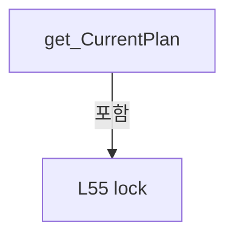

변경 전 점검: 입력/반환 타입, 위 호출자, 예외/취소 경로, 공유 상태와 저장·전송 소비자를 함께 확인합니다. 값의 단위나 물리 방향을 이름만으로 확정하지 않습니다.

### PropertyDeclaration `SequenceState` · L62–62

[Drilling.Common/Review/CReviewManager.cs:62–62](https://github.com/kjuws10-rgb/A3Drilling/blob/28764c91d521777b8ee068dd7aaf2d3902ce9fe2/Drilling.Common/Review/CReviewManager.cs#L62-L62)

| 항목 | 실제 추출 값 |
| --- | --- |
| 서명 | Drilling.Common.Review.EN_REVIEW_SEQUENCE_STATE Drilling.Common.Review.CReviewManager.SequenceState |
| 접근/수식자 | Public / public |
| 반환/값 타입 | Drilling.Common.Review.EN_REVIEW_SEQUENCE_STATE |
| 소속 타입 | NamedType:Drilling.Common.Review.CReviewManager |

현재 부분 분석에서 직접 연결된 호출자는 없습니다. XAML/이벤트/인터페이스·델리게이트·외부 진입을 추가 확인해야 하며, 미사용으로 판정한 것이 아닙니다.

변경 전 점검: 입력/반환 타입, 위 호출자, 예외/취소 경로, 공유 상태와 저장·전송 소비자를 함께 확인합니다. 값의 단위나 물리 방향을 이름만으로 확정하지 않습니다.

### GetAccessorDeclaration `get_SequenceState` · L62–62

[Drilling.Common/Review/CReviewManager.cs:62–62](https://github.com/kjuws10-rgb/A3Drilling/blob/28764c91d521777b8ee068dd7aaf2d3902ce9fe2/Drilling.Common/Review/CReviewManager.cs#L62-L62)

| 항목 | 실제 추출 값 |
| --- | --- |
| 서명 | Drilling.Common.Review.EN_REVIEW_SEQUENCE_STATE Drilling.Common.Review.CReviewManager.SequenceState.get |
| 접근/수식자 | Public / get |
| 반환/값 타입 | Drilling.Common.Review.EN_REVIEW_SEQUENCE_STATE |
| 소속 타입 | NamedType:Drilling.Common.Review.CReviewManager |

현재 부분 분석에서 직접 연결된 호출자는 없습니다. XAML/이벤트/인터페이스·델리게이트·외부 진입을 추가 확인해야 하며, 미사용으로 판정한 것이 아닙니다.

호출하는 대상과 해석 범위:

| 원본 행 | 표현식 | 분석 상태 | 대상/소스 위치 |
| --- | --- | --- | --- |
| 62 | Volatile.Read | resolved | int System.Threading.Volatile.Read(ref readonly int) |

본문의 실제 연산·분기·예외·반환 순서(원문 위치 순):

| 원본 행 | 종류 | 주석 해설 |
| --- | --- | --- |
| 62 | call | 함수·델리게이트 또는 객체 생성자를 호출합니다: Volatile.Read(ref _sequenceState) |

변경 전 점검: 입력/반환 타입, 위 호출자, 예외/취소 경로, 공유 상태와 저장·전송 소비자를 함께 확인합니다. 값의 단위나 물리 방향을 이름만으로 확정하지 않습니다.

### SetAccessorDeclaration `set_SequenceState` · L62–62

[Drilling.Common/Review/CReviewManager.cs:62–62](https://github.com/kjuws10-rgb/A3Drilling/blob/28764c91d521777b8ee068dd7aaf2d3902ce9fe2/Drilling.Common/Review/CReviewManager.cs#L62-L62)

| 항목 | 실제 추출 값 |
| --- | --- |
| 서명 | void Drilling.Common.Review.CReviewManager.SequenceState.set |
| 접근/수식자 | Private / private, set |
| 반환/값 타입 | void |
| 소속 타입 | NamedType:Drilling.Common.Review.CReviewManager |

입력 계약:

| 이름 | 타입 | 전달 | 선택/기본값 |
| --- | --- | --- | --- |
| value | Drilling.Common.Review.EN_REVIEW_SEQUENCE_STATE | None | False /  |

현재 부분 분석에서 직접 연결된 호출자는 없습니다. XAML/이벤트/인터페이스·델리게이트·외부 진입을 추가 확인해야 하며, 미사용으로 판정한 것이 아닙니다.

호출하는 대상과 해석 범위:

| 원본 행 | 표현식 | 분석 상태 | 대상/소스 위치 |
| --- | --- | --- | --- |
| 62 | Volatile.Write | resolved | void System.Threading.Volatile.Write(ref int, int) |

본문의 실제 연산·분기·예외·반환 순서(원문 위치 순):

| 원본 행 | 종류 | 주석 해설 |
| --- | --- | --- |
| 62 | call | 함수·델리게이트 또는 객체 생성자를 호출합니다: Volatile.Write(ref _sequenceState, (int)value) |

변경 전 점검: 입력/반환 타입, 위 호출자, 예외/취소 경로, 공유 상태와 저장·전송 소비자를 함께 확인합니다. 값의 단위나 물리 방향을 이름만으로 확정하지 않습니다.

### PropertyDeclaration `IsStopRequested` · L63–63

[Drilling.Common/Review/CReviewManager.cs:63–63](https://github.com/kjuws10-rgb/A3Drilling/blob/28764c91d521777b8ee068dd7aaf2d3902ce9fe2/Drilling.Common/Review/CReviewManager.cs#L63-L63)

| 항목 | 실제 추출 값 |
| --- | --- |
| 서명 | bool Drilling.Common.Review.CReviewManager.IsStopRequested |
| 접근/수식자 | Private / private |
| 반환/값 타입 | bool |
| 소속 타입 | NamedType:Drilling.Common.Review.CReviewManager |

현재 부분 분석에서 직접 연결된 호출자는 없습니다. XAML/이벤트/인터페이스·델리게이트·외부 진입을 추가 확인해야 하며, 미사용으로 판정한 것이 아닙니다.

호출하는 대상과 해석 범위:

| 원본 행 | 표현식 | 분석 상태 | 대상/소스 위치 |
| --- | --- | --- | --- |
| 63 | Volatile.Read | resolved | int System.Threading.Volatile.Read(ref readonly int) |

본문의 실제 연산·분기·예외·반환 순서(원문 위치 순):

| 원본 행 | 종류 | 주석 해설 |
| --- | --- | --- |
| 63 | call | 함수·델리게이트 또는 객체 생성자를 호출합니다: Volatile.Read(ref _stopRequested) |

변경 전 점검: 입력/반환 타입, 위 호출자, 예외/취소 경로, 공유 상태와 저장·전송 소비자를 함께 확인합니다. 값의 단위나 물리 방향을 이름만으로 확정하지 않습니다.

### MethodDeclaration `CreatePlan` · L65–68

[Drilling.Common/Review/CReviewManager.cs:65–68](https://github.com/kjuws10-rgb/A3Drilling/blob/28764c91d521777b8ee068dd7aaf2d3902ce9fe2/Drilling.Common/Review/CReviewManager.cs#L65-L68)

| 항목 | 실제 추출 값 |
| --- | --- |
| 서명 | Drilling.Common.Review.ST_REVIEW_PLAN Drilling.Common.Review.CReviewManager.CreatePlan(Drilling.Common.Managers.ST_RECIPE_DEFINITION, System.Collections.Generic.IReadOnlyCollection<string>) |
| 접근/수식자 | Public / public |
| 반환/값 타입 | Drilling.Common.Review.ST_REVIEW_PLAN |
| 소속 타입 | NamedType:Drilling.Common.Review.CReviewManager |

입력 계약:

| 이름 | 타입 | 전달 | 선택/기본값 |
| --- | --- | --- | --- |
| recipe | Drilling.Common.Managers.ST_RECIPE_DEFINITION | None | False /  |
| selectedShotKeys | System.Collections.Generic.IReadOnlyCollection<string> | None | False /  |

현재 부분 분석에서 직접 연결된 호출자는 없습니다. XAML/이벤트/인터페이스·델리게이트·외부 진입을 추가 확인해야 하며, 미사용으로 판정한 것이 아닙니다.

호출하는 대상과 해석 범위:

| 원본 행 | 표현식 | 분석 상태 | 대상/소스 위치 |
| --- | --- | --- | --- |
| 67 | CreatePlan | resolved | Drilling.Common.Review.ST_REVIEW_PLAN Drilling.Common.Review.CReviewManager.CreatePlan(Drilling.Common.Managers.ST_RECIPE_DEFINITION, System.Collections.Generic.IReadOnlyCollection<string>, int) · Drilling.Common/Review/CReviewManager.cs:70 |

본문의 실제 연산·분기·예외·반환 순서(원문 위치 순):

| 원본 행 | 종류 | 주석 해설 |
| --- | --- | --- |
| 67 | call | 함수·델리게이트 또는 객체 생성자를 호출합니다: CreatePlan(recipe, selectedShotKeys, 1) |
| 67 | return | 호출자에게 값 또는 제어를 반환합니다: return CreatePlan(recipe, selectedShotKeys, 1); |

변경 전 점검: 입력/반환 타입, 위 호출자, 예외/취소 경로, 공유 상태와 저장·전송 소비자를 함께 확인합니다. 값의 단위나 물리 방향을 이름만으로 확정하지 않습니다.

### MethodDeclaration `CreatePlan` · L70–73

[Drilling.Common/Review/CReviewManager.cs:70–73](https://github.com/kjuws10-rgb/A3Drilling/blob/28764c91d521777b8ee068dd7aaf2d3902ce9fe2/Drilling.Common/Review/CReviewManager.cs#L70-L73)

| 항목 | 실제 추출 값 |
| --- | --- |
| 서명 | Drilling.Common.Review.ST_REVIEW_PLAN Drilling.Common.Review.CReviewManager.CreatePlan(Drilling.Common.Managers.ST_RECIPE_DEFINITION, System.Collections.Generic.IReadOnlyCollection<string>, int) |
| 접근/수식자 | Public / public |
| 반환/값 타입 | Drilling.Common.Review.ST_REVIEW_PLAN |
| 소속 타입 | NamedType:Drilling.Common.Review.CReviewManager |

입력 계약:

| 이름 | 타입 | 전달 | 선택/기본값 |
| --- | --- | --- | --- |
| recipe | Drilling.Common.Managers.ST_RECIPE_DEFINITION | None | False /  |
| selectedShotKeys | System.Collections.Generic.IReadOnlyCollection<string> | None | False /  |
| selectedBeamNo | int | None | False /  |

정적 호출자로 확인된 위치:

| 호출 파일/행 | 호출 표현식 | 런타임 분기 가능 |
| --- | --- | --- |
| [Drilling.Common/Review/CReviewManager.cs:67–67](https://github.com/kjuws10-rgb/A3Drilling/blob/28764c91d521777b8ee068dd7aaf2d3902ce9fe2/Drilling.Common/Review/CReviewManager.cs#L67-L67) | CreatePlan | False |
| [Drilling.UI/Menu/Menus/CMenuReview.cs:4204–4204](https://github.com/kjuws10-rgb/A3Drilling/blob/28764c91d521777b8ee068dd7aaf2d3902ce9fe2/Drilling.UI/Menu/Menus/CMenuReview.cs#L4204-L4204) | _reviewManager.CreatePlan | False |

호출하는 대상과 해석 범위:

| 원본 행 | 표현식 | 분석 상태 | 대상/소스 위치 |
| --- | --- | --- | --- |
| 72 | CreatePlan | resolved | Drilling.Common.Review.ST_REVIEW_PLAN Drilling.Common.Review.CReviewManager.CreatePlan(Drilling.Common.Managers.ST_RECIPE_DEFINITION, System.Collections.Generic.IReadOnlyCollection<string>, int, double, double) · Drilling.Common/Review/CReviewManager.cs:75 |

본문의 실제 연산·분기·예외·반환 순서(원문 위치 순):

| 원본 행 | 종류 | 주석 해설 |
| --- | --- | --- |
| 72 | call | 함수·델리게이트 또는 객체 생성자를 호출합니다: CreatePlan(recipe, selectedShotKeys, selectedBeamNo, 0.0, 0.0) |
| 72 | return | 호출자에게 값 또는 제어를 반환합니다: return CreatePlan(recipe, selectedShotKeys, selectedBeamNo, 0.0, 0.0); |

변경 전 점검: 입력/반환 타입, 위 호출자, 예외/취소 경로, 공유 상태와 저장·전송 소비자를 함께 확인합니다. 값의 단위나 물리 방향을 이름만으로 확정하지 않습니다.

### MethodDeclaration `CreatePlan` · L75–115

[Drilling.Common/Review/CReviewManager.cs:75–115](https://github.com/kjuws10-rgb/A3Drilling/blob/28764c91d521777b8ee068dd7aaf2d3902ce9fe2/Drilling.Common/Review/CReviewManager.cs#L75-L115)

| 항목 | 실제 추출 값 |
| --- | --- |
| 서명 | Drilling.Common.Review.ST_REVIEW_PLAN Drilling.Common.Review.CReviewManager.CreatePlan(Drilling.Common.Managers.ST_RECIPE_DEFINITION, System.Collections.Generic.IReadOnlyCollection<string>, int, double, double) |
| 접근/수식자 | Public / public |
| 반환/값 타입 | Drilling.Common.Review.ST_REVIEW_PLAN |
| 소속 타입 | NamedType:Drilling.Common.Review.CReviewManager |

입력 계약:

| 이름 | 타입 | 전달 | 선택/기본값 |
| --- | --- | --- | --- |
| recipe | Drilling.Common.Managers.ST_RECIPE_DEFINITION | None | False /  |
| selectedShotKeys | System.Collections.Generic.IReadOnlyCollection<string> | None | False /  |
| selectedBeamNo | int | None | False /  |
| shiftOffsetX | double | None | False /  |
| shiftOffsetY | double | None | False /  |

정적 호출자로 확인된 위치:

| 호출 파일/행 | 호출 표현식 | 런타임 분기 가능 |
| --- | --- | --- |
| [Drilling.Common/Review/CReviewManager.cs:72–72](https://github.com/kjuws10-rgb/A3Drilling/blob/28764c91d521777b8ee068dd7aaf2d3902ce9fe2/Drilling.Common/Review/CReviewManager.cs#L72-L72) | CreatePlan | False |
| [Drilling.UI/Menu/Menus/CMenuCorrection.ReviewData.Reinspection.cs:527–532](https://github.com/kjuws10-rgb/A3Drilling/blob/28764c91d521777b8ee068dd7aaf2d3902ce9fe2/Drilling.UI/Menu/Menus/CMenuCorrection.ReviewData.Reinspection.cs#L527-L532) | _reviewManager.CreatePlan | False |
| [Drilling.UI/Menu/Menus/CMenuReview.cs:4277–4277](https://github.com/kjuws10-rgb/A3Drilling/blob/28764c91d521777b8ee068dd7aaf2d3902ce9fe2/Drilling.UI/Menu/Menus/CMenuReview.cs#L4277-L4277) | _reviewManager.CreatePlan | False |

호출하는 대상과 해석 범위:

| 원본 행 | 표현식 | 분석 상태 | 대상/소스 위치 |
| --- | --- | --- | --- |
| 82 | ValidateShiftOffset | resolved | void Drilling.Common.Review.CReviewManager.ValidateShiftOffset(double, double) · Drilling.Common/Review/CReviewManager.cs:994 |
| 83 | ValidateBeamNo | resolved | void Drilling.Common.Review.CReviewManager.ValidateBeamNo(int, int) · Drilling.Common/Review/CReviewManager.cs:980 |
| 83 | ReadInt | resolved | int Drilling.Common.Review.CReviewManager.ReadInt(Drilling.Common.Managers.ST_RECIPE_DEFINITION, int, params string[]) · Drilling.Common/Review/CReviewManager.cs:1282 |
| 84 | selectedShotKeys.Where(key => !string.IsNullOrWhiteSpace(key)).Select(NormalizeShotKey).ToHashSet | resolved | System.Collections.Generic.HashSet<string> System.Collections.Generic.IEnumerable<string>.ToHashSet<string>(System.Collections.Generic.IEqualityComparer<string>?) |
| 84 | selectedShotKeys.Where(key => !string.IsNullOrWhiteSpace(key)).Select | resolved | System.Collections.Generic.IEnumerable<string> System.Collections.Generic.IEnumerable<string>.Select<string, string>(System.Func<string, string>) |
| 84 | selectedShotKeys.Where | resolved | System.Collections.Generic.IEnumerable<string> System.Collections.Generic.IEnumerable<string>.Where<string>(System.Func<string, bool>) |
| 84 | string.IsNullOrWhiteSpace | resolved | bool string.IsNullOrWhiteSpace(string?) |
| 85 | CreateAllPlan | resolved | Drilling.Common.Review.ST_REVIEW_PLAN Drilling.Common.Review.CReviewManager.CreateAllPlan(Drilling.Common.Managers.ST_RECIPE_DEFINITION, int, double, double) · Drilling.Common/Review/CReviewManager.cs:203 |
| 94 | new List<ST_REVIEW_PLAN_POINT> | resolved | System.Collections.Generic.List<Drilling.Common.Review.ST_REVIEW_PLAN_POINT>.List(int) |
| 97 | TryParseShotKey | resolved | bool Drilling.Common.Review.CReviewManager.TryParseShotKey(string, out int, out int) · Drilling.Common/Review/CReviewManager.cs:1273 |
| 102 | allPlan.FindPoint | resolved | Drilling.Common.Review.ST_REVIEW_PLAN_POINT? Drilling.Common.Review.ST_REVIEW_PLAN.FindPoint(int, int) · Drilling.Common/Review/CReviewManager.cs:4203 |
| 108 | selectedPoints.Add | resolved | void System.Collections.Generic.List<Drilling.Common.Review.ST_REVIEW_PLAN_POINT>.Add(Drilling.Common.Review.ST_REVIEW_PLAN_POINT) |
| 113 | selectedPoints.OrderBy(point => point.PointNo).ToArray | resolved | Drilling.Common.Review.ST_REVIEW_PLAN_POINT[] System.Collections.Generic.IEnumerable<Drilling.Common.Review.ST_REVIEW_PLAN_POINT>.ToArray<Drilling.Common.Review.ST_REVIEW_PLAN_POINT>() |
| 113 | selectedPoints.OrderBy | resolved | System.Linq.IOrderedEnumerable<Drilling.Common.Review.ST_REVIEW_PLAN_POINT> System.Collections.Generic.IEnumerable<Drilling.Common.Review.ST_REVIEW_PLAN_POINT>.OrderBy<Drilling.Common.Review.ST_REVIEW_PLAN_POINT, int>(System.Func<Drilling.Common.Review.ST_REVIEW_PLAN_POINT, int>) |

본문의 실제 연산·분기·예외·반환 순서(원문 위치 순):

| 원본 행 | 종류 | 주석 해설 |
| --- | --- | --- |
| 82 | call | 함수·델리게이트 또는 객체 생성자를 호출합니다: ValidateShiftOffset(shiftOffsetX, shiftOffsetY) |
| 83 | call | 함수·델리게이트 또는 객체 생성자를 호출합니다: ValidateBeamNo(selectedBeamNo, ReadInt(recipe, 0, "SPLITED_BEAM_COUNT")) |
| 83 | call | 함수·델리게이트 또는 객체 생성자를 호출합니다: ReadInt(recipe, 0, "SPLITED_BEAM_COUNT") |
| 84 | call | 함수·델리게이트 또는 객체 생성자를 호출합니다: selectedShotKeys.Where(key => !string.IsNullOrWhiteSpace(key)).Select(NormalizeShotKey).ToHashSet(StringComparer.OrdinalIgnoreCase) |
| 84 | call | 함수·델리게이트 또는 객체 생성자를 호출합니다: selectedShotKeys.Where(key => !string.IsNullOrWhiteSpace(key)).Select(NormalizeShotKey) |
| 84 | call | 함수·델리게이트 또는 객체 생성자를 호출합니다: selectedShotKeys.Where(key => !string.IsNullOrWhiteSpace(key)) |
| 84 | call | 함수·델리게이트 또는 객체 생성자를 호출합니다: string.IsNullOrWhiteSpace(key) |
| 84 | local-declaration | 지역 변수를 선언합니다: var selectedSet = selectedShotKeys.Where(key => !string.IsNullOrWhiteSpace(key)).Select(NormalizeShotKey).ToHashSet(StringComparer.OrdinalIgnoreCase); |
| 84 | variable-initializer | 변수의 초기값을 지정합니다: selectedSet = selectedShotKeys.Where(key => !string.IsNullOrWhiteSpace(key)).Select(NormalizeShotKey).ToHashSet(StringComparer.OrdinalIgnoreCase) |
| 85 | call | 함수·델리게이트 또는 객체 생성자를 호출합니다: CreateAllPlan(recipe, selectedBeamNo, shiftOffsetX, shiftOffsetY) |
| 85 | local-declaration | 지역 변수를 선언합니다: var allPlan = CreateAllPlan(recipe, selectedBeamNo, shiftOffsetX, shiftOffsetY); |
| 85 | variable-initializer | 변수의 초기값을 지정합니다: allPlan = CreateAllPlan(recipe, selectedBeamNo, shiftOffsetX, shiftOffsetY) |
| 86 | if | 조건에 따라 분기합니다: if (selectedSet.Count == 0) |
| 88 | return | 호출자에게 값 또는 제어를 반환합니다: return allPlan with { Points = [] }; |
| 90 | assignment | 값을 대상에 대입합니다: Points = [] |
| 94 | call | 함수·델리게이트 또는 객체 생성자를 호출합니다: new List<ST_REVIEW_PLAN_POINT>(selectedSet.Count) |
| 94 | local-declaration | 지역 변수를 선언합니다: var selectedPoints = new List<ST_REVIEW_PLAN_POINT>(selectedSet.Count); |
| 94 | variable-initializer | 변수의 초기값을 지정합니다: selectedPoints = new List<ST_REVIEW_PLAN_POINT>(selectedSet.Count) |
| 95 | foreach | 컬렉션 요소를 순회합니다: foreach (var key in selectedSet) |
| 97 | call | 함수·델리게이트 또는 객체 생성자를 호출합니다: TryParseShotKey(key, out var cellNo, out var shotNo) |
| 97 | if | 조건에 따라 분기합니다: if (!TryParseShotKey(key, out var cellNo, out var shotNo) &#124;&#124; cellNo > allPlan.CellCount) |
| 99 | continue | 다음 반복으로 진행합니다: continue; |
| 102 | call | 함수·델리게이트 또는 객체 생성자를 호출합니다: allPlan.FindPoint(cellNo, shotNo) |
| 102 | local-declaration | 지역 변수를 선언합니다: var point = allPlan.FindPoint(cellNo, shotNo); |
| 102 | variable-initializer | 변수의 초기값을 지정합니다: point = allPlan.FindPoint(cellNo, shotNo) |
| 103 | if | 조건에 따라 분기합니다: if (point is null &#124;&#124; !point.Use) |
| 105 | continue | 다음 반복으로 진행합니다: continue; |
| 108 | assignment | 값을 대상에 대입합니다: Use = true |
| 108 | assignment | 값을 대상에 대입합니다: State = EN_REVIEW_POINT_STATE.Ready |
| 108 | assignment | 값을 대상에 대입합니다: Judge = "WAIT" |
| 108 | assignment | 값을 대상에 대입합니다: VisionResultCode = null |
| 108 | assignment | 값을 대상에 대입합니다: NgReason = "" |
| 108 | call | 함수·델리게이트 또는 객체 생성자를 호출합니다: selectedPoints.Add(point with { Use = true, State = EN_REVIEW_POINT_STATE.Ready, Judge = "WAIT", VisionResultCode = null, NgReason = "" }) |
| 111 | return | 호출자에게 값 또는 제어를 반환합니다: return allPlan with { Points = selectedPoints.OrderBy(point => point.PointNo).ToArray() }; |
| 113 | assignment | 값을 대상에 대입합니다: Points = selectedPoints.OrderBy(point => point.PointNo).ToArray() |
| 113 | call | 함수·델리게이트 또는 객체 생성자를 호출합니다: selectedPoints.OrderBy(point => point.PointNo).ToArray() |
| 113 | call | 함수·델리게이트 또는 객체 생성자를 호출합니다: selectedPoints.OrderBy(point => point.PointNo) |

제어 구문의 포함 구조(실제 실행 순서/CFG가 아닌 구문 탐색 그림):

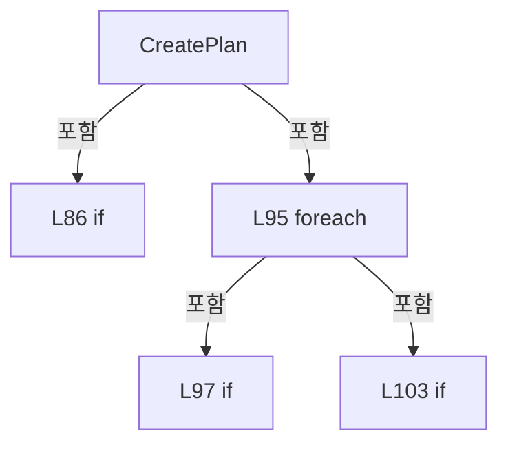

변경 전 점검: 입력/반환 타입, 위 호출자, 예외/취소 경로, 공유 상태와 저장·전송 소비자를 함께 확인합니다. 값의 단위나 물리 방향을 이름만으로 확정하지 않습니다.

### PropertyDeclaration `CurrentPoint` · L117–126

[Drilling.Common/Review/CReviewManager.cs:117–126](https://github.com/kjuws10-rgb/A3Drilling/blob/28764c91d521777b8ee068dd7aaf2d3902ce9fe2/Drilling.Common/Review/CReviewManager.cs#L117-L126)

| 항목 | 실제 추출 값 |
| --- | --- |
| 서명 | Drilling.Common.Review.ST_REVIEW_PLAN_POINT? Drilling.Common.Review.CReviewManager.CurrentPoint |
| 접근/수식자 | Public / public |
| 반환/값 타입 | Drilling.Common.Review.ST_REVIEW_PLAN_POINT? |
| 소속 타입 | NamedType:Drilling.Common.Review.CReviewManager |

현재 부분 분석에서 직접 연결된 호출자는 없습니다. XAML/이벤트/인터페이스·델리게이트·외부 진입을 추가 확인해야 하며, 미사용으로 판정한 것이 아닙니다.

변경 전 점검: 입력/반환 타입, 위 호출자, 예외/취소 경로, 공유 상태와 저장·전송 소비자를 함께 확인합니다. 값의 단위나 물리 방향을 이름만으로 확정하지 않습니다.

### GetAccessorDeclaration `get_CurrentPoint` · L119–125

[Drilling.Common/Review/CReviewManager.cs:119–125](https://github.com/kjuws10-rgb/A3Drilling/blob/28764c91d521777b8ee068dd7aaf2d3902ce9fe2/Drilling.Common/Review/CReviewManager.cs#L119-L125)

| 항목 | 실제 추출 값 |
| --- | --- |
| 서명 | Drilling.Common.Review.ST_REVIEW_PLAN_POINT? Drilling.Common.Review.CReviewManager.CurrentPoint.get |
| 접근/수식자 | Public / get |
| 반환/값 타입 | Drilling.Common.Review.ST_REVIEW_PLAN_POINT? |
| 소속 타입 | NamedType:Drilling.Common.Review.CReviewManager |

현재 부분 분석에서 직접 연결된 호출자는 없습니다. XAML/이벤트/인터페이스·델리게이트·외부 진입을 추가 확인해야 하며, 미사용으로 판정한 것이 아닙니다.

본문의 실제 연산·분기·예외·반환 순서(원문 위치 순):

| 원본 행 | 종류 | 주석 해설 |
| --- | --- | --- |
| 121 | lock | 공유 상태의 임계 구역에 진입합니다: lock (_stateLock) |
| 123 | return | 호출자에게 값 또는 제어를 반환합니다: return _currentPoint; |

제어 구문의 포함 구조(실제 실행 순서/CFG가 아닌 구문 탐색 그림):


변경 전 점검: 입력/반환 타입, 위 호출자, 예외/취소 경로, 공유 상태와 저장·전송 소비자를 함께 확인합니다. 값의 단위나 물리 방향을 이름만으로 확정하지 않습니다.

### PropertyDeclaration `LastMeasuredPoint` · L128–137

[Drilling.Common/Review/CReviewManager.cs:128–137](https://github.com/kjuws10-rgb/A3Drilling/blob/28764c91d521777b8ee068dd7aaf2d3902ce9fe2/Drilling.Common/Review/CReviewManager.cs#L128-L137)

| 항목 | 실제 추출 값 |
| --- | --- |
| 서명 | Drilling.Common.Review.ST_REVIEW_PLAN_POINT? Drilling.Common.Review.CReviewManager.LastMeasuredPoint |
| 접근/수식자 | Public / public |
| 반환/값 타입 | Drilling.Common.Review.ST_REVIEW_PLAN_POINT? |
| 소속 타입 | NamedType:Drilling.Common.Review.CReviewManager |

현재 부분 분석에서 직접 연결된 호출자는 없습니다. XAML/이벤트/인터페이스·델리게이트·외부 진입을 추가 확인해야 하며, 미사용으로 판정한 것이 아닙니다.

변경 전 점검: 입력/반환 타입, 위 호출자, 예외/취소 경로, 공유 상태와 저장·전송 소비자를 함께 확인합니다. 값의 단위나 물리 방향을 이름만으로 확정하지 않습니다.

### GetAccessorDeclaration `get_LastMeasuredPoint` · L130–136

[Drilling.Common/Review/CReviewManager.cs:130–136](https://github.com/kjuws10-rgb/A3Drilling/blob/28764c91d521777b8ee068dd7aaf2d3902ce9fe2/Drilling.Common/Review/CReviewManager.cs#L130-L136)

| 항목 | 실제 추출 값 |
| --- | --- |
| 서명 | Drilling.Common.Review.ST_REVIEW_PLAN_POINT? Drilling.Common.Review.CReviewManager.LastMeasuredPoint.get |
| 접근/수식자 | Public / get |
| 반환/값 타입 | Drilling.Common.Review.ST_REVIEW_PLAN_POINT? |
| 소속 타입 | NamedType:Drilling.Common.Review.CReviewManager |

현재 부분 분석에서 직접 연결된 호출자는 없습니다. XAML/이벤트/인터페이스·델리게이트·외부 진입을 추가 확인해야 하며, 미사용으로 판정한 것이 아닙니다.

본문의 실제 연산·분기·예외·반환 순서(원문 위치 순):

| 원본 행 | 종류 | 주석 해설 |
| --- | --- | --- |
| 132 | lock | 공유 상태의 임계 구역에 진입합니다: lock (_stateLock) |
| 134 | return | 호출자에게 값 또는 제어를 반환합니다: return _lastMeasuredPoint; |

제어 구문의 포함 구조(실제 실행 순서/CFG가 아닌 구문 탐색 그림):


변경 전 점검: 입력/반환 타입, 위 호출자, 예외/취소 경로, 공유 상태와 저장·전송 소비자를 함께 확인합니다. 값의 단위나 물리 방향을 이름만으로 확정하지 않습니다.

### MethodDeclaration `GetShotBeamPositions` · L139–150

[Drilling.Common/Review/CReviewManager.cs:139–150](https://github.com/kjuws10-rgb/A3Drilling/blob/28764c91d521777b8ee068dd7aaf2d3902ce9fe2/Drilling.Common/Review/CReviewManager.cs#L139-L150)

| 항목 | 실제 추출 값 |
| --- | --- |
| 서명 | System.Collections.Generic.IReadOnlyList<Drilling.Common.Review.ST_REVIEW_BEAM_POSITION> Drilling.Common.Review.CReviewManager.GetShotBeamPositions(Drilling.Common.Managers.ST_RECIPE_DEFINITION, Drilling.Common.Review.ST_REVIEW_PLAN_POINT, Drilling.Common.Managers.ST_ALIGN_KEY_MARGINS, double, double, double) |
| 접근/수식자 | Public / public, static |
| 반환/값 타입 | System.Collections.Generic.IReadOnlyList<Drilling.Common.Review.ST_REVIEW_BEAM_POSITION> |
| 소속 타입 | NamedType:Drilling.Common.Review.CReviewManager |

입력 계약:

| 이름 | 타입 | 전달 | 선택/기본값 |
| --- | --- | --- | --- |
| recipe | Drilling.Common.Managers.ST_RECIPE_DEFINITION | None | False /  |
| point | Drilling.Common.Review.ST_REVIEW_PLAN_POINT | None | False /  |
| alignKeyMargins | Drilling.Common.Managers.ST_ALIGN_KEY_MARGINS | None | False /  |
| stageScanDirectionY | double | None | False /  |
| shiftOffsetX | double | None | True / 0 |
| shiftOffsetY | double | None | True / 0 |

정적 호출자로 확인된 위치:

| 호출 파일/행 | 호출 표현식 | 런타임 분기 가능 |
| --- | --- | --- |
| [Drilling.Common/Review/CReviewManager.cs:1412–1418](https://github.com/kjuws10-rgb/A3Drilling/blob/28764c91d521777b8ee068dd7aaf2d3902ce9fe2/Drilling.Common/Review/CReviewManager.cs#L1412-L1418) | GetShotBeamPositions | False |
| [Drilling.UI/Menu/Menus/CMenuCorrection.cs:7466–7466](https://github.com/kjuws10-rgb/A3Drilling/blob/28764c91d521777b8ee068dd7aaf2d3902ce9fe2/Drilling.UI/Menu/Menus/CMenuCorrection.cs#L7466-L7466) | CReviewManager.GetShotBeamPositions | False |
| [Drilling.UI/Menu/Menus/CMenuReview.cs:3491–3491](https://github.com/kjuws10-rgb/A3Drilling/blob/28764c91d521777b8ee068dd7aaf2d3902ce9fe2/Drilling.UI/Menu/Menus/CMenuReview.cs#L3491-L3491) | CReviewManager.GetShotBeamPositions | False |
| [Drilling.UI/Menu/Menus/CMenuReview.cs:3828–3828](https://github.com/kjuws10-rgb/A3Drilling/blob/28764c91d521777b8ee068dd7aaf2d3902ce9fe2/Drilling.UI/Menu/Menus/CMenuReview.cs#L3828-L3828) | CReviewManager.GetShotBeamPositions | False |
| [Drilling.UI/Menu/Menus/CMenuReview.cs:5041–5047](https://github.com/kjuws10-rgb/A3Drilling/blob/28764c91d521777b8ee068dd7aaf2d3902ce9fe2/Drilling.UI/Menu/Menus/CMenuReview.cs#L5041-L5047) | CReviewManager.GetShotBeamPositions | False |

호출하는 대상과 해석 범위:

| 원본 행 | 표현식 | 분석 상태 | 대상/소스 위치 |
| --- | --- | --- | --- |
| 147 | CreateShotBeamPositionCalculator | resolved | System.Func<Drilling.Common.Review.ST_REVIEW_PLAN_POINT, int, Drilling.Common.Review.ST_REVIEW_BEAM_POSITION> Drilling.Common.Review.CReviewManager.CreateShotBeamPositionCalculator(Drilling.Common.Managers.ST_RECIPE_DEFINITION, Drilling.Common.Managers.ST_ALIGN_KEY_MARGINS, double, double, double) · Drilling.Common/Review/CReviewManager.cs:153 |
| 148 | ReadInt | resolved | int Drilling.Common.Review.CReviewManager.ReadInt(Drilling.Common.Managers.ST_RECIPE_DEFINITION, int, params string[]) · Drilling.Common/Review/CReviewManager.cs:1282 |
| 149 | Enumerable.Range(1, splitBeamCount * splitBeamCount).Select(beam => calculate(point, beam)).ToArray | resolved | Drilling.Common.Review.ST_REVIEW_BEAM_POSITION[] System.Collections.Generic.IEnumerable<Drilling.Common.Review.ST_REVIEW_BEAM_POSITION>.ToArray<Drilling.Common.Review.ST_REVIEW_BEAM_POSITION>() |
| 149 | Enumerable.Range(1, splitBeamCount * splitBeamCount).Select | resolved | System.Collections.Generic.IEnumerable<Drilling.Common.Review.ST_REVIEW_BEAM_POSITION> System.Collections.Generic.IEnumerable<int>.Select<int, Drilling.Common.Review.ST_REVIEW_BEAM_POSITION>(System.Func<int, Drilling.Common.Review.ST_REVIEW_BEAM_POSITION>) |
| 149 | Enumerable.Range | resolved | System.Collections.Generic.IEnumerable<int> System.Linq.Enumerable.Range(int, int) |
| 149 | calculate | resolved · 동적 구현 선택 가능 | Drilling.Common.Review.ST_REVIEW_BEAM_POSITION System.Func<Drilling.Common.Review.ST_REVIEW_PLAN_POINT, int, Drilling.Common.Review.ST_REVIEW_BEAM_POSITION>.Invoke(Drilling.Common.Review.ST_REVIEW_PLAN_POINT, int) |

본문의 실제 연산·분기·예외·반환 순서(원문 위치 순):

| 원본 행 | 종류 | 주석 해설 |
| --- | --- | --- |
| 147 | call | 함수·델리게이트 또는 객체 생성자를 호출합니다: CreateShotBeamPositionCalculator(recipe, alignKeyMargins, stageScanDirectionY, shiftOffsetX, shiftOffsetY) |
| 147 | local-declaration | 지역 변수를 선언합니다: var calculate = CreateShotBeamPositionCalculator(recipe, alignKeyMargins, stageScanDirectionY, shiftOffsetX, shiftOffsetY); |
| 147 | variable-initializer | 변수의 초기값을 지정합니다: calculate = CreateShotBeamPositionCalculator(recipe, alignKeyMargins, stageScanDirectionY, shiftOffsetX, shiftOffsetY) |
| 148 | call | 함수·델리게이트 또는 객체 생성자를 호출합니다: ReadInt(recipe, 0, "SPLITED_BEAM_COUNT") |
| 148 | local-declaration | 지역 변수를 선언합니다: var splitBeamCount = ReadInt(recipe, 0, "SPLITED_BEAM_COUNT"); |
| 148 | variable-initializer | 변수의 초기값을 지정합니다: splitBeamCount = ReadInt(recipe, 0, "SPLITED_BEAM_COUNT") |
| 149 | call | 함수·델리게이트 또는 객체 생성자를 호출합니다: Enumerable.Range(1, splitBeamCount * splitBeamCount).Select(beam => calculate(point, beam)).ToArray() |
| 149 | call | 함수·델리게이트 또는 객체 생성자를 호출합니다: Enumerable.Range(1, splitBeamCount * splitBeamCount).Select(beam => calculate(point, beam)) |
| 149 | call | 함수·델리게이트 또는 객체 생성자를 호출합니다: Enumerable.Range(1, splitBeamCount * splitBeamCount) |
| 149 | call | 함수·델리게이트 또는 객체 생성자를 호출합니다: calculate(point, beam) |
| 149 | return | 호출자에게 값 또는 제어를 반환합니다: return Enumerable.Range(1, splitBeamCount * splitBeamCount).Select(beam => calculate(point, beam)).ToArray(); |

변경 전 점검: 입력/반환 타입, 위 호출자, 예외/취소 경로, 공유 상태와 저장·전송 소비자를 함께 확인합니다. 값의 단위나 물리 방향을 이름만으로 확정하지 않습니다.

### MethodDeclaration `CreateShotBeamPositionCalculator` · L153–196

[Drilling.Common/Review/CReviewManager.cs:153–196](https://github.com/kjuws10-rgb/A3Drilling/blob/28764c91d521777b8ee068dd7aaf2d3902ce9fe2/Drilling.Common/Review/CReviewManager.cs#L153-L196)

| 항목 | 실제 추출 값 |
| --- | --- |
| 서명 | System.Func<Drilling.Common.Review.ST_REVIEW_PLAN_POINT, int, Drilling.Common.Review.ST_REVIEW_BEAM_POSITION> Drilling.Common.Review.CReviewManager.CreateShotBeamPositionCalculator(Drilling.Common.Managers.ST_RECIPE_DEFINITION, Drilling.Common.Managers.ST_ALIGN_KEY_MARGINS, double, double, double) |
| 접근/수식자 | Public / public, static |
| 반환/값 타입 | System.Func<Drilling.Common.Review.ST_REVIEW_PLAN_POINT, int, Drilling.Common.Review.ST_REVIEW_BEAM_POSITION> |
| 소속 타입 | NamedType:Drilling.Common.Review.CReviewManager |

원본 XML 주석:

````xml
/// <summary>Build recipe lookup and Cell geometry once for a batch. No device access or live recipe mutation.</summary>
````

입력 계약:

| 이름 | 타입 | 전달 | 선택/기본값 |
| --- | --- | --- | --- |
| recipe | Drilling.Common.Managers.ST_RECIPE_DEFINITION | None | False /  |
| alignKeyMargins | Drilling.Common.Managers.ST_ALIGN_KEY_MARGINS | None | False /  |
| stageScanDirectionY | double | None | False /  |
| shiftOffsetX | double | None | True / 0 |
| shiftOffsetY | double | None | True / 0 |

정적 호출자로 확인된 위치:

| 호출 파일/행 | 호출 표현식 | 런타임 분기 가능 |
| --- | --- | --- |
| [Drilling.Common/Review/CAutoFineReviewCoordinator.cs:224–227](https://github.com/kjuws10-rgb/A3Drilling/blob/28764c91d521777b8ee068dd7aaf2d3902ce9fe2/Drilling.Common/Review/CAutoFineReviewCoordinator.cs#L224-L227) | CReviewManager.CreateShotBeamPositionCalculator | False |
| [Drilling.Common/Review/CReviewManager.cs:147–147](https://github.com/kjuws10-rgb/A3Drilling/blob/28764c91d521777b8ee068dd7aaf2d3902ce9fe2/Drilling.Common/Review/CReviewManager.cs#L147-L147) | CreateShotBeamPositionCalculator | False |
| [Drilling.Common/Review/CZeroDefenceRecipePlan.cs:36–36](https://github.com/kjuws10-rgb/A3Drilling/blob/28764c91d521777b8ee068dd7aaf2d3902ce9fe2/Drilling.Common/Review/CZeroDefenceRecipePlan.cs#L36-L36) | CReviewManager.CreateShotBeamPositionCalculator | False |
| [Drilling.UI/Menu/Menus/CMenuCorrection.cs:6342–6342](https://github.com/kjuws10-rgb/A3Drilling/blob/28764c91d521777b8ee068dd7aaf2d3902ce9fe2/Drilling.UI/Menu/Menus/CMenuCorrection.cs#L6342-L6342) | CReviewManager.CreateShotBeamPositionCalculator | False |
| [Drilling.UI/Menu/Menus/CMenuReview.cs:2767–2772](https://github.com/kjuws10-rgb/A3Drilling/blob/28764c91d521777b8ee068dd7aaf2d3902ce9fe2/Drilling.UI/Menu/Menus/CMenuReview.cs#L2767-L2772) | CReviewManager.CreateShotBeamPositionCalculator | False |

호출하는 대상과 해석 범위:

| 원본 행 | 표현식 | 분석 상태 | 대상/소스 위치 |
| --- | --- | --- | --- |
| 160 | ValidateShiftOffset | resolved | void Drilling.Common.Review.CReviewManager.ValidateShiftOffset(double, double) · Drilling.Common/Review/CReviewManager.cs:994 |
| 161 | ReadInt | resolved | int Drilling.Common.Review.CReviewManager.ReadInt(Drilling.Common.Managers.ST_RECIPE_DEFINITION, int, params string[]) · Drilling.Common/Review/CReviewManager.cs:1282 |
| 162 | ValidateBeamNo | resolved | void Drilling.Common.Review.CReviewManager.ValidateBeamNo(int, int) · Drilling.Common/Review/CReviewManager.cs:980 |
| 163 | recipe.Parameters.GroupBy(parameter => parameter.Key, StringComparer.OrdinalIgnoreCase).ToDictionary | resolved | System.Collections.Generic.Dictionary<string, string> System.Collections.Generic.IEnumerable<System.Linq.IGrouping<string, Drilling.Common.Managers.ST_RECIPE_PARAMETER>>.ToDictionary<System.Linq.IGrouping<string, Drilling.Common.Managers.ST_RECIPE_PARAMETER>, string, string>(System.Func<System.Linq.IGrouping<string, Drilling.Common.Managers.ST_RECIPE_PARAMETER>, string>, System.Func<System.Linq.IGrouping<string, Drilling.Common.Managers.ST_RECIPE_PARAMETER>, string>, System.Collections.Generic.IEqualityComparer<string>?) |
| 163 | recipe.Parameters.GroupBy | resolved | System.Collections.Generic.IEnumerable<System.Linq.IGrouping<string, Drilling.Common.Managers.ST_RECIPE_PARAMETER>> System.Collections.Generic.IEnumerable<Drilling.Common.Managers.ST_RECIPE_PARAMETER>.GroupBy<Drilling.Common.Managers.ST_RECIPE_PARAMETER, string>(System.Func<Drilling.Common.Managers.ST_RECIPE_PARAMETER, string>, System.Collections.Generic.IEqualityComparer<string>?) |
| 163 | group.Last | resolved | Drilling.Common.Managers.ST_RECIPE_PARAMETER System.Collections.Generic.IEnumerable<Drilling.Common.Managers.ST_RECIPE_PARAMETER>.Last<Drilling.Common.Managers.ST_RECIPE_PARAMETER>() |
| 164 | ReadDouble | resolved | double Drilling.Common.Review.CReviewManager.ReadDouble(Drilling.Common.Managers.ST_RECIPE_DEFINITION, double, params string[]) · Drilling.Common/Review/CReviewManager.cs:1322 |
| 167 | ReadDouble | resolved | double Drilling.Common.Review.CReviewManager.ReadDouble(Drilling.Common.Managers.ST_RECIPE_DEFINITION, double, params string[]) · Drilling.Common/Review/CReviewManager.cs:1322 |
| 168 | ReadDouble | resolved | double Drilling.Common.Review.CReviewManager.ReadDouble(Drilling.Common.Managers.ST_RECIPE_DEFINITION, double, params string[]) · Drilling.Common/Review/CReviewManager.cs:1322 |
| 169 | new System.Collections.Concurrent.ConcurrentDictionary<int, (double Rotation, double BeamPitch)> | resolved | System.Collections.Concurrent.ConcurrentDictionary<int, (double Rotation, double BeamPitch)>.ConcurrentDictionary() |
| 172 | ValidateBeamNo | resolved | void Drilling.Common.Review.CReviewManager.ValidateBeamNo(int, int) · Drilling.Common/Review/CReviewManager.cs:980 |
| 173 | cells.GetOrAdd | resolved | (double Rotation, double BeamPitch) System.Collections.Concurrent.ConcurrentDictionary<int, (double Rotation, double BeamPitch)>.GetOrAdd(int, System.Func<int, (double Rotation, double BeamPitch)>) |
| 175 | CRecipeModelPixelCountReader.ReadPatternForCell | resolved | Drilling.Common.Recipe.ST_RECIPE_MODEL_PATTERN Drilling.Common.Recipe.CRecipeModelPixelCountReader.ReadPatternForCell(System.Collections.Generic.IReadOnlyDictionary<string, string>, int) · Drilling.Common/Recipe/CCellPatternCalculator.cs:444 |
| 176 | ReadDouble | resolved | double Drilling.Common.Review.CReviewManager.ReadDouble(Drilling.Common.Managers.ST_RECIPE_DEFINITION, double, params string[]) · Drilling.Common/Review/CReviewManager.cs:1322 |
| 177 | CCellPatternCalculator.Calculate | resolved | Drilling.Common.Recipe.ST_CELL_PATTERN_LAYOUT Drilling.Common.Recipe.CCellPatternCalculator.Calculate(Drilling.Common.Recipe.ST_CELL_PATTERN_DEFINITION, bool) · Drilling.Common/Recipe/CCellPatternCalculator.cs:66 |
| 177 | new ST_CELL_PATTERN_DEFINITION | resolved | Drilling.Common.Recipe.ST_CELL_PATTERN_DEFINITION.ST_CELL_PATTERN_DEFINITION(int, double, double, double, double, int, int, int, int, double, double) · Drilling.Common/Recipe/CCellPatternCalculator.cs:277 |
| 179 | new InvalidOperationException | resolved | System.InvalidOperationException.InvalidOperationException(string?) |
| 182 | CalculateBeamOffset | resolved | Drilling.Common.Review.ST_REVIEW_COORDINATE_OFFSET Drilling.Common.Review.CReviewManager.CalculateBeamOffset(int, int, double) · Drilling.Common/Review/CReviewManager.cs:958 |
| 183 | CalculateReviewTarget | resolved | Drilling.Common.Review.ST_REVIEW_COORDINATE_OFFSET Drilling.Common.Review.CReviewManager.CalculateReviewTarget(double, double, double, double, double, double, double, double) · Drilling.Common/Review/CReviewManager.cs:1001 |
| 192 | double.IsFinite | resolved | bool double.IsFinite(double) |
| 192 | double.IsFinite | resolved | bool double.IsFinite(double) |
| 193 | new InvalidOperationException | resolved | System.InvalidOperationException.InvalidOperationException(string?) |
| 194 | new ST_REVIEW_BEAM_POSITION | resolved | Drilling.Common.Review.ST_REVIEW_BEAM_POSITION.ST_REVIEW_BEAM_POSITION(int, double, double) · Drilling.Common/Review/CReviewManager.cs:4131 |

본문의 실제 연산·분기·예외·반환 순서(원문 위치 순):

| 원본 행 | 종류 | 주석 해설 |
| --- | --- | --- |
| 160 | call | 함수·델리게이트 또는 객체 생성자를 호출합니다: ValidateShiftOffset(shiftOffsetX, shiftOffsetY) |
| 161 | call | 함수·델리게이트 또는 객체 생성자를 호출합니다: ReadInt(recipe, 0, "SPLITED_BEAM_COUNT") |
| 161 | local-declaration | 지역 변수를 선언합니다: var splitBeamCount = ReadInt(recipe, 0, "SPLITED_BEAM_COUNT"); |
| 161 | variable-initializer | 변수의 초기값을 지정합니다: splitBeamCount = ReadInt(recipe, 0, "SPLITED_BEAM_COUNT") |
| 162 | call | 함수·델리게이트 또는 객체 생성자를 호출합니다: ValidateBeamNo(1, splitBeamCount) |
| 163 | call | 함수·델리게이트 또는 객체 생성자를 호출합니다: recipe.Parameters.GroupBy(parameter => parameter.Key, StringComparer.OrdinalIgnoreCase).ToDictionary(group => group.Key, group => group.Last().Value, StringComparer.OrdinalIgnoreCase) |
| 163 | call | 함수·델리게이트 또는 객체 생성자를 호출합니다: recipe.Parameters.GroupBy(parameter => parameter.Key, StringComparer.OrdinalIgnoreCase) |
| 163 | call | 함수·델리게이트 또는 객체 생성자를 호출합니다: group.Last() |
| 163 | local-declaration | 지역 변수를 선언합니다: var parameters = recipe.Parameters.GroupBy(parameter => parameter.Key, StringComparer.OrdinalIgnoreCase).ToDictionary(group => group.Key, group => group.Last().Value, StringComparer.OrdinalIgnoreCase); |
| 163 | variable-initializer | 변수의 초기값을 지정합니다: parameters = recipe.Parameters.GroupBy(parameter => parameter.Key, StringComparer.OrdinalIgnoreCase).ToDictionary(group => group.Key, group => group.Last().Value, StringComparer.OrdinalIgnoreCase) |
| 164 | call | 함수·델리게이트 또는 객체 생성자를 호출합니다: ReadDouble(recipe, 0.0, "PIXEL_SIZE") |
| 164 | local-declaration | 지역 변수를 선언합니다: var pixelSize = ReadDouble(recipe, 0.0, "PIXEL_SIZE"); |
| 164 | variable-initializer | 변수의 초기값을 지정합니다: pixelSize = ReadDouble(recipe, 0.0, "PIXEL_SIZE") |
| 165 | local-declaration | 지역 변수를 선언합니다: var marginX = alignKeyMargins.X; |
| 165 | variable-initializer | 변수의 초기값을 지정합니다: marginX = alignKeyMargins.X |
| 166 | local-declaration | 지역 변수를 선언합니다: var marginY = alignKeyMargins.Y; |
| 166 | variable-initializer | 변수의 초기값을 지정합니다: marginY = alignKeyMargins.Y |
| 167 | call | 함수·델리게이트 또는 객체 생성자를 호출합니다: ReadDouble(recipe, 0.0, "REVIEW_CAMERA_ALIGN_KEY_POS_X") |
| 167 | local-declaration | 지역 변수를 선언합니다: var cameraAlignX = ReadDouble(recipe, 0.0, "REVIEW_CAMERA_ALIGN_KEY_POS_X"); |
| 167 | variable-initializer | 변수의 초기값을 지정합니다: cameraAlignX = ReadDouble(recipe, 0.0, "REVIEW_CAMERA_ALIGN_KEY_POS_X") |
| 168 | call | 함수·델리게이트 또는 객체 생성자를 호출합니다: ReadDouble(recipe, 0.0, "REVIEW_CAMERA_ALIGN_KEY_POS_Y") |
| 168 | local-declaration | 지역 변수를 선언합니다: var cameraAlignY = ReadDouble(recipe, 0.0, "REVIEW_CAMERA_ALIGN_KEY_POS_Y"); |
| 168 | variable-initializer | 변수의 초기값을 지정합니다: cameraAlignY = ReadDouble(recipe, 0.0, "REVIEW_CAMERA_ALIGN_KEY_POS_Y") |
| 169 | call | 함수·델리게이트 또는 객체 생성자를 호출합니다: new System.Collections.Concurrent.ConcurrentDictionary<int, (double Rotation, double BeamPitch)>() |
| 169 | local-declaration | 지역 변수를 선언합니다: var cells = new System.Collections.Concurrent.ConcurrentDictionary<int, (double Rotation, double BeamPitch)>(); |
| 169 | variable-initializer | 변수의 초기값을 지정합니다: cells = new System.Collections.Concurrent.ConcurrentDictionary<int, (double Rotation, double BeamPitch)>() |
| 170 | return | 호출자에게 값 또는 제어를 반환합니다: return (point, beamNo) => { ValidateBeamNo(beamNo, splitBeamCount); var cell = cells.GetOrAdd(point.CellNo, cellNo => { var model = CRecipeModelPixelCountReader.ReadPatternForCell(parameters, cellNo); var rotation = ReadDouble(rec |
| 172 | call | 함수·델리게이트 또는 객체 생성자를 호출합니다: ValidateBeamNo(beamNo, splitBeamCount) |
| 173 | call | 함수·델리게이트 또는 객체 생성자를 호출합니다: cells.GetOrAdd(point.CellNo, cellNo => { var model = CRecipeModelPixelCountReader.ReadPatternForCell(parameters, cellNo); var rotation = ReadDouble(recipe, 0.0, $"CELL{cellNo}_ROTATION"); var layout = CCellPatternCalcula… |
| 173 | local-declaration | 지역 변수를 선언합니다: var cell = cells.GetOrAdd(point.CellNo, cellNo => { var model = CRecipeModelPixelCountReader.ReadPatternForCell(parameters, cellNo); var rotation = ReadDouble(recipe, 0.0, $"CELL{cellNo}_ROTATION"); var layout = CCellPatternCalcul |
| 173 | variable-initializer | 변수의 초기값을 지정합니다: cell = cells.GetOrAdd(point.CellNo, cellNo => { var model = CRecipeModelPixelCountReader.ReadPatternForCell(parameters, cellNo); var rotation = ReadDouble(recipe, 0.0, $"CELL{cellNo}_ROTATION"); var layout = CCellPatternCalculator |
| 175 | call | 함수·델리게이트 또는 객체 생성자를 호출합니다: CRecipeModelPixelCountReader.ReadPatternForCell(parameters, cellNo) |
| 175 | local-declaration | 지역 변수를 선언합니다: var model = CRecipeModelPixelCountReader.ReadPatternForCell(parameters, cellNo); |
| 175 | variable-initializer | 변수의 초기값을 지정합니다: model = CRecipeModelPixelCountReader.ReadPatternForCell(parameters, cellNo) |
| 176 | call | 함수·델리게이트 또는 객체 생성자를 호출합니다: ReadDouble(recipe, 0.0, $"CELL{cellNo}_ROTATION") |
| 176 | local-declaration | 지역 변수를 선언합니다: var rotation = ReadDouble(recipe, 0.0, $"CELL{cellNo}_ROTATION"); |
| 176 | variable-initializer | 변수의 초기값을 지정합니다: rotation = ReadDouble(recipe, 0.0, $"CELL{cellNo}_ROTATION") |
| 177 | call | 함수·델리게이트 또는 객체 생성자를 호출합니다: CCellPatternCalculator.Calculate(new ST_CELL_PATTERN_DEFINITION(cellNo, 0, 0, rotation, pixelSize, model.PixelCountX, model.PixelCountY, model.ProcessPitch, splitBeamCount), includeShotCenters: false) |
| 177 | call | 함수·델리게이트 또는 객체 생성자를 호출합니다: new ST_CELL_PATTERN_DEFINITION(cellNo, 0, 0, rotation, pixelSize, model.PixelCountX, model.PixelCountY, model.ProcessPitch, splitBeamCount) |
| 177 | local-declaration | 지역 변수를 선언합니다: var layout = CCellPatternCalculator.Calculate(new ST_CELL_PATTERN_DEFINITION(cellNo, 0, 0, rotation, pixelSize, model.PixelCountX, model.PixelCountY, model.ProcessPitch, splitBeamCount), includeShotCenters: false); |
| 177 | variable-initializer | 변수의 초기값을 지정합니다: layout = CCellPatternCalculator.Calculate(new ST_CELL_PATTERN_DEFINITION(cellNo, 0, 0, rotation, pixelSize, model.PixelCountX, model.PixelCountY, model.ProcessPitch, splitBeamCount), includeShotCenters: false) |
| 178 | if | 조건에 따라 분기합니다: if (!layout.IsValid) |
| 179 | call | 함수·델리게이트 또는 객체 생성자를 호출합니다: new InvalidOperationException(layout.ValidationMessage) |
| 179 | throw | 예외를 발생/전달합니다: throw new InvalidOperationException(layout.ValidationMessage); |
| 180 | return | 호출자에게 값 또는 제어를 반환합니다: return (rotation, layout.BeamPitchMillimeters); |
| 182 | call | 함수·델리게이트 또는 객체 생성자를 호출합니다: CalculateBeamOffset(beamNo, splitBeamCount, cell.BeamPitch) |
| 182 | local-declaration | 지역 변수를 선언합니다: var offset = CalculateBeamOffset(beamNo, splitBeamCount, cell.BeamPitch); |
| 182 | variable-initializer | 변수의 초기값을 지정합니다: offset = CalculateBeamOffset(beamNo, splitBeamCount, cell.BeamPitch) |
| 183 | call | 함수·델리게이트 또는 객체 생성자를 호출합니다: CalculateReviewTarget( point.DesignX - marginX + shiftOffsetX, point.DesignY - marginY + shiftOffsetY, cameraAlignX, cameraAlignY, offset.X, offset.Y, cell.Rotation, stageScanDirectionY) |
| 183 | local-declaration | 지역 변수를 선언합니다: var target = CalculateReviewTarget( point.DesignX - marginX + shiftOffsetX, point.DesignY - marginY + shiftOffsetY, cameraAlignX, cameraAlignY, offset.X, offset.Y, cell.Rotation, stageScanDirectionY); |
| 183 | variable-initializer | 변수의 초기값을 지정합니다: target = CalculateReviewTarget( point.DesignX - marginX + shiftOffsetX, point.DesignY - marginY + shiftOffsetY, cameraAlignX, cameraAlignY, offset.X, offset.Y, cell.Rotation, stageScanDirectionY) |
| 192 | call | 함수·델리게이트 또는 객체 생성자를 호출합니다: double.IsFinite(target.X) |
| 192 | call | 함수·델리게이트 또는 객체 생성자를 호출합니다: double.IsFinite(target.Y) |
| 192 | if | 조건에 따라 분기합니다: if (!double.IsFinite(target.X) &#124;&#124; !double.IsFinite(target.Y)) |
| 193 | call | 함수·델리게이트 또는 객체 생성자를 호출합니다: new InvalidOperationException($"Beam {beamNo}의 목표 위치를 계산할 수 없습니다.") |
| 193 | throw | 예외를 발생/전달합니다: throw new InvalidOperationException($"Beam {beamNo}의 목표 위치를 계산할 수 없습니다."); |
| 194 | call | 함수·델리게이트 또는 객체 생성자를 호출합니다: new ST_REVIEW_BEAM_POSITION(beamNo, target.Y, target.X) |
| 194 | return | 호출자에게 값 또는 제어를 반환합니다: return new ST_REVIEW_BEAM_POSITION(beamNo, target.Y, target.X); |

제어 구문의 포함 구조(실제 실행 순서/CFG가 아닌 구문 탐색 그림):

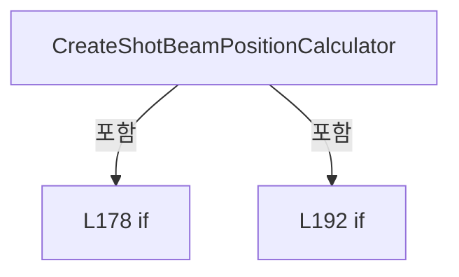

변경 전 점검: 입력/반환 타입, 위 호출자, 예외/취소 경로, 공유 상태와 저장·전송 소비자를 함께 확인합니다. 값의 단위나 물리 방향을 이름만으로 확정하지 않습니다.

### MethodDeclaration `CreateAllPlan` · L198–201

[Drilling.Common/Review/CReviewManager.cs:198–201](https://github.com/kjuws10-rgb/A3Drilling/blob/28764c91d521777b8ee068dd7aaf2d3902ce9fe2/Drilling.Common/Review/CReviewManager.cs#L198-L201)

| 항목 | 실제 추출 값 |
| --- | --- |
| 서명 | Drilling.Common.Review.ST_REVIEW_PLAN Drilling.Common.Review.CReviewManager.CreateAllPlan(Drilling.Common.Managers.ST_RECIPE_DEFINITION, int) |
| 접근/수식자 | Public / public |
| 반환/값 타입 | Drilling.Common.Review.ST_REVIEW_PLAN |
| 소속 타입 | NamedType:Drilling.Common.Review.CReviewManager |

입력 계약:

| 이름 | 타입 | 전달 | 선택/기본값 |
| --- | --- | --- | --- |
| recipe | Drilling.Common.Managers.ST_RECIPE_DEFINITION | None | False /  |
| selectedBeamNo | int | None | False /  |

정적 호출자로 확인된 위치:

| 호출 파일/행 | 호출 표현식 | 런타임 분기 가능 |
| --- | --- | --- |
| [Drilling.UI/Menu/Menus/CMenuCorrection.ReviewData.Offset.cs:155–155](https://github.com/kjuws10-rgb/A3Drilling/blob/28764c91d521777b8ee068dd7aaf2d3902ce9fe2/Drilling.UI/Menu/Menus/CMenuCorrection.ReviewData.Offset.cs#L155-L155) | _reviewManager.CreateAllPlan | False |
| [Drilling.UI/Menu/Menus/CMenuCorrection.ReviewData.Offset.cs:275–275](https://github.com/kjuws10-rgb/A3Drilling/blob/28764c91d521777b8ee068dd7aaf2d3902ce9fe2/Drilling.UI/Menu/Menus/CMenuCorrection.ReviewData.Offset.cs#L275-L275) | _reviewManager.CreateAllPlan | False |
| [Drilling.UI/Menu/Menus/CMenuCorrection.cs:1963–1963](https://github.com/kjuws10-rgb/A3Drilling/blob/28764c91d521777b8ee068dd7aaf2d3902ce9fe2/Drilling.UI/Menu/Menus/CMenuCorrection.cs#L1963-L1963) | _reviewManager.CreateAllPlan | False |
| [Drilling.UI/Menu/Menus/CMenuReview.cs:498–498](https://github.com/kjuws10-rgb/A3Drilling/blob/28764c91d521777b8ee068dd7aaf2d3902ce9fe2/Drilling.UI/Menu/Menus/CMenuReview.cs#L498-L498) | _reviewManager.CreateAllPlan | False |
| [Drilling.UI/Menu/Menus/CMenuReview.cs:3862–3862](https://github.com/kjuws10-rgb/A3Drilling/blob/28764c91d521777b8ee068dd7aaf2d3902ce9fe2/Drilling.UI/Menu/Menus/CMenuReview.cs#L3862-L3862) | _reviewManager.CreateAllPlan | False |
| [Drilling.UI/Menu/Menus/CMenuReview.cs:4529–4529](https://github.com/kjuws10-rgb/A3Drilling/blob/28764c91d521777b8ee068dd7aaf2d3902ce9fe2/Drilling.UI/Menu/Menus/CMenuReview.cs#L4529-L4529) | _reviewManager.CreateAllPlan | False |

호출하는 대상과 해석 범위:

| 원본 행 | 표현식 | 분석 상태 | 대상/소스 위치 |
| --- | --- | --- | --- |
| 200 | CreateAllPlan | resolved | Drilling.Common.Review.ST_REVIEW_PLAN Drilling.Common.Review.CReviewManager.CreateAllPlan(Drilling.Common.Managers.ST_RECIPE_DEFINITION, int, double, double) · Drilling.Common/Review/CReviewManager.cs:203 |

본문의 실제 연산·분기·예외·반환 순서(원문 위치 순):

| 원본 행 | 종류 | 주석 해설 |
| --- | --- | --- |
| 200 | call | 함수·델리게이트 또는 객체 생성자를 호출합니다: CreateAllPlan(recipe, selectedBeamNo, 0.0, 0.0) |
| 200 | return | 호출자에게 값 또는 제어를 반환합니다: return CreateAllPlan(recipe, selectedBeamNo, 0.0, 0.0); |

변경 전 점검: 입력/반환 타입, 위 호출자, 예외/취소 경로, 공유 상태와 저장·전송 소비자를 함께 확인합니다. 값의 단위나 물리 방향을 이름만으로 확정하지 않습니다.

### MethodDeclaration `CreateAllPlan` · L203–212

[Drilling.Common/Review/CReviewManager.cs:203–212](https://github.com/kjuws10-rgb/A3Drilling/blob/28764c91d521777b8ee068dd7aaf2d3902ce9fe2/Drilling.Common/Review/CReviewManager.cs#L203-L212)

| 항목 | 실제 추출 값 |
| --- | --- |
| 서명 | Drilling.Common.Review.ST_REVIEW_PLAN Drilling.Common.Review.CReviewManager.CreateAllPlan(Drilling.Common.Managers.ST_RECIPE_DEFINITION, int, double, double) |
| 접근/수식자 | Public / public |
| 반환/값 타입 | Drilling.Common.Review.ST_REVIEW_PLAN |
| 소속 타입 | NamedType:Drilling.Common.Review.CReviewManager |

입력 계약:

| 이름 | 타입 | 전달 | 선택/기본값 |
| --- | --- | --- | --- |
| recipe | Drilling.Common.Managers.ST_RECIPE_DEFINITION | None | False /  |
| selectedBeamNo | int | None | False /  |
| shiftOffsetX | double | None | False /  |
| shiftOffsetY | double | None | False /  |

정적 호출자로 확인된 위치:

| 호출 파일/행 | 호출 표현식 | 런타임 분기 가능 |
| --- | --- | --- |
| [Drilling.Common/Review/CReviewManager.cs:85–85](https://github.com/kjuws10-rgb/A3Drilling/blob/28764c91d521777b8ee068dd7aaf2d3902ce9fe2/Drilling.Common/Review/CReviewManager.cs#L85-L85) | CreateAllPlan | False |
| [Drilling.Common/Review/CReviewManager.cs:200–200](https://github.com/kjuws10-rgb/A3Drilling/blob/28764c91d521777b8ee068dd7aaf2d3902ce9fe2/Drilling.Common/Review/CReviewManager.cs#L200-L200) | CreateAllPlan | False |
| [Drilling.UI/Menu/Menus/CMenuReview.cs:2740–2740](https://github.com/kjuws10-rgb/A3Drilling/blob/28764c91d521777b8ee068dd7aaf2d3902ce9fe2/Drilling.UI/Menu/Menus/CMenuReview.cs#L2740-L2740) | _reviewManager.CreateAllPlan | False |
| [Drilling.UI/Menu/Menus/CMenuReview.cs:3065–3065](https://github.com/kjuws10-rgb/A3Drilling/blob/28764c91d521777b8ee068dd7aaf2d3902ce9fe2/Drilling.UI/Menu/Menus/CMenuReview.cs#L3065-L3065) | _reviewManager.CreateAllPlan | False |
| [Drilling.UI/Menu/Menus/CMenuReview.cs:4262–4262](https://github.com/kjuws10-rgb/A3Drilling/blob/28764c91d521777b8ee068dd7aaf2d3902ce9fe2/Drilling.UI/Menu/Menus/CMenuReview.cs#L4262-L4262) | _reviewManager.CreateAllPlan | False |

호출하는 대상과 해석 범위:

| 원본 행 | 표현식 | 분석 상태 | 대상/소스 위치 |
| --- | --- | --- | --- |
| 209 | ValidateShiftOffset | resolved | void Drilling.Common.Review.CReviewManager.ValidateShiftOffset(double, double) · Drilling.Common/Review/CReviewManager.cs:994 |
| 210 | ValidateBeamNo | resolved | void Drilling.Common.Review.CReviewManager.ValidateBeamNo(int, int) · Drilling.Common/Review/CReviewManager.cs:980 |
| 210 | ReadInt | resolved | int Drilling.Common.Review.CReviewManager.ReadInt(Drilling.Common.Managers.ST_RECIPE_DEFINITION, int, params string[]) · Drilling.Common/Review/CReviewManager.cs:1282 |
| 211 | CreatePlanCore | resolved | Drilling.Common.Review.ST_REVIEW_PLAN Drilling.Common.Review.CReviewManager.CreatePlanCore(Drilling.Common.Managers.ST_RECIPE_DEFINITION, System.Func<Drilling.Common.Review.ST_REVIEW_PLAN_POINT, bool>, int, bool, double, double) · Drilling.Common/Review/CReviewManager.cs:501 |

본문의 실제 연산·분기·예외·반환 순서(원문 위치 순):

| 원본 행 | 종류 | 주석 해설 |
| --- | --- | --- |
| 209 | call | 함수·델리게이트 또는 객체 생성자를 호출합니다: ValidateShiftOffset(shiftOffsetX, shiftOffsetY) |
| 210 | call | 함수·델리게이트 또는 객체 생성자를 호출합니다: ValidateBeamNo(selectedBeamNo, ReadInt(recipe, 0, "SPLITED_BEAM_COUNT")) |
| 210 | call | 함수·델리게이트 또는 객체 생성자를 호출합니다: ReadInt(recipe, 0, "SPLITED_BEAM_COUNT") |
| 211 | call | 함수·델리게이트 또는 객체 생성자를 호출합니다: CreatePlanCore(recipe, _ => true, selectedBeamNo, selectAllAssignedPoints: true, shiftOffsetX, shiftOffsetY) |
| 211 | return | 호출자에게 값 또는 제어를 반환합니다: return CreatePlanCore(recipe, _ => true, selectedBeamNo, selectAllAssignedPoints: true, shiftOffsetX, shiftOffsetY); |

변경 전 점검: 입력/반환 타입, 위 호출자, 예외/취소 경로, 공유 상태와 저장·전송 소비자를 함께 확인합니다. 값의 단위나 물리 방향을 이름만으로 확정하지 않습니다.

### MethodDeclaration `SelectGlassLineShotKeys` · L214–249

[Drilling.Common/Review/CReviewManager.cs:214–249](https://github.com/kjuws10-rgb/A3Drilling/blob/28764c91d521777b8ee068dd7aaf2d3902ce9fe2/Drilling.Common/Review/CReviewManager.cs#L214-L249)

| 항목 | 실제 추출 값 |
| --- | --- |
| 서명 | System.Collections.Generic.IReadOnlyList<string> Drilling.Common.Review.CReviewManager.SelectGlassLineShotKeys(Drilling.Common.Review.ST_REVIEW_PLAN, string) |
| 접근/수식자 | Public / public, static |
| 반환/값 타입 | System.Collections.Generic.IReadOnlyList<string> |
| 소속 타입 | NamedType:Drilling.Common.Review.CReviewManager |

입력 계약:

| 이름 | 타입 | 전달 | 선택/기본값 |
| --- | --- | --- | --- |
| plan | Drilling.Common.Review.ST_REVIEW_PLAN | None | False /  |
| anchorShotKey | string | None | False /  |

정적 호출자로 확인된 위치:

| 호출 파일/행 | 호출 표현식 | 런타임 분기 가능 |
| --- | --- | --- |
| [Drilling.UI/Menu/Menus/CMenuReview.cs:2186–2186](https://github.com/kjuws10-rgb/A3Drilling/blob/28764c91d521777b8ee068dd7aaf2d3902ce9fe2/Drilling.UI/Menu/Menus/CMenuReview.cs#L2186-L2186) | CReviewManager.SelectGlassLineShotKeys | False |
| [Drilling.UI/Menu/Menus/CMenuReview.cs:2227–2227](https://github.com/kjuws10-rgb/A3Drilling/blob/28764c91d521777b8ee068dd7aaf2d3902ce9fe2/Drilling.UI/Menu/Menus/CMenuReview.cs#L2227-L2227) | CReviewManager.SelectGlassLineShotKeys | False |

호출하는 대상과 해석 범위:

| 원본 행 | 표현식 | 분석 상태 | 대상/소스 위치 |
| --- | --- | --- | --- |
| 218 | ArgumentNullException.ThrowIfNull | resolved | void System.ArgumentNullException.ThrowIfNull(object?, string?) |
| 219 | NormalizeShotKey | resolved | string Drilling.Common.Review.CReviewManager.NormalizeShotKey(string) · Drilling.Common/Review/CReviewManager.cs:1245 |
| 220 | plan.Points .Where(point => point.Use && point.HeadNo > 0 && double.IsFinite(point.DesignX) && double.IsFinite(point.DesignY)) .ToArray | resolved | Drilling.Common.Review.ST_REVIEW_PLAN_POINT[] System.Collections.Generic.IEnumerable<Drilling.Common.Review.ST_REVIEW_PLAN_POINT>.ToArray<Drilling.Common.Review.ST_REVIEW_PLAN_POINT>() |
| 220 | plan.Points .Where | resolved | System.Collections.Generic.IEnumerable<Drilling.Common.Review.ST_REVIEW_PLAN_POINT> System.Collections.Generic.IEnumerable<Drilling.Common.Review.ST_REVIEW_PLAN_POINT>.Where<Drilling.Common.Review.ST_REVIEW_PLAN_POINT>(System.Func<Drilling.Common.Review.ST_REVIEW_PLAN_POINT, bool>) |
| 224 | double.IsFinite | resolved | bool double.IsFinite(double) |
| 225 | double.IsFinite | resolved | bool double.IsFinite(double) |
| 227 | executablePoints.Any | resolved | bool System.Collections.Generic.IEnumerable<Drilling.Common.Review.ST_REVIEW_PLAN_POINT>.Any<Drilling.Common.Review.ST_REVIEW_PLAN_POINT>(System.Func<Drilling.Common.Review.ST_REVIEW_PLAN_POINT, bool>) |
| 227 | point.ShotKey.Equals | resolved | bool string.Equals(string?, System.StringComparison) |
| 232 | CreateIofLines | resolved | System.Collections.Generic.IReadOnlyList<System.Collections.Generic.IReadOnlyList<Drilling.Common.Review.ST_REVIEW_PLAN_POINT>> Drilling.Common.Review.CReviewManager.CreateIofLines(System.Collections.Generic.IReadOnlyList<Drilling.Common.Review.ST_REVIEW_PLAN_POINT>) · Drilling.Common/Review/CReviewManager.cs:2201 |
| 234 | line.Any | resolved | bool System.Collections.Generic.IEnumerable<Drilling.Common.Review.ST_REVIEW_PLAN_POINT>.Any<Drilling.Common.Review.ST_REVIEW_PLAN_POINT>(System.Func<Drilling.Common.Review.ST_REVIEW_PLAN_POINT, bool>) |
| 234 | point.ShotKey.Equals | resolved | bool string.Equals(string?, System.StringComparison) |
| 239 | line .OrderBy(point => point.DesignX) .ThenBy(point => point.CellNo) .ThenBy(point => point.ShotNo) .Select(point => point.ShotKey) .Distinct(StringComparer.OrdinalIgnoreCase) .ToArray | resolved | string[] System.Collections.Generic.IEnumerable<string>.ToArray<string>() |
| 239 | line .OrderBy(point => point.DesignX) .ThenBy(point => point.CellNo) .ThenBy(point => point.ShotNo) .Select(point => point.ShotKey) .Distinct | resolved | System.Collections.Generic.IEnumerable<string> System.Collections.Generic.IEnumerable<string>.Distinct<string>(System.Collections.Generic.IEqualityComparer<string>?) |
| 239 | line .OrderBy(point => point.DesignX) .ThenBy(point => point.CellNo) .ThenBy(point => point.ShotNo) .Select | resolved | System.Collections.Generic.IEnumerable<string> System.Collections.Generic.IEnumerable<Drilling.Common.Review.ST_REVIEW_PLAN_POINT>.Select<Drilling.Common.Review.ST_REVIEW_PLAN_POINT, string>(System.Func<Drilling.Common.Review.ST_REVIEW_PLAN_POINT, string>) |
| 239 | line .OrderBy(point => point.DesignX) .ThenBy(point => point.CellNo) .ThenBy | resolved | System.Linq.IOrderedEnumerable<Drilling.Common.Review.ST_REVIEW_PLAN_POINT> System.Linq.IOrderedEnumerable<Drilling.Common.Review.ST_REVIEW_PLAN_POINT>.ThenBy<Drilling.Common.Review.ST_REVIEW_PLAN_POINT, int>(System.Func<Drilling.Common.Review.ST_REVIEW_PLAN_POINT, int>) |
| 239 | line .OrderBy(point => point.DesignX) .ThenBy | resolved | System.Linq.IOrderedEnumerable<Drilling.Common.Review.ST_REVIEW_PLAN_POINT> System.Linq.IOrderedEnumerable<Drilling.Common.Review.ST_REVIEW_PLAN_POINT>.ThenBy<Drilling.Common.Review.ST_REVIEW_PLAN_POINT, int>(System.Func<Drilling.Common.Review.ST_REVIEW_PLAN_POINT, int>) |
| 239 | line .OrderBy | resolved | System.Linq.IOrderedEnumerable<Drilling.Common.Review.ST_REVIEW_PLAN_POINT> System.Collections.Generic.IEnumerable<Drilling.Common.Review.ST_REVIEW_PLAN_POINT>.OrderBy<Drilling.Common.Review.ST_REVIEW_PLAN_POINT, double>(System.Func<Drilling.Common.Review.ST_REVIEW_PLAN_POINT, double>) |

본문의 실제 연산·분기·예외·반환 순서(원문 위치 순):

| 원본 행 | 종류 | 주석 해설 |
| --- | --- | --- |
| 218 | call | 함수·델리게이트 또는 객체 생성자를 호출합니다: ArgumentNullException.ThrowIfNull(plan) |
| 219 | call | 함수·델리게이트 또는 객체 생성자를 호출합니다: NormalizeShotKey(anchorShotKey) |
| 219 | local-declaration | 지역 변수를 선언합니다: var normalizedAnchorKey = NormalizeShotKey(anchorShotKey); |
| 219 | variable-initializer | 변수의 초기값을 지정합니다: normalizedAnchorKey = NormalizeShotKey(anchorShotKey) |
| 220 | call | 함수·델리게이트 또는 객체 생성자를 호출합니다: plan.Points .Where(point => point.Use && point.HeadNo > 0 && double.IsFinite(point.DesignX) && double.IsFinite(point.DesignY)) |
| 220 | call | 함수·델리게이트 또는 객체 생성자를 호출합니다: plan.Points .Where(point => point.Use && point.HeadNo > 0 && double.IsFinite(point.DesignX) && double.IsFinite(point.DesignY)) .ToArray() |
| 220 | local-declaration | 지역 변수를 선언합니다: var executablePoints = plan.Points .Where(point => point.Use && point.HeadNo > 0 && double.IsFinite(point.DesignX) && double.IsFinite(point.DesignY)) .ToArray(); |
| 220 | variable-initializer | 변수의 초기값을 지정합니다: executablePoints = plan.Points .Where(point => point.Use && point.HeadNo > 0 && double.IsFinite(point.DesignX) && double.IsFinite(point.DesignY)) .ToArray() |
| 224 | call | 함수·델리게이트 또는 객체 생성자를 호출합니다: double.IsFinite(point.DesignX) |
| 225 | call | 함수·델리게이트 또는 객체 생성자를 호출합니다: double.IsFinite(point.DesignY) |
| 227 | call | 함수·델리게이트 또는 객체 생성자를 호출합니다: executablePoints.Any(point => point.ShotKey.Equals(normalizedAnchorKey, StringComparison.OrdinalIgnoreCase)) |
| 227 | call | 함수·델리게이트 또는 객체 생성자를 호출합니다: point.ShotKey.Equals(normalizedAnchorKey, StringComparison.OrdinalIgnoreCase) |
| 227 | if | 조건에 따라 분기합니다: if (!executablePoints.Any(point => point.ShotKey.Equals(normalizedAnchorKey, StringComparison.OrdinalIgnoreCase))) |
| 229 | return | 호출자에게 값 또는 제어를 반환합니다: return []; |
| 232 | call | 함수·델리게이트 또는 객체 생성자를 호출합니다: CreateIofLines(executablePoints) |
| 232 | foreach | 컬렉션 요소를 순회합니다: foreach (var line in CreateIofLines(executablePoints)) |
| 234 | call | 함수·델리게이트 또는 객체 생성자를 호출합니다: line.Any(point => point.ShotKey.Equals(normalizedAnchorKey, StringComparison.OrdinalIgnoreCase)) |
| 234 | call | 함수·델리게이트 또는 객체 생성자를 호출합니다: point.ShotKey.Equals(normalizedAnchorKey, StringComparison.OrdinalIgnoreCase) |
| 234 | if | 조건에 따라 분기합니다: if (!line.Any(point => point.ShotKey.Equals(normalizedAnchorKey, StringComparison.OrdinalIgnoreCase))) |
| 236 | continue | 다음 반복으로 진행합니다: continue; |
| 239 | call | 함수·델리게이트 또는 객체 생성자를 호출합니다: line .OrderBy(point => point.DesignX) |
| 239 | call | 함수·델리게이트 또는 객체 생성자를 호출합니다: line .OrderBy(point => point.DesignX) .ThenBy(point => point.CellNo) |
| 239 | call | 함수·델리게이트 또는 객체 생성자를 호출합니다: line .OrderBy(point => point.DesignX) .ThenBy(point => point.CellNo) .ThenBy(point => point.ShotNo) |
| 239 | call | 함수·델리게이트 또는 객체 생성자를 호출합니다: line .OrderBy(point => point.DesignX) .ThenBy(point => point.CellNo) .ThenBy(point => point.ShotNo) .Select(point => point.ShotKey) |
| 239 | call | 함수·델리게이트 또는 객체 생성자를 호출합니다: line .OrderBy(point => point.DesignX) .ThenBy(point => point.CellNo) .ThenBy(point => point.ShotNo) .Select(point => point.ShotKey) .Distinct(StringComparer.OrdinalIgnoreCase) |
| 239 | call | 함수·델리게이트 또는 객체 생성자를 호출합니다: line .OrderBy(point => point.DesignX) .ThenBy(point => point.CellNo) .ThenBy(point => point.ShotNo) .Select(point => point.ShotKey) .Distinct(StringComparer.OrdinalIgnoreCase) .ToArray() |
| 239 | return | 호출자에게 값 또는 제어를 반환합니다: return line .OrderBy(point => point.DesignX) .ThenBy(point => point.CellNo) .ThenBy(point => point.ShotNo) .Select(point => point.ShotKey) .Distinct(StringComparer.OrdinalIgnoreCase) .ToArray(); |
| 248 | return | 호출자에게 값 또는 제어를 반환합니다: return []; |

제어 구문의 포함 구조(실제 실행 순서/CFG가 아닌 구문 탐색 그림):

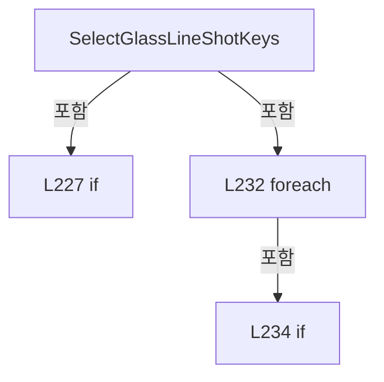

변경 전 점검: 입력/반환 타입, 위 호출자, 예외/취소 경로, 공유 상태와 저장·전송 소비자를 함께 확인합니다. 값의 단위나 물리 방향을 이름만으로 확정하지 않습니다.

### MethodDeclaration `ApplyShiftOffset` · L251–277

[Drilling.Common/Review/CReviewManager.cs:251–277](https://github.com/kjuws10-rgb/A3Drilling/blob/28764c91d521777b8ee068dd7aaf2d3902ce9fe2/Drilling.Common/Review/CReviewManager.cs#L251-L277)

| 항목 | 실제 추출 값 |
| --- | --- |
| 서명 | Drilling.Common.Review.ST_REVIEW_PLAN Drilling.Common.Review.CReviewManager.ApplyShiftOffset(Drilling.Common.Review.ST_REVIEW_PLAN, double, double) |
| 접근/수식자 | Public / public, static |
| 반환/값 타입 | Drilling.Common.Review.ST_REVIEW_PLAN |
| 소속 타입 | NamedType:Drilling.Common.Review.CReviewManager |

입력 계약:

| 이름 | 타입 | 전달 | 선택/기본값 |
| --- | --- | --- | --- |
| plan | Drilling.Common.Review.ST_REVIEW_PLAN | None | False /  |
| shiftOffsetX | double | None | False /  |
| shiftOffsetY | double | None | False /  |

정적 호출자로 확인된 위치:

| 호출 파일/행 | 호출 표현식 | 런타임 분기 가능 |
| --- | --- | --- |
| [Drilling.UI/Menu/Menus/CMenuCorrection.cs:6475–6475](https://github.com/kjuws10-rgb/A3Drilling/blob/28764c91d521777b8ee068dd7aaf2d3902ce9fe2/Drilling.UI/Menu/Menus/CMenuCorrection.cs#L6475-L6475) | CReviewManager.ApplyShiftOffset | False |
| [Drilling.UI/Menu/Menus/CMenuCorrection.cs:7502–7502](https://github.com/kjuws10-rgb/A3Drilling/blob/28764c91d521777b8ee068dd7aaf2d3902ce9fe2/Drilling.UI/Menu/Menus/CMenuCorrection.cs#L7502-L7502) | CReviewManager.ApplyShiftOffset | False |

호출하는 대상과 해석 범위:

| 원본 행 | 표현식 | 분석 상태 | 대상/소스 위치 |
| --- | --- | --- | --- |
| 253 | ValidateShiftOffset | resolved | void Drilling.Common.Review.CReviewManager.ValidateShiftOffset(double, double) · Drilling.Common/Review/CReviewManager.cs:994 |
| 269 | plan.CorrectionPlan.SourcePoints.Select(Apply).ToArray | resolved | Drilling.Common.Review.ST_REVIEW_PLAN_POINT[] System.Collections.Generic.IEnumerable<Drilling.Common.Review.ST_REVIEW_PLAN_POINT>.ToArray<Drilling.Common.Review.ST_REVIEW_PLAN_POINT>() |
| 269 | plan.CorrectionPlan.SourcePoints.Select | resolved | System.Collections.Generic.IEnumerable<Drilling.Common.Review.ST_REVIEW_PLAN_POINT> System.Collections.Generic.IEnumerable<Drilling.Common.Review.ST_REVIEW_PLAN_POINT>.Select<Drilling.Common.Review.ST_REVIEW_PLAN_POINT, Drilling.Common.Review.ST_REVIEW_PLAN_POINT>(System.Func<Drilling.Common.Review.ST_REVIEW_PLAN_POINT, Drilling.Common.Review.ST_REVIEW_PLAN_POINT>) |
| 272 | plan.Points.Select(Apply).ToArray | resolved | Drilling.Common.Review.ST_REVIEW_PLAN_POINT[] System.Collections.Generic.IEnumerable<Drilling.Common.Review.ST_REVIEW_PLAN_POINT>.ToArray<Drilling.Common.Review.ST_REVIEW_PLAN_POINT>() |
| 272 | plan.Points.Select | resolved | System.Collections.Generic.IEnumerable<Drilling.Common.Review.ST_REVIEW_PLAN_POINT> System.Collections.Generic.IEnumerable<Drilling.Common.Review.ST_REVIEW_PLAN_POINT>.Select<Drilling.Common.Review.ST_REVIEW_PLAN_POINT, Drilling.Common.Review.ST_REVIEW_PLAN_POINT>(System.Func<Drilling.Common.Review.ST_REVIEW_PLAN_POINT, Drilling.Common.Review.ST_REVIEW_PLAN_POINT>) |

본문의 실제 연산·분기·예외·반환 순서(원문 위치 순):

| 원본 행 | 종류 | 주석 해설 |
| --- | --- | --- |
| 253 | call | 함수·델리게이트 또는 객체 생성자를 호출합니다: ValidateShiftOffset(shiftOffsetX, shiftOffsetY) |
| 255 | local-declaration | 지역 변수를 선언합니다: var deltaX = shiftOffsetX - plan.ShiftOffsetX; |
| 255 | variable-initializer | 변수의 초기값을 지정합니다: deltaX = shiftOffsetX - plan.ShiftOffsetX |
| 256 | local-declaration | 지역 변수를 선언합니다: var deltaY = plan.StageScanDirectionY * (shiftOffsetY - plan.ShiftOffsetY); |
| 256 | variable-initializer | 변수의 초기값을 지정합니다: deltaY = plan.StageScanDirectionY * (shiftOffsetY - plan.ShiftOffsetY) |
| 267 | conditional-expression | 조건에 따라 결과식을 선택합니다: plan.CorrectionPlan is null ? null : plan.CorrectionPlan with { SourcePoints = plan.CorrectionPlan.SourcePoints.Select(Apply).ToArray() } |
| 267 | local-declaration | 지역 변수를 선언합니다: var correction = plan.CorrectionPlan is null ? null : plan.CorrectionPlan with { SourcePoints = plan.CorrectionPlan.SourcePoints.Select(Apply).ToArray() }; |
| 267 | variable-initializer | 변수의 초기값을 지정합니다: correction = plan.CorrectionPlan is null ? null : plan.CorrectionPlan with { SourcePoints = plan.CorrectionPlan.SourcePoints.Select(Apply).ToArray() } |
| 269 | assignment | 값을 대상에 대입합니다: SourcePoints = plan.CorrectionPlan.SourcePoints.Select(Apply).ToArray() |
| 269 | call | 함수·델리게이트 또는 객체 생성자를 호출합니다: plan.CorrectionPlan.SourcePoints.Select(Apply).ToArray() |
| 269 | call | 함수·델리게이트 또는 객체 생성자를 호출합니다: plan.CorrectionPlan.SourcePoints.Select(Apply) |
| 270 | return | 호출자에게 값 또는 제어를 반환합니다: return plan with { Points = plan.Points.Select(Apply).ToArray(), CorrectionPlan = correction, ShiftOffsetX = shiftOffsetX, ShiftOffsetY = shiftOffsetY }; |
| 272 | assignment | 값을 대상에 대입합니다: Points = plan.Points.Select(Apply).ToArray() |
| 272 | call | 함수·델리게이트 또는 객체 생성자를 호출합니다: plan.Points.Select(Apply).ToArray() |
| 272 | call | 함수·델리게이트 또는 객체 생성자를 호출합니다: plan.Points.Select(Apply) |
| 273 | assignment | 값을 대상에 대입합니다: CorrectionPlan = correction |
| 274 | assignment | 값을 대상에 대입합니다: ShiftOffsetX = shiftOffsetX |
| 275 | assignment | 값을 대상에 대입합니다: ShiftOffsetY = shiftOffsetY |

변경 전 점검: 입력/반환 타입, 위 호출자, 예외/취소 경로, 공유 상태와 저장·전송 소비자를 함께 확인합니다. 값의 단위나 물리 방향을 이름만으로 확정하지 않습니다.

### LocalFunctionStatement `Apply` · L258–265

[Drilling.Common/Review/CReviewManager.cs:258–265](https://github.com/kjuws10-rgb/A3Drilling/blob/28764c91d521777b8ee068dd7aaf2d3902ce9fe2/Drilling.Common/Review/CReviewManager.cs#L258-L265)

| 항목 | 실제 추출 값 |
| --- | --- |
| 서명 | Drilling.Common.Review.ST_REVIEW_PLAN_POINT Apply(Drilling.Common.Review.ST_REVIEW_PLAN_POINT) |
| 접근/수식자 | Private /  |
| 반환/값 타입 | Drilling.Common.Review.ST_REVIEW_PLAN_POINT |
| 소속 타입 | NamedType:Drilling.Common.Review.CReviewManager |

입력 계약:

| 이름 | 타입 | 전달 | 선택/기본값 |
| --- | --- | --- | --- |
| point | Drilling.Common.Review.ST_REVIEW_PLAN_POINT | None | False /  |

현재 부분 분석에서 직접 연결된 호출자는 없습니다. XAML/이벤트/인터페이스·델리게이트·외부 진입을 추가 확인해야 하며, 미사용으로 판정한 것이 아닙니다.

호출하는 대상과 해석 범위:

| 원본 행 | 표현식 | 분석 상태 | 대상/소스 위치 |
| --- | --- | --- | --- |
| 262 | double.IsFinite | resolved | bool double.IsFinite(double) |
| 262 | double.IsFinite | resolved | bool double.IsFinite(double) |
| 263 | new InvalidOperationException | resolved | System.InvalidOperationException.InvalidOperationException(string?) |

본문의 실제 연산·분기·예외·반환 순서(원문 위치 순):

| 원본 행 | 종류 | 주석 해설 |
| --- | --- | --- |
| 260 | local-declaration | 지역 변수를 선언합니다: var targetX = point.ReviewTargetX + deltaX; |
| 260 | variable-initializer | 변수의 초기값을 지정합니다: targetX = point.ReviewTargetX + deltaX |
| 261 | local-declaration | 지역 변수를 선언합니다: var targetY = point.ReviewTargetY + deltaY; |
| 261 | variable-initializer | 변수의 초기값을 지정합니다: targetY = point.ReviewTargetY + deltaY |
| 262 | call | 함수·델리게이트 또는 객체 생성자를 호출합니다: double.IsFinite(targetX) |
| 262 | call | 함수·델리게이트 또는 객체 생성자를 호출합니다: double.IsFinite(targetY) |
| 262 | if | 조건에 따라 분기합니다: if (!double.IsFinite(targetX) &#124;&#124; !double.IsFinite(targetY)) |
| 263 | call | 함수·델리게이트 또는 객체 생성자를 호출합니다: new InvalidOperationException($"Shift Offset 적용 후 Review 목표 좌표가 유효하지 않습니다. X={targetX:R}, Y={targetY:R}") |
| 263 | throw | 예외를 발생/전달합니다: throw new InvalidOperationException($"Shift Offset 적용 후 Review 목표 좌표가 유효하지 않습니다. X={targetX:R}, Y={targetY:R}"); |
| 264 | assignment | 값을 대상에 대입합니다: ReviewTargetX = targetX |
| 264 | assignment | 값을 대상에 대입합니다: ReviewTargetY = targetY |
| 264 | return | 호출자에게 값 또는 제어를 반환합니다: return point with { ReviewTargetX = targetX, ReviewTargetY = targetY }; |

제어 구문의 포함 구조(실제 실행 순서/CFG가 아닌 구문 탐색 그림):

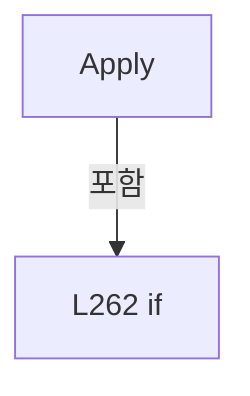

변경 전 점검: 입력/반환 타입, 위 호출자, 예외/취소 경로, 공유 상태와 저장·전송 소비자를 함께 확인합니다. 값의 단위나 물리 방향을 이름만으로 확정하지 않습니다.

### MethodDeclaration `GetHeadScopes` · L284–287

[Drilling.Common/Review/CReviewManager.cs:284–287](https://github.com/kjuws10-rgb/A3Drilling/blob/28764c91d521777b8ee068dd7aaf2d3902ce9fe2/Drilling.Common/Review/CReviewManager.cs#L284-L287)

| 항목 | 실제 추출 값 |
| --- | --- |
| 서명 | System.Collections.Generic.IReadOnlyList<Drilling.Common.Review.ST_REVIEW_HEAD_SCOPE> Drilling.Common.Review.CReviewManager.GetHeadScopes(Drilling.Common.Managers.ST_RECIPE_DEFINITION) |
| 접근/수식자 | Public / public |
| 반환/값 타입 | System.Collections.Generic.IReadOnlyList<Drilling.Common.Review.ST_REVIEW_HEAD_SCOPE> |
| 소속 타입 | NamedType:Drilling.Common.Review.CReviewManager |

원본 XML 주석:

````xml
/// <summary>
        /// Returns the same physical head scan fields used while assigning Review
        /// plan points.  Review UI uses these values to render a global Head scope
        /// exactly like Main, instead of inferring a range from Cell columns.
        /// </summary>
````

입력 계약:

| 이름 | 타입 | 전달 | 선택/기본값 |
| --- | --- | --- | --- |
| recipe | Drilling.Common.Managers.ST_RECIPE_DEFINITION | None | False /  |

정적 호출자로 확인된 위치:

| 호출 파일/행 | 호출 표현식 | 런타임 분기 가능 |
| --- | --- | --- |
| [Drilling.UI/Menu/Menus/CMenuReview.cs:1299–1299](https://github.com/kjuws10-rgb/A3Drilling/blob/28764c91d521777b8ee068dd7aaf2d3902ce9fe2/Drilling.UI/Menu/Menus/CMenuReview.cs#L1299-L1299) | _reviewManager.GetHeadScopes | False |
| [Drilling.UI/Menu/Menus/CMenuReview.cs:4646–4646](https://github.com/kjuws10-rgb/A3Drilling/blob/28764c91d521777b8ee068dd7aaf2d3902ce9fe2/Drilling.UI/Menu/Menus/CMenuReview.cs#L4646-L4646) | _reviewManager.GetHeadScopes | False |

호출하는 대상과 해석 범위:

| 원본 행 | 표현식 | 분석 상태 | 대상/소스 위치 |
| --- | --- | --- | --- |
| 286 | LoadReviewCoordinateSettings(recipe).HeadLayout.Fields.Select(field => new ST_REVIEW_HEAD_SCOPE(field.HeadNo, field.PositionX, field.ScanFieldWidthX)).ToArray | resolved | Drilling.Common.Review.ST_REVIEW_HEAD_SCOPE[] System.Collections.Generic.IEnumerable<Drilling.Common.Review.ST_REVIEW_HEAD_SCOPE>.ToArray<Drilling.Common.Review.ST_REVIEW_HEAD_SCOPE>() |
| 286 | LoadReviewCoordinateSettings(recipe).HeadLayout.Fields.Select | resolved | System.Collections.Generic.IEnumerable<Drilling.Common.Review.ST_REVIEW_HEAD_SCOPE> System.Collections.Generic.IEnumerable<Drilling.Common.Review.CReviewManager.ST_REVIEW_HEAD_FIELD>.Select<Drilling.Common.Review.CReviewManager.ST_REVIEW_HEAD_FIELD, Drilling.Common.Review.ST_REVIEW_HEAD_SCOPE>(System.Func<Drilling.Common.Review.CReviewManager.ST_REVIEW_HEAD_FIELD, Drilling.Common.Review.ST_REVIEW_HEAD_SCOPE>) |
| 286 | LoadReviewCoordinateSettings | resolved | Drilling.Common.Review.CReviewManager.ST_REVIEW_COORDINATE_SETTINGS Drilling.Common.Review.CReviewManager.LoadReviewCoordinateSettings(Drilling.Common.Managers.ST_RECIPE_DEFINITION) · Drilling.Common/Review/CReviewManager.cs:600 |
| 286 | new ST_REVIEW_HEAD_SCOPE | resolved | Drilling.Common.Review.ST_REVIEW_HEAD_SCOPE.ST_REVIEW_HEAD_SCOPE(int, double, double) · Drilling.Common/Review/CReviewManager.cs:4138 |

본문의 실제 연산·분기·예외·반환 순서(원문 위치 순):

| 원본 행 | 종류 | 주석 해설 |
| --- | --- | --- |
| 286 | call | 함수·델리게이트 또는 객체 생성자를 호출합니다: LoadReviewCoordinateSettings(recipe).HeadLayout.Fields.Select(field => new ST_REVIEW_HEAD_SCOPE(field.HeadNo, field.PositionX, field.ScanFieldWidthX)).ToArray() |
| 286 | call | 함수·델리게이트 또는 객체 생성자를 호출합니다: LoadReviewCoordinateSettings(recipe).HeadLayout.Fields.Select(field => new ST_REVIEW_HEAD_SCOPE(field.HeadNo, field.PositionX, field.ScanFieldWidthX)) |
| 286 | call | 함수·델리게이트 또는 객체 생성자를 호출합니다: LoadReviewCoordinateSettings(recipe) |
| 286 | call | 함수·델리게이트 또는 객체 생성자를 호출합니다: new ST_REVIEW_HEAD_SCOPE(field.HeadNo, field.PositionX, field.ScanFieldWidthX) |
| 286 | return | 호출자에게 값 또는 제어를 반환합니다: return LoadReviewCoordinateSettings(recipe).HeadLayout.Fields.Select(field => new ST_REVIEW_HEAD_SCOPE(field.HeadNo, field.PositionX, field.ScanFieldWidthX)).ToArray(); |

변경 전 점검: 입력/반환 타입, 위 호출자, 예외/취소 경로, 공유 상태와 저장·전송 소비자를 함께 확인합니다. 값의 단위나 물리 방향을 이름만으로 확정하지 않습니다.

### MethodDeclaration `Start` · L289–292

[Drilling.Common/Review/CReviewManager.cs:289–292](https://github.com/kjuws10-rgb/A3Drilling/blob/28764c91d521777b8ee068dd7aaf2d3902ce9fe2/Drilling.Common/Review/CReviewManager.cs#L289-L292)

| 항목 | 실제 추출 값 |
| --- | --- |
| 서명 | System.Threading.Tasks.Task<Drilling.Common.Review.ST_REVIEW_SEQUENCE_STATUS> Drilling.Common.Review.CReviewManager.Start(Drilling.Common.Review.ST_REVIEW_PLAN, string?, System.Action<Drilling.Common.Review.ST_REVIEW_PLAN>?, System.Threading.CancellationToken) |
| 접근/수식자 | Public / public |
| 반환/값 타입 | System.Threading.Tasks.Task<Drilling.Common.Review.ST_REVIEW_SEQUENCE_STATUS> |
| 소속 타입 | NamedType:Drilling.Common.Review.CReviewManager |

입력 계약:

| 이름 | 타입 | 전달 | 선택/기본값 |
| --- | --- | --- | --- |
| plan | Drilling.Common.Review.ST_REVIEW_PLAN | None | False /  |
| productId | string? | None | False /  |
| progress | System.Action<Drilling.Common.Review.ST_REVIEW_PLAN>? | None | True / null |
| cancellationToken | System.Threading.CancellationToken | None | True / null |

현재 부분 분석에서 직접 연결된 호출자는 없습니다. XAML/이벤트/인터페이스·델리게이트·외부 진입을 추가 확인해야 하며, 미사용으로 판정한 것이 아닙니다.

호출하는 대상과 해석 범위:

| 원본 행 | 표현식 | 분석 상태 | 대상/소스 위치 |
| --- | --- | --- | --- |
| 291 | Start | resolved | System.Threading.Tasks.Task<Drilling.Common.Review.ST_REVIEW_SEQUENCE_STATUS> Drilling.Common.Review.CReviewManager.Start(Drilling.Common.Review.ST_REVIEW_PLAN, string?, Drilling.Common.Product.ST_PRODUCT_REVIEW_DATA?, bool, System.Action<Drilling.Common.Review.ST_REVIEW_PLAN>?, System.Threading.CancellationToken) · Drilling.Common/Review/CReviewManager.cs:294 |

본문의 실제 연산·분기·예외·반환 순서(원문 위치 순):

| 원본 행 | 종류 | 주석 해설 |
| --- | --- | --- |
| 291 | call | 함수·델리게이트 또는 객체 생성자를 호출합니다: Start(plan, productId, null, false, progress, cancellationToken) |
| 291 | return | 호출자에게 값 또는 제어를 반환합니다: return Start(plan, productId, null, false, progress, cancellationToken); |

변경 전 점검: 입력/반환 타입, 위 호출자, 예외/취소 경로, 공유 상태와 저장·전송 소비자를 함께 확인합니다. 값의 단위나 물리 방향을 이름만으로 확정하지 않습니다.

### MethodDeclaration `Start` · L294–444

[Drilling.Common/Review/CReviewManager.cs:294–444](https://github.com/kjuws10-rgb/A3Drilling/blob/28764c91d521777b8ee068dd7aaf2d3902ce9fe2/Drilling.Common/Review/CReviewManager.cs#L294-L444)

| 항목 | 실제 추출 값 |
| --- | --- |
| 서명 | System.Threading.Tasks.Task<Drilling.Common.Review.ST_REVIEW_SEQUENCE_STATUS> Drilling.Common.Review.CReviewManager.Start(Drilling.Common.Review.ST_REVIEW_PLAN, string?, Drilling.Common.Product.ST_PRODUCT_REVIEW_DATA?, bool, System.Action<Drilling.Common.Review.ST_REVIEW_PLAN>?, System.Threading.CancellationToken) |
| 접근/수식자 | Public / public, async |
| 반환/값 타입 | System.Threading.Tasks.Task<Drilling.Common.Review.ST_REVIEW_SEQUENCE_STATUS> |
| 소속 타입 | NamedType:Drilling.Common.Review.CReviewManager |

입력 계약:

| 이름 | 타입 | 전달 | 선택/기본값 |
| --- | --- | --- | --- |
| plan | Drilling.Common.Review.ST_REVIEW_PLAN | None | False /  |
| productId | string? | None | False /  |
| checkpoint | Drilling.Common.Product.ST_PRODUCT_REVIEW_DATA? | None | False /  |
| resumeCheckpoint | bool | None | False /  |
| progress | System.Action<Drilling.Common.Review.ST_REVIEW_PLAN>? | None | True / null |
| cancellationToken | System.Threading.CancellationToken | None | True / null |

정적 호출자로 확인된 위치:

| 호출 파일/행 | 호출 표현식 | 런타임 분기 가능 |
| --- | --- | --- |
| [Drilling.Common/Review/CReviewManager.cs:291–291](https://github.com/kjuws10-rgb/A3Drilling/blob/28764c91d521777b8ee068dd7aaf2d3902ce9fe2/Drilling.Common/Review/CReviewManager.cs#L291-L291) | Start | False |
| [Drilling.UI/Menu/Menus/CMenuReview.cs:4321–4321](https://github.com/kjuws10-rgb/A3Drilling/blob/28764c91d521777b8ee068dd7aaf2d3902ce9fe2/Drilling.UI/Menu/Menus/CMenuReview.cs#L4321-L4321) | _reviewManager.Start | False |

호출하는 대상과 해석 범위:

| 원본 행 | 표현식 | 분석 상태 | 대상/소스 위치 |
| --- | --- | --- | --- |
| 304 | _sequenceLock.WaitAsync | resolved | System.Threading.Tasks.Task<bool> System.Threading.SemaphoreSlim.WaitAsync(int, System.Threading.CancellationToken) |
| 306 | CreateStatus | resolved | Drilling.Common.Review.ST_REVIEW_SEQUENCE_STATUS Drilling.Common.Review.CReviewManager.CreateStatus(Drilling.Common.Review.ST_REVIEW_PLAN, Drilling.Common.Review.EN_REVIEW_SEQUENCE_STATE, string) · Drilling.Common/Review/CReviewManager.cs:1122 |
| 314 | ResolveReviewProductId | resolved | string? Drilling.Common.Review.CReviewManager.ResolveReviewProductId(Drilling.Common.Review.ST_REVIEW_PLAN, string?) · Drilling.Common/Review/CReviewManager.cs:1593 |
| 315 | SetReviewProductId | resolved | void Drilling.Common.Review.CReviewManager.SetReviewProductId(string?) · Drilling.Common/Review/CReviewManager.cs:1071 |
| 316 | Interlocked.Exchange | resolved | int System.Threading.Interlocked.Exchange(ref int, int) |
| 317 | plan.ReviewPoints.FirstOrDefault | resolved | Drilling.Common.Review.ST_REVIEW_PLAN_POINT? System.Collections.Generic.IEnumerable<Drilling.Common.Review.ST_REVIEW_PLAN_POINT>.FirstOrDefault<Drilling.Common.Review.ST_REVIEW_PLAN_POINT>(System.Func<Drilling.Common.Review.ST_REVIEW_PLAN_POINT, bool>) |
| 321 | WriteReviewLog | resolved | void Drilling.Common.Review.CReviewManager.WriteReviewLog(string, string) · Drilling.Common/Review/CReviewManager.cs:1029 |
| 322 | CreateStatus | resolved | Drilling.Common.Review.ST_REVIEW_SEQUENCE_STATUS Drilling.Common.Review.CReviewManager.CreateStatus(Drilling.Common.Review.ST_REVIEW_PLAN, Drilling.Common.Review.EN_REVIEW_SEQUENCE_STATE, string) · Drilling.Common/Review/CReviewManager.cs:1122 |
| 328 | WriteReviewLog | resolved | void Drilling.Common.Review.CReviewManager.WriteReviewLog(string, string) · Drilling.Common/Review/CReviewManager.cs:1029 |
| 329 | CreateStatus | resolved | Drilling.Common.Review.ST_REVIEW_SEQUENCE_STATUS Drilling.Common.Review.CReviewManager.CreateStatus(Drilling.Common.Review.ST_REVIEW_PLAN, Drilling.Common.Review.EN_REVIEW_SEQUENCE_STATE, string) · Drilling.Common/Review/CReviewManager.cs:1122 |
| 333 | SetActivePoints | resolved | void Drilling.Common.Review.CReviewManager.SetActivePoints(Drilling.Common.Review.ST_REVIEW_PLAN_POINT?, Drilling.Common.Review.ST_REVIEW_PLAN_POINT?) · Drilling.Common/Review/CReviewManager.cs:1062 |
| 334 | RestoreCheckpoint | resolved | Drilling.Common.Review.ST_REVIEW_PLAN Drilling.Common.Review.CReviewManager.RestoreCheckpoint(Drilling.Common.Review.ST_REVIEW_PLAN, Drilling.Common.Product.ST_PRODUCT_REVIEW_DATA) · Drilling.Common/Review/CReviewManager.cs:1750 |
| 334 | ResetPlanForRun | resolved | Drilling.Common.Review.ST_REVIEW_PLAN Drilling.Common.Review.CReviewManager.ResetPlanForRun(Drilling.Common.Review.ST_REVIEW_PLAN) · Drilling.Common/Review/CReviewManager.cs:1087 |
| 335 | PrepareRuntimePlan | resolved | Drilling.Common.Review.ST_REVIEW_PLAN Drilling.Common.Review.CReviewManager.PrepareRuntimePlan(Drilling.Common.Review.ST_REVIEW_PLAN) · Drilling.Common/Review/CReviewManager.cs:1101 |
| 336 | SetCurrentPlan | resolved | void Drilling.Common.Review.CReviewManager.SetCurrentPlan(Drilling.Common.Review.ST_REVIEW_PLAN, System.Action<Drilling.Common.Review.ST_REVIEW_PLAN>?) · Drilling.Common/Review/CReviewManager.cs:1052 |
| 338 | ValidateReviewMoveMethod | resolved | void Drilling.Common.Review.CReviewManager.ValidateReviewMoveMethod(Drilling.Common.Review.ST_REVIEW_PLAN) · Drilling.Common/Review/CReviewManager.cs:2544 |
| 339 | OpenReviewStageMotion | resolved | Drilling.Common.Review.CReviewManager.CReviewStageMotion Drilling.Common.Review.CReviewManager.OpenReviewStageMotion(double?) · Drilling.Common/Review/CReviewManager.cs:2555 |
| 340 | WriteReviewLog | resolved | void Drilling.Common.Review.CReviewManager.WriteReviewLog(string, string) · Drilling.Common/Review/CReviewManager.cs:1029 |
| 341 | string.IsNullOrWhiteSpace | resolved | bool string.IsNullOrWhiteSpace(string?) |
| 343 | productManager.SetReviewRunning | resolved | System.Threading.Tasks.Task<Drilling.Common.Product.ST_PRODUCT_DATA> Drilling.Common.Product.CProductManager.SetReviewRunning(string, Drilling.Common.Product.ST_PRODUCT_REVIEW_DATA, System.Threading.CancellationToken) · Drilling.Common/Product/CProductManager.cs:444 |
| 343 | CreateProductReviewData | resolved | Drilling.Common.Product.ST_PRODUCT_REVIEW_DATA Drilling.Common.Review.CReviewManager.CreateProductReviewData(Drilling.Common.Review.ST_REVIEW_PLAN, System.DateTimeOffset?) · Drilling.Common/Review/CReviewManager.cs:1639 |
| 346 | IsPointToPoint | resolved | bool Drilling.Common.Review.CReviewManager.IsPointToPoint(Drilling.Common.Review.ST_REVIEW_PLAN) · Drilling.Common/Review/CReviewManager.cs:1684 |
| 348 | RunIofSequence | resolved | System.Threading.Tasks.Task<Drilling.Common.Review.ST_REVIEW_SEQUENCE_STATUS> Drilling.Common.Review.CReviewManager.RunIofSequence(Drilling.Common.Review.ST_REVIEW_PLAN, string?, System.Action<Drilling.Common.Review.ST_REVIEW_PLAN>?, System.Threading.CancellationToken, System.Collections.Generic.IReadOnlyList<Drilling.Common.Review.ST_REVIEW_PLAN_POINT>?, bool) · Drilling.Common/Review/CReviewManager.cs:1967 |
| 351 | OrderPtoPFromCurrentPosition | resolved | System.Collections.Generic.IEnumerable<Drilling.Common.Review.ST_REVIEW_PLAN_POINT> Drilling.Common.Review.CReviewManager.OrderPtoPFromCurrentPosition(System.Collections.Generic.IEnumerable<Drilling.Common.Review.ST_REVIEW_PLAN_POINT>, bool) · Drilling.Common/Review/CReviewManager.cs:2645 |
| 351 | workingPlan.ReviewPoints.Where | resolved | System.Collections.Generic.IEnumerable<Drilling.Common.Review.ST_REVIEW_PLAN_POINT> System.Collections.Generic.IEnumerable<Drilling.Common.Review.ST_REVIEW_PLAN_POINT>.Where<Drilling.Common.Review.ST_REVIEW_PLAN_POINT>(System.Func<Drilling.Common.Review.ST_REVIEW_PLAN_POINT, bool>) |
| 353 | cancellationToken.ThrowIfCancellationRequested | resolved | void System.Threading.CancellationToken.ThrowIfCancellationRequested() |
| 362 | SetWaitingPointsReady | resolved | Drilling.Common.Review.ST_REVIEW_PLAN Drilling.Common.Review.CReviewManager.SetWaitingPointsReady(Drilling.Common.Review.ST_REVIEW_PLAN) · Drilling.Common/Review/CReviewManager.cs:1096 |
| 363 | SetCurrentPlan | resolved | void Drilling.Common.Review.CReviewManager.SetCurrentPlan(Drilling.Common.Review.ST_REVIEW_PLAN, System.Action<Drilling.Common.Review.ST_REVIEW_PLAN>?) · Drilling.Common/Review/CReviewManager.cs:1052 |
| 364 | CreateStoppedStatus | resolved | System.Threading.Tasks.Task<Drilling.Common.Review.ST_REVIEW_SEQUENCE_STATUS> Drilling.Common.Review.CReviewManager.CreateStoppedStatus(Drilling.Common.Review.ST_REVIEW_PLAN, string?, string) · Drilling.Common/Review/CReviewManager.cs:1865 |
| 374 | SetActivePoints | resolved | void Drilling.Common.Review.CReviewManager.SetActivePoints(Drilling.Common.Review.ST_REVIEW_PLAN_POINT?, Drilling.Common.Review.ST_REVIEW_PLAN_POINT?) · Drilling.Common/Review/CReviewManager.cs:1062 |
| 375 | UpdatePoint | resolved | Drilling.Common.Review.ST_REVIEW_PLAN Drilling.Common.Review.CReviewManager.UpdatePoint(Drilling.Common.Review.ST_REVIEW_PLAN, Drilling.Common.Review.ST_REVIEW_PLAN_POINT) · Drilling.Common/Review/CReviewManager.cs:1117 |
| 376 | SetCurrentPlan | resolved | void Drilling.Common.Review.CReviewManager.SetCurrentPlan(Drilling.Common.Review.ST_REVIEW_PLAN, System.Action<Drilling.Common.Review.ST_REVIEW_PLAN>?) · Drilling.Common/Review/CReviewManager.cs:1052 |
| 377 | MoveStageY | resolved | System.Threading.Tasks.Task Drilling.Common.Review.CReviewManager.MoveStageY(Drilling.Common.Review.ST_REVIEW_PLAN_POINT, System.Threading.CancellationToken) · Drilling.Common/Review/CReviewManager.cs:1911 |
| 381 | UpdatePoint | resolved | Drilling.Common.Review.ST_REVIEW_PLAN Drilling.Common.Review.CReviewManager.UpdatePoint(Drilling.Common.Review.ST_REVIEW_PLAN, Drilling.Common.Review.ST_REVIEW_PLAN_POINT) · Drilling.Common/Review/CReviewManager.cs:1117 |
| 382 | SetCurrentPlan | resolved | void Drilling.Common.Review.CReviewManager.SetCurrentPlan(Drilling.Common.Review.ST_REVIEW_PLAN, System.Action<Drilling.Common.Review.ST_REVIEW_PLAN>?) · Drilling.Common/Review/CReviewManager.cs:1052 |
| 383 | CreateStoppedStatus | resolved | System.Threading.Tasks.Task<Drilling.Common.Review.ST_REVIEW_SEQUENCE_STATUS> Drilling.Common.Review.CReviewManager.CreateStoppedStatus(Drilling.Common.Review.ST_REVIEW_PLAN, string?, string) · Drilling.Common/Review/CReviewManager.cs:1865 |
| 386 | MoveVisionX | resolved | System.Threading.Tasks.Task Drilling.Common.Review.CReviewManager.MoveVisionX(Drilling.Common.Review.ST_REVIEW_PLAN_POINT, bool, System.Threading.CancellationToken) · Drilling.Common/Review/CReviewManager.cs:1920 |
| 390 | UpdatePoint | resolved | Drilling.Common.Review.ST_REVIEW_PLAN Drilling.Common.Review.CReviewManager.UpdatePoint(Drilling.Common.Review.ST_REVIEW_PLAN, Drilling.Common.Review.ST_REVIEW_PLAN_POINT) · Drilling.Common/Review/CReviewManager.cs:1117 |
| 391 | SetCurrentPlan | resolved | void Drilling.Common.Review.CReviewManager.SetCurrentPlan(Drilling.Common.Review.ST_REVIEW_PLAN, System.Action<Drilling.Common.Review.ST_REVIEW_PLAN>?) · Drilling.Common/Review/CReviewManager.cs:1052 |
| 392 | CreateStoppedStatus | resolved | System.Threading.Tasks.Task<Drilling.Common.Review.ST_REVIEW_SEQUENCE_STATUS> Drilling.Common.Review.CReviewManager.CreateStoppedStatus(Drilling.Common.Review.ST_REVIEW_PLAN, string?, string) · Drilling.Common/Review/CReviewManager.cs:1865 |
| 395 | MeasureVision | resolved | System.Threading.Tasks.Task<Drilling.Common.Review.CReviewManager.ST_REVIEW_MEASURE_RESULT> Drilling.Common.Review.CReviewManager.MeasureVision(Drilling.Common.Review.ST_REVIEW_PLAN_POINT, System.Threading.CancellationToken) · Drilling.Common/Review/CReviewManager.cs:1932 |
| 399 | UpdatePoint | resolved | Drilling.Common.Review.ST_REVIEW_PLAN Drilling.Common.Review.CReviewManager.UpdatePoint(Drilling.Common.Review.ST_REVIEW_PLAN, Drilling.Common.Review.ST_REVIEW_PLAN_POINT) · Drilling.Common/Review/CReviewManager.cs:1117 |
| 400 | SetCurrentPlan | resolved | void Drilling.Common.Review.CReviewManager.SetCurrentPlan(Drilling.Common.Review.ST_REVIEW_PLAN, System.Action<Drilling.Common.Review.ST_REVIEW_PLAN>?) · Drilling.Common/Review/CReviewManager.cs:1052 |
| 401 | CreateStoppedStatus | resolved | System.Threading.Tasks.Task<Drilling.Common.Review.ST_REVIEW_SEQUENCE_STATUS> Drilling.Common.Review.CReviewManager.CreateStoppedStatus(Drilling.Common.Review.ST_REVIEW_PLAN, string?, string) · Drilling.Common/Review/CReviewManager.cs:1865 |
| 404 | ApplyMeasurement | resolved | Drilling.Common.Review.ST_REVIEW_PLAN_POINT Drilling.Common.Review.CReviewManager.ApplyMeasurement(Drilling.Common.Review.ST_REVIEW_PLAN, Drilling.Common.Review.ST_REVIEW_PLAN_POINT, Drilling.Common.Review.CReviewManager.ST_REVIEW_MEASURE_RESULT) · Drilling.Common/Review/CReviewManager.cs:2306 |
| 405 | SetActivePoints | resolved | void Drilling.Common.Review.CReviewManager.SetActivePoints(Drilling.Common.Review.ST_REVIEW_PLAN_POINT?, Drilling.Common.Review.ST_REVIEW_PLAN_POINT?) · Drilling.Common/Review/CReviewManager.cs:1062 |
| 406 | UpdatePoint | resolved | Drilling.Common.Review.ST_REVIEW_PLAN Drilling.Common.Review.CReviewManager.UpdatePoint(Drilling.Common.Review.ST_REVIEW_PLAN, Drilling.Common.Review.ST_REVIEW_PLAN_POINT) · Drilling.Common/Review/CReviewManager.cs:1117 |
| 407 | SetCurrentPlan | resolved | void Drilling.Common.Review.CReviewManager.SetCurrentPlan(Drilling.Common.Review.ST_REVIEW_PLAN, System.Action<Drilling.Common.Review.ST_REVIEW_PLAN>?) · Drilling.Common/Review/CReviewManager.cs:1052 |
| 408 | SaveProgressToProduct | resolved | System.Threading.Tasks.Task Drilling.Common.Review.CReviewManager.SaveProgressToProduct(Drilling.Common.Review.ST_REVIEW_PLAN, string?, System.Threading.CancellationToken) · Drilling.Common/Review/CReviewManager.cs:1629 |
| 411 | WriteReviewNgSummary | resolved | void Drilling.Common.Review.CReviewManager.WriteReviewNgSummary(string, System.Collections.Generic.IEnumerable<Drilling.Common.Review.ST_REVIEW_PLAN_POINT>) · Drilling.Common/Review/CReviewManager.cs:1154 |
| 413 | SetCurrentPlan | resolved | void Drilling.Common.Review.CReviewManager.SetCurrentPlan(Drilling.Common.Review.ST_REVIEW_PLAN, System.Action<Drilling.Common.Review.ST_REVIEW_PLAN>?) · Drilling.Common/Review/CReviewManager.cs:1052 |
| 414 | SaveResultForProduct | resolved | System.Threading.Tasks.Task Drilling.Common.Review.CReviewManager.SaveResultForProduct(Drilling.Common.Review.ST_REVIEW_PLAN, System.Collections.Generic.IReadOnlyList<Drilling.Common.Review.ST_REVIEW_PLAN_POINT>, string?, System.Threading.CancellationToken) · Drilling.Common/Review/CReviewManager.cs:1613 |
| 415 | WriteReviewLog | resolved | void Drilling.Common.Review.CReviewManager.WriteReviewLog(string, string) · Drilling.Common/Review/CReviewManager.cs:1029 |
| 416 | CreateStatus | resolved | Drilling.Common.Review.ST_REVIEW_SEQUENCE_STATUS Drilling.Common.Review.CReviewManager.CreateStatus(Drilling.Common.Review.ST_REVIEW_PLAN, Drilling.Common.Review.EN_REVIEW_SEQUENCE_STATE, string) · Drilling.Common/Review/CReviewManager.cs:1122 |
| 420 | .Stop | resolved | void Drilling.Common.Review.CReviewManager.CReviewStageMotion.Stop() · Drilling.Common/Review/CReviewManager.cs:2603 |
| 422 | SetWaitingPointsReady | resolved | Drilling.Common.Review.ST_REVIEW_PLAN Drilling.Common.Review.CReviewManager.SetWaitingPointsReady(Drilling.Common.Review.ST_REVIEW_PLAN) · Drilling.Common/Review/CReviewManager.cs:1096 |
| 423 | SetCurrentPlan | resolved | void Drilling.Common.Review.CReviewManager.SetCurrentPlan(Drilling.Common.Review.ST_REVIEW_PLAN, System.Action<Drilling.Common.Review.ST_REVIEW_PLAN>?) · Drilling.Common/Review/CReviewManager.cs:1052 |
| 424 | CreateStoppedStatus | resolved | System.Threading.Tasks.Task<Drilling.Common.Review.ST_REVIEW_SEQUENCE_STATUS> Drilling.Common.Review.CReviewManager.CreateStoppedStatus(Drilling.Common.Review.ST_REVIEW_PLAN, string?, string) · Drilling.Common/Review/CReviewManager.cs:1865 |
| 428 | .Stop | resolved | void Drilling.Common.Review.CReviewManager.CReviewStageMotion.Stop() · Drilling.Common/Review/CReviewManager.cs:2603 |
| 430 | SetWaitingPointsReady | resolved | Drilling.Common.Review.ST_REVIEW_PLAN Drilling.Common.Review.CReviewManager.SetWaitingPointsReady(Drilling.Common.Review.ST_REVIEW_PLAN) · Drilling.Common/Review/CReviewManager.cs:1096 |
| 431 | SetCurrentPlan | resolved | void Drilling.Common.Review.CReviewManager.SetCurrentPlan(Drilling.Common.Review.ST_REVIEW_PLAN, System.Action<Drilling.Common.Review.ST_REVIEW_PLAN>?) · Drilling.Common/Review/CReviewManager.cs:1052 |
| 432 | WriteReviewError | resolved | void Drilling.Common.Review.CReviewManager.WriteReviewError() · Drilling.Common/Review/CReviewManager.cs:1047 |
| 433 | TrySetProductReviewError | resolved | System.Threading.Tasks.Task<Drilling.Common.Review.CReviewManager.ST_PRODUCT_REVIEW_UPDATE_RESULT> Drilling.Common.Review.CReviewManager.TrySetProductReviewError(string?, string) · Drilling.Common/Review/CReviewManager.cs:1829 |
| 434 | CreateStatus | resolved | Drilling.Common.Review.ST_REVIEW_SEQUENCE_STATUS Drilling.Common.Review.CReviewManager.CreateStatus(Drilling.Common.Review.ST_REVIEW_PLAN, Drilling.Common.Review.EN_REVIEW_SEQUENCE_STATE, string) · Drilling.Common/Review/CReviewManager.cs:1122 |
| 434 | AppendUpdateResult | resolved | string Drilling.Common.Review.CReviewManager.AppendUpdateResult(string, Drilling.Common.Review.CReviewManager.ST_PRODUCT_REVIEW_UPDATE_RESULT) · Drilling.Common/Review/CReviewManager.cs:1901 |
| 439 | RememberInterruptedReview | resolved | void Drilling.Common.Review.CReviewManager.RememberInterruptedReview(string?) · Drilling.Common/Review/CReviewManager.cs:2607 |
| 440 | .Dispose | resolved | void Drilling.Common.Review.CReviewManager.CReviewStageMotion.Dispose() · Drilling.Common/Review/CReviewManager.cs:2604 |
| 442 | _sequenceLock.Release | resolved | int System.Threading.SemaphoreSlim.Release() |

본문의 실제 연산·분기·예외·반환 순서(원문 위치 순):

| 원본 행 | 종류 | 주석 해설 |
| --- | --- | --- |
| 304 | await | 비동기 완료를 기다립니다: await _sequenceLock.WaitAsync(0, cancellationToken) |
| 304 | call | 함수·델리게이트 또는 객체 생성자를 호출합니다: _sequenceLock.WaitAsync(0, cancellationToken) |
| 304 | if | 조건에 따라 분기합니다: if (!await _sequenceLock.WaitAsync(0, cancellationToken)) |
| 306 | call | 함수·델리게이트 또는 객체 생성자를 호출합니다: CreateStatus(CurrentPlan ?? plan, EN_REVIEW_SEQUENCE_STATE.Running, "Review sequence is already running.") |
| 306 | return | 호출자에게 값 또는 제어를 반환합니다: return CreateStatus(CurrentPlan ?? plan, EN_REVIEW_SEQUENCE_STATE.Running, "Review sequence is already running."); |
| 309 | local-declaration | 지역 변수를 선언합니다: string? reviewProductId = null; |
| 309 | variable-initializer | 변수의 초기값을 지정합니다: reviewProductId = null |
| 310 | local-declaration | 지역 변수를 선언합니다: var runInitialized = false; |
| 310 | variable-initializer | 변수의 초기값을 지정합니다: runInitialized = false |
| 311 | try | 예외 처리 범위입니다: try |
| 313 | assignment | 값을 대상에 대입합니다: LastSavedResultPath = null |
| 314 | assignment | 값을 대상에 대입합니다: reviewProductId = ResolveReviewProductId(plan, productId) |
| 314 | call | 함수·델리게이트 또는 객체 생성자를 호출합니다: ResolveReviewProductId(plan, productId) |
| 315 | call | 함수·델리게이트 또는 객체 생성자를 호출합니다: SetReviewProductId(reviewProductId) |
| 316 | call | 함수·델리게이트 또는 객체 생성자를 호출합니다: Interlocked.Exchange(ref _stopRequested, 0) |
| 317 | call | 함수·델리게이트 또는 객체 생성자를 호출합니다: plan.ReviewPoints.FirstOrDefault(point => point.HeadNo <= 0) |
| 317 | local-declaration | 지역 변수를 선언합니다: var unassignedPoint = plan.ReviewPoints.FirstOrDefault(point => point.HeadNo <= 0); |
| 317 | variable-initializer | 변수의 초기값을 지정합니다: unassignedPoint = plan.ReviewPoints.FirstOrDefault(point => point.HeadNo <= 0) |
| 318 | if | 조건에 따라 분기합니다: if (unassignedPoint is not null) |
| 320 | assignment | 값을 대상에 대입합니다: SequenceState = EN_REVIEW_SEQUENCE_STATE.Failed |
| 321 | call | 함수·델리게이트 또는 객체 생성자를 호출합니다: WriteReviewLog("START", "Review could not start because a processing Head is not assigned.") |
| 322 | call | 함수·델리게이트 또는 객체 생성자를 호출합니다: CreateStatus(plan, SequenceState, $"Review point {unassignedPoint.ShotKey} is not assigned to a processing Head.") |
| 322 | return | 호출자에게 값 또는 제어를 반환합니다: return CreateStatus(plan, SequenceState, $"Review point {unassignedPoint.ShotKey} is not assigned to a processing Head."); |
| 325 | if | 조건에 따라 분기합니다: if (plan.ReviewPoints.Count == 0) |
| 327 | assignment | 값을 대상에 대입합니다: SequenceState = EN_REVIEW_SEQUENCE_STATE.Failed |
| 328 | call | 함수·델리게이트 또는 객체 생성자를 호출합니다: WriteReviewLog("START", "Review could not start because there is no inspection target.") |
| 329 | call | 함수·델리게이트 또는 객체 생성자를 호출합니다: CreateStatus(plan, SequenceState, "Executable review point is empty.") |
| 329 | return | 호출자에게 값 또는 제어를 반환합니다: return CreateStatus(plan, SequenceState, "Executable review point is empty."); |
| 332 | assignment | 값을 대상에 대입합니다: SequenceState = EN_REVIEW_SEQUENCE_STATE.Running |
| 333 | call | 함수·델리게이트 또는 객체 생성자를 호출합니다: SetActivePoints(null, null) |
| 334 | call | 함수·델리게이트 또는 객체 생성자를 호출합니다: RestoreCheckpoint(plan, checkpoint) |
| 334 | call | 함수·델리게이트 또는 객체 생성자를 호출합니다: ResetPlanForRun(plan) |
| 334 | conditional-expression | 조건에 따라 결과식을 선택합니다: resumeCheckpoint && checkpoint is not null ? RestoreCheckpoint(plan, checkpoint) : ResetPlanForRun(plan) |
| 334 | local-declaration | 지역 변수를 선언합니다: var workingPlan = resumeCheckpoint && checkpoint is not null ? RestoreCheckpoint(plan, checkpoint) : ResetPlanForRun(plan); |
| 334 | variable-initializer | 변수의 초기값을 지정합니다: workingPlan = resumeCheckpoint && checkpoint is not null ? RestoreCheckpoint(plan, checkpoint) : ResetPlanForRun(plan) |
| 335 | assignment | 값을 대상에 대입합니다: workingPlan = PrepareRuntimePlan(workingPlan) |
| 335 | call | 함수·델리게이트 또는 객체 생성자를 호출합니다: PrepareRuntimePlan(workingPlan) |
| 336 | call | 함수·델리게이트 또는 객체 생성자를 호출합니다: SetCurrentPlan(workingPlan, progress) |
| 337 | assignment | 값을 대상에 대입합니다: runInitialized = true |
| 338 | call | 함수·델리게이트 또는 객체 생성자를 호출합니다: ValidateReviewMoveMethod(workingPlan) |
| 339 | assignment | 값을 대상에 대입합니다: _reviewStageMotion = OpenReviewStageMotion(workingPlan.StageSpeed) |
| 339 | call | 함수·델리게이트 또는 객체 생성자를 호출합니다: OpenReviewStageMotion(workingPlan.StageSpeed) |
| 340 | call | 함수·델리게이트 또는 객체 생성자를 호출합니다: WriteReviewLog(resumeCheckpoint && checkpoint is not null ? "RESUME" : "START", resumeCheckpoint && checkpoint is not null ? "Review resumed." : "Review started.") |
| 340 | conditional-expression | 조건에 따라 결과식을 선택합니다: resumeCheckpoint && checkpoint is not null ? "RESUME" : "START" |
| 340 | conditional-expression | 조건에 따라 결과식을 선택합니다: resumeCheckpoint && checkpoint is not null ? "Review resumed." : "Review started." |
| 341 | call | 함수·델리게이트 또는 객체 생성자를 호출합니다: string.IsNullOrWhiteSpace(reviewProductId) |
| 341 | if | 조건에 따라 분기합니다: if (!string.IsNullOrWhiteSpace(reviewProductId) && productManager is not null) |
| 343 | await | 비동기 완료를 기다립니다: await productManager.SetReviewRunning(reviewProductId, CreateProductReviewData(workingPlan, resumeCheckpoint ? checkpoint?.SavedAt : null), cancellationToken) |
| 343 | call | 함수·델리게이트 또는 객체 생성자를 호출합니다: productManager.SetReviewRunning(reviewProductId, CreateProductReviewData(workingPlan, resumeCheckpoint ? checkpoint?.SavedAt : null), cancellationToken) |
| 343 | call | 함수·델리게이트 또는 객체 생성자를 호출합니다: CreateProductReviewData(workingPlan, resumeCheckpoint ? checkpoint?.SavedAt : null) |
| 343 | conditional-expression | 조건에 따라 결과식을 선택합니다: resumeCheckpoint ? checkpoint?.SavedAt : null |
| 346 | call | 함수·델리게이트 또는 객체 생성자를 호출합니다: IsPointToPoint(workingPlan) |
| 346 | if | 조건에 따라 분기합니다: if (!IsPointToPoint(workingPlan)) |
| 348 | await | 비동기 완료를 기다립니다: await RunIofSequence(workingPlan, reviewProductId, progress, cancellationToken, resumeFromCurrentPosition: resumeCheckpoint) |
| 348 | call | 함수·델리게이트 또는 객체 생성자를 호출합니다: RunIofSequence(workingPlan, reviewProductId, progress, cancellationToken, resumeFromCurrentPosition: resumeCheckpoint) |
| 348 | return | 호출자에게 값 또는 제어를 반환합니다: return await RunIofSequence(workingPlan, reviewProductId, progress, cancellationToken, resumeFromCurrentPosition: resumeCheckpoint); |
| 351 | call | 함수·델리게이트 또는 객체 생성자를 호출합니다: OrderPtoPFromCurrentPosition(workingPlan.ReviewPoints.Where(point => point.State is not (EN_REVIEW_POINT_STATE.Ok or EN_REVIEW_POINT_STATE.Ng)), resumeCheckpoint) |
| 351 | call | 함수·델리게이트 또는 객체 생성자를 호출합니다: workingPlan.ReviewPoints.Where(point => point.State is not (EN_REVIEW_POINT_STATE.Ok or EN_REVIEW_POINT_STATE.Ng)) |
| 351 | foreach | 컬렉션 요소를 순회합니다: foreach (var point in OrderPtoPFromCurrentPosition(workingPlan.ReviewPoints.Where(point => point.State is not (EN_REVIEW_POINT_STATE.Ok or EN_REVIEW_POINT_STATE.Ng)), resumeCheckpoint)) |
| 353 | call | 함수·델리게이트 또는 객체 생성자를 호출합니다: cancellationToken.ThrowIfCancellationRequested() |
| 354 | if | 조건에 따라 분기합니다: if (point.State is EN_REVIEW_POINT_STATE.Ok or EN_REVIEW_POINT_STATE.Ng) |
| 356 | continue | 다음 반복으로 진행합니다: continue; |
| 359 | if | 조건에 따라 분기합니다: if (IsStopRequested) |
| 361 | assignment | 값을 대상에 대입합니다: SequenceState = EN_REVIEW_SEQUENCE_STATE.Stopped |
| 362 | assignment | 값을 대상에 대입합니다: workingPlan = SetWaitingPointsReady(workingPlan) |
| 362 | call | 함수·델리게이트 또는 객체 생성자를 호출합니다: SetWaitingPointsReady(workingPlan) |
| 363 | call | 함수·델리게이트 또는 객체 생성자를 호출합니다: SetCurrentPlan(workingPlan, progress) |
| 364 | await | 비동기 완료를 기다립니다: await CreateStoppedStatus(workingPlan, reviewProductId, "Review sequence stopped.") |
| 364 | call | 함수·델리게이트 또는 객체 생성자를 호출합니다: CreateStoppedStatus(workingPlan, reviewProductId, "Review sequence stopped.") |
| 364 | return | 호출자에게 값 또는 제어를 반환합니다: return await CreateStoppedStatus(workingPlan, reviewProductId, "Review sequence stopped."); |
| 367 | local-declaration | 지역 변수를 선언합니다: var currentPoint = point with { State = EN_REVIEW_POINT_STATE.Current, Judge = "WAIT", VisionResultCode = null, NgReason = "" }; |
| 367 | variable-initializer | 변수의 초기값을 지정합니다: currentPoint = point with { State = EN_REVIEW_POINT_STATE.Current, Judge = "WAIT", VisionResultCode = null, NgReason = "" } |
| 369 | assignment | 값을 대상에 대입합니다: State = EN_REVIEW_POINT_STATE.Current |
| 370 | assignment | 값을 대상에 대입합니다: Judge = "WAIT" |
| 371 | assignment | 값을 대상에 대입합니다: VisionResultCode = null |
| 372 | assignment | 값을 대상에 대입합니다: NgReason = "" |
| 374 | call | 함수·델리게이트 또는 객체 생성자를 호출합니다: SetActivePoints(currentPoint, LastMeasuredPoint) |
| 375 | assignment | 값을 대상에 대입합니다: workingPlan = UpdatePoint(workingPlan, currentPoint) |
| 375 | call | 함수·델리게이트 또는 객체 생성자를 호출합니다: UpdatePoint(workingPlan, currentPoint) |
| 376 | call | 함수·델리게이트 또는 객체 생성자를 호출합니다: SetCurrentPlan(workingPlan, progress) |
| 377 | await | 비동기 완료를 기다립니다: await MoveStageY(currentPoint, cancellationToken) |
| 377 | call | 함수·델리게이트 또는 객체 생성자를 호출합니다: MoveStageY(currentPoint, cancellationToken) |
| 378 | if | 조건에 따라 분기합니다: if (IsStopRequested) |
| 380 | assignment | 값을 대상에 대입합니다: SequenceState = EN_REVIEW_SEQUENCE_STATE.Stopped |
| 381 | assignment | 값을 대상에 대입합니다: workingPlan = UpdatePoint(workingPlan, currentPoint with { State = EN_REVIEW_POINT_STATE.Ready }) |
| 381 | assignment | 값을 대상에 대입합니다: State = EN_REVIEW_POINT_STATE.Ready |
| 381 | call | 함수·델리게이트 또는 객체 생성자를 호출합니다: UpdatePoint(workingPlan, currentPoint with { State = EN_REVIEW_POINT_STATE.Ready }) |
| 382 | call | 함수·델리게이트 또는 객체 생성자를 호출합니다: SetCurrentPlan(workingPlan, progress) |
| 383 | await | 비동기 완료를 기다립니다: await CreateStoppedStatus(workingPlan, reviewProductId, "Review sequence stopped.") |
| 383 | call | 함수·델리게이트 또는 객체 생성자를 호출합니다: CreateStoppedStatus(workingPlan, reviewProductId, "Review sequence stopped.") |
| 383 | return | 호출자에게 값 또는 제어를 반환합니다: return await CreateStoppedStatus(workingPlan, reviewProductId, "Review sequence stopped."); |
| 386 | await | 비동기 완료를 기다립니다: await MoveVisionX(currentPoint, waitForMoveCompletion: true, cancellationToken) |
| 386 | call | 함수·델리게이트 또는 객체 생성자를 호출합니다: MoveVisionX(currentPoint, waitForMoveCompletion: true, cancellationToken) |
| 387 | if | 조건에 따라 분기합니다: if (IsStopRequested) |
| 389 | assignment | 값을 대상에 대입합니다: SequenceState = EN_REVIEW_SEQUENCE_STATE.Stopped |
| 390 | assignment | 값을 대상에 대입합니다: workingPlan = UpdatePoint(workingPlan, currentPoint with { State = EN_REVIEW_POINT_STATE.Ready }) |
| 390 | assignment | 값을 대상에 대입합니다: State = EN_REVIEW_POINT_STATE.Ready |
| 390 | call | 함수·델리게이트 또는 객체 생성자를 호출합니다: UpdatePoint(workingPlan, currentPoint with { State = EN_REVIEW_POINT_STATE.Ready }) |
| 391 | call | 함수·델리게이트 또는 객체 생성자를 호출합니다: SetCurrentPlan(workingPlan, progress) |
| 392 | await | 비동기 완료를 기다립니다: await CreateStoppedStatus(workingPlan, reviewProductId, "Review sequence stopped.") |
| 392 | call | 함수·델리게이트 또는 객체 생성자를 호출합니다: CreateStoppedStatus(workingPlan, reviewProductId, "Review sequence stopped.") |
| 392 | return | 호출자에게 값 또는 제어를 반환합니다: return await CreateStoppedStatus(workingPlan, reviewProductId, "Review sequence stopped."); |
| 395 | await | 비동기 완료를 기다립니다: await MeasureVision(currentPoint, cancellationToken) |
| 395 | call | 함수·델리게이트 또는 객체 생성자를 호출합니다: MeasureVision(currentPoint, cancellationToken) |
| 395 | local-declaration | 지역 변수를 선언합니다: var measurement = await MeasureVision(currentPoint, cancellationToken); |
| 395 | variable-initializer | 변수의 초기값을 지정합니다: measurement = await MeasureVision(currentPoint, cancellationToken) |
| 396 | if | 조건에 따라 분기합니다: if (IsStopRequested) |
| 398 | assignment | 값을 대상에 대입합니다: SequenceState = EN_REVIEW_SEQUENCE_STATE.Stopped |
| 399 | assignment | 값을 대상에 대입합니다: workingPlan = UpdatePoint(workingPlan, currentPoint with { State = EN_REVIEW_POINT_STATE.Ready }) |
| 399 | assignment | 값을 대상에 대입합니다: State = EN_REVIEW_POINT_STATE.Ready |
| 399 | call | 함수·델리게이트 또는 객체 생성자를 호출합니다: UpdatePoint(workingPlan, currentPoint with { State = EN_REVIEW_POINT_STATE.Ready }) |
| 400 | call | 함수·델리게이트 또는 객체 생성자를 호출합니다: SetCurrentPlan(workingPlan, progress) |
| 401 | await | 비동기 완료를 기다립니다: await CreateStoppedStatus(workingPlan, reviewProductId, "Review sequence stopped.") |
| 401 | call | 함수·델리게이트 또는 객체 생성자를 호출합니다: CreateStoppedStatus(workingPlan, reviewProductId, "Review sequence stopped.") |
| 401 | return | 호출자에게 값 또는 제어를 반환합니다: return await CreateStoppedStatus(workingPlan, reviewProductId, "Review sequence stopped."); |
| 404 | call | 함수·델리게이트 또는 객체 생성자를 호출합니다: ApplyMeasurement(workingPlan, currentPoint, measurement) |
| 404 | local-declaration | 지역 변수를 선언합니다: var measuredPoint = ApplyMeasurement(workingPlan, currentPoint, measurement); |
| 404 | variable-initializer | 변수의 초기값을 지정합니다: measuredPoint = ApplyMeasurement(workingPlan, currentPoint, measurement) |
| 405 | call | 함수·델리게이트 또는 객체 생성자를 호출합니다: SetActivePoints(null, measuredPoint) |
| 406 | assignment | 값을 대상에 대입합니다: workingPlan = UpdatePoint(workingPlan, measuredPoint) |
| 406 | call | 함수·델리게이트 또는 객체 생성자를 호출합니다: UpdatePoint(workingPlan, measuredPoint) |
| 407 | call | 함수·델리게이트 또는 객체 생성자를 호출합니다: SetCurrentPlan(workingPlan, progress) |
| 408 | await | 비동기 완료를 기다립니다: await SaveProgressToProduct(workingPlan, reviewProductId, cancellationToken) |
| 408 | call | 함수·델리게이트 또는 객체 생성자를 호출합니다: SaveProgressToProduct(workingPlan, reviewProductId, cancellationToken) |
| 411 | call | 함수·델리게이트 또는 객체 생성자를 호출합니다: WriteReviewNgSummary("P2P_RUN", workingPlan.ReviewPoints) |
| 412 | assignment | 값을 대상에 대입합니다: SequenceState = EN_REVIEW_SEQUENCE_STATE.Completed |
| 413 | call | 함수·델리게이트 또는 객체 생성자를 호출합니다: SetCurrentPlan(workingPlan, progress) |
| 414 | await | 비동기 완료를 기다립니다: await SaveResultForProduct(workingPlan, workingPlan.ReviewPoints, reviewProductId, cancellationToken) |
| 414 | call | 함수·델리게이트 또는 객체 생성자를 호출합니다: SaveResultForProduct(workingPlan, workingPlan.ReviewPoints, reviewProductId, cancellationToken) |
| 415 | call | 함수·델리게이트 또는 객체 생성자를 호출합니다: WriteReviewLog("COMPLETE", "Review completed.") |
| 416 | call | 함수·델리게이트 또는 객체 생성자를 호출합니다: CreateStatus(workingPlan, SequenceState, "Review sequence completed.") |
| 416 | return | 호출자에게 값 또는 제어를 반환합니다: return CreateStatus(workingPlan, SequenceState, "Review sequence completed."); |
| 418 | catch | 지정 예외를 처리합니다: catch (OperationCanceledException) |
| 420 | call | 함수·델리게이트 또는 객체 생성자를 호출합니다: .Stop() |
| 421 | assignment | 값을 대상에 대입합니다: SequenceState = EN_REVIEW_SEQUENCE_STATE.Stopped |
| 422 | call | 함수·델리게이트 또는 객체 생성자를 호출합니다: SetWaitingPointsReady(CurrentPlan ?? plan) |
| 422 | local-declaration | 지역 변수를 선언합니다: var stoppedPlan = SetWaitingPointsReady(CurrentPlan ?? plan); |
| 422 | variable-initializer | 변수의 초기값을 지정합니다: stoppedPlan = SetWaitingPointsReady(CurrentPlan ?? plan) |
| 423 | call | 함수·델리게이트 또는 객체 생성자를 호출합니다: SetCurrentPlan(stoppedPlan, progress) |
| 424 | await | 비동기 완료를 기다립니다: await CreateStoppedStatus(stoppedPlan, reviewProductId, "Review sequence canceled.") |
| 424 | call | 함수·델리게이트 또는 객체 생성자를 호출합니다: CreateStoppedStatus(stoppedPlan, reviewProductId, "Review sequence canceled.") |
| 424 | return | 호출자에게 값 또는 제어를 반환합니다: return await CreateStoppedStatus(stoppedPlan, reviewProductId, "Review sequence canceled."); |
| 426 | catch | 지정 예외를 처리합니다: catch (Exception ex) |
| 428 | call | 함수·델리게이트 또는 객체 생성자를 호출합니다: .Stop() |
| 429 | assignment | 값을 대상에 대입합니다: SequenceState = EN_REVIEW_SEQUENCE_STATE.Failed |
| 430 | call | 함수·델리게이트 또는 객체 생성자를 호출합니다: SetWaitingPointsReady(CurrentPlan ?? plan) |
| 430 | local-declaration | 지역 변수를 선언합니다: var failedPlan = SetWaitingPointsReady(CurrentPlan ?? plan); |
| 430 | variable-initializer | 변수의 초기값을 지정합니다: failedPlan = SetWaitingPointsReady(CurrentPlan ?? plan) |
| 431 | call | 함수·델리게이트 또는 객체 생성자를 호출합니다: SetCurrentPlan(failedPlan, progress) |
| 432 | call | 함수·델리게이트 또는 객체 생성자를 호출합니다: WriteReviewError() |
| 433 | await | 비동기 완료를 기다립니다: await TrySetProductReviewError(reviewProductId, ex.Message) |
| 433 | call | 함수·델리게이트 또는 객체 생성자를 호출합니다: TrySetProductReviewError(reviewProductId, ex.Message) |
| 433 | local-declaration | 지역 변수를 선언합니다: var updateResult = await TrySetProductReviewError(reviewProductId, ex.Message); |
| 433 | variable-initializer | 변수의 초기값을 지정합니다: updateResult = await TrySetProductReviewError(reviewProductId, ex.Message) |
| 434 | call | 함수·델리게이트 또는 객체 생성자를 호출합니다: CreateStatus(failedPlan, SequenceState, AppendUpdateResult(ex.Message, updateResult)) |
| 434 | call | 함수·델리게이트 또는 객체 생성자를 호출합니다: AppendUpdateResult(ex.Message, updateResult) |
| 434 | return | 호출자에게 값 또는 제어를 반환합니다: return CreateStatus(failedPlan, SequenceState, AppendUpdateResult(ex.Message, updateResult)); |
| 436 | finally | 종료 정리 구간입니다: finally |
| 438 | if | 조건에 따라 분기합니다: if (runInitialized) |
| 439 | call | 함수·델리게이트 또는 객체 생성자를 호출합니다: RememberInterruptedReview(reviewProductId) |
| 440 | call | 함수·델리게이트 또는 객체 생성자를 호출합니다: .Dispose() |
| 441 | assignment | 값을 대상에 대입합니다: _reviewStageMotion = null |
| 442 | call | 함수·델리게이트 또는 객체 생성자를 호출합니다: _sequenceLock.Release() |

제어 구문의 포함 구조(실제 실행 순서/CFG가 아닌 구문 탐색 그림):

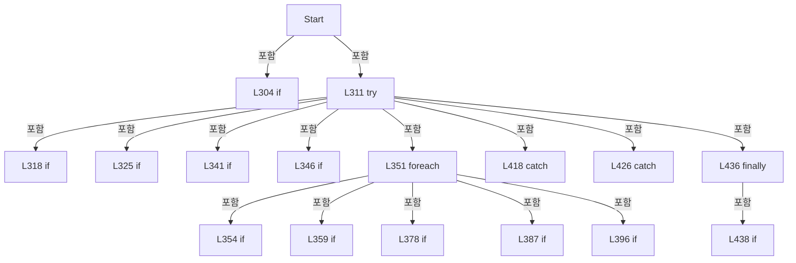

변경 전 점검: 입력/반환 타입, 위 호출자, 예외/취소 경로, 공유 상태와 저장·전송 소비자를 함께 확인합니다. 값의 단위나 물리 방향을 이름만으로 확정하지 않습니다.

### MethodDeclaration `Stop` · L446–456

[Drilling.Common/Review/CReviewManager.cs:446–456](https://github.com/kjuws10-rgb/A3Drilling/blob/28764c91d521777b8ee068dd7aaf2d3902ce9fe2/Drilling.Common/Review/CReviewManager.cs#L446-L456)

| 항목 | 실제 추출 값 |
| --- | --- |
| 서명 | void Drilling.Common.Review.CReviewManager.Stop() |
| 접근/수식자 | Public / public |
| 반환/값 타입 | void |
| 소속 타입 | NamedType:Drilling.Common.Review.CReviewManager |

정적 호출자로 확인된 위치:

| 호출 파일/행 | 호출 표현식 | 런타임 분기 가능 |
| --- | --- | --- |
| [Drilling.UI/CRootView.cs:3069–3069](https://github.com/kjuws10-rgb/A3Drilling/blob/28764c91d521777b8ee068dd7aaf2d3902ce9fe2/Drilling.UI/CRootView.cs#L3069-L3069) | _reviewManager.Stop | False |
| [Drilling.UI/Menu/Menus/CMenuCorrection.ReviewData.Reinspection.cs:336–336](https://github.com/kjuws10-rgb/A3Drilling/blob/28764c91d521777b8ee068dd7aaf2d3902ce9fe2/Drilling.UI/Menu/Menus/CMenuCorrection.ReviewData.Reinspection.cs#L336-L336) | _reviewManager.Stop | False |
| [Drilling.UI/Menu/Menus/CMenuCorrection.ReviewData.Reinspection.cs:664–664](https://github.com/kjuws10-rgb/A3Drilling/blob/28764c91d521777b8ee068dd7aaf2d3902ce9fe2/Drilling.UI/Menu/Menus/CMenuCorrection.ReviewData.Reinspection.cs#L664-L664) | _reviewManager.Stop | False |
| [Drilling.UI/Menu/Menus/CMenuCorrection.cs:2694–2694](https://github.com/kjuws10-rgb/A3Drilling/blob/28764c91d521777b8ee068dd7aaf2d3902ce9fe2/Drilling.UI/Menu/Menus/CMenuCorrection.cs#L2694-L2694) | _reviewManager.Stop | False |
| [Drilling.UI/Menu/Menus/CMenuReview.cs:2491–2491](https://github.com/kjuws10-rgb/A3Drilling/blob/28764c91d521777b8ee068dd7aaf2d3902ce9fe2/Drilling.UI/Menu/Menus/CMenuReview.cs#L2491-L2491) | _reviewManager.Stop | False |
| [Drilling.UI/Menu/Menus/CMenuReview.cs:4449–4449](https://github.com/kjuws10-rgb/A3Drilling/blob/28764c91d521777b8ee068dd7aaf2d3902ce9fe2/Drilling.UI/Menu/Menus/CMenuReview.cs#L4449-L4449) | _reviewManager.Stop | False |

호출하는 대상과 해석 범위:

| 원본 행 | 표현식 | 분석 상태 | 대상/소스 위치 |
| --- | --- | --- | --- |
| 448 | Interlocked.Exchange | resolved | int System.Threading.Interlocked.Exchange(ref int, int) |
| 449 | .Stop | resolved | void Drilling.Common.Review.CReviewManager.CReviewStageMotion.Stop() · Drilling.Common/Review/CReviewManager.cs:2603 |
| 451 | WriteReviewLog | resolved | void Drilling.Common.Review.CReviewManager.WriteReviewLog(string, string) · Drilling.Common/Review/CReviewManager.cs:1029 |

본문의 실제 연산·분기·예외·반환 순서(원문 위치 순):

| 원본 행 | 종류 | 주석 해설 |
| --- | --- | --- |
| 448 | call | 함수·델리게이트 또는 객체 생성자를 호출합니다: Interlocked.Exchange(ref _stopRequested, 1) |
| 449 | call | 함수·델리게이트 또는 객체 생성자를 호출합니다: .Stop() |
| 450 | local-declaration | 지역 변수를 선언합니다: var plan = CurrentPlan; |
| 450 | variable-initializer | 변수의 초기값을 지정합니다: plan = CurrentPlan |
| 451 | call | 함수·델리게이트 또는 객체 생성자를 호출합니다: WriteReviewLog("STOP_REQUEST", "Review stop requested.") |
| 452 | if | 조건에 따라 분기합니다: if (SequenceState == EN_REVIEW_SEQUENCE_STATE.Running) |
| 454 | assignment | 값을 대상에 대입합니다: SequenceState = EN_REVIEW_SEQUENCE_STATE.Stopping |

제어 구문의 포함 구조(실제 실행 순서/CFG가 아닌 구문 탐색 그림):

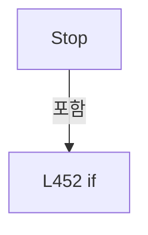

변경 전 점검: 입력/반환 타입, 위 호출자, 예외/취소 경로, 공유 상태와 저장·전송 소비자를 함께 확인합니다. 값의 단위나 물리 방향을 이름만으로 확정하지 않습니다.

### MethodDeclaration `FindIncompleteProductReview` · L458–469

[Drilling.Common/Review/CReviewManager.cs:458–469](https://github.com/kjuws10-rgb/A3Drilling/blob/28764c91d521777b8ee068dd7aaf2d3902ce9fe2/Drilling.Common/Review/CReviewManager.cs#L458-L469)

| 항목 | 실제 추출 값 |
| --- | --- |
| 서명 | System.Threading.Tasks.Task<Drilling.Common.Product.ST_PRODUCT_REVIEW_DATA?> Drilling.Common.Review.CReviewManager.FindIncompleteProductReview(Drilling.Common.Review.ST_REVIEW_PLAN, string, System.Threading.CancellationToken) |
| 접근/수식자 | Public / public |
| 반환/값 타입 | System.Threading.Tasks.Task<Drilling.Common.Product.ST_PRODUCT_REVIEW_DATA?> |
| 소속 타입 | NamedType:Drilling.Common.Review.CReviewManager |

입력 계약:

| 이름 | 타입 | 전달 | 선택/기본값 |
| --- | --- | --- | --- |
| plan | Drilling.Common.Review.ST_REVIEW_PLAN | None | False /  |
| glassId | string | None | False /  |
| cancellationToken | System.Threading.CancellationToken | None | True / null |

정적 호출자로 확인된 위치:

| 호출 파일/행 | 호출 표현식 | 런타임 분기 가능 |
| --- | --- | --- |
| [Drilling.UI/Menu/Menus/CMenuReview.cs:4305–4305](https://github.com/kjuws10-rgb/A3Drilling/blob/28764c91d521777b8ee068dd7aaf2d3902ce9fe2/Drilling.UI/Menu/Menus/CMenuReview.cs#L4305-L4305) | _reviewManager.FindIncompleteProductReview | False |

호출하는 대상과 해석 범위:

| 원본 행 | 표현식 | 분석 상태 | 대상/소스 위치 |
| --- | --- | --- | --- |
| 460 | cancellationToken.ThrowIfCancellationRequested | resolved | void System.Threading.CancellationToken.ThrowIfCancellationRequested() |
| 461 | FindInterruptedReviewCheckpoint | resolved | Drilling.Common.Product.ST_PRODUCT_REVIEW_DATA? Drilling.Common.Review.CReviewManager.FindInterruptedReviewCheckpoint(Drilling.Common.Review.ST_REVIEW_PLAN, string?) · Drilling.Common/Review/CReviewManager.cs:2616 |
| 462 | Task.FromResult<ST_PRODUCT_REVIEW_DATA?> | resolved | System.Threading.Tasks.Task<Drilling.Common.Product.ST_PRODUCT_REVIEW_DATA?> System.Threading.Tasks.Task.FromResult<Drilling.Common.Product.ST_PRODUCT_REVIEW_DATA?>(Drilling.Common.Product.ST_PRODUCT_REVIEW_DATA?) |
| 463 | string.IsNullOrWhiteSpace | resolved | bool string.IsNullOrWhiteSpace(string?) |
| 463 | product.GlassId.Equals | resolved | bool string.Equals(string?, System.StringComparison) |
| 463 | IsMatchingIncompleteReview | resolved | bool Drilling.Common.Review.CReviewManager.IsMatchingIncompleteReview(Drilling.Common.Review.ST_REVIEW_PLAN, string, Drilling.Common.Product.ST_PRODUCT_REVIEW_DATA) · Drilling.Common/Review/CReviewManager.cs:1689 |
| 465 | Task.FromResult<ST_PRODUCT_REVIEW_DATA?> | resolved | System.Threading.Tasks.Task<Drilling.Common.Product.ST_PRODUCT_REVIEW_DATA?> System.Threading.Tasks.Task.FromResult<Drilling.Common.Product.ST_PRODUCT_REVIEW_DATA?>(Drilling.Common.Product.ST_PRODUCT_REVIEW_DATA?) |
| 468 | Task.FromResult<ST_PRODUCT_REVIEW_DATA?> | resolved | System.Threading.Tasks.Task<Drilling.Common.Product.ST_PRODUCT_REVIEW_DATA?> System.Threading.Tasks.Task.FromResult<Drilling.Common.Product.ST_PRODUCT_REVIEW_DATA?>(Drilling.Common.Product.ST_PRODUCT_REVIEW_DATA?) |

본문의 실제 연산·분기·예외·반환 순서(원문 위치 순):

| 원본 행 | 종류 | 주석 해설 |
| --- | --- | --- |
| 460 | call | 함수·델리게이트 또는 객체 생성자를 호출합니다: cancellationToken.ThrowIfCancellationRequested() |
| 461 | call | 함수·델리게이트 또는 객체 생성자를 호출합니다: FindInterruptedReviewCheckpoint(plan, glassId) |
| 461 | if | 조건에 따라 분기합니다: if (FindInterruptedReviewCheckpoint(plan, glassId)is { } interrupted) |
| 462 | call | 함수·델리게이트 또는 객체 생성자를 호출합니다: Task.FromResult<ST_PRODUCT_REVIEW_DATA?>(interrupted) |
| 462 | return | 호출자에게 값 또는 제어를 반환합니다: return Task.FromResult<ST_PRODUCT_REVIEW_DATA?>(interrupted); |
| 463 | call | 함수·델리게이트 또는 객체 생성자를 호출합니다: string.IsNullOrWhiteSpace(glassId) |
| 463 | call | 함수·델리게이트 또는 객체 생성자를 호출합니다: product.GlassId.Equals(glassId, StringComparison.OrdinalIgnoreCase) |
| 463 | call | 함수·델리게이트 또는 객체 생성자를 호출합니다: IsMatchingIncompleteReview(plan, product.RecipeId, product.Review) |
| 463 | if | 조건에 따라 분기합니다: if (string.IsNullOrWhiteSpace(glassId) &#124;&#124; productManager?.Current is not { } product &#124;&#124; !product.GlassId.Equals(glassId, StringComparison.OrdinalIgnoreCase) &#124;&#124; !IsMatchingIncompleteReview(plan, product.RecipeId, product.Revi…) |
| 465 | call | 함수·델리게이트 또는 객체 생성자를 호출합니다: Task.FromResult<ST_PRODUCT_REVIEW_DATA?>(null) |
| 465 | return | 호출자에게 값 또는 제어를 반환합니다: return Task.FromResult<ST_PRODUCT_REVIEW_DATA?>(null); |
| 468 | call | 함수·델리게이트 또는 객체 생성자를 호출합니다: Task.FromResult<ST_PRODUCT_REVIEW_DATA?>(product.Review) |
| 468 | return | 호출자에게 값 또는 제어를 반환합니다: return Task.FromResult<ST_PRODUCT_REVIEW_DATA?>(product.Review); |

제어 구문의 포함 구조(실제 실행 순서/CFG가 아닌 구문 탐색 그림):


변경 전 점검: 입력/반환 타입, 위 호출자, 예외/취소 경로, 공유 상태와 저장·전송 소비자를 함께 확인합니다. 값의 단위나 물리 방향을 이름만으로 확정하지 않습니다.

### MethodDeclaration `GetScannerAxisTransform` · L471–479

[Drilling.Common/Review/CReviewManager.cs:471–479](https://github.com/kjuws10-rgb/A3Drilling/blob/28764c91d521777b8ee068dd7aaf2d3902ce9fe2/Drilling.Common/Review/CReviewManager.cs#L471-L479)

| 항목 | 실제 추출 값 |
| --- | --- |
| 서명 | Drilling.Common.Recipe.ST_SCANNER_AXIS_TRANSFORM Drilling.Common.Review.CReviewManager.GetScannerAxisTransform(int) |
| 접근/수식자 | Public / public |
| 반환/값 타입 | Drilling.Common.Recipe.ST_SCANNER_AXIS_TRANSFORM |
| 소속 타입 | NamedType:Drilling.Common.Review.CReviewManager |

입력 계약:

| 이름 | 타입 | 전달 | 선택/기본값 |
| --- | --- | --- | --- |
| headNo | int | None | False /  |

현재 부분 분석에서 직접 연결된 호출자는 없습니다. XAML/이벤트/인터페이스·델리게이트·외부 진입을 추가 확인해야 하며, 미사용으로 판정한 것이 아닙니다.

호출하는 대상과 해석 범위:

| 원본 행 | 표현식 | 분석 상태 | 대상/소스 위치 |
| --- | --- | --- | --- |
| 475 | new ArgumentOutOfRangeException | resolved | System.ArgumentOutOfRangeException.ArgumentOutOfRangeException(string?, object?, string?) |
| 475 | nameof | unresolved | None |
| 478 | CScannerAxisTransform.Read | resolved | Drilling.Common.Recipe.ST_SCANNER_AXIS_TRANSFORM Drilling.Common.Recipe.CScannerAxisTransform.Read(System.Collections.Generic.IReadOnlyList<Drilling.Common.Managers.ST_SYSTEM_PARAMETER>, int) · Drilling.Common/Recipe/CShotCoordinatePlanBuilder.cs:1269 |
| 478 | settingManager.LoadSection | resolved | System.Collections.Generic.IReadOnlyList<Drilling.Common.Managers.ST_SYSTEM_PARAMETER> Drilling.Common.Managers.CSettingManager.LoadSection(Drilling.Common.Managers.EN_SETTING_TAB, System.Threading.CancellationToken) · Drilling.Common/Managers/CSettingManager.cs:26 |

본문의 실제 연산·분기·예외·반환 순서(원문 위치 순):

| 원본 행 | 종류 | 주석 해설 |
| --- | --- | --- |
| 473 | if | 조건에 따라 분기합니다: if (headNo is < 1 or > DefaultHeadCount) |
| 475 | call | 함수·델리게이트 또는 객체 생성자를 호출합니다: new ArgumentOutOfRangeException(nameof(headNo), headNo, $"Head number must be between 1 and {DefaultHeadCount}.") |
| 475 | call | 함수·델리게이트 또는 객체 생성자를 호출합니다: nameof(headNo) |
| 475 | throw | 예외를 발생/전달합니다: throw new ArgumentOutOfRangeException(nameof(headNo), headNo, $"Head number must be between 1 and {DefaultHeadCount}."); |
| 478 | call | 함수·델리게이트 또는 객체 생성자를 호출합니다: CScannerAxisTransform.Read(settingManager.LoadSection(EN_SETTING_TAB.Option), headNo) |
| 478 | call | 함수·델리게이트 또는 객체 생성자를 호출합니다: settingManager.LoadSection(EN_SETTING_TAB.Option) |
| 478 | return | 호출자에게 값 또는 제어를 반환합니다: return CScannerAxisTransform.Read(settingManager.LoadSection(EN_SETTING_TAB.Option), headNo); |

제어 구문의 포함 구조(실제 실행 순서/CFG가 아닌 구문 탐색 그림):


변경 전 점검: 입력/반환 타입, 위 호출자, 예외/취소 경로, 공유 상태와 저장·전송 소비자를 함께 확인합니다. 값의 단위나 물리 방향을 이름만으로 확정하지 않습니다.

### MethodDeclaration `RetryRemaining` · L481–499

[Drilling.Common/Review/CReviewManager.cs:481–499](https://github.com/kjuws10-rgb/A3Drilling/blob/28764c91d521777b8ee068dd7aaf2d3902ce9fe2/Drilling.Common/Review/CReviewManager.cs#L481-L499)

| 항목 | 실제 추출 값 |
| --- | --- |
| 서명 | System.Threading.Tasks.Task<Drilling.Common.Review.ST_REVIEW_SEQUENCE_STATUS> Drilling.Common.Review.CReviewManager.RetryRemaining(System.Action<Drilling.Common.Review.ST_REVIEW_PLAN>?, System.Threading.CancellationToken) |
| 접근/수식자 | Public / public, async |
| 반환/값 타입 | System.Threading.Tasks.Task<Drilling.Common.Review.ST_REVIEW_SEQUENCE_STATUS> |
| 소속 타입 | NamedType:Drilling.Common.Review.CReviewManager |

입력 계약:

| 이름 | 타입 | 전달 | 선택/기본값 |
| --- | --- | --- | --- |
| progress | System.Action<Drilling.Common.Review.ST_REVIEW_PLAN>? | None | True / null |
| cancellationToken | System.Threading.CancellationToken | None | True / null |

정적 호출자로 확인된 위치:

| 호출 파일/행 | 호출 표현식 | 런타임 분기 가능 |
| --- | --- | --- |
| [Drilling.UI/Menu/Menus/CMenuReview.cs:4476–4476](https://github.com/kjuws10-rgb/A3Drilling/blob/28764c91d521777b8ee068dd7aaf2d3902ce9fe2/Drilling.UI/Menu/Menus/CMenuReview.cs#L4476-L4476) | _reviewManager.RetryRemaining | False |

호출하는 대상과 해석 범위:

| 원본 행 | 표현식 | 분석 상태 | 대상/소스 위치 |
| --- | --- | --- | --- |
| 486 | new ST_REVIEW_SEQUENCE_STATUS | resolved | Drilling.Common.Review.ST_REVIEW_SEQUENCE_STATUS.ST_REVIEW_SEQUENCE_STATUS(Drilling.Common.Review.EN_REVIEW_SEQUENCE_STATE, int, int, int, string) · Drilling.Common/Review/CReviewManager.cs:4066 |
| 489 | SetWaitingPointsReady | resolved | Drilling.Common.Review.ST_REVIEW_PLAN Drilling.Common.Review.CReviewManager.SetWaitingPointsReady(Drilling.Common.Review.ST_REVIEW_PLAN) · Drilling.Common/Review/CReviewManager.cs:1096 |
| 490 | SetCurrentPlan | resolved | void Drilling.Common.Review.CReviewManager.SetCurrentPlan(Drilling.Common.Review.ST_REVIEW_PLAN, System.Action<Drilling.Common.Review.ST_REVIEW_PLAN>?) · Drilling.Common/Review/CReviewManager.cs:1052 |
| 491 | plan.ReviewPoints.Where | resolved | System.Collections.Generic.IEnumerable<Drilling.Common.Review.ST_REVIEW_PLAN_POINT> System.Collections.Generic.IEnumerable<Drilling.Common.Review.ST_REVIEW_PLAN_POINT>.Where<Drilling.Common.Review.ST_REVIEW_PLAN_POINT>(System.Func<Drilling.Common.Review.ST_REVIEW_PLAN_POINT, bool>) |
| 492 | OrderByReviewSequence(points).ToArray | resolved | Drilling.Common.Review.ST_REVIEW_PLAN_POINT[] System.Collections.Generic.IEnumerable<Drilling.Common.Review.ST_REVIEW_PLAN_POINT>.ToArray<Drilling.Common.Review.ST_REVIEW_PLAN_POINT>() |
| 492 | OrderByReviewSequence | resolved | System.Collections.Generic.IReadOnlyList<Drilling.Common.Review.ST_REVIEW_PLAN_POINT> Drilling.Common.Review.CReviewManager.OrderByReviewSequence(System.Collections.Generic.IEnumerable<Drilling.Common.Review.ST_REVIEW_PLAN_POINT>) · Drilling.Common/Review/CReviewManager.cs:1185 |
| 495 | CreateStatus | resolved | Drilling.Common.Review.ST_REVIEW_SEQUENCE_STATUS Drilling.Common.Review.CReviewManager.CreateStatus(Drilling.Common.Review.ST_REVIEW_PLAN, Drilling.Common.Review.EN_REVIEW_SEQUENCE_STATE, string) · Drilling.Common/Review/CReviewManager.cs:1122 |
| 498 | RunRetryPoints | resolved | System.Threading.Tasks.Task<Drilling.Common.Review.ST_REVIEW_SEQUENCE_STATUS> Drilling.Common.Review.CReviewManager.RunRetryPoints(System.Collections.Generic.IReadOnlyList<Drilling.Common.Review.ST_REVIEW_PLAN_POINT>, string, System.Action<Drilling.Common.Review.ST_REVIEW_PLAN>?, System.Threading.CancellationToken) · Drilling.Common/Review/CReviewManager.cs:2424 |

본문의 실제 연산·분기·예외·반환 순서(원문 위치 순):

| 원본 행 | 종류 | 주석 해설 |
| --- | --- | --- |
| 483 | local-declaration | 지역 변수를 선언합니다: var plan = CurrentPlan; |
| 483 | variable-initializer | 변수의 초기값을 지정합니다: plan = CurrentPlan |
| 484 | if | 조건에 따라 분기합니다: if (plan is null) |
| 486 | call | 함수·델리게이트 또는 객체 생성자를 호출합니다: new ST_REVIEW_SEQUENCE_STATUS(EN_REVIEW_SEQUENCE_STATE.Idle, 0, 0, 0, "Review plan is empty.") |
| 486 | return | 호출자에게 값 또는 제어를 반환합니다: return new ST_REVIEW_SEQUENCE_STATUS(EN_REVIEW_SEQUENCE_STATE.Idle, 0, 0, 0, "Review plan is empty."); |
| 489 | assignment | 값을 대상에 대입합니다: plan = SetWaitingPointsReady(plan) |
| 489 | call | 함수·델리게이트 또는 객체 생성자를 호출합니다: SetWaitingPointsReady(plan) |
| 490 | call | 함수·델리게이트 또는 객체 생성자를 호출합니다: SetCurrentPlan(plan, progress) |
| 491 | call | 함수·델리게이트 또는 객체 생성자를 호출합니다: plan.ReviewPoints.Where(point => point.State == EN_REVIEW_POINT_STATE.Ready) |
| 491 | local-declaration | 지역 변수를 선언합니다: var points = plan.ReviewPoints.Where(point => point.State == EN_REVIEW_POINT_STATE.Ready); |
| 491 | variable-initializer | 변수의 초기값을 지정합니다: points = plan.ReviewPoints.Where(point => point.State == EN_REVIEW_POINT_STATE.Ready) |
| 492 | call | 함수·델리게이트 또는 객체 생성자를 호출합니다: OrderByReviewSequence(points).ToArray() |
| 492 | call | 함수·델리게이트 또는 객체 생성자를 호출합니다: OrderByReviewSequence(points) |
| 492 | local-declaration | 지역 변수를 선언합니다: var orderedPoints = OrderByReviewSequence(points).ToArray(); |
| 492 | variable-initializer | 변수의 초기값을 지정합니다: orderedPoints = OrderByReviewSequence(points).ToArray() |
| 493 | if | 조건에 따라 분기합니다: if (orderedPoints.Length == 0) |
| 495 | call | 함수·델리게이트 또는 객체 생성자를 호출합니다: CreateStatus(plan, SequenceState, "Ready review point is empty.") |
| 495 | return | 호출자에게 값 또는 제어를 반환합니다: return CreateStatus(plan, SequenceState, "Ready review point is empty."); |
| 498 | await | 비동기 완료를 기다립니다: await RunRetryPoints(orderedPoints, "Review ready point retry completed.", progress, cancellationToken) |
| 498 | call | 함수·델리게이트 또는 객체 생성자를 호출합니다: RunRetryPoints(orderedPoints, "Review ready point retry completed.", progress, cancellationToken) |
| 498 | return | 호출자에게 값 또는 제어를 반환합니다: return await RunRetryPoints(orderedPoints, "Review ready point retry completed.", progress, cancellationToken); |

제어 구문의 포함 구조(실제 실행 순서/CFG가 아닌 구문 탐색 그림):

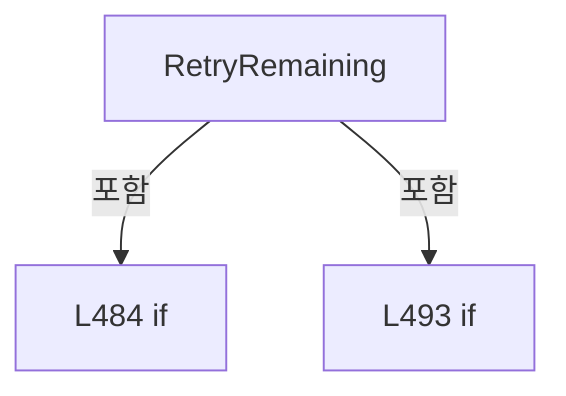

변경 전 점검: 입력/반환 타입, 위 호출자, 예외/취소 경로, 공유 상태와 저장·전송 소비자를 함께 확인합니다. 값의 단위나 물리 방향을 이름만으로 확정하지 않습니다.

### MethodDeclaration `CreatePlanCore` · L501–556

[Drilling.Common/Review/CReviewManager.cs:501–556](https://github.com/kjuws10-rgb/A3Drilling/blob/28764c91d521777b8ee068dd7aaf2d3902ce9fe2/Drilling.Common/Review/CReviewManager.cs#L501-L556)

| 항목 | 실제 추출 값 |
| --- | --- |
| 서명 | Drilling.Common.Review.ST_REVIEW_PLAN Drilling.Common.Review.CReviewManager.CreatePlanCore(Drilling.Common.Managers.ST_RECIPE_DEFINITION, System.Func<Drilling.Common.Review.ST_REVIEW_PLAN_POINT, bool>, int, bool, double, double) |
| 접근/수식자 | Private / private |
| 반환/값 타입 | Drilling.Common.Review.ST_REVIEW_PLAN |
| 소속 타입 | NamedType:Drilling.Common.Review.CReviewManager |

입력 계약:

| 이름 | 타입 | 전달 | 선택/기본값 |
| --- | --- | --- | --- |
| recipe | Drilling.Common.Managers.ST_RECIPE_DEFINITION | None | False /  |
| useSelector | System.Func<Drilling.Common.Review.ST_REVIEW_PLAN_POINT, bool> | None | False /  |
| selectedBeamNo | int | None | True / 1 |
| selectAllAssignedPoints | bool | None | True / false |
| shiftOffsetX | double | None | True / 0 |
| shiftOffsetY | double | None | True / 0 |

정적 호출자로 확인된 위치:

| 호출 파일/행 | 호출 표현식 | 런타임 분기 가능 |
| --- | --- | --- |
| [Drilling.Common/Review/CReviewManager.cs:211–211](https://github.com/kjuws10-rgb/A3Drilling/blob/28764c91d521777b8ee068dd7aaf2d3902ce9fe2/Drilling.Common/Review/CReviewManager.cs#L211-L211) | CreatePlanCore | False |

호출하는 대상과 해석 범위:

| 원본 행 | 표현식 | 분석 상태 | 대상/소스 위치 |
| --- | --- | --- | --- |
| 511 | ReadRequiredCellCount | resolved | int Drilling.Common.Review.CReviewManager.ReadRequiredCellCount(Drilling.Common.Managers.ST_RECIPE_DEFINITION, string) · Drilling.Common/Review/CReviewManager.cs:1293 |
| 512 | ReadDouble | resolved | double Drilling.Common.Review.CReviewManager.ReadDouble(Drilling.Common.Managers.ST_RECIPE_DEFINITION, double, params string[]) · Drilling.Common/Review/CReviewManager.cs:1322 |
| 513 | ReadDouble | resolved | double Drilling.Common.Review.CReviewManager.ReadDouble(Drilling.Common.Managers.ST_RECIPE_DEFINITION, double, params string[]) · Drilling.Common/Review/CReviewManager.cs:1322 |
| 514 | LoadReviewCoordinateSettings | resolved | Drilling.Common.Review.CReviewManager.ST_REVIEW_COORDINATE_SETTINGS Drilling.Common.Review.CReviewManager.LoadReviewCoordinateSettings(Drilling.Common.Managers.ST_RECIPE_DEFINITION) · Drilling.Common/Review/CReviewManager.cs:600 |
| 515 | BuildRuntimeCoordinateParameters | resolved | System.Collections.Generic.IReadOnlyDictionary<string, string> Drilling.Common.Review.CReviewManager.BuildRuntimeCoordinateParameters(Drilling.Common.Managers.ST_RECIPE_DEFINITION) · Drilling.Common/Review/CReviewManager.cs:576 |
| 516 | settingManager.GetAlignKeyMargins | resolved | Drilling.Common.Managers.ST_ALIGN_KEY_MARGINS Drilling.Common.Managers.CSettingManager.GetAlignKeyMargins(System.Threading.CancellationToken) · Drilling.Common/Managers/CSettingManager.cs:116 |
| 517 | CShotCoordinatePlanBuilder.ReadDirection | resolved | double Drilling.Common.Recipe.CShotCoordinatePlanBuilder.ReadDirection(System.Collections.Generic.IReadOnlyDictionary<string, string>, double, params string[]) · Drilling.Common/Recipe/CShotCoordinatePlanBuilder.cs:509 |
| 518 | CShotCoordinatePlanBuilder.Build | resolved | Drilling.Common.Recipe.ST_SHOT_COORDINATE_PLAN Drilling.Common.Recipe.CShotCoordinatePlanBuilder.Build(System.Collections.Generic.IReadOnlyDictionary<string, string>) · Drilling.Common/Recipe/CShotCoordinatePlanBuilder.cs:11 |
| 519 | BuildReviewExcludedShots | resolved | System.Collections.Generic.IReadOnlyDictionary<string, string> Drilling.Common.Review.CReviewManager.BuildReviewExcludedShots(System.Collections.Generic.IReadOnlyDictionary<string, string>, System.Collections.Generic.IReadOnlyList<Drilling.Common.Recipe.ST_HEAD_SHOT_POINT>) · Drilling.Common/Review/CReviewManager.cs:558 |
| 520 | processCoordinatePlan.Shots.GroupBy(shot => (shot.CellNo, shot.CellShotNo)).ToDictionary | resolved | System.Collections.Generic.Dictionary<(int CellNo, int CellShotNo), int> System.Collections.Generic.IEnumerable<System.Linq.IGrouping<(int CellNo, int CellShotNo), Drilling.Common.Recipe.ST_HEAD_SHOT_POINT>>.ToDictionary<System.Linq.IGrouping<(int CellNo, int CellShotNo), Drilling.Common.Recipe.ST_HEAD_SHOT_POINT>, (int CellNo, int CellShotNo), int>(System.Func<System.Linq.IGrouping<(int CellNo, int CellShotNo), Drilling.Common.Recipe.ST_HEAD_SHOT_POINT>, (int CellNo, int CellShotNo)>, System.Func<System.Linq.IGrouping<(int CellNo, int CellShotNo), Drilling.Common.Recipe.ST_HEAD_SHOT_POINT>, int>) |
| 520 | processCoordinatePlan.Shots.GroupBy | resolved | System.Collections.Generic.IEnumerable<System.Linq.IGrouping<(int CellNo, int CellShotNo), Drilling.Common.Recipe.ST_HEAD_SHOT_POINT>> System.Collections.Generic.IEnumerable<Drilling.Common.Recipe.ST_HEAD_SHOT_POINT>.GroupBy<Drilling.Common.Recipe.ST_HEAD_SHOT_POINT, (int CellNo, int CellShotNo)>(System.Func<Drilling.Common.Recipe.ST_HEAD_SHOT_POINT, (int CellNo, int CellShotNo)>) |
| 520 | group.Last | resolved | Drilling.Common.Recipe.ST_HEAD_SHOT_POINT System.Collections.Generic.IEnumerable<Drilling.Common.Recipe.ST_HEAD_SHOT_POINT>.Last<Drilling.Common.Recipe.ST_HEAD_SHOT_POINT>() |
| 521 | BuildShotPoints | resolved | System.Collections.Generic.IReadOnlyList<Drilling.Common.Review.ST_REVIEW_PLAN_POINT> Drilling.Common.Review.CReviewManager.BuildShotPoints(Drilling.Common.Managers.ST_RECIPE_DEFINITION, Drilling.Common.Managers.ST_ALIGN_KEY_MARGINS, int, int, Drilling.Common.Review.CReviewManager.ST_REVIEW_COORDINATE_SETTINGS, System.Collections.Generic.IReadOnlyDictionary<(int CellNo, int CellShotNo), int>, double, int, bool, System.Collections.Generic.IReadOnlyDictionary<string, string>, double, double) · Drilling.Common/Review/CReviewManager.cs:680 |
| 536 | points.Select(point => { var use = point.HeadNo > 0 && !excludedShots.ContainsKey(point.ShotKey) && useSelector(point); return point with { BeamNo = selectedBeamNo, Use = use, State = use ? EN_REVIEW_POINT_STATE.Ready : EN_REVIEW_POINT_STATE.Skip, Judge = use ? "WAIT" : "-" }; }).ToArray | resolved | Drilling.Common.Review.ST_REVIEW_PLAN_POINT[] System.Collections.Generic.IEnumerable<Drilling.Common.Review.ST_REVIEW_PLAN_POINT>.ToArray<Drilling.Common.Review.ST_REVIEW_PLAN_POINT>() |
| 536 | points.Select | resolved | System.Collections.Generic.IEnumerable<Drilling.Common.Review.ST_REVIEW_PLAN_POINT> System.Collections.Generic.IEnumerable<Drilling.Common.Review.ST_REVIEW_PLAN_POINT>.Select<Drilling.Common.Review.ST_REVIEW_PLAN_POINT, Drilling.Common.Review.ST_REVIEW_PLAN_POINT>(System.Func<Drilling.Common.Review.ST_REVIEW_PLAN_POINT, Drilling.Common.Review.ST_REVIEW_PLAN_POINT>) |
| 538 | excludedShots.ContainsKey | resolved · 동적 구현 선택 가능 | bool System.Collections.Generic.IReadOnlyDictionary<string, string>.ContainsKey(string) |
| 538 | useSelector | resolved · 동적 구현 선택 가능 | bool System.Func<Drilling.Common.Review.ST_REVIEW_PLAN_POINT, bool>.Invoke(Drilling.Common.Review.ST_REVIEW_PLAN_POINT) |
| 549 | new ST_REVIEW_PLAN | resolved | Drilling.Common.Review.ST_REVIEW_PLAN.ST_REVIEW_PLAN(string, int, double, double, Drilling.Common.Review.EN_VISION_FLIP_TYPE, System.DateTimeOffset, System.Collections.Generic.IReadOnlyList<Drilling.Common.Review.ST_REVIEW_PLAN_POINT>) · Drilling.Common/Review/CReviewManager.cs:4165 |
| 552 | ReadDouble | resolved | double Drilling.Common.Review.CReviewManager.ReadDouble(Drilling.Common.Managers.ST_RECIPE_DEFINITION, double, params string[]) · Drilling.Common/Review/CReviewManager.cs:1322 |

본문의 실제 연산·분기·예외·반환 순서(원문 위치 순):

| 원본 행 | 종류 | 주석 해설 |
| --- | --- | --- |
| 510 | local-declaration | 지역 변수를 선언합니다: const int headCount = DefaultHeadCount; |
| 510 | variable-initializer | 변수의 초기값을 지정합니다: headCount = DefaultHeadCount |
| 511 | call | 함수·델리게이트 또는 객체 생성자를 호출합니다: ReadRequiredCellCount(recipe, "MAX_CELL_NUMBER") |
| 511 | local-declaration | 지역 변수를 선언합니다: var cellCount = ReadRequiredCellCount(recipe, "MAX_CELL_NUMBER"); |
| 511 | variable-initializer | 변수의 초기값을 지정합니다: cellCount = ReadRequiredCellCount(recipe, "MAX_CELL_NUMBER") |
| 512 | call | 함수·델리게이트 또는 객체 생성자를 호출합니다: ReadDouble(recipe, 0.030, "REVIEW_TOLERANCE_X") |
| 512 | local-declaration | 지역 변수를 선언합니다: var toleranceX = ReadDouble(recipe, 0.030, "REVIEW_TOLERANCE_X"); |
| 512 | variable-initializer | 변수의 초기값을 지정합니다: toleranceX = ReadDouble(recipe, 0.030, "REVIEW_TOLERANCE_X") |
| 513 | call | 함수·델리게이트 또는 객체 생성자를 호출합니다: ReadDouble(recipe, 0.030, "REVIEW_TOLERANCE_Y") |
| 513 | local-declaration | 지역 변수를 선언합니다: var toleranceY = ReadDouble(recipe, 0.030, "REVIEW_TOLERANCE_Y"); |
| 513 | variable-initializer | 변수의 초기값을 지정합니다: toleranceY = ReadDouble(recipe, 0.030, "REVIEW_TOLERANCE_Y") |
| 514 | call | 함수·델리게이트 또는 객체 생성자를 호출합니다: LoadReviewCoordinateSettings(recipe) |
| 514 | local-declaration | 지역 변수를 선언합니다: var coordinateSettings = LoadReviewCoordinateSettings(recipe); |
| 514 | variable-initializer | 변수의 초기값을 지정합니다: coordinateSettings = LoadReviewCoordinateSettings(recipe) |
| 515 | call | 함수·델리게이트 또는 객체 생성자를 호출합니다: BuildRuntimeCoordinateParameters(recipe) |
| 515 | local-declaration | 지역 변수를 선언합니다: var runtimeCoordinateParameters = BuildRuntimeCoordinateParameters(recipe); |
| 515 | variable-initializer | 변수의 초기값을 지정합니다: runtimeCoordinateParameters = BuildRuntimeCoordinateParameters(recipe) |
| 516 | call | 함수·델리게이트 또는 객체 생성자를 호출합니다: settingManager.GetAlignKeyMargins() |
| 516 | local-declaration | 지역 변수를 선언합니다: var alignKeyMargins = settingManager.GetAlignKeyMargins(); |
| 516 | variable-initializer | 변수의 초기값을 지정합니다: alignKeyMargins = settingManager.GetAlignKeyMargins() |
| 517 | call | 함수·델리게이트 또는 객체 생성자를 호출합니다: CShotCoordinatePlanBuilder.ReadDirection(runtimeCoordinateParameters, -1.0, "STAGE_SCAN_DIRECTION_Y") |
| 517 | local-declaration | 지역 변수를 선언합니다: var stageScanDirectionY = CShotCoordinatePlanBuilder.ReadDirection(runtimeCoordinateParameters, -1.0, "STAGE_SCAN_DIRECTION_Y"); |
| 517 | variable-initializer | 변수의 초기값을 지정합니다: stageScanDirectionY = CShotCoordinatePlanBuilder.ReadDirection(runtimeCoordinateParameters, -1.0, "STAGE_SCAN_DIRECTION_Y") |
| 518 | call | 함수·델리게이트 또는 객체 생성자를 호출합니다: CShotCoordinatePlanBuilder.Build(runtimeCoordinateParameters) |
| 518 | local-declaration | 지역 변수를 선언합니다: var processCoordinatePlan = CShotCoordinatePlanBuilder.Build(runtimeCoordinateParameters); |
| 518 | variable-initializer | 변수의 초기값을 지정합니다: processCoordinatePlan = CShotCoordinatePlanBuilder.Build(runtimeCoordinateParameters) |
| 519 | call | 함수·델리게이트 또는 객체 생성자를 호출합니다: BuildReviewExcludedShots(runtimeCoordinateParameters, processCoordinatePlan.Shots) |
| 519 | local-declaration | 지역 변수를 선언합니다: var excludedShots = BuildReviewExcludedShots(runtimeCoordinateParameters, processCoordinatePlan.Shots); |
| 519 | variable-initializer | 변수의 초기값을 지정합니다: excludedShots = BuildReviewExcludedShots(runtimeCoordinateParameters, processCoordinatePlan.Shots) |
| 520 | call | 함수·델리게이트 또는 객체 생성자를 호출합니다: processCoordinatePlan.Shots.GroupBy(shot => (shot.CellNo, shot.CellShotNo)).ToDictionary(group => group.Key, group => group.Last().HeadNo) |
| 520 | call | 함수·델리게이트 또는 객체 생성자를 호출합니다: processCoordinatePlan.Shots.GroupBy(shot => (shot.CellNo, shot.CellShotNo)) |
| 520 | call | 함수·델리게이트 또는 객체 생성자를 호출합니다: group.Last() |
| 520 | local-declaration | 지역 변수를 선언합니다: var assignedHeadNos = processCoordinatePlan.Shots.GroupBy(shot => (shot.CellNo, shot.CellShotNo)).ToDictionary(group => group.Key, group => group.Last().HeadNo); |
| 520 | variable-initializer | 변수의 초기값을 지정합니다: assignedHeadNos = processCoordinatePlan.Shots.GroupBy(shot => (shot.CellNo, shot.CellShotNo)).ToDictionary(group => group.Key, group => group.Last().HeadNo) |
| 521 | call | 함수·델리게이트 또는 객체 생성자를 호출합니다: BuildShotPoints( recipe, alignKeyMargins, headCount, cellCount, coordinateSettings, assignedHeadNos, stageScanDirectionY, selectedBeamNo, selectAllAssignedPoints, excludedShots, shiftOffsetX, shiftOffsetY) |
| 521 | local-declaration | 지역 변수를 선언합니다: IReadOnlyList<ST_REVIEW_PLAN_POINT> points = BuildShotPoints( recipe, alignKeyMargins, headCount, cellCount, coordinateSettings, assignedHeadNos, stageScanDirectionY, selectedBeamNo, selectAllAssignedPoints, excludedShots, shiftOf |
| 521 | variable-initializer | 변수의 초기값을 지정합니다: points = BuildShotPoints( recipe, alignKeyMargins, headCount, cellCount, coordinateSettings, assignedHeadNos, stageScanDirectionY, selectedBeamNo, selectAllAssignedPoints, excludedShots, shiftOffsetX, shiftOffsetY) |
| 534 | if | 조건에 따라 분기합니다: if (!selectAllAssignedPoints) |
| 536 | assignment | 값을 대상에 대입합니다: points = points.Select(point => { var use = point.HeadNo > 0 && !excludedShots.ContainsKey(point.ShotKey) && useSelector(point); return point with { BeamNo = selectedBeamNo, Use = use, State = use ? EN_REVIEW_POINT_STATE.Ready : E |
| 536 | call | 함수·델리게이트 또는 객체 생성자를 호출합니다: points.Select(point => { var use = point.HeadNo > 0 && !excludedShots.ContainsKey(point.ShotKey) && useSelector(point); return point with { BeamNo = selectedBeamNo, Use = use, State = use ? EN_REVIEW_POINT_STATE.Ready : … |
| 536 | call | 함수·델리게이트 또는 객체 생성자를 호출합니다: points.Select(point => { var use = point.HeadNo > 0 && !excludedShots.ContainsKey(point.ShotKey) && useSelector(point); return point with { BeamNo = selectedBeamNo, Use = use, State = use ? EN_REVIEW_POINT_STATE.Ready : … |
| 538 | call | 함수·델리게이트 또는 객체 생성자를 호출합니다: excludedShots.ContainsKey(point.ShotKey) |
| 538 | call | 함수·델리게이트 또는 객체 생성자를 호출합니다: useSelector(point) |
| 538 | local-declaration | 지역 변수를 선언합니다: var use = point.HeadNo > 0 && !excludedShots.ContainsKey(point.ShotKey) && useSelector(point); |
| 538 | variable-initializer | 변수의 초기값을 지정합니다: use = point.HeadNo > 0 && !excludedShots.ContainsKey(point.ShotKey) && useSelector(point) |
| 539 | return | 호출자에게 값 또는 제어를 반환합니다: return point with { BeamNo = selectedBeamNo, Use = use, State = use ? EN_REVIEW_POINT_STATE.Ready : EN_REVIEW_POINT_STATE.Skip, Judge = use ? "WAIT" : "-" }; |
| 541 | assignment | 값을 대상에 대입합니다: BeamNo = selectedBeamNo |
| 542 | assignment | 값을 대상에 대입합니다: Use = use |
| 543 | assignment | 값을 대상에 대입합니다: State = use ? EN_REVIEW_POINT_STATE.Ready : EN_REVIEW_POINT_STATE.Skip |
| 543 | conditional-expression | 조건에 따라 결과식을 선택합니다: use ? EN_REVIEW_POINT_STATE.Ready : EN_REVIEW_POINT_STATE.Skip |
| 544 | assignment | 값을 대상에 대입합니다: Judge = use ? "WAIT" : "-" |
| 544 | conditional-expression | 조건에 따라 결과식을 선택합니다: use ? "WAIT" : "-" |
| 549 | call | 함수·델리게이트 또는 객체 생성자를 호출합니다: new ST_REVIEW_PLAN(recipe.Id, cellCount, toleranceX, toleranceY, coordinateSettings.VisionFlipType, DateTimeOffset.Now, points) { StageScanDirectionY = stageScanDirectionY, StageSpeed = ReadDouble(recipe, 0, "STAGE_SPEED… |
| 549 | return | 호출자에게 값 또는 제어를 반환합니다: return new ST_REVIEW_PLAN(recipe.Id, cellCount, toleranceX, toleranceY, coordinateSettings.VisionFlipType, DateTimeOffset.Now, points) { StageScanDirectionY = stageScanDirectionY, StageSpeed = ReadDouble(recipe, 0, "STAGE_SPEED"), |
| 551 | assignment | 값을 대상에 대입합니다: StageScanDirectionY = stageScanDirectionY |
| 552 | assignment | 값을 대상에 대입합니다: StageSpeed = ReadDouble(recipe, 0, "STAGE_SPEED") |
| 552 | call | 함수·델리게이트 또는 객체 생성자를 호출합니다: ReadDouble(recipe, 0, "STAGE_SPEED") |
| 553 | assignment | 값을 대상에 대입합니다: ShiftOffsetX = shiftOffsetX |
| 554 | assignment | 값을 대상에 대입합니다: ShiftOffsetY = shiftOffsetY |

제어 구문의 포함 구조(실제 실행 순서/CFG가 아닌 구문 탐색 그림):


변경 전 점검: 입력/반환 타입, 위 호출자, 예외/취소 경로, 공유 상태와 저장·전송 소비자를 함께 확인합니다. 값의 단위나 물리 방향을 이름만으로 확정하지 않습니다.

### MethodDeclaration `BuildReviewExcludedShots` · L558–574

[Drilling.Common/Review/CReviewManager.cs:558–574](https://github.com/kjuws10-rgb/A3Drilling/blob/28764c91d521777b8ee068dd7aaf2d3902ce9fe2/Drilling.Common/Review/CReviewManager.cs#L558-L574)

| 항목 | 실제 추출 값 |
| --- | --- |
| 서명 | System.Collections.Generic.IReadOnlyDictionary<string, string> Drilling.Common.Review.CReviewManager.BuildReviewExcludedShots(System.Collections.Generic.IReadOnlyDictionary<string, string>, System.Collections.Generic.IReadOnlyList<Drilling.Common.Recipe.ST_HEAD_SHOT_POINT>) |
| 접근/수식자 | Private / private, static |
| 반환/값 타입 | System.Collections.Generic.IReadOnlyDictionary<string, string> |
| 소속 타입 | NamedType:Drilling.Common.Review.CReviewManager |

입력 계약:

| 이름 | 타입 | 전달 | 선택/기본값 |
| --- | --- | --- | --- |
| runtimeCoordinateParameters | System.Collections.Generic.IReadOnlyDictionary<string, string> | None | False /  |
| processShots | System.Collections.Generic.IReadOnlyList<Drilling.Common.Recipe.ST_HEAD_SHOT_POINT> | None | False /  |

정적 호출자로 확인된 위치:

| 호출 파일/행 | 호출 표현식 | 런타임 분기 가능 |
| --- | --- | --- |
| [Drilling.Common/Review/CReviewManager.cs:519–519](https://github.com/kjuws10-rgb/A3Drilling/blob/28764c91d521777b8ee068dd7aaf2d3902ce9fe2/Drilling.Common/Review/CReviewManager.cs#L519-L519) | BuildReviewExcludedShots | False |

호출하는 대상과 해석 범위:

| 원본 행 | 표현식 | 분석 상태 | 대상/소스 위치 |
| --- | --- | --- | --- |
| 560 | CRecipeShotMaskingPlan.Build | resolved | Drilling.Common.Recipe.CRecipeShotMaskingPlan Drilling.Common.Recipe.CRecipeShotMaskingPlan.Build(System.Collections.Generic.IReadOnlyDictionary<string, string>) · Drilling.Common/Recipe/CShotCoordinatePlanBuilder.cs:836 |
| 561 | new Dictionary<string, string> | resolved | System.Collections.Generic.Dictionary<string, string>.Dictionary(System.Collections.Generic.IEqualityComparer<string>?) |
| 564 | maskingPlan.EvaluateShot | resolved | Drilling.Common.Recipe.ST_RECIPE_SHOT_MASKING_RESULT Drilling.Common.Recipe.CRecipeShotMaskingPlan.EvaluateShot(Drilling.Common.Recipe.ST_HEAD_SHOT_POINT) · Drilling.Common/Recipe/CShotCoordinatePlanBuilder.cs:876 |
| 570 | NormalizeShotKey | resolved | string Drilling.Common.Review.CReviewManager.NormalizeShotKey(string) · Drilling.Common/Review/CReviewManager.cs:1245 |

본문의 실제 연산·분기·예외·반환 순서(원문 위치 순):

| 원본 행 | 종류 | 주석 해설 |
| --- | --- | --- |
| 560 | call | 함수·델리게이트 또는 객체 생성자를 호출합니다: CRecipeShotMaskingPlan.Build(runtimeCoordinateParameters) |
| 560 | local-declaration | 지역 변수를 선언합니다: var maskingPlan = CRecipeShotMaskingPlan.Build(runtimeCoordinateParameters); |
| 560 | variable-initializer | 변수의 초기값을 지정합니다: maskingPlan = CRecipeShotMaskingPlan.Build(runtimeCoordinateParameters) |
| 561 | call | 함수·델리게이트 또는 객체 생성자를 호출합니다: new Dictionary<string, string>(StringComparer.OrdinalIgnoreCase) |
| 561 | local-declaration | 지역 변수를 선언합니다: var excludedShots = new Dictionary<string, string>(StringComparer.OrdinalIgnoreCase); |
| 561 | variable-initializer | 변수의 초기값을 지정합니다: excludedShots = new Dictionary<string, string>(StringComparer.OrdinalIgnoreCase) |
| 562 | foreach | 컬렉션 요소를 순회합니다: foreach (var shot in processShots) |
| 564 | call | 함수·델리게이트 또는 객체 생성자를 호출합니다: maskingPlan.EvaluateShot(shot) |
| 564 | local-declaration | 지역 변수를 선언합니다: var exclusion = maskingPlan.EvaluateShot(shot); |
| 564 | variable-initializer | 변수의 초기값을 지정합니다: exclusion = maskingPlan.EvaluateShot(shot) |
| 565 | if | 조건에 따라 분기합니다: if (!exclusion.ShouldSkipLaser) |
| 567 | continue | 다음 반복으로 진행합니다: continue; |
| 570 | assignment | 값을 대상에 대입합니다: excludedShots[NormalizeShotKey(shot.ShotKey)] = exclusion.IsMasked && exclusion.IsChessSkipped ? "MASKING + CHESS" : exclusion.IsMasked ? "MASKING" : "CHESS" |
| 570 | call | 함수·델리게이트 또는 객체 생성자를 호출합니다: NormalizeShotKey(shot.ShotKey) |
| 570 | conditional-expression | 조건에 따라 결과식을 선택합니다: exclusion.IsMasked && exclusion.IsChessSkipped ? "MASKING + CHESS" : exclusion.IsMasked ? "MASKING" : "CHESS" |
| 570 | conditional-expression | 조건에 따라 결과식을 선택합니다: exclusion.IsMasked ? "MASKING" : "CHESS" |
| 573 | return | 호출자에게 값 또는 제어를 반환합니다: return excludedShots; |

제어 구문의 포함 구조(실제 실행 순서/CFG가 아닌 구문 탐색 그림):

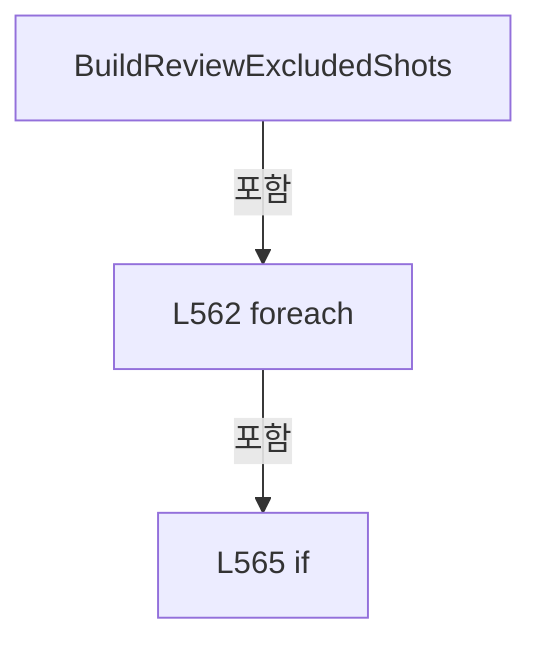

변경 전 점검: 입력/반환 타입, 위 호출자, 예외/취소 경로, 공유 상태와 저장·전송 소비자를 함께 확인합니다. 값의 단위나 물리 방향을 이름만으로 확정하지 않습니다.

### MethodDeclaration `BuildRuntimeCoordinateParameters` · L576–598

[Drilling.Common/Review/CReviewManager.cs:576–598](https://github.com/kjuws10-rgb/A3Drilling/blob/28764c91d521777b8ee068dd7aaf2d3902ce9fe2/Drilling.Common/Review/CReviewManager.cs#L576-L598)

| 항목 | 실제 추출 값 |
| --- | --- |
| 서명 | System.Collections.Generic.IReadOnlyDictionary<string, string> Drilling.Common.Review.CReviewManager.BuildRuntimeCoordinateParameters(Drilling.Common.Managers.ST_RECIPE_DEFINITION) |
| 접근/수식자 | Private / private |
| 반환/값 타입 | System.Collections.Generic.IReadOnlyDictionary<string, string> |
| 소속 타입 | NamedType:Drilling.Common.Review.CReviewManager |

입력 계약:

| 이름 | 타입 | 전달 | 선택/기본값 |
| --- | --- | --- | --- |
| recipe | Drilling.Common.Managers.ST_RECIPE_DEFINITION | None | False /  |

정적 호출자로 확인된 위치:

| 호출 파일/행 | 호출 표현식 | 런타임 분기 가능 |
| --- | --- | --- |
| [Drilling.Common/Review/CReviewManager.cs:515–515](https://github.com/kjuws10-rgb/A3Drilling/blob/28764c91d521777b8ee068dd7aaf2d3902ce9fe2/Drilling.Common/Review/CReviewManager.cs#L515-L515) | BuildRuntimeCoordinateParameters | False |

호출하는 대상과 해석 범위:

| 원본 행 | 표현식 | 분석 상태 | 대상/소스 위치 |
| --- | --- | --- | --- |
| 578 | recipe.Parameters.Where(parameter => !string.IsNullOrWhiteSpace(parameter.Key)).GroupBy(parameter => parameter.Key, StringComparer.OrdinalIgnoreCase).ToDictionary | resolved | System.Collections.Generic.Dictionary<string, string> System.Collections.Generic.IEnumerable<System.Linq.IGrouping<string, Drilling.Common.Managers.ST_RECIPE_PARAMETER>>.ToDictionary<System.Linq.IGrouping<string, Drilling.Common.Managers.ST_RECIPE_PARAMETER>, string, string>(System.Func<System.Linq.IGrouping<string, Drilling.Common.Managers.ST_RECIPE_PARAMETER>, string>, System.Func<System.Linq.IGrouping<string, Drilling.Common.Managers.ST_RECIPE_PARAMETER>, string>, System.Collections.Generic.IEqualityComparer<string>?) |
| 578 | recipe.Parameters.Where(parameter => !string.IsNullOrWhiteSpace(parameter.Key)).GroupBy | resolved | System.Collections.Generic.IEnumerable<System.Linq.IGrouping<string, Drilling.Common.Managers.ST_RECIPE_PARAMETER>> System.Collections.Generic.IEnumerable<Drilling.Common.Managers.ST_RECIPE_PARAMETER>.GroupBy<Drilling.Common.Managers.ST_RECIPE_PARAMETER, string>(System.Func<Drilling.Common.Managers.ST_RECIPE_PARAMETER, string>, System.Collections.Generic.IEqualityComparer<string>?) |
| 578 | recipe.Parameters.Where | resolved | System.Collections.Generic.IEnumerable<Drilling.Common.Managers.ST_RECIPE_PARAMETER> System.Collections.Generic.IEnumerable<Drilling.Common.Managers.ST_RECIPE_PARAMETER>.Where<Drilling.Common.Managers.ST_RECIPE_PARAMETER>(System.Func<Drilling.Common.Managers.ST_RECIPE_PARAMETER, bool>) |
| 578 | string.IsNullOrWhiteSpace | resolved | bool string.IsNullOrWhiteSpace(string?) |
| 578 | group.Last | resolved | Drilling.Common.Managers.ST_RECIPE_PARAMETER System.Collections.Generic.IEnumerable<Drilling.Common.Managers.ST_RECIPE_PARAMETER>.Last<Drilling.Common.Managers.ST_RECIPE_PARAMETER>() |
| 588 | settingManager.LoadSection | resolved | System.Collections.Generic.IReadOnlyList<Drilling.Common.Managers.ST_SYSTEM_PARAMETER> Drilling.Common.Managers.CSettingManager.LoadSection(Drilling.Common.Managers.EN_SETTING_TAB, System.Threading.CancellationToken) · Drilling.Common/Managers/CSettingManager.cs:26 |
| 590 | string.IsNullOrWhiteSpace | resolved | bool string.IsNullOrWhiteSpace(string?) |

본문의 실제 연산·분기·예외·반환 순서(원문 위치 순):

| 원본 행 | 종류 | 주석 해설 |
| --- | --- | --- |
| 578 | call | 함수·델리게이트 또는 객체 생성자를 호출합니다: recipe.Parameters.Where(parameter => !string.IsNullOrWhiteSpace(parameter.Key)).GroupBy(parameter => parameter.Key, StringComparer.OrdinalIgnoreCase).ToDictionary(group => group.Key, group => group.Last().Value, StringCo… |
| 578 | call | 함수·델리게이트 또는 객체 생성자를 호출합니다: recipe.Parameters.Where(parameter => !string.IsNullOrWhiteSpace(parameter.Key)).GroupBy(parameter => parameter.Key, StringComparer.OrdinalIgnoreCase) |
| 578 | call | 함수·델리게이트 또는 객체 생성자를 호출합니다: recipe.Parameters.Where(parameter => !string.IsNullOrWhiteSpace(parameter.Key)) |
| 578 | call | 함수·델리게이트 또는 객체 생성자를 호출합니다: string.IsNullOrWhiteSpace(parameter.Key) |
| 578 | call | 함수·델리게이트 또는 객체 생성자를 호출합니다: group.Last() |
| 578 | local-declaration | 지역 변수를 선언합니다: var parameters = recipe.Parameters.Where(parameter => !string.IsNullOrWhiteSpace(parameter.Key)).GroupBy(parameter => parameter.Key, StringComparer.OrdinalIgnoreCase).ToDictionary(group => group.Key, group => group.Last().Value, S |
| 578 | variable-initializer | 변수의 초기값을 지정합니다: parameters = recipe.Parameters.Where(parameter => !string.IsNullOrWhiteSpace(parameter.Key)).GroupBy(parameter => parameter.Key, StringComparer.OrdinalIgnoreCase).ToDictionary(group => group.Key, group => group.Last().Value, Strin |
| 580 | foreach | 컬렉션 요소를 순회합니다: foreach (var tab in new[] { EN_SETTING_TAB.Option, EN_SETTING_TAB.Motor }) |
| 588 | call | 함수·델리게이트 또는 객체 생성자를 호출합니다: settingManager.LoadSection(tab) |
| 588 | foreach | 컬렉션 요소를 순회합니다: foreach (var setting in settingManager.LoadSection(tab)) |
| 590 | call | 함수·델리게이트 또는 객체 생성자를 호출합니다: string.IsNullOrWhiteSpace(setting.Key) |
| 590 | if | 조건에 따라 분기합니다: if (!string.IsNullOrWhiteSpace(setting.Key)) |
| 592 | assignment | 값을 대상에 대입합니다: parameters[setting.Key] = setting.Value |
| 597 | return | 호출자에게 값 또는 제어를 반환합니다: return parameters; |

제어 구문의 포함 구조(실제 실행 순서/CFG가 아닌 구문 탐색 그림):

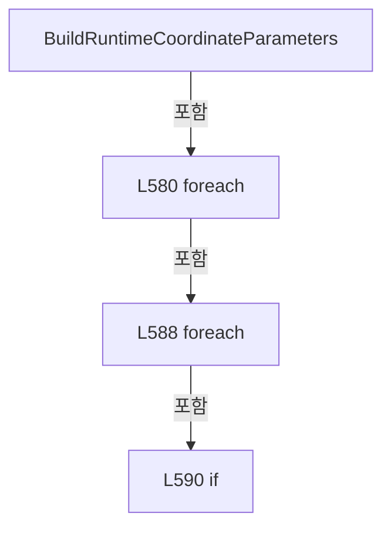

변경 전 점검: 입력/반환 타입, 위 호출자, 예외/취소 경로, 공유 상태와 저장·전송 소비자를 함께 확인합니다. 값의 단위나 물리 방향을 이름만으로 확정하지 않습니다.

### MethodDeclaration `LoadReviewCoordinateSettings` · L600–615

[Drilling.Common/Review/CReviewManager.cs:600–615](https://github.com/kjuws10-rgb/A3Drilling/blob/28764c91d521777b8ee068dd7aaf2d3902ce9fe2/Drilling.Common/Review/CReviewManager.cs#L600-L615)

| 항목 | 실제 추출 값 |
| --- | --- |
| 서명 | Drilling.Common.Review.CReviewManager.ST_REVIEW_COORDINATE_SETTINGS Drilling.Common.Review.CReviewManager.LoadReviewCoordinateSettings(Drilling.Common.Managers.ST_RECIPE_DEFINITION) |
| 접근/수식자 | Private / private |
| 반환/값 타입 | Drilling.Common.Review.CReviewManager.ST_REVIEW_COORDINATE_SETTINGS |
| 소속 타입 | NamedType:Drilling.Common.Review.CReviewManager |

입력 계약:

| 이름 | 타입 | 전달 | 선택/기본값 |
| --- | --- | --- | --- |
| recipe | Drilling.Common.Managers.ST_RECIPE_DEFINITION | None | False /  |

정적 호출자로 확인된 위치:

| 호출 파일/행 | 호출 표현식 | 런타임 분기 가능 |
| --- | --- | --- |
| [Drilling.Common/Review/CReviewManager.cs:286–286](https://github.com/kjuws10-rgb/A3Drilling/blob/28764c91d521777b8ee068dd7aaf2d3902ce9fe2/Drilling.Common/Review/CReviewManager.cs#L286-L286) | LoadReviewCoordinateSettings | False |
| [Drilling.Common/Review/CReviewManager.cs:514–514](https://github.com/kjuws10-rgb/A3Drilling/blob/28764c91d521777b8ee068dd7aaf2d3902ce9fe2/Drilling.Common/Review/CReviewManager.cs#L514-L514) | LoadReviewCoordinateSettings | False |

호출하는 대상과 해석 범위:

| 원본 행 | 표현식 | 분석 상태 | 대상/소스 위치 |
| --- | --- | --- | --- |
| 602 | settingManager.LoadSection | resolved | System.Collections.Generic.IReadOnlyList<Drilling.Common.Managers.ST_SYSTEM_PARAMETER> Drilling.Common.Managers.CSettingManager.LoadSection(Drilling.Common.Managers.EN_SETTING_TAB, System.Threading.CancellationToken) · Drilling.Common/Managers/CSettingManager.cs:26 |
| 603 | CReviewManager.ParseVisionFlipType | resolved | Drilling.Common.Review.EN_VISION_FLIP_TYPE Drilling.Common.Review.CReviewManager.ParseVisionFlipType(string?, string?, string?) · Drilling.Common/Review/CReviewManager.cs:3746 |
| 603 | ReadSettingText | resolved | string Drilling.Common.Review.CReviewManager.ReadSettingText(System.Collections.Generic.IReadOnlyList<Drilling.Common.Managers.ST_SYSTEM_PARAMETER>, string, params string[]) · Drilling.Common/Review/CReviewManager.cs:665 |
| 603 | ReadSettingText | resolved | string Drilling.Common.Review.CReviewManager.ReadSettingText(System.Collections.Generic.IReadOnlyList<Drilling.Common.Managers.ST_SYSTEM_PARAMETER>, string, params string[]) · Drilling.Common/Review/CReviewManager.cs:665 |
| 603 | ReadSettingText | resolved | string Drilling.Common.Review.CReviewManager.ReadSettingText(System.Collections.Generic.IReadOnlyList<Drilling.Common.Managers.ST_SYSTEM_PARAMETER>, string, params string[]) · Drilling.Common/Review/CReviewManager.cs:665 |
| 604 | Enumerable.Range(1, 8).Select(headNo => { var position = ReadHeadPositionX(optionSettings, headNo); const double fallbackWidthX = 110.0; var widthX = ReadSettingDouble(optionSettings, fallbackWidthX, $"H{headNo:00}_SCAN_FIELD_WIDTH_X", $"H{headNo:00}_HEAD_FIELD_WIDTH_X"); return new ST_REVIEW_HEAD_FIELD(headNo, position, widthX > 0.0 ? widthX : fal… | resolved | Drilling.Common.Review.CReviewManager.ST_REVIEW_HEAD_FIELD[] System.Collections.Generic.IEnumerable<Drilling.Common.Review.CReviewManager.ST_REVIEW_HEAD_FIELD>.ToArray<Drilling.Common.Review.CReviewManager.ST_REVIEW_HEAD_FIELD>() |
| 604 | Enumerable.Range(1, 8).Select | resolved | System.Collections.Generic.IEnumerable<Drilling.Common.Review.CReviewManager.ST_REVIEW_HEAD_FIELD> System.Collections.Generic.IEnumerable<int>.Select<int, Drilling.Common.Review.CReviewManager.ST_REVIEW_HEAD_FIELD>(System.Func<int, Drilling.Common.Review.CReviewManager.ST_REVIEW_HEAD_FIELD>) |
| 604 | Enumerable.Range | resolved | System.Collections.Generic.IEnumerable<int> System.Linq.Enumerable.Range(int, int) |
| 606 | ReadHeadPositionX | resolved | double Drilling.Common.Review.CReviewManager.ReadHeadPositionX(System.Collections.Generic.IReadOnlyList<Drilling.Common.Managers.ST_SYSTEM_PARAMETER>, int) · Drilling.Common/Review/CReviewManager.cs:617 |
| 608 | ReadSettingDouble | resolved | double Drilling.Common.Review.CReviewManager.ReadSettingDouble(System.Collections.Generic.IReadOnlyList<Drilling.Common.Managers.ST_SYSTEM_PARAMETER>, double, params string[]) · Drilling.Common/Review/CReviewManager.cs:626 |
| 609 | new ST_REVIEW_HEAD_FIELD | resolved | Drilling.Common.Review.CReviewManager.ST_REVIEW_HEAD_FIELD.ST_REVIEW_HEAD_FIELD(int, double, double) · Drilling.Common/Review/CReviewManager.cs:1238 |
| 613 | headFields.Where(field => ReadSettingBoolean(optionSettings, true, $"H{field.HeadNo:00}_USE")).Select(field => field.HeadNo).ToArray | resolved | int[] System.Collections.Generic.IEnumerable<int>.ToArray<int>() |
| 613 | headFields.Where(field => ReadSettingBoolean(optionSettings, true, $"H{field.HeadNo:00}_USE")).Select | resolved | System.Collections.Generic.IEnumerable<int> System.Collections.Generic.IEnumerable<Drilling.Common.Review.CReviewManager.ST_REVIEW_HEAD_FIELD>.Select<Drilling.Common.Review.CReviewManager.ST_REVIEW_HEAD_FIELD, int>(System.Func<Drilling.Common.Review.CReviewManager.ST_REVIEW_HEAD_FIELD, int>) |
| 613 | headFields.Where | resolved | System.Collections.Generic.IEnumerable<Drilling.Common.Review.CReviewManager.ST_REVIEW_HEAD_FIELD> System.Collections.Generic.IEnumerable<Drilling.Common.Review.CReviewManager.ST_REVIEW_HEAD_FIELD>.Where<Drilling.Common.Review.CReviewManager.ST_REVIEW_HEAD_FIELD>(System.Func<Drilling.Common.Review.CReviewManager.ST_REVIEW_HEAD_FIELD, bool>) |
| 613 | ReadSettingBoolean | resolved | bool Drilling.Common.Review.CReviewManager.ReadSettingBoolean(System.Collections.Generic.IReadOnlyList<Drilling.Common.Managers.ST_SYSTEM_PARAMETER>, bool, params string[]) · Drilling.Common/Review/CReviewManager.cs:644 |
| 614 | new ST_REVIEW_COORDINATE_SETTINGS | resolved | Drilling.Common.Review.CReviewManager.ST_REVIEW_COORDINATE_SETTINGS.ST_REVIEW_COORDINATE_SETTINGS(Drilling.Common.Review.CReviewManager.ST_REVIEW_HEAD_LAYOUT, System.Collections.Generic.IReadOnlyList<int>, Drilling.Common.Review.EN_VISION_FLIP_TYPE) · Drilling.Common/Review/CReviewManager.cs:1239 |
| 614 | new ST_REVIEW_HEAD_LAYOUT | resolved | Drilling.Common.Review.CReviewManager.ST_REVIEW_HEAD_LAYOUT.ST_REVIEW_HEAD_LAYOUT(System.Collections.Generic.IReadOnlyList<Drilling.Common.Review.CReviewManager.ST_REVIEW_HEAD_FIELD>) · Drilling.Common/Review/CReviewManager.cs:1230 |

본문의 실제 연산·분기·예외·반환 순서(원문 위치 순):

| 원본 행 | 종류 | 주석 해설 |
| --- | --- | --- |
| 602 | call | 함수·델리게이트 또는 객체 생성자를 호출합니다: settingManager.LoadSection(EN_SETTING_TAB.Option) |
| 602 | local-declaration | 지역 변수를 선언합니다: var optionSettings = settingManager.LoadSection(EN_SETTING_TAB.Option); |
| 602 | variable-initializer | 변수의 초기값을 지정합니다: optionSettings = settingManager.LoadSection(EN_SETTING_TAB.Option) |
| 603 | call | 함수·델리게이트 또는 객체 생성자를 호출합니다: CReviewManager.ParseVisionFlipType(ReadSettingText(optionSettings, "", "VisionXFlip"), ReadSettingText(optionSettings, "", "VisionYFlip"), ReadSettingText(optionSettings, "", "VisionXyFlip")) |
| 603 | call | 함수·델리게이트 또는 객체 생성자를 호출합니다: ReadSettingText(optionSettings, "", "VisionXFlip") |
| 603 | call | 함수·델리게이트 또는 객체 생성자를 호출합니다: ReadSettingText(optionSettings, "", "VisionYFlip") |
| 603 | call | 함수·델리게이트 또는 객체 생성자를 호출합니다: ReadSettingText(optionSettings, "", "VisionXyFlip") |
| 603 | local-declaration | 지역 변수를 선언합니다: var visionFlipType = CReviewManager.ParseVisionFlipType(ReadSettingText(optionSettings, "", "VisionXFlip"), ReadSettingText(optionSettings, "", "VisionYFlip"), ReadSettingText(optionSettings, "", "VisionXyFlip")); |
| 603 | variable-initializer | 변수의 초기값을 지정합니다: visionFlipType = CReviewManager.ParseVisionFlipType(ReadSettingText(optionSettings, "", "VisionXFlip"), ReadSettingText(optionSettings, "", "VisionYFlip"), ReadSettingText(optionSettings, "", "VisionXyFlip")) |
| 604 | call | 함수·델리게이트 또는 객체 생성자를 호출합니다: Enumerable.Range(1, 8) |
| 604 | call | 함수·델리게이트 또는 객체 생성자를 호출합니다: Enumerable.Range(1, 8).Select(headNo => { var position = ReadHeadPositionX(optionSettings, headNo); const double fallbackWidthX = 110.0; var widthX = ReadSettingDouble(optionSettings, fallbackWidthX, $"H{headNo:00}_SCAN_… |
| 604 | call | 함수·델리게이트 또는 객체 생성자를 호출합니다: Enumerable.Range(1, 8).Select(headNo => { var position = ReadHeadPositionX(optionSettings, headNo); const double fallbackWidthX = 110.0; var widthX = ReadSettingDouble(optionSettings, fallbackWidthX, $"H{headNo:00}_SCAN_… |
| 604 | local-declaration | 지역 변수를 선언합니다: var headFields = Enumerable.Range(1, 8).Select(headNo => { var position = ReadHeadPositionX(optionSettings, headNo); const double fallbackWidthX = 110.0; var widthX = ReadSettingDouble(optionSettings, fallbackWidthX, $"H{headNo:00 |
| 604 | variable-initializer | 변수의 초기값을 지정합니다: headFields = Enumerable.Range(1, 8).Select(headNo => { var position = ReadHeadPositionX(optionSettings, headNo); const double fallbackWidthX = 110.0; var widthX = ReadSettingDouble(optionSettings, fallbackWidthX, $"H{headNo:00}_SC |
| 606 | call | 함수·델리게이트 또는 객체 생성자를 호출합니다: ReadHeadPositionX(optionSettings, headNo) |
| 606 | local-declaration | 지역 변수를 선언합니다: var position = ReadHeadPositionX(optionSettings, headNo); |
| 606 | variable-initializer | 변수의 초기값을 지정합니다: position = ReadHeadPositionX(optionSettings, headNo) |
| 607 | local-declaration | 지역 변수를 선언합니다: const double fallbackWidthX = 110.0; |
| 607 | variable-initializer | 변수의 초기값을 지정합니다: fallbackWidthX = 110.0 |
| 608 | call | 함수·델리게이트 또는 객체 생성자를 호출합니다: ReadSettingDouble(optionSettings, fallbackWidthX, $"H{headNo:00}_SCAN_FIELD_WIDTH_X", $"H{headNo:00}_HEAD_FIELD_WIDTH_X") |
| 608 | local-declaration | 지역 변수를 선언합니다: var widthX = ReadSettingDouble(optionSettings, fallbackWidthX, $"H{headNo:00}_SCAN_FIELD_WIDTH_X", $"H{headNo:00}_HEAD_FIELD_WIDTH_X"); |
| 608 | variable-initializer | 변수의 초기값을 지정합니다: widthX = ReadSettingDouble(optionSettings, fallbackWidthX, $"H{headNo:00}_SCAN_FIELD_WIDTH_X", $"H{headNo:00}_HEAD_FIELD_WIDTH_X") |
| 609 | call | 함수·델리게이트 또는 객체 생성자를 호출합니다: new ST_REVIEW_HEAD_FIELD(headNo, position, widthX > 0.0 ? widthX : fallbackWidthX) |
| 609 | conditional-expression | 조건에 따라 결과식을 선택합니다: widthX > 0.0 ? widthX : fallbackWidthX |
| 609 | return | 호출자에게 값 또는 제어를 반환합니다: return new ST_REVIEW_HEAD_FIELD(headNo, position, widthX > 0.0 ? widthX : fallbackWidthX); |
| 613 | call | 함수·델리게이트 또는 객체 생성자를 호출합니다: headFields.Where(field => ReadSettingBoolean(optionSettings, true, $"H{field.HeadNo:00}_USE")).Select(field => field.HeadNo).ToArray() |
| 613 | call | 함수·델리게이트 또는 객체 생성자를 호출합니다: headFields.Where(field => ReadSettingBoolean(optionSettings, true, $"H{field.HeadNo:00}_USE")).Select(field => field.HeadNo) |
| 613 | call | 함수·델리게이트 또는 객체 생성자를 호출합니다: headFields.Where(field => ReadSettingBoolean(optionSettings, true, $"H{field.HeadNo:00}_USE")) |
| 613 | call | 함수·델리게이트 또는 객체 생성자를 호출합니다: ReadSettingBoolean(optionSettings, true, $"H{field.HeadNo:00}_USE") |
| 613 | local-declaration | 지역 변수를 선언합니다: var activeHeadNos = headFields.Where(field => ReadSettingBoolean(optionSettings, true, $"H{field.HeadNo:00}_USE")).Select(field => field.HeadNo).ToArray(); |
| 613 | variable-initializer | 변수의 초기값을 지정합니다: activeHeadNos = headFields.Where(field => ReadSettingBoolean(optionSettings, true, $"H{field.HeadNo:00}_USE")).Select(field => field.HeadNo).ToArray() |
| 614 | call | 함수·델리게이트 또는 객체 생성자를 호출합니다: new ST_REVIEW_COORDINATE_SETTINGS(new ST_REVIEW_HEAD_LAYOUT(headFields), activeHeadNos, visionFlipType) |
| 614 | call | 함수·델리게이트 또는 객체 생성자를 호출합니다: new ST_REVIEW_HEAD_LAYOUT(headFields) |
| 614 | return | 호출자에게 값 또는 제어를 반환합니다: return new ST_REVIEW_COORDINATE_SETTINGS(new ST_REVIEW_HEAD_LAYOUT(headFields), activeHeadNos, visionFlipType); |

변경 전 점검: 입력/반환 타입, 위 호출자, 예외/취소 경로, 공유 상태와 저장·전송 소비자를 함께 확인합니다. 값의 단위나 물리 방향을 이름만으로 확정하지 않습니다.

### MethodDeclaration `ReadHeadPositionX` · L617–624

[Drilling.Common/Review/CReviewManager.cs:617–624](https://github.com/kjuws10-rgb/A3Drilling/blob/28764c91d521777b8ee068dd7aaf2d3902ce9fe2/Drilling.Common/Review/CReviewManager.cs#L617-L624)

| 항목 | 실제 추출 값 |
| --- | --- |
| 서명 | double Drilling.Common.Review.CReviewManager.ReadHeadPositionX(System.Collections.Generic.IReadOnlyList<Drilling.Common.Managers.ST_SYSTEM_PARAMETER>, int) |
| 접근/수식자 | Private / private, static |
| 반환/값 타입 | double |
| 소속 타입 | NamedType:Drilling.Common.Review.CReviewManager |

입력 계약:

| 이름 | 타입 | 전달 | 선택/기본값 |
| --- | --- | --- | --- |
| settings | System.Collections.Generic.IReadOnlyList<Drilling.Common.Managers.ST_SYSTEM_PARAMETER> | None | False /  |
| headNo | int | None | False /  |

정적 호출자로 확인된 위치:

| 호출 파일/행 | 호출 표현식 | 런타임 분기 가능 |
| --- | --- | --- |
| [Drilling.Common/Review/CReviewManager.cs:606–606](https://github.com/kjuws10-rgb/A3Drilling/blob/28764c91d521777b8ee068dd7aaf2d3902ce9fe2/Drilling.Common/Review/CReviewManager.cs#L606-L606) | ReadHeadPositionX | False |

호출하는 대상과 해석 범위:

| 원본 행 | 표현식 | 분석 상태 | 대상/소스 위치 |
| --- | --- | --- | --- |
| 621 | ReadSettingDouble | resolved | double Drilling.Common.Review.CReviewManager.ReadSettingDouble(System.Collections.Generic.IReadOnlyList<Drilling.Common.Managers.ST_SYSTEM_PARAMETER>, double, params string[]) · Drilling.Common/Review/CReviewManager.cs:626 |
| 622 | ReadSettingDouble | resolved | double Drilling.Common.Review.CReviewManager.ReadSettingDouble(System.Collections.Generic.IReadOnlyList<Drilling.Common.Managers.ST_SYSTEM_PARAMETER>, double, params string[]) · Drilling.Common/Review/CReviewManager.cs:626 |

본문의 실제 연산·분기·예외·반환 순서(원문 위치 순):

| 원본 행 | 종류 | 주석 해설 |
| --- | --- | --- |
| 619 | local-declaration | 지역 변수를 선언합니다: const double fallbackHead1PositionX = -5.0; |
| 619 | variable-initializer | 변수의 초기값을 지정합니다: fallbackHead1PositionX = -5.0 |
| 620 | local-declaration | 지역 변수를 선언합니다: const double fallbackHeadGapX = 200.0; |
| 620 | variable-initializer | 변수의 초기값을 지정합니다: fallbackHeadGapX = 200.0 |
| 621 | call | 함수·델리게이트 또는 객체 생성자를 호출합니다: ReadSettingDouble(settings, fallbackHead1PositionX, "H01_AK_POSITION_X") |
| 621 | local-declaration | 지역 변수를 선언합니다: var head1PositionX = ReadSettingDouble(settings, fallbackHead1PositionX, "H01_AK_POSITION_X"); |
| 621 | variable-initializer | 변수의 초기값을 지정합니다: head1PositionX = ReadSettingDouble(settings, fallbackHead1PositionX, "H01_AK_POSITION_X") |
| 622 | call | 함수·델리게이트 또는 객체 생성자를 호출합니다: ReadSettingDouble(settings, fallbackHeadGapX, "HeadGapX") |
| 622 | local-declaration | 지역 변수를 선언합니다: var headGapX = ReadSettingDouble(settings, fallbackHeadGapX, "HeadGapX"); |
| 622 | variable-initializer | 변수의 초기값을 지정합니다: headGapX = ReadSettingDouble(settings, fallbackHeadGapX, "HeadGapX") |
| 623 | return | 호출자에게 값 또는 제어를 반환합니다: return head1PositionX + ((headNo - 1) * headGapX); |

변경 전 점검: 입력/반환 타입, 위 호출자, 예외/취소 경로, 공유 상태와 저장·전송 소비자를 함께 확인합니다. 값의 단위나 물리 방향을 이름만으로 확정하지 않습니다.

### MethodDeclaration `ReadSettingDouble` · L626–642

[Drilling.Common/Review/CReviewManager.cs:626–642](https://github.com/kjuws10-rgb/A3Drilling/blob/28764c91d521777b8ee068dd7aaf2d3902ce9fe2/Drilling.Common/Review/CReviewManager.cs#L626-L642)

| 항목 | 실제 추출 값 |
| --- | --- |
| 서명 | double Drilling.Common.Review.CReviewManager.ReadSettingDouble(System.Collections.Generic.IReadOnlyList<Drilling.Common.Managers.ST_SYSTEM_PARAMETER>, double, params string[]) |
| 접근/수식자 | Private / private, static |
| 반환/값 타입 | double |
| 소속 타입 | NamedType:Drilling.Common.Review.CReviewManager |

입력 계약:

| 이름 | 타입 | 전달 | 선택/기본값 |
| --- | --- | --- | --- |
| settings | System.Collections.Generic.IReadOnlyList<Drilling.Common.Managers.ST_SYSTEM_PARAMETER> | None | False /  |
| defaultValue | double | None | False /  |
| keys | string[] | None | False /  |

정적 호출자로 확인된 위치:

| 호출 파일/행 | 호출 표현식 | 런타임 분기 가능 |
| --- | --- | --- |
| [Drilling.Common/Review/CReviewManager.cs:608–608](https://github.com/kjuws10-rgb/A3Drilling/blob/28764c91d521777b8ee068dd7aaf2d3902ce9fe2/Drilling.Common/Review/CReviewManager.cs#L608-L608) | ReadSettingDouble | False |
| [Drilling.Common/Review/CReviewManager.cs:621–621](https://github.com/kjuws10-rgb/A3Drilling/blob/28764c91d521777b8ee068dd7aaf2d3902ce9fe2/Drilling.Common/Review/CReviewManager.cs#L621-L621) | ReadSettingDouble | False |
| [Drilling.Common/Review/CReviewManager.cs:622–622](https://github.com/kjuws10-rgb/A3Drilling/blob/28764c91d521777b8ee068dd7aaf2d3902ce9fe2/Drilling.Common/Review/CReviewManager.cs#L622-L622) | ReadSettingDouble | False |

호출하는 대상과 해석 범위:

| 원본 행 | 표현식 | 분석 상태 | 대상/소스 위치 |
| --- | --- | --- | --- |
| 630 | keys.Any | resolved | bool System.Collections.Generic.IEnumerable<string>.Any<string>(System.Func<string, bool>) |
| 630 | key.Equals | resolved | bool string.Equals(string?, System.StringComparison) |
| 630 | key.Equals | resolved | bool string.Equals(string?, System.StringComparison) |
| 635 | double.TryParse | resolved | bool double.TryParse(string?, System.Globalization.NumberStyles, System.IFormatProvider?, out double) |

본문의 실제 연산·분기·예외·반환 순서(원문 위치 순):

| 원본 행 | 종류 | 주석 해설 |
| --- | --- | --- |
| 628 | foreach | 컬렉션 요소를 순회합니다: foreach (var setting in settings) |
| 630 | call | 함수·델리게이트 또는 객체 생성자를 호출합니다: keys.Any(key => key.Equals(setting.Key, StringComparison.OrdinalIgnoreCase) &#124;&#124; key.Equals(setting.Name, StringComparison.OrdinalIgnoreCase)) |
| 630 | call | 함수·델리게이트 또는 객체 생성자를 호출합니다: key.Equals(setting.Key, StringComparison.OrdinalIgnoreCase) |
| 630 | call | 함수·델리게이트 또는 객체 생성자를 호출합니다: key.Equals(setting.Name, StringComparison.OrdinalIgnoreCase) |
| 630 | if | 조건에 따라 분기합니다: if (!keys.Any(key => key.Equals(setting.Key, StringComparison.OrdinalIgnoreCase) &#124;&#124; key.Equals(setting.Name, StringComparison.OrdinalIgnoreCase))) |
| 632 | continue | 다음 반복으로 진행합니다: continue; |
| 635 | call | 함수·델리게이트 또는 객체 생성자를 호출합니다: double.TryParse(setting.Value, NumberStyles.Float, CultureInfo.InvariantCulture, out var parsed) |
| 635 | if | 조건에 따라 분기합니다: if (double.TryParse(setting.Value, NumberStyles.Float, CultureInfo.InvariantCulture, out var parsed)) |
| 637 | return | 호출자에게 값 또는 제어를 반환합니다: return parsed; |
| 641 | return | 호출자에게 값 또는 제어를 반환합니다: return defaultValue; |

제어 구문의 포함 구조(실제 실행 순서/CFG가 아닌 구문 탐색 그림):

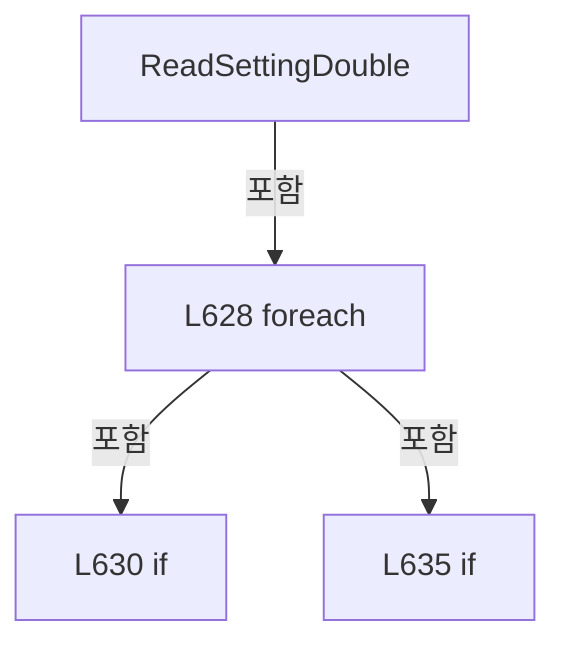

변경 전 점검: 입력/반환 타입, 위 호출자, 예외/취소 경로, 공유 상태와 저장·전송 소비자를 함께 확인합니다. 값의 단위나 물리 방향을 이름만으로 확정하지 않습니다.

### MethodDeclaration `ReadSettingBoolean` · L644–663

[Drilling.Common/Review/CReviewManager.cs:644–663](https://github.com/kjuws10-rgb/A3Drilling/blob/28764c91d521777b8ee068dd7aaf2d3902ce9fe2/Drilling.Common/Review/CReviewManager.cs#L644-L663)

| 항목 | 실제 추출 값 |
| --- | --- |
| 서명 | bool Drilling.Common.Review.CReviewManager.ReadSettingBoolean(System.Collections.Generic.IReadOnlyList<Drilling.Common.Managers.ST_SYSTEM_PARAMETER>, bool, params string[]) |
| 접근/수식자 | Private / private, static |
| 반환/값 타입 | bool |
| 소속 타입 | NamedType:Drilling.Common.Review.CReviewManager |

입력 계약:

| 이름 | 타입 | 전달 | 선택/기본값 |
| --- | --- | --- | --- |
| settings | System.Collections.Generic.IReadOnlyList<Drilling.Common.Managers.ST_SYSTEM_PARAMETER> | None | False /  |
| defaultValue | bool | None | False /  |
| keys | string[] | None | False /  |

정적 호출자로 확인된 위치:

| 호출 파일/행 | 호출 표현식 | 런타임 분기 가능 |
| --- | --- | --- |
| [Drilling.Common/Review/CReviewManager.cs:613–613](https://github.com/kjuws10-rgb/A3Drilling/blob/28764c91d521777b8ee068dd7aaf2d3902ce9fe2/Drilling.Common/Review/CReviewManager.cs#L613-L613) | ReadSettingBoolean | False |

호출하는 대상과 해석 범위:

| 원본 행 | 표현식 | 분석 상태 | 대상/소스 위치 |
| --- | --- | --- | --- |
| 646 | ReadSettingText | resolved | string Drilling.Common.Review.CReviewManager.ReadSettingText(System.Collections.Generic.IReadOnlyList<Drilling.Common.Managers.ST_SYSTEM_PARAMETER>, string, params string[]) · Drilling.Common/Review/CReviewManager.cs:665 |
| 647 | string.IsNullOrWhiteSpace | resolved | bool string.IsNullOrWhiteSpace(string?) |
| 652 | bool.TryParse | resolved | bool bool.TryParse(string?, out bool) |
| 657 | text.Trim().ToUpperInvariant | resolved | string string.ToUpperInvariant() |
| 657 | text.Trim | resolved | string string.Trim() |

본문의 실제 연산·분기·예외·반환 순서(원문 위치 순):

| 원본 행 | 종류 | 주석 해설 |
| --- | --- | --- |
| 646 | call | 함수·델리게이트 또는 객체 생성자를 호출합니다: ReadSettingText(settings, "", keys) |
| 646 | local-declaration | 지역 변수를 선언합니다: var text = ReadSettingText(settings, "", keys); |
| 646 | variable-initializer | 변수의 초기값을 지정합니다: text = ReadSettingText(settings, "", keys) |
| 647 | call | 함수·델리게이트 또는 객체 생성자를 호출합니다: string.IsNullOrWhiteSpace(text) |
| 647 | if | 조건에 따라 분기합니다: if (string.IsNullOrWhiteSpace(text)) |
| 649 | return | 호출자에게 값 또는 제어를 반환합니다: return defaultValue; |
| 652 | call | 함수·델리게이트 또는 객체 생성자를 호출합니다: bool.TryParse(text, out var parsed) |
| 652 | if | 조건에 따라 분기합니다: if (bool.TryParse(text, out var parsed)) |
| 654 | return | 호출자에게 값 또는 제어를 반환합니다: return parsed; |
| 657 | call | 함수·델리게이트 또는 객체 생성자를 호출합니다: text.Trim().ToUpperInvariant() |
| 657 | call | 함수·델리게이트 또는 객체 생성자를 호출합니다: text.Trim() |
| 657 | return | 호출자에게 값 또는 제어를 반환합니다: return text.Trim().ToUpperInvariant() switch { "1" or "ON" or "YES" or "Y" => true, "0" or "OFF" or "NO" or "N" => false, _ => defaultValue }; |
| 657 | switch-expression | 값별 결과식을 선택합니다: text.Trim().ToUpperInvariant() switch { "1" or "ON" or "YES" or "Y" => true, "0" or "OFF" or "NO" or "N" => false, _ => defaultValue } |

제어 구문의 포함 구조(실제 실행 순서/CFG가 아닌 구문 탐색 그림):

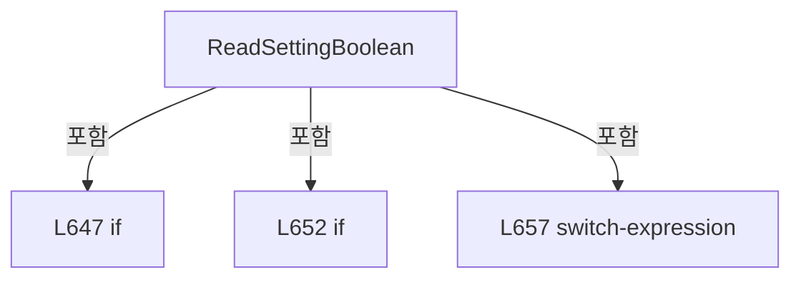

변경 전 점검: 입력/반환 타입, 위 호출자, 예외/취소 경로, 공유 상태와 저장·전송 소비자를 함께 확인합니다. 값의 단위나 물리 방향을 이름만으로 확정하지 않습니다.

### MethodDeclaration `ReadSettingText` · L665–678

[Drilling.Common/Review/CReviewManager.cs:665–678](https://github.com/kjuws10-rgb/A3Drilling/blob/28764c91d521777b8ee068dd7aaf2d3902ce9fe2/Drilling.Common/Review/CReviewManager.cs#L665-L678)

| 항목 | 실제 추출 값 |
| --- | --- |
| 서명 | string Drilling.Common.Review.CReviewManager.ReadSettingText(System.Collections.Generic.IReadOnlyList<Drilling.Common.Managers.ST_SYSTEM_PARAMETER>, string, params string[]) |
| 접근/수식자 | Private / private, static |
| 반환/값 타입 | string |
| 소속 타입 | NamedType:Drilling.Common.Review.CReviewManager |

입력 계약:

| 이름 | 타입 | 전달 | 선택/기본값 |
| --- | --- | --- | --- |
| settings | System.Collections.Generic.IReadOnlyList<Drilling.Common.Managers.ST_SYSTEM_PARAMETER> | None | False /  |
| defaultValue | string | None | False /  |
| keys | string[] | None | False /  |

정적 호출자로 확인된 위치:

| 호출 파일/행 | 호출 표현식 | 런타임 분기 가능 |
| --- | --- | --- |
| [Drilling.Common/Review/CReviewManager.cs:603–603](https://github.com/kjuws10-rgb/A3Drilling/blob/28764c91d521777b8ee068dd7aaf2d3902ce9fe2/Drilling.Common/Review/CReviewManager.cs#L603-L603) | ReadSettingText | False |
| [Drilling.Common/Review/CReviewManager.cs:603–603](https://github.com/kjuws10-rgb/A3Drilling/blob/28764c91d521777b8ee068dd7aaf2d3902ce9fe2/Drilling.Common/Review/CReviewManager.cs#L603-L603) | ReadSettingText | False |
| [Drilling.Common/Review/CReviewManager.cs:603–603](https://github.com/kjuws10-rgb/A3Drilling/blob/28764c91d521777b8ee068dd7aaf2d3902ce9fe2/Drilling.Common/Review/CReviewManager.cs#L603-L603) | ReadSettingText | False |
| [Drilling.Common/Review/CReviewManager.cs:646–646](https://github.com/kjuws10-rgb/A3Drilling/blob/28764c91d521777b8ee068dd7aaf2d3902ce9fe2/Drilling.Common/Review/CReviewManager.cs#L646-L646) | ReadSettingText | False |

호출하는 대상과 해석 범위:

| 원본 행 | 표현식 | 분석 상태 | 대상/소스 위치 |
| --- | --- | --- | --- |
| 669 | keys.Any | resolved | bool System.Collections.Generic.IEnumerable<string>.Any<string>(System.Func<string, bool>) |
| 669 | key.Equals | resolved | bool string.Equals(string?, System.StringComparison) |
| 669 | key.Equals | resolved | bool string.Equals(string?, System.StringComparison) |
| 674 | string.IsNullOrWhiteSpace | resolved | bool string.IsNullOrWhiteSpace(string?) |
| 674 | setting.Value.Trim | resolved | string string.Trim() |

본문의 실제 연산·분기·예외·반환 순서(원문 위치 순):

| 원본 행 | 종류 | 주석 해설 |
| --- | --- | --- |
| 667 | foreach | 컬렉션 요소를 순회합니다: foreach (var setting in settings) |
| 669 | call | 함수·델리게이트 또는 객체 생성자를 호출합니다: keys.Any(key => key.Equals(setting.Key, StringComparison.OrdinalIgnoreCase) &#124;&#124; key.Equals(setting.Name, StringComparison.OrdinalIgnoreCase)) |
| 669 | call | 함수·델리게이트 또는 객체 생성자를 호출합니다: key.Equals(setting.Key, StringComparison.OrdinalIgnoreCase) |
| 669 | call | 함수·델리게이트 또는 객체 생성자를 호출합니다: key.Equals(setting.Name, StringComparison.OrdinalIgnoreCase) |
| 669 | if | 조건에 따라 분기합니다: if (!keys.Any(key => key.Equals(setting.Key, StringComparison.OrdinalIgnoreCase) &#124;&#124; key.Equals(setting.Name, StringComparison.OrdinalIgnoreCase))) |
| 671 | continue | 다음 반복으로 진행합니다: continue; |
| 674 | call | 함수·델리게이트 또는 객체 생성자를 호출합니다: string.IsNullOrWhiteSpace(setting.Value) |
| 674 | call | 함수·델리게이트 또는 객체 생성자를 호출합니다: setting.Value.Trim() |
| 674 | conditional-expression | 조건에 따라 결과식을 선택합니다: string.IsNullOrWhiteSpace(setting.Value) ? defaultValue : setting.Value.Trim() |
| 674 | return | 호출자에게 값 또는 제어를 반환합니다: return string.IsNullOrWhiteSpace(setting.Value) ? defaultValue : setting.Value.Trim(); |
| 677 | return | 호출자에게 값 또는 제어를 반환합니다: return defaultValue; |

제어 구문의 포함 구조(실제 실행 순서/CFG가 아닌 구문 탐색 그림):


변경 전 점검: 입력/반환 타입, 위 호출자, 예외/취소 경로, 공유 상태와 저장·전송 소비자를 함께 확인합니다. 값의 단위나 물리 방향을 이름만으로 확정하지 않습니다.

### MethodDeclaration `BuildShotPoints` · L680–778

[Drilling.Common/Review/CReviewManager.cs:680–778](https://github.com/kjuws10-rgb/A3Drilling/blob/28764c91d521777b8ee068dd7aaf2d3902ce9fe2/Drilling.Common/Review/CReviewManager.cs#L680-L778)

| 항목 | 실제 추출 값 |
| --- | --- |
| 서명 | System.Collections.Generic.IReadOnlyList<Drilling.Common.Review.ST_REVIEW_PLAN_POINT> Drilling.Common.Review.CReviewManager.BuildShotPoints(Drilling.Common.Managers.ST_RECIPE_DEFINITION, Drilling.Common.Managers.ST_ALIGN_KEY_MARGINS, int, int, Drilling.Common.Review.CReviewManager.ST_REVIEW_COORDINATE_SETTINGS, System.Collections.Generic.IReadOnlyDictionary<(int CellNo, int CellShotNo), int>, double, int, bool, System.Collections.Generic.IReadOnlyDictionary<string, string>, double, double) |
| 접근/수식자 | Private / private, static |
| 반환/값 타입 | System.Collections.Generic.IReadOnlyList<Drilling.Common.Review.ST_REVIEW_PLAN_POINT> |
| 소속 타입 | NamedType:Drilling.Common.Review.CReviewManager |

입력 계약:

| 이름 | 타입 | 전달 | 선택/기본값 |
| --- | --- | --- | --- |
| recipe | Drilling.Common.Managers.ST_RECIPE_DEFINITION | None | False /  |
| alignKeyMargins | Drilling.Common.Managers.ST_ALIGN_KEY_MARGINS | None | False /  |
| headCount | int | None | False /  |
| cellCount | int | None | False /  |
| coordinateSettings | Drilling.Common.Review.CReviewManager.ST_REVIEW_COORDINATE_SETTINGS | None | False /  |
| assignedHeadNos | System.Collections.Generic.IReadOnlyDictionary<(int CellNo, int CellShotNo), int> | None | False /  |
| stageScanDirectionY | double | None | False /  |
| selectedBeamNo | int | None | False /  |
| selectAllAssignedPoints | bool | None | False /  |
| excludedShots | System.Collections.Generic.IReadOnlyDictionary<string, string> | None | False /  |
| shiftOffsetX | double | None | False /  |
| shiftOffsetY | double | None | False /  |

정적 호출자로 확인된 위치:

| 호출 파일/행 | 호출 표현식 | 런타임 분기 가능 |
| --- | --- | --- |
| [Drilling.Common/Review/CReviewManager.cs:521–533](https://github.com/kjuws10-rgb/A3Drilling/blob/28764c91d521777b8ee068dd7aaf2d3902ce9fe2/Drilling.Common/Review/CReviewManager.cs#L521-L533) | BuildShotPoints | False |

호출하는 대상과 해석 범위:

| 원본 행 | 표현식 | 분석 상태 | 대상/소스 위치 |
| --- | --- | --- | --- |
| 698 | ReadDouble | resolved | double Drilling.Common.Review.CReviewManager.ReadDouble(Drilling.Common.Managers.ST_RECIPE_DEFINITION, double, params string[]) · Drilling.Common/Review/CReviewManager.cs:1322 |
| 699 | ReadDouble | resolved | double Drilling.Common.Review.CReviewManager.ReadDouble(Drilling.Common.Managers.ST_RECIPE_DEFINITION, double, params string[]) · Drilling.Common/Review/CReviewManager.cs:1322 |
| 700 | ReadDouble | resolved | double Drilling.Common.Review.CReviewManager.ReadDouble(Drilling.Common.Managers.ST_RECIPE_DEFINITION, double, params string[]) · Drilling.Common/Review/CReviewManager.cs:1322 |
| 701 | ReadInt | resolved | int Drilling.Common.Review.CReviewManager.ReadInt(Drilling.Common.Managers.ST_RECIPE_DEFINITION, int, params string[]) · Drilling.Common/Review/CReviewManager.cs:1282 |
| 702 | recipe.Parameters.GroupBy(parameter => parameter.Key, StringComparer.OrdinalIgnoreCase).ToDictionary | resolved | System.Collections.Generic.Dictionary<string, string> System.Collections.Generic.IEnumerable<System.Linq.IGrouping<string, Drilling.Common.Managers.ST_RECIPE_PARAMETER>>.ToDictionary<System.Linq.IGrouping<string, Drilling.Common.Managers.ST_RECIPE_PARAMETER>, string, string>(System.Func<System.Linq.IGrouping<string, Drilling.Common.Managers.ST_RECIPE_PARAMETER>, string>, System.Func<System.Linq.IGrouping<string, Drilling.Common.Managers.ST_RECIPE_PARAMETER>, string>, System.Collections.Generic.IEqualityComparer<string>?) |
| 702 | recipe.Parameters.GroupBy | resolved | System.Collections.Generic.IEnumerable<System.Linq.IGrouping<string, Drilling.Common.Managers.ST_RECIPE_PARAMETER>> System.Collections.Generic.IEnumerable<Drilling.Common.Managers.ST_RECIPE_PARAMETER>.GroupBy<Drilling.Common.Managers.ST_RECIPE_PARAMETER, string>(System.Func<Drilling.Common.Managers.ST_RECIPE_PARAMETER, string>, System.Collections.Generic.IEqualityComparer<string>?) |
| 702 | group.Last | resolved | Drilling.Common.Managers.ST_RECIPE_PARAMETER System.Collections.Generic.IEnumerable<Drilling.Common.Managers.ST_RECIPE_PARAMETER>.Last<Drilling.Common.Managers.ST_RECIPE_PARAMETER>() |
| 703 | CRecipeModelPixelCountReader.ReadModelTypeCount | resolved | int Drilling.Common.Recipe.CRecipeModelPixelCountReader.ReadModelTypeCount(System.Collections.Generic.IReadOnlyDictionary<string, string>) · Drilling.Common/Recipe/CCellPatternCalculator.cs:428 |
| 704 | ValidateBeamNo | resolved | void Drilling.Common.Review.CReviewManager.ValidateBeamNo(int, int) · Drilling.Common/Review/CReviewManager.cs:980 |
| 705 | new List<ST_CELL_PATTERN_DEFINITION> | resolved | System.Collections.Generic.List<Drilling.Common.Recipe.ST_CELL_PATTERN_DEFINITION>.List(int) |
| 708 | ReadDouble | resolved | double Drilling.Common.Review.CReviewManager.ReadDouble(Drilling.Common.Managers.ST_RECIPE_DEFINITION, double, params string[]) · Drilling.Common/Review/CReviewManager.cs:1322 |
| 709 | ReadDouble | resolved | double Drilling.Common.Review.CReviewManager.ReadDouble(Drilling.Common.Managers.ST_RECIPE_DEFINITION, double, params string[]) · Drilling.Common/Review/CReviewManager.cs:1322 |
| 710 | ReadDouble | resolved | double Drilling.Common.Review.CReviewManager.ReadDouble(Drilling.Common.Managers.ST_RECIPE_DEFINITION, double, params string[]) · Drilling.Common/Review/CReviewManager.cs:1322 |
| 711 | CRecipeModelPixelCountReader.ReadCellModelType | resolved | int Drilling.Common.Recipe.CRecipeModelPixelCountReader.ReadCellModelType(System.Collections.Generic.IReadOnlyDictionary<string, string>, int, int) · Drilling.Common/Recipe/CCellPatternCalculator.cs:433 |
| 712 | CRecipeModelPixelCountReader.ReadPatternForModel | resolved | Drilling.Common.Recipe.ST_RECIPE_MODEL_PATTERN Drilling.Common.Recipe.CRecipeModelPixelCountReader.ReadPatternForModel(System.Collections.Generic.IReadOnlyDictionary<string, string>, int) · Drilling.Common/Recipe/CCellPatternCalculator.cs:455 |
| 713 | new ST_CELL_PATTERN_DEFINITION | resolved | Drilling.Common.Recipe.ST_CELL_PATTERN_DEFINITION.ST_CELL_PATTERN_DEFINITION(int, double, double, double, double, int, int, int, int, double, double) · Drilling.Common/Recipe/CCellPatternCalculator.cs:277 |
| 714 | definitions.Add | resolved | void System.Collections.Generic.List<Drilling.Common.Recipe.ST_CELL_PATTERN_DEFINITION>.Add(Drilling.Common.Recipe.ST_CELL_PATTERN_DEFINITION) |
| 717 | CRecipeCellPatternCatalog.Create | resolved | Drilling.Common.Recipe.CRecipeCellPatternCatalog Drilling.Common.Recipe.CRecipeCellPatternCatalog.Create(System.Collections.Generic.IEnumerable<Drilling.Common.Recipe.ST_CELL_PATTERN_DEFINITION>) · Drilling.Common/Recipe/CCellPatternCalculator.cs:349 |
| 723 | cellCatalog.Cells.ToDictionary | resolved | System.Collections.Generic.Dictionary<int, int> System.Collections.Generic.IEnumerable<Drilling.Common.Recipe.ST_RECIPE_CELL_PATTERN_ENTRY>.ToDictionary<Drilling.Common.Recipe.ST_RECIPE_CELL_PATTERN_ENTRY, int, int>(System.Func<Drilling.Common.Recipe.ST_RECIPE_CELL_PATTERN_ENTRY, int>, System.Func<Drilling.Common.Recipe.ST_RECIPE_CELL_PATTERN_ENTRY, int>) |
| 724 | assignedHeadNos.Count | resolved | int System.Collections.Generic.IEnumerable<System.Collections.Generic.KeyValuePair<(int CellNo, int CellShotNo), int>>.Count<System.Collections.Generic.KeyValuePair<(int CellNo, int CellShotNo), int>>(System.Func<System.Collections.Generic.KeyValuePair<(int CellNo, int CellShotNo), int>, bool>) |
| 724 | shotCounts.TryGetValue | resolved | bool System.Collections.Generic.Dictionary<int, int>.TryGetValue(int, out int) |
| 727 | new CLazyReviewPointList | resolved | Drilling.Common.Review.CReviewManager.CLazyReviewPointList.CLazyReviewPointList(Drilling.Common.Recipe.CRecipeCellPatternCatalog, bool, System.Func<Drilling.Common.Recipe.ST_RECIPE_CELL_PATTERN_ENTRY, int, Drilling.Common.Review.ST_REVIEW_PLAN_POINT>) · Drilling.Common/Review/CReviewManager.cs:908 |
| 729 | CRecipeCellPatternCatalog.GetShotCenter | resolved | Drilling.Common.Recipe.ST_SHOT_GROUP_CENTER Drilling.Common.Recipe.CRecipeCellPatternCatalog.GetShotCenter(Drilling.Common.Recipe.ST_RECIPE_CELL_PATTERN_ENTRY, int) · Drilling.Common/Recipe/CCellPatternCalculator.cs:382 |
| 730 | CalculateBeamOffset | resolved | Drilling.Common.Review.ST_REVIEW_COORDINATE_OFFSET Drilling.Common.Review.CReviewManager.CalculateBeamOffset(int, int, double) · Drilling.Common/Review/CReviewManager.cs:958 |
| 732 | CReviewShotNameFormatter.ToMatrixName | resolved | string Drilling.Common.Review.CReviewShotNameFormatter.ToMatrixName(int, int) · Drilling.Common/Review/CReviewManager.cs:4141 |
| 733 | assignedHeadNos.TryGetValue | resolved · 동적 구현 선택 가능 | bool System.Collections.Generic.IReadOnlyDictionary<(int CellNo, int CellShotNo), int>.TryGetValue((int CellNo, int CellShotNo), out int) |
| 734 | CalculateReviewTarget | resolved | Drilling.Common.Review.ST_REVIEW_COORDINATE_OFFSET Drilling.Common.Review.CReviewManager.CalculateReviewTarget(double, double, double, double, double, double, double, double) · Drilling.Common/Review/CReviewManager.cs:1001 |
| 745 | double.IsFinite | resolved | bool double.IsFinite(double) |
| 745 | double.IsFinite | resolved | bool double.IsFinite(double) |
| 747 | new InvalidOperationException | resolved | System.InvalidOperationException.InvalidOperationException(string?) |
| 750 | ToShotKey | resolved | string Drilling.Common.Review.CReviewManager.ToShotKey(int, int) · Drilling.Common/Review/CReviewManager.cs:1240 |
| 751 | excludedShots.TryGetValue | resolved · 동적 구현 선택 가능 | bool System.Collections.Generic.IReadOnlyDictionary<string, string>.TryGetValue(string, out string) |
| 753 | new ST_REVIEW_PLAN_POINT | resolved | Drilling.Common.Review.ST_REVIEW_PLAN_POINT.ST_REVIEW_PLAN_POINT(int, string, int, int, int, int, int, bool, double, double, double, double, double, double, Drilling.Common.Review.EN_REVIEW_POINT_STATE, string) · Drilling.Common/Review/CReviewManager.cs:4067 |

본문의 실제 연산·분기·예외·반환 순서(원문 위치 순):

| 원본 행 | 종류 | 주석 해설 |
| --- | --- | --- |
| 695 | local-declaration | 지역 변수를 선언합니다: var headLayout = coordinateSettings.HeadLayout; |
| 695 | variable-initializer | 변수의 초기값을 지정합니다: headLayout = coordinateSettings.HeadLayout |
| 696 | local-declaration | 지역 변수를 선언합니다: var akMarginX = alignKeyMargins.X; |
| 696 | variable-initializer | 변수의 초기값을 지정합니다: akMarginX = alignKeyMargins.X |
| 697 | local-declaration | 지역 변수를 선언합니다: var akMarginY = alignKeyMargins.Y; |
| 697 | variable-initializer | 변수의 초기값을 지정합니다: akMarginY = alignKeyMargins.Y |
| 698 | call | 함수·델리게이트 또는 객체 생성자를 호출합니다: ReadDouble(recipe, 0.0, "REVIEW_CAMERA_ALIGN_KEY_POS_X") |
| 698 | local-declaration | 지역 변수를 선언합니다: var reviewCameraAlignKeyPosX = ReadDouble(recipe, 0.0, "REVIEW_CAMERA_ALIGN_KEY_POS_X"); |
| 698 | variable-initializer | 변수의 초기값을 지정합니다: reviewCameraAlignKeyPosX = ReadDouble(recipe, 0.0, "REVIEW_CAMERA_ALIGN_KEY_POS_X") |
| 699 | call | 함수·델리게이트 또는 객체 생성자를 호출합니다: ReadDouble(recipe, 0.0, "REVIEW_CAMERA_ALIGN_KEY_POS_Y") |
| 699 | local-declaration | 지역 변수를 선언합니다: var reviewCameraAlignKeyPosY = ReadDouble(recipe, 0.0, "REVIEW_CAMERA_ALIGN_KEY_POS_Y"); |
| 699 | variable-initializer | 변수의 초기값을 지정합니다: reviewCameraAlignKeyPosY = ReadDouble(recipe, 0.0, "REVIEW_CAMERA_ALIGN_KEY_POS_Y") |
| 700 | call | 함수·델리게이트 또는 객체 생성자를 호출합니다: ReadDouble(recipe, 0.0, "PIXEL_SIZE") |
| 700 | local-declaration | 지역 변수를 선언합니다: var pixelSize = ReadDouble(recipe, 0.0, "PIXEL_SIZE"); |
| 700 | variable-initializer | 변수의 초기값을 지정합니다: pixelSize = ReadDouble(recipe, 0.0, "PIXEL_SIZE") |
| 701 | call | 함수·델리게이트 또는 객체 생성자를 호출합니다: ReadInt(recipe, 0, "SPLITED_BEAM_COUNT") |
| 701 | local-declaration | 지역 변수를 선언합니다: var splitBeamCount = ReadInt(recipe, 0, "SPLITED_BEAM_COUNT"); |
| 701 | variable-initializer | 변수의 초기값을 지정합니다: splitBeamCount = ReadInt(recipe, 0, "SPLITED_BEAM_COUNT") |
| 702 | call | 함수·델리게이트 또는 객체 생성자를 호출합니다: recipe.Parameters.GroupBy(parameter => parameter.Key, StringComparer.OrdinalIgnoreCase).ToDictionary(group => group.Key, group => group.Last().Value, StringComparer.OrdinalIgnoreCase) |
| 702 | call | 함수·델리게이트 또는 객체 생성자를 호출합니다: recipe.Parameters.GroupBy(parameter => parameter.Key, StringComparer.OrdinalIgnoreCase) |
| 702 | call | 함수·델리게이트 또는 객체 생성자를 호출합니다: group.Last() |
| 702 | local-declaration | 지역 변수를 선언합니다: var recipeParameterMap = recipe.Parameters.GroupBy(parameter => parameter.Key, StringComparer.OrdinalIgnoreCase).ToDictionary(group => group.Key, group => group.Last().Value, StringComparer.OrdinalIgnoreCase); |
| 702 | variable-initializer | 변수의 초기값을 지정합니다: recipeParameterMap = recipe.Parameters.GroupBy(parameter => parameter.Key, StringComparer.OrdinalIgnoreCase).ToDictionary(group => group.Key, group => group.Last().Value, StringComparer.OrdinalIgnoreCase) |
| 703 | call | 함수·델리게이트 또는 객체 생성자를 호출합니다: CRecipeModelPixelCountReader.ReadModelTypeCount(recipeParameterMap) |
| 703 | local-declaration | 지역 변수를 선언합니다: var modelTypeCount = CRecipeModelPixelCountReader.ReadModelTypeCount(recipeParameterMap); |
| 703 | variable-initializer | 변수의 초기값을 지정합니다: modelTypeCount = CRecipeModelPixelCountReader.ReadModelTypeCount(recipeParameterMap) |
| 704 | call | 함수·델리게이트 또는 객체 생성자를 호출합니다: ValidateBeamNo(selectedBeamNo, splitBeamCount) |
| 705 | call | 함수·델리게이트 또는 객체 생성자를 호출합니다: new List<ST_CELL_PATTERN_DEFINITION>(cellCount) |
| 705 | local-declaration | 지역 변수를 선언합니다: var definitions = new List<ST_CELL_PATTERN_DEFINITION>(cellCount); |
| 705 | variable-initializer | 변수의 초기값을 지정합니다: definitions = new List<ST_CELL_PATTERN_DEFINITION>(cellCount) |
| 706 | variable-initializer | 변수의 초기값을 지정합니다: cellNo = 1 |
| 706 | for | 초기화·조건·증감이 있는 반복입니다: for (var cellNo = 1; cellNo <= cellCount; cellNo++) |
| 708 | call | 함수·델리게이트 또는 객체 생성자를 호출합니다: ReadDouble(recipe, 0.0, $"CELL{cellNo}_ALIGN_TO_1ST_PIXEL_X") |
| 708 | local-declaration | 지역 변수를 선언합니다: var firstTargetX = ReadDouble(recipe, 0.0, $"CELL{cellNo}_ALIGN_TO_1ST_PIXEL_X"); |
| 708 | variable-initializer | 변수의 초기값을 지정합니다: firstTargetX = ReadDouble(recipe, 0.0, $"CELL{cellNo}_ALIGN_TO_1ST_PIXEL_X") |
| 709 | call | 함수·델리게이트 또는 객체 생성자를 호출합니다: ReadDouble(recipe, 0.0, $"CELL{cellNo}_ALIGN_TO_1ST_PIXEL_Y") |
| 709 | local-declaration | 지역 변수를 선언합니다: var firstTargetY = ReadDouble(recipe, 0.0, $"CELL{cellNo}_ALIGN_TO_1ST_PIXEL_Y"); |
| 709 | variable-initializer | 변수의 초기값을 지정합니다: firstTargetY = ReadDouble(recipe, 0.0, $"CELL{cellNo}_ALIGN_TO_1ST_PIXEL_Y") |
| 710 | call | 함수·델리게이트 또는 객체 생성자를 호출합니다: ReadDouble(recipe, 0.0, $"CELL{cellNo}_ROTATION") |
| 710 | local-declaration | 지역 변수를 선언합니다: var rotation = ReadDouble(recipe, 0.0, $"CELL{cellNo}_ROTATION"); |
| 710 | variable-initializer | 변수의 초기값을 지정합니다: rotation = ReadDouble(recipe, 0.0, $"CELL{cellNo}_ROTATION") |
| 711 | call | 함수·델리게이트 또는 객체 생성자를 호출합니다: CRecipeModelPixelCountReader.ReadCellModelType(recipeParameterMap, cellNo, modelTypeCount) |
| 711 | local-declaration | 지역 변수를 선언합니다: var modelType = CRecipeModelPixelCountReader.ReadCellModelType(recipeParameterMap, cellNo, modelTypeCount); |
| 711 | variable-initializer | 변수의 초기값을 지정합니다: modelType = CRecipeModelPixelCountReader.ReadCellModelType(recipeParameterMap, cellNo, modelTypeCount) |
| 712 | call | 함수·델리게이트 또는 객체 생성자를 호출합니다: CRecipeModelPixelCountReader.ReadPatternForModel(recipeParameterMap, modelType) |
| 712 | local-declaration | 지역 변수를 선언합니다: var modelPattern = CRecipeModelPixelCountReader.ReadPatternForModel(recipeParameterMap, modelType); |
| 712 | variable-initializer | 변수의 초기값을 지정합니다: modelPattern = CRecipeModelPixelCountReader.ReadPatternForModel(recipeParameterMap, modelType) |
| 713 | call | 함수·델리게이트 또는 객체 생성자를 호출합니다: new ST_CELL_PATTERN_DEFINITION(cellNo, firstTargetX, firstTargetY, rotation, pixelSize, modelPattern.PixelCountX, modelPattern.PixelCountY, modelPattern.ProcessPitch, splitBeamCount, akMarginX, akMarginY) |
| 713 | local-declaration | 지역 변수를 선언합니다: var patternDefinition = new ST_CELL_PATTERN_DEFINITION(cellNo, firstTargetX, firstTargetY, rotation, pixelSize, modelPattern.PixelCountX, modelPattern.PixelCountY, modelPattern.ProcessPitch, splitBeamCount, akMarginX, akMarginY); |
| 713 | variable-initializer | 변수의 초기값을 지정합니다: patternDefinition = new ST_CELL_PATTERN_DEFINITION(cellNo, firstTargetX, firstTargetY, rotation, pixelSize, modelPattern.PixelCountX, modelPattern.PixelCountY, modelPattern.ProcessPitch, splitBeamCount, akMarginX, akMarginY) |
| 714 | call | 함수·델리게이트 또는 객체 생성자를 호출합니다: definitions.Add(patternDefinition) |
| 717 | call | 함수·델리게이트 또는 객체 생성자를 호출합니다: CRecipeCellPatternCatalog.Create(definitions) |
| 717 | local-declaration | 지역 변수를 선언합니다: var cellCatalog = CRecipeCellPatternCatalog.Create(definitions); |
| 717 | variable-initializer | 변수의 초기값을 지정합니다: cellCatalog = CRecipeCellPatternCatalog.Create(definitions) |
| 718 | local-declaration | 지역 변수를 선언합니다: var allPointsSelected = false; |
| 718 | variable-initializer | 변수의 초기값을 지정합니다: allPointsSelected = false |
| 719 | if | 조건에 따라 분기합니다: if (selectAllAssignedPoints && excludedShots.Count == 0) |
| 723 | call | 함수·델리게이트 또는 객체 생성자를 호출합니다: cellCatalog.Cells.ToDictionary(cell => cell.Definition.CellNo, cell => cell.Count) |
| 723 | local-declaration | 지역 변수를 선언합니다: var shotCounts = cellCatalog.Cells.ToDictionary(cell => cell.Definition.CellNo, cell => cell.Count); |
| 723 | variable-initializer | 변수의 초기값을 지정합니다: shotCounts = cellCatalog.Cells.ToDictionary(cell => cell.Definition.CellNo, cell => cell.Count) |
| 724 | assignment | 값을 대상에 대입합니다: allPointsSelected = assignedHeadNos.Count(pair => pair.Value > 0 && shotCounts.TryGetValue(pair.Key.CellNo, out var count) && pair.Key.CellShotNo >= 1 && pair.Key.CellShotNo <= count) == cellCatalog.Count |
| 724 | call | 함수·델리게이트 또는 객체 생성자를 호출합니다: assignedHeadNos.Count(pair => pair.Value > 0 && shotCounts.TryGetValue(pair.Key.CellNo, out var count) && pair.Key.CellShotNo >= 1 && pair.Key.CellShotNo <= count) |
| 724 | call | 함수·델리게이트 또는 객체 생성자를 호출합니다: shotCounts.TryGetValue(pair.Key.CellNo, out var count) |
| 727 | call | 함수·델리게이트 또는 객체 생성자를 호출합니다: new CLazyReviewPointList(cellCatalog, allPointsSelected, (cell, pointIndex) => { var shotGroup = CRecipeCellPatternCatalog.GetShotCenter(cell, pointIndex); var beamOffset = CalculateBeamOffset(selectedBeamNo, splitBeamCo… |
| 727 | return | 호출자에게 값 또는 제어를 반환합니다: return new CLazyReviewPointList(cellCatalog, allPointsSelected, (cell, pointIndex) => { var shotGroup = CRecipeCellPatternCatalog.GetShotCenter(cell, pointIndex); var beamOffset = CalculateBeamOffset(selectedBeamNo, splitBeamCount |
| 729 | call | 함수·델리게이트 또는 객체 생성자를 호출합니다: CRecipeCellPatternCatalog.GetShotCenter(cell, pointIndex) |
| 729 | local-declaration | 지역 변수를 선언합니다: var shotGroup = CRecipeCellPatternCatalog.GetShotCenter(cell, pointIndex); |
| 729 | variable-initializer | 변수의 초기값을 지정합니다: shotGroup = CRecipeCellPatternCatalog.GetShotCenter(cell, pointIndex) |
| 730 | call | 함수·델리게이트 또는 객체 생성자를 호출합니다: CalculateBeamOffset(selectedBeamNo, splitBeamCount, cell.Layout.BeamPitchMillimeters) |
| 730 | local-declaration | 지역 변수를 선언합니다: var beamOffset = CalculateBeamOffset(selectedBeamNo, splitBeamCount, cell.Layout.BeamPitchMillimeters); |
| 730 | variable-initializer | 변수의 초기값을 지정합니다: beamOffset = CalculateBeamOffset(selectedBeamNo, splitBeamCount, cell.Layout.BeamPitchMillimeters) |
| 731 | local-declaration | 지역 변수를 선언합니다: var cellNo = cell.Definition.CellNo; |
| 731 | variable-initializer | 변수의 초기값을 지정합니다: cellNo = cell.Definition.CellNo |
| 732 | call | 함수·델리게이트 또는 객체 생성자를 호출합니다: CReviewShotNameFormatter.ToMatrixName(shotGroup.CellShotNo, cell.Layout.GroupCountX) |
| 732 | local-declaration | 지역 변수를 선언합니다: var shotName = CReviewShotNameFormatter.ToMatrixName(shotGroup.CellShotNo, cell.Layout.GroupCountX); |
| 732 | variable-initializer | 변수의 초기값을 지정합니다: shotName = CReviewShotNameFormatter.ToMatrixName(shotGroup.CellShotNo, cell.Layout.GroupCountX) |
| 733 | call | 함수·델리게이트 또는 객체 생성자를 호출합니다: assignedHeadNos.TryGetValue((cellNo, shotGroup.CellShotNo), out var processHeadNo) |
| 733 | conditional-expression | 조건에 따라 결과식을 선택합니다: assignedHeadNos.TryGetValue((cellNo, shotGroup.CellShotNo), out var processHeadNo) ? processHeadNo : 0 |
| 733 | local-declaration | 지역 변수를 선언합니다: var headNo = assignedHeadNos.TryGetValue((cellNo, shotGroup.CellShotNo), out var processHeadNo) ? processHeadNo : 0; |
| 733 | variable-initializer | 변수의 초기값을 지정합니다: headNo = assignedHeadNos.TryGetValue((cellNo, shotGroup.CellShotNo), out var processHeadNo) ? processHeadNo : 0 |
| 734 | call | 함수·델리게이트 또는 객체 생성자를 호출합니다: CalculateReviewTarget( shotGroup.DesignX - akMarginX + shiftOffsetX, shotGroup.DesignY - akMarginY + shiftOffsetY, reviewCameraAlignKeyPosX, reviewCameraAlignKeyPosY, beamOffset.X, beamOffset.Y, cell.Definition.RotationD… |
| 734 | local-declaration | 지역 변수를 선언합니다: var reviewTarget = CalculateReviewTarget( shotGroup.DesignX - akMarginX + shiftOffsetX, shotGroup.DesignY - akMarginY + shiftOffsetY, reviewCameraAlignKeyPosX, reviewCameraAlignKeyPosY, beamOffset.X, beamOffset.Y, cell.Definition. |
| 734 | variable-initializer | 변수의 초기값을 지정합니다: reviewTarget = CalculateReviewTarget( shotGroup.DesignX - akMarginX + shiftOffsetX, shotGroup.DesignY - akMarginY + shiftOffsetY, reviewCameraAlignKeyPosX, reviewCameraAlignKeyPosY, beamOffset.X, beamOffset.Y, cell.Definition.Rota |
| 745 | call | 함수·델리게이트 또는 객체 생성자를 호출합니다: double.IsFinite(reviewTarget.X) |
| 745 | call | 함수·델리게이트 또는 객체 생성자를 호출합니다: double.IsFinite(reviewTarget.Y) |
| 745 | if | 조건에 따라 분기합니다: if (!double.IsFinite(reviewTarget.X) &#124;&#124; !double.IsFinite(reviewTarget.Y)) |
| 747 | call | 함수·델리게이트 또는 객체 생성자를 호출합니다: new InvalidOperationException($"Cell{cellNo} Shot Group {shotGroup.CellShotNo} produced a non-finite review target. " + $"X={reviewTarget.X:R}, Y={reviewTarget.Y:R}.") |
| 747 | throw | 예외를 발생/전달합니다: throw new InvalidOperationException($"Cell{cellNo} Shot Group {shotGroup.CellShotNo} produced a non-finite review target. " + $"X={reviewTarget.X:R}, Y={reviewTarget.Y:R}."); |
| 750 | call | 함수·델리게이트 또는 객체 생성자를 호출합니다: ToShotKey(cellNo, shotGroup.CellShotNo) |
| 750 | local-declaration | 지역 변수를 선언합니다: var shotKey = ToShotKey(cellNo, shotGroup.CellShotNo); |
| 750 | variable-initializer | 변수의 초기값을 지정합니다: shotKey = ToShotKey(cellNo, shotGroup.CellShotNo) |
| 751 | call | 함수·델리게이트 또는 객체 생성자를 호출합니다: excludedShots.TryGetValue(shotKey, out var exclusionReason) |
| 751 | local-declaration | 지역 변수를 선언합니다: var isExcluded = excludedShots.TryGetValue(shotKey, out var exclusionReason); |
| 751 | variable-initializer | 변수의 초기값을 지정합니다: isExcluded = excludedShots.TryGetValue(shotKey, out var exclusionReason) |
| 752 | local-declaration | 지역 변수를 선언합니다: var use = selectAllAssignedPoints && headNo > 0 && !isExcluded; |
| 752 | variable-initializer | 변수의 초기값을 지정합니다: use = selectAllAssignedPoints && headNo > 0 && !isExcluded |
| 753 | call | 함수·델리게이트 또는 객체 생성자를 호출합니다: new ST_REVIEW_PLAN_POINT( cell.StartIndex + pointIndex + 1, shotKey, headNo, cellNo, shotGroup.CellShotNo, cell.Layout.GroupCountX, cell.Layout.GroupCountY, use, shotGroup.DesignX, shotGroup.DesignY, reviewTarget.X, revi… |
| 753 | return | 호출자에게 값 또는 제어를 반환합니다: return new ST_REVIEW_PLAN_POINT( cell.StartIndex + pointIndex + 1, shotKey, headNo, cellNo, shotGroup.CellShotNo, cell.Layout.GroupCountX, cell.Layout.GroupCountY, use, shotGroup.DesignX, shotGroup.DesignY, reviewTarget.X, reviewT |
| 768 | conditional-expression | 조건에 따라 결과식을 선택합니다: use ? EN_REVIEW_POINT_STATE.Ready : EN_REVIEW_POINT_STATE.Skip |
| 769 | conditional-expression | 조건에 따라 결과식을 선택합니다: use ? "WAIT" : "-" |
| 772 | assignment | 값을 대상에 대입합니다: BeamNo = selectedBeamNo |
| 773 | assignment | 값을 대상에 대입합니다: BeamOffsetGx = beamOffset.X |
| 774 | assignment | 값을 대상에 대입합니다: BeamOffsetGy = beamOffset.Y |
| 775 | assignment | 값을 대상에 대입합니다: ExclusionReason = exclusionReason ?? "" |

제어 구문의 포함 구조(실제 실행 순서/CFG가 아닌 구문 탐색 그림):

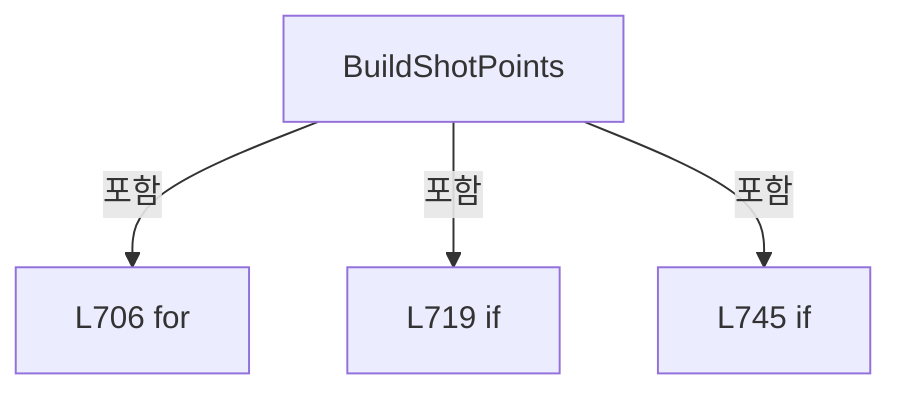

변경 전 점검: 입력/반환 타입, 위 호출자, 예외/취소 경로, 공유 상태와 저장·전송 소비자를 함께 확인합니다. 값의 단위나 물리 방향을 이름만으로 확정하지 않습니다.

### MethodDeclaration `GetMeasuredResultRows` · L780–792

[Drilling.Common/Review/CReviewManager.cs:780–792](https://github.com/kjuws10-rgb/A3Drilling/blob/28764c91d521777b8ee068dd7aaf2d3902ce9fe2/Drilling.Common/Review/CReviewManager.cs#L780-L792)

| 항목 | 실제 추출 값 |
| --- | --- |
| 서명 | System.Collections.Generic.IReadOnlyList<Drilling.Common.Review.ST_REVIEW_PLAN_POINT> Drilling.Common.Review.CReviewManager.GetMeasuredResultRows(System.Collections.Generic.IReadOnlyList<Drilling.Common.Review.ST_REVIEW_PLAN_POINT>) |
| 접근/수식자 | Private / private, static |
| 반환/값 타입 | System.Collections.Generic.IReadOnlyList<Drilling.Common.Review.ST_REVIEW_PLAN_POINT> |
| 소속 타입 | NamedType:Drilling.Common.Review.CReviewManager |

입력 계약:

| 이름 | 타입 | 전달 | 선택/기본값 |
| --- | --- | --- | --- |
| results | System.Collections.Generic.IReadOnlyList<Drilling.Common.Review.ST_REVIEW_PLAN_POINT> | None | False /  |

정적 호출자로 확인된 위치:

| 호출 파일/행 | 호출 표현식 | 런타임 분기 가능 |
| --- | --- | --- |
| [Drilling.Common/Review/CReviewManager.cs:1616–1616](https://github.com/kjuws10-rgb/A3Drilling/blob/28764c91d521777b8ee068dd7aaf2d3902ce9fe2/Drilling.Common/Review/CReviewManager.cs#L1616-L1616) | GetMeasuredResultRows | False |

호출하는 대상과 해석 범위:

| 원본 행 | 표현식 | 분석 상태 | 대상/소스 위치 |
| --- | --- | --- | --- |
| 782 | new List<ST_REVIEW_PLAN_POINT> | resolved | System.Collections.Generic.List<Drilling.Common.Review.ST_REVIEW_PLAN_POINT>.List() |
| 787 | measuredRows.Add | resolved | void System.Collections.Generic.List<Drilling.Common.Review.ST_REVIEW_PLAN_POINT>.Add(Drilling.Common.Review.ST_REVIEW_PLAN_POINT) |

본문의 실제 연산·분기·예외·반환 순서(원문 위치 순):

| 원본 행 | 종류 | 주석 해설 |
| --- | --- | --- |
| 782 | call | 함수·델리게이트 또는 객체 생성자를 호출합니다: new List<ST_REVIEW_PLAN_POINT>() |
| 782 | local-declaration | 지역 변수를 선언합니다: var measuredRows = new List<ST_REVIEW_PLAN_POINT>(); |
| 782 | variable-initializer | 변수의 초기값을 지정합니다: measuredRows = new List<ST_REVIEW_PLAN_POINT>() |
| 783 | foreach | 컬렉션 요소를 순회합니다: foreach (var point in results) |
| 785 | if | 조건에 따라 분기합니다: if (point.Use && point.State is EN_REVIEW_POINT_STATE.Ok or EN_REVIEW_POINT_STATE.Ng) |
| 787 | call | 함수·델리게이트 또는 객체 생성자를 호출합니다: measuredRows.Add(point) |
| 791 | return | 호출자에게 값 또는 제어를 반환합니다: return measuredRows; |

제어 구문의 포함 구조(실제 실행 순서/CFG가 아닌 구문 탐색 그림):

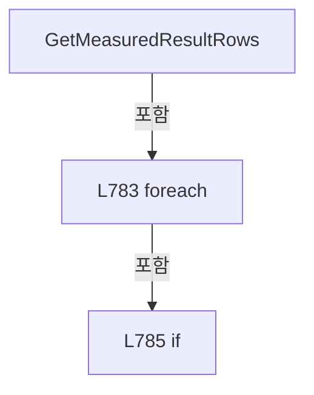

변경 전 점검: 입력/반환 타입, 위 호출자, 예외/취소 경로, 공유 상태와 저장·전송 소비자를 함께 확인합니다. 값의 단위나 물리 방향을 이름만으로 확정하지 않습니다.

### MethodDeclaration `ProjectCorrectionRows` · L794–815

[Drilling.Common/Review/CReviewManager.cs:794–815](https://github.com/kjuws10-rgb/A3Drilling/blob/28764c91d521777b8ee068dd7aaf2d3902ce9fe2/Drilling.Common/Review/CReviewManager.cs#L794-L815)

| 항목 | 실제 추출 값 |
| --- | --- |
| 서명 | System.Collections.Generic.IReadOnlyList<Drilling.Common.Review.ST_REVIEW_PLAN_POINT> Drilling.Common.Review.CReviewManager.ProjectCorrectionRows(Drilling.Common.Review.ST_REVIEW_PLAN, System.Collections.Generic.IReadOnlyList<Drilling.Common.Review.ST_REVIEW_PLAN_POINT>) |
| 접근/수식자 | Public / public, static |
| 반환/값 타입 | System.Collections.Generic.IReadOnlyList<Drilling.Common.Review.ST_REVIEW_PLAN_POINT> |
| 소속 타입 | NamedType:Drilling.Common.Review.CReviewManager |

입력 계약:

| 이름 | 타입 | 전달 | 선택/기본값 |
| --- | --- | --- | --- |
| plan | Drilling.Common.Review.ST_REVIEW_PLAN | None | False /  |
| measuredResults | System.Collections.Generic.IReadOnlyList<Drilling.Common.Review.ST_REVIEW_PLAN_POINT> | None | False /  |

정적 호출자로 확인된 위치:

| 호출 파일/행 | 호출 표현식 | 런타임 분기 가능 |
| --- | --- | --- |
| [Drilling.UI/Menu/Menus/CMenuCorrection.ReviewData.Offset.cs:438–438](https://github.com/kjuws10-rgb/A3Drilling/blob/28764c91d521777b8ee068dd7aaf2d3902ce9fe2/Drilling.UI/Menu/Menus/CMenuCorrection.ReviewData.Offset.cs#L438-L438) | CReviewManager.ProjectCorrectionRows | False |
| [Drilling.UI/Menu/Menus/CMenuCorrection.cs:2017–2017](https://github.com/kjuws10-rgb/A3Drilling/blob/28764c91d521777b8ee068dd7aaf2d3902ce9fe2/Drilling.UI/Menu/Menus/CMenuCorrection.cs#L2017-L2017) | CReviewManager.ProjectCorrectionRows | False |

호출하는 대상과 해석 범위:

| 원본 행 | 표현식 | 분석 상태 | 대상/소스 위치 |
| --- | --- | --- | --- |
| 801 | measuredResults.Where(point => point.Use && point.State is EN_REVIEW_POINT_STATE.Ok or EN_REVIEW_POINT_STATE.Ng).ToArray | resolved | Drilling.Common.Review.ST_REVIEW_PLAN_POINT[] System.Collections.Generic.IEnumerable<Drilling.Common.Review.ST_REVIEW_PLAN_POINT>.ToArray<Drilling.Common.Review.ST_REVIEW_PLAN_POINT>() |
| 801 | measuredResults.Where | resolved | System.Collections.Generic.IEnumerable<Drilling.Common.Review.ST_REVIEW_PLAN_POINT> System.Collections.Generic.IEnumerable<Drilling.Common.Review.ST_REVIEW_PLAN_POINT>.Where<Drilling.Common.Review.ST_REVIEW_PLAN_POINT>(System.Func<Drilling.Common.Review.ST_REVIEW_PLAN_POINT, bool>) |
| 809 | ProjectSimpleResultRows | resolved | System.Collections.Generic.IReadOnlyList<Drilling.Common.Review.ST_REVIEW_PLAN_POINT> Drilling.Common.Review.CReviewManager.ProjectSimpleResultRows(Drilling.Common.Review.ST_REVIEW_CORRECTION_PLAN, System.Collections.Generic.IReadOnlyList<Drilling.Common.Review.ST_REVIEW_PLAN_POINT>) · Drilling.Common/Review/CReviewManager.cs:817 |
| 810 | ProjectRoughResultRows | resolved | System.Collections.Generic.IReadOnlyList<Drilling.Common.Review.ST_REVIEW_PLAN_POINT> Drilling.Common.Review.CReviewManager.ProjectRoughResultRows(Drilling.Common.Review.ST_REVIEW_CORRECTION_PLAN, System.Collections.Generic.IReadOnlyList<Drilling.Common.Review.ST_REVIEW_PLAN_POINT>) · Drilling.Common/Review/CReviewManager.cs:828 |
| 811 | ProjectFineResultRows | resolved | System.Collections.Generic.IReadOnlyList<Drilling.Common.Review.ST_REVIEW_PLAN_POINT> Drilling.Common.Review.CReviewManager.ProjectFineResultRows(System.Collections.Generic.IReadOnlyList<Drilling.Common.Review.ST_REVIEW_PLAN_POINT>, System.Collections.Generic.IReadOnlyList<Drilling.Common.Review.ST_REVIEW_PLAN_POINT>) · Drilling.Common/Review/CReviewManager.cs:834 |

본문의 실제 연산·분기·예외·반환 순서(원문 위치 순):

| 원본 행 | 종류 | 주석 해설 |
| --- | --- | --- |
| 796 | if | 조건에 따라 분기합니다: if (plan.CorrectionPlan is not { SourcePoints.Count: > 0 } projection) |
| 798 | return | 호출자에게 값 또는 제어를 반환합니다: return measuredResults; |
| 801 | call | 함수·델리게이트 또는 객체 생성자를 호출합니다: measuredResults.Where(point => point.Use && point.State is EN_REVIEW_POINT_STATE.Ok or EN_REVIEW_POINT_STATE.Ng).ToArray() |
| 801 | call | 함수·델리게이트 또는 객체 생성자를 호출합니다: measuredResults.Where(point => point.Use && point.State is EN_REVIEW_POINT_STATE.Ok or EN_REVIEW_POINT_STATE.Ng) |
| 801 | local-declaration | 지역 변수를 선언합니다: var measuredPoints = measuredResults.Where(point => point.Use && point.State is EN_REVIEW_POINT_STATE.Ok or EN_REVIEW_POINT_STATE.Ng).ToArray(); |
| 801 | variable-initializer | 변수의 초기값을 지정합니다: measuredPoints = measuredResults.Where(point => point.Use && point.State is EN_REVIEW_POINT_STATE.Ok or EN_REVIEW_POINT_STATE.Ng).ToArray() |
| 802 | if | 조건에 따라 분기합니다: if (measuredPoints.Length == 0) |
| 804 | return | 호출자에게 값 또는 제어를 반환합니다: return measuredResults; |
| 807 | return | 호출자에게 값 또는 제어를 반환합니다: return projection.Rule switch { EN_REVIEW_CORRECTION_RULE.Simple => ProjectSimpleResultRows(projection, measuredPoints), EN_REVIEW_CORRECTION_RULE.Rough => ProjectRoughResultRows(projection, measuredPoints), EN_REVIEW_CORRECTION_R |
| 807 | switch-expression | 값별 결과식을 선택합니다: projection.Rule switch { EN_REVIEW_CORRECTION_RULE.Simple => ProjectSimpleResultRows(projection, measuredPoints), EN_REVIEW_CORRECTION_RULE.Rough => ProjectRoughResultRows(projection, measuredPoints), EN_REVIEW_CORRECTION_RULE.Fin |
| 809 | call | 함수·델리게이트 또는 객체 생성자를 호출합니다: ProjectSimpleResultRows(projection, measuredPoints) |
| 810 | call | 함수·델리게이트 또는 객체 생성자를 호출합니다: ProjectRoughResultRows(projection, measuredPoints) |
| 811 | call | 함수·델리게이트 또는 객체 생성자를 호출합니다: ProjectFineResultRows(projection.SourcePoints, measuredPoints) |

제어 구문의 포함 구조(실제 실행 순서/CFG가 아닌 구문 탐색 그림):

```mermaid
flowchart TD
 M["ProjectCorrectionRows"]
 N0["L796 if"]
 M -->|포함| N0
 N1["L802 if"]
 M -->|포함| N1
 N2["L807 switch-expression"]
 M -->|포함| N2
```

변경 전 점검: 입력/반환 타입, 위 호출자, 예외/취소 경로, 공유 상태와 저장·전송 소비자를 함께 확인합니다. 값의 단위나 물리 방향을 이름만으로 확정하지 않습니다.

### MethodDeclaration `ProjectSimpleResultRows` · L817–826

[Drilling.Common/Review/CReviewManager.cs:817–826](https://github.com/kjuws10-rgb/A3Drilling/blob/28764c91d521777b8ee068dd7aaf2d3902ce9fe2/Drilling.Common/Review/CReviewManager.cs#L817-L826)

| 항목 | 실제 추출 값 |
| --- | --- |
| 서명 | System.Collections.Generic.IReadOnlyList<Drilling.Common.Review.ST_REVIEW_PLAN_POINT> Drilling.Common.Review.CReviewManager.ProjectSimpleResultRows(Drilling.Common.Review.ST_REVIEW_CORRECTION_PLAN, System.Collections.Generic.IReadOnlyList<Drilling.Common.Review.ST_REVIEW_PLAN_POINT>) |
| 접근/수식자 | Private / private, static |
| 반환/값 타입 | System.Collections.Generic.IReadOnlyList<Drilling.Common.Review.ST_REVIEW_PLAN_POINT> |
| 소속 타입 | NamedType:Drilling.Common.Review.CReviewManager |

입력 계약:

| 이름 | 타입 | 전달 | 선택/기본값 |
| --- | --- | --- | --- |
| projection | Drilling.Common.Review.ST_REVIEW_CORRECTION_PLAN | None | False /  |
| measuredPoints | System.Collections.Generic.IReadOnlyList<Drilling.Common.Review.ST_REVIEW_PLAN_POINT> | None | False /  |

정적 호출자로 확인된 위치:

| 호출 파일/행 | 호출 표현식 | 런타임 분기 가능 |
| --- | --- | --- |
| [Drilling.Common/Review/CReviewManager.cs:809–809](https://github.com/kjuws10-rgb/A3Drilling/blob/28764c91d521777b8ee068dd7aaf2d3902ce9fe2/Drilling.Common/Review/CReviewManager.cs#L809-L809) | ProjectSimpleResultRows | False |

호출하는 대상과 해석 범위:

| 원본 행 | 표현식 | 분석 상태 | 대상/소스 위치 |
| --- | --- | --- | --- |
| 825 | projection.SourcePoints.Where(point => point.HeadNo == measuredPoint.HeadNo && (projection.Scope != EN_REVIEW_CORRECTION_SCOPE.HeadCell &#124;&#124; point.CellNo == measuredPoint.CellNo)).Where(point => point.HeadNo > 0).Select(point => CopyMeasurement(point, measuredPoint)).ToArray | resolved | Drilling.Common.Review.ST_REVIEW_PLAN_POINT[] System.Collections.Generic.IEnumerable<Drilling.Common.Review.ST_REVIEW_PLAN_POINT>.ToArray<Drilling.Common.Review.ST_REVIEW_PLAN_POINT>() |
| 825 | projection.SourcePoints.Where(point => point.HeadNo == measuredPoint.HeadNo && (projection.Scope != EN_REVIEW_CORRECTION_SCOPE.HeadCell &#124;&#124; point.CellNo == measuredPoint.CellNo)).Where(point => point.HeadNo > 0).Select | resolved | System.Collections.Generic.IEnumerable<Drilling.Common.Review.ST_REVIEW_PLAN_POINT> System.Collections.Generic.IEnumerable<Drilling.Common.Review.ST_REVIEW_PLAN_POINT>.Select<Drilling.Common.Review.ST_REVIEW_PLAN_POINT, Drilling.Common.Review.ST_REVIEW_PLAN_POINT>(System.Func<Drilling.Common.Review.ST_REVIEW_PLAN_POINT, Drilling.Common.Review.ST_REVIEW_PLAN_POINT>) |
| 825 | projection.SourcePoints.Where(point => point.HeadNo == measuredPoint.HeadNo && (projection.Scope != EN_REVIEW_CORRECTION_SCOPE.HeadCell &#124;&#124; point.CellNo == measuredPoint.CellNo)).Where | resolved | System.Collections.Generic.IEnumerable<Drilling.Common.Review.ST_REVIEW_PLAN_POINT> System.Collections.Generic.IEnumerable<Drilling.Common.Review.ST_REVIEW_PLAN_POINT>.Where<Drilling.Common.Review.ST_REVIEW_PLAN_POINT>(System.Func<Drilling.Common.Review.ST_REVIEW_PLAN_POINT, bool>) |
| 825 | projection.SourcePoints.Where | resolved | System.Collections.Generic.IEnumerable<Drilling.Common.Review.ST_REVIEW_PLAN_POINT> System.Collections.Generic.IEnumerable<Drilling.Common.Review.ST_REVIEW_PLAN_POINT>.Where<Drilling.Common.Review.ST_REVIEW_PLAN_POINT>(System.Func<Drilling.Common.Review.ST_REVIEW_PLAN_POINT, bool>) |
| 825 | CopyMeasurement | resolved | Drilling.Common.Review.ST_REVIEW_PLAN_POINT Drilling.Common.Review.CReviewManager.CopyMeasurement(Drilling.Common.Review.ST_REVIEW_PLAN_POINT, Drilling.Common.Review.ST_REVIEW_PLAN_POINT) · Drilling.Common/Review/CReviewManager.cs:899 |

본문의 실제 연산·분기·예외·반환 순서(원문 위치 순):

| 원본 행 | 종류 | 주석 해설 |
| --- | --- | --- |
| 819 | if | 조건에 따라 분기합니다: if (measuredPoints.Count != 1) |
| 821 | return | 호출자에게 값 또는 제어를 반환합니다: return measuredPoints; |
| 824 | local-declaration | 지역 변수를 선언합니다: var measuredPoint = measuredPoints[0]; |
| 824 | variable-initializer | 변수의 초기값을 지정합니다: measuredPoint = measuredPoints[0] |
| 825 | call | 함수·델리게이트 또는 객체 생성자를 호출합니다: projection.SourcePoints.Where(point => point.HeadNo == measuredPoint.HeadNo && (projection.Scope != EN_REVIEW_CORRECTION_SCOPE.HeadCell &#124;&#124; point.CellNo == measuredPoint.CellNo)).Where(point => point.HeadNo > 0).Select(po… |
| 825 | call | 함수·델리게이트 또는 객체 생성자를 호출합니다: projection.SourcePoints.Where(point => point.HeadNo == measuredPoint.HeadNo && (projection.Scope != EN_REVIEW_CORRECTION_SCOPE.HeadCell &#124;&#124; point.CellNo == measuredPoint.CellNo)).Where(point => point.HeadNo > 0).Select(po… |
| 825 | call | 함수·델리게이트 또는 객체 생성자를 호출합니다: projection.SourcePoints.Where(point => point.HeadNo == measuredPoint.HeadNo && (projection.Scope != EN_REVIEW_CORRECTION_SCOPE.HeadCell &#124;&#124; point.CellNo == measuredPoint.CellNo)).Where(point => point.HeadNo > 0) |
| 825 | call | 함수·델리게이트 또는 객체 생성자를 호출합니다: projection.SourcePoints.Where(point => point.HeadNo == measuredPoint.HeadNo && (projection.Scope != EN_REVIEW_CORRECTION_SCOPE.HeadCell &#124;&#124; point.CellNo == measuredPoint.CellNo)) |
| 825 | call | 함수·델리게이트 또는 객체 생성자를 호출합니다: CopyMeasurement(point, measuredPoint) |
| 825 | return | 호출자에게 값 또는 제어를 반환합니다: return projection.SourcePoints.Where(point => point.HeadNo == measuredPoint.HeadNo && (projection.Scope != EN_REVIEW_CORRECTION_SCOPE.HeadCell &#124;&#124; point.CellNo == measuredPoint.CellNo)).Where(point => point.HeadNo > 0).Select(point |

제어 구문의 포함 구조(실제 실행 순서/CFG가 아닌 구문 탐색 그림):

```mermaid
flowchart TD
 M["ProjectSimpleResultRows"]
 N0["L819 if"]
 M -->|포함| N0
```

변경 전 점검: 입력/반환 타입, 위 호출자, 예외/취소 경로, 공유 상태와 저장·전송 소비자를 함께 확인합니다. 값의 단위나 물리 방향을 이름만으로 확정하지 않습니다.

### MethodDeclaration `ProjectRoughResultRows` · L828–832

[Drilling.Common/Review/CReviewManager.cs:828–832](https://github.com/kjuws10-rgb/A3Drilling/blob/28764c91d521777b8ee068dd7aaf2d3902ce9fe2/Drilling.Common/Review/CReviewManager.cs#L828-L832)

| 항목 | 실제 추출 값 |
| --- | --- |
| 서명 | System.Collections.Generic.IReadOnlyList<Drilling.Common.Review.ST_REVIEW_PLAN_POINT> Drilling.Common.Review.CReviewManager.ProjectRoughResultRows(Drilling.Common.Review.ST_REVIEW_CORRECTION_PLAN, System.Collections.Generic.IReadOnlyList<Drilling.Common.Review.ST_REVIEW_PLAN_POINT>) |
| 접근/수식자 | Private / private, static |
| 반환/값 타입 | System.Collections.Generic.IReadOnlyList<Drilling.Common.Review.ST_REVIEW_PLAN_POINT> |
| 소속 타입 | NamedType:Drilling.Common.Review.CReviewManager |

입력 계약:

| 이름 | 타입 | 전달 | 선택/기본값 |
| --- | --- | --- | --- |
| projection | Drilling.Common.Review.ST_REVIEW_CORRECTION_PLAN | None | False /  |
| measuredPoints | System.Collections.Generic.IReadOnlyList<Drilling.Common.Review.ST_REVIEW_PLAN_POINT> | None | False /  |

정적 호출자로 확인된 위치:

| 호출 파일/행 | 호출 표현식 | 런타임 분기 가능 |
| --- | --- | --- |
| [Drilling.Common/Review/CReviewManager.cs:810–810](https://github.com/kjuws10-rgb/A3Drilling/blob/28764c91d521777b8ee068dd7aaf2d3902ce9fe2/Drilling.Common/Review/CReviewManager.cs#L810-L810) | ProjectRoughResultRows | False |

호출하는 대상과 해석 범위:

| 원본 행 | 표현식 | 분석 상태 | 대상/소스 위치 |
| --- | --- | --- | --- |
| 830 | measuredPoints.GroupBy(point => projection.Scope == EN_REVIEW_CORRECTION_SCOPE.HeadCell ? (point.HeadNo, point.CellNo) : (point.HeadNo, 0)).ToDictionary | resolved | System.Collections.Generic.Dictionary<(int HeadNo, int), Drilling.Common.Review.ST_REVIEW_PLAN_POINT> System.Collections.Generic.IEnumerable<System.Linq.IGrouping<(int HeadNo, int), Drilling.Common.Review.ST_REVIEW_PLAN_POINT>>.ToDictionary<System.Linq.IGrouping<(int HeadNo, int), Drilling.Common.Review.ST_REVIEW_PLAN_POINT>, (int HeadNo, int), Drilling.Common.Review.ST_REVIEW_PLAN_POINT>(System.Func<System.Linq.IGrouping<(int HeadNo, int), Drilling.Common.Review.ST_REVIEW_PLAN_POINT>, (int HeadNo, int)>, System.Func<System.Linq.IGrouping<(int HeadNo, int), Drilling.Common.Review.ST_REVIEW_PLAN_POINT>, Drilling.Common.Review.ST_REVIEW_PLAN_POINT>) |
| 830 | measuredPoints.GroupBy | resolved | System.Collections.Generic.IEnumerable<System.Linq.IGrouping<(int HeadNo, int), Drilling.Common.Review.ST_REVIEW_PLAN_POINT>> System.Collections.Generic.IEnumerable<Drilling.Common.Review.ST_REVIEW_PLAN_POINT>.GroupBy<Drilling.Common.Review.ST_REVIEW_PLAN_POINT, (int HeadNo, int)>(System.Func<Drilling.Common.Review.ST_REVIEW_PLAN_POINT, (int HeadNo, int)>) |
| 830 | group.First | resolved | Drilling.Common.Review.ST_REVIEW_PLAN_POINT System.Collections.Generic.IEnumerable<Drilling.Common.Review.ST_REVIEW_PLAN_POINT>.First<Drilling.Common.Review.ST_REVIEW_PLAN_POINT>() |
| 831 | projection.SourcePoints.Where(point => point.HeadNo > 0).Select(point => new { Point = point, Key = projection.Scope == EN_REVIEW_CORRECTION_SCOPE.HeadCell ? (point.HeadNo, point.CellNo) : (point.HeadNo, 0) }).Where(item => measurements.ContainsKey(item.Key)).Select(item => CopyMeasurement(item.Point, measurements[item.Key])).ToArray | resolved | Drilling.Common.Review.ST_REVIEW_PLAN_POINT[] System.Collections.Generic.IEnumerable<Drilling.Common.Review.ST_REVIEW_PLAN_POINT>.ToArray<Drilling.Common.Review.ST_REVIEW_PLAN_POINT>() |
| 831 | projection.SourcePoints.Where(point => point.HeadNo > 0).Select(point => new { Point = point, Key = projection.Scope == EN_REVIEW_CORRECTION_SCOPE.HeadCell ? (point.HeadNo, point.CellNo) : (point.HeadNo, 0) }).Where(item => measurements.ContainsKey(item.Key)).Select | resolved | System.Collections.Generic.IEnumerable<Drilling.Common.Review.ST_REVIEW_PLAN_POINT> System.Collections.Generic.IEnumerable<<anonymous type: Drilling.Common.Review.ST_REVIEW_PLAN_POINT Point, (int HeadNo, int) Key>>.Select<<anonymous type: Drilling.Common.Review.ST_REVIEW_PLAN_POINT Point, (int HeadNo, int) Key>, Drilling.Common.Review.ST_REVIEW_PLAN_POINT>(System.Func<<anonymous type: Drilling.Common.Review.ST_REVIEW_PLAN_POINT Point, (int HeadNo, int) Key>, Drilling.Common.Review.ST_REVIEW_PLAN_POINT>) |
| 831 | projection.SourcePoints.Where(point => point.HeadNo > 0).Select(point => new { Point = point, Key = projection.Scope == EN_REVIEW_CORRECTION_SCOPE.HeadCell ? (point.HeadNo, point.CellNo) : (point.HeadNo, 0) }).Where | resolved | System.Collections.Generic.IEnumerable<<anonymous type: Drilling.Common.Review.ST_REVIEW_PLAN_POINT Point, (int HeadNo, int) Key>> System.Collections.Generic.IEnumerable<<anonymous type: Drilling.Common.Review.ST_REVIEW_PLAN_POINT Point, (int HeadNo, int) Key>>.Where<<anonymous type: Drilling.Common.Review.ST_REVIEW_PLAN_POINT Point, (int HeadNo, int) Key>>(System.Func<<anonymous type: Drilling.Common.Review.ST_REVIEW_PLAN_POINT Point, (int HeadNo, int) Key>, bool>) |
| 831 | projection.SourcePoints.Where(point => point.HeadNo > 0).Select | resolved | System.Collections.Generic.IEnumerable<<anonymous type: Drilling.Common.Review.ST_REVIEW_PLAN_POINT Point, (int HeadNo, int) Key>> System.Collections.Generic.IEnumerable<Drilling.Common.Review.ST_REVIEW_PLAN_POINT>.Select<Drilling.Common.Review.ST_REVIEW_PLAN_POINT, <anonymous type: Drilling.Common.Review.ST_REVIEW_PLAN_POINT Point, (int HeadNo, int) Key>>(System.Func<Drilling.Common.Review.ST_REVIEW_PLAN_POINT, <anonymous type: Drilling.Common.Review.ST_REVIEW_PLAN_POINT Point, (int HeadNo, int) Key>>) |
| 831 | projection.SourcePoints.Where | resolved | System.Collections.Generic.IEnumerable<Drilling.Common.Review.ST_REVIEW_PLAN_POINT> System.Collections.Generic.IEnumerable<Drilling.Common.Review.ST_REVIEW_PLAN_POINT>.Where<Drilling.Common.Review.ST_REVIEW_PLAN_POINT>(System.Func<Drilling.Common.Review.ST_REVIEW_PLAN_POINT, bool>) |
| 831 | measurements.ContainsKey | resolved | bool System.Collections.Generic.Dictionary<(int HeadNo, int), Drilling.Common.Review.ST_REVIEW_PLAN_POINT>.ContainsKey((int HeadNo, int)) |
| 831 | CopyMeasurement | resolved | Drilling.Common.Review.ST_REVIEW_PLAN_POINT Drilling.Common.Review.CReviewManager.CopyMeasurement(Drilling.Common.Review.ST_REVIEW_PLAN_POINT, Drilling.Common.Review.ST_REVIEW_PLAN_POINT) · Drilling.Common/Review/CReviewManager.cs:899 |

본문의 실제 연산·분기·예외·반환 순서(원문 위치 순):

| 원본 행 | 종류 | 주석 해설 |
| --- | --- | --- |
| 830 | call | 함수·델리게이트 또는 객체 생성자를 호출합니다: measuredPoints.GroupBy(point => projection.Scope == EN_REVIEW_CORRECTION_SCOPE.HeadCell ? (point.HeadNo, point.CellNo) : (point.HeadNo, 0)).ToDictionary(group => group.Key, group => group.First()) |
| 830 | call | 함수·델리게이트 또는 객체 생성자를 호출합니다: measuredPoints.GroupBy(point => projection.Scope == EN_REVIEW_CORRECTION_SCOPE.HeadCell ? (point.HeadNo, point.CellNo) : (point.HeadNo, 0)) |
| 830 | call | 함수·델리게이트 또는 객체 생성자를 호출합니다: group.First() |
| 830 | conditional-expression | 조건에 따라 결과식을 선택합니다: projection.Scope == EN_REVIEW_CORRECTION_SCOPE.HeadCell ? (point.HeadNo, point.CellNo) : (point.HeadNo, 0) |
| 830 | local-declaration | 지역 변수를 선언합니다: var measurements = measuredPoints.GroupBy(point => projection.Scope == EN_REVIEW_CORRECTION_SCOPE.HeadCell ? (point.HeadNo, point.CellNo) : (point.HeadNo, 0)).ToDictionary(group => group.Key, group => group.First()); |
| 830 | variable-initializer | 변수의 초기값을 지정합니다: measurements = measuredPoints.GroupBy(point => projection.Scope == EN_REVIEW_CORRECTION_SCOPE.HeadCell ? (point.HeadNo, point.CellNo) : (point.HeadNo, 0)).ToDictionary(group => group.Key, group => group.First()) |
| 831 | call | 함수·델리게이트 또는 객체 생성자를 호출합니다: projection.SourcePoints.Where(point => point.HeadNo > 0).Select(point => new { Point = point, Key = projection.Scope == EN_REVIEW_CORRECTION_SCOPE.HeadCell ? (point.HeadNo, point.CellNo) : (point.HeadNo, 0) }).Where(item… |
| 831 | call | 함수·델리게이트 또는 객체 생성자를 호출합니다: projection.SourcePoints.Where(point => point.HeadNo > 0).Select(point => new { Point = point, Key = projection.Scope == EN_REVIEW_CORRECTION_SCOPE.HeadCell ? (point.HeadNo, point.CellNo) : (point.HeadNo, 0) }).Where(item… |
| 831 | call | 함수·델리게이트 또는 객체 생성자를 호출합니다: projection.SourcePoints.Where(point => point.HeadNo > 0).Select(point => new { Point = point, Key = projection.Scope == EN_REVIEW_CORRECTION_SCOPE.HeadCell ? (point.HeadNo, point.CellNo) : (point.HeadNo, 0) }).Where(item… |
| 831 | call | 함수·델리게이트 또는 객체 생성자를 호출합니다: projection.SourcePoints.Where(point => point.HeadNo > 0).Select(point => new { Point = point, Key = projection.Scope == EN_REVIEW_CORRECTION_SCOPE.HeadCell ? (point.HeadNo, point.CellNo) : (point.HeadNo, 0) }) |
| 831 | call | 함수·델리게이트 또는 객체 생성자를 호출합니다: projection.SourcePoints.Where(point => point.HeadNo > 0) |
| 831 | call | 함수·델리게이트 또는 객체 생성자를 호출합니다: measurements.ContainsKey(item.Key) |
| 831 | call | 함수·델리게이트 또는 객체 생성자를 호출합니다: CopyMeasurement(item.Point, measurements[item.Key]) |
| 831 | conditional-expression | 조건에 따라 결과식을 선택합니다: projection.Scope == EN_REVIEW_CORRECTION_SCOPE.HeadCell ? (point.HeadNo, point.CellNo) : (point.HeadNo, 0) |
| 831 | return | 호출자에게 값 또는 제어를 반환합니다: return projection.SourcePoints.Where(point => point.HeadNo > 0).Select(point => new { Point = point, Key = projection.Scope == EN_REVIEW_CORRECTION_SCOPE.HeadCell ? (point.HeadNo, point.CellNo) : (point.HeadNo, 0) }).Where(item => |

변경 전 점검: 입력/반환 타입, 위 호출자, 예외/취소 경로, 공유 상태와 저장·전송 소비자를 함께 확인합니다. 값의 단위나 물리 방향을 이름만으로 확정하지 않습니다.

### MethodDeclaration `ProjectFineResultRows` · L834–849

[Drilling.Common/Review/CReviewManager.cs:834–849](https://github.com/kjuws10-rgb/A3Drilling/blob/28764c91d521777b8ee068dd7aaf2d3902ce9fe2/Drilling.Common/Review/CReviewManager.cs#L834-L849)

| 항목 | 실제 추출 값 |
| --- | --- |
| 서명 | System.Collections.Generic.IReadOnlyList<Drilling.Common.Review.ST_REVIEW_PLAN_POINT> Drilling.Common.Review.CReviewManager.ProjectFineResultRows(System.Collections.Generic.IReadOnlyList<Drilling.Common.Review.ST_REVIEW_PLAN_POINT>, System.Collections.Generic.IReadOnlyList<Drilling.Common.Review.ST_REVIEW_PLAN_POINT>) |
| 접근/수식자 | Private / private, static |
| 반환/값 타입 | System.Collections.Generic.IReadOnlyList<Drilling.Common.Review.ST_REVIEW_PLAN_POINT> |
| 소속 타입 | NamedType:Drilling.Common.Review.CReviewManager |

입력 계약:

| 이름 | 타입 | 전달 | 선택/기본값 |
| --- | --- | --- | --- |
| sourcePoints | System.Collections.Generic.IReadOnlyList<Drilling.Common.Review.ST_REVIEW_PLAN_POINT> | None | False /  |
| measuredPoints | System.Collections.Generic.IReadOnlyList<Drilling.Common.Review.ST_REVIEW_PLAN_POINT> | None | False /  |

정적 호출자로 확인된 위치:

| 호출 파일/행 | 호출 표현식 | 런타임 분기 가능 |
| --- | --- | --- |
| [Drilling.Common/Review/CReviewManager.cs:811–811](https://github.com/kjuws10-rgb/A3Drilling/blob/28764c91d521777b8ee068dd7aaf2d3902ce9fe2/Drilling.Common/Review/CReviewManager.cs#L811-L811) | ProjectFineResultRows | False |

호출하는 대상과 해석 범위:

| 원본 행 | 표현식 | 분석 상태 | 대상/소스 위치 |
| --- | --- | --- | --- |
| 836 | measuredPoints.Where(point => point.HeadNo > 0 && double.IsFinite(point.DesignX) && double.IsFinite(point.DesignY)).GroupBy(point => (point.HeadNo, X: FineCoordinateKey(point.DesignX))).ToDictionary | resolved | System.Collections.Generic.Dictionary<(int HeadNo, double X), Drilling.Common.Review.ST_REVIEW_PLAN_POINT[]> System.Collections.Generic.IEnumerable<System.Linq.IGrouping<(int HeadNo, double X), Drilling.Common.Review.ST_REVIEW_PLAN_POINT>>.ToDictionary<System.Linq.IGrouping<(int HeadNo, double X), Drilling.Common.Review.ST_REVIEW_PLAN_POINT>, (int HeadNo, double X), Drilling.Common.Review.ST_REVIEW_PLAN_POINT[]>(System.Func<System.Linq.IGrouping<(int HeadNo, double X), Drilling.Common.Review.ST_REVIEW_PLAN_POINT>, (int HeadNo, double X)>, System.Func<System.Linq.IGrouping<(int HeadNo, double X), Drilling.Common.Review.ST_REVIEW_PLAN_POINT>, Drilling.Common.Review.ST_REVIEW_PLAN_POINT[]>) |
| 836 | measuredPoints.Where(point => point.HeadNo > 0 && double.IsFinite(point.DesignX) && double.IsFinite(point.DesignY)).GroupBy | resolved | System.Collections.Generic.IEnumerable<System.Linq.IGrouping<(int HeadNo, double X), Drilling.Common.Review.ST_REVIEW_PLAN_POINT>> System.Collections.Generic.IEnumerable<Drilling.Common.Review.ST_REVIEW_PLAN_POINT>.GroupBy<Drilling.Common.Review.ST_REVIEW_PLAN_POINT, (int HeadNo, double X)>(System.Func<Drilling.Common.Review.ST_REVIEW_PLAN_POINT, (int HeadNo, double X)>) |
| 836 | measuredPoints.Where | resolved | System.Collections.Generic.IEnumerable<Drilling.Common.Review.ST_REVIEW_PLAN_POINT> System.Collections.Generic.IEnumerable<Drilling.Common.Review.ST_REVIEW_PLAN_POINT>.Where<Drilling.Common.Review.ST_REVIEW_PLAN_POINT>(System.Func<Drilling.Common.Review.ST_REVIEW_PLAN_POINT, bool>) |
| 836 | double.IsFinite | resolved | bool double.IsFinite(double) |
| 836 | double.IsFinite | resolved | bool double.IsFinite(double) |
| 836 | FineCoordinateKey | resolved | double Drilling.Common.Review.CReviewManager.FineCoordinateKey(double) · Drilling.Common/Review/CReviewManager.cs:907 |
| 836 | group.GroupBy(point => FineCoordinateKey(point.DesignY)).Select(yGroup => yGroup.First()).OrderBy(point => point.DesignY).ToArray | resolved | Drilling.Common.Review.ST_REVIEW_PLAN_POINT[] System.Collections.Generic.IEnumerable<Drilling.Common.Review.ST_REVIEW_PLAN_POINT>.ToArray<Drilling.Common.Review.ST_REVIEW_PLAN_POINT>() |
| 836 | group.GroupBy(point => FineCoordinateKey(point.DesignY)).Select(yGroup => yGroup.First()).OrderBy | resolved | System.Linq.IOrderedEnumerable<Drilling.Common.Review.ST_REVIEW_PLAN_POINT> System.Collections.Generic.IEnumerable<Drilling.Common.Review.ST_REVIEW_PLAN_POINT>.OrderBy<Drilling.Common.Review.ST_REVIEW_PLAN_POINT, double>(System.Func<Drilling.Common.Review.ST_REVIEW_PLAN_POINT, double>) |
| 836 | group.GroupBy(point => FineCoordinateKey(point.DesignY)).Select | resolved | System.Collections.Generic.IEnumerable<Drilling.Common.Review.ST_REVIEW_PLAN_POINT> System.Collections.Generic.IEnumerable<System.Linq.IGrouping<double, Drilling.Common.Review.ST_REVIEW_PLAN_POINT>>.Select<System.Linq.IGrouping<double, Drilling.Common.Review.ST_REVIEW_PLAN_POINT>, Drilling.Common.Review.ST_REVIEW_PLAN_POINT>(System.Func<System.Linq.IGrouping<double, Drilling.Common.Review.ST_REVIEW_PLAN_POINT>, Drilling.Common.Review.ST_REVIEW_PLAN_POINT>) |
| 836 | group.GroupBy | resolved | System.Collections.Generic.IEnumerable<System.Linq.IGrouping<double, Drilling.Common.Review.ST_REVIEW_PLAN_POINT>> System.Collections.Generic.IEnumerable<Drilling.Common.Review.ST_REVIEW_PLAN_POINT>.GroupBy<Drilling.Common.Review.ST_REVIEW_PLAN_POINT, double>(System.Func<Drilling.Common.Review.ST_REVIEW_PLAN_POINT, double>) |
| 836 | FineCoordinateKey | resolved | double Drilling.Common.Review.CReviewManager.FineCoordinateKey(double) · Drilling.Common/Review/CReviewManager.cs:907 |
| 836 | yGroup.First | resolved | Drilling.Common.Review.ST_REVIEW_PLAN_POINT System.Collections.Generic.IEnumerable<Drilling.Common.Review.ST_REVIEW_PLAN_POINT>.First<Drilling.Common.Review.ST_REVIEW_PLAN_POINT>() |
| 837 | new List<ST_REVIEW_PLAN_POINT> | resolved | System.Collections.Generic.List<Drilling.Common.Review.ST_REVIEW_PLAN_POINT>.List(int) |
| 838 | sourcePoints.Where | resolved | System.Collections.Generic.IEnumerable<Drilling.Common.Review.ST_REVIEW_PLAN_POINT> System.Collections.Generic.IEnumerable<Drilling.Common.Review.ST_REVIEW_PLAN_POINT>.Where<Drilling.Common.Review.ST_REVIEW_PLAN_POINT>(System.Func<Drilling.Common.Review.ST_REVIEW_PLAN_POINT, bool>) |
| 838 | double.IsFinite | resolved | bool double.IsFinite(double) |
| 838 | double.IsFinite | resolved | bool double.IsFinite(double) |
| 840 | anchorsByHeadAndX.TryGetValue | resolved | bool System.Collections.Generic.Dictionary<(int HeadNo, double X), Drilling.Common.Review.ST_REVIEW_PLAN_POINT[]>.TryGetValue((int HeadNo, double X), out Drilling.Common.Review.ST_REVIEW_PLAN_POINT[]) |
| 840 | FineCoordinateKey | resolved | double Drilling.Common.Review.CReviewManager.FineCoordinateKey(double) · Drilling.Common/Review/CReviewManager.cs:907 |
| 845 | rows.Add | resolved | void System.Collections.Generic.List<Drilling.Common.Review.ST_REVIEW_PLAN_POINT>.Add(Drilling.Common.Review.ST_REVIEW_PLAN_POINT) |
| 845 | InterpolateFineMeasurementAcrossGlass | resolved | Drilling.Common.Review.ST_REVIEW_PLAN_POINT Drilling.Common.Review.CReviewManager.InterpolateFineMeasurementAcrossGlass(Drilling.Common.Review.ST_REVIEW_PLAN_POINT, System.Collections.Generic.IReadOnlyList<Drilling.Common.Review.ST_REVIEW_PLAN_POINT>) · Drilling.Common/Review/CReviewManager.cs:851 |

본문의 실제 연산·분기·예외·반환 순서(원문 위치 순):

| 원본 행 | 종류 | 주석 해설 |
| --- | --- | --- |
| 836 | call | 함수·델리게이트 또는 객체 생성자를 호출합니다: measuredPoints.Where(point => point.HeadNo > 0 && double.IsFinite(point.DesignX) && double.IsFinite(point.DesignY)).GroupBy(point => (point.HeadNo, X: FineCoordinateKey(point.DesignX))).ToDictionary(group => group.Key, g… |
| 836 | call | 함수·델리게이트 또는 객체 생성자를 호출합니다: measuredPoints.Where(point => point.HeadNo > 0 && double.IsFinite(point.DesignX) && double.IsFinite(point.DesignY)).GroupBy(point => (point.HeadNo, X: FineCoordinateKey(point.DesignX))) |
| 836 | call | 함수·델리게이트 또는 객체 생성자를 호출합니다: measuredPoints.Where(point => point.HeadNo > 0 && double.IsFinite(point.DesignX) && double.IsFinite(point.DesignY)) |
| 836 | call | 함수·델리게이트 또는 객체 생성자를 호출합니다: double.IsFinite(point.DesignX) |
| 836 | call | 함수·델리게이트 또는 객체 생성자를 호출합니다: double.IsFinite(point.DesignY) |
| 836 | call | 함수·델리게이트 또는 객체 생성자를 호출합니다: FineCoordinateKey(point.DesignX) |
| 836 | call | 함수·델리게이트 또는 객체 생성자를 호출합니다: group.GroupBy(point => FineCoordinateKey(point.DesignY)).Select(yGroup => yGroup.First()).OrderBy(point => point.DesignY).ToArray() |
| 836 | call | 함수·델리게이트 또는 객체 생성자를 호출합니다: group.GroupBy(point => FineCoordinateKey(point.DesignY)).Select(yGroup => yGroup.First()).OrderBy(point => point.DesignY) |
| 836 | call | 함수·델리게이트 또는 객체 생성자를 호출합니다: group.GroupBy(point => FineCoordinateKey(point.DesignY)).Select(yGroup => yGroup.First()) |
| 836 | call | 함수·델리게이트 또는 객체 생성자를 호출합니다: group.GroupBy(point => FineCoordinateKey(point.DesignY)) |
| 836 | call | 함수·델리게이트 또는 객체 생성자를 호출합니다: FineCoordinateKey(point.DesignY) |
| 836 | call | 함수·델리게이트 또는 객체 생성자를 호출합니다: yGroup.First() |
| 836 | local-declaration | 지역 변수를 선언합니다: var anchorsByHeadAndX = measuredPoints.Where(point => point.HeadNo > 0 && double.IsFinite(point.DesignX) && double.IsFinite(point.DesignY)).GroupBy(point => (point.HeadNo, X: FineCoordinateKey(point.DesignX))).ToDictionary(group = |
| 836 | variable-initializer | 변수의 초기값을 지정합니다: anchorsByHeadAndX = measuredPoints.Where(point => point.HeadNo > 0 && double.IsFinite(point.DesignX) && double.IsFinite(point.DesignY)).GroupBy(point => (point.HeadNo, X: FineCoordinateKey(point.DesignX))).ToDictionary(group => gr |
| 837 | call | 함수·델리게이트 또는 객체 생성자를 호출합니다: new List<ST_REVIEW_PLAN_POINT>(sourcePoints.Count) |
| 837 | local-declaration | 지역 변수를 선언합니다: var rows = new List<ST_REVIEW_PLAN_POINT>(sourcePoints.Count); |
| 837 | variable-initializer | 변수의 초기값을 지정합니다: rows = new List<ST_REVIEW_PLAN_POINT>(sourcePoints.Count) |
| 838 | call | 함수·델리게이트 또는 객체 생성자를 호출합니다: sourcePoints.Where(point => point.HeadNo > 0 && double.IsFinite(point.DesignX) && double.IsFinite(point.DesignY)) |
| 838 | call | 함수·델리게이트 또는 객체 생성자를 호출합니다: double.IsFinite(point.DesignX) |
| 838 | call | 함수·델리게이트 또는 객체 생성자를 호출합니다: double.IsFinite(point.DesignY) |
| 838 | foreach | 컬렉션 요소를 순회합니다: foreach (var point in sourcePoints.Where(point => point.HeadNo > 0 && double.IsFinite(point.DesignX) && double.IsFinite(point.DesignY))) |
| 840 | call | 함수·델리게이트 또는 객체 생성자를 호출합니다: anchorsByHeadAndX.TryGetValue((point.HeadNo, FineCoordinateKey(point.DesignX)), out var anchors) |
| 840 | call | 함수·델리게이트 또는 객체 생성자를 호출합니다: FineCoordinateKey(point.DesignX) |
| 840 | if | 조건에 따라 분기합니다: if (!anchorsByHeadAndX.TryGetValue((point.HeadNo, FineCoordinateKey(point.DesignX)), out var anchors) &#124;&#124; anchors.Length == 0) |
| 842 | continue | 다음 반복으로 진행합니다: continue; |
| 845 | call | 함수·델리게이트 또는 객체 생성자를 호출합니다: rows.Add(InterpolateFineMeasurementAcrossGlass(point, anchors)) |
| 845 | call | 함수·델리게이트 또는 객체 생성자를 호출합니다: InterpolateFineMeasurementAcrossGlass(point, anchors) |
| 848 | return | 호출자에게 값 또는 제어를 반환합니다: return rows; |

제어 구문의 포함 구조(실제 실행 순서/CFG가 아닌 구문 탐색 그림):

```mermaid
flowchart TD
 M["ProjectFineResultRows"]
 N0["L838 foreach"]
 M -->|포함| N0
 N1["L840 if"]
 N0 -->|포함| N1
```

변경 전 점검: 입력/반환 타입, 위 호출자, 예외/취소 경로, 공유 상태와 저장·전송 소비자를 함께 확인합니다. 값의 단위나 물리 방향을 이름만으로 확정하지 않습니다.

### MethodDeclaration `InterpolateFineMeasurementAcrossGlass` · L851–860

[Drilling.Common/Review/CReviewManager.cs:851–860](https://github.com/kjuws10-rgb/A3Drilling/blob/28764c91d521777b8ee068dd7aaf2d3902ce9fe2/Drilling.Common/Review/CReviewManager.cs#L851-L860)

| 항목 | 실제 추출 값 |
| --- | --- |
| 서명 | Drilling.Common.Review.ST_REVIEW_PLAN_POINT Drilling.Common.Review.CReviewManager.InterpolateFineMeasurementAcrossGlass(Drilling.Common.Review.ST_REVIEW_PLAN_POINT, System.Collections.Generic.IReadOnlyList<Drilling.Common.Review.ST_REVIEW_PLAN_POINT>) |
| 접근/수식자 | Private / private, static |
| 반환/값 타입 | Drilling.Common.Review.ST_REVIEW_PLAN_POINT |
| 소속 타입 | NamedType:Drilling.Common.Review.CReviewManager |

입력 계약:

| 이름 | 타입 | 전달 | 선택/기본값 |
| --- | --- | --- | --- |
| point | Drilling.Common.Review.ST_REVIEW_PLAN_POINT | None | False /  |
| anchors | System.Collections.Generic.IReadOnlyList<Drilling.Common.Review.ST_REVIEW_PLAN_POINT> | None | False /  |

정적 호출자로 확인된 위치:

| 호출 파일/행 | 호출 표현식 | 런타임 분기 가능 |
| --- | --- | --- |
| [Drilling.Common/Review/CReviewManager.cs:845–845](https://github.com/kjuws10-rgb/A3Drilling/blob/28764c91d521777b8ee068dd7aaf2d3902ce9fe2/Drilling.Common/Review/CReviewManager.cs#L845-L845) | InterpolateFineMeasurementAcrossGlass | False |

호출하는 대상과 해석 범위:

| 원본 행 | 표현식 | 분석 상태 | 대상/소스 위치 |
| --- | --- | --- | --- |
| 853 | InterpolateFineMeasurement | resolved | Drilling.Common.Review.ST_REVIEW_PLAN_POINT Drilling.Common.Review.CReviewManager.InterpolateFineMeasurement(Drilling.Common.Review.ST_REVIEW_PLAN_POINT, System.Collections.Generic.IReadOnlyList<Drilling.Common.Review.ST_REVIEW_PLAN_POINT>) · Drilling.Common/Review/CReviewManager.cs:862 |
| 854 | anchors.Any | resolved | bool System.Collections.Generic.IEnumerable<Drilling.Common.Review.ST_REVIEW_PLAN_POINT>.Any<Drilling.Common.Review.ST_REVIEW_PLAN_POINT>(System.Func<Drilling.Common.Review.ST_REVIEW_PLAN_POINT, bool>) |
| 854 | anchor.Judge.Equals | resolved | bool string.Equals(string?, System.StringComparison) |

본문의 실제 연산·분기·예외·반환 순서(원문 위치 순):

| 원본 행 | 종류 | 주석 해설 |
| --- | --- | --- |
| 853 | call | 함수·델리게이트 또는 객체 생성자를 호출합니다: InterpolateFineMeasurement(point, anchors) |
| 853 | local-declaration | 지역 변수를 선언합니다: var projected = InterpolateFineMeasurement(point, anchors); |
| 853 | variable-initializer | 변수의 초기값을 지정합니다: projected = InterpolateFineMeasurement(point, anchors) |
| 854 | call | 함수·델리게이트 또는 객체 생성자를 호출합니다: anchors.Any(anchor => anchor.Judge.Equals("NG", StringComparison.OrdinalIgnoreCase)) |
| 854 | call | 함수·델리게이트 또는 객체 생성자를 호출합니다: anchor.Judge.Equals("NG", StringComparison.OrdinalIgnoreCase) |
| 854 | conditional-expression | 조건에 따라 결과식을 선택합니다: anchors.Any(anchor => anchor.Judge.Equals("NG", StringComparison.OrdinalIgnoreCase)) ? "NG" : "OK" |
| 854 | local-declaration | 지역 변수를 선언합니다: var judge = anchors.Any(anchor => anchor.Judge.Equals("NG", StringComparison.OrdinalIgnoreCase)) ? "NG" : "OK"; |
| 854 | variable-initializer | 변수의 초기값을 지정합니다: judge = anchors.Any(anchor => anchor.Judge.Equals("NG", StringComparison.OrdinalIgnoreCase)) ? "NG" : "OK" |
| 855 | return | 호출자에게 값 또는 제어를 반환합니다: return projected with { State = judge == "NG" ? EN_REVIEW_POINT_STATE.Ng : EN_REVIEW_POINT_STATE.Ok, Judge = judge }; |
| 857 | assignment | 값을 대상에 대입합니다: State = judge == "NG" ? EN_REVIEW_POINT_STATE.Ng : EN_REVIEW_POINT_STATE.Ok |
| 857 | conditional-expression | 조건에 따라 결과식을 선택합니다: judge == "NG" ? EN_REVIEW_POINT_STATE.Ng : EN_REVIEW_POINT_STATE.Ok |
| 858 | assignment | 값을 대상에 대입합니다: Judge = judge |

변경 전 점검: 입력/반환 타입, 위 호출자, 예외/취소 경로, 공유 상태와 저장·전송 소비자를 함께 확인합니다. 값의 단위나 물리 방향을 이름만으로 확정하지 않습니다.

### MethodDeclaration `InterpolateFineMeasurement` · L862–897

[Drilling.Common/Review/CReviewManager.cs:862–897](https://github.com/kjuws10-rgb/A3Drilling/blob/28764c91d521777b8ee068dd7aaf2d3902ce9fe2/Drilling.Common/Review/CReviewManager.cs#L862-L897)

| 항목 | 실제 추출 값 |
| --- | --- |
| 서명 | Drilling.Common.Review.ST_REVIEW_PLAN_POINT Drilling.Common.Review.CReviewManager.InterpolateFineMeasurement(Drilling.Common.Review.ST_REVIEW_PLAN_POINT, System.Collections.Generic.IReadOnlyList<Drilling.Common.Review.ST_REVIEW_PLAN_POINT>) |
| 접근/수식자 | Private / private, static |
| 반환/값 타입 | Drilling.Common.Review.ST_REVIEW_PLAN_POINT |
| 소속 타입 | NamedType:Drilling.Common.Review.CReviewManager |

입력 계약:

| 이름 | 타입 | 전달 | 선택/기본값 |
| --- | --- | --- | --- |
| point | Drilling.Common.Review.ST_REVIEW_PLAN_POINT | None | False /  |
| anchors | System.Collections.Generic.IReadOnlyList<Drilling.Common.Review.ST_REVIEW_PLAN_POINT> | None | False /  |

정적 호출자로 확인된 위치:

| 호출 파일/행 | 호출 표현식 | 런타임 분기 가능 |
| --- | --- | --- |
| [Drilling.Common/Review/CReviewManager.cs:853–853](https://github.com/kjuws10-rgb/A3Drilling/blob/28764c91d521777b8ee068dd7aaf2d3902ce9fe2/Drilling.Common/Review/CReviewManager.cs#L853-L853) | InterpolateFineMeasurement | False |

호출하는 대상과 해석 범위:

| 원본 행 | 표현식 | 분석 상태 | 대상/소스 위치 |
| --- | --- | --- | --- |
| 866 | CopyMeasurement | resolved | Drilling.Common.Review.ST_REVIEW_PLAN_POINT Drilling.Common.Review.CReviewManager.CopyMeasurement(Drilling.Common.Review.ST_REVIEW_PLAN_POINT, Drilling.Common.Review.ST_REVIEW_PLAN_POINT) · Drilling.Common/Review/CReviewManager.cs:899 |
| 871 | CopyMeasurement | resolved | Drilling.Common.Review.ST_REVIEW_PLAN_POINT Drilling.Common.Review.CReviewManager.CopyMeasurement(Drilling.Common.Review.ST_REVIEW_PLAN_POINT, Drilling.Common.Review.ST_REVIEW_PLAN_POINT) · Drilling.Common/Review/CReviewManager.cs:899 |
| 884 | Math.Abs | resolved | double System.Math.Abs(double) |
| 884 | Math.Clamp | resolved | double System.Math.Clamp(double, double, double) |
| 885 | lower.Judge.Equals | resolved | bool string.Equals(string?, System.StringComparison) |
| 885 | upper.Judge.Equals | resolved | bool string.Equals(string?, System.StringComparison) |
| 896 | CopyMeasurement | resolved | Drilling.Common.Review.ST_REVIEW_PLAN_POINT Drilling.Common.Review.CReviewManager.CopyMeasurement(Drilling.Common.Review.ST_REVIEW_PLAN_POINT, Drilling.Common.Review.ST_REVIEW_PLAN_POINT) · Drilling.Common/Review/CReviewManager.cs:899 |

본문의 실제 연산·분기·예외·반환 순서(원문 위치 순):

| 원본 행 | 종류 | 주석 해설 |
| --- | --- | --- |
| 864 | if | 조건에 따라 분기합니다: if (anchors.Count == 1 &#124;&#124; point.DesignY <= anchors[0].DesignY) |
| 866 | call | 함수·델리게이트 또는 객체 생성자를 호출합니다: CopyMeasurement(point, anchors[0]) |
| 866 | return | 호출자에게 값 또는 제어를 반환합니다: return CopyMeasurement(point, anchors[0]); |
| 869 | if | 조건에 따라 분기합니다: if (point.DesignY >= anchors[^1].DesignY) |
| 871 | call | 함수·델리게이트 또는 객체 생성자를 호출합니다: CopyMeasurement(point, anchors[^1]) |
| 871 | return | 호출자에게 값 또는 제어를 반환합니다: return CopyMeasurement(point, anchors[^1]); |
| 874 | variable-initializer | 변수의 초기값을 지정합니다: index = 1 |
| 874 | for | 초기화·조건·증감이 있는 반복입니다: for (var index = 1; index < anchors.Count; index++) |
| 876 | local-declaration | 지역 변수를 선언합니다: var upper = anchors[index]; |
| 876 | variable-initializer | 변수의 초기값을 지정합니다: upper = anchors[index] |
| 877 | if | 조건에 따라 분기합니다: if (point.DesignY > upper.DesignY) |
| 879 | continue | 다음 반복으로 진행합니다: continue; |
| 882 | local-declaration | 지역 변수를 선언합니다: var lower = anchors[index - 1]; |
| 882 | variable-initializer | 변수의 초기값을 지정합니다: lower = anchors[index - 1] |
| 883 | local-declaration | 지역 변수를 선언합니다: var distance = upper.DesignY - lower.DesignY; |
| 883 | variable-initializer | 변수의 초기값을 지정합니다: distance = upper.DesignY - lower.DesignY |
| 884 | call | 함수·델리게이트 또는 객체 생성자를 호출합니다: Math.Abs(distance) |
| 884 | call | 함수·델리게이트 또는 객체 생성자를 호출합니다: Math.Clamp((point.DesignY - lower.DesignY) / distance, 0.0, 1.0) |
| 884 | conditional-expression | 조건에 따라 결과식을 선택합니다: Math.Abs(distance) <= double.Epsilon ? 0.0 : Math.Clamp((point.DesignY - lower.DesignY) / distance, 0.0, 1.0) |
| 884 | local-declaration | 지역 변수를 선언합니다: var ratio = Math.Abs(distance) <= double.Epsilon ? 0.0 : Math.Clamp((point.DesignY - lower.DesignY) / distance, 0.0, 1.0); |
| 884 | variable-initializer | 변수의 초기값을 지정합니다: ratio = Math.Abs(distance) <= double.Epsilon ? 0.0 : Math.Clamp((point.DesignY - lower.DesignY) / distance, 0.0, 1.0) |
| 885 | call | 함수·델리게이트 또는 객체 생성자를 호출합니다: lower.Judge.Equals("NG", StringComparison.OrdinalIgnoreCase) |
| 885 | call | 함수·델리게이트 또는 객체 생성자를 호출합니다: upper.Judge.Equals("NG", StringComparison.OrdinalIgnoreCase) |
| 885 | conditional-expression | 조건에 따라 결과식을 선택합니다: lower.Judge.Equals("NG", StringComparison.OrdinalIgnoreCase) &#124;&#124; upper.Judge.Equals("NG", StringComparison.OrdinalIgnoreCase) ? "NG" : "OK" |
| 885 | local-declaration | 지역 변수를 선언합니다: var judge = lower.Judge.Equals("NG", StringComparison.OrdinalIgnoreCase) &#124;&#124; upper.Judge.Equals("NG", StringComparison.OrdinalIgnoreCase) ? "NG" : "OK"; |
| 885 | variable-initializer | 변수의 초기값을 지정합니다: judge = lower.Judge.Equals("NG", StringComparison.OrdinalIgnoreCase) &#124;&#124; upper.Judge.Equals("NG", StringComparison.OrdinalIgnoreCase) ? "NG" : "OK" |
| 886 | return | 호출자에게 값 또는 제어를 반환합니다: return point with { Use = true, ErrorX = lower.ErrorX + ((upper.ErrorX - lower.ErrorX) * ratio), ErrorY = lower.ErrorY + ((upper.ErrorY - lower.ErrorY) * ratio), State = judge == "NG" ? EN_REVIEW_POINT_STATE.Ng : EN_REVIEW_POINT_S |
| 888 | assignment | 값을 대상에 대입합니다: Use = true |
| 889 | assignment | 값을 대상에 대입합니다: ErrorX = lower.ErrorX + ((upper.ErrorX - lower.ErrorX) * ratio) |
| 890 | assignment | 값을 대상에 대입합니다: ErrorY = lower.ErrorY + ((upper.ErrorY - lower.ErrorY) * ratio) |
| 891 | assignment | 값을 대상에 대입합니다: State = judge == "NG" ? EN_REVIEW_POINT_STATE.Ng : EN_REVIEW_POINT_STATE.Ok |
| 891 | conditional-expression | 조건에 따라 결과식을 선택합니다: judge == "NG" ? EN_REVIEW_POINT_STATE.Ng : EN_REVIEW_POINT_STATE.Ok |
| 892 | assignment | 값을 대상에 대입합니다: Judge = judge |
| 896 | call | 함수·델리게이트 또는 객체 생성자를 호출합니다: CopyMeasurement(point, anchors[^1]) |
| 896 | return | 호출자에게 값 또는 제어를 반환합니다: return CopyMeasurement(point, anchors[^1]); |

제어 구문의 포함 구조(실제 실행 순서/CFG가 아닌 구문 탐색 그림):

```mermaid
flowchart TD
 M["InterpolateFineMeasurement"]
 N0["L864 if"]
 M -->|포함| N0
 N1["L869 if"]
 M -->|포함| N1
 N2["L874 for"]
 M -->|포함| N2
 N3["L877 if"]
 N2 -->|포함| N3
```

변경 전 점검: 입력/반환 타입, 위 호출자, 예외/취소 경로, 공유 상태와 저장·전송 소비자를 함께 확인합니다. 값의 단위나 물리 방향을 이름만으로 확정하지 않습니다.

### MethodDeclaration `CopyMeasurement` · L899–906

[Drilling.Common/Review/CReviewManager.cs:899–906](https://github.com/kjuws10-rgb/A3Drilling/blob/28764c91d521777b8ee068dd7aaf2d3902ce9fe2/Drilling.Common/Review/CReviewManager.cs#L899-L906)

| 항목 | 실제 추출 값 |
| --- | --- |
| 서명 | Drilling.Common.Review.ST_REVIEW_PLAN_POINT Drilling.Common.Review.CReviewManager.CopyMeasurement(Drilling.Common.Review.ST_REVIEW_PLAN_POINT, Drilling.Common.Review.ST_REVIEW_PLAN_POINT) |
| 접근/수식자 | Private / private, static |
| 반환/값 타입 | Drilling.Common.Review.ST_REVIEW_PLAN_POINT |
| 소속 타입 | NamedType:Drilling.Common.Review.CReviewManager |

입력 계약:

| 이름 | 타입 | 전달 | 선택/기본값 |
| --- | --- | --- | --- |
| target | Drilling.Common.Review.ST_REVIEW_PLAN_POINT | None | False /  |
| measurement | Drilling.Common.Review.ST_REVIEW_PLAN_POINT | None | False /  |

정적 호출자로 확인된 위치:

| 호출 파일/행 | 호출 표현식 | 런타임 분기 가능 |
| --- | --- | --- |
| [Drilling.Common/Review/CReviewManager.cs:825–825](https://github.com/kjuws10-rgb/A3Drilling/blob/28764c91d521777b8ee068dd7aaf2d3902ce9fe2/Drilling.Common/Review/CReviewManager.cs#L825-L825) | CopyMeasurement | False |
| [Drilling.Common/Review/CReviewManager.cs:831–831](https://github.com/kjuws10-rgb/A3Drilling/blob/28764c91d521777b8ee068dd7aaf2d3902ce9fe2/Drilling.Common/Review/CReviewManager.cs#L831-L831) | CopyMeasurement | False |
| [Drilling.Common/Review/CReviewManager.cs:866–866](https://github.com/kjuws10-rgb/A3Drilling/blob/28764c91d521777b8ee068dd7aaf2d3902ce9fe2/Drilling.Common/Review/CReviewManager.cs#L866-L866) | CopyMeasurement | False |
| [Drilling.Common/Review/CReviewManager.cs:871–871](https://github.com/kjuws10-rgb/A3Drilling/blob/28764c91d521777b8ee068dd7aaf2d3902ce9fe2/Drilling.Common/Review/CReviewManager.cs#L871-L871) | CopyMeasurement | False |
| [Drilling.Common/Review/CReviewManager.cs:896–896](https://github.com/kjuws10-rgb/A3Drilling/blob/28764c91d521777b8ee068dd7aaf2d3902ce9fe2/Drilling.Common/Review/CReviewManager.cs#L896-L896) | CopyMeasurement | False |

본문의 실제 연산·분기·예외·반환 순서(원문 위치 순):

| 원본 행 | 종류 | 주석 해설 |
| --- | --- | --- |
| 901 | assignment | 값을 대상에 대입합니다: Use = true |
| 902 | assignment | 값을 대상에 대입합니다: ErrorX = measurement.ErrorX |
| 903 | assignment | 값을 대상에 대입합니다: ErrorY = measurement.ErrorY |
| 904 | assignment | 값을 대상에 대입합니다: State = measurement.State |
| 905 | assignment | 값을 대상에 대입합니다: Judge = measurement.Judge |

변경 전 점검: 입력/반환 타입, 위 호출자, 예외/취소 경로, 공유 상태와 저장·전송 소비자를 함께 확인합니다. 값의 단위나 물리 방향을 이름만으로 확정하지 않습니다.

### MethodDeclaration `FineCoordinateKey` · L907–907

[Drilling.Common/Review/CReviewManager.cs:907–907](https://github.com/kjuws10-rgb/A3Drilling/blob/28764c91d521777b8ee068dd7aaf2d3902ce9fe2/Drilling.Common/Review/CReviewManager.cs#L907-L907)

| 항목 | 실제 추출 값 |
| --- | --- |
| 서명 | double Drilling.Common.Review.CReviewManager.FineCoordinateKey(double) |
| 접근/수식자 | Private / private, static |
| 반환/값 타입 | double |
| 소속 타입 | NamedType:Drilling.Common.Review.CReviewManager |

입력 계약:

| 이름 | 타입 | 전달 | 선택/기본값 |
| --- | --- | --- | --- |
| value | double | None | False /  |

정적 호출자로 확인된 위치:

| 호출 파일/행 | 호출 표현식 | 런타임 분기 가능 |
| --- | --- | --- |
| [Drilling.Common/Review/CReviewManager.cs:836–836](https://github.com/kjuws10-rgb/A3Drilling/blob/28764c91d521777b8ee068dd7aaf2d3902ce9fe2/Drilling.Common/Review/CReviewManager.cs#L836-L836) | FineCoordinateKey | False |
| [Drilling.Common/Review/CReviewManager.cs:836–836](https://github.com/kjuws10-rgb/A3Drilling/blob/28764c91d521777b8ee068dd7aaf2d3902ce9fe2/Drilling.Common/Review/CReviewManager.cs#L836-L836) | FineCoordinateKey | False |
| [Drilling.Common/Review/CReviewManager.cs:840–840](https://github.com/kjuws10-rgb/A3Drilling/blob/28764c91d521777b8ee068dd7aaf2d3902ce9fe2/Drilling.Common/Review/CReviewManager.cs#L840-L840) | FineCoordinateKey | False |

호출하는 대상과 해석 범위:

| 원본 행 | 표현식 | 분석 상태 | 대상/소스 위치 |
| --- | --- | --- | --- |
| 907 | Math.Round | resolved | double System.Math.Round(double, int) |

본문의 실제 연산·분기·예외·반환 순서(원문 위치 순):

| 원본 행 | 종류 | 주석 해설 |
| --- | --- | --- |
| 907 | call | 함수·델리게이트 또는 객체 생성자를 호출합니다: Math.Round(value, 6) |

변경 전 점검: 입력/반환 타입, 위 호출자, 예외/취소 경로, 공유 상태와 저장·전송 소비자를 함께 확인합니다. 값의 단위나 물리 방향을 이름만으로 확정하지 않습니다.

### FieldDeclaration `_pointCache` · L910–910

[Drilling.Common/Review/CReviewManager.cs:910–910](https://github.com/kjuws10-rgb/A3Drilling/blob/28764c91d521777b8ee068dd7aaf2d3902ce9fe2/Drilling.Common/Review/CReviewManager.cs#L910-L910)

| 항목 | 실제 추출 값 |
| --- | --- |
| 서명 | Drilling.Common.Review.ST_REVIEW_PLAN_POINT?[] Drilling.Common.Review.CReviewManager.CLazyReviewPointList._pointCache |
| 접근/수식자 | Private / private, readonly |
| 반환/값 타입 | Drilling.Common.Review.ST_REVIEW_PLAN_POINT?[] |
| 소속 타입 | NamedType:Drilling.Common.Review.CReviewManager.CLazyReviewPointList |

현재 부분 분석에서 직접 연결된 호출자는 없습니다. XAML/이벤트/인터페이스·델리게이트·외부 진입을 추가 확인해야 하며, 미사용으로 판정한 것이 아닙니다.

본문의 실제 연산·분기·예외·반환 순서(원문 위치 순):

| 원본 행 | 종류 | 주석 해설 |
| --- | --- | --- |
| 910 | variable-initializer | 변수의 초기값을 지정합니다: _pointCache = new ST_REVIEW_PLAN_POINT? [catalog.Count] |

변경 전 점검: 입력/반환 타입, 위 호출자, 예외/취소 경로, 공유 상태와 저장·전송 소비자를 함께 확인합니다. 값의 단위나 물리 방향을 이름만으로 확정하지 않습니다.

### PropertyDeclaration `Count` · L911–911

[Drilling.Common/Review/CReviewManager.cs:911–911](https://github.com/kjuws10-rgb/A3Drilling/blob/28764c91d521777b8ee068dd7aaf2d3902ce9fe2/Drilling.Common/Review/CReviewManager.cs#L911-L911)

| 항목 | 실제 추출 값 |
| --- | --- |
| 서명 | int Drilling.Common.Review.CReviewManager.CLazyReviewPointList.Count |
| 접근/수식자 | Public / public |
| 반환/값 타입 | int |
| 소속 타입 | NamedType:Drilling.Common.Review.CReviewManager.CLazyReviewPointList |

현재 부분 분석에서 직접 연결된 호출자는 없습니다. XAML/이벤트/인터페이스·델리게이트·외부 진입을 추가 확인해야 하며, 미사용으로 판정한 것이 아닙니다.

변경 전 점검: 입력/반환 타입, 위 호출자, 예외/취소 경로, 공유 상태와 저장·전송 소비자를 함께 확인합니다. 값의 단위나 물리 방향을 이름만으로 확정하지 않습니다.

### PropertyDeclaration `AreAllPointsSelected` · L912–912

[Drilling.Common/Review/CReviewManager.cs:912–912](https://github.com/kjuws10-rgb/A3Drilling/blob/28764c91d521777b8ee068dd7aaf2d3902ce9fe2/Drilling.Common/Review/CReviewManager.cs#L912-L912)

| 항목 | 실제 추출 값 |
| --- | --- |
| 서명 | bool Drilling.Common.Review.CReviewManager.CLazyReviewPointList.AreAllPointsSelected |
| 접근/수식자 | Public / public |
| 반환/값 타입 | bool |
| 소속 타입 | NamedType:Drilling.Common.Review.CReviewManager.CLazyReviewPointList |

현재 부분 분석에서 직접 연결된 호출자는 없습니다. XAML/이벤트/인터페이스·델리게이트·외부 진입을 추가 확인해야 하며, 미사용으로 판정한 것이 아닙니다.

변경 전 점검: 입력/반환 타입, 위 호출자, 예외/취소 경로, 공유 상태와 저장·전송 소비자를 함께 확인합니다. 값의 단위나 물리 방향을 이름만으로 확정하지 않습니다.

### PropertyDeclaration `PatternCellCount` · L913–913

[Drilling.Common/Review/CReviewManager.cs:913–913](https://github.com/kjuws10-rgb/A3Drilling/blob/28764c91d521777b8ee068dd7aaf2d3902ce9fe2/Drilling.Common/Review/CReviewManager.cs#L913-L913)

| 항목 | 실제 추출 값 |
| --- | --- |
| 서명 | int Drilling.Common.Review.CReviewManager.CLazyReviewPointList.PatternCellCount |
| 접근/수식자 | Public / public |
| 반환/값 타입 | int |
| 소속 타입 | NamedType:Drilling.Common.Review.CReviewManager.CLazyReviewPointList |

현재 부분 분석에서 직접 연결된 호출자는 없습니다. XAML/이벤트/인터페이스·델리게이트·외부 진입을 추가 확인해야 하며, 미사용으로 판정한 것이 아닙니다.

변경 전 점검: 입력/반환 타입, 위 호출자, 예외/취소 경로, 공유 상태와 저장·전송 소비자를 함께 확인합니다. 값의 단위나 물리 방향을 이름만으로 확정하지 않습니다.

### MethodDeclaration `GetCellRange` · L915–924

[Drilling.Common/Review/CReviewManager.cs:915–924](https://github.com/kjuws10-rgb/A3Drilling/blob/28764c91d521777b8ee068dd7aaf2d3902ce9fe2/Drilling.Common/Review/CReviewManager.cs#L915-L924)

| 항목 | 실제 추출 값 |
| --- | --- |
| 서명 | Drilling.Common.Review.ST_REVIEW_CELL_POINT_RANGE Drilling.Common.Review.CReviewManager.CLazyReviewPointList.GetCellRange(int) |
| 접근/수식자 | Public / public |
| 반환/값 타입 | Drilling.Common.Review.ST_REVIEW_CELL_POINT_RANGE |
| 소속 타입 | NamedType:Drilling.Common.Review.CReviewManager.CLazyReviewPointList |

입력 계약:

| 이름 | 타입 | 전달 | 선택/기본값 |
| --- | --- | --- | --- |
| zeroBasedCellIndex | int | None | False /  |

현재 부분 분석에서 직접 연결된 호출자는 없습니다. XAML/이벤트/인터페이스·델리게이트·외부 진입을 추가 확인해야 하며, 미사용으로 판정한 것이 아닙니다.

호출하는 대상과 해석 범위:

| 원본 행 | 표현식 | 분석 상태 | 대상/소스 위치 |
| --- | --- | --- | --- |
| 919 | new ArgumentOutOfRangeException | resolved | System.ArgumentOutOfRangeException.ArgumentOutOfRangeException(string?) |
| 919 | nameof | unresolved | None |
| 923 | new ST_REVIEW_CELL_POINT_RANGE | resolved | Drilling.Common.Review.ST_REVIEW_CELL_POINT_RANGE.ST_REVIEW_CELL_POINT_RANGE(int, int, int, int) · Drilling.Common/Review/CReviewManager.cs:4028 |

본문의 실제 연산·분기·예외·반환 순서(원문 위치 순):

| 원본 행 | 종류 | 주석 해설 |
| --- | --- | --- |
| 917 | if | 조건에 따라 분기합니다: if ((uint)zeroBasedCellIndex >= (uint)catalog.CellCount) |
| 919 | call | 함수·델리게이트 또는 객체 생성자를 호출합니다: new ArgumentOutOfRangeException(nameof(zeroBasedCellIndex)) |
| 919 | call | 함수·델리게이트 또는 객체 생성자를 호출합니다: nameof(zeroBasedCellIndex) |
| 919 | throw | 예외를 발생/전달합니다: throw new ArgumentOutOfRangeException(nameof(zeroBasedCellIndex)); |
| 922 | local-declaration | 지역 변수를 선언합니다: var cell = catalog.Cells[zeroBasedCellIndex]; |
| 922 | variable-initializer | 변수의 초기값을 지정합니다: cell = catalog.Cells[zeroBasedCellIndex] |
| 923 | call | 함수·델리게이트 또는 객체 생성자를 호출합니다: new ST_REVIEW_CELL_POINT_RANGE(cell.StartIndex, cell.Count, cell.Layout.GroupCountX, cell.Layout.GroupCountY) |
| 923 | return | 호출자에게 값 또는 제어를 반환합니다: return new ST_REVIEW_CELL_POINT_RANGE(cell.StartIndex, cell.Count, cell.Layout.GroupCountX, cell.Layout.GroupCountY); |

제어 구문의 포함 구조(실제 실행 순서/CFG가 아닌 구문 탐색 그림):

```mermaid
flowchart TD
 M["GetCellRange"]
 N0["L917 if"]
 M -->|포함| N0
```

변경 전 점검: 입력/반환 타입, 위 호출자, 예외/취소 경로, 공유 상태와 저장·전송 소비자를 함께 확인합니다. 값의 단위나 물리 방향을 이름만으로 확정하지 않습니다.

### IndexerDeclaration `this[]` · L926–945

[Drilling.Common/Review/CReviewManager.cs:926–945](https://github.com/kjuws10-rgb/A3Drilling/blob/28764c91d521777b8ee068dd7aaf2d3902ce9fe2/Drilling.Common/Review/CReviewManager.cs#L926-L945)

| 항목 | 실제 추출 값 |
| --- | --- |
| 서명 | Drilling.Common.Review.ST_REVIEW_PLAN_POINT Drilling.Common.Review.CReviewManager.CLazyReviewPointList.this[int] |
| 접근/수식자 | Public / public, this |
| 반환/값 타입 | Drilling.Common.Review.ST_REVIEW_PLAN_POINT |
| 소속 타입 | NamedType:Drilling.Common.Review.CReviewManager.CLazyReviewPointList |

입력 계약:

| 이름 | 타입 | 전달 | 선택/기본값 |
| --- | --- | --- | --- |
| index | int | None | False /  |

현재 부분 분석에서 직접 연결된 호출자는 없습니다. XAML/이벤트/인터페이스·델리게이트·외부 진입을 추가 확인해야 하며, 미사용으로 판정한 것이 아닙니다.

변경 전 점검: 입력/반환 타입, 위 호출자, 예외/취소 경로, 공유 상태와 저장·전송 소비자를 함께 확인합니다. 값의 단위나 물리 방향을 이름만으로 확정하지 않습니다.

### GetAccessorDeclaration `get_Item` · L928–944

[Drilling.Common/Review/CReviewManager.cs:928–944](https://github.com/kjuws10-rgb/A3Drilling/blob/28764c91d521777b8ee068dd7aaf2d3902ce9fe2/Drilling.Common/Review/CReviewManager.cs#L928-L944)

| 항목 | 실제 추출 값 |
| --- | --- |
| 서명 | Drilling.Common.Review.ST_REVIEW_PLAN_POINT Drilling.Common.Review.CReviewManager.CLazyReviewPointList.this[int].get |
| 접근/수식자 | Public / get |
| 반환/값 타입 | Drilling.Common.Review.ST_REVIEW_PLAN_POINT |
| 소속 타입 | NamedType:Drilling.Common.Review.CReviewManager.CLazyReviewPointList |

입력 계약:

| 이름 | 타입 | 전달 | 선택/기본값 |
| --- | --- | --- | --- |
| index | int | None | False /  |

현재 부분 분석에서 직접 연결된 호출자는 없습니다. XAML/이벤트/인터페이스·델리게이트·외부 진입을 추가 확인해야 하며, 미사용으로 판정한 것이 아닙니다.

호출하는 대상과 해석 범위:

| 원본 행 | 표현식 | 분석 상태 | 대상/소스 위치 |
| --- | --- | --- | --- |
| 932 | new ArgumentOutOfRangeException | resolved | System.ArgumentOutOfRangeException.ArgumentOutOfRangeException(string?) |
| 932 | nameof | unresolved | None |
| 935 | Volatile.Read | resolved | Drilling.Common.Review.ST_REVIEW_PLAN_POINT? System.Threading.Volatile.Read<Drilling.Common.Review.ST_REVIEW_PLAN_POINT?>(ref readonly Drilling.Common.Review.ST_REVIEW_PLAN_POINT?) |
| 941 | catalog.Resolve | resolved | (Drilling.Common.Recipe.ST_RECIPE_CELL_PATTERN_ENTRY Cell, int PointIndex) Drilling.Common.Recipe.CRecipeCellPatternCatalog.Resolve(int) · Drilling.Common/Recipe/CCellPatternCalculator.cs:392 |
| 942 | pointFactory | resolved · 동적 구현 선택 가능 | Drilling.Common.Review.ST_REVIEW_PLAN_POINT System.Func<Drilling.Common.Recipe.ST_RECIPE_CELL_PATTERN_ENTRY, int, Drilling.Common.Review.ST_REVIEW_PLAN_POINT>.Invoke(Drilling.Common.Recipe.ST_RECIPE_CELL_PATTERN_ENTRY, int) |
| 943 | Interlocked.CompareExchange | resolved | Drilling.Common.Review.ST_REVIEW_PLAN_POINT? System.Threading.Interlocked.CompareExchange<Drilling.Common.Review.ST_REVIEW_PLAN_POINT?>(ref Drilling.Common.Review.ST_REVIEW_PLAN_POINT?, Drilling.Common.Review.ST_REVIEW_PLAN_POINT?, Drilling.Common.Review.ST_REVIEW_PLAN_POINT?) |

본문의 실제 연산·분기·예외·반환 순서(원문 위치 순):

| 원본 행 | 종류 | 주석 해설 |
| --- | --- | --- |
| 930 | if | 조건에 따라 분기합니다: if ((uint)index >= (uint)Count) |
| 932 | call | 함수·델리게이트 또는 객체 생성자를 호출합니다: new ArgumentOutOfRangeException(nameof(index)) |
| 932 | call | 함수·델리게이트 또는 객체 생성자를 호출합니다: nameof(index) |
| 932 | throw | 예외를 발생/전달합니다: throw new ArgumentOutOfRangeException(nameof(index)); |
| 935 | call | 함수·델리게이트 또는 객체 생성자를 호출합니다: Volatile.Read(ref _pointCache[index]) |
| 935 | local-declaration | 지역 변수를 선언합니다: var cached = Volatile.Read(ref _pointCache[index]); |
| 935 | variable-initializer | 변수의 초기값을 지정합니다: cached = Volatile.Read(ref _pointCache[index]) |
| 936 | if | 조건에 따라 분기합니다: if (cached is not null) |
| 938 | return | 호출자에게 값 또는 제어를 반환합니다: return cached; |
| 941 | assignment | 값을 대상에 대입합니다: var(cell, pointIndex) = catalog.Resolve(index) |
| 941 | call | 함수·델리게이트 또는 객체 생성자를 호출합니다: catalog.Resolve(index) |
| 942 | call | 함수·델리게이트 또는 객체 생성자를 호출합니다: pointFactory(cell, pointIndex) |
| 942 | local-declaration | 지역 변수를 선언합니다: var created = pointFactory(cell, pointIndex); |
| 942 | variable-initializer | 변수의 초기값을 지정합니다: created = pointFactory(cell, pointIndex) |
| 943 | call | 함수·델리게이트 또는 객체 생성자를 호출합니다: Interlocked.CompareExchange(ref _pointCache[index], created, null) |
| 943 | return | 호출자에게 값 또는 제어를 반환합니다: return Interlocked.CompareExchange(ref _pointCache[index], created, null) ?? created; |

제어 구문의 포함 구조(실제 실행 순서/CFG가 아닌 구문 탐색 그림):

```mermaid
flowchart TD
 M["get_Item"]
 N0["L930 if"]
 M -->|포함| N0
 N1["L936 if"]
 M -->|포함| N1
```

변경 전 점검: 입력/반환 타입, 위 호출자, 예외/취소 경로, 공유 상태와 저장·전송 소비자를 함께 확인합니다. 값의 단위나 물리 방향을 이름만으로 확정하지 않습니다.

### MethodDeclaration `GetEnumerator` · L947–953

[Drilling.Common/Review/CReviewManager.cs:947–953](https://github.com/kjuws10-rgb/A3Drilling/blob/28764c91d521777b8ee068dd7aaf2d3902ce9fe2/Drilling.Common/Review/CReviewManager.cs#L947-L953)

| 항목 | 실제 추출 값 |
| --- | --- |
| 서명 | System.Collections.Generic.IEnumerator<Drilling.Common.Review.ST_REVIEW_PLAN_POINT> Drilling.Common.Review.CReviewManager.CLazyReviewPointList.GetEnumerator() |
| 접근/수식자 | Public / public |
| 반환/값 타입 | System.Collections.Generic.IEnumerator<Drilling.Common.Review.ST_REVIEW_PLAN_POINT> |
| 소속 타입 | NamedType:Drilling.Common.Review.CReviewManager.CLazyReviewPointList |

정적 호출자로 확인된 위치:

| 호출 파일/행 | 호출 표현식 | 런타임 분기 가능 |
| --- | --- | --- |
| [Drilling.Common/Review/CReviewManager.cs:955–955](https://github.com/kjuws10-rgb/A3Drilling/blob/28764c91d521777b8ee068dd7aaf2d3902ce9fe2/Drilling.Common/Review/CReviewManager.cs#L955-L955) | GetEnumerator | False |

본문의 실제 연산·분기·예외·반환 순서(원문 위치 순):

| 원본 행 | 종류 | 주석 해설 |
| --- | --- | --- |
| 949 | variable-initializer | 변수의 초기값을 지정합니다: index = 0 |
| 949 | for | 초기화·조건·증감이 있는 반복입니다: for (var index = 0; index < Count; index++) |
| 951 | yield | 열거값/종료를 전달합니다: yield return this[index]; |

제어 구문의 포함 구조(실제 실행 순서/CFG가 아닌 구문 탐색 그림):

```mermaid
flowchart TD
 M["GetEnumerator"]
 N0["L949 for"]
 M -->|포함| N0
```

변경 전 점검: 입력/반환 타입, 위 호출자, 예외/취소 경로, 공유 상태와 저장·전송 소비자를 함께 확인합니다. 값의 단위나 물리 방향을 이름만으로 확정하지 않습니다.

### MethodDeclaration `System.Collections.IEnumerable.GetEnumerator` · L955–955

[Drilling.Common/Review/CReviewManager.cs:955–955](https://github.com/kjuws10-rgb/A3Drilling/blob/28764c91d521777b8ee068dd7aaf2d3902ce9fe2/Drilling.Common/Review/CReviewManager.cs#L955-L955)

| 항목 | 실제 추출 값 |
| --- | --- |
| 서명 | System.Collections.IEnumerator Drilling.Common.Review.CReviewManager.CLazyReviewPointList.System.Collections.IEnumerable.GetEnumerator() |
| 접근/수식자 | Private /  |
| 반환/값 타입 | System.Collections.IEnumerator |
| 소속 타입 | NamedType:Drilling.Common.Review.CReviewManager.CLazyReviewPointList |

현재 부분 분석에서 직접 연결된 호출자는 없습니다. XAML/이벤트/인터페이스·델리게이트·외부 진입을 추가 확인해야 하며, 미사용으로 판정한 것이 아닙니다.

호출하는 대상과 해석 범위:

| 원본 행 | 표현식 | 분석 상태 | 대상/소스 위치 |
| --- | --- | --- | --- |
| 955 | GetEnumerator | resolved | System.Collections.Generic.IEnumerator<Drilling.Common.Review.ST_REVIEW_PLAN_POINT> Drilling.Common.Review.CReviewManager.CLazyReviewPointList.GetEnumerator() · Drilling.Common/Review/CReviewManager.cs:947 |

본문의 실제 연산·분기·예외·반환 순서(원문 위치 순):

| 원본 행 | 종류 | 주석 해설 |
| --- | --- | --- |
| 955 | call | 함수·델리게이트 또는 객체 생성자를 호출합니다: GetEnumerator() |

변경 전 점검: 입력/반환 타입, 위 호출자, 예외/취소 경로, 공유 상태와 저장·전송 소비자를 함께 확인합니다. 값의 단위나 물리 방향을 이름만으로 확정하지 않습니다.

### MethodDeclaration `CalculateBeamOffset` · L958–978

[Drilling.Common/Review/CReviewManager.cs:958–978](https://github.com/kjuws10-rgb/A3Drilling/blob/28764c91d521777b8ee068dd7aaf2d3902ce9fe2/Drilling.Common/Review/CReviewManager.cs#L958-L978)

| 항목 | 실제 추출 값 |
| --- | --- |
| 서명 | Drilling.Common.Review.ST_REVIEW_COORDINATE_OFFSET Drilling.Common.Review.CReviewManager.CalculateBeamOffset(int, int, double) |
| 접근/수식자 | Private / private, static |
| 반환/값 타입 | Drilling.Common.Review.ST_REVIEW_COORDINATE_OFFSET |
| 소속 타입 | NamedType:Drilling.Common.Review.CReviewManager |

입력 계약:

| 이름 | 타입 | 전달 | 선택/기본값 |
| --- | --- | --- | --- |
| beamNo | int | None | False /  |
| splitBeamCount | int | None | False /  |
| doePitch | double | None | False /  |

정적 호출자로 확인된 위치:

| 호출 파일/행 | 호출 표현식 | 런타임 분기 가능 |
| --- | --- | --- |
| [Drilling.Common/Review/CReviewManager.cs:182–182](https://github.com/kjuws10-rgb/A3Drilling/blob/28764c91d521777b8ee068dd7aaf2d3902ce9fe2/Drilling.Common/Review/CReviewManager.cs#L182-L182) | CalculateBeamOffset | False |
| [Drilling.Common/Review/CReviewManager.cs:730–730](https://github.com/kjuws10-rgb/A3Drilling/blob/28764c91d521777b8ee068dd7aaf2d3902ce9fe2/Drilling.Common/Review/CReviewManager.cs#L730-L730) | CalculateBeamOffset | False |

호출하는 대상과 해석 범위:

| 원본 행 | 표현식 | 분석 상태 | 대상/소스 위치 |
| --- | --- | --- | --- |
| 960 | ValidateBeamNo | resolved | void Drilling.Common.Review.CReviewManager.ValidateBeamNo(int, int) · Drilling.Common/Review/CReviewManager.cs:980 |
| 961 | double.IsFinite | resolved | bool double.IsFinite(double) |
| 963 | new InvalidOperationException | resolved | System.InvalidOperationException.InvalidOperationException(string?) |
| 972 | double.IsFinite | resolved | bool double.IsFinite(double) |
| 972 | double.IsFinite | resolved | bool double.IsFinite(double) |
| 974 | new InvalidOperationException | resolved | System.InvalidOperationException.InvalidOperationException(string?) |
| 977 | new ST_REVIEW_COORDINATE_OFFSET | resolved | Drilling.Common.Review.ST_REVIEW_COORDINATE_OFFSET.ST_REVIEW_COORDINATE_OFFSET(double, double) · Drilling.Common/Review/CReviewManager.cs:3790 |

본문의 실제 연산·분기·예외·반환 순서(원문 위치 순):

| 원본 행 | 종류 | 주석 해설 |
| --- | --- | --- |
| 960 | call | 함수·델리게이트 또는 객체 생성자를 호출합니다: ValidateBeamNo(beamNo, splitBeamCount) |
| 961 | call | 함수·델리게이트 또는 객체 생성자를 호출합니다: double.IsFinite(doePitch) |
| 961 | if | 조건에 따라 분기합니다: if (!double.IsFinite(doePitch) &#124;&#124; doePitch <= 0.0) |
| 963 | call | 함수·델리게이트 또는 객체 생성자를 호출합니다: new InvalidOperationException($"DOE pitch must be a finite value greater than 0. Current value: {doePitch}") |
| 963 | throw | 예외를 발생/전달합니다: throw new InvalidOperationException($"DOE pitch must be a finite value greater than 0. Current value: {doePitch}"); |
| 966 | local-declaration | 지역 변수를 선언합니다: var normalizedBeamNo = beamNo - 1; |
| 966 | variable-initializer | 변수의 초기값을 지정합니다: normalizedBeamNo = beamNo - 1 |
| 967 | local-declaration | 지역 변수를 선언합니다: var column = normalizedBeamNo % splitBeamCount; |
| 967 | variable-initializer | 변수의 초기값을 지정합니다: column = normalizedBeamNo % splitBeamCount |
| 968 | local-declaration | 지역 변수를 선언합니다: var row = normalizedBeamNo / splitBeamCount; |
| 968 | variable-initializer | 변수의 초기값을 지정합니다: row = normalizedBeamNo / splitBeamCount |
| 969 | local-declaration | 지역 변수를 선언합니다: var center = (splitBeamCount - 1) / 2.0; |
| 969 | variable-initializer | 변수의 초기값을 지정합니다: center = (splitBeamCount - 1) / 2.0 |
| 970 | local-declaration | 지역 변수를 선언합니다: var offsetX = (column - center) * doePitch; |
| 970 | variable-initializer | 변수의 초기값을 지정합니다: offsetX = (column - center) * doePitch |
| 971 | local-declaration | 지역 변수를 선언합니다: var offsetY = (row - center) * doePitch; |
| 971 | variable-initializer | 변수의 초기값을 지정합니다: offsetY = (row - center) * doePitch |
| 972 | call | 함수·델리게이트 또는 객체 생성자를 호출합니다: double.IsFinite(offsetX) |
| 972 | call | 함수·델리게이트 또는 객체 생성자를 호출합니다: double.IsFinite(offsetY) |
| 972 | if | 조건에 따라 분기합니다: if (!double.IsFinite(offsetX) &#124;&#124; !double.IsFinite(offsetY)) |
| 974 | call | 함수·델리게이트 또는 객체 생성자를 호출합니다: new InvalidOperationException("DOE beam offset calculation produced a non-finite value.") |
| 974 | throw | 예외를 발생/전달합니다: throw new InvalidOperationException("DOE beam offset calculation produced a non-finite value."); |
| 977 | call | 함수·델리게이트 또는 객체 생성자를 호출합니다: new ST_REVIEW_COORDINATE_OFFSET(offsetX, offsetY) |
| 977 | return | 호출자에게 값 또는 제어를 반환합니다: return new ST_REVIEW_COORDINATE_OFFSET(offsetX, offsetY); |

제어 구문의 포함 구조(실제 실행 순서/CFG가 아닌 구문 탐색 그림):

```mermaid
flowchart TD
 M["CalculateBeamOffset"]
 N0["L961 if"]
 M -->|포함| N0
 N1["L972 if"]
 M -->|포함| N1
```

변경 전 점검: 입력/반환 타입, 위 호출자, 예외/취소 경로, 공유 상태와 저장·전송 소비자를 함께 확인합니다. 값의 단위나 물리 방향을 이름만으로 확정하지 않습니다.

### MethodDeclaration `ValidateBeamNo` · L980–992

[Drilling.Common/Review/CReviewManager.cs:980–992](https://github.com/kjuws10-rgb/A3Drilling/blob/28764c91d521777b8ee068dd7aaf2d3902ce9fe2/Drilling.Common/Review/CReviewManager.cs#L980-L992)

| 항목 | 실제 추출 값 |
| --- | --- |
| 서명 | void Drilling.Common.Review.CReviewManager.ValidateBeamNo(int, int) |
| 접근/수식자 | Private / private, static |
| 반환/값 타입 | void |
| 소속 타입 | NamedType:Drilling.Common.Review.CReviewManager |

입력 계약:

| 이름 | 타입 | 전달 | 선택/기본값 |
| --- | --- | --- | --- |
| beamNo | int | None | False /  |
| splitBeamCount | int | None | True / 4 |

정적 호출자로 확인된 위치:

| 호출 파일/행 | 호출 표현식 | 런타임 분기 가능 |
| --- | --- | --- |
| [Drilling.Common/Review/CReviewManager.cs:83–83](https://github.com/kjuws10-rgb/A3Drilling/blob/28764c91d521777b8ee068dd7aaf2d3902ce9fe2/Drilling.Common/Review/CReviewManager.cs#L83-L83) | ValidateBeamNo | False |
| [Drilling.Common/Review/CReviewManager.cs:162–162](https://github.com/kjuws10-rgb/A3Drilling/blob/28764c91d521777b8ee068dd7aaf2d3902ce9fe2/Drilling.Common/Review/CReviewManager.cs#L162-L162) | ValidateBeamNo | False |
| [Drilling.Common/Review/CReviewManager.cs:172–172](https://github.com/kjuws10-rgb/A3Drilling/blob/28764c91d521777b8ee068dd7aaf2d3902ce9fe2/Drilling.Common/Review/CReviewManager.cs#L172-L172) | ValidateBeamNo | False |
| [Drilling.Common/Review/CReviewManager.cs:210–210](https://github.com/kjuws10-rgb/A3Drilling/blob/28764c91d521777b8ee068dd7aaf2d3902ce9fe2/Drilling.Common/Review/CReviewManager.cs#L210-L210) | ValidateBeamNo | False |
| [Drilling.Common/Review/CReviewManager.cs:704–704](https://github.com/kjuws10-rgb/A3Drilling/blob/28764c91d521777b8ee068dd7aaf2d3902ce9fe2/Drilling.Common/Review/CReviewManager.cs#L704-L704) | ValidateBeamNo | False |
| [Drilling.Common/Review/CReviewManager.cs:960–960](https://github.com/kjuws10-rgb/A3Drilling/blob/28764c91d521777b8ee068dd7aaf2d3902ce9fe2/Drilling.Common/Review/CReviewManager.cs#L960-L960) | ValidateBeamNo | False |
| [Drilling.Common/Review/CReviewManager.cs:1400–1400](https://github.com/kjuws10-rgb/A3Drilling/blob/28764c91d521777b8ee068dd7aaf2d3902ce9fe2/Drilling.Common/Review/CReviewManager.cs#L1400-L1400) | ValidateBeamNo | False |

호출하는 대상과 해석 범위:

| 원본 행 | 표현식 | 분석 상태 | 대상/소스 위치 |
| --- | --- | --- | --- |
| 982 | CCellPatternCalculator.IsSupportedSplitBeamCount | resolved | bool Drilling.Common.Recipe.CCellPatternCalculator.IsSupportedSplitBeamCount(int) · Drilling.Common/Recipe/CCellPatternCalculator.cs:15 |
| 984 | new InvalidOperationException | resolved | System.InvalidOperationException.InvalidOperationException(string?) |
| 990 | new ArgumentOutOfRangeException | resolved | System.ArgumentOutOfRangeException.ArgumentOutOfRangeException(string?, object?, string?) |
| 990 | nameof | unresolved | None |

본문의 실제 연산·분기·예외·반환 순서(원문 위치 순):

| 원본 행 | 종류 | 주석 해설 |
| --- | --- | --- |
| 982 | call | 함수·델리게이트 또는 객체 생성자를 호출합니다: CCellPatternCalculator.IsSupportedSplitBeamCount(splitBeamCount) |
| 982 | if | 조건에 따라 분기합니다: if (!CCellPatternCalculator.IsSupportedSplitBeamCount(splitBeamCount)) |
| 984 | call | 함수·델리게이트 또는 객체 생성자를 호출합니다: new InvalidOperationException("SPLITED_BEAM_COUNT must be either 1 or 4 before a review beam can be selected.") |
| 984 | throw | 예외를 발생/전달합니다: throw new InvalidOperationException("SPLITED_BEAM_COUNT must be either 1 or 4 before a review beam can be selected."); |
| 987 | local-declaration | 지역 변수를 선언합니다: var maximumBeamNo = (long)splitBeamCount * splitBeamCount; |
| 987 | variable-initializer | 변수의 초기값을 지정합니다: maximumBeamNo = (long)splitBeamCount * splitBeamCount |
| 988 | if | 조건에 따라 분기합니다: if (beamNo < 1 &#124;&#124; beamNo > maximumBeamNo) |
| 990 | call | 함수·델리게이트 또는 객체 생성자를 호출합니다: new ArgumentOutOfRangeException(nameof(beamNo), beamNo, $"Review beam number must be between 1 and {maximumBeamNo}.") |
| 990 | call | 함수·델리게이트 또는 객체 생성자를 호출합니다: nameof(beamNo) |
| 990 | throw | 예외를 발생/전달합니다: throw new ArgumentOutOfRangeException(nameof(beamNo), beamNo, $"Review beam number must be between 1 and {maximumBeamNo}."); |

제어 구문의 포함 구조(실제 실행 순서/CFG가 아닌 구문 탐색 그림):

```mermaid
flowchart TD
 M["ValidateBeamNo"]
 N0["L982 if"]
 M -->|포함| N0
 N1["L988 if"]
 M -->|포함| N1
```

변경 전 점검: 입력/반환 타입, 위 호출자, 예외/취소 경로, 공유 상태와 저장·전송 소비자를 함께 확인합니다. 값의 단위나 물리 방향을 이름만으로 확정하지 않습니다.

### MethodDeclaration `ValidateShiftOffset` · L994–999

[Drilling.Common/Review/CReviewManager.cs:994–999](https://github.com/kjuws10-rgb/A3Drilling/blob/28764c91d521777b8ee068dd7aaf2d3902ce9fe2/Drilling.Common/Review/CReviewManager.cs#L994-L999)

| 항목 | 실제 추출 값 |
| --- | --- |
| 서명 | void Drilling.Common.Review.CReviewManager.ValidateShiftOffset(double, double) |
| 접근/수식자 | Private / private, static |
| 반환/값 타입 | void |
| 소속 타입 | NamedType:Drilling.Common.Review.CReviewManager |

입력 계약:

| 이름 | 타입 | 전달 | 선택/기본값 |
| --- | --- | --- | --- |
| shiftOffsetX | double | None | False /  |
| shiftOffsetY | double | None | False /  |

정적 호출자로 확인된 위치:

| 호출 파일/행 | 호출 표현식 | 런타임 분기 가능 |
| --- | --- | --- |
| [Drilling.Common/Review/CReviewManager.cs:82–82](https://github.com/kjuws10-rgb/A3Drilling/blob/28764c91d521777b8ee068dd7aaf2d3902ce9fe2/Drilling.Common/Review/CReviewManager.cs#L82-L82) | ValidateShiftOffset | False |
| [Drilling.Common/Review/CReviewManager.cs:160–160](https://github.com/kjuws10-rgb/A3Drilling/blob/28764c91d521777b8ee068dd7aaf2d3902ce9fe2/Drilling.Common/Review/CReviewManager.cs#L160-L160) | ValidateShiftOffset | False |
| [Drilling.Common/Review/CReviewManager.cs:209–209](https://github.com/kjuws10-rgb/A3Drilling/blob/28764c91d521777b8ee068dd7aaf2d3902ce9fe2/Drilling.Common/Review/CReviewManager.cs#L209-L209) | ValidateShiftOffset | False |
| [Drilling.Common/Review/CReviewManager.cs:253–253](https://github.com/kjuws10-rgb/A3Drilling/blob/28764c91d521777b8ee068dd7aaf2d3902ce9fe2/Drilling.Common/Review/CReviewManager.cs#L253-L253) | ValidateShiftOffset | False |

호출하는 대상과 해석 범위:

| 원본 행 | 표현식 | 분석 상태 | 대상/소스 위치 |
| --- | --- | --- | --- |
| 996 | double.IsFinite | resolved | bool double.IsFinite(double) |
| 996 | double.IsFinite | resolved | bool double.IsFinite(double) |
| 997 | new ArgumentOutOfRangeException | resolved | System.ArgumentOutOfRangeException.ArgumentOutOfRangeException(string?, string?) |
| 997 | nameof | unresolved | None |

본문의 실제 연산·분기·예외·반환 순서(원문 위치 순):

| 원본 행 | 종류 | 주석 해설 |
| --- | --- | --- |
| 996 | call | 함수·델리게이트 또는 객체 생성자를 호출합니다: double.IsFinite(shiftOffsetX) |
| 996 | call | 함수·델리게이트 또는 객체 생성자를 호출합니다: double.IsFinite(shiftOffsetY) |
| 996 | if | 조건에 따라 분기합니다: if (!double.IsFinite(shiftOffsetX) &#124;&#124; !double.IsFinite(shiftOffsetY)) |
| 997 | call | 함수·델리게이트 또는 객체 생성자를 호출합니다: nameof(shiftOffsetX) |
| 997 | call | 함수·델리게이트 또는 객체 생성자를 호출합니다: new ArgumentOutOfRangeException(nameof(shiftOffsetX), $"Review Shift Offset은 유한한 값이어야 합니다. X={shiftOffsetX:R}, Y={shiftOffsetY:R}") |
| 997 | throw | 예외를 발생/전달합니다: throw new ArgumentOutOfRangeException(nameof(shiftOffsetX), $"Review Shift Offset은 유한한 값이어야 합니다. X={shiftOffsetX:R}, Y={shiftOffsetY:R}"); |

제어 구문의 포함 구조(실제 실행 순서/CFG가 아닌 구문 탐색 그림):

```mermaid
flowchart TD
 M["ValidateShiftOffset"]
 N0["L996 if"]
 M -->|포함| N0
```

변경 전 점검: 입력/반환 타입, 위 호출자, 예외/취소 경로, 공유 상태와 저장·전송 소비자를 함께 확인합니다. 값의 단위나 물리 방향을 이름만으로 확정하지 않습니다.

### MethodDeclaration `CalculateReviewTarget` · L1001–1014

[Drilling.Common/Review/CReviewManager.cs:1001–1014](https://github.com/kjuws10-rgb/A3Drilling/blob/28764c91d521777b8ee068dd7aaf2d3902ce9fe2/Drilling.Common/Review/CReviewManager.cs#L1001-L1014)

| 항목 | 실제 추출 값 |
| --- | --- |
| 서명 | Drilling.Common.Review.ST_REVIEW_COORDINATE_OFFSET Drilling.Common.Review.CReviewManager.CalculateReviewTarget(double, double, double, double, double, double, double, double) |
| 접근/수식자 | Private / private, static |
| 반환/값 타입 | Drilling.Common.Review.ST_REVIEW_COORDINATE_OFFSET |
| 소속 타입 | NamedType:Drilling.Common.Review.CReviewManager |

입력 계약:

| 이름 | 타입 | 전달 | 선택/기본값 |
| --- | --- | --- | --- |
| shotFromAlignKeyX | double | None | False /  |
| shotFromAlignKeyY | double | None | False /  |
| reviewCameraAlignKeyPosX | double | None | False /  |
| reviewCameraAlignKeyPosY | double | None | False /  |
| beamOffsetLocalX | double | None | False /  |
| beamOffsetLocalY | double | None | False /  |
| cellRotationDegrees | double | None | False /  |
| stageScanDirectionY | double | None | False /  |

정적 호출자로 확인된 위치:

| 호출 파일/행 | 호출 표현식 | 런타임 분기 가능 |
| --- | --- | --- |
| [Drilling.Common/Review/CReviewManager.cs:183–191](https://github.com/kjuws10-rgb/A3Drilling/blob/28764c91d521777b8ee068dd7aaf2d3902ce9fe2/Drilling.Common/Review/CReviewManager.cs#L183-L191) | CalculateReviewTarget | False |
| [Drilling.Common/Review/CReviewManager.cs:734–742](https://github.com/kjuws10-rgb/A3Drilling/blob/28764c91d521777b8ee068dd7aaf2d3902ce9fe2/Drilling.Common/Review/CReviewManager.cs#L734-L742) | CalculateReviewTarget | False |

호출하는 대상과 해석 범위:

| 원본 행 | 표현식 | 분석 상태 | 대상/소스 위치 |
| --- | --- | --- | --- |
| 1012 | RotateLocalOffset | resolved | Drilling.Common.Review.ST_REVIEW_COORDINATE_OFFSET Drilling.Common.Review.CReviewManager.RotateLocalOffset(double, double, double) · Drilling.Common/Review/CReviewManager.cs:1016 |
| 1013 | new ST_REVIEW_COORDINATE_OFFSET | resolved | Drilling.Common.Review.ST_REVIEW_COORDINATE_OFFSET.ST_REVIEW_COORDINATE_OFFSET(double, double) · Drilling.Common/Review/CReviewManager.cs:3790 |

본문의 실제 연산·분기·예외·반환 순서(원문 위치 순):

| 원본 행 | 종류 | 주석 해설 |
| --- | --- | --- |
| 1012 | call | 함수·델리게이트 또는 객체 생성자를 호출합니다: RotateLocalOffset(beamOffsetLocalX, beamOffsetLocalY, cellRotationDegrees) |
| 1012 | local-declaration | 지역 변수를 선언합니다: var beamOffset = RotateLocalOffset(beamOffsetLocalX, beamOffsetLocalY, cellRotationDegrees); |
| 1012 | variable-initializer | 변수의 초기값을 지정합니다: beamOffset = RotateLocalOffset(beamOffsetLocalX, beamOffsetLocalY, cellRotationDegrees) |
| 1013 | call | 함수·델리게이트 또는 객체 생성자를 호출합니다: new ST_REVIEW_COORDINATE_OFFSET(reviewCameraAlignKeyPosX + shotFromAlignKeyX + beamOffset.X, reviewCameraAlignKeyPosY + (stageScanDirectionY * (shotFromAlignKeyY + beamOffset.Y))) |
| 1013 | return | 호출자에게 값 또는 제어를 반환합니다: return new ST_REVIEW_COORDINATE_OFFSET(reviewCameraAlignKeyPosX + shotFromAlignKeyX + beamOffset.X, reviewCameraAlignKeyPosY + (stageScanDirectionY * (shotFromAlignKeyY + beamOffset.Y))); |

변경 전 점검: 입력/반환 타입, 위 호출자, 예외/취소 경로, 공유 상태와 저장·전송 소비자를 함께 확인합니다. 값의 단위나 물리 방향을 이름만으로 확정하지 않습니다.

### MethodDeclaration `RotateLocalOffset` · L1016–1022

[Drilling.Common/Review/CReviewManager.cs:1016–1022](https://github.com/kjuws10-rgb/A3Drilling/blob/28764c91d521777b8ee068dd7aaf2d3902ce9fe2/Drilling.Common/Review/CReviewManager.cs#L1016-L1022)

| 항목 | 실제 추출 값 |
| --- | --- |
| 서명 | Drilling.Common.Review.ST_REVIEW_COORDINATE_OFFSET Drilling.Common.Review.CReviewManager.RotateLocalOffset(double, double, double) |
| 접근/수식자 | Private / private, static |
| 반환/값 타입 | Drilling.Common.Review.ST_REVIEW_COORDINATE_OFFSET |
| 소속 타입 | NamedType:Drilling.Common.Review.CReviewManager |

입력 계약:

| 이름 | 타입 | 전달 | 선택/기본값 |
| --- | --- | --- | --- |
| localX | double | None | False /  |
| localY | double | None | False /  |
| rotationDegrees | double | None | False /  |

정적 호출자로 확인된 위치:

| 호출 파일/행 | 호출 표현식 | 런타임 분기 가능 |
| --- | --- | --- |
| [Drilling.Common/Review/CReviewManager.cs:1012–1012](https://github.com/kjuws10-rgb/A3Drilling/blob/28764c91d521777b8ee068dd7aaf2d3902ce9fe2/Drilling.Common/Review/CReviewManager.cs#L1012-L1012) | RotateLocalOffset | False |

호출하는 대상과 해석 범위:

| 원본 행 | 표현식 | 분석 상태 | 대상/소스 위치 |
| --- | --- | --- | --- |
| 1019 | Math.Cos | resolved | double System.Math.Cos(double) |
| 1020 | Math.Sin | resolved | double System.Math.Sin(double) |
| 1021 | new ST_REVIEW_COORDINATE_OFFSET | resolved | Drilling.Common.Review.ST_REVIEW_COORDINATE_OFFSET.ST_REVIEW_COORDINATE_OFFSET(double, double) · Drilling.Common/Review/CReviewManager.cs:3790 |

본문의 실제 연산·분기·예외·반환 순서(원문 위치 순):

| 원본 행 | 종류 | 주석 해설 |
| --- | --- | --- |
| 1018 | local-declaration | 지역 변수를 선언합니다: var radians = rotationDegrees * Math.PI / 180.0; |
| 1018 | variable-initializer | 변수의 초기값을 지정합니다: radians = rotationDegrees * Math.PI / 180.0 |
| 1019 | call | 함수·델리게이트 또는 객체 생성자를 호출합니다: Math.Cos(radians) |
| 1019 | local-declaration | 지역 변수를 선언합니다: var cos = Math.Cos(radians); |
| 1019 | variable-initializer | 변수의 초기값을 지정합니다: cos = Math.Cos(radians) |
| 1020 | call | 함수·델리게이트 또는 객체 생성자를 호출합니다: Math.Sin(radians) |
| 1020 | local-declaration | 지역 변수를 선언합니다: var sin = Math.Sin(radians); |
| 1020 | variable-initializer | 변수의 초기값을 지정합니다: sin = Math.Sin(radians) |
| 1021 | call | 함수·델리게이트 또는 객체 생성자를 호출합니다: new ST_REVIEW_COORDINATE_OFFSET((localX * cos) - (localY * sin), (localX * sin) + (localY * cos)) |
| 1021 | return | 호출자에게 값 또는 제어를 반환합니다: return new ST_REVIEW_COORDINATE_OFFSET((localX * cos) - (localY * sin), (localX * sin) + (localY * cos)); |

변경 전 점검: 입력/반환 타입, 위 호출자, 예외/취소 경로, 공유 상태와 저장·전송 소비자를 함께 확인합니다. 값의 단위나 물리 방향을 이름만으로 확정하지 않습니다.

### MethodDeclaration `FormatDouble` · L1024–1027

[Drilling.Common/Review/CReviewManager.cs:1024–1027](https://github.com/kjuws10-rgb/A3Drilling/blob/28764c91d521777b8ee068dd7aaf2d3902ce9fe2/Drilling.Common/Review/CReviewManager.cs#L1024-L1027)

| 항목 | 실제 추출 값 |
| --- | --- |
| 서명 | string Drilling.Common.Review.CReviewManager.FormatDouble(double) |
| 접근/수식자 | Private / private, static |
| 반환/값 타입 | string |
| 소속 타입 | NamedType:Drilling.Common.Review.CReviewManager |

입력 계약:

| 이름 | 타입 | 전달 | 선택/기본값 |
| --- | --- | --- | --- |
| value | double | None | False /  |

정적 호출자로 확인된 위치:

| 호출 파일/행 | 호출 표현식 | 런타임 분기 가능 |
| --- | --- | --- |
| [Drilling.Common/Review/CReviewManager.cs:1927–1927](https://github.com/kjuws10-rgb/A3Drilling/blob/28764c91d521777b8ee068dd7aaf2d3902ce9fe2/Drilling.Common/Review/CReviewManager.cs#L1927-L1927) | FormatDouble | False |
| [Drilling.Common/Review/CReviewManager.cs:1927–1927](https://github.com/kjuws10-rgb/A3Drilling/blob/28764c91d521777b8ee068dd7aaf2d3902ce9fe2/Drilling.Common/Review/CReviewManager.cs#L1927-L1927) | FormatDouble | False |
| [Drilling.Common/Review/CReviewManager.cs:2280–2280](https://github.com/kjuws10-rgb/A3Drilling/blob/28764c91d521777b8ee068dd7aaf2d3902ce9fe2/Drilling.Common/Review/CReviewManager.cs#L2280-L2280) | FormatDouble | False |
| [Drilling.Common/Review/CReviewManager.cs:2280–2280](https://github.com/kjuws10-rgb/A3Drilling/blob/28764c91d521777b8ee068dd7aaf2d3902ce9fe2/Drilling.Common/Review/CReviewManager.cs#L2280-L2280) | FormatDouble | False |

호출하는 대상과 해석 범위:

| 원본 행 | 표현식 | 분석 상태 | 대상/소스 위치 |
| --- | --- | --- | --- |
| 1026 | value.ToString | resolved | string double.ToString(string?, System.IFormatProvider?) |

본문의 실제 연산·분기·예외·반환 순서(원문 위치 순):

| 원본 행 | 종류 | 주석 해설 |
| --- | --- | --- |
| 1026 | call | 함수·델리게이트 또는 객체 생성자를 호출합니다: value.ToString("0.000000", CultureInfo.InvariantCulture) |
| 1026 | return | 호출자에게 값 또는 제어를 반환합니다: return value.ToString("0.000000", CultureInfo.InvariantCulture); |

변경 전 점검: 입력/반환 타입, 위 호출자, 예외/취소 경로, 공유 상태와 저장·전송 소비자를 함께 확인합니다. 값의 단위나 물리 방향을 이름만으로 확정하지 않습니다.

### MethodDeclaration `WriteReviewLog` · L1029–1045

[Drilling.Common/Review/CReviewManager.cs:1029–1045](https://github.com/kjuws10-rgb/A3Drilling/blob/28764c91d521777b8ee068dd7aaf2d3902ce9fe2/Drilling.Common/Review/CReviewManager.cs#L1029-L1045)

| 항목 | 실제 추출 값 |
| --- | --- |
| 서명 | void Drilling.Common.Review.CReviewManager.WriteReviewLog(string, string) |
| 접근/수식자 | Private / private |
| 반환/값 타입 | void |
| 소속 타입 | NamedType:Drilling.Common.Review.CReviewManager |

입력 계약:

| 이름 | 타입 | 전달 | 선택/기본값 |
| --- | --- | --- | --- |
| action | string | None | False /  |
| detail | string | None | False /  |

정적 호출자로 확인된 위치:

| 호출 파일/행 | 호출 표현식 | 런타임 분기 가능 |
| --- | --- | --- |
| [Drilling.Common/Review/CReviewManager.cs:321–321](https://github.com/kjuws10-rgb/A3Drilling/blob/28764c91d521777b8ee068dd7aaf2d3902ce9fe2/Drilling.Common/Review/CReviewManager.cs#L321-L321) | WriteReviewLog | False |
| [Drilling.Common/Review/CReviewManager.cs:328–328](https://github.com/kjuws10-rgb/A3Drilling/blob/28764c91d521777b8ee068dd7aaf2d3902ce9fe2/Drilling.Common/Review/CReviewManager.cs#L328-L328) | WriteReviewLog | False |
| [Drilling.Common/Review/CReviewManager.cs:340–340](https://github.com/kjuws10-rgb/A3Drilling/blob/28764c91d521777b8ee068dd7aaf2d3902ce9fe2/Drilling.Common/Review/CReviewManager.cs#L340-L340) | WriteReviewLog | False |
| [Drilling.Common/Review/CReviewManager.cs:415–415](https://github.com/kjuws10-rgb/A3Drilling/blob/28764c91d521777b8ee068dd7aaf2d3902ce9fe2/Drilling.Common/Review/CReviewManager.cs#L415-L415) | WriteReviewLog | False |
| [Drilling.Common/Review/CReviewManager.cs:451–451](https://github.com/kjuws10-rgb/A3Drilling/blob/28764c91d521777b8ee068dd7aaf2d3902ce9fe2/Drilling.Common/Review/CReviewManager.cs#L451-L451) | WriteReviewLog | False |
| [Drilling.Common/Review/CReviewManager.cs:1049–1049](https://github.com/kjuws10-rgb/A3Drilling/blob/28764c91d521777b8ee068dd7aaf2d3902ce9fe2/Drilling.Common/Review/CReviewManager.cs#L1049-L1049) | WriteReviewLog | False |
| [Drilling.Common/Review/CReviewManager.cs:1158–1158](https://github.com/kjuws10-rgb/A3Drilling/blob/28764c91d521777b8ee068dd7aaf2d3902ce9fe2/Drilling.Common/Review/CReviewManager.cs#L1158-L1158) | WriteReviewLog | False |
| [Drilling.Common/Review/CReviewManager.cs:1619–1619](https://github.com/kjuws10-rgb/A3Drilling/blob/28764c91d521777b8ee068dd7aaf2d3902ce9fe2/Drilling.Common/Review/CReviewManager.cs#L1619-L1619) | WriteReviewLog | False |
| [Drilling.Common/Review/CReviewManager.cs:1867–1867](https://github.com/kjuws10-rgb/A3Drilling/blob/28764c91d521777b8ee068dd7aaf2d3902ce9fe2/Drilling.Common/Review/CReviewManager.cs#L1867-L1867) | WriteReviewLog | False |
| [Drilling.Common/Review/CReviewManager.cs:1927–1927](https://github.com/kjuws10-rgb/A3Drilling/blob/28764c91d521777b8ee068dd7aaf2d3902ce9fe2/Drilling.Common/Review/CReviewManager.cs#L1927-L1927) | WriteReviewLog | False |
| [Drilling.Common/Review/CReviewManager.cs:1937–1937](https://github.com/kjuws10-rgb/A3Drilling/blob/28764c91d521777b8ee068dd7aaf2d3902ce9fe2/Drilling.Common/Review/CReviewManager.cs#L1937-L1937) | WriteReviewLog | False |
| [Drilling.Common/Review/CReviewManager.cs:1957–1957](https://github.com/kjuws10-rgb/A3Drilling/blob/28764c91d521777b8ee068dd7aaf2d3902ce9fe2/Drilling.Common/Review/CReviewManager.cs#L1957-L1957) | WriteReviewLog | False |
| [Drilling.Common/Review/CReviewManager.cs:1962–1962](https://github.com/kjuws10-rgb/A3Drilling/blob/28764c91d521777b8ee068dd7aaf2d3902ce9fe2/Drilling.Common/Review/CReviewManager.cs#L1962-L1962) | WriteReviewLog | False |
| [Drilling.Common/Review/CReviewManager.cs:1993–1993](https://github.com/kjuws10-rgb/A3Drilling/blob/28764c91d521777b8ee068dd7aaf2d3902ce9fe2/Drilling.Common/Review/CReviewManager.cs#L1993-L1993) | WriteReviewLog | False |
| [Drilling.Common/Review/CReviewManager.cs:2000–2000](https://github.com/kjuws10-rgb/A3Drilling/blob/28764c91d521777b8ee068dd7aaf2d3902ce9fe2/Drilling.Common/Review/CReviewManager.cs#L2000-L2000) | WriteReviewLog | False |
| [Drilling.Common/Review/CReviewManager.cs:2004–2004](https://github.com/kjuws10-rgb/A3Drilling/blob/28764c91d521777b8ee068dd7aaf2d3902ce9fe2/Drilling.Common/Review/CReviewManager.cs#L2004-L2004) | WriteReviewLog | False |
| [Drilling.Common/Review/CReviewManager.cs:2009–2009](https://github.com/kjuws10-rgb/A3Drilling/blob/28764c91d521777b8ee068dd7aaf2d3902ce9fe2/Drilling.Common/Review/CReviewManager.cs#L2009-L2009) | WriteReviewLog | False |
| [Drilling.Common/Review/CReviewManager.cs:2036–2036](https://github.com/kjuws10-rgb/A3Drilling/blob/28764c91d521777b8ee068dd7aaf2d3902ce9fe2/Drilling.Common/Review/CReviewManager.cs#L2036-L2036) | WriteReviewLog | False |
| [Drilling.Common/Review/CReviewManager.cs:2440–2440](https://github.com/kjuws10-rgb/A3Drilling/blob/28764c91d521777b8ee068dd7aaf2d3902ce9fe2/Drilling.Common/Review/CReviewManager.cs#L2440-L2440) | WriteReviewLog | False |
| [Drilling.Common/Review/CReviewManager.cs:2506–2506](https://github.com/kjuws10-rgb/A3Drilling/blob/28764c91d521777b8ee068dd7aaf2d3902ce9fe2/Drilling.Common/Review/CReviewManager.cs#L2506-L2506) | WriteReviewLog | False |
| [Drilling.Common/Review/CReviewManager.cs:2660–2660](https://github.com/kjuws10-rgb/A3Drilling/blob/28764c91d521777b8ee068dd7aaf2d3902ce9fe2/Drilling.Common/Review/CReviewManager.cs#L2660-L2660) | WriteReviewLog | False |
| [Drilling.Common/Review/CReviewManager.cs:3039–3039](https://github.com/kjuws10-rgb/A3Drilling/blob/28764c91d521777b8ee068dd7aaf2d3902ce9fe2/Drilling.Common/Review/CReviewManager.cs#L3039-L3039) | WriteReviewLog | False |
| [Drilling.Common/Review/CReviewManager.cs:3104–3104](https://github.com/kjuws10-rgb/A3Drilling/blob/28764c91d521777b8ee068dd7aaf2d3902ce9fe2/Drilling.Common/Review/CReviewManager.cs#L3104-L3104) | WriteReviewLog | False |
| [Drilling.Common/Review/CReviewManager.cs:3113–3113](https://github.com/kjuws10-rgb/A3Drilling/blob/28764c91d521777b8ee068dd7aaf2d3902ce9fe2/Drilling.Common/Review/CReviewManager.cs#L3113-L3113) | WriteReviewLog | False |
| [Drilling.Common/Review/CReviewManager.cs:3184–3184](https://github.com/kjuws10-rgb/A3Drilling/blob/28764c91d521777b8ee068dd7aaf2d3902ce9fe2/Drilling.Common/Review/CReviewManager.cs#L3184-L3184) | WriteReviewLog | False |
| [Drilling.Common/Review/CReviewManager.cs:3310–3310](https://github.com/kjuws10-rgb/A3Drilling/blob/28764c91d521777b8ee068dd7aaf2d3902ce9fe2/Drilling.Common/Review/CReviewManager.cs#L3310-L3310) | WriteReviewLog | False |
| [Drilling.Common/Review/CReviewManager.cs:3315–3315](https://github.com/kjuws10-rgb/A3Drilling/blob/28764c91d521777b8ee068dd7aaf2d3902ce9fe2/Drilling.Common/Review/CReviewManager.cs#L3315-L3315) | WriteReviewLog | False |
| [Drilling.Common/Review/CReviewManager.cs:3494–3494](https://github.com/kjuws10-rgb/A3Drilling/blob/28764c91d521777b8ee068dd7aaf2d3902ce9fe2/Drilling.Common/Review/CReviewManager.cs#L3494-L3494) | WriteReviewLog | False |
| [Drilling.Common/Review/CReviewManager.cs:3503–3503](https://github.com/kjuws10-rgb/A3Drilling/blob/28764c91d521777b8ee068dd7aaf2d3902ce9fe2/Drilling.Common/Review/CReviewManager.cs#L3503-L3503) | WriteReviewLog | False |

호출하는 대상과 해석 범위:

| 원본 행 | 표현식 | 분석 상태 | 대상/소스 위치 |
| --- | --- | --- | --- |
| 1038 | logManager.WriteSequence | unresolved | None |
| 1039 | logManager.WriteStationState | unresolved | None |
| 1043 | System.Diagnostics.Trace.TraceError | resolved | void System.Diagnostics.Trace.TraceError(string?) |

본문의 실제 연산·분기·예외·반환 순서(원문 위치 순):

| 원본 행 | 종류 | 주석 해설 |
| --- | --- | --- |
| 1031 | if | 조건에 따라 분기합니다: if (logManager is null) |
| 1033 | return | 호출자에게 값 또는 제어를 반환합니다: return; |
| 1036 | try | 예외 처리 범위입니다: try |
| 1038 | call | 함수·델리게이트 또는 객체 생성자를 호출합니다: logManager.WriteSequence("INFO", $"REVIEW_{action}", detail) |
| 1039 | call | 함수·델리게이트 또는 객체 생성자를 호출합니다: logManager.WriteStationState("PROCESS", "INSPECTION", $"REVIEW_{action}", detail) |
| 1041 | catch | 지정 예외를 처리합니다: catch (Exception exception) |
| 1043 | call | 함수·델리게이트 또는 객체 생성자를 호출합니다: System.Diagnostics.Trace.TraceError($"Review log write failed. Action={action}, Error={exception.Message}") |

제어 구문의 포함 구조(실제 실행 순서/CFG가 아닌 구문 탐색 그림):

```mermaid
flowchart TD
 M["WriteReviewLog"]
 N0["L1031 if"]
 M -->|포함| N0
 N1["L1036 try"]
 M -->|포함| N1
 N2["L1041 catch"]
 N1 -->|포함| N2
```

변경 전 점검: 입력/반환 타입, 위 호출자, 예외/취소 경로, 공유 상태와 저장·전송 소비자를 함께 확인합니다. 값의 단위나 물리 방향을 이름만으로 확정하지 않습니다.

### MethodDeclaration `WriteReviewError` · L1047–1050

[Drilling.Common/Review/CReviewManager.cs:1047–1050](https://github.com/kjuws10-rgb/A3Drilling/blob/28764c91d521777b8ee068dd7aaf2d3902ce9fe2/Drilling.Common/Review/CReviewManager.cs#L1047-L1050)

| 항목 | 실제 추출 값 |
| --- | --- |
| 서명 | void Drilling.Common.Review.CReviewManager.WriteReviewError() |
| 접근/수식자 | Private / private |
| 반환/값 타입 | void |
| 소속 타입 | NamedType:Drilling.Common.Review.CReviewManager |

정적 호출자로 확인된 위치:

| 호출 파일/행 | 호출 표현식 | 런타임 분기 가능 |
| --- | --- | --- |
| [Drilling.Common/Review/CReviewManager.cs:432–432](https://github.com/kjuws10-rgb/A3Drilling/blob/28764c91d521777b8ee068dd7aaf2d3902ce9fe2/Drilling.Common/Review/CReviewManager.cs#L432-L432) | WriteReviewError | False |
| [Drilling.Common/Review/CReviewManager.cs:2523–2523](https://github.com/kjuws10-rgb/A3Drilling/blob/28764c91d521777b8ee068dd7aaf2d3902ce9fe2/Drilling.Common/Review/CReviewManager.cs#L2523-L2523) | WriteReviewError | False |

호출하는 대상과 해석 범위:

| 원본 행 | 표현식 | 분석 상태 | 대상/소스 위치 |
| --- | --- | --- | --- |
| 1049 | WriteReviewLog | resolved | void Drilling.Common.Review.CReviewManager.WriteReviewLog(string, string) · Drilling.Common/Review/CReviewManager.cs:1029 |

본문의 실제 연산·분기·예외·반환 순서(원문 위치 순):

| 원본 행 | 종류 | 주석 해설 |
| --- | --- | --- |
| 1049 | call | 함수·델리게이트 또는 객체 생성자를 호출합니다: WriteReviewLog("ERROR", "Review failed.") |

변경 전 점검: 입력/반환 타입, 위 호출자, 예외/취소 경로, 공유 상태와 저장·전송 소비자를 함께 확인합니다. 값의 단위나 물리 방향을 이름만으로 확정하지 않습니다.

### MethodDeclaration `SetCurrentPlan` · L1052–1060

[Drilling.Common/Review/CReviewManager.cs:1052–1060](https://github.com/kjuws10-rgb/A3Drilling/blob/28764c91d521777b8ee068dd7aaf2d3902ce9fe2/Drilling.Common/Review/CReviewManager.cs#L1052-L1060)

| 항목 | 실제 추출 값 |
| --- | --- |
| 서명 | void Drilling.Common.Review.CReviewManager.SetCurrentPlan(Drilling.Common.Review.ST_REVIEW_PLAN, System.Action<Drilling.Common.Review.ST_REVIEW_PLAN>?) |
| 접근/수식자 | Private / private |
| 반환/값 타입 | void |
| 소속 타입 | NamedType:Drilling.Common.Review.CReviewManager |

입력 계약:

| 이름 | 타입 | 전달 | 선택/기본값 |
| --- | --- | --- | --- |
| plan | Drilling.Common.Review.ST_REVIEW_PLAN | None | False /  |
| progress | System.Action<Drilling.Common.Review.ST_REVIEW_PLAN>? | None | False /  |

정적 호출자로 확인된 위치:

| 호출 파일/행 | 호출 표현식 | 런타임 분기 가능 |
| --- | --- | --- |
| [Drilling.Common/Review/CReviewManager.cs:336–336](https://github.com/kjuws10-rgb/A3Drilling/blob/28764c91d521777b8ee068dd7aaf2d3902ce9fe2/Drilling.Common/Review/CReviewManager.cs#L336-L336) | SetCurrentPlan | False |
| [Drilling.Common/Review/CReviewManager.cs:363–363](https://github.com/kjuws10-rgb/A3Drilling/blob/28764c91d521777b8ee068dd7aaf2d3902ce9fe2/Drilling.Common/Review/CReviewManager.cs#L363-L363) | SetCurrentPlan | False |
| [Drilling.Common/Review/CReviewManager.cs:376–376](https://github.com/kjuws10-rgb/A3Drilling/blob/28764c91d521777b8ee068dd7aaf2d3902ce9fe2/Drilling.Common/Review/CReviewManager.cs#L376-L376) | SetCurrentPlan | False |
| [Drilling.Common/Review/CReviewManager.cs:382–382](https://github.com/kjuws10-rgb/A3Drilling/blob/28764c91d521777b8ee068dd7aaf2d3902ce9fe2/Drilling.Common/Review/CReviewManager.cs#L382-L382) | SetCurrentPlan | False |
| [Drilling.Common/Review/CReviewManager.cs:391–391](https://github.com/kjuws10-rgb/A3Drilling/blob/28764c91d521777b8ee068dd7aaf2d3902ce9fe2/Drilling.Common/Review/CReviewManager.cs#L391-L391) | SetCurrentPlan | False |
| [Drilling.Common/Review/CReviewManager.cs:400–400](https://github.com/kjuws10-rgb/A3Drilling/blob/28764c91d521777b8ee068dd7aaf2d3902ce9fe2/Drilling.Common/Review/CReviewManager.cs#L400-L400) | SetCurrentPlan | False |
| [Drilling.Common/Review/CReviewManager.cs:407–407](https://github.com/kjuws10-rgb/A3Drilling/blob/28764c91d521777b8ee068dd7aaf2d3902ce9fe2/Drilling.Common/Review/CReviewManager.cs#L407-L407) | SetCurrentPlan | False |
| [Drilling.Common/Review/CReviewManager.cs:413–413](https://github.com/kjuws10-rgb/A3Drilling/blob/28764c91d521777b8ee068dd7aaf2d3902ce9fe2/Drilling.Common/Review/CReviewManager.cs#L413-L413) | SetCurrentPlan | False |
| [Drilling.Common/Review/CReviewManager.cs:423–423](https://github.com/kjuws10-rgb/A3Drilling/blob/28764c91d521777b8ee068dd7aaf2d3902ce9fe2/Drilling.Common/Review/CReviewManager.cs#L423-L423) | SetCurrentPlan | False |
| [Drilling.Common/Review/CReviewManager.cs:431–431](https://github.com/kjuws10-rgb/A3Drilling/blob/28764c91d521777b8ee068dd7aaf2d3902ce9fe2/Drilling.Common/Review/CReviewManager.cs#L431-L431) | SetCurrentPlan | False |
| [Drilling.Common/Review/CReviewManager.cs:490–490](https://github.com/kjuws10-rgb/A3Drilling/blob/28764c91d521777b8ee068dd7aaf2d3902ce9fe2/Drilling.Common/Review/CReviewManager.cs#L490-L490) | SetCurrentPlan | False |
| [Drilling.Common/Review/CReviewManager.cs:1992–1992](https://github.com/kjuws10-rgb/A3Drilling/blob/28764c91d521777b8ee068dd7aaf2d3902ce9fe2/Drilling.Common/Review/CReviewManager.cs#L1992-L1992) | SetCurrentPlan | False |
| [Drilling.Common/Review/CReviewManager.cs:2028–2028](https://github.com/kjuws10-rgb/A3Drilling/blob/28764c91d521777b8ee068dd7aaf2d3902ce9fe2/Drilling.Common/Review/CReviewManager.cs#L2028-L2028) | SetCurrentPlan | False |
| [Drilling.Common/Review/CReviewManager.cs:2034–2034](https://github.com/kjuws10-rgb/A3Drilling/blob/28764c91d521777b8ee068dd7aaf2d3902ce9fe2/Drilling.Common/Review/CReviewManager.cs#L2034-L2034) | SetCurrentPlan | False |
| [Drilling.Common/Review/CReviewManager.cs:2045–2045](https://github.com/kjuws10-rgb/A3Drilling/blob/28764c91d521777b8ee068dd7aaf2d3902ce9fe2/Drilling.Common/Review/CReviewManager.cs#L2045-L2045) | SetCurrentPlan | False |
| [Drilling.Common/Review/CReviewManager.cs:2439–2439](https://github.com/kjuws10-rgb/A3Drilling/blob/28764c91d521777b8ee068dd7aaf2d3902ce9fe2/Drilling.Common/Review/CReviewManager.cs#L2439-L2439) | SetCurrentPlan | False |
| [Drilling.Common/Review/CReviewManager.cs:2469–2469](https://github.com/kjuws10-rgb/A3Drilling/blob/28764c91d521777b8ee068dd7aaf2d3902ce9fe2/Drilling.Common/Review/CReviewManager.cs#L2469-L2469) | SetCurrentPlan | False |
| [Drilling.Common/Review/CReviewManager.cs:2475–2475](https://github.com/kjuws10-rgb/A3Drilling/blob/28764c91d521777b8ee068dd7aaf2d3902ce9fe2/Drilling.Common/Review/CReviewManager.cs#L2475-L2475) | SetCurrentPlan | False |
| [Drilling.Common/Review/CReviewManager.cs:2484–2484](https://github.com/kjuws10-rgb/A3Drilling/blob/28764c91d521777b8ee068dd7aaf2d3902ce9fe2/Drilling.Common/Review/CReviewManager.cs#L2484-L2484) | SetCurrentPlan | False |
| [Drilling.Common/Review/CReviewManager.cs:2493–2493](https://github.com/kjuws10-rgb/A3Drilling/blob/28764c91d521777b8ee068dd7aaf2d3902ce9fe2/Drilling.Common/Review/CReviewManager.cs#L2493-L2493) | SetCurrentPlan | False |
| [Drilling.Common/Review/CReviewManager.cs:2500–2500](https://github.com/kjuws10-rgb/A3Drilling/blob/28764c91d521777b8ee068dd7aaf2d3902ce9fe2/Drilling.Common/Review/CReviewManager.cs#L2500-L2500) | SetCurrentPlan | False |
| [Drilling.Common/Review/CReviewManager.cs:2514–2514](https://github.com/kjuws10-rgb/A3Drilling/blob/28764c91d521777b8ee068dd7aaf2d3902ce9fe2/Drilling.Common/Review/CReviewManager.cs#L2514-L2514) | SetCurrentPlan | False |
| [Drilling.Common/Review/CReviewManager.cs:2522–2522](https://github.com/kjuws10-rgb/A3Drilling/blob/28764c91d521777b8ee068dd7aaf2d3902ce9fe2/Drilling.Common/Review/CReviewManager.cs#L2522-L2522) | SetCurrentPlan | False |

호출하는 대상과 해석 범위:

| 원본 행 | 표현식 | 분석 상태 | 대상/소스 위치 |
| --- | --- | --- | --- |
| 1059 | .Invoke | resolved · 동적 구현 선택 가능 | void System.Action<Drilling.Common.Review.ST_REVIEW_PLAN>.Invoke(Drilling.Common.Review.ST_REVIEW_PLAN) |

본문의 실제 연산·분기·예외·반환 순서(원문 위치 순):

| 원본 행 | 종류 | 주석 해설 |
| --- | --- | --- |
| 1054 | lock | 공유 상태의 임계 구역에 진입합니다: lock (_stateLock) |
| 1056 | assignment | 값을 대상에 대입합니다: _currentPlan = plan |
| 1059 | call | 함수·델리게이트 또는 객체 생성자를 호출합니다: .Invoke(plan) |

제어 구문의 포함 구조(실제 실행 순서/CFG가 아닌 구문 탐색 그림):

```mermaid
flowchart TD
 M["SetCurrentPlan"]
 N0["L1054 lock"]
 M -->|포함| N0
```

변경 전 점검: 입력/반환 타입, 위 호출자, 예외/취소 경로, 공유 상태와 저장·전송 소비자를 함께 확인합니다. 값의 단위나 물리 방향을 이름만으로 확정하지 않습니다.

### MethodDeclaration `SetActivePoints` · L1062–1069

[Drilling.Common/Review/CReviewManager.cs:1062–1069](https://github.com/kjuws10-rgb/A3Drilling/blob/28764c91d521777b8ee068dd7aaf2d3902ce9fe2/Drilling.Common/Review/CReviewManager.cs#L1062-L1069)

| 항목 | 실제 추출 값 |
| --- | --- |
| 서명 | void Drilling.Common.Review.CReviewManager.SetActivePoints(Drilling.Common.Review.ST_REVIEW_PLAN_POINT?, Drilling.Common.Review.ST_REVIEW_PLAN_POINT?) |
| 접근/수식자 | Private / private |
| 반환/값 타입 | void |
| 소속 타입 | NamedType:Drilling.Common.Review.CReviewManager |

입력 계약:

| 이름 | 타입 | 전달 | 선택/기본값 |
| --- | --- | --- | --- |
| currentPoint | Drilling.Common.Review.ST_REVIEW_PLAN_POINT? | None | False /  |
| lastMeasuredPoint | Drilling.Common.Review.ST_REVIEW_PLAN_POINT? | None | False /  |

정적 호출자로 확인된 위치:

| 호출 파일/행 | 호출 표현식 | 런타임 분기 가능 |
| --- | --- | --- |
| [Drilling.Common/Review/CReviewManager.cs:333–333](https://github.com/kjuws10-rgb/A3Drilling/blob/28764c91d521777b8ee068dd7aaf2d3902ce9fe2/Drilling.Common/Review/CReviewManager.cs#L333-L333) | SetActivePoints | False |
| [Drilling.Common/Review/CReviewManager.cs:374–374](https://github.com/kjuws10-rgb/A3Drilling/blob/28764c91d521777b8ee068dd7aaf2d3902ce9fe2/Drilling.Common/Review/CReviewManager.cs#L374-L374) | SetActivePoints | False |
| [Drilling.Common/Review/CReviewManager.cs:405–405](https://github.com/kjuws10-rgb/A3Drilling/blob/28764c91d521777b8ee068dd7aaf2d3902ce9fe2/Drilling.Common/Review/CReviewManager.cs#L405-L405) | SetActivePoints | False |
| [Drilling.Common/Review/CReviewManager.cs:1991–1991](https://github.com/kjuws10-rgb/A3Drilling/blob/28764c91d521777b8ee068dd7aaf2d3902ce9fe2/Drilling.Common/Review/CReviewManager.cs#L1991-L1991) | SetActivePoints | False |
| [Drilling.Common/Review/CReviewManager.cs:2027–2027](https://github.com/kjuws10-rgb/A3Drilling/blob/28764c91d521777b8ee068dd7aaf2d3902ce9fe2/Drilling.Common/Review/CReviewManager.cs#L2027-L2027) | SetActivePoints | False |
| [Drilling.Common/Review/CReviewManager.cs:2044–2044](https://github.com/kjuws10-rgb/A3Drilling/blob/28764c91d521777b8ee068dd7aaf2d3902ce9fe2/Drilling.Common/Review/CReviewManager.cs#L2044-L2044) | SetActivePoints | False |
| [Drilling.Common/Review/CReviewManager.cs:2467–2467](https://github.com/kjuws10-rgb/A3Drilling/blob/28764c91d521777b8ee068dd7aaf2d3902ce9fe2/Drilling.Common/Review/CReviewManager.cs#L2467-L2467) | SetActivePoints | False |
| [Drilling.Common/Review/CReviewManager.cs:2498–2498](https://github.com/kjuws10-rgb/A3Drilling/blob/28764c91d521777b8ee068dd7aaf2d3902ce9fe2/Drilling.Common/Review/CReviewManager.cs#L2498-L2498) | SetActivePoints | False |

본문의 실제 연산·분기·예외·반환 순서(원문 위치 순):

| 원본 행 | 종류 | 주석 해설 |
| --- | --- | --- |
| 1064 | lock | 공유 상태의 임계 구역에 진입합니다: lock (_stateLock) |
| 1066 | assignment | 값을 대상에 대입합니다: _currentPoint = currentPoint |
| 1067 | assignment | 값을 대상에 대입합니다: _lastMeasuredPoint = lastMeasuredPoint |

제어 구문의 포함 구조(실제 실행 순서/CFG가 아닌 구문 탐색 그림):

```mermaid
flowchart TD
 M["SetActivePoints"]
 N0["L1064 lock"]
 M -->|포함| N0
```

변경 전 점검: 입력/반환 타입, 위 호출자, 예외/취소 경로, 공유 상태와 저장·전송 소비자를 함께 확인합니다. 값의 단위나 물리 방향을 이름만으로 확정하지 않습니다.

### MethodDeclaration `SetReviewProductId` · L1071–1077

[Drilling.Common/Review/CReviewManager.cs:1071–1077](https://github.com/kjuws10-rgb/A3Drilling/blob/28764c91d521777b8ee068dd7aaf2d3902ce9fe2/Drilling.Common/Review/CReviewManager.cs#L1071-L1077)

| 항목 | 실제 추출 값 |
| --- | --- |
| 서명 | void Drilling.Common.Review.CReviewManager.SetReviewProductId(string?) |
| 접근/수식자 | Private / private |
| 반환/값 타입 | void |
| 소속 타입 | NamedType:Drilling.Common.Review.CReviewManager |

입력 계약:

| 이름 | 타입 | 전달 | 선택/기본값 |
| --- | --- | --- | --- |
| productId | string? | None | False /  |

정적 호출자로 확인된 위치:

| 호출 파일/행 | 호출 표현식 | 런타임 분기 가능 |
| --- | --- | --- |
| [Drilling.Common/Review/CReviewManager.cs:315–315](https://github.com/kjuws10-rgb/A3Drilling/blob/28764c91d521777b8ee068dd7aaf2d3902ce9fe2/Drilling.Common/Review/CReviewManager.cs#L315-L315) | SetReviewProductId | False |

호출하는 대상과 해석 범위:

| 원본 행 | 표현식 | 분석 상태 | 대상/소스 위치 |
| --- | --- | --- | --- |
| 1075 | string.IsNullOrWhiteSpace | resolved | bool string.IsNullOrWhiteSpace(string?) |

본문의 실제 연산·분기·예외·반환 순서(원문 위치 순):

| 원본 행 | 종류 | 주석 해설 |
| --- | --- | --- |
| 1073 | lock | 공유 상태의 임계 구역에 진입합니다: lock (_stateLock) |
| 1075 | assignment | 값을 대상에 대입합니다: _reviewProductId = string.IsNullOrWhiteSpace(productId) ? null : productId |
| 1075 | call | 함수·델리게이트 또는 객체 생성자를 호출합니다: string.IsNullOrWhiteSpace(productId) |
| 1075 | conditional-expression | 조건에 따라 결과식을 선택합니다: string.IsNullOrWhiteSpace(productId) ? null : productId |

제어 구문의 포함 구조(실제 실행 순서/CFG가 아닌 구문 탐색 그림):

```mermaid
flowchart TD
 M["SetReviewProductId"]
 N0["L1073 lock"]
 M -->|포함| N0
```

변경 전 점검: 입력/반환 타입, 위 호출자, 예외/취소 경로, 공유 상태와 저장·전송 소비자를 함께 확인합니다. 값의 단위나 물리 방향을 이름만으로 확정하지 않습니다.

### MethodDeclaration `GetReviewProductId` · L1079–1085

[Drilling.Common/Review/CReviewManager.cs:1079–1085](https://github.com/kjuws10-rgb/A3Drilling/blob/28764c91d521777b8ee068dd7aaf2d3902ce9fe2/Drilling.Common/Review/CReviewManager.cs#L1079-L1085)

| 항목 | 실제 추출 값 |
| --- | --- |
| 서명 | string? Drilling.Common.Review.CReviewManager.GetReviewProductId() |
| 접근/수식자 | Private / private |
| 반환/값 타입 | string? |
| 소속 타입 | NamedType:Drilling.Common.Review.CReviewManager |

정적 호출자로 확인된 위치:

| 호출 파일/행 | 호출 표현식 | 런타임 분기 가능 |
| --- | --- | --- |
| [Drilling.Common/Review/CReviewManager.cs:2431–2431](https://github.com/kjuws10-rgb/A3Drilling/blob/28764c91d521777b8ee068dd7aaf2d3902ce9fe2/Drilling.Common/Review/CReviewManager.cs#L2431-L2431) | GetReviewProductId | False |

본문의 실제 연산·분기·예외·반환 순서(원문 위치 순):

| 원본 행 | 종류 | 주석 해설 |
| --- | --- | --- |
| 1081 | lock | 공유 상태의 임계 구역에 진입합니다: lock (_stateLock) |
| 1083 | return | 호출자에게 값 또는 제어를 반환합니다: return _reviewProductId; |

제어 구문의 포함 구조(실제 실행 순서/CFG가 아닌 구문 탐색 그림):

```mermaid
flowchart TD
 M["GetReviewProductId"]
 N0["L1081 lock"]
 M -->|포함| N0
```

변경 전 점검: 입력/반환 타입, 위 호출자, 예외/취소 경로, 공유 상태와 저장·전송 소비자를 함께 확인합니다. 값의 단위나 물리 방향을 이름만으로 확정하지 않습니다.

### MethodDeclaration `ResetPlanForRun` · L1087–1094

[Drilling.Common/Review/CReviewManager.cs:1087–1094](https://github.com/kjuws10-rgb/A3Drilling/blob/28764c91d521777b8ee068dd7aaf2d3902ce9fe2/Drilling.Common/Review/CReviewManager.cs#L1087-L1094)

| 항목 | 실제 추출 값 |
| --- | --- |
| 서명 | Drilling.Common.Review.ST_REVIEW_PLAN Drilling.Common.Review.CReviewManager.ResetPlanForRun(Drilling.Common.Review.ST_REVIEW_PLAN) |
| 접근/수식자 | Private / private, static |
| 반환/값 타입 | Drilling.Common.Review.ST_REVIEW_PLAN |
| 소속 타입 | NamedType:Drilling.Common.Review.CReviewManager |

입력 계약:

| 이름 | 타입 | 전달 | 선택/기본값 |
| --- | --- | --- | --- |
| plan | Drilling.Common.Review.ST_REVIEW_PLAN | None | False /  |

정적 호출자로 확인된 위치:

| 호출 파일/행 | 호출 표현식 | 런타임 분기 가능 |
| --- | --- | --- |
| [Drilling.Common/Review/CReviewManager.cs:334–334](https://github.com/kjuws10-rgb/A3Drilling/blob/28764c91d521777b8ee068dd7aaf2d3902ce9fe2/Drilling.Common/Review/CReviewManager.cs#L334-L334) | ResetPlanForRun | False |

호출하는 대상과 해석 범위:

| 원본 행 | 표현식 | 분석 상태 | 대상/소스 위치 |
| --- | --- | --- | --- |
| 1089 | OrderByReviewSequence(plan.ReviewPoints).Select(point => point.ShotKey).FirstOrDefault | resolved | string? System.Collections.Generic.IEnumerable<string>.FirstOrDefault<string>() |
| 1089 | OrderByReviewSequence(plan.ReviewPoints).Select | resolved | System.Collections.Generic.IEnumerable<string> System.Collections.Generic.IEnumerable<Drilling.Common.Review.ST_REVIEW_PLAN_POINT>.Select<Drilling.Common.Review.ST_REVIEW_PLAN_POINT, string>(System.Func<Drilling.Common.Review.ST_REVIEW_PLAN_POINT, string>) |
| 1089 | OrderByReviewSequence | resolved | System.Collections.Generic.IReadOnlyList<Drilling.Common.Review.ST_REVIEW_PLAN_POINT> Drilling.Common.Review.CReviewManager.OrderByReviewSequence(System.Collections.Generic.IEnumerable<Drilling.Common.Review.ST_REVIEW_PLAN_POINT>) · Drilling.Common/Review/CReviewManager.cs:1185 |
| 1092 | plan.Points.Select(point => point.Use ? point with { ErrorX = 0.0, ErrorY = 0.0, State = point.ShotKey.Equals(firstShotKey, StringComparison.OrdinalIgnoreCase) ? EN_REVIEW_POINT_STATE.Current : EN_REVIEW_POINT_STATE.Ready, Judge = "WAIT", VisionResultCode = null, NgReason = "" } : point with { State = EN_REVIEW_POINT_STATE.Skip, Judge = "-", Vision… | resolved | Drilling.Common.Review.ST_REVIEW_PLAN_POINT[] System.Collections.Generic.IEnumerable<Drilling.Common.Review.ST_REVIEW_PLAN_POINT>.ToArray<Drilling.Common.Review.ST_REVIEW_PLAN_POINT>() |
| 1092 | plan.Points.Select | resolved | System.Collections.Generic.IEnumerable<Drilling.Common.Review.ST_REVIEW_PLAN_POINT> System.Collections.Generic.IEnumerable<Drilling.Common.Review.ST_REVIEW_PLAN_POINT>.Select<Drilling.Common.Review.ST_REVIEW_PLAN_POINT, Drilling.Common.Review.ST_REVIEW_PLAN_POINT>(System.Func<Drilling.Common.Review.ST_REVIEW_PLAN_POINT, Drilling.Common.Review.ST_REVIEW_PLAN_POINT>) |
| 1092 | point.ShotKey.Equals | resolved | bool string.Equals(string?, System.StringComparison) |

본문의 실제 연산·분기·예외·반환 순서(원문 위치 순):

| 원본 행 | 종류 | 주석 해설 |
| --- | --- | --- |
| 1089 | call | 함수·델리게이트 또는 객체 생성자를 호출합니다: OrderByReviewSequence(plan.ReviewPoints).Select(point => point.ShotKey).FirstOrDefault() |
| 1089 | call | 함수·델리게이트 또는 객체 생성자를 호출합니다: OrderByReviewSequence(plan.ReviewPoints).Select(point => point.ShotKey) |
| 1089 | call | 함수·델리게이트 또는 객체 생성자를 호출합니다: OrderByReviewSequence(plan.ReviewPoints) |
| 1089 | local-declaration | 지역 변수를 선언합니다: var firstShotKey = OrderByReviewSequence(plan.ReviewPoints).Select(point => point.ShotKey).FirstOrDefault(); |
| 1089 | variable-initializer | 변수의 초기값을 지정합니다: firstShotKey = OrderByReviewSequence(plan.ReviewPoints).Select(point => point.ShotKey).FirstOrDefault() |
| 1090 | return | 호출자에게 값 또는 제어를 반환합니다: return plan with { Points = plan.Points.Select(point => point.Use ? point with { ErrorX = 0.0, ErrorY = 0.0, State = point.ShotKey.Equals(firstShotKey, StringComparison.OrdinalIgnoreCase) ? EN_REVIEW_POINT_STATE.Current : EN_REVIE |
| 1092 | assignment | 값을 대상에 대입합니다: Points = plan.Points.Select(point => point.Use ? point with { ErrorX = 0.0, ErrorY = 0.0, State = point.ShotKey.Equals(firstShotKey, StringComparison.OrdinalIgnoreCase) ? EN_REVIEW_POINT_STATE.Current : EN_REVIEW_POINT_STATE.Ready |
| 1092 | assignment | 값을 대상에 대입합니다: ErrorX = 0.0 |
| 1092 | assignment | 값을 대상에 대입합니다: ErrorY = 0.0 |
| 1092 | assignment | 값을 대상에 대입합니다: State = point.ShotKey.Equals(firstShotKey, StringComparison.OrdinalIgnoreCase) ? EN_REVIEW_POINT_STATE.Current : EN_REVIEW_POINT_STATE.Ready |
| 1092 | assignment | 값을 대상에 대입합니다: Judge = "WAIT" |
| 1092 | assignment | 값을 대상에 대입합니다: VisionResultCode = null |
| 1092 | assignment | 값을 대상에 대입합니다: NgReason = "" |
| 1092 | assignment | 값을 대상에 대입합니다: State = EN_REVIEW_POINT_STATE.Skip |
| 1092 | assignment | 값을 대상에 대입합니다: Judge = "-" |
| 1092 | assignment | 값을 대상에 대입합니다: VisionResultCode = null |
| 1092 | assignment | 값을 대상에 대입합니다: NgReason = "" |
| 1092 | call | 함수·델리게이트 또는 객체 생성자를 호출합니다: plan.Points.Select(point => point.Use ? point with { ErrorX = 0.0, ErrorY = 0.0, State = point.ShotKey.Equals(firstShotKey, StringComparison.OrdinalIgnoreCase) ? EN_REVIEW_POINT_STATE.Current : EN_REVIEW_POINT_STATE.Read… |
| 1092 | call | 함수·델리게이트 또는 객체 생성자를 호출합니다: plan.Points.Select(point => point.Use ? point with { ErrorX = 0.0, ErrorY = 0.0, State = point.ShotKey.Equals(firstShotKey, StringComparison.OrdinalIgnoreCase) ? EN_REVIEW_POINT_STATE.Current : EN_REVIEW_POINT_STATE.Read… |
| 1092 | call | 함수·델리게이트 또는 객체 생성자를 호출합니다: point.ShotKey.Equals(firstShotKey, StringComparison.OrdinalIgnoreCase) |
| 1092 | conditional-expression | 조건에 따라 결과식을 선택합니다: point.Use ? point with { ErrorX = 0.0, ErrorY = 0.0, State = point.ShotKey.Equals(firstShotKey, StringComparison.OrdinalIgnoreCase) ? EN_REVIEW_POINT_STATE.Current : EN_REVIEW_POINT_STATE.Ready, Judge = "WAIT", VisionResultCode =  |
| 1092 | conditional-expression | 조건에 따라 결과식을 선택합니다: point.ShotKey.Equals(firstShotKey, StringComparison.OrdinalIgnoreCase) ? EN_REVIEW_POINT_STATE.Current : EN_REVIEW_POINT_STATE.Ready |

변경 전 점검: 입력/반환 타입, 위 호출자, 예외/취소 경로, 공유 상태와 저장·전송 소비자를 함께 확인합니다. 값의 단위나 물리 방향을 이름만으로 확정하지 않습니다.

### MethodDeclaration `SetWaitingPointsReady` · L1096–1099

[Drilling.Common/Review/CReviewManager.cs:1096–1099](https://github.com/kjuws10-rgb/A3Drilling/blob/28764c91d521777b8ee068dd7aaf2d3902ce9fe2/Drilling.Common/Review/CReviewManager.cs#L1096-L1099)

| 항목 | 실제 추출 값 |
| --- | --- |
| 서명 | Drilling.Common.Review.ST_REVIEW_PLAN Drilling.Common.Review.CReviewManager.SetWaitingPointsReady(Drilling.Common.Review.ST_REVIEW_PLAN) |
| 접근/수식자 | Private / private, static |
| 반환/값 타입 | Drilling.Common.Review.ST_REVIEW_PLAN |
| 소속 타입 | NamedType:Drilling.Common.Review.CReviewManager |

입력 계약:

| 이름 | 타입 | 전달 | 선택/기본값 |
| --- | --- | --- | --- |
| plan | Drilling.Common.Review.ST_REVIEW_PLAN | None | False /  |

정적 호출자로 확인된 위치:

| 호출 파일/행 | 호출 표현식 | 런타임 분기 가능 |
| --- | --- | --- |
| [Drilling.Common/Review/CReviewManager.cs:362–362](https://github.com/kjuws10-rgb/A3Drilling/blob/28764c91d521777b8ee068dd7aaf2d3902ce9fe2/Drilling.Common/Review/CReviewManager.cs#L362-L362) | SetWaitingPointsReady | False |
| [Drilling.Common/Review/CReviewManager.cs:422–422](https://github.com/kjuws10-rgb/A3Drilling/blob/28764c91d521777b8ee068dd7aaf2d3902ce9fe2/Drilling.Common/Review/CReviewManager.cs#L422-L422) | SetWaitingPointsReady | False |
| [Drilling.Common/Review/CReviewManager.cs:430–430](https://github.com/kjuws10-rgb/A3Drilling/blob/28764c91d521777b8ee068dd7aaf2d3902ce9fe2/Drilling.Common/Review/CReviewManager.cs#L430-L430) | SetWaitingPointsReady | False |
| [Drilling.Common/Review/CReviewManager.cs:489–489](https://github.com/kjuws10-rgb/A3Drilling/blob/28764c91d521777b8ee068dd7aaf2d3902ce9fe2/Drilling.Common/Review/CReviewManager.cs#L489-L489) | SetWaitingPointsReady | False |
| [Drilling.Common/Review/CReviewManager.cs:2043–2043](https://github.com/kjuws10-rgb/A3Drilling/blob/28764c91d521777b8ee068dd7aaf2d3902ce9fe2/Drilling.Common/Review/CReviewManager.cs#L2043-L2043) | SetWaitingPointsReady | False |
| [Drilling.Common/Review/CReviewManager.cs:2513–2513](https://github.com/kjuws10-rgb/A3Drilling/blob/28764c91d521777b8ee068dd7aaf2d3902ce9fe2/Drilling.Common/Review/CReviewManager.cs#L2513-L2513) | SetWaitingPointsReady | False |
| [Drilling.Common/Review/CReviewManager.cs:2521–2521](https://github.com/kjuws10-rgb/A3Drilling/blob/28764c91d521777b8ee068dd7aaf2d3902ce9fe2/Drilling.Common/Review/CReviewManager.cs#L2521-L2521) | SetWaitingPointsReady | False |

호출하는 대상과 해석 범위:

| 원본 행 | 표현식 | 분석 상태 | 대상/소스 위치 |
| --- | --- | --- | --- |
| 1098 | UpdatePoints | resolved | Drilling.Common.Review.ST_REVIEW_PLAN Drilling.Common.Review.CReviewManager.UpdatePoints(Drilling.Common.Review.ST_REVIEW_PLAN, System.Collections.Generic.IReadOnlyList<Drilling.Common.Review.ST_REVIEW_PLAN_POINT>) · Drilling.Common/Review/CReviewManager.cs:1107 |
| 1098 | plan.ReviewPoints.Where(point => point.State == EN_REVIEW_POINT_STATE.Current).Select(point => point with { State = EN_REVIEW_POINT_STATE.Ready }).ToArray | resolved | Drilling.Common.Review.ST_REVIEW_PLAN_POINT[] System.Collections.Generic.IEnumerable<Drilling.Common.Review.ST_REVIEW_PLAN_POINT>.ToArray<Drilling.Common.Review.ST_REVIEW_PLAN_POINT>() |
| 1098 | plan.ReviewPoints.Where(point => point.State == EN_REVIEW_POINT_STATE.Current).Select | resolved | System.Collections.Generic.IEnumerable<Drilling.Common.Review.ST_REVIEW_PLAN_POINT> System.Collections.Generic.IEnumerable<Drilling.Common.Review.ST_REVIEW_PLAN_POINT>.Select<Drilling.Common.Review.ST_REVIEW_PLAN_POINT, Drilling.Common.Review.ST_REVIEW_PLAN_POINT>(System.Func<Drilling.Common.Review.ST_REVIEW_PLAN_POINT, Drilling.Common.Review.ST_REVIEW_PLAN_POINT>) |
| 1098 | plan.ReviewPoints.Where | resolved | System.Collections.Generic.IEnumerable<Drilling.Common.Review.ST_REVIEW_PLAN_POINT> System.Collections.Generic.IEnumerable<Drilling.Common.Review.ST_REVIEW_PLAN_POINT>.Where<Drilling.Common.Review.ST_REVIEW_PLAN_POINT>(System.Func<Drilling.Common.Review.ST_REVIEW_PLAN_POINT, bool>) |

본문의 실제 연산·분기·예외·반환 순서(원문 위치 순):

| 원본 행 | 종류 | 주석 해설 |
| --- | --- | --- |
| 1098 | assignment | 값을 대상에 대입합니다: State = EN_REVIEW_POINT_STATE.Ready |
| 1098 | call | 함수·델리게이트 또는 객체 생성자를 호출합니다: UpdatePoints(plan, plan.ReviewPoints.Where(point => point.State == EN_REVIEW_POINT_STATE.Current).Select(point => point with { State = EN_REVIEW_POINT_STATE.Ready }).ToArray()) |
| 1098 | call | 함수·델리게이트 또는 객체 생성자를 호출합니다: plan.ReviewPoints.Where(point => point.State == EN_REVIEW_POINT_STATE.Current).Select(point => point with { State = EN_REVIEW_POINT_STATE.Ready }).ToArray() |
| 1098 | call | 함수·델리게이트 또는 객체 생성자를 호출합니다: plan.ReviewPoints.Where(point => point.State == EN_REVIEW_POINT_STATE.Current).Select(point => point with { State = EN_REVIEW_POINT_STATE.Ready }) |
| 1098 | call | 함수·델리게이트 또는 객체 생성자를 호출합니다: plan.ReviewPoints.Where(point => point.State == EN_REVIEW_POINT_STATE.Current) |
| 1098 | return | 호출자에게 값 또는 제어를 반환합니다: return UpdatePoints(plan, plan.ReviewPoints.Where(point => point.State == EN_REVIEW_POINT_STATE.Current).Select(point => point with { State = EN_REVIEW_POINT_STATE.Ready }).ToArray()); |

변경 전 점검: 입력/반환 타입, 위 호출자, 예외/취소 경로, 공유 상태와 저장·전송 소비자를 함께 확인합니다. 값의 단위나 물리 방향을 이름만으로 확정하지 않습니다.

### MethodDeclaration `PrepareRuntimePlan` · L1101–1106

[Drilling.Common/Review/CReviewManager.cs:1101–1106](https://github.com/kjuws10-rgb/A3Drilling/blob/28764c91d521777b8ee068dd7aaf2d3902ce9fe2/Drilling.Common/Review/CReviewManager.cs#L1101-L1106)

| 항목 | 실제 추출 값 |
| --- | --- |
| 서명 | Drilling.Common.Review.ST_REVIEW_PLAN Drilling.Common.Review.CReviewManager.PrepareRuntimePlan(Drilling.Common.Review.ST_REVIEW_PLAN) |
| 접근/수식자 | Private / private, static |
| 반환/값 타입 | Drilling.Common.Review.ST_REVIEW_PLAN |
| 소속 타입 | NamedType:Drilling.Common.Review.CReviewManager |

입력 계약:

| 이름 | 타입 | 전달 | 선택/기본값 |
| --- | --- | --- | --- |
| plan | Drilling.Common.Review.ST_REVIEW_PLAN | None | False /  |

정적 호출자로 확인된 위치:

| 호출 파일/행 | 호출 표현식 | 런타임 분기 가능 |
| --- | --- | --- |
| [Drilling.Common/Review/CReviewManager.cs:335–335](https://github.com/kjuws10-rgb/A3Drilling/blob/28764c91d521777b8ee068dd7aaf2d3902ce9fe2/Drilling.Common/Review/CReviewManager.cs#L335-L335) | PrepareRuntimePlan | False |
| [Drilling.Common/Review/CReviewManager.cs:2434–2434](https://github.com/kjuws10-rgb/A3Drilling/blob/28764c91d521777b8ee068dd7aaf2d3902ce9fe2/Drilling.Common/Review/CReviewManager.cs#L2434-L2434) | PrepareRuntimePlan | False |

호출하는 대상과 해석 범위:

| 원본 행 | 표현식 | 분석 상태 | 대상/소스 위치 |
| --- | --- | --- | --- |
| 1103 | new CReviewRuntimePoints | resolved | Drilling.Common.Review.CReviewRuntimePoints.CReviewRuntimePoints(System.Collections.Generic.IReadOnlyList<Drilling.Common.Review.ST_REVIEW_PLAN_POINT>) · Drilling.Common/Review/CReviewManager.cs:4573 |
| 1104 | Guid.NewGuid | resolved | System.Guid System.Guid.NewGuid() |

본문의 실제 연산·분기·예외·반환 순서(원문 위치 순):

| 원본 행 | 종류 | 주석 해설 |
| --- | --- | --- |
| 1103 | assignment | 값을 대상에 대입합니다: Points = plan.Points is CReviewRuntimePoints ? plan.Points : new CReviewRuntimePoints(plan.Points) |
| 1103 | call | 함수·델리게이트 또는 객체 생성자를 호출합니다: new CReviewRuntimePoints(plan.Points) |
| 1103 | conditional-expression | 조건에 따라 결과식을 선택합니다: plan.Points is CReviewRuntimePoints ? plan.Points : new CReviewRuntimePoints(plan.Points) |
| 1104 | assignment | 값을 대상에 대입합니다: RuntimeId = Guid.NewGuid() |
| 1104 | call | 함수·델리게이트 또는 객체 생성자를 호출합니다: Guid.NewGuid() |
| 1105 | assignment | 값을 대상에 대입합니다: PointUpdates = null |

변경 전 점검: 입력/반환 타입, 위 호출자, 예외/취소 경로, 공유 상태와 저장·전송 소비자를 함께 확인합니다. 값의 단위나 물리 방향을 이름만으로 확정하지 않습니다.

### MethodDeclaration `UpdatePoints` · L1107–1115

[Drilling.Common/Review/CReviewManager.cs:1107–1115](https://github.com/kjuws10-rgb/A3Drilling/blob/28764c91d521777b8ee068dd7aaf2d3902ce9fe2/Drilling.Common/Review/CReviewManager.cs#L1107-L1115)

| 항목 | 실제 추출 값 |
| --- | --- |
| 서명 | Drilling.Common.Review.ST_REVIEW_PLAN Drilling.Common.Review.CReviewManager.UpdatePoints(Drilling.Common.Review.ST_REVIEW_PLAN, System.Collections.Generic.IReadOnlyList<Drilling.Common.Review.ST_REVIEW_PLAN_POINT>) |
| 접근/수식자 | Private / private, static |
| 반환/값 타입 | Drilling.Common.Review.ST_REVIEW_PLAN |
| 소속 타입 | NamedType:Drilling.Common.Review.CReviewManager |

입력 계약:

| 이름 | 타입 | 전달 | 선택/기본값 |
| --- | --- | --- | --- |
| plan | Drilling.Common.Review.ST_REVIEW_PLAN | None | False /  |
| updates | System.Collections.Generic.IReadOnlyList<Drilling.Common.Review.ST_REVIEW_PLAN_POINT> | None | False /  |

정적 호출자로 확인된 위치:

| 호출 파일/행 | 호출 표현식 | 런타임 분기 가능 |
| --- | --- | --- |
| [Drilling.Common/Review/CReviewManager.cs:1098–1098](https://github.com/kjuws10-rgb/A3Drilling/blob/28764c91d521777b8ee068dd7aaf2d3902ce9fe2/Drilling.Common/Review/CReviewManager.cs#L1098-L1098) | UpdatePoints | False |
| [Drilling.Common/Review/CReviewManager.cs:1119–1119](https://github.com/kjuws10-rgb/A3Drilling/blob/28764c91d521777b8ee068dd7aaf2d3902ce9fe2/Drilling.Common/Review/CReviewManager.cs#L1119-L1119) | UpdatePoints | False |
| [Drilling.Common/Review/CReviewManager.cs:2026–2026](https://github.com/kjuws10-rgb/A3Drilling/blob/28764c91d521777b8ee068dd7aaf2d3902ce9fe2/Drilling.Common/Review/CReviewManager.cs#L2026-L2026) | UpdatePoints | False |
| [Drilling.Common/Review/CReviewManager.cs:2224–2230](https://github.com/kjuws10-rgb/A3Drilling/blob/28764c91d521777b8ee068dd7aaf2d3902ce9fe2/Drilling.Common/Review/CReviewManager.cs#L2224-L2230) | UpdatePoints | False |

호출하는 대상과 해석 범위:

| 원본 행 | 표현식 | 분석 상태 | 대상/소스 위치 |
| --- | --- | --- | --- |
| 1109 | new CReviewRuntimePoints | resolved | Drilling.Common.Review.CReviewRuntimePoints.CReviewRuntimePoints(System.Collections.Generic.IReadOnlyList<Drilling.Common.Review.ST_REVIEW_PLAN_POINT>) · Drilling.Common/Review/CReviewManager.cs:4573 |
| 1112 | points.Update | resolved | Drilling.Common.Review.CReviewRuntimePoints Drilling.Common.Review.CReviewRuntimePoints.Update(System.Collections.Generic.IReadOnlyList<Drilling.Common.Review.ST_REVIEW_PLAN_POINT>) · Drilling.Common/Review/CReviewManager.cs:4584 |

본문의 실제 연산·분기·예외·반환 순서(원문 위치 순):

| 원본 행 | 종류 | 주석 해설 |
| --- | --- | --- |
| 1109 | call | 함수·델리게이트 또는 객체 생성자를 호출합니다: new CReviewRuntimePoints(plan.Points) |
| 1109 | local-declaration | 지역 변수를 선언합니다: var points = plan.Points as CReviewRuntimePoints ?? new CReviewRuntimePoints(plan.Points); |
| 1109 | variable-initializer | 변수의 초기값을 지정합니다: points = plan.Points as CReviewRuntimePoints ?? new CReviewRuntimePoints(plan.Points) |
| 1110 | return | 호출자에게 값 또는 제어를 반환합니다: return plan with { Points = points.Update(updates), PointUpdates = updates }; |
| 1112 | assignment | 값을 대상에 대입합니다: Points = points.Update(updates) |
| 1112 | call | 함수·델리게이트 또는 객체 생성자를 호출합니다: points.Update(updates) |
| 1113 | assignment | 값을 대상에 대입합니다: PointUpdates = updates |

변경 전 점검: 입력/반환 타입, 위 호출자, 예외/취소 경로, 공유 상태와 저장·전송 소비자를 함께 확인합니다. 값의 단위나 물리 방향을 이름만으로 확정하지 않습니다.

### MethodDeclaration `UpdatePoint` · L1117–1120

[Drilling.Common/Review/CReviewManager.cs:1117–1120](https://github.com/kjuws10-rgb/A3Drilling/blob/28764c91d521777b8ee068dd7aaf2d3902ce9fe2/Drilling.Common/Review/CReviewManager.cs#L1117-L1120)

| 항목 | 실제 추출 값 |
| --- | --- |
| 서명 | Drilling.Common.Review.ST_REVIEW_PLAN Drilling.Common.Review.CReviewManager.UpdatePoint(Drilling.Common.Review.ST_REVIEW_PLAN, Drilling.Common.Review.ST_REVIEW_PLAN_POINT) |
| 접근/수식자 | Private / private, static |
| 반환/값 타입 | Drilling.Common.Review.ST_REVIEW_PLAN |
| 소속 타입 | NamedType:Drilling.Common.Review.CReviewManager |

입력 계약:

| 이름 | 타입 | 전달 | 선택/기본값 |
| --- | --- | --- | --- |
| plan | Drilling.Common.Review.ST_REVIEW_PLAN | None | False /  |
| point | Drilling.Common.Review.ST_REVIEW_PLAN_POINT | None | False /  |

정적 호출자로 확인된 위치:

| 호출 파일/행 | 호출 표현식 | 런타임 분기 가능 |
| --- | --- | --- |
| [Drilling.Common/Review/CReviewManager.cs:375–375](https://github.com/kjuws10-rgb/A3Drilling/blob/28764c91d521777b8ee068dd7aaf2d3902ce9fe2/Drilling.Common/Review/CReviewManager.cs#L375-L375) | UpdatePoint | False |
| [Drilling.Common/Review/CReviewManager.cs:381–381](https://github.com/kjuws10-rgb/A3Drilling/blob/28764c91d521777b8ee068dd7aaf2d3902ce9fe2/Drilling.Common/Review/CReviewManager.cs#L381-L381) | UpdatePoint | False |
| [Drilling.Common/Review/CReviewManager.cs:390–390](https://github.com/kjuws10-rgb/A3Drilling/blob/28764c91d521777b8ee068dd7aaf2d3902ce9fe2/Drilling.Common/Review/CReviewManager.cs#L390-L390) | UpdatePoint | False |
| [Drilling.Common/Review/CReviewManager.cs:399–399](https://github.com/kjuws10-rgb/A3Drilling/blob/28764c91d521777b8ee068dd7aaf2d3902ce9fe2/Drilling.Common/Review/CReviewManager.cs#L399-L399) | UpdatePoint | False |
| [Drilling.Common/Review/CReviewManager.cs:406–406](https://github.com/kjuws10-rgb/A3Drilling/blob/28764c91d521777b8ee068dd7aaf2d3902ce9fe2/Drilling.Common/Review/CReviewManager.cs#L406-L406) | UpdatePoint | False |
| [Drilling.Common/Review/CReviewManager.cs:2468–2468](https://github.com/kjuws10-rgb/A3Drilling/blob/28764c91d521777b8ee068dd7aaf2d3902ce9fe2/Drilling.Common/Review/CReviewManager.cs#L2468-L2468) | UpdatePoint | False |
| [Drilling.Common/Review/CReviewManager.cs:2474–2474](https://github.com/kjuws10-rgb/A3Drilling/blob/28764c91d521777b8ee068dd7aaf2d3902ce9fe2/Drilling.Common/Review/CReviewManager.cs#L2474-L2474) | UpdatePoint | False |
| [Drilling.Common/Review/CReviewManager.cs:2483–2483](https://github.com/kjuws10-rgb/A3Drilling/blob/28764c91d521777b8ee068dd7aaf2d3902ce9fe2/Drilling.Common/Review/CReviewManager.cs#L2483-L2483) | UpdatePoint | False |
| [Drilling.Common/Review/CReviewManager.cs:2492–2492](https://github.com/kjuws10-rgb/A3Drilling/blob/28764c91d521777b8ee068dd7aaf2d3902ce9fe2/Drilling.Common/Review/CReviewManager.cs#L2492-L2492) | UpdatePoint | False |
| [Drilling.Common/Review/CReviewManager.cs:2499–2499](https://github.com/kjuws10-rgb/A3Drilling/blob/28764c91d521777b8ee068dd7aaf2d3902ce9fe2/Drilling.Common/Review/CReviewManager.cs#L2499-L2499) | UpdatePoint | False |

호출하는 대상과 해석 범위:

| 원본 행 | 표현식 | 분석 상태 | 대상/소스 위치 |
| --- | --- | --- | --- |
| 1119 | UpdatePoints | resolved | Drilling.Common.Review.ST_REVIEW_PLAN Drilling.Common.Review.CReviewManager.UpdatePoints(Drilling.Common.Review.ST_REVIEW_PLAN, System.Collections.Generic.IReadOnlyList<Drilling.Common.Review.ST_REVIEW_PLAN_POINT>) · Drilling.Common/Review/CReviewManager.cs:1107 |

본문의 실제 연산·분기·예외·반환 순서(원문 위치 순):

| 원본 행 | 종류 | 주석 해설 |
| --- | --- | --- |
| 1119 | call | 함수·델리게이트 또는 객체 생성자를 호출합니다: UpdatePoints(plan, [point]) |
| 1119 | return | 호출자에게 값 또는 제어를 반환합니다: return UpdatePoints(plan, [point]); |

변경 전 점검: 입력/반환 타입, 위 호출자, 예외/취소 경로, 공유 상태와 저장·전송 소비자를 함께 확인합니다. 값의 단위나 물리 방향을 이름만으로 확정하지 않습니다.

### MethodDeclaration `CreateStatus` · L1122–1128

[Drilling.Common/Review/CReviewManager.cs:1122–1128](https://github.com/kjuws10-rgb/A3Drilling/blob/28764c91d521777b8ee068dd7aaf2d3902ce9fe2/Drilling.Common/Review/CReviewManager.cs#L1122-L1128)

| 항목 | 실제 추출 값 |
| --- | --- |
| 서명 | Drilling.Common.Review.ST_REVIEW_SEQUENCE_STATUS Drilling.Common.Review.CReviewManager.CreateStatus(Drilling.Common.Review.ST_REVIEW_PLAN, Drilling.Common.Review.EN_REVIEW_SEQUENCE_STATE, string) |
| 접근/수식자 | Private / private, static |
| 반환/값 타입 | Drilling.Common.Review.ST_REVIEW_SEQUENCE_STATUS |
| 소속 타입 | NamedType:Drilling.Common.Review.CReviewManager |

입력 계약:

| 이름 | 타입 | 전달 | 선택/기본값 |
| --- | --- | --- | --- |
| plan | Drilling.Common.Review.ST_REVIEW_PLAN | None | False /  |
| state | Drilling.Common.Review.EN_REVIEW_SEQUENCE_STATE | None | False /  |
| message | string | None | False /  |

정적 호출자로 확인된 위치:

| 호출 파일/행 | 호출 표현식 | 런타임 분기 가능 |
| --- | --- | --- |
| [Drilling.Common/Review/CReviewManager.cs:306–306](https://github.com/kjuws10-rgb/A3Drilling/blob/28764c91d521777b8ee068dd7aaf2d3902ce9fe2/Drilling.Common/Review/CReviewManager.cs#L306-L306) | CreateStatus | False |
| [Drilling.Common/Review/CReviewManager.cs:322–322](https://github.com/kjuws10-rgb/A3Drilling/blob/28764c91d521777b8ee068dd7aaf2d3902ce9fe2/Drilling.Common/Review/CReviewManager.cs#L322-L322) | CreateStatus | False |
| [Drilling.Common/Review/CReviewManager.cs:329–329](https://github.com/kjuws10-rgb/A3Drilling/blob/28764c91d521777b8ee068dd7aaf2d3902ce9fe2/Drilling.Common/Review/CReviewManager.cs#L329-L329) | CreateStatus | False |
| [Drilling.Common/Review/CReviewManager.cs:416–416](https://github.com/kjuws10-rgb/A3Drilling/blob/28764c91d521777b8ee068dd7aaf2d3902ce9fe2/Drilling.Common/Review/CReviewManager.cs#L416-L416) | CreateStatus | False |
| [Drilling.Common/Review/CReviewManager.cs:434–434](https://github.com/kjuws10-rgb/A3Drilling/blob/28764c91d521777b8ee068dd7aaf2d3902ce9fe2/Drilling.Common/Review/CReviewManager.cs#L434-L434) | CreateStatus | False |
| [Drilling.Common/Review/CReviewManager.cs:495–495](https://github.com/kjuws10-rgb/A3Drilling/blob/28764c91d521777b8ee068dd7aaf2d3902ce9fe2/Drilling.Common/Review/CReviewManager.cs#L495-L495) | CreateStatus | False |
| [Drilling.Common/Review/CReviewManager.cs:1874–1874](https://github.com/kjuws10-rgb/A3Drilling/blob/28764c91d521777b8ee068dd7aaf2d3902ce9fe2/Drilling.Common/Review/CReviewManager.cs#L1874-L1874) | CreateStatus | False |
| [Drilling.Common/Review/CReviewManager.cs:2037–2037](https://github.com/kjuws10-rgb/A3Drilling/blob/28764c91d521777b8ee068dd7aaf2d3902ce9fe2/Drilling.Common/Review/CReviewManager.cs#L2037-L2037) | CreateStatus | False |
| [Drilling.Common/Review/CReviewManager.cs:2428–2428](https://github.com/kjuws10-rgb/A3Drilling/blob/28764c91d521777b8ee068dd7aaf2d3902ce9fe2/Drilling.Common/Review/CReviewManager.cs#L2428-L2428) | CreateStatus | False |
| [Drilling.Common/Review/CReviewManager.cs:2507–2507](https://github.com/kjuws10-rgb/A3Drilling/blob/28764c91d521777b8ee068dd7aaf2d3902ce9fe2/Drilling.Common/Review/CReviewManager.cs#L2507-L2507) | CreateStatus | False |
| [Drilling.Common/Review/CReviewManager.cs:2525–2525](https://github.com/kjuws10-rgb/A3Drilling/blob/28764c91d521777b8ee068dd7aaf2d3902ce9fe2/Drilling.Common/Review/CReviewManager.cs#L2525-L2525) | CreateStatus | False |

호출하는 대상과 해석 범위:

| 원본 행 | 표현식 | 분석 상태 | 대상/소스 위치 |
| --- | --- | --- | --- |
| 1125 | reviewPoints.Count | resolved | int System.Collections.Generic.IEnumerable<Drilling.Common.Review.ST_REVIEW_PLAN_POINT>.Count<Drilling.Common.Review.ST_REVIEW_PLAN_POINT>(System.Func<Drilling.Common.Review.ST_REVIEW_PLAN_POINT, bool>) |
| 1126 | reviewPoints.Count | resolved | int System.Collections.Generic.IEnumerable<Drilling.Common.Review.ST_REVIEW_PLAN_POINT>.Count<Drilling.Common.Review.ST_REVIEW_PLAN_POINT>(System.Func<Drilling.Common.Review.ST_REVIEW_PLAN_POINT, bool>) |
| 1127 | new ST_REVIEW_SEQUENCE_STATUS | resolved | Drilling.Common.Review.ST_REVIEW_SEQUENCE_STATUS.ST_REVIEW_SEQUENCE_STATUS(Drilling.Common.Review.EN_REVIEW_SEQUENCE_STATE, int, int, int, string) · Drilling.Common/Review/CReviewManager.cs:4066 |

본문의 실제 연산·분기·예외·반환 순서(원문 위치 순):

| 원본 행 | 종류 | 주석 해설 |
| --- | --- | --- |
| 1124 | local-declaration | 지역 변수를 선언합니다: var reviewPoints = plan.ReviewPoints; |
| 1124 | variable-initializer | 변수의 초기값을 지정합니다: reviewPoints = plan.ReviewPoints |
| 1125 | call | 함수·델리게이트 또는 객체 생성자를 호출합니다: reviewPoints.Count(point => point.State is EN_REVIEW_POINT_STATE.Ok or EN_REVIEW_POINT_STATE.Ng) |
| 1125 | local-declaration | 지역 변수를 선언합니다: var completedCount = reviewPoints.Count(point => point.State is EN_REVIEW_POINT_STATE.Ok or EN_REVIEW_POINT_STATE.Ng); |
| 1125 | variable-initializer | 변수의 초기값을 지정합니다: completedCount = reviewPoints.Count(point => point.State is EN_REVIEW_POINT_STATE.Ok or EN_REVIEW_POINT_STATE.Ng) |
| 1126 | call | 함수·델리게이트 또는 객체 생성자를 호출합니다: reviewPoints.Count(point => point.State == EN_REVIEW_POINT_STATE.Ng) |
| 1126 | local-declaration | 지역 변수를 선언합니다: var ngCount = reviewPoints.Count(point => point.State == EN_REVIEW_POINT_STATE.Ng); |
| 1126 | variable-initializer | 변수의 초기값을 지정합니다: ngCount = reviewPoints.Count(point => point.State == EN_REVIEW_POINT_STATE.Ng) |
| 1127 | call | 함수·델리게이트 또는 객체 생성자를 호출합니다: new ST_REVIEW_SEQUENCE_STATUS(state, reviewPoints.Count, completedCount, ngCount, message) |
| 1127 | return | 호출자에게 값 또는 제어를 반환합니다: return new ST_REVIEW_SEQUENCE_STATUS(state, reviewPoints.Count, completedCount, ngCount, message); |

변경 전 점검: 입력/반환 타입, 위 호출자, 예외/취소 경로, 공유 상태와 저장·전송 소비자를 함께 확인합니다. 값의 단위나 물리 방향을 이름만으로 확정하지 않습니다.

### MethodDeclaration `SummarizeReviewResults` · L1130–1152

[Drilling.Common/Review/CReviewManager.cs:1130–1152](https://github.com/kjuws10-rgb/A3Drilling/blob/28764c91d521777b8ee068dd7aaf2d3902ce9fe2/Drilling.Common/Review/CReviewManager.cs#L1130-L1152)

| 항목 | 실제 추출 값 |
| --- | --- |
| 서명 | Drilling.Common.Review.ST_REVIEW_NG_SUMMARY Drilling.Common.Review.CReviewManager.SummarizeReviewResults(System.Collections.Generic.IEnumerable<Drilling.Common.Review.ST_REVIEW_PLAN_POINT>) |
| 접근/수식자 | Public / public, static |
| 반환/값 타입 | Drilling.Common.Review.ST_REVIEW_NG_SUMMARY |
| 소속 타입 | NamedType:Drilling.Common.Review.CReviewManager |

입력 계약:

| 이름 | 타입 | 전달 | 선택/기본값 |
| --- | --- | --- | --- |
| points | System.Collections.Generic.IEnumerable<Drilling.Common.Review.ST_REVIEW_PLAN_POINT> | None | False /  |

정적 호출자로 확인된 위치:

| 호출 파일/행 | 호출 표현식 | 런타임 분기 가능 |
| --- | --- | --- |
| [Drilling.Common/Review/CAutoFineReviewCoordinator.cs:57–57](https://github.com/kjuws10-rgb/A3Drilling/blob/28764c91d521777b8ee068dd7aaf2d3902ce9fe2/Drilling.Common/Review/CAutoFineReviewCoordinator.cs#L57-L57) | CReviewManager.SummarizeReviewResults | False |
| [Drilling.Common/Review/CAutoFineReviewCoordinator.cs:107–107](https://github.com/kjuws10-rgb/A3Drilling/blob/28764c91d521777b8ee068dd7aaf2d3902ce9fe2/Drilling.Common/Review/CAutoFineReviewCoordinator.cs#L107-L107) | CReviewManager.SummarizeReviewResults | False |
| [Drilling.Common/Review/CReviewManager.cs:1156–1156](https://github.com/kjuws10-rgb/A3Drilling/blob/28764c91d521777b8ee068dd7aaf2d3902ce9fe2/Drilling.Common/Review/CReviewManager.cs#L1156-L1156) | SummarizeReviewResults | False |

호출하는 대상과 해석 범위:

| 원본 행 | 표현식 | 분석 상태 | 대상/소스 위치 |
| --- | --- | --- | --- |
| 1132 | ArgumentNullException.ThrowIfNull | resolved | void System.ArgumentNullException.ThrowIfNull(object?, string?) |
| 1133 | points.Where(point => point.State is EN_REVIEW_POINT_STATE.Ok or EN_REVIEW_POINT_STATE.Ng).ToArray | resolved | Drilling.Common.Review.ST_REVIEW_PLAN_POINT[] System.Collections.Generic.IEnumerable<Drilling.Common.Review.ST_REVIEW_PLAN_POINT>.ToArray<Drilling.Common.Review.ST_REVIEW_PLAN_POINT>() |
| 1133 | points.Where | resolved | System.Collections.Generic.IEnumerable<Drilling.Common.Review.ST_REVIEW_PLAN_POINT> System.Collections.Generic.IEnumerable<Drilling.Common.Review.ST_REVIEW_PLAN_POINT>.Where<Drilling.Common.Review.ST_REVIEW_PLAN_POINT>(System.Func<Drilling.Common.Review.ST_REVIEW_PLAN_POINT, bool>) |
| 1134 | measured .Where(point => point.VisionResultCode.HasValue) .GroupBy(point => point.VisionResultCode!.Value) .OrderBy(group => group.Key) .ToDictionary | resolved | System.Collections.Generic.Dictionary<int, int> System.Collections.Generic.IEnumerable<System.Linq.IGrouping<int, Drilling.Common.Review.ST_REVIEW_PLAN_POINT>>.ToDictionary<System.Linq.IGrouping<int, Drilling.Common.Review.ST_REVIEW_PLAN_POINT>, int, int>(System.Func<System.Linq.IGrouping<int, Drilling.Common.Review.ST_REVIEW_PLAN_POINT>, int>, System.Func<System.Linq.IGrouping<int, Drilling.Common.Review.ST_REVIEW_PLAN_POINT>, int>) |
| 1134 | measured .Where(point => point.VisionResultCode.HasValue) .GroupBy(point => point.VisionResultCode!.Value) .OrderBy | resolved | System.Linq.IOrderedEnumerable<System.Linq.IGrouping<int, Drilling.Common.Review.ST_REVIEW_PLAN_POINT>> System.Collections.Generic.IEnumerable<System.Linq.IGrouping<int, Drilling.Common.Review.ST_REVIEW_PLAN_POINT>>.OrderBy<System.Linq.IGrouping<int, Drilling.Common.Review.ST_REVIEW_PLAN_POINT>, int>(System.Func<System.Linq.IGrouping<int, Drilling.Common.Review.ST_REVIEW_PLAN_POINT>, int>) |
| 1134 | measured .Where(point => point.VisionResultCode.HasValue) .GroupBy | resolved | System.Collections.Generic.IEnumerable<System.Linq.IGrouping<int, Drilling.Common.Review.ST_REVIEW_PLAN_POINT>> System.Collections.Generic.IEnumerable<Drilling.Common.Review.ST_REVIEW_PLAN_POINT>.GroupBy<Drilling.Common.Review.ST_REVIEW_PLAN_POINT, int>(System.Func<Drilling.Common.Review.ST_REVIEW_PLAN_POINT, int>) |
| 1134 | measured .Where | resolved | System.Collections.Generic.IEnumerable<Drilling.Common.Review.ST_REVIEW_PLAN_POINT> System.Collections.Generic.IEnumerable<Drilling.Common.Review.ST_REVIEW_PLAN_POINT>.Where<Drilling.Common.Review.ST_REVIEW_PLAN_POINT>(System.Func<Drilling.Common.Review.ST_REVIEW_PLAN_POINT, bool>) |
| 1138 | group.Count | resolved | int System.Collections.Generic.IEnumerable<Drilling.Common.Review.ST_REVIEW_PLAN_POINT>.Count<Drilling.Common.Review.ST_REVIEW_PLAN_POINT>() |
| 1139 | measured.Where(point => point.State == EN_REVIEW_POINT_STATE.Ng).ToArray | resolved | Drilling.Common.Review.ST_REVIEW_PLAN_POINT[] System.Collections.Generic.IEnumerable<Drilling.Common.Review.ST_REVIEW_PLAN_POINT>.ToArray<Drilling.Common.Review.ST_REVIEW_PLAN_POINT>() |
| 1139 | measured.Where | resolved | System.Collections.Generic.IEnumerable<Drilling.Common.Review.ST_REVIEW_PLAN_POINT> System.Collections.Generic.IEnumerable<Drilling.Common.Review.ST_REVIEW_PLAN_POINT>.Where<Drilling.Common.Review.ST_REVIEW_PLAN_POINT>(System.Func<Drilling.Common.Review.ST_REVIEW_PLAN_POINT, bool>) |
| 1140 | ng.FirstOrDefault | resolved | Drilling.Common.Review.ST_REVIEW_PLAN_POINT? System.Collections.Generic.IEnumerable<Drilling.Common.Review.ST_REVIEW_PLAN_POINT>.FirstOrDefault<Drilling.Common.Review.ST_REVIEW_PLAN_POINT>() |
| 1141 | new ST_REVIEW_NG_SUMMARY | resolved | Drilling.Common.Review.ST_REVIEW_NG_SUMMARY.ST_REVIEW_NG_SUMMARY(int, int, int, int, int, int, int, int, System.Collections.Generic.IReadOnlyDictionary<int, int>, string) · Drilling.Common/Review/CReviewManager.cs:4103 |
| 1145 | ng.Count | resolved | int System.Collections.Generic.IEnumerable<Drilling.Common.Review.ST_REVIEW_PLAN_POINT>.Count<Drilling.Common.Review.ST_REVIEW_PLAN_POINT>(System.Func<Drilling.Common.Review.ST_REVIEW_PLAN_POINT, bool>) |
| 1146 | ng.Count | resolved | int System.Collections.Generic.IEnumerable<Drilling.Common.Review.ST_REVIEW_PLAN_POINT>.Count<Drilling.Common.Review.ST_REVIEW_PLAN_POINT>(System.Func<Drilling.Common.Review.ST_REVIEW_PLAN_POINT, bool>) |
| 1147 | ng.Count | resolved | int System.Collections.Generic.IEnumerable<Drilling.Common.Review.ST_REVIEW_PLAN_POINT>.Count<Drilling.Common.Review.ST_REVIEW_PLAN_POINT>(System.Func<Drilling.Common.Review.ST_REVIEW_PLAN_POINT, bool>) |
| 1148 | ng.Count | resolved | int System.Collections.Generic.IEnumerable<Drilling.Common.Review.ST_REVIEW_PLAN_POINT>.Count<Drilling.Common.Review.ST_REVIEW_PLAN_POINT>(System.Func<Drilling.Common.Review.ST_REVIEW_PLAN_POINT, bool>) |
| 1149 | ng.Count | resolved | int System.Collections.Generic.IEnumerable<Drilling.Common.Review.ST_REVIEW_PLAN_POINT>.Count<Drilling.Common.Review.ST_REVIEW_PLAN_POINT>(System.Func<Drilling.Common.Review.ST_REVIEW_PLAN_POINT, bool>) |

본문의 실제 연산·분기·예외·반환 순서(원문 위치 순):

| 원본 행 | 종류 | 주석 해설 |
| --- | --- | --- |
| 1132 | call | 함수·델리게이트 또는 객체 생성자를 호출합니다: ArgumentNullException.ThrowIfNull(points) |
| 1133 | call | 함수·델리게이트 또는 객체 생성자를 호출합니다: points.Where(point => point.State is EN_REVIEW_POINT_STATE.Ok or EN_REVIEW_POINT_STATE.Ng).ToArray() |
| 1133 | call | 함수·델리게이트 또는 객체 생성자를 호출합니다: points.Where(point => point.State is EN_REVIEW_POINT_STATE.Ok or EN_REVIEW_POINT_STATE.Ng) |
| 1133 | local-declaration | 지역 변수를 선언합니다: var measured = points.Where(point => point.State is EN_REVIEW_POINT_STATE.Ok or EN_REVIEW_POINT_STATE.Ng).ToArray(); |
| 1133 | variable-initializer | 변수의 초기값을 지정합니다: measured = points.Where(point => point.State is EN_REVIEW_POINT_STATE.Ok or EN_REVIEW_POINT_STATE.Ng).ToArray() |
| 1134 | call | 함수·델리게이트 또는 객체 생성자를 호출합니다: measured .Where(point => point.VisionResultCode.HasValue) |
| 1134 | call | 함수·델리게이트 또는 객체 생성자를 호출합니다: measured .Where(point => point.VisionResultCode.HasValue) .GroupBy(point => point.VisionResultCode!.Value) |
| 1134 | call | 함수·델리게이트 또는 객체 생성자를 호출합니다: measured .Where(point => point.VisionResultCode.HasValue) .GroupBy(point => point.VisionResultCode!.Value) .OrderBy(group => group.Key) |
| 1134 | call | 함수·델리게이트 또는 객체 생성자를 호출합니다: measured .Where(point => point.VisionResultCode.HasValue) .GroupBy(point => point.VisionResultCode!.Value) .OrderBy(group => group.Key) .ToDictionary(group => group.Key, group => group.Count()) |
| 1134 | local-declaration | 지역 변수를 선언합니다: var resultCodes = measured .Where(point => point.VisionResultCode.HasValue) .GroupBy(point => point.VisionResultCode!.Value) .OrderBy(group => group.Key) .ToDictionary(group => group.Key, group => group.Count()); |
| 1134 | variable-initializer | 변수의 초기값을 지정합니다: resultCodes = measured .Where(point => point.VisionResultCode.HasValue) .GroupBy(point => point.VisionResultCode!.Value) .OrderBy(group => group.Key) .ToDictionary(group => group.Key, group => group.Count()) |
| 1138 | call | 함수·델리게이트 또는 객체 생성자를 호출합니다: group.Count() |
| 1139 | call | 함수·델리게이트 또는 객체 생성자를 호출합니다: measured.Where(point => point.State == EN_REVIEW_POINT_STATE.Ng).ToArray() |
| 1139 | call | 함수·델리게이트 또는 객체 생성자를 호출합니다: measured.Where(point => point.State == EN_REVIEW_POINT_STATE.Ng) |
| 1139 | local-declaration | 지역 변수를 선언합니다: var ng = measured.Where(point => point.State == EN_REVIEW_POINT_STATE.Ng).ToArray(); |
| 1139 | variable-initializer | 변수의 초기값을 지정합니다: ng = measured.Where(point => point.State == EN_REVIEW_POINT_STATE.Ng).ToArray() |
| 1140 | call | 함수·델리게이트 또는 객체 생성자를 호출합니다: ng.FirstOrDefault() |
| 1140 | local-declaration | 지역 변수를 선언합니다: var firstNg = ng.FirstOrDefault(); |
| 1140 | variable-initializer | 변수의 초기값을 지정합니다: firstNg = ng.FirstOrDefault() |
| 1141 | call | 함수·델리게이트 또는 객체 생성자를 호출합니다: new ST_REVIEW_NG_SUMMARY( measured.Length, measured.Length - ng.Length, ng.Length, ng.Count(point => point.NgReason == CReviewNgReasons.VisionFind), ng.Count(point => point.NgReason == CReviewNgReasons.ToleranceX), ng.Co… |
| 1141 | return | 호출자에게 값 또는 제어를 반환합니다: return new ST_REVIEW_NG_SUMMARY( measured.Length, measured.Length - ng.Length, ng.Length, ng.Count(point => point.NgReason == CReviewNgReasons.VisionFind), ng.Count(point => point.NgReason == CReviewNgReasons.ToleranceX), ng.Count |
| 1145 | call | 함수·델리게이트 또는 객체 생성자를 호출합니다: ng.Count(point => point.NgReason == CReviewNgReasons.VisionFind) |
| 1146 | call | 함수·델리게이트 또는 객체 생성자를 호출합니다: ng.Count(point => point.NgReason == CReviewNgReasons.ToleranceX) |
| 1147 | call | 함수·델리게이트 또는 객체 생성자를 호출합니다: ng.Count(point => point.NgReason == CReviewNgReasons.ToleranceY) |
| 1148 | call | 함수·델리게이트 또는 객체 생성자를 호출합니다: ng.Count(point => point.NgReason == CReviewNgReasons.ToleranceXy) |
| 1149 | call | 함수·델리게이트 또는 객체 생성자를 호출합니다: ng.Count(point => point.NgReason is not (CReviewNgReasons.VisionFind or CReviewNgReasons.ToleranceX or CReviewNgReasons.ToleranceY or CReviewNgReasons.ToleranceXy)) |
| 1151 | conditional-expression | 조건에 따라 결과식을 선택합니다: firstNg is null ? "" : $"H{firstNg.HeadNo:00}/CELL{firstNg.CellNo:00}/{firstNg.ShotKey}/B{firstNg.BeamNo}" |

변경 전 점검: 입력/반환 타입, 위 호출자, 예외/취소 경로, 공유 상태와 저장·전송 소비자를 함께 확인합니다. 값의 단위나 물리 방향을 이름만으로 확정하지 않습니다.

### MethodDeclaration `WriteReviewNgSummary` · L1154–1159

[Drilling.Common/Review/CReviewManager.cs:1154–1159](https://github.com/kjuws10-rgb/A3Drilling/blob/28764c91d521777b8ee068dd7aaf2d3902ce9fe2/Drilling.Common/Review/CReviewManager.cs#L1154-L1159)

| 항목 | 실제 추출 값 |
| --- | --- |
| 서명 | void Drilling.Common.Review.CReviewManager.WriteReviewNgSummary(string, System.Collections.Generic.IEnumerable<Drilling.Common.Review.ST_REVIEW_PLAN_POINT>) |
| 접근/수식자 | Private / private |
| 반환/값 타입 | void |
| 소속 타입 | NamedType:Drilling.Common.Review.CReviewManager |

입력 계약:

| 이름 | 타입 | 전달 | 선택/기본값 |
| --- | --- | --- | --- |
| scope | string | None | False /  |
| points | System.Collections.Generic.IEnumerable<Drilling.Common.Review.ST_REVIEW_PLAN_POINT> | None | False /  |

정적 호출자로 확인된 위치:

| 호출 파일/행 | 호출 표현식 | 런타임 분기 가능 |
| --- | --- | --- |
| [Drilling.Common/Review/CReviewManager.cs:411–411](https://github.com/kjuws10-rgb/A3Drilling/blob/28764c91d521777b8ee068dd7aaf2d3902ce9fe2/Drilling.Common/Review/CReviewManager.cs#L411-L411) | WriteReviewNgSummary | False |
| [Drilling.Common/Review/CReviewManager.cs:2032–2032](https://github.com/kjuws10-rgb/A3Drilling/blob/28764c91d521777b8ee068dd7aaf2d3902ce9fe2/Drilling.Common/Review/CReviewManager.cs#L2032-L2032) | WriteReviewNgSummary | False |
| [Drilling.Common/Review/CReviewManager.cs:3089–3089](https://github.com/kjuws10-rgb/A3Drilling/blob/28764c91d521777b8ee068dd7aaf2d3902ce9fe2/Drilling.Common/Review/CReviewManager.cs#L3089-L3089) | WriteReviewNgSummary | False |

호출하는 대상과 해석 범위:

| 원본 행 | 표현식 | 분석 상태 | 대상/소스 위치 |
| --- | --- | --- | --- |
| 1156 | SummarizeReviewResults | resolved | Drilling.Common.Review.ST_REVIEW_NG_SUMMARY Drilling.Common.Review.CReviewManager.SummarizeReviewResults(System.Collections.Generic.IEnumerable<Drilling.Common.Review.ST_REVIEW_PLAN_POINT>) · Drilling.Common/Review/CReviewManager.cs:1130 |
| 1158 | WriteReviewLog | resolved | void Drilling.Common.Review.CReviewManager.WriteReviewLog(string, string) · Drilling.Common/Review/CReviewManager.cs:1029 |
| 1158 | summary.ToLogText | resolved | string Drilling.Common.Review.ST_REVIEW_NG_SUMMARY.ToLogText(string) · Drilling.Common/Review/CReviewManager.cs:4119 |

본문의 실제 연산·분기·예외·반환 순서(원문 위치 순):

| 원본 행 | 종류 | 주석 해설 |
| --- | --- | --- |
| 1156 | call | 함수·델리게이트 또는 객체 생성자를 호출합니다: SummarizeReviewResults(points) |
| 1156 | local-declaration | 지역 변수를 선언합니다: var summary = SummarizeReviewResults(points); |
| 1156 | variable-initializer | 변수의 초기값을 지정합니다: summary = SummarizeReviewResults(points) |
| 1157 | if | 조건에 따라 분기합니다: if (summary.TotalCount > 0) |
| 1158 | call | 함수·델리게이트 또는 객체 생성자를 호출합니다: WriteReviewLog("NG_SUMMARY", summary.ToLogText(scope)) |
| 1158 | call | 함수·델리게이트 또는 객체 생성자를 호출합니다: summary.ToLogText(scope) |

제어 구문의 포함 구조(실제 실행 순서/CFG가 아닌 구문 탐색 그림):

```mermaid
flowchart TD
 M["WriteReviewNgSummary"]
 N0["L1157 if"]
 M -->|포함| N0
```

변경 전 점검: 입력/반환 타입, 위 호출자, 예외/취소 경로, 공유 상태와 저장·전송 소비자를 함께 확인합니다. 값의 단위나 물리 방향을 이름만으로 확정하지 않습니다.

### PropertyDeclaration `MarkFind` · L1163–1163

[Drilling.Common/Review/CReviewManager.cs:1163–1163](https://github.com/kjuws10-rgb/A3Drilling/blob/28764c91d521777b8ee068dd7aaf2d3902ce9fe2/Drilling.Common/Review/CReviewManager.cs#L1163-L1163)

| 항목 | 실제 추출 값 |
| --- | --- |
| 서명 | Drilling.Common.Interface.Vision.ST_VISION_MARK_FIND? Drilling.Common.Review.CReviewManager.ST_REVIEW_MEASURE_RESULT.MarkFind |
| 접근/수식자 | Public / public |
| 반환/값 타입 | Drilling.Common.Interface.Vision.ST_VISION_MARK_FIND? |
| 소속 타입 | NamedType:Drilling.Common.Review.CReviewManager.ST_REVIEW_MEASURE_RESULT |

현재 부분 분석에서 직접 연결된 호출자는 없습니다. XAML/이벤트/인터페이스·델리게이트·외부 진입을 추가 확인해야 하며, 미사용으로 판정한 것이 아닙니다.

변경 전 점검: 입력/반환 타입, 위 호출자, 예외/취소 경로, 공유 상태와 저장·전송 소비자를 함께 확인합니다. 값의 단위나 물리 방향을 이름만으로 확정하지 않습니다.

### GetAccessorDeclaration `get_MarkFind` · L1163–1163

[Drilling.Common/Review/CReviewManager.cs:1163–1163](https://github.com/kjuws10-rgb/A3Drilling/blob/28764c91d521777b8ee068dd7aaf2d3902ce9fe2/Drilling.Common/Review/CReviewManager.cs#L1163-L1163)

| 항목 | 실제 추출 값 |
| --- | --- |
| 서명 | Drilling.Common.Interface.Vision.ST_VISION_MARK_FIND? Drilling.Common.Review.CReviewManager.ST_REVIEW_MEASURE_RESULT.MarkFind.get |
| 접근/수식자 | Public / get |
| 반환/값 타입 | Drilling.Common.Interface.Vision.ST_VISION_MARK_FIND? |
| 소속 타입 | NamedType:Drilling.Common.Review.CReviewManager.ST_REVIEW_MEASURE_RESULT |

현재 부분 분석에서 직접 연결된 호출자는 없습니다. XAML/이벤트/인터페이스·델리게이트·외부 진입을 추가 확인해야 하며, 미사용으로 판정한 것이 아닙니다.

변경 전 점검: 입력/반환 타입, 위 호출자, 예외/취소 경로, 공유 상태와 저장·전송 소비자를 함께 확인합니다. 값의 단위나 물리 방향을 이름만으로 확정하지 않습니다.

### InitAccessorDeclaration `set_MarkFind` · L1163–1163

[Drilling.Common/Review/CReviewManager.cs:1163–1163](https://github.com/kjuws10-rgb/A3Drilling/blob/28764c91d521777b8ee068dd7aaf2d3902ce9fe2/Drilling.Common/Review/CReviewManager.cs#L1163-L1163)

| 항목 | 실제 추출 값 |
| --- | --- |
| 서명 | void Drilling.Common.Review.CReviewManager.ST_REVIEW_MEASURE_RESULT.MarkFind.init |
| 접근/수식자 | Public / init |
| 반환/값 타입 | void |
| 소속 타입 | NamedType:Drilling.Common.Review.CReviewManager.ST_REVIEW_MEASURE_RESULT |

입력 계약:

| 이름 | 타입 | 전달 | 선택/기본값 |
| --- | --- | --- | --- |
| value | Drilling.Common.Interface.Vision.ST_VISION_MARK_FIND? | None | False /  |

현재 부분 분석에서 직접 연결된 호출자는 없습니다. XAML/이벤트/인터페이스·델리게이트·외부 진입을 추가 확인해야 하며, 미사용으로 판정한 것이 아닙니다.

변경 전 점검: 입력/반환 타입, 위 호출자, 예외/취소 경로, 공유 상태와 저장·전송 소비자를 함께 확인합니다. 값의 단위나 물리 방향을 이름만으로 확정하지 않습니다.

### PropertyDeclaration `Resolution` · L1164–1164

[Drilling.Common/Review/CReviewManager.cs:1164–1164](https://github.com/kjuws10-rgb/A3Drilling/blob/28764c91d521777b8ee068dd7aaf2d3902ce9fe2/Drilling.Common/Review/CReviewManager.cs#L1164-L1164)

| 항목 | 실제 추출 값 |
| --- | --- |
| 서명 | int Drilling.Common.Review.CReviewManager.ST_REVIEW_MEASURE_RESULT.Resolution |
| 접근/수식자 | Public / public |
| 반환/값 타입 | int |
| 소속 타입 | NamedType:Drilling.Common.Review.CReviewManager.ST_REVIEW_MEASURE_RESULT |

현재 부분 분석에서 직접 연결된 호출자는 없습니다. XAML/이벤트/인터페이스·델리게이트·외부 진입을 추가 확인해야 하며, 미사용으로 판정한 것이 아닙니다.

변경 전 점검: 입력/반환 타입, 위 호출자, 예외/취소 경로, 공유 상태와 저장·전송 소비자를 함께 확인합니다. 값의 단위나 물리 방향을 이름만으로 확정하지 않습니다.

### GetAccessorDeclaration `get_Resolution` · L1164–1164

[Drilling.Common/Review/CReviewManager.cs:1164–1164](https://github.com/kjuws10-rgb/A3Drilling/blob/28764c91d521777b8ee068dd7aaf2d3902ce9fe2/Drilling.Common/Review/CReviewManager.cs#L1164-L1164)

| 항목 | 실제 추출 값 |
| --- | --- |
| 서명 | int Drilling.Common.Review.CReviewManager.ST_REVIEW_MEASURE_RESULT.Resolution.get |
| 접근/수식자 | Public / get |
| 반환/값 타입 | int |
| 소속 타입 | NamedType:Drilling.Common.Review.CReviewManager.ST_REVIEW_MEASURE_RESULT |

현재 부분 분석에서 직접 연결된 호출자는 없습니다. XAML/이벤트/인터페이스·델리게이트·외부 진입을 추가 확인해야 하며, 미사용으로 판정한 것이 아닙니다.

변경 전 점검: 입력/반환 타입, 위 호출자, 예외/취소 경로, 공유 상태와 저장·전송 소비자를 함께 확인합니다. 값의 단위나 물리 방향을 이름만으로 확정하지 않습니다.

### InitAccessorDeclaration `set_Resolution` · L1164–1164

[Drilling.Common/Review/CReviewManager.cs:1164–1164](https://github.com/kjuws10-rgb/A3Drilling/blob/28764c91d521777b8ee068dd7aaf2d3902ce9fe2/Drilling.Common/Review/CReviewManager.cs#L1164-L1164)

| 항목 | 실제 추출 값 |
| --- | --- |
| 서명 | void Drilling.Common.Review.CReviewManager.ST_REVIEW_MEASURE_RESULT.Resolution.init |
| 접근/수식자 | Public / init |
| 반환/값 타입 | void |
| 소속 타입 | NamedType:Drilling.Common.Review.CReviewManager.ST_REVIEW_MEASURE_RESULT |

입력 계약:

| 이름 | 타입 | 전달 | 선택/기본값 |
| --- | --- | --- | --- |
| value | int | None | False /  |

현재 부분 분석에서 직접 연결된 호출자는 없습니다. XAML/이벤트/인터페이스·델리게이트·외부 진입을 추가 확인해야 하며, 미사용으로 판정한 것이 아닙니다.

변경 전 점검: 입력/반환 타입, 위 호출자, 예외/취소 경로, 공유 상태와 저장·전송 소비자를 함께 확인합니다. 값의 단위나 물리 방향을 이름만으로 확정하지 않습니다.

### PropertyDeclaration `CameraResolution` · L1165–1165

[Drilling.Common/Review/CReviewManager.cs:1165–1165](https://github.com/kjuws10-rgb/A3Drilling/blob/28764c91d521777b8ee068dd7aaf2d3902ce9fe2/Drilling.Common/Review/CReviewManager.cs#L1165-L1165)

| 항목 | 실제 추출 값 |
| --- | --- |
| 서명 | double Drilling.Common.Review.CReviewManager.ST_REVIEW_MEASURE_RESULT.CameraResolution |
| 접근/수식자 | Public / public |
| 반환/값 타입 | double |
| 소속 타입 | NamedType:Drilling.Common.Review.CReviewManager.ST_REVIEW_MEASURE_RESULT |

현재 부분 분석에서 직접 연결된 호출자는 없습니다. XAML/이벤트/인터페이스·델리게이트·외부 진입을 추가 확인해야 하며, 미사용으로 판정한 것이 아닙니다.

변경 전 점검: 입력/반환 타입, 위 호출자, 예외/취소 경로, 공유 상태와 저장·전송 소비자를 함께 확인합니다. 값의 단위나 물리 방향을 이름만으로 확정하지 않습니다.

### GetAccessorDeclaration `get_CameraResolution` · L1165–1165

[Drilling.Common/Review/CReviewManager.cs:1165–1165](https://github.com/kjuws10-rgb/A3Drilling/blob/28764c91d521777b8ee068dd7aaf2d3902ce9fe2/Drilling.Common/Review/CReviewManager.cs#L1165-L1165)

| 항목 | 실제 추출 값 |
| --- | --- |
| 서명 | double Drilling.Common.Review.CReviewManager.ST_REVIEW_MEASURE_RESULT.CameraResolution.get |
| 접근/수식자 | Public / get |
| 반환/값 타입 | double |
| 소속 타입 | NamedType:Drilling.Common.Review.CReviewManager.ST_REVIEW_MEASURE_RESULT |

현재 부분 분석에서 직접 연결된 호출자는 없습니다. XAML/이벤트/인터페이스·델리게이트·외부 진입을 추가 확인해야 하며, 미사용으로 판정한 것이 아닙니다.

변경 전 점검: 입력/반환 타입, 위 호출자, 예외/취소 경로, 공유 상태와 저장·전송 소비자를 함께 확인합니다. 값의 단위나 물리 방향을 이름만으로 확정하지 않습니다.

### InitAccessorDeclaration `set_CameraResolution` · L1165–1165

[Drilling.Common/Review/CReviewManager.cs:1165–1165](https://github.com/kjuws10-rgb/A3Drilling/blob/28764c91d521777b8ee068dd7aaf2d3902ce9fe2/Drilling.Common/Review/CReviewManager.cs#L1165-L1165)

| 항목 | 실제 추출 값 |
| --- | --- |
| 서명 | void Drilling.Common.Review.CReviewManager.ST_REVIEW_MEASURE_RESULT.CameraResolution.init |
| 접근/수식자 | Public / init |
| 반환/값 타입 | void |
| 소속 타입 | NamedType:Drilling.Common.Review.CReviewManager.ST_REVIEW_MEASURE_RESULT |

입력 계약:

| 이름 | 타입 | 전달 | 선택/기본값 |
| --- | --- | --- | --- |
| value | double | None | False /  |

현재 부분 분석에서 직접 연결된 호출자는 없습니다. XAML/이벤트/인터페이스·델리게이트·외부 진입을 추가 확인해야 하며, 미사용으로 판정한 것이 아닙니다.

변경 전 점검: 입력/반환 타입, 위 호출자, 예외/취소 경로, 공유 상태와 저장·전송 소비자를 함께 확인합니다. 값의 단위나 물리 방향을 이름만으로 확정하지 않습니다.

### PropertyDeclaration `ErrorMillimeters` · L1166–1166

[Drilling.Common/Review/CReviewManager.cs:1166–1166](https://github.com/kjuws10-rgb/A3Drilling/blob/28764c91d521777b8ee068dd7aaf2d3902ce9fe2/Drilling.Common/Review/CReviewManager.cs#L1166-L1166)

| 항목 | 실제 추출 값 |
| --- | --- |
| 서명 | Drilling.Common.Review.ST_REVIEW_COORDINATE_OFFSET? Drilling.Common.Review.CReviewManager.ST_REVIEW_MEASURE_RESULT.ErrorMillimeters |
| 접근/수식자 | Public / public |
| 반환/값 타입 | Drilling.Common.Review.ST_REVIEW_COORDINATE_OFFSET? |
| 소속 타입 | NamedType:Drilling.Common.Review.CReviewManager.ST_REVIEW_MEASURE_RESULT |

현재 부분 분석에서 직접 연결된 호출자는 없습니다. XAML/이벤트/인터페이스·델리게이트·외부 진입을 추가 확인해야 하며, 미사용으로 판정한 것이 아닙니다.

변경 전 점검: 입력/반환 타입, 위 호출자, 예외/취소 경로, 공유 상태와 저장·전송 소비자를 함께 확인합니다. 값의 단위나 물리 방향을 이름만으로 확정하지 않습니다.

### GetAccessorDeclaration `get_ErrorMillimeters` · L1166–1166

[Drilling.Common/Review/CReviewManager.cs:1166–1166](https://github.com/kjuws10-rgb/A3Drilling/blob/28764c91d521777b8ee068dd7aaf2d3902ce9fe2/Drilling.Common/Review/CReviewManager.cs#L1166-L1166)

| 항목 | 실제 추출 값 |
| --- | --- |
| 서명 | Drilling.Common.Review.ST_REVIEW_COORDINATE_OFFSET? Drilling.Common.Review.CReviewManager.ST_REVIEW_MEASURE_RESULT.ErrorMillimeters.get |
| 접근/수식자 | Public / get |
| 반환/값 타입 | Drilling.Common.Review.ST_REVIEW_COORDINATE_OFFSET? |
| 소속 타입 | NamedType:Drilling.Common.Review.CReviewManager.ST_REVIEW_MEASURE_RESULT |

현재 부분 분석에서 직접 연결된 호출자는 없습니다. XAML/이벤트/인터페이스·델리게이트·외부 진입을 추가 확인해야 하며, 미사용으로 판정한 것이 아닙니다.

변경 전 점검: 입력/반환 타입, 위 호출자, 예외/취소 경로, 공유 상태와 저장·전송 소비자를 함께 확인합니다. 값의 단위나 물리 방향을 이름만으로 확정하지 않습니다.

### InitAccessorDeclaration `set_ErrorMillimeters` · L1166–1166

[Drilling.Common/Review/CReviewManager.cs:1166–1166](https://github.com/kjuws10-rgb/A3Drilling/blob/28764c91d521777b8ee068dd7aaf2d3902ce9fe2/Drilling.Common/Review/CReviewManager.cs#L1166-L1166)

| 항목 | 실제 추출 값 |
| --- | --- |
| 서명 | void Drilling.Common.Review.CReviewManager.ST_REVIEW_MEASURE_RESULT.ErrorMillimeters.init |
| 접근/수식자 | Public / init |
| 반환/값 타입 | void |
| 소속 타입 | NamedType:Drilling.Common.Review.CReviewManager.ST_REVIEW_MEASURE_RESULT |

입력 계약:

| 이름 | 타입 | 전달 | 선택/기본값 |
| --- | --- | --- | --- |
| value | Drilling.Common.Review.ST_REVIEW_COORDINATE_OFFSET? | None | False /  |

현재 부분 분석에서 직접 연결된 호출자는 없습니다. XAML/이벤트/인터페이스·델리게이트·외부 진입을 추가 확인해야 하며, 미사용으로 판정한 것이 아닙니다.

변경 전 점검: 입력/반환 타입, 위 호출자, 예외/취소 경로, 공유 상태와 저장·전송 소비자를 함께 확인합니다. 값의 단위나 물리 방향을 이름만으로 확정하지 않습니다.

### PropertyDeclaration `VisionResultCode` · L1167–1167

[Drilling.Common/Review/CReviewManager.cs:1167–1167](https://github.com/kjuws10-rgb/A3Drilling/blob/28764c91d521777b8ee068dd7aaf2d3902ce9fe2/Drilling.Common/Review/CReviewManager.cs#L1167-L1167)

| 항목 | 실제 추출 값 |
| --- | --- |
| 서명 | int? Drilling.Common.Review.CReviewManager.ST_REVIEW_MEASURE_RESULT.VisionResultCode |
| 접근/수식자 | Public / public |
| 반환/값 타입 | int? |
| 소속 타입 | NamedType:Drilling.Common.Review.CReviewManager.ST_REVIEW_MEASURE_RESULT |

현재 부분 분석에서 직접 연결된 호출자는 없습니다. XAML/이벤트/인터페이스·델리게이트·외부 진입을 추가 확인해야 하며, 미사용으로 판정한 것이 아닙니다.

변경 전 점검: 입력/반환 타입, 위 호출자, 예외/취소 경로, 공유 상태와 저장·전송 소비자를 함께 확인합니다. 값의 단위나 물리 방향을 이름만으로 확정하지 않습니다.

### GetAccessorDeclaration `get_VisionResultCode` · L1167–1167

[Drilling.Common/Review/CReviewManager.cs:1167–1167](https://github.com/kjuws10-rgb/A3Drilling/blob/28764c91d521777b8ee068dd7aaf2d3902ce9fe2/Drilling.Common/Review/CReviewManager.cs#L1167-L1167)

| 항목 | 실제 추출 값 |
| --- | --- |
| 서명 | int? Drilling.Common.Review.CReviewManager.ST_REVIEW_MEASURE_RESULT.VisionResultCode.get |
| 접근/수식자 | Public / get |
| 반환/값 타입 | int? |
| 소속 타입 | NamedType:Drilling.Common.Review.CReviewManager.ST_REVIEW_MEASURE_RESULT |

현재 부분 분석에서 직접 연결된 호출자는 없습니다. XAML/이벤트/인터페이스·델리게이트·외부 진입을 추가 확인해야 하며, 미사용으로 판정한 것이 아닙니다.

변경 전 점검: 입력/반환 타입, 위 호출자, 예외/취소 경로, 공유 상태와 저장·전송 소비자를 함께 확인합니다. 값의 단위나 물리 방향을 이름만으로 확정하지 않습니다.

### InitAccessorDeclaration `set_VisionResultCode` · L1167–1167

[Drilling.Common/Review/CReviewManager.cs:1167–1167](https://github.com/kjuws10-rgb/A3Drilling/blob/28764c91d521777b8ee068dd7aaf2d3902ce9fe2/Drilling.Common/Review/CReviewManager.cs#L1167-L1167)

| 항목 | 실제 추출 값 |
| --- | --- |
| 서명 | void Drilling.Common.Review.CReviewManager.ST_REVIEW_MEASURE_RESULT.VisionResultCode.init |
| 접근/수식자 | Public / init |
| 반환/값 타입 | void |
| 소속 타입 | NamedType:Drilling.Common.Review.CReviewManager.ST_REVIEW_MEASURE_RESULT |

입력 계약:

| 이름 | 타입 | 전달 | 선택/기본값 |
| --- | --- | --- | --- |
| value | int? | None | False /  |

현재 부분 분석에서 직접 연결된 호출자는 없습니다. XAML/이벤트/인터페이스·델리게이트·외부 진입을 추가 확인해야 하며, 미사용으로 판정한 것이 아닙니다.

변경 전 점검: 입력/반환 타입, 위 호출자, 예외/취소 경로, 공유 상태와 저장·전송 소비자를 함께 확인합니다. 값의 단위나 물리 방향을 이름만으로 확정하지 않습니다.

### PropertyDeclaration `NgReason` · L1168–1168

[Drilling.Common/Review/CReviewManager.cs:1168–1168](https://github.com/kjuws10-rgb/A3Drilling/blob/28764c91d521777b8ee068dd7aaf2d3902ce9fe2/Drilling.Common/Review/CReviewManager.cs#L1168-L1168)

| 항목 | 실제 추출 값 |
| --- | --- |
| 서명 | string Drilling.Common.Review.CReviewManager.ST_REVIEW_MEASURE_RESULT.NgReason |
| 접근/수식자 | Public / public |
| 반환/값 타입 | string |
| 소속 타입 | NamedType:Drilling.Common.Review.CReviewManager.ST_REVIEW_MEASURE_RESULT |

현재 부분 분석에서 직접 연결된 호출자는 없습니다. XAML/이벤트/인터페이스·델리게이트·외부 진입을 추가 확인해야 하며, 미사용으로 판정한 것이 아닙니다.

변경 전 점검: 입력/반환 타입, 위 호출자, 예외/취소 경로, 공유 상태와 저장·전송 소비자를 함께 확인합니다. 값의 단위나 물리 방향을 이름만으로 확정하지 않습니다.

### GetAccessorDeclaration `get_NgReason` · L1168–1168

[Drilling.Common/Review/CReviewManager.cs:1168–1168](https://github.com/kjuws10-rgb/A3Drilling/blob/28764c91d521777b8ee068dd7aaf2d3902ce9fe2/Drilling.Common/Review/CReviewManager.cs#L1168-L1168)

| 항목 | 실제 추출 값 |
| --- | --- |
| 서명 | string Drilling.Common.Review.CReviewManager.ST_REVIEW_MEASURE_RESULT.NgReason.get |
| 접근/수식자 | Public / get |
| 반환/값 타입 | string |
| 소속 타입 | NamedType:Drilling.Common.Review.CReviewManager.ST_REVIEW_MEASURE_RESULT |

현재 부분 분석에서 직접 연결된 호출자는 없습니다. XAML/이벤트/인터페이스·델리게이트·외부 진입을 추가 확인해야 하며, 미사용으로 판정한 것이 아닙니다.

변경 전 점검: 입력/반환 타입, 위 호출자, 예외/취소 경로, 공유 상태와 저장·전송 소비자를 함께 확인합니다. 값의 단위나 물리 방향을 이름만으로 확정하지 않습니다.

### InitAccessorDeclaration `set_NgReason` · L1168–1168

[Drilling.Common/Review/CReviewManager.cs:1168–1168](https://github.com/kjuws10-rgb/A3Drilling/blob/28764c91d521777b8ee068dd7aaf2d3902ce9fe2/Drilling.Common/Review/CReviewManager.cs#L1168-L1168)

| 항목 | 실제 추출 값 |
| --- | --- |
| 서명 | void Drilling.Common.Review.CReviewManager.ST_REVIEW_MEASURE_RESULT.NgReason.init |
| 접근/수식자 | Public / init |
| 반환/값 타입 | void |
| 소속 타입 | NamedType:Drilling.Common.Review.CReviewManager.ST_REVIEW_MEASURE_RESULT |

입력 계약:

| 이름 | 타입 | 전달 | 선택/기본값 |
| --- | --- | --- | --- |
| value | string | None | False /  |

현재 부분 분석에서 직접 연결된 호출자는 없습니다. XAML/이벤트/인터페이스·델리게이트·외부 진입을 추가 확인해야 하며, 미사용으로 판정한 것이 아닙니다.

변경 전 점검: 입력/반환 타입, 위 호출자, 예외/취소 경로, 공유 상태와 저장·전송 소비자를 함께 확인합니다. 값의 단위나 물리 방향을 이름만으로 확정하지 않습니다.

### EnumMemberDeclaration `Success` · L1173–1173

[Drilling.Common/Review/CReviewManager.cs:1173–1173](https://github.com/kjuws10-rgb/A3Drilling/blob/28764c91d521777b8ee068dd7aaf2d3902ce9fe2/Drilling.Common/Review/CReviewManager.cs#L1173-L1173)

| 항목 | 실제 추출 값 |
| --- | --- |
| 서명 | Drilling.Common.Review.CReviewManager.EN_PRODUCT_REVIEW_UPDATE_OUTCOME.Success |
| 접근/수식자 | Public /  |
| 반환/값 타입 | Drilling.Common.Review.CReviewManager.EN_PRODUCT_REVIEW_UPDATE_OUTCOME |
| 소속 타입 | NamedType:Drilling.Common.Review.CReviewManager.EN_PRODUCT_REVIEW_UPDATE_OUTCOME |

현재 부분 분석에서 직접 연결된 호출자는 없습니다. XAML/이벤트/인터페이스·델리게이트·외부 진입을 추가 확인해야 하며, 미사용으로 판정한 것이 아닙니다.

변경 전 점검: 입력/반환 타입, 위 호출자, 예외/취소 경로, 공유 상태와 저장·전송 소비자를 함께 확인합니다. 값의 단위나 물리 방향을 이름만으로 확정하지 않습니다.

### EnumMemberDeclaration `NotApplicable` · L1174–1174

[Drilling.Common/Review/CReviewManager.cs:1174–1174](https://github.com/kjuws10-rgb/A3Drilling/blob/28764c91d521777b8ee068dd7aaf2d3902ce9fe2/Drilling.Common/Review/CReviewManager.cs#L1174-L1174)

| 항목 | 실제 추출 값 |
| --- | --- |
| 서명 | Drilling.Common.Review.CReviewManager.EN_PRODUCT_REVIEW_UPDATE_OUTCOME.NotApplicable |
| 접근/수식자 | Public /  |
| 반환/값 타입 | Drilling.Common.Review.CReviewManager.EN_PRODUCT_REVIEW_UPDATE_OUTCOME |
| 소속 타입 | NamedType:Drilling.Common.Review.CReviewManager.EN_PRODUCT_REVIEW_UPDATE_OUTCOME |

현재 부분 분석에서 직접 연결된 호출자는 없습니다. XAML/이벤트/인터페이스·델리게이트·외부 진입을 추가 확인해야 하며, 미사용으로 판정한 것이 아닙니다.

변경 전 점검: 입력/반환 타입, 위 호출자, 예외/취소 경로, 공유 상태와 저장·전송 소비자를 함께 확인합니다. 값의 단위나 물리 방향을 이름만으로 확정하지 않습니다.

### EnumMemberDeclaration `ProductReplaced` · L1175–1175

[Drilling.Common/Review/CReviewManager.cs:1175–1175](https://github.com/kjuws10-rgb/A3Drilling/blob/28764c91d521777b8ee068dd7aaf2d3902ce9fe2/Drilling.Common/Review/CReviewManager.cs#L1175-L1175)

| 항목 | 실제 추출 값 |
| --- | --- |
| 서명 | Drilling.Common.Review.CReviewManager.EN_PRODUCT_REVIEW_UPDATE_OUTCOME.ProductReplaced |
| 접근/수식자 | Public /  |
| 반환/값 타입 | Drilling.Common.Review.CReviewManager.EN_PRODUCT_REVIEW_UPDATE_OUTCOME |
| 소속 타입 | NamedType:Drilling.Common.Review.CReviewManager.EN_PRODUCT_REVIEW_UPDATE_OUTCOME |

현재 부분 분석에서 직접 연결된 호출자는 없습니다. XAML/이벤트/인터페이스·델리게이트·외부 진입을 추가 확인해야 하며, 미사용으로 판정한 것이 아닙니다.

변경 전 점검: 입력/반환 타입, 위 호출자, 예외/취소 경로, 공유 상태와 저장·전송 소비자를 함께 확인합니다. 값의 단위나 물리 방향을 이름만으로 확정하지 않습니다.

### EnumMemberDeclaration `Failed` · L1176–1176

[Drilling.Common/Review/CReviewManager.cs:1176–1176](https://github.com/kjuws10-rgb/A3Drilling/blob/28764c91d521777b8ee068dd7aaf2d3902ce9fe2/Drilling.Common/Review/CReviewManager.cs#L1176-L1176)

| 항목 | 실제 추출 값 |
| --- | --- |
| 서명 | Drilling.Common.Review.CReviewManager.EN_PRODUCT_REVIEW_UPDATE_OUTCOME.Failed |
| 접근/수식자 | Public /  |
| 반환/값 타입 | Drilling.Common.Review.CReviewManager.EN_PRODUCT_REVIEW_UPDATE_OUTCOME |
| 소속 타입 | NamedType:Drilling.Common.Review.CReviewManager.EN_PRODUCT_REVIEW_UPDATE_OUTCOME |

현재 부분 분석에서 직접 연결된 호출자는 없습니다. XAML/이벤트/인터페이스·델리게이트·외부 진입을 추가 확인해야 하며, 미사용으로 판정한 것이 아닙니다.

변경 전 점검: 입력/반환 타입, 위 호출자, 예외/취소 경로, 공유 상태와 저장·전송 소비자를 함께 확인합니다. 값의 단위나 물리 방향을 이름만으로 확정하지 않습니다.

### FieldDeclaration `Success` · L1181–1181

[Drilling.Common/Review/CReviewManager.cs:1181–1181](https://github.com/kjuws10-rgb/A3Drilling/blob/28764c91d521777b8ee068dd7aaf2d3902ce9fe2/Drilling.Common/Review/CReviewManager.cs#L1181-L1181)

| 항목 | 실제 추출 값 |
| --- | --- |
| 서명 | Drilling.Common.Review.CReviewManager.ST_PRODUCT_REVIEW_UPDATE_RESULT Drilling.Common.Review.CReviewManager.ST_PRODUCT_REVIEW_UPDATE_RESULT.Success |
| 접근/수식자 | Public / public, static, readonly |
| 반환/값 타입 | Drilling.Common.Review.CReviewManager.ST_PRODUCT_REVIEW_UPDATE_RESULT |
| 소속 타입 | NamedType:Drilling.Common.Review.CReviewManager.ST_PRODUCT_REVIEW_UPDATE_RESULT |

현재 부분 분석에서 직접 연결된 호출자는 없습니다. XAML/이벤트/인터페이스·델리게이트·외부 진입을 추가 확인해야 하며, 미사용으로 판정한 것이 아닙니다.

호출하는 대상과 해석 범위:

| 원본 행 | 표현식 | 분석 상태 | 대상/소스 위치 |
| --- | --- | --- | --- |
| 1181 | new | resolved | Drilling.Common.Review.CReviewManager.ST_PRODUCT_REVIEW_UPDATE_RESULT.ST_PRODUCT_REVIEW_UPDATE_RESULT(Drilling.Common.Review.CReviewManager.EN_PRODUCT_REVIEW_UPDATE_OUTCOME, string) · Drilling.Common/Review/CReviewManager.cs:1179 |

본문의 실제 연산·분기·예외·반환 순서(원문 위치 순):

| 원본 행 | 종류 | 주석 해설 |
| --- | --- | --- |
| 1181 | call | 함수·델리게이트 또는 객체 생성자를 호출합니다: new(EN_PRODUCT_REVIEW_UPDATE_OUTCOME.Success, string.Empty) |
| 1181 | variable-initializer | 변수의 초기값을 지정합니다: Success = new(EN_PRODUCT_REVIEW_UPDATE_OUTCOME.Success, string.Empty) |

변경 전 점검: 입력/반환 타입, 위 호출자, 예외/취소 경로, 공유 상태와 저장·전송 소비자를 함께 확인합니다. 값의 단위나 물리 방향을 이름만으로 확정하지 않습니다.

### FieldDeclaration `NotApplicable` · L1182–1182

[Drilling.Common/Review/CReviewManager.cs:1182–1182](https://github.com/kjuws10-rgb/A3Drilling/blob/28764c91d521777b8ee068dd7aaf2d3902ce9fe2/Drilling.Common/Review/CReviewManager.cs#L1182-L1182)

| 항목 | 실제 추출 값 |
| --- | --- |
| 서명 | Drilling.Common.Review.CReviewManager.ST_PRODUCT_REVIEW_UPDATE_RESULT Drilling.Common.Review.CReviewManager.ST_PRODUCT_REVIEW_UPDATE_RESULT.NotApplicable |
| 접근/수식자 | Public / public, static, readonly |
| 반환/값 타입 | Drilling.Common.Review.CReviewManager.ST_PRODUCT_REVIEW_UPDATE_RESULT |
| 소속 타입 | NamedType:Drilling.Common.Review.CReviewManager.ST_PRODUCT_REVIEW_UPDATE_RESULT |

현재 부분 분석에서 직접 연결된 호출자는 없습니다. XAML/이벤트/인터페이스·델리게이트·외부 진입을 추가 확인해야 하며, 미사용으로 판정한 것이 아닙니다.

호출하는 대상과 해석 범위:

| 원본 행 | 표현식 | 분석 상태 | 대상/소스 위치 |
| --- | --- | --- | --- |
| 1182 | new | resolved | Drilling.Common.Review.CReviewManager.ST_PRODUCT_REVIEW_UPDATE_RESULT.ST_PRODUCT_REVIEW_UPDATE_RESULT(Drilling.Common.Review.CReviewManager.EN_PRODUCT_REVIEW_UPDATE_OUTCOME, string) · Drilling.Common/Review/CReviewManager.cs:1179 |

본문의 실제 연산·분기·예외·반환 순서(원문 위치 순):

| 원본 행 | 종류 | 주석 해설 |
| --- | --- | --- |
| 1182 | call | 함수·델리게이트 또는 객체 생성자를 호출합니다: new(EN_PRODUCT_REVIEW_UPDATE_OUTCOME.NotApplicable, string.Empty) |
| 1182 | variable-initializer | 변수의 초기값을 지정합니다: NotApplicable = new(EN_PRODUCT_REVIEW_UPDATE_OUTCOME.NotApplicable, string.Empty) |

변경 전 점검: 입력/반환 타입, 위 호출자, 예외/취소 경로, 공유 상태와 저장·전송 소비자를 함께 확인합니다. 값의 단위나 물리 방향을 이름만으로 확정하지 않습니다.

### MethodDeclaration `OrderByReviewSequence` · L1185–1228

[Drilling.Common/Review/CReviewManager.cs:1185–1228](https://github.com/kjuws10-rgb/A3Drilling/blob/28764c91d521777b8ee068dd7aaf2d3902ce9fe2/Drilling.Common/Review/CReviewManager.cs#L1185-L1228)

| 항목 | 실제 추출 값 |
| --- | --- |
| 서명 | System.Collections.Generic.IReadOnlyList<Drilling.Common.Review.ST_REVIEW_PLAN_POINT> Drilling.Common.Review.CReviewManager.OrderByReviewSequence(System.Collections.Generic.IEnumerable<Drilling.Common.Review.ST_REVIEW_PLAN_POINT>) |
| 접근/수식자 | Private / private, static |
| 반환/값 타입 | System.Collections.Generic.IReadOnlyList<Drilling.Common.Review.ST_REVIEW_PLAN_POINT> |
| 소속 타입 | NamedType:Drilling.Common.Review.CReviewManager |

입력 계약:

| 이름 | 타입 | 전달 | 선택/기본값 |
| --- | --- | --- | --- |
| points | System.Collections.Generic.IEnumerable<Drilling.Common.Review.ST_REVIEW_PLAN_POINT> | None | False /  |

정적 호출자로 확인된 위치:

| 호출 파일/행 | 호출 표현식 | 런타임 분기 가능 |
| --- | --- | --- |
| [Drilling.Common/Review/CReviewManager.cs:492–492](https://github.com/kjuws10-rgb/A3Drilling/blob/28764c91d521777b8ee068dd7aaf2d3902ce9fe2/Drilling.Common/Review/CReviewManager.cs#L492-L492) | OrderByReviewSequence | False |
| [Drilling.Common/Review/CReviewManager.cs:1089–1089](https://github.com/kjuws10-rgb/A3Drilling/blob/28764c91d521777b8ee068dd7aaf2d3902ce9fe2/Drilling.Common/Review/CReviewManager.cs#L1089-L1089) | OrderByReviewSequence | False |
| [Drilling.Common/Review/CReviewManager.cs:2203–2203](https://github.com/kjuws10-rgb/A3Drilling/blob/28764c91d521777b8ee068dd7aaf2d3902ce9fe2/Drilling.Common/Review/CReviewManager.cs#L2203-L2203) | OrderByReviewSequence | False |

호출하는 대상과 해석 범위:

| 원본 행 | 표현식 | 분석 상태 | 대상/소스 위치 |
| --- | --- | --- | --- |
| 1207 | points.OrderBy(GetDesignY).ThenBy(GetDesignX).ThenBy(GetCellNo).ThenBy(GetShotNo).ToArray | resolved | Drilling.Common.Review.ST_REVIEW_PLAN_POINT[] System.Collections.Generic.IEnumerable<Drilling.Common.Review.ST_REVIEW_PLAN_POINT>.ToArray<Drilling.Common.Review.ST_REVIEW_PLAN_POINT>() |
| 1207 | points.OrderBy(GetDesignY).ThenBy(GetDesignX).ThenBy(GetCellNo).ThenBy | resolved | System.Linq.IOrderedEnumerable<Drilling.Common.Review.ST_REVIEW_PLAN_POINT> System.Linq.IOrderedEnumerable<Drilling.Common.Review.ST_REVIEW_PLAN_POINT>.ThenBy<Drilling.Common.Review.ST_REVIEW_PLAN_POINT, int>(System.Func<Drilling.Common.Review.ST_REVIEW_PLAN_POINT, int>) |
| 1207 | points.OrderBy(GetDesignY).ThenBy(GetDesignX).ThenBy | resolved | System.Linq.IOrderedEnumerable<Drilling.Common.Review.ST_REVIEW_PLAN_POINT> System.Linq.IOrderedEnumerable<Drilling.Common.Review.ST_REVIEW_PLAN_POINT>.ThenBy<Drilling.Common.Review.ST_REVIEW_PLAN_POINT, int>(System.Func<Drilling.Common.Review.ST_REVIEW_PLAN_POINT, int>) |
| 1207 | points.OrderBy(GetDesignY).ThenBy | resolved | System.Linq.IOrderedEnumerable<Drilling.Common.Review.ST_REVIEW_PLAN_POINT> System.Linq.IOrderedEnumerable<Drilling.Common.Review.ST_REVIEW_PLAN_POINT>.ThenBy<Drilling.Common.Review.ST_REVIEW_PLAN_POINT, double>(System.Func<Drilling.Common.Review.ST_REVIEW_PLAN_POINT, double>) |
| 1207 | points.OrderBy | resolved | System.Linq.IOrderedEnumerable<Drilling.Common.Review.ST_REVIEW_PLAN_POINT> System.Collections.Generic.IEnumerable<Drilling.Common.Review.ST_REVIEW_PLAN_POINT>.OrderBy<Drilling.Common.Review.ST_REVIEW_PLAN_POINT, double>(System.Func<Drilling.Common.Review.ST_REVIEW_PLAN_POINT, double>) |
| 1208 | new List<List<ST_REVIEW_PLAN_POINT>> | resolved | System.Collections.Generic.List<System.Collections.Generic.List<Drilling.Common.Review.ST_REVIEW_PLAN_POINT>>.List() |
| 1211 | Math.Abs | resolved | double System.Math.Abs(double) |
| 1213 | rows.Add | resolved | void System.Collections.Generic.List<System.Collections.Generic.List<Drilling.Common.Review.ST_REVIEW_PLAN_POINT>>.Add(System.Collections.Generic.List<Drilling.Common.Review.ST_REVIEW_PLAN_POINT>) |
| 1213 | new List<ST_REVIEW_PLAN_POINT> | resolved | System.Collections.Generic.List<Drilling.Common.Review.ST_REVIEW_PLAN_POINT>.List() |
| 1216 | rows[^1].Add | resolved | void System.Collections.Generic.List<Drilling.Common.Review.ST_REVIEW_PLAN_POINT>.Add(Drilling.Common.Review.ST_REVIEW_PLAN_POINT) |
| 1219 | new List<ST_REVIEW_PLAN_POINT> | resolved | System.Collections.Generic.List<Drilling.Common.Review.ST_REVIEW_PLAN_POINT>.List(int) |
| 1223 | row.OrderBy(GetDesignX).ThenBy(GetCellNo).ThenBy | resolved | System.Linq.IOrderedEnumerable<Drilling.Common.Review.ST_REVIEW_PLAN_POINT> System.Linq.IOrderedEnumerable<Drilling.Common.Review.ST_REVIEW_PLAN_POINT>.ThenBy<Drilling.Common.Review.ST_REVIEW_PLAN_POINT, int>(System.Func<Drilling.Common.Review.ST_REVIEW_PLAN_POINT, int>) |
| 1223 | row.OrderBy(GetDesignX).ThenBy | resolved | System.Linq.IOrderedEnumerable<Drilling.Common.Review.ST_REVIEW_PLAN_POINT> System.Linq.IOrderedEnumerable<Drilling.Common.Review.ST_REVIEW_PLAN_POINT>.ThenBy<Drilling.Common.Review.ST_REVIEW_PLAN_POINT, int>(System.Func<Drilling.Common.Review.ST_REVIEW_PLAN_POINT, int>) |
| 1223 | row.OrderBy | resolved | System.Linq.IOrderedEnumerable<Drilling.Common.Review.ST_REVIEW_PLAN_POINT> System.Collections.Generic.IEnumerable<Drilling.Common.Review.ST_REVIEW_PLAN_POINT>.OrderBy<Drilling.Common.Review.ST_REVIEW_PLAN_POINT, double>(System.Func<Drilling.Common.Review.ST_REVIEW_PLAN_POINT, double>) |
| 1223 | row.OrderByDescending(GetDesignX).ThenBy(GetCellNo).ThenBy | resolved | System.Linq.IOrderedEnumerable<Drilling.Common.Review.ST_REVIEW_PLAN_POINT> System.Linq.IOrderedEnumerable<Drilling.Common.Review.ST_REVIEW_PLAN_POINT>.ThenBy<Drilling.Common.Review.ST_REVIEW_PLAN_POINT, int>(System.Func<Drilling.Common.Review.ST_REVIEW_PLAN_POINT, int>) |
| 1223 | row.OrderByDescending(GetDesignX).ThenBy | resolved | System.Linq.IOrderedEnumerable<Drilling.Common.Review.ST_REVIEW_PLAN_POINT> System.Linq.IOrderedEnumerable<Drilling.Common.Review.ST_REVIEW_PLAN_POINT>.ThenBy<Drilling.Common.Review.ST_REVIEW_PLAN_POINT, int>(System.Func<Drilling.Common.Review.ST_REVIEW_PLAN_POINT, int>) |
| 1223 | row.OrderByDescending | resolved | System.Linq.IOrderedEnumerable<Drilling.Common.Review.ST_REVIEW_PLAN_POINT> System.Collections.Generic.IEnumerable<Drilling.Common.Review.ST_REVIEW_PLAN_POINT>.OrderByDescending<Drilling.Common.Review.ST_REVIEW_PLAN_POINT, double>(System.Func<Drilling.Common.Review.ST_REVIEW_PLAN_POINT, double>) |
| 1224 | orderedPoints.AddRange | resolved | void System.Collections.Generic.List<Drilling.Common.Review.ST_REVIEW_PLAN_POINT>.AddRange(System.Collections.Generic.IEnumerable<Drilling.Common.Review.ST_REVIEW_PLAN_POINT>) |

본문의 실제 연산·분기·예외·반환 순서(원문 위치 순):

| 원본 행 | 종류 | 주석 해설 |
| --- | --- | --- |
| 1207 | call | 함수·델리게이트 또는 객체 생성자를 호출합니다: points.OrderBy(GetDesignY).ThenBy(GetDesignX).ThenBy(GetCellNo).ThenBy(GetShotNo).ToArray() |
| 1207 | call | 함수·델리게이트 또는 객체 생성자를 호출합니다: points.OrderBy(GetDesignY).ThenBy(GetDesignX).ThenBy(GetCellNo).ThenBy(GetShotNo) |
| 1207 | call | 함수·델리게이트 또는 객체 생성자를 호출합니다: points.OrderBy(GetDesignY).ThenBy(GetDesignX).ThenBy(GetCellNo) |
| 1207 | call | 함수·델리게이트 또는 객체 생성자를 호출합니다: points.OrderBy(GetDesignY).ThenBy(GetDesignX) |
| 1207 | call | 함수·델리게이트 또는 객체 생성자를 호출합니다: points.OrderBy(GetDesignY) |
| 1207 | local-declaration | 지역 변수를 선언합니다: var source = points.OrderBy(GetDesignY).ThenBy(GetDesignX).ThenBy(GetCellNo).ThenBy(GetShotNo).ToArray(); |
| 1207 | variable-initializer | 변수의 초기값을 지정합니다: source = points.OrderBy(GetDesignY).ThenBy(GetDesignX).ThenBy(GetCellNo).ThenBy(GetShotNo).ToArray() |
| 1208 | call | 함수·델리게이트 또는 객체 생성자를 호출합니다: new List<List<ST_REVIEW_PLAN_POINT>>() |
| 1208 | local-declaration | 지역 변수를 선언합니다: var rows = new List<List<ST_REVIEW_PLAN_POINT>>(); |
| 1208 | variable-initializer | 변수의 초기값을 지정합니다: rows = new List<List<ST_REVIEW_PLAN_POINT>>() |
| 1209 | foreach | 컬렉션 요소를 순회합니다: foreach (var point in source) |
| 1211 | call | 함수·델리게이트 또는 객체 생성자를 호출합니다: Math.Abs(point.DesignY - rows[^1][0].DesignY) |
| 1211 | if | 조건에 따라 분기합니다: if (rows.Count == 0 &#124;&#124; Math.Abs(point.DesignY - rows[^1][0].DesignY) > ReviewSequenceRowTolerance) |
| 1213 | call | 함수·델리게이트 또는 객체 생성자를 호출합니다: rows.Add(new List<ST_REVIEW_PLAN_POINT>()) |
| 1213 | call | 함수·델리게이트 또는 객체 생성자를 호출합니다: new List<ST_REVIEW_PLAN_POINT>() |
| 1216 | call | 함수·델리게이트 또는 객체 생성자를 호출합니다: rows[^1].Add(point) |
| 1219 | call | 함수·델리게이트 또는 객체 생성자를 호출합니다: new List<ST_REVIEW_PLAN_POINT>(source.Length) |
| 1219 | local-declaration | 지역 변수를 선언합니다: var orderedPoints = new List<ST_REVIEW_PLAN_POINT>(source.Length); |
| 1219 | variable-initializer | 변수의 초기값을 지정합니다: orderedPoints = new List<ST_REVIEW_PLAN_POINT>(source.Length) |
| 1220 | variable-initializer | 변수의 초기값을 지정합니다: rowIndex = 0 |
| 1220 | for | 초기화·조건·증감이 있는 반복입니다: for (var rowIndex = 0; rowIndex < rows.Count; rowIndex++) |
| 1222 | local-declaration | 지역 변수를 선언합니다: var row = rows[rowIndex]; |
| 1222 | variable-initializer | 변수의 초기값을 지정합니다: row = rows[rowIndex] |
| 1223 | call | 함수·델리게이트 또는 객체 생성자를 호출합니다: row.OrderBy(GetDesignX).ThenBy(GetCellNo).ThenBy(GetShotNo) |
| 1223 | call | 함수·델리게이트 또는 객체 생성자를 호출합니다: row.OrderBy(GetDesignX).ThenBy(GetCellNo) |
| 1223 | call | 함수·델리게이트 또는 객체 생성자를 호출합니다: row.OrderBy(GetDesignX) |
| 1223 | call | 함수·델리게이트 또는 객체 생성자를 호출합니다: row.OrderByDescending(GetDesignX).ThenBy(GetCellNo).ThenBy(GetShotNo) |
| 1223 | call | 함수·델리게이트 또는 객체 생성자를 호출합니다: row.OrderByDescending(GetDesignX).ThenBy(GetCellNo) |
| 1223 | call | 함수·델리게이트 또는 객체 생성자를 호출합니다: row.OrderByDescending(GetDesignX) |
| 1223 | conditional-expression | 조건에 따라 결과식을 선택합니다: rowIndex % 2 == 0 ? row.OrderBy(GetDesignX).ThenBy(GetCellNo).ThenBy(GetShotNo) : row.OrderByDescending(GetDesignX).ThenBy(GetCellNo).ThenBy(GetShotNo) |
| 1223 | local-declaration | 지역 변수를 선언합니다: var orderedRow = rowIndex % 2 == 0 ? row.OrderBy(GetDesignX).ThenBy(GetCellNo).ThenBy(GetShotNo) : row.OrderByDescending(GetDesignX).ThenBy(GetCellNo).ThenBy(GetShotNo); |
| 1223 | variable-initializer | 변수의 초기값을 지정합니다: orderedRow = rowIndex % 2 == 0 ? row.OrderBy(GetDesignX).ThenBy(GetCellNo).ThenBy(GetShotNo) : row.OrderByDescending(GetDesignX).ThenBy(GetCellNo).ThenBy(GetShotNo) |
| 1224 | call | 함수·델리게이트 또는 객체 생성자를 호출합니다: orderedPoints.AddRange(orderedRow) |
| 1227 | return | 호출자에게 값 또는 제어를 반환합니다: return orderedPoints; |

제어 구문의 포함 구조(실제 실행 순서/CFG가 아닌 구문 탐색 그림):

```mermaid
flowchart TD
 M["OrderByReviewSequence"]
 N0["L1209 foreach"]
 M -->|포함| N0
 N1["L1211 if"]
 N0 -->|포함| N1
 N2["L1220 for"]
 M -->|포함| N2
```

변경 전 점검: 입력/반환 타입, 위 호출자, 예외/취소 경로, 공유 상태와 저장·전송 소비자를 함께 확인합니다. 값의 단위나 물리 방향을 이름만으로 확정하지 않습니다.

### LocalFunctionStatement `GetDesignY` · L1187–1190

[Drilling.Common/Review/CReviewManager.cs:1187–1190](https://github.com/kjuws10-rgb/A3Drilling/blob/28764c91d521777b8ee068dd7aaf2d3902ce9fe2/Drilling.Common/Review/CReviewManager.cs#L1187-L1190)

| 항목 | 실제 추출 값 |
| --- | --- |
| 서명 | double GetDesignY(Drilling.Common.Review.ST_REVIEW_PLAN_POINT) |
| 접근/수식자 | Private / static |
| 반환/값 타입 | double |
| 소속 타입 | NamedType:Drilling.Common.Review.CReviewManager |

입력 계약:

| 이름 | 타입 | 전달 | 선택/기본값 |
| --- | --- | --- | --- |
| point | Drilling.Common.Review.ST_REVIEW_PLAN_POINT | None | False /  |

현재 부분 분석에서 직접 연결된 호출자는 없습니다. XAML/이벤트/인터페이스·델리게이트·외부 진입을 추가 확인해야 하며, 미사용으로 판정한 것이 아닙니다.

본문의 실제 연산·분기·예외·반환 순서(원문 위치 순):

| 원본 행 | 종류 | 주석 해설 |
| --- | --- | --- |
| 1189 | return | 호출자에게 값 또는 제어를 반환합니다: return point.DesignY; |

변경 전 점검: 입력/반환 타입, 위 호출자, 예외/취소 경로, 공유 상태와 저장·전송 소비자를 함께 확인합니다. 값의 단위나 물리 방향을 이름만으로 확정하지 않습니다.

### LocalFunctionStatement `GetDesignX` · L1192–1195

[Drilling.Common/Review/CReviewManager.cs:1192–1195](https://github.com/kjuws10-rgb/A3Drilling/blob/28764c91d521777b8ee068dd7aaf2d3902ce9fe2/Drilling.Common/Review/CReviewManager.cs#L1192-L1195)

| 항목 | 실제 추출 값 |
| --- | --- |
| 서명 | double GetDesignX(Drilling.Common.Review.ST_REVIEW_PLAN_POINT) |
| 접근/수식자 | Private / static |
| 반환/값 타입 | double |
| 소속 타입 | NamedType:Drilling.Common.Review.CReviewManager |

입력 계약:

| 이름 | 타입 | 전달 | 선택/기본값 |
| --- | --- | --- | --- |
| point | Drilling.Common.Review.ST_REVIEW_PLAN_POINT | None | False /  |

현재 부분 분석에서 직접 연결된 호출자는 없습니다. XAML/이벤트/인터페이스·델리게이트·외부 진입을 추가 확인해야 하며, 미사용으로 판정한 것이 아닙니다.

본문의 실제 연산·분기·예외·반환 순서(원문 위치 순):

| 원본 행 | 종류 | 주석 해설 |
| --- | --- | --- |
| 1194 | return | 호출자에게 값 또는 제어를 반환합니다: return point.DesignX; |

변경 전 점검: 입력/반환 타입, 위 호출자, 예외/취소 경로, 공유 상태와 저장·전송 소비자를 함께 확인합니다. 값의 단위나 물리 방향을 이름만으로 확정하지 않습니다.

### LocalFunctionStatement `GetCellNo` · L1197–1200

[Drilling.Common/Review/CReviewManager.cs:1197–1200](https://github.com/kjuws10-rgb/A3Drilling/blob/28764c91d521777b8ee068dd7aaf2d3902ce9fe2/Drilling.Common/Review/CReviewManager.cs#L1197-L1200)

| 항목 | 실제 추출 값 |
| --- | --- |
| 서명 | int GetCellNo(Drilling.Common.Review.ST_REVIEW_PLAN_POINT) |
| 접근/수식자 | Private / static |
| 반환/값 타입 | int |
| 소속 타입 | NamedType:Drilling.Common.Review.CReviewManager |

입력 계약:

| 이름 | 타입 | 전달 | 선택/기본값 |
| --- | --- | --- | --- |
| point | Drilling.Common.Review.ST_REVIEW_PLAN_POINT | None | False /  |

현재 부분 분석에서 직접 연결된 호출자는 없습니다. XAML/이벤트/인터페이스·델리게이트·외부 진입을 추가 확인해야 하며, 미사용으로 판정한 것이 아닙니다.

본문의 실제 연산·분기·예외·반환 순서(원문 위치 순):

| 원본 행 | 종류 | 주석 해설 |
| --- | --- | --- |
| 1199 | return | 호출자에게 값 또는 제어를 반환합니다: return point.CellNo; |

변경 전 점검: 입력/반환 타입, 위 호출자, 예외/취소 경로, 공유 상태와 저장·전송 소비자를 함께 확인합니다. 값의 단위나 물리 방향을 이름만으로 확정하지 않습니다.

### LocalFunctionStatement `GetShotNo` · L1202–1205

[Drilling.Common/Review/CReviewManager.cs:1202–1205](https://github.com/kjuws10-rgb/A3Drilling/blob/28764c91d521777b8ee068dd7aaf2d3902ce9fe2/Drilling.Common/Review/CReviewManager.cs#L1202-L1205)

| 항목 | 실제 추출 값 |
| --- | --- |
| 서명 | int GetShotNo(Drilling.Common.Review.ST_REVIEW_PLAN_POINT) |
| 접근/수식자 | Private / static |
| 반환/값 타입 | int |
| 소속 타입 | NamedType:Drilling.Common.Review.CReviewManager |

입력 계약:

| 이름 | 타입 | 전달 | 선택/기본값 |
| --- | --- | --- | --- |
| point | Drilling.Common.Review.ST_REVIEW_PLAN_POINT | None | False /  |

현재 부분 분석에서 직접 연결된 호출자는 없습니다. XAML/이벤트/인터페이스·델리게이트·외부 진입을 추가 확인해야 하며, 미사용으로 판정한 것이 아닙니다.

본문의 실제 연산·분기·예외·반환 순서(원문 위치 순):

| 원본 행 | 종류 | 주석 해설 |
| --- | --- | --- |
| 1204 | return | 호출자에게 값 또는 제어를 반환합니다: return point.ShotNo; |

변경 전 점검: 입력/반환 타입, 위 호출자, 예외/취소 경로, 공유 상태와 저장·전송 소비자를 함께 확인합니다. 값의 단위나 물리 방향을 이름만으로 확정하지 않습니다.

### MethodDeclaration `GetFieldOrUnassigned` · L1232–1235

[Drilling.Common/Review/CReviewManager.cs:1232–1235](https://github.com/kjuws10-rgb/A3Drilling/blob/28764c91d521777b8ee068dd7aaf2d3902ce9fe2/Drilling.Common/Review/CReviewManager.cs#L1232-L1235)

| 항목 | 실제 추출 값 |
| --- | --- |
| 서명 | Drilling.Common.Review.CReviewManager.ST_REVIEW_HEAD_FIELD Drilling.Common.Review.CReviewManager.ST_REVIEW_HEAD_LAYOUT.GetFieldOrUnassigned(int) |
| 접근/수식자 | Public / public |
| 반환/값 타입 | Drilling.Common.Review.CReviewManager.ST_REVIEW_HEAD_FIELD |
| 소속 타입 | NamedType:Drilling.Common.Review.CReviewManager.ST_REVIEW_HEAD_LAYOUT |

입력 계약:

| 이름 | 타입 | 전달 | 선택/기본값 |
| --- | --- | --- | --- |
| headNo | int | None | False /  |

현재 부분 분석에서 직접 연결된 호출자는 없습니다. XAML/이벤트/인터페이스·델리게이트·외부 진입을 추가 확인해야 하며, 미사용으로 판정한 것이 아닙니다.

호출하는 대상과 해석 범위:

| 원본 행 | 표현식 | 분석 상태 | 대상/소스 위치 |
| --- | --- | --- | --- |
| 1234 | Fields.FirstOrDefault | resolved | Drilling.Common.Review.CReviewManager.ST_REVIEW_HEAD_FIELD? System.Collections.Generic.IEnumerable<Drilling.Common.Review.CReviewManager.ST_REVIEW_HEAD_FIELD>.FirstOrDefault<Drilling.Common.Review.CReviewManager.ST_REVIEW_HEAD_FIELD>(System.Func<Drilling.Common.Review.CReviewManager.ST_REVIEW_HEAD_FIELD, bool>) |
| 1234 | new ST_REVIEW_HEAD_FIELD | resolved | Drilling.Common.Review.CReviewManager.ST_REVIEW_HEAD_FIELD.ST_REVIEW_HEAD_FIELD(int, double, double) · Drilling.Common/Review/CReviewManager.cs:1238 |

본문의 실제 연산·분기·예외·반환 순서(원문 위치 순):

| 원본 행 | 종류 | 주석 해설 |
| --- | --- | --- |
| 1234 | call | 함수·델리게이트 또는 객체 생성자를 호출합니다: Fields.FirstOrDefault(field => field.HeadNo == headNo) |
| 1234 | call | 함수·델리게이트 또는 객체 생성자를 호출합니다: new ST_REVIEW_HEAD_FIELD(0, 0.0, 0.0) |
| 1234 | return | 호출자에게 값 또는 제어를 반환합니다: return Fields.FirstOrDefault(field => field.HeadNo == headNo) ?? new ST_REVIEW_HEAD_FIELD(0, 0.0, 0.0); |

변경 전 점검: 입력/반환 타입, 위 호출자, 예외/취소 경로, 공유 상태와 저장·전송 소비자를 함께 확인합니다. 값의 단위나 물리 방향을 이름만으로 확정하지 않습니다.

### MethodDeclaration `ToShotKey` · L1240–1243

[Drilling.Common/Review/CReviewManager.cs:1240–1243](https://github.com/kjuws10-rgb/A3Drilling/blob/28764c91d521777b8ee068dd7aaf2d3902ce9fe2/Drilling.Common/Review/CReviewManager.cs#L1240-L1243)

| 항목 | 실제 추출 값 |
| --- | --- |
| 서명 | string Drilling.Common.Review.CReviewManager.ToShotKey(int, int) |
| 접근/수식자 | Public / public, static |
| 반환/값 타입 | string |
| 소속 타입 | NamedType:Drilling.Common.Review.CReviewManager |

입력 계약:

| 이름 | 타입 | 전달 | 선택/기본값 |
| --- | --- | --- | --- |
| cellNo | int | None | False /  |
| shotNo | int | None | False /  |

정적 호출자로 확인된 위치:

| 호출 파일/행 | 호출 표현식 | 런타임 분기 가능 |
| --- | --- | --- |
| [Drilling.Common/Review/CReviewManager.cs:750–750](https://github.com/kjuws10-rgb/A3Drilling/blob/28764c91d521777b8ee068dd7aaf2d3902ce9fe2/Drilling.Common/Review/CReviewManager.cs#L750-L750) | ToShotKey | False |
| [Drilling.Common/Review/CReviewManager.cs:1266–1266](https://github.com/kjuws10-rgb/A3Drilling/blob/28764c91d521777b8ee068dd7aaf2d3902ce9fe2/Drilling.Common/Review/CReviewManager.cs#L1266-L1266) | ToShotKey | False |
| [Drilling.UI/Menu/Menus/CMenuCorrection.ReviewData.Display.cs:454–454](https://github.com/kjuws10-rgb/A3Drilling/blob/28764c91d521777b8ee068dd7aaf2d3902ce9fe2/Drilling.UI/Menu/Menus/CMenuCorrection.ReviewData.Display.cs#L454-L454) | CReviewManager.ToShotKey | False |
| [Drilling.UI/Menu/Menus/CReviewGlassPreviewBuilder.cs:543–543](https://github.com/kjuws10-rgb/A3Drilling/blob/28764c91d521777b8ee068dd7aaf2d3902ce9fe2/Drilling.UI/Menu/Menus/CReviewGlassPreviewBuilder.cs#L543-L543) | CReviewManager.ToShotKey | False |

호출하는 대상과 해석 범위:

| 원본 행 | 표현식 | 분석 상태 | 대상/소스 위치 |
| --- | --- | --- | --- |
| 1242 | Math.Max | resolved | int System.Math.Max(int, int) |
| 1242 | Math.Max | resolved | int System.Math.Max(int, int) |

본문의 실제 연산·분기·예외·반환 순서(원문 위치 순):

| 원본 행 | 종류 | 주석 해설 |
| --- | --- | --- |
| 1242 | call | 함수·델리게이트 또는 객체 생성자를 호출합니다: Math.Max(1, cellNo) |
| 1242 | call | 함수·델리게이트 또는 객체 생성자를 호출합니다: Math.Max(1, shotNo) |
| 1242 | return | 호출자에게 값 또는 제어를 반환합니다: return $"CELL{Math.Max(1, cellNo):000}_SHOT{Math.Max(1, shotNo):0000}"; |

변경 전 점검: 입력/반환 타입, 위 호출자, 예외/취소 경로, 공유 상태와 저장·전송 소비자를 함께 확인합니다. 값의 단위나 물리 방향을 이름만으로 확정하지 않습니다.

### MethodDeclaration `NormalizeShotKey` · L1245–1271

[Drilling.Common/Review/CReviewManager.cs:1245–1271](https://github.com/kjuws10-rgb/A3Drilling/blob/28764c91d521777b8ee068dd7aaf2d3902ce9fe2/Drilling.Common/Review/CReviewManager.cs#L1245-L1271)

| 항목 | 실제 추출 값 |
| --- | --- |
| 서명 | string Drilling.Common.Review.CReviewManager.NormalizeShotKey(string) |
| 접근/수식자 | Public / public, static |
| 반환/값 타입 | string |
| 소속 타입 | NamedType:Drilling.Common.Review.CReviewManager |

입력 계약:

| 이름 | 타입 | 전달 | 선택/기본값 |
| --- | --- | --- | --- |
| value | string | None | False /  |

정적 호출자로 확인된 위치:

| 호출 파일/행 | 호출 표현식 | 런타임 분기 가능 |
| --- | --- | --- |
| [Drilling.Common/Review/CReviewManager.cs:219–219](https://github.com/kjuws10-rgb/A3Drilling/blob/28764c91d521777b8ee068dd7aaf2d3902ce9fe2/Drilling.Common/Review/CReviewManager.cs#L219-L219) | NormalizeShotKey | False |
| [Drilling.Common/Review/CReviewManager.cs:570–570](https://github.com/kjuws10-rgb/A3Drilling/blob/28764c91d521777b8ee068dd7aaf2d3902ce9fe2/Drilling.Common/Review/CReviewManager.cs#L570-L570) | NormalizeShotKey | False |
| [Drilling.Common/Review/CReviewManager.cs:1277–1277](https://github.com/kjuws10-rgb/A3Drilling/blob/28764c91d521777b8ee068dd7aaf2d3902ce9fe2/Drilling.Common/Review/CReviewManager.cs#L1277-L1277) | NormalizeShotKey | False |
| [Drilling.Common/Review/CReviewManager.cs:1394–1394](https://github.com/kjuws10-rgb/A3Drilling/blob/28764c91d521777b8ee068dd7aaf2d3902ce9fe2/Drilling.Common/Review/CReviewManager.cs#L1394-L1394) | NormalizeShotKey | False |
| [Drilling.Common/Review/CReviewRulePlanBuilder.cs:21–21](https://github.com/kjuws10-rgb/A3Drilling/blob/28764c91d521777b8ee068dd7aaf2d3902ce9fe2/Drilling.Common/Review/CReviewRulePlanBuilder.cs#L21-L21) | CReviewManager.NormalizeShotKey | False |
| [Drilling.File/ReviewResult/CReviewResultFile.cs:339–339](https://github.com/kjuws10-rgb/A3Drilling/blob/28764c91d521777b8ee068dd7aaf2d3902ce9fe2/Drilling.File/ReviewResult/CReviewResultFile.cs#L339-L339) | CReviewManager.NormalizeShotKey | False |
| [Drilling.File/ReviewResult/CReviewResultFile.cs:340–340](https://github.com/kjuws10-rgb/A3Drilling/blob/28764c91d521777b8ee068dd7aaf2d3902ce9fe2/Drilling.File/ReviewResult/CReviewResultFile.cs#L340-L340) | CReviewManager.NormalizeShotKey | False |
| [Drilling.File/ReviewResult/CReviewResultFile.cs:497–497](https://github.com/kjuws10-rgb/A3Drilling/blob/28764c91d521777b8ee068dd7aaf2d3902ce9fe2/Drilling.File/ReviewResult/CReviewResultFile.cs#L497-L497) | CReviewManager.NormalizeShotKey | False |
| [Drilling.UI/Menu/Menus/CMenuCorrection.ReviewData.Display.cs:466–466](https://github.com/kjuws10-rgb/A3Drilling/blob/28764c91d521777b8ee068dd7aaf2d3902ce9fe2/Drilling.UI/Menu/Menus/CMenuCorrection.ReviewData.Display.cs#L466-L466) | CReviewManager.NormalizeShotKey | False |
| [Drilling.UI/Menu/Menus/CMenuReview.cs:626–626](https://github.com/kjuws10-rgb/A3Drilling/blob/28764c91d521777b8ee068dd7aaf2d3902ce9fe2/Drilling.UI/Menu/Menus/CMenuReview.cs#L626-L626) | CReviewManager.NormalizeShotKey | False |
| [Drilling.UI/Menu/Menus/CMenuReview.cs:960–960](https://github.com/kjuws10-rgb/A3Drilling/blob/28764c91d521777b8ee068dd7aaf2d3902ce9fe2/Drilling.UI/Menu/Menus/CMenuReview.cs#L960-L960) | CReviewManager.NormalizeShotKey | False |
| [Drilling.UI/Menu/Menus/CMenuReview.cs:1376–1376](https://github.com/kjuws10-rgb/A3Drilling/blob/28764c91d521777b8ee068dd7aaf2d3902ce9fe2/Drilling.UI/Menu/Menus/CMenuReview.cs#L1376-L1376) | CReviewManager.NormalizeShotKey | False |
| [Drilling.UI/Menu/Menus/CMenuReview.cs:1684–1684](https://github.com/kjuws10-rgb/A3Drilling/blob/28764c91d521777b8ee068dd7aaf2d3902ce9fe2/Drilling.UI/Menu/Menus/CMenuReview.cs#L1684-L1684) | CReviewManager.NormalizeShotKey | False |
| [Drilling.UI/Menu/Menus/CMenuReview.cs:2050–2050](https://github.com/kjuws10-rgb/A3Drilling/blob/28764c91d521777b8ee068dd7aaf2d3902ce9fe2/Drilling.UI/Menu/Menus/CMenuReview.cs#L2050-L2050) | CReviewManager.NormalizeShotKey | False |
| [Drilling.UI/Menu/Menus/CMenuReview.cs:2748–2748](https://github.com/kjuws10-rgb/A3Drilling/blob/28764c91d521777b8ee068dd7aaf2d3902ce9fe2/Drilling.UI/Menu/Menus/CMenuReview.cs#L2748-L2748) | CReviewManager.NormalizeShotKey | False |
| [Drilling.UI/Menu/Menus/CMenuReview.cs:2758–2758](https://github.com/kjuws10-rgb/A3Drilling/blob/28764c91d521777b8ee068dd7aaf2d3902ce9fe2/Drilling.UI/Menu/Menus/CMenuReview.cs#L2758-L2758) | CReviewManager.NormalizeShotKey | False |
| [Drilling.UI/Menu/Menus/CMenuReview.cs:3482–3482](https://github.com/kjuws10-rgb/A3Drilling/blob/28764c91d521777b8ee068dd7aaf2d3902ce9fe2/Drilling.UI/Menu/Menus/CMenuReview.cs#L3482-L3482) | CReviewManager.NormalizeShotKey | False |

호출하는 대상과 해석 범위:

| 원본 행 | 표현식 | 분석 상태 | 대상/소스 위치 |
| --- | --- | --- | --- |
| 1247 | value.Trim().ToUpperInvariant | resolved | string string.ToUpperInvariant() |
| 1247 | value.Trim | resolved | string string.Trim() |
| 1248 | string.IsNullOrWhiteSpace | resolved | bool string.IsNullOrWhiteSpace(string?) |
| 1253 | text.IndexOf | resolved | int string.IndexOf(string, System.StringComparison) |
| 1257 | text.IndexOf | resolved | int string.IndexOf(string, System.StringComparison) |
| 1260 | text.StartsWith | resolved | bool string.StartsWith(string, System.StringComparison) |
| 1262 | new string | resolved | string.String(char[]?) |
| 1262 | text[4..shotIndex].Where(char.IsDigit).ToArray | resolved | char[] System.Collections.Generic.IEnumerable<char>.ToArray<char>() |
| 1262 | text[4..shotIndex].Where | resolved | System.Collections.Generic.IEnumerable<char> System.Collections.Generic.IEnumerable<char>.Where<char>(System.Func<char, bool>) |
| 1263 | new string | resolved | string.String(char[]?) |
| 1263 | text[(shotIndex + keyLength)..].Where(char.IsDigit).ToArray | resolved | char[] System.Collections.Generic.IEnumerable<char>.ToArray<char>() |
| 1263 | text[(shotIndex + keyLength)..].Where | resolved | System.Collections.Generic.IEnumerable<char> System.Collections.Generic.IEnumerable<char>.Where<char>(System.Func<char, bool>) |
| 1264 | int.TryParse | resolved | bool int.TryParse(string?, System.Globalization.NumberStyles, System.IFormatProvider?, out int) |
| 1264 | int.TryParse | resolved | bool int.TryParse(string?, System.Globalization.NumberStyles, System.IFormatProvider?, out int) |
| 1266 | ToShotKey | resolved | string Drilling.Common.Review.CReviewManager.ToShotKey(int, int) · Drilling.Common/Review/CReviewManager.cs:1240 |

본문의 실제 연산·분기·예외·반환 순서(원문 위치 순):

| 원본 행 | 종류 | 주석 해설 |
| --- | --- | --- |
| 1247 | call | 함수·델리게이트 또는 객체 생성자를 호출합니다: value.Trim().ToUpperInvariant() |
| 1247 | call | 함수·델리게이트 또는 객체 생성자를 호출합니다: value.Trim() |
| 1247 | local-declaration | 지역 변수를 선언합니다: var text = value.Trim().ToUpperInvariant(); |
| 1247 | variable-initializer | 변수의 초기값을 지정합니다: text = value.Trim().ToUpperInvariant() |
| 1248 | call | 함수·델리게이트 또는 객체 생성자를 호출합니다: string.IsNullOrWhiteSpace(text) |
| 1248 | if | 조건에 따라 분기합니다: if (string.IsNullOrWhiteSpace(text)) |
| 1250 | return | 호출자에게 값 또는 제어를 반환합니다: return ""; |
| 1253 | call | 함수·델리게이트 또는 객체 생성자를 호출합니다: text.IndexOf("_SHOT", StringComparison.OrdinalIgnoreCase) |
| 1253 | local-declaration | 지역 변수를 선언합니다: var shotIndex = text.IndexOf("_SHOT", StringComparison.OrdinalIgnoreCase); |
| 1253 | variable-initializer | 변수의 초기값을 지정합니다: shotIndex = text.IndexOf("_SHOT", StringComparison.OrdinalIgnoreCase) |
| 1254 | local-declaration | 지역 변수를 선언합니다: const int keyLength = 5; |
| 1254 | variable-initializer | 변수의 초기값을 지정합니다: keyLength = 5 |
| 1255 | if | 조건에 따라 분기합니다: if (shotIndex < 0) |
| 1257 | assignment | 값을 대상에 대입합니다: shotIndex = text.IndexOf("_HOLE", StringComparison.OrdinalIgnoreCase) |
| 1257 | call | 함수·델리게이트 또는 객체 생성자를 호출합니다: text.IndexOf("_HOLE", StringComparison.OrdinalIgnoreCase) |
| 1260 | call | 함수·델리게이트 또는 객체 생성자를 호출합니다: text.StartsWith("CELL", StringComparison.OrdinalIgnoreCase) |
| 1260 | if | 조건에 따라 분기합니다: if (text.StartsWith("CELL", StringComparison.OrdinalIgnoreCase) && shotIndex > 4) |
| 1262 | call | 함수·델리게이트 또는 객체 생성자를 호출합니다: new string (text[4..shotIndex].Where(char.IsDigit).ToArray()) |
| 1262 | call | 함수·델리게이트 또는 객체 생성자를 호출합니다: text[4..shotIndex].Where(char.IsDigit).ToArray() |
| 1262 | call | 함수·델리게이트 또는 객체 생성자를 호출합니다: text[4..shotIndex].Where(char.IsDigit) |
| 1262 | local-declaration | 지역 변수를 선언합니다: var cellDigits = new string (text[4..shotIndex].Where(char.IsDigit).ToArray()); |
| 1262 | variable-initializer | 변수의 초기값을 지정합니다: cellDigits = new string (text[4..shotIndex].Where(char.IsDigit).ToArray()) |
| 1263 | call | 함수·델리게이트 또는 객체 생성자를 호출합니다: new string (text[(shotIndex + keyLength)..].Where(char.IsDigit).ToArray()) |
| 1263 | call | 함수·델리게이트 또는 객체 생성자를 호출합니다: text[(shotIndex + keyLength)..].Where(char.IsDigit).ToArray() |
| 1263 | call | 함수·델리게이트 또는 객체 생성자를 호출합니다: text[(shotIndex + keyLength)..].Where(char.IsDigit) |
| 1263 | local-declaration | 지역 변수를 선언합니다: var shotDigits = new string (text[(shotIndex + keyLength)..].Where(char.IsDigit).ToArray()); |
| 1263 | variable-initializer | 변수의 초기값을 지정합니다: shotDigits = new string (text[(shotIndex + keyLength)..].Where(char.IsDigit).ToArray()) |
| 1264 | call | 함수·델리게이트 또는 객체 생성자를 호출합니다: int.TryParse(cellDigits, NumberStyles.Integer, CultureInfo.InvariantCulture, out var cellNo) |
| 1264 | call | 함수·델리게이트 또는 객체 생성자를 호출합니다: int.TryParse(shotDigits, NumberStyles.Integer, CultureInfo.InvariantCulture, out var shotNo) |
| 1264 | if | 조건에 따라 분기합니다: if (int.TryParse(cellDigits, NumberStyles.Integer, CultureInfo.InvariantCulture, out var cellNo) && int.TryParse(shotDigits, NumberStyles.Integer, CultureInfo.InvariantCulture, out var shotNo) && cellNo > 0 && shotNo > 0) |
| 1266 | call | 함수·델리게이트 또는 객체 생성자를 호출합니다: ToShotKey(cellNo, shotNo) |
| 1266 | return | 호출자에게 값 또는 제어를 반환합니다: return ToShotKey(cellNo, shotNo); |
| 1270 | return | 호출자에게 값 또는 제어를 반환합니다: return ""; |

제어 구문의 포함 구조(실제 실행 순서/CFG가 아닌 구문 탐색 그림):

```mermaid
flowchart TD
 M["NormalizeShotKey"]
 N0["L1248 if"]
 M -->|포함| N0
 N1["L1255 if"]
 M -->|포함| N1
 N2["L1260 if"]
 M -->|포함| N2
 N3["L1264 if"]
 N2 -->|포함| N3
```

변경 전 점검: 입력/반환 타입, 위 호출자, 예외/취소 경로, 공유 상태와 저장·전송 소비자를 함께 확인합니다. 값의 단위나 물리 방향을 이름만으로 확정하지 않습니다.

### MethodDeclaration `TryParseShotKey` · L1273–1280

[Drilling.Common/Review/CReviewManager.cs:1273–1280](https://github.com/kjuws10-rgb/A3Drilling/blob/28764c91d521777b8ee068dd7aaf2d3902ce9fe2/Drilling.Common/Review/CReviewManager.cs#L1273-L1280)

| 항목 | 실제 추출 값 |
| --- | --- |
| 서명 | bool Drilling.Common.Review.CReviewManager.TryParseShotKey(string, out int, out int) |
| 접근/수식자 | Private / private, static |
| 반환/값 타입 | bool |
| 소속 타입 | NamedType:Drilling.Common.Review.CReviewManager |

입력 계약:

| 이름 | 타입 | 전달 | 선택/기본값 |
| --- | --- | --- | --- |
| value | string | None | False /  |
| cellNo | int | Out | False /  |
| shotNo | int | Out | False /  |

정적 호출자로 확인된 위치:

| 호출 파일/행 | 호출 표현식 | 런타임 분기 가능 |
| --- | --- | --- |
| [Drilling.Common/Review/CReviewManager.cs:97–97](https://github.com/kjuws10-rgb/A3Drilling/blob/28764c91d521777b8ee068dd7aaf2d3902ce9fe2/Drilling.Common/Review/CReviewManager.cs#L97-L97) | TryParseShotKey | False |
| [Drilling.Common/Review/CReviewManager.cs:1404–1404](https://github.com/kjuws10-rgb/A3Drilling/blob/28764c91d521777b8ee068dd7aaf2d3902ce9fe2/Drilling.Common/Review/CReviewManager.cs#L1404-L1404) | TryParseShotKey | False |

호출하는 대상과 해석 범위:

| 원본 행 | 표현식 | 분석 상태 | 대상/소스 위치 |
| --- | --- | --- | --- |
| 1277 | NormalizeShotKey | resolved | string Drilling.Common.Review.CReviewManager.NormalizeShotKey(string) · Drilling.Common/Review/CReviewManager.cs:1245 |
| 1278 | normalized.IndexOf | resolved | int string.IndexOf(string, System.StringComparison) |
| 1279 | int.TryParse | resolved | bool int.TryParse(System.ReadOnlySpan<char>, System.Globalization.NumberStyles, System.IFormatProvider?, out int) |
| 1279 | normalized.AsSpan | resolved | System.ReadOnlySpan<char> string?.AsSpan(int, int) |
| 1279 | int.TryParse | resolved | bool int.TryParse(System.ReadOnlySpan<char>, System.Globalization.NumberStyles, System.IFormatProvider?, out int) |
| 1279 | normalized.AsSpan | resolved | System.ReadOnlySpan<char> string?.AsSpan(int) |

본문의 실제 연산·분기·예외·반환 순서(원문 위치 순):

| 원본 행 | 종류 | 주석 해설 |
| --- | --- | --- |
| 1275 | assignment | 값을 대상에 대입합니다: cellNo = 0 |
| 1276 | assignment | 값을 대상에 대입합니다: shotNo = 0 |
| 1277 | call | 함수·델리게이트 또는 객체 생성자를 호출합니다: NormalizeShotKey(value) |
| 1277 | local-declaration | 지역 변수를 선언합니다: var normalized = NormalizeShotKey(value); |
| 1277 | variable-initializer | 변수의 초기값을 지정합니다: normalized = NormalizeShotKey(value) |
| 1278 | call | 함수·델리게이트 또는 객체 생성자를 호출합니다: normalized.IndexOf("_SHOT", StringComparison.Ordinal) |
| 1278 | local-declaration | 지역 변수를 선언합니다: var separator = normalized.IndexOf("_SHOT", StringComparison.Ordinal); |
| 1278 | variable-initializer | 변수의 초기값을 지정합니다: separator = normalized.IndexOf("_SHOT", StringComparison.Ordinal) |
| 1279 | call | 함수·델리게이트 또는 객체 생성자를 호출합니다: int.TryParse(normalized.AsSpan(4, separator - 4), NumberStyles.Integer, CultureInfo.InvariantCulture, out cellNo) |
| 1279 | call | 함수·델리게이트 또는 객체 생성자를 호출합니다: normalized.AsSpan(4, separator - 4) |
| 1279 | call | 함수·델리게이트 또는 객체 생성자를 호출합니다: int.TryParse(normalized.AsSpan(separator + 5), NumberStyles.Integer, CultureInfo.InvariantCulture, out shotNo) |
| 1279 | call | 함수·델리게이트 또는 객체 생성자를 호출합니다: normalized.AsSpan(separator + 5) |
| 1279 | return | 호출자에게 값 또는 제어를 반환합니다: return separator > 4 && int.TryParse(normalized.AsSpan(4, separator - 4), NumberStyles.Integer, CultureInfo.InvariantCulture, out cellNo) && int.TryParse(normalized.AsSpan(separator + 5), NumberStyles.Integer, CultureInfo.Invarian |

변경 전 점검: 입력/반환 타입, 위 호출자, 예외/취소 경로, 공유 상태와 저장·전송 소비자를 함께 확인합니다. 값의 단위나 물리 방향을 이름만으로 확정하지 않습니다.

### MethodDeclaration `ReadInt` · L1282–1291

[Drilling.Common/Review/CReviewManager.cs:1282–1291](https://github.com/kjuws10-rgb/A3Drilling/blob/28764c91d521777b8ee068dd7aaf2d3902ce9fe2/Drilling.Common/Review/CReviewManager.cs#L1282-L1291)

| 항목 | 실제 추출 값 |
| --- | --- |
| 서명 | int Drilling.Common.Review.CReviewManager.ReadInt(Drilling.Common.Managers.ST_RECIPE_DEFINITION, int, params string[]) |
| 접근/수식자 | Private / private, static |
| 반환/값 타입 | int |
| 소속 타입 | NamedType:Drilling.Common.Review.CReviewManager |

입력 계약:

| 이름 | 타입 | 전달 | 선택/기본값 |
| --- | --- | --- | --- |
| recipe | Drilling.Common.Managers.ST_RECIPE_DEFINITION | None | False /  |
| defaultValue | int | None | False /  |
| keys | string[] | None | False /  |

정적 호출자로 확인된 위치:

| 호출 파일/행 | 호출 표현식 | 런타임 분기 가능 |
| --- | --- | --- |
| [Drilling.Common/Review/CReviewManager.cs:83–83](https://github.com/kjuws10-rgb/A3Drilling/blob/28764c91d521777b8ee068dd7aaf2d3902ce9fe2/Drilling.Common/Review/CReviewManager.cs#L83-L83) | ReadInt | False |
| [Drilling.Common/Review/CReviewManager.cs:148–148](https://github.com/kjuws10-rgb/A3Drilling/blob/28764c91d521777b8ee068dd7aaf2d3902ce9fe2/Drilling.Common/Review/CReviewManager.cs#L148-L148) | ReadInt | False |
| [Drilling.Common/Review/CReviewManager.cs:161–161](https://github.com/kjuws10-rgb/A3Drilling/blob/28764c91d521777b8ee068dd7aaf2d3902ce9fe2/Drilling.Common/Review/CReviewManager.cs#L161-L161) | ReadInt | False |
| [Drilling.Common/Review/CReviewManager.cs:210–210](https://github.com/kjuws10-rgb/A3Drilling/blob/28764c91d521777b8ee068dd7aaf2d3902ce9fe2/Drilling.Common/Review/CReviewManager.cs#L210-L210) | ReadInt | False |
| [Drilling.Common/Review/CReviewManager.cs:701–701](https://github.com/kjuws10-rgb/A3Drilling/blob/28764c91d521777b8ee068dd7aaf2d3902ce9fe2/Drilling.Common/Review/CReviewManager.cs#L701-L701) | ReadInt | False |
| [Drilling.Common/Review/CReviewManager.cs:1392–1392](https://github.com/kjuws10-rgb/A3Drilling/blob/28764c91d521777b8ee068dd7aaf2d3902ce9fe2/Drilling.Common/Review/CReviewManager.cs#L1392-L1392) | ReadInt | False |

호출하는 대상과 해석 범위:

| 원본 행 | 표현식 | 분석 상태 | 대상/소스 위치 |
| --- | --- | --- | --- |
| 1284 | ReadText | resolved | string Drilling.Common.Review.CReviewManager.ReadText(Drilling.Common.Managers.ST_RECIPE_DEFINITION, params string[]) · Drilling.Common/Review/CReviewManager.cs:1328 |
| 1285 | int.TryParse | resolved | bool int.TryParse(string?, System.Globalization.NumberStyles, System.IFormatProvider?, out int) |
| 1290 | double.TryParse | resolved | bool double.TryParse(string?, System.Globalization.NumberStyles, System.IFormatProvider?, out double) |
| 1290 | Math.Round | resolved | double System.Math.Round(double) |

본문의 실제 연산·분기·예외·반환 순서(원문 위치 순):

| 원본 행 | 종류 | 주석 해설 |
| --- | --- | --- |
| 1284 | call | 함수·델리게이트 또는 객체 생성자를 호출합니다: ReadText(recipe, keys) |
| 1284 | local-declaration | 지역 변수를 선언합니다: var value = ReadText(recipe, keys); |
| 1284 | variable-initializer | 변수의 초기값을 지정합니다: value = ReadText(recipe, keys) |
| 1285 | call | 함수·델리게이트 또는 객체 생성자를 호출합니다: int.TryParse(value, NumberStyles.Integer, CultureInfo.InvariantCulture, out var intValue) |
| 1285 | if | 조건에 따라 분기합니다: if (int.TryParse(value, NumberStyles.Integer, CultureInfo.InvariantCulture, out var intValue)) |
| 1287 | return | 호출자에게 값 또는 제어를 반환합니다: return intValue; |
| 1290 | call | 함수·델리게이트 또는 객체 생성자를 호출합니다: double.TryParse(value, NumberStyles.Float, CultureInfo.InvariantCulture, out var doubleValue) |
| 1290 | call | 함수·델리게이트 또는 객체 생성자를 호출합니다: Math.Round(doubleValue) |
| 1290 | conditional-expression | 조건에 따라 결과식을 선택합니다: double.TryParse(value, NumberStyles.Float, CultureInfo.InvariantCulture, out var doubleValue) ? (int)Math.Round(doubleValue) : defaultValue |
| 1290 | return | 호출자에게 값 또는 제어를 반환합니다: return double.TryParse(value, NumberStyles.Float, CultureInfo.InvariantCulture, out var doubleValue) ? (int)Math.Round(doubleValue) : defaultValue; |

제어 구문의 포함 구조(실제 실행 순서/CFG가 아닌 구문 탐색 그림):

```mermaid
flowchart TD
 M["ReadInt"]
 N0["L1285 if"]
 M -->|포함| N0
```

변경 전 점검: 입력/반환 타입, 위 호출자, 예외/취소 경로, 공유 상태와 저장·전송 소비자를 함께 확인합니다. 값의 단위나 물리 방향을 이름만으로 확정하지 않습니다.

### MethodDeclaration `ReadRequiredCellCount` · L1293–1305

[Drilling.Common/Review/CReviewManager.cs:1293–1305](https://github.com/kjuws10-rgb/A3Drilling/blob/28764c91d521777b8ee068dd7aaf2d3902ce9fe2/Drilling.Common/Review/CReviewManager.cs#L1293-L1305)

| 항목 | 실제 추출 값 |
| --- | --- |
| 서명 | int Drilling.Common.Review.CReviewManager.ReadRequiredCellCount(Drilling.Common.Managers.ST_RECIPE_DEFINITION, string) |
| 접근/수식자 | Private / private, static |
| 반환/값 타입 | int |
| 소속 타입 | NamedType:Drilling.Common.Review.CReviewManager |

입력 계약:

| 이름 | 타입 | 전달 | 선택/기본값 |
| --- | --- | --- | --- |
| recipe | Drilling.Common.Managers.ST_RECIPE_DEFINITION | None | False /  |
| key | string | None | False /  |

정적 호출자로 확인된 위치:

| 호출 파일/행 | 호출 표현식 | 런타임 분기 가능 |
| --- | --- | --- |
| [Drilling.Common/Review/CReviewManager.cs:511–511](https://github.com/kjuws10-rgb/A3Drilling/blob/28764c91d521777b8ee068dd7aaf2d3902ce9fe2/Drilling.Common/Review/CReviewManager.cs#L511-L511) | ReadRequiredCellCount | False |

호출하는 대상과 해석 범위:

| 원본 행 | 표현식 | 분석 상태 | 대상/소스 위치 |
| --- | --- | --- | --- |
| 1295 | FindParameter | resolved | Drilling.Common.Managers.ST_RECIPE_PARAMETER? Drilling.Common.Review.CReviewManager.FindParameter(Drilling.Common.Managers.ST_RECIPE_DEFINITION, string) · Drilling.Common/Review/CReviewManager.cs:1307 |
| 1296 | .Trim | resolved | string string.Trim() |
| 1297 | GetParameterMinimum | resolved | int Drilling.Common.Review.CReviewManager.GetParameterMinimum(Drilling.Common.Managers.ST_RECIPE_PARAMETER?) · Drilling.Common/Review/CReviewManager.cs:1312 |
| 1298 | GetParameterMaximum | resolved | int? Drilling.Common.Review.CReviewManager.GetParameterMaximum(Drilling.Common.Managers.ST_RECIPE_PARAMETER?, int) · Drilling.Common/Review/CReviewManager.cs:1317 |
| 1299 | CCellPatternCalculator.TryParseCellCount | resolved | bool Drilling.Common.Recipe.CCellPatternCalculator.TryParseCellCount(string?, int, int?, out int, out string) · Drilling.Common/Recipe/CCellPatternCalculator.cs:35 |
| 1304 | new InvalidOperationException | resolved | System.InvalidOperationException.InvalidOperationException(string?) |

본문의 실제 연산·분기·예외·반환 순서(원문 위치 순):

| 원본 행 | 종류 | 주석 해설 |
| --- | --- | --- |
| 1295 | call | 함수·델리게이트 또는 객체 생성자를 호출합니다: FindParameter(recipe, key) |
| 1295 | local-declaration | 지역 변수를 선언합니다: var parameter = FindParameter(recipe, key); |
| 1295 | variable-initializer | 변수의 초기값을 지정합니다: parameter = FindParameter(recipe, key) |
| 1296 | call | 함수·델리게이트 또는 객체 생성자를 호출합니다: .Trim() |
| 1296 | local-declaration | 지역 변수를 선언합니다: var value = parameter?.Value?.Trim() ?? ""; |
| 1296 | variable-initializer | 변수의 초기값을 지정합니다: value = parameter?.Value?.Trim() ?? "" |
| 1297 | call | 함수·델리게이트 또는 객체 생성자를 호출합니다: GetParameterMinimum(parameter) |
| 1297 | local-declaration | 지역 변수를 선언합니다: var minimum = GetParameterMinimum(parameter); |
| 1297 | variable-initializer | 변수의 초기값을 지정합니다: minimum = GetParameterMinimum(parameter) |
| 1298 | call | 함수·델리게이트 또는 객체 생성자를 호출합니다: GetParameterMaximum(parameter, minimum) |
| 1298 | local-declaration | 지역 변수를 선언합니다: var maximum = GetParameterMaximum(parameter, minimum); |
| 1298 | variable-initializer | 변수의 초기값을 지정합니다: maximum = GetParameterMaximum(parameter, minimum) |
| 1299 | call | 함수·델리게이트 또는 객체 생성자를 호출합니다: CCellPatternCalculator.TryParseCellCount(value, minimum, maximum, out var cellCount, out var validationMessage) |
| 1299 | if | 조건에 따라 분기합니다: if (CCellPatternCalculator.TryParseCellCount(value, minimum, maximum, out var cellCount, out var validationMessage)) |
| 1301 | return | 호출자에게 값 또는 제어를 반환합니다: return cellCount; |
| 1304 | call | 함수·델리게이트 또는 객체 생성자를 호출합니다: new InvalidOperationException(validationMessage) |
| 1304 | throw | 예외를 발생/전달합니다: throw new InvalidOperationException(validationMessage); |

제어 구문의 포함 구조(실제 실행 순서/CFG가 아닌 구문 탐색 그림):

```mermaid
flowchart TD
 M["ReadRequiredCellCount"]
 N0["L1299 if"]
 M -->|포함| N0
```

변경 전 점검: 입력/반환 타입, 위 호출자, 예외/취소 경로, 공유 상태와 저장·전송 소비자를 함께 확인합니다. 값의 단위나 물리 방향을 이름만으로 확정하지 않습니다.

### MethodDeclaration `FindParameter` · L1307–1310

[Drilling.Common/Review/CReviewManager.cs:1307–1310](https://github.com/kjuws10-rgb/A3Drilling/blob/28764c91d521777b8ee068dd7aaf2d3902ce9fe2/Drilling.Common/Review/CReviewManager.cs#L1307-L1310)

| 항목 | 실제 추출 값 |
| --- | --- |
| 서명 | Drilling.Common.Managers.ST_RECIPE_PARAMETER? Drilling.Common.Review.CReviewManager.FindParameter(Drilling.Common.Managers.ST_RECIPE_DEFINITION, string) |
| 접근/수식자 | Private / private, static |
| 반환/값 타입 | Drilling.Common.Managers.ST_RECIPE_PARAMETER? |
| 소속 타입 | NamedType:Drilling.Common.Review.CReviewManager |

입력 계약:

| 이름 | 타입 | 전달 | 선택/기본값 |
| --- | --- | --- | --- |
| recipe | Drilling.Common.Managers.ST_RECIPE_DEFINITION | None | False /  |
| key | string | None | False /  |

정적 호출자로 확인된 위치:

| 호출 파일/행 | 호출 표현식 | 런타임 분기 가능 |
| --- | --- | --- |
| [Drilling.Common/Review/CReviewManager.cs:1295–1295](https://github.com/kjuws10-rgb/A3Drilling/blob/28764c91d521777b8ee068dd7aaf2d3902ce9fe2/Drilling.Common/Review/CReviewManager.cs#L1295-L1295) | FindParameter | False |

호출하는 대상과 해석 범위:

| 원본 행 | 표현식 | 분석 상태 | 대상/소스 위치 |
| --- | --- | --- | --- |
| 1309 | recipe.Parameters.FirstOrDefault | resolved | Drilling.Common.Managers.ST_RECIPE_PARAMETER? System.Collections.Generic.IEnumerable<Drilling.Common.Managers.ST_RECIPE_PARAMETER>.FirstOrDefault<Drilling.Common.Managers.ST_RECIPE_PARAMETER>(System.Func<Drilling.Common.Managers.ST_RECIPE_PARAMETER, bool>) |
| 1309 | item.Key.Equals | resolved | bool string.Equals(string?, System.StringComparison) |
| 1309 | item.Name.Equals | resolved | bool string.Equals(string?, System.StringComparison) |

본문의 실제 연산·분기·예외·반환 순서(원문 위치 순):

| 원본 행 | 종류 | 주석 해설 |
| --- | --- | --- |
| 1309 | call | 함수·델리게이트 또는 객체 생성자를 호출합니다: recipe.Parameters.FirstOrDefault(item => item.Key.Equals(key, StringComparison.OrdinalIgnoreCase) &#124;&#124; item.Name.Equals(key, StringComparison.OrdinalIgnoreCase)) |
| 1309 | call | 함수·델리게이트 또는 객체 생성자를 호출합니다: item.Key.Equals(key, StringComparison.OrdinalIgnoreCase) |
| 1309 | call | 함수·델리게이트 또는 객체 생성자를 호출합니다: item.Name.Equals(key, StringComparison.OrdinalIgnoreCase) |
| 1309 | return | 호출자에게 값 또는 제어를 반환합니다: return recipe.Parameters.FirstOrDefault(item => item.Key.Equals(key, StringComparison.OrdinalIgnoreCase) &#124;&#124; item.Name.Equals(key, StringComparison.OrdinalIgnoreCase)); |

변경 전 점검: 입력/반환 타입, 위 호출자, 예외/취소 경로, 공유 상태와 저장·전송 소비자를 함께 확인합니다. 값의 단위나 물리 방향을 이름만으로 확정하지 않습니다.

### MethodDeclaration `GetParameterMinimum` · L1312–1315

[Drilling.Common/Review/CReviewManager.cs:1312–1315](https://github.com/kjuws10-rgb/A3Drilling/blob/28764c91d521777b8ee068dd7aaf2d3902ce9fe2/Drilling.Common/Review/CReviewManager.cs#L1312-L1315)

| 항목 | 실제 추출 값 |
| --- | --- |
| 서명 | int Drilling.Common.Review.CReviewManager.GetParameterMinimum(Drilling.Common.Managers.ST_RECIPE_PARAMETER?) |
| 접근/수식자 | Private / private, static |
| 반환/값 타입 | int |
| 소속 타입 | NamedType:Drilling.Common.Review.CReviewManager |

입력 계약:

| 이름 | 타입 | 전달 | 선택/기본값 |
| --- | --- | --- | --- |
| parameter | Drilling.Common.Managers.ST_RECIPE_PARAMETER? | None | False /  |

정적 호출자로 확인된 위치:

| 호출 파일/행 | 호출 표현식 | 런타임 분기 가능 |
| --- | --- | --- |
| [Drilling.Common/Review/CReviewManager.cs:1297–1297](https://github.com/kjuws10-rgb/A3Drilling/blob/28764c91d521777b8ee068dd7aaf2d3902ce9fe2/Drilling.Common/Review/CReviewManager.cs#L1297-L1297) | GetParameterMinimum | False |

호출하는 대상과 해석 범위:

| 원본 행 | 표현식 | 분석 상태 | 대상/소스 위치 |
| --- | --- | --- | --- |
| 1314 | Math.Max | resolved | int System.Math.Max(int, int) |
| 1314 | Math.Ceiling | resolved | double System.Math.Ceiling(double) |

본문의 실제 연산·분기·예외·반환 순서(원문 위치 순):

| 원본 행 | 종류 | 주석 해설 |
| --- | --- | --- |
| 1314 | call | 함수·델리게이트 또는 객체 생성자를 호출합니다: Math.Max(CCellPatternCalculator.MinCellCount, (int)Math.Ceiling(parameter.Min)) |
| 1314 | call | 함수·델리게이트 또는 객체 생성자를 호출합니다: Math.Ceiling(parameter.Min) |
| 1314 | conditional-expression | 조건에 따라 결과식을 선택합니다: parameter is not null && parameter.Max > parameter.Min ? Math.Max(CCellPatternCalculator.MinCellCount, (int)Math.Ceiling(parameter.Min)) : CCellPatternCalculator.MinCellCount |
| 1314 | return | 호출자에게 값 또는 제어를 반환합니다: return parameter is not null && parameter.Max > parameter.Min ? Math.Max(CCellPatternCalculator.MinCellCount, (int)Math.Ceiling(parameter.Min)) : CCellPatternCalculator.MinCellCount; |

변경 전 점검: 입력/반환 타입, 위 호출자, 예외/취소 경로, 공유 상태와 저장·전송 소비자를 함께 확인합니다. 값의 단위나 물리 방향을 이름만으로 확정하지 않습니다.

### MethodDeclaration `GetParameterMaximum` · L1317–1320

[Drilling.Common/Review/CReviewManager.cs:1317–1320](https://github.com/kjuws10-rgb/A3Drilling/blob/28764c91d521777b8ee068dd7aaf2d3902ce9fe2/Drilling.Common/Review/CReviewManager.cs#L1317-L1320)

| 항목 | 실제 추출 값 |
| --- | --- |
| 서명 | int? Drilling.Common.Review.CReviewManager.GetParameterMaximum(Drilling.Common.Managers.ST_RECIPE_PARAMETER?, int) |
| 접근/수식자 | Private / private, static |
| 반환/값 타입 | int? |
| 소속 타입 | NamedType:Drilling.Common.Review.CReviewManager |

입력 계약:

| 이름 | 타입 | 전달 | 선택/기본값 |
| --- | --- | --- | --- |
| parameter | Drilling.Common.Managers.ST_RECIPE_PARAMETER? | None | False /  |
| minimum | int | None | False /  |

정적 호출자로 확인된 위치:

| 호출 파일/행 | 호출 표현식 | 런타임 분기 가능 |
| --- | --- | --- |
| [Drilling.Common/Review/CReviewManager.cs:1298–1298](https://github.com/kjuws10-rgb/A3Drilling/blob/28764c91d521777b8ee068dd7aaf2d3902ce9fe2/Drilling.Common/Review/CReviewManager.cs#L1298-L1298) | GetParameterMaximum | False |

호출하는 대상과 해석 범위:

| 원본 행 | 표현식 | 분석 상태 | 대상/소스 위치 |
| --- | --- | --- | --- |
| 1319 | Math.Floor | resolved | double System.Math.Floor(double) |

본문의 실제 연산·분기·예외·반환 순서(원문 위치 순):

| 원본 행 | 종류 | 주석 해설 |
| --- | --- | --- |
| 1319 | call | 함수·델리게이트 또는 객체 생성자를 호출합니다: Math.Floor(parameter.Max) |
| 1319 | conditional-expression | 조건에 따라 결과식을 선택합니다: parameter is not null && parameter.Max >= minimum ? (int)Math.Floor(parameter.Max) : null |
| 1319 | return | 호출자에게 값 또는 제어를 반환합니다: return parameter is not null && parameter.Max >= minimum ? (int)Math.Floor(parameter.Max) : null; |

변경 전 점검: 입력/반환 타입, 위 호출자, 예외/취소 경로, 공유 상태와 저장·전송 소비자를 함께 확인합니다. 값의 단위나 물리 방향을 이름만으로 확정하지 않습니다.

### MethodDeclaration `ReadDouble` · L1322–1326

[Drilling.Common/Review/CReviewManager.cs:1322–1326](https://github.com/kjuws10-rgb/A3Drilling/blob/28764c91d521777b8ee068dd7aaf2d3902ce9fe2/Drilling.Common/Review/CReviewManager.cs#L1322-L1326)

| 항목 | 실제 추출 값 |
| --- | --- |
| 서명 | double Drilling.Common.Review.CReviewManager.ReadDouble(Drilling.Common.Managers.ST_RECIPE_DEFINITION, double, params string[]) |
| 접근/수식자 | Private / private, static |
| 반환/값 타입 | double |
| 소속 타입 | NamedType:Drilling.Common.Review.CReviewManager |

입력 계약:

| 이름 | 타입 | 전달 | 선택/기본값 |
| --- | --- | --- | --- |
| recipe | Drilling.Common.Managers.ST_RECIPE_DEFINITION | None | False /  |
| defaultValue | double | None | False /  |
| keys | string[] | None | False /  |

정적 호출자로 확인된 위치:

| 호출 파일/행 | 호출 표현식 | 런타임 분기 가능 |
| --- | --- | --- |
| [Drilling.Common/Review/CReviewManager.cs:164–164](https://github.com/kjuws10-rgb/A3Drilling/blob/28764c91d521777b8ee068dd7aaf2d3902ce9fe2/Drilling.Common/Review/CReviewManager.cs#L164-L164) | ReadDouble | False |
| [Drilling.Common/Review/CReviewManager.cs:167–167](https://github.com/kjuws10-rgb/A3Drilling/blob/28764c91d521777b8ee068dd7aaf2d3902ce9fe2/Drilling.Common/Review/CReviewManager.cs#L167-L167) | ReadDouble | False |
| [Drilling.Common/Review/CReviewManager.cs:168–168](https://github.com/kjuws10-rgb/A3Drilling/blob/28764c91d521777b8ee068dd7aaf2d3902ce9fe2/Drilling.Common/Review/CReviewManager.cs#L168-L168) | ReadDouble | False |
| [Drilling.Common/Review/CReviewManager.cs:176–176](https://github.com/kjuws10-rgb/A3Drilling/blob/28764c91d521777b8ee068dd7aaf2d3902ce9fe2/Drilling.Common/Review/CReviewManager.cs#L176-L176) | ReadDouble | False |
| [Drilling.Common/Review/CReviewManager.cs:512–512](https://github.com/kjuws10-rgb/A3Drilling/blob/28764c91d521777b8ee068dd7aaf2d3902ce9fe2/Drilling.Common/Review/CReviewManager.cs#L512-L512) | ReadDouble | False |
| [Drilling.Common/Review/CReviewManager.cs:513–513](https://github.com/kjuws10-rgb/A3Drilling/blob/28764c91d521777b8ee068dd7aaf2d3902ce9fe2/Drilling.Common/Review/CReviewManager.cs#L513-L513) | ReadDouble | False |
| [Drilling.Common/Review/CReviewManager.cs:552–552](https://github.com/kjuws10-rgb/A3Drilling/blob/28764c91d521777b8ee068dd7aaf2d3902ce9fe2/Drilling.Common/Review/CReviewManager.cs#L552-L552) | ReadDouble | False |
| [Drilling.Common/Review/CReviewManager.cs:698–698](https://github.com/kjuws10-rgb/A3Drilling/blob/28764c91d521777b8ee068dd7aaf2d3902ce9fe2/Drilling.Common/Review/CReviewManager.cs#L698-L698) | ReadDouble | False |
| [Drilling.Common/Review/CReviewManager.cs:699–699](https://github.com/kjuws10-rgb/A3Drilling/blob/28764c91d521777b8ee068dd7aaf2d3902ce9fe2/Drilling.Common/Review/CReviewManager.cs#L699-L699) | ReadDouble | False |
| [Drilling.Common/Review/CReviewManager.cs:700–700](https://github.com/kjuws10-rgb/A3Drilling/blob/28764c91d521777b8ee068dd7aaf2d3902ce9fe2/Drilling.Common/Review/CReviewManager.cs#L700-L700) | ReadDouble | False |
| [Drilling.Common/Review/CReviewManager.cs:708–708](https://github.com/kjuws10-rgb/A3Drilling/blob/28764c91d521777b8ee068dd7aaf2d3902ce9fe2/Drilling.Common/Review/CReviewManager.cs#L708-L708) | ReadDouble | False |
| [Drilling.Common/Review/CReviewManager.cs:709–709](https://github.com/kjuws10-rgb/A3Drilling/blob/28764c91d521777b8ee068dd7aaf2d3902ce9fe2/Drilling.Common/Review/CReviewManager.cs#L709-L709) | ReadDouble | False |
| [Drilling.Common/Review/CReviewManager.cs:710–710](https://github.com/kjuws10-rgb/A3Drilling/blob/28764c91d521777b8ee068dd7aaf2d3902ce9fe2/Drilling.Common/Review/CReviewManager.cs#L710-L710) | ReadDouble | False |

호출하는 대상과 해석 범위:

| 원본 행 | 표현식 | 분석 상태 | 대상/소스 위치 |
| --- | --- | --- | --- |
| 1324 | ReadText | resolved | string Drilling.Common.Review.CReviewManager.ReadText(Drilling.Common.Managers.ST_RECIPE_DEFINITION, params string[]) · Drilling.Common/Review/CReviewManager.cs:1328 |
| 1325 | double.TryParse | resolved | bool double.TryParse(string?, System.Globalization.NumberStyles, System.IFormatProvider?, out double) |

본문의 실제 연산·분기·예외·반환 순서(원문 위치 순):

| 원본 행 | 종류 | 주석 해설 |
| --- | --- | --- |
| 1324 | call | 함수·델리게이트 또는 객체 생성자를 호출합니다: ReadText(recipe, keys) |
| 1324 | local-declaration | 지역 변수를 선언합니다: var value = ReadText(recipe, keys); |
| 1324 | variable-initializer | 변수의 초기값을 지정합니다: value = ReadText(recipe, keys) |
| 1325 | call | 함수·델리게이트 또는 객체 생성자를 호출합니다: double.TryParse(value, NumberStyles.Float, CultureInfo.InvariantCulture, out var doubleValue) |
| 1325 | conditional-expression | 조건에 따라 결과식을 선택합니다: double.TryParse(value, NumberStyles.Float, CultureInfo.InvariantCulture, out var doubleValue) ? doubleValue : defaultValue |
| 1325 | return | 호출자에게 값 또는 제어를 반환합니다: return double.TryParse(value, NumberStyles.Float, CultureInfo.InvariantCulture, out var doubleValue) ? doubleValue : defaultValue; |

변경 전 점검: 입력/반환 타입, 위 호출자, 예외/취소 경로, 공유 상태와 저장·전송 소비자를 함께 확인합니다. 값의 단위나 물리 방향을 이름만으로 확정하지 않습니다.

### MethodDeclaration `ReadText` · L1328–1340

[Drilling.Common/Review/CReviewManager.cs:1328–1340](https://github.com/kjuws10-rgb/A3Drilling/blob/28764c91d521777b8ee068dd7aaf2d3902ce9fe2/Drilling.Common/Review/CReviewManager.cs#L1328-L1340)

| 항목 | 실제 추출 값 |
| --- | --- |
| 서명 | string Drilling.Common.Review.CReviewManager.ReadText(Drilling.Common.Managers.ST_RECIPE_DEFINITION, params string[]) |
| 접근/수식자 | Private / private, static |
| 반환/값 타입 | string |
| 소속 타입 | NamedType:Drilling.Common.Review.CReviewManager |

입력 계약:

| 이름 | 타입 | 전달 | 선택/기본값 |
| --- | --- | --- | --- |
| recipe | Drilling.Common.Managers.ST_RECIPE_DEFINITION | None | False /  |
| keys | string[] | None | False /  |

정적 호출자로 확인된 위치:

| 호출 파일/행 | 호출 표현식 | 런타임 분기 가능 |
| --- | --- | --- |
| [Drilling.Common/Review/CReviewManager.cs:1284–1284](https://github.com/kjuws10-rgb/A3Drilling/blob/28764c91d521777b8ee068dd7aaf2d3902ce9fe2/Drilling.Common/Review/CReviewManager.cs#L1284-L1284) | ReadText | False |
| [Drilling.Common/Review/CReviewManager.cs:1324–1324](https://github.com/kjuws10-rgb/A3Drilling/blob/28764c91d521777b8ee068dd7aaf2d3902ce9fe2/Drilling.Common/Review/CReviewManager.cs#L1324-L1324) | ReadText | False |

호출하는 대상과 해석 범위:

| 원본 행 | 표현식 | 분석 상태 | 대상/소스 위치 |
| --- | --- | --- | --- |
| 1330 | RecipeParameterIndexes.GetValue | resolved | System.Collections.Generic.Dictionary<string, string> System.Runtime.CompilerServices.ConditionalWeakTable<Drilling.Common.Managers.ST_RECIPE_DEFINITION, System.Collections.Generic.Dictionary<string, string>>.GetValue(Drilling.Common.Managers.ST_RECIPE_DEFINITION, System.Runtime.CompilerServices.ConditionalWeakTable<Drilling.Common.Managers.ST_RECIPE_DEFINITION, System.Collections.Generic.Dictionary<string, string>>.CreateValueCallback) |
| 1330 | CreateRecipeParameterIndex | resolved | System.Collections.Generic.Dictionary<string, string> Drilling.Common.Review.CReviewManager.CreateRecipeParameterIndex(Drilling.Common.Managers.ST_RECIPE_DEFINITION) · Drilling.Common/Review/CReviewManager.cs:1342 |
| 1333 | parameters.TryGetValue | resolved | bool System.Collections.Generic.Dictionary<string, string>.TryGetValue(string, out string) |
| 1333 | string.IsNullOrWhiteSpace | resolved | bool string.IsNullOrWhiteSpace(string?) |

본문의 실제 연산·분기·예외·반환 순서(원문 위치 순):

| 원본 행 | 종류 | 주석 해설 |
| --- | --- | --- |
| 1330 | call | 함수·델리게이트 또는 객체 생성자를 호출합니다: RecipeParameterIndexes.GetValue(recipe, static definition => CreateRecipeParameterIndex(definition)) |
| 1330 | call | 함수·델리게이트 또는 객체 생성자를 호출합니다: CreateRecipeParameterIndex(definition) |
| 1330 | local-declaration | 지역 변수를 선언합니다: var parameters = RecipeParameterIndexes.GetValue(recipe, static definition => CreateRecipeParameterIndex(definition)); |
| 1330 | variable-initializer | 변수의 초기값을 지정합니다: parameters = RecipeParameterIndexes.GetValue(recipe, static definition => CreateRecipeParameterIndex(definition)) |
| 1331 | foreach | 컬렉션 요소를 순회합니다: foreach (var key in keys) |
| 1333 | call | 함수·델리게이트 또는 객체 생성자를 호출합니다: parameters.TryGetValue(key, out var value) |
| 1333 | call | 함수·델리게이트 또는 객체 생성자를 호출합니다: string.IsNullOrWhiteSpace(value) |
| 1333 | if | 조건에 따라 분기합니다: if (parameters.TryGetValue(key, out var value) && !string.IsNullOrWhiteSpace(value)) |
| 1335 | return | 호출자에게 값 또는 제어를 반환합니다: return value; |
| 1339 | return | 호출자에게 값 또는 제어를 반환합니다: return ""; |

제어 구문의 포함 구조(실제 실행 순서/CFG가 아닌 구문 탐색 그림):

```mermaid
flowchart TD
 M["ReadText"]
 N0["L1331 foreach"]
 M -->|포함| N0
 N1["L1333 if"]
 N0 -->|포함| N1
```

변경 전 점검: 입력/반환 타입, 위 호출자, 예외/취소 경로, 공유 상태와 저장·전송 소비자를 함께 확인합니다. 값의 단위나 물리 방향을 이름만으로 확정하지 않습니다.

### MethodDeclaration `CreateRecipeParameterIndex` · L1342–1360

[Drilling.Common/Review/CReviewManager.cs:1342–1360](https://github.com/kjuws10-rgb/A3Drilling/blob/28764c91d521777b8ee068dd7aaf2d3902ce9fe2/Drilling.Common/Review/CReviewManager.cs#L1342-L1360)

| 항목 | 실제 추출 값 |
| --- | --- |
| 서명 | System.Collections.Generic.Dictionary<string, string> Drilling.Common.Review.CReviewManager.CreateRecipeParameterIndex(Drilling.Common.Managers.ST_RECIPE_DEFINITION) |
| 접근/수식자 | Private / private, static |
| 반환/값 타입 | System.Collections.Generic.Dictionary<string, string> |
| 소속 타입 | NamedType:Drilling.Common.Review.CReviewManager |

입력 계약:

| 이름 | 타입 | 전달 | 선택/기본값 |
| --- | --- | --- | --- |
| recipe | Drilling.Common.Managers.ST_RECIPE_DEFINITION | None | False /  |

정적 호출자로 확인된 위치:

| 호출 파일/행 | 호출 표현식 | 런타임 분기 가능 |
| --- | --- | --- |
| [Drilling.Common/Review/CReviewManager.cs:1330–1330](https://github.com/kjuws10-rgb/A3Drilling/blob/28764c91d521777b8ee068dd7aaf2d3902ce9fe2/Drilling.Common/Review/CReviewManager.cs#L1330-L1330) | CreateRecipeParameterIndex | False |

호출하는 대상과 해석 범위:

| 원본 행 | 표현식 | 분석 상태 | 대상/소스 위치 |
| --- | --- | --- | --- |
| 1344 | new Dictionary<string, string> | resolved | System.Collections.Generic.Dictionary<string, string>.Dictionary(System.Collections.Generic.IEqualityComparer<string>?) |
| 1347 | .Trim | resolved | string string.Trim() |
| 1348 | string.IsNullOrWhiteSpace | resolved | bool string.IsNullOrWhiteSpace(string?) |
| 1350 | parameters.TryAdd | resolved | bool System.Collections.Generic.Dictionary<string, string>.TryAdd(string, string) |
| 1353 | string.IsNullOrWhiteSpace | resolved | bool string.IsNullOrWhiteSpace(string?) |
| 1355 | parameters.TryAdd | resolved | bool System.Collections.Generic.Dictionary<string, string>.TryAdd(string, string) |

본문의 실제 연산·분기·예외·반환 순서(원문 위치 순):

| 원본 행 | 종류 | 주석 해설 |
| --- | --- | --- |
| 1344 | call | 함수·델리게이트 또는 객체 생성자를 호출합니다: new Dictionary<string, string>(StringComparer.OrdinalIgnoreCase) |
| 1344 | local-declaration | 지역 변수를 선언합니다: var parameters = new Dictionary<string, string>(StringComparer.OrdinalIgnoreCase); |
| 1344 | variable-initializer | 변수의 초기값을 지정합니다: parameters = new Dictionary<string, string>(StringComparer.OrdinalIgnoreCase) |
| 1345 | foreach | 컬렉션 요소를 순회합니다: foreach (var parameter in recipe.Parameters) |
| 1347 | call | 함수·델리게이트 또는 객체 생성자를 호출합니다: .Trim() |
| 1347 | local-declaration | 지역 변수를 선언합니다: var value = parameter.Value?.Trim() ?? ""; |
| 1347 | variable-initializer | 변수의 초기값을 지정합니다: value = parameter.Value?.Trim() ?? "" |
| 1348 | call | 함수·델리게이트 또는 객체 생성자를 호출합니다: string.IsNullOrWhiteSpace(parameter.Key) |
| 1348 | if | 조건에 따라 분기합니다: if (!string.IsNullOrWhiteSpace(parameter.Key)) |
| 1350 | call | 함수·델리게이트 또는 객체 생성자를 호출합니다: parameters.TryAdd(parameter.Key, value) |
| 1353 | call | 함수·델리게이트 또는 객체 생성자를 호출합니다: string.IsNullOrWhiteSpace(parameter.Name) |
| 1353 | if | 조건에 따라 분기합니다: if (!string.IsNullOrWhiteSpace(parameter.Name)) |
| 1355 | call | 함수·델리게이트 또는 객체 생성자를 호출합니다: parameters.TryAdd(parameter.Name, value) |
| 1359 | return | 호출자에게 값 또는 제어를 반환합니다: return parameters; |

제어 구문의 포함 구조(실제 실행 순서/CFG가 아닌 구문 탐색 그림):

```mermaid
flowchart TD
 M["CreateRecipeParameterIndex"]
 N0["L1345 foreach"]
 M -->|포함| N0
 N1["L1348 if"]
 N0 -->|포함| N1
 N2["L1353 if"]
 N0 -->|포함| N2
```

변경 전 점검: 입력/반환 타입, 위 호출자, 예외/취소 경로, 공유 상태와 저장·전송 소비자를 함께 확인합니다. 값의 단위나 물리 방향을 이름만으로 확정하지 않습니다.

### MethodDeclaration `BuildBeamInspectionTargets` · L1364–1379

[Drilling.Common/Review/CReviewManager.cs:1364–1379](https://github.com/kjuws10-rgb/A3Drilling/blob/28764c91d521777b8ee068dd7aaf2d3902ce9fe2/Drilling.Common/Review/CReviewManager.cs#L1364-L1379)

| 항목 | 실제 추출 값 |
| --- | --- |
| 서명 | System.Collections.Generic.IReadOnlyList<Drilling.Common.Review.ST_REVIEW_PLAN_POINT> Drilling.Common.Review.CReviewManager.BuildBeamInspectionTargets(Drilling.Common.Managers.ST_RECIPE_DEFINITION, Drilling.Common.Review.ST_REVIEW_PLAN, Drilling.Common.Managers.ST_ALIGN_KEY_MARGINS, System.Collections.Generic.IReadOnlyCollection<string>, System.Collections.Generic.IReadOnlyCollection<int>) |
| 접근/수식자 | Public / public, static |
| 반환/값 타입 | System.Collections.Generic.IReadOnlyList<Drilling.Common.Review.ST_REVIEW_PLAN_POINT> |
| 소속 타입 | NamedType:Drilling.Common.Review.CReviewManager |

입력 계약:

| 이름 | 타입 | 전달 | 선택/기본값 |
| --- | --- | --- | --- |
| recipe | Drilling.Common.Managers.ST_RECIPE_DEFINITION | None | False /  |
| allPlan | Drilling.Common.Review.ST_REVIEW_PLAN | None | False /  |
| alignKeyMargins | Drilling.Common.Managers.ST_ALIGN_KEY_MARGINS | None | False /  |
| shotKeys | System.Collections.Generic.IReadOnlyCollection<string> | None | False /  |
| beamNos | System.Collections.Generic.IReadOnlyCollection<int> | None | False /  |

현재 부분 분석에서 직접 연결된 호출자는 없습니다. XAML/이벤트/인터페이스·델리게이트·외부 진입을 추가 확인해야 하며, 미사용으로 판정한 것이 아닙니다.

호출하는 대상과 해석 범위:

| 원본 행 | 표현식 | 분석 상태 | 대상/소스 위치 |
| --- | --- | --- | --- |
| 1372 | new InvalidOperationException | resolved | System.InvalidOperationException.InvalidOperationException(string?) |
| 1373 | beamNos.Distinct().Order().ToArray | resolved | int[] System.Collections.Generic.IEnumerable<int>.ToArray<int>() |
| 1373 | beamNos.Distinct().Order | resolved | System.Linq.IOrderedEnumerable<int> System.Collections.Generic.IEnumerable<int>.Order<int>() |
| 1373 | beamNos.Distinct | resolved | System.Collections.Generic.IEnumerable<int> System.Collections.Generic.IEnumerable<int>.Distinct<int>() |
| 1374 | shotKeys .Distinct(StringComparer.OrdinalIgnoreCase) .Select(shotKey => new ST_BEAM_INSPECTION_ASSIGNMENT(shotKey, beams)) .ToArray | resolved | Drilling.Common.Review.ST_BEAM_INSPECTION_ASSIGNMENT[] System.Collections.Generic.IEnumerable<Drilling.Common.Review.ST_BEAM_INSPECTION_ASSIGNMENT>.ToArray<Drilling.Common.Review.ST_BEAM_INSPECTION_ASSIGNMENT>() |
| 1374 | shotKeys .Distinct(StringComparer.OrdinalIgnoreCase) .Select | resolved | System.Collections.Generic.IEnumerable<Drilling.Common.Review.ST_BEAM_INSPECTION_ASSIGNMENT> System.Collections.Generic.IEnumerable<string>.Select<string, Drilling.Common.Review.ST_BEAM_INSPECTION_ASSIGNMENT>(System.Func<string, Drilling.Common.Review.ST_BEAM_INSPECTION_ASSIGNMENT>) |
| 1374 | shotKeys .Distinct | resolved | System.Collections.Generic.IEnumerable<string> System.Collections.Generic.IEnumerable<string>.Distinct<string>(System.Collections.Generic.IEqualityComparer<string>?) |
| 1376 | new ST_BEAM_INSPECTION_ASSIGNMENT | resolved | Drilling.Common.Review.ST_BEAM_INSPECTION_ASSIGNMENT.ST_BEAM_INSPECTION_ASSIGNMENT(string, System.Collections.Generic.IReadOnlyCollection<int>) · Drilling.Common/Review/CReviewManager.cs:3991 |
| 1378 | BuildBeamInspectionTargets | resolved | System.Collections.Generic.IReadOnlyList<Drilling.Common.Review.ST_REVIEW_PLAN_POINT> Drilling.Common.Review.CReviewManager.BuildBeamInspectionTargets(Drilling.Common.Managers.ST_RECIPE_DEFINITION, Drilling.Common.Review.ST_REVIEW_PLAN, Drilling.Common.Managers.ST_ALIGN_KEY_MARGINS, System.Collections.Generic.IReadOnlyCollection<Drilling.Common.Review.ST_BEAM_INSPECTION_ASSIGNMENT>) · Drilling.Common/Review/CReviewManager.cs:1381 |

본문의 실제 연산·분기·예외·반환 순서(원문 위치 순):

| 원본 행 | 종류 | 주석 해설 |
| --- | --- | --- |
| 1371 | if | 조건에 따라 분기합니다: if (shotKeys.Count == 0 &#124;&#124; beamNos.Count == 0) |
| 1372 | call | 함수·델리게이트 또는 객체 생성자를 호출합니다: new InvalidOperationException("Shot과 Beam을 각각 하나 이상 선택해 주세요.") |
| 1372 | throw | 예외를 발생/전달합니다: throw new InvalidOperationException("Shot과 Beam을 각각 하나 이상 선택해 주세요."); |
| 1373 | call | 함수·델리게이트 또는 객체 생성자를 호출합니다: beamNos.Distinct().Order().ToArray() |
| 1373 | call | 함수·델리게이트 또는 객체 생성자를 호출합니다: beamNos.Distinct().Order() |
| 1373 | call | 함수·델리게이트 또는 객체 생성자를 호출합니다: beamNos.Distinct() |
| 1373 | local-declaration | 지역 변수를 선언합니다: var beams = beamNos.Distinct().Order().ToArray(); |
| 1373 | variable-initializer | 변수의 초기값을 지정합니다: beams = beamNos.Distinct().Order().ToArray() |
| 1374 | call | 함수·델리게이트 또는 객체 생성자를 호출합니다: shotKeys .Distinct(StringComparer.OrdinalIgnoreCase) |
| 1374 | call | 함수·델리게이트 또는 객체 생성자를 호출합니다: shotKeys .Distinct(StringComparer.OrdinalIgnoreCase) .Select(shotKey => new ST_BEAM_INSPECTION_ASSIGNMENT(shotKey, beams)) |
| 1374 | call | 함수·델리게이트 또는 객체 생성자를 호출합니다: shotKeys .Distinct(StringComparer.OrdinalIgnoreCase) .Select(shotKey => new ST_BEAM_INSPECTION_ASSIGNMENT(shotKey, beams)) .ToArray() |
| 1374 | local-declaration | 지역 변수를 선언합니다: var assignments = shotKeys .Distinct(StringComparer.OrdinalIgnoreCase) .Select(shotKey => new ST_BEAM_INSPECTION_ASSIGNMENT(shotKey, beams)) .ToArray(); |
| 1374 | variable-initializer | 변수의 초기값을 지정합니다: assignments = shotKeys .Distinct(StringComparer.OrdinalIgnoreCase) .Select(shotKey => new ST_BEAM_INSPECTION_ASSIGNMENT(shotKey, beams)) .ToArray() |
| 1376 | call | 함수·델리게이트 또는 객체 생성자를 호출합니다: new ST_BEAM_INSPECTION_ASSIGNMENT(shotKey, beams) |
| 1378 | call | 함수·델리게이트 또는 객체 생성자를 호출합니다: BuildBeamInspectionTargets(recipe, allPlan, alignKeyMargins, assignments) |
| 1378 | return | 호출자에게 값 또는 제어를 반환합니다: return BuildBeamInspectionTargets(recipe, allPlan, alignKeyMargins, assignments); |

제어 구문의 포함 구조(실제 실행 순서/CFG가 아닌 구문 탐색 그림):

```mermaid
flowchart TD
 M["BuildBeamInspectionTargets"]
 N0["L1371 if"]
 M -->|포함| N0
```

변경 전 점검: 입력/반환 타입, 위 호출자, 예외/취소 경로, 공유 상태와 저장·전송 소비자를 함께 확인합니다. 값의 단위나 물리 방향을 이름만으로 확정하지 않습니다.

### MethodDeclaration `BuildBeamInspectionTargets` · L1381–1427

[Drilling.Common/Review/CReviewManager.cs:1381–1427](https://github.com/kjuws10-rgb/A3Drilling/blob/28764c91d521777b8ee068dd7aaf2d3902ce9fe2/Drilling.Common/Review/CReviewManager.cs#L1381-L1427)

| 항목 | 실제 추출 값 |
| --- | --- |
| 서명 | System.Collections.Generic.IReadOnlyList<Drilling.Common.Review.ST_REVIEW_PLAN_POINT> Drilling.Common.Review.CReviewManager.BuildBeamInspectionTargets(Drilling.Common.Managers.ST_RECIPE_DEFINITION, Drilling.Common.Review.ST_REVIEW_PLAN, Drilling.Common.Managers.ST_ALIGN_KEY_MARGINS, System.Collections.Generic.IReadOnlyCollection<Drilling.Common.Review.ST_BEAM_INSPECTION_ASSIGNMENT>) |
| 접근/수식자 | Public / public, static |
| 반환/값 타입 | System.Collections.Generic.IReadOnlyList<Drilling.Common.Review.ST_REVIEW_PLAN_POINT> |
| 소속 타입 | NamedType:Drilling.Common.Review.CReviewManager |

입력 계약:

| 이름 | 타입 | 전달 | 선택/기본값 |
| --- | --- | --- | --- |
| recipe | Drilling.Common.Managers.ST_RECIPE_DEFINITION | None | False /  |
| allPlan | Drilling.Common.Review.ST_REVIEW_PLAN | None | False /  |
| alignKeyMargins | Drilling.Common.Managers.ST_ALIGN_KEY_MARGINS | None | False /  |
| assignments | System.Collections.Generic.IReadOnlyCollection<Drilling.Common.Review.ST_BEAM_INSPECTION_ASSIGNMENT> | None | False /  |

정적 호출자로 확인된 위치:

| 호출 파일/행 | 호출 표현식 | 런타임 분기 가능 |
| --- | --- | --- |
| [Drilling.Common/Review/CReviewManager.cs:1378–1378](https://github.com/kjuws10-rgb/A3Drilling/blob/28764c91d521777b8ee068dd7aaf2d3902ce9fe2/Drilling.Common/Review/CReviewManager.cs#L1378-L1378) | BuildBeamInspectionTargets | False |
| [Drilling.Common/Review/CReviewManager.cs:1454–1454](https://github.com/kjuws10-rgb/A3Drilling/blob/28764c91d521777b8ee068dd7aaf2d3902ce9fe2/Drilling.Common/Review/CReviewManager.cs#L1454-L1454) | BuildBeamInspectionTargets | False |

호출하는 대상과 해석 범위:

| 원본 행 | 표현식 | 분석 상태 | 대상/소스 위치 |
| --- | --- | --- | --- |
| 1388 | new InvalidOperationException | resolved | System.InvalidOperationException.InvalidOperationException(string?) |
| 1389 | assignments.Any | resolved | bool System.Collections.Generic.IEnumerable<Drilling.Common.Review.ST_BEAM_INSPECTION_ASSIGNMENT>.Any<Drilling.Common.Review.ST_BEAM_INSPECTION_ASSIGNMENT>(System.Func<Drilling.Common.Review.ST_BEAM_INSPECTION_ASSIGNMENT, bool>) |
| 1389 | string.IsNullOrWhiteSpace | resolved | bool string.IsNullOrWhiteSpace(string?) |
| 1390 | new InvalidOperationException | resolved | System.InvalidOperationException.InvalidOperationException(string?) |
| 1392 | ReadInt | resolved | int Drilling.Common.Review.CReviewManager.ReadInt(Drilling.Common.Managers.ST_RECIPE_DEFINITION, int, params string[]) · Drilling.Common/Review/CReviewManager.cs:1282 |
| 1393 | assignments .GroupBy(assignment => NormalizeShotKey(assignment.ShotKey), StringComparer.OrdinalIgnoreCase) .Select(group => new ST_BEAM_INSPECTION_ASSIGNMENT( group.Key, group.SelectMany(assignment => assignment.BeamNos).Distinct().Order().ToArray())) .ToArray | resolved | Drilling.Common.Review.ST_BEAM_INSPECTION_ASSIGNMENT[] System.Collections.Generic.IEnumerable<Drilling.Common.Review.ST_BEAM_INSPECTION_ASSIGNMENT>.ToArray<Drilling.Common.Review.ST_BEAM_INSPECTION_ASSIGNMENT>() |
| 1393 | assignments .GroupBy(assignment => NormalizeShotKey(assignment.ShotKey), StringComparer.OrdinalIgnoreCase) .Select | resolved | System.Collections.Generic.IEnumerable<Drilling.Common.Review.ST_BEAM_INSPECTION_ASSIGNMENT> System.Collections.Generic.IEnumerable<System.Linq.IGrouping<string, Drilling.Common.Review.ST_BEAM_INSPECTION_ASSIGNMENT>>.Select<System.Linq.IGrouping<string, Drilling.Common.Review.ST_BEAM_INSPECTION_ASSIGNMENT>, Drilling.Common.Review.ST_BEAM_INSPECTION_ASSIGNMENT>(System.Func<System.Linq.IGrouping<string, Drilling.Common.Review.ST_BEAM_INSPECTION_ASSIGNMENT>, Drilling.Common.Review.ST_BEAM_INSPECTION_ASSIGNMENT>) |
| 1393 | assignments .GroupBy | resolved | System.Collections.Generic.IEnumerable<System.Linq.IGrouping<string, Drilling.Common.Review.ST_BEAM_INSPECTION_ASSIGNMENT>> System.Collections.Generic.IEnumerable<Drilling.Common.Review.ST_BEAM_INSPECTION_ASSIGNMENT>.GroupBy<Drilling.Common.Review.ST_BEAM_INSPECTION_ASSIGNMENT, string>(System.Func<Drilling.Common.Review.ST_BEAM_INSPECTION_ASSIGNMENT, string>, System.Collections.Generic.IEqualityComparer<string>?) |
| 1394 | NormalizeShotKey | resolved | string Drilling.Common.Review.CReviewManager.NormalizeShotKey(string) · Drilling.Common/Review/CReviewManager.cs:1245 |
| 1395 | new ST_BEAM_INSPECTION_ASSIGNMENT | resolved | Drilling.Common.Review.ST_BEAM_INSPECTION_ASSIGNMENT.ST_BEAM_INSPECTION_ASSIGNMENT(string, System.Collections.Generic.IReadOnlyCollection<int>) · Drilling.Common/Review/CReviewManager.cs:3991 |
| 1397 | group.SelectMany(assignment => assignment.BeamNos).Distinct().Order().ToArray | resolved | int[] System.Collections.Generic.IEnumerable<int>.ToArray<int>() |
| 1397 | group.SelectMany(assignment => assignment.BeamNos).Distinct().Order | resolved | System.Linq.IOrderedEnumerable<int> System.Collections.Generic.IEnumerable<int>.Order<int>() |
| 1397 | group.SelectMany(assignment => assignment.BeamNos).Distinct | resolved | System.Collections.Generic.IEnumerable<int> System.Collections.Generic.IEnumerable<int>.Distinct<int>() |
| 1397 | group.SelectMany | resolved | System.Collections.Generic.IEnumerable<int> System.Collections.Generic.IEnumerable<Drilling.Common.Review.ST_BEAM_INSPECTION_ASSIGNMENT>.SelectMany<Drilling.Common.Review.ST_BEAM_INSPECTION_ASSIGNMENT, int>(System.Func<Drilling.Common.Review.ST_BEAM_INSPECTION_ASSIGNMENT, System.Collections.Generic.IEnumerable<int>>) |
| 1399 | normalizedAssignments.SelectMany(assignment => assignment.BeamNos).Distinct | resolved | System.Collections.Generic.IEnumerable<int> System.Collections.Generic.IEnumerable<int>.Distinct<int>() |
| 1399 | normalizedAssignments.SelectMany | resolved | System.Collections.Generic.IEnumerable<int> System.Collections.Generic.IEnumerable<Drilling.Common.Review.ST_BEAM_INSPECTION_ASSIGNMENT>.SelectMany<Drilling.Common.Review.ST_BEAM_INSPECTION_ASSIGNMENT, int>(System.Func<Drilling.Common.Review.ST_BEAM_INSPECTION_ASSIGNMENT, System.Collections.Generic.IEnumerable<int>>) |
| 1400 | ValidateBeamNo | resolved | void Drilling.Common.Review.CReviewManager.ValidateBeamNo(int, int) · Drilling.Common/Review/CReviewManager.cs:980 |
| 1401 | normalizedAssignments .Select(assignment => ( Assignment: assignment, Point: TryParseShotKey(assignment.ShotKey, out var cell, out var shot) ? allPlan.FindPoint(cell, shot) : null)) .ToArray | resolved | (Drilling.Common.Review.ST_BEAM_INSPECTION_ASSIGNMENT Assignment, Drilling.Common.Review.ST_REVIEW_PLAN_POINT? Point)[] System.Collections.Generic.IEnumerable<(Drilling.Common.Review.ST_BEAM_INSPECTION_ASSIGNMENT Assignment, Drilling.Common.Review.ST_REVIEW_PLAN_POINT? Point)>.ToArray<(Drilling.Common.Review.ST_BEAM_INSPECTION_ASSIGNMENT Assignment, Drilling.Common.Review.ST_REVIEW_PLAN_POINT? Point)>() |
| 1401 | normalizedAssignments .Select | resolved | System.Collections.Generic.IEnumerable<(Drilling.Common.Review.ST_BEAM_INSPECTION_ASSIGNMENT Assignment, Drilling.Common.Review.ST_REVIEW_PLAN_POINT? Point)> System.Collections.Generic.IEnumerable<Drilling.Common.Review.ST_BEAM_INSPECTION_ASSIGNMENT>.Select<Drilling.Common.Review.ST_BEAM_INSPECTION_ASSIGNMENT, (Drilling.Common.Review.ST_BEAM_INSPECTION_ASSIGNMENT Assignment, Drilling.Common.Review.ST_REVIEW_PLAN_POINT? Point)>(System.Func<Drilling.Common.Review.ST_BEAM_INSPECTION_ASSIGNMENT, (Drilling.Common.Review.ST_BEAM_INSPECTION_ASSIGNMENT Assignment, Drilling.Common.Review.ST_REVIEW_PLAN_POINT? Point)>) |
| 1404 | TryParseShotKey | resolved | bool Drilling.Common.Review.CReviewManager.TryParseShotKey(string, out int, out int) · Drilling.Common/Review/CReviewManager.cs:1273 |
| 1404 | allPlan.FindPoint | resolved | Drilling.Common.Review.ST_REVIEW_PLAN_POINT? Drilling.Common.Review.ST_REVIEW_PLAN.FindPoint(int, int) · Drilling.Common/Review/CReviewManager.cs:4203 |
| 1406 | shots.Any | resolved | bool System.Collections.Generic.IEnumerable<(Drilling.Common.Review.ST_BEAM_INSPECTION_ASSIGNMENT Assignment, Drilling.Common.Review.ST_REVIEW_PLAN_POINT? Point)>.Any<(Drilling.Common.Review.ST_BEAM_INSPECTION_ASSIGNMENT Assignment, Drilling.Common.Review.ST_REVIEW_PLAN_POINT? Point)>(System.Func<(Drilling.Common.Review.ST_BEAM_INSPECTION_ASSIGNMENT Assignment, Drilling.Common.Review.ST_REVIEW_PLAN_POINT? Point), bool>) |
| 1406 | string.IsNullOrWhiteSpace | resolved | bool string.IsNullOrWhiteSpace(string?) |
| 1407 | new InvalidOperationException | resolved | System.InvalidOperationException.InvalidOperationException(string?) |
| 1408 | new List<ST_REVIEW_PLAN_POINT> | resolved | System.Collections.Generic.List<Drilling.Common.Review.ST_REVIEW_PLAN_POINT>.List() |
| 1409 | shots.OrderBy(item => item.Point!.CellNo).ThenBy | resolved | System.Linq.IOrderedEnumerable<(Drilling.Common.Review.ST_BEAM_INSPECTION_ASSIGNMENT Assignment, Drilling.Common.Review.ST_REVIEW_PLAN_POINT? Point)> System.Linq.IOrderedEnumerable<(Drilling.Common.Review.ST_BEAM_INSPECTION_ASSIGNMENT Assignment, Drilling.Common.Review.ST_REVIEW_PLAN_POINT? Point)>.ThenBy<(Drilling.Common.Review.ST_BEAM_INSPECTION_ASSIGNMENT Assignment, Drilling.Common.Review.ST_REVIEW_PLAN_POINT? Point), int>(System.Func<(Drilling.Common.Review.ST_BEAM_INSPECTION_ASSIGNMENT Assignment, Drilling.Common.Review.ST_REVIEW_PLAN_POINT? Point), int>) |
| 1409 | shots.OrderBy | resolved | System.Linq.IOrderedEnumerable<(Drilling.Common.Review.ST_BEAM_INSPECTION_ASSIGNMENT Assignment, Drilling.Common.Review.ST_REVIEW_PLAN_POINT? Point)> System.Collections.Generic.IEnumerable<(Drilling.Common.Review.ST_BEAM_INSPECTION_ASSIGNMENT Assignment, Drilling.Common.Review.ST_REVIEW_PLAN_POINT? Point)>.OrderBy<(Drilling.Common.Review.ST_BEAM_INSPECTION_ASSIGNMENT Assignment, Drilling.Common.Review.ST_REVIEW_PLAN_POINT? Point), int>(System.Func<(Drilling.Common.Review.ST_BEAM_INSPECTION_ASSIGNMENT Assignment, Drilling.Common.Review.ST_REVIEW_PLAN_POINT? Point), int>) |
| 1412 | GetShotBeamPositions( recipe, shot, alignKeyMargins, allPlan.StageScanDirectionY, allPlan.ShiftOffsetX, allPlan.ShiftOffsetY).ToDictionary | resolved | System.Collections.Generic.Dictionary<int, Drilling.Common.Review.ST_REVIEW_BEAM_POSITION> System.Collections.Generic.IEnumerable<Drilling.Common.Review.ST_REVIEW_BEAM_POSITION>.ToDictionary<Drilling.Common.Review.ST_REVIEW_BEAM_POSITION, int>(System.Func<Drilling.Common.Review.ST_REVIEW_BEAM_POSITION, int>) |
| 1412 | GetShotBeamPositions | resolved | System.Collections.Generic.IReadOnlyList<Drilling.Common.Review.ST_REVIEW_BEAM_POSITION> Drilling.Common.Review.CReviewManager.GetShotBeamPositions(Drilling.Common.Managers.ST_RECIPE_DEFINITION, Drilling.Common.Review.ST_REVIEW_PLAN_POINT, Drilling.Common.Managers.ST_ALIGN_KEY_MARGINS, double, double, double) · Drilling.Common/Review/CReviewManager.cs:139 |
| 1422 | targets.Add | resolved | void System.Collections.Generic.List<Drilling.Common.Review.ST_REVIEW_PLAN_POINT>.Add(Drilling.Common.Review.ST_REVIEW_PLAN_POINT) |

본문의 실제 연산·분기·예외·반환 순서(원문 위치 순):

| 원본 행 | 종류 | 주석 해설 |
| --- | --- | --- |
| 1387 | if | 조건에 따라 분기합니다: if (assignments.Count == 0) |
| 1388 | call | 함수·델리게이트 또는 객체 생성자를 호출합니다: new InvalidOperationException("검사할 Shot을 하나 이상 선택해 주세요.") |
| 1388 | throw | 예외를 발생/전달합니다: throw new InvalidOperationException("검사할 Shot을 하나 이상 선택해 주세요."); |
| 1389 | call | 함수·델리게이트 또는 객체 생성자를 호출합니다: assignments.Any(assignment => string.IsNullOrWhiteSpace(assignment.ShotKey) &#124;&#124; assignment.BeamNos.Count == 0) |
| 1389 | call | 함수·델리게이트 또는 객체 생성자를 호출합니다: string.IsNullOrWhiteSpace(assignment.ShotKey) |
| 1389 | if | 조건에 따라 분기합니다: if (assignments.Any(assignment => string.IsNullOrWhiteSpace(assignment.ShotKey) &#124;&#124; assignment.BeamNos.Count == 0)) |
| 1390 | call | 함수·델리게이트 또는 객체 생성자를 호출합니다: new InvalidOperationException("선택한 모든 Shot에 Beam을 하나 이상 지정해 주세요.") |
| 1390 | throw | 예외를 발생/전달합니다: throw new InvalidOperationException("선택한 모든 Shot에 Beam을 하나 이상 지정해 주세요."); |
| 1392 | call | 함수·델리게이트 또는 객체 생성자를 호출합니다: ReadInt(recipe, 0, "SPLITED_BEAM_COUNT") |
| 1392 | local-declaration | 지역 변수를 선언합니다: var splitCount = ReadInt(recipe, 0, "SPLITED_BEAM_COUNT"); |
| 1392 | variable-initializer | 변수의 초기값을 지정합니다: splitCount = ReadInt(recipe, 0, "SPLITED_BEAM_COUNT") |
| 1393 | call | 함수·델리게이트 또는 객체 생성자를 호출합니다: assignments .GroupBy(assignment => NormalizeShotKey(assignment.ShotKey), StringComparer.OrdinalIgnoreCase) |
| 1393 | call | 함수·델리게이트 또는 객체 생성자를 호출합니다: assignments .GroupBy(assignment => NormalizeShotKey(assignment.ShotKey), StringComparer.OrdinalIgnoreCase) .Select(group => new ST_BEAM_INSPECTION_ASSIGNMENT( group.Key, group.SelectMany(assignment => assignment.BeamNos)… |
| 1393 | call | 함수·델리게이트 또는 객체 생성자를 호출합니다: assignments .GroupBy(assignment => NormalizeShotKey(assignment.ShotKey), StringComparer.OrdinalIgnoreCase) .Select(group => new ST_BEAM_INSPECTION_ASSIGNMENT( group.Key, group.SelectMany(assignment => assignment.BeamNos)… |
| 1393 | local-declaration | 지역 변수를 선언합니다: var normalizedAssignments = assignments .GroupBy(assignment => NormalizeShotKey(assignment.ShotKey), StringComparer.OrdinalIgnoreCase) .Select(group => new ST_BEAM_INSPECTION_ASSIGNMENT( group.Key, group.SelectMany(assignment => a |
| 1393 | variable-initializer | 변수의 초기값을 지정합니다: normalizedAssignments = assignments .GroupBy(assignment => NormalizeShotKey(assignment.ShotKey), StringComparer.OrdinalIgnoreCase) .Select(group => new ST_BEAM_INSPECTION_ASSIGNMENT( group.Key, group.SelectMany(assignment => assig |
| 1394 | call | 함수·델리게이트 또는 객체 생성자를 호출합니다: NormalizeShotKey(assignment.ShotKey) |
| 1395 | call | 함수·델리게이트 또는 객체 생성자를 호출합니다: new ST_BEAM_INSPECTION_ASSIGNMENT( group.Key, group.SelectMany(assignment => assignment.BeamNos).Distinct().Order().ToArray()) |
| 1397 | call | 함수·델리게이트 또는 객체 생성자를 호출합니다: group.SelectMany(assignment => assignment.BeamNos).Distinct().Order().ToArray() |
| 1397 | call | 함수·델리게이트 또는 객체 생성자를 호출합니다: group.SelectMany(assignment => assignment.BeamNos).Distinct().Order() |
| 1397 | call | 함수·델리게이트 또는 객체 생성자를 호출합니다: group.SelectMany(assignment => assignment.BeamNos).Distinct() |
| 1397 | call | 함수·델리게이트 또는 객체 생성자를 호출합니다: group.SelectMany(assignment => assignment.BeamNos) |
| 1399 | call | 함수·델리게이트 또는 객체 생성자를 호출합니다: normalizedAssignments.SelectMany(assignment => assignment.BeamNos).Distinct() |
| 1399 | call | 함수·델리게이트 또는 객체 생성자를 호출합니다: normalizedAssignments.SelectMany(assignment => assignment.BeamNos) |
| 1399 | foreach | 컬렉션 요소를 순회합니다: foreach (var beam in normalizedAssignments.SelectMany(assignment => assignment.BeamNos).Distinct()) |
| 1400 | call | 함수·델리게이트 또는 객체 생성자를 호출합니다: ValidateBeamNo(beam, splitCount) |
| 1401 | call | 함수·델리게이트 또는 객체 생성자를 호출합니다: normalizedAssignments .Select(assignment => ( Assignment: assignment, Point: TryParseShotKey(assignment.ShotKey, out var cell, out var shot) ? allPlan.FindPoint(cell, shot) : null)) |
| 1401 | call | 함수·델리게이트 또는 객체 생성자를 호출합니다: normalizedAssignments .Select(assignment => ( Assignment: assignment, Point: TryParseShotKey(assignment.ShotKey, out var cell, out var shot) ? allPlan.FindPoint(cell, shot) : null)) .ToArray() |
| 1401 | local-declaration | 지역 변수를 선언합니다: var shots = normalizedAssignments .Select(assignment => ( Assignment: assignment, Point: TryParseShotKey(assignment.ShotKey, out var cell, out var shot) ? allPlan.FindPoint(cell, shot) : null)) .ToArray(); |
| 1401 | variable-initializer | 변수의 초기값을 지정합니다: shots = normalizedAssignments .Select(assignment => ( Assignment: assignment, Point: TryParseShotKey(assignment.ShotKey, out var cell, out var shot) ? allPlan.FindPoint(cell, shot) : null)) .ToArray() |
| 1404 | call | 함수·델리게이트 또는 객체 생성자를 호출합니다: TryParseShotKey(assignment.ShotKey, out var cell, out var shot) |
| 1404 | call | 함수·델리게이트 또는 객체 생성자를 호출합니다: allPlan.FindPoint(cell, shot) |
| 1404 | conditional-expression | 조건에 따라 결과식을 선택합니다: TryParseShotKey(assignment.ShotKey, out var cell, out var shot) ? allPlan.FindPoint(cell, shot) : null |
| 1406 | call | 함수·델리게이트 또는 객체 생성자를 호출합니다: shots.Any(item => item.Point is null &#124;&#124; item.Point.HeadNo <= 0 &#124;&#124; !string.IsNullOrWhiteSpace(item.Point.ExclusionReason)) |
| 1406 | call | 함수·델리게이트 또는 객체 생성자를 호출합니다: string.IsNullOrWhiteSpace(item.Point.ExclusionReason) |
| 1406 | if | 조건에 따라 분기합니다: if (shots.Any(item => item.Point is null &#124;&#124; item.Point.HeadNo <= 0 &#124;&#124; !string.IsNullOrWhiteSpace(item.Point.ExclusionReason))) |
| 1407 | call | 함수·델리게이트 또는 객체 생성자를 호출합니다: new InvalidOperationException("선택한 Shot에 미할당 또는 MASKING/CHESS 제외 항목이 있습니다. 선택을 확인해 주세요.") |
| 1407 | throw | 예외를 발생/전달합니다: throw new InvalidOperationException("선택한 Shot에 미할당 또는 MASKING/CHESS 제외 항목이 있습니다. 선택을 확인해 주세요."); |
| 1408 | call | 함수·델리게이트 또는 객체 생성자를 호출합니다: new List<ST_REVIEW_PLAN_POINT>() |
| 1408 | local-declaration | 지역 변수를 선언합니다: var targets = new List<ST_REVIEW_PLAN_POINT>(); |
| 1408 | variable-initializer | 변수의 초기값을 지정합니다: targets = new List<ST_REVIEW_PLAN_POINT>() |
| 1409 | call | 함수·델리게이트 또는 객체 생성자를 호출합니다: shots.OrderBy(item => item.Point!.CellNo).ThenBy(item => item.Point!.ShotNo) |
| 1409 | call | 함수·델리게이트 또는 객체 생성자를 호출합니다: shots.OrderBy(item => item.Point!.CellNo) |
| 1409 | foreach | 컬렉션 요소를 순회합니다: foreach (var item in shots.OrderBy(item => item.Point!.CellNo).ThenBy(item => item.Point!.ShotNo)) |
| 1411 | local-declaration | 지역 변수를 선언합니다: var shot = item.Point!; |
| 1411 | variable-initializer | 변수의 초기값을 지정합니다: shot = item.Point! |
| 1412 | call | 함수·델리게이트 또는 객체 생성자를 호출합니다: GetShotBeamPositions( recipe, shot, alignKeyMargins, allPlan.StageScanDirectionY, allPlan.ShiftOffsetX, allPlan.ShiftOffsetY).ToDictionary(p => p.BeamNo) |
| 1412 | call | 함수·델리게이트 또는 객체 생성자를 호출합니다: GetShotBeamPositions( recipe, shot, alignKeyMargins, allPlan.StageScanDirectionY, allPlan.ShiftOffsetX, allPlan.ShiftOffsetY) |
| 1412 | local-declaration | 지역 변수를 선언합니다: var positions = GetShotBeamPositions( recipe, shot, alignKeyMargins, allPlan.StageScanDirectionY, allPlan.ShiftOffsetX, allPlan.ShiftOffsetY).ToDictionary(p => p.BeamNo); |
| 1412 | variable-initializer | 변수의 초기값을 지정합니다: positions = GetShotBeamPositions( recipe, shot, alignKeyMargins, allPlan.StageScanDirectionY, allPlan.ShiftOffsetX, allPlan.ShiftOffsetY).ToDictionary(p => p.BeamNo) |
| 1419 | foreach | 컬렉션 요소를 순회합니다: foreach (var beam in item.Assignment.BeamNos) |
| 1421 | local-declaration | 지역 변수를 선언합니다: var position = positions[beam]; |
| 1421 | variable-initializer | 변수의 초기값을 지정합니다: position = positions[beam] |
| 1422 | assignment | 값을 대상에 대입합니다: PointNo = targets.Count + 1 |
| 1422 | assignment | 값을 대상에 대입합니다: BeamNo = beam |
| 1422 | assignment | 값을 대상에 대입합니다: Use = true |
| 1422 | assignment | 값을 대상에 대입합니다: ReviewTargetX = position.ReviewX |
| 1422 | assignment | 값을 대상에 대입합니다: ReviewTargetY = position.StageY |
| 1422 | assignment | 값을 대상에 대입합니다: State = EN_REVIEW_POINT_STATE.Ready |
| 1422 | assignment | 값을 대상에 대입합니다: Judge = "WAIT" |
| 1422 | assignment | 값을 대상에 대입합니다: ErrorX = 0 |
| 1422 | assignment | 값을 대상에 대입합니다: ErrorY = 0 |
| 1422 | assignment | 값을 대상에 대입합니다: VisionResultCode = null |
| 1422 | assignment | 값을 대상에 대입합니다: NgReason = "" |
| 1422 | call | 함수·델리게이트 또는 객체 생성자를 호출합니다: targets.Add(shot with { PointNo = targets.Count + 1, BeamNo = beam, Use = true, ReviewTargetX = position.ReviewX, ReviewTargetY = position.StageY, State = EN_REVIEW_POINT_STATE.Ready, Judge = "WAIT", ErrorX = 0, ErrorY =… |
| 1426 | return | 호출자에게 값 또는 제어를 반환합니다: return targets; |

제어 구문의 포함 구조(실제 실행 순서/CFG가 아닌 구문 탐색 그림):

```mermaid
flowchart TD
 M["BuildBeamInspectionTargets"]
 N0["L1387 if"]
 M -->|포함| N0
 N1["L1389 if"]
 M -->|포함| N1
 N2["L1399 foreach"]
 M -->|포함| N2
 N3["L1406 if"]
 M -->|포함| N3
 N4["L1409 foreach"]
 M -->|포함| N4
 N5["L1419 foreach"]
 N4 -->|포함| N5
```

변경 전 점검: 입력/반환 타입, 위 호출자, 예외/취소 경로, 공유 상태와 저장·전송 소비자를 함께 확인합니다. 값의 단위나 물리 방향을 이름만으로 확정하지 않습니다.

### MethodDeclaration `StartBeamInspection` · L1429–1444

[Drilling.Common/Review/CReviewManager.cs:1429–1444](https://github.com/kjuws10-rgb/A3Drilling/blob/28764c91d521777b8ee068dd7aaf2d3902ce9fe2/Drilling.Common/Review/CReviewManager.cs#L1429-L1444)

| 항목 | 실제 추출 값 |
| --- | --- |
| 서명 | System.Threading.Tasks.Task<Drilling.Common.Review.ST_BEAM_INSPECTION_SNAPSHOT> Drilling.Common.Review.CReviewManager.StartBeamInspection(Drilling.Common.Managers.ST_RECIPE_DEFINITION, Drilling.Common.Review.ST_REVIEW_PLAN, System.Collections.Generic.IReadOnlyCollection<string>, System.Collections.Generic.IReadOnlyCollection<int>, System.Action<Drilling.Common.Review.ST_BEAM_INSPECTION_SNAPSHOT>, System.Threading.CancellationToken) |
| 접근/수식자 | Public / public, async |
| 반환/값 타입 | System.Threading.Tasks.Task<Drilling.Common.Review.ST_BEAM_INSPECTION_SNAPSHOT> |
| 소속 타입 | NamedType:Drilling.Common.Review.CReviewManager |

입력 계약:

| 이름 | 타입 | 전달 | 선택/기본값 |
| --- | --- | --- | --- |
| recipe | Drilling.Common.Managers.ST_RECIPE_DEFINITION | None | False /  |
| allPlan | Drilling.Common.Review.ST_REVIEW_PLAN | None | False /  |
| shotKeys | System.Collections.Generic.IReadOnlyCollection<string> | None | False /  |
| beamNos | System.Collections.Generic.IReadOnlyCollection<int> | None | False /  |
| progress | System.Action<Drilling.Common.Review.ST_BEAM_INSPECTION_SNAPSHOT> | None | False /  |
| cancellationToken | System.Threading.CancellationToken | None | True / null |

현재 부분 분석에서 직접 연결된 호출자는 없습니다. XAML/이벤트/인터페이스·델리게이트·외부 진입을 추가 확인해야 하며, 미사용으로 판정한 것이 아닙니다.

호출하는 대상과 해석 범위:

| 원본 행 | 표현식 | 분석 상태 | 대상/소스 위치 |
| --- | --- | --- | --- |
| 1438 | beamNos.Distinct().Order().ToArray | resolved | int[] System.Collections.Generic.IEnumerable<int>.ToArray<int>() |
| 1438 | beamNos.Distinct().Order | resolved | System.Linq.IOrderedEnumerable<int> System.Collections.Generic.IEnumerable<int>.Order<int>() |
| 1438 | beamNos.Distinct | resolved | System.Collections.Generic.IEnumerable<int> System.Collections.Generic.IEnumerable<int>.Distinct<int>() |
| 1439 | shotKeys .Distinct(StringComparer.OrdinalIgnoreCase) .Select(shotKey => new ST_BEAM_INSPECTION_ASSIGNMENT(shotKey, beams)) .ToArray | resolved | Drilling.Common.Review.ST_BEAM_INSPECTION_ASSIGNMENT[] System.Collections.Generic.IEnumerable<Drilling.Common.Review.ST_BEAM_INSPECTION_ASSIGNMENT>.ToArray<Drilling.Common.Review.ST_BEAM_INSPECTION_ASSIGNMENT>() |
| 1439 | shotKeys .Distinct(StringComparer.OrdinalIgnoreCase) .Select | resolved | System.Collections.Generic.IEnumerable<Drilling.Common.Review.ST_BEAM_INSPECTION_ASSIGNMENT> System.Collections.Generic.IEnumerable<string>.Select<string, Drilling.Common.Review.ST_BEAM_INSPECTION_ASSIGNMENT>(System.Func<string, Drilling.Common.Review.ST_BEAM_INSPECTION_ASSIGNMENT>) |
| 1439 | shotKeys .Distinct | resolved | System.Collections.Generic.IEnumerable<string> System.Collections.Generic.IEnumerable<string>.Distinct<string>(System.Collections.Generic.IEqualityComparer<string>?) |
| 1441 | new ST_BEAM_INSPECTION_ASSIGNMENT | resolved | Drilling.Common.Review.ST_BEAM_INSPECTION_ASSIGNMENT.ST_BEAM_INSPECTION_ASSIGNMENT(string, System.Collections.Generic.IReadOnlyCollection<int>) · Drilling.Common/Review/CReviewManager.cs:3991 |
| 1443 | StartBeamInspection | resolved | System.Threading.Tasks.Task<Drilling.Common.Review.ST_BEAM_INSPECTION_SNAPSHOT> Drilling.Common.Review.CReviewManager.StartBeamInspection(Drilling.Common.Managers.ST_RECIPE_DEFINITION, Drilling.Common.Review.ST_REVIEW_PLAN, System.Collections.Generic.IReadOnlyCollection<Drilling.Common.Review.ST_BEAM_INSPECTION_ASSIGNMENT>, System.Action<Drilling.Common.Review.ST_BEAM_INSPECTION_SNAPSHOT>, System.Threading.CancellationToken) · Drilling.Common/Review/CReviewManager.cs:1446 |

본문의 실제 연산·분기·예외·반환 순서(원문 위치 순):

| 원본 행 | 종류 | 주석 해설 |
| --- | --- | --- |
| 1438 | call | 함수·델리게이트 또는 객체 생성자를 호출합니다: beamNos.Distinct().Order().ToArray() |
| 1438 | call | 함수·델리게이트 또는 객체 생성자를 호출합니다: beamNos.Distinct().Order() |
| 1438 | call | 함수·델리게이트 또는 객체 생성자를 호출합니다: beamNos.Distinct() |
| 1438 | local-declaration | 지역 변수를 선언합니다: var beams = beamNos.Distinct().Order().ToArray(); |
| 1438 | variable-initializer | 변수의 초기값을 지정합니다: beams = beamNos.Distinct().Order().ToArray() |
| 1439 | call | 함수·델리게이트 또는 객체 생성자를 호출합니다: shotKeys .Distinct(StringComparer.OrdinalIgnoreCase) |
| 1439 | call | 함수·델리게이트 또는 객체 생성자를 호출합니다: shotKeys .Distinct(StringComparer.OrdinalIgnoreCase) .Select(shotKey => new ST_BEAM_INSPECTION_ASSIGNMENT(shotKey, beams)) |
| 1439 | call | 함수·델리게이트 또는 객체 생성자를 호출합니다: shotKeys .Distinct(StringComparer.OrdinalIgnoreCase) .Select(shotKey => new ST_BEAM_INSPECTION_ASSIGNMENT(shotKey, beams)) .ToArray() |
| 1439 | local-declaration | 지역 변수를 선언합니다: var assignments = shotKeys .Distinct(StringComparer.OrdinalIgnoreCase) .Select(shotKey => new ST_BEAM_INSPECTION_ASSIGNMENT(shotKey, beams)) .ToArray(); |
| 1439 | variable-initializer | 변수의 초기값을 지정합니다: assignments = shotKeys .Distinct(StringComparer.OrdinalIgnoreCase) .Select(shotKey => new ST_BEAM_INSPECTION_ASSIGNMENT(shotKey, beams)) .ToArray() |
| 1441 | call | 함수·델리게이트 또는 객체 생성자를 호출합니다: new ST_BEAM_INSPECTION_ASSIGNMENT(shotKey, beams) |
| 1443 | await | 비동기 완료를 기다립니다: await StartBeamInspection(recipe, allPlan, assignments, progress, cancellationToken) |
| 1443 | call | 함수·델리게이트 또는 객체 생성자를 호출합니다: StartBeamInspection(recipe, allPlan, assignments, progress, cancellationToken) |
| 1443 | return | 호출자에게 값 또는 제어를 반환합니다: return await StartBeamInspection(recipe, allPlan, assignments, progress, cancellationToken); |

변경 전 점검: 입력/반환 타입, 위 호출자, 예외/취소 경로, 공유 상태와 저장·전송 소비자를 함께 확인합니다. 값의 단위나 물리 방향을 이름만으로 확정하지 않습니다.

### MethodDeclaration `StartBeamInspection` · L1446–1571

[Drilling.Common/Review/CReviewManager.cs:1446–1571](https://github.com/kjuws10-rgb/A3Drilling/blob/28764c91d521777b8ee068dd7aaf2d3902ce9fe2/Drilling.Common/Review/CReviewManager.cs#L1446-L1571)

| 항목 | 실제 추출 값 |
| --- | --- |
| 서명 | System.Threading.Tasks.Task<Drilling.Common.Review.ST_BEAM_INSPECTION_SNAPSHOT> Drilling.Common.Review.CReviewManager.StartBeamInspection(Drilling.Common.Managers.ST_RECIPE_DEFINITION, Drilling.Common.Review.ST_REVIEW_PLAN, System.Collections.Generic.IReadOnlyCollection<Drilling.Common.Review.ST_BEAM_INSPECTION_ASSIGNMENT>, System.Action<Drilling.Common.Review.ST_BEAM_INSPECTION_SNAPSHOT>, System.Threading.CancellationToken) |
| 접근/수식자 | Public / public, async |
| 반환/값 타입 | System.Threading.Tasks.Task<Drilling.Common.Review.ST_BEAM_INSPECTION_SNAPSHOT> |
| 소속 타입 | NamedType:Drilling.Common.Review.CReviewManager |

입력 계약:

| 이름 | 타입 | 전달 | 선택/기본값 |
| --- | --- | --- | --- |
| recipe | Drilling.Common.Managers.ST_RECIPE_DEFINITION | None | False /  |
| allPlan | Drilling.Common.Review.ST_REVIEW_PLAN | None | False /  |
| assignments | System.Collections.Generic.IReadOnlyCollection<Drilling.Common.Review.ST_BEAM_INSPECTION_ASSIGNMENT> | None | False /  |
| progress | System.Action<Drilling.Common.Review.ST_BEAM_INSPECTION_SNAPSHOT> | None | False /  |
| cancellationToken | System.Threading.CancellationToken | None | True / null |

정적 호출자로 확인된 위치:

| 호출 파일/행 | 호출 표현식 | 런타임 분기 가능 |
| --- | --- | --- |
| [Drilling.Common/Review/CReviewManager.cs:1443–1443](https://github.com/kjuws10-rgb/A3Drilling/blob/28764c91d521777b8ee068dd7aaf2d3902ce9fe2/Drilling.Common/Review/CReviewManager.cs#L1443-L1443) | StartBeamInspection | False |
| [Drilling.UI/Menu/Menus/CMenuReview.cs:3078–3078](https://github.com/kjuws10-rgb/A3Drilling/blob/28764c91d521777b8ee068dd7aaf2d3902ce9fe2/Drilling.UI/Menu/Menus/CMenuReview.cs#L3078-L3078) | _reviewManager.StartBeamInspection | False |

호출하는 대상과 해석 범위:

| 원본 행 | 표현식 | 분석 상태 | 대상/소스 위치 |
| --- | --- | --- | --- |
| 1454 | BuildBeamInspectionTargets(recipe, allPlan, settingManager.GetAlignKeyMargins(), assignments).ToArray | resolved | Drilling.Common.Review.ST_REVIEW_PLAN_POINT[] System.Collections.Generic.IEnumerable<Drilling.Common.Review.ST_REVIEW_PLAN_POINT>.ToArray<Drilling.Common.Review.ST_REVIEW_PLAN_POINT>() |
| 1454 | BuildBeamInspectionTargets | resolved | System.Collections.Generic.IReadOnlyList<Drilling.Common.Review.ST_REVIEW_PLAN_POINT> Drilling.Common.Review.CReviewManager.BuildBeamInspectionTargets(Drilling.Common.Managers.ST_RECIPE_DEFINITION, Drilling.Common.Review.ST_REVIEW_PLAN, Drilling.Common.Managers.ST_ALIGN_KEY_MARGINS, System.Collections.Generic.IReadOnlyCollection<Drilling.Common.Review.ST_BEAM_INSPECTION_ASSIGNMENT>) · Drilling.Common/Review/CReviewManager.cs:1381 |
| 1454 | settingManager.GetAlignKeyMargins | resolved | Drilling.Common.Managers.ST_ALIGN_KEY_MARGINS Drilling.Common.Managers.CSettingManager.GetAlignKeyMargins(System.Threading.CancellationToken) · Drilling.Common/Managers/CSettingManager.cs:116 |
| 1455 | IsReviewDeviceSimulation | resolved | bool Drilling.Common.Review.CReviewManager.IsReviewDeviceSimulation(Drilling.Common.Interface.EN_EQP_MODULE, int) · Drilling.Common/Review/CReviewManager.cs:2537 |
| 1455 | GetReviewStageDeviceNo | resolved | int Drilling.Common.Review.CReviewManager.GetReviewStageDeviceNo() · Drilling.Common/Review/CReviewManager.cs:2536 |
| 1456 | IsReviewSimulation | resolved | bool Drilling.Common.Review.CReviewManager.IsReviewSimulation() · Drilling.Common/Review/CReviewManager.cs:2301 |
| 1457 | _sequenceLock.WaitAsync | resolved | System.Threading.Tasks.Task<bool> System.Threading.SemaphoreSlim.WaitAsync(int, System.Threading.CancellationToken) |
| 1458 | new InvalidOperationException | resolved | System.InvalidOperationException.InvalidOperationException(string?) |
| 1509 | Interlocked.Exchange | resolved | int System.Threading.Interlocked.Exchange(ref int, int) |
| 1510 | OpenReviewStageMotion | resolved | Drilling.Common.Review.CReviewManager.CReviewStageMotion Drilling.Common.Review.CReviewManager.OpenReviewStageMotion(double?) · Drilling.Common/Review/CReviewManager.cs:2555 |
| 1512 | Publish | resolved | Drilling.Common.Review.ST_BEAM_INSPECTION_SNAPSHOT Publish(string) · Drilling.Common/Review/CReviewManager.cs:1462 |
| 1515 | cancellationToken.ThrowIfCancellationRequested | resolved | void System.Threading.CancellationToken.ThrowIfCancellationRequested() |
| 1523 | Publish | resolved | Drilling.Common.Review.ST_BEAM_INSPECTION_SNAPSHOT Publish(string) · Drilling.Common/Review/CReviewManager.cs:1462 |
| 1524 | motion.MoveAndWait | resolved | System.Threading.Tasks.Task Drilling.Common.Review.CReviewManager.CReviewStageMotion.MoveAndWait(Drilling.Common.Review.ST_REVIEW_PLAN_POINT, System.Threading.CancellationToken, bool) · Drilling.Common/Review/CReviewManager.cs:2599 |
| 1525 | Task.Delay | resolved | System.Threading.Tasks.Task System.Threading.Tasks.Task.Delay(int, System.Threading.CancellationToken) |
| 1528 | MeasureVision | resolved | System.Threading.Tasks.Task<Drilling.Common.Review.CReviewManager.ST_REVIEW_MEASURE_RESULT> Drilling.Common.Review.CReviewManager.MeasureVision(Drilling.Common.Review.ST_REVIEW_PLAN_POINT, System.Threading.CancellationToken) · Drilling.Common/Review/CReviewManager.cs:1932 |
| 1529 | ApplyMeasurement | resolved | Drilling.Common.Review.ST_REVIEW_PLAN_POINT Drilling.Common.Review.CReviewManager.ApplyMeasurement(Drilling.Common.Review.ST_REVIEW_PLAN, Drilling.Common.Review.ST_REVIEW_PLAN_POINT, Drilling.Common.Review.CReviewManager.ST_REVIEW_MEASURE_RESULT) · Drilling.Common/Review/CReviewManager.cs:2306 |
| 1530 | Publish | resolved | Drilling.Common.Review.ST_BEAM_INSPECTION_SNAPSHOT Publish(string) · Drilling.Common/Review/CReviewManager.cs:1462 |
| 1533 | targets.All | resolved | bool System.Collections.Generic.IEnumerable<Drilling.Common.Review.ST_REVIEW_PLAN_POINT>.All<Drilling.Common.Review.ST_REVIEW_PLAN_POINT>(System.Func<Drilling.Common.Review.ST_REVIEW_PLAN_POINT, bool>) |
| 1541 | Finish | resolved | System.Threading.Tasks.Task<Drilling.Common.Review.ST_BEAM_INSPECTION_SNAPSHOT> Finish(string) · Drilling.Common/Review/CReviewManager.cs:1475 |
| 1552 | Finish | resolved | System.Threading.Tasks.Task<Drilling.Common.Review.ST_BEAM_INSPECTION_SNAPSHOT> Finish(string) · Drilling.Common/Review/CReviewManager.cs:1475 |
| 1564 | Finish | resolved | System.Threading.Tasks.Task<Drilling.Common.Review.ST_BEAM_INSPECTION_SNAPSHOT> Finish(string) · Drilling.Common/Review/CReviewManager.cs:1475 |
| 1568 | .Dispose | resolved | void Drilling.Common.Review.CReviewManager.CReviewStageMotion.Dispose() · Drilling.Common/Review/CReviewManager.cs:2604 |
| 1569 | _sequenceLock.Release | resolved | int System.Threading.SemaphoreSlim.Release() |

본문의 실제 연산·분기·예외·반환 순서(원문 위치 순):

| 원본 행 | 종류 | 주석 해설 |
| --- | --- | --- |
| 1454 | call | 함수·델리게이트 또는 객체 생성자를 호출합니다: BuildBeamInspectionTargets(recipe, allPlan, settingManager.GetAlignKeyMargins(), assignments).ToArray() |
| 1454 | call | 함수·델리게이트 또는 객체 생성자를 호출합니다: BuildBeamInspectionTargets(recipe, allPlan, settingManager.GetAlignKeyMargins(), assignments) |
| 1454 | call | 함수·델리게이트 또는 객체 생성자를 호출합니다: settingManager.GetAlignKeyMargins() |
| 1454 | local-declaration | 지역 변수를 선언합니다: var targets = BuildBeamInspectionTargets(recipe, allPlan, settingManager.GetAlignKeyMargins(), assignments).ToArray(); |
| 1454 | variable-initializer | 변수의 초기값을 지정합니다: targets = BuildBeamInspectionTargets(recipe, allPlan, settingManager.GetAlignKeyMargins(), assignments).ToArray() |
| 1455 | call | 함수·델리게이트 또는 객체 생성자를 호출합니다: IsReviewDeviceSimulation(EN_EQP_MODULE.Melsec, GetReviewStageDeviceNo()) |
| 1455 | call | 함수·델리게이트 또는 객체 생성자를 호출합니다: GetReviewStageDeviceNo() |
| 1455 | local-declaration | 지역 변수를 선언합니다: var stageSimulation = IsReviewDeviceSimulation(EN_EQP_MODULE.Melsec, GetReviewStageDeviceNo()); |
| 1455 | variable-initializer | 변수의 초기값을 지정합니다: stageSimulation = IsReviewDeviceSimulation(EN_EQP_MODULE.Melsec, GetReviewStageDeviceNo()) |
| 1456 | call | 함수·델리게이트 또는 객체 생성자를 호출합니다: IsReviewSimulation() |
| 1456 | local-declaration | 지역 변수를 선언합니다: var visionSimulation = IsReviewSimulation(); |
| 1456 | variable-initializer | 변수의 초기값을 지정합니다: visionSimulation = IsReviewSimulation() |
| 1457 | await | 비동기 완료를 기다립니다: await _sequenceLock.WaitAsync(0, cancellationToken) |
| 1457 | call | 함수·델리게이트 또는 객체 생성자를 호출합니다: _sequenceLock.WaitAsync(0, cancellationToken) |
| 1457 | if | 조건에 따라 분기합니다: if (!await _sequenceLock.WaitAsync(0, cancellationToken)) |
| 1458 | call | 함수·델리게이트 또는 객체 생성자를 호출합니다: new InvalidOperationException("다른 Review 검사가 진행 중입니다.") |
| 1458 | throw | 예외를 발생/전달합니다: throw new InvalidOperationException("다른 Review 검사가 진행 중입니다."); |
| 1459 | local-declaration | 지역 변수를 선언합니다: var activeIndex = -1; |
| 1459 | variable-initializer | 변수의 초기값을 지정합니다: activeIndex = -1 |
| 1460 | local-declaration | 지역 변수를 선언합니다: CReviewStageMotion? motion = null; |
| 1460 | variable-initializer | 변수의 초기값을 지정합니다: motion = null |
| 1461 | local-declaration | 지역 변수를 선언합니다: var glassId = productManager?.Current?.GlassId ?? ""; |
| 1461 | variable-initializer | 변수의 초기값을 지정합니다: glassId = productManager?.Current?.GlassId ?? "" |
| 1507 | try | 예외 처리 범위입니다: try |
| 1509 | call | 함수·델리게이트 또는 객체 생성자를 호출합니다: Interlocked.Exchange(ref _stopRequested, 0) |
| 1510 | assignment | 값을 대상에 대입합니다: motion = OpenReviewStageMotion(allPlan.StageSpeed) |
| 1510 | call | 함수·델리게이트 또는 객체 생성자를 호출합니다: OpenReviewStageMotion(allPlan.StageSpeed) |
| 1511 | assignment | 값을 대상에 대입합니다: SequenceState = EN_REVIEW_SEQUENCE_STATE.Running |
| 1512 | call | 함수·델리게이트 또는 객체 생성자를 호출합니다: Publish("Beam Inspection 시작") |
| 1513 | variable-initializer | 변수의 초기값을 지정합니다: index = 0 |
| 1513 | for | 초기화·조건·증감이 있는 반복입니다: for (var index = 0; index < targets.Length; index++) |
| 1515 | call | 함수·델리게이트 또는 객체 생성자를 호출합니다: cancellationToken.ThrowIfCancellationRequested() |
| 1516 | if | 조건에 따라 분기합니다: if (IsStopRequested) |
| 1517 | break | 해당 반복/분기 구간을 종료합니다: break; |
| 1518 | assignment | 값을 대상에 대입합니다: activeIndex = index |
| 1519 | assignment | 값을 대상에 대입합니다: targets[index] = targets[index] with { State = EN_REVIEW_POINT_STATE.Current } |
| 1521 | assignment | 값을 대상에 대입합니다: State = EN_REVIEW_POINT_STATE.Current |
| 1523 | call | 함수·델리게이트 또는 객체 생성자를 호출합니다: Publish("측정 중") |
| 1524 | await | 비동기 완료를 기다립니다: await motion.MoveAndWait(targets[index], cancellationToken) |
| 1524 | call | 함수·델리게이트 또는 객체 생성자를 호출합니다: motion.MoveAndWait(targets[index], cancellationToken) |
| 1525 | await | 비동기 완료를 기다립니다: await Task.Delay(250, cancellationToken) |
| 1525 | call | 함수·델리게이트 또는 객체 생성자를 호출합니다: Task.Delay(250, cancellationToken) |
| 1526 | if | 조건에 따라 분기합니다: if (IsStopRequested) |
| 1527 | break | 해당 반복/분기 구간을 종료합니다: break; |
| 1528 | await | 비동기 완료를 기다립니다: await MeasureVision(targets[index], cancellationToken) |
| 1528 | call | 함수·델리게이트 또는 객체 생성자를 호출합니다: MeasureVision(targets[index], cancellationToken) |
| 1528 | local-declaration | 지역 변수를 선언합니다: var measurement = await MeasureVision(targets[index], cancellationToken); |
| 1528 | variable-initializer | 변수의 초기값을 지정합니다: measurement = await MeasureVision(targets[index], cancellationToken) |
| 1529 | assignment | 값을 대상에 대입합니다: targets[index] = ApplyMeasurement(allPlan, targets[index], measurement) |
| 1529 | call | 함수·델리게이트 또는 객체 생성자를 호출합니다: ApplyMeasurement(allPlan, targets[index], measurement) |
| 1530 | call | 함수·델리게이트 또는 객체 생성자를 호출합니다: Publish("측정 완료") |
| 1533 | assignment | 값을 대상에 대입합니다: SequenceState = targets.All(p => p.State is EN_REVIEW_POINT_STATE.Ok or EN_REVIEW_POINT_STATE.Ng) ? EN_REVIEW_SEQUENCE_STATE.Completed : EN_REVIEW_SEQUENCE_STATE.Stopped |
| 1533 | call | 함수·델리게이트 또는 객체 생성자를 호출합니다: targets.All(p => p.State is EN_REVIEW_POINT_STATE.Ok or EN_REVIEW_POINT_STATE.Ng) |
| 1533 | conditional-expression | 조건에 따라 결과식을 선택합니다: targets.All(p => p.State is EN_REVIEW_POINT_STATE.Ok or EN_REVIEW_POINT_STATE.Ng) ? EN_REVIEW_SEQUENCE_STATE.Completed : EN_REVIEW_SEQUENCE_STATE.Stopped |
| 1534 | variable-initializer | 변수의 초기값을 지정합니다: i = 0 |
| 1534 | for | 초기화·조건·증감이 있는 반복입니다: for (var i = 0; i < targets.Length; i++) |
| 1535 | if | 조건에 따라 분기합니다: if (targets[i].State == EN_REVIEW_POINT_STATE.Current) |
| 1536 | assignment | 값을 대상에 대입합니다: targets[i] = targets[i] with { State = EN_REVIEW_POINT_STATE.Ready } |
| 1538 | assignment | 값을 대상에 대입합니다: State = EN_REVIEW_POINT_STATE.Ready |
| 1540 | assignment | 값을 대상에 대입합니다: activeIndex = -1 |
| 1541 | await | 비동기 완료를 기다립니다: await Finish(SequenceState == EN_REVIEW_SEQUENCE_STATE.Completed ? "검사 완료" : "검사 중지") |
| 1541 | call | 함수·델리게이트 또는 객체 생성자를 호출합니다: Finish(SequenceState == EN_REVIEW_SEQUENCE_STATE.Completed ? "검사 완료" : "검사 중지") |
| 1541 | conditional-expression | 조건에 따라 결과식을 선택합니다: SequenceState == EN_REVIEW_SEQUENCE_STATE.Completed ? "검사 완료" : "검사 중지" |
| 1541 | return | 호출자에게 값 또는 제어를 반환합니다: return await Finish(SequenceState == EN_REVIEW_SEQUENCE_STATE.Completed ? "검사 완료" : "검사 중지"); |
| 1543 | catch | 지정 예외를 처리합니다: catch (OperationCanceledException) |
| 1545 | assignment | 값을 대상에 대입합니다: SequenceState = EN_REVIEW_SEQUENCE_STATE.Stopped |
| 1546 | if | 조건에 따라 분기합니다: if (activeIndex >= 0 && targets[activeIndex].State == EN_REVIEW_POINT_STATE.Current) |
| 1547 | assignment | 값을 대상에 대입합니다: targets[activeIndex] = targets[activeIndex] with { State = EN_REVIEW_POINT_STATE.Ready } |
| 1549 | assignment | 값을 대상에 대입합니다: State = EN_REVIEW_POINT_STATE.Ready |
| 1551 | assignment | 값을 대상에 대입합니다: activeIndex = -1 |
| 1552 | await | 비동기 완료를 기다립니다: await Finish("검사 취소") |
| 1552 | call | 함수·델리게이트 또는 객체 생성자를 호출합니다: Finish("검사 취소") |
| 1552 | return | 호출자에게 값 또는 제어를 반환합니다: return await Finish("검사 취소"); |
| 1554 | catch | 지정 예외를 처리합니다: catch (Exception exception) |
| 1556 | assignment | 값을 대상에 대입합니다: SequenceState = EN_REVIEW_SEQUENCE_STATE.Failed |
| 1557 | if | 조건에 따라 분기합니다: if (activeIndex >= 0 && targets[activeIndex].State == EN_REVIEW_POINT_STATE.Current) |
| 1558 | assignment | 값을 대상에 대입합니다: targets[activeIndex] = targets[activeIndex] with { State = EN_REVIEW_POINT_STATE.Ready, Judge = "ERROR" } |
| 1560 | assignment | 값을 대상에 대입합니다: State = EN_REVIEW_POINT_STATE.Ready |
| 1561 | assignment | 값을 대상에 대입합니다: Judge = "ERROR" |
| 1563 | assignment | 값을 대상에 대입합니다: activeIndex = -1 |
| 1564 | await | 비동기 완료를 기다립니다: await Finish(exception.Message) |
| 1564 | call | 함수·델리게이트 또는 객체 생성자를 호출합니다: Finish(exception.Message) |
| 1564 | return | 호출자에게 값 또는 제어를 반환합니다: return await Finish(exception.Message); |
| 1566 | finally | 종료 정리 구간입니다: finally |
| 1568 | call | 함수·델리게이트 또는 객체 생성자를 호출합니다: .Dispose() |
| 1569 | call | 함수·델리게이트 또는 객체 생성자를 호출합니다: _sequenceLock.Release() |

제어 구문의 포함 구조(실제 실행 순서/CFG가 아닌 구문 탐색 그림):

```mermaid
flowchart TD
 M["StartBeamInspection"]
 N0["L1457 if"]
 M -->|포함| N0
 N1["L1507 try"]
 M -->|포함| N1
 N2["L1513 for"]
 N1 -->|포함| N2
 N3["L1516 if"]
 N2 -->|포함| N3
 N4["L1526 if"]
 N2 -->|포함| N4
 N5["L1534 for"]
 N1 -->|포함| N5
 N6["L1535 if"]
 N5 -->|포함| N6
 N7["L1543 catch"]
 N1 -->|포함| N7
 N8["L1546 if"]
 N7 -->|포함| N8
 N9["L1554 catch"]
 N1 -->|포함| N9
 N10["L1557 if"]
 N9 -->|포함| N10
 N11["L1566 finally"]
 N1 -->|포함| N11
```

변경 전 점검: 입력/반환 타입, 위 호출자, 예외/취소 경로, 공유 상태와 저장·전송 소비자를 함께 확인합니다. 값의 단위나 물리 방향을 이름만으로 확정하지 않습니다.

### LocalFunctionStatement `Publish` · L1462–1473

[Drilling.Common/Review/CReviewManager.cs:1462–1473](https://github.com/kjuws10-rgb/A3Drilling/blob/28764c91d521777b8ee068dd7aaf2d3902ce9fe2/Drilling.Common/Review/CReviewManager.cs#L1462-L1473)

| 항목 | 실제 추출 값 |
| --- | --- |
| 서명 | Drilling.Common.Review.ST_BEAM_INSPECTION_SNAPSHOT Publish(string) |
| 접근/수식자 | Private /  |
| 반환/값 타입 | Drilling.Common.Review.ST_BEAM_INSPECTION_SNAPSHOT |
| 소속 타입 | NamedType:Drilling.Common.Review.CReviewManager |

입력 계약:

| 이름 | 타입 | 전달 | 선택/기본값 |
| --- | --- | --- | --- |
| message | string | None | False /  |

정적 호출자로 확인된 위치:

| 호출 파일/행 | 호출 표현식 | 런타임 분기 가능 |
| --- | --- | --- |
| [Drilling.Common/Review/CReviewManager.cs:1512–1512](https://github.com/kjuws10-rgb/A3Drilling/blob/28764c91d521777b8ee068dd7aaf2d3902ce9fe2/Drilling.Common/Review/CReviewManager.cs#L1512-L1512) | Publish | False |
| [Drilling.Common/Review/CReviewManager.cs:1523–1523](https://github.com/kjuws10-rgb/A3Drilling/blob/28764c91d521777b8ee068dd7aaf2d3902ce9fe2/Drilling.Common/Review/CReviewManager.cs#L1523-L1523) | Publish | False |
| [Drilling.Common/Review/CReviewManager.cs:1530–1530](https://github.com/kjuws10-rgb/A3Drilling/blob/28764c91d521777b8ee068dd7aaf2d3902ce9fe2/Drilling.Common/Review/CReviewManager.cs#L1530-L1530) | Publish | False |

호출하는 대상과 해석 범위:

| 원본 행 | 표현식 | 분석 상태 | 대상/소스 위치 |
| --- | --- | --- | --- |
| 1464 | new ST_BEAM_INSPECTION_SNAPSHOT | resolved | Drilling.Common.Review.ST_BEAM_INSPECTION_SNAPSHOT.ST_BEAM_INSPECTION_SNAPSHOT(string, System.Collections.Generic.IReadOnlyList<Drilling.Common.Review.ST_REVIEW_PLAN_POINT>, Drilling.Common.Review.EN_REVIEW_SEQUENCE_STATE, int, string, bool) · Drilling.Common/Review/CReviewManager.cs:3993 |
| 1464 | Array.AsReadOnly | resolved | System.Collections.ObjectModel.ReadOnlyCollection<Drilling.Common.Review.ST_REVIEW_PLAN_POINT> System.Array.AsReadOnly<Drilling.Common.Review.ST_REVIEW_PLAN_POINT>(Drilling.Common.Review.ST_REVIEW_PLAN_POINT[]) |
| 1464 | targets.ToArray | resolved | Drilling.Common.Review.ST_REVIEW_PLAN_POINT[] System.Collections.Generic.IEnumerable<Drilling.Common.Review.ST_REVIEW_PLAN_POINT>.ToArray<Drilling.Common.Review.ST_REVIEW_PLAN_POINT>() |
| 1471 | progress | resolved · 동적 구현 선택 가능 | void System.Action<Drilling.Common.Review.ST_BEAM_INSPECTION_SNAPSHOT>.Invoke(Drilling.Common.Review.ST_BEAM_INSPECTION_SNAPSHOT) |

본문의 실제 연산·분기·예외·반환 순서(원문 위치 순):

| 원본 행 | 종류 | 주석 해설 |
| --- | --- | --- |
| 1464 | call | 함수·델리게이트 또는 객체 생성자를 호출합니다: Array.AsReadOnly(targets.ToArray()) |
| 1464 | call | 함수·델리게이트 또는 객체 생성자를 호출합니다: targets.ToArray() |
| 1464 | call | 함수·델리게이트 또는 객체 생성자를 호출합니다: new ST_BEAM_INSPECTION_SNAPSHOT(recipe.Id, Array.AsReadOnly(targets.ToArray()), SequenceState, activeIndex, message, stageSimulation &#124;&#124; visionSimulation) { IsStageSimulation = stageSimulation, IsVisionSimulation = vision… |
| 1464 | local-declaration | 지역 변수를 선언합니다: var snapshot = new ST_BEAM_INSPECTION_SNAPSHOT(recipe.Id, Array.AsReadOnly(targets.ToArray()), SequenceState, activeIndex, message, stageSimulation &#124;&#124; visionSimulation) { IsStageSimulation = stageSimulation, IsVisionSimulation = v |
| 1464 | variable-initializer | 변수의 초기값을 지정합니다: snapshot = new ST_BEAM_INSPECTION_SNAPSHOT(recipe.Id, Array.AsReadOnly(targets.ToArray()), SequenceState, activeIndex, message, stageSimulation &#124;&#124; visionSimulation) { IsStageSimulation = stageSimulation, IsVisionSimulation = visio |
| 1466 | assignment | 값을 대상에 대입합니다: IsStageSimulation = stageSimulation |
| 1467 | assignment | 값을 대상에 대입합니다: IsVisionSimulation = visionSimulation |
| 1468 | assignment | 값을 대상에 대입합니다: ShiftOffsetX = allPlan.ShiftOffsetX |
| 1469 | assignment | 값을 대상에 대입합니다: ShiftOffsetY = allPlan.ShiftOffsetY |
| 1471 | call | 함수·델리게이트 또는 객체 생성자를 호출합니다: progress(snapshot) |
| 1472 | return | 호출자에게 값 또는 제어를 반환합니다: return snapshot; |

변경 전 점검: 입력/반환 타입, 위 호출자, 예외/취소 경로, 공유 상태와 저장·전송 소비자를 함께 확인합니다. 값의 단위나 물리 방향을 이름만으로 확정하지 않습니다.

### LocalFunctionStatement `Finish` · L1475–1505

[Drilling.Common/Review/CReviewManager.cs:1475–1505](https://github.com/kjuws10-rgb/A3Drilling/blob/28764c91d521777b8ee068dd7aaf2d3902ce9fe2/Drilling.Common/Review/CReviewManager.cs#L1475-L1505)

| 항목 | 실제 추출 값 |
| --- | --- |
| 서명 | System.Threading.Tasks.Task<Drilling.Common.Review.ST_BEAM_INSPECTION_SNAPSHOT> Finish(string) |
| 접근/수식자 | Private / async |
| 반환/값 타입 | System.Threading.Tasks.Task<Drilling.Common.Review.ST_BEAM_INSPECTION_SNAPSHOT> |
| 소속 타입 | NamedType:Drilling.Common.Review.CReviewManager |

입력 계약:

| 이름 | 타입 | 전달 | 선택/기본값 |
| --- | --- | --- | --- |
| message | string | None | False /  |

정적 호출자로 확인된 위치:

| 호출 파일/행 | 호출 표현식 | 런타임 분기 가능 |
| --- | --- | --- |
| [Drilling.Common/Review/CReviewManager.cs:1541–1541](https://github.com/kjuws10-rgb/A3Drilling/blob/28764c91d521777b8ee068dd7aaf2d3902ce9fe2/Drilling.Common/Review/CReviewManager.cs#L1541-L1541) | Finish | False |
| [Drilling.Common/Review/CReviewManager.cs:1552–1552](https://github.com/kjuws10-rgb/A3Drilling/blob/28764c91d521777b8ee068dd7aaf2d3902ce9fe2/Drilling.Common/Review/CReviewManager.cs#L1552-L1552) | Finish | False |
| [Drilling.Common/Review/CReviewManager.cs:1564–1564](https://github.com/kjuws10-rgb/A3Drilling/blob/28764c91d521777b8ee068dd7aaf2d3902ce9fe2/Drilling.Common/Review/CReviewManager.cs#L1564-L1564) | Finish | False |

호출하는 대상과 해석 범위:

| 원본 행 | 표현식 | 분석 상태 | 대상/소스 위치 |
| --- | --- | --- | --- |
| 1477 | .Dispose | resolved | void Drilling.Common.Review.CReviewManager.CReviewStageMotion.Dispose() · Drilling.Common/Review/CReviewManager.cs:2604 |
| 1479 | new ST_BEAM_INSPECTION_SNAPSHOT | resolved | Drilling.Common.Review.ST_BEAM_INSPECTION_SNAPSHOT.ST_BEAM_INSPECTION_SNAPSHOT(string, System.Collections.Generic.IReadOnlyList<Drilling.Common.Review.ST_REVIEW_PLAN_POINT>, Drilling.Common.Review.EN_REVIEW_SEQUENCE_STATE, int, string, bool) · Drilling.Common/Review/CReviewManager.cs:3993 |
| 1479 | Array.AsReadOnly | resolved | System.Collections.ObjectModel.ReadOnlyCollection<Drilling.Common.Review.ST_REVIEW_PLAN_POINT> System.Array.AsReadOnly<Drilling.Common.Review.ST_REVIEW_PLAN_POINT>(Drilling.Common.Review.ST_REVIEW_PLAN_POINT[]) |
| 1479 | targets.ToArray | resolved | Drilling.Common.Review.ST_REVIEW_PLAN_POINT[] System.Collections.Generic.IEnumerable<Drilling.Common.Review.ST_REVIEW_PLAN_POINT>.ToArray<Drilling.Common.Review.ST_REVIEW_PLAN_POINT>() |
| 1489 | reviewResultFile.SaveBeamInspection | resolved · 동적 구현 선택 가능 | System.Threading.Tasks.Task<string> Drilling.Common.Review.CReviewResultFileBase.SaveBeamInspection(Drilling.Common.Review.ST_BEAM_INSPECTION_SNAPSHOT, string, System.DateTimeOffset, System.Threading.CancellationToken) · Drilling.Common/Review/CReviewManager.cs:4344 |
| 1503 | progress | resolved · 동적 구현 선택 가능 | void System.Action<Drilling.Common.Review.ST_BEAM_INSPECTION_SNAPSHOT>.Invoke(Drilling.Common.Review.ST_BEAM_INSPECTION_SNAPSHOT) |

본문의 실제 연산·분기·예외·반환 순서(원문 위치 순):

| 원본 행 | 종류 | 주석 해설 |
| --- | --- | --- |
| 1477 | call | 함수·델리게이트 또는 객체 생성자를 호출합니다: .Dispose() |
| 1478 | assignment | 값을 대상에 대입합니다: motion = null |
| 1479 | call | 함수·델리게이트 또는 객체 생성자를 호출합니다: Array.AsReadOnly(targets.ToArray()) |
| 1479 | call | 함수·델리게이트 또는 객체 생성자를 호출합니다: targets.ToArray() |
| 1479 | call | 함수·델리게이트 또는 객체 생성자를 호출합니다: new ST_BEAM_INSPECTION_SNAPSHOT(recipe.Id, Array.AsReadOnly(targets.ToArray()), SequenceState, -1, message, stageSimulation &#124;&#124; visionSimulation) { IsStageSimulation = stageSimulation, IsVisionSimulation = visionSimulatio… |
| 1479 | local-declaration | 지역 변수를 선언합니다: var snapshot = new ST_BEAM_INSPECTION_SNAPSHOT(recipe.Id, Array.AsReadOnly(targets.ToArray()), SequenceState, -1, message, stageSimulation &#124;&#124; visionSimulation) { IsStageSimulation = stageSimulation, IsVisionSimulation = visionSimu |
| 1479 | variable-initializer | 변수의 초기값을 지정합니다: snapshot = new ST_BEAM_INSPECTION_SNAPSHOT(recipe.Id, Array.AsReadOnly(targets.ToArray()), SequenceState, -1, message, stageSimulation &#124;&#124; visionSimulation) { IsStageSimulation = stageSimulation, IsVisionSimulation = visionSimulati |
| 1481 | assignment | 값을 대상에 대입합니다: IsStageSimulation = stageSimulation |
| 1482 | assignment | 값을 대상에 대입합니다: IsVisionSimulation = visionSimulation |
| 1483 | assignment | 값을 대상에 대입합니다: ShiftOffsetX = allPlan.ShiftOffsetX |
| 1484 | assignment | 값을 대상에 대입합니다: ShiftOffsetY = allPlan.ShiftOffsetY |
| 1486 | try | 예외 처리 범위입니다: try |
| 1489 | await | 비동기 완료를 기다립니다: await reviewResultFile.SaveBeamInspection(snapshot, glassId, DateTimeOffset.Now, CancellationToken.None) |
| 1489 | call | 함수·델리게이트 또는 객체 생성자를 호출합니다: reviewResultFile.SaveBeamInspection(snapshot, glassId, DateTimeOffset.Now, CancellationToken.None) |
| 1489 | local-declaration | 지역 변수를 선언합니다: var path = await reviewResultFile.SaveBeamInspection(snapshot, glassId, DateTimeOffset.Now, CancellationToken.None); |
| 1489 | variable-initializer | 변수의 초기값을 지정합니다: path = await reviewResultFile.SaveBeamInspection(snapshot, glassId, DateTimeOffset.Now, CancellationToken.None) |
| 1490 | assignment | 값을 대상에 대입합니다: snapshot = snapshot with { SavedPath = path } |
| 1492 | assignment | 값을 대상에 대입합니다: SavedPath = path |
| 1495 | catch | 지정 예외를 처리합니다: catch (Exception exception) |
| 1497 | assignment | 값을 대상에 대입합니다: snapshot = snapshot with { SaveError = exception.Message } |
| 1499 | assignment | 값을 대상에 대입합니다: SaveError = exception.Message |
| 1503 | call | 함수·델리게이트 또는 객체 생성자를 호출합니다: progress(snapshot) |
| 1504 | return | 호출자에게 값 또는 제어를 반환합니다: return snapshot; |

제어 구문의 포함 구조(실제 실행 순서/CFG가 아닌 구문 탐색 그림):

```mermaid
flowchart TD
 M["Finish"]
 N0["L1486 try"]
 M -->|포함| N0
 N1["L1495 catch"]
 N0 -->|포함| N1
```

변경 전 점검: 입력/반환 타입, 위 호출자, 예외/취소 경로, 공유 상태와 저장·전송 소비자를 함께 확인합니다. 값의 단위나 물리 방향을 이름만으로 확정하지 않습니다.

### MethodDeclaration `LoadLastBeamInspection` · L1573–1573

[Drilling.Common/Review/CReviewManager.cs:1573–1573](https://github.com/kjuws10-rgb/A3Drilling/blob/28764c91d521777b8ee068dd7aaf2d3902ce9fe2/Drilling.Common/Review/CReviewManager.cs#L1573-L1573)

| 항목 | 실제 추출 값 |
| --- | --- |
| 서명 | System.Threading.Tasks.Task<Drilling.Common.Review.ST_BEAM_INSPECTION_RESULT_FILE_DATA?> Drilling.Common.Review.CReviewManager.LoadLastBeamInspection(System.Threading.CancellationToken) |
| 접근/수식자 | Public / public |
| 반환/값 타입 | System.Threading.Tasks.Task<Drilling.Common.Review.ST_BEAM_INSPECTION_RESULT_FILE_DATA?> |
| 소속 타입 | NamedType:Drilling.Common.Review.CReviewManager |

입력 계약:

| 이름 | 타입 | 전달 | 선택/기본값 |
| --- | --- | --- | --- |
| cancellationToken | System.Threading.CancellationToken | None | True / null |

정적 호출자로 확인된 위치:

| 호출 파일/행 | 호출 표현식 | 런타임 분기 가능 |
| --- | --- | --- |
| [Drilling.UI/Menu/Menus/CMenuReview.cs:3578–3578](https://github.com/kjuws10-rgb/A3Drilling/blob/28764c91d521777b8ee068dd7aaf2d3902ce9fe2/Drilling.UI/Menu/Menus/CMenuReview.cs#L3578-L3578) | _reviewManager.LoadLastBeamInspection | False |

호출하는 대상과 해석 범위:

| 원본 행 | 표현식 | 분석 상태 | 대상/소스 위치 |
| --- | --- | --- | --- |
| 1573 | reviewResultFile.LoadLastBeamInspection | resolved · 동적 구현 선택 가능 | System.Threading.Tasks.Task<Drilling.Common.Review.ST_BEAM_INSPECTION_RESULT_FILE_DATA?> Drilling.Common.Review.CReviewResultFileBase.LoadLastBeamInspection(System.Threading.CancellationToken) · Drilling.Common/Review/CReviewManager.cs:4343 |

본문의 실제 연산·분기·예외·반환 순서(원문 위치 순):

| 원본 행 | 종류 | 주석 해설 |
| --- | --- | --- |
| 1573 | call | 함수·델리게이트 또는 객체 생성자를 호출합니다: reviewResultFile.LoadLastBeamInspection(cancellationToken) |

변경 전 점검: 입력/반환 타입, 위 호출자, 예외/취소 경로, 공유 상태와 저장·전송 소비자를 함께 확인합니다. 값의 단위나 물리 방향을 이름만으로 확정하지 않습니다.

### MethodDeclaration `LoadLastManualReviewResult` · L1575–1590

[Drilling.Common/Review/CReviewManager.cs:1575–1590](https://github.com/kjuws10-rgb/A3Drilling/blob/28764c91d521777b8ee068dd7aaf2d3902ce9fe2/Drilling.Common/Review/CReviewManager.cs#L1575-L1590)

| 항목 | 실제 추출 값 |
| --- | --- |
| 서명 | System.Threading.Tasks.Task<Drilling.Common.Review.ST_REVIEW_RESULT_FILE_DATA?> Drilling.Common.Review.CReviewManager.LoadLastManualReviewResult(string, string, System.Threading.CancellationToken) |
| 접근/수식자 | Public / public, async |
| 반환/값 타입 | System.Threading.Tasks.Task<Drilling.Common.Review.ST_REVIEW_RESULT_FILE_DATA?> |
| 소속 타입 | NamedType:Drilling.Common.Review.CReviewManager |

입력 계약:

| 이름 | 타입 | 전달 | 선택/기본값 |
| --- | --- | --- | --- |
| recipeId | string | None | False /  |
| resultType | string | None | False /  |
| cancellationToken | System.Threading.CancellationToken | None | True / null |

정적 호출자로 확인된 위치:

| 호출 파일/행 | 호출 표현식 | 런타임 분기 가능 |
| --- | --- | --- |
| [Drilling.UI/Menu/Menus/CMenuReview.cs:2676–2676](https://github.com/kjuws10-rgb/A3Drilling/blob/28764c91d521777b8ee068dd7aaf2d3902ce9fe2/Drilling.UI/Menu/Menus/CMenuReview.cs#L2676-L2676) | _reviewManager.LoadLastManualReviewResult | False |

호출하는 대상과 해석 범위:

| 원본 행 | 표현식 | 분석 상태 | 대상/소스 위치 |
| --- | --- | --- | --- |
| 1580 | recipeId.Trim | resolved | string string.Trim() |
| 1581 | resultType.Trim().ToUpperInvariant | resolved | string string.ToUpperInvariant() |
| 1581 | resultType.Trim | resolved | string string.Trim() |
| 1582 | reviewResultFile.ListCorrectionResults(cancellationToken).ConfigureAwait | resolved | System.Runtime.CompilerServices.ConfiguredTaskAwaitable<System.Collections.Generic.IReadOnlyList<Drilling.Common.Review.ST_REVIEW_RESULT_CATALOG_ITEM>> System.Threading.Tasks.Task<System.Collections.Generic.IReadOnlyList<Drilling.Common.Review.ST_REVIEW_RESULT_CATALOG_ITEM>>.ConfigureAwait(bool) |
| 1582 | reviewResultFile.ListCorrectionResults | resolved · 동적 구현 선택 가능 | System.Threading.Tasks.Task<System.Collections.Generic.IReadOnlyList<Drilling.Common.Review.ST_REVIEW_RESULT_CATALOG_ITEM>> Drilling.Common.Review.CReviewResultFileBase.ListCorrectionResults(System.Threading.CancellationToken) · Drilling.Common/Review/CReviewManager.cs:4350 |
| 1583 | catalog.FirstOrDefault | resolved | Drilling.Common.Review.ST_REVIEW_RESULT_CATALOG_ITEM? System.Collections.Generic.IEnumerable<Drilling.Common.Review.ST_REVIEW_RESULT_CATALOG_ITEM>.FirstOrDefault<Drilling.Common.Review.ST_REVIEW_RESULT_CATALOG_ITEM>(System.Func<Drilling.Common.Review.ST_REVIEW_RESULT_CATALOG_ITEM, bool>) |
| 1584 | item.Source.Equals | resolved | bool string.Equals(string?, System.StringComparison) |
| 1585 | item.RecipeId.Equals | resolved | bool string.Equals(string?, System.StringComparison) |
| 1586 | item.ResultType.Equals | resolved | bool string.Equals(string?, System.StringComparison) |
| 1589 | reviewResultFile.Load(latest.FilePath, cancellationToken).ConfigureAwait | resolved | System.Runtime.CompilerServices.ConfiguredTaskAwaitable<Drilling.Common.Review.ST_REVIEW_RESULT_FILE_DATA> System.Threading.Tasks.Task<Drilling.Common.Review.ST_REVIEW_RESULT_FILE_DATA>.ConfigureAwait(bool) |
| 1589 | reviewResultFile.Load | resolved | System.Threading.Tasks.Task<Drilling.Common.Review.ST_REVIEW_RESULT_FILE_DATA> Drilling.Common.Review.CReviewResultFileBase.Load(string, System.Threading.CancellationToken) · Drilling.Common/Review/CReviewManager.cs:4353 |

본문의 실제 연산·분기·예외·반환 순서(원문 위치 순):

| 원본 행 | 종류 | 주석 해설 |
| --- | --- | --- |
| 1580 | call | 함수·델리게이트 또는 객체 생성자를 호출합니다: recipeId.Trim() |
| 1580 | local-declaration | 지역 변수를 선언합니다: var normalizedRecipe = recipeId.Trim(); |
| 1580 | variable-initializer | 변수의 초기값을 지정합니다: normalizedRecipe = recipeId.Trim() |
| 1581 | call | 함수·델리게이트 또는 객체 생성자를 호출합니다: resultType.Trim().ToUpperInvariant() |
| 1581 | call | 함수·델리게이트 또는 객체 생성자를 호출합니다: resultType.Trim() |
| 1581 | local-declaration | 지역 변수를 선언합니다: var normalizedType = resultType.Trim().ToUpperInvariant(); |
| 1581 | variable-initializer | 변수의 초기값을 지정합니다: normalizedType = resultType.Trim().ToUpperInvariant() |
| 1582 | await | 비동기 완료를 기다립니다: await reviewResultFile.ListCorrectionResults(cancellationToken).ConfigureAwait(false) |
| 1582 | call | 함수·델리게이트 또는 객체 생성자를 호출합니다: reviewResultFile.ListCorrectionResults(cancellationToken).ConfigureAwait(false) |
| 1582 | call | 함수·델리게이트 또는 객체 생성자를 호출합니다: reviewResultFile.ListCorrectionResults(cancellationToken) |
| 1582 | local-declaration | 지역 변수를 선언합니다: var catalog = await reviewResultFile.ListCorrectionResults(cancellationToken).ConfigureAwait(false); |
| 1582 | variable-initializer | 변수의 초기값을 지정합니다: catalog = await reviewResultFile.ListCorrectionResults(cancellationToken).ConfigureAwait(false) |
| 1583 | call | 함수·델리게이트 또는 객체 생성자를 호출합니다: catalog.FirstOrDefault(item => item.Source.Equals("MANUAL", StringComparison.OrdinalIgnoreCase) && item.RecipeId.Equals(normalizedRecipe, StringComparison.OrdinalIgnoreCase) && item.ResultType.Equals(normalizedType, Stri… |
| 1583 | local-declaration | 지역 변수를 선언합니다: var latest = catalog.FirstOrDefault(item => item.Source.Equals("MANUAL", StringComparison.OrdinalIgnoreCase) && item.RecipeId.Equals(normalizedRecipe, StringComparison.OrdinalIgnoreCase) && item.ResultType.Equals(normalizedType, S |
| 1583 | variable-initializer | 변수의 초기값을 지정합니다: latest = catalog.FirstOrDefault(item => item.Source.Equals("MANUAL", StringComparison.OrdinalIgnoreCase) && item.RecipeId.Equals(normalizedRecipe, StringComparison.OrdinalIgnoreCase) && item.ResultType.Equals(normalizedType, Strin |
| 1584 | call | 함수·델리게이트 또는 객체 생성자를 호출합니다: item.Source.Equals("MANUAL", StringComparison.OrdinalIgnoreCase) |
| 1585 | call | 함수·델리게이트 또는 객체 생성자를 호출합니다: item.RecipeId.Equals(normalizedRecipe, StringComparison.OrdinalIgnoreCase) |
| 1586 | call | 함수·델리게이트 또는 객체 생성자를 호출합니다: item.ResultType.Equals(normalizedType, StringComparison.OrdinalIgnoreCase) |
| 1587 | conditional-expression | 조건에 따라 결과식을 선택합니다: latest is null ? null : await reviewResultFile.Load(latest.FilePath, cancellationToken).ConfigureAwait(false) |
| 1587 | return | 호출자에게 값 또는 제어를 반환합니다: return latest is null ? null : await reviewResultFile.Load(latest.FilePath, cancellationToken).ConfigureAwait(false); |
| 1589 | await | 비동기 완료를 기다립니다: await reviewResultFile.Load(latest.FilePath, cancellationToken).ConfigureAwait(false) |
| 1589 | call | 함수·델리게이트 또는 객체 생성자를 호출합니다: reviewResultFile.Load(latest.FilePath, cancellationToken).ConfigureAwait(false) |
| 1589 | call | 함수·델리게이트 또는 객체 생성자를 호출합니다: reviewResultFile.Load(latest.FilePath, cancellationToken) |

변경 전 점검: 입력/반환 타입, 위 호출자, 예외/취소 경로, 공유 상태와 저장·전송 소비자를 함께 확인합니다. 값의 단위나 물리 방향을 이름만으로 확정하지 않습니다.

### MethodDeclaration `ResolveReviewProductId` · L1593–1611

[Drilling.Common/Review/CReviewManager.cs:1593–1611](https://github.com/kjuws10-rgb/A3Drilling/blob/28764c91d521777b8ee068dd7aaf2d3902ce9fe2/Drilling.Common/Review/CReviewManager.cs#L1593-L1611)

| 항목 | 실제 추출 값 |
| --- | --- |
| 서명 | string? Drilling.Common.Review.CReviewManager.ResolveReviewProductId(Drilling.Common.Review.ST_REVIEW_PLAN, string?) |
| 접근/수식자 | Private / private |
| 반환/값 타입 | string? |
| 소속 타입 | NamedType:Drilling.Common.Review.CReviewManager |

입력 계약:

| 이름 | 타입 | 전달 | 선택/기본값 |
| --- | --- | --- | --- |
| plan | Drilling.Common.Review.ST_REVIEW_PLAN | None | False /  |
| productId | string? | None | False /  |

정적 호출자로 확인된 위치:

| 호출 파일/행 | 호출 표현식 | 런타임 분기 가능 |
| --- | --- | --- |
| [Drilling.Common/Review/CReviewManager.cs:314–314](https://github.com/kjuws10-rgb/A3Drilling/blob/28764c91d521777b8ee068dd7aaf2d3902ce9fe2/Drilling.Common/Review/CReviewManager.cs#L314-L314) | ResolveReviewProductId | False |

호출하는 대상과 해석 범위:

| 원본 행 | 표현식 | 분석 상태 | 대상/소스 위치 |
| --- | --- | --- | --- |
| 1595 | string.IsNullOrWhiteSpace | resolved | bool string.IsNullOrWhiteSpace(string?) |
| 1600 | product.GlassId.Equals | resolved | bool string.Equals(string?, System.StringComparison) |
| 1602 | new InvalidOperationException | resolved | System.InvalidOperationException.InvalidOperationException(string?) |
| 1605 | string.IsNullOrWhiteSpace | resolved | bool string.IsNullOrWhiteSpace(string?) |
| 1605 | product.RecipeId.Equals | resolved | bool string.Equals(string?, System.StringComparison) |
| 1607 | new InvalidOperationException | resolved | System.InvalidOperationException.InvalidOperationException(string?) |

본문의 실제 연산·분기·예외·반환 순서(원문 위치 순):

| 원본 행 | 종류 | 주석 해설 |
| --- | --- | --- |
| 1595 | call | 함수·델리게이트 또는 객체 생성자를 호출합니다: string.IsNullOrWhiteSpace(productId) |
| 1595 | if | 조건에 따라 분기합니다: if (string.IsNullOrWhiteSpace(productId) &#124;&#124; productManager?.Current is not { } product) |
| 1597 | return | 호출자에게 값 또는 제어를 반환합니다: return null; |
| 1600 | call | 함수·델리게이트 또는 객체 생성자를 호출합니다: product.GlassId.Equals(productId, StringComparison.OrdinalIgnoreCase) |
| 1600 | if | 조건에 따라 분기합니다: if (!product.GlassId.Equals(productId, StringComparison.OrdinalIgnoreCase)) |
| 1602 | call | 함수·델리게이트 또는 객체 생성자를 호출합니다: new InvalidOperationException($"Review Glass ID mismatch. Current={product.GlassId}, Input={productId}") |
| 1602 | throw | 예외를 발생/전달합니다: throw new InvalidOperationException($"Review Glass ID mismatch. Current={product.GlassId}, Input={productId}"); |
| 1605 | call | 함수·델리게이트 또는 객체 생성자를 호출합니다: string.IsNullOrWhiteSpace(product.RecipeId) |
| 1605 | call | 함수·델리게이트 또는 객체 생성자를 호출합니다: product.RecipeId.Equals(plan.RecipeId, StringComparison.OrdinalIgnoreCase) |
| 1605 | if | 조건에 따라 분기합니다: if (!string.IsNullOrWhiteSpace(product.RecipeId) && !product.RecipeId.Equals(plan.RecipeId, StringComparison.OrdinalIgnoreCase)) |
| 1607 | call | 함수·델리게이트 또는 객체 생성자를 호출합니다: new InvalidOperationException($"Review Recipe mismatch. Product={product.RecipeId}, Review={plan.RecipeId}") |
| 1607 | throw | 예외를 발생/전달합니다: throw new InvalidOperationException($"Review Recipe mismatch. Product={product.RecipeId}, Review={plan.RecipeId}"); |
| 1610 | return | 호출자에게 값 또는 제어를 반환합니다: return product.GlassId; |

제어 구문의 포함 구조(실제 실행 순서/CFG가 아닌 구문 탐색 그림):

```mermaid
flowchart TD
 M["ResolveReviewProductId"]
 N0["L1595 if"]
 M -->|포함| N0
 N1["L1600 if"]
 M -->|포함| N1
 N2["L1605 if"]
 M -->|포함| N2
```

변경 전 점검: 입력/반환 타입, 위 호출자, 예외/취소 경로, 공유 상태와 저장·전송 소비자를 함께 확인합니다. 값의 단위나 물리 방향을 이름만으로 확정하지 않습니다.

### MethodDeclaration `SaveResultForProduct` · L1613–1627

[Drilling.Common/Review/CReviewManager.cs:1613–1627](https://github.com/kjuws10-rgb/A3Drilling/blob/28764c91d521777b8ee068dd7aaf2d3902ce9fe2/Drilling.Common/Review/CReviewManager.cs#L1613-L1627)

| 항목 | 실제 추출 값 |
| --- | --- |
| 서명 | System.Threading.Tasks.Task Drilling.Common.Review.CReviewManager.SaveResultForProduct(Drilling.Common.Review.ST_REVIEW_PLAN, System.Collections.Generic.IReadOnlyList<Drilling.Common.Review.ST_REVIEW_PLAN_POINT>, string?, System.Threading.CancellationToken) |
| 접근/수식자 | Private / private, async |
| 반환/값 타입 | System.Threading.Tasks.Task |
| 소속 타입 | NamedType:Drilling.Common.Review.CReviewManager |

입력 계약:

| 이름 | 타입 | 전달 | 선택/기본값 |
| --- | --- | --- | --- |
| plan | Drilling.Common.Review.ST_REVIEW_PLAN | None | False /  |
| results | System.Collections.Generic.IReadOnlyList<Drilling.Common.Review.ST_REVIEW_PLAN_POINT> | None | False /  |
| reviewProductId | string? | None | False /  |
| cancellationToken | System.Threading.CancellationToken | None | False /  |

정적 호출자로 확인된 위치:

| 호출 파일/행 | 호출 표현식 | 런타임 분기 가능 |
| --- | --- | --- |
| [Drilling.Common/Review/CReviewManager.cs:414–414](https://github.com/kjuws10-rgb/A3Drilling/blob/28764c91d521777b8ee068dd7aaf2d3902ce9fe2/Drilling.Common/Review/CReviewManager.cs#L414-L414) | SaveResultForProduct | False |
| [Drilling.Common/Review/CReviewManager.cs:2035–2035](https://github.com/kjuws10-rgb/A3Drilling/blob/28764c91d521777b8ee068dd7aaf2d3902ce9fe2/Drilling.Common/Review/CReviewManager.cs#L2035-L2035) | SaveResultForProduct | False |
| [Drilling.Common/Review/CReviewManager.cs:2505–2505](https://github.com/kjuws10-rgb/A3Drilling/blob/28764c91d521777b8ee068dd7aaf2d3902ce9fe2/Drilling.Common/Review/CReviewManager.cs#L2505-L2505) | SaveResultForProduct | False |

호출하는 대상과 해석 범위:

| 원본 행 | 표현식 | 분석 상태 | 대상/소스 위치 |
| --- | --- | --- | --- |
| 1616 | GetMeasuredResultRows | resolved | System.Collections.Generic.IReadOnlyList<Drilling.Common.Review.ST_REVIEW_PLAN_POINT> Drilling.Common.Review.CReviewManager.GetMeasuredResultRows(System.Collections.Generic.IReadOnlyList<Drilling.Common.Review.ST_REVIEW_PLAN_POINT>) · Drilling.Common/Review/CReviewManager.cs:780 |
| 1617 | reviewResultFile.Save(new ST_REVIEW_RESULT_DATA(plan, resultFileRows, savedAt, reviewProductId ?? "", plan.InspectionMethod) { ResultStatus = "COMPLETED", TotalCount = plan.ReviewPoints.Count, TargetFilePath = null }, cancellationToken).ConfigureAwait | resolved | System.Runtime.CompilerServices.ConfiguredTaskAwaitable System.Threading.Tasks.Task.ConfigureAwait(bool) |
| 1617 | reviewResultFile.Save | resolved | System.Threading.Tasks.Task Drilling.Common.Review.CReviewResultFileBase.Save(Drilling.Common.Review.ST_REVIEW_RESULT_DATA, System.Threading.CancellationToken) · Drilling.Common/Review/CReviewManager.cs:4354 |
| 1617 | new ST_REVIEW_RESULT_DATA | resolved | Drilling.Common.Review.ST_REVIEW_RESULT_DATA.ST_REVIEW_RESULT_DATA(Drilling.Common.Review.ST_REVIEW_PLAN, System.Collections.Generic.IReadOnlyList<Drilling.Common.Review.ST_REVIEW_PLAN_POINT>, System.DateTimeOffset, string, string) · Drilling.Common/Review/CReviewManager.cs:4253 |
| 1619 | WriteReviewLog | resolved | void Drilling.Common.Review.CReviewManager.WriteReviewLog(string, string) · Drilling.Common/Review/CReviewManager.cs:1029 |
| 1620 | string.IsNullOrWhiteSpace | resolved | bool string.IsNullOrWhiteSpace(string?) |
| 1625 | CreateProductReviewResults | resolved | System.Collections.Generic.IReadOnlyList<Drilling.Common.Product.ST_PRODUCT_REVIEW_RESULT> Drilling.Common.Review.CReviewManager.CreateProductReviewResults(System.Collections.Generic.IReadOnlyList<Drilling.Common.Review.ST_REVIEW_PLAN_POINT>) · Drilling.Common/Review/CReviewManager.cs:1664 |
| 1626 | productManager.SetReviewCompleted(reviewProductId, savedAt, productResults, CancellationToken.None).ConfigureAwait | resolved | System.Runtime.CompilerServices.ConfiguredTaskAwaitable<Drilling.Common.Product.ST_PRODUCT_DATA> System.Threading.Tasks.Task<Drilling.Common.Product.ST_PRODUCT_DATA>.ConfigureAwait(bool) |
| 1626 | productManager.SetReviewCompleted | resolved | System.Threading.Tasks.Task<Drilling.Common.Product.ST_PRODUCT_DATA> Drilling.Common.Product.CProductManager.SetReviewCompleted(string, System.DateTimeOffset, System.Collections.Generic.IReadOnlyList<Drilling.Common.Product.ST_PRODUCT_REVIEW_RESULT>, System.Threading.CancellationToken) · Drilling.Common/Product/CProductManager.cs:490 |

본문의 실제 연산·분기·예외·반환 순서(원문 위치 순):

| 원본 행 | 종류 | 주석 해설 |
| --- | --- | --- |
| 1615 | local-declaration | 지역 변수를 선언합니다: var savedAt = DateTimeOffset.Now; |
| 1615 | variable-initializer | 변수의 초기값을 지정합니다: savedAt = DateTimeOffset.Now |
| 1616 | call | 함수·델리게이트 또는 객체 생성자를 호출합니다: GetMeasuredResultRows(results) |
| 1616 | local-declaration | 지역 변수를 선언합니다: var resultFileRows = GetMeasuredResultRows(results); |
| 1616 | variable-initializer | 변수의 초기값을 지정합니다: resultFileRows = GetMeasuredResultRows(results) |
| 1617 | assignment | 값을 대상에 대입합니다: ResultStatus = "COMPLETED" |
| 1617 | assignment | 값을 대상에 대입합니다: TotalCount = plan.ReviewPoints.Count |
| 1617 | assignment | 값을 대상에 대입합니다: TargetFilePath = null |
| 1617 | await | 비동기 완료를 기다립니다: await reviewResultFile.Save(new ST_REVIEW_RESULT_DATA(plan, resultFileRows, savedAt, reviewProductId ?? "", plan.InspectionMethod) { ResultStatus = "COMPLETED", TotalCount = plan.ReviewPoints.Count, TargetFilePath = null }, cancel |
| 1617 | call | 함수·델리게이트 또는 객체 생성자를 호출합니다: reviewResultFile.Save(new ST_REVIEW_RESULT_DATA(plan, resultFileRows, savedAt, reviewProductId ?? "", plan.InspectionMethod) { ResultStatus = "COMPLETED", TotalCount = plan.ReviewPoints.Count, TargetFilePath = null }, ca… |
| 1617 | call | 함수·델리게이트 또는 객체 생성자를 호출합니다: reviewResultFile.Save(new ST_REVIEW_RESULT_DATA(plan, resultFileRows, savedAt, reviewProductId ?? "", plan.InspectionMethod) { ResultStatus = "COMPLETED", TotalCount = plan.ReviewPoints.Count, TargetFilePath = null }, ca… |
| 1617 | call | 함수·델리게이트 또는 객체 생성자를 호출합니다: new ST_REVIEW_RESULT_DATA(plan, resultFileRows, savedAt, reviewProductId ?? "", plan.InspectionMethod) { ResultStatus = "COMPLETED", TotalCount = plan.ReviewPoints.Count, TargetFilePath = null } |
| 1618 | assignment | 값을 대상에 대입합니다: LastSavedResultPath = reviewResultFile.LastSavedPath |
| 1619 | call | 함수·델리게이트 또는 객체 생성자를 호출합니다: WriteReviewLog("RESULT_FILE_SAVED", "Review result file saved.") |
| 1620 | call | 함수·델리게이트 또는 객체 생성자를 호출합니다: string.IsNullOrWhiteSpace(reviewProductId) |
| 1620 | if | 조건에 따라 분기합니다: if (string.IsNullOrWhiteSpace(reviewProductId) &#124;&#124; productManager is null) |
| 1622 | return | 호출자에게 값 또는 제어를 반환합니다: return; |
| 1625 | call | 함수·델리게이트 또는 객체 생성자를 호출합니다: CreateProductReviewResults(results) |
| 1625 | local-declaration | 지역 변수를 선언합니다: var productResults = CreateProductReviewResults(results); |
| 1625 | variable-initializer | 변수의 초기값을 지정합니다: productResults = CreateProductReviewResults(results) |
| 1626 | await | 비동기 완료를 기다립니다: await productManager.SetReviewCompleted(reviewProductId, savedAt, productResults, CancellationToken.None).ConfigureAwait(false) |
| 1626 | call | 함수·델리게이트 또는 객체 생성자를 호출합니다: productManager.SetReviewCompleted(reviewProductId, savedAt, productResults, CancellationToken.None).ConfigureAwait(false) |
| 1626 | call | 함수·델리게이트 또는 객체 생성자를 호출합니다: productManager.SetReviewCompleted(reviewProductId, savedAt, productResults, CancellationToken.None) |

제어 구문의 포함 구조(실제 실행 순서/CFG가 아닌 구문 탐색 그림):

```mermaid
flowchart TD
 M["SaveResultForProduct"]
 N0["L1620 if"]
 M -->|포함| N0
```

변경 전 점검: 입력/반환 타입, 위 호출자, 예외/취소 경로, 공유 상태와 저장·전송 소비자를 함께 확인합니다. 값의 단위나 물리 방향을 이름만으로 확정하지 않습니다.

### MethodDeclaration `SaveProgressToProduct` · L1629–1637

[Drilling.Common/Review/CReviewManager.cs:1629–1637](https://github.com/kjuws10-rgb/A3Drilling/blob/28764c91d521777b8ee068dd7aaf2d3902ce9fe2/Drilling.Common/Review/CReviewManager.cs#L1629-L1637)

| 항목 | 실제 추출 값 |
| --- | --- |
| 서명 | System.Threading.Tasks.Task Drilling.Common.Review.CReviewManager.SaveProgressToProduct(Drilling.Common.Review.ST_REVIEW_PLAN, string?, System.Threading.CancellationToken) |
| 접근/수식자 | Private / private, async |
| 반환/값 타입 | System.Threading.Tasks.Task |
| 소속 타입 | NamedType:Drilling.Common.Review.CReviewManager |

입력 계약:

| 이름 | 타입 | 전달 | 선택/기본값 |
| --- | --- | --- | --- |
| plan | Drilling.Common.Review.ST_REVIEW_PLAN | None | False /  |
| reviewProductId | string? | None | False /  |
| cancellationToken | System.Threading.CancellationToken | None | False /  |

정적 호출자로 확인된 위치:

| 호출 파일/행 | 호출 표현식 | 런타임 분기 가능 |
| --- | --- | --- |
| [Drilling.Common/Review/CReviewManager.cs:408–408](https://github.com/kjuws10-rgb/A3Drilling/blob/28764c91d521777b8ee068dd7aaf2d3902ce9fe2/Drilling.Common/Review/CReviewManager.cs#L408-L408) | SaveProgressToProduct | False |
| [Drilling.Common/Review/CReviewManager.cs:2029–2029](https://github.com/kjuws10-rgb/A3Drilling/blob/28764c91d521777b8ee068dd7aaf2d3902ce9fe2/Drilling.Common/Review/CReviewManager.cs#L2029-L2029) | SaveProgressToProduct | False |
| [Drilling.Common/Review/CReviewManager.cs:2501–2501](https://github.com/kjuws10-rgb/A3Drilling/blob/28764c91d521777b8ee068dd7aaf2d3902ce9fe2/Drilling.Common/Review/CReviewManager.cs#L2501-L2501) | SaveProgressToProduct | False |

호출하는 대상과 해석 범위:

| 원본 행 | 표현식 | 분석 상태 | 대상/소스 위치 |
| --- | --- | --- | --- |
| 1631 | string.IsNullOrWhiteSpace | resolved | bool string.IsNullOrWhiteSpace(string?) |
| 1636 | productManager.SetReviewProgress(reviewProductId, CreateProductReviewData(plan, DateTimeOffset.Now), cancellationToken).ConfigureAwait | resolved | System.Runtime.CompilerServices.ConfiguredTaskAwaitable<Drilling.Common.Product.ST_PRODUCT_DATA> System.Threading.Tasks.Task<Drilling.Common.Product.ST_PRODUCT_DATA>.ConfigureAwait(bool) |
| 1636 | productManager.SetReviewProgress | resolved | System.Threading.Tasks.Task<Drilling.Common.Product.ST_PRODUCT_DATA> Drilling.Common.Product.CProductManager.SetReviewProgress(string, Drilling.Common.Product.ST_PRODUCT_REVIEW_DATA, System.Threading.CancellationToken) · Drilling.Common/Product/CProductManager.cs:466 |
| 1636 | CreateProductReviewData | resolved | Drilling.Common.Product.ST_PRODUCT_REVIEW_DATA Drilling.Common.Review.CReviewManager.CreateProductReviewData(Drilling.Common.Review.ST_REVIEW_PLAN, System.DateTimeOffset?) · Drilling.Common/Review/CReviewManager.cs:1639 |

본문의 실제 연산·분기·예외·반환 순서(원문 위치 순):

| 원본 행 | 종류 | 주석 해설 |
| --- | --- | --- |
| 1631 | call | 함수·델리게이트 또는 객체 생성자를 호출합니다: string.IsNullOrWhiteSpace(reviewProductId) |
| 1631 | if | 조건에 따라 분기합니다: if (string.IsNullOrWhiteSpace(reviewProductId) &#124;&#124; productManager is null) |
| 1633 | return | 호출자에게 값 또는 제어를 반환합니다: return; |
| 1636 | await | 비동기 완료를 기다립니다: await productManager.SetReviewProgress(reviewProductId, CreateProductReviewData(plan, DateTimeOffset.Now), cancellationToken).ConfigureAwait(false) |
| 1636 | call | 함수·델리게이트 또는 객체 생성자를 호출합니다: productManager.SetReviewProgress(reviewProductId, CreateProductReviewData(plan, DateTimeOffset.Now), cancellationToken).ConfigureAwait(false) |
| 1636 | call | 함수·델리게이트 또는 객체 생성자를 호출합니다: productManager.SetReviewProgress(reviewProductId, CreateProductReviewData(plan, DateTimeOffset.Now), cancellationToken) |
| 1636 | call | 함수·델리게이트 또는 객체 생성자를 호출합니다: CreateProductReviewData(plan, DateTimeOffset.Now) |

제어 구문의 포함 구조(실제 실행 순서/CFG가 아닌 구문 탐색 그림):

```mermaid
flowchart TD
 M["SaveProgressToProduct"]
 N0["L1631 if"]
 M -->|포함| N0
```

변경 전 점검: 입력/반환 타입, 위 호출자, 예외/취소 경로, 공유 상태와 저장·전송 소비자를 함께 확인합니다. 값의 단위나 물리 방향을 이름만으로 확정하지 않습니다.

### MethodDeclaration `CreateProductReviewData` · L1639–1662

[Drilling.Common/Review/CReviewManager.cs:1639–1662](https://github.com/kjuws10-rgb/A3Drilling/blob/28764c91d521777b8ee068dd7aaf2d3902ce9fe2/Drilling.Common/Review/CReviewManager.cs#L1639-L1662)

| 항목 | 실제 추출 값 |
| --- | --- |
| 서명 | Drilling.Common.Product.ST_PRODUCT_REVIEW_DATA Drilling.Common.Review.CReviewManager.CreateProductReviewData(Drilling.Common.Review.ST_REVIEW_PLAN, System.DateTimeOffset?) |
| 접근/수식자 | Private / private, static |
| 반환/값 타입 | Drilling.Common.Product.ST_PRODUCT_REVIEW_DATA |
| 소속 타입 | NamedType:Drilling.Common.Review.CReviewManager |

입력 계약:

| 이름 | 타입 | 전달 | 선택/기본값 |
| --- | --- | --- | --- |
| plan | Drilling.Common.Review.ST_REVIEW_PLAN | None | False /  |
| savedAt | System.DateTimeOffset? | None | False /  |

정적 호출자로 확인된 위치:

| 호출 파일/행 | 호출 표현식 | 런타임 분기 가능 |
| --- | --- | --- |
| [Drilling.Common/Review/CReviewManager.cs:343–343](https://github.com/kjuws10-rgb/A3Drilling/blob/28764c91d521777b8ee068dd7aaf2d3902ce9fe2/Drilling.Common/Review/CReviewManager.cs#L343-L343) | CreateProductReviewData | False |
| [Drilling.Common/Review/CReviewManager.cs:1636–1636](https://github.com/kjuws10-rgb/A3Drilling/blob/28764c91d521777b8ee068dd7aaf2d3902ce9fe2/Drilling.Common/Review/CReviewManager.cs#L1636-L1636) | CreateProductReviewData | False |
| [Drilling.Common/Review/CReviewManager.cs:2443–2443](https://github.com/kjuws10-rgb/A3Drilling/blob/28764c91d521777b8ee068dd7aaf2d3902ce9fe2/Drilling.Common/Review/CReviewManager.cs#L2443-L2443) | CreateProductReviewData | False |
| [Drilling.Common/Review/CReviewManager.cs:2633–2633](https://github.com/kjuws10-rgb/A3Drilling/blob/28764c91d521777b8ee068dd7aaf2d3902ce9fe2/Drilling.Common/Review/CReviewManager.cs#L2633-L2633) | CreateProductReviewData | False |

호출하는 대상과 해석 범위:

| 원본 행 | 표현식 | 분석 상태 | 대상/소스 위치 |
| --- | --- | --- | --- |
| 1649 | new ST_PRODUCT_REVIEW_DATA | resolved | Drilling.Common.Product.ST_PRODUCT_REVIEW_DATA.ST_PRODUCT_REVIEW_DATA(Drilling.Common.Product.EN_PRODUCT_PROCESS_STATE, System.DateTimeOffset?, System.Collections.Generic.IReadOnlyList<Drilling.Common.Product.ST_PRODUCT_REVIEW_RESULT>) · Drilling.Common/Product/CProductManager.cs:1003 |
| 1649 | CreateProductReviewResults | resolved | System.Collections.Generic.IReadOnlyList<Drilling.Common.Product.ST_PRODUCT_REVIEW_RESULT> Drilling.Common.Review.CReviewManager.CreateProductReviewResults(System.Collections.Generic.IReadOnlyList<Drilling.Common.Review.ST_REVIEW_PLAN_POINT>) · Drilling.Common/Review/CReviewManager.cs:1664 |
| 1653 | .Rule.ToString().ToUpperInvariant | resolved | string string.ToUpperInvariant() |
| 1653 | .Rule.ToString | resolved · 동적 구현 선택 가능 | string System.Enum.ToString() |
| 1657 | FormatShotName | resolved | string Drilling.Common.Review.CReviewManager.FormatShotName(Drilling.Common.Review.ST_REVIEW_PLAN_POINT?) · Drilling.Common/Review/CReviewManager.cs:1799 |
| 1658 | projection.RoughReference.ToString().ToUpperInvariant | resolved | string string.ToUpperInvariant() |
| 1658 | projection.RoughReference.ToString | resolved · 동적 구현 선택 가능 | string System.Enum.ToString() |

본문의 실제 연산·분기·예외·반환 순서(원문 위치 순):

| 원본 행 | 종류 | 주석 해설 |
| --- | --- | --- |
| 1641 | local-declaration | 지역 변수를 선언합니다: var projection = plan.CorrectionPlan; |
| 1641 | variable-initializer | 변수의 초기값을 지정합니다: projection = plan.CorrectionPlan |
| 1642 | local-declaration | 지역 변수를 선언합니다: ST_REVIEW_PLAN_POINT? referencePoint = null; |
| 1642 | variable-initializer | 변수의 초기값을 지정합니다: referencePoint = null |
| 1643 | foreach | 컬렉션 요소를 순회합니다: foreach (var point in plan.ReviewPoints) |
| 1645 | assignment | 값을 대상에 대입합니다: referencePoint = point |
| 1646 | break | 해당 반복/분기 구간을 종료합니다: break; |
| 1649 | call | 함수·델리게이트 또는 객체 생성자를 호출합니다: CreateProductReviewResults(plan.ReviewPoints) |
| 1649 | call | 함수·델리게이트 또는 객체 생성자를 호출합니다: new ST_PRODUCT_REVIEW_DATA(EN_PRODUCT_PROCESS_STATE.Running, savedAt, CreateProductReviewResults(plan.ReviewPoints)) { InspectionMethod = plan.InspectionMethod, RecipeId = plan.RecipeId, Rule = projection?.Rule.ToString(… |
| 1649 | return | 호출자에게 값 또는 제어를 반환합니다: return new ST_PRODUCT_REVIEW_DATA(EN_PRODUCT_PROCESS_STATE.Running, savedAt, CreateProductReviewResults(plan.ReviewPoints)) { InspectionMethod = plan.InspectionMethod, RecipeId = plan.RecipeId, Rule = projection?.Rule.ToString().T |
| 1651 | assignment | 값을 대상에 대입합니다: InspectionMethod = plan.InspectionMethod |
| 1652 | assignment | 값을 대상에 대입합니다: RecipeId = plan.RecipeId |
| 1653 | assignment | 값을 대상에 대입합니다: Rule = projection?.Rule.ToString().ToUpperInvariant() ?? "ALL" |
| 1653 | call | 함수·델리게이트 또는 객체 생성자를 호출합니다: .Rule.ToString().ToUpperInvariant() |
| 1653 | call | 함수·델리게이트 또는 객체 생성자를 호출합니다: .Rule.ToString() |
| 1654 | assignment | 값을 대상에 대입합니다: RuleScope = projection is null ? "" : projection.Scope == EN_REVIEW_CORRECTION_SCOPE.HeadCell ? "HEAD_CELL" : "HEAD" |
| 1654 | conditional-expression | 조건에 따라 결과식을 선택합니다: projection is null ? "" : projection.Scope == EN_REVIEW_CORRECTION_SCOPE.HeadCell ? "HEAD_CELL" : "HEAD" |
| 1654 | conditional-expression | 조건에 따라 결과식을 선택합니다: projection.Scope == EN_REVIEW_CORRECTION_SCOPE.HeadCell ? "HEAD_CELL" : "HEAD" |
| 1655 | assignment | 값을 대상에 대입합니다: BeamNo = referencePoint?.BeamNo ?? DefaultReviewBeamNo |
| 1656 | assignment | 값을 대상에 대입합니다: ReferenceCellNo = projection?.Rule == EN_REVIEW_CORRECTION_RULE.Simple ? referencePoint?.CellNo : null |
| 1656 | conditional-expression | 조건에 따라 결과식을 선택합니다: projection?.Rule == EN_REVIEW_CORRECTION_RULE.Simple ? referencePoint?.CellNo : null |
| 1657 | assignment | 값을 대상에 대입합니다: ReferenceShot = projection?.Rule == EN_REVIEW_CORRECTION_RULE.Simple ? FormatShotName(referencePoint) : "" |
| 1657 | call | 함수·델리게이트 또는 객체 생성자를 호출합니다: FormatShotName(referencePoint) |
| 1657 | conditional-expression | 조건에 따라 결과식을 선택합니다: projection?.Rule == EN_REVIEW_CORRECTION_RULE.Simple ? FormatShotName(referencePoint) : "" |
| 1658 | assignment | 값을 대상에 대입합니다: RoughReference = projection?.Rule == EN_REVIEW_CORRECTION_RULE.Rough ? projection.RoughReference.ToString().ToUpperInvariant() : "" |
| 1658 | call | 함수·델리게이트 또는 객체 생성자를 호출합니다: projection.RoughReference.ToString().ToUpperInvariant() |
| 1658 | call | 함수·델리게이트 또는 객체 생성자를 호출합니다: projection.RoughReference.ToString() |
| 1658 | conditional-expression | 조건에 따라 결과식을 선택합니다: projection?.Rule == EN_REVIEW_CORRECTION_RULE.Rough ? projection.RoughReference.ToString().ToUpperInvariant() : "" |
| 1659 | assignment | 값을 대상에 대입합니다: FineLineCount = projection?.Rule == EN_REVIEW_CORRECTION_RULE.Fine ? projection.FineLineCount : 0 |
| 1659 | conditional-expression | 조건에 따라 결과식을 선택합니다: projection?.Rule == EN_REVIEW_CORRECTION_RULE.Fine ? projection.FineLineCount : 0 |
| 1660 | assignment | 값을 대상에 대입합니다: TotalCount = plan.ReviewPoints.Count |

제어 구문의 포함 구조(실제 실행 순서/CFG가 아닌 구문 탐색 그림):

```mermaid
flowchart TD
 M["CreateProductReviewData"]
 N0["L1643 foreach"]
 M -->|포함| N0
```

변경 전 점검: 입력/반환 타입, 위 호출자, 예외/취소 경로, 공유 상태와 저장·전송 소비자를 함께 확인합니다. 값의 단위나 물리 방향을 이름만으로 확정하지 않습니다.

### MethodDeclaration `CreateProductReviewResults` · L1664–1682

[Drilling.Common/Review/CReviewManager.cs:1664–1682](https://github.com/kjuws10-rgb/A3Drilling/blob/28764c91d521777b8ee068dd7aaf2d3902ce9fe2/Drilling.Common/Review/CReviewManager.cs#L1664-L1682)

| 항목 | 실제 추출 값 |
| --- | --- |
| 서명 | System.Collections.Generic.IReadOnlyList<Drilling.Common.Product.ST_PRODUCT_REVIEW_RESULT> Drilling.Common.Review.CReviewManager.CreateProductReviewResults(System.Collections.Generic.IReadOnlyList<Drilling.Common.Review.ST_REVIEW_PLAN_POINT>) |
| 접근/수식자 | Private / private, static |
| 반환/값 타입 | System.Collections.Generic.IReadOnlyList<Drilling.Common.Product.ST_PRODUCT_REVIEW_RESULT> |
| 소속 타입 | NamedType:Drilling.Common.Review.CReviewManager |

입력 계약:

| 이름 | 타입 | 전달 | 선택/기본값 |
| --- | --- | --- | --- |
| results | System.Collections.Generic.IReadOnlyList<Drilling.Common.Review.ST_REVIEW_PLAN_POINT> | None | False /  |

정적 호출자로 확인된 위치:

| 호출 파일/행 | 호출 표현식 | 런타임 분기 가능 |
| --- | --- | --- |
| [Drilling.Common/Review/CReviewManager.cs:1625–1625](https://github.com/kjuws10-rgb/A3Drilling/blob/28764c91d521777b8ee068dd7aaf2d3902ce9fe2/Drilling.Common/Review/CReviewManager.cs#L1625-L1625) | CreateProductReviewResults | False |
| [Drilling.Common/Review/CReviewManager.cs:1649–1649](https://github.com/kjuws10-rgb/A3Drilling/blob/28764c91d521777b8ee068dd7aaf2d3902ce9fe2/Drilling.Common/Review/CReviewManager.cs#L1649-L1649) | CreateProductReviewResults | False |

호출하는 대상과 해석 범위:

| 원본 행 | 표현식 | 분석 상태 | 대상/소스 위치 |
| --- | --- | --- | --- |
| 1666 | new List<ST_PRODUCT_REVIEW_RESULT> | resolved | System.Collections.Generic.List<Drilling.Common.Product.ST_PRODUCT_REVIEW_RESULT>.List() |
| 1674 | productResults.Add | resolved | void System.Collections.Generic.List<Drilling.Common.Product.ST_PRODUCT_REVIEW_RESULT>.Add(Drilling.Common.Product.ST_PRODUCT_REVIEW_RESULT) |
| 1674 | new ST_PRODUCT_REVIEW_RESULT | resolved | Drilling.Common.Product.ST_PRODUCT_REVIEW_RESULT.ST_PRODUCT_REVIEW_RESULT(string, int, int, int, double, double, string) · Drilling.Common/Product/CProductManager.cs:998 |
| 1674 | FormatShotName | resolved | string Drilling.Common.Review.CReviewManager.FormatShotName(Drilling.Common.Review.ST_REVIEW_PLAN_POINT?) · Drilling.Common/Review/CReviewManager.cs:1799 |

본문의 실제 연산·분기·예외·반환 순서(원문 위치 순):

| 원본 행 | 종류 | 주석 해설 |
| --- | --- | --- |
| 1666 | call | 함수·델리게이트 또는 객체 생성자를 호출합니다: new List<ST_PRODUCT_REVIEW_RESULT>() |
| 1666 | local-declaration | 지역 변수를 선언합니다: var productResults = new List<ST_PRODUCT_REVIEW_RESULT>(); |
| 1666 | variable-initializer | 변수의 초기값을 지정합니다: productResults = new List<ST_PRODUCT_REVIEW_RESULT>() |
| 1667 | foreach | 컬렉션 요소를 순회합니다: foreach (var point in results) |
| 1669 | if | 조건에 따라 분기합니다: if (!point.Use &#124;&#124; point.State is not (EN_REVIEW_POINT_STATE.Ok or EN_REVIEW_POINT_STATE.Ng)) |
| 1671 | continue | 다음 반복으로 진행합니다: continue; |
| 1674 | call | 함수·델리게이트 또는 객체 생성자를 호출합니다: FormatShotName(point) |
| 1674 | call | 함수·델리게이트 또는 객체 생성자를 호출합니다: productResults.Add(new ST_PRODUCT_REVIEW_RESULT($"CELL{point.CellNo}_{FormatShotName(point)}", point.HeadNo, point.CellNo, point.BeamNo, point.ErrorX, point.ErrorY, point.Judge) { VisionResultCode = point.VisionResultCod… |
| 1674 | call | 함수·델리게이트 또는 객체 생성자를 호출합니다: new ST_PRODUCT_REVIEW_RESULT($"CELL{point.CellNo}_{FormatShotName(point)}", point.HeadNo, point.CellNo, point.BeamNo, point.ErrorX, point.ErrorY, point.Judge) { VisionResultCode = point.VisionResultCode, NgReason = point… |
| 1676 | assignment | 값을 대상에 대입합니다: VisionResultCode = point.VisionResultCode |
| 1677 | assignment | 값을 대상에 대입합니다: NgReason = point.NgReason |
| 1681 | return | 호출자에게 값 또는 제어를 반환합니다: return productResults; |

제어 구문의 포함 구조(실제 실행 순서/CFG가 아닌 구문 탐색 그림):

```mermaid
flowchart TD
 M["CreateProductReviewResults"]
 N0["L1667 foreach"]
 M -->|포함| N0
 N1["L1669 if"]
 N0 -->|포함| N1
```

변경 전 점검: 입력/반환 타입, 위 호출자, 예외/취소 경로, 공유 상태와 저장·전송 소비자를 함께 확인합니다. 값의 단위나 물리 방향을 이름만으로 확정하지 않습니다.

### MethodDeclaration `IsPointToPoint` · L1684–1687

[Drilling.Common/Review/CReviewManager.cs:1684–1687](https://github.com/kjuws10-rgb/A3Drilling/blob/28764c91d521777b8ee068dd7aaf2d3902ce9fe2/Drilling.Common/Review/CReviewManager.cs#L1684-L1687)

| 항목 | 실제 추출 값 |
| --- | --- |
| 서명 | bool Drilling.Common.Review.CReviewManager.IsPointToPoint(Drilling.Common.Review.ST_REVIEW_PLAN) |
| 접근/수식자 | Private / private, static |
| 반환/값 타입 | bool |
| 소속 타입 | NamedType:Drilling.Common.Review.CReviewManager |

입력 계약:

| 이름 | 타입 | 전달 | 선택/기본값 |
| --- | --- | --- | --- |
| plan | Drilling.Common.Review.ST_REVIEW_PLAN | None | False /  |

정적 호출자로 확인된 위치:

| 호출 파일/행 | 호출 표현식 | 런타임 분기 가능 |
| --- | --- | --- |
| [Drilling.Common/Review/CReviewManager.cs:346–346](https://github.com/kjuws10-rgb/A3Drilling/blob/28764c91d521777b8ee068dd7aaf2d3902ce9fe2/Drilling.Common/Review/CReviewManager.cs#L346-L346) | IsPointToPoint | False |
| [Drilling.Common/Review/CReviewManager.cs:2446–2446](https://github.com/kjuws10-rgb/A3Drilling/blob/28764c91d521777b8ee068dd7aaf2d3902ce9fe2/Drilling.Common/Review/CReviewManager.cs#L2446-L2446) | IsPointToPoint | False |
| [Drilling.Common/Review/CReviewManager.cs:2546–2546](https://github.com/kjuws10-rgb/A3Drilling/blob/28764c91d521777b8ee068dd7aaf2d3902ce9fe2/Drilling.Common/Review/CReviewManager.cs#L2546-L2546) | IsPointToPoint | False |

호출하는 대상과 해석 범위:

| 원본 행 | 표현식 | 분석 상태 | 대상/소스 위치 |
| --- | --- | --- | --- |
| 1686 | plan.InspectionMethod.Equals | resolved | bool string.Equals(string?, System.StringComparison) |

본문의 실제 연산·분기·예외·반환 순서(원문 위치 순):

| 원본 행 | 종류 | 주석 해설 |
| --- | --- | --- |
| 1686 | call | 함수·델리게이트 또는 객체 생성자를 호출합니다: plan.InspectionMethod.Equals("P2P", StringComparison.OrdinalIgnoreCase) |
| 1686 | return | 호출자에게 값 또는 제어를 반환합니다: return plan.InspectionMethod.Equals("P2P", StringComparison.OrdinalIgnoreCase); |

변경 전 점검: 입력/반환 타입, 위 호출자, 예외/취소 경로, 공유 상태와 저장·전송 소비자를 함께 확인합니다. 값의 단위나 물리 방향을 이름만으로 확정하지 않습니다.

### MethodDeclaration `IsMatchingIncompleteReview` · L1689–1748

[Drilling.Common/Review/CReviewManager.cs:1689–1748](https://github.com/kjuws10-rgb/A3Drilling/blob/28764c91d521777b8ee068dd7aaf2d3902ce9fe2/Drilling.Common/Review/CReviewManager.cs#L1689-L1748)

| 항목 | 실제 추출 값 |
| --- | --- |
| 서명 | bool Drilling.Common.Review.CReviewManager.IsMatchingIncompleteReview(Drilling.Common.Review.ST_REVIEW_PLAN, string, Drilling.Common.Product.ST_PRODUCT_REVIEW_DATA) |
| 접근/수식자 | Private / private, static |
| 반환/값 타입 | bool |
| 소속 타입 | NamedType:Drilling.Common.Review.CReviewManager |

입력 계약:

| 이름 | 타입 | 전달 | 선택/기본값 |
| --- | --- | --- | --- |
| plan | Drilling.Common.Review.ST_REVIEW_PLAN | None | False /  |
| productRecipeId | string | None | False /  |
| review | Drilling.Common.Product.ST_PRODUCT_REVIEW_DATA | None | False /  |

정적 호출자로 확인된 위치:

| 호출 파일/행 | 호출 표현식 | 런타임 분기 가능 |
| --- | --- | --- |
| [Drilling.Common/Review/CReviewManager.cs:463–463](https://github.com/kjuws10-rgb/A3Drilling/blob/28764c91d521777b8ee068dd7aaf2d3902ce9fe2/Drilling.Common/Review/CReviewManager.cs#L463-L463) | IsMatchingIncompleteReview | False |

호출하는 대상과 해석 범위:

| 원본 행 | 표현식 | 분석 상태 | 대상/소스 위치 |
| --- | --- | --- | --- |
| 1691 | string.IsNullOrWhiteSpace | resolved | bool string.IsNullOrWhiteSpace(string?) |
| 1692 | string.IsNullOrWhiteSpace | resolved | bool string.IsNullOrWhiteSpace(string?) |
| 1692 | checkpointRecipeId.Equals | resolved | bool string.Equals(string?, System.StringComparison) |
| 1692 | review.InspectionMethod.Equals | resolved | bool string.Equals(string?, System.StringComparison) |
| 1698 | .Rule.ToString().ToUpperInvariant | resolved | string string.ToUpperInvariant() |
| 1698 | .Rule.ToString | resolved · 동적 구현 선택 가능 | string System.Enum.ToString() |
| 1700 | review.Rule.Equals | resolved | bool string.Equals(string?, System.StringComparison) |
| 1700 | review.RuleScope.Equals | resolved | bool string.Equals(string?, System.StringComparison) |
| 1718 | review.ReferenceShot.Equals | resolved | bool string.Equals(string?, System.StringComparison) |
| 1718 | FormatShotName | resolved | string Drilling.Common.Review.CReviewManager.FormatShotName(Drilling.Common.Review.ST_REVIEW_PLAN_POINT?) · Drilling.Common/Review/CReviewManager.cs:1799 |
| 1723 | review.RoughReference.Equals | resolved | bool string.Equals(string?, System.StringComparison) |
| 1723 | projection.RoughReference.ToString | resolved · 동적 구현 선택 가능 | string System.Enum.ToString() |
| 1733 | new HashSet<string> | resolved | System.Collections.Generic.HashSet<string>.HashSet(System.Collections.Generic.IEqualityComparer<string>?) |
| 1736 | planKeys.Add | resolved | bool System.Collections.Generic.HashSet<string>.Add(string) |
| 1736 | CreateCheckpointPointKey | resolved | string Drilling.Common.Review.CReviewManager.CreateCheckpointPointKey(Drilling.Common.Review.ST_REVIEW_PLAN_POINT) · Drilling.Common/Review/CReviewManager.cs:1794 |
| 1741 | planKeys.Contains | resolved | bool System.Collections.Generic.HashSet<string>.Contains(string) |
| 1741 | CreateCheckpointPointKey | resolved | string Drilling.Common.Review.CReviewManager.CreateCheckpointPointKey(Drilling.Common.Product.ST_PRODUCT_REVIEW_RESULT) · Drilling.Common/Review/CReviewManager.cs:1809 |

본문의 실제 연산·분기·예외·반환 순서(원문 위치 순):

| 원본 행 | 종류 | 주석 해설 |
| --- | --- | --- |
| 1691 | call | 함수·델리게이트 또는 객체 생성자를 호출합니다: string.IsNullOrWhiteSpace(review.RecipeId) |
| 1691 | conditional-expression | 조건에 따라 결과식을 선택합니다: string.IsNullOrWhiteSpace(review.RecipeId) ? productRecipeId : review.RecipeId |
| 1691 | local-declaration | 지역 변수를 선언합니다: var checkpointRecipeId = string.IsNullOrWhiteSpace(review.RecipeId) ? productRecipeId : review.RecipeId; |
| 1691 | variable-initializer | 변수의 초기값을 지정합니다: checkpointRecipeId = string.IsNullOrWhiteSpace(review.RecipeId) ? productRecipeId : review.RecipeId |
| 1692 | call | 함수·델리게이트 또는 객체 생성자를 호출합니다: string.IsNullOrWhiteSpace(checkpointRecipeId) |
| 1692 | call | 함수·델리게이트 또는 객체 생성자를 호출합니다: checkpointRecipeId.Equals(plan.RecipeId, StringComparison.OrdinalIgnoreCase) |
| 1692 | call | 함수·델리게이트 또는 객체 생성자를 호출합니다: review.InspectionMethod.Equals(plan.InspectionMethod, StringComparison.OrdinalIgnoreCase) |
| 1692 | if | 조건에 따라 분기합니다: if (review.State is EN_PRODUCT_PROCESS_STATE.NotStarted or EN_PRODUCT_PROCESS_STATE.Completed &#124;&#124; review.Results.Count == 0 &#124;&#124; (!string.IsNullOrWhiteSpace(checkpointRecipeId) && !checkpointRecipeId.Equals(plan.RecipeId, Strin…) |
| 1694 | return | 호출자에게 값 또는 제어를 반환합니다: return false; |
| 1697 | local-declaration | 지역 변수를 선언합니다: var projection = plan.CorrectionPlan; |
| 1697 | variable-initializer | 변수의 초기값을 지정합니다: projection = plan.CorrectionPlan |
| 1698 | call | 함수·델리게이트 또는 객체 생성자를 호출합니다: .Rule.ToString().ToUpperInvariant() |
| 1698 | call | 함수·델리게이트 또는 객체 생성자를 호출합니다: .Rule.ToString() |
| 1698 | local-declaration | 지역 변수를 선언합니다: var expectedRule = projection?.Rule.ToString().ToUpperInvariant() ?? "ALL"; |
| 1698 | variable-initializer | 변수의 초기값을 지정합니다: expectedRule = projection?.Rule.ToString().ToUpperInvariant() ?? "ALL" |
| 1699 | conditional-expression | 조건에 따라 결과식을 선택합니다: projection is null ? "" : projection.Scope == EN_REVIEW_CORRECTION_SCOPE.HeadCell ? "HEAD_CELL" : "HEAD" |
| 1699 | conditional-expression | 조건에 따라 결과식을 선택합니다: projection.Scope == EN_REVIEW_CORRECTION_SCOPE.HeadCell ? "HEAD_CELL" : "HEAD" |
| 1699 | local-declaration | 지역 변수를 선언합니다: var expectedScope = projection is null ? "" : projection.Scope == EN_REVIEW_CORRECTION_SCOPE.HeadCell ? "HEAD_CELL" : "HEAD"; |
| 1699 | variable-initializer | 변수의 초기값을 지정합니다: expectedScope = projection is null ? "" : projection.Scope == EN_REVIEW_CORRECTION_SCOPE.HeadCell ? "HEAD_CELL" : "HEAD" |
| 1700 | call | 함수·델리게이트 또는 객체 생성자를 호출합니다: review.Rule.Equals(expectedRule, StringComparison.OrdinalIgnoreCase) |
| 1700 | call | 함수·델리게이트 또는 객체 생성자를 호출합니다: review.RuleScope.Equals(expectedScope, StringComparison.OrdinalIgnoreCase) |
| 1700 | if | 조건에 따라 분기합니다: if (!review.Rule.Equals(expectedRule, StringComparison.OrdinalIgnoreCase) &#124;&#124; !review.RuleScope.Equals(expectedScope, StringComparison.OrdinalIgnoreCase)) |
| 1702 | return | 호출자에게 값 또는 제어를 반환합니다: return false; |
| 1705 | local-declaration | 지역 변수를 선언합니다: ST_REVIEW_PLAN_POINT? referencePoint = null; |
| 1705 | variable-initializer | 변수의 초기값을 지정합니다: referencePoint = null |
| 1706 | foreach | 컬렉션 요소를 순회합니다: foreach (var point in plan.ReviewPoints) |
| 1708 | assignment | 값을 대상에 대입합니다: referencePoint = point |
| 1709 | break | 해당 반복/분기 구간을 종료합니다: break; |
| 1712 | local-declaration | 지역 변수를 선언합니다: var expectedBeamNo = referencePoint?.BeamNo ?? DefaultReviewBeamNo; |
| 1712 | variable-initializer | 변수의 초기값을 지정합니다: expectedBeamNo = referencePoint?.BeamNo ?? DefaultReviewBeamNo |
| 1713 | if | 조건에 따라 분기합니다: if (review.BeamNo != expectedBeamNo) |
| 1715 | return | 호출자에게 값 또는 제어를 반환합니다: return false; |
| 1718 | call | 함수·델리게이트 또는 객체 생성자를 호출합니다: review.ReferenceShot.Equals(FormatShotName(referencePoint), StringComparison.OrdinalIgnoreCase) |
| 1718 | call | 함수·델리게이트 또는 객체 생성자를 호출합니다: FormatShotName(referencePoint) |
| 1718 | if | 조건에 따라 분기합니다: if (projection?.Rule == EN_REVIEW_CORRECTION_RULE.Simple && (review.ReferenceCellNo != referencePoint?.CellNo &#124;&#124; !review.ReferenceShot.Equals(FormatShotName(referencePoint), StringComparison.OrdinalIgnoreCase))) |
| 1720 | return | 호출자에게 값 또는 제어를 반환합니다: return false; |
| 1723 | call | 함수·델리게이트 또는 객체 생성자를 호출합니다: review.RoughReference.Equals(projection.RoughReference.ToString(), StringComparison.OrdinalIgnoreCase) |
| 1723 | call | 함수·델리게이트 또는 객체 생성자를 호출합니다: projection.RoughReference.ToString() |
| 1723 | if | 조건에 따라 분기합니다: if (projection?.Rule == EN_REVIEW_CORRECTION_RULE.Rough && !review.RoughReference.Equals(projection.RoughReference.ToString(), StringComparison.OrdinalIgnoreCase)) |
| 1725 | return | 호출자에게 값 또는 제어를 반환합니다: return false; |
| 1728 | if | 조건에 따라 분기합니다: if (projection?.Rule == EN_REVIEW_CORRECTION_RULE.Fine && review.FineLineCount != projection.FineLineCount) |
| 1730 | return | 호출자에게 값 또는 제어를 반환합니다: return false; |
| 1733 | call | 함수·델리게이트 또는 객체 생성자를 호출합니다: new HashSet<string>(StringComparer.OrdinalIgnoreCase) |
| 1733 | local-declaration | 지역 변수를 선언합니다: var planKeys = new HashSet<string>(StringComparer.OrdinalIgnoreCase); |
| 1733 | variable-initializer | 변수의 초기값을 지정합니다: planKeys = new HashSet<string>(StringComparer.OrdinalIgnoreCase) |
| 1734 | foreach | 컬렉션 요소를 순회합니다: foreach (var point in plan.ReviewPoints) |
| 1736 | call | 함수·델리게이트 또는 객체 생성자를 호출합니다: planKeys.Add(CreateCheckpointPointKey(point)) |
| 1736 | call | 함수·델리게이트 또는 객체 생성자를 호출합니다: CreateCheckpointPointKey(point) |
| 1739 | foreach | 컬렉션 요소를 순회합니다: foreach (var result in review.Results) |
| 1741 | call | 함수·델리게이트 또는 객체 생성자를 호출합니다: planKeys.Contains(CreateCheckpointPointKey(result)) |
| 1741 | call | 함수·델리게이트 또는 객체 생성자를 호출합니다: CreateCheckpointPointKey(result) |
| 1741 | if | 조건에 따라 분기합니다: if (!planKeys.Contains(CreateCheckpointPointKey(result))) |
| 1743 | return | 호출자에게 값 또는 제어를 반환합니다: return false; |
| 1747 | return | 호출자에게 값 또는 제어를 반환합니다: return true; |

제어 구문의 포함 구조(실제 실행 순서/CFG가 아닌 구문 탐색 그림):

```mermaid
flowchart TD
 M["IsMatchingIncompleteReview"]
 N0["L1692 if"]
 M -->|포함| N0
 N1["L1700 if"]
 M -->|포함| N1
 N2["L1706 foreach"]
 M -->|포함| N2
 N3["L1713 if"]
 M -->|포함| N3
 N4["L1718 if"]
 M -->|포함| N4
 N5["L1723 if"]
 M -->|포함| N5
 N6["L1728 if"]
 M -->|포함| N6
 N7["L1734 foreach"]
 M -->|포함| N7
 N8["L1739 foreach"]
 M -->|포함| N8
 N9["L1741 if"]
 N8 -->|포함| N9
```

변경 전 점검: 입력/반환 타입, 위 호출자, 예외/취소 경로, 공유 상태와 저장·전송 소비자를 함께 확인합니다. 값의 단위나 물리 방향을 이름만으로 확정하지 않습니다.

### MethodDeclaration `RestoreCheckpoint` · L1750–1792

[Drilling.Common/Review/CReviewManager.cs:1750–1792](https://github.com/kjuws10-rgb/A3Drilling/blob/28764c91d521777b8ee068dd7aaf2d3902ce9fe2/Drilling.Common/Review/CReviewManager.cs#L1750-L1792)

| 항목 | 실제 추출 값 |
| --- | --- |
| 서명 | Drilling.Common.Review.ST_REVIEW_PLAN Drilling.Common.Review.CReviewManager.RestoreCheckpoint(Drilling.Common.Review.ST_REVIEW_PLAN, Drilling.Common.Product.ST_PRODUCT_REVIEW_DATA) |
| 접근/수식자 | Private / private, static |
| 반환/값 타입 | Drilling.Common.Review.ST_REVIEW_PLAN |
| 소속 타입 | NamedType:Drilling.Common.Review.CReviewManager |

입력 계약:

| 이름 | 타입 | 전달 | 선택/기본값 |
| --- | --- | --- | --- |
| plan | Drilling.Common.Review.ST_REVIEW_PLAN | None | False /  |
| checkpoint | Drilling.Common.Product.ST_PRODUCT_REVIEW_DATA | None | False /  |

정적 호출자로 확인된 위치:

| 호출 파일/행 | 호출 표현식 | 런타임 분기 가능 |
| --- | --- | --- |
| [Drilling.Common/Review/CReviewManager.cs:334–334](https://github.com/kjuws10-rgb/A3Drilling/blob/28764c91d521777b8ee068dd7aaf2d3902ce9fe2/Drilling.Common/Review/CReviewManager.cs#L334-L334) | RestoreCheckpoint | False |

호출하는 대상과 해석 범위:

| 원본 행 | 표현식 | 분석 상태 | 대상/소스 위치 |
| --- | --- | --- | --- |
| 1752 | new Dictionary<string, ST_PRODUCT_REVIEW_RESULT> | resolved | System.Collections.Generic.Dictionary<string, Drilling.Common.Product.ST_PRODUCT_REVIEW_RESULT>.Dictionary(System.Collections.Generic.IEqualityComparer<string>?) |
| 1755 | CreateCheckpointPointKey | resolved | string Drilling.Common.Review.CReviewManager.CreateCheckpointPointKey(Drilling.Common.Product.ST_PRODUCT_REVIEW_RESULT) · Drilling.Common/Review/CReviewManager.cs:1809 |
| 1762 | measuredRows.TryGetValue | resolved | bool System.Collections.Generic.Dictionary<string, Drilling.Common.Product.ST_PRODUCT_REVIEW_RESULT>.TryGetValue(string, out Drilling.Common.Product.ST_PRODUCT_REVIEW_RESULT) |
| 1762 | CreateCheckpointPointKey | resolved | string Drilling.Common.Review.CReviewManager.CreateCheckpointPointKey(Drilling.Common.Review.ST_REVIEW_PLAN_POINT) · Drilling.Common/Review/CReviewManager.cs:1794 |
| 1776 | measured.Judge.Equals | resolved | bool string.Equals(string?, System.StringComparison) |

본문의 실제 연산·분기·예외·반환 순서(원문 위치 순):

| 원본 행 | 종류 | 주석 해설 |
| --- | --- | --- |
| 1752 | call | 함수·델리게이트 또는 객체 생성자를 호출합니다: new Dictionary<string, ST_PRODUCT_REVIEW_RESULT>(StringComparer.OrdinalIgnoreCase) |
| 1752 | local-declaration | 지역 변수를 선언합니다: var measuredRows = new Dictionary<string, ST_PRODUCT_REVIEW_RESULT>(StringComparer.OrdinalIgnoreCase); |
| 1752 | variable-initializer | 변수의 초기값을 지정합니다: measuredRows = new Dictionary<string, ST_PRODUCT_REVIEW_RESULT>(StringComparer.OrdinalIgnoreCase) |
| 1753 | foreach | 컬렉션 요소를 순회합니다: foreach (var result in checkpoint.Results) |
| 1755 | assignment | 값을 대상에 대입합니다: measuredRows[CreateCheckpointPointKey(result)] = result |
| 1755 | call | 함수·델리게이트 또는 객체 생성자를 호출합니다: CreateCheckpointPointKey(result) |
| 1758 | local-declaration | 지역 변수를 선언합니다: var points = new ST_REVIEW_PLAN_POINT[plan.Points.Count]; |
| 1758 | variable-initializer | 변수의 초기값을 지정합니다: points = new ST_REVIEW_PLAN_POINT[plan.Points.Count] |
| 1759 | variable-initializer | 변수의 초기값을 지정합니다: index = 0 |
| 1759 | for | 초기화·조건·증감이 있는 반복입니다: for (var index = 0; index < plan.Points.Count; index++) |
| 1761 | local-declaration | 지역 변수를 선언합니다: var point = plan.Points[index]; |
| 1761 | variable-initializer | 변수의 초기값을 지정합니다: point = plan.Points[index] |
| 1762 | call | 함수·델리게이트 또는 객체 생성자를 호출합니다: measuredRows.TryGetValue(CreateCheckpointPointKey(point), out var measured) |
| 1762 | call | 함수·델리게이트 또는 객체 생성자를 호출합니다: CreateCheckpointPointKey(point) |
| 1762 | if | 조건에 따라 분기합니다: if (!point.Use &#124;&#124; !measuredRows.TryGetValue(CreateCheckpointPointKey(point), out var measured)) |
| 1764 | assignment | 값을 대상에 대입합니다: points[index] = point with { ErrorX = 0.0, ErrorY = 0.0, State = point.Use ? EN_REVIEW_POINT_STATE.Ready : EN_REVIEW_POINT_STATE.Skip, Judge = point.Use ? "WAIT" : "SKIP", VisionResultCode = null, NgReason = "" } |
| 1766 | assignment | 값을 대상에 대입합니다: ErrorX = 0.0 |
| 1767 | assignment | 값을 대상에 대입합니다: ErrorY = 0.0 |
| 1768 | assignment | 값을 대상에 대입합니다: State = point.Use ? EN_REVIEW_POINT_STATE.Ready : EN_REVIEW_POINT_STATE.Skip |
| 1768 | conditional-expression | 조건에 따라 결과식을 선택합니다: point.Use ? EN_REVIEW_POINT_STATE.Ready : EN_REVIEW_POINT_STATE.Skip |
| 1769 | assignment | 값을 대상에 대입합니다: Judge = point.Use ? "WAIT" : "SKIP" |
| 1769 | conditional-expression | 조건에 따라 결과식을 선택합니다: point.Use ? "WAIT" : "SKIP" |
| 1770 | assignment | 값을 대상에 대입합니다: VisionResultCode = null |
| 1771 | assignment | 값을 대상에 대입합니다: NgReason = "" |
| 1773 | continue | 다음 반복으로 진행합니다: continue; |
| 1776 | call | 함수·델리게이트 또는 객체 생성자를 호출합니다: measured.Judge.Equals("NG", StringComparison.OrdinalIgnoreCase) |
| 1776 | conditional-expression | 조건에 따라 결과식을 선택합니다: measured.Judge.Equals("NG", StringComparison.OrdinalIgnoreCase) ? EN_REVIEW_POINT_STATE.Ng : EN_REVIEW_POINT_STATE.Ok |
| 1776 | local-declaration | 지역 변수를 선언합니다: var state = measured.Judge.Equals("NG", StringComparison.OrdinalIgnoreCase) ? EN_REVIEW_POINT_STATE.Ng : EN_REVIEW_POINT_STATE.Ok; |
| 1776 | variable-initializer | 변수의 초기값을 지정합니다: state = measured.Judge.Equals("NG", StringComparison.OrdinalIgnoreCase) ? EN_REVIEW_POINT_STATE.Ng : EN_REVIEW_POINT_STATE.Ok |
| 1777 | assignment | 값을 대상에 대입합니다: points[index] = point with { ErrorX = measured.ErrorX, ErrorY = measured.ErrorY, State = state, Judge = state == EN_REVIEW_POINT_STATE.Ng ? "NG" : "OK", VisionResultCode = measured.VisionResultCode, NgReason = measured.NgReason } |
| 1779 | assignment | 값을 대상에 대입합니다: ErrorX = measured.ErrorX |
| 1780 | assignment | 값을 대상에 대입합니다: ErrorY = measured.ErrorY |
| 1781 | assignment | 값을 대상에 대입합니다: State = state |
| 1782 | assignment | 값을 대상에 대입합니다: Judge = state == EN_REVIEW_POINT_STATE.Ng ? "NG" : "OK" |
| 1782 | conditional-expression | 조건에 따라 결과식을 선택합니다: state == EN_REVIEW_POINT_STATE.Ng ? "NG" : "OK" |
| 1783 | assignment | 값을 대상에 대입합니다: VisionResultCode = measured.VisionResultCode |
| 1784 | assignment | 값을 대상에 대입합니다: NgReason = measured.NgReason |
| 1788 | return | 호출자에게 값 또는 제어를 반환합니다: return plan with { Points = points }; |
| 1790 | assignment | 값을 대상에 대입합니다: Points = points |

제어 구문의 포함 구조(실제 실행 순서/CFG가 아닌 구문 탐색 그림):

```mermaid
flowchart TD
 M["RestoreCheckpoint"]
 N0["L1753 foreach"]
 M -->|포함| N0
 N1["L1759 for"]
 M -->|포함| N1
 N2["L1762 if"]
 N1 -->|포함| N2
```

변경 전 점검: 입력/반환 타입, 위 호출자, 예외/취소 경로, 공유 상태와 저장·전송 소비자를 함께 확인합니다. 값의 단위나 물리 방향을 이름만으로 확정하지 않습니다.

### MethodDeclaration `CreateCheckpointPointKey` · L1794–1797

[Drilling.Common/Review/CReviewManager.cs:1794–1797](https://github.com/kjuws10-rgb/A3Drilling/blob/28764c91d521777b8ee068dd7aaf2d3902ce9fe2/Drilling.Common/Review/CReviewManager.cs#L1794-L1797)

| 항목 | 실제 추출 값 |
| --- | --- |
| 서명 | string Drilling.Common.Review.CReviewManager.CreateCheckpointPointKey(Drilling.Common.Review.ST_REVIEW_PLAN_POINT) |
| 접근/수식자 | Private / private, static |
| 반환/값 타입 | string |
| 소속 타입 | NamedType:Drilling.Common.Review.CReviewManager |

입력 계약:

| 이름 | 타입 | 전달 | 선택/기본값 |
| --- | --- | --- | --- |
| point | Drilling.Common.Review.ST_REVIEW_PLAN_POINT | None | False /  |

정적 호출자로 확인된 위치:

| 호출 파일/행 | 호출 표현식 | 런타임 분기 가능 |
| --- | --- | --- |
| [Drilling.Common/Review/CReviewManager.cs:1736–1736](https://github.com/kjuws10-rgb/A3Drilling/blob/28764c91d521777b8ee068dd7aaf2d3902ce9fe2/Drilling.Common/Review/CReviewManager.cs#L1736-L1736) | CreateCheckpointPointKey | False |
| [Drilling.Common/Review/CReviewManager.cs:1762–1762](https://github.com/kjuws10-rgb/A3Drilling/blob/28764c91d521777b8ee068dd7aaf2d3902ce9fe2/Drilling.Common/Review/CReviewManager.cs#L1762-L1762) | CreateCheckpointPointKey | False |

호출하는 대상과 해석 범위:

| 원본 행 | 표현식 | 분석 상태 | 대상/소스 위치 |
| --- | --- | --- | --- |
| 1796 | CreateCheckpointPointKey | resolved | string Drilling.Common.Review.CReviewManager.CreateCheckpointPointKey(int, int, string, string) · Drilling.Common/Review/CReviewManager.cs:1814 |
| 1796 | FormatShotName | resolved | string Drilling.Common.Review.CReviewManager.FormatShotName(Drilling.Common.Review.ST_REVIEW_PLAN_POINT?) · Drilling.Common/Review/CReviewManager.cs:1799 |

본문의 실제 연산·분기·예외·반환 순서(원문 위치 순):

| 원본 행 | 종류 | 주석 해설 |
| --- | --- | --- |
| 1796 | call | 함수·델리게이트 또는 객체 생성자를 호출합니다: CreateCheckpointPointKey(point.HeadNo, point.CellNo, FormatShotName(point), point.ShotKey) |
| 1796 | call | 함수·델리게이트 또는 객체 생성자를 호출합니다: FormatShotName(point) |
| 1796 | return | 호출자에게 값 또는 제어를 반환합니다: return CreateCheckpointPointKey(point.HeadNo, point.CellNo, FormatShotName(point), point.ShotKey); |

변경 전 점검: 입력/반환 타입, 위 호출자, 예외/취소 경로, 공유 상태와 저장·전송 소비자를 함께 확인합니다. 값의 단위나 물리 방향을 이름만으로 확정하지 않습니다.

### MethodDeclaration `FormatShotName` · L1799–1802

[Drilling.Common/Review/CReviewManager.cs:1799–1802](https://github.com/kjuws10-rgb/A3Drilling/blob/28764c91d521777b8ee068dd7aaf2d3902ce9fe2/Drilling.Common/Review/CReviewManager.cs#L1799-L1802)

| 항목 | 실제 추출 값 |
| --- | --- |
| 서명 | string Drilling.Common.Review.CReviewManager.FormatShotName(Drilling.Common.Review.ST_REVIEW_PLAN_POINT?) |
| 접근/수식자 | Private / private, static |
| 반환/값 타입 | string |
| 소속 타입 | NamedType:Drilling.Common.Review.CReviewManager |

입력 계약:

| 이름 | 타입 | 전달 | 선택/기본값 |
| --- | --- | --- | --- |
| point | Drilling.Common.Review.ST_REVIEW_PLAN_POINT? | None | False /  |

정적 호출자로 확인된 위치:

| 호출 파일/행 | 호출 표현식 | 런타임 분기 가능 |
| --- | --- | --- |
| [Drilling.Common/Review/CReviewManager.cs:1657–1657](https://github.com/kjuws10-rgb/A3Drilling/blob/28764c91d521777b8ee068dd7aaf2d3902ce9fe2/Drilling.Common/Review/CReviewManager.cs#L1657-L1657) | FormatShotName | False |
| [Drilling.Common/Review/CReviewManager.cs:1674–1674](https://github.com/kjuws10-rgb/A3Drilling/blob/28764c91d521777b8ee068dd7aaf2d3902ce9fe2/Drilling.Common/Review/CReviewManager.cs#L1674-L1674) | FormatShotName | False |
| [Drilling.Common/Review/CReviewManager.cs:1718–1718](https://github.com/kjuws10-rgb/A3Drilling/blob/28764c91d521777b8ee068dd7aaf2d3902ce9fe2/Drilling.Common/Review/CReviewManager.cs#L1718-L1718) | FormatShotName | False |
| [Drilling.Common/Review/CReviewManager.cs:1796–1796](https://github.com/kjuws10-rgb/A3Drilling/blob/28764c91d521777b8ee068dd7aaf2d3902ce9fe2/Drilling.Common/Review/CReviewManager.cs#L1796-L1796) | FormatShotName | False |

호출하는 대상과 해석 범위:

| 원본 행 | 표현식 | 분석 상태 | 대상/소스 위치 |
| --- | --- | --- | --- |
| 1801 | CReviewShotNameFormatter.ToMatrixName | resolved | string Drilling.Common.Review.CReviewShotNameFormatter.ToMatrixName(int, int) · Drilling.Common/Review/CReviewManager.cs:4141 |

본문의 실제 연산·분기·예외·반환 순서(원문 위치 순):

| 원본 행 | 종류 | 주석 해설 |
| --- | --- | --- |
| 1801 | call | 함수·델리게이트 또는 객체 생성자를 호출합니다: CReviewShotNameFormatter.ToMatrixName(point.ShotNo, point.PixelCountX) |
| 1801 | conditional-expression | 조건에 따라 결과식을 선택합니다: point is null ? "" : CReviewShotNameFormatter.ToMatrixName(point.ShotNo, point.PixelCountX) |
| 1801 | return | 호출자에게 값 또는 제어를 반환합니다: return point is null ? "" : CReviewShotNameFormatter.ToMatrixName(point.ShotNo, point.PixelCountX); |

변경 전 점검: 입력/반환 타입, 위 호출자, 예외/취소 경로, 공유 상태와 저장·전송 소비자를 함께 확인합니다. 값의 단위나 물리 방향을 이름만으로 확정하지 않습니다.

### MethodDeclaration `CreateCheckpointPointKey` · L1804–1807

[Drilling.Common/Review/CReviewManager.cs:1804–1807](https://github.com/kjuws10-rgb/A3Drilling/blob/28764c91d521777b8ee068dd7aaf2d3902ce9fe2/Drilling.Common/Review/CReviewManager.cs#L1804-L1807)

| 항목 | 실제 추출 값 |
| --- | --- |
| 서명 | string Drilling.Common.Review.CReviewManager.CreateCheckpointPointKey(Drilling.Common.Review.ST_REVIEW_RESULT_FILE_ROW) |
| 접근/수식자 | Private / private, static |
| 반환/값 타입 | string |
| 소속 타입 | NamedType:Drilling.Common.Review.CReviewManager |

입력 계약:

| 이름 | 타입 | 전달 | 선택/기본값 |
| --- | --- | --- | --- |
| row | Drilling.Common.Review.ST_REVIEW_RESULT_FILE_ROW | None | False /  |

현재 부분 분석에서 직접 연결된 호출자는 없습니다. XAML/이벤트/인터페이스·델리게이트·외부 진입을 추가 확인해야 하며, 미사용으로 판정한 것이 아닙니다.

호출하는 대상과 해석 범위:

| 원본 행 | 표현식 | 분석 상태 | 대상/소스 위치 |
| --- | --- | --- | --- |
| 1806 | CreateCheckpointPointKey | resolved | string Drilling.Common.Review.CReviewManager.CreateCheckpointPointKey(int, int, string, string) · Drilling.Common/Review/CReviewManager.cs:1814 |

본문의 실제 연산·분기·예외·반환 순서(원문 위치 순):

| 원본 행 | 종류 | 주석 해설 |
| --- | --- | --- |
| 1806 | call | 함수·델리게이트 또는 객체 생성자를 호출합니다: CreateCheckpointPointKey(row.HeadNo, row.CellNo, row.ShotName, row.ShotKey) |
| 1806 | return | 호출자에게 값 또는 제어를 반환합니다: return CreateCheckpointPointKey(row.HeadNo, row.CellNo, row.ShotName, row.ShotKey); |

변경 전 점검: 입력/반환 타입, 위 호출자, 예외/취소 경로, 공유 상태와 저장·전송 소비자를 함께 확인합니다. 값의 단위나 물리 방향을 이름만으로 확정하지 않습니다.

### MethodDeclaration `CreateCheckpointPointKey` · L1809–1812

[Drilling.Common/Review/CReviewManager.cs:1809–1812](https://github.com/kjuws10-rgb/A3Drilling/blob/28764c91d521777b8ee068dd7aaf2d3902ce9fe2/Drilling.Common/Review/CReviewManager.cs#L1809-L1812)

| 항목 | 실제 추출 값 |
| --- | --- |
| 서명 | string Drilling.Common.Review.CReviewManager.CreateCheckpointPointKey(Drilling.Common.Product.ST_PRODUCT_REVIEW_RESULT) |
| 접근/수식자 | Private / private, static |
| 반환/값 타입 | string |
| 소속 타입 | NamedType:Drilling.Common.Review.CReviewManager |

입력 계약:

| 이름 | 타입 | 전달 | 선택/기본값 |
| --- | --- | --- | --- |
| result | Drilling.Common.Product.ST_PRODUCT_REVIEW_RESULT | None | False /  |

정적 호출자로 확인된 위치:

| 호출 파일/행 | 호출 표현식 | 런타임 분기 가능 |
| --- | --- | --- |
| [Drilling.Common/Review/CReviewManager.cs:1741–1741](https://github.com/kjuws10-rgb/A3Drilling/blob/28764c91d521777b8ee068dd7aaf2d3902ce9fe2/Drilling.Common/Review/CReviewManager.cs#L1741-L1741) | CreateCheckpointPointKey | False |
| [Drilling.Common/Review/CReviewManager.cs:1755–1755](https://github.com/kjuws10-rgb/A3Drilling/blob/28764c91d521777b8ee068dd7aaf2d3902ce9fe2/Drilling.Common/Review/CReviewManager.cs#L1755-L1755) | CreateCheckpointPointKey | False |

호출하는 대상과 해석 범위:

| 원본 행 | 표현식 | 분석 상태 | 대상/소스 위치 |
| --- | --- | --- | --- |
| 1811 | CreateCheckpointPointKey | resolved | string Drilling.Common.Review.CReviewManager.CreateCheckpointPointKey(int, int, string, string) · Drilling.Common/Review/CReviewManager.cs:1814 |

본문의 실제 연산·분기·예외·반환 순서(원문 위치 순):

| 원본 행 | 종류 | 주석 해설 |
| --- | --- | --- |
| 1811 | call | 함수·델리게이트 또는 객체 생성자를 호출합니다: CreateCheckpointPointKey(result.HeadNo, result.CellNo, "", result.ShotKey) |
| 1811 | return | 호출자에게 값 또는 제어를 반환합니다: return CreateCheckpointPointKey(result.HeadNo, result.CellNo, "", result.ShotKey); |

변경 전 점검: 입력/반환 타입, 위 호출자, 예외/취소 경로, 공유 상태와 저장·전송 소비자를 함께 확인합니다. 값의 단위나 물리 방향을 이름만으로 확정하지 않습니다.

### MethodDeclaration `CreateCheckpointPointKey` · L1814–1827

[Drilling.Common/Review/CReviewManager.cs:1814–1827](https://github.com/kjuws10-rgb/A3Drilling/blob/28764c91d521777b8ee068dd7aaf2d3902ce9fe2/Drilling.Common/Review/CReviewManager.cs#L1814-L1827)

| 항목 | 실제 추출 값 |
| --- | --- |
| 서명 | string Drilling.Common.Review.CReviewManager.CreateCheckpointPointKey(int, int, string, string) |
| 접근/수식자 | Private / private, static |
| 반환/값 타입 | string |
| 소속 타입 | NamedType:Drilling.Common.Review.CReviewManager |

입력 계약:

| 이름 | 타입 | 전달 | 선택/기본값 |
| --- | --- | --- | --- |
| headNo | int | None | False /  |
| cellNo | int | None | False /  |
| shotName | string | None | False /  |
| shotKey | string | None | False /  |

정적 호출자로 확인된 위치:

| 호출 파일/행 | 호출 표현식 | 런타임 분기 가능 |
| --- | --- | --- |
| [Drilling.Common/Review/CReviewManager.cs:1796–1796](https://github.com/kjuws10-rgb/A3Drilling/blob/28764c91d521777b8ee068dd7aaf2d3902ce9fe2/Drilling.Common/Review/CReviewManager.cs#L1796-L1796) | CreateCheckpointPointKey | False |
| [Drilling.Common/Review/CReviewManager.cs:1806–1806](https://github.com/kjuws10-rgb/A3Drilling/blob/28764c91d521777b8ee068dd7aaf2d3902ce9fe2/Drilling.Common/Review/CReviewManager.cs#L1806-L1806) | CreateCheckpointPointKey | False |
| [Drilling.Common/Review/CReviewManager.cs:1811–1811](https://github.com/kjuws10-rgb/A3Drilling/blob/28764c91d521777b8ee068dd7aaf2d3902ce9fe2/Drilling.Common/Review/CReviewManager.cs#L1811-L1811) | CreateCheckpointPointKey | False |

호출하는 대상과 해석 범위:

| 원본 행 | 표현식 | 분석 상태 | 대상/소스 위치 |
| --- | --- | --- | --- |
| 1816 | shotName.Trim().ToUpperInvariant | resolved | string string.ToUpperInvariant() |
| 1816 | shotName.Trim | resolved | string string.Trim() |
| 1817 | string.IsNullOrWhiteSpace | resolved | bool string.IsNullOrWhiteSpace(string?) |
| 1819 | shotKey.LastIndexOf | resolved | int string.LastIndexOf(char) |
| 1822 | shotKey[(separatorIndex + 1)..].Trim().ToUpperInvariant | resolved | string string.ToUpperInvariant() |
| 1822 | shotKey[(separatorIndex + 1)..].Trim | resolved | string string.Trim() |

본문의 실제 연산·분기·예외·반환 순서(원문 위치 순):

| 원본 행 | 종류 | 주석 해설 |
| --- | --- | --- |
| 1816 | call | 함수·델리게이트 또는 객체 생성자를 호출합니다: shotName.Trim().ToUpperInvariant() |
| 1816 | call | 함수·델리게이트 또는 객체 생성자를 호출합니다: shotName.Trim() |
| 1816 | local-declaration | 지역 변수를 선언합니다: var normalizedShotName = shotName.Trim().ToUpperInvariant(); |
| 1816 | variable-initializer | 변수의 초기값을 지정합니다: normalizedShotName = shotName.Trim().ToUpperInvariant() |
| 1817 | call | 함수·델리게이트 또는 객체 생성자를 호출합니다: string.IsNullOrWhiteSpace(normalizedShotName) |
| 1817 | if | 조건에 따라 분기합니다: if (string.IsNullOrWhiteSpace(normalizedShotName)) |
| 1819 | call | 함수·델리게이트 또는 객체 생성자를 호출합니다: shotKey.LastIndexOf('_') |
| 1819 | local-declaration | 지역 변수를 선언합니다: var separatorIndex = shotKey.LastIndexOf('_'); |
| 1819 | variable-initializer | 변수의 초기값을 지정합니다: separatorIndex = shotKey.LastIndexOf('_') |
| 1820 | if | 조건에 따라 분기합니다: if (separatorIndex >= 0 && separatorIndex + 1 < shotKey.Length) |
| 1822 | assignment | 값을 대상에 대입합니다: normalizedShotName = shotKey[(separatorIndex + 1)..].Trim().ToUpperInvariant() |
| 1822 | call | 함수·델리게이트 또는 객체 생성자를 호출합니다: shotKey[(separatorIndex + 1)..].Trim().ToUpperInvariant() |
| 1822 | call | 함수·델리게이트 또는 객체 생성자를 호출합니다: shotKey[(separatorIndex + 1)..].Trim() |
| 1826 | return | 호출자에게 값 또는 제어를 반환합니다: return $"H{headNo:00}&#124;CELL{cellNo:000}&#124;{normalizedShotName}"; |

제어 구문의 포함 구조(실제 실행 순서/CFG가 아닌 구문 탐색 그림):

```mermaid
flowchart TD
 M["CreateCheckpointPointKey"]
 N0["L1817 if"]
 M -->|포함| N0
 N1["L1820 if"]
 N0 -->|포함| N1
```

변경 전 점검: 입력/반환 타입, 위 호출자, 예외/취소 경로, 공유 상태와 저장·전송 소비자를 함께 확인합니다. 값의 단위나 물리 방향을 이름만으로 확정하지 않습니다.

### MethodDeclaration `TrySetProductReviewError` · L1829–1845

[Drilling.Common/Review/CReviewManager.cs:1829–1845](https://github.com/kjuws10-rgb/A3Drilling/blob/28764c91d521777b8ee068dd7aaf2d3902ce9fe2/Drilling.Common/Review/CReviewManager.cs#L1829-L1845)

| 항목 | 실제 추출 값 |
| --- | --- |
| 서명 | System.Threading.Tasks.Task<Drilling.Common.Review.CReviewManager.ST_PRODUCT_REVIEW_UPDATE_RESULT> Drilling.Common.Review.CReviewManager.TrySetProductReviewError(string?, string) |
| 접근/수식자 | Private / private, async |
| 반환/값 타입 | System.Threading.Tasks.Task<Drilling.Common.Review.CReviewManager.ST_PRODUCT_REVIEW_UPDATE_RESULT> |
| 소속 타입 | NamedType:Drilling.Common.Review.CReviewManager |

입력 계약:

| 이름 | 타입 | 전달 | 선택/기본값 |
| --- | --- | --- | --- |
| reviewProductId | string? | None | False /  |
| message | string | None | False /  |

정적 호출자로 확인된 위치:

| 호출 파일/행 | 호출 표현식 | 런타임 분기 가능 |
| --- | --- | --- |
| [Drilling.Common/Review/CReviewManager.cs:433–433](https://github.com/kjuws10-rgb/A3Drilling/blob/28764c91d521777b8ee068dd7aaf2d3902ce9fe2/Drilling.Common/Review/CReviewManager.cs#L433-L433) | TrySetProductReviewError | False |
| [Drilling.Common/Review/CReviewManager.cs:2524–2524](https://github.com/kjuws10-rgb/A3Drilling/blob/28764c91d521777b8ee068dd7aaf2d3902ce9fe2/Drilling.Common/Review/CReviewManager.cs#L2524-L2524) | TrySetProductReviewError | False |

호출하는 대상과 해석 범위:

| 원본 행 | 표현식 | 분석 상태 | 대상/소스 위치 |
| --- | --- | --- | --- |
| 1831 | string.IsNullOrWhiteSpace | resolved | bool string.IsNullOrWhiteSpace(string?) |
| 1838 | productManager.SetReviewError | resolved | System.Threading.Tasks.Task<Drilling.Common.Product.ST_PRODUCT_DATA> Drilling.Common.Product.CProductManager.SetReviewError(string, string, System.Threading.CancellationToken) · Drilling.Common/Product/CProductManager.cs:536 |
| 1843 | LogProductReviewUpdateFailure | resolved | Drilling.Common.Review.CReviewManager.ST_PRODUCT_REVIEW_UPDATE_RESULT Drilling.Common.Review.CReviewManager.LogProductReviewUpdateFailure(string, string, System.Exception) · Drilling.Common/Review/CReviewManager.cs:1877 |

본문의 실제 연산·분기·예외·반환 순서(원문 위치 순):

| 원본 행 | 종류 | 주석 해설 |
| --- | --- | --- |
| 1831 | call | 함수·델리게이트 또는 객체 생성자를 호출합니다: string.IsNullOrWhiteSpace(reviewProductId) |
| 1831 | if | 조건에 따라 분기합니다: if (string.IsNullOrWhiteSpace(reviewProductId) &#124;&#124; productManager is null) |
| 1833 | return | 호출자에게 값 또는 제어를 반환합니다: return ST_PRODUCT_REVIEW_UPDATE_RESULT.NotApplicable; |
| 1836 | try | 예외 처리 범위입니다: try |
| 1838 | await | 비동기 완료를 기다립니다: await productManager.SetReviewError(reviewProductId, message, CancellationToken.None) |
| 1838 | call | 함수·델리게이트 또는 객체 생성자를 호출합니다: productManager.SetReviewError(reviewProductId, message, CancellationToken.None) |
| 1839 | return | 호출자에게 값 또는 제어를 반환합니다: return ST_PRODUCT_REVIEW_UPDATE_RESULT.Success; |
| 1841 | catch | 지정 예외를 처리합니다: catch (Exception ex) |
| 1843 | call | 함수·델리게이트 또는 객체 생성자를 호출합니다: LogProductReviewUpdateFailure(reviewProductId, "REVIEW ERROR UPDATE", ex) |
| 1843 | return | 호출자에게 값 또는 제어를 반환합니다: return LogProductReviewUpdateFailure(reviewProductId, "REVIEW ERROR UPDATE", ex); |

제어 구문의 포함 구조(실제 실행 순서/CFG가 아닌 구문 탐색 그림):

```mermaid
flowchart TD
 M["TrySetProductReviewError"]
 N0["L1831 if"]
 M -->|포함| N0
 N1["L1836 try"]
 M -->|포함| N1
 N2["L1841 catch"]
 N1 -->|포함| N2
```

변경 전 점검: 입력/반환 타입, 위 호출자, 예외/취소 경로, 공유 상태와 저장·전송 소비자를 함께 확인합니다. 값의 단위나 물리 방향을 이름만으로 확정하지 않습니다.

### MethodDeclaration `TrySetProductReviewStopped` · L1847–1863

[Drilling.Common/Review/CReviewManager.cs:1847–1863](https://github.com/kjuws10-rgb/A3Drilling/blob/28764c91d521777b8ee068dd7aaf2d3902ce9fe2/Drilling.Common/Review/CReviewManager.cs#L1847-L1863)

| 항목 | 실제 추출 값 |
| --- | --- |
| 서명 | System.Threading.Tasks.Task<Drilling.Common.Review.CReviewManager.ST_PRODUCT_REVIEW_UPDATE_RESULT> Drilling.Common.Review.CReviewManager.TrySetProductReviewStopped(string?, string) |
| 접근/수식자 | Private / private, async |
| 반환/값 타입 | System.Threading.Tasks.Task<Drilling.Common.Review.CReviewManager.ST_PRODUCT_REVIEW_UPDATE_RESULT> |
| 소속 타입 | NamedType:Drilling.Common.Review.CReviewManager |

입력 계약:

| 이름 | 타입 | 전달 | 선택/기본값 |
| --- | --- | --- | --- |
| reviewProductId | string? | None | False /  |
| message | string | None | False /  |

정적 호출자로 확인된 위치:

| 호출 파일/행 | 호출 표현식 | 런타임 분기 가능 |
| --- | --- | --- |
| [Drilling.Common/Review/CReviewManager.cs:1868–1868](https://github.com/kjuws10-rgb/A3Drilling/blob/28764c91d521777b8ee068dd7aaf2d3902ce9fe2/Drilling.Common/Review/CReviewManager.cs#L1868-L1868) | TrySetProductReviewStopped | False |

호출하는 대상과 해석 범위:

| 원본 행 | 표현식 | 분석 상태 | 대상/소스 위치 |
| --- | --- | --- | --- |
| 1849 | string.IsNullOrWhiteSpace | resolved | bool string.IsNullOrWhiteSpace(string?) |
| 1856 | productManager.SetReviewStopped | resolved | System.Threading.Tasks.Task<Drilling.Common.Product.ST_PRODUCT_DATA> Drilling.Common.Product.CProductManager.SetReviewStopped(string, string, System.Threading.CancellationToken) · Drilling.Common/Product/CProductManager.cs:514 |
| 1861 | LogProductReviewUpdateFailure | resolved | Drilling.Common.Review.CReviewManager.ST_PRODUCT_REVIEW_UPDATE_RESULT Drilling.Common.Review.CReviewManager.LogProductReviewUpdateFailure(string, string, System.Exception) · Drilling.Common/Review/CReviewManager.cs:1877 |

본문의 실제 연산·분기·예외·반환 순서(원문 위치 순):

| 원본 행 | 종류 | 주석 해설 |
| --- | --- | --- |
| 1849 | call | 함수·델리게이트 또는 객체 생성자를 호출합니다: string.IsNullOrWhiteSpace(reviewProductId) |
| 1849 | if | 조건에 따라 분기합니다: if (string.IsNullOrWhiteSpace(reviewProductId) &#124;&#124; productManager is null) |
| 1851 | return | 호출자에게 값 또는 제어를 반환합니다: return ST_PRODUCT_REVIEW_UPDATE_RESULT.NotApplicable; |
| 1854 | try | 예외 처리 범위입니다: try |
| 1856 | await | 비동기 완료를 기다립니다: await productManager.SetReviewStopped(reviewProductId, message, CancellationToken.None) |
| 1856 | call | 함수·델리게이트 또는 객체 생성자를 호출합니다: productManager.SetReviewStopped(reviewProductId, message, CancellationToken.None) |
| 1857 | return | 호출자에게 값 또는 제어를 반환합니다: return ST_PRODUCT_REVIEW_UPDATE_RESULT.Success; |
| 1859 | catch | 지정 예외를 처리합니다: catch (Exception ex) |
| 1861 | call | 함수·델리게이트 또는 객체 생성자를 호출합니다: LogProductReviewUpdateFailure(reviewProductId, "REVIEW STOP UPDATE", ex) |
| 1861 | return | 호출자에게 값 또는 제어를 반환합니다: return LogProductReviewUpdateFailure(reviewProductId, "REVIEW STOP UPDATE", ex); |

제어 구문의 포함 구조(실제 실행 순서/CFG가 아닌 구문 탐색 그림):

```mermaid
flowchart TD
 M["TrySetProductReviewStopped"]
 N0["L1849 if"]
 M -->|포함| N0
 N1["L1854 try"]
 M -->|포함| N1
 N2["L1859 catch"]
 N1 -->|포함| N2
```

변경 전 점검: 입력/반환 타입, 위 호출자, 예외/취소 경로, 공유 상태와 저장·전송 소비자를 함께 확인합니다. 값의 단위나 물리 방향을 이름만으로 확정하지 않습니다.

### MethodDeclaration `CreateStoppedStatus` · L1865–1875

[Drilling.Common/Review/CReviewManager.cs:1865–1875](https://github.com/kjuws10-rgb/A3Drilling/blob/28764c91d521777b8ee068dd7aaf2d3902ce9fe2/Drilling.Common/Review/CReviewManager.cs#L1865-L1875)

| 항목 | 실제 추출 값 |
| --- | --- |
| 서명 | System.Threading.Tasks.Task<Drilling.Common.Review.ST_REVIEW_SEQUENCE_STATUS> Drilling.Common.Review.CReviewManager.CreateStoppedStatus(Drilling.Common.Review.ST_REVIEW_PLAN, string?, string) |
| 접근/수식자 | Private / private, async |
| 반환/값 타입 | System.Threading.Tasks.Task<Drilling.Common.Review.ST_REVIEW_SEQUENCE_STATUS> |
| 소속 타입 | NamedType:Drilling.Common.Review.CReviewManager |

입력 계약:

| 이름 | 타입 | 전달 | 선택/기본값 |
| --- | --- | --- | --- |
| plan | Drilling.Common.Review.ST_REVIEW_PLAN | None | False /  |
| reviewProductId | string? | None | False /  |
| message | string | None | False /  |

정적 호출자로 확인된 위치:

| 호출 파일/행 | 호출 표현식 | 런타임 분기 가능 |
| --- | --- | --- |
| [Drilling.Common/Review/CReviewManager.cs:364–364](https://github.com/kjuws10-rgb/A3Drilling/blob/28764c91d521777b8ee068dd7aaf2d3902ce9fe2/Drilling.Common/Review/CReviewManager.cs#L364-L364) | CreateStoppedStatus | False |
| [Drilling.Common/Review/CReviewManager.cs:383–383](https://github.com/kjuws10-rgb/A3Drilling/blob/28764c91d521777b8ee068dd7aaf2d3902ce9fe2/Drilling.Common/Review/CReviewManager.cs#L383-L383) | CreateStoppedStatus | False |
| [Drilling.Common/Review/CReviewManager.cs:392–392](https://github.com/kjuws10-rgb/A3Drilling/blob/28764c91d521777b8ee068dd7aaf2d3902ce9fe2/Drilling.Common/Review/CReviewManager.cs#L392-L392) | CreateStoppedStatus | False |
| [Drilling.Common/Review/CReviewManager.cs:401–401](https://github.com/kjuws10-rgb/A3Drilling/blob/28764c91d521777b8ee068dd7aaf2d3902ce9fe2/Drilling.Common/Review/CReviewManager.cs#L401-L401) | CreateStoppedStatus | False |
| [Drilling.Common/Review/CReviewManager.cs:424–424](https://github.com/kjuws10-rgb/A3Drilling/blob/28764c91d521777b8ee068dd7aaf2d3902ce9fe2/Drilling.Common/Review/CReviewManager.cs#L424-L424) | CreateStoppedStatus | False |
| [Drilling.Common/Review/CReviewManager.cs:2046–2046](https://github.com/kjuws10-rgb/A3Drilling/blob/28764c91d521777b8ee068dd7aaf2d3902ce9fe2/Drilling.Common/Review/CReviewManager.cs#L2046-L2046) | CreateStoppedStatus | False |
| [Drilling.Common/Review/CReviewManager.cs:2457–2457](https://github.com/kjuws10-rgb/A3Drilling/blob/28764c91d521777b8ee068dd7aaf2d3902ce9fe2/Drilling.Common/Review/CReviewManager.cs#L2457-L2457) | CreateStoppedStatus | False |
| [Drilling.Common/Review/CReviewManager.cs:2476–2476](https://github.com/kjuws10-rgb/A3Drilling/blob/28764c91d521777b8ee068dd7aaf2d3902ce9fe2/Drilling.Common/Review/CReviewManager.cs#L2476-L2476) | CreateStoppedStatus | False |
| [Drilling.Common/Review/CReviewManager.cs:2485–2485](https://github.com/kjuws10-rgb/A3Drilling/blob/28764c91d521777b8ee068dd7aaf2d3902ce9fe2/Drilling.Common/Review/CReviewManager.cs#L2485-L2485) | CreateStoppedStatus | False |
| [Drilling.Common/Review/CReviewManager.cs:2494–2494](https://github.com/kjuws10-rgb/A3Drilling/blob/28764c91d521777b8ee068dd7aaf2d3902ce9fe2/Drilling.Common/Review/CReviewManager.cs#L2494-L2494) | CreateStoppedStatus | False |
| [Drilling.Common/Review/CReviewManager.cs:2515–2515](https://github.com/kjuws10-rgb/A3Drilling/blob/28764c91d521777b8ee068dd7aaf2d3902ce9fe2/Drilling.Common/Review/CReviewManager.cs#L2515-L2515) | CreateStoppedStatus | False |

호출하는 대상과 해석 범위:

| 원본 행 | 표현식 | 분석 상태 | 대상/소스 위치 |
| --- | --- | --- | --- |
| 1867 | WriteReviewLog | resolved | void Drilling.Common.Review.CReviewManager.WriteReviewLog(string, string) · Drilling.Common/Review/CReviewManager.cs:1029 |
| 1868 | TrySetProductReviewStopped | resolved | System.Threading.Tasks.Task<Drilling.Common.Review.CReviewManager.ST_PRODUCT_REVIEW_UPDATE_RESULT> Drilling.Common.Review.CReviewManager.TrySetProductReviewStopped(string?, string) · Drilling.Common/Review/CReviewManager.cs:1847 |
| 1874 | CreateStatus | resolved | Drilling.Common.Review.ST_REVIEW_SEQUENCE_STATUS Drilling.Common.Review.CReviewManager.CreateStatus(Drilling.Common.Review.ST_REVIEW_PLAN, Drilling.Common.Review.EN_REVIEW_SEQUENCE_STATE, string) · Drilling.Common/Review/CReviewManager.cs:1122 |
| 1874 | AppendUpdateResult | resolved | string Drilling.Common.Review.CReviewManager.AppendUpdateResult(string, Drilling.Common.Review.CReviewManager.ST_PRODUCT_REVIEW_UPDATE_RESULT) · Drilling.Common/Review/CReviewManager.cs:1901 |

본문의 실제 연산·분기·예외·반환 순서(원문 위치 순):

| 원본 행 | 종류 | 주석 해설 |
| --- | --- | --- |
| 1867 | call | 함수·델리게이트 또는 객체 생성자를 호출합니다: WriteReviewLog("STOP", message) |
| 1868 | await | 비동기 완료를 기다립니다: await TrySetProductReviewStopped(reviewProductId, message) |
| 1868 | call | 함수·델리게이트 또는 객체 생성자를 호출합니다: TrySetProductReviewStopped(reviewProductId, message) |
| 1868 | local-declaration | 지역 변수를 선언합니다: var updateResult = await TrySetProductReviewStopped(reviewProductId, message); |
| 1868 | variable-initializer | 변수의 초기값을 지정합니다: updateResult = await TrySetProductReviewStopped(reviewProductId, message) |
| 1869 | if | 조건에 따라 분기합니다: if (updateResult.Outcome == EN_PRODUCT_REVIEW_UPDATE_OUTCOME.Failed) |
| 1871 | assignment | 값을 대상에 대입합니다: SequenceState = EN_REVIEW_SEQUENCE_STATE.Failed |
| 1874 | call | 함수·델리게이트 또는 객체 생성자를 호출합니다: CreateStatus(plan, SequenceState, AppendUpdateResult(message, updateResult)) |
| 1874 | call | 함수·델리게이트 또는 객체 생성자를 호출합니다: AppendUpdateResult(message, updateResult) |
| 1874 | return | 호출자에게 값 또는 제어를 반환합니다: return CreateStatus(plan, SequenceState, AppendUpdateResult(message, updateResult)); |

제어 구문의 포함 구조(실제 실행 순서/CFG가 아닌 구문 탐색 그림):

```mermaid
flowchart TD
 M["CreateStoppedStatus"]
 N0["L1869 if"]
 M -->|포함| N0
```

변경 전 점검: 입력/반환 타입, 위 호출자, 예외/취소 경로, 공유 상태와 저장·전송 소비자를 함께 확인합니다. 값의 단위나 물리 방향을 이름만으로 확정하지 않습니다.

### MethodDeclaration `LogProductReviewUpdateFailure` · L1877–1899

[Drilling.Common/Review/CReviewManager.cs:1877–1899](https://github.com/kjuws10-rgb/A3Drilling/blob/28764c91d521777b8ee068dd7aaf2d3902ce9fe2/Drilling.Common/Review/CReviewManager.cs#L1877-L1899)

| 항목 | 실제 추출 값 |
| --- | --- |
| 서명 | Drilling.Common.Review.CReviewManager.ST_PRODUCT_REVIEW_UPDATE_RESULT Drilling.Common.Review.CReviewManager.LogProductReviewUpdateFailure(string, string, System.Exception) |
| 접근/수식자 | Private / private |
| 반환/값 타입 | Drilling.Common.Review.CReviewManager.ST_PRODUCT_REVIEW_UPDATE_RESULT |
| 소속 타입 | NamedType:Drilling.Common.Review.CReviewManager |

입력 계약:

| 이름 | 타입 | 전달 | 선택/기본값 |
| --- | --- | --- | --- |
| reviewProductId | string | None | False /  |
| action | string | None | False /  |
| exception | System.Exception | None | False /  |

정적 호출자로 확인된 위치:

| 호출 파일/행 | 호출 표현식 | 런타임 분기 가능 |
| --- | --- | --- |
| [Drilling.Common/Review/CReviewManager.cs:1843–1843](https://github.com/kjuws10-rgb/A3Drilling/blob/28764c91d521777b8ee068dd7aaf2d3902ce9fe2/Drilling.Common/Review/CReviewManager.cs#L1843-L1843) | LogProductReviewUpdateFailure | False |
| [Drilling.Common/Review/CReviewManager.cs:1861–1861](https://github.com/kjuws10-rgb/A3Drilling/blob/28764c91d521777b8ee068dd7aaf2d3902ce9fe2/Drilling.Common/Review/CReviewManager.cs#L1861-L1861) | LogProductReviewUpdateFailure | False |

호출하는 대상과 해석 범위:

| 원본 행 | 표현식 | 분석 상태 | 대상/소스 위치 |
| --- | --- | --- | --- |
| 1879 | string.Equals | resolved | bool string.Equals(string?, string?, System.StringComparison) |
| 1886 | System.Diagnostics.Trace.TraceError | resolved | void System.Diagnostics.Trace.TraceError(string?) |
| 1890 | logManager.WriteProductEvent | unresolved | None |
| 1895 | System.Diagnostics.Trace.TraceError | resolved | void System.Diagnostics.Trace.TraceError(string?) |
| 1898 | new ST_PRODUCT_REVIEW_UPDATE_RESULT | resolved | Drilling.Common.Review.CReviewManager.ST_PRODUCT_REVIEW_UPDATE_RESULT.ST_PRODUCT_REVIEW_UPDATE_RESULT(Drilling.Common.Review.CReviewManager.EN_PRODUCT_REVIEW_UPDATE_OUTCOME, string) · Drilling.Common/Review/CReviewManager.cs:1179 |

본문의 실제 연산·분기·예외·반환 순서(원문 위치 순):

| 원본 행 | 종류 | 주석 해설 |
| --- | --- | --- |
| 1879 | call | 함수·델리게이트 또는 객체 생성자를 호출합니다: string.Equals(current.GlassId, reviewProductId, StringComparison.Ordinal) |
| 1879 | local-declaration | 지역 변수를 선언합니다: var productWasReplaced = productManager?.Current is not { } current &#124;&#124; !string.Equals(current.GlassId, reviewProductId, StringComparison.Ordinal); |
| 1879 | variable-initializer | 변수의 초기값을 지정합니다: productWasReplaced = productManager?.Current is not { } current &#124;&#124; !string.Equals(current.GlassId, reviewProductId, StringComparison.Ordinal) |
| 1880 | conditional-expression | 조건에 따라 결과식을 선택합니다: productWasReplaced ? EN_PRODUCT_REVIEW_UPDATE_OUTCOME.ProductReplaced : EN_PRODUCT_REVIEW_UPDATE_OUTCOME.Failed |
| 1880 | local-declaration | 지역 변수를 선언합니다: var outcome = productWasReplaced ? EN_PRODUCT_REVIEW_UPDATE_OUTCOME.ProductReplaced : EN_PRODUCT_REVIEW_UPDATE_OUTCOME.Failed; |
| 1880 | variable-initializer | 변수의 초기값을 지정합니다: outcome = productWasReplaced ? EN_PRODUCT_REVIEW_UPDATE_OUTCOME.ProductReplaced : EN_PRODUCT_REVIEW_UPDATE_OUTCOME.Failed |
| 1881 | conditional-expression | 조건에 따라 결과식을 선택합니다: productWasReplaced ? $"Product changed before Review state could be updated. Error={exception.Message}" : $"Failed to persist Product Review state. Error={exception}" |
| 1881 | local-declaration | 지역 변수를 선언합니다: var detail = productWasReplaced ? $"Product changed before Review state could be updated. Error={exception.Message}" : $"Failed to persist Product Review state. Error={exception}"; |
| 1881 | variable-initializer | 변수의 초기값을 지정합니다: detail = productWasReplaced ? $"Product changed before Review state could be updated. Error={exception.Message}" : $"Failed to persist Product Review state. Error={exception}" |
| 1882 | try | 예외 처리 범위입니다: try |
| 1884 | if | 조건에 따라 분기합니다: if (logManager is null) |
| 1886 | call | 함수·델리게이트 또는 객체 생성자를 호출합니다: System.Diagnostics.Trace.TraceError(detail) |
| 1888 | else | 앞 조건이 거짓인 경로입니다: else |
| 1890 | call | 함수·델리게이트 또는 객체 생성자를 호출합니다: logManager.WriteProductEvent(reviewProductId, action, "REVIEW", outcome == EN_PRODUCT_REVIEW_UPDATE_OUTCOME.Failed ? "FAILED" : "SKIPPED", detail) |
| 1890 | conditional-expression | 조건에 따라 결과식을 선택합니다: outcome == EN_PRODUCT_REVIEW_UPDATE_OUTCOME.Failed ? "FAILED" : "SKIPPED" |
| 1893 | catch | 지정 예외를 처리합니다: catch (Exception logException) |
| 1895 | call | 함수·델리게이트 또는 객체 생성자를 호출합니다: System.Diagnostics.Trace.TraceError($"{detail} Product event logging also failed: {logException}") |
| 1898 | call | 함수·델리게이트 또는 객체 생성자를 호출합니다: new ST_PRODUCT_REVIEW_UPDATE_RESULT(outcome, detail) |
| 1898 | return | 호출자에게 값 또는 제어를 반환합니다: return new ST_PRODUCT_REVIEW_UPDATE_RESULT(outcome, detail); |

제어 구문의 포함 구조(실제 실행 순서/CFG가 아닌 구문 탐색 그림):

```mermaid
flowchart TD
 M["LogProductReviewUpdateFailure"]
 N0["L1882 try"]
 M -->|포함| N0
 N1["L1884 if"]
 N0 -->|포함| N1
 N2["L1888 else"]
 N1 -->|포함| N2
 N3["L1893 catch"]
 N0 -->|포함| N3
```

변경 전 점검: 입력/반환 타입, 위 호출자, 예외/취소 경로, 공유 상태와 저장·전송 소비자를 함께 확인합니다. 값의 단위나 물리 방향을 이름만으로 확정하지 않습니다.

### MethodDeclaration `AppendUpdateResult` · L1901–1909

[Drilling.Common/Review/CReviewManager.cs:1901–1909](https://github.com/kjuws10-rgb/A3Drilling/blob/28764c91d521777b8ee068dd7aaf2d3902ce9fe2/Drilling.Common/Review/CReviewManager.cs#L1901-L1909)

| 항목 | 실제 추출 값 |
| --- | --- |
| 서명 | string Drilling.Common.Review.CReviewManager.AppendUpdateResult(string, Drilling.Common.Review.CReviewManager.ST_PRODUCT_REVIEW_UPDATE_RESULT) |
| 접근/수식자 | Private / private, static |
| 반환/값 타입 | string |
| 소속 타입 | NamedType:Drilling.Common.Review.CReviewManager |

입력 계약:

| 이름 | 타입 | 전달 | 선택/기본값 |
| --- | --- | --- | --- |
| message | string | None | False /  |
| updateResult | Drilling.Common.Review.CReviewManager.ST_PRODUCT_REVIEW_UPDATE_RESULT | None | False /  |

정적 호출자로 확인된 위치:

| 호출 파일/행 | 호출 표현식 | 런타임 분기 가능 |
| --- | --- | --- |
| [Drilling.Common/Review/CReviewManager.cs:434–434](https://github.com/kjuws10-rgb/A3Drilling/blob/28764c91d521777b8ee068dd7aaf2d3902ce9fe2/Drilling.Common/Review/CReviewManager.cs#L434-L434) | AppendUpdateResult | False |
| [Drilling.Common/Review/CReviewManager.cs:1874–1874](https://github.com/kjuws10-rgb/A3Drilling/blob/28764c91d521777b8ee068dd7aaf2d3902ce9fe2/Drilling.Common/Review/CReviewManager.cs#L1874-L1874) | AppendUpdateResult | False |
| [Drilling.Common/Review/CReviewManager.cs:2525–2525](https://github.com/kjuws10-rgb/A3Drilling/blob/28764c91d521777b8ee068dd7aaf2d3902ce9fe2/Drilling.Common/Review/CReviewManager.cs#L2525-L2525) | AppendUpdateResult | False |

본문의 실제 연산·분기·예외·반환 순서(원문 위치 순):

| 원본 행 | 종류 | 주석 해설 |
| --- | --- | --- |
| 1903 | return | 호출자에게 값 또는 제어를 반환합니다: return updateResult.Outcome switch { EN_PRODUCT_REVIEW_UPDATE_OUTCOME.ProductReplaced => $"{message} Product changed; Product Review state update was skipped.", EN_PRODUCT_REVIEW_UPDATE_OUTCOME.Failed => $"{message} Product Review |
| 1903 | switch-expression | 값별 결과식을 선택합니다: updateResult.Outcome switch { EN_PRODUCT_REVIEW_UPDATE_OUTCOME.ProductReplaced => $"{message} Product changed; Product Review state update was skipped.", EN_PRODUCT_REVIEW_UPDATE_OUTCOME.Failed => $"{message} Product Review state  |

제어 구문의 포함 구조(실제 실행 순서/CFG가 아닌 구문 탐색 그림):

```mermaid
flowchart TD
 M["AppendUpdateResult"]
 N0["L1903 switch-expression"]
 M -->|포함| N0
```

변경 전 점검: 입력/반환 타입, 위 호출자, 예외/취소 경로, 공유 상태와 저장·전송 소비자를 함께 확인합니다. 값의 단위나 물리 방향을 이름만으로 확정하지 않습니다.

### MethodDeclaration `MoveStageY` · L1911–1918

[Drilling.Common/Review/CReviewManager.cs:1911–1918](https://github.com/kjuws10-rgb/A3Drilling/blob/28764c91d521777b8ee068dd7aaf2d3902ce9fe2/Drilling.Common/Review/CReviewManager.cs#L1911-L1918)

| 항목 | 실제 추출 값 |
| --- | --- |
| 서명 | System.Threading.Tasks.Task Drilling.Common.Review.CReviewManager.MoveStageY(Drilling.Common.Review.ST_REVIEW_PLAN_POINT, System.Threading.CancellationToken) |
| 접근/수식자 | Private / private |
| 반환/값 타입 | System.Threading.Tasks.Task |
| 소속 타입 | NamedType:Drilling.Common.Review.CReviewManager |

입력 계약:

| 이름 | 타입 | 전달 | 선택/기본값 |
| --- | --- | --- | --- |
| point | Drilling.Common.Review.ST_REVIEW_PLAN_POINT | None | False /  |
| cancellationToken | System.Threading.CancellationToken | None | False /  |

정적 호출자로 확인된 위치:

| 호출 파일/행 | 호출 표현식 | 런타임 분기 가능 |
| --- | --- | --- |
| [Drilling.Common/Review/CReviewManager.cs:377–377](https://github.com/kjuws10-rgb/A3Drilling/blob/28764c91d521777b8ee068dd7aaf2d3902ce9fe2/Drilling.Common/Review/CReviewManager.cs#L377-L377) | MoveStageY | False |
| [Drilling.Common/Review/CReviewManager.cs:2470–2470](https://github.com/kjuws10-rgb/A3Drilling/blob/28764c91d521777b8ee068dd7aaf2d3902ce9fe2/Drilling.Common/Review/CReviewManager.cs#L2470-L2470) | MoveStageY | False |

호출하는 대상과 해석 범위:

| 원본 행 | 표현식 | 분석 상태 | 대상/소스 위치 |
| --- | --- | --- | --- |
| 1913 | cancellationToken.ThrowIfCancellationRequested | resolved | void System.Threading.CancellationToken.ThrowIfCancellationRequested() |
| 1915 | new OperationCanceledException | resolved | System.OperationCanceledException.OperationCanceledException(string?) |
| 1916 | (_reviewStageMotion ?? throw new InvalidOperationException("Review Stage 이동이 준비되지 않았습니다.")).MoveStageY | resolved | void Drilling.Common.Review.CReviewManager.CReviewStageMotion.MoveStageY(double) · Drilling.Common/Review/CReviewManager.cs:2587 |
| 1916 | new InvalidOperationException | resolved | System.InvalidOperationException.InvalidOperationException(string?) |

본문의 실제 연산·분기·예외·반환 순서(원문 위치 순):

| 원본 행 | 종류 | 주석 해설 |
| --- | --- | --- |
| 1913 | call | 함수·델리게이트 또는 객체 생성자를 호출합니다: cancellationToken.ThrowIfCancellationRequested() |
| 1914 | if | 조건에 따라 분기합니다: if (IsStopRequested) |
| 1915 | call | 함수·델리게이트 또는 객체 생성자를 호출합니다: new OperationCanceledException("Review Stop") |
| 1915 | throw | 예외를 발생/전달합니다: throw new OperationCanceledException("Review Stop"); |
| 1916 | call | 함수·델리게이트 또는 객체 생성자를 호출합니다: (_reviewStageMotion ?? throw new InvalidOperationException("Review Stage 이동이 준비되지 않았습니다.")).MoveStageY(point.ReviewTargetY) |
| 1916 | call | 함수·델리게이트 또는 객체 생성자를 호출합니다: new InvalidOperationException("Review Stage 이동이 준비되지 않았습니다.") |
| 1916 | throw | 예외를 발생/전달합니다: throw new InvalidOperationException("Review Stage 이동이 준비되지 않았습니다.") |
| 1917 | return | 호출자에게 값 또는 제어를 반환합니다: return Task.CompletedTask; |

제어 구문의 포함 구조(실제 실행 순서/CFG가 아닌 구문 탐색 그림):

```mermaid
flowchart TD
 M["MoveStageY"]
 N0["L1914 if"]
 M -->|포함| N0
```

변경 전 점검: 입력/반환 타입, 위 호출자, 예외/취소 경로, 공유 상태와 저장·전송 소비자를 함께 확인합니다. 값의 단위나 물리 방향을 이름만으로 확정하지 않습니다.

### MethodDeclaration `MoveVisionX` · L1920–1930

[Drilling.Common/Review/CReviewManager.cs:1920–1930](https://github.com/kjuws10-rgb/A3Drilling/blob/28764c91d521777b8ee068dd7aaf2d3902ce9fe2/Drilling.Common/Review/CReviewManager.cs#L1920-L1930)

| 항목 | 실제 추출 값 |
| --- | --- |
| 서명 | System.Threading.Tasks.Task Drilling.Common.Review.CReviewManager.MoveVisionX(Drilling.Common.Review.ST_REVIEW_PLAN_POINT, bool, System.Threading.CancellationToken) |
| 접근/수식자 | Private / private, async |
| 반환/값 타입 | System.Threading.Tasks.Task |
| 소속 타입 | NamedType:Drilling.Common.Review.CReviewManager |

입력 계약:

| 이름 | 타입 | 전달 | 선택/기본값 |
| --- | --- | --- | --- |
| point | Drilling.Common.Review.ST_REVIEW_PLAN_POINT | None | False /  |
| waitForMoveCompletion | bool | None | False /  |
| cancellationToken | System.Threading.CancellationToken | None | False /  |

정적 호출자로 확인된 위치:

| 호출 파일/행 | 호출 표현식 | 런타임 분기 가능 |
| --- | --- | --- |
| [Drilling.Common/Review/CReviewManager.cs:386–386](https://github.com/kjuws10-rgb/A3Drilling/blob/28764c91d521777b8ee068dd7aaf2d3902ce9fe2/Drilling.Common/Review/CReviewManager.cs#L386-L386) | MoveVisionX | False |
| [Drilling.Common/Review/CReviewManager.cs:2479–2479](https://github.com/kjuws10-rgb/A3Drilling/blob/28764c91d521777b8ee068dd7aaf2d3902ce9fe2/Drilling.Common/Review/CReviewManager.cs#L2479-L2479) | MoveVisionX | False |

호출하는 대상과 해석 범위:

| 원본 행 | 표현식 | 분석 상태 | 대상/소스 위치 |
| --- | --- | --- | --- |
| 1922 | cancellationToken.ThrowIfCancellationRequested | resolved | void System.Threading.CancellationToken.ThrowIfCancellationRequested() |
| 1924 | new OperationCanceledException | resolved | System.OperationCanceledException.OperationCanceledException(string?) |
| 1925 | new InvalidOperationException | resolved | System.InvalidOperationException.InvalidOperationException(string?) |
| 1926 | motion.MoveReviewX | resolved | void Drilling.Common.Review.CReviewManager.CReviewStageMotion.MoveReviewX(double, System.Threading.CancellationToken) · Drilling.Common/Review/CReviewManager.cs:2588 |
| 1927 | WriteReviewLog | resolved | void Drilling.Common.Review.CReviewManager.WriteReviewLog(string, string) · Drilling.Common/Review/CReviewManager.cs:1029 |
| 1927 | FormatDouble | resolved | string Drilling.Common.Review.CReviewManager.FormatDouble(double) · Drilling.Common/Review/CReviewManager.cs:1024 |
| 1927 | FormatDouble | resolved | string Drilling.Common.Review.CReviewManager.FormatDouble(double) · Drilling.Common/Review/CReviewManager.cs:1024 |
| 1929 | motion.WaitForArrival | resolved | System.Threading.Tasks.Task Drilling.Common.Review.CReviewManager.CReviewStageMotion.WaitForArrival(Drilling.Common.Review.ST_REVIEW_PLAN_POINT, System.Threading.CancellationToken) · Drilling.Common/Review/CReviewManager.cs:2601 |

본문의 실제 연산·분기·예외·반환 순서(원문 위치 순):

| 원본 행 | 종류 | 주석 해설 |
| --- | --- | --- |
| 1922 | call | 함수·델리게이트 또는 객체 생성자를 호출합니다: cancellationToken.ThrowIfCancellationRequested() |
| 1923 | if | 조건에 따라 분기합니다: if (IsStopRequested) |
| 1924 | call | 함수·델리게이트 또는 객체 생성자를 호출합니다: new OperationCanceledException("Review Stop") |
| 1924 | throw | 예외를 발생/전달합니다: throw new OperationCanceledException("Review Stop"); |
| 1925 | call | 함수·델리게이트 또는 객체 생성자를 호출합니다: new InvalidOperationException("Review Stage 이동이 준비되지 않았습니다.") |
| 1925 | local-declaration | 지역 변수를 선언합니다: var motion = _reviewStageMotion ?? throw new InvalidOperationException("Review Stage 이동이 준비되지 않았습니다."); |
| 1925 | throw | 예외를 발생/전달합니다: throw new InvalidOperationException("Review Stage 이동이 준비되지 않았습니다.") |
| 1925 | variable-initializer | 변수의 초기값을 지정합니다: motion = _reviewStageMotion ?? throw new InvalidOperationException("Review Stage 이동이 준비되지 않았습니다.") |
| 1926 | call | 함수·델리게이트 또는 객체 생성자를 호출합니다: motion.MoveReviewX(point.ReviewTargetX, cancellationToken) |
| 1927 | call | 함수·델리게이트 또는 객체 생성자를 호출합니다: WriteReviewLog("MOVE", $"Stage move. X={FormatDouble(point.ReviewTargetX)}, Y={FormatDouble(point.ReviewTargetY)}") |
| 1927 | call | 함수·델리게이트 또는 객체 생성자를 호출합니다: FormatDouble(point.ReviewTargetX) |
| 1927 | call | 함수·델리게이트 또는 객체 생성자를 호출합니다: FormatDouble(point.ReviewTargetY) |
| 1928 | if | 조건에 따라 분기합니다: if (waitForMoveCompletion) |
| 1929 | await | 비동기 완료를 기다립니다: await motion.WaitForArrival(point, cancellationToken) |
| 1929 | call | 함수·델리게이트 또는 객체 생성자를 호출합니다: motion.WaitForArrival(point, cancellationToken) |

제어 구문의 포함 구조(실제 실행 순서/CFG가 아닌 구문 탐색 그림):

```mermaid
flowchart TD
 M["MoveVisionX"]
 N0["L1923 if"]
 M -->|포함| N0
 N1["L1928 if"]
 M -->|포함| N1
```

변경 전 점검: 입력/반환 타입, 위 호출자, 예외/취소 경로, 공유 상태와 저장·전송 소비자를 함께 확인합니다. 값의 단위나 물리 방향을 이름만으로 확정하지 않습니다.

### MethodDeclaration `MeasureVision` · L1932–1965

[Drilling.Common/Review/CReviewManager.cs:1932–1965](https://github.com/kjuws10-rgb/A3Drilling/blob/28764c91d521777b8ee068dd7aaf2d3902ce9fe2/Drilling.Common/Review/CReviewManager.cs#L1932-L1965)

| 항목 | 실제 추출 값 |
| --- | --- |
| 서명 | System.Threading.Tasks.Task<Drilling.Common.Review.CReviewManager.ST_REVIEW_MEASURE_RESULT> Drilling.Common.Review.CReviewManager.MeasureVision(Drilling.Common.Review.ST_REVIEW_PLAN_POINT, System.Threading.CancellationToken) |
| 접근/수식자 | Private / private, async |
| 반환/값 타입 | System.Threading.Tasks.Task<Drilling.Common.Review.CReviewManager.ST_REVIEW_MEASURE_RESULT> |
| 소속 타입 | NamedType:Drilling.Common.Review.CReviewManager |

입력 계약:

| 이름 | 타입 | 전달 | 선택/기본값 |
| --- | --- | --- | --- |
| point | Drilling.Common.Review.ST_REVIEW_PLAN_POINT | None | False /  |
| cancellationToken | System.Threading.CancellationToken | None | False /  |

정적 호출자로 확인된 위치:

| 호출 파일/행 | 호출 표현식 | 런타임 분기 가능 |
| --- | --- | --- |
| [Drilling.Common/Review/CReviewManager.cs:395–395](https://github.com/kjuws10-rgb/A3Drilling/blob/28764c91d521777b8ee068dd7aaf2d3902ce9fe2/Drilling.Common/Review/CReviewManager.cs#L395-L395) | MeasureVision | False |
| [Drilling.Common/Review/CReviewManager.cs:1528–1528](https://github.com/kjuws10-rgb/A3Drilling/blob/28764c91d521777b8ee068dd7aaf2d3902ce9fe2/Drilling.Common/Review/CReviewManager.cs#L1528-L1528) | MeasureVision | False |
| [Drilling.Common/Review/CReviewManager.cs:2488–2488](https://github.com/kjuws10-rgb/A3Drilling/blob/28764c91d521777b8ee068dd7aaf2d3902ce9fe2/Drilling.Common/Review/CReviewManager.cs#L2488-L2488) | MeasureVision | False |
| [Drilling.Common/Review/CReviewManager.cs:2829–2829](https://github.com/kjuws10-rgb/A3Drilling/blob/28764c91d521777b8ee068dd7aaf2d3902ce9fe2/Drilling.Common/Review/CReviewManager.cs#L2829-L2829) | MeasureVision | False |
| [Drilling.Common/Review/CReviewManager.cs:3281–3281](https://github.com/kjuws10-rgb/A3Drilling/blob/28764c91d521777b8ee068dd7aaf2d3902ce9fe2/Drilling.Common/Review/CReviewManager.cs#L3281-L3281) | MeasureVision | False |
| [Drilling.Common/Review/CReviewManager.cs:3422–3422](https://github.com/kjuws10-rgb/A3Drilling/blob/28764c91d521777b8ee068dd7aaf2d3902ce9fe2/Drilling.Common/Review/CReviewManager.cs#L3422-L3422) | MeasureVision | False |

호출하는 대상과 해석 범위:

| 원본 행 | 표현식 | 분석 상태 | 대상/소스 위치 |
| --- | --- | --- | --- |
| 1934 | cancellationToken.ThrowIfCancellationRequested | resolved | void System.Threading.CancellationToken.ThrowIfCancellationRequested() |
| 1936 | IsReviewSimulation | resolved | bool Drilling.Common.Review.CReviewManager.IsReviewSimulation() · Drilling.Common/Review/CReviewManager.cs:2301 |
| 1937 | WriteReviewLog | resolved | void Drilling.Common.Review.CReviewManager.WriteReviewLog(string, string) · Drilling.Common/Review/CReviewManager.cs:1029 |
| 1943 | CreateTemporaryVisionMeasurement | resolved | Drilling.Common.Review.CReviewManager.ST_REVIEW_MEASURE_RESULT Drilling.Common.Review.CReviewManager.CreateTemporaryVisionMeasurement(Drilling.Common.Review.ST_REVIEW_PLAN_POINT) · Drilling.Common/Review/CReviewManager.cs:2258 |
| 1947 | CreateMarkFindSingleCommand | resolved | string Drilling.Common.Review.CReviewManager.CreateMarkFindSingleCommand(Drilling.Common.Review.ST_REVIEW_PLAN_POINT) · Drilling.Common/Review/CReviewManager.cs:2248 |
| 1948 | interfaceManager.ExecuteFunction | resolved · 동적 구현 선택 가능 | System.Threading.Tasks.Task<string> Drilling.Common.Interface.CInterfaceManager.ExecuteFunction(Drilling.Common.Interface.EN_EQP_MODULE, int, string, System.Threading.CancellationToken) · Drilling.Common/Interface/CInterfaceManager.cs:320 |
| 1949 | string.IsNullOrWhiteSpace | resolved | bool string.IsNullOrWhiteSpace(string?) |
| 1951 | new InvalidDataException | resolved | System.IO.InvalidDataException.InvalidDataException(string?) |
| 1954 | ParseVisionResponse | resolved | Drilling.Common.Review.CReviewManager.ST_REVIEW_MEASURE_RESULT Drilling.Common.Review.CReviewManager.ParseVisionResponse(string, Drilling.Common.Review.ST_REVIEW_PLAN_POINT) · Drilling.Common/Review/CReviewManager.cs:2348 |
| 1957 | WriteReviewLog | resolved | void Drilling.Common.Review.CReviewManager.WriteReviewLog(string, string) · Drilling.Common/Review/CReviewManager.cs:1029 |
| 1962 | WriteReviewLog | resolved | void Drilling.Common.Review.CReviewManager.WriteReviewLog(string, string) · Drilling.Common/Review/CReviewManager.cs:1029 |

본문의 실제 연산·분기·예외·반환 순서(원문 위치 순):

| 원본 행 | 종류 | 주석 해설 |
| --- | --- | --- |
| 1934 | call | 함수·델리게이트 또는 객체 생성자를 호출합니다: cancellationToken.ThrowIfCancellationRequested() |
| 1936 | call | 함수·델리게이트 또는 객체 생성자를 호출합니다: IsReviewSimulation() |
| 1936 | local-declaration | 지역 변수를 선언합니다: var isSimulation = IsReviewSimulation(); |
| 1936 | variable-initializer | 변수의 초기값을 지정합니다: isSimulation = IsReviewSimulation() |
| 1937 | call | 함수·델리게이트 또는 객체 생성자를 호출합니다: WriteReviewLog("MEASURE_START", "Measurement started.") |
| 1938 | try | 예외 처리 범위입니다: try |
| 1940 | local-declaration | 지역 변수를 선언합니다: ST_REVIEW_MEASURE_RESULT measurement; |
| 1941 | if | 조건에 따라 분기합니다: if (isSimulation) |
| 1943 | assignment | 값을 대상에 대입합니다: measurement = CreateTemporaryVisionMeasurement(point) |
| 1943 | call | 함수·델리게이트 또는 객체 생성자를 호출합니다: CreateTemporaryVisionMeasurement(point) |
| 1945 | else | 앞 조건이 거짓인 경로입니다: else |
| 1947 | call | 함수·델리게이트 또는 객체 생성자를 호출합니다: CreateMarkFindSingleCommand(point) |
| 1947 | local-declaration | 지역 변수를 선언합니다: var command = CreateMarkFindSingleCommand(point); |
| 1947 | variable-initializer | 변수의 초기값을 지정합니다: command = CreateMarkFindSingleCommand(point) |
| 1948 | await | 비동기 완료를 기다립니다: await interfaceManager.ExecuteFunction(EN_EQP_MODULE.Vision, 0, command, cancellationToken) |
| 1948 | call | 함수·델리게이트 또는 객체 생성자를 호출합니다: interfaceManager.ExecuteFunction(EN_EQP_MODULE.Vision, 0, command, cancellationToken) |
| 1948 | local-declaration | 지역 변수를 선언합니다: var response = await interfaceManager.ExecuteFunction(EN_EQP_MODULE.Vision, 0, command, cancellationToken); |
| 1948 | variable-initializer | 변수의 초기값을 지정합니다: response = await interfaceManager.ExecuteFunction(EN_EQP_MODULE.Vision, 0, command, cancellationToken) |
| 1949 | call | 함수·델리게이트 또는 객체 생성자를 호출합니다: string.IsNullOrWhiteSpace(response) |
| 1949 | if | 조건에 따라 분기합니다: if (string.IsNullOrWhiteSpace(response)) |
| 1951 | call | 함수·델리게이트 또는 객체 생성자를 호출합니다: new InvalidDataException($"Vision Mark Find Single response is empty. Shot={point.ShotKey}") |
| 1951 | throw | 예외를 발생/전달합니다: throw new InvalidDataException($"Vision Mark Find Single response is empty. Shot={point.ShotKey}"); |
| 1954 | assignment | 값을 대상에 대입합니다: measurement = ParseVisionResponse(response, point) |
| 1954 | call | 함수·델리게이트 또는 객체 생성자를 호출합니다: ParseVisionResponse(response, point) |
| 1957 | call | 함수·델리게이트 또는 객체 생성자를 호출합니다: WriteReviewLog("RESULT_RECEIVED", "Inspection result received.") |
| 1958 | return | 호출자에게 값 또는 제어를 반환합니다: return measurement; |
| 1960 | catch | 지정 예외를 처리합니다: catch (Exception exception) when (exception is not OperationCanceledException) |
| 1962 | call | 함수·델리게이트 또는 객체 생성자를 호출합니다: WriteReviewLog("MEASURE_ERROR", "Measurement failed.") |
| 1963 | throw | 예외를 발생/전달합니다: throw; |

제어 구문의 포함 구조(실제 실행 순서/CFG가 아닌 구문 탐색 그림):

```mermaid
flowchart TD
 M["MeasureVision"]
 N0["L1938 try"]
 M -->|포함| N0
 N1["L1941 if"]
 N0 -->|포함| N1
 N2["L1945 else"]
 N1 -->|포함| N2
 N3["L1949 if"]
 N2 -->|포함| N3
 N4["L1960 catch"]
 N0 -->|포함| N4
```

변경 전 점검: 입력/반환 타입, 위 호출자, 예외/취소 경로, 공유 상태와 저장·전송 소비자를 함께 확인합니다. 값의 단위나 물리 방향을 이름만으로 확정하지 않습니다.

### MethodDeclaration `RunIofSequence` · L1967–2038

[Drilling.Common/Review/CReviewManager.cs:1967–2038](https://github.com/kjuws10-rgb/A3Drilling/blob/28764c91d521777b8ee068dd7aaf2d3902ce9fe2/Drilling.Common/Review/CReviewManager.cs#L1967-L2038)

| 항목 | 실제 추출 값 |
| --- | --- |
| 서명 | System.Threading.Tasks.Task<Drilling.Common.Review.ST_REVIEW_SEQUENCE_STATUS> Drilling.Common.Review.CReviewManager.RunIofSequence(Drilling.Common.Review.ST_REVIEW_PLAN, string?, System.Action<Drilling.Common.Review.ST_REVIEW_PLAN>?, System.Threading.CancellationToken, System.Collections.Generic.IReadOnlyList<Drilling.Common.Review.ST_REVIEW_PLAN_POINT>?, bool) |
| 접근/수식자 | Private / private, async |
| 반환/값 타입 | System.Threading.Tasks.Task<Drilling.Common.Review.ST_REVIEW_SEQUENCE_STATUS> |
| 소속 타입 | NamedType:Drilling.Common.Review.CReviewManager |

입력 계약:

| 이름 | 타입 | 전달 | 선택/기본값 |
| --- | --- | --- | --- |
| workingPlan | Drilling.Common.Review.ST_REVIEW_PLAN | None | False /  |
| reviewProductId | string? | None | False /  |
| progress | System.Action<Drilling.Common.Review.ST_REVIEW_PLAN>? | None | False /  |
| cancellationToken | System.Threading.CancellationToken | None | False /  |
| runPoints | System.Collections.Generic.IReadOnlyList<Drilling.Common.Review.ST_REVIEW_PLAN_POINT>? | None | True / null |
| resumeFromCurrentPosition | bool | None | True / false |

정적 호출자로 확인된 위치:

| 호출 파일/행 | 호출 표현식 | 런타임 분기 가능 |
| --- | --- | --- |
| [Drilling.Common/Review/CReviewManager.cs:348–348](https://github.com/kjuws10-rgb/A3Drilling/blob/28764c91d521777b8ee068dd7aaf2d3902ce9fe2/Drilling.Common/Review/CReviewManager.cs#L348-L348) | RunIofSequence | False |
| [Drilling.Common/Review/CReviewManager.cs:2448–2448](https://github.com/kjuws10-rgb/A3Drilling/blob/28764c91d521777b8ee068dd7aaf2d3902ce9fe2/Drilling.Common/Review/CReviewManager.cs#L2448-L2448) | RunIofSequence | False |

호출하는 대상과 해석 범위:

| 원본 행 | 표현식 | 분석 상태 | 대상/소스 위치 |
| --- | --- | --- | --- |
| 1977 | workingPlan.ReviewPoints.Where(point => point.State is not (EN_REVIEW_POINT_STATE.Ok or EN_REVIEW_POINT_STATE.Ng)).ToArray | resolved | Drilling.Common.Review.ST_REVIEW_PLAN_POINT[] System.Collections.Generic.IEnumerable<Drilling.Common.Review.ST_REVIEW_PLAN_POINT>.ToArray<Drilling.Common.Review.ST_REVIEW_PLAN_POINT>() |
| 1977 | workingPlan.ReviewPoints.Where | resolved | System.Collections.Generic.IEnumerable<Drilling.Common.Review.ST_REVIEW_PLAN_POINT> System.Collections.Generic.IEnumerable<Drilling.Common.Review.ST_REVIEW_PLAN_POINT>.Where<Drilling.Common.Review.ST_REVIEW_PLAN_POINT>(System.Func<Drilling.Common.Review.ST_REVIEW_PLAN_POINT, bool>) |
| 1978 | CreateIofLines | resolved | System.Collections.Generic.IReadOnlyList<System.Collections.Generic.IReadOnlyList<Drilling.Common.Review.ST_REVIEW_PLAN_POINT>> Drilling.Common.Review.CReviewManager.CreateIofLines(System.Collections.Generic.IReadOnlyList<Drilling.Common.Review.ST_REVIEW_PLAN_POINT>) · Drilling.Common/Review/CReviewManager.cs:2201 |
| 1981 | cancellationToken.ThrowIfCancellationRequested | resolved | void System.Threading.CancellationToken.ThrowIfCancellationRequested() |
| 1984 | StopIofSequence | resolved | System.Threading.Tasks.Task<Drilling.Common.Review.ST_REVIEW_SEQUENCE_STATUS> Drilling.Common.Review.CReviewManager.StopIofSequence(Drilling.Common.Review.ST_REVIEW_PLAN, string?, System.Action<Drilling.Common.Review.ST_REVIEW_PLAN>?, string) · Drilling.Common/Review/CReviewManager.cs:2040 |
| 1989 | OrderLineFromCurrentPosition | resolved | System.Collections.Generic.IReadOnlyList<Drilling.Common.Review.ST_REVIEW_PLAN_POINT> Drilling.Common.Review.CReviewManager.OrderLineFromCurrentPosition(System.Collections.Generic.IReadOnlyList<Drilling.Common.Review.ST_REVIEW_PLAN_POINT>, double) · Drilling.Common/Review/CReviewManager.cs:2639 |
| 1990 | SetIofLineCurrent | resolved | Drilling.Common.Review.ST_REVIEW_PLAN Drilling.Common.Review.CReviewManager.SetIofLineCurrent(Drilling.Common.Review.ST_REVIEW_PLAN, System.Collections.Generic.IReadOnlyList<Drilling.Common.Review.ST_REVIEW_PLAN_POINT>) · Drilling.Common/Review/CReviewManager.cs:2222 |
| 1991 | SetActivePoints | resolved | void Drilling.Common.Review.CReviewManager.SetActivePoints(Drilling.Common.Review.ST_REVIEW_PLAN_POINT?, Drilling.Common.Review.ST_REVIEW_PLAN_POINT?) · Drilling.Common/Review/CReviewManager.cs:1062 |
| 1992 | SetCurrentPlan | resolved | void Drilling.Common.Review.CReviewManager.SetCurrentPlan(Drilling.Common.Review.ST_REVIEW_PLAN, System.Action<Drilling.Common.Review.ST_REVIEW_PLAN>?) · Drilling.Common/Review/CReviewManager.cs:1052 |
| 1993 | WriteReviewLog | resolved | void Drilling.Common.Review.CReviewManager.WriteReviewLog(string, string) · Drilling.Common/Review/CReviewManager.cs:1029 |
| 1997 | MeasureVisionLine | resolved | System.Threading.Tasks.Task<System.Collections.Generic.IReadOnlyList<Drilling.Common.Review.CReviewManager.ST_REVIEW_MEASURE_RESULT>> Drilling.Common.Review.CReviewManager.MeasureVisionLine(System.Collections.Generic.IReadOnlyList<Drilling.Common.Review.ST_REVIEW_PLAN_POINT>, System.Threading.CancellationToken) · Drilling.Common/Review/CReviewManager.cs:2049 |
| 2000 | WriteReviewLog | resolved | void Drilling.Common.Review.CReviewManager.WriteReviewLog(string, string) · Drilling.Common/Review/CReviewManager.cs:1029 |
| 2004 | WriteReviewLog | resolved | void Drilling.Common.Review.CReviewManager.WriteReviewLog(string, string) · Drilling.Common/Review/CReviewManager.cs:1029 |
| 2009 | WriteReviewLog | resolved | void Drilling.Common.Review.CReviewManager.WriteReviewLog(string, string) · Drilling.Common/Review/CReviewManager.cs:1029 |
| 2015 | StopIofSequence | resolved | System.Threading.Tasks.Task<Drilling.Common.Review.ST_REVIEW_SEQUENCE_STATUS> Drilling.Common.Review.CReviewManager.StopIofSequence(Drilling.Common.Review.ST_REVIEW_PLAN, string?, System.Action<Drilling.Common.Review.ST_REVIEW_PLAN>?, string) · Drilling.Common/Review/CReviewManager.cs:2040 |
| 2021 | GetPlanPoint | resolved | Drilling.Common.Review.ST_REVIEW_PLAN_POINT Drilling.Common.Review.CReviewManager.GetPlanPoint(Drilling.Common.Review.ST_REVIEW_PLAN, string) · Drilling.Common/Review/CReviewManager.cs:2233 |
| 2022 | ApplyMeasurement | resolved | Drilling.Common.Review.ST_REVIEW_PLAN_POINT Drilling.Common.Review.CReviewManager.ApplyMeasurement(Drilling.Common.Review.ST_REVIEW_PLAN, Drilling.Common.Review.ST_REVIEW_PLAN_POINT, Drilling.Common.Review.CReviewManager.ST_REVIEW_MEASURE_RESULT) · Drilling.Common/Review/CReviewManager.cs:2306 |
| 2026 | UpdatePoints | resolved | Drilling.Common.Review.ST_REVIEW_PLAN Drilling.Common.Review.CReviewManager.UpdatePoints(Drilling.Common.Review.ST_REVIEW_PLAN, System.Collections.Generic.IReadOnlyList<Drilling.Common.Review.ST_REVIEW_PLAN_POINT>) · Drilling.Common/Review/CReviewManager.cs:1107 |
| 2027 | SetActivePoints | resolved | void Drilling.Common.Review.CReviewManager.SetActivePoints(Drilling.Common.Review.ST_REVIEW_PLAN_POINT?, Drilling.Common.Review.ST_REVIEW_PLAN_POINT?) · Drilling.Common/Review/CReviewManager.cs:1062 |
| 2028 | SetCurrentPlan | resolved | void Drilling.Common.Review.CReviewManager.SetCurrentPlan(Drilling.Common.Review.ST_REVIEW_PLAN, System.Action<Drilling.Common.Review.ST_REVIEW_PLAN>?) · Drilling.Common/Review/CReviewManager.cs:1052 |
| 2029 | SaveProgressToProduct | resolved | System.Threading.Tasks.Task Drilling.Common.Review.CReviewManager.SaveProgressToProduct(Drilling.Common.Review.ST_REVIEW_PLAN, string?, System.Threading.CancellationToken) · Drilling.Common/Review/CReviewManager.cs:1629 |
| 2032 | WriteReviewNgSummary | resolved | void Drilling.Common.Review.CReviewManager.WriteReviewNgSummary(string, System.Collections.Generic.IEnumerable<Drilling.Common.Review.ST_REVIEW_PLAN_POINT>) · Drilling.Common/Review/CReviewManager.cs:1154 |
| 2034 | SetCurrentPlan | resolved | void Drilling.Common.Review.CReviewManager.SetCurrentPlan(Drilling.Common.Review.ST_REVIEW_PLAN, System.Action<Drilling.Common.Review.ST_REVIEW_PLAN>?) · Drilling.Common/Review/CReviewManager.cs:1052 |
| 2035 | SaveResultForProduct | resolved | System.Threading.Tasks.Task Drilling.Common.Review.CReviewManager.SaveResultForProduct(Drilling.Common.Review.ST_REVIEW_PLAN, System.Collections.Generic.IReadOnlyList<Drilling.Common.Review.ST_REVIEW_PLAN_POINT>, string?, System.Threading.CancellationToken) · Drilling.Common/Review/CReviewManager.cs:1613 |
| 2036 | WriteReviewLog | resolved | void Drilling.Common.Review.CReviewManager.WriteReviewLog(string, string) · Drilling.Common/Review/CReviewManager.cs:1029 |
| 2037 | CreateStatus | resolved | Drilling.Common.Review.ST_REVIEW_SEQUENCE_STATUS Drilling.Common.Review.CReviewManager.CreateStatus(Drilling.Common.Review.ST_REVIEW_PLAN, Drilling.Common.Review.EN_REVIEW_SEQUENCE_STATE, string) · Drilling.Common/Review/CReviewManager.cs:1122 |

본문의 실제 연산·분기·예외·반환 순서(원문 위치 순):

| 원본 행 | 종류 | 주석 해설 |
| --- | --- | --- |
| 1977 | call | 함수·델리게이트 또는 객체 생성자를 호출합니다: workingPlan.ReviewPoints.Where(point => point.State is not (EN_REVIEW_POINT_STATE.Ok or EN_REVIEW_POINT_STATE.Ng)).ToArray() |
| 1977 | call | 함수·델리게이트 또는 객체 생성자를 호출합니다: workingPlan.ReviewPoints.Where(point => point.State is not (EN_REVIEW_POINT_STATE.Ok or EN_REVIEW_POINT_STATE.Ng)) |
| 1977 | local-declaration | 지역 변수를 선언합니다: var pendingPoints = runPoints ?? workingPlan.ReviewPoints.Where(point => point.State is not (EN_REVIEW_POINT_STATE.Ok or EN_REVIEW_POINT_STATE.Ng)).ToArray(); |
| 1977 | variable-initializer | 변수의 초기값을 지정합니다: pendingPoints = runPoints ?? workingPlan.ReviewPoints.Where(point => point.State is not (EN_REVIEW_POINT_STATE.Ok or EN_REVIEW_POINT_STATE.Ng)).ToArray() |
| 1978 | call | 함수·델리게이트 또는 객체 생성자를 호출합니다: CreateIofLines(pendingPoints) |
| 1978 | local-declaration | 지역 변수를 선언합니다: var lines = CreateIofLines(pendingPoints); |
| 1978 | variable-initializer | 변수의 초기값을 지정합니다: lines = CreateIofLines(pendingPoints) |
| 1979 | variable-initializer | 변수의 초기값을 지정합니다: lineIndex = 0 |
| 1979 | for | 초기화·조건·증감이 있는 반복입니다: for (var lineIndex = 0; lineIndex < lines.Count; lineIndex++) |
| 1981 | call | 함수·델리게이트 또는 객체 생성자를 호출합니다: cancellationToken.ThrowIfCancellationRequested() |
| 1982 | if | 조건에 따라 분기합니다: if (IsStopRequested) |
| 1984 | await | 비동기 완료를 기다립니다: await StopIofSequence(workingPlan, reviewProductId, progress, "Review IOF sequence stopped.") |
| 1984 | call | 함수·델리게이트 또는 객체 생성자를 호출합니다: StopIofSequence(workingPlan, reviewProductId, progress, "Review IOF sequence stopped.") |
| 1984 | return | 호출자에게 값 또는 제어를 반환합니다: return await StopIofSequence(workingPlan, reviewProductId, progress, "Review IOF sequence stopped."); |
| 1989 | call | 함수·델리게이트 또는 객체 생성자를 호출합니다: OrderLineFromCurrentPosition(lines[lineIndex], _reviewStageMotion!.ReviewXPosition) |
| 1989 | conditional-expression | 조건에 따라 결과식을 선택합니다: resumeFromCurrentPosition &#124;&#124; runPoints is not null &#124;&#124; lineIndex > 0 ? OrderLineFromCurrentPosition(lines[lineIndex], _reviewStageMotion!.ReviewXPosition) : lines[lineIndex] |
| 1989 | local-declaration | 지역 변수를 선언합니다: var line = resumeFromCurrentPosition &#124;&#124; runPoints is not null &#124;&#124; lineIndex > 0 ? OrderLineFromCurrentPosition(lines[lineIndex], _reviewStageMotion!.ReviewXPosition) : lines[lineIndex]; |
| 1989 | variable-initializer | 변수의 초기값을 지정합니다: line = resumeFromCurrentPosition &#124;&#124; runPoints is not null &#124;&#124; lineIndex > 0 ? OrderLineFromCurrentPosition(lines[lineIndex], _reviewStageMotion!.ReviewXPosition) : lines[lineIndex] |
| 1990 | assignment | 값을 대상에 대입합니다: workingPlan = SetIofLineCurrent(workingPlan, line) |
| 1990 | call | 함수·델리게이트 또는 객체 생성자를 호출합니다: SetIofLineCurrent(workingPlan, line) |
| 1991 | call | 함수·델리게이트 또는 객체 생성자를 호출합니다: SetActivePoints(line[0], LastMeasuredPoint) |
| 1992 | call | 함수·델리게이트 또는 객체 생성자를 호출합니다: SetCurrentPlan(workingPlan, progress) |
| 1993 | call | 함수·델리게이트 또는 객체 생성자를 호출합니다: WriteReviewLog("MEASURE_START", "Measurement started.") |
| 1994 | local-declaration | 지역 변수를 선언합니다: IReadOnlyList<ST_REVIEW_MEASURE_RESULT> measurements; |
| 1995 | try | 예외 처리 범위입니다: try |
| 1997 | assignment | 값을 대상에 대입합니다: measurements = await MeasureVisionLine(line, cancellationToken) |
| 1997 | await | 비동기 완료를 기다립니다: await MeasureVisionLine(line, cancellationToken) |
| 1997 | call | 함수·델리게이트 또는 객체 생성자를 호출합니다: MeasureVisionLine(line, cancellationToken) |
| 1998 | if | 조건에 따라 분기합니다: if (IsStopRequested) |
| 2000 | call | 함수·델리게이트 또는 객체 생성자를 호출합니다: WriteReviewLog("MEASURE_STOPPED", "Measurement stopped.") |
| 2002 | else | 앞 조건이 거짓인 경로입니다: else |
| 2004 | call | 함수·델리게이트 또는 객체 생성자를 호출합니다: WriteReviewLog("RESULT_RECEIVED", "Inspection result received.") |
| 2007 | catch | 지정 예외를 처리합니다: catch (Exception exception) when (exception is not OperationCanceledException) |
| 2009 | call | 함수·델리게이트 또는 객체 생성자를 호출합니다: WriteReviewLog("MEASURE_ERROR", "Measurement failed.") |
| 2010 | throw | 예외를 발생/전달합니다: throw; |
| 2013 | if | 조건에 따라 분기합니다: if (IsStopRequested) |
| 2015 | await | 비동기 완료를 기다립니다: await StopIofSequence(workingPlan, reviewProductId, progress, "Review IOF sequence stopped.") |
| 2015 | call | 함수·델리게이트 또는 객체 생성자를 호출합니다: StopIofSequence(workingPlan, reviewProductId, progress, "Review IOF sequence stopped.") |
| 2015 | return | 호출자에게 값 또는 제어를 반환합니다: return await StopIofSequence(workingPlan, reviewProductId, progress, "Review IOF sequence stopped."); |
| 2018 | local-declaration | 지역 변수를 선언합니다: var measuredLine = new ST_REVIEW_PLAN_POINT[line.Count]; |
| 2018 | variable-initializer | 변수의 초기값을 지정합니다: measuredLine = new ST_REVIEW_PLAN_POINT[line.Count] |
| 2019 | variable-initializer | 변수의 초기값을 지정합니다: index = 0 |
| 2019 | for | 초기화·조건·증감이 있는 반복입니다: for (var index = 0; index < line.Count; index++) |
| 2021 | call | 함수·델리게이트 또는 객체 생성자를 호출합니다: GetPlanPoint(workingPlan, line[index].ShotKey) |
| 2021 | local-declaration | 지역 변수를 선언합니다: var currentPoint = GetPlanPoint(workingPlan, line[index].ShotKey); |
| 2021 | variable-initializer | 변수의 초기값을 지정합니다: currentPoint = GetPlanPoint(workingPlan, line[index].ShotKey) |
| 2022 | call | 함수·델리게이트 또는 객체 생성자를 호출합니다: ApplyMeasurement(workingPlan, currentPoint, measurements[index]) |
| 2022 | local-declaration | 지역 변수를 선언합니다: var measuredPoint = ApplyMeasurement(workingPlan, currentPoint, measurements[index]); |
| 2022 | variable-initializer | 변수의 초기값을 지정합니다: measuredPoint = ApplyMeasurement(workingPlan, currentPoint, measurements[index]) |
| 2023 | assignment | 값을 대상에 대입합니다: measuredLine[index] = measuredPoint |
| 2026 | assignment | 값을 대상에 대입합니다: workingPlan = UpdatePoints(workingPlan, measuredLine) |
| 2026 | call | 함수·델리게이트 또는 객체 생성자를 호출합니다: UpdatePoints(workingPlan, measuredLine) |
| 2027 | call | 함수·델리게이트 또는 객체 생성자를 호출합니다: SetActivePoints(null, measuredLine[^1]) |
| 2028 | call | 함수·델리게이트 또는 객체 생성자를 호출합니다: SetCurrentPlan(workingPlan, progress) |
| 2029 | await | 비동기 완료를 기다립니다: await SaveProgressToProduct(workingPlan, reviewProductId, cancellationToken) |
| 2029 | call | 함수·델리게이트 또는 객체 생성자를 호출합니다: SaveProgressToProduct(workingPlan, reviewProductId, cancellationToken) |
| 2032 | call | 함수·델리게이트 또는 객체 생성자를 호출합니다: WriteReviewNgSummary(runPoints is null ? "IOF_RUN" : "IOF_RETRY", workingPlan.ReviewPoints) |
| 2032 | conditional-expression | 조건에 따라 결과식을 선택합니다: runPoints is null ? "IOF_RUN" : "IOF_RETRY" |
| 2033 | assignment | 값을 대상에 대입합니다: SequenceState = EN_REVIEW_SEQUENCE_STATE.Completed |
| 2034 | call | 함수·델리게이트 또는 객체 생성자를 호출합니다: SetCurrentPlan(workingPlan, progress) |
| 2035 | await | 비동기 완료를 기다립니다: await SaveResultForProduct(workingPlan, workingPlan.ReviewPoints, reviewProductId, cancellationToken) |
| 2035 | call | 함수·델리게이트 또는 객체 생성자를 호출합니다: SaveResultForProduct(workingPlan, workingPlan.ReviewPoints, reviewProductId, cancellationToken) |
| 2036 | call | 함수·델리게이트 또는 객체 생성자를 호출합니다: WriteReviewLog(runPoints is null ? "COMPLETE" : "RETRY_COMPLETE", runPoints is null ? "Review completed." : "Review retry completed.") |
| 2036 | conditional-expression | 조건에 따라 결과식을 선택합니다: runPoints is null ? "COMPLETE" : "RETRY_COMPLETE" |
| 2036 | conditional-expression | 조건에 따라 결과식을 선택합니다: runPoints is null ? "Review completed." : "Review retry completed." |
| 2037 | call | 함수·델리게이트 또는 객체 생성자를 호출합니다: CreateStatus(workingPlan, SequenceState, "Review IOF sequence completed.") |
| 2037 | return | 호출자에게 값 또는 제어를 반환합니다: return CreateStatus(workingPlan, SequenceState, "Review IOF sequence completed."); |

제어 구문의 포함 구조(실제 실행 순서/CFG가 아닌 구문 탐색 그림):

```mermaid
flowchart TD
 M["RunIofSequence"]
 N0["L1979 for"]
 M -->|포함| N0
 N1["L1982 if"]
 N0 -->|포함| N1
 N2["L1995 try"]
 N0 -->|포함| N2
 N3["L1998 if"]
 N2 -->|포함| N3
 N4["L2002 else"]
 N3 -->|포함| N4
 N5["L2007 catch"]
 N2 -->|포함| N5
 N6["L2013 if"]
 N0 -->|포함| N6
 N7["L2019 for"]
 N0 -->|포함| N7
```

변경 전 점검: 입력/반환 타입, 위 호출자, 예외/취소 경로, 공유 상태와 저장·전송 소비자를 함께 확인합니다. 값의 단위나 물리 방향을 이름만으로 확정하지 않습니다.

### MethodDeclaration `StopIofSequence` · L2040–2047

[Drilling.Common/Review/CReviewManager.cs:2040–2047](https://github.com/kjuws10-rgb/A3Drilling/blob/28764c91d521777b8ee068dd7aaf2d3902ce9fe2/Drilling.Common/Review/CReviewManager.cs#L2040-L2047)

| 항목 | 실제 추출 값 |
| --- | --- |
| 서명 | System.Threading.Tasks.Task<Drilling.Common.Review.ST_REVIEW_SEQUENCE_STATUS> Drilling.Common.Review.CReviewManager.StopIofSequence(Drilling.Common.Review.ST_REVIEW_PLAN, string?, System.Action<Drilling.Common.Review.ST_REVIEW_PLAN>?, string) |
| 접근/수식자 | Private / private, async |
| 반환/값 타입 | System.Threading.Tasks.Task<Drilling.Common.Review.ST_REVIEW_SEQUENCE_STATUS> |
| 소속 타입 | NamedType:Drilling.Common.Review.CReviewManager |

입력 계약:

| 이름 | 타입 | 전달 | 선택/기본값 |
| --- | --- | --- | --- |
| workingPlan | Drilling.Common.Review.ST_REVIEW_PLAN | None | False /  |
| reviewProductId | string? | None | False /  |
| progress | System.Action<Drilling.Common.Review.ST_REVIEW_PLAN>? | None | False /  |
| message | string | None | False /  |

정적 호출자로 확인된 위치:

| 호출 파일/행 | 호출 표현식 | 런타임 분기 가능 |
| --- | --- | --- |
| [Drilling.Common/Review/CReviewManager.cs:1984–1984](https://github.com/kjuws10-rgb/A3Drilling/blob/28764c91d521777b8ee068dd7aaf2d3902ce9fe2/Drilling.Common/Review/CReviewManager.cs#L1984-L1984) | StopIofSequence | False |
| [Drilling.Common/Review/CReviewManager.cs:2015–2015](https://github.com/kjuws10-rgb/A3Drilling/blob/28764c91d521777b8ee068dd7aaf2d3902ce9fe2/Drilling.Common/Review/CReviewManager.cs#L2015-L2015) | StopIofSequence | False |

호출하는 대상과 해석 범위:

| 원본 행 | 표현식 | 분석 상태 | 대상/소스 위치 |
| --- | --- | --- | --- |
| 2043 | SetWaitingPointsReady | resolved | Drilling.Common.Review.ST_REVIEW_PLAN Drilling.Common.Review.CReviewManager.SetWaitingPointsReady(Drilling.Common.Review.ST_REVIEW_PLAN) · Drilling.Common/Review/CReviewManager.cs:1096 |
| 2044 | SetActivePoints | resolved | void Drilling.Common.Review.CReviewManager.SetActivePoints(Drilling.Common.Review.ST_REVIEW_PLAN_POINT?, Drilling.Common.Review.ST_REVIEW_PLAN_POINT?) · Drilling.Common/Review/CReviewManager.cs:1062 |
| 2045 | SetCurrentPlan | resolved | void Drilling.Common.Review.CReviewManager.SetCurrentPlan(Drilling.Common.Review.ST_REVIEW_PLAN, System.Action<Drilling.Common.Review.ST_REVIEW_PLAN>?) · Drilling.Common/Review/CReviewManager.cs:1052 |
| 2046 | CreateStoppedStatus | resolved | System.Threading.Tasks.Task<Drilling.Common.Review.ST_REVIEW_SEQUENCE_STATUS> Drilling.Common.Review.CReviewManager.CreateStoppedStatus(Drilling.Common.Review.ST_REVIEW_PLAN, string?, string) · Drilling.Common/Review/CReviewManager.cs:1865 |

본문의 실제 연산·분기·예외·반환 순서(원문 위치 순):

| 원본 행 | 종류 | 주석 해설 |
| --- | --- | --- |
| 2042 | assignment | 값을 대상에 대입합니다: SequenceState = EN_REVIEW_SEQUENCE_STATE.Stopped |
| 2043 | assignment | 값을 대상에 대입합니다: workingPlan = SetWaitingPointsReady(workingPlan) |
| 2043 | call | 함수·델리게이트 또는 객체 생성자를 호출합니다: SetWaitingPointsReady(workingPlan) |
| 2044 | call | 함수·델리게이트 또는 객체 생성자를 호출합니다: SetActivePoints(null, LastMeasuredPoint) |
| 2045 | call | 함수·델리게이트 또는 객체 생성자를 호출합니다: SetCurrentPlan(workingPlan, progress) |
| 2046 | await | 비동기 완료를 기다립니다: await CreateStoppedStatus(workingPlan, reviewProductId, message) |
| 2046 | call | 함수·델리게이트 또는 객체 생성자를 호출합니다: CreateStoppedStatus(workingPlan, reviewProductId, message) |
| 2046 | return | 호출자에게 값 또는 제어를 반환합니다: return await CreateStoppedStatus(workingPlan, reviewProductId, message); |

변경 전 점검: 입력/반환 타입, 위 호출자, 예외/취소 경로, 공유 상태와 저장·전송 소비자를 함께 확인합니다. 값의 단위나 물리 방향을 이름만으로 확정하지 않습니다.

### MethodDeclaration `MeasureVisionLine` · L2049–2097

[Drilling.Common/Review/CReviewManager.cs:2049–2097](https://github.com/kjuws10-rgb/A3Drilling/blob/28764c91d521777b8ee068dd7aaf2d3902ce9fe2/Drilling.Common/Review/CReviewManager.cs#L2049-L2097)

| 항목 | 실제 추출 값 |
| --- | --- |
| 서명 | System.Threading.Tasks.Task<System.Collections.Generic.IReadOnlyList<Drilling.Common.Review.CReviewManager.ST_REVIEW_MEASURE_RESULT>> Drilling.Common.Review.CReviewManager.MeasureVisionLine(System.Collections.Generic.IReadOnlyList<Drilling.Common.Review.ST_REVIEW_PLAN_POINT>, System.Threading.CancellationToken) |
| 접근/수식자 | Private / private, async |
| 반환/값 타입 | System.Threading.Tasks.Task<System.Collections.Generic.IReadOnlyList<Drilling.Common.Review.CReviewManager.ST_REVIEW_MEASURE_RESULT>> |
| 소속 타입 | NamedType:Drilling.Common.Review.CReviewManager |

입력 계약:

| 이름 | 타입 | 전달 | 선택/기본값 |
| --- | --- | --- | --- |
| line | System.Collections.Generic.IReadOnlyList<Drilling.Common.Review.ST_REVIEW_PLAN_POINT> | None | False /  |
| cancellationToken | System.Threading.CancellationToken | None | False /  |

정적 호출자로 확인된 위치:

| 호출 파일/행 | 호출 표현식 | 런타임 분기 가능 |
| --- | --- | --- |
| [Drilling.Common/Review/CReviewManager.cs:1997–1997](https://github.com/kjuws10-rgb/A3Drilling/blob/28764c91d521777b8ee068dd7aaf2d3902ce9fe2/Drilling.Common/Review/CReviewManager.cs#L1997-L1997) | MeasureVisionLine | False |

호출하는 대상과 해석 범위:

| 원본 행 | 표현식 | 분석 상태 | 대상/소스 위치 |
| --- | --- | --- | --- |
| 2053 | new InvalidOperationException | resolved | System.InvalidOperationException.InvalidOperationException(string?) |
| 2057 | MoveIofLineStart | resolved | System.Threading.Tasks.Task Drilling.Common.Review.CReviewManager.MoveIofLineStart(Drilling.Common.Review.ST_REVIEW_PLAN_POINT, System.Threading.CancellationToken) · Drilling.Common/Review/CReviewManager.cs:2112 |
| 2058 | (_reviewStageMotion ?? throw new InvalidOperationException("Review Stage 이동이 준비되지 않았습니다.")).PrepareIof | resolved | System.Threading.Tasks.Task<Drilling.Common.Station.ST_STAGE_IOF_PLAN> Drilling.Common.Review.CReviewManager.CReviewStageMotion.PrepareIof(System.Collections.Generic.IReadOnlyList<Drilling.Common.Review.ST_REVIEW_PLAN_POINT>, System.Threading.CancellationToken) · Drilling.Common/Review/CReviewManager.cs:2602 |
| 2058 | new InvalidOperationException | resolved | System.InvalidOperationException.InvalidOperationException(string?) |
| 2059 | cancellationToken.ThrowIfCancellationRequested | resolved | void System.Threading.CancellationToken.ThrowIfCancellationRequested() |
| 2065 | IsReviewSimulation | resolved | bool Drilling.Common.Review.CReviewManager.IsReviewSimulation() · Drilling.Common/Review/CReviewManager.cs:2301 |
| 2067 | MoveIofLineEnd | resolved | System.Threading.Tasks.Task Drilling.Common.Review.CReviewManager.MoveIofLineEnd(Drilling.Common.Review.ST_REVIEW_PLAN_POINT, System.Threading.CancellationToken) · Drilling.Common/Review/CReviewManager.cs:2118 |
| 2076 | CreateTemporaryVisionMeasurement | resolved | Drilling.Common.Review.CReviewManager.ST_REVIEW_MEASURE_RESULT Drilling.Common.Review.CReviewManager.CreateTemporaryVisionMeasurement(Drilling.Common.Review.ST_REVIEW_PLAN_POINT) · Drilling.Common/Review/CReviewManager.cs:2258 |
| 2082 | ExecuteVisionCommand | resolved | System.Threading.Tasks.Task<string> Drilling.Common.Review.CReviewManager.ExecuteVisionCommand(string, string, System.Threading.CancellationToken) · Drilling.Common/Review/CReviewManager.cs:2099 |
| 2082 | CreateFlyingReadyCommand | resolved | string Drilling.Common.Review.CReviewManager.CreateFlyingReadyCommand(System.Collections.Generic.IReadOnlyList<Drilling.Common.Review.ST_REVIEW_PLAN_POINT>, bool) · Drilling.Common/Review/CReviewManager.cs:2124 |
| 2085 | MoveIofLineEnd | resolved | System.Threading.Tasks.Task Drilling.Common.Review.CReviewManager.MoveIofLineEnd(Drilling.Common.Review.ST_REVIEW_PLAN_POINT, System.Threading.CancellationToken) · Drilling.Common/Review/CReviewManager.cs:2118 |
| 2086 | cancellationToken.ThrowIfCancellationRequested | resolved | void System.Threading.CancellationToken.ThrowIfCancellationRequested() |
| 2092 | ExecuteVisionCommand | resolved | System.Threading.Tasks.Task<string> Drilling.Common.Review.CReviewManager.ExecuteVisionCommand(string, string, System.Threading.CancellationToken) · Drilling.Common/Review/CReviewManager.cs:2099 |
| 2095 | ExecuteVisionCommand | resolved | System.Threading.Tasks.Task<string> Drilling.Common.Review.CReviewManager.ExecuteVisionCommand(string, string, System.Threading.CancellationToken) · Drilling.Common/Review/CReviewManager.cs:2099 |
| 2096 | ParseVisionLineResponse | resolved | System.Collections.Generic.IReadOnlyList<Drilling.Common.Review.CReviewManager.ST_REVIEW_MEASURE_RESULT> Drilling.Common.Review.CReviewManager.ParseVisionLineResponse(string, System.Collections.Generic.IReadOnlyList<Drilling.Common.Review.ST_REVIEW_PLAN_POINT>) · Drilling.Common/Review/CReviewManager.cs:2156 |

본문의 실제 연산·분기·예외·반환 순서(원문 위치 순):

| 원본 행 | 종류 | 주석 해설 |
| --- | --- | --- |
| 2051 | if | 조건에 따라 분기합니다: if (line.Count == 0) |
| 2053 | call | 함수·델리게이트 또는 객체 생성자를 호출합니다: new InvalidOperationException("Vision IOF line is empty.") |
| 2053 | throw | 예외를 발생/전달합니다: throw new InvalidOperationException("Vision IOF line is empty."); |
| 2057 | await | 비동기 완료를 기다립니다: await MoveIofLineStart(line[0], cancellationToken) |
| 2057 | call | 함수·델리게이트 또는 객체 생성자를 호출합니다: MoveIofLineStart(line[0], cancellationToken) |
| 2058 | await | 비동기 완료를 기다립니다: await (_reviewStageMotion ?? throw new InvalidOperationException("Review Stage 이동이 준비되지 않았습니다.")).PrepareIof(line, cancellationToken) |
| 2058 | call | 함수·델리게이트 또는 객체 생성자를 호출합니다: (_reviewStageMotion ?? throw new InvalidOperationException("Review Stage 이동이 준비되지 않았습니다.")).PrepareIof(line, cancellationToken) |
| 2058 | call | 함수·델리게이트 또는 객체 생성자를 호출합니다: new InvalidOperationException("Review Stage 이동이 준비되지 않았습니다.") |
| 2058 | throw | 예외를 발생/전달합니다: throw new InvalidOperationException("Review Stage 이동이 준비되지 않았습니다.") |
| 2059 | call | 함수·델리게이트 또는 객체 생성자를 호출합니다: cancellationToken.ThrowIfCancellationRequested() |
| 2060 | if | 조건에 따라 분기합니다: if (IsStopRequested) |
| 2062 | return | 호출자에게 값 또는 제어를 반환합니다: return[]; |
| 2065 | call | 함수·델리게이트 또는 객체 생성자를 호출합니다: IsReviewSimulation() |
| 2065 | if | 조건에 따라 분기합니다: if (IsReviewSimulation()) |
| 2067 | await | 비동기 완료를 기다립니다: await MoveIofLineEnd(line[^1], cancellationToken) |
| 2067 | call | 함수·델리게이트 또는 객체 생성자를 호출합니다: MoveIofLineEnd(line[^1], cancellationToken) |
| 2068 | if | 조건에 따라 분기합니다: if (IsStopRequested) |
| 2070 | return | 호출자에게 값 또는 제어를 반환합니다: return[]; |
| 2073 | local-declaration | 지역 변수를 선언합니다: var temporaryResults = new ST_REVIEW_MEASURE_RESULT[line.Count]; |
| 2073 | variable-initializer | 변수의 초기값을 지정합니다: temporaryResults = new ST_REVIEW_MEASURE_RESULT[line.Count] |
| 2074 | variable-initializer | 변수의 초기값을 지정합니다: index = 0 |
| 2074 | for | 초기화·조건·증감이 있는 반복입니다: for (var index = 0; index < line.Count; index++) |
| 2076 | assignment | 값을 대상에 대입합니다: temporaryResults[index] = CreateTemporaryVisionMeasurement(line[index]) |
| 2076 | call | 함수·델리게이트 또는 객체 생성자를 호출합니다: CreateTemporaryVisionMeasurement(line[index]) |
| 2079 | return | 호출자에게 값 또는 제어를 반환합니다: return temporaryResults; |
| 2082 | await | 비동기 완료를 기다립니다: await ExecuteVisionCommand(CreateFlyingReadyCommand(line), "Vision Flying Ready response is empty.", cancellationToken) |
| 2082 | call | 함수·델리게이트 또는 객체 생성자를 호출합니다: ExecuteVisionCommand(CreateFlyingReadyCommand(line), "Vision Flying Ready response is empty.", cancellationToken) |
| 2082 | call | 함수·델리게이트 또는 객체 생성자를 호출합니다: CreateFlyingReadyCommand(line) |
| 2083 | if | 조건에 따라 분기합니다: if (IsStopRequested) |
| 2084 | return | 호출자에게 값 또는 제어를 반환합니다: return[]; |
| 2085 | await | 비동기 완료를 기다립니다: await MoveIofLineEnd(line[^1], cancellationToken) |
| 2085 | call | 함수·델리게이트 또는 객체 생성자를 호출합니다: MoveIofLineEnd(line[^1], cancellationToken) |
| 2086 | call | 함수·델리게이트 또는 객체 생성자를 호출합니다: cancellationToken.ThrowIfCancellationRequested() |
| 2087 | if | 조건에 따라 분기합니다: if (IsStopRequested) |
| 2089 | return | 호출자에게 값 또는 제어를 반환합니다: return[]; |
| 2092 | await | 비동기 완료를 기다립니다: await ExecuteVisionCommand("FLYING_MOVE_DONE", "Vision Flying Move Done response is empty.", cancellationToken) |
| 2092 | call | 함수·델리게이트 또는 객체 생성자를 호출합니다: ExecuteVisionCommand("FLYING_MOVE_DONE", "Vision Flying Move Done response is empty.", cancellationToken) |
| 2093 | if | 조건에 따라 분기합니다: if (IsStopRequested) |
| 2094 | return | 호출자에게 값 또는 제어를 반환합니다: return[]; |
| 2095 | await | 비동기 완료를 기다립니다: await ExecuteVisionCommand("MARK_FIND_LINE", "Vision Mark Find Line response is empty.", cancellationToken) |
| 2095 | call | 함수·델리게이트 또는 객체 생성자를 호출합니다: ExecuteVisionCommand("MARK_FIND_LINE", "Vision Mark Find Line response is empty.", cancellationToken) |
| 2095 | local-declaration | 지역 변수를 선언합니다: var response = await ExecuteVisionCommand("MARK_FIND_LINE", "Vision Mark Find Line response is empty.", cancellationToken); |
| 2095 | variable-initializer | 변수의 초기값을 지정합니다: response = await ExecuteVisionCommand("MARK_FIND_LINE", "Vision Mark Find Line response is empty.", cancellationToken) |
| 2096 | call | 함수·델리게이트 또는 객체 생성자를 호출합니다: ParseVisionLineResponse(response, line) |
| 2096 | return | 호출자에게 값 또는 제어를 반환합니다: return ParseVisionLineResponse(response, line); |

제어 구문의 포함 구조(실제 실행 순서/CFG가 아닌 구문 탐색 그림):

```mermaid
flowchart TD
 M["MeasureVisionLine"]
 N0["L2051 if"]
 M -->|포함| N0
 N1["L2060 if"]
 M -->|포함| N1
 N2["L2065 if"]
 M -->|포함| N2
 N3["L2068 if"]
 N2 -->|포함| N3
 N4["L2074 for"]
 N2 -->|포함| N4
 N5["L2083 if"]
 M -->|포함| N5
 N6["L2087 if"]
 M -->|포함| N6
 N7["L2093 if"]
 M -->|포함| N7
```

변경 전 점검: 입력/반환 타입, 위 호출자, 예외/취소 경로, 공유 상태와 저장·전송 소비자를 함께 확인합니다. 값의 단위나 물리 방향을 이름만으로 확정하지 않습니다.

### MethodDeclaration `ExecuteVisionCommand` · L2099–2110

[Drilling.Common/Review/CReviewManager.cs:2099–2110](https://github.com/kjuws10-rgb/A3Drilling/blob/28764c91d521777b8ee068dd7aaf2d3902ce9fe2/Drilling.Common/Review/CReviewManager.cs#L2099-L2110)

| 항목 | 실제 추출 값 |
| --- | --- |
| 서명 | System.Threading.Tasks.Task<string> Drilling.Common.Review.CReviewManager.ExecuteVisionCommand(string, string, System.Threading.CancellationToken) |
| 접근/수식자 | Private / private, async |
| 반환/값 타입 | System.Threading.Tasks.Task<string> |
| 소속 타입 | NamedType:Drilling.Common.Review.CReviewManager |

입력 계약:

| 이름 | 타입 | 전달 | 선택/기본값 |
| --- | --- | --- | --- |
| command | string | None | False /  |
| emptyResponseMessage | string | None | False /  |
| cancellationToken | System.Threading.CancellationToken | None | False /  |

정적 호출자로 확인된 위치:

| 호출 파일/행 | 호출 표현식 | 런타임 분기 가능 |
| --- | --- | --- |
| [Drilling.Common/Review/CReviewManager.cs:2082–2082](https://github.com/kjuws10-rgb/A3Drilling/blob/28764c91d521777b8ee068dd7aaf2d3902ce9fe2/Drilling.Common/Review/CReviewManager.cs#L2082-L2082) | ExecuteVisionCommand | False |
| [Drilling.Common/Review/CReviewManager.cs:2092–2092](https://github.com/kjuws10-rgb/A3Drilling/blob/28764c91d521777b8ee068dd7aaf2d3902ce9fe2/Drilling.Common/Review/CReviewManager.cs#L2092-L2092) | ExecuteVisionCommand | False |
| [Drilling.Common/Review/CReviewManager.cs:2095–2095](https://github.com/kjuws10-rgb/A3Drilling/blob/28764c91d521777b8ee068dd7aaf2d3902ce9fe2/Drilling.Common/Review/CReviewManager.cs#L2095-L2095) | ExecuteVisionCommand | False |
| [Drilling.Common/Review/CReviewManager.cs:2819–2819](https://github.com/kjuws10-rgb/A3Drilling/blob/28764c91d521777b8ee068dd7aaf2d3902ce9fe2/Drilling.Common/Review/CReviewManager.cs#L2819-L2819) | ExecuteVisionCommand | False |
| [Drilling.Common/Review/CReviewManager.cs:2862–2862](https://github.com/kjuws10-rgb/A3Drilling/blob/28764c91d521777b8ee068dd7aaf2d3902ce9fe2/Drilling.Common/Review/CReviewManager.cs#L2862-L2862) | ExecuteVisionCommand | False |
| [Drilling.Common/Review/CReviewManager.cs:2863–2863](https://github.com/kjuws10-rgb/A3Drilling/blob/28764c91d521777b8ee068dd7aaf2d3902ce9fe2/Drilling.Common/Review/CReviewManager.cs#L2863-L2863) | ExecuteVisionCommand | False |
| [Drilling.Common/Review/CReviewManager.cs:2880–2880](https://github.com/kjuws10-rgb/A3Drilling/blob/28764c91d521777b8ee068dd7aaf2d3902ce9fe2/Drilling.Common/Review/CReviewManager.cs#L2880-L2880) | ExecuteVisionCommand | False |
| [Drilling.Common/Review/CReviewManager.cs:2911–2911](https://github.com/kjuws10-rgb/A3Drilling/blob/28764c91d521777b8ee068dd7aaf2d3902ce9fe2/Drilling.Common/Review/CReviewManager.cs#L2911-L2911) | ExecuteVisionCommand | False |
| [Drilling.Common/Review/CReviewManager.cs:3285–3285](https://github.com/kjuws10-rgb/A3Drilling/blob/28764c91d521777b8ee068dd7aaf2d3902ce9fe2/Drilling.Common/Review/CReviewManager.cs#L3285-L3285) | ExecuteVisionCommand | False |
| [Drilling.Common/Review/CReviewManager.cs:3556–3556](https://github.com/kjuws10-rgb/A3Drilling/blob/28764c91d521777b8ee068dd7aaf2d3902ce9fe2/Drilling.Common/Review/CReviewManager.cs#L3556-L3556) | _owner.ExecuteVisionCommand | False |
| [Drilling.Common/Review/CReviewManager.cs:3559–3559](https://github.com/kjuws10-rgb/A3Drilling/blob/28764c91d521777b8ee068dd7aaf2d3902ce9fe2/Drilling.Common/Review/CReviewManager.cs#L3559-L3559) | _owner.ExecuteVisionCommand | False |
| [Drilling.Common/Review/CReviewManager.cs:3585–3585](https://github.com/kjuws10-rgb/A3Drilling/blob/28764c91d521777b8ee068dd7aaf2d3902ce9fe2/Drilling.Common/Review/CReviewManager.cs#L3585-L3585) | _owner.ExecuteVisionCommand | False |
| [Drilling.Common/Review/CReviewManager.cs:3592–3592](https://github.com/kjuws10-rgb/A3Drilling/blob/28764c91d521777b8ee068dd7aaf2d3902ce9fe2/Drilling.Common/Review/CReviewManager.cs#L3592-L3592) | _owner.ExecuteVisionCommand | False |

호출하는 대상과 해석 범위:

| 원본 행 | 표현식 | 분석 상태 | 대상/소스 위치 |
| --- | --- | --- | --- |
| 2101 | interfaceManager.ExecuteFunction | resolved · 동적 구현 선택 가능 | System.Threading.Tasks.Task<string> Drilling.Common.Interface.CInterfaceManager.ExecuteFunction(Drilling.Common.Interface.EN_EQP_MODULE, int, string, System.Threading.CancellationToken) · Drilling.Common/Interface/CInterfaceManager.cs:320 |
| 2102 | string.IsNullOrWhiteSpace | resolved | bool string.IsNullOrWhiteSpace(string?) |
| 2104 | new InvalidDataException | resolved | System.IO.InvalidDataException.InvalidDataException(string?) |
| 2107 | response.StartsWith | resolved | bool string.StartsWith(string, System.StringComparison) |
| 2108 | new CFlyingCountMismatchException | resolved | Drilling.Common.Review.CFlyingCountMismatchException.CFlyingCountMismatchException(string) · Drilling.Common/Review/CReviewManager.cs:3780 |

본문의 실제 연산·분기·예외·반환 순서(원문 위치 순):

| 원본 행 | 종류 | 주석 해설 |
| --- | --- | --- |
| 2101 | await | 비동기 완료를 기다립니다: await interfaceManager.ExecuteFunction(EN_EQP_MODULE.Vision, 0, command, cancellationToken) |
| 2101 | call | 함수·델리게이트 또는 객체 생성자를 호출합니다: interfaceManager.ExecuteFunction(EN_EQP_MODULE.Vision, 0, command, cancellationToken) |
| 2101 | local-declaration | 지역 변수를 선언합니다: var response = await interfaceManager.ExecuteFunction(EN_EQP_MODULE.Vision, 0, command, cancellationToken); |
| 2101 | variable-initializer | 변수의 초기값을 지정합니다: response = await interfaceManager.ExecuteFunction(EN_EQP_MODULE.Vision, 0, command, cancellationToken) |
| 2102 | call | 함수·델리게이트 또는 객체 생성자를 호출합니다: string.IsNullOrWhiteSpace(response) |
| 2102 | if | 조건에 따라 분기합니다: if (string.IsNullOrWhiteSpace(response)) |
| 2104 | call | 함수·델리게이트 또는 객체 생성자를 호출합니다: new InvalidDataException(emptyResponseMessage) |
| 2104 | throw | 예외를 발생/전달합니다: throw new InvalidDataException(emptyResponseMessage); |
| 2107 | call | 함수·델리게이트 또는 객체 생성자를 호출합니다: response.StartsWith("NCK:1002:", StringComparison.OrdinalIgnoreCase) |
| 2107 | if | 조건에 따라 분기합니다: if (response.StartsWith("NCK:1002:", StringComparison.OrdinalIgnoreCase)) |
| 2108 | call | 함수·델리게이트 또는 객체 생성자를 호출합니다: new CFlyingCountMismatchException(response) |
| 2108 | throw | 예외를 발생/전달합니다: throw new CFlyingCountMismatchException(response); |
| 2109 | return | 호출자에게 값 또는 제어를 반환합니다: return response; |

제어 구문의 포함 구조(실제 실행 순서/CFG가 아닌 구문 탐색 그림):

```mermaid
flowchart TD
 M["ExecuteVisionCommand"]
 N0["L2102 if"]
 M -->|포함| N0
 N1["L2107 if"]
 M -->|포함| N1
```

변경 전 점검: 입력/반환 타입, 위 호출자, 예외/취소 경로, 공유 상태와 저장·전송 소비자를 함께 확인합니다. 값의 단위나 물리 방향을 이름만으로 확정하지 않습니다.

### MethodDeclaration `MoveIofLineStart` · L2112–2116

[Drilling.Common/Review/CReviewManager.cs:2112–2116](https://github.com/kjuws10-rgb/A3Drilling/blob/28764c91d521777b8ee068dd7aaf2d3902ce9fe2/Drilling.Common/Review/CReviewManager.cs#L2112-L2116)

| 항목 | 실제 추출 값 |
| --- | --- |
| 서명 | System.Threading.Tasks.Task Drilling.Common.Review.CReviewManager.MoveIofLineStart(Drilling.Common.Review.ST_REVIEW_PLAN_POINT, System.Threading.CancellationToken) |
| 접근/수식자 | Private / private, async |
| 반환/값 타입 | System.Threading.Tasks.Task |
| 소속 타입 | NamedType:Drilling.Common.Review.CReviewManager |

입력 계약:

| 이름 | 타입 | 전달 | 선택/기본값 |
| --- | --- | --- | --- |
| point | Drilling.Common.Review.ST_REVIEW_PLAN_POINT | None | False /  |
| cancellationToken | System.Threading.CancellationToken | None | False /  |

정적 호출자로 확인된 위치:

| 호출 파일/행 | 호출 표현식 | 런타임 분기 가능 |
| --- | --- | --- |
| [Drilling.Common/Review/CReviewManager.cs:2057–2057](https://github.com/kjuws10-rgb/A3Drilling/blob/28764c91d521777b8ee068dd7aaf2d3902ce9fe2/Drilling.Common/Review/CReviewManager.cs#L2057-L2057) | MoveIofLineStart | False |

호출하는 대상과 해석 범위:

| 원본 행 | 표현식 | 분석 상태 | 대상/소스 위치 |
| --- | --- | --- | --- |
| 2115 | (_reviewStageMotion ?? throw new InvalidOperationException("Review Stage 이동이 준비되지 않았습니다.")).MoveAndWait | resolved | System.Threading.Tasks.Task Drilling.Common.Review.CReviewManager.CReviewStageMotion.MoveAndWait(Drilling.Common.Review.ST_REVIEW_PLAN_POINT, System.Threading.CancellationToken, bool) · Drilling.Common/Review/CReviewManager.cs:2599 |
| 2115 | new InvalidOperationException | resolved | System.InvalidOperationException.InvalidOperationException(string?) |

본문의 실제 연산·분기·예외·반환 순서(원문 위치 순):

| 원본 행 | 종류 | 주석 해설 |
| --- | --- | --- |
| 2115 | await | 비동기 완료를 기다립니다: await (_reviewStageMotion ?? throw new InvalidOperationException("Review Stage 이동이 준비되지 않았습니다.")).MoveAndWait(point, cancellationToken) |
| 2115 | call | 함수·델리게이트 또는 객체 생성자를 호출합니다: (_reviewStageMotion ?? throw new InvalidOperationException("Review Stage 이동이 준비되지 않았습니다.")).MoveAndWait(point, cancellationToken) |
| 2115 | call | 함수·델리게이트 또는 객체 생성자를 호출합니다: new InvalidOperationException("Review Stage 이동이 준비되지 않았습니다.") |
| 2115 | throw | 예외를 발생/전달합니다: throw new InvalidOperationException("Review Stage 이동이 준비되지 않았습니다.") |

변경 전 점검: 입력/반환 타입, 위 호출자, 예외/취소 경로, 공유 상태와 저장·전송 소비자를 함께 확인합니다. 값의 단위나 물리 방향을 이름만으로 확정하지 않습니다.

### MethodDeclaration `MoveIofLineEnd` · L2118–2122

[Drilling.Common/Review/CReviewManager.cs:2118–2122](https://github.com/kjuws10-rgb/A3Drilling/blob/28764c91d521777b8ee068dd7aaf2d3902ce9fe2/Drilling.Common/Review/CReviewManager.cs#L2118-L2122)

| 항목 | 실제 추출 값 |
| --- | --- |
| 서명 | System.Threading.Tasks.Task Drilling.Common.Review.CReviewManager.MoveIofLineEnd(Drilling.Common.Review.ST_REVIEW_PLAN_POINT, System.Threading.CancellationToken) |
| 접근/수식자 | Private / private, async |
| 반환/값 타입 | System.Threading.Tasks.Task |
| 소속 타입 | NamedType:Drilling.Common.Review.CReviewManager |

입력 계약:

| 이름 | 타입 | 전달 | 선택/기본값 |
| --- | --- | --- | --- |
| point | Drilling.Common.Review.ST_REVIEW_PLAN_POINT | None | False /  |
| cancellationToken | System.Threading.CancellationToken | None | False /  |

정적 호출자로 확인된 위치:

| 호출 파일/행 | 호출 표현식 | 런타임 분기 가능 |
| --- | --- | --- |
| [Drilling.Common/Review/CReviewManager.cs:2067–2067](https://github.com/kjuws10-rgb/A3Drilling/blob/28764c91d521777b8ee068dd7aaf2d3902ce9fe2/Drilling.Common/Review/CReviewManager.cs#L2067-L2067) | MoveIofLineEnd | False |
| [Drilling.Common/Review/CReviewManager.cs:2085–2085](https://github.com/kjuws10-rgb/A3Drilling/blob/28764c91d521777b8ee068dd7aaf2d3902ce9fe2/Drilling.Common/Review/CReviewManager.cs#L2085-L2085) | MoveIofLineEnd | False |

호출하는 대상과 해석 범위:

| 원본 행 | 표현식 | 분석 상태 | 대상/소스 위치 |
| --- | --- | --- | --- |
| 2121 | (_reviewStageMotion ?? throw new InvalidOperationException("Review Stage 이동이 준비되지 않았습니다.")).MoveAndWait | resolved | System.Threading.Tasks.Task Drilling.Common.Review.CReviewManager.CReviewStageMotion.MoveAndWait(Drilling.Common.Review.ST_REVIEW_PLAN_POINT, System.Threading.CancellationToken, bool) · Drilling.Common/Review/CReviewManager.cs:2599 |
| 2121 | new InvalidOperationException | resolved | System.InvalidOperationException.InvalidOperationException(string?) |

본문의 실제 연산·분기·예외·반환 순서(원문 위치 순):

| 원본 행 | 종류 | 주석 해설 |
| --- | --- | --- |
| 2121 | await | 비동기 완료를 기다립니다: await (_reviewStageMotion ?? throw new InvalidOperationException("Review Stage 이동이 준비되지 않았습니다.")).MoveAndWait(point, cancellationToken, reviewXOnly: true) |
| 2121 | call | 함수·델리게이트 또는 객체 생성자를 호출합니다: (_reviewStageMotion ?? throw new InvalidOperationException("Review Stage 이동이 준비되지 않았습니다.")).MoveAndWait(point, cancellationToken, reviewXOnly: true) |
| 2121 | call | 함수·델리게이트 또는 객체 생성자를 호출합니다: new InvalidOperationException("Review Stage 이동이 준비되지 않았습니다.") |
| 2121 | throw | 예외를 발생/전달합니다: throw new InvalidOperationException("Review Stage 이동이 준비되지 않았습니다.") |

변경 전 점검: 입력/반환 타입, 위 호출자, 예외/취소 경로, 공유 상태와 저장·전송 소비자를 함께 확인합니다. 값의 단위나 물리 방향을 이름만으로 확정하지 않습니다.

### MethodDeclaration `CreateFlyingReadyCommand` · L2124–2145

[Drilling.Common/Review/CReviewManager.cs:2124–2145](https://github.com/kjuws10-rgb/A3Drilling/blob/28764c91d521777b8ee068dd7aaf2d3902ce9fe2/Drilling.Common/Review/CReviewManager.cs#L2124-L2145)

| 항목 | 실제 추출 값 |
| --- | --- |
| 서명 | string Drilling.Common.Review.CReviewManager.CreateFlyingReadyCommand(System.Collections.Generic.IReadOnlyList<Drilling.Common.Review.ST_REVIEW_PLAN_POINT>, bool) |
| 접근/수식자 | Private / private |
| 반환/값 타입 | string |
| 소속 타입 | NamedType:Drilling.Common.Review.CReviewManager |

입력 계약:

| 이름 | 타입 | 전달 | 선택/기본값 |
| --- | --- | --- | --- |
| line | System.Collections.Generic.IReadOnlyList<Drilling.Common.Review.ST_REVIEW_PLAN_POINT> | None | False /  |
| zeroLine | bool | None | True / false |

정적 호출자로 확인된 위치:

| 호출 파일/행 | 호출 표현식 | 런타임 분기 가능 |
| --- | --- | --- |
| [Drilling.Common/Review/CReviewManager.cs:2082–2082](https://github.com/kjuws10-rgb/A3Drilling/blob/28764c91d521777b8ee068dd7aaf2d3902ce9fe2/Drilling.Common/Review/CReviewManager.cs#L2082-L2082) | CreateFlyingReadyCommand | False |
| [Drilling.Common/Review/CReviewManager.cs:2863–2863](https://github.com/kjuws10-rgb/A3Drilling/blob/28764c91d521777b8ee068dd7aaf2d3902ce9fe2/Drilling.Common/Review/CReviewManager.cs#L2863-L2863) | CreateFlyingReadyCommand | False |
| [Drilling.Common/Review/CReviewManager.cs:3559–3559](https://github.com/kjuws10-rgb/A3Drilling/blob/28764c91d521777b8ee068dd7aaf2d3902ce9fe2/Drilling.Common/Review/CReviewManager.cs#L3559-L3559) | _owner.CreateFlyingReadyCommand | False |

호출하는 대상과 해석 범위:

| 원본 행 | 표현식 | 분석 상태 | 대상/소스 위치 |
| --- | --- | --- | --- |
| 2126 | settingManager.GetVisionMaxHoleCountPerLine | resolved | int Drilling.Common.Managers.CSettingManager.GetVisionMaxHoleCountPerLine() · Drilling.Common/Managers/CSettingManager.cs:105 |
| 2129 | new InvalidOperationException | resolved | System.InvalidOperationException.InvalidOperationException(string?) |
| 2132 | new StringBuilder | resolved | System.Text.StringBuilder.StringBuilder() |
| 2133 | builder.Append("FLYING_READY:").Append(zeroLine ? 1 : IofInspectionType).Append | resolved | System.Text.StringBuilder System.Text.StringBuilder.Append(char) |
| 2133 | builder.Append("FLYING_READY:").Append | resolved | System.Text.StringBuilder System.Text.StringBuilder.Append(int) |
| 2133 | builder.Append | resolved | System.Text.StringBuilder System.Text.StringBuilder.Append(string?) |
| 2138 | builder.Append | resolved | System.Text.StringBuilder System.Text.StringBuilder.Append(char) |
| 2141 | AppendVisionMarkSearch | resolved | void Drilling.Common.Review.CReviewManager.AppendVisionMarkSearch(System.Text.StringBuilder, Drilling.Common.Review.ST_REVIEW_PLAN_POINT) · Drilling.Common/Review/CReviewManager.cs:2147 |
| 2144 | builder.ToString | resolved · 동적 구현 선택 가능 | string System.Text.StringBuilder.ToString() |

본문의 실제 연산·분기·예외·반환 순서(원문 위치 순):

| 원본 행 | 종류 | 주석 해설 |
| --- | --- | --- |
| 2126 | call | 함수·델리게이트 또는 객체 생성자를 호출합니다: settingManager.GetVisionMaxHoleCountPerLine() |
| 2126 | local-declaration | 지역 변수를 선언합니다: var maximum = settingManager.GetVisionMaxHoleCountPerLine(); |
| 2126 | variable-initializer | 변수의 초기값을 지정합니다: maximum = settingManager.GetVisionMaxHoleCountPerLine() |
| 2127 | if | 조건에 따라 분기합니다: if (line.Count > maximum) |
| 2129 | call | 함수·델리게이트 또는 객체 생성자를 호출합니다: new InvalidOperationException($"Vision IOF 라인 Shot 수({line.Count})가 MaxHoleCountPerLine({maximum})을 초과합니다.") |
| 2129 | throw | 예외를 발생/전달합니다: throw new InvalidOperationException($"Vision IOF 라인 Shot 수({line.Count})가 MaxHoleCountPerLine({maximum})을 초과합니다."); |
| 2132 | call | 함수·델리게이트 또는 객체 생성자를 호출합니다: new StringBuilder() |
| 2132 | local-declaration | 지역 변수를 선언합니다: var builder = new StringBuilder(); |
| 2132 | variable-initializer | 변수의 초기값을 지정합니다: builder = new StringBuilder() |
| 2133 | call | 함수·델리게이트 또는 객체 생성자를 호출합니다: builder.Append("FLYING_READY:").Append(zeroLine ? 1 : IofInspectionType).Append(':') |
| 2133 | call | 함수·델리게이트 또는 객체 생성자를 호출합니다: builder.Append("FLYING_READY:").Append(zeroLine ? 1 : IofInspectionType) |
| 2133 | call | 함수·델리게이트 또는 객체 생성자를 호출합니다: builder.Append("FLYING_READY:") |
| 2133 | conditional-expression | 조건에 따라 결과식을 선택합니다: zeroLine ? 1 : IofInspectionType |
| 2134 | variable-initializer | 변수의 초기값을 지정합니다: index = 0 |
| 2134 | for | 초기화·조건·증감이 있는 반복입니다: for (var index = 0; index < line.Count; index++) |
| 2136 | if | 조건에 따라 분기합니다: if (index > 0) |
| 2138 | call | 함수·델리게이트 또는 객체 생성자를 호출합니다: builder.Append(';') |
| 2141 | call | 함수·델리게이트 또는 객체 생성자를 호출합니다: AppendVisionMarkSearch(builder, line[index]) |
| 2144 | call | 함수·델리게이트 또는 객체 생성자를 호출합니다: builder.ToString() |
| 2144 | return | 호출자에게 값 또는 제어를 반환합니다: return builder.ToString(); |

제어 구문의 포함 구조(실제 실행 순서/CFG가 아닌 구문 탐색 그림):

```mermaid
flowchart TD
 M["CreateFlyingReadyCommand"]
 N0["L2127 if"]
 M -->|포함| N0
 N1["L2134 for"]
 M -->|포함| N1
 N2["L2136 if"]
 N1 -->|포함| N2
```

변경 전 점검: 입력/반환 타입, 위 호출자, 예외/취소 경로, 공유 상태와 저장·전송 소비자를 함께 확인합니다. 값의 단위나 물리 방향을 이름만으로 확정하지 않습니다.

### MethodDeclaration `AppendVisionMarkSearch` · L2147–2154

[Drilling.Common/Review/CReviewManager.cs:2147–2154](https://github.com/kjuws10-rgb/A3Drilling/blob/28764c91d521777b8ee068dd7aaf2d3902ce9fe2/Drilling.Common/Review/CReviewManager.cs#L2147-L2154)

| 항목 | 실제 추출 값 |
| --- | --- |
| 서명 | void Drilling.Common.Review.CReviewManager.AppendVisionMarkSearch(System.Text.StringBuilder, Drilling.Common.Review.ST_REVIEW_PLAN_POINT) |
| 접근/수식자 | Private / private, static |
| 반환/값 타입 | void |
| 소속 타입 | NamedType:Drilling.Common.Review.CReviewManager |

입력 계약:

| 이름 | 타입 | 전달 | 선택/기본값 |
| --- | --- | --- | --- |
| builder | System.Text.StringBuilder | None | False /  |
| point | Drilling.Common.Review.ST_REVIEW_PLAN_POINT | None | False /  |

정적 호출자로 확인된 위치:

| 호출 파일/행 | 호출 표현식 | 런타임 분기 가능 |
| --- | --- | --- |
| [Drilling.Common/Review/CReviewManager.cs:2141–2141](https://github.com/kjuws10-rgb/A3Drilling/blob/28764c91d521777b8ee068dd7aaf2d3902ce9fe2/Drilling.Common/Review/CReviewManager.cs#L2141-L2141) | AppendVisionMarkSearch | False |

호출하는 대상과 해석 범위:

| 원본 행 | 표현식 | 분석 상태 | 대상/소스 위치 |
| --- | --- | --- | --- |
| 2149 | Math.Max | resolved | int System.Math.Max(int, int) |
| 2150 | Math.Max | resolved | int System.Math.Max(int, int) |
| 2153 | builder.Append(point.CellNo).Append(',').Append(point.BeamNo).Append(',').Append(indexY).Append(',').Append(indexX).Append(',').Append(indexY).Append(',').Append | resolved | System.Text.StringBuilder System.Text.StringBuilder.Append(int) |
| 2153 | builder.Append(point.CellNo).Append(',').Append(point.BeamNo).Append(',').Append(indexY).Append(',').Append(indexX).Append(',').Append(indexY).Append | resolved | System.Text.StringBuilder System.Text.StringBuilder.Append(char) |
| 2153 | builder.Append(point.CellNo).Append(',').Append(point.BeamNo).Append(',').Append(indexY).Append(',').Append(indexX).Append(',').Append | resolved | System.Text.StringBuilder System.Text.StringBuilder.Append(int) |
| 2153 | builder.Append(point.CellNo).Append(',').Append(point.BeamNo).Append(',').Append(indexY).Append(',').Append(indexX).Append | resolved | System.Text.StringBuilder System.Text.StringBuilder.Append(char) |
| 2153 | builder.Append(point.CellNo).Append(',').Append(point.BeamNo).Append(',').Append(indexY).Append(',').Append | resolved | System.Text.StringBuilder System.Text.StringBuilder.Append(int) |
| 2153 | builder.Append(point.CellNo).Append(',').Append(point.BeamNo).Append(',').Append(indexY).Append | resolved | System.Text.StringBuilder System.Text.StringBuilder.Append(char) |
| 2153 | builder.Append(point.CellNo).Append(',').Append(point.BeamNo).Append(',').Append | resolved | System.Text.StringBuilder System.Text.StringBuilder.Append(int) |
| 2153 | builder.Append(point.CellNo).Append(',').Append(point.BeamNo).Append | resolved | System.Text.StringBuilder System.Text.StringBuilder.Append(char) |
| 2153 | builder.Append(point.CellNo).Append(',').Append | resolved | System.Text.StringBuilder System.Text.StringBuilder.Append(int) |
| 2153 | builder.Append(point.CellNo).Append | resolved | System.Text.StringBuilder System.Text.StringBuilder.Append(char) |
| 2153 | builder.Append | resolved | System.Text.StringBuilder System.Text.StringBuilder.Append(int) |

본문의 실제 연산·분기·예외·반환 순서(원문 위치 순):

| 원본 행 | 종류 | 주석 해설 |
| --- | --- | --- |
| 2149 | call | 함수·델리게이트 또는 객체 생성자를 호출합니다: Math.Max(1, point.PixelCountX) |
| 2149 | local-declaration | 지역 변수를 선언합니다: var columnCount = Math.Max(1, point.PixelCountX); |
| 2149 | variable-initializer | 변수의 초기값을 지정합니다: columnCount = Math.Max(1, point.PixelCountX) |
| 2150 | call | 함수·델리게이트 또는 객체 생성자를 호출합니다: Math.Max(0, point.ShotNo - 1) |
| 2150 | local-declaration | 지역 변수를 선언합니다: var zeroBasedShotNo = Math.Max(0, point.ShotNo - 1); |
| 2150 | variable-initializer | 변수의 초기값을 지정합니다: zeroBasedShotNo = Math.Max(0, point.ShotNo - 1) |
| 2151 | local-declaration | 지역 변수를 선언합니다: var indexX = (zeroBasedShotNo % columnCount) + 1; |
| 2151 | variable-initializer | 변수의 초기값을 지정합니다: indexX = (zeroBasedShotNo % columnCount) + 1 |
| 2152 | local-declaration | 지역 변수를 선언합니다: var indexY = (zeroBasedShotNo / columnCount) + 1; |
| 2152 | variable-initializer | 변수의 초기값을 지정합니다: indexY = (zeroBasedShotNo / columnCount) + 1 |
| 2153 | call | 함수·델리게이트 또는 객체 생성자를 호출합니다: builder.Append(point.CellNo).Append(',').Append(point.BeamNo).Append(',').Append(indexY).Append(',').Append(indexX).Append(',').Append(indexY).Append(',').Append(point.HeadNo) |
| 2153 | call | 함수·델리게이트 또는 객체 생성자를 호출합니다: builder.Append(point.CellNo).Append(',').Append(point.BeamNo).Append(',').Append(indexY).Append(',').Append(indexX).Append(',').Append(indexY).Append(',') |
| 2153 | call | 함수·델리게이트 또는 객체 생성자를 호출합니다: builder.Append(point.CellNo).Append(',').Append(point.BeamNo).Append(',').Append(indexY).Append(',').Append(indexX).Append(',').Append(indexY) |
| 2153 | call | 함수·델리게이트 또는 객체 생성자를 호출합니다: builder.Append(point.CellNo).Append(',').Append(point.BeamNo).Append(',').Append(indexY).Append(',').Append(indexX).Append(',') |
| 2153 | call | 함수·델리게이트 또는 객체 생성자를 호출합니다: builder.Append(point.CellNo).Append(',').Append(point.BeamNo).Append(',').Append(indexY).Append(',').Append(indexX) |
| 2153 | call | 함수·델리게이트 또는 객체 생성자를 호출합니다: builder.Append(point.CellNo).Append(',').Append(point.BeamNo).Append(',').Append(indexY).Append(',') |
| 2153 | call | 함수·델리게이트 또는 객체 생성자를 호출합니다: builder.Append(point.CellNo).Append(',').Append(point.BeamNo).Append(',').Append(indexY) |
| 2153 | call | 함수·델리게이트 또는 객체 생성자를 호출합니다: builder.Append(point.CellNo).Append(',').Append(point.BeamNo).Append(',') |
| 2153 | call | 함수·델리게이트 또는 객체 생성자를 호출합니다: builder.Append(point.CellNo).Append(',').Append(point.BeamNo) |
| 2153 | call | 함수·델리게이트 또는 객체 생성자를 호출합니다: builder.Append(point.CellNo).Append(',') |
| 2153 | call | 함수·델리게이트 또는 객체 생성자를 호출합니다: builder.Append(point.CellNo) |

변경 전 점검: 입력/반환 타입, 위 호출자, 예외/취소 경로, 공유 상태와 저장·전송 소비자를 함께 확인합니다. 값의 단위나 물리 방향을 이름만으로 확정하지 않습니다.

### MethodDeclaration `ParseVisionLineResponse` · L2156–2199

[Drilling.Common/Review/CReviewManager.cs:2156–2199](https://github.com/kjuws10-rgb/A3Drilling/blob/28764c91d521777b8ee068dd7aaf2d3902ce9fe2/Drilling.Common/Review/CReviewManager.cs#L2156-L2199)

| 항목 | 실제 추출 값 |
| --- | --- |
| 서명 | System.Collections.Generic.IReadOnlyList<Drilling.Common.Review.CReviewManager.ST_REVIEW_MEASURE_RESULT> Drilling.Common.Review.CReviewManager.ParseVisionLineResponse(string, System.Collections.Generic.IReadOnlyList<Drilling.Common.Review.ST_REVIEW_PLAN_POINT>) |
| 접근/수식자 | Private / private |
| 반환/값 타입 | System.Collections.Generic.IReadOnlyList<Drilling.Common.Review.CReviewManager.ST_REVIEW_MEASURE_RESULT> |
| 소속 타입 | NamedType:Drilling.Common.Review.CReviewManager |

입력 계약:

| 이름 | 타입 | 전달 | 선택/기본값 |
| --- | --- | --- | --- |
| response | string | None | False /  |
| line | System.Collections.Generic.IReadOnlyList<Drilling.Common.Review.ST_REVIEW_PLAN_POINT> | None | False /  |

정적 호출자로 확인된 위치:

| 호출 파일/행 | 호출 표현식 | 런타임 분기 가능 |
| --- | --- | --- |
| [Drilling.Common/Review/CReviewManager.cs:2096–2096](https://github.com/kjuws10-rgb/A3Drilling/blob/28764c91d521777b8ee068dd7aaf2d3902ce9fe2/Drilling.Common/Review/CReviewManager.cs#L2096-L2096) | ParseVisionLineResponse | False |
| [Drilling.Common/Review/CReviewManager.cs:2912–2912](https://github.com/kjuws10-rgb/A3Drilling/blob/28764c91d521777b8ee068dd7aaf2d3902ce9fe2/Drilling.Common/Review/CReviewManager.cs#L2912-L2912) | ParseVisionLineResponse | False |
| [Drilling.Common/Review/CReviewManager.cs:3594–3594](https://github.com/kjuws10-rgb/A3Drilling/blob/28764c91d521777b8ee068dd7aaf2d3902ce9fe2/Drilling.Common/Review/CReviewManager.cs#L3594-L3594) | _owner.ParseVisionLineResponse | False |

호출하는 대상과 해석 범위:

| 원본 행 | 표현식 | 분석 상태 | 대상/소스 위치 |
| --- | --- | --- | --- |
| 2159 | response.IndexOf | resolved | int string.IndexOf(string, System.StringComparison) |
| 2162 | new InvalidDataException | resolved | System.IO.InvalidDataException.InvalidDataException(string?) |
| 2165 | SplitResponse | resolved | System.Collections.Generic.IReadOnlyDictionary<string, string> Drilling.Common.Review.CReviewManager.SplitResponse(string) · Drilling.Common/Review/CReviewManager.cs:2389 |
| 2166 | TryReadInt | resolved | bool Drilling.Common.Review.CReviewManager.TryReadInt(System.Collections.Generic.IReadOnlyDictionary<string, string>, string, out int) · Drilling.Common/Review/CReviewManager.cs:2413 |
| 2166 | TryReadInt | resolved | bool Drilling.Common.Review.CReviewManager.TryReadInt(System.Collections.Generic.IReadOnlyDictionary<string, string>, string, out int) · Drilling.Common/Review/CReviewManager.cs:2413 |
| 2168 | new InvalidDataException | resolved | System.IO.InvalidDataException.InvalidDataException(string?) |
| 2174 | new InvalidDataException | resolved | System.IO.InvalidDataException.InvalidDataException(string?) |
| 2178 | marksText.Split | resolved | string[] string.Split(char, System.StringSplitOptions) |
| 2181 | new InvalidDataException | resolved | System.IO.InvalidDataException.InvalidDataException(string?) |
| 2185 | settingManager.GetVisionCameraResolution | resolved | double Drilling.Common.Managers.CSettingManager.GetVisionCameraResolution() · Drilling.Common/Managers/CSettingManager.cs:114 |
| 2188 | markTexts[index].Split | resolved | string[] string.Split(char, System.StringSplitOptions) |
| 2189 | int.TryParse | resolved | bool int.TryParse(string?, System.Globalization.NumberStyles, System.IFormatProvider?, out int) |
| 2189 | double.TryParse | resolved | bool double.TryParse(string?, System.Globalization.NumberStyles, System.IFormatProvider?, out double) |
| 2189 | double.TryParse | resolved | bool double.TryParse(string?, System.Globalization.NumberStyles, System.IFormatProvider?, out double) |
| 2189 | double.TryParse | resolved | bool double.TryParse(string?, System.Globalization.NumberStyles, System.IFormatProvider?, out double) |
| 2189 | double.TryParse | resolved | bool double.TryParse(string?, System.Globalization.NumberStyles, System.IFormatProvider?, out double) |
| 2191 | new InvalidDataException | resolved | System.IO.InvalidDataException.InvalidDataException(string?) |
| 2195 | CreateVisionMeasurement | resolved | Drilling.Common.Review.CReviewManager.ST_REVIEW_MEASURE_RESULT Drilling.Common.Review.CReviewManager.CreateVisionMeasurement(Drilling.Common.Review.ST_REVIEW_PLAN_POINT, Drilling.Common.Interface.Vision.ST_VISION_MARK_FIND, int, string, string?, double?) · Drilling.Common/Review/CReviewManager.cs:2359 |
| 2195 | new | resolved | Drilling.Common.Interface.Vision.ST_VISION_MARK_FIND.ST_VISION_MARK_FIND(int, double, double, double, double) · Drilling.Common/Interface/Vision/CVisionComm.cs:549 |

본문의 실제 연산·분기·예외·반환 순서(원문 위치 순):

| 원본 행 | 종류 | 주석 해설 |
| --- | --- | --- |
| 2158 | local-declaration | 지역 변수를 선언합니다: const string marksToken = ":MARKS="; |
| 2158 | variable-initializer | 변수의 초기값을 지정합니다: marksToken = ":MARKS=" |
| 2159 | call | 함수·델리게이트 또는 객체 생성자를 호출합니다: response.IndexOf(marksToken, StringComparison.OrdinalIgnoreCase) |
| 2159 | local-declaration | 지역 변수를 선언합니다: var marksIndex = response.IndexOf(marksToken, StringComparison.OrdinalIgnoreCase); |
| 2159 | variable-initializer | 변수의 초기값을 지정합니다: marksIndex = response.IndexOf(marksToken, StringComparison.OrdinalIgnoreCase) |
| 2160 | if | 조건에 따라 분기합니다: if (marksIndex < 0) |
| 2162 | call | 함수·델리게이트 또는 객체 생성자를 호출합니다: new InvalidDataException($"Vision Mark Find Line response has no result array. Response={response}") |
| 2162 | throw | 예외를 발생/전달합니다: throw new InvalidDataException($"Vision Mark Find Line response has no result array. Response={response}"); |
| 2165 | call | 함수·델리게이트 또는 객체 생성자를 호출합니다: SplitResponse(response[..marksIndex]) |
| 2165 | local-declaration | 지역 변수를 선언합니다: var headerValues = SplitResponse(response[..marksIndex]); |
| 2165 | variable-initializer | 변수의 초기값을 지정합니다: headerValues = SplitResponse(response[..marksIndex]) |
| 2166 | call | 함수·델리게이트 또는 객체 생성자를 호출합니다: TryReadInt(headerValues, "RESOLUTION", out var resolution) |
| 2166 | call | 함수·델리게이트 또는 객체 생성자를 호출합니다: TryReadInt(headerValues, "COUNT", out var resultCount) |
| 2166 | if | 조건에 따라 분기합니다: if (!TryReadInt(headerValues, "RESOLUTION", out var resolution) &#124;&#124; resolution <= 0 &#124;&#124; !TryReadInt(headerValues, "COUNT", out var resultCount)) |
| 2168 | call | 함수·델리게이트 또는 객체 생성자를 호출합니다: new InvalidDataException($"Vision Mark Find Line header is invalid. Response={response}") |
| 2168 | throw | 예외를 발생/전달합니다: throw new InvalidDataException($"Vision Mark Find Line header is invalid. Response={response}"); |
| 2171 | if | 조건에 따라 분기합니다: if (resultCount != line.Count) |
| 2174 | call | 함수·델리게이트 또는 객체 생성자를 호출합니다: new InvalidDataException($"Vision Mark Find Line count mismatch. Requested={line.Count}, Received={resultCount}. Requested는 이번 라인 검사점 수, Received는 응답 nFindHoleCount(유효 결과 수)이며 고정 수신 버퍼 용량이 아닙니다.") |
| 2174 | throw | 예외를 발생/전달합니다: throw new InvalidDataException($"Vision Mark Find Line count mismatch. Requested={line.Count}, Received={resultCount}. Requested는 이번 라인 검사점 수, Received는 응답 nFindHoleCount(유효 결과 수)이며 고정 수신 버퍼 용량이 아닙니다."); |
| 2177 | local-declaration | 지역 변수를 선언합니다: var marksText = response[(marksIndex + marksToken.Length)..]; |
| 2177 | variable-initializer | 변수의 초기값을 지정합니다: marksText = response[(marksIndex + marksToken.Length)..] |
| 2178 | call | 함수·델리게이트 또는 객체 생성자를 호출합니다: marksText.Split(';', StringSplitOptions.RemoveEmptyEntries &#124; StringSplitOptions.TrimEntries) |
| 2178 | local-declaration | 지역 변수를 선언합니다: var markTexts = marksText.Split(';', StringSplitOptions.RemoveEmptyEntries &#124; StringSplitOptions.TrimEntries); |
| 2178 | variable-initializer | 변수의 초기값을 지정합니다: markTexts = marksText.Split(';', StringSplitOptions.RemoveEmptyEntries &#124; StringSplitOptions.TrimEntries) |
| 2179 | if | 조건에 따라 분기합니다: if (markTexts.Length != resultCount) |
| 2181 | call | 함수·델리게이트 또는 객체 생성자를 호출합니다: new InvalidDataException($"Vision Mark Find Line result array mismatch. Header={resultCount}, Body={markTexts.Length}.") |
| 2181 | throw | 예외를 발생/전달합니다: throw new InvalidDataException($"Vision Mark Find Line result array mismatch. Header={resultCount}, Body={markTexts.Length}."); |
| 2184 | local-declaration | 지역 변수를 선언합니다: var measurements = new ST_REVIEW_MEASURE_RESULT[resultCount]; |
| 2184 | variable-initializer | 변수의 초기값을 지정합니다: measurements = new ST_REVIEW_MEASURE_RESULT[resultCount] |
| 2185 | call | 함수·델리게이트 또는 객체 생성자를 호출합니다: settingManager.GetVisionCameraResolution() |
| 2185 | local-declaration | 지역 변수를 선언합니다: var cameraResolution = settingManager.GetVisionCameraResolution(); |
| 2185 | variable-initializer | 변수의 초기값을 지정합니다: cameraResolution = settingManager.GetVisionCameraResolution() |
| 2186 | variable-initializer | 변수의 초기값을 지정합니다: index = 0 |
| 2186 | for | 초기화·조건·증감이 있는 반복입니다: for (var index = 0; index < resultCount; index++) |
| 2188 | call | 함수·델리게이트 또는 객체 생성자를 호출합니다: markTexts[index].Split(',', StringSplitOptions.TrimEntries) |
| 2188 | local-declaration | 지역 변수를 선언합니다: var fields = markTexts[index].Split(',', StringSplitOptions.TrimEntries); |
| 2188 | variable-initializer | 변수의 초기값을 지정합니다: fields = markTexts[index].Split(',', StringSplitOptions.TrimEntries) |
| 2189 | call | 함수·델리게이트 또는 객체 생성자를 호출합니다: int.TryParse(fields[0], NumberStyles.Integer, CultureInfo.InvariantCulture, out var result) |
| 2189 | call | 함수·델리게이트 또는 객체 생성자를 호출합니다: double.TryParse(fields[1], NumberStyles.Float, CultureInfo.InvariantCulture, out var targetX) |
| 2189 | call | 함수·델리게이트 또는 객체 생성자를 호출합니다: double.TryParse(fields[2], NumberStyles.Float, CultureInfo.InvariantCulture, out var targetY) |
| 2189 | call | 함수·델리게이트 또는 객체 생성자를 호출합니다: double.TryParse(fields[3], NumberStyles.Float, CultureInfo.InvariantCulture, out var shotX) |
| 2189 | call | 함수·델리게이트 또는 객체 생성자를 호출합니다: double.TryParse(fields[4], NumberStyles.Float, CultureInfo.InvariantCulture, out var shotY) |
| 2189 | if | 조건에 따라 분기합니다: if (fields.Length != 5 &#124;&#124; !int.TryParse(fields[0], NumberStyles.Integer, CultureInfo.InvariantCulture, out var result) &#124;&#124; !double.TryParse(fields[1], NumberStyles.Float, CultureInfo.InvariantCulture, out var targetX) &#124;&#124; !dou…) |
| 2191 | call | 함수·델리게이트 또는 객체 생성자를 호출합니다: new InvalidDataException($"Vision Mark Find Line result is invalid. Index={index}, Value={markTexts[index]}") |
| 2191 | throw | 예외를 발생/전달합니다: throw new InvalidDataException($"Vision Mark Find Line result is invalid. Index={index}, Value={markTexts[index]}"); |
| 2194 | local-declaration | 지역 변수를 선언합니다: var point = line[index]; |
| 2194 | variable-initializer | 변수의 초기값을 지정합니다: point = line[index] |
| 2195 | assignment | 값을 대상에 대입합니다: measurements[index] = CreateVisionMeasurement(point, new(result, targetX, targetY, shotX, shotY), resolution, markTexts[index], cameraResolution: cameraResolution) |
| 2195 | call | 함수·델리게이트 또는 객체 생성자를 호출합니다: CreateVisionMeasurement(point, new(result, targetX, targetY, shotX, shotY), resolution, markTexts[index], cameraResolution: cameraResolution) |
| 2195 | call | 함수·델리게이트 또는 객체 생성자를 호출합니다: new(result, targetX, targetY, shotX, shotY) |
| 2198 | return | 호출자에게 값 또는 제어를 반환합니다: return measurements; |

제어 구문의 포함 구조(실제 실행 순서/CFG가 아닌 구문 탐색 그림):

```mermaid
flowchart TD
 M["ParseVisionLineResponse"]
 N0["L2160 if"]
 M -->|포함| N0
 N1["L2166 if"]
 M -->|포함| N1
 N2["L2171 if"]
 M -->|포함| N2
 N3["L2179 if"]
 M -->|포함| N3
 N4["L2186 for"]
 M -->|포함| N4
 N5["L2189 if"]
 N4 -->|포함| N5
```

변경 전 점검: 입력/반환 타입, 위 호출자, 예외/취소 경로, 공유 상태와 저장·전송 소비자를 함께 확인합니다. 값의 단위나 물리 방향을 이름만으로 확정하지 않습니다.

### MethodDeclaration `CreateIofLines` · L2201–2220

[Drilling.Common/Review/CReviewManager.cs:2201–2220](https://github.com/kjuws10-rgb/A3Drilling/blob/28764c91d521777b8ee068dd7aaf2d3902ce9fe2/Drilling.Common/Review/CReviewManager.cs#L2201-L2220)

| 항목 | 실제 추출 값 |
| --- | --- |
| 서명 | System.Collections.Generic.IReadOnlyList<System.Collections.Generic.IReadOnlyList<Drilling.Common.Review.ST_REVIEW_PLAN_POINT>> Drilling.Common.Review.CReviewManager.CreateIofLines(System.Collections.Generic.IReadOnlyList<Drilling.Common.Review.ST_REVIEW_PLAN_POINT>) |
| 접근/수식자 | Private / private, static |
| 반환/값 타입 | System.Collections.Generic.IReadOnlyList<System.Collections.Generic.IReadOnlyList<Drilling.Common.Review.ST_REVIEW_PLAN_POINT>> |
| 소속 타입 | NamedType:Drilling.Common.Review.CReviewManager |

입력 계약:

| 이름 | 타입 | 전달 | 선택/기본값 |
| --- | --- | --- | --- |
| points | System.Collections.Generic.IReadOnlyList<Drilling.Common.Review.ST_REVIEW_PLAN_POINT> | None | False /  |

정적 호출자로 확인된 위치:

| 호출 파일/행 | 호출 표현식 | 런타임 분기 가능 |
| --- | --- | --- |
| [Drilling.Common/Review/CReviewManager.cs:232–232](https://github.com/kjuws10-rgb/A3Drilling/blob/28764c91d521777b8ee068dd7aaf2d3902ce9fe2/Drilling.Common/Review/CReviewManager.cs#L232-L232) | CreateIofLines | False |
| [Drilling.Common/Review/CReviewManager.cs:1978–1978](https://github.com/kjuws10-rgb/A3Drilling/blob/28764c91d521777b8ee068dd7aaf2d3902ce9fe2/Drilling.Common/Review/CReviewManager.cs#L1978-L1978) | CreateIofLines | False |
| [Drilling.Common/Review/CReviewManager.cs:2548–2548](https://github.com/kjuws10-rgb/A3Drilling/blob/28764c91d521777b8ee068dd7aaf2d3902ce9fe2/Drilling.Common/Review/CReviewManager.cs#L2548-L2548) | CreateIofLines | False |
| [Drilling.Common/Review/CReviewManager.cs:2647–2647](https://github.com/kjuws10-rgb/A3Drilling/blob/28764c91d521777b8ee068dd7aaf2d3902ce9fe2/Drilling.Common/Review/CReviewManager.cs#L2647-L2647) | CreateIofLines | False |

호출하는 대상과 해석 범위:

| 원본 행 | 표현식 | 분석 상태 | 대상/소스 위치 |
| --- | --- | --- | --- |
| 2203 | OrderByReviewSequence | resolved | System.Collections.Generic.IReadOnlyList<Drilling.Common.Review.ST_REVIEW_PLAN_POINT> Drilling.Common.Review.CReviewManager.OrderByReviewSequence(System.Collections.Generic.IEnumerable<Drilling.Common.Review.ST_REVIEW_PLAN_POINT>) · Drilling.Common/Review/CReviewManager.cs:1185 |
| 2204 | new List<IReadOnlyList<ST_REVIEW_PLAN_POINT>> | resolved | System.Collections.Generic.List<System.Collections.Generic.IReadOnlyList<Drilling.Common.Review.ST_REVIEW_PLAN_POINT>>.List() |
| 2209 | Math.Abs | resolved | double System.Math.Abs(double) |
| 2212 | lines.Add | resolved | void System.Collections.Generic.List<System.Collections.Generic.IReadOnlyList<Drilling.Common.Review.ST_REVIEW_PLAN_POINT>>.Add(System.Collections.Generic.IReadOnlyList<Drilling.Common.Review.ST_REVIEW_PLAN_POINT>) |
| 2216 | currentLine.Add | resolved | void System.Collections.Generic.List<Drilling.Common.Review.ST_REVIEW_PLAN_POINT>.Add(Drilling.Common.Review.ST_REVIEW_PLAN_POINT) |

본문의 실제 연산·분기·예외·반환 순서(원문 위치 순):

| 원본 행 | 종류 | 주석 해설 |
| --- | --- | --- |
| 2203 | call | 함수·델리게이트 또는 객체 생성자를 호출합니다: OrderByReviewSequence(points) |
| 2203 | local-declaration | 지역 변수를 선언합니다: var orderedPoints = OrderByReviewSequence(points); |
| 2203 | variable-initializer | 변수의 초기값을 지정합니다: orderedPoints = OrderByReviewSequence(points) |
| 2204 | call | 함수·델리게이트 또는 객체 생성자를 호출합니다: new List<IReadOnlyList<ST_REVIEW_PLAN_POINT>>() |
| 2204 | local-declaration | 지역 변수를 선언합니다: var lines = new List<IReadOnlyList<ST_REVIEW_PLAN_POINT>>(); |
| 2204 | variable-initializer | 변수의 초기값을 지정합니다: lines = new List<IReadOnlyList<ST_REVIEW_PLAN_POINT>>() |
| 2205 | local-declaration | 지역 변수를 선언합니다: List<ST_REVIEW_PLAN_POINT>? currentLine = null; |
| 2205 | variable-initializer | 변수의 초기값을 지정합니다: currentLine = null |
| 2206 | local-declaration | 지역 변수를 선언합니다: double currentDesignY = 0.0; |
| 2206 | variable-initializer | 변수의 초기값을 지정합니다: currentDesignY = 0.0 |
| 2207 | foreach | 컬렉션 요소를 순회합니다: foreach (var point in orderedPoints) |
| 2209 | call | 함수·델리게이트 또는 객체 생성자를 호출합니다: Math.Abs(point.DesignY - currentDesignY) |
| 2209 | if | 조건에 따라 분기합니다: if (currentLine is null &#124;&#124; Math.Abs(point.DesignY - currentDesignY) > ReviewSequenceRowTolerance) |
| 2211 | assignment | 값을 대상에 대입합니다: currentLine = [] |
| 2212 | call | 함수·델리게이트 또는 객체 생성자를 호출합니다: lines.Add(currentLine) |
| 2213 | assignment | 값을 대상에 대입합니다: currentDesignY = point.DesignY |
| 2216 | call | 함수·델리게이트 또는 객체 생성자를 호출합니다: currentLine.Add(point) |
| 2219 | return | 호출자에게 값 또는 제어를 반환합니다: return lines; |

제어 구문의 포함 구조(실제 실행 순서/CFG가 아닌 구문 탐색 그림):

```mermaid
flowchart TD
 M["CreateIofLines"]
 N0["L2207 foreach"]
 M -->|포함| N0
 N1["L2209 if"]
 N0 -->|포함| N1
```

변경 전 점검: 입력/반환 타입, 위 호출자, 예외/취소 경로, 공유 상태와 저장·전송 소비자를 함께 확인합니다. 값의 단위나 물리 방향을 이름만으로 확정하지 않습니다.

### MethodDeclaration `SetIofLineCurrent` · L2222–2231

[Drilling.Common/Review/CReviewManager.cs:2222–2231](https://github.com/kjuws10-rgb/A3Drilling/blob/28764c91d521777b8ee068dd7aaf2d3902ce9fe2/Drilling.Common/Review/CReviewManager.cs#L2222-L2231)

| 항목 | 실제 추출 값 |
| --- | --- |
| 서명 | Drilling.Common.Review.ST_REVIEW_PLAN Drilling.Common.Review.CReviewManager.SetIofLineCurrent(Drilling.Common.Review.ST_REVIEW_PLAN, System.Collections.Generic.IReadOnlyList<Drilling.Common.Review.ST_REVIEW_PLAN_POINT>) |
| 접근/수식자 | Private / private, static |
| 반환/값 타입 | Drilling.Common.Review.ST_REVIEW_PLAN |
| 소속 타입 | NamedType:Drilling.Common.Review.CReviewManager |

입력 계약:

| 이름 | 타입 | 전달 | 선택/기본값 |
| --- | --- | --- | --- |
| plan | Drilling.Common.Review.ST_REVIEW_PLAN | None | False /  |
| line | System.Collections.Generic.IReadOnlyList<Drilling.Common.Review.ST_REVIEW_PLAN_POINT> | None | False /  |

정적 호출자로 확인된 위치:

| 호출 파일/행 | 호출 표현식 | 런타임 분기 가능 |
| --- | --- | --- |
| [Drilling.Common/Review/CReviewManager.cs:1990–1990](https://github.com/kjuws10-rgb/A3Drilling/blob/28764c91d521777b8ee068dd7aaf2d3902ce9fe2/Drilling.Common/Review/CReviewManager.cs#L1990-L1990) | SetIofLineCurrent | False |

호출하는 대상과 해석 범위:

| 원본 행 | 표현식 | 분석 상태 | 대상/소스 위치 |
| --- | --- | --- | --- |
| 2224 | UpdatePoints | resolved | Drilling.Common.Review.ST_REVIEW_PLAN Drilling.Common.Review.CReviewManager.UpdatePoints(Drilling.Common.Review.ST_REVIEW_PLAN, System.Collections.Generic.IReadOnlyList<Drilling.Common.Review.ST_REVIEW_PLAN_POINT>) · Drilling.Common/Review/CReviewManager.cs:1107 |
| 2224 | line.Select(point => GetPlanPoint(plan, point.ShotKey) with { State = EN_REVIEW_POINT_STATE.Current, Judge = "WAIT", VisionResultCode = null, NgReason = "" }).ToArray | resolved | Drilling.Common.Review.ST_REVIEW_PLAN_POINT[] System.Collections.Generic.IEnumerable<Drilling.Common.Review.ST_REVIEW_PLAN_POINT>.ToArray<Drilling.Common.Review.ST_REVIEW_PLAN_POINT>() |
| 2224 | line.Select | resolved | System.Collections.Generic.IEnumerable<Drilling.Common.Review.ST_REVIEW_PLAN_POINT> System.Collections.Generic.IEnumerable<Drilling.Common.Review.ST_REVIEW_PLAN_POINT>.Select<Drilling.Common.Review.ST_REVIEW_PLAN_POINT, Drilling.Common.Review.ST_REVIEW_PLAN_POINT>(System.Func<Drilling.Common.Review.ST_REVIEW_PLAN_POINT, Drilling.Common.Review.ST_REVIEW_PLAN_POINT>) |
| 2224 | GetPlanPoint | resolved | Drilling.Common.Review.ST_REVIEW_PLAN_POINT Drilling.Common.Review.CReviewManager.GetPlanPoint(Drilling.Common.Review.ST_REVIEW_PLAN, string) · Drilling.Common/Review/CReviewManager.cs:2233 |

본문의 실제 연산·분기·예외·반환 순서(원문 위치 순):

| 원본 행 | 종류 | 주석 해설 |
| --- | --- | --- |
| 2224 | call | 함수·델리게이트 또는 객체 생성자를 호출합니다: GetPlanPoint(plan, point.ShotKey) |
| 2224 | call | 함수·델리게이트 또는 객체 생성자를 호출합니다: UpdatePoints(plan, line.Select(point => GetPlanPoint(plan, point.ShotKey) with { State = EN_REVIEW_POINT_STATE.Current, Judge = "WAIT", VisionResultCode = null, NgReason = "" }).ToArray()) |
| 2224 | call | 함수·델리게이트 또는 객체 생성자를 호출합니다: line.Select(point => GetPlanPoint(plan, point.ShotKey) with { State = EN_REVIEW_POINT_STATE.Current, Judge = "WAIT", VisionResultCode = null, NgReason = "" }).ToArray() |
| 2224 | call | 함수·델리게이트 또는 객체 생성자를 호출합니다: line.Select(point => GetPlanPoint(plan, point.ShotKey) with { State = EN_REVIEW_POINT_STATE.Current, Judge = "WAIT", VisionResultCode = null, NgReason = "" }) |
| 2224 | return | 호출자에게 값 또는 제어를 반환합니다: return UpdatePoints(plan, line.Select(point => GetPlanPoint(plan, point.ShotKey) with { State = EN_REVIEW_POINT_STATE.Current, Judge = "WAIT", VisionResultCode = null, NgReason = "" }).ToArray()); |
| 2226 | assignment | 값을 대상에 대입합니다: State = EN_REVIEW_POINT_STATE.Current |
| 2227 | assignment | 값을 대상에 대입합니다: Judge = "WAIT" |
| 2228 | assignment | 값을 대상에 대입합니다: VisionResultCode = null |
| 2229 | assignment | 값을 대상에 대입합니다: NgReason = "" |

변경 전 점검: 입력/반환 타입, 위 호출자, 예외/취소 경로, 공유 상태와 저장·전송 소비자를 함께 확인합니다. 값의 단위나 물리 방향을 이름만으로 확정하지 않습니다.

### MethodDeclaration `GetPlanPoint` · L2233–2246

[Drilling.Common/Review/CReviewManager.cs:2233–2246](https://github.com/kjuws10-rgb/A3Drilling/blob/28764c91d521777b8ee068dd7aaf2d3902ce9fe2/Drilling.Common/Review/CReviewManager.cs#L2233-L2246)

| 항목 | 실제 추출 값 |
| --- | --- |
| 서명 | Drilling.Common.Review.ST_REVIEW_PLAN_POINT Drilling.Common.Review.CReviewManager.GetPlanPoint(Drilling.Common.Review.ST_REVIEW_PLAN, string) |
| 접근/수식자 | Private / private, static |
| 반환/값 타입 | Drilling.Common.Review.ST_REVIEW_PLAN_POINT |
| 소속 타입 | NamedType:Drilling.Common.Review.CReviewManager |

입력 계약:

| 이름 | 타입 | 전달 | 선택/기본값 |
| --- | --- | --- | --- |
| plan | Drilling.Common.Review.ST_REVIEW_PLAN | None | False /  |
| shotKey | string | None | False /  |

정적 호출자로 확인된 위치:

| 호출 파일/행 | 호출 표현식 | 런타임 분기 가능 |
| --- | --- | --- |
| [Drilling.Common/Review/CReviewManager.cs:2021–2021](https://github.com/kjuws10-rgb/A3Drilling/blob/28764c91d521777b8ee068dd7aaf2d3902ce9fe2/Drilling.Common/Review/CReviewManager.cs#L2021-L2021) | GetPlanPoint | False |
| [Drilling.Common/Review/CReviewManager.cs:2224–2224](https://github.com/kjuws10-rgb/A3Drilling/blob/28764c91d521777b8ee068dd7aaf2d3902ce9fe2/Drilling.Common/Review/CReviewManager.cs#L2224-L2224) | GetPlanPoint | False |

호출하는 대상과 해석 범위:

| 원본 행 | 표현식 | 분석 상태 | 대상/소스 위치 |
| --- | --- | --- | --- |
| 2236 | runtime.Find | resolved | Drilling.Common.Review.ST_REVIEW_PLAN_POINT? Drilling.Common.Review.CReviewRuntimePoints.Find(string) · Drilling.Common/Review/CReviewManager.cs:4598 |
| 2236 | new InvalidOperationException | resolved | System.InvalidOperationException.InvalidOperationException(string?) |
| 2239 | point.ShotKey.Equals | resolved | bool string.Equals(string?, System.StringComparison) |
| 2245 | new InvalidOperationException | resolved | System.InvalidOperationException.InvalidOperationException(string?) |

본문의 실제 연산·분기·예외·반환 순서(원문 위치 순):

| 원본 행 | 종류 | 주석 해설 |
| --- | --- | --- |
| 2235 | if | 조건에 따라 분기합니다: if (plan.Points is CReviewRuntimePoints runtime) |
| 2236 | call | 함수·델리게이트 또는 객체 생성자를 호출합니다: runtime.Find(shotKey) |
| 2236 | call | 함수·델리게이트 또는 객체 생성자를 호출합니다: new InvalidOperationException($"Review point was not found. Shot={shotKey}") |
| 2236 | return | 호출자에게 값 또는 제어를 반환합니다: return runtime.Find(shotKey) ?? throw new InvalidOperationException($"Review point was not found. Shot={shotKey}"); |
| 2236 | throw | 예외를 발생/전달합니다: throw new InvalidOperationException($"Review point was not found. Shot={shotKey}") |
| 2237 | foreach | 컬렉션 요소를 순회합니다: foreach (var point in plan.Points) |
| 2239 | call | 함수·델리게이트 또는 객체 생성자를 호출합니다: point.ShotKey.Equals(shotKey, StringComparison.OrdinalIgnoreCase) |
| 2239 | if | 조건에 따라 분기합니다: if (point.ShotKey.Equals(shotKey, StringComparison.OrdinalIgnoreCase)) |
| 2241 | return | 호출자에게 값 또는 제어를 반환합니다: return point; |
| 2245 | call | 함수·델리게이트 또는 객체 생성자를 호출합니다: new InvalidOperationException($"Review point was not found. Shot={shotKey}") |
| 2245 | throw | 예외를 발생/전달합니다: throw new InvalidOperationException($"Review point was not found. Shot={shotKey}"); |

제어 구문의 포함 구조(실제 실행 순서/CFG가 아닌 구문 탐색 그림):

```mermaid
flowchart TD
 M["GetPlanPoint"]
 N0["L2235 if"]
 M -->|포함| N0
 N1["L2237 foreach"]
 M -->|포함| N1
 N2["L2239 if"]
 N1 -->|포함| N2
```

변경 전 점검: 입력/반환 타입, 위 호출자, 예외/취소 경로, 공유 상태와 저장·전송 소비자를 함께 확인합니다. 값의 단위나 물리 방향을 이름만으로 확정하지 않습니다.

### MethodDeclaration `CreateMarkFindSingleCommand` · L2248–2256

[Drilling.Common/Review/CReviewManager.cs:2248–2256](https://github.com/kjuws10-rgb/A3Drilling/blob/28764c91d521777b8ee068dd7aaf2d3902ce9fe2/Drilling.Common/Review/CReviewManager.cs#L2248-L2256)

| 항목 | 실제 추출 값 |
| --- | --- |
| 서명 | string Drilling.Common.Review.CReviewManager.CreateMarkFindSingleCommand(Drilling.Common.Review.ST_REVIEW_PLAN_POINT) |
| 접근/수식자 | Private / private, static |
| 반환/값 타입 | string |
| 소속 타입 | NamedType:Drilling.Common.Review.CReviewManager |

입력 계약:

| 이름 | 타입 | 전달 | 선택/기본값 |
| --- | --- | --- | --- |
| point | Drilling.Common.Review.ST_REVIEW_PLAN_POINT | None | False /  |

정적 호출자로 확인된 위치:

| 호출 파일/행 | 호출 표현식 | 런타임 분기 가능 |
| --- | --- | --- |
| [Drilling.Common/Review/CReviewManager.cs:1947–1947](https://github.com/kjuws10-rgb/A3Drilling/blob/28764c91d521777b8ee068dd7aaf2d3902ce9fe2/Drilling.Common/Review/CReviewManager.cs#L1947-L1947) | CreateMarkFindSingleCommand | False |
| [Drilling.Common/Review/CReviewManager.cs:3178–3178](https://github.com/kjuws10-rgb/A3Drilling/blob/28764c91d521777b8ee068dd7aaf2d3902ce9fe2/Drilling.Common/Review/CReviewManager.cs#L3178-L3178) | CreateMarkFindSingleCommand | False |

호출하는 대상과 해석 범위:

| 원본 행 | 표현식 | 분석 상태 | 대상/소스 위치 |
| --- | --- | --- | --- |
| 2250 | Math.Max | resolved | int System.Math.Max(int, int) |
| 2251 | Math.Max | resolved | int System.Math.Max(int, int) |
| 2255 | string.Create | resolved | string string.Create(System.IFormatProvider?, ref System.Runtime.CompilerServices.DefaultInterpolatedStringHandler) |

본문의 실제 연산·분기·예외·반환 순서(원문 위치 순):

| 원본 행 | 종류 | 주석 해설 |
| --- | --- | --- |
| 2250 | call | 함수·델리게이트 또는 객체 생성자를 호출합니다: Math.Max(1, point.PixelCountX) |
| 2250 | local-declaration | 지역 변수를 선언합니다: var columnCount = Math.Max(1, point.PixelCountX); |
| 2250 | variable-initializer | 변수의 초기값을 지정합니다: columnCount = Math.Max(1, point.PixelCountX) |
| 2251 | call | 함수·델리게이트 또는 객체 생성자를 호출합니다: Math.Max(0, point.ShotNo - 1) |
| 2251 | local-declaration | 지역 변수를 선언합니다: var zeroBasedShotNo = Math.Max(0, point.ShotNo - 1); |
| 2251 | variable-initializer | 변수의 초기값을 지정합니다: zeroBasedShotNo = Math.Max(0, point.ShotNo - 1) |
| 2252 | local-declaration | 지역 변수를 선언합니다: var indexX = (zeroBasedShotNo % columnCount) + 1; |
| 2252 | variable-initializer | 변수의 초기값을 지정합니다: indexX = (zeroBasedShotNo % columnCount) + 1 |
| 2253 | local-declaration | 지역 변수를 선언합니다: var indexY = (zeroBasedShotNo / columnCount) + 1; |
| 2253 | variable-initializer | 변수의 초기값을 지정합니다: indexY = (zeroBasedShotNo / columnCount) + 1 |
| 2254 | local-declaration | 지역 변수를 선언합니다: var lineNo = indexY; |
| 2254 | variable-initializer | 변수의 초기값을 지정합니다: lineNo = indexY |
| 2255 | call | 함수·델리게이트 또는 객체 생성자를 호출합니다: string.Create(CultureInfo.InvariantCulture, $"MARK_FIND_SINGLE:{point.CellNo},{point.BeamNo},{lineNo},{indexX},{indexY},{point.HeadNo}") |
| 2255 | return | 호출자에게 값 또는 제어를 반환합니다: return string.Create(CultureInfo.InvariantCulture, $"MARK_FIND_SINGLE:{point.CellNo},{point.BeamNo},{lineNo},{indexX},{indexY},{point.HeadNo}"); |

변경 전 점검: 입력/반환 타입, 위 호출자, 예외/취소 경로, 공유 상태와 저장·전송 소비자를 함께 확인합니다. 값의 단위나 물리 방향을 이름만으로 확정하지 않습니다.

### MethodDeclaration `CreateTemporaryVisionMeasurement` · L2258–2288

[Drilling.Common/Review/CReviewManager.cs:2258–2288](https://github.com/kjuws10-rgb/A3Drilling/blob/28764c91d521777b8ee068dd7aaf2d3902ce9fe2/Drilling.Common/Review/CReviewManager.cs#L2258-L2288)

| 항목 | 실제 추출 값 |
| --- | --- |
| 서명 | Drilling.Common.Review.CReviewManager.ST_REVIEW_MEASURE_RESULT Drilling.Common.Review.CReviewManager.CreateTemporaryVisionMeasurement(Drilling.Common.Review.ST_REVIEW_PLAN_POINT) |
| 접근/수식자 | Private / private |
| 반환/값 타입 | Drilling.Common.Review.CReviewManager.ST_REVIEW_MEASURE_RESULT |
| 소속 타입 | NamedType:Drilling.Common.Review.CReviewManager |

입력 계약:

| 이름 | 타입 | 전달 | 선택/기본값 |
| --- | --- | --- | --- |
| point | Drilling.Common.Review.ST_REVIEW_PLAN_POINT | None | False /  |

정적 호출자로 확인된 위치:

| 호출 파일/행 | 호출 표현식 | 런타임 분기 가능 |
| --- | --- | --- |
| [Drilling.Common/Review/CReviewManager.cs:1943–1943](https://github.com/kjuws10-rgb/A3Drilling/blob/28764c91d521777b8ee068dd7aaf2d3902ce9fe2/Drilling.Common/Review/CReviewManager.cs#L1943-L1943) | CreateTemporaryVisionMeasurement | False |
| [Drilling.Common/Review/CReviewManager.cs:2076–2076](https://github.com/kjuws10-rgb/A3Drilling/blob/28764c91d521777b8ee068dd7aaf2d3902ce9fe2/Drilling.Common/Review/CReviewManager.cs#L2076-L2076) | CreateTemporaryVisionMeasurement | False |
| [Drilling.Common/Review/CReviewManager.cs:3064–3064](https://github.com/kjuws10-rgb/A3Drilling/blob/28764c91d521777b8ee068dd7aaf2d3902ce9fe2/Drilling.Common/Review/CReviewManager.cs#L3064-L3064) | CreateTemporaryVisionMeasurement | False |
| [Drilling.Common/Review/CReviewManager.cs:3283–3283](https://github.com/kjuws10-rgb/A3Drilling/blob/28764c91d521777b8ee068dd7aaf2d3902ce9fe2/Drilling.Common/Review/CReviewManager.cs#L3283-L3283) | CreateTemporaryVisionMeasurement | False |

호출하는 대상과 해석 범위:

| 원본 행 | 표현식 | 분석 상태 | 대상/소스 위치 |
| --- | --- | --- | --- |
| 2263 | Random.Shared.Next | resolved · 동적 구현 선택 가능 | int System.Random.Next(int) |
| 2264 | CreateRandomSignedValue | resolved | double Drilling.Common.Review.CReviewManager.CreateRandomSignedValue(double) · Drilling.Common/Review/CReviewManager.cs:2290 |
| 2265 | CreateRandomSignedValue | resolved | double Drilling.Common.Review.CReviewManager.CreateRandomSignedValue(double) · Drilling.Common/Review/CReviewManager.cs:2290 |
| 2268 | Random.Shared.Next | resolved · 동적 구현 선택 가능 | int System.Random.Next(int) |
| 2270 | CreateRandomSignedValue | resolved | double Drilling.Common.Review.CReviewManager.CreateRandomSignedValue(double, double) · Drilling.Common/Review/CReviewManager.cs:2295 |
| 2274 | CreateRandomSignedValue | resolved | double Drilling.Common.Review.CReviewManager.CreateRandomSignedValue(double, double) · Drilling.Common/Review/CReviewManager.cs:2295 |
| 2278 | Math.Round | resolved | double System.Math.Round(double, int, System.MidpointRounding) |
| 2279 | Math.Round | resolved | double System.Math.Round(double, int, System.MidpointRounding) |
| 2280 | FormatCommand | resolved | string Drilling.Common.Review.CReviewManager.FormatCommand(string, params (string Key, string Value)[]) · Drilling.Common/Review/CReviewManager.cs:2419 |
| 2280 | FormatDouble | resolved | string Drilling.Common.Review.CReviewManager.FormatDouble(double) · Drilling.Common/Review/CReviewManager.cs:1024 |
| 2280 | FormatDouble | resolved | string Drilling.Common.Review.CReviewManager.FormatDouble(double) · Drilling.Common/Review/CReviewManager.cs:1024 |
| 2284 | settingManager.GetVisionCameraResolution | resolved | double Drilling.Common.Managers.CSettingManager.GetVisionCameraResolution() · Drilling.Common/Managers/CSettingManager.cs:114 |
| 2285 | new ST_VISION_MARK_FIND | resolved | Drilling.Common.Interface.Vision.ST_VISION_MARK_FIND.ST_VISION_MARK_FIND(int, double, double, double, double) · Drilling.Common/Interface/Vision/CVisionComm.cs:549 |
| 2287 | CreateVisionMeasurement | resolved | Drilling.Common.Review.CReviewManager.ST_REVIEW_MEASURE_RESULT Drilling.Common.Review.CReviewManager.CreateVisionMeasurement(Drilling.Common.Review.ST_REVIEW_PLAN_POINT, Drilling.Common.Interface.Vision.ST_VISION_MARK_FIND, int, string, string?, double?) · Drilling.Common/Review/CReviewManager.cs:2359 |

본문의 실제 연산·분기·예외·반환 순서(원문 위치 순):

| 원본 행 | 종류 | 주석 해설 |
| --- | --- | --- |
| 2260 | local-declaration | 지역 변수를 선언합니다: const double normalErrorLimit = 0.0200; |
| 2260 | variable-initializer | 변수의 초기값을 지정합니다: normalErrorLimit = 0.0200 |
| 2261 | local-declaration | 지역 변수를 선언합니다: const double ngErrorMinimum = 0.0350; |
| 2261 | variable-initializer | 변수의 초기값을 지정합니다: ngErrorMinimum = 0.0350 |
| 2262 | local-declaration | 지역 변수를 선언합니다: const double ngErrorRange = 0.0200; |
| 2262 | variable-initializer | 변수의 초기값을 지정합니다: ngErrorRange = 0.0200 |
| 2263 | call | 함수·델리게이트 또는 객체 생성자를 호출합니다: Random.Shared.Next(10) |
| 2263 | local-declaration | 지역 변수를 선언합니다: var createNgSample = Random.Shared.Next(10) == 0; |
| 2263 | variable-initializer | 변수의 초기값을 지정합니다: createNgSample = Random.Shared.Next(10) == 0 |
| 2264 | call | 함수·델리게이트 또는 객체 생성자를 호출합니다: CreateRandomSignedValue(normalErrorLimit) |
| 2264 | local-declaration | 지역 변수를 선언합니다: var errorX = CreateRandomSignedValue(normalErrorLimit); |
| 2264 | variable-initializer | 변수의 초기값을 지정합니다: errorX = CreateRandomSignedValue(normalErrorLimit) |
| 2265 | call | 함수·델리게이트 또는 객체 생성자를 호출합니다: CreateRandomSignedValue(normalErrorLimit) |
| 2265 | local-declaration | 지역 변수를 선언합니다: var errorY = CreateRandomSignedValue(normalErrorLimit); |
| 2265 | variable-initializer | 변수의 초기값을 지정합니다: errorY = CreateRandomSignedValue(normalErrorLimit) |
| 2266 | if | 조건에 따라 분기합니다: if (createNgSample) |
| 2268 | call | 함수·델리게이트 또는 객체 생성자를 호출합니다: Random.Shared.Next(2) |
| 2268 | if | 조건에 따라 분기합니다: if (Random.Shared.Next(2) == 0) |
| 2270 | assignment | 값을 대상에 대입합니다: errorX = CreateRandomSignedValue(ngErrorMinimum, ngErrorRange) |
| 2270 | call | 함수·델리게이트 또는 객체 생성자를 호출합니다: CreateRandomSignedValue(ngErrorMinimum, ngErrorRange) |
| 2272 | else | 앞 조건이 거짓인 경로입니다: else |
| 2274 | assignment | 값을 대상에 대입합니다: errorY = CreateRandomSignedValue(ngErrorMinimum, ngErrorRange) |
| 2274 | call | 함수·델리게이트 또는 객체 생성자를 호출합니다: CreateRandomSignedValue(ngErrorMinimum, ngErrorRange) |
| 2278 | assignment | 값을 대상에 대입합니다: errorX = Math.Round(errorX, 4, MidpointRounding.AwayFromZero) |
| 2278 | call | 함수·델리게이트 또는 객체 생성자를 호출합니다: Math.Round(errorX, 4, MidpointRounding.AwayFromZero) |
| 2279 | assignment | 값을 대상에 대입합니다: errorY = Math.Round(errorY, 4, MidpointRounding.AwayFromZero) |
| 2279 | call | 함수·델리게이트 또는 객체 생성자를 호출합니다: Math.Round(errorY, 4, MidpointRounding.AwayFromZero) |
| 2280 | call | 함수·델리게이트 또는 객체 생성자를 호출합니다: FormatCommand("TEMPORARY_RANDOM_VISION_RESULT", ("X", FormatDouble(point.ReviewTargetX + errorX)), ("Y", FormatDouble(point.ReviewTargetY + errorY))) |
| 2280 | call | 함수·델리게이트 또는 객체 생성자를 호출합니다: FormatDouble(point.ReviewTargetX + errorX) |
| 2280 | call | 함수·델리게이트 또는 객체 생성자를 호출합니다: FormatDouble(point.ReviewTargetY + errorY) |
| 2280 | local-declaration | 지역 변수를 선언합니다: var response = FormatCommand("TEMPORARY_RANDOM_VISION_RESULT", ("X", FormatDouble(point.ReviewTargetX + errorX)), ("Y", FormatDouble(point.ReviewTargetY + errorY))); |
| 2280 | variable-initializer | 변수의 초기값을 지정합니다: response = FormatCommand("TEMPORARY_RANDOM_VISION_RESULT", ("X", FormatDouble(point.ReviewTargetX + errorX)), ("Y", FormatDouble(point.ReviewTargetY + errorY))) |
| 2284 | call | 함수·델리게이트 또는 객체 생성자를 호출합니다: settingManager.GetVisionCameraResolution() |
| 2284 | local-declaration | 지역 변수를 선언합니다: var cameraResolution = settingManager.GetVisionCameraResolution(); |
| 2284 | variable-initializer | 변수의 초기값을 지정합니다: cameraResolution = settingManager.GetVisionCameraResolution() |
| 2285 | call | 함수·델리게이트 또는 객체 생성자를 호출합니다: new ST_VISION_MARK_FIND(0, point.ReviewTargetX / cameraResolution, point.ReviewTargetY / cameraResolution, (point.ReviewTargetX - errorX) / cameraResolution, (point.ReviewTargetY - errorY) / cameraResolution) |
| 2285 | local-declaration | 지역 변수를 선언합니다: var mark = new ST_VISION_MARK_FIND(0, point.ReviewTargetX / cameraResolution, point.ReviewTargetY / cameraResolution, (point.ReviewTargetX - errorX) / cameraResolution, (point.ReviewTargetY - errorY) / cameraResolution); |
| 2285 | variable-initializer | 변수의 초기값을 지정합니다: mark = new ST_VISION_MARK_FIND(0, point.ReviewTargetX / cameraResolution, point.ReviewTargetY / cameraResolution, (point.ReviewTargetX - errorX) / cameraResolution, (point.ReviewTargetY - errorY) / cameraResolution) |
| 2287 | call | 함수·델리게이트 또는 객체 생성자를 호출합니다: CreateVisionMeasurement(point, mark, 1, response, cameraResolution: cameraResolution) |
| 2287 | return | 호출자에게 값 또는 제어를 반환합니다: return CreateVisionMeasurement(point, mark, 1, response, cameraResolution: cameraResolution); |

제어 구문의 포함 구조(실제 실행 순서/CFG가 아닌 구문 탐색 그림):

```mermaid
flowchart TD
 M["CreateTemporaryVisionMeasurement"]
 N0["L2266 if"]
 M -->|포함| N0
 N1["L2268 if"]
 N0 -->|포함| N1
 N2["L2272 else"]
 N1 -->|포함| N2
```

변경 전 점검: 입력/반환 타입, 위 호출자, 예외/취소 경로, 공유 상태와 저장·전송 소비자를 함께 확인합니다. 값의 단위나 물리 방향을 이름만으로 확정하지 않습니다.

### MethodDeclaration `CreateRandomSignedValue` · L2290–2293

[Drilling.Common/Review/CReviewManager.cs:2290–2293](https://github.com/kjuws10-rgb/A3Drilling/blob/28764c91d521777b8ee068dd7aaf2d3902ce9fe2/Drilling.Common/Review/CReviewManager.cs#L2290-L2293)

| 항목 | 실제 추출 값 |
| --- | --- |
| 서명 | double Drilling.Common.Review.CReviewManager.CreateRandomSignedValue(double) |
| 접근/수식자 | Private / private, static |
| 반환/값 타입 | double |
| 소속 타입 | NamedType:Drilling.Common.Review.CReviewManager |

입력 계약:

| 이름 | 타입 | 전달 | 선택/기본값 |
| --- | --- | --- | --- |
| maximum | double | None | False /  |

정적 호출자로 확인된 위치:

| 호출 파일/행 | 호출 표현식 | 런타임 분기 가능 |
| --- | --- | --- |
| [Drilling.Common/Review/CReviewManager.cs:2264–2264](https://github.com/kjuws10-rgb/A3Drilling/blob/28764c91d521777b8ee068dd7aaf2d3902ce9fe2/Drilling.Common/Review/CReviewManager.cs#L2264-L2264) | CreateRandomSignedValue | False |
| [Drilling.Common/Review/CReviewManager.cs:2265–2265](https://github.com/kjuws10-rgb/A3Drilling/blob/28764c91d521777b8ee068dd7aaf2d3902ce9fe2/Drilling.Common/Review/CReviewManager.cs#L2265-L2265) | CreateRandomSignedValue | False |

호출하는 대상과 해석 범위:

| 원본 행 | 표현식 | 분석 상태 | 대상/소스 위치 |
| --- | --- | --- | --- |
| 2292 | Random.Shared.NextDouble | resolved · 동적 구현 선택 가능 | double System.Random.NextDouble() |

본문의 실제 연산·분기·예외·반환 순서(원문 위치 순):

| 원본 행 | 종류 | 주석 해설 |
| --- | --- | --- |
| 2292 | call | 함수·델리게이트 또는 객체 생성자를 호출합니다: Random.Shared.NextDouble() |
| 2292 | return | 호출자에게 값 또는 제어를 반환합니다: return ((Random.Shared.NextDouble() * 2.0) - 1.0) * maximum; |

변경 전 점검: 입력/반환 타입, 위 호출자, 예외/취소 경로, 공유 상태와 저장·전송 소비자를 함께 확인합니다. 값의 단위나 물리 방향을 이름만으로 확정하지 않습니다.

### MethodDeclaration `CreateRandomSignedValue` · L2295–2299

[Drilling.Common/Review/CReviewManager.cs:2295–2299](https://github.com/kjuws10-rgb/A3Drilling/blob/28764c91d521777b8ee068dd7aaf2d3902ce9fe2/Drilling.Common/Review/CReviewManager.cs#L2295-L2299)

| 항목 | 실제 추출 값 |
| --- | --- |
| 서명 | double Drilling.Common.Review.CReviewManager.CreateRandomSignedValue(double, double) |
| 접근/수식자 | Private / private, static |
| 반환/값 타입 | double |
| 소속 타입 | NamedType:Drilling.Common.Review.CReviewManager |

입력 계약:

| 이름 | 타입 | 전달 | 선택/기본값 |
| --- | --- | --- | --- |
| minimum | double | None | False /  |
| range | double | None | False /  |

정적 호출자로 확인된 위치:

| 호출 파일/행 | 호출 표현식 | 런타임 분기 가능 |
| --- | --- | --- |
| [Drilling.Common/Review/CReviewManager.cs:2270–2270](https://github.com/kjuws10-rgb/A3Drilling/blob/28764c91d521777b8ee068dd7aaf2d3902ce9fe2/Drilling.Common/Review/CReviewManager.cs#L2270-L2270) | CreateRandomSignedValue | False |
| [Drilling.Common/Review/CReviewManager.cs:2274–2274](https://github.com/kjuws10-rgb/A3Drilling/blob/28764c91d521777b8ee068dd7aaf2d3902ce9fe2/Drilling.Common/Review/CReviewManager.cs#L2274-L2274) | CreateRandomSignedValue | False |

호출하는 대상과 해석 범위:

| 원본 행 | 표현식 | 분석 상태 | 대상/소스 위치 |
| --- | --- | --- | --- |
| 2297 | Random.Shared.Next | resolved · 동적 구현 선택 가능 | int System.Random.Next(int) |
| 2298 | Random.Shared.NextDouble | resolved · 동적 구현 선택 가능 | double System.Random.NextDouble() |

본문의 실제 연산·분기·예외·반환 순서(원문 위치 순):

| 원본 행 | 종류 | 주석 해설 |
| --- | --- | --- |
| 2297 | call | 함수·델리게이트 또는 객체 생성자를 호출합니다: Random.Shared.Next(2) |
| 2297 | conditional-expression | 조건에 따라 결과식을 선택합니다: Random.Shared.Next(2) == 0 ? -1.0 : 1.0 |
| 2297 | local-declaration | 지역 변수를 선언합니다: var sign = Random.Shared.Next(2) == 0 ? -1.0 : 1.0; |
| 2297 | variable-initializer | 변수의 초기값을 지정합니다: sign = Random.Shared.Next(2) == 0 ? -1.0 : 1.0 |
| 2298 | call | 함수·델리게이트 또는 객체 생성자를 호출합니다: Random.Shared.NextDouble() |
| 2298 | return | 호출자에게 값 또는 제어를 반환합니다: return sign * (minimum + (Random.Shared.NextDouble() * range)); |

변경 전 점검: 입력/반환 타입, 위 호출자, 예외/취소 경로, 공유 상태와 저장·전송 소비자를 함께 확인합니다. 값의 단위나 물리 방향을 이름만으로 확정하지 않습니다.

### MethodDeclaration `IsReviewSimulation` · L2301–2304

[Drilling.Common/Review/CReviewManager.cs:2301–2304](https://github.com/kjuws10-rgb/A3Drilling/blob/28764c91d521777b8ee068dd7aaf2d3902ce9fe2/Drilling.Common/Review/CReviewManager.cs#L2301-L2304)

| 항목 | 실제 추출 값 |
| --- | --- |
| 서명 | bool Drilling.Common.Review.CReviewManager.IsReviewSimulation() |
| 접근/수식자 | Private / private |
| 반환/값 타입 | bool |
| 소속 타입 | NamedType:Drilling.Common.Review.CReviewManager |

정적 호출자로 확인된 위치:

| 호출 파일/행 | 호출 표현식 | 런타임 분기 가능 |
| --- | --- | --- |
| [Drilling.Common/Review/CReviewManager.cs:1456–1456](https://github.com/kjuws10-rgb/A3Drilling/blob/28764c91d521777b8ee068dd7aaf2d3902ce9fe2/Drilling.Common/Review/CReviewManager.cs#L1456-L1456) | IsReviewSimulation | False |
| [Drilling.Common/Review/CReviewManager.cs:1936–1936](https://github.com/kjuws10-rgb/A3Drilling/blob/28764c91d521777b8ee068dd7aaf2d3902ce9fe2/Drilling.Common/Review/CReviewManager.cs#L1936-L1936) | IsReviewSimulation | False |
| [Drilling.Common/Review/CReviewManager.cs:2065–2065](https://github.com/kjuws10-rgb/A3Drilling/blob/28764c91d521777b8ee068dd7aaf2d3902ce9fe2/Drilling.Common/Review/CReviewManager.cs#L2065-L2065) | IsReviewSimulation | False |
| [Drilling.Common/Review/CReviewManager.cs:2677–2677](https://github.com/kjuws10-rgb/A3Drilling/blob/28764c91d521777b8ee068dd7aaf2d3902ce9fe2/Drilling.Common/Review/CReviewManager.cs#L2677-L2677) | IsReviewSimulation | False |
| [Drilling.Common/Review/CReviewManager.cs:2724–2724](https://github.com/kjuws10-rgb/A3Drilling/blob/28764c91d521777b8ee068dd7aaf2d3902ce9fe2/Drilling.Common/Review/CReviewManager.cs#L2724-L2724) | IsReviewSimulation | False |
| [Drilling.Common/Review/CReviewManager.cs:3160–3160](https://github.com/kjuws10-rgb/A3Drilling/blob/28764c91d521777b8ee068dd7aaf2d3902ce9fe2/Drilling.Common/Review/CReviewManager.cs#L3160-L3160) | IsReviewSimulation | False |
| [Drilling.Common/Review/CReviewManager.cs:3168–3168](https://github.com/kjuws10-rgb/A3Drilling/blob/28764c91d521777b8ee068dd7aaf2d3902ce9fe2/Drilling.Common/Review/CReviewManager.cs#L3168-L3168) | IsReviewSimulation | False |
| [Drilling.Common/Review/CReviewManager.cs:3176–3176](https://github.com/kjuws10-rgb/A3Drilling/blob/28764c91d521777b8ee068dd7aaf2d3902ce9fe2/Drilling.Common/Review/CReviewManager.cs#L3176-L3176) | IsReviewSimulation | False |
| [Drilling.Common/Review/CReviewManager.cs:3180–3180](https://github.com/kjuws10-rgb/A3Drilling/blob/28764c91d521777b8ee068dd7aaf2d3902ce9fe2/Drilling.Common/Review/CReviewManager.cs#L3180-L3180) | IsReviewSimulation | False |
| [Drilling.Common/Review/CReviewManager.cs:3203–3203](https://github.com/kjuws10-rgb/A3Drilling/blob/28764c91d521777b8ee068dd7aaf2d3902ce9fe2/Drilling.Common/Review/CReviewManager.cs#L3203-L3203) | _owner.IsReviewSimulation | False |
| [Drilling.Common/Review/CReviewManager.cs:3212–3212](https://github.com/kjuws10-rgb/A3Drilling/blob/28764c91d521777b8ee068dd7aaf2d3902ce9fe2/Drilling.Common/Review/CReviewManager.cs#L3212-L3212) | _owner.IsReviewSimulation | False |
| [Drilling.Common/Review/CReviewManager.cs:3272–3272](https://github.com/kjuws10-rgb/A3Drilling/blob/28764c91d521777b8ee068dd7aaf2d3902ce9fe2/Drilling.Common/Review/CReviewManager.cs#L3272-L3272) | IsReviewSimulation | False |
| [Drilling.Common/Review/CReviewManager.cs:3369–3369](https://github.com/kjuws10-rgb/A3Drilling/blob/28764c91d521777b8ee068dd7aaf2d3902ce9fe2/Drilling.Common/Review/CReviewManager.cs#L3369-L3369) | IsReviewSimulation | False |
| [Drilling.Common/Review/CReviewManager.cs:3527–3527](https://github.com/kjuws10-rgb/A3Drilling/blob/28764c91d521777b8ee068dd7aaf2d3902ce9fe2/Drilling.Common/Review/CReviewManager.cs#L3527-L3527) | IsReviewSimulation | False |

호출하는 대상과 해석 범위:

| 원본 행 | 표현식 | 분석 상태 | 대상/소스 위치 |
| --- | --- | --- | --- |
| 2303 | IsReviewDeviceSimulation | resolved | bool Drilling.Common.Review.CReviewManager.IsReviewDeviceSimulation(Drilling.Common.Interface.EN_EQP_MODULE, int) · Drilling.Common/Review/CReviewManager.cs:2537 |

본문의 실제 연산·분기·예외·반환 순서(원문 위치 순):

| 원본 행 | 종류 | 주석 해설 |
| --- | --- | --- |
| 2303 | call | 함수·델리게이트 또는 객체 생성자를 호출합니다: IsReviewDeviceSimulation(EN_EQP_MODULE.Vision, 0) |
| 2303 | return | 호출자에게 값 또는 제어를 반환합니다: return IsReviewDeviceSimulation(EN_EQP_MODULE.Vision, 0); |

변경 전 점검: 입력/반환 타입, 위 호출자, 예외/취소 경로, 공유 상태와 저장·전송 소비자를 함께 확인합니다. 값의 단위나 물리 방향을 이름만으로 확정하지 않습니다.

### MethodDeclaration `ApplyMeasurement` · L2306–2310

[Drilling.Common/Review/CReviewManager.cs:2306–2310](https://github.com/kjuws10-rgb/A3Drilling/blob/28764c91d521777b8ee068dd7aaf2d3902ce9fe2/Drilling.Common/Review/CReviewManager.cs#L2306-L2310)

| 항목 | 실제 추출 값 |
| --- | --- |
| 서명 | Drilling.Common.Review.ST_REVIEW_PLAN_POINT Drilling.Common.Review.CReviewManager.ApplyMeasurement(Drilling.Common.Review.ST_REVIEW_PLAN, Drilling.Common.Review.ST_REVIEW_PLAN_POINT, Drilling.Common.Review.CReviewManager.ST_REVIEW_MEASURE_RESULT) |
| 접근/수식자 | Private / private, static |
| 반환/값 타입 | Drilling.Common.Review.ST_REVIEW_PLAN_POINT |
| 소속 타입 | NamedType:Drilling.Common.Review.CReviewManager |

입력 계약:

| 이름 | 타입 | 전달 | 선택/기본값 |
| --- | --- | --- | --- |
| plan | Drilling.Common.Review.ST_REVIEW_PLAN | None | False /  |
| point | Drilling.Common.Review.ST_REVIEW_PLAN_POINT | None | False /  |
| measurement | Drilling.Common.Review.CReviewManager.ST_REVIEW_MEASURE_RESULT | None | False /  |

정적 호출자로 확인된 위치:

| 호출 파일/행 | 호출 표현식 | 런타임 분기 가능 |
| --- | --- | --- |
| [Drilling.Common/Review/CReviewManager.cs:404–404](https://github.com/kjuws10-rgb/A3Drilling/blob/28764c91d521777b8ee068dd7aaf2d3902ce9fe2/Drilling.Common/Review/CReviewManager.cs#L404-L404) | ApplyMeasurement | False |
| [Drilling.Common/Review/CReviewManager.cs:1529–1529](https://github.com/kjuws10-rgb/A3Drilling/blob/28764c91d521777b8ee068dd7aaf2d3902ce9fe2/Drilling.Common/Review/CReviewManager.cs#L1529-L1529) | ApplyMeasurement | False |
| [Drilling.Common/Review/CReviewManager.cs:2022–2022](https://github.com/kjuws10-rgb/A3Drilling/blob/28764c91d521777b8ee068dd7aaf2d3902ce9fe2/Drilling.Common/Review/CReviewManager.cs#L2022-L2022) | ApplyMeasurement | False |
| [Drilling.Common/Review/CReviewManager.cs:2497–2497](https://github.com/kjuws10-rgb/A3Drilling/blob/28764c91d521777b8ee068dd7aaf2d3902ce9fe2/Drilling.Common/Review/CReviewManager.cs#L2497-L2497) | ApplyMeasurement | False |
| [Drilling.Common/Review/CReviewManager.cs:3516–3516](https://github.com/kjuws10-rgb/A3Drilling/blob/28764c91d521777b8ee068dd7aaf2d3902ce9fe2/Drilling.Common/Review/CReviewManager.cs#L3516-L3516) | ApplyMeasurement | False |

호출하는 대상과 해석 범위:

| 원본 행 | 표현식 | 분석 상태 | 대상/소스 위치 |
| --- | --- | --- | --- |
| 2308 | new ST_REVIEW_COORDINATE_OFFSET | resolved | Drilling.Common.Review.ST_REVIEW_COORDINATE_OFFSET.ST_REVIEW_COORDINATE_OFFSET(double, double) · Drilling.Common/Review/CReviewManager.cs:3790 |
| 2309 | ApplyMeasurementError | resolved | Drilling.Common.Review.ST_REVIEW_PLAN_POINT Drilling.Common.Review.CReviewManager.ApplyMeasurementError(Drilling.Common.Review.ST_REVIEW_PLAN, Drilling.Common.Review.ST_REVIEW_PLAN_POINT, double, double, string, int?, string) · Drilling.Common/Review/CReviewManager.cs:2312 |

본문의 실제 연산·분기·예외·반환 순서(원문 위치 순):

| 원본 행 | 종류 | 주석 해설 |
| --- | --- | --- |
| 2308 | call | 함수·델리게이트 또는 객체 생성자를 호출합니다: new ST_REVIEW_COORDINATE_OFFSET(measurement.X - point.ReviewTargetX, measurement.Y - point.ReviewTargetY) |
| 2308 | local-declaration | 지역 변수를 선언합니다: var error = measurement.ErrorMillimeters ?? new ST_REVIEW_COORDINATE_OFFSET(measurement.X - point.ReviewTargetX, measurement.Y - point.ReviewTargetY); |
| 2308 | variable-initializer | 변수의 초기값을 지정합니다: error = measurement.ErrorMillimeters ?? new ST_REVIEW_COORDINATE_OFFSET(measurement.X - point.ReviewTargetX, measurement.Y - point.ReviewTargetY) |
| 2309 | call | 함수·델리게이트 또는 객체 생성자를 호출합니다: ApplyMeasurementError(plan, point, error.X, error.Y, measurement.Judge, measurement.VisionResultCode, measurement.NgReason) |
| 2309 | return | 호출자에게 값 또는 제어를 반환합니다: return ApplyMeasurementError(plan, point, error.X, error.Y, measurement.Judge, measurement.VisionResultCode, measurement.NgReason); |

변경 전 점검: 입력/반환 타입, 위 호출자, 예외/취소 경로, 공유 상태와 저장·전송 소비자를 함께 확인합니다. 값의 단위나 물리 방향을 이름만으로 확정하지 않습니다.

### MethodDeclaration `ApplyMeasurementError` · L2312–2346

[Drilling.Common/Review/CReviewManager.cs:2312–2346](https://github.com/kjuws10-rgb/A3Drilling/blob/28764c91d521777b8ee068dd7aaf2d3902ce9fe2/Drilling.Common/Review/CReviewManager.cs#L2312-L2346)

| 항목 | 실제 추출 값 |
| --- | --- |
| 서명 | Drilling.Common.Review.ST_REVIEW_PLAN_POINT Drilling.Common.Review.CReviewManager.ApplyMeasurementError(Drilling.Common.Review.ST_REVIEW_PLAN, Drilling.Common.Review.ST_REVIEW_PLAN_POINT, double, double, string, int?, string) |
| 접근/수식자 | Private / private, static |
| 반환/값 타입 | Drilling.Common.Review.ST_REVIEW_PLAN_POINT |
| 소속 타입 | NamedType:Drilling.Common.Review.CReviewManager |

입력 계약:

| 이름 | 타입 | 전달 | 선택/기본값 |
| --- | --- | --- | --- |
| plan | Drilling.Common.Review.ST_REVIEW_PLAN | None | False /  |
| point | Drilling.Common.Review.ST_REVIEW_PLAN_POINT | None | False /  |
| errorX | double | None | False /  |
| errorY | double | None | False /  |
| measurementJudge | string | None | False /  |
| visionResultCode | int? | None | True / null |
| measurementNgReason | string | None | True / "" |

정적 호출자로 확인된 위치:

| 호출 파일/행 | 호출 표현식 | 런타임 분기 가능 |
| --- | --- | --- |
| [Drilling.Common/Review/CReviewManager.cs:2309–2309](https://github.com/kjuws10-rgb/A3Drilling/blob/28764c91d521777b8ee068dd7aaf2d3902ce9fe2/Drilling.Common/Review/CReviewManager.cs#L2309-L2309) | ApplyMeasurementError | False |

호출하는 대상과 해석 범위:

| 원본 행 | 표현식 | 분석 상태 | 대상/소스 위치 |
| --- | --- | --- | --- |
| 2321 | VisionErrorToStageOffset | resolved | Drilling.Common.Review.ST_REVIEW_COORDINATE_OFFSET Drilling.Common.Review.CReviewManager.VisionErrorToStageOffset(double, double, Drilling.Common.Review.EN_VISION_FLIP_TYPE) · Drilling.Common/Review/CReviewManager.cs:3687 |
| 2323 | string.IsNullOrWhiteSpace | resolved | bool string.IsNullOrWhiteSpace(string?) |
| 2323 | measurementJudge.Trim().Equals | resolved | bool string.Equals(string?, System.StringComparison) |
| 2323 | measurementJudge.Trim | resolved | string string.Trim() |
| 2323 | measurementJudge.Trim().Equals | resolved | bool string.Equals(string?, System.StringComparison) |
| 2323 | measurementJudge.Trim | resolved | string string.Trim() |
| 2324 | Math.Abs | resolved | double System.Math.Abs(double) |
| 2325 | Math.Abs | resolved | double System.Math.Abs(double) |
| 2330 | string.IsNullOrWhiteSpace | resolved | bool string.IsNullOrWhiteSpace(string?) |
| 2336 | judge.Equals | resolved | bool string.Equals(string?, System.StringComparison) |

본문의 실제 연산·분기·예외·반환 순서(원문 위치 순):

| 원본 행 | 종류 | 주석 해설 |
| --- | --- | --- |
| 2321 | call | 함수·델리게이트 또는 객체 생성자를 호출합니다: VisionErrorToStageOffset(errorX, errorY, plan.VisionFlipType) |
| 2321 | local-declaration | 지역 변수를 선언합니다: var converted = VisionErrorToStageOffset(errorX, errorY, plan.VisionFlipType); |
| 2321 | variable-initializer | 변수의 초기값을 지정합니다: converted = VisionErrorToStageOffset(errorX, errorY, plan.VisionFlipType) |
| 2323 | call | 함수·델리게이트 또는 객체 생성자를 호출합니다: string.IsNullOrWhiteSpace(measurementJudge) |
| 2323 | call | 함수·델리게이트 또는 객체 생성자를 호출합니다: measurementJudge.Trim().Equals("WAIT", StringComparison.OrdinalIgnoreCase) |
| 2323 | call | 함수·델리게이트 또는 객체 생성자를 호출합니다: measurementJudge.Trim() |
| 2323 | call | 함수·델리게이트 또는 객체 생성자를 호출합니다: measurementJudge.Trim().Equals("OK", StringComparison.OrdinalIgnoreCase) |
| 2323 | call | 함수·델리게이트 또는 객체 생성자를 호출합니다: measurementJudge.Trim() |
| 2323 | local-declaration | 지역 변수를 선언합니다: var findOk = string.IsNullOrWhiteSpace(measurementJudge) &#124;&#124; measurementJudge.Trim().Equals("WAIT", StringComparison.OrdinalIgnoreCase) &#124;&#124; measurementJudge.Trim().Equals("OK", StringComparison.OrdinalIgnoreCase); |
| 2323 | variable-initializer | 변수의 초기값을 지정합니다: findOk = string.IsNullOrWhiteSpace(measurementJudge) &#124;&#124; measurementJudge.Trim().Equals("WAIT", StringComparison.OrdinalIgnoreCase) &#124;&#124; measurementJudge.Trim().Equals("OK", StringComparison.OrdinalIgnoreCase) |
| 2324 | call | 함수·델리게이트 또는 객체 생성자를 호출합니다: Math.Abs(converted.X) |
| 2324 | local-declaration | 지역 변수를 선언합니다: var xExceeded = Math.Abs(converted.X) > plan.ToleranceX; |
| 2324 | variable-initializer | 변수의 초기값을 지정합니다: xExceeded = Math.Abs(converted.X) > plan.ToleranceX |
| 2325 | call | 함수·델리게이트 또는 객체 생성자를 호출합니다: Math.Abs(converted.Y) |
| 2325 | local-declaration | 지역 변수를 선언합니다: var yExceeded = Math.Abs(converted.Y) > plan.ToleranceY; |
| 2325 | variable-initializer | 변수의 초기값을 지정합니다: yExceeded = Math.Abs(converted.Y) > plan.ToleranceY |
| 2326 | conditional-expression | 조건에 따라 결과식을 선택합니다: findOk && !xExceeded && !yExceeded ? "OK" : "NG" |
| 2326 | local-declaration | 지역 변수를 선언합니다: var judge = findOk && !xExceeded && !yExceeded ? "OK" : "NG"; |
| 2326 | variable-initializer | 변수의 초기값을 지정합니다: judge = findOk && !xExceeded && !yExceeded ? "OK" : "NG" |
| 2327 | conditional-expression | 조건에 따라 결과식을 선택합니다: judge == "OK" ? "" : !findOk ? string.IsNullOrWhiteSpace(measurementNgReason) ? CReviewNgReasons.VisionFind : measurementNgReason : xExceeded && yExceeded ? CReviewNgReasons.ToleranceXy : xExceeded ? CReviewNgReasons.ToleranceX :  |
| 2327 | local-declaration | 지역 변수를 선언합니다: var ngReason = judge == "OK" ? "" : !findOk ? string.IsNullOrWhiteSpace(measurementNgReason) ? CReviewNgReasons.VisionFind : measurementNgReason : xExceeded && yExceeded ? CReviewNgReasons.ToleranceXy : xExceeded ? CReviewNgReason |
| 2327 | variable-initializer | 변수의 초기값을 지정합니다: ngReason = judge == "OK" ? "" : !findOk ? string.IsNullOrWhiteSpace(measurementNgReason) ? CReviewNgReasons.VisionFind : measurementNgReason : xExceeded && yExceeded ? CReviewNgReasons.ToleranceXy : xExceeded ? CReviewNgReasons.To |
| 2329 | conditional-expression | 조건에 따라 결과식을 선택합니다: !findOk ? string.IsNullOrWhiteSpace(measurementNgReason) ? CReviewNgReasons.VisionFind : measurementNgReason : xExceeded && yExceeded ? CReviewNgReasons.ToleranceXy : xExceeded ? CReviewNgReasons.ToleranceX : CReviewNgReasons.Tole |
| 2330 | call | 함수·델리게이트 또는 객체 생성자를 호출합니다: string.IsNullOrWhiteSpace(measurementNgReason) |
| 2330 | conditional-expression | 조건에 따라 결과식을 선택합니다: string.IsNullOrWhiteSpace(measurementNgReason) ? CReviewNgReasons.VisionFind : measurementNgReason |
| 2331 | conditional-expression | 조건에 따라 결과식을 선택합니다: xExceeded && yExceeded ? CReviewNgReasons.ToleranceXy : xExceeded ? CReviewNgReasons.ToleranceX : CReviewNgReasons.ToleranceY |
| 2333 | conditional-expression | 조건에 따라 결과식을 선택합니다: xExceeded ? CReviewNgReasons.ToleranceX : CReviewNgReasons.ToleranceY |
| 2336 | call | 함수·델리게이트 또는 객체 생성자를 호출합니다: judge.Equals("OK", StringComparison.OrdinalIgnoreCase) |
| 2336 | conditional-expression | 조건에 따라 결과식을 선택합니다: judge.Equals("OK", StringComparison.OrdinalIgnoreCase) ? EN_REVIEW_POINT_STATE.Ok : EN_REVIEW_POINT_STATE.Ng |
| 2336 | local-declaration | 지역 변수를 선언합니다: var state = judge.Equals("OK", StringComparison.OrdinalIgnoreCase) ? EN_REVIEW_POINT_STATE.Ok : EN_REVIEW_POINT_STATE.Ng; |
| 2336 | variable-initializer | 변수의 초기값을 지정합니다: state = judge.Equals("OK", StringComparison.OrdinalIgnoreCase) ? EN_REVIEW_POINT_STATE.Ok : EN_REVIEW_POINT_STATE.Ng |
| 2337 | return | 호출자에게 값 또는 제어를 반환합니다: return point with { ErrorX = errorX, ErrorY = errorY, State = state, Judge = judge, VisionResultCode = visionResultCode, NgReason = ngReason }; |
| 2339 | assignment | 값을 대상에 대입합니다: ErrorX = errorX |
| 2340 | assignment | 값을 대상에 대입합니다: ErrorY = errorY |
| 2341 | assignment | 값을 대상에 대입합니다: State = state |
| 2342 | assignment | 값을 대상에 대입합니다: Judge = judge |
| 2343 | assignment | 값을 대상에 대입합니다: VisionResultCode = visionResultCode |
| 2344 | assignment | 값을 대상에 대입합니다: NgReason = ngReason |

변경 전 점검: 입력/반환 타입, 위 호출자, 예외/취소 경로, 공유 상태와 저장·전송 소비자를 함께 확인합니다. 값의 단위나 물리 방향을 이름만으로 확정하지 않습니다.

### MethodDeclaration `ParseVisionResponse` · L2348–2357

[Drilling.Common/Review/CReviewManager.cs:2348–2357](https://github.com/kjuws10-rgb/A3Drilling/blob/28764c91d521777b8ee068dd7aaf2d3902ce9fe2/Drilling.Common/Review/CReviewManager.cs#L2348-L2357)

| 항목 | 실제 추출 값 |
| --- | --- |
| 서명 | Drilling.Common.Review.CReviewManager.ST_REVIEW_MEASURE_RESULT Drilling.Common.Review.CReviewManager.ParseVisionResponse(string, Drilling.Common.Review.ST_REVIEW_PLAN_POINT) |
| 접근/수식자 | Private / private |
| 반환/값 타입 | Drilling.Common.Review.CReviewManager.ST_REVIEW_MEASURE_RESULT |
| 소속 타입 | NamedType:Drilling.Common.Review.CReviewManager |

입력 계약:

| 이름 | 타입 | 전달 | 선택/기본값 |
| --- | --- | --- | --- |
| response | string | None | False /  |
| point | Drilling.Common.Review.ST_REVIEW_PLAN_POINT | None | False /  |

정적 호출자로 확인된 위치:

| 호출 파일/행 | 호출 표현식 | 런타임 분기 가능 |
| --- | --- | --- |
| [Drilling.Common/Review/CReviewManager.cs:1954–1954](https://github.com/kjuws10-rgb/A3Drilling/blob/28764c91d521777b8ee068dd7aaf2d3902ce9fe2/Drilling.Common/Review/CReviewManager.cs#L1954-L1954) | ParseVisionResponse | False |
| [Drilling.Common/Review/CReviewManager.cs:3182–3182](https://github.com/kjuws10-rgb/A3Drilling/blob/28764c91d521777b8ee068dd7aaf2d3902ce9fe2/Drilling.Common/Review/CReviewManager.cs#L3182-L3182) | ParseVisionResponse | False |
| [Drilling.Common/Review/CReviewManager.cs:3285–3285](https://github.com/kjuws10-rgb/A3Drilling/blob/28764c91d521777b8ee068dd7aaf2d3902ce9fe2/Drilling.Common/Review/CReviewManager.cs#L3285-L3285) | ParseVisionResponse | False |

호출하는 대상과 해석 범위:

| 원본 행 | 표현식 | 분석 상태 | 대상/소스 위치 |
| --- | --- | --- | --- |
| 2350 | SplitResponse | resolved | System.Collections.Generic.IReadOnlyDictionary<string, string> Drilling.Common.Review.CReviewManager.SplitResponse(string) · Drilling.Common/Review/CReviewManager.cs:2389 |
| 2351 | TryReadInt | resolved | bool Drilling.Common.Review.CReviewManager.TryReadInt(System.Collections.Generic.IReadOnlyDictionary<string, string>, string, out int) · Drilling.Common/Review/CReviewManager.cs:2413 |
| 2351 | TryReadInt | resolved | bool Drilling.Common.Review.CReviewManager.TryReadInt(System.Collections.Generic.IReadOnlyDictionary<string, string>, string, out int) · Drilling.Common/Review/CReviewManager.cs:2413 |
| 2351 | TryReadDouble | resolved | bool Drilling.Common.Review.CReviewManager.TryReadDouble(System.Collections.Generic.IReadOnlyDictionary<string, string>, string, out double) · Drilling.Common/Review/CReviewManager.cs:2407 |
| 2351 | TryReadDouble | resolved | bool Drilling.Common.Review.CReviewManager.TryReadDouble(System.Collections.Generic.IReadOnlyDictionary<string, string>, string, out double) · Drilling.Common/Review/CReviewManager.cs:2407 |
| 2351 | TryReadDouble | resolved | bool Drilling.Common.Review.CReviewManager.TryReadDouble(System.Collections.Generic.IReadOnlyDictionary<string, string>, string, out double) · Drilling.Common/Review/CReviewManager.cs:2407 |
| 2351 | TryReadDouble | resolved | bool Drilling.Common.Review.CReviewManager.TryReadDouble(System.Collections.Generic.IReadOnlyDictionary<string, string>, string, out double) · Drilling.Common/Review/CReviewManager.cs:2407 |
| 2353 | new InvalidDataException | resolved | System.IO.InvalidDataException.InvalidDataException(string?) |
| 2356 | CreateVisionMeasurement | resolved | Drilling.Common.Review.CReviewManager.ST_REVIEW_MEASURE_RESULT Drilling.Common.Review.CReviewManager.CreateVisionMeasurement(Drilling.Common.Review.ST_REVIEW_PLAN_POINT, Drilling.Common.Interface.Vision.ST_VISION_MARK_FIND, int, string, string?, double?) · Drilling.Common/Review/CReviewManager.cs:2359 |
| 2356 | new | resolved | Drilling.Common.Interface.Vision.ST_VISION_MARK_FIND.ST_VISION_MARK_FIND(int, double, double, double, double) · Drilling.Common/Interface/Vision/CVisionComm.cs:549 |

본문의 실제 연산·분기·예외·반환 순서(원문 위치 순):

| 원본 행 | 종류 | 주석 해설 |
| --- | --- | --- |
| 2350 | call | 함수·델리게이트 또는 객체 생성자를 호출합니다: SplitResponse(response) |
| 2350 | local-declaration | 지역 변수를 선언합니다: var values = SplitResponse(response); |
| 2350 | variable-initializer | 변수의 초기값을 지정합니다: values = SplitResponse(response) |
| 2351 | call | 함수·델리게이트 또는 객체 생성자를 호출합니다: TryReadInt(values, "RESOLUTION", out var resolution) |
| 2351 | call | 함수·델리게이트 또는 객체 생성자를 호출합니다: TryReadInt(values, "RESULT", out var result) |
| 2351 | call | 함수·델리게이트 또는 객체 생성자를 호출합니다: TryReadDouble(values, "TARGET_X", out var targetX) |
| 2351 | call | 함수·델리게이트 또는 객체 생성자를 호출합니다: TryReadDouble(values, "TARGET_Y", out var targetY) |
| 2351 | call | 함수·델리게이트 또는 객체 생성자를 호출합니다: TryReadDouble(values, "HOLE_X", out var holeX) |
| 2351 | call | 함수·델리게이트 또는 객체 생성자를 호출합니다: TryReadDouble(values, "HOLE_Y", out var holeY) |
| 2351 | if | 조건에 따라 분기합니다: if (!TryReadInt(values, "RESOLUTION", out var resolution) &#124;&#124; !TryReadInt(values, "RESULT", out var result) &#124;&#124; !TryReadDouble(values, "TARGET_X", out var targetX) &#124;&#124; !TryReadDouble(values, "TARGET_Y", out var targetY) &#124;&#124; !Try…) |
| 2353 | call | 함수·델리게이트 또는 객체 생성자를 호출합니다: new InvalidDataException($"Vision Mark Find Single response is invalid. Shot={point.ShotKey}, Response={response}") |
| 2353 | throw | 예외를 발생/전달합니다: throw new InvalidDataException($"Vision Mark Find Single response is invalid. Shot={point.ShotKey}, Response={response}"); |
| 2356 | call | 함수·델리게이트 또는 객체 생성자를 호출합니다: CreateVisionMeasurement(point, new(result, targetX, targetY, holeX, holeY), resolution, response) |
| 2356 | call | 함수·델리게이트 또는 객체 생성자를 호출합니다: new(result, targetX, targetY, holeX, holeY) |
| 2356 | return | 호출자에게 값 또는 제어를 반환합니다: return CreateVisionMeasurement(point, new(result, targetX, targetY, holeX, holeY), resolution, response); |

제어 구문의 포함 구조(실제 실행 순서/CFG가 아닌 구문 탐색 그림):

```mermaid
flowchart TD
 M["ParseVisionResponse"]
 N0["L2351 if"]
 M -->|포함| N0
```

변경 전 점검: 입력/반환 타입, 위 호출자, 예외/취소 경로, 공유 상태와 저장·전송 소비자를 함께 확인합니다. 값의 단위나 물리 방향을 이름만으로 확정하지 않습니다.

### MethodDeclaration `CreateVisionMeasurement` · L2359–2373

[Drilling.Common/Review/CReviewManager.cs:2359–2373](https://github.com/kjuws10-rgb/A3Drilling/blob/28764c91d521777b8ee068dd7aaf2d3902ce9fe2/Drilling.Common/Review/CReviewManager.cs#L2359-L2373)

| 항목 | 실제 추출 값 |
| --- | --- |
| 서명 | Drilling.Common.Review.CReviewManager.ST_REVIEW_MEASURE_RESULT Drilling.Common.Review.CReviewManager.CreateVisionMeasurement(Drilling.Common.Review.ST_REVIEW_PLAN_POINT, Drilling.Common.Interface.Vision.ST_VISION_MARK_FIND, int, string, string?, double?) |
| 접근/수식자 | Private / private |
| 반환/값 타입 | Drilling.Common.Review.CReviewManager.ST_REVIEW_MEASURE_RESULT |
| 소속 타입 | NamedType:Drilling.Common.Review.CReviewManager |

입력 계약:

| 이름 | 타입 | 전달 | 선택/기본값 |
| --- | --- | --- | --- |
| point | Drilling.Common.Review.ST_REVIEW_PLAN_POINT | None | False /  |
| mark | Drilling.Common.Interface.Vision.ST_VISION_MARK_FIND | None | False /  |
| resolution | int | None | False /  |
| response | string | None | False /  |
| judge | string? | None | True / null |
| cameraResolution | double? | None | True / null |

정적 호출자로 확인된 위치:

| 호출 파일/행 | 호출 표현식 | 런타임 분기 가능 |
| --- | --- | --- |
| [Drilling.Common/Review/CReviewManager.cs:2195–2195](https://github.com/kjuws10-rgb/A3Drilling/blob/28764c91d521777b8ee068dd7aaf2d3902ce9fe2/Drilling.Common/Review/CReviewManager.cs#L2195-L2195) | CreateVisionMeasurement | False |
| [Drilling.Common/Review/CReviewManager.cs:2287–2287](https://github.com/kjuws10-rgb/A3Drilling/blob/28764c91d521777b8ee068dd7aaf2d3902ce9fe2/Drilling.Common/Review/CReviewManager.cs#L2287-L2287) | CreateVisionMeasurement | False |
| [Drilling.Common/Review/CReviewManager.cs:2356–2356](https://github.com/kjuws10-rgb/A3Drilling/blob/28764c91d521777b8ee068dd7aaf2d3902ce9fe2/Drilling.Common/Review/CReviewManager.cs#L2356-L2356) | CreateVisionMeasurement | False |
| [Drilling.Common/Review/CReviewManager.cs:2827–2827](https://github.com/kjuws10-rgb/A3Drilling/blob/28764c91d521777b8ee068dd7aaf2d3902ce9fe2/Drilling.Common/Review/CReviewManager.cs#L2827-L2827) | CreateVisionMeasurement | False |
| [Drilling.Common/Review/CReviewManager.cs:2907–2907](https://github.com/kjuws10-rgb/A3Drilling/blob/28764c91d521777b8ee068dd7aaf2d3902ce9fe2/Drilling.Common/Review/CReviewManager.cs#L2907-L2907) | CreateVisionMeasurement | False |
| [Drilling.Common/Review/CReviewManager.cs:3426–3427](https://github.com/kjuws10-rgb/A3Drilling/blob/28764c91d521777b8ee068dd7aaf2d3902ce9fe2/Drilling.Common/Review/CReviewManager.cs#L3426-L3427) | CreateVisionMeasurement | False |
| [Drilling.Common/Review/CReviewManager.cs:3578–3579](https://github.com/kjuws10-rgb/A3Drilling/blob/28764c91d521777b8ee068dd7aaf2d3902ce9fe2/Drilling.Common/Review/CReviewManager.cs#L3578-L3579) | _owner.CreateVisionMeasurement | False |

호출하는 대상과 해석 범위:

| 원본 행 | 표현식 | 분석 상태 | 대상/소스 위치 |
| --- | --- | --- | --- |
| 2361 | settingManager.GetVisionCameraResolution | resolved | double Drilling.Common.Managers.CSettingManager.GetVisionCameraResolution() · Drilling.Common/Managers/CSettingManager.cs:114 |
| 2362 | VisionPixelsToMillimeters | resolved | Drilling.Common.Review.ST_REVIEW_COORDINATE_OFFSET Drilling.Common.Review.CReviewManager.VisionPixelsToMillimeters(Drilling.Common.Interface.Vision.ST_VISION_MARK_FIND, int, double) · Drilling.Common/Review/CReviewManager.cs:2376 |
| 2364 | new ST_REVIEW_MEASURE_RESULT | resolved | Drilling.Common.Review.CReviewManager.ST_REVIEW_MEASURE_RESULT.ST_REVIEW_MEASURE_RESULT(double, double, string, string) · Drilling.Common/Review/CReviewManager.cs:1161 |

본문의 실제 연산·분기·예외·반환 순서(원문 위치 순):

| 원본 행 | 종류 | 주석 해설 |
| --- | --- | --- |
| 2361 | call | 함수·델리게이트 또는 객체 생성자를 호출합니다: settingManager.GetVisionCameraResolution() |
| 2361 | local-declaration | 지역 변수를 선언합니다: var camera = cameraResolution ?? settingManager.GetVisionCameraResolution(); |
| 2361 | variable-initializer | 변수의 초기값을 지정합니다: camera = cameraResolution ?? settingManager.GetVisionCameraResolution() |
| 2362 | call | 함수·델리게이트 또는 객체 생성자를 호출합니다: VisionPixelsToMillimeters(mark, resolution, camera) |
| 2362 | local-declaration | 지역 변수를 선언합니다: var error = VisionPixelsToMillimeters(mark, resolution, camera); |
| 2362 | variable-initializer | 변수의 초기값을 지정합니다: error = VisionPixelsToMillimeters(mark, resolution, camera) |
| 2364 | conditional-expression | 조건에 따라 결과식을 선택합니다: mark.Result == 0 ? judge ?? "OK" : "NG" |
| 2364 | call | 함수·델리게이트 또는 객체 생성자를 호출합니다: new ST_REVIEW_MEASURE_RESULT(point.ReviewTargetX + error.X, point.ReviewTargetY + error.Y, mark.Result == 0 ? judge ?? "OK" : "NG", response) { MarkFind = mark, Resolution = resolution, CameraResolution = camera, ErrorMi… |
| 2364 | return | 호출자에게 값 또는 제어를 반환합니다: return new ST_REVIEW_MEASURE_RESULT(point.ReviewTargetX + error.X, point.ReviewTargetY + error.Y, mark.Result == 0 ? judge ?? "OK" : "NG", response) { MarkFind = mark, Resolution = resolution, CameraResolution = camera, ErrorMilli |
| 2366 | assignment | 값을 대상에 대입합니다: MarkFind = mark |
| 2367 | assignment | 값을 대상에 대입합니다: Resolution = resolution |
| 2368 | assignment | 값을 대상에 대입합니다: CameraResolution = camera |
| 2369 | assignment | 값을 대상에 대입합니다: ErrorMillimeters = error |
| 2370 | assignment | 값을 대상에 대입합니다: VisionResultCode = mark.Result |
| 2371 | assignment | 값을 대상에 대입합니다: NgReason = mark.Result == 0 ? "" : CReviewNgReasons.VisionFind |
| 2371 | conditional-expression | 조건에 따라 결과식을 선택합니다: mark.Result == 0 ? "" : CReviewNgReasons.VisionFind |

변경 전 점검: 입력/반환 타입, 위 호출자, 예외/취소 경로, 공유 상태와 저장·전송 소비자를 함께 확인합니다. 값의 단위나 물리 방향을 이름만으로 확정하지 않습니다.

### MethodDeclaration `VisionPixelsToMillimeters` · L2376–2387

[Drilling.Common/Review/CReviewManager.cs:2376–2387](https://github.com/kjuws10-rgb/A3Drilling/blob/28764c91d521777b8ee068dd7aaf2d3902ce9fe2/Drilling.Common/Review/CReviewManager.cs#L2376-L2387)

| 항목 | 실제 추출 값 |
| --- | --- |
| 서명 | Drilling.Common.Review.ST_REVIEW_COORDINATE_OFFSET Drilling.Common.Review.CReviewManager.VisionPixelsToMillimeters(Drilling.Common.Interface.Vision.ST_VISION_MARK_FIND, int, double) |
| 접근/수식자 | Public / public, static |
| 반환/값 타입 | Drilling.Common.Review.ST_REVIEW_COORDINATE_OFFSET |
| 소속 타입 | NamedType:Drilling.Common.Review.CReviewManager |

원본 XML 주석:

````xml
/// <summary>Camera pixels to mm, before Vision Flip and independent of Head direction.</summary>
````

입력 계약:

| 이름 | 타입 | 전달 | 선택/기본값 |
| --- | --- | --- | --- |
| mark | Drilling.Common.Interface.Vision.ST_VISION_MARK_FIND | None | False /  |
| resolution | int | None | False /  |
| cameraResolution | double | None | False /  |

정적 호출자로 확인된 위치:

| 호출 파일/행 | 호출 표현식 | 런타임 분기 가능 |
| --- | --- | --- |
| [Drilling.Common/Review/CReviewManager.cs:2362–2362](https://github.com/kjuws10-rgb/A3Drilling/blob/28764c91d521777b8ee068dd7aaf2d3902ce9fe2/Drilling.Common/Review/CReviewManager.cs#L2362-L2362) | VisionPixelsToMillimeters | False |

호출하는 대상과 해석 범위:

| 원본 행 | 표현식 | 분석 상태 | 대상/소스 위치 |
| --- | --- | --- | --- |
| 2378 | double.IsFinite | resolved | bool double.IsFinite(double) |
| 2379 | new InvalidDataException | resolved | System.IO.InvalidDataException.InvalidDataException(string?) |
| 2384 | double.IsFinite | resolved | bool double.IsFinite(double) |
| 2384 | double.IsFinite | resolved | bool double.IsFinite(double) |
| 2384 | double.IsFinite | resolved | bool double.IsFinite(double) |
| 2384 | double.IsFinite | resolved | bool double.IsFinite(double) |
| 2384 | double.IsFinite | resolved | bool double.IsFinite(double) |
| 2384 | double.IsFinite | resolved | bool double.IsFinite(double) |
| 2384 | double.IsFinite | resolved | bool double.IsFinite(double) |
| 2385 | new InvalidDataException | resolved | System.IO.InvalidDataException.InvalidDataException(string?) |
| 2386 | new | resolved | Drilling.Common.Review.ST_REVIEW_COORDINATE_OFFSET.ST_REVIEW_COORDINATE_OFFSET(double, double) · Drilling.Common/Review/CReviewManager.cs:3790 |

본문의 실제 연산·분기·예외·반환 순서(원문 위치 순):

| 원본 행 | 종류 | 주석 해설 |
| --- | --- | --- |
| 2378 | call | 함수·델리게이트 또는 객체 생성자를 호출합니다: double.IsFinite(cameraResolution) |
| 2378 | if | 조건에 따라 분기합니다: if (resolution <= 0 &#124;&#124; !double.IsFinite(cameraResolution) &#124;&#124; cameraResolution <= 0) |
| 2379 | call | 함수·델리게이트 또는 객체 생성자를 호출합니다: new InvalidDataException("Vision nResolution 및 Review_Camera_Resolution(mm/pixel)은 0보다 커야 합니다.") |
| 2379 | throw | 예외를 발생/전달합니다: throw new InvalidDataException("Vision nResolution 및 Review_Camera_Resolution(mm/pixel)은 0보다 커야 합니다."); |
| 2381 | local-declaration | 지역 변수를 선언합니다: var factor = cameraResolution * resolution; |
| 2381 | variable-initializer | 변수의 초기값을 지정합니다: factor = cameraResolution * resolution |
| 2382 | local-declaration | 지역 변수를 선언합니다: var x = factor * (mark.TargetMarkX - mark.HoleX); |
| 2382 | variable-initializer | 변수의 초기값을 지정합니다: x = factor * (mark.TargetMarkX - mark.HoleX) |
| 2383 | local-declaration | 지역 변수를 선언합니다: var y = factor * (mark.TargetMarkY - mark.HoleY); |
| 2383 | variable-initializer | 변수의 초기값을 지정합니다: y = factor * (mark.TargetMarkY - mark.HoleY) |
| 2384 | call | 함수·델리게이트 또는 객체 생성자를 호출합니다: double.IsFinite(mark.TargetMarkX) |
| 2384 | call | 함수·델리게이트 또는 객체 생성자를 호출합니다: double.IsFinite(mark.TargetMarkY) |
| 2384 | call | 함수·델리게이트 또는 객체 생성자를 호출합니다: double.IsFinite(mark.HoleX) |
| 2384 | call | 함수·델리게이트 또는 객체 생성자를 호출합니다: double.IsFinite(mark.HoleY) |
| 2384 | call | 함수·델리게이트 또는 객체 생성자를 호출합니다: double.IsFinite(factor) |
| 2384 | call | 함수·델리게이트 또는 객체 생성자를 호출합니다: double.IsFinite(x) |
| 2384 | call | 함수·델리게이트 또는 객체 생성자를 호출합니다: double.IsFinite(y) |
| 2384 | if | 조건에 따라 분기합니다: if (!double.IsFinite(mark.TargetMarkX) &#124;&#124; !double.IsFinite(mark.TargetMarkY) &#124;&#124; !double.IsFinite(mark.HoleX) &#124;&#124; !double.IsFinite(mark.HoleY) &#124;&#124; !double.IsFinite(factor) &#124;&#124; !double.IsFinite(x) &#124;&#124; !double.IsFinite(y)) |
| 2385 | call | 함수·델리게이트 또는 객체 생성자를 호출합니다: new InvalidDataException("Vision Pixel 좌표 또는 mm 환산값이 유효하지 않습니다.") |
| 2385 | throw | 예외를 발생/전달합니다: throw new InvalidDataException("Vision Pixel 좌표 또는 mm 환산값이 유효하지 않습니다."); |
| 2386 | call | 함수·델리게이트 또는 객체 생성자를 호출합니다: new(x, y) |
| 2386 | return | 호출자에게 값 또는 제어를 반환합니다: return new(x, y); |

제어 구문의 포함 구조(실제 실행 순서/CFG가 아닌 구문 탐색 그림):

```mermaid
flowchart TD
 M["VisionPixelsToMillimeters"]
 N0["L2378 if"]
 M -->|포함| N0
 N1["L2384 if"]
 M -->|포함| N1
```

변경 전 점검: 입력/반환 타입, 위 호출자, 예외/취소 경로, 공유 상태와 저장·전송 소비자를 함께 확인합니다. 값의 단위나 물리 방향을 이름만으로 확정하지 않습니다.

### MethodDeclaration `SplitResponse` · L2389–2405

[Drilling.Common/Review/CReviewManager.cs:2389–2405](https://github.com/kjuws10-rgb/A3Drilling/blob/28764c91d521777b8ee068dd7aaf2d3902ce9fe2/Drilling.Common/Review/CReviewManager.cs#L2389-L2405)

| 항목 | 실제 추출 값 |
| --- | --- |
| 서명 | System.Collections.Generic.IReadOnlyDictionary<string, string> Drilling.Common.Review.CReviewManager.SplitResponse(string) |
| 접근/수식자 | Private / private, static |
| 반환/값 타입 | System.Collections.Generic.IReadOnlyDictionary<string, string> |
| 소속 타입 | NamedType:Drilling.Common.Review.CReviewManager |

입력 계약:

| 이름 | 타입 | 전달 | 선택/기본값 |
| --- | --- | --- | --- |
| response | string | None | False /  |

정적 호출자로 확인된 위치:

| 호출 파일/행 | 호출 표현식 | 런타임 분기 가능 |
| --- | --- | --- |
| [Drilling.Common/Review/CReviewManager.cs:2165–2165](https://github.com/kjuws10-rgb/A3Drilling/blob/28764c91d521777b8ee068dd7aaf2d3902ce9fe2/Drilling.Common/Review/CReviewManager.cs#L2165-L2165) | SplitResponse | False |
| [Drilling.Common/Review/CReviewManager.cs:2350–2350](https://github.com/kjuws10-rgb/A3Drilling/blob/28764c91d521777b8ee068dd7aaf2d3902ce9fe2/Drilling.Common/Review/CReviewManager.cs#L2350-L2350) | SplitResponse | False |

호출하는 대상과 해석 범위:

| 원본 행 | 표현식 | 분석 상태 | 대상/소스 위치 |
| --- | --- | --- | --- |
| 2391 | new Dictionary<string, string> | resolved | System.Collections.Generic.Dictionary<string, string>.Dictionary(System.Collections.Generic.IEqualityComparer<string>?) |
| 2392 | response.Split | resolved | string[] string.Split(char[]?, System.StringSplitOptions) |
| 2395 | token.IndexOf | resolved | int string.IndexOf(char) |
| 2401 | token[..separatorIndex].Trim | resolved | string string.Trim() |
| 2401 | token[(separatorIndex + 1)..].Trim | resolved | string string.Trim() |

본문의 실제 연산·분기·예외·반환 순서(원문 위치 순):

| 원본 행 | 종류 | 주석 해설 |
| --- | --- | --- |
| 2391 | call | 함수·델리게이트 또는 객체 생성자를 호출합니다: new Dictionary<string, string>(StringComparer.OrdinalIgnoreCase) |
| 2391 | local-declaration | 지역 변수를 선언합니다: var values = new Dictionary<string, string>(StringComparer.OrdinalIgnoreCase); |
| 2391 | variable-initializer | 변수의 초기값을 지정합니다: values = new Dictionary<string, string>(StringComparer.OrdinalIgnoreCase) |
| 2392 | call | 함수·델리게이트 또는 객체 생성자를 호출합니다: response.Split([':', ';', ',', '&#124;', '\r', '\n', ' '], StringSplitOptions.RemoveEmptyEntries &#124; StringSplitOptions.TrimEntries) |
| 2392 | local-declaration | 지역 변수를 선언합니다: var tokens = response.Split([':', ';', ',', '&#124;', '\r', '\n', ' '], StringSplitOptions.RemoveEmptyEntries &#124; StringSplitOptions.TrimEntries); |
| 2392 | variable-initializer | 변수의 초기값을 지정합니다: tokens = response.Split([':', ';', ',', '&#124;', '\r', '\n', ' '], StringSplitOptions.RemoveEmptyEntries &#124; StringSplitOptions.TrimEntries) |
| 2393 | foreach | 컬렉션 요소를 순회합니다: foreach (var token in tokens) |
| 2395 | call | 함수·델리게이트 또는 객체 생성자를 호출합니다: token.IndexOf('=') |
| 2395 | local-declaration | 지역 변수를 선언합니다: var separatorIndex = token.IndexOf('='); |
| 2395 | variable-initializer | 변수의 초기값을 지정합니다: separatorIndex = token.IndexOf('=') |
| 2396 | if | 조건에 따라 분기합니다: if (separatorIndex <= 0 &#124;&#124; separatorIndex == token.Length - 1) |
| 2398 | continue | 다음 반복으로 진행합니다: continue; |
| 2401 | assignment | 값을 대상에 대입합니다: values[token[..separatorIndex].Trim()] = token[(separatorIndex + 1)..].Trim() |
| 2401 | call | 함수·델리게이트 또는 객체 생성자를 호출합니다: token[..separatorIndex].Trim() |
| 2401 | call | 함수·델리게이트 또는 객체 생성자를 호출합니다: token[(separatorIndex + 1)..].Trim() |
| 2404 | return | 호출자에게 값 또는 제어를 반환합니다: return values; |

제어 구문의 포함 구조(실제 실행 순서/CFG가 아닌 구문 탐색 그림):

```mermaid
flowchart TD
 M["SplitResponse"]
 N0["L2393 foreach"]
 M -->|포함| N0
 N1["L2396 if"]
 N0 -->|포함| N1
```

변경 전 점검: 입력/반환 타입, 위 호출자, 예외/취소 경로, 공유 상태와 저장·전송 소비자를 함께 확인합니다. 값의 단위나 물리 방향을 이름만으로 확정하지 않습니다.

### MethodDeclaration `TryReadDouble` · L2407–2411

[Drilling.Common/Review/CReviewManager.cs:2407–2411](https://github.com/kjuws10-rgb/A3Drilling/blob/28764c91d521777b8ee068dd7aaf2d3902ce9fe2/Drilling.Common/Review/CReviewManager.cs#L2407-L2411)

| 항목 | 실제 추출 값 |
| --- | --- |
| 서명 | bool Drilling.Common.Review.CReviewManager.TryReadDouble(System.Collections.Generic.IReadOnlyDictionary<string, string>, string, out double) |
| 접근/수식자 | Private / private, static |
| 반환/값 타입 | bool |
| 소속 타입 | NamedType:Drilling.Common.Review.CReviewManager |

입력 계약:

| 이름 | 타입 | 전달 | 선택/기본값 |
| --- | --- | --- | --- |
| values | System.Collections.Generic.IReadOnlyDictionary<string, string> | None | False /  |
| key | string | None | False /  |
| value | double | Out | False /  |

정적 호출자로 확인된 위치:

| 호출 파일/행 | 호출 표현식 | 런타임 분기 가능 |
| --- | --- | --- |
| [Drilling.Common/Review/CReviewManager.cs:2351–2351](https://github.com/kjuws10-rgb/A3Drilling/blob/28764c91d521777b8ee068dd7aaf2d3902ce9fe2/Drilling.Common/Review/CReviewManager.cs#L2351-L2351) | TryReadDouble | False |
| [Drilling.Common/Review/CReviewManager.cs:2351–2351](https://github.com/kjuws10-rgb/A3Drilling/blob/28764c91d521777b8ee068dd7aaf2d3902ce9fe2/Drilling.Common/Review/CReviewManager.cs#L2351-L2351) | TryReadDouble | False |
| [Drilling.Common/Review/CReviewManager.cs:2351–2351](https://github.com/kjuws10-rgb/A3Drilling/blob/28764c91d521777b8ee068dd7aaf2d3902ce9fe2/Drilling.Common/Review/CReviewManager.cs#L2351-L2351) | TryReadDouble | False |
| [Drilling.Common/Review/CReviewManager.cs:2351–2351](https://github.com/kjuws10-rgb/A3Drilling/blob/28764c91d521777b8ee068dd7aaf2d3902ce9fe2/Drilling.Common/Review/CReviewManager.cs#L2351-L2351) | TryReadDouble | False |

호출하는 대상과 해석 범위:

| 원본 행 | 표현식 | 분석 상태 | 대상/소스 위치 |
| --- | --- | --- | --- |
| 2410 | values.TryGetValue | resolved · 동적 구현 선택 가능 | bool System.Collections.Generic.IReadOnlyDictionary<string, string>.TryGetValue(string, out string) |
| 2410 | double.TryParse | resolved | bool double.TryParse(string?, System.Globalization.NumberStyles, System.IFormatProvider?, out double) |

본문의 실제 연산·분기·예외·반환 순서(원문 위치 순):

| 원본 행 | 종류 | 주석 해설 |
| --- | --- | --- |
| 2409 | assignment | 값을 대상에 대입합니다: value = 0.0 |
| 2410 | call | 함수·델리게이트 또는 객체 생성자를 호출합니다: values.TryGetValue(key, out var text) |
| 2410 | call | 함수·델리게이트 또는 객체 생성자를 호출합니다: double.TryParse(text, NumberStyles.Float, CultureInfo.InvariantCulture, out value) |
| 2410 | return | 호출자에게 값 또는 제어를 반환합니다: return values.TryGetValue(key, out var text) && double.TryParse(text, NumberStyles.Float, CultureInfo.InvariantCulture, out value); |

변경 전 점검: 입력/반환 타입, 위 호출자, 예외/취소 경로, 공유 상태와 저장·전송 소비자를 함께 확인합니다. 값의 단위나 물리 방향을 이름만으로 확정하지 않습니다.

### MethodDeclaration `TryReadInt` · L2413–2417

[Drilling.Common/Review/CReviewManager.cs:2413–2417](https://github.com/kjuws10-rgb/A3Drilling/blob/28764c91d521777b8ee068dd7aaf2d3902ce9fe2/Drilling.Common/Review/CReviewManager.cs#L2413-L2417)

| 항목 | 실제 추출 값 |
| --- | --- |
| 서명 | bool Drilling.Common.Review.CReviewManager.TryReadInt(System.Collections.Generic.IReadOnlyDictionary<string, string>, string, out int) |
| 접근/수식자 | Private / private, static |
| 반환/값 타입 | bool |
| 소속 타입 | NamedType:Drilling.Common.Review.CReviewManager |

입력 계약:

| 이름 | 타입 | 전달 | 선택/기본값 |
| --- | --- | --- | --- |
| values | System.Collections.Generic.IReadOnlyDictionary<string, string> | None | False /  |
| key | string | None | False /  |
| value | int | Out | False /  |

정적 호출자로 확인된 위치:

| 호출 파일/행 | 호출 표현식 | 런타임 분기 가능 |
| --- | --- | --- |
| [Drilling.Common/Review/CReviewManager.cs:2166–2166](https://github.com/kjuws10-rgb/A3Drilling/blob/28764c91d521777b8ee068dd7aaf2d3902ce9fe2/Drilling.Common/Review/CReviewManager.cs#L2166-L2166) | TryReadInt | False |
| [Drilling.Common/Review/CReviewManager.cs:2166–2166](https://github.com/kjuws10-rgb/A3Drilling/blob/28764c91d521777b8ee068dd7aaf2d3902ce9fe2/Drilling.Common/Review/CReviewManager.cs#L2166-L2166) | TryReadInt | False |
| [Drilling.Common/Review/CReviewManager.cs:2351–2351](https://github.com/kjuws10-rgb/A3Drilling/blob/28764c91d521777b8ee068dd7aaf2d3902ce9fe2/Drilling.Common/Review/CReviewManager.cs#L2351-L2351) | TryReadInt | False |
| [Drilling.Common/Review/CReviewManager.cs:2351–2351](https://github.com/kjuws10-rgb/A3Drilling/blob/28764c91d521777b8ee068dd7aaf2d3902ce9fe2/Drilling.Common/Review/CReviewManager.cs#L2351-L2351) | TryReadInt | False |

호출하는 대상과 해석 범위:

| 원본 행 | 표현식 | 분석 상태 | 대상/소스 위치 |
| --- | --- | --- | --- |
| 2416 | values.TryGetValue | resolved · 동적 구현 선택 가능 | bool System.Collections.Generic.IReadOnlyDictionary<string, string>.TryGetValue(string, out string) |
| 2416 | int.TryParse | resolved | bool int.TryParse(string?, System.Globalization.NumberStyles, System.IFormatProvider?, out int) |

본문의 실제 연산·분기·예외·반환 순서(원문 위치 순):

| 원본 행 | 종류 | 주석 해설 |
| --- | --- | --- |
| 2415 | assignment | 값을 대상에 대입합니다: value = 0 |
| 2416 | call | 함수·델리게이트 또는 객체 생성자를 호출합니다: values.TryGetValue(key, out var text) |
| 2416 | call | 함수·델리게이트 또는 객체 생성자를 호출합니다: int.TryParse(text, NumberStyles.Integer, CultureInfo.InvariantCulture, out value) |
| 2416 | return | 호출자에게 값 또는 제어를 반환합니다: return values.TryGetValue(key, out var text) && int.TryParse(text, NumberStyles.Integer, CultureInfo.InvariantCulture, out value); |

변경 전 점검: 입력/반환 타입, 위 호출자, 예외/취소 경로, 공유 상태와 저장·전송 소비자를 함께 확인합니다. 값의 단위나 물리 방향을 이름만으로 확정하지 않습니다.

### MethodDeclaration `FormatCommand` · L2419–2422

[Drilling.Common/Review/CReviewManager.cs:2419–2422](https://github.com/kjuws10-rgb/A3Drilling/blob/28764c91d521777b8ee068dd7aaf2d3902ce9fe2/Drilling.Common/Review/CReviewManager.cs#L2419-L2422)

| 항목 | 실제 추출 값 |
| --- | --- |
| 서명 | string Drilling.Common.Review.CReviewManager.FormatCommand(string, params (string Key, string Value)[]) |
| 접근/수식자 | Private / private, static |
| 반환/값 타입 | string |
| 소속 타입 | NamedType:Drilling.Common.Review.CReviewManager |

입력 계약:

| 이름 | 타입 | 전달 | 선택/기본값 |
| --- | --- | --- | --- |
| command | string | None | False /  |
| arguments | (string Key, string Value)[] | None | False /  |

정적 호출자로 확인된 위치:

| 호출 파일/행 | 호출 표현식 | 런타임 분기 가능 |
| --- | --- | --- |
| [Drilling.Common/Review/CReviewManager.cs:2280–2280](https://github.com/kjuws10-rgb/A3Drilling/blob/28764c91d521777b8ee068dd7aaf2d3902ce9fe2/Drilling.Common/Review/CReviewManager.cs#L2280-L2280) | FormatCommand | False |

호출하는 대상과 해석 범위:

| 원본 행 | 표현식 | 분석 상태 | 대상/소스 위치 |
| --- | --- | --- | --- |
| 2421 | string.Join | resolved | string string.Join(string?, System.Collections.Generic.IEnumerable<string?>) |
| 2421 | new[] { command }.Concat | resolved | System.Collections.Generic.IEnumerable<string> System.Collections.Generic.IEnumerable<string>.Concat<string>(System.Collections.Generic.IEnumerable<string>) |
| 2421 | arguments.Select | resolved | System.Collections.Generic.IEnumerable<string> System.Collections.Generic.IEnumerable<(string Key, string Value)>.Select<(string Key, string Value), string>(System.Func<(string Key, string Value), string>) |

본문의 실제 연산·분기·예외·반환 순서(원문 위치 순):

| 원본 행 | 종류 | 주석 해설 |
| --- | --- | --- |
| 2421 | call | 함수·델리게이트 또는 객체 생성자를 호출합니다: string.Join(";", new[] { command }.Concat(arguments.Select(argument => $"{argument.Key}={argument.Value}"))) |
| 2421 | call | 함수·델리게이트 또는 객체 생성자를 호출합니다: new[] { command }.Concat(arguments.Select(argument => $"{argument.Key}={argument.Value}")) |
| 2421 | call | 함수·델리게이트 또는 객체 생성자를 호출합니다: arguments.Select(argument => $"{argument.Key}={argument.Value}") |
| 2421 | return | 호출자에게 값 또는 제어를 반환합니다: return string.Join(";", new[] { command }.Concat(arguments.Select(argument => $"{argument.Key}={argument.Value}"))); |

변경 전 점검: 입력/반환 타입, 위 호출자, 예외/취소 경로, 공유 상태와 저장·전송 소비자를 함께 확인합니다. 값의 단위나 물리 방향을 이름만으로 확정하지 않습니다.

### MethodDeclaration `RunRetryPoints` · L2424–2534

[Drilling.Common/Review/CReviewManager.cs:2424–2534](https://github.com/kjuws10-rgb/A3Drilling/blob/28764c91d521777b8ee068dd7aaf2d3902ce9fe2/Drilling.Common/Review/CReviewManager.cs#L2424-L2534)

| 항목 | 실제 추출 값 |
| --- | --- |
| 서명 | System.Threading.Tasks.Task<Drilling.Common.Review.ST_REVIEW_SEQUENCE_STATUS> Drilling.Common.Review.CReviewManager.RunRetryPoints(System.Collections.Generic.IReadOnlyList<Drilling.Common.Review.ST_REVIEW_PLAN_POINT>, string, System.Action<Drilling.Common.Review.ST_REVIEW_PLAN>?, System.Threading.CancellationToken) |
| 접근/수식자 | Private / private, async |
| 반환/값 타입 | System.Threading.Tasks.Task<Drilling.Common.Review.ST_REVIEW_SEQUENCE_STATUS> |
| 소속 타입 | NamedType:Drilling.Common.Review.CReviewManager |

입력 계약:

| 이름 | 타입 | 전달 | 선택/기본값 |
| --- | --- | --- | --- |
| retryPoints | System.Collections.Generic.IReadOnlyList<Drilling.Common.Review.ST_REVIEW_PLAN_POINT> | None | False /  |
| completedMessage | string | None | False /  |
| progress | System.Action<Drilling.Common.Review.ST_REVIEW_PLAN>? | None | False /  |
| cancellationToken | System.Threading.CancellationToken | None | False /  |

정적 호출자로 확인된 위치:

| 호출 파일/행 | 호출 표현식 | 런타임 분기 가능 |
| --- | --- | --- |
| [Drilling.Common/Review/CReviewManager.cs:498–498](https://github.com/kjuws10-rgb/A3Drilling/blob/28764c91d521777b8ee068dd7aaf2d3902ce9fe2/Drilling.Common/Review/CReviewManager.cs#L498-L498) | RunRetryPoints | False |

호출하는 대상과 해석 범위:

| 원본 행 | 표현식 | 분석 상태 | 대상/소스 위치 |
| --- | --- | --- | --- |
| 2426 | _sequenceLock.WaitAsync | resolved | System.Threading.Tasks.Task<bool> System.Threading.SemaphoreSlim.WaitAsync(int, System.Threading.CancellationToken) |
| 2428 | CreateStatus | resolved | Drilling.Common.Review.ST_REVIEW_SEQUENCE_STATUS Drilling.Common.Review.CReviewManager.CreateStatus(Drilling.Common.Review.ST_REVIEW_PLAN, Drilling.Common.Review.EN_REVIEW_SEQUENCE_STATE, string) · Drilling.Common/Review/CReviewManager.cs:1122 |
| 2431 | GetReviewProductId | resolved | string? Drilling.Common.Review.CReviewManager.GetReviewProductId() · Drilling.Common/Review/CReviewManager.cs:1079 |
| 2434 | PrepareRuntimePlan | resolved | Drilling.Common.Review.ST_REVIEW_PLAN Drilling.Common.Review.CReviewManager.PrepareRuntimePlan(Drilling.Common.Review.ST_REVIEW_PLAN) · Drilling.Common/Review/CReviewManager.cs:1101 |
| 2435 | Interlocked.Exchange | resolved | int System.Threading.Interlocked.Exchange(ref int, int) |
| 2436 | ValidateReviewMoveMethod | resolved | void Drilling.Common.Review.CReviewManager.ValidateReviewMoveMethod(Drilling.Common.Review.ST_REVIEW_PLAN) · Drilling.Common/Review/CReviewManager.cs:2544 |
| 2437 | OpenReviewStageMotion | resolved | Drilling.Common.Review.CReviewManager.CReviewStageMotion Drilling.Common.Review.CReviewManager.OpenReviewStageMotion(double?) · Drilling.Common/Review/CReviewManager.cs:2555 |
| 2439 | SetCurrentPlan | resolved | void Drilling.Common.Review.CReviewManager.SetCurrentPlan(Drilling.Common.Review.ST_REVIEW_PLAN, System.Action<Drilling.Common.Review.ST_REVIEW_PLAN>?) · Drilling.Common/Review/CReviewManager.cs:1052 |
| 2440 | WriteReviewLog | resolved | void Drilling.Common.Review.CReviewManager.WriteReviewLog(string, string) · Drilling.Common/Review/CReviewManager.cs:1029 |
| 2441 | string.IsNullOrWhiteSpace | resolved | bool string.IsNullOrWhiteSpace(string?) |
| 2443 | productManager.SetReviewRunning | resolved | System.Threading.Tasks.Task<Drilling.Common.Product.ST_PRODUCT_DATA> Drilling.Common.Product.CProductManager.SetReviewRunning(string, Drilling.Common.Product.ST_PRODUCT_REVIEW_DATA, System.Threading.CancellationToken) · Drilling.Common/Product/CProductManager.cs:444 |
| 2443 | CreateProductReviewData | resolved | Drilling.Common.Product.ST_PRODUCT_REVIEW_DATA Drilling.Common.Review.CReviewManager.CreateProductReviewData(Drilling.Common.Review.ST_REVIEW_PLAN, System.DateTimeOffset?) · Drilling.Common/Review/CReviewManager.cs:1639 |
| 2446 | IsPointToPoint | resolved | bool Drilling.Common.Review.CReviewManager.IsPointToPoint(Drilling.Common.Review.ST_REVIEW_PLAN) · Drilling.Common/Review/CReviewManager.cs:1684 |
| 2448 | RunIofSequence | resolved | System.Threading.Tasks.Task<Drilling.Common.Review.ST_REVIEW_SEQUENCE_STATUS> Drilling.Common.Review.CReviewManager.RunIofSequence(Drilling.Common.Review.ST_REVIEW_PLAN, string?, System.Action<Drilling.Common.Review.ST_REVIEW_PLAN>?, System.Threading.CancellationToken, System.Collections.Generic.IReadOnlyList<Drilling.Common.Review.ST_REVIEW_PLAN_POINT>?, bool) · Drilling.Common/Review/CReviewManager.cs:1967 |
| 2451 | OrderPtoPFromCurrentPosition | resolved | System.Collections.Generic.IEnumerable<Drilling.Common.Review.ST_REVIEW_PLAN_POINT> Drilling.Common.Review.CReviewManager.OrderPtoPFromCurrentPosition(System.Collections.Generic.IEnumerable<Drilling.Common.Review.ST_REVIEW_PLAN_POINT>, bool) · Drilling.Common/Review/CReviewManager.cs:2645 |
| 2453 | cancellationToken.ThrowIfCancellationRequested | resolved | void System.Threading.CancellationToken.ThrowIfCancellationRequested() |
| 2457 | CreateStoppedStatus | resolved | System.Threading.Tasks.Task<Drilling.Common.Review.ST_REVIEW_SEQUENCE_STATUS> Drilling.Common.Review.CReviewManager.CreateStoppedStatus(Drilling.Common.Review.ST_REVIEW_PLAN, string?, string) · Drilling.Common/Review/CReviewManager.cs:1865 |
| 2467 | SetActivePoints | resolved | void Drilling.Common.Review.CReviewManager.SetActivePoints(Drilling.Common.Review.ST_REVIEW_PLAN_POINT?, Drilling.Common.Review.ST_REVIEW_PLAN_POINT?) · Drilling.Common/Review/CReviewManager.cs:1062 |
| 2468 | UpdatePoint | resolved | Drilling.Common.Review.ST_REVIEW_PLAN Drilling.Common.Review.CReviewManager.UpdatePoint(Drilling.Common.Review.ST_REVIEW_PLAN, Drilling.Common.Review.ST_REVIEW_PLAN_POINT) · Drilling.Common/Review/CReviewManager.cs:1117 |
| 2469 | SetCurrentPlan | resolved | void Drilling.Common.Review.CReviewManager.SetCurrentPlan(Drilling.Common.Review.ST_REVIEW_PLAN, System.Action<Drilling.Common.Review.ST_REVIEW_PLAN>?) · Drilling.Common/Review/CReviewManager.cs:1052 |
| 2470 | MoveStageY | resolved | System.Threading.Tasks.Task Drilling.Common.Review.CReviewManager.MoveStageY(Drilling.Common.Review.ST_REVIEW_PLAN_POINT, System.Threading.CancellationToken) · Drilling.Common/Review/CReviewManager.cs:1911 |
| 2474 | UpdatePoint | resolved | Drilling.Common.Review.ST_REVIEW_PLAN Drilling.Common.Review.CReviewManager.UpdatePoint(Drilling.Common.Review.ST_REVIEW_PLAN, Drilling.Common.Review.ST_REVIEW_PLAN_POINT) · Drilling.Common/Review/CReviewManager.cs:1117 |
| 2475 | SetCurrentPlan | resolved | void Drilling.Common.Review.CReviewManager.SetCurrentPlan(Drilling.Common.Review.ST_REVIEW_PLAN, System.Action<Drilling.Common.Review.ST_REVIEW_PLAN>?) · Drilling.Common/Review/CReviewManager.cs:1052 |
| 2476 | CreateStoppedStatus | resolved | System.Threading.Tasks.Task<Drilling.Common.Review.ST_REVIEW_SEQUENCE_STATUS> Drilling.Common.Review.CReviewManager.CreateStoppedStatus(Drilling.Common.Review.ST_REVIEW_PLAN, string?, string) · Drilling.Common/Review/CReviewManager.cs:1865 |
| 2479 | MoveVisionX | resolved | System.Threading.Tasks.Task Drilling.Common.Review.CReviewManager.MoveVisionX(Drilling.Common.Review.ST_REVIEW_PLAN_POINT, bool, System.Threading.CancellationToken) · Drilling.Common/Review/CReviewManager.cs:1920 |
| 2483 | UpdatePoint | resolved | Drilling.Common.Review.ST_REVIEW_PLAN Drilling.Common.Review.CReviewManager.UpdatePoint(Drilling.Common.Review.ST_REVIEW_PLAN, Drilling.Common.Review.ST_REVIEW_PLAN_POINT) · Drilling.Common/Review/CReviewManager.cs:1117 |
| 2484 | SetCurrentPlan | resolved | void Drilling.Common.Review.CReviewManager.SetCurrentPlan(Drilling.Common.Review.ST_REVIEW_PLAN, System.Action<Drilling.Common.Review.ST_REVIEW_PLAN>?) · Drilling.Common/Review/CReviewManager.cs:1052 |
| 2485 | CreateStoppedStatus | resolved | System.Threading.Tasks.Task<Drilling.Common.Review.ST_REVIEW_SEQUENCE_STATUS> Drilling.Common.Review.CReviewManager.CreateStoppedStatus(Drilling.Common.Review.ST_REVIEW_PLAN, string?, string) · Drilling.Common/Review/CReviewManager.cs:1865 |
| 2488 | MeasureVision | resolved | System.Threading.Tasks.Task<Drilling.Common.Review.CReviewManager.ST_REVIEW_MEASURE_RESULT> Drilling.Common.Review.CReviewManager.MeasureVision(Drilling.Common.Review.ST_REVIEW_PLAN_POINT, System.Threading.CancellationToken) · Drilling.Common/Review/CReviewManager.cs:1932 |
| 2492 | UpdatePoint | resolved | Drilling.Common.Review.ST_REVIEW_PLAN Drilling.Common.Review.CReviewManager.UpdatePoint(Drilling.Common.Review.ST_REVIEW_PLAN, Drilling.Common.Review.ST_REVIEW_PLAN_POINT) · Drilling.Common/Review/CReviewManager.cs:1117 |
| 2493 | SetCurrentPlan | resolved | void Drilling.Common.Review.CReviewManager.SetCurrentPlan(Drilling.Common.Review.ST_REVIEW_PLAN, System.Action<Drilling.Common.Review.ST_REVIEW_PLAN>?) · Drilling.Common/Review/CReviewManager.cs:1052 |
| 2494 | CreateStoppedStatus | resolved | System.Threading.Tasks.Task<Drilling.Common.Review.ST_REVIEW_SEQUENCE_STATUS> Drilling.Common.Review.CReviewManager.CreateStoppedStatus(Drilling.Common.Review.ST_REVIEW_PLAN, string?, string) · Drilling.Common/Review/CReviewManager.cs:1865 |
| 2497 | ApplyMeasurement | resolved | Drilling.Common.Review.ST_REVIEW_PLAN_POINT Drilling.Common.Review.CReviewManager.ApplyMeasurement(Drilling.Common.Review.ST_REVIEW_PLAN, Drilling.Common.Review.ST_REVIEW_PLAN_POINT, Drilling.Common.Review.CReviewManager.ST_REVIEW_MEASURE_RESULT) · Drilling.Common/Review/CReviewManager.cs:2306 |
| 2498 | SetActivePoints | resolved | void Drilling.Common.Review.CReviewManager.SetActivePoints(Drilling.Common.Review.ST_REVIEW_PLAN_POINT?, Drilling.Common.Review.ST_REVIEW_PLAN_POINT?) · Drilling.Common/Review/CReviewManager.cs:1062 |
| 2499 | UpdatePoint | resolved | Drilling.Common.Review.ST_REVIEW_PLAN Drilling.Common.Review.CReviewManager.UpdatePoint(Drilling.Common.Review.ST_REVIEW_PLAN, Drilling.Common.Review.ST_REVIEW_PLAN_POINT) · Drilling.Common/Review/CReviewManager.cs:1117 |
| 2500 | SetCurrentPlan | resolved | void Drilling.Common.Review.CReviewManager.SetCurrentPlan(Drilling.Common.Review.ST_REVIEW_PLAN, System.Action<Drilling.Common.Review.ST_REVIEW_PLAN>?) · Drilling.Common/Review/CReviewManager.cs:1052 |
| 2501 | SaveProgressToProduct | resolved | System.Threading.Tasks.Task Drilling.Common.Review.CReviewManager.SaveProgressToProduct(Drilling.Common.Review.ST_REVIEW_PLAN, string?, System.Threading.CancellationToken) · Drilling.Common/Review/CReviewManager.cs:1629 |
| 2505 | SaveResultForProduct | resolved | System.Threading.Tasks.Task Drilling.Common.Review.CReviewManager.SaveResultForProduct(Drilling.Common.Review.ST_REVIEW_PLAN, System.Collections.Generic.IReadOnlyList<Drilling.Common.Review.ST_REVIEW_PLAN_POINT>, string?, System.Threading.CancellationToken) · Drilling.Common/Review/CReviewManager.cs:1613 |
| 2506 | WriteReviewLog | resolved | void Drilling.Common.Review.CReviewManager.WriteReviewLog(string, string) · Drilling.Common/Review/CReviewManager.cs:1029 |
| 2507 | CreateStatus | resolved | Drilling.Common.Review.ST_REVIEW_SEQUENCE_STATUS Drilling.Common.Review.CReviewManager.CreateStatus(Drilling.Common.Review.ST_REVIEW_PLAN, Drilling.Common.Review.EN_REVIEW_SEQUENCE_STATE, string) · Drilling.Common/Review/CReviewManager.cs:1122 |
| 2511 | .Stop | resolved | void Drilling.Common.Review.CReviewManager.CReviewStageMotion.Stop() · Drilling.Common/Review/CReviewManager.cs:2603 |
| 2513 | SetWaitingPointsReady | resolved | Drilling.Common.Review.ST_REVIEW_PLAN Drilling.Common.Review.CReviewManager.SetWaitingPointsReady(Drilling.Common.Review.ST_REVIEW_PLAN) · Drilling.Common/Review/CReviewManager.cs:1096 |
| 2514 | SetCurrentPlan | resolved | void Drilling.Common.Review.CReviewManager.SetCurrentPlan(Drilling.Common.Review.ST_REVIEW_PLAN, System.Action<Drilling.Common.Review.ST_REVIEW_PLAN>?) · Drilling.Common/Review/CReviewManager.cs:1052 |
| 2515 | CreateStoppedStatus | resolved | System.Threading.Tasks.Task<Drilling.Common.Review.ST_REVIEW_SEQUENCE_STATUS> Drilling.Common.Review.CReviewManager.CreateStoppedStatus(Drilling.Common.Review.ST_REVIEW_PLAN, string?, string) · Drilling.Common/Review/CReviewManager.cs:1865 |
| 2519 | .Stop | resolved | void Drilling.Common.Review.CReviewManager.CReviewStageMotion.Stop() · Drilling.Common/Review/CReviewManager.cs:2603 |
| 2521 | SetWaitingPointsReady | resolved | Drilling.Common.Review.ST_REVIEW_PLAN Drilling.Common.Review.CReviewManager.SetWaitingPointsReady(Drilling.Common.Review.ST_REVIEW_PLAN) · Drilling.Common/Review/CReviewManager.cs:1096 |
| 2522 | SetCurrentPlan | resolved | void Drilling.Common.Review.CReviewManager.SetCurrentPlan(Drilling.Common.Review.ST_REVIEW_PLAN, System.Action<Drilling.Common.Review.ST_REVIEW_PLAN>?) · Drilling.Common/Review/CReviewManager.cs:1052 |
| 2523 | WriteReviewError | resolved | void Drilling.Common.Review.CReviewManager.WriteReviewError() · Drilling.Common/Review/CReviewManager.cs:1047 |
| 2524 | TrySetProductReviewError | resolved | System.Threading.Tasks.Task<Drilling.Common.Review.CReviewManager.ST_PRODUCT_REVIEW_UPDATE_RESULT> Drilling.Common.Review.CReviewManager.TrySetProductReviewError(string?, string) · Drilling.Common/Review/CReviewManager.cs:1829 |
| 2525 | CreateStatus | resolved | Drilling.Common.Review.ST_REVIEW_SEQUENCE_STATUS Drilling.Common.Review.CReviewManager.CreateStatus(Drilling.Common.Review.ST_REVIEW_PLAN, Drilling.Common.Review.EN_REVIEW_SEQUENCE_STATE, string) · Drilling.Common/Review/CReviewManager.cs:1122 |
| 2525 | AppendUpdateResult | resolved | string Drilling.Common.Review.CReviewManager.AppendUpdateResult(string, Drilling.Common.Review.CReviewManager.ST_PRODUCT_REVIEW_UPDATE_RESULT) · Drilling.Common/Review/CReviewManager.cs:1901 |
| 2529 | RememberInterruptedReview | resolved | void Drilling.Common.Review.CReviewManager.RememberInterruptedReview(string?) · Drilling.Common/Review/CReviewManager.cs:2607 |
| 2530 | .Dispose | resolved | void Drilling.Common.Review.CReviewManager.CReviewStageMotion.Dispose() · Drilling.Common/Review/CReviewManager.cs:2604 |
| 2532 | _sequenceLock.Release | resolved | int System.Threading.SemaphoreSlim.Release() |

본문의 실제 연산·분기·예외·반환 순서(원문 위치 순):

| 원본 행 | 종류 | 주석 해설 |
| --- | --- | --- |
| 2426 | await | 비동기 완료를 기다립니다: await _sequenceLock.WaitAsync(0, cancellationToken) |
| 2426 | call | 함수·델리게이트 또는 객체 생성자를 호출합니다: _sequenceLock.WaitAsync(0, cancellationToken) |
| 2426 | if | 조건에 따라 분기합니다: if (!await _sequenceLock.WaitAsync(0, cancellationToken)) |
| 2428 | call | 함수·델리게이트 또는 객체 생성자를 호출합니다: CreateStatus(CurrentPlan!, EN_REVIEW_SEQUENCE_STATE.Running, "Review sequence is already running.") |
| 2428 | return | 호출자에게 값 또는 제어를 반환합니다: return CreateStatus(CurrentPlan!, EN_REVIEW_SEQUENCE_STATE.Running, "Review sequence is already running."); |
| 2431 | call | 함수·델리게이트 또는 객체 생성자를 호출합니다: GetReviewProductId() |
| 2431 | local-declaration | 지역 변수를 선언합니다: var reviewProductId = GetReviewProductId(); |
| 2431 | variable-initializer | 변수의 초기값을 지정합니다: reviewProductId = GetReviewProductId() |
| 2432 | try | 예외 처리 범위입니다: try |
| 2434 | call | 함수·델리게이트 또는 객체 생성자를 호출합니다: PrepareRuntimePlan(CurrentPlan!) |
| 2434 | local-declaration | 지역 변수를 선언합니다: var workingPlan = PrepareRuntimePlan(CurrentPlan!); |
| 2434 | variable-initializer | 변수의 초기값을 지정합니다: workingPlan = PrepareRuntimePlan(CurrentPlan!) |
| 2435 | call | 함수·델리게이트 또는 객체 생성자를 호출합니다: Interlocked.Exchange(ref _stopRequested, 0) |
| 2436 | call | 함수·델리게이트 또는 객체 생성자를 호출합니다: ValidateReviewMoveMethod(workingPlan) |
| 2437 | assignment | 값을 대상에 대입합니다: _reviewStageMotion = OpenReviewStageMotion(workingPlan.StageSpeed) |
| 2437 | call | 함수·델리게이트 또는 객체 생성자를 호출합니다: OpenReviewStageMotion(workingPlan.StageSpeed) |
| 2438 | assignment | 값을 대상에 대입합니다: SequenceState = EN_REVIEW_SEQUENCE_STATE.Running |
| 2439 | call | 함수·델리게이트 또는 객체 생성자를 호출합니다: SetCurrentPlan(workingPlan, progress) |
| 2440 | call | 함수·델리게이트 또는 객체 생성자를 호출합니다: WriteReviewLog("RETRY_START", "Review retry started.") |
| 2441 | call | 함수·델리게이트 또는 객체 생성자를 호출합니다: string.IsNullOrWhiteSpace(reviewProductId) |
| 2441 | if | 조건에 따라 분기합니다: if (!string.IsNullOrWhiteSpace(reviewProductId) && productManager is not null) |
| 2443 | await | 비동기 완료를 기다립니다: await productManager.SetReviewRunning(reviewProductId, CreateProductReviewData(workingPlan, DateTimeOffset.Now), cancellationToken) |
| 2443 | call | 함수·델리게이트 또는 객체 생성자를 호출합니다: productManager.SetReviewRunning(reviewProductId, CreateProductReviewData(workingPlan, DateTimeOffset.Now), cancellationToken) |
| 2443 | call | 함수·델리게이트 또는 객체 생성자를 호출합니다: CreateProductReviewData(workingPlan, DateTimeOffset.Now) |
| 2446 | call | 함수·델리게이트 또는 객체 생성자를 호출합니다: IsPointToPoint(workingPlan) |
| 2446 | if | 조건에 따라 분기합니다: if (!IsPointToPoint(workingPlan)) |
| 2448 | await | 비동기 완료를 기다립니다: await RunIofSequence(workingPlan, reviewProductId, progress, cancellationToken, retryPoints) |
| 2448 | call | 함수·델리게이트 또는 객체 생성자를 호출합니다: RunIofSequence(workingPlan, reviewProductId, progress, cancellationToken, retryPoints) |
| 2448 | return | 호출자에게 값 또는 제어를 반환합니다: return await RunIofSequence(workingPlan, reviewProductId, progress, cancellationToken, retryPoints); |
| 2451 | call | 함수·델리게이트 또는 객체 생성자를 호출합니다: OrderPtoPFromCurrentPosition(retryPoints, resume: true) |
| 2451 | foreach | 컬렉션 요소를 순회합니다: foreach (var point in OrderPtoPFromCurrentPosition(retryPoints, resume: true)) |
| 2453 | call | 함수·델리게이트 또는 객체 생성자를 호출합니다: cancellationToken.ThrowIfCancellationRequested() |
| 2454 | if | 조건에 따라 분기합니다: if (IsStopRequested) |
| 2456 | assignment | 값을 대상에 대입합니다: SequenceState = EN_REVIEW_SEQUENCE_STATE.Stopped |
| 2457 | await | 비동기 완료를 기다립니다: await CreateStoppedStatus(workingPlan, reviewProductId, "Review retry stopped.") |
| 2457 | call | 함수·델리게이트 또는 객체 생성자를 호출합니다: CreateStoppedStatus(workingPlan, reviewProductId, "Review retry stopped.") |
| 2457 | return | 호출자에게 값 또는 제어를 반환합니다: return await CreateStoppedStatus(workingPlan, reviewProductId, "Review retry stopped."); |
| 2460 | local-declaration | 지역 변수를 선언합니다: var currentPoint = point with { State = EN_REVIEW_POINT_STATE.Current, Judge = "WAIT", VisionResultCode = null, NgReason = "" }; |
| 2460 | variable-initializer | 변수의 초기값을 지정합니다: currentPoint = point with { State = EN_REVIEW_POINT_STATE.Current, Judge = "WAIT", VisionResultCode = null, NgReason = "" } |
| 2462 | assignment | 값을 대상에 대입합니다: State = EN_REVIEW_POINT_STATE.Current |
| 2463 | assignment | 값을 대상에 대입합니다: Judge = "WAIT" |
| 2464 | assignment | 값을 대상에 대입합니다: VisionResultCode = null |
| 2465 | assignment | 값을 대상에 대입합니다: NgReason = "" |
| 2467 | call | 함수·델리게이트 또는 객체 생성자를 호출합니다: SetActivePoints(currentPoint, LastMeasuredPoint) |
| 2468 | assignment | 값을 대상에 대입합니다: workingPlan = UpdatePoint(workingPlan, currentPoint) |
| 2468 | call | 함수·델리게이트 또는 객체 생성자를 호출합니다: UpdatePoint(workingPlan, currentPoint) |
| 2469 | call | 함수·델리게이트 또는 객체 생성자를 호출합니다: SetCurrentPlan(workingPlan, progress) |
| 2470 | await | 비동기 완료를 기다립니다: await MoveStageY(currentPoint, cancellationToken) |
| 2470 | call | 함수·델리게이트 또는 객체 생성자를 호출합니다: MoveStageY(currentPoint, cancellationToken) |
| 2471 | if | 조건에 따라 분기합니다: if (IsStopRequested) |
| 2473 | assignment | 값을 대상에 대입합니다: SequenceState = EN_REVIEW_SEQUENCE_STATE.Stopped |
| 2474 | assignment | 값을 대상에 대입합니다: workingPlan = UpdatePoint(workingPlan, currentPoint with { State = EN_REVIEW_POINT_STATE.Ready }) |
| 2474 | assignment | 값을 대상에 대입합니다: State = EN_REVIEW_POINT_STATE.Ready |
| 2474 | call | 함수·델리게이트 또는 객체 생성자를 호출합니다: UpdatePoint(workingPlan, currentPoint with { State = EN_REVIEW_POINT_STATE.Ready }) |
| 2475 | call | 함수·델리게이트 또는 객체 생성자를 호출합니다: SetCurrentPlan(workingPlan, progress) |
| 2476 | await | 비동기 완료를 기다립니다: await CreateStoppedStatus(workingPlan, reviewProductId, "Review retry stopped.") |
| 2476 | call | 함수·델리게이트 또는 객체 생성자를 호출합니다: CreateStoppedStatus(workingPlan, reviewProductId, "Review retry stopped.") |
| 2476 | return | 호출자에게 값 또는 제어를 반환합니다: return await CreateStoppedStatus(workingPlan, reviewProductId, "Review retry stopped."); |
| 2479 | await | 비동기 완료를 기다립니다: await MoveVisionX(currentPoint, waitForMoveCompletion: true, cancellationToken) |
| 2479 | call | 함수·델리게이트 또는 객체 생성자를 호출합니다: MoveVisionX(currentPoint, waitForMoveCompletion: true, cancellationToken) |
| 2480 | if | 조건에 따라 분기합니다: if (IsStopRequested) |
| 2482 | assignment | 값을 대상에 대입합니다: SequenceState = EN_REVIEW_SEQUENCE_STATE.Stopped |
| 2483 | assignment | 값을 대상에 대입합니다: workingPlan = UpdatePoint(workingPlan, currentPoint with { State = EN_REVIEW_POINT_STATE.Ready }) |
| 2483 | assignment | 값을 대상에 대입합니다: State = EN_REVIEW_POINT_STATE.Ready |
| 2483 | call | 함수·델리게이트 또는 객체 생성자를 호출합니다: UpdatePoint(workingPlan, currentPoint with { State = EN_REVIEW_POINT_STATE.Ready }) |
| 2484 | call | 함수·델리게이트 또는 객체 생성자를 호출합니다: SetCurrentPlan(workingPlan, progress) |
| 2485 | await | 비동기 완료를 기다립니다: await CreateStoppedStatus(workingPlan, reviewProductId, "Review retry stopped.") |
| 2485 | call | 함수·델리게이트 또는 객체 생성자를 호출합니다: CreateStoppedStatus(workingPlan, reviewProductId, "Review retry stopped.") |
| 2485 | return | 호출자에게 값 또는 제어를 반환합니다: return await CreateStoppedStatus(workingPlan, reviewProductId, "Review retry stopped."); |
| 2488 | await | 비동기 완료를 기다립니다: await MeasureVision(currentPoint, cancellationToken) |
| 2488 | call | 함수·델리게이트 또는 객체 생성자를 호출합니다: MeasureVision(currentPoint, cancellationToken) |
| 2488 | local-declaration | 지역 변수를 선언합니다: var measurement = await MeasureVision(currentPoint, cancellationToken); |
| 2488 | variable-initializer | 변수의 초기값을 지정합니다: measurement = await MeasureVision(currentPoint, cancellationToken) |
| 2489 | if | 조건에 따라 분기합니다: if (IsStopRequested) |
| 2491 | assignment | 값을 대상에 대입합니다: SequenceState = EN_REVIEW_SEQUENCE_STATE.Stopped |
| 2492 | assignment | 값을 대상에 대입합니다: workingPlan = UpdatePoint(workingPlan, currentPoint with { State = EN_REVIEW_POINT_STATE.Ready }) |
| 2492 | assignment | 값을 대상에 대입합니다: State = EN_REVIEW_POINT_STATE.Ready |
| 2492 | call | 함수·델리게이트 또는 객체 생성자를 호출합니다: UpdatePoint(workingPlan, currentPoint with { State = EN_REVIEW_POINT_STATE.Ready }) |
| 2493 | call | 함수·델리게이트 또는 객체 생성자를 호출합니다: SetCurrentPlan(workingPlan, progress) |
| 2494 | await | 비동기 완료를 기다립니다: await CreateStoppedStatus(workingPlan, reviewProductId, "Review retry stopped.") |
| 2494 | call | 함수·델리게이트 또는 객체 생성자를 호출합니다: CreateStoppedStatus(workingPlan, reviewProductId, "Review retry stopped.") |
| 2494 | return | 호출자에게 값 또는 제어를 반환합니다: return await CreateStoppedStatus(workingPlan, reviewProductId, "Review retry stopped."); |
| 2497 | call | 함수·델리게이트 또는 객체 생성자를 호출합니다: ApplyMeasurement(workingPlan, currentPoint, measurement) |
| 2497 | local-declaration | 지역 변수를 선언합니다: var measuredPoint = ApplyMeasurement(workingPlan, currentPoint, measurement); |
| 2497 | variable-initializer | 변수의 초기값을 지정합니다: measuredPoint = ApplyMeasurement(workingPlan, currentPoint, measurement) |
| 2498 | call | 함수·델리게이트 또는 객체 생성자를 호출합니다: SetActivePoints(null, measuredPoint) |
| 2499 | assignment | 값을 대상에 대입합니다: workingPlan = UpdatePoint(workingPlan, measuredPoint) |
| 2499 | call | 함수·델리게이트 또는 객체 생성자를 호출합니다: UpdatePoint(workingPlan, measuredPoint) |
| 2500 | call | 함수·델리게이트 또는 객체 생성자를 호출합니다: SetCurrentPlan(workingPlan, progress) |
| 2501 | await | 비동기 완료를 기다립니다: await SaveProgressToProduct(workingPlan, reviewProductId, cancellationToken) |
| 2501 | call | 함수·델리게이트 또는 객체 생성자를 호출합니다: SaveProgressToProduct(workingPlan, reviewProductId, cancellationToken) |
| 2504 | assignment | 값을 대상에 대입합니다: SequenceState = EN_REVIEW_SEQUENCE_STATE.Completed |
| 2505 | await | 비동기 완료를 기다립니다: await SaveResultForProduct(workingPlan, workingPlan.ReviewPoints, reviewProductId, cancellationToken) |
| 2505 | call | 함수·델리게이트 또는 객체 생성자를 호출합니다: SaveResultForProduct(workingPlan, workingPlan.ReviewPoints, reviewProductId, cancellationToken) |
| 2506 | call | 함수·델리게이트 또는 객체 생성자를 호출합니다: WriteReviewLog("RETRY_COMPLETE", "Review retry completed.") |
| 2507 | call | 함수·델리게이트 또는 객체 생성자를 호출합니다: CreateStatus(workingPlan, SequenceState, completedMessage) |
| 2507 | return | 호출자에게 값 또는 제어를 반환합니다: return CreateStatus(workingPlan, SequenceState, completedMessage); |
| 2509 | catch | 지정 예외를 처리합니다: catch (OperationCanceledException) |
| 2511 | call | 함수·델리게이트 또는 객체 생성자를 호출합니다: .Stop() |
| 2512 | assignment | 값을 대상에 대입합니다: SequenceState = EN_REVIEW_SEQUENCE_STATE.Stopped |
| 2513 | call | 함수·델리게이트 또는 객체 생성자를 호출합니다: SetWaitingPointsReady(CurrentPlan!) |
| 2513 | local-declaration | 지역 변수를 선언합니다: var stoppedPlan = SetWaitingPointsReady(CurrentPlan!); |
| 2513 | variable-initializer | 변수의 초기값을 지정합니다: stoppedPlan = SetWaitingPointsReady(CurrentPlan!) |
| 2514 | call | 함수·델리게이트 또는 객체 생성자를 호출합니다: SetCurrentPlan(stoppedPlan, progress) |
| 2515 | await | 비동기 완료를 기다립니다: await CreateStoppedStatus(stoppedPlan, reviewProductId, "Review retry canceled.") |
| 2515 | call | 함수·델리게이트 또는 객체 생성자를 호출합니다: CreateStoppedStatus(stoppedPlan, reviewProductId, "Review retry canceled.") |
| 2515 | return | 호출자에게 값 또는 제어를 반환합니다: return await CreateStoppedStatus(stoppedPlan, reviewProductId, "Review retry canceled."); |
| 2517 | catch | 지정 예외를 처리합니다: catch (Exception ex) |
| 2519 | call | 함수·델리게이트 또는 객체 생성자를 호출합니다: .Stop() |
| 2520 | assignment | 값을 대상에 대입합니다: SequenceState = EN_REVIEW_SEQUENCE_STATE.Failed |
| 2521 | call | 함수·델리게이트 또는 객체 생성자를 호출합니다: SetWaitingPointsReady(CurrentPlan!) |
| 2521 | local-declaration | 지역 변수를 선언합니다: var failedPlan = SetWaitingPointsReady(CurrentPlan!); |
| 2521 | variable-initializer | 변수의 초기값을 지정합니다: failedPlan = SetWaitingPointsReady(CurrentPlan!) |
| 2522 | call | 함수·델리게이트 또는 객체 생성자를 호출합니다: SetCurrentPlan(failedPlan, progress) |
| 2523 | call | 함수·델리게이트 또는 객체 생성자를 호출합니다: WriteReviewError() |
| 2524 | await | 비동기 완료를 기다립니다: await TrySetProductReviewError(reviewProductId, ex.Message) |
| 2524 | call | 함수·델리게이트 또는 객체 생성자를 호출합니다: TrySetProductReviewError(reviewProductId, ex.Message) |
| 2524 | local-declaration | 지역 변수를 선언합니다: var updateResult = await TrySetProductReviewError(reviewProductId, ex.Message); |
| 2524 | variable-initializer | 변수의 초기값을 지정합니다: updateResult = await TrySetProductReviewError(reviewProductId, ex.Message) |
| 2525 | call | 함수·델리게이트 또는 객체 생성자를 호출합니다: CreateStatus(failedPlan, SequenceState, AppendUpdateResult(ex.Message, updateResult)) |
| 2525 | call | 함수·델리게이트 또는 객체 생성자를 호출합니다: AppendUpdateResult(ex.Message, updateResult) |
| 2525 | return | 호출자에게 값 또는 제어를 반환합니다: return CreateStatus(failedPlan, SequenceState, AppendUpdateResult(ex.Message, updateResult)); |
| 2527 | finally | 종료 정리 구간입니다: finally |
| 2529 | call | 함수·델리게이트 또는 객체 생성자를 호출합니다: RememberInterruptedReview(reviewProductId) |
| 2530 | call | 함수·델리게이트 또는 객체 생성자를 호출합니다: .Dispose() |
| 2531 | assignment | 값을 대상에 대입합니다: _reviewStageMotion = null |
| 2532 | call | 함수·델리게이트 또는 객체 생성자를 호출합니다: _sequenceLock.Release() |

제어 구문의 포함 구조(실제 실행 순서/CFG가 아닌 구문 탐색 그림):

```mermaid
flowchart TD
 M["RunRetryPoints"]
 N0["L2426 if"]
 M -->|포함| N0
 N1["L2432 try"]
 M -->|포함| N1
 N2["L2441 if"]
 N1 -->|포함| N2
 N3["L2446 if"]
 N1 -->|포함| N3
 N4["L2451 foreach"]
 N1 -->|포함| N4
 N5["L2454 if"]
 N4 -->|포함| N5
 N6["L2471 if"]
 N4 -->|포함| N6
 N7["L2480 if"]
 N4 -->|포함| N7
 N8["L2489 if"]
 N4 -->|포함| N8
 N9["L2509 catch"]
 N1 -->|포함| N9
 N10["L2517 catch"]
 N1 -->|포함| N10
 N11["L2527 finally"]
 N1 -->|포함| N11
```

변경 전 점검: 입력/반환 타입, 위 호출자, 예외/취소 경로, 공유 상태와 저장·전송 소비자를 함께 확인합니다. 값의 단위나 물리 방향을 이름만으로 확정하지 않습니다.

### MethodDeclaration `GetReviewStageDeviceNo` · L2536–2536

[Drilling.Common/Review/CReviewManager.cs:2536–2536](https://github.com/kjuws10-rgb/A3Drilling/blob/28764c91d521777b8ee068dd7aaf2d3902ce9fe2/Drilling.Common/Review/CReviewManager.cs#L2536-L2536)

| 항목 | 실제 추출 값 |
| --- | --- |
| 서명 | int Drilling.Common.Review.CReviewManager.GetReviewStageDeviceNo() |
| 접근/수식자 | Private / private |
| 반환/값 타입 | int |
| 소속 타입 | NamedType:Drilling.Common.Review.CReviewManager |

정적 호출자로 확인된 위치:

| 호출 파일/행 | 호출 표현식 | 런타임 분기 가능 |
| --- | --- | --- |
| [Drilling.Common/Review/CReviewManager.cs:1455–1455](https://github.com/kjuws10-rgb/A3Drilling/blob/28764c91d521777b8ee068dd7aaf2d3902ce9fe2/Drilling.Common/Review/CReviewManager.cs#L1455-L1455) | GetReviewStageDeviceNo | False |
| [Drilling.Common/Review/CReviewManager.cs:2551–2551](https://github.com/kjuws10-rgb/A3Drilling/blob/28764c91d521777b8ee068dd7aaf2d3902ce9fe2/Drilling.Common/Review/CReviewManager.cs#L2551-L2551) | GetReviewStageDeviceNo | False |
| [Drilling.Common/Review/CReviewManager.cs:2557–2557](https://github.com/kjuws10-rgb/A3Drilling/blob/28764c91d521777b8ee068dd7aaf2d3902ce9fe2/Drilling.Common/Review/CReviewManager.cs#L2557-L2557) | GetReviewStageDeviceNo | False |
| [Drilling.Common/Review/CReviewManager.cs:2671–2671](https://github.com/kjuws10-rgb/A3Drilling/blob/28764c91d521777b8ee068dd7aaf2d3902ce9fe2/Drilling.Common/Review/CReviewManager.cs#L2671-L2671) | GetReviewStageDeviceNo | False |
| [Drilling.Common/Review/CReviewManager.cs:2674–2674](https://github.com/kjuws10-rgb/A3Drilling/blob/28764c91d521777b8ee068dd7aaf2d3902ce9fe2/Drilling.Common/Review/CReviewManager.cs#L2674-L2674) | GetReviewStageDeviceNo | False |
| [Drilling.Common/Review/CReviewManager.cs:2675–2675](https://github.com/kjuws10-rgb/A3Drilling/blob/28764c91d521777b8ee068dd7aaf2d3902ce9fe2/Drilling.Common/Review/CReviewManager.cs#L2675-L2675) | GetReviewStageDeviceNo | False |
| [Drilling.Common/Review/CReviewManager.cs:2694–2694](https://github.com/kjuws10-rgb/A3Drilling/blob/28764c91d521777b8ee068dd7aaf2d3902ce9fe2/Drilling.Common/Review/CReviewManager.cs#L2694-L2694) | GetReviewStageDeviceNo | False |
| [Drilling.Common/Review/CReviewManager.cs:2721–2721](https://github.com/kjuws10-rgb/A3Drilling/blob/28764c91d521777b8ee068dd7aaf2d3902ce9fe2/Drilling.Common/Review/CReviewManager.cs#L2721-L2721) | GetReviewStageDeviceNo | False |
| [Drilling.Common/Review/CReviewManager.cs:3164–3164](https://github.com/kjuws10-rgb/A3Drilling/blob/28764c91d521777b8ee068dd7aaf2d3902ce9fe2/Drilling.Common/Review/CReviewManager.cs#L3164-L3164) | GetReviewStageDeviceNo | False |
| [Drilling.Common/Review/CReviewManager.cs:3244–3244](https://github.com/kjuws10-rgb/A3Drilling/blob/28764c91d521777b8ee068dd7aaf2d3902ce9fe2/Drilling.Common/Review/CReviewManager.cs#L3244-L3244) | GetReviewStageDeviceNo | False |
| [Drilling.Common/Review/CReviewManager.cs:3358–3358](https://github.com/kjuws10-rgb/A3Drilling/blob/28764c91d521777b8ee068dd7aaf2d3902ce9fe2/Drilling.Common/Review/CReviewManager.cs#L3358-L3358) | GetReviewStageDeviceNo | False |

호출하는 대상과 해석 범위:

| 원본 행 | 표현식 | 분석 상태 | 대상/소스 위치 |
| --- | --- | --- | --- |
| 2536 | interfaceManager.Melsec.Map.FirstOrDefault | resolved | Drilling.Common.Interface.ST_MELSEC_MAP_DATA? System.Collections.Generic.IEnumerable<Drilling.Common.Interface.ST_MELSEC_MAP_DATA>.FirstOrDefault<Drilling.Common.Interface.ST_MELSEC_MAP_DATA>(System.Func<Drilling.Common.Interface.ST_MELSEC_MAP_DATA, bool>) |
| 2536 | row.Id.Equals | resolved | bool string.Equals(string?, System.StringComparison) |
| 2536 | interfaceManager.GetInterfaceList(EN_EQP_MODULE.Melsec).FirstOrDefault | resolved | Drilling.Common.Interface.ST_INTERFACE_DATA? System.Collections.Generic.IEnumerable<Drilling.Common.Interface.ST_INTERFACE_DATA>.FirstOrDefault<Drilling.Common.Interface.ST_INTERFACE_DATA>() |
| 2536 | interfaceManager.GetInterfaceList | resolved | System.Collections.Generic.IReadOnlyList<Drilling.Common.Interface.ST_INTERFACE_DATA> Drilling.Common.Interface.CInterfaceManager.GetInterfaceList(Drilling.Common.Interface.EN_EQP_MODULE?) · Drilling.Common/Interface/CInterfaceManager.cs:442 |

본문의 실제 연산·분기·예외·반환 순서(원문 위치 순):

| 원본 행 | 종류 | 주석 해설 |
| --- | --- | --- |
| 2536 | call | 함수·델리게이트 또는 객체 생성자를 호출합니다: interfaceManager.Melsec.Map.FirstOrDefault(row => row.Id.Equals("MOTOR_STAGE_Y_CUR_POS", StringComparison.OrdinalIgnoreCase)) |
| 2536 | call | 함수·델리게이트 또는 객체 생성자를 호출합니다: row.Id.Equals("MOTOR_STAGE_Y_CUR_POS", StringComparison.OrdinalIgnoreCase) |
| 2536 | call | 함수·델리게이트 또는 객체 생성자를 호출합니다: interfaceManager.GetInterfaceList(EN_EQP_MODULE.Melsec).FirstOrDefault() |
| 2536 | call | 함수·델리게이트 또는 객체 생성자를 호출합니다: interfaceManager.GetInterfaceList(EN_EQP_MODULE.Melsec) |

변경 전 점검: 입력/반환 타입, 위 호출자, 예외/취소 경로, 공유 상태와 저장·전송 소비자를 함께 확인합니다. 값의 단위나 물리 방향을 이름만으로 확정하지 않습니다.

### MethodDeclaration `IsReviewDeviceSimulation` · L2537–2542

[Drilling.Common/Review/CReviewManager.cs:2537–2542](https://github.com/kjuws10-rgb/A3Drilling/blob/28764c91d521777b8ee068dd7aaf2d3902ce9fe2/Drilling.Common/Review/CReviewManager.cs#L2537-L2542)

| 항목 | 실제 추출 값 |
| --- | --- |
| 서명 | bool Drilling.Common.Review.CReviewManager.IsReviewDeviceSimulation(Drilling.Common.Interface.EN_EQP_MODULE, int) |
| 접근/수식자 | Private / private |
| 반환/값 타입 | bool |
| 소속 타입 | NamedType:Drilling.Common.Review.CReviewManager |

입력 계약:

| 이름 | 타입 | 전달 | 선택/기본값 |
| --- | --- | --- | --- |
| module | Drilling.Common.Interface.EN_EQP_MODULE | None | False /  |
| number | int | None | False /  |

정적 호출자로 확인된 위치:

| 호출 파일/행 | 호출 표현식 | 런타임 분기 가능 |
| --- | --- | --- |
| [Drilling.Common/Review/CReviewManager.cs:1455–1455](https://github.com/kjuws10-rgb/A3Drilling/blob/28764c91d521777b8ee068dd7aaf2d3902ce9fe2/Drilling.Common/Review/CReviewManager.cs#L1455-L1455) | IsReviewDeviceSimulation | False |
| [Drilling.Common/Review/CReviewManager.cs:2303–2303](https://github.com/kjuws10-rgb/A3Drilling/blob/28764c91d521777b8ee068dd7aaf2d3902ce9fe2/Drilling.Common/Review/CReviewManager.cs#L2303-L2303) | IsReviewDeviceSimulation | False |
| [Drilling.Common/Review/CReviewManager.cs:2558–2558](https://github.com/kjuws10-rgb/A3Drilling/blob/28764c91d521777b8ee068dd7aaf2d3902ce9fe2/Drilling.Common/Review/CReviewManager.cs#L2558-L2558) | IsReviewDeviceSimulation | False |
| [Drilling.Common/Review/CReviewManager.cs:2671–2671](https://github.com/kjuws10-rgb/A3Drilling/blob/28764c91d521777b8ee068dd7aaf2d3902ce9fe2/Drilling.Common/Review/CReviewManager.cs#L2671-L2671) | IsReviewDeviceSimulation | False |
| [Drilling.Common/Review/CReviewManager.cs:2723–2723](https://github.com/kjuws10-rgb/A3Drilling/blob/28764c91d521777b8ee068dd7aaf2d3902ce9fe2/Drilling.Common/Review/CReviewManager.cs#L2723-L2723) | IsReviewDeviceSimulation | False |
| [Drilling.Common/Review/CReviewManager.cs:3168–3168](https://github.com/kjuws10-rgb/A3Drilling/blob/28764c91d521777b8ee068dd7aaf2d3902ce9fe2/Drilling.Common/Review/CReviewManager.cs#L3168-L3168) | IsReviewDeviceSimulation | False |
| [Drilling.Common/Review/CReviewManager.cs:3245–3245](https://github.com/kjuws10-rgb/A3Drilling/blob/28764c91d521777b8ee068dd7aaf2d3902ce9fe2/Drilling.Common/Review/CReviewManager.cs#L3245-L3245) | IsReviewDeviceSimulation | False |
| [Drilling.Common/Review/CReviewManager.cs:3359–3359](https://github.com/kjuws10-rgb/A3Drilling/blob/28764c91d521777b8ee068dd7aaf2d3902ce9fe2/Drilling.Common/Review/CReviewManager.cs#L3359-L3359) | IsReviewDeviceSimulation | False |

호출하는 대상과 해석 범위:

| 원본 행 | 표현식 | 분석 상태 | 대상/소스 위치 |
| --- | --- | --- | --- |
| 2540 | interfaceManager.GetInterfaceCommunicationList(module).FirstOrDefault | resolved | Drilling.Common.Interface.ST_INTERFACE_COMM_STATUS? System.Collections.Generic.IEnumerable<Drilling.Common.Interface.ST_INTERFACE_COMM_STATUS>.FirstOrDefault<Drilling.Common.Interface.ST_INTERFACE_COMM_STATUS>(System.Func<Drilling.Common.Interface.ST_INTERFACE_COMM_STATUS, bool>) |
| 2540 | interfaceManager.GetInterfaceCommunicationList | resolved | System.Collections.Generic.IReadOnlyList<Drilling.Common.Interface.ST_INTERFACE_COMM_STATUS> Drilling.Common.Interface.CInterfaceManager.GetInterfaceCommunicationList(Drilling.Common.Interface.EN_EQP_MODULE?) · Drilling.Common/Interface/CInterfaceManager.cs:472 |

본문의 실제 연산·분기·예외·반환 순서(원문 위치 순):

| 원본 행 | 종류 | 주석 해설 |
| --- | --- | --- |
| 2540 | call | 함수·델리게이트 또는 객체 생성자를 호출합니다: interfaceManager.GetInterfaceCommunicationList(module).FirstOrDefault(row => row.Number == number) |
| 2540 | call | 함수·델리게이트 또는 객체 생성자를 호출합니다: interfaceManager.GetInterfaceCommunicationList(module) |
| 2540 | local-declaration | 지역 변수를 선언합니다: var device = interfaceManager.GetInterfaceCommunicationList(module).FirstOrDefault(row => row.Number == number); |
| 2540 | variable-initializer | 변수의 초기값을 지정합니다: device = interfaceManager.GetInterfaceCommunicationList(module).FirstOrDefault(row => row.Number == number) |
| 2541 | return | 호출자에게 값 또는 제어를 반환합니다: return device?.IsSimulation ?? (interfaceManager.Devices.Count == 0 && interfaceManager.IsSimulation); |

변경 전 점검: 입력/반환 타입, 위 호출자, 예외/취소 경로, 공유 상태와 저장·전송 소비자를 함께 확인합니다. 값의 단위나 물리 방향을 이름만으로 확정하지 않습니다.

### MethodDeclaration `ValidateReviewMoveMethod` · L2544–2553

[Drilling.Common/Review/CReviewManager.cs:2544–2553](https://github.com/kjuws10-rgb/A3Drilling/blob/28764c91d521777b8ee068dd7aaf2d3902ce9fe2/Drilling.Common/Review/CReviewManager.cs#L2544-L2553)

| 항목 | 실제 추출 값 |
| --- | --- |
| 서명 | void Drilling.Common.Review.CReviewManager.ValidateReviewMoveMethod(Drilling.Common.Review.ST_REVIEW_PLAN) |
| 접근/수식자 | Private / private |
| 반환/값 타입 | void |
| 소속 타입 | NamedType:Drilling.Common.Review.CReviewManager |

입력 계약:

| 이름 | 타입 | 전달 | 선택/기본값 |
| --- | --- | --- | --- |
| plan | Drilling.Common.Review.ST_REVIEW_PLAN | None | False /  |

정적 호출자로 확인된 위치:

| 호출 파일/행 | 호출 표현식 | 런타임 분기 가능 |
| --- | --- | --- |
| [Drilling.Common/Review/CReviewManager.cs:338–338](https://github.com/kjuws10-rgb/A3Drilling/blob/28764c91d521777b8ee068dd7aaf2d3902ce9fe2/Drilling.Common/Review/CReviewManager.cs#L338-L338) | ValidateReviewMoveMethod | False |
| [Drilling.Common/Review/CReviewManager.cs:2436–2436](https://github.com/kjuws10-rgb/A3Drilling/blob/28764c91d521777b8ee068dd7aaf2d3902ce9fe2/Drilling.Common/Review/CReviewManager.cs#L2436-L2436) | ValidateReviewMoveMethod | False |

호출하는 대상과 해석 범위:

| 원본 행 | 표현식 | 분석 상태 | 대상/소스 위치 |
| --- | --- | --- | --- |
| 2546 | IsPointToPoint | resolved | bool Drilling.Common.Review.CReviewManager.IsPointToPoint(Drilling.Common.Review.ST_REVIEW_PLAN) · Drilling.Common/Review/CReviewManager.cs:1684 |
| 2548 | CreateIofLines(plan.ReviewPoints.ToArray()).Select(line => line.Count).DefaultIfEmpty().Max | resolved | int System.Collections.Generic.IEnumerable<int>.Max() |
| 2548 | CreateIofLines(plan.ReviewPoints.ToArray()).Select(line => line.Count).DefaultIfEmpty | resolved | System.Collections.Generic.IEnumerable<int> System.Collections.Generic.IEnumerable<int>.DefaultIfEmpty<int>() |
| 2548 | CreateIofLines(plan.ReviewPoints.ToArray()).Select | resolved | System.Collections.Generic.IEnumerable<int> System.Collections.Generic.IEnumerable<System.Collections.Generic.IReadOnlyList<Drilling.Common.Review.ST_REVIEW_PLAN_POINT>>.Select<System.Collections.Generic.IReadOnlyList<Drilling.Common.Review.ST_REVIEW_PLAN_POINT>, int>(System.Func<System.Collections.Generic.IReadOnlyList<Drilling.Common.Review.ST_REVIEW_PLAN_POINT>, int>) |
| 2548 | CreateIofLines | resolved | System.Collections.Generic.IReadOnlyList<System.Collections.Generic.IReadOnlyList<Drilling.Common.Review.ST_REVIEW_PLAN_POINT>> Drilling.Common.Review.CReviewManager.CreateIofLines(System.Collections.Generic.IReadOnlyList<Drilling.Common.Review.ST_REVIEW_PLAN_POINT>) · Drilling.Common/Review/CReviewManager.cs:2201 |
| 2548 | plan.ReviewPoints.ToArray | resolved | Drilling.Common.Review.ST_REVIEW_PLAN_POINT[] System.Collections.Generic.IEnumerable<Drilling.Common.Review.ST_REVIEW_PLAN_POINT>.ToArray<Drilling.Common.Review.ST_REVIEW_PLAN_POINT>() |
| 2549 | settingManager.GetVisionMaxHoleCountPerLine | resolved | int Drilling.Common.Managers.CSettingManager.GetVisionMaxHoleCountPerLine() · Drilling.Common/Managers/CSettingManager.cs:105 |
| 2550 | new InvalidOperationException | resolved | System.InvalidOperationException.InvalidOperationException(string?) |
| 2551 | interfaceManager.StageReviewSequences.ValidateIofReadiness | resolved | void Drilling.Common.Station.CStageReviewSequences.ValidateIofReadiness(int, int) · Drilling.Common/Station/CStageReviewSequences.cs:142 |
| 2551 | GetReviewStageDeviceNo | resolved | int Drilling.Common.Review.CReviewManager.GetReviewStageDeviceNo() · Drilling.Common/Review/CReviewManager.cs:2536 |

본문의 실제 연산·분기·예외·반환 순서(원문 위치 순):

| 원본 행 | 종류 | 주석 해설 |
| --- | --- | --- |
| 2546 | call | 함수·델리게이트 또는 객체 생성자를 호출합니다: IsPointToPoint(plan) |
| 2546 | if | 조건에 따라 분기합니다: if (!IsPointToPoint(plan)) |
| 2548 | call | 함수·델리게이트 또는 객체 생성자를 호출합니다: CreateIofLines(plan.ReviewPoints.ToArray()).Select(line => line.Count).DefaultIfEmpty().Max() |
| 2548 | call | 함수·델리게이트 또는 객체 생성자를 호출합니다: CreateIofLines(plan.ReviewPoints.ToArray()).Select(line => line.Count).DefaultIfEmpty() |
| 2548 | call | 함수·델리게이트 또는 객체 생성자를 호출합니다: CreateIofLines(plan.ReviewPoints.ToArray()).Select(line => line.Count) |
| 2548 | call | 함수·델리게이트 또는 객체 생성자를 호출합니다: CreateIofLines(plan.ReviewPoints.ToArray()) |
| 2548 | call | 함수·델리게이트 또는 객체 생성자를 호출합니다: plan.ReviewPoints.ToArray() |
| 2548 | local-declaration | 지역 변수를 선언합니다: var count = CreateIofLines(plan.ReviewPoints.ToArray()).Select(line => line.Count).DefaultIfEmpty().Max(); |
| 2548 | variable-initializer | 변수의 초기값을 지정합니다: count = CreateIofLines(plan.ReviewPoints.ToArray()).Select(line => line.Count).DefaultIfEmpty().Max() |
| 2549 | call | 함수·델리게이트 또는 객체 생성자를 호출합니다: settingManager.GetVisionMaxHoleCountPerLine() |
| 2549 | if | 조건에 따라 분기합니다: if (count > settingManager.GetVisionMaxHoleCountPerLine()) |
| 2550 | call | 함수·델리게이트 또는 객체 생성자를 호출합니다: new InvalidOperationException($"Vision IOF 라인 Shot 수({count})가 Setting-Review MaxHoleCountPerLine을 초과합니다.") |
| 2550 | throw | 예외를 발생/전달합니다: throw new InvalidOperationException($"Vision IOF 라인 Shot 수({count})가 Setting-Review MaxHoleCountPerLine을 초과합니다."); |
| 2551 | call | 함수·델리게이트 또는 객체 생성자를 호출합니다: interfaceManager.StageReviewSequences.ValidateIofReadiness(GetReviewStageDeviceNo(), count) |
| 2551 | call | 함수·델리게이트 또는 객체 생성자를 호출합니다: GetReviewStageDeviceNo() |

제어 구문의 포함 구조(실제 실행 순서/CFG가 아닌 구문 탐색 그림):

```mermaid
flowchart TD
 M["ValidateReviewMoveMethod"]
 N0["L2546 if"]
 M -->|포함| N0
 N1["L2549 if"]
 N0 -->|포함| N1
```

변경 전 점검: 입력/반환 타입, 위 호출자, 예외/취소 경로, 공유 상태와 저장·전송 소비자를 함께 확인합니다. 값의 단위나 물리 방향을 이름만으로 확정하지 않습니다.

### MethodDeclaration `OpenReviewStageMotion` · L2555–2571

[Drilling.Common/Review/CReviewManager.cs:2555–2571](https://github.com/kjuws10-rgb/A3Drilling/blob/28764c91d521777b8ee068dd7aaf2d3902ce9fe2/Drilling.Common/Review/CReviewManager.cs#L2555-L2571)

| 항목 | 실제 추출 값 |
| --- | --- |
| 서명 | Drilling.Common.Review.CReviewManager.CReviewStageMotion Drilling.Common.Review.CReviewManager.OpenReviewStageMotion(double?) |
| 접근/수식자 | Private / private |
| 반환/값 타입 | Drilling.Common.Review.CReviewManager.CReviewStageMotion |
| 소속 타입 | NamedType:Drilling.Common.Review.CReviewManager |

입력 계약:

| 이름 | 타입 | 전달 | 선택/기본값 |
| --- | --- | --- | --- |
| stageSpeed | double? | None | True / null |

정적 호출자로 확인된 위치:

| 호출 파일/행 | 호출 표현식 | 런타임 분기 가능 |
| --- | --- | --- |
| [Drilling.Common/Review/CReviewManager.cs:339–339](https://github.com/kjuws10-rgb/A3Drilling/blob/28764c91d521777b8ee068dd7aaf2d3902ce9fe2/Drilling.Common/Review/CReviewManager.cs#L339-L339) | OpenReviewStageMotion | False |
| [Drilling.Common/Review/CReviewManager.cs:1510–1510](https://github.com/kjuws10-rgb/A3Drilling/blob/28764c91d521777b8ee068dd7aaf2d3902ce9fe2/Drilling.Common/Review/CReviewManager.cs#L1510-L1510) | OpenReviewStageMotion | False |
| [Drilling.Common/Review/CReviewManager.cs:2437–2437](https://github.com/kjuws10-rgb/A3Drilling/blob/28764c91d521777b8ee068dd7aaf2d3902ce9fe2/Drilling.Common/Review/CReviewManager.cs#L2437-L2437) | OpenReviewStageMotion | False |
| [Drilling.Common/Review/CReviewManager.cs:2757–2757](https://github.com/kjuws10-rgb/A3Drilling/blob/28764c91d521777b8ee068dd7aaf2d3902ce9fe2/Drilling.Common/Review/CReviewManager.cs#L2757-L2757) | OpenReviewStageMotion | False |
| [Drilling.Common/Review/CReviewManager.cs:3197–3197](https://github.com/kjuws10-rgb/A3Drilling/blob/28764c91d521777b8ee068dd7aaf2d3902ce9fe2/Drilling.Common/Review/CReviewManager.cs#L3197-L3197) | owner.OpenReviewStageMotion | False |
| [Drilling.Common/Review/CReviewManager.cs:3255–3255](https://github.com/kjuws10-rgb/A3Drilling/blob/28764c91d521777b8ee068dd7aaf2d3902ce9fe2/Drilling.Common/Review/CReviewManager.cs#L3255-L3255) | OpenReviewStageMotion | False |
| [Drilling.Common/Review/CReviewManager.cs:3381–3381](https://github.com/kjuws10-rgb/A3Drilling/blob/28764c91d521777b8ee068dd7aaf2d3902ce9fe2/Drilling.Common/Review/CReviewManager.cs#L3381-L3381) | OpenReviewStageMotion | False |

호출하는 대상과 해석 범위:

| 원본 행 | 표현식 | 분석 상태 | 대상/소스 위치 |
| --- | --- | --- | --- |
| 2557 | GetReviewStageDeviceNo | resolved | int Drilling.Common.Review.CReviewManager.GetReviewStageDeviceNo() · Drilling.Common/Review/CReviewManager.cs:2536 |
| 2558 | IsReviewDeviceSimulation | resolved | bool Drilling.Common.Review.CReviewManager.IsReviewDeviceSimulation(Drilling.Common.Interface.EN_EQP_MODULE, int) · Drilling.Common/Review/CReviewManager.cs:2537 |
| 2563 | double.IsFinite | resolved | bool double.IsFinite(double) |
| 2564 | new InvalidOperationException | resolved | System.InvalidOperationException.InvalidOperationException(string?) |
| 2567 | interfaceManager.StageReviewSequences.ValidateMoveReadiness | resolved | void Drilling.Common.Station.CStageReviewSequences.ValidateMoveReadiness(int) · Drilling.Common/Station/CStageReviewSequences.cs:118 |
| 2569 | ST_REVIEW_MOTION_PARAMETERS.Read | resolved | Drilling.Common.Review.ST_REVIEW_MOTION_PARAMETERS Drilling.Common.Review.ST_REVIEW_MOTION_PARAMETERS.Read(Drilling.Common.Managers.CSettingManager) · Drilling.Common/Review/CReviewManager.cs:4521 |
| 2570 | new | resolved | Drilling.Common.Review.CReviewManager.CReviewStageMotion.CReviewStageMotion(Drilling.Common.Station.CStageReviewSequences.Session, Drilling.Common.Review.ST_REVIEW_MOTION_PARAMETERS, double) · Drilling.Common/Review/CReviewManager.cs:2580 |
| 2570 | interfaceManager.StageReviewSequences.Open | resolved | Drilling.Common.Station.CStageReviewSequences.Session Drilling.Common.Station.CStageReviewSequences.Open(int, System.Func<bool>?, bool, bool) · Drilling.Common/Station/CStageReviewSequences.cs:176 |

본문의 실제 연산·분기·예외·반환 순서(원문 위치 순):

| 원본 행 | 종류 | 주석 해설 |
| --- | --- | --- |
| 2557 | call | 함수·델리게이트 또는 객체 생성자를 호출합니다: GetReviewStageDeviceNo() |
| 2557 | local-declaration | 지역 변수를 선언합니다: var number = GetReviewStageDeviceNo(); |
| 2557 | variable-initializer | 변수의 초기값을 지정합니다: number = GetReviewStageDeviceNo() |
| 2558 | call | 함수·델리게이트 또는 객체 생성자를 호출합니다: IsReviewDeviceSimulation(EN_EQP_MODULE.Melsec, number) |
| 2558 | local-declaration | 지역 변수를 선언합니다: var simulation = IsReviewDeviceSimulation(EN_EQP_MODULE.Melsec, number); |
| 2558 | variable-initializer | 변수의 초기값을 지정합니다: simulation = IsReviewDeviceSimulation(EN_EQP_MODULE.Melsec, number) |
| 2562 | conditional-expression | 조건에 따라 결과식을 선택합니다: simulation ? 1000 : double.NaN |
| 2562 | local-declaration | 지역 변수를 선언합니다: var moveSpeed = stageSpeed ?? (simulation ? 1000 : double.NaN); |
| 2562 | variable-initializer | 변수의 초기값을 지정합니다: moveSpeed = stageSpeed ?? (simulation ? 1000 : double.NaN) |
| 2563 | call | 함수·델리게이트 또는 객체 생성자를 호출합니다: double.IsFinite(moveSpeed) |
| 2563 | if | 조건에 따라 분기합니다: if (!double.IsFinite(moveSpeed) &#124;&#124; moveSpeed <= 0) |
| 2564 | call | 함수·델리게이트 또는 객체 생성자를 호출합니다: new InvalidOperationException("Recipe STAGE_SPEED는 0보다 큰 유한한 숫자여야 합니다.") |
| 2564 | throw | 예외를 발생/전달합니다: throw new InvalidOperationException("Recipe STAGE_SPEED는 0보다 큰 유한한 숫자여야 합니다."); |
| 2565 | if | 조건에 따라 분기합니다: if (!simulation) |
| 2567 | call | 함수·델리게이트 또는 객체 생성자를 호출합니다: interfaceManager.StageReviewSequences.ValidateMoveReadiness(number) |
| 2569 | call | 함수·델리게이트 또는 객체 생성자를 호출합니다: ST_REVIEW_MOTION_PARAMETERS.Read(settingManager) |
| 2569 | local-declaration | 지역 변수를 선언합니다: var parameters = ST_REVIEW_MOTION_PARAMETERS.Read(settingManager); |
| 2569 | variable-initializer | 변수의 초기값을 지정합니다: parameters = ST_REVIEW_MOTION_PARAMETERS.Read(settingManager) |
| 2570 | call | 함수·델리게이트 또는 객체 생성자를 호출합니다: new(interfaceManager.StageReviewSequences.Open(number, () => IsStopRequested), parameters, moveSpeed) |
| 2570 | call | 함수·델리게이트 또는 객체 생성자를 호출합니다: interfaceManager.StageReviewSequences.Open(number, () => IsStopRequested) |
| 2570 | return | 호출자에게 값 또는 제어를 반환합니다: return new(interfaceManager.StageReviewSequences.Open(number, () => IsStopRequested), parameters, moveSpeed); |

제어 구문의 포함 구조(실제 실행 순서/CFG가 아닌 구문 탐색 그림):

```mermaid
flowchart TD
 M["OpenReviewStageMotion"]
 N0["L2563 if"]
 M -->|포함| N0
 N1["L2565 if"]
 M -->|포함| N1
```

변경 전 점검: 입력/반환 타입, 위 호출자, 예외/취소 경로, 공유 상태와 저장·전송 소비자를 함께 확인합니다. 값의 단위나 물리 방향을 이름만으로 확정하지 않습니다.

### FieldDeclaration `_session` · L2575–2575

[Drilling.Common/Review/CReviewManager.cs:2575–2575](https://github.com/kjuws10-rgb/A3Drilling/blob/28764c91d521777b8ee068dd7aaf2d3902ce9fe2/Drilling.Common/Review/CReviewManager.cs#L2575-L2575)

| 항목 | 실제 추출 값 |
| --- | --- |
| 서명 | Drilling.Common.Station.CStageReviewSequences.Session Drilling.Common.Review.CReviewManager.CReviewStageMotion._session |
| 접근/수식자 | Private / private, readonly |
| 반환/값 타입 | Drilling.Common.Station.CStageReviewSequences.Session |
| 소속 타입 | NamedType:Drilling.Common.Review.CReviewManager.CReviewStageMotion |

현재 부분 분석에서 직접 연결된 호출자는 없습니다. XAML/이벤트/인터페이스·델리게이트·외부 진입을 추가 확인해야 하며, 미사용으로 판정한 것이 아닙니다.

변경 전 점검: 입력/반환 타입, 위 호출자, 예외/취소 경로, 공유 상태와 저장·전송 소비자를 함께 확인합니다. 값의 단위나 물리 방향을 이름만으로 확정하지 않습니다.

### FieldDeclaration `_motion` · L2576–2576

[Drilling.Common/Review/CReviewManager.cs:2576–2576](https://github.com/kjuws10-rgb/A3Drilling/blob/28764c91d521777b8ee068dd7aaf2d3902ce9fe2/Drilling.Common/Review/CReviewManager.cs#L2576-L2576)

| 항목 | 실제 추출 값 |
| --- | --- |
| 서명 | Drilling.Common.Review.ST_REVIEW_MOTION_PARAMETERS Drilling.Common.Review.CReviewManager.CReviewStageMotion._motion |
| 접근/수식자 | Private / private, readonly |
| 반환/값 타입 | Drilling.Common.Review.ST_REVIEW_MOTION_PARAMETERS |
| 소속 타입 | NamedType:Drilling.Common.Review.CReviewManager.CReviewStageMotion |

현재 부분 분석에서 직접 연결된 호출자는 없습니다. XAML/이벤트/인터페이스·델리게이트·외부 진입을 추가 확인해야 하며, 미사용으로 판정한 것이 아닙니다.

변경 전 점검: 입력/반환 타입, 위 호출자, 예외/취소 경로, 공유 상태와 저장·전송 소비자를 함께 확인합니다. 값의 단위나 물리 방향을 이름만으로 확정하지 않습니다.

### FieldDeclaration `_stageSpeed` · L2577–2577

[Drilling.Common/Review/CReviewManager.cs:2577–2577](https://github.com/kjuws10-rgb/A3Drilling/blob/28764c91d521777b8ee068dd7aaf2d3902ce9fe2/Drilling.Common/Review/CReviewManager.cs#L2577-L2577)

| 항목 | 실제 추출 값 |
| --- | --- |
| 서명 | double Drilling.Common.Review.CReviewManager.CReviewStageMotion._stageSpeed |
| 접근/수식자 | Private / private, readonly |
| 반환/값 타입 | double |
| 소속 타입 | NamedType:Drilling.Common.Review.CReviewManager.CReviewStageMotion |

현재 부분 분석에서 직접 연결된 호출자는 없습니다. XAML/이벤트/인터페이스·델리게이트·외부 진입을 추가 확인해야 하며, 미사용으로 판정한 것이 아닙니다.

변경 전 점검: 입력/반환 타입, 위 호출자, 예외/취소 경로, 공유 상태와 저장·전송 소비자를 함께 확인합니다. 값의 단위나 물리 방향을 이름만으로 확정하지 않습니다.

### FieldDeclaration `_pendingY` · L2578–2578

[Drilling.Common/Review/CReviewManager.cs:2578–2578](https://github.com/kjuws10-rgb/A3Drilling/blob/28764c91d521777b8ee068dd7aaf2d3902ce9fe2/Drilling.Common/Review/CReviewManager.cs#L2578-L2578)

| 항목 | 실제 추출 값 |
| --- | --- |
| 서명 | double? Drilling.Common.Review.CReviewManager.CReviewStageMotion._pendingY |
| 접근/수식자 | Private / private |
| 반환/값 타입 | double? |
| 소속 타입 | NamedType:Drilling.Common.Review.CReviewManager.CReviewStageMotion |

현재 부분 분석에서 직접 연결된 호출자는 없습니다. XAML/이벤트/인터페이스·델리게이트·외부 진입을 추가 확인해야 하며, 미사용으로 판정한 것이 아닙니다.

변경 전 점검: 입력/반환 타입, 위 호출자, 예외/취소 경로, 공유 상태와 저장·전송 소비자를 함께 확인합니다. 값의 단위나 물리 방향을 이름만으로 확정하지 않습니다.

### FieldDeclaration `_pending` · L2579–2579

[Drilling.Common/Review/CReviewManager.cs:2579–2579](https://github.com/kjuws10-rgb/A3Drilling/blob/28764c91d521777b8ee068dd7aaf2d3902ce9fe2/Drilling.Common/Review/CReviewManager.cs#L2579-L2579)

| 항목 | 실제 추출 값 |
| --- | --- |
| 서명 | System.Threading.Tasks.Task Drilling.Common.Review.CReviewManager.CReviewStageMotion._pending |
| 접근/수식자 | Private / private |
| 반환/값 타입 | System.Threading.Tasks.Task |
| 소속 타입 | NamedType:Drilling.Common.Review.CReviewManager.CReviewStageMotion |

현재 부분 분석에서 직접 연결된 호출자는 없습니다. XAML/이벤트/인터페이스·델리게이트·외부 진입을 추가 확인해야 하며, 미사용으로 판정한 것이 아닙니다.

본문의 실제 연산·분기·예외·반환 순서(원문 위치 순):

| 원본 행 | 종류 | 주석 해설 |
| --- | --- | --- |
| 2579 | variable-initializer | 변수의 초기값을 지정합니다: _pending = Task.CompletedTask |

변경 전 점검: 입력/반환 타입, 위 호출자, 예외/취소 경로, 공유 상태와 저장·전송 소비자를 함께 확인합니다. 값의 단위나 물리 방향을 이름만으로 확정하지 않습니다.

### ConstructorDeclaration `.ctor` · L2580–2585

[Drilling.Common/Review/CReviewManager.cs:2580–2585](https://github.com/kjuws10-rgb/A3Drilling/blob/28764c91d521777b8ee068dd7aaf2d3902ce9fe2/Drilling.Common/Review/CReviewManager.cs#L2580-L2585)

| 항목 | 실제 추출 값 |
| --- | --- |
| 서명 | Drilling.Common.Review.CReviewManager.CReviewStageMotion.CReviewStageMotion(Drilling.Common.Station.CStageReviewSequences.Session, Drilling.Common.Review.ST_REVIEW_MOTION_PARAMETERS, double) |
| 접근/수식자 | Public / public |
| 반환/값 타입 | void |
| 소속 타입 | NamedType:Drilling.Common.Review.CReviewManager.CReviewStageMotion |

입력 계약:

| 이름 | 타입 | 전달 | 선택/기본값 |
| --- | --- | --- | --- |
| session | Drilling.Common.Station.CStageReviewSequences.Session | None | False /  |
| motion | Drilling.Common.Review.ST_REVIEW_MOTION_PARAMETERS | None | False /  |
| stageSpeed | double | None | False /  |

정적 호출자로 확인된 위치:

| 호출 파일/행 | 호출 표현식 | 런타임 분기 가능 |
| --- | --- | --- |
| [Drilling.Common/Review/CReviewManager.cs:2570–2570](https://github.com/kjuws10-rgb/A3Drilling/blob/28764c91d521777b8ee068dd7aaf2d3902ce9fe2/Drilling.Common/Review/CReviewManager.cs#L2570-L2570) | new | False |

본문의 실제 연산·분기·예외·반환 순서(원문 위치 순):

| 원본 행 | 종류 | 주석 해설 |
| --- | --- | --- |
| 2582 | assignment | 값을 대상에 대입합니다: _session = session |
| 2583 | assignment | 값을 대상에 대입합니다: _motion = motion |
| 2584 | assignment | 값을 대상에 대입합니다: _stageSpeed = stageSpeed |

변경 전 점검: 입력/반환 타입, 위 호출자, 예외/취소 경로, 공유 상태와 저장·전송 소비자를 함께 확인합니다. 값의 단위나 물리 방향을 이름만으로 확정하지 않습니다.

### MethodDeclaration `MoveStageY` · L2587–2587

[Drilling.Common/Review/CReviewManager.cs:2587–2587](https://github.com/kjuws10-rgb/A3Drilling/blob/28764c91d521777b8ee068dd7aaf2d3902ce9fe2/Drilling.Common/Review/CReviewManager.cs#L2587-L2587)

| 항목 | 실제 추출 값 |
| --- | --- |
| 서명 | void Drilling.Common.Review.CReviewManager.CReviewStageMotion.MoveStageY(double) |
| 접근/수식자 | Public / public |
| 반환/값 타입 | void |
| 소속 타입 | NamedType:Drilling.Common.Review.CReviewManager.CReviewStageMotion |

입력 계약:

| 이름 | 타입 | 전달 | 선택/기본값 |
| --- | --- | --- | --- |
| position | double | None | False /  |

정적 호출자로 확인된 위치:

| 호출 파일/행 | 호출 표현식 | 런타임 분기 가능 |
| --- | --- | --- |
| [Drilling.Common/Review/CReviewManager.cs:1916–1916](https://github.com/kjuws10-rgb/A3Drilling/blob/28764c91d521777b8ee068dd7aaf2d3902ce9fe2/Drilling.Common/Review/CReviewManager.cs#L1916-L1916) | (_reviewStageMotion ?? throw new InvalidOperationException("Review Stage 이동이 준비되지 않았습니다.")).MoveStageY | False |

본문의 실제 연산·분기·예외·반환 순서(원문 위치 순):

| 원본 행 | 종류 | 주석 해설 |
| --- | --- | --- |
| 2587 | assignment | 값을 대상에 대입합니다: _pendingY = position |

변경 전 점검: 입력/반환 타입, 위 호출자, 예외/취소 경로, 공유 상태와 저장·전송 소비자를 함께 확인합니다. 값의 단위나 물리 방향을 이름만으로 확정하지 않습니다.

### MethodDeclaration `MoveReviewX` · L2588–2593

[Drilling.Common/Review/CReviewManager.cs:2588–2593](https://github.com/kjuws10-rgb/A3Drilling/blob/28764c91d521777b8ee068dd7aaf2d3902ce9fe2/Drilling.Common/Review/CReviewManager.cs#L2588-L2593)

| 항목 | 실제 추출 값 |
| --- | --- |
| 서명 | void Drilling.Common.Review.CReviewManager.CReviewStageMotion.MoveReviewX(double, System.Threading.CancellationToken) |
| 접근/수식자 | Public / public |
| 반환/값 타입 | void |
| 소속 타입 | NamedType:Drilling.Common.Review.CReviewManager.CReviewStageMotion |

입력 계약:

| 이름 | 타입 | 전달 | 선택/기본값 |
| --- | --- | --- | --- |
| position | double | None | False /  |
| token | System.Threading.CancellationToken | None | False /  |

정적 호출자로 확인된 위치:

| 호출 파일/행 | 호출 표현식 | 런타임 분기 가능 |
| --- | --- | --- |
| [Drilling.Common/Review/CReviewManager.cs:1926–1926](https://github.com/kjuws10-rgb/A3Drilling/blob/28764c91d521777b8ee068dd7aaf2d3902ce9fe2/Drilling.Common/Review/CReviewManager.cs#L1926-L1926) | motion.MoveReviewX | False |

호출하는 대상과 해석 범위:

| 원본 행 | 표현식 | 분석 상태 | 대상/소스 위치 |
| --- | --- | --- | --- |
| 2592 | _session.Move | resolved | System.Threading.Tasks.Task Drilling.Common.Station.CStageReviewSequences.Session.Move(Drilling.Common.Station.ST_STAGE_MOVE_TARGET, System.Threading.CancellationToken) · Drilling.Common/Station/CStageReviewSequences.cs:540 |
| 2592 | new | resolved | Drilling.Common.Station.ST_STAGE_MOVE_TARGET.ST_STAGE_MOVE_TARGET(double, double, double, double, double, Drilling.Common.Station.EN_STAGE_MOVE_MODE) · Drilling.Common/Station/CStageReviewSequences.cs:936 |

본문의 실제 연산·분기·예외·반환 순서(원문 위치 순):

| 원본 행 | 종류 | 주석 해설 |
| --- | --- | --- |
| 2590 | local-declaration | 지역 변수를 선언합니다: var y = _pendingY ?? _session.CurrentY; |
| 2590 | variable-initializer | 변수의 초기값을 지정합니다: y = _pendingY ?? _session.CurrentY |
| 2591 | assignment | 값을 대상에 대입합니다: _pendingY = null |
| 2592 | assignment | 값을 대상에 대입합니다: _pending = _session.Move(new(position, y, _motion.Speed, _stageSpeed, _motion.Acceleration), token) |
| 2592 | call | 함수·델리게이트 또는 객체 생성자를 호출합니다: _session.Move(new(position, y, _motion.Speed, _stageSpeed, _motion.Acceleration), token) |
| 2592 | call | 함수·델리게이트 또는 객체 생성자를 호출합니다: new(position, y, _motion.Speed, _stageSpeed, _motion.Acceleration) |

변경 전 점검: 입력/반환 타입, 위 호출자, 예외/취소 경로, 공유 상태와 저장·전송 소비자를 함께 확인합니다. 값의 단위나 물리 방향을 이름만으로 확정하지 않습니다.

### PropertyDeclaration `ReviewXPosition` · L2595–2595

[Drilling.Common/Review/CReviewManager.cs:2595–2595](https://github.com/kjuws10-rgb/A3Drilling/blob/28764c91d521777b8ee068dd7aaf2d3902ce9fe2/Drilling.Common/Review/CReviewManager.cs#L2595-L2595)

| 항목 | 실제 추출 값 |
| --- | --- |
| 서명 | double Drilling.Common.Review.CReviewManager.CReviewStageMotion.ReviewXPosition |
| 접근/수식자 | Public / public |
| 반환/값 타입 | double |
| 소속 타입 | NamedType:Drilling.Common.Review.CReviewManager.CReviewStageMotion |

현재 부분 분석에서 직접 연결된 호출자는 없습니다. XAML/이벤트/인터페이스·델리게이트·외부 진입을 추가 확인해야 하며, 미사용으로 판정한 것이 아닙니다.

변경 전 점검: 입력/반환 타입, 위 호출자, 예외/취소 경로, 공유 상태와 저장·전송 소비자를 함께 확인합니다. 값의 단위나 물리 방향을 이름만으로 확정하지 않습니다.

### PropertyDeclaration `Position` · L2596–2596

[Drilling.Common/Review/CReviewManager.cs:2596–2596](https://github.com/kjuws10-rgb/A3Drilling/blob/28764c91d521777b8ee068dd7aaf2d3902ce9fe2/Drilling.Common/Review/CReviewManager.cs#L2596-L2596)

| 항목 | 실제 추출 값 |
| --- | --- |
| 서명 | (double X, double Y) Drilling.Common.Review.CReviewManager.CReviewStageMotion.Position |
| 접근/수식자 | Public / public |
| 반환/값 타입 | (double X, double Y) |
| 소속 타입 | NamedType:Drilling.Common.Review.CReviewManager.CReviewStageMotion |

현재 부분 분석에서 직접 연결된 호출자는 없습니다. XAML/이벤트/인터페이스·델리게이트·외부 진입을 추가 확인해야 하며, 미사용으로 판정한 것이 아닙니다.

변경 전 점검: 입력/반환 타입, 위 호출자, 예외/취소 경로, 공유 상태와 저장·전송 소비자를 함께 확인합니다. 값의 단위나 물리 방향을 이름만으로 확정하지 않습니다.

### MethodDeclaration `ReadReviewXPosition` · L2597–2597

[Drilling.Common/Review/CReviewManager.cs:2597–2597](https://github.com/kjuws10-rgb/A3Drilling/blob/28764c91d521777b8ee068dd7aaf2d3902ce9fe2/Drilling.Common/Review/CReviewManager.cs#L2597-L2597)

| 항목 | 실제 추출 값 |
| --- | --- |
| 서명 | System.Threading.Tasks.Task<double> Drilling.Common.Review.CReviewManager.CReviewStageMotion.ReadReviewXPosition(System.Threading.CancellationToken) |
| 접근/수식자 | Public / public |
| 반환/값 타입 | System.Threading.Tasks.Task<double> |
| 소속 타입 | NamedType:Drilling.Common.Review.CReviewManager.CReviewStageMotion |

입력 계약:

| 이름 | 타입 | 전달 | 선택/기본값 |
| --- | --- | --- | --- |
| token | System.Threading.CancellationToken | None | False /  |

정적 호출자로 확인된 위치:

| 호출 파일/행 | 호출 표현식 | 런타임 분기 가능 |
| --- | --- | --- |
| [Drilling.Common/Review/CReviewManager.cs:2790–2790](https://github.com/kjuws10-rgb/A3Drilling/blob/28764c91d521777b8ee068dd7aaf2d3902ce9fe2/Drilling.Common/Review/CReviewManager.cs#L2790-L2790) | motion.ReadReviewXPosition | False |
| [Drilling.Common/Review/CReviewManager.cs:2931–2931](https://github.com/kjuws10-rgb/A3Drilling/blob/28764c91d521777b8ee068dd7aaf2d3902ce9fe2/Drilling.Common/Review/CReviewManager.cs#L2931-L2931) | motion.ReadReviewXPosition | False |

호출하는 대상과 해석 범위:

| 원본 행 | 표현식 | 분석 상태 | 대상/소스 위치 |
| --- | --- | --- | --- |
| 2597 | _session.ReadStationaryPosition | resolved | System.Threading.Tasks.Task<double> Drilling.Common.Station.CStageReviewSequences.Session.ReadStationaryPosition(Drilling.Common.Motion.EN_MANUAL_STAGE_AXIS, System.Threading.CancellationToken) · Drilling.Common/Station/CStageReviewSequences.cs:528 |

본문의 실제 연산·분기·예외·반환 순서(원문 위치 순):

| 원본 행 | 종류 | 주석 해설 |
| --- | --- | --- |
| 2597 | call | 함수·델리게이트 또는 객체 생성자를 호출합니다: _session.ReadStationaryPosition(EN_MANUAL_STAGE_AXIS.ReviewX, token) |

변경 전 점검: 입력/반환 타입, 위 호출자, 예외/취소 경로, 공유 상태와 저장·전송 소비자를 함께 확인합니다. 값의 단위나 물리 방향을 이름만으로 확정하지 않습니다.

### MethodDeclaration `MoveAndWait` · L2599–2599

[Drilling.Common/Review/CReviewManager.cs:2599–2599](https://github.com/kjuws10-rgb/A3Drilling/blob/28764c91d521777b8ee068dd7aaf2d3902ce9fe2/Drilling.Common/Review/CReviewManager.cs#L2599-L2599)

| 항목 | 실제 추출 값 |
| --- | --- |
| 서명 | System.Threading.Tasks.Task Drilling.Common.Review.CReviewManager.CReviewStageMotion.MoveAndWait(Drilling.Common.Review.ST_REVIEW_PLAN_POINT, System.Threading.CancellationToken, bool) |
| 접근/수식자 | Public / public |
| 반환/값 타입 | System.Threading.Tasks.Task |
| 소속 타입 | NamedType:Drilling.Common.Review.CReviewManager.CReviewStageMotion |

입력 계약:

| 이름 | 타입 | 전달 | 선택/기본값 |
| --- | --- | --- | --- |
| point | Drilling.Common.Review.ST_REVIEW_PLAN_POINT | None | False /  |
| token | System.Threading.CancellationToken | None | False /  |
| reviewXOnly | bool | None | True / false |

정적 호출자로 확인된 위치:

| 호출 파일/행 | 호출 표현식 | 런타임 분기 가능 |
| --- | --- | --- |
| [Drilling.Common/Review/CReviewManager.cs:1524–1524](https://github.com/kjuws10-rgb/A3Drilling/blob/28764c91d521777b8ee068dd7aaf2d3902ce9fe2/Drilling.Common/Review/CReviewManager.cs#L1524-L1524) | motion.MoveAndWait | False |
| [Drilling.Common/Review/CReviewManager.cs:2115–2115](https://github.com/kjuws10-rgb/A3Drilling/blob/28764c91d521777b8ee068dd7aaf2d3902ce9fe2/Drilling.Common/Review/CReviewManager.cs#L2115-L2115) | (_reviewStageMotion ?? throw new InvalidOperationException("Review Stage 이동이 준비되지 않았습니다.")).MoveAndWait | False |
| [Drilling.Common/Review/CReviewManager.cs:2121–2121](https://github.com/kjuws10-rgb/A3Drilling/blob/28764c91d521777b8ee068dd7aaf2d3902ce9fe2/Drilling.Common/Review/CReviewManager.cs#L2121-L2121) | (_reviewStageMotion ?? throw new InvalidOperationException("Review Stage 이동이 준비되지 않았습니다.")).MoveAndWait | False |
| [Drilling.Common/Review/CReviewManager.cs:3049–3049](https://github.com/kjuws10-rgb/A3Drilling/blob/28764c91d521777b8ee068dd7aaf2d3902ce9fe2/Drilling.Common/Review/CReviewManager.cs#L3049-L3049) | motion!.MoveAndWait | False |
| [Drilling.Common/Review/CReviewManager.cs:3198–3198](https://github.com/kjuws10-rgb/A3Drilling/blob/28764c91d521777b8ee068dd7aaf2d3902ce9fe2/Drilling.Common/Review/CReviewManager.cs#L3198-L3198) | _motion.MoveAndWait | False |
| [Drilling.Common/Review/CReviewManager.cs:3264–3264](https://github.com/kjuws10-rgb/A3Drilling/blob/28764c91d521777b8ee068dd7aaf2d3902ce9fe2/Drilling.Common/Review/CReviewManager.cs#L3264-L3264) | motion!.MoveAndWait | False |
| [Drilling.Common/Review/CReviewManager.cs:3415–3415](https://github.com/kjuws10-rgb/A3Drilling/blob/28764c91d521777b8ee068dd7aaf2d3902ce9fe2/Drilling.Common/Review/CReviewManager.cs#L3415-L3415) | motion.MoveAndWait | False |

호출하는 대상과 해석 범위:

| 원본 행 | 표현식 | 분석 상태 | 대상/소스 위치 |
| --- | --- | --- | --- |
| 2599 | _session.Move | resolved | System.Threading.Tasks.Task Drilling.Common.Station.CStageReviewSequences.Session.Move(Drilling.Common.Station.ST_STAGE_MOVE_TARGET, System.Threading.CancellationToken) · Drilling.Common/Station/CStageReviewSequences.cs:540 |
| 2599 | new | resolved | Drilling.Common.Station.ST_STAGE_MOVE_TARGET.ST_STAGE_MOVE_TARGET(double, double, double, double, double, Drilling.Common.Station.EN_STAGE_MOVE_MODE) · Drilling.Common/Station/CStageReviewSequences.cs:936 |

본문의 실제 연산·분기·예외·반환 순서(원문 위치 순):

| 원본 행 | 종류 | 주석 해설 |
| --- | --- | --- |
| 2599 | call | 함수·델리게이트 또는 객체 생성자를 호출합니다: _session.Move(new(point.ReviewTargetX, point.ReviewTargetY, _motion.Speed, _stageSpeed, _motion.Acceleration, reviewXOnly ? EN_STAGE_MOVE_MODE.ReviewX : EN_STAGE_MOVE_MODE.XY), token) |
| 2599 | call | 함수·델리게이트 또는 객체 생성자를 호출합니다: new(point.ReviewTargetX, point.ReviewTargetY, _motion.Speed, _stageSpeed, _motion.Acceleration, reviewXOnly ? EN_STAGE_MOVE_MODE.ReviewX : EN_STAGE_MOVE_MODE.XY) |
| 2599 | conditional-expression | 조건에 따라 결과식을 선택합니다: reviewXOnly ? EN_STAGE_MOVE_MODE.ReviewX : EN_STAGE_MOVE_MODE.XY |

변경 전 점검: 입력/반환 타입, 위 호출자, 예외/취소 경로, 공유 상태와 저장·전송 소비자를 함께 확인합니다. 값의 단위나 물리 방향을 이름만으로 확정하지 않습니다.

### MethodDeclaration `VerifyArrival` · L2600–2600

[Drilling.Common/Review/CReviewManager.cs:2600–2600](https://github.com/kjuws10-rgb/A3Drilling/blob/28764c91d521777b8ee068dd7aaf2d3902ce9fe2/Drilling.Common/Review/CReviewManager.cs#L2600-L2600)

| 항목 | 실제 추출 값 |
| --- | --- |
| 서명 | System.Threading.Tasks.Task Drilling.Common.Review.CReviewManager.CReviewStageMotion.VerifyArrival(Drilling.Common.Review.ST_REVIEW_PLAN_POINT, System.Threading.CancellationToken) |
| 접근/수식자 | Public / public |
| 반환/값 타입 | System.Threading.Tasks.Task |
| 소속 타입 | NamedType:Drilling.Common.Review.CReviewManager.CReviewStageMotion |

입력 계약:

| 이름 | 타입 | 전달 | 선택/기본값 |
| --- | --- | --- | --- |
| point | Drilling.Common.Review.ST_REVIEW_PLAN_POINT | None | False /  |
| token | System.Threading.CancellationToken | None | False /  |

정적 호출자로 확인된 위치:

| 호출 파일/행 | 호출 표현식 | 런타임 분기 가능 |
| --- | --- | --- |
| [Drilling.Common/Review/CReviewManager.cs:3054–3054](https://github.com/kjuws10-rgb/A3Drilling/blob/28764c91d521777b8ee068dd7aaf2d3902ce9fe2/Drilling.Common/Review/CReviewManager.cs#L3054-L3054) | motion!.VerifyArrival | False |

호출하는 대상과 해석 범위:

| 원본 행 | 표현식 | 분석 상태 | 대상/소스 위치 |
| --- | --- | --- | --- |
| 2600 | _session.VerifyArrival | resolved | System.Threading.Tasks.Task Drilling.Common.Station.CStageReviewSequences.Session.VerifyArrival(Drilling.Common.Station.ST_STAGE_MOVE_TARGET, System.Threading.CancellationToken) · Drilling.Common/Station/CStageReviewSequences.cs:653 |
| 2600 | new | resolved | Drilling.Common.Station.ST_STAGE_MOVE_TARGET.ST_STAGE_MOVE_TARGET(double, double, double, double, double, Drilling.Common.Station.EN_STAGE_MOVE_MODE) · Drilling.Common/Station/CStageReviewSequences.cs:936 |

본문의 실제 연산·분기·예외·반환 순서(원문 위치 순):

| 원본 행 | 종류 | 주석 해설 |
| --- | --- | --- |
| 2600 | call | 함수·델리게이트 또는 객체 생성자를 호출합니다: _session.VerifyArrival(new(point.ReviewTargetX, point.ReviewTargetY, _motion.Speed, _stageSpeed, _motion.Acceleration), token) |
| 2600 | call | 함수·델리게이트 또는 객체 생성자를 호출합니다: new(point.ReviewTargetX, point.ReviewTargetY, _motion.Speed, _stageSpeed, _motion.Acceleration) |

변경 전 점검: 입력/반환 타입, 위 호출자, 예외/취소 경로, 공유 상태와 저장·전송 소비자를 함께 확인합니다. 값의 단위나 물리 방향을 이름만으로 확정하지 않습니다.

### MethodDeclaration `WaitForArrival` · L2601–2601

[Drilling.Common/Review/CReviewManager.cs:2601–2601](https://github.com/kjuws10-rgb/A3Drilling/blob/28764c91d521777b8ee068dd7aaf2d3902ce9fe2/Drilling.Common/Review/CReviewManager.cs#L2601-L2601)

| 항목 | 실제 추출 값 |
| --- | --- |
| 서명 | System.Threading.Tasks.Task Drilling.Common.Review.CReviewManager.CReviewStageMotion.WaitForArrival(Drilling.Common.Review.ST_REVIEW_PLAN_POINT, System.Threading.CancellationToken) |
| 접근/수식자 | Public / public |
| 반환/값 타입 | System.Threading.Tasks.Task |
| 소속 타입 | NamedType:Drilling.Common.Review.CReviewManager.CReviewStageMotion |

입력 계약:

| 이름 | 타입 | 전달 | 선택/기본값 |
| --- | --- | --- | --- |
| point | Drilling.Common.Review.ST_REVIEW_PLAN_POINT | None | False /  |
| token | System.Threading.CancellationToken | None | False /  |

정적 호출자로 확인된 위치:

| 호출 파일/행 | 호출 표현식 | 런타임 분기 가능 |
| --- | --- | --- |
| [Drilling.Common/Review/CReviewManager.cs:1929–1929](https://github.com/kjuws10-rgb/A3Drilling/blob/28764c91d521777b8ee068dd7aaf2d3902ce9fe2/Drilling.Common/Review/CReviewManager.cs#L1929-L1929) | motion.WaitForArrival | False |

호출하는 대상과 해석 범위:

| 원본 행 | 표현식 | 분석 상태 | 대상/소스 위치 |
| --- | --- | --- | --- |
| 2601 | _pending.WaitAsync | resolved | System.Threading.Tasks.Task System.Threading.Tasks.Task.WaitAsync(System.Threading.CancellationToken) |

본문의 실제 연산·분기·예외·반환 순서(원문 위치 순):

| 원본 행 | 종류 | 주석 해설 |
| --- | --- | --- |
| 2601 | call | 함수·델리게이트 또는 객체 생성자를 호출합니다: _pending.WaitAsync(token) |

변경 전 점검: 입력/반환 타입, 위 호출자, 예외/취소 경로, 공유 상태와 저장·전송 소비자를 함께 확인합니다. 값의 단위나 물리 방향을 이름만으로 확정하지 않습니다.

### MethodDeclaration `PrepareIof` · L2602–2602

[Drilling.Common/Review/CReviewManager.cs:2602–2602](https://github.com/kjuws10-rgb/A3Drilling/blob/28764c91d521777b8ee068dd7aaf2d3902ce9fe2/Drilling.Common/Review/CReviewManager.cs#L2602-L2602)

| 항목 | 실제 추출 값 |
| --- | --- |
| 서명 | System.Threading.Tasks.Task<Drilling.Common.Station.ST_STAGE_IOF_PLAN> Drilling.Common.Review.CReviewManager.CReviewStageMotion.PrepareIof(System.Collections.Generic.IReadOnlyList<Drilling.Common.Review.ST_REVIEW_PLAN_POINT>, System.Threading.CancellationToken) |
| 접근/수식자 | Public / public |
| 반환/값 타입 | System.Threading.Tasks.Task<Drilling.Common.Station.ST_STAGE_IOF_PLAN> |
| 소속 타입 | NamedType:Drilling.Common.Review.CReviewManager.CReviewStageMotion |

입력 계약:

| 이름 | 타입 | 전달 | 선택/기본값 |
| --- | --- | --- | --- |
| points | System.Collections.Generic.IReadOnlyList<Drilling.Common.Review.ST_REVIEW_PLAN_POINT> | None | False /  |
| token | System.Threading.CancellationToken | None | False /  |

정적 호출자로 확인된 위치:

| 호출 파일/행 | 호출 표현식 | 런타임 분기 가능 |
| --- | --- | --- |
| [Drilling.Common/Review/CReviewManager.cs:2058–2058](https://github.com/kjuws10-rgb/A3Drilling/blob/28764c91d521777b8ee068dd7aaf2d3902ce9fe2/Drilling.Common/Review/CReviewManager.cs#L2058-L2058) | (_reviewStageMotion ?? throw new InvalidOperationException("Review Stage 이동이 준비되지 않았습니다.")).PrepareIof | False |
| [Drilling.Common/Review/CReviewManager.cs:2857–2857](https://github.com/kjuws10-rgb/A3Drilling/blob/28764c91d521777b8ee068dd7aaf2d3902ce9fe2/Drilling.Common/Review/CReviewManager.cs#L2857-L2857) | motion!.PrepareIof | False |

호출하는 대상과 해석 범위:

| 원본 행 | 표현식 | 분석 상태 | 대상/소스 위치 |
| --- | --- | --- | --- |
| 2602 | _session.PrepareIof | resolved | System.Threading.Tasks.Task<Drilling.Common.Station.ST_STAGE_IOF_PLAN> Drilling.Common.Station.CStageReviewSequences.Session.PrepareIof(System.Collections.Generic.IReadOnlyList<Drilling.Common.Station.ST_STAGE_IOF_POINT>, bool, System.Threading.CancellationToken) · Drilling.Common/Station/CStageReviewSequences.cs:740 |
| 2602 | points.Select(point => new ST_STAGE_IOF_POINT(point.ReviewTargetX, point.ReviewTargetY)).ToArray | resolved | Drilling.Common.Station.ST_STAGE_IOF_POINT[] System.Collections.Generic.IEnumerable<Drilling.Common.Station.ST_STAGE_IOF_POINT>.ToArray<Drilling.Common.Station.ST_STAGE_IOF_POINT>() |
| 2602 | points.Select | resolved | System.Collections.Generic.IEnumerable<Drilling.Common.Station.ST_STAGE_IOF_POINT> System.Collections.Generic.IEnumerable<Drilling.Common.Review.ST_REVIEW_PLAN_POINT>.Select<Drilling.Common.Review.ST_REVIEW_PLAN_POINT, Drilling.Common.Station.ST_STAGE_IOF_POINT>(System.Func<Drilling.Common.Review.ST_REVIEW_PLAN_POINT, Drilling.Common.Station.ST_STAGE_IOF_POINT>) |
| 2602 | new ST_STAGE_IOF_POINT | resolved | Drilling.Common.Station.ST_STAGE_IOF_POINT.ST_STAGE_IOF_POINT(double, double) · Drilling.Common/Station/CStageReviewSequences.cs:937 |

본문의 실제 연산·분기·예외·반환 순서(원문 위치 순):

| 원본 행 | 종류 | 주석 해설 |
| --- | --- | --- |
| 2602 | call | 함수·델리게이트 또는 객체 생성자를 호출합니다: _session.PrepareIof(points.Select(point => new ST_STAGE_IOF_POINT(point.ReviewTargetX, point.ReviewTargetY)).ToArray(), false, token) |
| 2602 | call | 함수·델리게이트 또는 객체 생성자를 호출합니다: points.Select(point => new ST_STAGE_IOF_POINT(point.ReviewTargetX, point.ReviewTargetY)).ToArray() |
| 2602 | call | 함수·델리게이트 또는 객체 생성자를 호출합니다: points.Select(point => new ST_STAGE_IOF_POINT(point.ReviewTargetX, point.ReviewTargetY)) |
| 2602 | call | 함수·델리게이트 또는 객체 생성자를 호출합니다: new ST_STAGE_IOF_POINT(point.ReviewTargetX, point.ReviewTargetY) |

변경 전 점검: 입력/반환 타입, 위 호출자, 예외/취소 경로, 공유 상태와 저장·전송 소비자를 함께 확인합니다. 값의 단위나 물리 방향을 이름만으로 확정하지 않습니다.

### MethodDeclaration `Stop` · L2603–2603

[Drilling.Common/Review/CReviewManager.cs:2603–2603](https://github.com/kjuws10-rgb/A3Drilling/blob/28764c91d521777b8ee068dd7aaf2d3902ce9fe2/Drilling.Common/Review/CReviewManager.cs#L2603-L2603)

| 항목 | 실제 추출 값 |
| --- | --- |
| 서명 | void Drilling.Common.Review.CReviewManager.CReviewStageMotion.Stop() |
| 접근/수식자 | Public / public |
| 반환/값 타입 | void |
| 소속 타입 | NamedType:Drilling.Common.Review.CReviewManager.CReviewStageMotion |

정적 호출자로 확인된 위치:

| 호출 파일/행 | 호출 표현식 | 런타임 분기 가능 |
| --- | --- | --- |
| [Drilling.Common/Review/CReviewManager.cs:420–420](https://github.com/kjuws10-rgb/A3Drilling/blob/28764c91d521777b8ee068dd7aaf2d3902ce9fe2/Drilling.Common/Review/CReviewManager.cs#L420-L420) | .Stop | False |
| [Drilling.Common/Review/CReviewManager.cs:428–428](https://github.com/kjuws10-rgb/A3Drilling/blob/28764c91d521777b8ee068dd7aaf2d3902ce9fe2/Drilling.Common/Review/CReviewManager.cs#L428-L428) | .Stop | False |
| [Drilling.Common/Review/CReviewManager.cs:449–449](https://github.com/kjuws10-rgb/A3Drilling/blob/28764c91d521777b8ee068dd7aaf2d3902ce9fe2/Drilling.Common/Review/CReviewManager.cs#L449-L449) | .Stop | False |
| [Drilling.Common/Review/CReviewManager.cs:2511–2511](https://github.com/kjuws10-rgb/A3Drilling/blob/28764c91d521777b8ee068dd7aaf2d3902ce9fe2/Drilling.Common/Review/CReviewManager.cs#L2511-L2511) | .Stop | False |
| [Drilling.Common/Review/CReviewManager.cs:2519–2519](https://github.com/kjuws10-rgb/A3Drilling/blob/28764c91d521777b8ee068dd7aaf2d3902ce9fe2/Drilling.Common/Review/CReviewManager.cs#L2519-L2519) | .Stop | False |

호출하는 대상과 해석 범위:

| 원본 행 | 표현식 | 분석 상태 | 대상/소스 위치 |
| --- | --- | --- | --- |
| 2603 | _session.Stop | resolved | void Drilling.Common.Station.CStageReviewSequences.Session.Stop() · Drilling.Common/Station/CStageReviewSequences.cs:495 |

본문의 실제 연산·분기·예외·반환 순서(원문 위치 순):

| 원본 행 | 종류 | 주석 해설 |
| --- | --- | --- |
| 2603 | call | 함수·델리게이트 또는 객체 생성자를 호출합니다: _session.Stop() |

변경 전 점검: 입력/반환 타입, 위 호출자, 예외/취소 경로, 공유 상태와 저장·전송 소비자를 함께 확인합니다. 값의 단위나 물리 방향을 이름만으로 확정하지 않습니다.

### MethodDeclaration `Dispose` · L2604–2604

[Drilling.Common/Review/CReviewManager.cs:2604–2604](https://github.com/kjuws10-rgb/A3Drilling/blob/28764c91d521777b8ee068dd7aaf2d3902ce9fe2/Drilling.Common/Review/CReviewManager.cs#L2604-L2604)

| 항목 | 실제 추출 값 |
| --- | --- |
| 서명 | void Drilling.Common.Review.CReviewManager.CReviewStageMotion.Dispose() |
| 접근/수식자 | Public / public |
| 반환/값 타입 | void |
| 소속 타입 | NamedType:Drilling.Common.Review.CReviewManager.CReviewStageMotion |

정적 호출자로 확인된 위치:

| 호출 파일/행 | 호출 표현식 | 런타임 분기 가능 |
| --- | --- | --- |
| [Drilling.Common/Review/CReviewManager.cs:440–440](https://github.com/kjuws10-rgb/A3Drilling/blob/28764c91d521777b8ee068dd7aaf2d3902ce9fe2/Drilling.Common/Review/CReviewManager.cs#L440-L440) | .Dispose | False |
| [Drilling.Common/Review/CReviewManager.cs:1477–1477](https://github.com/kjuws10-rgb/A3Drilling/blob/28764c91d521777b8ee068dd7aaf2d3902ce9fe2/Drilling.Common/Review/CReviewManager.cs#L1477-L1477) | .Dispose | False |
| [Drilling.Common/Review/CReviewManager.cs:1568–1568](https://github.com/kjuws10-rgb/A3Drilling/blob/28764c91d521777b8ee068dd7aaf2d3902ce9fe2/Drilling.Common/Review/CReviewManager.cs#L1568-L1568) | .Dispose | False |
| [Drilling.Common/Review/CReviewManager.cs:2530–2530](https://github.com/kjuws10-rgb/A3Drilling/blob/28764c91d521777b8ee068dd7aaf2d3902ce9fe2/Drilling.Common/Review/CReviewManager.cs#L2530-L2530) | .Dispose | False |
| [Drilling.Common/Review/CReviewManager.cs:3072–3072](https://github.com/kjuws10-rgb/A3Drilling/blob/28764c91d521777b8ee068dd7aaf2d3902ce9fe2/Drilling.Common/Review/CReviewManager.cs#L3072-L3072) | .Dispose | False |
| [Drilling.Common/Review/CReviewManager.cs:3225–3225](https://github.com/kjuws10-rgb/A3Drilling/blob/28764c91d521777b8ee068dd7aaf2d3902ce9fe2/Drilling.Common/Review/CReviewManager.cs#L3225-L3225) | _motion.Dispose | False |
| [Drilling.Common/Review/CReviewManager.cs:3335–3335](https://github.com/kjuws10-rgb/A3Drilling/blob/28764c91d521777b8ee068dd7aaf2d3902ce9fe2/Drilling.Common/Review/CReviewManager.cs#L3335-L3335) | .Dispose | False |
| [Drilling.Common/Review/CReviewManager.cs:3461–3461](https://github.com/kjuws10-rgb/A3Drilling/blob/28764c91d521777b8ee068dd7aaf2d3902ce9fe2/Drilling.Common/Review/CReviewManager.cs#L3461-L3461) | .Dispose | False |

호출하는 대상과 해석 범위:

| 원본 행 | 표현식 | 분석 상태 | 대상/소스 위치 |
| --- | --- | --- | --- |
| 2604 | _session.Dispose | resolved | void Drilling.Common.Station.CStageReviewSequences.Session.Dispose() · Drilling.Common/Station/CStageReviewSequences.cs:502 |

본문의 실제 연산·분기·예외·반환 순서(원문 위치 순):

| 원본 행 | 종류 | 주석 해설 |
| --- | --- | --- |
| 2604 | call | 함수·델리게이트 또는 객체 생성자를 호출합니다: _session.Dispose() |

변경 전 점검: 입력/반환 타입, 위 호출자, 예외/취소 경로, 공유 상태와 저장·전송 소비자를 함께 확인합니다. 값의 단위나 물리 방향을 이름만으로 확정하지 않습니다.

### MethodDeclaration `RememberInterruptedReview` · L2607–2614

[Drilling.Common/Review/CReviewManager.cs:2607–2614](https://github.com/kjuws10-rgb/A3Drilling/blob/28764c91d521777b8ee068dd7aaf2d3902ce9fe2/Drilling.Common/Review/CReviewManager.cs#L2607-L2614)

| 항목 | 실제 추출 값 |
| --- | --- |
| 서명 | void Drilling.Common.Review.CReviewManager.RememberInterruptedReview(string?) |
| 접근/수식자 | Private / private |
| 반환/값 타입 | void |
| 소속 타입 | NamedType:Drilling.Common.Review.CReviewManager |

입력 계약:

| 이름 | 타입 | 전달 | 선택/기본값 |
| --- | --- | --- | --- |
| productId | string? | None | False /  |

정적 호출자로 확인된 위치:

| 호출 파일/행 | 호출 표현식 | 런타임 분기 가능 |
| --- | --- | --- |
| [Drilling.Common/Review/CReviewManager.cs:439–439](https://github.com/kjuws10-rgb/A3Drilling/blob/28764c91d521777b8ee068dd7aaf2d3902ce9fe2/Drilling.Common/Review/CReviewManager.cs#L439-L439) | RememberInterruptedReview | False |
| [Drilling.Common/Review/CReviewManager.cs:2529–2529](https://github.com/kjuws10-rgb/A3Drilling/blob/28764c91d521777b8ee068dd7aaf2d3902ce9fe2/Drilling.Common/Review/CReviewManager.cs#L2529-L2529) | RememberInterruptedReview | False |

본문의 실제 연산·분기·예외·반환 순서(원문 위치 순):

| 원본 행 | 종류 | 주석 해설 |
| --- | --- | --- |
| 2609 | lock | 공유 상태의 임계 구역에 진입합니다: lock (_stateLock) |
| 2611 | assignment | 값을 대상에 대입합니다: _interruptedReviewPlan = SequenceState is EN_REVIEW_SEQUENCE_STATE.Stopped or EN_REVIEW_SEQUENCE_STATE.Failed ? _currentPlan : null |
| 2611 | conditional-expression | 조건에 따라 결과식을 선택합니다: SequenceState is EN_REVIEW_SEQUENCE_STATE.Stopped or EN_REVIEW_SEQUENCE_STATE.Failed ? _currentPlan : null |
| 2612 | assignment | 값을 대상에 대입합니다: _interruptedReviewProductId = productId |

제어 구문의 포함 구조(실제 실행 순서/CFG가 아닌 구문 탐색 그림):

```mermaid
flowchart TD
 M["RememberInterruptedReview"]
 N0["L2609 lock"]
 M -->|포함| N0
```

변경 전 점검: 입력/반환 타입, 위 호출자, 예외/취소 경로, 공유 상태와 저장·전송 소비자를 함께 확인합니다. 값의 단위나 물리 방향을 이름만으로 확정하지 않습니다.

### MethodDeclaration `FindInterruptedReviewCheckpoint` · L2616–2637

[Drilling.Common/Review/CReviewManager.cs:2616–2637](https://github.com/kjuws10-rgb/A3Drilling/blob/28764c91d521777b8ee068dd7aaf2d3902ce9fe2/Drilling.Common/Review/CReviewManager.cs#L2616-L2637)

| 항목 | 실제 추출 값 |
| --- | --- |
| 서명 | Drilling.Common.Product.ST_PRODUCT_REVIEW_DATA? Drilling.Common.Review.CReviewManager.FindInterruptedReviewCheckpoint(Drilling.Common.Review.ST_REVIEW_PLAN, string?) |
| 접근/수식자 | Private / private |
| 반환/값 타입 | Drilling.Common.Product.ST_PRODUCT_REVIEW_DATA? |
| 소속 타입 | NamedType:Drilling.Common.Review.CReviewManager |

입력 계약:

| 이름 | 타입 | 전달 | 선택/기본값 |
| --- | --- | --- | --- |
| plan | Drilling.Common.Review.ST_REVIEW_PLAN | None | False /  |
| productId | string? | None | False /  |

정적 호출자로 확인된 위치:

| 호출 파일/행 | 호출 표현식 | 런타임 분기 가능 |
| --- | --- | --- |
| [Drilling.Common/Review/CReviewManager.cs:461–461](https://github.com/kjuws10-rgb/A3Drilling/blob/28764c91d521777b8ee068dd7aaf2d3902ce9fe2/Drilling.Common/Review/CReviewManager.cs#L461-L461) | FindInterruptedReviewCheckpoint | False |

호출하는 대상과 해석 범위:

| 원본 행 | 표현식 | 분석 상태 | 대상/소스 위치 |
| --- | --- | --- | --- |
| 2621 | string.Equals | resolved | bool string.Equals(string?, string?, System.StringComparison) |
| 2627 | previous.RecipeId.Equals | resolved | bool string.Equals(string?, System.StringComparison) |
| 2627 | previous.InspectionMethod.Equals | resolved | bool string.Equals(string?, System.StringComparison) |
| 2627 | previous.ReviewPoints.Any | resolved | bool System.Collections.Generic.IEnumerable<Drilling.Common.Review.ST_REVIEW_PLAN_POINT>.Any<Drilling.Common.Review.ST_REVIEW_PLAN_POINT>(System.Func<Drilling.Common.Review.ST_REVIEW_PLAN_POINT, bool>) |
| 2629 | previous.Points.ToDictionary | resolved | System.Collections.Generic.Dictionary<string, Drilling.Common.Review.ST_REVIEW_PLAN_POINT> System.Collections.Generic.IEnumerable<Drilling.Common.Review.ST_REVIEW_PLAN_POINT>.ToDictionary<Drilling.Common.Review.ST_REVIEW_PLAN_POINT, string>(System.Func<Drilling.Common.Review.ST_REVIEW_PLAN_POINT, string>, System.Collections.Generic.IEqualityComparer<string>?) |
| 2631 | points.TryGetValue | resolved | bool System.Collections.Generic.Dictionary<string, Drilling.Common.Review.ST_REVIEW_PLAN_POINT>.TryGetValue(string, out Drilling.Common.Review.ST_REVIEW_PLAN_POINT) |
| 2633 | CreateProductReviewData | resolved | Drilling.Common.Product.ST_PRODUCT_REVIEW_DATA Drilling.Common.Review.CReviewManager.CreateProductReviewData(Drilling.Common.Review.ST_REVIEW_PLAN, System.DateTimeOffset?) · Drilling.Common/Review/CReviewManager.cs:1639 |

본문의 실제 연산·분기·예외·반환 순서(원문 위치 순):

| 원본 행 | 종류 | 주석 해설 |
| --- | --- | --- |
| 2618 | local-declaration | 지역 변수를 선언합니다: ST_REVIEW_PLAN? previous; |
| 2619 | lock | 공유 상태의 임계 구역에 진입합니다: lock (_stateLock) |
| 2621 | call | 함수·델리게이트 또는 객체 생성자를 호출합니다: string.Equals(_interruptedReviewProductId ?? "", productId ?? "", StringComparison.OrdinalIgnoreCase) |
| 2621 | if | 조건에 따라 분기합니다: if (!string.Equals(_interruptedReviewProductId ?? "", productId ?? "", StringComparison.OrdinalIgnoreCase)) |
| 2622 | return | 호출자에게 값 또는 제어를 반환합니다: return null; |
| 2623 | assignment | 값을 대상에 대입합니다: previous = _interruptedReviewPlan |
| 2627 | call | 함수·델리게이트 또는 객체 생성자를 호출합니다: previous.RecipeId.Equals(plan.RecipeId, StringComparison.OrdinalIgnoreCase) |
| 2627 | call | 함수·델리게이트 또는 객체 생성자를 호출합니다: previous.InspectionMethod.Equals(plan.InspectionMethod, StringComparison.OrdinalIgnoreCase) |
| 2627 | call | 함수·델리게이트 또는 객체 생성자를 호출합니다: previous.ReviewPoints.Any(point => point.State is EN_REVIEW_POINT_STATE.Ready or EN_REVIEW_POINT_STATE.Current) |
| 2627 | if | 조건에 따라 분기합니다: if (previous is null &#124;&#124; !previous.RecipeId.Equals(plan.RecipeId, StringComparison.OrdinalIgnoreCase) &#124;&#124; !previous.InspectionMethod.Equals(plan.InspectionMethod, StringComparison.OrdinalIgnoreCase) &#124;&#124; previous.VisionFlipType …) |
| 2628 | return | 호출자에게 값 또는 제어를 반환합니다: return null; |
| 2629 | call | 함수·델리게이트 또는 객체 생성자를 호출합니다: previous.Points.ToDictionary(point => point.ShotKey, StringComparer.OrdinalIgnoreCase) |
| 2629 | local-declaration | 지역 변수를 선언합니다: var points = previous.Points.ToDictionary(point => point.ShotKey, StringComparer.OrdinalIgnoreCase); |
| 2629 | variable-initializer | 변수의 초기값을 지정합니다: points = previous.Points.ToDictionary(point => point.ShotKey, StringComparer.OrdinalIgnoreCase) |
| 2630 | foreach | 컬렉션 요소를 순회합니다: foreach (var point in plan.Points) |
| 2631 | call | 함수·델리게이트 또는 객체 생성자를 호출합니다: points.TryGetValue(point.ShotKey, out var old) |
| 2631 | if | 조건에 따라 분기합니다: if (!points.TryGetValue(point.ShotKey, out var old) &#124;&#124; old.Use != point.Use &#124;&#124; old.HeadNo != point.HeadNo &#124;&#124; old.BeamNo != point.BeamNo &#124;&#124; old.DesignX != point.DesignX &#124;&#124; old.DesignY != point.DesignY &#124;&#124; old.ReviewTargetX != …) |
| 2632 | return | 호출자에게 값 또는 제어를 반환합니다: return null; |
| 2633 | call | 함수·델리게이트 또는 객체 생성자를 호출합니다: CreateProductReviewData(previous, DateTimeOffset.Now) |
| 2633 | return | 호출자에게 값 또는 제어를 반환합니다: return CreateProductReviewData(previous, DateTimeOffset.Now)with { State = EN_PRODUCT_PROCESS_STATE.Stopped }; |
| 2635 | assignment | 값을 대상에 대입합니다: State = EN_PRODUCT_PROCESS_STATE.Stopped |

제어 구문의 포함 구조(실제 실행 순서/CFG가 아닌 구문 탐색 그림):

```mermaid
flowchart TD
 M["FindInterruptedReviewCheckpoint"]
 N0["L2619 lock"]
 M -->|포함| N0
 N1["L2621 if"]
 N0 -->|포함| N1
 N2["L2627 if"]
 M -->|포함| N2
 N3["L2630 foreach"]
 M -->|포함| N3
 N4["L2631 if"]
 N3 -->|포함| N4
```

변경 전 점검: 입력/반환 타입, 위 호출자, 예외/취소 경로, 공유 상태와 저장·전송 소비자를 함께 확인합니다. 값의 단위나 물리 방향을 이름만으로 확정하지 않습니다.

### MethodDeclaration `OrderLineFromCurrentPosition` · L2639–2643

[Drilling.Common/Review/CReviewManager.cs:2639–2643](https://github.com/kjuws10-rgb/A3Drilling/blob/28764c91d521777b8ee068dd7aaf2d3902ce9fe2/Drilling.Common/Review/CReviewManager.cs#L2639-L2643)

| 항목 | 실제 추출 값 |
| --- | --- |
| 서명 | System.Collections.Generic.IReadOnlyList<Drilling.Common.Review.ST_REVIEW_PLAN_POINT> Drilling.Common.Review.CReviewManager.OrderLineFromCurrentPosition(System.Collections.Generic.IReadOnlyList<Drilling.Common.Review.ST_REVIEW_PLAN_POINT>, double) |
| 접근/수식자 | Private / private, static |
| 반환/값 타입 | System.Collections.Generic.IReadOnlyList<Drilling.Common.Review.ST_REVIEW_PLAN_POINT> |
| 소속 타입 | NamedType:Drilling.Common.Review.CReviewManager |

입력 계약:

| 이름 | 타입 | 전달 | 선택/기본값 |
| --- | --- | --- | --- |
| line | System.Collections.Generic.IReadOnlyList<Drilling.Common.Review.ST_REVIEW_PLAN_POINT> | None | False /  |
| currentReviewX | double | None | False /  |

정적 호출자로 확인된 위치:

| 호출 파일/행 | 호출 표현식 | 런타임 분기 가능 |
| --- | --- | --- |
| [Drilling.Common/Review/CReviewManager.cs:1989–1989](https://github.com/kjuws10-rgb/A3Drilling/blob/28764c91d521777b8ee068dd7aaf2d3902ce9fe2/Drilling.Common/Review/CReviewManager.cs#L1989-L1989) | OrderLineFromCurrentPosition | False |
| [Drilling.Common/Review/CReviewManager.cs:2652–2652](https://github.com/kjuws10-rgb/A3Drilling/blob/28764c91d521777b8ee068dd7aaf2d3902ce9fe2/Drilling.Common/Review/CReviewManager.cs#L2652-L2652) | OrderLineFromCurrentPosition | False |

호출하는 대상과 해석 범위:

| 원본 행 | 표현식 | 분석 상태 | 대상/소스 위치 |
| --- | --- | --- | --- |
| 2641 | line.OrderBy(point => point.ReviewTargetX).ThenBy(point => point.CellNo).ThenBy(point => point.ShotNo).ToArray | resolved | Drilling.Common.Review.ST_REVIEW_PLAN_POINT[] System.Collections.Generic.IEnumerable<Drilling.Common.Review.ST_REVIEW_PLAN_POINT>.ToArray<Drilling.Common.Review.ST_REVIEW_PLAN_POINT>() |
| 2641 | line.OrderBy(point => point.ReviewTargetX).ThenBy(point => point.CellNo).ThenBy | resolved | System.Linq.IOrderedEnumerable<Drilling.Common.Review.ST_REVIEW_PLAN_POINT> System.Linq.IOrderedEnumerable<Drilling.Common.Review.ST_REVIEW_PLAN_POINT>.ThenBy<Drilling.Common.Review.ST_REVIEW_PLAN_POINT, int>(System.Func<Drilling.Common.Review.ST_REVIEW_PLAN_POINT, int>) |
| 2641 | line.OrderBy(point => point.ReviewTargetX).ThenBy | resolved | System.Linq.IOrderedEnumerable<Drilling.Common.Review.ST_REVIEW_PLAN_POINT> System.Linq.IOrderedEnumerable<Drilling.Common.Review.ST_REVIEW_PLAN_POINT>.ThenBy<Drilling.Common.Review.ST_REVIEW_PLAN_POINT, int>(System.Func<Drilling.Common.Review.ST_REVIEW_PLAN_POINT, int>) |
| 2641 | line.OrderBy | resolved | System.Linq.IOrderedEnumerable<Drilling.Common.Review.ST_REVIEW_PLAN_POINT> System.Collections.Generic.IEnumerable<Drilling.Common.Review.ST_REVIEW_PLAN_POINT>.OrderBy<Drilling.Common.Review.ST_REVIEW_PLAN_POINT, double>(System.Func<Drilling.Common.Review.ST_REVIEW_PLAN_POINT, double>) |
| 2642 | Math.Abs | resolved | double System.Math.Abs(double) |
| 2642 | Math.Abs | resolved | double System.Math.Abs(double) |
| 2642 | sorted.Reverse().ToArray | resolved | Drilling.Common.Review.ST_REVIEW_PLAN_POINT[] System.Collections.Generic.IEnumerable<Drilling.Common.Review.ST_REVIEW_PLAN_POINT>.ToArray<Drilling.Common.Review.ST_REVIEW_PLAN_POINT>() |
| 2642 | sorted.Reverse | resolved | System.Collections.Generic.IEnumerable<Drilling.Common.Review.ST_REVIEW_PLAN_POINT> Drilling.Common.Review.ST_REVIEW_PLAN_POINT[].Reverse<Drilling.Common.Review.ST_REVIEW_PLAN_POINT>() |

본문의 실제 연산·분기·예외·반환 순서(원문 위치 순):

| 원본 행 | 종류 | 주석 해설 |
| --- | --- | --- |
| 2641 | call | 함수·델리게이트 또는 객체 생성자를 호출합니다: line.OrderBy(point => point.ReviewTargetX).ThenBy(point => point.CellNo).ThenBy(point => point.ShotNo).ToArray() |
| 2641 | call | 함수·델리게이트 또는 객체 생성자를 호출합니다: line.OrderBy(point => point.ReviewTargetX).ThenBy(point => point.CellNo).ThenBy(point => point.ShotNo) |
| 2641 | call | 함수·델리게이트 또는 객체 생성자를 호출합니다: line.OrderBy(point => point.ReviewTargetX).ThenBy(point => point.CellNo) |
| 2641 | call | 함수·델리게이트 또는 객체 생성자를 호출합니다: line.OrderBy(point => point.ReviewTargetX) |
| 2641 | local-declaration | 지역 변수를 선언합니다: var sorted = line.OrderBy(point => point.ReviewTargetX).ThenBy(point => point.CellNo).ThenBy(point => point.ShotNo).ToArray(); |
| 2641 | variable-initializer | 변수의 초기값을 지정합니다: sorted = line.OrderBy(point => point.ReviewTargetX).ThenBy(point => point.CellNo).ThenBy(point => point.ShotNo).ToArray() |
| 2642 | call | 함수·델리게이트 또는 객체 생성자를 호출합니다: Math.Abs(currentReviewX - sorted[0].ReviewTargetX) |
| 2642 | call | 함수·델리게이트 또는 객체 생성자를 호출합니다: Math.Abs(currentReviewX - sorted[^1].ReviewTargetX) |
| 2642 | call | 함수·델리게이트 또는 객체 생성자를 호출합니다: sorted.Reverse().ToArray() |
| 2642 | call | 함수·델리게이트 또는 객체 생성자를 호출합니다: sorted.Reverse() |
| 2642 | conditional-expression | 조건에 따라 결과식을 선택합니다: Math.Abs(currentReviewX - sorted[0].ReviewTargetX) <= Math.Abs(currentReviewX - sorted[^1].ReviewTargetX) ? sorted : sorted.Reverse().ToArray() |
| 2642 | return | 호출자에게 값 또는 제어를 반환합니다: return Math.Abs(currentReviewX - sorted[0].ReviewTargetX) <= Math.Abs(currentReviewX - sorted[^1].ReviewTargetX) ? sorted : sorted.Reverse().ToArray(); |

변경 전 점검: 입력/반환 타입, 위 호출자, 예외/취소 경로, 공유 상태와 저장·전송 소비자를 함께 확인합니다. 값의 단위나 물리 방향을 이름만으로 확정하지 않습니다.

### MethodDeclaration `OrderPtoPFromCurrentPosition` · L2645–2656

[Drilling.Common/Review/CReviewManager.cs:2645–2656](https://github.com/kjuws10-rgb/A3Drilling/blob/28764c91d521777b8ee068dd7aaf2d3902ce9fe2/Drilling.Common/Review/CReviewManager.cs#L2645-L2656)

| 항목 | 실제 추출 값 |
| --- | --- |
| 서명 | System.Collections.Generic.IEnumerable<Drilling.Common.Review.ST_REVIEW_PLAN_POINT> Drilling.Common.Review.CReviewManager.OrderPtoPFromCurrentPosition(System.Collections.Generic.IEnumerable<Drilling.Common.Review.ST_REVIEW_PLAN_POINT>, bool) |
| 접근/수식자 | Private / private |
| 반환/값 타입 | System.Collections.Generic.IEnumerable<Drilling.Common.Review.ST_REVIEW_PLAN_POINT> |
| 소속 타입 | NamedType:Drilling.Common.Review.CReviewManager |

입력 계약:

| 이름 | 타입 | 전달 | 선택/기본값 |
| --- | --- | --- | --- |
| points | System.Collections.Generic.IEnumerable<Drilling.Common.Review.ST_REVIEW_PLAN_POINT> | None | False /  |
| resume | bool | None | False /  |

정적 호출자로 확인된 위치:

| 호출 파일/행 | 호출 표현식 | 런타임 분기 가능 |
| --- | --- | --- |
| [Drilling.Common/Review/CReviewManager.cs:351–351](https://github.com/kjuws10-rgb/A3Drilling/blob/28764c91d521777b8ee068dd7aaf2d3902ce9fe2/Drilling.Common/Review/CReviewManager.cs#L351-L351) | OrderPtoPFromCurrentPosition | False |
| [Drilling.Common/Review/CReviewManager.cs:2451–2451](https://github.com/kjuws10-rgb/A3Drilling/blob/28764c91d521777b8ee068dd7aaf2d3902ce9fe2/Drilling.Common/Review/CReviewManager.cs#L2451-L2451) | OrderPtoPFromCurrentPosition | False |

호출하는 대상과 해석 범위:

| 원본 행 | 표현식 | 분석 상태 | 대상/소스 위치 |
| --- | --- | --- | --- |
| 2647 | CreateIofLines | resolved | System.Collections.Generic.IReadOnlyList<System.Collections.Generic.IReadOnlyList<Drilling.Common.Review.ST_REVIEW_PLAN_POINT>> Drilling.Common.Review.CReviewManager.CreateIofLines(System.Collections.Generic.IReadOnlyList<Drilling.Common.Review.ST_REVIEW_PLAN_POINT>) · Drilling.Common/Review/CReviewManager.cs:2201 |
| 2647 | points.ToArray | resolved | Drilling.Common.Review.ST_REVIEW_PLAN_POINT[] System.Collections.Generic.IEnumerable<Drilling.Common.Review.ST_REVIEW_PLAN_POINT>.ToArray<Drilling.Common.Review.ST_REVIEW_PLAN_POINT>() |
| 2652 | OrderLineFromCurrentPosition | resolved | System.Collections.Generic.IReadOnlyList<Drilling.Common.Review.ST_REVIEW_PLAN_POINT> Drilling.Common.Review.CReviewManager.OrderLineFromCurrentPosition(System.Collections.Generic.IReadOnlyList<Drilling.Common.Review.ST_REVIEW_PLAN_POINT>, double) · Drilling.Common/Review/CReviewManager.cs:2639 |

본문의 실제 연산·분기·예외·반환 순서(원문 위치 순):

| 원본 행 | 종류 | 주석 해설 |
| --- | --- | --- |
| 2647 | call | 함수·델리게이트 또는 객체 생성자를 호출합니다: CreateIofLines(points.ToArray()) |
| 2647 | call | 함수·델리게이트 또는 객체 생성자를 호출합니다: points.ToArray() |
| 2647 | local-declaration | 지역 변수를 선언합니다: var rows = CreateIofLines(points.ToArray()); |
| 2647 | variable-initializer | 변수의 초기값을 지정합니다: rows = CreateIofLines(points.ToArray()) |
| 2648 | variable-initializer | 변수의 초기값을 지정합니다: index = 0 |
| 2648 | for | 초기화·조건·증감이 있는 반복입니다: for (var index = 0; index < rows.Count; index++) |
| 2652 | call | 함수·델리게이트 또는 객체 생성자를 호출합니다: OrderLineFromCurrentPosition(rows[index], _reviewStageMotion!.ReviewXPosition) |
| 2652 | conditional-expression | 조건에 따라 결과식을 선택합니다: resume &#124;&#124; index > 0 ? OrderLineFromCurrentPosition(rows[index], _reviewStageMotion!.ReviewXPosition) : rows[index] |
| 2652 | local-declaration | 지역 변수를 선언합니다: var row = resume &#124;&#124; index > 0 ? OrderLineFromCurrentPosition(rows[index], _reviewStageMotion!.ReviewXPosition) : rows[index]; |
| 2652 | variable-initializer | 변수의 초기값을 지정합니다: row = resume &#124;&#124; index > 0 ? OrderLineFromCurrentPosition(rows[index], _reviewStageMotion!.ReviewXPosition) : rows[index] |
| 2653 | foreach | 컬렉션 요소를 순회합니다: foreach (var point in row) |
| 2654 | yield | 열거값/종료를 전달합니다: yield return point; |

제어 구문의 포함 구조(실제 실행 순서/CFG가 아닌 구문 탐색 그림):

```mermaid
flowchart TD
 M["OrderPtoPFromCurrentPosition"]
 N0["L2648 for"]
 M -->|포함| N0
 N1["L2653 foreach"]
 N0 -->|포함| N1
```

변경 전 점검: 입력/반환 타입, 위 호출자, 예외/취소 경로, 공유 상태와 저장·전송 소비자를 함께 확인합니다. 값의 단위나 물리 방향을 이름만으로 확정하지 않습니다.

### MethodDeclaration `RecordAutoFineLog` · L2660–2660

[Drilling.Common/Review/CReviewManager.cs:2660–2660](https://github.com/kjuws10-rgb/A3Drilling/blob/28764c91d521777b8ee068dd7aaf2d3902ce9fe2/Drilling.Common/Review/CReviewManager.cs#L2660-L2660)

| 항목 | 실제 추출 값 |
| --- | --- |
| 서명 | void Drilling.Common.Review.CReviewManager.RecordAutoFineLog(string, string) |
| 접근/수식자 | Internal / internal |
| 반환/값 타입 | void |
| 소속 타입 | NamedType:Drilling.Common.Review.CReviewManager |

입력 계약:

| 이름 | 타입 | 전달 | 선택/기본값 |
| --- | --- | --- | --- |
| action | string | None | False /  |
| message | string | None | False /  |

정적 호출자로 확인된 위치:

| 호출 파일/행 | 호출 표현식 | 런타임 분기 가능 |
| --- | --- | --- |
| [Drilling.Common/Review/CAutoFineReviewCoordinator.cs:40–40](https://github.com/kjuws10-rgb/A3Drilling/blob/28764c91d521777b8ee068dd7aaf2d3902ce9fe2/Drilling.Common/Review/CAutoFineReviewCoordinator.cs#L40-L40) | review.RecordAutoFineLog | False |
| [Drilling.Common/Review/CAutoFineReviewCoordinator.cs:59–59](https://github.com/kjuws10-rgb/A3Drilling/blob/28764c91d521777b8ee068dd7aaf2d3902ce9fe2/Drilling.Common/Review/CAutoFineReviewCoordinator.cs#L59-L59) | review.RecordAutoFineLog | False |
| [Drilling.Common/Review/CAutoFineReviewCoordinator.cs:65–65](https://github.com/kjuws10-rgb/A3Drilling/blob/28764c91d521777b8ee068dd7aaf2d3902ce9fe2/Drilling.Common/Review/CAutoFineReviewCoordinator.cs#L65-L65) | review.RecordAutoFineLog | False |
| [Drilling.Common/Review/CAutoFineReviewCoordinator.cs:72–72](https://github.com/kjuws10-rgb/A3Drilling/blob/28764c91d521777b8ee068dd7aaf2d3902ce9fe2/Drilling.Common/Review/CAutoFineReviewCoordinator.cs#L72-L72) | review.RecordAutoFineLog | False |
| [Drilling.Common/Review/CAutoFineReviewCoordinator.cs:109–109](https://github.com/kjuws10-rgb/A3Drilling/blob/28764c91d521777b8ee068dd7aaf2d3902ce9fe2/Drilling.Common/Review/CAutoFineReviewCoordinator.cs#L109-L109) | review.RecordAutoFineLog | False |
| [Drilling.Common/Review/CAutoFineReviewCoordinator.cs:119–119](https://github.com/kjuws10-rgb/A3Drilling/blob/28764c91d521777b8ee068dd7aaf2d3902ce9fe2/Drilling.Common/Review/CAutoFineReviewCoordinator.cs#L119-L119) | review.RecordAutoFineLog | False |
| [Drilling.Common/Review/CAutoFineReviewCoordinator.cs:160–160](https://github.com/kjuws10-rgb/A3Drilling/blob/28764c91d521777b8ee068dd7aaf2d3902ce9fe2/Drilling.Common/Review/CAutoFineReviewCoordinator.cs#L160-L160) | review.RecordAutoFineLog | False |
| [Drilling.Common/Review/CAutoFineReviewCoordinator.cs:168–168](https://github.com/kjuws10-rgb/A3Drilling/blob/28764c91d521777b8ee068dd7aaf2d3902ce9fe2/Drilling.Common/Review/CAutoFineReviewCoordinator.cs#L168-L168) | review.RecordAutoFineLog | False |

호출하는 대상과 해석 범위:

| 원본 행 | 표현식 | 분석 상태 | 대상/소스 위치 |
| --- | --- | --- | --- |
| 2660 | WriteReviewLog | resolved | void Drilling.Common.Review.CReviewManager.WriteReviewLog(string, string) · Drilling.Common/Review/CReviewManager.cs:1029 |

본문의 실제 연산·분기·예외·반환 순서(원문 위치 순):

| 원본 행 | 종류 | 주석 해설 |
| --- | --- | --- |
| 2660 | call | 함수·델리게이트 또는 객체 생성자를 호출합니다: WriteReviewLog(action, message) |

변경 전 점검: 입력/반환 타입, 위 호출자, 예외/취소 경로, 공유 상태와 저장·전송 소비자를 함께 확인합니다. 값의 단위나 물리 방향을 이름만으로 확정하지 않습니다.

### MethodDeclaration `ValidateFinePreparation` · L2661–2681

[Drilling.Common/Review/CReviewManager.cs:2661–2681](https://github.com/kjuws10-rgb/A3Drilling/blob/28764c91d521777b8ee068dd7aaf2d3902ce9fe2/Drilling.Common/Review/CReviewManager.cs#L2661-L2681)

| 항목 | 실제 추출 값 |
| --- | --- |
| 서명 | void Drilling.Common.Review.CReviewManager.ValidateFinePreparation(Drilling.Common.Review.ST_FINE_REVIEW_REQUEST) |
| 접근/수식자 | Public / public |
| 반환/값 타입 | void |
| 소속 타입 | NamedType:Drilling.Common.Review.CReviewManager |

입력 계약:

| 이름 | 타입 | 전달 | 선택/기본값 |
| --- | --- | --- | --- |
| request | Drilling.Common.Review.ST_FINE_REVIEW_REQUEST | None | False /  |

정적 호출자로 확인된 위치:

| 호출 파일/행 | 호출 표현식 | 런타임 분기 가능 |
| --- | --- | --- |
| [Drilling.Common/Review/CReviewManager.cs:2693–2693](https://github.com/kjuws10-rgb/A3Drilling/blob/28764c91d521777b8ee068dd7aaf2d3902ce9fe2/Drilling.Common/Review/CReviewManager.cs#L2693-L2693) | ValidateFinePreparation | False |
| [Drilling.Common/Review/CReviewManager.cs:2720–2720](https://github.com/kjuws10-rgb/A3Drilling/blob/28764c91d521777b8ee068dd7aaf2d3902ce9fe2/Drilling.Common/Review/CReviewManager.cs#L2720-L2720) | ValidateFinePreparation | False |

호출하는 대상과 해석 범위:

| 원본 행 | 표현식 | 분석 상태 | 대상/소스 위치 |
| --- | --- | --- | --- |
| 2663 | ValidateFineRequest | resolved | void Drilling.Common.Review.CReviewManager.ValidateFineRequest(Drilling.Common.Review.ST_FINE_REVIEW_REQUEST) · Drilling.Common/Review/CReviewManager.cs:3131 |
| 2666 | settingManager.GetVisionMaxHoleCountPerLine | resolved | int Drilling.Common.Managers.CSettingManager.GetVisionMaxHoleCountPerLine() · Drilling.Common/Managers/CSettingManager.cs:105 |
| 2667 | request.Lines.FirstOrDefault | resolved | Drilling.Common.Review.ST_FINE_REVIEW_LINE? System.Collections.Generic.IEnumerable<Drilling.Common.Review.ST_FINE_REVIEW_LINE>.FirstOrDefault<Drilling.Common.Review.ST_FINE_REVIEW_LINE>(System.Func<Drilling.Common.Review.ST_FINE_REVIEW_LINE, bool>) |
| 2669 | new InvalidOperationException | resolved | System.InvalidOperationException.InvalidOperationException(string?) |
| 2671 | IsReviewDeviceSimulation | resolved | bool Drilling.Common.Review.CReviewManager.IsReviewDeviceSimulation(Drilling.Common.Interface.EN_EQP_MODULE, int) · Drilling.Common/Review/CReviewManager.cs:2537 |
| 2671 | GetReviewStageDeviceNo | resolved | int Drilling.Common.Review.CReviewManager.GetReviewStageDeviceNo() · Drilling.Common/Review/CReviewManager.cs:2536 |
| 2674 | interfaceManager.StageReviewSequences.ValidateIofReadiness | resolved | void Drilling.Common.Station.CStageReviewSequences.ValidateIofReadiness(int, int) · Drilling.Common/Station/CStageReviewSequences.cs:142 |
| 2674 | GetReviewStageDeviceNo | resolved | int Drilling.Common.Review.CReviewManager.GetReviewStageDeviceNo() · Drilling.Common/Review/CReviewManager.cs:2536 |
| 2674 | request.Lines.Select(line => line.Points.Count).DefaultIfEmpty().Max | resolved | int System.Collections.Generic.IEnumerable<int>.Max() |
| 2674 | request.Lines.Select(line => line.Points.Count).DefaultIfEmpty | resolved | System.Collections.Generic.IEnumerable<int> System.Collections.Generic.IEnumerable<int>.DefaultIfEmpty<int>() |
| 2674 | request.Lines.Select | resolved | System.Collections.Generic.IEnumerable<int> System.Collections.Generic.IEnumerable<Drilling.Common.Review.ST_FINE_REVIEW_LINE>.Select<Drilling.Common.Review.ST_FINE_REVIEW_LINE, int>(System.Func<Drilling.Common.Review.ST_FINE_REVIEW_LINE, int>) |
| 2675 | interfaceManager.StageReviewSequences.ValidateMoveReadiness | resolved | void Drilling.Common.Station.CStageReviewSequences.ValidateMoveReadiness(int) · Drilling.Common/Station/CStageReviewSequences.cs:118 |
| 2675 | GetReviewStageDeviceNo | resolved | int Drilling.Common.Review.CReviewManager.GetReviewStageDeviceNo() · Drilling.Common/Review/CReviewManager.cs:2536 |
| 2676 | ReadFineStageSpeed | resolved | double Drilling.Common.Review.CReviewManager.ReadFineStageSpeed(Drilling.Common.Review.ST_FINE_REVIEW_REQUEST) · Drilling.Common/Review/CReviewManager.cs:2683 |
| 2677 | IsReviewSimulation | resolved | bool Drilling.Common.Review.CReviewManager.IsReviewSimulation() · Drilling.Common/Review/CReviewManager.cs:2301 |
| 2677 | interfaceManager.IsConnect | resolved | bool Drilling.Common.Interface.CInterfaceManager.IsConnect(Drilling.Common.Interface.EN_EQP_MODULE, int) · Drilling.Common/Interface/CInterfaceManager.cs:338 |
| 2678 | new InvalidOperationException | resolved | System.InvalidOperationException.InvalidOperationException(string?) |
| 2680 | ST_REVIEW_MOTION_PARAMETERS.Read | resolved | Drilling.Common.Review.ST_REVIEW_MOTION_PARAMETERS Drilling.Common.Review.ST_REVIEW_MOTION_PARAMETERS.Read(Drilling.Common.Managers.CSettingManager) · Drilling.Common/Review/CReviewManager.cs:4521 |

본문의 실제 연산·분기·예외·반환 순서(원문 위치 순):

| 원본 행 | 종류 | 주석 해설 |
| --- | --- | --- |
| 2663 | call | 함수·델리게이트 또는 객체 생성자를 호출합니다: ValidateFineRequest(request) |
| 2664 | if | 조건에 따라 분기합니다: if (request.Method == EN_FINE_INSPECTION_METHOD.Flying) |
| 2666 | call | 함수·델리게이트 또는 객체 생성자를 호출합니다: settingManager.GetVisionMaxHoleCountPerLine() |
| 2666 | local-declaration | 지역 변수를 선언합니다: var maximum = settingManager.GetVisionMaxHoleCountPerLine(); |
| 2666 | variable-initializer | 변수의 초기값을 지정합니다: maximum = settingManager.GetVisionMaxHoleCountPerLine() |
| 2667 | call | 함수·델리게이트 또는 객체 생성자를 호출합니다: request.Lines.FirstOrDefault(line => line.Points.Count > maximum) |
| 2667 | local-declaration | 지역 변수를 선언합니다: var excessive = request.Lines.FirstOrDefault(line => line.Points.Count > maximum); |
| 2667 | variable-initializer | 변수의 초기값을 지정합니다: excessive = request.Lines.FirstOrDefault(line => line.Points.Count > maximum) |
| 2668 | if | 조건에 따라 분기합니다: if (excessive is not null) |
| 2669 | call | 함수·델리게이트 또는 객체 생성자를 호출합니다: new InvalidOperationException($"Line #{excessive.Number} Shot 수({excessive.Points.Count})가 MaxHoleCountPerLine({maximum})을 초과합니다.") |
| 2669 | throw | 예외를 발생/전달합니다: throw new InvalidOperationException($"Line #{excessive.Number} Shot 수({excessive.Points.Count})가 MaxHoleCountPerLine({maximum})을 초과합니다."); |
| 2671 | call | 함수·델리게이트 또는 객체 생성자를 호출합니다: IsReviewDeviceSimulation(EN_EQP_MODULE.Melsec, GetReviewStageDeviceNo()) |
| 2671 | call | 함수·델리게이트 또는 객체 생성자를 호출합니다: GetReviewStageDeviceNo() |
| 2671 | if | 조건에 따라 분기합니다: if (!IsReviewDeviceSimulation(EN_EQP_MODULE.Melsec, GetReviewStageDeviceNo())) |
| 2673 | if | 조건에 따라 분기합니다: if (request.Method != EN_FINE_INSPECTION_METHOD.PtoP) |
| 2674 | call | 함수·델리게이트 또는 객체 생성자를 호출합니다: interfaceManager.StageReviewSequences.ValidateIofReadiness(GetReviewStageDeviceNo(), request.Lines.Select(line => line.Points.Count).DefaultIfEmpty().Max()) |
| 2674 | call | 함수·델리게이트 또는 객체 생성자를 호출합니다: GetReviewStageDeviceNo() |
| 2674 | call | 함수·델리게이트 또는 객체 생성자를 호출합니다: request.Lines.Select(line => line.Points.Count).DefaultIfEmpty().Max() |
| 2674 | call | 함수·델리게이트 또는 객체 생성자를 호출합니다: request.Lines.Select(line => line.Points.Count).DefaultIfEmpty() |
| 2674 | call | 함수·델리게이트 또는 객체 생성자를 호출합니다: request.Lines.Select(line => line.Points.Count) |
| 2675 | call | 함수·델리게이트 또는 객체 생성자를 호출합니다: interfaceManager.StageReviewSequences.ValidateMoveReadiness(GetReviewStageDeviceNo()) |
| 2675 | call | 함수·델리게이트 또는 객체 생성자를 호출합니다: GetReviewStageDeviceNo() |
| 2676 | assignment | 값을 대상에 대입합니다: _ = ReadFineStageSpeed(request) |
| 2676 | call | 함수·델리게이트 또는 객체 생성자를 호출합니다: ReadFineStageSpeed(request) |
| 2677 | call | 함수·델리게이트 또는 객체 생성자를 호출합니다: IsReviewSimulation() |
| 2677 | call | 함수·델리게이트 또는 객체 생성자를 호출합니다: interfaceManager.IsConnect(EN_EQP_MODULE.Vision, 0) |
| 2677 | if | 조건에 따라 분기합니다: if (!IsReviewSimulation() && !interfaceManager.IsConnect(EN_EQP_MODULE.Vision, 0)) |
| 2678 | call | 함수·델리게이트 또는 객체 생성자를 호출합니다: new InvalidOperationException("Review의 Vision 장치가 연결되어 있지 않습니다.") |
| 2678 | throw | 예외를 발생/전달합니다: throw new InvalidOperationException("Review의 Vision 장치가 연결되어 있지 않습니다."); |
| 2680 | assignment | 값을 대상에 대입합니다: _ = ST_REVIEW_MOTION_PARAMETERS.Read(settingManager) |
| 2680 | call | 함수·델리게이트 또는 객체 생성자를 호출합니다: ST_REVIEW_MOTION_PARAMETERS.Read(settingManager) |

제어 구문의 포함 구조(실제 실행 순서/CFG가 아닌 구문 탐색 그림):

```mermaid
flowchart TD
 M["ValidateFinePreparation"]
 N0["L2664 if"]
 M -->|포함| N0
 N1["L2668 if"]
 N0 -->|포함| N1
 N2["L2671 if"]
 M -->|포함| N2
 N3["L2673 if"]
 N2 -->|포함| N3
 N4["L2677 if"]
 N2 -->|포함| N4
```

변경 전 점검: 입력/반환 타입, 위 호출자, 예외/취소 경로, 공유 상태와 저장·전송 소비자를 함께 확인합니다. 값의 단위나 물리 방향을 이름만으로 확정하지 않습니다.

### MethodDeclaration `ReadFineStageSpeed` · L2683–2685

[Drilling.Common/Review/CReviewManager.cs:2683–2685](https://github.com/kjuws10-rgb/A3Drilling/blob/28764c91d521777b8ee068dd7aaf2d3902ce9fe2/Drilling.Common/Review/CReviewManager.cs#L2683-L2685)

| 항목 | 실제 추출 값 |
| --- | --- |
| 서명 | double Drilling.Common.Review.CReviewManager.ReadFineStageSpeed(Drilling.Common.Review.ST_FINE_REVIEW_REQUEST) |
| 접근/수식자 | Private / private, static |
| 반환/값 타입 | double |
| 소속 타입 | NamedType:Drilling.Common.Review.CReviewManager |

입력 계약:

| 이름 | 타입 | 전달 | 선택/기본값 |
| --- | --- | --- | --- |
| request | Drilling.Common.Review.ST_FINE_REVIEW_REQUEST | None | False /  |

정적 호출자로 확인된 위치:

| 호출 파일/행 | 호출 표현식 | 런타임 분기 가능 |
| --- | --- | --- |
| [Drilling.Common/Review/CReviewManager.cs:2676–2676](https://github.com/kjuws10-rgb/A3Drilling/blob/28764c91d521777b8ee068dd7aaf2d3902ce9fe2/Drilling.Common/Review/CReviewManager.cs#L2676-L2676) | ReadFineStageSpeed | False |
| [Drilling.Common/Review/CReviewManager.cs:2756–2756](https://github.com/kjuws10-rgb/A3Drilling/blob/28764c91d521777b8ee068dd7aaf2d3902ce9fe2/Drilling.Common/Review/CReviewManager.cs#L2756-L2756) | ReadFineStageSpeed | False |

호출하는 대상과 해석 범위:

| 원본 행 | 표현식 | 분석 상태 | 대상/소스 위치 |
| --- | --- | --- | --- |
| 2683 | .Parameters.TryGetValue | resolved · 동적 구현 선택 가능 | bool System.Collections.Generic.IReadOnlyDictionary<string, string>.TryGetValue(string, out string) |
| 2684 | double.TryParse | resolved | bool double.TryParse(string?, System.Globalization.NumberStyles, System.IFormatProvider?, out double) |
| 2684 | double.IsFinite | resolved | bool double.IsFinite(double) |
| 2685 | new InvalidOperationException | resolved | System.InvalidOperationException.InvalidOperationException(string?) |

본문의 실제 연산·분기·예외·반환 순서(원문 위치 순):

| 원본 행 | 종류 | 주석 해설 |
| --- | --- | --- |
| 2683 | call | 함수·델리게이트 또는 객체 생성자를 호출합니다: .Parameters.TryGetValue("STAGE_SPEED", out var text) |
| 2683 | conditional-expression | 조건에 따라 결과식을 선택합니다: request.Context?.Parameters.TryGetValue("STAGE_SPEED", out var text) == true && double.TryParse(text, NumberStyles.Float, CultureInfo.InvariantCulture, out var speed) && double.IsFinite(speed) && speed > 0 ? speed : throw new Inva |
| 2684 | call | 함수·델리게이트 또는 객체 생성자를 호출합니다: double.TryParse(text, NumberStyles.Float, CultureInfo.InvariantCulture, out var speed) |
| 2684 | call | 함수·델리게이트 또는 객체 생성자를 호출합니다: double.IsFinite(speed) |
| 2685 | call | 함수·델리게이트 또는 객체 생성자를 호출합니다: new InvalidOperationException("PtoP의 Recipe STAGE_SPEED는 0보다 큰 유한한 숫자여야 합니다.") |
| 2685 | throw | 예외를 발생/전달합니다: throw new InvalidOperationException("PtoP의 Recipe STAGE_SPEED는 0보다 큰 유한한 숫자여야 합니다.") |

변경 전 점검: 입력/반환 타입, 위 호출자, 예외/취소 경로, 공유 상태와 저장·전송 소비자를 함께 확인합니다. 값의 단위나 물리 방향을 이름만으로 확정하지 않습니다.

### MethodDeclaration `CreateAutoFinePlan` · L2687–2702

[Drilling.Common/Review/CReviewManager.cs:2687–2702](https://github.com/kjuws10-rgb/A3Drilling/blob/28764c91d521777b8ee068dd7aaf2d3902ce9fe2/Drilling.Common/Review/CReviewManager.cs#L2687-L2702)

| 항목 | 실제 추출 값 |
| --- | --- |
| 서명 | Drilling.Common.Review.ST_AUTO_FINE_PLAN Drilling.Common.Review.CReviewManager.CreateAutoFinePlan(Drilling.Common.Review.ST_AUTO_REVIEW_INPUT, System.Threading.CancellationToken) |
| 접근/수식자 | Public / public |
| 반환/값 타입 | Drilling.Common.Review.ST_AUTO_FINE_PLAN |
| 소속 타입 | NamedType:Drilling.Common.Review.CReviewManager |

입력 계약:

| 이름 | 타입 | 전달 | 선택/기본값 |
| --- | --- | --- | --- |
| input | Drilling.Common.Review.ST_AUTO_REVIEW_INPUT | None | False /  |
| token | System.Threading.CancellationToken | None | True / null |

정적 호출자로 확인된 위치:

| 호출 파일/행 | 호출 표현식 | 런타임 분기 가능 |
| --- | --- | --- |
| [Drilling.Common/Review/CAutoFineReviewCoordinator.cs:36–36](https://github.com/kjuws10-rgb/A3Drilling/blob/28764c91d521777b8ee068dd7aaf2d3902ce9fe2/Drilling.Common/Review/CAutoFineReviewCoordinator.cs#L36-L36) | review.CreateAutoFinePlan | False |
| [Drilling.Common/Review/CReviewManager.cs:2708–2708](https://github.com/kjuws10-rgb/A3Drilling/blob/28764c91d521777b8ee068dd7aaf2d3902ce9fe2/Drilling.Common/Review/CReviewManager.cs#L2708-L2708) | CreateAutoFinePlan | False |

호출하는 대상과 해석 범위:

| 원본 행 | 표현식 | 분석 상태 | 대상/소스 위치 |
| --- | --- | --- | --- |
| 2689 | token.ThrowIfCancellationRequested | resolved | void System.Threading.CancellationToken.ThrowIfCancellationRequested() |
| 2691 | settingManager.LoadSection(Drilling.Common.Managers.EN_SETTING_TAB.Option, token).Concat(settingManager.LoadSection(Drilling.Common.Managers.EN_SETTING_TAB.Motor, token)).ToArray | resolved | Drilling.Common.Managers.ST_SYSTEM_PARAMETER[] System.Collections.Generic.IEnumerable<Drilling.Common.Managers.ST_SYSTEM_PARAMETER>.ToArray<Drilling.Common.Managers.ST_SYSTEM_PARAMETER>() |
| 2691 | settingManager.LoadSection(Drilling.Common.Managers.EN_SETTING_TAB.Option, token).Concat | resolved | System.Collections.Generic.IEnumerable<Drilling.Common.Managers.ST_SYSTEM_PARAMETER> System.Collections.Generic.IEnumerable<Drilling.Common.Managers.ST_SYSTEM_PARAMETER>.Concat<Drilling.Common.Managers.ST_SYSTEM_PARAMETER>(System.Collections.Generic.IEnumerable<Drilling.Common.Managers.ST_SYSTEM_PARAMETER>) |
| 2691 | settingManager.LoadSection | resolved | System.Collections.Generic.IReadOnlyList<Drilling.Common.Managers.ST_SYSTEM_PARAMETER> Drilling.Common.Managers.CSettingManager.LoadSection(Drilling.Common.Managers.EN_SETTING_TAB, System.Threading.CancellationToken) · Drilling.Common/Managers/CSettingManager.cs:26 |
| 2691 | settingManager.LoadSection | resolved | System.Collections.Generic.IReadOnlyList<Drilling.Common.Managers.ST_SYSTEM_PARAMETER> Drilling.Common.Managers.CSettingManager.LoadSection(Drilling.Common.Managers.EN_SETTING_TAB, System.Threading.CancellationToken) · Drilling.Common/Managers/CSettingManager.cs:26 |
| 2692 | CAutoFineReviewCoordinator.BuildPlan | resolved | Drilling.Common.Review.ST_AUTO_FINE_PLAN Drilling.Common.Review.CAutoFineReviewCoordinator.BuildPlan(Drilling.Common.Review.ST_AUTO_REVIEW_INPUT, System.Collections.Generic.IReadOnlyList<Drilling.Common.Managers.ST_SYSTEM_PARAMETER>) · Drilling.Common/Review/CAutoFineReviewCoordinator.cs:203 |
| 2693 | ValidateFinePreparation | resolved | void Drilling.Common.Review.CReviewManager.ValidateFinePreparation(Drilling.Common.Review.ST_FINE_REVIEW_REQUEST) · Drilling.Common/Review/CReviewManager.cs:2661 |
| 2694 | FineMonitor.Stage | resolved | System.Guid Drilling.Common.Review.CFineReviewMonitorStore.Stage(Drilling.Common.Review.ST_FINE_REVIEW_REQUEST, int) · Drilling.Common/Review/CAutoFineReviewCoordinator.cs:407 |
| 2694 | GetReviewStageDeviceNo | resolved | int Drilling.Common.Review.CReviewManager.GetReviewStageDeviceNo() · Drilling.Common/Review/CReviewManager.cs:2536 |

본문의 실제 연산·분기·예외·반환 순서(원문 위치 순):

| 원본 행 | 종류 | 주석 해설 |
| --- | --- | --- |
| 2689 | call | 함수·델리게이트 또는 객체 생성자를 호출합니다: token.ThrowIfCancellationRequested() |
| 2691 | call | 함수·델리게이트 또는 객체 생성자를 호출합니다: settingManager.LoadSection(Drilling.Common.Managers.EN_SETTING_TAB.Option, token).Concat(settingManager.LoadSection(Drilling.Common.Managers.EN_SETTING_TAB.Motor, token)).ToArray() |
| 2691 | call | 함수·델리게이트 또는 객체 생성자를 호출합니다: settingManager.LoadSection(Drilling.Common.Managers.EN_SETTING_TAB.Option, token).Concat(settingManager.LoadSection(Drilling.Common.Managers.EN_SETTING_TAB.Motor, token)) |
| 2691 | call | 함수·델리게이트 또는 객체 생성자를 호출합니다: settingManager.LoadSection(Drilling.Common.Managers.EN_SETTING_TAB.Option, token) |
| 2691 | call | 함수·델리게이트 또는 객체 생성자를 호출합니다: settingManager.LoadSection(Drilling.Common.Managers.EN_SETTING_TAB.Motor, token) |
| 2691 | local-declaration | 지역 변수를 선언합니다: var settings = settingManager.LoadSection(Drilling.Common.Managers.EN_SETTING_TAB.Option, token).Concat(settingManager.LoadSection(Drilling.Common.Managers.EN_SETTING_TAB.Motor, token)).ToArray(); |
| 2691 | variable-initializer | 변수의 초기값을 지정합니다: settings = settingManager.LoadSection(Drilling.Common.Managers.EN_SETTING_TAB.Option, token).Concat(settingManager.LoadSection(Drilling.Common.Managers.EN_SETTING_TAB.Motor, token)).ToArray() |
| 2692 | call | 함수·델리게이트 또는 객체 생성자를 호출합니다: CAutoFineReviewCoordinator.BuildPlan(input, settings) |
| 2692 | local-declaration | 지역 변수를 선언합니다: var plan = CAutoFineReviewCoordinator.BuildPlan(input, settings); |
| 2692 | variable-initializer | 변수의 초기값을 지정합니다: plan = CAutoFineReviewCoordinator.BuildPlan(input, settings) |
| 2693 | call | 함수·델리게이트 또는 객체 생성자를 호출합니다: ValidateFinePreparation(plan.Request) |
| 2694 | call | 함수·델리게이트 또는 객체 생성자를 호출합니다: FineMonitor.Stage(plan.Request, GetReviewStageDeviceNo()) |
| 2694 | call | 함수·델리게이트 또는 객체 생성자를 호출합니다: GetReviewStageDeviceNo() |
| 2694 | local-declaration | 지역 변수를 선언합니다: var id = FineMonitor.Stage(plan.Request, GetReviewStageDeviceNo()); |
| 2694 | variable-initializer | 변수의 초기값을 지정합니다: id = FineMonitor.Stage(plan.Request, GetReviewStageDeviceNo()) |
| 2695 | return | 호출자에게 값 또는 제어를 반환합니다: return plan with { Request = plan.Request with { PreparedMonitorRunId = id } }; |
| 2697 | assignment | 값을 대상에 대입합니다: Request = plan.Request with { PreparedMonitorRunId = id } |
| 2699 | assignment | 값을 대상에 대입합니다: PreparedMonitorRunId = id |

변경 전 점검: 입력/반환 타입, 위 호출자, 예외/취소 경로, 공유 상태와 저장·전송 소비자를 함께 확인합니다. 값의 단위나 물리 방향을 이름만으로 확정하지 않습니다.

### MethodDeclaration `CreateZeroLineFollowUpPlan` · L2706–2709

[Drilling.Common/Review/CReviewManager.cs:2706–2709](https://github.com/kjuws10-rgb/A3Drilling/blob/28764c91d521777b8ee068dd7aaf2d3902ce9fe2/Drilling.Common/Review/CReviewManager.cs#L2706-L2709)

| 항목 | 실제 추출 값 |
| --- | --- |
| 서명 | Drilling.Common.Review.ST_AUTO_FINE_PLAN Drilling.Common.Review.CReviewManager.CreateZeroLineFollowUpPlan(Drilling.Common.Review.ST_AUTO_REVIEW_INPUT, System.Threading.CancellationToken) |
| 접근/수식자 | Public / public |
| 반환/값 타입 | Drilling.Common.Review.ST_AUTO_FINE_PLAN |
| 소속 타입 | NamedType:Drilling.Common.Review.CReviewManager |

원본 XML 주석:

````xml
/// <summary>Inspection-only follow-up, prepared at the owning Stage Review handshake.
        /// Uses one topmost-Cell middle row IOF line; never applies or saves correction offsets.</summary>
````

입력 계약:

| 이름 | 타입 | 전달 | 선택/기본값 |
| --- | --- | --- | --- |
| input | Drilling.Common.Review.ST_AUTO_REVIEW_INPUT | None | False /  |
| token | System.Threading.CancellationToken | None | True / null |

정적 호출자로 확인된 위치:

| 호출 파일/행 | 호출 표현식 | 런타임 분기 가능 |
| --- | --- | --- |
| [Drilling.Common/Review/CAutoFineReviewCoordinator.cs:36–36](https://github.com/kjuws10-rgb/A3Drilling/blob/28764c91d521777b8ee068dd7aaf2d3902ce9fe2/Drilling.Common/Review/CAutoFineReviewCoordinator.cs#L36-L36) | review.CreateZeroLineFollowUpPlan | False |

호출하는 대상과 해석 범위:

| 원본 행 | 표현식 | 분석 상태 | 대상/소스 위치 |
| --- | --- | --- | --- |
| 2708 | CreateAutoFinePlan | resolved | Drilling.Common.Review.ST_AUTO_FINE_PLAN Drilling.Common.Review.CReviewManager.CreateAutoFinePlan(Drilling.Common.Review.ST_AUTO_REVIEW_INPUT, System.Threading.CancellationToken) · Drilling.Common/Review/CReviewManager.cs:2687 |

본문의 실제 연산·분기·예외·반환 순서(원문 위치 순):

| 원본 행 | 종류 | 주석 해설 |
| --- | --- | --- |
| 2708 | assignment | 값을 대상에 대입합니다: ZeroLineFollowUp = true |
| 2708 | call | 함수·델리게이트 또는 객체 생성자를 호출합니다: CreateAutoFinePlan(input with { ZeroLineFollowUp = true }, token) |
| 2708 | return | 호출자에게 값 또는 제어를 반환합니다: return CreateAutoFinePlan(input with { ZeroLineFollowUp = true }, token); |

변경 전 점검: 입력/반환 타입, 위 호출자, 예외/취소 경로, 공유 상태와 저장·전송 소비자를 함께 확인합니다. 값의 단위나 물리 방향을 이름만으로 확정하지 않습니다.

### MethodDeclaration `StartFineCorrection` · L2713–3120

[Drilling.Common/Review/CReviewManager.cs:2713–3120](https://github.com/kjuws10-rgb/A3Drilling/blob/28764c91d521777b8ee068dd7aaf2d3902ce9fe2/Drilling.Common/Review/CReviewManager.cs#L2713-L3120)

| 항목 | 실제 추출 값 |
| --- | --- |
| 서명 | System.Threading.Tasks.Task<Drilling.Common.Review.ST_FINE_REVIEW_SNAPSHOT> Drilling.Common.Review.CReviewManager.StartFineCorrection(Drilling.Common.Review.ST_FINE_REVIEW_REQUEST, System.Action<Drilling.Common.Review.ST_FINE_REVIEW_SNAPSHOT>, System.Threading.CancellationToken, System.Func<System.Collections.Generic.IReadOnlyList<Drilling.Common.Review.ST_REVIEW_PLAN_POINT>, System.Threading.CancellationToken, System.Threading.Tasks.Task<System.Collections.Generic.IReadOnlyList<Drilling.Common.Interface.Vision.ST_VISION_MARK_FIND>>>?) |
| 접근/수식자 | Public / public, async |
| 반환/값 타입 | System.Threading.Tasks.Task<Drilling.Common.Review.ST_FINE_REVIEW_SNAPSHOT> |
| 소속 타입 | NamedType:Drilling.Common.Review.CReviewManager |

원본 XML 주석:

````xml
/// <summary>PtoP and Flying use the shared Process Move / IOF transactions.
        /// MELSEC and Vision independently follow their owning device's simulation setting.</summary>
````

입력 계약:

| 이름 | 타입 | 전달 | 선택/기본값 |
| --- | --- | --- | --- |
| request | Drilling.Common.Review.ST_FINE_REVIEW_REQUEST | None | False /  |
| progress | System.Action<Drilling.Common.Review.ST_FINE_REVIEW_SNAPSHOT> | None | False /  |
| cancellationToken | System.Threading.CancellationToken | None | True / null |
| simulationMeasurement | System.Func<System.Collections.Generic.IReadOnlyList<Drilling.Common.Review.ST_REVIEW_PLAN_POINT>, System.Threading.CancellationToken, System.Threading.Tasks.Task<System.Collections.Generic.IReadOnlyList<Drilling.Common.Interface.Vision.ST_VISION_MARK_FIND>>>? | None | True / null |

정적 호출자로 확인된 위치:

| 호출 파일/행 | 호출 표현식 | 런타임 분기 가능 |
| --- | --- | --- |
| [Drilling.Common/Review/CAutoFineReviewCoordinator.cs:47–49](https://github.com/kjuws10-rgb/A3Drilling/blob/28764c91d521777b8ee068dd7aaf2d3902ce9fe2/Drilling.Common/Review/CAutoFineReviewCoordinator.cs#L47-L49) | review.StartFineCorrection | False |
| [Drilling.UI/Menu/Menus/CMenuCorrection.cs:3114–3114](https://github.com/kjuws10-rgb/A3Drilling/blob/28764c91d521777b8ee068dd7aaf2d3902ce9fe2/Drilling.UI/Menu/Menus/CMenuCorrection.cs#L3114-L3114) | _reviewManager.StartFineCorrection | False |

호출하는 대상과 해석 범위:

| 원본 행 | 표현식 | 분석 상태 | 대상/소스 위치 |
| --- | --- | --- | --- |
| 2720 | ValidateFinePreparation | resolved | void Drilling.Common.Review.CReviewManager.ValidateFinePreparation(Drilling.Common.Review.ST_FINE_REVIEW_REQUEST) · Drilling.Common/Review/CReviewManager.cs:2661 |
| 2721 | GetReviewStageDeviceNo | resolved | int Drilling.Common.Review.CReviewManager.GetReviewStageDeviceNo() · Drilling.Common/Review/CReviewManager.cs:2536 |
| 2723 | IsReviewDeviceSimulation | resolved | bool Drilling.Common.Review.CReviewManager.IsReviewDeviceSimulation(Drilling.Common.Interface.EN_EQP_MODULE, int) · Drilling.Common/Review/CReviewManager.cs:2537 |
| 2724 | IsReviewSimulation | resolved | bool Drilling.Common.Review.CReviewManager.IsReviewSimulation() · Drilling.Common/Review/CReviewManager.cs:2301 |
| 2726 | new InvalidOperationException | resolved | System.InvalidOperationException.InvalidOperationException(string?) |
| 2727 | ST_REVIEW_MOTION_PARAMETERS.Read | resolved | Drilling.Common.Review.ST_REVIEW_MOTION_PARAMETERS Drilling.Common.Review.ST_REVIEW_MOTION_PARAMETERS.Read(Drilling.Common.Managers.CSettingManager) · Drilling.Common/Review/CReviewManager.cs:4521 |
| 2728 | _sequenceLock.WaitAsync | resolved | System.Threading.Tasks.Task<bool> System.Threading.SemaphoreSlim.WaitAsync(int, System.Threading.CancellationToken) |
| 2729 | new InvalidOperationException | resolved | System.InvalidOperationException.InvalidOperationException(string?) |
| 2731 | request.Lines.ToArray | resolved | Drilling.Common.Review.ST_FINE_REVIEW_LINE[] System.Collections.Generic.IEnumerable<Drilling.Common.Review.ST_FINE_REVIEW_LINE>.ToArray<Drilling.Common.Review.ST_FINE_REVIEW_LINE>() |
| 2732 | new HashSet<string> | resolved | System.Collections.Generic.HashSet<string>.HashSet(System.Collections.Generic.IEqualityComparer<string>?) |
| 2733 | new Dictionary<string, int> | resolved | System.Collections.Generic.Dictionary<string, int>.Dictionary(System.Collections.Generic.IEqualityComparer<string>?) |
| 2755 | .Parameters.ContainsKey | resolved · 동적 구현 선택 가능 | bool System.Collections.Generic.IReadOnlyDictionary<string, string>.ContainsKey(string) |
| 2756 | ReadFineStageSpeed | resolved | double Drilling.Common.Review.CReviewManager.ReadFineStageSpeed(Drilling.Common.Review.ST_FINE_REVIEW_REQUEST) · Drilling.Common/Review/CReviewManager.cs:2683 |
| 2757 | OpenReviewStageMotion | resolved | Drilling.Common.Review.CReviewManager.CReviewStageMotion Drilling.Common.Review.CReviewManager.OpenReviewStageMotion(double?) · Drilling.Common/Review/CReviewManager.cs:2555 |
| 2759 | FineMonitor.Begin | resolved | System.Guid Drilling.Common.Review.CFineReviewMonitorStore.Begin(Drilling.Common.Review.ST_FINE_REVIEW_REQUEST, int) · Drilling.Common/Review/CAutoFineReviewCoordinator.cs:387 |
| 2761 | Interlocked.Exchange | resolved | int System.Threading.Interlocked.Exchange(ref int, int) |
| 2763 | Array.FindIndex | resolved | int System.Array.FindIndex<Drilling.Common.Review.ST_FINE_REVIEW_LINE>(Drilling.Common.Review.ST_FINE_REVIEW_LINE[], System.Predicate<Drilling.Common.Review.ST_FINE_REVIEW_LINE>) |
| 2768 | line.Points.All | resolved | bool System.Collections.Generic.IEnumerable<Drilling.Common.Review.ST_REVIEW_PLAN_POINT>.All<Drilling.Common.Review.ST_REVIEW_PLAN_POINT>(System.Func<Drilling.Common.Review.ST_REVIEW_PLAN_POINT, bool>) |
| 2773 | Array.AsReadOnly | resolved | System.Collections.ObjectModel.ReadOnlyCollection<Drilling.Common.Review.ST_REVIEW_PLAN_POINT> System.Array.AsReadOnly<Drilling.Common.Review.ST_REVIEW_PLAN_POINT>(Drilling.Common.Review.ST_REVIEW_PLAN_POINT[]) |
| 2773 | line.Points.Select(ClearFinePoint).ToArray | resolved | Drilling.Common.Review.ST_REVIEW_PLAN_POINT[] System.Collections.Generic.IEnumerable<Drilling.Common.Review.ST_REVIEW_PLAN_POINT>.ToArray<Drilling.Common.Review.ST_REVIEW_PLAN_POINT>() |
| 2773 | line.Points.Select | resolved | System.Collections.Generic.IEnumerable<Drilling.Common.Review.ST_REVIEW_PLAN_POINT> System.Collections.Generic.IEnumerable<Drilling.Common.Review.ST_REVIEW_PLAN_POINT>.Select<Drilling.Common.Review.ST_REVIEW_PLAN_POINT, Drilling.Common.Review.ST_REVIEW_PLAN_POINT>(System.Func<Drilling.Common.Review.ST_REVIEW_PLAN_POINT, Drilling.Common.Review.ST_REVIEW_PLAN_POINT>) |
| 2777 | Publish | resolved | Drilling.Common.Review.ST_FINE_REVIEW_SNAPSHOT Publish(string) · Drilling.Common/Review/CReviewManager.cs:2740 |
| 2781 | CheckStop | resolved | void CheckStop() · Drilling.Common/Review/CReviewManager.cs:3024 |
| 2784 | original.Points.OrderBy(point => point.ReviewTargetX).ThenBy(point => point.CellNo).ToArray | resolved | Drilling.Common.Review.ST_REVIEW_PLAN_POINT[] System.Collections.Generic.IEnumerable<Drilling.Common.Review.ST_REVIEW_PLAN_POINT>.ToArray<Drilling.Common.Review.ST_REVIEW_PLAN_POINT>() |
| 2784 | original.Points.OrderBy(point => point.ReviewTargetX).ThenBy | resolved | System.Linq.IOrderedEnumerable<Drilling.Common.Review.ST_REVIEW_PLAN_POINT> System.Linq.IOrderedEnumerable<Drilling.Common.Review.ST_REVIEW_PLAN_POINT>.ThenBy<Drilling.Common.Review.ST_REVIEW_PLAN_POINT, int>(System.Func<Drilling.Common.Review.ST_REVIEW_PLAN_POINT, int>) |
| 2784 | original.Points.OrderBy | resolved | System.Linq.IOrderedEnumerable<Drilling.Common.Review.ST_REVIEW_PLAN_POINT> System.Collections.Generic.IEnumerable<Drilling.Common.Review.ST_REVIEW_PLAN_POINT>.OrderBy<Drilling.Common.Review.ST_REVIEW_PLAN_POINT, double>(System.Func<Drilling.Common.Review.ST_REVIEW_PLAN_POINT, double>) |
| 2785 | sorted.Reverse().ToArray | resolved | Drilling.Common.Review.ST_REVIEW_PLAN_POINT[] System.Collections.Generic.IEnumerable<Drilling.Common.Review.ST_REVIEW_PLAN_POINT>.ToArray<Drilling.Common.Review.ST_REVIEW_PLAN_POINT>() |
| 2785 | sorted.Reverse | resolved | System.Collections.Generic.IEnumerable<Drilling.Common.Review.ST_REVIEW_PLAN_POINT> Drilling.Common.Review.ST_REVIEW_PLAN_POINT[].Reverse<Drilling.Common.Review.ST_REVIEW_PLAN_POINT>() |
| 2790 | motion.ReadReviewXPosition | resolved | System.Threading.Tasks.Task<double> Drilling.Common.Review.CReviewManager.CReviewStageMotion.ReadReviewXPosition(System.Threading.CancellationToken) · Drilling.Common/Review/CReviewManager.cs:2597 |
| 2791 | Math.Abs | resolved | double System.Math.Abs(double) |
| 2791 | Math.Abs | resolved | double System.Math.Abs(double) |
| 2791 | sorted.Reverse().ToArray | resolved | Drilling.Common.Review.ST_REVIEW_PLAN_POINT[] System.Collections.Generic.IEnumerable<Drilling.Common.Review.ST_REVIEW_PLAN_POINT>.ToArray<Drilling.Common.Review.ST_REVIEW_PLAN_POINT>() |
| 2791 | sorted.Reverse | resolved | System.Collections.Generic.IEnumerable<Drilling.Common.Review.ST_REVIEW_PLAN_POINT> Drilling.Common.Review.ST_REVIEW_PLAN_POINT[].Reverse<Drilling.Common.Review.ST_REVIEW_PLAN_POINT>() |
| 2796 | Array.AsReadOnly | resolved | System.Collections.ObjectModel.ReadOnlyCollection<Drilling.Common.Review.ST_REVIEW_PLAN_POINT> System.Array.AsReadOnly<Drilling.Common.Review.ST_REVIEW_PLAN_POINT>(Drilling.Common.Review.ST_REVIEW_PLAN_POINT[]) |
| 2807 | CheckStop | resolved | void CheckStop() · Drilling.Common/Review/CReviewManager.cs:3024 |
| 2812 | ReplaceLine | resolved | void ReplaceLine(int, System.Collections.Generic.IReadOnlyList<Drilling.Common.Review.ST_REVIEW_PLAN_POINT>, Drilling.Common.Review.EN_FINE_REVIEW_LINE_STATE) · Drilling.Common/Review/CReviewManager.cs:3031 |
| 2813 | Publish | resolved | Drilling.Common.Review.ST_FINE_REVIEW_SNAPSHOT Publish(string) · Drilling.Common/Review/CReviewManager.cs:2740 |
| 2814 | MoveAndWait | resolved | System.Threading.Tasks.Task MoveAndWait(Drilling.Common.Review.ST_REVIEW_PLAN_POINT, System.Threading.CancellationToken?, bool, bool) · Drilling.Common/Review/CReviewManager.cs:3042 |
| 2815 | Task.Delay | resolved | System.Threading.Tasks.Task System.Threading.Tasks.Task.Delay(int, System.Threading.CancellationToken) |
| 2816 | CheckStop | resolved | void CheckStop() · Drilling.Common/Review/CReviewManager.cs:3024 |
| 2819 | ExecuteVisionCommand | resolved | System.Threading.Tasks.Task<string> Drilling.Common.Review.CReviewManager.ExecuteVisionCommand(string, string, System.Threading.CancellationToken) · Drilling.Common/Review/CReviewManager.cs:2099 |
| 2823 | attempted.Add | resolved | bool System.Collections.Generic.HashSet<string>.Add(string) |
| 2827 | CreateVisionMeasurement | resolved | Drilling.Common.Review.CReviewManager.ST_REVIEW_MEASURE_RESULT Drilling.Common.Review.CReviewManager.CreateVisionMeasurement(Drilling.Common.Review.ST_REVIEW_PLAN_POINT, Drilling.Common.Interface.Vision.ST_VISION_MARK_FIND, int, string, string?, double?) · Drilling.Common/Review/CReviewManager.cs:2359 |
| 2827 | SimulatedMarks | resolved | System.Threading.Tasks.Task<System.Collections.Generic.IReadOnlyList<Drilling.Common.Interface.Vision.ST_VISION_MARK_FIND>> SimulatedMarks(System.Collections.Generic.IReadOnlyList<Drilling.Common.Review.ST_REVIEW_PLAN_POINT>, System.Threading.CancellationToken?) · Drilling.Common/Review/CReviewManager.cs:3058 |
| 2829 | MeasureVision | resolved | System.Threading.Tasks.Task<Drilling.Common.Review.CReviewManager.ST_REVIEW_MEASURE_RESULT> Drilling.Common.Review.CReviewManager.MeasureVision(Drilling.Common.Review.ST_REVIEW_PLAN_POINT, System.Threading.CancellationToken) · Drilling.Common/Review/CReviewManager.cs:1932 |
| 2830 | ApplyRoughMeasurement | resolved | Drilling.Common.Review.ST_REVIEW_PLAN_POINT Drilling.Common.Review.CReviewManager.ApplyRoughMeasurement(Drilling.Common.Review.ST_REVIEW_PLAN, Drilling.Common.Review.ST_REVIEW_PLAN_POINT, Drilling.Common.Review.CReviewManager.ST_REVIEW_MEASURE_RESULT) · Drilling.Common/Review/CReviewManager.cs:3511 |
| 2832 | ReplaceLine | resolved | void ReplaceLine(int, System.Collections.Generic.IReadOnlyList<Drilling.Common.Review.ST_REVIEW_PLAN_POINT>, Drilling.Common.Review.EN_FINE_REVIEW_LINE_STATE) · Drilling.Common/Review/CReviewManager.cs:3031 |
| 2833 | Publish | resolved | Drilling.Common.Review.ST_FINE_REVIEW_SNAPSHOT Publish(string) · Drilling.Common/Review/CReviewManager.cs:2740 |
| 2836 | LogNgAttempt | resolved | void LogNgAttempt(int, int, System.Collections.Generic.IReadOnlyList<Drilling.Common.Review.ST_REVIEW_PLAN_POINT>) · Drilling.Common/Review/CReviewManager.cs:3036 |
| 2838 | new InvalidDataException | resolved | System.IO.InvalidDataException.InvalidDataException(string?) |
| 2848 | ordered.Select(point => point with { State = EN_REVIEW_POINT_STATE.Current }).ToArray | resolved | Drilling.Common.Review.ST_REVIEW_PLAN_POINT[] System.Collections.Generic.IEnumerable<Drilling.Common.Review.ST_REVIEW_PLAN_POINT>.ToArray<Drilling.Common.Review.ST_REVIEW_PLAN_POINT>() |
| 2848 | ordered.Select | resolved | System.Collections.Generic.IEnumerable<Drilling.Common.Review.ST_REVIEW_PLAN_POINT> System.Collections.Generic.IEnumerable<Drilling.Common.Review.ST_REVIEW_PLAN_POINT>.Select<Drilling.Common.Review.ST_REVIEW_PLAN_POINT, Drilling.Common.Review.ST_REVIEW_PLAN_POINT>(System.Func<Drilling.Common.Review.ST_REVIEW_PLAN_POINT, Drilling.Common.Review.ST_REVIEW_PLAN_POINT>) |
| 2849 | ReplaceLine | resolved | void ReplaceLine(int, System.Collections.Generic.IReadOnlyList<Drilling.Common.Review.ST_REVIEW_PLAN_POINT>, Drilling.Common.Review.EN_FINE_REVIEW_LINE_STATE) · Drilling.Common/Review/CReviewManager.cs:3031 |
| 2850 | Publish | resolved | Drilling.Common.Review.ST_FINE_REVIEW_SNAPSHOT Publish(string) · Drilling.Common/Review/CReviewManager.cs:2740 |
| 2851 | MoveAndWait | resolved | System.Threading.Tasks.Task MoveAndWait(Drilling.Common.Review.ST_REVIEW_PLAN_POINT, System.Threading.CancellationToken?, bool, bool) · Drilling.Common/Review/CReviewManager.cs:3042 |
| 2853 | CheckStop | resolved | void CheckStop() · Drilling.Common/Review/CReviewManager.cs:3024 |
| 2855 | Array.AsReadOnly | resolved | System.Collections.ObjectModel.ReadOnlyCollection<Drilling.Common.Review.ST_REVIEW_PLAN_POINT> System.Array.AsReadOnly<Drilling.Common.Review.ST_REVIEW_PLAN_POINT>(Drilling.Common.Review.ST_REVIEW_PLAN_POINT[]) |
| 2855 | ordered.ToArray | resolved | Drilling.Common.Review.ST_REVIEW_PLAN_POINT[] System.Collections.Generic.IEnumerable<Drilling.Common.Review.ST_REVIEW_PLAN_POINT>.ToArray<Drilling.Common.Review.ST_REVIEW_PLAN_POINT>() |
| 2856 | Publish | resolved | Drilling.Common.Review.ST_FINE_REVIEW_SNAPSHOT Publish(string) · Drilling.Common/Review/CReviewManager.cs:2740 |
| 2857 | motion!.PrepareIof | resolved | System.Threading.Tasks.Task<Drilling.Common.Station.ST_STAGE_IOF_PLAN> Drilling.Common.Review.CReviewManager.CReviewStageMotion.PrepareIof(System.Collections.Generic.IReadOnlyList<Drilling.Common.Review.ST_REVIEW_PLAN_POINT>, System.Threading.CancellationToken) · Drilling.Common/Review/CReviewManager.cs:2602 |
| 2858 | CheckStop | resolved | void CheckStop() · Drilling.Common/Review/CReviewManager.cs:3024 |
| 2862 | ExecuteVisionCommand | resolved | System.Threading.Tasks.Task<string> Drilling.Common.Review.CReviewManager.ExecuteVisionCommand(string, string, System.Threading.CancellationToken) · Drilling.Common/Review/CReviewManager.cs:2099 |
| 2863 | ExecuteVisionCommand | resolved | System.Threading.Tasks.Task<string> Drilling.Common.Review.CReviewManager.ExecuteVisionCommand(string, string, System.Threading.CancellationToken) · Drilling.Common/Review/CReviewManager.cs:2099 |
| 2863 | CreateFlyingReadyCommand | resolved | string Drilling.Common.Review.CReviewManager.CreateFlyingReadyCommand(System.Collections.Generic.IReadOnlyList<Drilling.Common.Review.ST_REVIEW_PLAN_POINT>, bool) · Drilling.Common/Review/CReviewManager.cs:2124 |
| 2866 | CheckStop | resolved | void CheckStop() · Drilling.Common/Review/CReviewManager.cs:3024 |
| 2867 | Publish | resolved | Drilling.Common.Review.ST_FINE_REVIEW_SNAPSHOT Publish(string) · Drilling.Common/Review/CReviewManager.cs:2740 |
| 2868 | MoveAndWait | resolved | System.Threading.Tasks.Task MoveAndWait(Drilling.Common.Review.ST_REVIEW_PLAN_POINT, System.Threading.CancellationToken?, bool, bool) · Drilling.Common/Review/CReviewManager.cs:3042 |
| 2869 | CheckStop | resolved | void CheckStop() · Drilling.Common/Review/CReviewManager.cs:3024 |
| 2872 | attempted.Add | resolved | bool System.Collections.Generic.HashSet<string>.Add(string) |
| 2880 | ExecuteVisionCommand | resolved | System.Threading.Tasks.Task<string> Drilling.Common.Review.CReviewManager.ExecuteVisionCommand(string, string, System.Threading.CancellationToken) · Drilling.Common/Review/CReviewManager.cs:2099 |
| 2887 | ordered.Reverse().ToArray | resolved | Drilling.Common.Review.ST_REVIEW_PLAN_POINT[] System.Collections.Generic.IEnumerable<Drilling.Common.Review.ST_REVIEW_PLAN_POINT>.ToArray<Drilling.Common.Review.ST_REVIEW_PLAN_POINT>() |
| 2887 | ordered.Reverse | resolved | System.Collections.Generic.IEnumerable<Drilling.Common.Review.ST_REVIEW_PLAN_POINT> Drilling.Common.Review.ST_REVIEW_PLAN_POINT[].Reverse<Drilling.Common.Review.ST_REVIEW_PLAN_POINT>() |
| 2888 | Publish | resolved | Drilling.Common.Review.ST_FINE_REVIEW_SNAPSHOT Publish(string) · Drilling.Common/Review/CReviewManager.cs:2740 |
| 2894 | new InvalidDataException | resolved | System.IO.InvalidDataException.InvalidDataException(string?, System.Exception?) |
| 2895 | new InvalidDataException | resolved | System.IO.InvalidDataException.InvalidDataException(string?, System.Exception?) |
| 2898 | CheckStop | resolved | void CheckStop() · Drilling.Common/Review/CReviewManager.cs:3024 |
| 2930 | lines[nextIndex].Points.OrderBy(point => point.ReviewTargetX).ThenBy(point => point.CellNo).ToArray | resolved | Drilling.Common.Review.ST_REVIEW_PLAN_POINT[] System.Collections.Generic.IEnumerable<Drilling.Common.Review.ST_REVIEW_PLAN_POINT>.ToArray<Drilling.Common.Review.ST_REVIEW_PLAN_POINT>() |
| 2930 | lines[nextIndex].Points.OrderBy(point => point.ReviewTargetX).ThenBy | resolved | System.Linq.IOrderedEnumerable<Drilling.Common.Review.ST_REVIEW_PLAN_POINT> System.Linq.IOrderedEnumerable<Drilling.Common.Review.ST_REVIEW_PLAN_POINT>.ThenBy<Drilling.Common.Review.ST_REVIEW_PLAN_POINT, int>(System.Func<Drilling.Common.Review.ST_REVIEW_PLAN_POINT, int>) |
| 2930 | lines[nextIndex].Points.OrderBy | resolved | System.Linq.IOrderedEnumerable<Drilling.Common.Review.ST_REVIEW_PLAN_POINT> System.Collections.Generic.IEnumerable<Drilling.Common.Review.ST_REVIEW_PLAN_POINT>.OrderBy<Drilling.Common.Review.ST_REVIEW_PLAN_POINT, double>(System.Func<Drilling.Common.Review.ST_REVIEW_PLAN_POINT, double>) |
| 2931 | motion.ReadReviewXPosition | resolved | System.Threading.Tasks.Task<double> Drilling.Common.Review.CReviewManager.CReviewStageMotion.ReadReviewXPosition(System.Threading.CancellationToken) · Drilling.Common/Review/CReviewManager.cs:2597 |
| 2932 | Math.Abs | resolved | double System.Math.Abs(double) |
| 2932 | Math.Abs | resolved | double System.Math.Abs(double) |
| 2933 | CancellationTokenSource.CreateLinkedTokenSource | resolved | System.Threading.CancellationTokenSource System.Threading.CancellationTokenSource.CreateLinkedTokenSource(System.Threading.CancellationToken) |
| 2947 | ReceiveLine | resolved | System.Threading.Tasks.Task ReceiveLine(System.Threading.CancellationToken) · Drilling.Common/Review/CReviewManager.cs:2901 |
| 2948 | Prefetch | resolved | System.Threading.Tasks.Task Prefetch() · Drilling.Common/Review/CReviewManager.cs:2934 |
| 2949 | Task.WhenAny | resolved | System.Threading.Tasks.Task<System.Threading.Tasks.Task> System.Threading.Tasks.Task.WhenAny(System.Threading.Tasks.Task, System.Threading.Tasks.Task) |
| 2951 | overlap.Cancel | resolved | void System.Threading.CancellationTokenSource.Cancel() |
| 2954 | Task.WhenAll | resolved | System.Threading.Tasks.Task System.Threading.Tasks.Task.WhenAll(params System.ReadOnlySpan<System.Threading.Tasks.Task>) |
| 2958 | overlap.Cancel | resolved | void System.Threading.CancellationTokenSource.Cancel() |
| 2966 | ReceiveLine | resolved | System.Threading.Tasks.Task ReceiveLine(System.Threading.CancellationToken) · Drilling.Common/Review/CReviewManager.cs:2901 |
| 2967 | ordered.Any | resolved | bool System.Collections.Generic.IEnumerable<Drilling.Common.Review.ST_REVIEW_PLAN_POINT>.Any<Drilling.Common.Review.ST_REVIEW_PLAN_POINT>(System.Func<Drilling.Common.Review.ST_REVIEW_PLAN_POINT, bool>) |
| 2969 | LogNgAttempt | resolved | void LogNgAttempt(int, int, System.Collections.Generic.IReadOnlyList<Drilling.Common.Review.ST_REVIEW_PLAN_POINT>) · Drilling.Common/Review/CReviewManager.cs:3036 |
| 2971 | new InvalidDataException | resolved | System.IO.InvalidDataException.InvalidDataException(string?) |
| 2973 | ordered.Reverse().ToArray | resolved | Drilling.Common.Review.ST_REVIEW_PLAN_POINT[] System.Collections.Generic.IEnumerable<Drilling.Common.Review.ST_REVIEW_PLAN_POINT>.ToArray<Drilling.Common.Review.ST_REVIEW_PLAN_POINT>() |
| 2973 | ordered.Reverse | resolved | System.Collections.Generic.IEnumerable<Drilling.Common.Review.ST_REVIEW_PLAN_POINT> Drilling.Common.Review.ST_REVIEW_PLAN_POINT[].Reverse<Drilling.Common.Review.ST_REVIEW_PLAN_POINT>() |
| 2974 | Publish | resolved | Drilling.Common.Review.ST_FINE_REVIEW_SNAPSHOT Publish(string) · Drilling.Common/Review/CReviewManager.cs:2740 |
| 2982 | ordered.Any | resolved | bool System.Collections.Generic.IEnumerable<Drilling.Common.Review.ST_REVIEW_PLAN_POINT>.Any<Drilling.Common.Review.ST_REVIEW_PLAN_POINT>(System.Func<Drilling.Common.Review.ST_REVIEW_PLAN_POINT, bool>) |
| 2983 | ReplaceLine | resolved | void ReplaceLine(int, System.Collections.Generic.IReadOnlyList<Drilling.Common.Review.ST_REVIEW_PLAN_POINT>, Drilling.Common.Review.EN_FINE_REVIEW_LINE_STATE) · Drilling.Common/Review/CReviewManager.cs:3031 |
| 2989 | Finish | resolved | System.Threading.Tasks.Task<Drilling.Common.Review.ST_FINE_REVIEW_SNAPSHOT> Finish(string) · Drilling.Common/Review/CReviewManager.cs:3076 |
| 2992 | Publish | resolved | Drilling.Common.Review.ST_FINE_REVIEW_SNAPSHOT Publish(string) · Drilling.Common/Review/CReviewManager.cs:2740 |
| 2996 | Finish | resolved | System.Threading.Tasks.Task<Drilling.Common.Review.ST_FINE_REVIEW_SNAPSHOT> Finish(string) · Drilling.Common/Review/CReviewManager.cs:3076 |
| 3001 | Finish | resolved | System.Threading.Tasks.Task<Drilling.Common.Review.ST_FINE_REVIEW_SNAPSHOT> Finish(string) · Drilling.Common/Review/CReviewManager.cs:3076 |
| 3012 | Array.AsReadOnly | resolved | System.Collections.ObjectModel.ReadOnlyCollection<Drilling.Common.Review.ST_REVIEW_PLAN_POINT> System.Array.AsReadOnly<Drilling.Common.Review.ST_REVIEW_PLAN_POINT>(Drilling.Common.Review.ST_REVIEW_PLAN_POINT[]) |
| 3012 | line.Points.Select(point => point.State == EN_REVIEW_POINT_STATE.Current ? ClearFinePoint(point)with { Judge = "ERROR" } : point).ToArray | resolved | Drilling.Common.Review.ST_REVIEW_PLAN_POINT[] System.Collections.Generic.IEnumerable<Drilling.Common.Review.ST_REVIEW_PLAN_POINT>.ToArray<Drilling.Common.Review.ST_REVIEW_PLAN_POINT>() |
| 3012 | line.Points.Select | resolved | System.Collections.Generic.IEnumerable<Drilling.Common.Review.ST_REVIEW_PLAN_POINT> System.Collections.Generic.IEnumerable<Drilling.Common.Review.ST_REVIEW_PLAN_POINT>.Select<Drilling.Common.Review.ST_REVIEW_PLAN_POINT, Drilling.Common.Review.ST_REVIEW_PLAN_POINT>(System.Func<Drilling.Common.Review.ST_REVIEW_PLAN_POINT, Drilling.Common.Review.ST_REVIEW_PLAN_POINT>) |
| 3012 | ClearFinePoint | resolved | Drilling.Common.Review.ST_REVIEW_PLAN_POINT Drilling.Common.Review.CReviewManager.ClearFinePoint(Drilling.Common.Review.ST_REVIEW_PLAN_POINT) · Drilling.Common/Review/CReviewManager.cs:3122 |
| 3016 | Finish | resolved | System.Threading.Tasks.Task<Drilling.Common.Review.ST_FINE_REVIEW_SNAPSHOT> Finish(string) · Drilling.Common/Review/CReviewManager.cs:3076 |
| 3020 | ReleaseMotion | resolved | void ReleaseMotion() · Drilling.Common/Review/CReviewManager.cs:3070 |
| 3021 | _sequenceLock.Release | resolved | int System.Threading.SemaphoreSlim.Release() |

본문의 실제 연산·분기·예외·반환 순서(원문 위치 순):

| 원본 행 | 종류 | 주석 해설 |
| --- | --- | --- |
| 2720 | call | 함수·델리게이트 또는 객체 생성자를 호출합니다: ValidateFinePreparation(request) |
| 2721 | call | 함수·델리게이트 또는 객체 생성자를 호출합니다: GetReviewStageDeviceNo() |
| 2721 | local-declaration | 지역 변수를 선언합니다: var deviceNo = GetReviewStageDeviceNo(); |
| 2721 | variable-initializer | 변수의 초기값을 지정합니다: deviceNo = GetReviewStageDeviceNo() |
| 2723 | call | 함수·델리게이트 또는 객체 생성자를 호출합니다: IsReviewDeviceSimulation(EN_EQP_MODULE.Melsec, deviceNo) |
| 2723 | local-declaration | 지역 변수를 선언합니다: var stageSimulation = IsReviewDeviceSimulation(EN_EQP_MODULE.Melsec, deviceNo); |
| 2723 | variable-initializer | 변수의 초기값을 지정합니다: stageSimulation = IsReviewDeviceSimulation(EN_EQP_MODULE.Melsec, deviceNo) |
| 2724 | call | 함수·델리게이트 또는 객체 생성자를 호출합니다: IsReviewSimulation() |
| 2724 | local-declaration | 지역 변수를 선언합니다: var visionSimulation = IsReviewSimulation(); |
| 2724 | variable-initializer | 변수의 초기값을 지정합니다: visionSimulation = IsReviewSimulation() |
| 2725 | if | 조건에 따라 분기합니다: if (simulationMeasurement is not null && !visionSimulation) |
| 2726 | call | 함수·델리게이트 또는 객체 생성자를 호출합니다: new InvalidOperationException("실제 Vision 모드에서는 시뮬레이션 측정값을 사용할 수 없습니다.") |
| 2726 | throw | 예외를 발생/전달합니다: throw new InvalidOperationException("실제 Vision 모드에서는 시뮬레이션 측정값을 사용할 수 없습니다."); |
| 2727 | call | 함수·델리게이트 또는 객체 생성자를 호출합니다: ST_REVIEW_MOTION_PARAMETERS.Read(settingManager) |
| 2727 | local-declaration | 지역 변수를 선언합니다: var reviewMotion = ST_REVIEW_MOTION_PARAMETERS.Read(settingManager); |
| 2727 | variable-initializer | 변수의 초기값을 지정합니다: reviewMotion = ST_REVIEW_MOTION_PARAMETERS.Read(settingManager) |
| 2728 | await | 비동기 완료를 기다립니다: await _sequenceLock.WaitAsync(0, cancellationToken) |
| 2728 | call | 함수·델리게이트 또는 객체 생성자를 호출합니다: _sequenceLock.WaitAsync(0, cancellationToken) |
| 2728 | if | 조건에 따라 분기합니다: if (!await _sequenceLock.WaitAsync(0, cancellationToken)) |
| 2729 | call | 함수·델리게이트 또는 객체 생성자를 호출합니다: new InvalidOperationException("다른 Review 검사가 진행 중입니다.") |
| 2729 | throw | 예외를 발생/전달합니다: throw new InvalidOperationException("다른 Review 검사가 진행 중입니다."); |
| 2730 | local-declaration | 지역 변수를 선언합니다: CReviewStageMotion? motion = null; |
| 2730 | variable-initializer | 변수의 초기값을 지정합니다: motion = null |
| 2731 | call | 함수·델리게이트 또는 객체 생성자를 호출합니다: request.Lines.ToArray() |
| 2731 | local-declaration | 지역 변수를 선언합니다: var lines = request.Lines.ToArray(); |
| 2731 | variable-initializer | 변수의 초기값을 지정합니다: lines = request.Lines.ToArray() |
| 2732 | call | 함수·델리게이트 또는 객체 생성자를 호출합니다: new HashSet<string>(StringComparer.OrdinalIgnoreCase) |
| 2732 | local-declaration | 지역 변수를 선언합니다: var attempted = new HashSet<string>(StringComparer.OrdinalIgnoreCase); |
| 2732 | variable-initializer | 변수의 초기값을 지정합니다: attempted = new HashSet<string>(StringComparer.OrdinalIgnoreCase) |
| 2733 | call | 함수·델리게이트 또는 객체 생성자를 호출합니다: new Dictionary<string, int>(StringComparer.OrdinalIgnoreCase) |
| 2733 | local-declaration | 지역 변수를 선언합니다: var captureAttempts = new Dictionary<string, int>(StringComparer.OrdinalIgnoreCase); |
| 2733 | variable-initializer | 변수의 초기값을 지정합니다: captureAttempts = new Dictionary<string, int>(StringComparer.OrdinalIgnoreCase) |
| 2734 | local-declaration | 지역 변수를 선언합니다: var activeLine = -1; |
| 2734 | variable-initializer | 변수의 초기값을 지정합니다: activeLine = -1 |
| 2735 | local-declaration | 지역 변수를 선언합니다: var started = false; |
| 2735 | variable-initializer | 변수의 초기값을 지정합니다: started = false |
| 2736 | local-declaration | 지역 변수를 선언합니다: var ngPause = false; |
| 2736 | variable-initializer | 변수의 초기값을 지정합니다: ngPause = false |
| 2737 | local-declaration | 지역 변수를 선언합니다: var runId = Guid.Empty; |
| 2737 | variable-initializer | 변수의 초기값을 지정합니다: runId = Guid.Empty |
| 2738 | local-declaration | 지역 변수를 선언합니다: var prefetchedIndex = -1; |
| 2738 | variable-initializer | 변수의 초기값을 지정합니다: prefetchedIndex = -1 |
| 2739 | local-declaration | 지역 변수를 선언합니다: var prefetchedShotKey = ""; |
| 2739 | variable-initializer | 변수의 초기값을 지정합니다: prefetchedShotKey = "" |
| 2753 | try | 예외 처리 범위입니다: try |
| 2755 | call | 함수·델리게이트 또는 객체 생성자를 호출합니다: .Parameters.ContainsKey("STAGE_SPEED") |
| 2755 | conditional-expression | 조건에 따라 결과식을 선택합니다: stageSimulation && request.Context?.Parameters.ContainsKey("STAGE_SPEED") != true ? request.Plan.StageSpeed : ReadFineStageSpeed(request) |
| 2755 | local-declaration | 지역 변수를 선언합니다: var stageSpeed = stageSimulation && request.Context?.Parameters.ContainsKey("STAGE_SPEED") != true ? request.Plan.StageSpeed : ReadFineStageSpeed(request); |
| 2755 | variable-initializer | 변수의 초기값을 지정합니다: stageSpeed = stageSimulation && request.Context?.Parameters.ContainsKey("STAGE_SPEED") != true ? request.Plan.StageSpeed : ReadFineStageSpeed(request) |
| 2756 | call | 함수·델리게이트 또는 객체 생성자를 호출합니다: ReadFineStageSpeed(request) |
| 2757 | assignment | 값을 대상에 대입합니다: motion = OpenReviewStageMotion(stageSpeed) |
| 2757 | call | 함수·델리게이트 또는 객체 생성자를 호출합니다: OpenReviewStageMotion(stageSpeed) |
| 2758 | assignment | 값을 대상에 대입합니다: started = true |
| 2759 | assignment | 값을 대상에 대입합니다: runId = FineMonitor.Begin(request, deviceNo) |
| 2759 | call | 함수·델리게이트 또는 객체 생성자를 호출합니다: FineMonitor.Begin(request, deviceNo) |
| 2760 | assignment | 값을 대상에 대입합니다: LastSavedResultPath = null |
| 2761 | call | 함수·델리게이트 또는 객체 생성자를 호출합니다: Interlocked.Exchange(ref _stopRequested, 0) |
| 2762 | assignment | 값을 대상에 대입합니다: SequenceState = EN_REVIEW_SEQUENCE_STATE.Running |
| 2763 | call | 함수·델리게이트 또는 객체 생성자를 호출합니다: Array.FindIndex(lines, line => line.Number == request.StartLineNo) |
| 2763 | local-declaration | 지역 변수를 선언합니다: var firstIndex = Array.FindIndex(lines, line => line.Number == request.StartLineNo); |
| 2763 | variable-initializer | 변수의 초기값을 지정합니다: firstIndex = Array.FindIndex(lines, line => line.Number == request.StartLineNo) |
| 2764 | variable-initializer | 변수의 초기값을 지정합니다: i = 0 |
| 2764 | for | 초기화·조건·증감이 있는 반복입니다: for (var i = 0; i < lines.Length; i++) |
| 2765 | if | 조건에 따라 분기합니다: if (!request.IsResume &#124;&#124; i >= firstIndex) |
| 2767 | local-declaration | 지역 변수를 선언합니다: var line = lines[i]; |
| 2767 | variable-initializer | 변수의 초기값을 지정합니다: line = lines[i] |
| 2768 | call | 함수·델리게이트 또는 객체 생성자를 호출합니다: line.Points.All(point => point.State == EN_REVIEW_POINT_STATE.Ready && point.Judge == "WAIT" && point.ErrorX == 0 && point.ErrorY == 0) |
| 2768 | local-declaration | 지역 변수를 선언합니다: var clean = line.Points.All(point => point.State == EN_REVIEW_POINT_STATE.Ready && point.Judge == "WAIT" && point.ErrorX == 0 && point.ErrorY == 0); |
| 2768 | variable-initializer | 변수의 초기값을 지정합니다: clean = line.Points.All(point => point.State == EN_REVIEW_POINT_STATE.Ready && point.Judge == "WAIT" && point.ErrorX == 0 && point.ErrorY == 0) |
| 2769 | if | 조건에 따라 분기합니다: if (!clean &#124;&#124; line.State != EN_FINE_REVIEW_LINE_STATE.Wait) |
| 2770 | assignment | 값을 대상에 대입합니다: lines[i] = line with { State = EN_FINE_REVIEW_LINE_STATE.Wait, Points = clean ? line.Points : Array.AsReadOnly(line.Points.Select(ClearFinePoint).ToArray()) } |
| 2772 | assignment | 값을 대상에 대입합니다: State = EN_FINE_REVIEW_LINE_STATE.Wait |
| 2773 | assignment | 값을 대상에 대입합니다: Points = clean ? line.Points : Array.AsReadOnly(line.Points.Select(ClearFinePoint).ToArray()) |
| 2773 | call | 함수·델리게이트 또는 객체 생성자를 호출합니다: Array.AsReadOnly(line.Points.Select(ClearFinePoint).ToArray()) |
| 2773 | call | 함수·델리게이트 또는 객체 생성자를 호출합니다: line.Points.Select(ClearFinePoint).ToArray() |
| 2773 | call | 함수·델리게이트 또는 객체 생성자를 호출합니다: line.Points.Select(ClearFinePoint) |
| 2773 | conditional-expression | 조건에 따라 결과식을 선택합니다: clean ? line.Points : Array.AsReadOnly(line.Points.Select(ClearFinePoint).ToArray()) |
| 2777 | call | 함수·델리게이트 또는 객체 생성자를 호출합니다: Publish("FINE 검사 시작") |
| 2778 | local-declaration | 지역 변수를 선언합니다: var ptpKeepAliveSent = false; |
| 2778 | variable-initializer | 변수의 초기값을 지정합니다: ptpKeepAliveSent = false |
| 2779 | variable-initializer | 변수의 초기값을 지정합니다: index = firstIndex |
| 2779 | for | 초기화·조건·증감이 있는 반복입니다: for (var index = firstIndex; index < lines.Length; index++) |
| 2781 | call | 함수·델리게이트 또는 객체 생성자를 호출합니다: CheckStop() |
| 2782 | assignment | 값을 대상에 대입합니다: activeLine = index |
| 2783 | local-declaration | 지역 변수를 선언합니다: var original = lines[index]; |
| 2783 | variable-initializer | 변수의 초기값을 지정합니다: original = lines[index] |
| 2784 | call | 함수·델리게이트 또는 객체 생성자를 호출합니다: original.Points.OrderBy(point => point.ReviewTargetX).ThenBy(point => point.CellNo).ToArray() |
| 2784 | call | 함수·델리게이트 또는 객체 생성자를 호출합니다: original.Points.OrderBy(point => point.ReviewTargetX).ThenBy(point => point.CellNo) |
| 2784 | call | 함수·델리게이트 또는 객체 생성자를 호출합니다: original.Points.OrderBy(point => point.ReviewTargetX) |
| 2784 | local-declaration | 지역 변수를 선언합니다: var sorted = original.Points.OrderBy(point => point.ReviewTargetX).ThenBy(point => point.CellNo).ToArray(); |
| 2784 | variable-initializer | 변수의 초기값을 지정합니다: sorted = original.Points.OrderBy(point => point.ReviewTargetX).ThenBy(point => point.CellNo).ToArray() |
| 2785 | call | 함수·델리게이트 또는 객체 생성자를 호출합니다: sorted.Reverse().ToArray() |
| 2785 | call | 함수·델리게이트 또는 객체 생성자를 호출합니다: sorted.Reverse() |
| 2785 | conditional-expression | 조건에 따라 결과식을 선택합니다: original.Points[0].DesignX <= original.Points[^1].DesignX ? sorted : sorted.Reverse().ToArray() |
| 2785 | local-declaration | 지역 변수를 선언합니다: var ordered = original.Points[0].DesignX <= original.Points[^1].DesignX ? sorted : sorted.Reverse().ToArray(); |
| 2785 | variable-initializer | 변수의 초기값을 지정합니다: ordered = original.Points[0].DesignX <= original.Points[^1].DesignX ? sorted : sorted.Reverse().ToArray() |
| 2788 | if | 조건에 따라 분기합니다: if (request.Context?.Origin == "AUTO" &#124;&#124; request.IsResume &#124;&#124; index > firstIndex) |
| 2790 | await | 비동기 완료를 기다립니다: await motion.ReadReviewXPosition(cancellationToken) |
| 2790 | call | 함수·델리게이트 또는 객체 생성자를 호출합니다: motion.ReadReviewXPosition(cancellationToken) |
| 2790 | local-declaration | 지역 변수를 선언합니다: var x = await motion.ReadReviewXPosition(cancellationToken); |
| 2790 | variable-initializer | 변수의 초기값을 지정합니다: x = await motion.ReadReviewXPosition(cancellationToken) |
| 2791 | assignment | 값을 대상에 대입합니다: ordered = Math.Abs(x - sorted[0].ReviewTargetX) <= Math.Abs(x - sorted[^1].ReviewTargetX) ? sorted : sorted.Reverse().ToArray() |
| 2791 | call | 함수·델리게이트 또는 객체 생성자를 호출합니다: Math.Abs(x - sorted[0].ReviewTargetX) |
| 2791 | call | 함수·델리게이트 또는 객체 생성자를 호출합니다: Math.Abs(x - sorted[^1].ReviewTargetX) |
| 2791 | call | 함수·델리게이트 또는 객체 생성자를 호출합니다: sorted.Reverse().ToArray() |
| 2791 | call | 함수·델리게이트 또는 객체 생성자를 호출합니다: sorted.Reverse() |
| 2791 | conditional-expression | 조건에 따라 결과식을 선택합니다: Math.Abs(x - sorted[0].ReviewTargetX) <= Math.Abs(x - sorted[^1].ReviewTargetX) ? sorted : sorted.Reverse().ToArray() |
| 2794 | assignment | 값을 대상에 대입합니다: lines[index] = original with { Points = Array.AsReadOnly(ordered), State = EN_FINE_REVIEW_LINE_STATE.Running } |
| 2796 | assignment | 값을 대상에 대입합니다: Points = Array.AsReadOnly(ordered) |
| 2796 | call | 함수·델리게이트 또는 객체 생성자를 호출합니다: Array.AsReadOnly(ordered) |
| 2797 | assignment | 값을 대상에 대입합니다: State = EN_FINE_REVIEW_LINE_STATE.Running |
| 2799 | if | 조건에 따라 분기합니다: if (request.Method == EN_FINE_INSPECTION_METHOD.PtoP) |
| 2801 | variable-initializer | 변수의 초기값을 지정합니다: pointIndex = 0 |
| 2801 | for | 초기화·조건·증감이 있는 반복입니다: for (var pointIndex = 0; pointIndex < ordered.Length; pointIndex++) |
| 2803 | local-declaration | 지역 변수를 선언합니다: var point = ordered[pointIndex]; |
| 2803 | variable-initializer | 변수의 초기값을 지정합니다: point = ordered[pointIndex] |
| 2804 | local-declaration | 지역 변수를 선언합니다: var pointRetry = 0; |
| 2804 | variable-initializer | 변수의 초기값을 지정합니다: pointRetry = 0 |
| 2805 | while | 조건을 먼저 확인하며 반복합니다: while (true) |
| 2807 | call | 함수·델리게이트 또는 객체 생성자를 호출합니다: CheckStop() |
| 2808 | assignment | 값을 대상에 대입합니다: ordered[pointIndex] = point with { State = EN_REVIEW_POINT_STATE.Current } |
| 2810 | assignment | 값을 대상에 대입합니다: State = EN_REVIEW_POINT_STATE.Current |
| 2812 | call | 함수·델리게이트 또는 객체 생성자를 호출합니다: ReplaceLine(index, ordered, EN_FINE_REVIEW_LINE_STATE.Running) |
| 2813 | call | 함수·델리게이트 또는 객체 생성자를 호출합니다: Publish($"Line #{original.Number} / {pointIndex + 1} / {ordered.Length} · " + (pointRetry == 0 ? "위치 이동" : $"Shot 즉시 재시도 {pointRetry} / {request.CountMismatchRetries}")) |
| 2813 | conditional-expression | 조건에 따라 결과식을 선택합니다: pointRetry == 0 ? "위치 이동" : $"Shot 즉시 재시도 {pointRetry} / {request.CountMismatchRetries}" |
| 2814 | await | 비동기 완료를 기다립니다: await MoveAndWait(point, alreadyPositioned: pointRetry > 0) |
| 2814 | call | 함수·델리게이트 또는 객체 생성자를 호출합니다: MoveAndWait(point, alreadyPositioned: pointRetry > 0) |
| 2815 | await | 비동기 완료를 기다립니다: await Task.Delay(250, cancellationToken) |
| 2815 | call | 함수·델리게이트 또는 객체 생성자를 호출합니다: Task.Delay(250, cancellationToken) |
| 2816 | call | 함수·델리게이트 또는 객체 생성자를 호출합니다: CheckStop() |
| 2817 | if | 조건에 따라 분기합니다: if (request.Context?.Origin == "AUTO" && !visionSimulation && !ptpKeepAliveSent) |
| 2819 | await | 비동기 완료를 기다립니다: await ExecuteVisionCommand("KEEP_ALIVE_REQUEST", "Vision Keep Alive 응답이 없습니다.", cancellationToken) |
| 2819 | call | 함수·델리게이트 또는 객체 생성자를 호출합니다: ExecuteVisionCommand("KEEP_ALIVE_REQUEST", "Vision Keep Alive 응답이 없습니다.", cancellationToken) |
| 2820 | assignment | 값을 대상에 대입합니다: ptpKeepAliveSent = true |
| 2823 | call | 함수·델리게이트 또는 객체 생성자를 호출합니다: attempted.Add(point.ShotKey) |
| 2824 | assignment | 값을 대상에 대입합니다: captureAttempts[point.ShotKey] = pointRetry + 1 |
| 2825 | local-declaration | 지역 변수를 선언합니다: ST_REVIEW_MEASURE_RESULT measurement; |
| 2826 | if | 조건에 따라 분기합니다: if (visionSimulation) |
| 2827 | assignment | 값을 대상에 대입합니다: measurement = CreateVisionMeasurement(point, (await SimulatedMarks([point]))[0], 1, "FINE_SIMULATION") |
| 2827 | await | 비동기 완료를 기다립니다: await SimulatedMarks([point]) |
| 2827 | call | 함수·델리게이트 또는 객체 생성자를 호출합니다: CreateVisionMeasurement(point, (await SimulatedMarks([point]))[0], 1, "FINE_SIMULATION") |
| 2827 | call | 함수·델리게이트 또는 객체 생성자를 호출합니다: SimulatedMarks([point]) |
| 2828 | else | 앞 조건이 거짓인 경로입니다: else |
| 2829 | assignment | 값을 대상에 대입합니다: measurement = await MeasureVision(point, cancellationToken) |
| 2829 | await | 비동기 완료를 기다립니다: await MeasureVision(point, cancellationToken) |
| 2829 | call | 함수·델리게이트 또는 객체 생성자를 호출합니다: MeasureVision(point, cancellationToken) |
| 2830 | assignment | 값을 대상에 대입합니다: point = ApplyRoughMeasurement(request.Plan, point, measurement) |
| 2830 | call | 함수·델리게이트 또는 객체 생성자를 호출합니다: ApplyRoughMeasurement(request.Plan, point, measurement) |
| 2831 | assignment | 값을 대상에 대입합니다: ordered[pointIndex] = point |
| 2832 | call | 함수·델리게이트 또는 객체 생성자를 호출합니다: ReplaceLine(index, ordered, EN_FINE_REVIEW_LINE_STATE.Running) |
| 2833 | call | 함수·델리게이트 또는 객체 생성자를 호출합니다: Publish($"Line #{original.Number} · Shot 측정 완료") |
| 2834 | if | 조건에 따라 분기합니다: if (!request.ImmediateRetry &#124;&#124; point.State != EN_REVIEW_POINT_STATE.Ng) |
| 2835 | break | 해당 반복/분기 구간을 종료합니다: break; |
| 2836 | call | 함수·델리게이트 또는 객체 생성자를 호출합니다: LogNgAttempt(original.Number, pointRetry + 1, [point]) |
| 2837 | if | 조건에 따라 분기합니다: if (pointRetry >= request.CountMismatchRetries) |
| 2838 | call | 함수·델리게이트 또는 객체 생성자를 호출합니다: new InvalidDataException($"Line #{original.Number} / {point.ShotKey} NG 즉시 재시도 한도 {request.CountMismatchRetries}회 초과") |
| 2838 | throw | 예외를 발생/전달합니다: throw new InvalidDataException($"Line #{original.Number} / {point.ShotKey} NG 즉시 재시도 한도 {request.CountMismatchRetries}회 초과"); |
| 2843 | else | 앞 조건이 거짓인 경로입니다: else |
| 2845 | local-declaration | 지역 변수를 선언합니다: var countRetry = 0; |
| 2845 | variable-initializer | 변수의 초기값을 지정합니다: countRetry = 0 |
| 2846 | while | 조건을 먼저 확인하며 반복합니다: while (true) |
| 2848 | assignment | 값을 대상에 대입합니다: ordered = ordered.Select(point => point with { State = EN_REVIEW_POINT_STATE.Current }).ToArray() |
| 2848 | assignment | 값을 대상에 대입합니다: State = EN_REVIEW_POINT_STATE.Current |
| 2848 | call | 함수·델리게이트 또는 객체 생성자를 호출합니다: ordered.Select(point => point with { State = EN_REVIEW_POINT_STATE.Current }).ToArray() |
| 2848 | call | 함수·델리게이트 또는 객체 생성자를 호출합니다: ordered.Select(point => point with { State = EN_REVIEW_POINT_STATE.Current }) |
| 2849 | call | 함수·델리게이트 또는 객체 생성자를 호출합니다: ReplaceLine(index, ordered, EN_FINE_REVIEW_LINE_STATE.Running) |
| 2850 | call | 함수·델리게이트 또는 객체 생성자를 호출합니다: Publish($"Line #{original.Number} · 시작 위치 이동") |
| 2851 | await | 비동기 완료를 기다립니다: await MoveAndWait(ordered[0], alreadyPositioned: countRetry > 0 &#124;&#124; prefetchedIndex == index && prefetchedShotKey == ordered[0].ShotKey) |
| 2851 | call | 함수·델리게이트 또는 객체 생성자를 호출합니다: MoveAndWait(ordered[0], alreadyPositioned: countRetry > 0 &#124;&#124; prefetchedIndex == index && prefetchedShotKey == ordered[0].ShotKey) |
| 2852 | assignment | 값을 대상에 대입합니다: prefetchedIndex = -1 |
| 2853 | call | 함수·델리게이트 또는 객체 생성자를 호출합니다: CheckStop() |
| 2855 | call | 함수·델리게이트 또는 객체 생성자를 호출합니다: Array.AsReadOnly(ordered.ToArray()) |
| 2855 | call | 함수·델리게이트 또는 객체 생성자를 호출합니다: ordered.ToArray() |
| 2855 | local-declaration | 지역 변수를 선언합니다: var triggerBuffer = Array.AsReadOnly(ordered.ToArray()); |
| 2855 | variable-initializer | 변수의 초기값을 지정합니다: triggerBuffer = Array.AsReadOnly(ordered.ToArray()) |
| 2856 | call | 함수·델리게이트 또는 객체 생성자를 호출합니다: Publish($"Line #{original.Number} · 공통 IOF Buffer 준비 {triggerBuffer.Count}개") |
| 2857 | await | 비동기 완료를 기다립니다: await motion!.PrepareIof(triggerBuffer, cancellationToken) |
| 2857 | call | 함수·델리게이트 또는 객체 생성자를 호출합니다: motion!.PrepareIof(triggerBuffer, cancellationToken) |
| 2858 | call | 함수·델리게이트 또는 객체 생성자를 호출합니다: CheckStop() |
| 2859 | if | 조건에 따라 분기합니다: if (!visionSimulation) |
| 2861 | if | 조건에 따라 분기합니다: if (request.Context?.Origin == "AUTO") |
| 2862 | await | 비동기 완료를 기다립니다: await ExecuteVisionCommand("KEEP_ALIVE_REQUEST", "Vision Keep Alive 응답이 없습니다.", cancellationToken) |
| 2862 | call | 함수·델리게이트 또는 객체 생성자를 호출합니다: ExecuteVisionCommand("KEEP_ALIVE_REQUEST", "Vision Keep Alive 응답이 없습니다.", cancellationToken) |
| 2863 | await | 비동기 완료를 기다립니다: await ExecuteVisionCommand(CreateFlyingReadyCommand(ordered), "Flying Ready 응답이 없습니다.", cancellationToken) |
| 2863 | call | 함수·델리게이트 또는 객체 생성자를 호출합니다: ExecuteVisionCommand(CreateFlyingReadyCommand(ordered), "Flying Ready 응답이 없습니다.", cancellationToken) |
| 2863 | call | 함수·델리게이트 또는 객체 생성자를 호출합니다: CreateFlyingReadyCommand(ordered) |
| 2866 | call | 함수·델리게이트 또는 객체 생성자를 호출합니다: CheckStop() |
| 2867 | call | 함수·델리게이트 또는 객체 생성자를 호출합니다: Publish($"Line #{original.Number} · IOF 준비 완료 / X Flying 이동") |
| 2868 | await | 비동기 완료를 기다립니다: await MoveAndWait(triggerBuffer[^1], reviewXOnly: true) |
| 2868 | call | 함수·델리게이트 또는 객체 생성자를 호출합니다: MoveAndWait(triggerBuffer[^1], reviewXOnly: true) |
| 2869 | call | 함수·델리게이트 또는 객체 생성자를 호출합니다: CheckStop() |
| 2870 | foreach | 컬렉션 요소를 순회합니다: foreach (var point in triggerBuffer) |
| 2872 | call | 함수·델리게이트 또는 객체 생성자를 호출합니다: attempted.Add(point.ShotKey) |
| 2873 | assignment | 값을 대상에 대입합니다: captureAttempts[point.ShotKey] = countRetry + 1 |
| 2876 | if | 조건에 따라 분기합니다: if (!visionSimulation) |
| 2878 | try | 예외 처리 범위입니다: try |
| 2880 | await | 비동기 완료를 기다립니다: await ExecuteVisionCommand("FLYING_MOVE_DONE", "Flying Move Done 응답이 없습니다.", cancellationToken) |
| 2880 | call | 함수·델리게이트 또는 객체 생성자를 호출합니다: ExecuteVisionCommand("FLYING_MOVE_DONE", "Flying Move Done 응답이 없습니다.", cancellationToken) |
| 2882 | catch | 지정 예외를 처리합니다: catch (CFlyingCountMismatchException) when ((request.Context?.Origin != "AUTO" &#124;&#124; request.ImmediateRetry) && countRetry < request.CountMismatchRetries) |
| 2887 | assignment | 값을 대상에 대입합니다: ordered = ordered.Reverse().ToArray() |
| 2887 | call | 함수·델리게이트 또는 객체 생성자를 호출합니다: ordered.Reverse().ToArray() |
| 2887 | call | 함수·델리게이트 또는 객체 생성자를 호출합니다: ordered.Reverse() |
| 2888 | call | 함수·델리게이트 또는 객체 생성자를 호출합니다: Publish($"Line #{original.Number} Count NCK · 반대 방향 재시도 {countRetry} / {request.CountMismatchRetries}") |
| 2889 | continue | 다음 반복으로 진행합니다: continue; |
| 2891 | catch | 지정 예외를 처리합니다: catch (CFlyingCountMismatchException error) |
| 2893 | if | 조건에 따라 분기합니다: if (request.Context?.Origin == "AUTO" && !request.ImmediateRetry) |
| 2894 | call | 함수·델리게이트 또는 객체 생성자를 호출합니다: new InvalidDataException($"Line #{original.Number} Count NCK / NG 즉시 재시도 OFF", error) |
| 2894 | throw | 예외를 발생/전달합니다: throw new InvalidDataException($"Line #{original.Number} Count NCK / NG 즉시 재시도 OFF", error); |
| 2895 | call | 함수·델리게이트 또는 객체 생성자를 호출합니다: new InvalidDataException($"Line #{original.Number} Count NCK 재시도 한도 {request.CountMismatchRetries}회 초과", error) |
| 2895 | throw | 예외를 발생/전달합니다: throw new InvalidDataException($"Line #{original.Number} Count NCK 재시도 한도 {request.CountMismatchRetries}회 초과", error); |
| 2898 | call | 함수·델리게이트 또는 객체 생성자를 호출합니다: CheckStop() |
| 2925 | if | 조건에 따라 분기합니다: if (request.Context?.Origin == "AUTO" && !request.ImmediateRetry && index + 1 < lines.Length) |
| 2929 | local-declaration | 지역 변수를 선언합니다: var nextIndex = index + 1; |
| 2929 | variable-initializer | 변수의 초기값을 지정합니다: nextIndex = index + 1 |
| 2930 | call | 함수·델리게이트 또는 객체 생성자를 호출합니다: lines[nextIndex].Points.OrderBy(point => point.ReviewTargetX).ThenBy(point => point.CellNo).ToArray() |
| 2930 | call | 함수·델리게이트 또는 객체 생성자를 호출합니다: lines[nextIndex].Points.OrderBy(point => point.ReviewTargetX).ThenBy(point => point.CellNo) |
| 2930 | call | 함수·델리게이트 또는 객체 생성자를 호출합니다: lines[nextIndex].Points.OrderBy(point => point.ReviewTargetX) |
| 2930 | local-declaration | 지역 변수를 선언합니다: var next = lines[nextIndex].Points.OrderBy(point => point.ReviewTargetX).ThenBy(point => point.CellNo).ToArray(); |
| 2930 | variable-initializer | 변수의 초기값을 지정합니다: next = lines[nextIndex].Points.OrderBy(point => point.ReviewTargetX).ThenBy(point => point.CellNo).ToArray() |
| 2931 | await | 비동기 완료를 기다립니다: await motion.ReadReviewXPosition(cancellationToken) |
| 2931 | call | 함수·델리게이트 또는 객체 생성자를 호출합니다: motion.ReadReviewXPosition(cancellationToken) |
| 2931 | local-declaration | 지역 변수를 선언합니다: var x = await motion.ReadReviewXPosition(cancellationToken); |
| 2931 | variable-initializer | 변수의 초기값을 지정합니다: x = await motion.ReadReviewXPosition(cancellationToken) |
| 2932 | call | 함수·델리게이트 또는 객체 생성자를 호출합니다: Math.Abs(x - next[0].ReviewTargetX) |
| 2932 | call | 함수·델리게이트 또는 객체 생성자를 호출합니다: Math.Abs(x - next[^1].ReviewTargetX) |
| 2932 | conditional-expression | 조건에 따라 결과식을 선택합니다: Math.Abs(x - next[0].ReviewTargetX) <= Math.Abs(x - next[^1].ReviewTargetX) ? next[0] : next[^1] |
| 2932 | local-declaration | 지역 변수를 선언합니다: var nextStart = Math.Abs(x - next[0].ReviewTargetX) <= Math.Abs(x - next[^1].ReviewTargetX) ? next[0] : next[^1]; |
| 2932 | variable-initializer | 변수의 초기값을 지정합니다: nextStart = Math.Abs(x - next[0].ReviewTargetX) <= Math.Abs(x - next[^1].ReviewTargetX) ? next[0] : next[^1] |
| 2933 | call | 함수·델리게이트 또는 객체 생성자를 호출합니다: CancellationTokenSource.CreateLinkedTokenSource(cancellationToken) |
| 2933 | using-declaration | 정리할 자원을 선언합니다: using var overlap = CancellationTokenSource.CreateLinkedTokenSource(cancellationToken); |
| 2933 | variable-initializer | 변수의 초기값을 지정합니다: overlap = CancellationTokenSource.CreateLinkedTokenSource(cancellationToken) |
| 2947 | call | 함수·델리게이트 또는 객체 생성자를 호출합니다: ReceiveLine(overlap.Token) |
| 2947 | local-declaration | 지역 변수를 선언합니다: var receive = ReceiveLine(overlap.Token); |
| 2947 | variable-initializer | 변수의 초기값을 지정합니다: receive = ReceiveLine(overlap.Token) |
| 2948 | call | 함수·델리게이트 또는 객체 생성자를 호출합니다: Prefetch() |
| 2948 | local-declaration | 지역 변수를 선언합니다: var move = Prefetch(); |
| 2948 | variable-initializer | 변수의 초기값을 지정합니다: move = Prefetch() |
| 2949 | await | 비동기 완료를 기다립니다: await Task.WhenAny(receive, move) |
| 2949 | call | 함수·델리게이트 또는 객체 생성자를 호출합니다: Task.WhenAny(receive, move) |
| 2949 | local-declaration | 지역 변수를 선언합니다: var first = await Task.WhenAny(receive, move); |
| 2949 | variable-initializer | 변수의 초기값을 지정합니다: first = await Task.WhenAny(receive, move) |
| 2950 | if | 조건에 따라 분기합니다: if (first.IsFaulted &#124;&#124; first.IsCanceled) |
| 2951 | call | 함수·델리게이트 또는 객체 생성자를 호출합니다: overlap.Cancel() |
| 2952 | try | 예외 처리 범위입니다: try |
| 2954 | await | 비동기 완료를 기다립니다: await Task.WhenAll(receive, move) |
| 2954 | call | 함수·델리게이트 또는 객체 생성자를 호출합니다: Task.WhenAll(receive, move) |
| 2956 | catch | 지정 예외를 처리합니다: catch  |
| 2958 | call | 함수·델리게이트 또는 객체 생성자를 호출합니다: overlap.Cancel() |
| 2959 | throw | 예외를 발생/전달합니다: throw; |
| 2962 | assignment | 값을 대상에 대입합니다: prefetchedIndex = nextIndex |
| 2963 | assignment | 값을 대상에 대입합니다: prefetchedShotKey = nextStart.ShotKey |
| 2965 | else | 앞 조건이 거짓인 경로입니다: else |
| 2966 | await | 비동기 완료를 기다립니다: await ReceiveLine(cancellationToken) |
| 2966 | call | 함수·델리게이트 또는 객체 생성자를 호출합니다: ReceiveLine(cancellationToken) |
| 2967 | call | 함수·델리게이트 또는 객체 생성자를 호출합니다: ordered.Any(point => point.State == EN_REVIEW_POINT_STATE.Ng) |
| 2967 | if | 조건에 따라 분기합니다: if (request.ImmediateRetry && ordered.Any(point => point.State == EN_REVIEW_POINT_STATE.Ng)) |
| 2969 | call | 함수·델리게이트 또는 객체 생성자를 호출합니다: LogNgAttempt(original.Number, countRetry + 1, ordered) |
| 2970 | if | 조건에 따라 분기합니다: if (countRetry >= request.CountMismatchRetries) |
| 2971 | call | 함수·델리게이트 또는 객체 생성자를 호출합니다: new InvalidDataException($"Line #{original.Number} NG 즉시 재시도 한도 {request.CountMismatchRetries}회 초과") |
| 2971 | throw | 예외를 발생/전달합니다: throw new InvalidDataException($"Line #{original.Number} NG 즉시 재시도 한도 {request.CountMismatchRetries}회 초과"); |
| 2973 | assignment | 값을 대상에 대입합니다: ordered = ordered.Reverse().ToArray() |
| 2973 | call | 함수·델리게이트 또는 객체 생성자를 호출합니다: ordered.Reverse().ToArray() |
| 2973 | call | 함수·델리게이트 또는 객체 생성자를 호출합니다: ordered.Reverse() |
| 2974 | call | 함수·델리게이트 또는 객체 생성자를 호출합니다: Publish($"Line #{original.Number} NG · 반대 방향 즉시 재시도 {countRetry} / {request.CountMismatchRetries}") |
| 2975 | continue | 다음 반복으로 진행합니다: continue; |
| 2978 | break | 해당 반복/분기 구간을 종료합니다: break; |
| 2982 | call | 함수·델리게이트 또는 객체 생성자를 호출합니다: ordered.Any(point => point.State == EN_REVIEW_POINT_STATE.Ng) |
| 2982 | conditional-expression | 조건에 따라 결과식을 선택합니다: ordered.Any(point => point.State == EN_REVIEW_POINT_STATE.Ng) ? EN_FINE_REVIEW_LINE_STATE.Ng : EN_FINE_REVIEW_LINE_STATE.Complete |
| 2982 | local-declaration | 지역 변수를 선언합니다: var state = ordered.Any(point => point.State == EN_REVIEW_POINT_STATE.Ng) ? EN_FINE_REVIEW_LINE_STATE.Ng : EN_FINE_REVIEW_LINE_STATE.Complete; |
| 2982 | variable-initializer | 변수의 초기값을 지정합니다: state = ordered.Any(point => point.State == EN_REVIEW_POINT_STATE.Ng) ? EN_FINE_REVIEW_LINE_STATE.Ng : EN_FINE_REVIEW_LINE_STATE.Complete |
| 2983 | call | 함수·델리게이트 또는 객체 생성자를 호출합니다: ReplaceLine(index, ordered, state) |
| 2984 | assignment | 값을 대상에 대입합니다: activeLine = -1 |
| 2985 | if | 조건에 따라 분기합니다: if (request.StopOnNgLine && request.Method == EN_FINE_INSPECTION_METHOD.Flying && state == EN_FINE_REVIEW_LINE_STATE.Ng) |
| 2987 | assignment | 값을 대상에 대입합니다: ngPause = true |
| 2988 | assignment | 값을 대상에 대입합니다: SequenceState = EN_REVIEW_SEQUENCE_STATE.Stopped |
| 2989 | await | 비동기 완료를 기다립니다: await Finish($"Line #{original.Number} NG · 라인 끝 위치에서 대기합니다. NG RETRY를 선택해 주세요.") |
| 2989 | call | 함수·델리게이트 또는 객체 생성자를 호출합니다: Finish($"Line #{original.Number} NG · 라인 끝 위치에서 대기합니다. NG RETRY를 선택해 주세요.") |
| 2989 | return | 호출자에게 값 또는 제어를 반환합니다: return await Finish($"Line #{original.Number} NG · 라인 끝 위치에서 대기합니다. NG RETRY를 선택해 주세요."); |
| 2992 | call | 함수·델리게이트 또는 객체 생성자를 호출합니다: Publish($"Line #{original.Number} 검사 완료") |
| 2995 | assignment | 값을 대상에 대입합니다: SequenceState = EN_REVIEW_SEQUENCE_STATE.Completed |
| 2996 | await | 비동기 완료를 기다립니다: await Finish("FINE 검사 완료") |
| 2996 | call | 함수·델리게이트 또는 객체 생성자를 호출합니다: Finish("FINE 검사 완료") |
| 2996 | return | 호출자에게 값 또는 제어를 반환합니다: return await Finish("FINE 검사 완료"); |
| 2998 | catch | 지정 예외를 처리합니다: catch (OperationCanceledException) |
| 3000 | assignment | 값을 대상에 대입합니다: SequenceState = EN_REVIEW_SEQUENCE_STATE.Stopped |
| 3001 | await | 비동기 완료를 기다립니다: await Finish("FINE 검사 중지") |
| 3001 | call | 함수·델리게이트 또는 객체 생성자를 호출합니다: Finish("FINE 검사 중지") |
| 3001 | return | 호출자에게 값 또는 제어를 반환합니다: return await Finish("FINE 검사 중지"); |
| 3003 | catch | 지정 예외를 처리합니다: catch (Exception error) |
| 3005 | assignment | 값을 대상에 대입합니다: SequenceState = EN_REVIEW_SEQUENCE_STATE.Failed |
| 3006 | if | 조건에 따라 분기합니다: if (activeLine >= 0) |
| 3008 | local-declaration | 지역 변수를 선언합니다: var line = lines[activeLine]; |
| 3008 | variable-initializer | 변수의 초기값을 지정합니다: line = lines[activeLine] |
| 3009 | assignment | 값을 대상에 대입합니다: lines[activeLine] = line with { State = EN_FINE_REVIEW_LINE_STATE.Error, Points = Array.AsReadOnly(line.Points.Select(point => point.State == EN_REVIEW_POINT_STATE.Current ? ClearFinePoint(point)with { Judge = "ERROR" } : point).T |
| 3011 | assignment | 값을 대상에 대입합니다: State = EN_FINE_REVIEW_LINE_STATE.Error |
| 3012 | assignment | 값을 대상에 대입합니다: Points = Array.AsReadOnly(line.Points.Select(point => point.State == EN_REVIEW_POINT_STATE.Current ? ClearFinePoint(point)with { Judge = "ERROR" } : point).ToArray()) |
| 3012 | assignment | 값을 대상에 대입합니다: Judge = "ERROR" |
| 3012 | call | 함수·델리게이트 또는 객체 생성자를 호출합니다: Array.AsReadOnly(line.Points.Select(point => point.State == EN_REVIEW_POINT_STATE.Current ? ClearFinePoint(point)with { Judge = "ERROR" } : point).ToArray()) |
| 3012 | call | 함수·델리게이트 또는 객체 생성자를 호출합니다: line.Points.Select(point => point.State == EN_REVIEW_POINT_STATE.Current ? ClearFinePoint(point)with { Judge = "ERROR" } : point).ToArray() |
| 3012 | call | 함수·델리게이트 또는 객체 생성자를 호출합니다: line.Points.Select(point => point.State == EN_REVIEW_POINT_STATE.Current ? ClearFinePoint(point)with { Judge = "ERROR" } : point) |
| 3012 | call | 함수·델리게이트 또는 객체 생성자를 호출합니다: ClearFinePoint(point) |
| 3012 | conditional-expression | 조건에 따라 결과식을 선택합니다: point.State == EN_REVIEW_POINT_STATE.Current ? ClearFinePoint(point)with { Judge = "ERROR" } : point |
| 3016 | await | 비동기 완료를 기다립니다: await Finish(error.Message) |
| 3016 | call | 함수·델리게이트 또는 객체 생성자를 호출합니다: Finish(error.Message) |
| 3016 | return | 호출자에게 값 또는 제어를 반환합니다: return await Finish(error.Message); |
| 3018 | finally | 종료 정리 구간입니다: finally |
| 3020 | call | 함수·델리게이트 또는 객체 생성자를 호출합니다: ReleaseMotion() |
| 3021 | call | 함수·델리게이트 또는 객체 생성자를 호출합니다: _sequenceLock.Release() |

제어 구문의 포함 구조(실제 실행 순서/CFG가 아닌 구문 탐색 그림):

```mermaid
flowchart TD
 M["StartFineCorrection"]
 N0["L2725 if"]
 M -->|포함| N0
 N1["L2728 if"]
 M -->|포함| N1
 N2["L2753 try"]
 M -->|포함| N2
 N3["L2764 for"]
 N2 -->|포함| N3
 N4["L2765 if"]
 N3 -->|포함| N4
 N5["L2769 if"]
 N4 -->|포함| N5
 N6["L2779 for"]
 N2 -->|포함| N6
 N7["L2788 if"]
 N6 -->|포함| N7
 N8["L2799 if"]
 N6 -->|포함| N8
 N9["L2801 for"]
 N8 -->|포함| N9
 N10["L2805 while"]
 N9 -->|포함| N10
 N11["L2817 if"]
 N10 -->|포함| N11
 N12["L2826 if"]
 N10 -->|포함| N12
 N13["L2828 else"]
 N12 -->|포함| N13
 N14["L2834 if"]
 N10 -->|포함| N14
 N15["L2837 if"]
 N10 -->|포함| N15
 N16["L2843 else"]
 N8 -->|포함| N16
 N17["L2846 while"]
 N16 -->|포함| N17
 N18["L2859 if"]
 N17 -->|포함| N18
 N19["L2861 if"]
 N18 -->|포함| N19
 N20["L2870 foreach"]
 N17 -->|포함| N20
 N21["L2876 if"]
 N17 -->|포함| N21
 N22["L2878 try"]
 N21 -->|포함| N22
 N23["L2882 catch"]
 N22 -->|포함| N23
 N24["L2891 catch"]
 N22 -->|포함| N24
 N25["L2893 if"]
 N24 -->|포함| N25
 N26["L2925 if"]
 N17 -->|포함| N26
 N27["L2950 if"]
 N26 -->|포함| N27
 N28["L2952 try"]
 N26 -->|포함| N28
 N29["L2956 catch"]
 N28 -->|포함| N29
 N30["L2965 else"]
 N26 -->|포함| N30
 N31["L2967 if"]
 N17 -->|포함| N31
 N32["L2970 if"]
 N31 -->|포함| N32
 N33["L2985 if"]
 N6 -->|포함| N33
 N34["L2998 catch"]
 N2 -->|포함| N34
 N35["L3003 catch"]
 N2 -->|포함| N35
 N36["L3006 if"]
 N35 -->|포함| N36
 N37["L3018 finally"]
 N2 -->|포함| N37
```

변경 전 점검: 입력/반환 타입, 위 호출자, 예외/취소 경로, 공유 상태와 저장·전송 소비자를 함께 확인합니다. 값의 단위나 물리 방향을 이름만으로 확정하지 않습니다.

### LocalFunctionStatement `Publish` · L2740–2751

[Drilling.Common/Review/CReviewManager.cs:2740–2751](https://github.com/kjuws10-rgb/A3Drilling/blob/28764c91d521777b8ee068dd7aaf2d3902ce9fe2/Drilling.Common/Review/CReviewManager.cs#L2740-L2751)

| 항목 | 실제 추출 값 |
| --- | --- |
| 서명 | Drilling.Common.Review.ST_FINE_REVIEW_SNAPSHOT Publish(string) |
| 접근/수식자 | Private /  |
| 반환/값 타입 | Drilling.Common.Review.ST_FINE_REVIEW_SNAPSHOT |
| 소속 타입 | NamedType:Drilling.Common.Review.CReviewManager |

입력 계약:

| 이름 | 타입 | 전달 | 선택/기본값 |
| --- | --- | --- | --- |
| message | string | None | False /  |

정적 호출자로 확인된 위치:

| 호출 파일/행 | 호출 표현식 | 런타임 분기 가능 |
| --- | --- | --- |
| [Drilling.Common/Review/CReviewManager.cs:2777–2777](https://github.com/kjuws10-rgb/A3Drilling/blob/28764c91d521777b8ee068dd7aaf2d3902ce9fe2/Drilling.Common/Review/CReviewManager.cs#L2777-L2777) | Publish | False |
| [Drilling.Common/Review/CReviewManager.cs:2813–2813](https://github.com/kjuws10-rgb/A3Drilling/blob/28764c91d521777b8ee068dd7aaf2d3902ce9fe2/Drilling.Common/Review/CReviewManager.cs#L2813-L2813) | Publish | False |
| [Drilling.Common/Review/CReviewManager.cs:2833–2833](https://github.com/kjuws10-rgb/A3Drilling/blob/28764c91d521777b8ee068dd7aaf2d3902ce9fe2/Drilling.Common/Review/CReviewManager.cs#L2833-L2833) | Publish | False |
| [Drilling.Common/Review/CReviewManager.cs:2850–2850](https://github.com/kjuws10-rgb/A3Drilling/blob/28764c91d521777b8ee068dd7aaf2d3902ce9fe2/Drilling.Common/Review/CReviewManager.cs#L2850-L2850) | Publish | False |
| [Drilling.Common/Review/CReviewManager.cs:2856–2856](https://github.com/kjuws10-rgb/A3Drilling/blob/28764c91d521777b8ee068dd7aaf2d3902ce9fe2/Drilling.Common/Review/CReviewManager.cs#L2856-L2856) | Publish | False |
| [Drilling.Common/Review/CReviewManager.cs:2867–2867](https://github.com/kjuws10-rgb/A3Drilling/blob/28764c91d521777b8ee068dd7aaf2d3902ce9fe2/Drilling.Common/Review/CReviewManager.cs#L2867-L2867) | Publish | False |
| [Drilling.Common/Review/CReviewManager.cs:2888–2888](https://github.com/kjuws10-rgb/A3Drilling/blob/28764c91d521777b8ee068dd7aaf2d3902ce9fe2/Drilling.Common/Review/CReviewManager.cs#L2888-L2888) | Publish | False |
| [Drilling.Common/Review/CReviewManager.cs:2922–2922](https://github.com/kjuws10-rgb/A3Drilling/blob/28764c91d521777b8ee068dd7aaf2d3902ce9fe2/Drilling.Common/Review/CReviewManager.cs#L2922-L2922) | Publish | False |
| [Drilling.Common/Review/CReviewManager.cs:2974–2974](https://github.com/kjuws10-rgb/A3Drilling/blob/28764c91d521777b8ee068dd7aaf2d3902ce9fe2/Drilling.Common/Review/CReviewManager.cs#L2974-L2974) | Publish | False |
| [Drilling.Common/Review/CReviewManager.cs:2992–2992](https://github.com/kjuws10-rgb/A3Drilling/blob/28764c91d521777b8ee068dd7aaf2d3902ce9fe2/Drilling.Common/Review/CReviewManager.cs#L2992-L2992) | Publish | False |
| [Drilling.Common/Review/CReviewManager.cs:3086–3086](https://github.com/kjuws10-rgb/A3Drilling/blob/28764c91d521777b8ee068dd7aaf2d3902ce9fe2/Drilling.Common/Review/CReviewManager.cs#L3086-L3086) | Publish | False |

호출하는 대상과 해석 범위:

| 원본 행 | 표현식 | 분석 상태 | 대상/소스 위치 |
| --- | --- | --- | --- |
| 2742 | new ST_FINE_REVIEW_SNAPSHOT | resolved | Drilling.Common.Review.ST_FINE_REVIEW_SNAPSHOT.ST_FINE_REVIEW_SNAPSHOT(string, System.Collections.Generic.IReadOnlyList<Drilling.Common.Review.ST_FINE_REVIEW_LINE>, Drilling.Common.Review.EN_REVIEW_SEQUENCE_STATE, string, bool) · Drilling.Common/Review/CReviewManager.cs:4461 |
| 2742 | Array.AsReadOnly | resolved | System.Collections.ObjectModel.ReadOnlyCollection<Drilling.Common.Review.ST_FINE_REVIEW_LINE> System.Array.AsReadOnly<Drilling.Common.Review.ST_FINE_REVIEW_LINE>(Drilling.Common.Review.ST_FINE_REVIEW_LINE[]) |
| 2742 | lines.ToArray | resolved | Drilling.Common.Review.ST_FINE_REVIEW_LINE[] System.Collections.Generic.IEnumerable<Drilling.Common.Review.ST_FINE_REVIEW_LINE>.ToArray<Drilling.Common.Review.ST_FINE_REVIEW_LINE>() |
| 2747 | .WriteSequence | unresolved | None |
| 2748 | FineMonitor.Publish | resolved | void Drilling.Common.Review.CFineReviewMonitorStore.Publish(Drilling.Common.Review.ST_FINE_REVIEW_SNAPSHOT) · Drilling.Common/Review/CAutoFineReviewCoordinator.cs:438 |
| 2749 | progress | resolved · 동적 구현 선택 가능 | void System.Action<Drilling.Common.Review.ST_FINE_REVIEW_SNAPSHOT>.Invoke(Drilling.Common.Review.ST_FINE_REVIEW_SNAPSHOT) |

본문의 실제 연산·분기·예외·반환 순서(원문 위치 순):

| 원본 행 | 종류 | 주석 해설 |
| --- | --- | --- |
| 2742 | call | 함수·델리게이트 또는 객체 생성자를 호출합니다: Array.AsReadOnly(lines.ToArray()) |
| 2742 | call | 함수·델리게이트 또는 객체 생성자를 호출합니다: lines.ToArray() |
| 2742 | call | 함수·델리게이트 또는 객체 생성자를 호출합니다: new ST_FINE_REVIEW_SNAPSHOT(request.Plan.RecipeId, Array.AsReadOnly(lines.ToArray()), SequenceState, message, ngPause) { RunId = runId } |
| 2742 | local-declaration | 지역 변수를 선언합니다: var snapshot = new ST_FINE_REVIEW_SNAPSHOT(request.Plan.RecipeId, Array.AsReadOnly(lines.ToArray()), SequenceState, message, ngPause) { RunId = runId }; |
| 2742 | variable-initializer | 변수의 초기값을 지정합니다: snapshot = new ST_FINE_REVIEW_SNAPSHOT(request.Plan.RecipeId, Array.AsReadOnly(lines.ToArray()), SequenceState, message, ngPause) { RunId = runId } |
| 2744 | assignment | 값을 대상에 대입합니다: RunId = runId |
| 2747 | call | 함수·델리게이트 또는 객체 생성자를 호출합니다: .WriteSequence("INFO", "FINE_PROGRESS", $"Run={runId}; LineIndex={activeLine}; State={SequenceState}; {message}", $"Recipe={request.Plan.RecipeId}; Glass={request.Context?.GlassId}") |
| 2748 | call | 함수·델리게이트 또는 객체 생성자를 호출합니다: FineMonitor.Publish(snapshot) |
| 2749 | call | 함수·델리게이트 또는 객체 생성자를 호출합니다: progress(snapshot) |
| 2750 | return | 호출자에게 값 또는 제어를 반환합니다: return snapshot; |

변경 전 점검: 입력/반환 타입, 위 호출자, 예외/취소 경로, 공유 상태와 저장·전송 소비자를 함께 확인합니다. 값의 단위나 물리 방향을 이름만으로 확정하지 않습니다.

### LocalFunctionStatement `ReceiveLine` · L2901–2923

[Drilling.Common/Review/CReviewManager.cs:2901–2923](https://github.com/kjuws10-rgb/A3Drilling/blob/28764c91d521777b8ee068dd7aaf2d3902ce9fe2/Drilling.Common/Review/CReviewManager.cs#L2901-L2923)

| 항목 | 실제 추출 값 |
| --- | --- |
| 서명 | System.Threading.Tasks.Task ReceiveLine(System.Threading.CancellationToken) |
| 접근/수식자 | Private / async |
| 반환/값 타입 | System.Threading.Tasks.Task |
| 소속 타입 | NamedType:Drilling.Common.Review.CReviewManager |

입력 계약:

| 이름 | 타입 | 전달 | 선택/기본값 |
| --- | --- | --- | --- |
| token | System.Threading.CancellationToken | None | False /  |

정적 호출자로 확인된 위치:

| 호출 파일/행 | 호출 표현식 | 런타임 분기 가능 |
| --- | --- | --- |
| [Drilling.Common/Review/CReviewManager.cs:2947–2947](https://github.com/kjuws10-rgb/A3Drilling/blob/28764c91d521777b8ee068dd7aaf2d3902ce9fe2/Drilling.Common/Review/CReviewManager.cs#L2947-L2947) | ReceiveLine | False |
| [Drilling.Common/Review/CReviewManager.cs:2966–2966](https://github.com/kjuws10-rgb/A3Drilling/blob/28764c91d521777b8ee068dd7aaf2d3902ce9fe2/Drilling.Common/Review/CReviewManager.cs#L2966-L2966) | ReceiveLine | False |

호출하는 대상과 해석 범위:

| 원본 행 | 표현식 | 분석 상태 | 대상/소스 위치 |
| --- | --- | --- | --- |
| 2906 | SimulatedMarks | resolved | System.Threading.Tasks.Task<System.Collections.Generic.IReadOnlyList<Drilling.Common.Interface.Vision.ST_VISION_MARK_FIND>> SimulatedMarks(System.Collections.Generic.IReadOnlyList<Drilling.Common.Review.ST_REVIEW_PLAN_POINT>, System.Threading.CancellationToken?) · Drilling.Common/Review/CReviewManager.cs:3058 |
| 2907 | triggerBuffer.Select((point, i) => CreateVisionMeasurement(point, marks[i], 1, "FINE_SIMULATION")).ToArray | resolved | Drilling.Common.Review.CReviewManager.ST_REVIEW_MEASURE_RESULT[] System.Collections.Generic.IEnumerable<Drilling.Common.Review.CReviewManager.ST_REVIEW_MEASURE_RESULT>.ToArray<Drilling.Common.Review.CReviewManager.ST_REVIEW_MEASURE_RESULT>() |
| 2907 | triggerBuffer.Select | resolved | System.Collections.Generic.IEnumerable<Drilling.Common.Review.CReviewManager.ST_REVIEW_MEASURE_RESULT> System.Collections.Generic.IEnumerable<Drilling.Common.Review.ST_REVIEW_PLAN_POINT>.Select<Drilling.Common.Review.ST_REVIEW_PLAN_POINT, Drilling.Common.Review.CReviewManager.ST_REVIEW_MEASURE_RESULT>(System.Func<Drilling.Common.Review.ST_REVIEW_PLAN_POINT, int, Drilling.Common.Review.CReviewManager.ST_REVIEW_MEASURE_RESULT>) |
| 2907 | CreateVisionMeasurement | resolved | Drilling.Common.Review.CReviewManager.ST_REVIEW_MEASURE_RESULT Drilling.Common.Review.CReviewManager.CreateVisionMeasurement(Drilling.Common.Review.ST_REVIEW_PLAN_POINT, Drilling.Common.Interface.Vision.ST_VISION_MARK_FIND, int, string, string?, double?) · Drilling.Common/Review/CReviewManager.cs:2359 |
| 2911 | ExecuteVisionCommand | resolved | System.Threading.Tasks.Task<string> Drilling.Common.Review.CReviewManager.ExecuteVisionCommand(string, string, System.Threading.CancellationToken) · Drilling.Common/Review/CReviewManager.cs:2099 |
| 2912 | ParseVisionLineResponse | resolved | System.Collections.Generic.IReadOnlyList<Drilling.Common.Review.CReviewManager.ST_REVIEW_MEASURE_RESULT> Drilling.Common.Review.CReviewManager.ParseVisionLineResponse(string, System.Collections.Generic.IReadOnlyList<Drilling.Common.Review.ST_REVIEW_PLAN_POINT>) · Drilling.Common/Review/CReviewManager.cs:2156 |
| 2915 | CheckStop | resolved | void CheckStop() · Drilling.Common/Review/CReviewManager.cs:3024 |
| 2916 | token.ThrowIfCancellationRequested | resolved | void System.Threading.CancellationToken.ThrowIfCancellationRequested() |
| 2918 | new InvalidDataException | resolved | System.IO.InvalidDataException.InvalidDataException(string?) |
| 2920 | triggerBuffer.Select((point, i) => ApplyRoughMeasurement(request.Plan, point, measurements[i])).ToArray | resolved | Drilling.Common.Review.ST_REVIEW_PLAN_POINT[] System.Collections.Generic.IEnumerable<Drilling.Common.Review.ST_REVIEW_PLAN_POINT>.ToArray<Drilling.Common.Review.ST_REVIEW_PLAN_POINT>() |
| 2920 | triggerBuffer.Select | resolved | System.Collections.Generic.IEnumerable<Drilling.Common.Review.ST_REVIEW_PLAN_POINT> System.Collections.Generic.IEnumerable<Drilling.Common.Review.ST_REVIEW_PLAN_POINT>.Select<Drilling.Common.Review.ST_REVIEW_PLAN_POINT, Drilling.Common.Review.ST_REVIEW_PLAN_POINT>(System.Func<Drilling.Common.Review.ST_REVIEW_PLAN_POINT, int, Drilling.Common.Review.ST_REVIEW_PLAN_POINT>) |
| 2920 | ApplyRoughMeasurement | resolved | Drilling.Common.Review.ST_REVIEW_PLAN_POINT Drilling.Common.Review.CReviewManager.ApplyRoughMeasurement(Drilling.Common.Review.ST_REVIEW_PLAN, Drilling.Common.Review.ST_REVIEW_PLAN_POINT, Drilling.Common.Review.CReviewManager.ST_REVIEW_MEASURE_RESULT) · Drilling.Common/Review/CReviewManager.cs:3511 |
| 2921 | ReplaceLine | resolved | void ReplaceLine(int, System.Collections.Generic.IReadOnlyList<Drilling.Common.Review.ST_REVIEW_PLAN_POINT>, Drilling.Common.Review.EN_FINE_REVIEW_LINE_STATE) · Drilling.Common/Review/CReviewManager.cs:3031 |
| 2921 | ordered.Any | resolved | bool System.Collections.Generic.IEnumerable<Drilling.Common.Review.ST_REVIEW_PLAN_POINT>.Any<Drilling.Common.Review.ST_REVIEW_PLAN_POINT>(System.Func<Drilling.Common.Review.ST_REVIEW_PLAN_POINT, bool>) |
| 2922 | Publish | resolved | Drilling.Common.Review.ST_FINE_REVIEW_SNAPSHOT Publish(string) · Drilling.Common/Review/CReviewManager.cs:2740 |

본문의 실제 연산·분기·예외·반환 순서(원문 위치 순):

| 원본 행 | 종류 | 주석 해설 |
| --- | --- | --- |
| 2903 | local-declaration | 지역 변수를 선언합니다: IReadOnlyList<ST_REVIEW_MEASURE_RESULT> measurements; |
| 2904 | if | 조건에 따라 분기합니다: if (visionSimulation) |
| 2906 | await | 비동기 완료를 기다립니다: await SimulatedMarks(triggerBuffer, token) |
| 2906 | call | 함수·델리게이트 또는 객체 생성자를 호출합니다: SimulatedMarks(triggerBuffer, token) |
| 2906 | local-declaration | 지역 변수를 선언합니다: var marks = await SimulatedMarks(triggerBuffer, token); |
| 2906 | variable-initializer | 변수의 초기값을 지정합니다: marks = await SimulatedMarks(triggerBuffer, token) |
| 2907 | assignment | 값을 대상에 대입합니다: measurements = triggerBuffer.Select((point, i) => CreateVisionMeasurement(point, marks[i], 1, "FINE_SIMULATION")).ToArray() |
| 2907 | call | 함수·델리게이트 또는 객체 생성자를 호출합니다: triggerBuffer.Select((point, i) => CreateVisionMeasurement(point, marks[i], 1, "FINE_SIMULATION")).ToArray() |
| 2907 | call | 함수·델리게이트 또는 객체 생성자를 호출합니다: triggerBuffer.Select((point, i) => CreateVisionMeasurement(point, marks[i], 1, "FINE_SIMULATION")) |
| 2907 | call | 함수·델리게이트 또는 객체 생성자를 호출합니다: CreateVisionMeasurement(point, marks[i], 1, "FINE_SIMULATION") |
| 2909 | else | 앞 조건이 거짓인 경로입니다: else |
| 2911 | await | 비동기 완료를 기다립니다: await ExecuteVisionCommand("MARK_FIND_LINE", "Mark Find Line 응답이 없습니다.", token) |
| 2911 | call | 함수·델리게이트 또는 객체 생성자를 호출합니다: ExecuteVisionCommand("MARK_FIND_LINE", "Mark Find Line 응답이 없습니다.", token) |
| 2911 | local-declaration | 지역 변수를 선언합니다: var response = await ExecuteVisionCommand("MARK_FIND_LINE", "Mark Find Line 응답이 없습니다.", token); |
| 2911 | variable-initializer | 변수의 초기값을 지정합니다: response = await ExecuteVisionCommand("MARK_FIND_LINE", "Mark Find Line 응답이 없습니다.", token) |
| 2912 | assignment | 값을 대상에 대입합니다: measurements = ParseVisionLineResponse(response, triggerBuffer) |
| 2912 | call | 함수·델리게이트 또는 객체 생성자를 호출합니다: ParseVisionLineResponse(response, triggerBuffer) |
| 2915 | call | 함수·델리게이트 또는 객체 생성자를 호출합니다: CheckStop() |
| 2916 | call | 함수·델리게이트 또는 객체 생성자를 호출합니다: token.ThrowIfCancellationRequested() |
| 2917 | if | 조건에 따라 분기합니다: if (measurements.Count != triggerBuffer.Count) |
| 2918 | call | 함수·델리게이트 또는 객체 생성자를 호출합니다: new InvalidDataException($"라인 결과 수가 일치하지 않습니다. 요청={triggerBuffer.Count}, 수신={measurements.Count}") |
| 2918 | throw | 예외를 발생/전달합니다: throw new InvalidDataException($"라인 결과 수가 일치하지 않습니다. 요청={triggerBuffer.Count}, 수신={measurements.Count}"); |
| 2920 | assignment | 값을 대상에 대입합니다: ordered = triggerBuffer.Select((point, i) => ApplyRoughMeasurement(request.Plan, point, measurements[i])).ToArray() |
| 2920 | call | 함수·델리게이트 또는 객체 생성자를 호출합니다: triggerBuffer.Select((point, i) => ApplyRoughMeasurement(request.Plan, point, measurements[i])).ToArray() |
| 2920 | call | 함수·델리게이트 또는 객체 생성자를 호출합니다: triggerBuffer.Select((point, i) => ApplyRoughMeasurement(request.Plan, point, measurements[i])) |
| 2920 | call | 함수·델리게이트 또는 객체 생성자를 호출합니다: ApplyRoughMeasurement(request.Plan, point, measurements[i]) |
| 2921 | call | 함수·델리게이트 또는 객체 생성자를 호출합니다: ReplaceLine(index, ordered, ordered.Any(point => point.State == EN_REVIEW_POINT_STATE.Ng) ? EN_FINE_REVIEW_LINE_STATE.Ng : EN_FINE_REVIEW_LINE_STATE.Complete) |
| 2921 | call | 함수·델리게이트 또는 객체 생성자를 호출합니다: ordered.Any(point => point.State == EN_REVIEW_POINT_STATE.Ng) |
| 2921 | conditional-expression | 조건에 따라 결과식을 선택합니다: ordered.Any(point => point.State == EN_REVIEW_POINT_STATE.Ng) ? EN_FINE_REVIEW_LINE_STATE.Ng : EN_FINE_REVIEW_LINE_STATE.Complete |
| 2922 | call | 함수·델리게이트 또는 객체 생성자를 호출합니다: Publish($"Line #{original.Number} · 검사 결과 수신") |

제어 구문의 포함 구조(실제 실행 순서/CFG가 아닌 구문 탐색 그림):

```mermaid
flowchart TD
 M["ReceiveLine"]
 N0["L2904 if"]
 M -->|포함| N0
 N1["L2909 else"]
 N0 -->|포함| N1
 N2["L2917 if"]
 M -->|포함| N2
```

변경 전 점검: 입력/반환 타입, 위 호출자, 예외/취소 경로, 공유 상태와 저장·전송 소비자를 함께 확인합니다. 값의 단위나 물리 방향을 이름만으로 확정하지 않습니다.

### LocalFunctionStatement `Prefetch` · L2934–2945

[Drilling.Common/Review/CReviewManager.cs:2934–2945](https://github.com/kjuws10-rgb/A3Drilling/blob/28764c91d521777b8ee068dd7aaf2d3902ce9fe2/Drilling.Common/Review/CReviewManager.cs#L2934-L2945)

| 항목 | 실제 추출 값 |
| --- | --- |
| 서명 | System.Threading.Tasks.Task Prefetch() |
| 접근/수식자 | Private / async |
| 반환/값 타입 | System.Threading.Tasks.Task |
| 소속 타입 | NamedType:Drilling.Common.Review.CReviewManager |

정적 호출자로 확인된 위치:

| 호출 파일/행 | 호출 표현식 | 런타임 분기 가능 |
| --- | --- | --- |
| [Drilling.Common/Review/CReviewManager.cs:2948–2948](https://github.com/kjuws10-rgb/A3Drilling/blob/28764c91d521777b8ee068dd7aaf2d3902ce9fe2/Drilling.Common/Review/CReviewManager.cs#L2948-L2948) | Prefetch | False |

호출하는 대상과 해석 범위:

| 원본 행 | 표현식 | 분석 상태 | 대상/소스 위치 |
| --- | --- | --- | --- |
| 2938 | MoveAndWait | resolved | System.Threading.Tasks.Task MoveAndWait(Drilling.Common.Review.ST_REVIEW_PLAN_POINT, System.Threading.CancellationToken?, bool, bool) · Drilling.Common/Review/CReviewManager.cs:3042 |

본문의 실제 연산·분기·예외·반환 순서(원문 위치 순):

| 원본 행 | 종류 | 주석 해설 |
| --- | --- | --- |
| 2936 | try | 예외 처리 범위입니다: try |
| 2938 | await | 비동기 완료를 기다립니다: await MoveAndWait(nextStart, overlap.Token) |
| 2938 | call | 함수·델리게이트 또는 객체 생성자를 호출합니다: MoveAndWait(nextStart, overlap.Token) |
| 2940 | catch | 지정 예외를 처리합니다: catch (Exception error) when (error is not OperationCanceledException) |
| 2942 | assignment | 값을 대상에 대입합니다: activeLine = nextIndex |
| 2943 | throw | 예외를 발생/전달합니다: throw; |

제어 구문의 포함 구조(실제 실행 순서/CFG가 아닌 구문 탐색 그림):

```mermaid
flowchart TD
 M["Prefetch"]
 N0["L2936 try"]
 M -->|포함| N0
 N1["L2940 catch"]
 N0 -->|포함| N1
```

변경 전 점검: 입력/반환 타입, 위 호출자, 예외/취소 경로, 공유 상태와 저장·전송 소비자를 함께 확인합니다. 값의 단위나 물리 방향을 이름만으로 확정하지 않습니다.

### LocalFunctionStatement `CheckStop` · L3024–3029

[Drilling.Common/Review/CReviewManager.cs:3024–3029](https://github.com/kjuws10-rgb/A3Drilling/blob/28764c91d521777b8ee068dd7aaf2d3902ce9fe2/Drilling.Common/Review/CReviewManager.cs#L3024-L3029)

| 항목 | 실제 추출 값 |
| --- | --- |
| 서명 | void CheckStop() |
| 접근/수식자 | Private /  |
| 반환/값 타입 | void |
| 소속 타입 | NamedType:Drilling.Common.Review.CReviewManager |

정적 호출자로 확인된 위치:

| 호출 파일/행 | 호출 표현식 | 런타임 분기 가능 |
| --- | --- | --- |
| [Drilling.Common/Review/CReviewManager.cs:2781–2781](https://github.com/kjuws10-rgb/A3Drilling/blob/28764c91d521777b8ee068dd7aaf2d3902ce9fe2/Drilling.Common/Review/CReviewManager.cs#L2781-L2781) | CheckStop | False |
| [Drilling.Common/Review/CReviewManager.cs:2807–2807](https://github.com/kjuws10-rgb/A3Drilling/blob/28764c91d521777b8ee068dd7aaf2d3902ce9fe2/Drilling.Common/Review/CReviewManager.cs#L2807-L2807) | CheckStop | False |
| [Drilling.Common/Review/CReviewManager.cs:2816–2816](https://github.com/kjuws10-rgb/A3Drilling/blob/28764c91d521777b8ee068dd7aaf2d3902ce9fe2/Drilling.Common/Review/CReviewManager.cs#L2816-L2816) | CheckStop | False |
| [Drilling.Common/Review/CReviewManager.cs:2853–2853](https://github.com/kjuws10-rgb/A3Drilling/blob/28764c91d521777b8ee068dd7aaf2d3902ce9fe2/Drilling.Common/Review/CReviewManager.cs#L2853-L2853) | CheckStop | False |
| [Drilling.Common/Review/CReviewManager.cs:2858–2858](https://github.com/kjuws10-rgb/A3Drilling/blob/28764c91d521777b8ee068dd7aaf2d3902ce9fe2/Drilling.Common/Review/CReviewManager.cs#L2858-L2858) | CheckStop | False |
| [Drilling.Common/Review/CReviewManager.cs:2866–2866](https://github.com/kjuws10-rgb/A3Drilling/blob/28764c91d521777b8ee068dd7aaf2d3902ce9fe2/Drilling.Common/Review/CReviewManager.cs#L2866-L2866) | CheckStop | False |
| [Drilling.Common/Review/CReviewManager.cs:2869–2869](https://github.com/kjuws10-rgb/A3Drilling/blob/28764c91d521777b8ee068dd7aaf2d3902ce9fe2/Drilling.Common/Review/CReviewManager.cs#L2869-L2869) | CheckStop | False |
| [Drilling.Common/Review/CReviewManager.cs:2898–2898](https://github.com/kjuws10-rgb/A3Drilling/blob/28764c91d521777b8ee068dd7aaf2d3902ce9fe2/Drilling.Common/Review/CReviewManager.cs#L2898-L2898) | CheckStop | False |
| [Drilling.Common/Review/CReviewManager.cs:2915–2915](https://github.com/kjuws10-rgb/A3Drilling/blob/28764c91d521777b8ee068dd7aaf2d3902ce9fe2/Drilling.Common/Review/CReviewManager.cs#L2915-L2915) | CheckStop | False |
| [Drilling.Common/Review/CReviewManager.cs:3045–3045](https://github.com/kjuws10-rgb/A3Drilling/blob/28764c91d521777b8ee068dd7aaf2d3902ce9fe2/Drilling.Common/Review/CReviewManager.cs#L3045-L3045) | CheckStop | False |
| [Drilling.Common/Review/CReviewManager.cs:3062–3062](https://github.com/kjuws10-rgb/A3Drilling/blob/28764c91d521777b8ee068dd7aaf2d3902ce9fe2/Drilling.Common/Review/CReviewManager.cs#L3062-L3062) | CheckStop | False |

호출하는 대상과 해석 범위:

| 원본 행 | 표현식 | 분석 상태 | 대상/소스 위치 |
| --- | --- | --- | --- |
| 3026 | cancellationToken.ThrowIfCancellationRequested | resolved | void System.Threading.CancellationToken.ThrowIfCancellationRequested() |
| 3028 | new OperationCanceledException | resolved | System.OperationCanceledException.OperationCanceledException(string?) |

본문의 실제 연산·분기·예외·반환 순서(원문 위치 순):

| 원본 행 | 종류 | 주석 해설 |
| --- | --- | --- |
| 3026 | call | 함수·델리게이트 또는 객체 생성자를 호출합니다: cancellationToken.ThrowIfCancellationRequested() |
| 3027 | if | 조건에 따라 분기합니다: if (IsStopRequested) |
| 3028 | call | 함수·델리게이트 또는 객체 생성자를 호출합니다: new OperationCanceledException("Review Stop") |
| 3028 | throw | 예외를 발생/전달합니다: throw new OperationCanceledException("Review Stop"); |

제어 구문의 포함 구조(실제 실행 순서/CFG가 아닌 구문 탐색 그림):

```mermaid
flowchart TD
 M["CheckStop"]
 N0["L3027 if"]
 M -->|포함| N0
```

변경 전 점검: 입력/반환 타입, 위 호출자, 예외/취소 경로, 공유 상태와 저장·전송 소비자를 함께 확인합니다. 값의 단위나 물리 방향을 이름만으로 확정하지 않습니다.

### LocalFunctionStatement `ReplaceLine` · L3031–3035

[Drilling.Common/Review/CReviewManager.cs:3031–3035](https://github.com/kjuws10-rgb/A3Drilling/blob/28764c91d521777b8ee068dd7aaf2d3902ce9fe2/Drilling.Common/Review/CReviewManager.cs#L3031-L3035)

| 항목 | 실제 추출 값 |
| --- | --- |
| 서명 | void ReplaceLine(int, System.Collections.Generic.IReadOnlyList<Drilling.Common.Review.ST_REVIEW_PLAN_POINT>, Drilling.Common.Review.EN_FINE_REVIEW_LINE_STATE) |
| 접근/수식자 | Private /  |
| 반환/값 타입 | void |
| 소속 타입 | NamedType:Drilling.Common.Review.CReviewManager |

입력 계약:

| 이름 | 타입 | 전달 | 선택/기본값 |
| --- | --- | --- | --- |
| index | int | None | False /  |
| points | System.Collections.Generic.IReadOnlyList<Drilling.Common.Review.ST_REVIEW_PLAN_POINT> | None | False /  |
| state | Drilling.Common.Review.EN_FINE_REVIEW_LINE_STATE | None | False /  |

정적 호출자로 확인된 위치:

| 호출 파일/행 | 호출 표현식 | 런타임 분기 가능 |
| --- | --- | --- |
| [Drilling.Common/Review/CReviewManager.cs:2812–2812](https://github.com/kjuws10-rgb/A3Drilling/blob/28764c91d521777b8ee068dd7aaf2d3902ce9fe2/Drilling.Common/Review/CReviewManager.cs#L2812-L2812) | ReplaceLine | False |
| [Drilling.Common/Review/CReviewManager.cs:2832–2832](https://github.com/kjuws10-rgb/A3Drilling/blob/28764c91d521777b8ee068dd7aaf2d3902ce9fe2/Drilling.Common/Review/CReviewManager.cs#L2832-L2832) | ReplaceLine | False |
| [Drilling.Common/Review/CReviewManager.cs:2849–2849](https://github.com/kjuws10-rgb/A3Drilling/blob/28764c91d521777b8ee068dd7aaf2d3902ce9fe2/Drilling.Common/Review/CReviewManager.cs#L2849-L2849) | ReplaceLine | False |
| [Drilling.Common/Review/CReviewManager.cs:2921–2921](https://github.com/kjuws10-rgb/A3Drilling/blob/28764c91d521777b8ee068dd7aaf2d3902ce9fe2/Drilling.Common/Review/CReviewManager.cs#L2921-L2921) | ReplaceLine | False |
| [Drilling.Common/Review/CReviewManager.cs:2983–2983](https://github.com/kjuws10-rgb/A3Drilling/blob/28764c91d521777b8ee068dd7aaf2d3902ce9fe2/Drilling.Common/Review/CReviewManager.cs#L2983-L2983) | ReplaceLine | False |
| [Drilling.Common/Review/CReviewManager.cs:3082–3082](https://github.com/kjuws10-rgb/A3Drilling/blob/28764c91d521777b8ee068dd7aaf2d3902ce9fe2/Drilling.Common/Review/CReviewManager.cs#L3082-L3082) | ReplaceLine | False |

호출하는 대상과 해석 범위:

| 원본 행 | 표현식 | 분석 상태 | 대상/소스 위치 |
| --- | --- | --- | --- |
| 3033 | Array.AsReadOnly | resolved | System.Collections.ObjectModel.ReadOnlyCollection<Drilling.Common.Review.ST_REVIEW_PLAN_POINT> System.Array.AsReadOnly<Drilling.Common.Review.ST_REVIEW_PLAN_POINT>(Drilling.Common.Review.ST_REVIEW_PLAN_POINT[]) |
| 3033 | points.ToArray | resolved | Drilling.Common.Review.ST_REVIEW_PLAN_POINT[] System.Collections.Generic.IEnumerable<Drilling.Common.Review.ST_REVIEW_PLAN_POINT>.ToArray<Drilling.Common.Review.ST_REVIEW_PLAN_POINT>() |

본문의 실제 연산·분기·예외·반환 순서(원문 위치 순):

| 원본 행 | 종류 | 주석 해설 |
| --- | --- | --- |
| 3031 | assignment | 값을 대상에 대입합니다: lines[index] = lines[index] with { Points = Array.AsReadOnly(points.ToArray()), State = state } |
| 3033 | assignment | 값을 대상에 대입합니다: Points = Array.AsReadOnly(points.ToArray()) |
| 3033 | call | 함수·델리게이트 또는 객체 생성자를 호출합니다: Array.AsReadOnly(points.ToArray()) |
| 3033 | call | 함수·델리게이트 또는 객체 생성자를 호출합니다: points.ToArray() |
| 3034 | assignment | 값을 대상에 대입합니다: State = state |

변경 전 점검: 입력/반환 타입, 위 호출자, 예외/취소 경로, 공유 상태와 저장·전송 소비자를 함께 확인합니다. 값의 단위나 물리 방향을 이름만으로 확정하지 않습니다.

### LocalFunctionStatement `LogNgAttempt` · L3036–3040

[Drilling.Common/Review/CReviewManager.cs:3036–3040](https://github.com/kjuws10-rgb/A3Drilling/blob/28764c91d521777b8ee068dd7aaf2d3902ce9fe2/Drilling.Common/Review/CReviewManager.cs#L3036-L3040)

| 항목 | 실제 추출 값 |
| --- | --- |
| 서명 | void LogNgAttempt(int, int, System.Collections.Generic.IReadOnlyList<Drilling.Common.Review.ST_REVIEW_PLAN_POINT>) |
| 접근/수식자 | Private /  |
| 반환/값 타입 | void |
| 소속 타입 | NamedType:Drilling.Common.Review.CReviewManager |

입력 계약:

| 이름 | 타입 | 전달 | 선택/기본값 |
| --- | --- | --- | --- |
| lineNo | int | None | False /  |
| attemptNo | int | None | False /  |
| points | System.Collections.Generic.IReadOnlyList<Drilling.Common.Review.ST_REVIEW_PLAN_POINT> | None | False /  |

정적 호출자로 확인된 위치:

| 호출 파일/행 | 호출 표현식 | 런타임 분기 가능 |
| --- | --- | --- |
| [Drilling.Common/Review/CReviewManager.cs:2836–2836](https://github.com/kjuws10-rgb/A3Drilling/blob/28764c91d521777b8ee068dd7aaf2d3902ce9fe2/Drilling.Common/Review/CReviewManager.cs#L2836-L2836) | LogNgAttempt | False |
| [Drilling.Common/Review/CReviewManager.cs:2969–2969](https://github.com/kjuws10-rgb/A3Drilling/blob/28764c91d521777b8ee068dd7aaf2d3902ce9fe2/Drilling.Common/Review/CReviewManager.cs#L2969-L2969) | LogNgAttempt | False |

호출하는 대상과 해석 범위:

| 원본 행 | 표현식 | 분석 상태 | 대상/소스 위치 |
| --- | --- | --- | --- |
| 3038 | points.Where(point => point.State == EN_REVIEW_POINT_STATE.Ng).Select | resolved | System.Collections.Generic.IEnumerable<string> System.Collections.Generic.IEnumerable<Drilling.Common.Review.ST_REVIEW_PLAN_POINT>.Select<Drilling.Common.Review.ST_REVIEW_PLAN_POINT, string>(System.Func<Drilling.Common.Review.ST_REVIEW_PLAN_POINT, string>) |
| 3038 | points.Where | resolved | System.Collections.Generic.IEnumerable<Drilling.Common.Review.ST_REVIEW_PLAN_POINT> System.Collections.Generic.IEnumerable<Drilling.Common.Review.ST_REVIEW_PLAN_POINT>.Where<Drilling.Common.Review.ST_REVIEW_PLAN_POINT>(System.Func<Drilling.Common.Review.ST_REVIEW_PLAN_POINT, bool>) |
| 3038 | FormattableString.Invariant | resolved | string System.FormattableString.Invariant(System.FormattableString) |
| 3039 | WriteReviewLog | resolved | void Drilling.Common.Review.CReviewManager.WriteReviewLog(string, string) · Drilling.Common/Review/CReviewManager.cs:1029 |
| 3039 | string.Join | resolved | string string.Join(string?, System.Collections.Generic.IEnumerable<string?>) |

본문의 실제 연산·분기·예외·반환 순서(원문 위치 순):

| 원본 행 | 종류 | 주석 해설 |
| --- | --- | --- |
| 3038 | call | 함수·델리게이트 또는 객체 생성자를 호출합니다: points.Where(point => point.State == EN_REVIEW_POINT_STATE.Ng).Select(point => FormattableString.Invariant($"{point.ShotKey}/B{point.BeamNo}:RecvX={point.ErrorX:R},RecvY={point.ErrorY:R}")) |
| 3038 | call | 함수·델리게이트 또는 객체 생성자를 호출합니다: points.Where(point => point.State == EN_REVIEW_POINT_STATE.Ng) |
| 3038 | call | 함수·델리게이트 또는 객체 생성자를 호출합니다: FormattableString.Invariant($"{point.ShotKey}/B{point.BeamNo}:RecvX={point.ErrorX:R},RecvY={point.ErrorY:R}") |
| 3038 | local-declaration | 지역 변수를 선언합니다: var ng = points.Where(point => point.State == EN_REVIEW_POINT_STATE.Ng).Select(point => FormattableString.Invariant($"{point.ShotKey}/B{point.BeamNo}:RecvX={point.ErrorX:R},RecvY={point.ErrorY:R}")); |
| 3038 | variable-initializer | 변수의 초기값을 지정합니다: ng = points.Where(point => point.State == EN_REVIEW_POINT_STATE.Ng).Select(point => FormattableString.Invariant($"{point.ShotKey}/B{point.BeamNo}:RecvX={point.ErrorX:R},RecvY={point.ErrorY:R}")) |
| 3039 | call | 함수·델리게이트 또는 객체 생성자를 호출합니다: WriteReviewLog("FINE_NG_ATTEMPT", $"Run={runId},Recipe={request.Plan.RecipeId},Glass={request.Context?.GlassId},Line={lineNo},Attempt={attemptNo},NG={string.Join(";", ng)}") |
| 3039 | call | 함수·델리게이트 또는 객체 생성자를 호출합니다: string.Join(";", ng) |

변경 전 점검: 입력/반환 타입, 위 호출자, 예외/취소 경로, 공유 상태와 저장·전송 소비자를 함께 확인합니다. 값의 단위나 물리 방향을 이름만으로 확정하지 않습니다.

### LocalFunctionStatement `MoveAndWait` · L3042–3056

[Drilling.Common/Review/CReviewManager.cs:3042–3056](https://github.com/kjuws10-rgb/A3Drilling/blob/28764c91d521777b8ee068dd7aaf2d3902ce9fe2/Drilling.Common/Review/CReviewManager.cs#L3042-L3056)

| 항목 | 실제 추출 값 |
| --- | --- |
| 서명 | System.Threading.Tasks.Task MoveAndWait(Drilling.Common.Review.ST_REVIEW_PLAN_POINT, System.Threading.CancellationToken?, bool, bool) |
| 접근/수식자 | Private / async |
| 반환/값 타입 | System.Threading.Tasks.Task |
| 소속 타입 | NamedType:Drilling.Common.Review.CReviewManager |

입력 계약:

| 이름 | 타입 | 전달 | 선택/기본값 |
| --- | --- | --- | --- |
| target | Drilling.Common.Review.ST_REVIEW_PLAN_POINT | None | False /  |
| movementToken | System.Threading.CancellationToken? | None | True / null |
| alreadyPositioned | bool | None | True / false |
| reviewXOnly | bool | None | True / false |

정적 호출자로 확인된 위치:

| 호출 파일/행 | 호출 표현식 | 런타임 분기 가능 |
| --- | --- | --- |
| [Drilling.Common/Review/CReviewManager.cs:2814–2814](https://github.com/kjuws10-rgb/A3Drilling/blob/28764c91d521777b8ee068dd7aaf2d3902ce9fe2/Drilling.Common/Review/CReviewManager.cs#L2814-L2814) | MoveAndWait | False |
| [Drilling.Common/Review/CReviewManager.cs:2851–2851](https://github.com/kjuws10-rgb/A3Drilling/blob/28764c91d521777b8ee068dd7aaf2d3902ce9fe2/Drilling.Common/Review/CReviewManager.cs#L2851-L2851) | MoveAndWait | False |
| [Drilling.Common/Review/CReviewManager.cs:2868–2868](https://github.com/kjuws10-rgb/A3Drilling/blob/28764c91d521777b8ee068dd7aaf2d3902ce9fe2/Drilling.Common/Review/CReviewManager.cs#L2868-L2868) | MoveAndWait | False |
| [Drilling.Common/Review/CReviewManager.cs:2938–2938](https://github.com/kjuws10-rgb/A3Drilling/blob/28764c91d521777b8ee068dd7aaf2d3902ce9fe2/Drilling.Common/Review/CReviewManager.cs#L2938-L2938) | MoveAndWait | False |

호출하는 대상과 해석 범위:

| 원본 행 | 표현식 | 분석 상태 | 대상/소스 위치 |
| --- | --- | --- | --- |
| 3045 | CheckStop | resolved | void CheckStop() · Drilling.Common/Review/CReviewManager.cs:3024 |
| 3046 | token.ThrowIfCancellationRequested | resolved | void System.Threading.CancellationToken.ThrowIfCancellationRequested() |
| 3049 | motion!.MoveAndWait | resolved | System.Threading.Tasks.Task Drilling.Common.Review.CReviewManager.CReviewStageMotion.MoveAndWait(Drilling.Common.Review.ST_REVIEW_PLAN_POINT, System.Threading.CancellationToken, bool) · Drilling.Common/Review/CReviewManager.cs:2599 |
| 3054 | motion!.VerifyArrival | resolved | System.Threading.Tasks.Task Drilling.Common.Review.CReviewManager.CReviewStageMotion.VerifyArrival(Drilling.Common.Review.ST_REVIEW_PLAN_POINT, System.Threading.CancellationToken) · Drilling.Common/Review/CReviewManager.cs:2600 |

본문의 실제 연산·분기·예외·반환 순서(원문 위치 순):

| 원본 행 | 종류 | 주석 해설 |
| --- | --- | --- |
| 3044 | local-declaration | 지역 변수를 선언합니다: var token = movementToken ?? cancellationToken; |
| 3044 | variable-initializer | 변수의 초기값을 지정합니다: token = movementToken ?? cancellationToken |
| 3045 | call | 함수·델리게이트 또는 객체 생성자를 호출합니다: CheckStop() |
| 3046 | call | 함수·델리게이트 또는 객체 생성자를 호출합니다: token.ThrowIfCancellationRequested() |
| 3047 | if | 조건에 따라 분기합니다: if (!alreadyPositioned) |
| 3049 | await | 비동기 완료를 기다립니다: await motion!.MoveAndWait(target, token, reviewXOnly) |
| 3049 | call | 함수·델리게이트 또는 객체 생성자를 호출합니다: motion!.MoveAndWait(target, token, reviewXOnly) |
| 3051 | else | 앞 조건이 거짓인 경로입니다: else |
| 3054 | await | 비동기 완료를 기다립니다: await motion!.VerifyArrival(target, token) |
| 3054 | call | 함수·델리게이트 또는 객체 생성자를 호출합니다: motion!.VerifyArrival(target, token) |

제어 구문의 포함 구조(실제 실행 순서/CFG가 아닌 구문 탐색 그림):

```mermaid
flowchart TD
 M["MoveAndWait"]
 N0["L3047 if"]
 M -->|포함| N0
 N1["L3051 else"]
 N0 -->|포함| N1
```

변경 전 점검: 입력/반환 타입, 위 호출자, 예외/취소 경로, 공유 상태와 저장·전송 소비자를 함께 확인합니다. 값의 단위나 물리 방향을 이름만으로 확정하지 않습니다.

### LocalFunctionStatement `SimulatedMarks` · L3058–3068

[Drilling.Common/Review/CReviewManager.cs:3058–3068](https://github.com/kjuws10-rgb/A3Drilling/blob/28764c91d521777b8ee068dd7aaf2d3902ce9fe2/Drilling.Common/Review/CReviewManager.cs#L3058-L3068)

| 항목 | 실제 추출 값 |
| --- | --- |
| 서명 | System.Threading.Tasks.Task<System.Collections.Generic.IReadOnlyList<Drilling.Common.Interface.Vision.ST_VISION_MARK_FIND>> SimulatedMarks(System.Collections.Generic.IReadOnlyList<Drilling.Common.Review.ST_REVIEW_PLAN_POINT>, System.Threading.CancellationToken?) |
| 접근/수식자 | Private / async |
| 반환/값 타입 | System.Threading.Tasks.Task<System.Collections.Generic.IReadOnlyList<Drilling.Common.Interface.Vision.ST_VISION_MARK_FIND>> |
| 소속 타입 | NamedType:Drilling.Common.Review.CReviewManager |

입력 계약:

| 이름 | 타입 | 전달 | 선택/기본값 |
| --- | --- | --- | --- |
| targets | System.Collections.Generic.IReadOnlyList<Drilling.Common.Review.ST_REVIEW_PLAN_POINT> | None | False /  |
| measurementToken | System.Threading.CancellationToken? | None | True / null |

정적 호출자로 확인된 위치:

| 호출 파일/행 | 호출 표현식 | 런타임 분기 가능 |
| --- | --- | --- |
| [Drilling.Common/Review/CReviewManager.cs:2827–2827](https://github.com/kjuws10-rgb/A3Drilling/blob/28764c91d521777b8ee068dd7aaf2d3902ce9fe2/Drilling.Common/Review/CReviewManager.cs#L2827-L2827) | SimulatedMarks | False |
| [Drilling.Common/Review/CReviewManager.cs:2906–2906](https://github.com/kjuws10-rgb/A3Drilling/blob/28764c91d521777b8ee068dd7aaf2d3902ce9fe2/Drilling.Common/Review/CReviewManager.cs#L2906-L2906) | SimulatedMarks | False |

호출하는 대상과 해석 범위:

| 원본 행 | 표현식 | 분석 상태 | 대상/소스 위치 |
| --- | --- | --- | --- |
| 3061 | Task.Delay | resolved | System.Threading.Tasks.Task System.Threading.Tasks.Task.Delay(int, System.Threading.CancellationToken) |
| 3062 | CheckStop | resolved | void CheckStop() · Drilling.Common/Review/CReviewManager.cs:3024 |
| 3063 | token.ThrowIfCancellationRequested | resolved | void System.Threading.CancellationToken.ThrowIfCancellationRequested() |
| 3064 | simulationMeasurement | resolved · 동적 구현 선택 가능 | System.Threading.Tasks.Task<System.Collections.Generic.IReadOnlyList<Drilling.Common.Interface.Vision.ST_VISION_MARK_FIND>> System.Func<System.Collections.Generic.IReadOnlyList<Drilling.Common.Review.ST_REVIEW_PLAN_POINT>, System.Threading.CancellationToken, System.Threading.Tasks.Task<System.Collections.Generic.IReadOnlyList<Drilling.Common.Interface.Vision.ST_VISION_MARK_FIND>>>.Invoke(System.Collections.Generic.IReadOnlyList<Drilling.Common.Review.ST_REVIEW_PLAN_POINT>, System.Threading.CancellationToken) |
| 3064 | targets.Select(point => CreateTemporaryVisionMeasurement(point).MarkFind!.Value).ToArray | resolved | Drilling.Common.Interface.Vision.ST_VISION_MARK_FIND[] System.Collections.Generic.IEnumerable<Drilling.Common.Interface.Vision.ST_VISION_MARK_FIND>.ToArray<Drilling.Common.Interface.Vision.ST_VISION_MARK_FIND>() |
| 3064 | targets.Select | resolved | System.Collections.Generic.IEnumerable<Drilling.Common.Interface.Vision.ST_VISION_MARK_FIND> System.Collections.Generic.IEnumerable<Drilling.Common.Review.ST_REVIEW_PLAN_POINT>.Select<Drilling.Common.Review.ST_REVIEW_PLAN_POINT, Drilling.Common.Interface.Vision.ST_VISION_MARK_FIND>(System.Func<Drilling.Common.Review.ST_REVIEW_PLAN_POINT, Drilling.Common.Interface.Vision.ST_VISION_MARK_FIND>) |
| 3064 | CreateTemporaryVisionMeasurement | resolved | Drilling.Common.Review.CReviewManager.ST_REVIEW_MEASURE_RESULT Drilling.Common.Review.CReviewManager.CreateTemporaryVisionMeasurement(Drilling.Common.Review.ST_REVIEW_PLAN_POINT) · Drilling.Common/Review/CReviewManager.cs:2258 |
| 3066 | new InvalidDataException | resolved | System.IO.InvalidDataException.InvalidDataException(string?) |

본문의 실제 연산·분기·예외·반환 순서(원문 위치 순):

| 원본 행 | 종류 | 주석 해설 |
| --- | --- | --- |
| 3060 | local-declaration | 지역 변수를 선언합니다: var token = measurementToken ?? cancellationToken; |
| 3060 | variable-initializer | 변수의 초기값을 지정합니다: token = measurementToken ?? cancellationToken |
| 3061 | await | 비동기 완료를 기다립니다: await Task.Delay(80, token) |
| 3061 | call | 함수·델리게이트 또는 객체 생성자를 호출합니다: Task.Delay(80, token) |
| 3062 | call | 함수·델리게이트 또는 객체 생성자를 호출합니다: CheckStop() |
| 3063 | call | 함수·델리게이트 또는 객체 생성자를 호출합니다: token.ThrowIfCancellationRequested() |
| 3064 | await | 비동기 완료를 기다립니다: await simulationMeasurement(targets, token) |
| 3064 | call | 함수·델리게이트 또는 객체 생성자를 호출합니다: simulationMeasurement(targets, token) |
| 3064 | call | 함수·델리게이트 또는 객체 생성자를 호출합니다: targets.Select(point => CreateTemporaryVisionMeasurement(point).MarkFind!.Value).ToArray() |
| 3064 | call | 함수·델리게이트 또는 객체 생성자를 호출합니다: targets.Select(point => CreateTemporaryVisionMeasurement(point).MarkFind!.Value) |
| 3064 | call | 함수·델리게이트 또는 객체 생성자를 호출합니다: CreateTemporaryVisionMeasurement(point) |
| 3064 | conditional-expression | 조건에 따라 결과식을 선택합니다: simulationMeasurement is not null ? await simulationMeasurement(targets, token) : targets.Select(point => CreateTemporaryVisionMeasurement(point).MarkFind!.Value).ToArray() |
| 3064 | local-declaration | 지역 변수를 선언합니다: var marks = simulationMeasurement is not null ? await simulationMeasurement(targets, token) : targets.Select(point => CreateTemporaryVisionMeasurement(point).MarkFind!.Value).ToArray(); |
| 3064 | variable-initializer | 변수의 초기값을 지정합니다: marks = simulationMeasurement is not null ? await simulationMeasurement(targets, token) : targets.Select(point => CreateTemporaryVisionMeasurement(point).MarkFind!.Value).ToArray() |
| 3065 | if | 조건에 따라 분기합니다: if (marks.Count != targets.Count) |
| 3066 | call | 함수·델리게이트 또는 객체 생성자를 호출합니다: new InvalidDataException("시뮬레이션 결과 수가 요청과 일치하지 않습니다.") |
| 3066 | throw | 예외를 발생/전달합니다: throw new InvalidDataException("시뮬레이션 결과 수가 요청과 일치하지 않습니다."); |
| 3067 | return | 호출자에게 값 또는 제어를 반환합니다: return marks; |

제어 구문의 포함 구조(실제 실행 순서/CFG가 아닌 구문 탐색 그림):

```mermaid
flowchart TD
 M["SimulatedMarks"]
 N0["L3065 if"]
 M -->|포함| N0
```

변경 전 점검: 입력/반환 타입, 위 호출자, 예외/취소 경로, 공유 상태와 저장·전송 소비자를 함께 확인합니다. 값의 단위나 물리 방향을 이름만으로 확정하지 않습니다.

### LocalFunctionStatement `ReleaseMotion` · L3070–3074

[Drilling.Common/Review/CReviewManager.cs:3070–3074](https://github.com/kjuws10-rgb/A3Drilling/blob/28764c91d521777b8ee068dd7aaf2d3902ce9fe2/Drilling.Common/Review/CReviewManager.cs#L3070-L3074)

| 항목 | 실제 추출 값 |
| --- | --- |
| 서명 | void ReleaseMotion() |
| 접근/수식자 | Private /  |
| 반환/값 타입 | void |
| 소속 타입 | NamedType:Drilling.Common.Review.CReviewManager |

정적 호출자로 확인된 위치:

| 호출 파일/행 | 호출 표현식 | 런타임 분기 가능 |
| --- | --- | --- |
| [Drilling.Common/Review/CReviewManager.cs:3020–3020](https://github.com/kjuws10-rgb/A3Drilling/blob/28764c91d521777b8ee068dd7aaf2d3902ce9fe2/Drilling.Common/Review/CReviewManager.cs#L3020-L3020) | ReleaseMotion | False |
| [Drilling.Common/Review/CReviewManager.cs:3085–3085](https://github.com/kjuws10-rgb/A3Drilling/blob/28764c91d521777b8ee068dd7aaf2d3902ce9fe2/Drilling.Common/Review/CReviewManager.cs#L3085-L3085) | ReleaseMotion | False |

호출하는 대상과 해석 범위:

| 원본 행 | 표현식 | 분석 상태 | 대상/소스 위치 |
| --- | --- | --- | --- |
| 3072 | .Dispose | resolved | void Drilling.Common.Review.CReviewManager.CReviewStageMotion.Dispose() · Drilling.Common/Review/CReviewManager.cs:2604 |

본문의 실제 연산·분기·예외·반환 순서(원문 위치 순):

| 원본 행 | 종류 | 주석 해설 |
| --- | --- | --- |
| 3072 | call | 함수·델리게이트 또는 객체 생성자를 호출합니다: .Dispose() |
| 3073 | assignment | 값을 대상에 대입합니다: motion = null |

변경 전 점검: 입력/반환 타입, 위 호출자, 예외/취소 경로, 공유 상태와 저장·전송 소비자를 함께 확인합니다. 값의 단위나 물리 방향을 이름만으로 확정하지 않습니다.

### LocalFunctionStatement `Finish` · L3076–3119

[Drilling.Common/Review/CReviewManager.cs:3076–3119](https://github.com/kjuws10-rgb/A3Drilling/blob/28764c91d521777b8ee068dd7aaf2d3902ce9fe2/Drilling.Common/Review/CReviewManager.cs#L3076-L3119)

| 항목 | 실제 추출 값 |
| --- | --- |
| 서명 | System.Threading.Tasks.Task<Drilling.Common.Review.ST_FINE_REVIEW_SNAPSHOT> Finish(string) |
| 접근/수식자 | Private / async |
| 반환/값 타입 | System.Threading.Tasks.Task<Drilling.Common.Review.ST_FINE_REVIEW_SNAPSHOT> |
| 소속 타입 | NamedType:Drilling.Common.Review.CReviewManager |

입력 계약:

| 이름 | 타입 | 전달 | 선택/기본값 |
| --- | --- | --- | --- |
| message | string | None | False /  |

정적 호출자로 확인된 위치:

| 호출 파일/행 | 호출 표현식 | 런타임 분기 가능 |
| --- | --- | --- |
| [Drilling.Common/Review/CReviewManager.cs:2989–2989](https://github.com/kjuws10-rgb/A3Drilling/blob/28764c91d521777b8ee068dd7aaf2d3902ce9fe2/Drilling.Common/Review/CReviewManager.cs#L2989-L2989) | Finish | False |
| [Drilling.Common/Review/CReviewManager.cs:2996–2996](https://github.com/kjuws10-rgb/A3Drilling/blob/28764c91d521777b8ee068dd7aaf2d3902ce9fe2/Drilling.Common/Review/CReviewManager.cs#L2996-L2996) | Finish | False |
| [Drilling.Common/Review/CReviewManager.cs:3001–3001](https://github.com/kjuws10-rgb/A3Drilling/blob/28764c91d521777b8ee068dd7aaf2d3902ce9fe2/Drilling.Common/Review/CReviewManager.cs#L3001-L3001) | Finish | False |
| [Drilling.Common/Review/CReviewManager.cs:3016–3016](https://github.com/kjuws10-rgb/A3Drilling/blob/28764c91d521777b8ee068dd7aaf2d3902ce9fe2/Drilling.Common/Review/CReviewManager.cs#L3016-L3016) | Finish | False |

호출하는 대상과 해석 범위:

| 원본 행 | 표현식 | 분석 상태 | 대상/소스 위치 |
| --- | --- | --- | --- |
| 3081 | line.Points.Any | resolved | bool System.Collections.Generic.IEnumerable<Drilling.Common.Review.ST_REVIEW_PLAN_POINT>.Any<Drilling.Common.Review.ST_REVIEW_PLAN_POINT>(System.Func<Drilling.Common.Review.ST_REVIEW_PLAN_POINT, bool>) |
| 3082 | ReplaceLine | resolved | void ReplaceLine(int, System.Collections.Generic.IReadOnlyList<Drilling.Common.Review.ST_REVIEW_PLAN_POINT>, Drilling.Common.Review.EN_FINE_REVIEW_LINE_STATE) · Drilling.Common/Review/CReviewManager.cs:3031 |
| 3082 | line.Points.Select(point => point.State == EN_REVIEW_POINT_STATE.Current ? ClearFinePoint(point) : point).ToArray | resolved | Drilling.Common.Review.ST_REVIEW_PLAN_POINT[] System.Collections.Generic.IEnumerable<Drilling.Common.Review.ST_REVIEW_PLAN_POINT>.ToArray<Drilling.Common.Review.ST_REVIEW_PLAN_POINT>() |
| 3082 | line.Points.Select | resolved | System.Collections.Generic.IEnumerable<Drilling.Common.Review.ST_REVIEW_PLAN_POINT> System.Collections.Generic.IEnumerable<Drilling.Common.Review.ST_REVIEW_PLAN_POINT>.Select<Drilling.Common.Review.ST_REVIEW_PLAN_POINT, Drilling.Common.Review.ST_REVIEW_PLAN_POINT>(System.Func<Drilling.Common.Review.ST_REVIEW_PLAN_POINT, Drilling.Common.Review.ST_REVIEW_PLAN_POINT>) |
| 3082 | ClearFinePoint | resolved | Drilling.Common.Review.ST_REVIEW_PLAN_POINT Drilling.Common.Review.CReviewManager.ClearFinePoint(Drilling.Common.Review.ST_REVIEW_PLAN_POINT) · Drilling.Common/Review/CReviewManager.cs:3122 |
| 3082 | line.Points.Any | resolved | bool System.Collections.Generic.IEnumerable<Drilling.Common.Review.ST_REVIEW_PLAN_POINT>.Any<Drilling.Common.Review.ST_REVIEW_PLAN_POINT>(System.Func<Drilling.Common.Review.ST_REVIEW_PLAN_POINT, bool>) |
| 3082 | line.Points.All | resolved | bool System.Collections.Generic.IEnumerable<Drilling.Common.Review.ST_REVIEW_PLAN_POINT>.All<Drilling.Common.Review.ST_REVIEW_PLAN_POINT>(System.Func<Drilling.Common.Review.ST_REVIEW_PLAN_POINT, bool>) |
| 3085 | ReleaseMotion | resolved | void ReleaseMotion() · Drilling.Common/Review/CReviewManager.cs:3070 |
| 3086 | Publish | resolved | Drilling.Common.Review.ST_FINE_REVIEW_SNAPSHOT Publish(string) · Drilling.Common/Review/CReviewManager.cs:2740 |
| 3089 | WriteReviewNgSummary | resolved | void Drilling.Common.Review.CReviewManager.WriteReviewNgSummary(string, System.Collections.Generic.IEnumerable<Drilling.Common.Review.ST_REVIEW_PLAN_POINT>) · Drilling.Common/Review/CReviewManager.cs:1154 |
| 3089 | snapshot.Lines.SelectMany | resolved | System.Collections.Generic.IEnumerable<Drilling.Common.Review.ST_REVIEW_PLAN_POINT> System.Collections.Generic.IEnumerable<Drilling.Common.Review.ST_FINE_REVIEW_LINE>.SelectMany<Drilling.Common.Review.ST_FINE_REVIEW_LINE, Drilling.Common.Review.ST_REVIEW_PLAN_POINT>(System.Func<Drilling.Common.Review.ST_FINE_REVIEW_LINE, System.Collections.Generic.IEnumerable<Drilling.Common.Review.ST_REVIEW_PLAN_POINT>>) |
| 3092 | new ST_FINE_REVIEW_RESULT_DATA | resolved | Drilling.Common.Review.ST_FINE_REVIEW_RESULT_DATA.ST_FINE_REVIEW_RESULT_DATA(Drilling.Common.Review.ST_FINE_REVIEW_REQUEST, Drilling.Common.Review.ST_FINE_REVIEW_SNAPSHOT, System.DateTimeOffset, System.Collections.Generic.IReadOnlySet<string>, bool) · Drilling.Common/Review/CReviewManager.cs:4468 |
| 3096 | new System.Collections.ObjectModel.ReadOnlyDictionary<string, int> | resolved | System.Collections.ObjectModel.ReadOnlyDictionary<string, int>.ReadOnlyDictionary(System.Collections.Generic.IDictionary<string, int>) |
| 3098 | Task.Run | resolved | System.Threading.Tasks.Task<string> System.Threading.Tasks.Task.Run<string>(System.Func<System.Threading.Tasks.Task<string>?>) |
| 3098 | reviewResultFile.SaveFineCorrection | resolved · 동적 구현 선택 가능 | System.Threading.Tasks.Task<string> Drilling.Common.Review.CReviewResultFileBase.SaveFineCorrection(Drilling.Common.Review.ST_FINE_REVIEW_RESULT_DATA, System.Threading.CancellationToken) · Drilling.Common/Review/CReviewManager.cs:4340 |
| 3104 | WriteReviewLog | resolved | void Drilling.Common.Review.CReviewManager.WriteReviewLog(string, string) · Drilling.Common/Review/CReviewManager.cs:1029 |
| 3113 | WriteReviewLog | resolved | void Drilling.Common.Review.CReviewManager.WriteReviewLog(string, string) · Drilling.Common/Review/CReviewManager.cs:1029 |
| 3113 | error.ToString | resolved · 동적 구현 선택 가능 | string System.Exception.ToString() |
| 3116 | FineMonitor.Publish | resolved | void Drilling.Common.Review.CFineReviewMonitorStore.Publish(Drilling.Common.Review.ST_FINE_REVIEW_SNAPSHOT) · Drilling.Common/Review/CAutoFineReviewCoordinator.cs:438 |
| 3117 | progress | resolved · 동적 구현 선택 가능 | void System.Action<Drilling.Common.Review.ST_FINE_REVIEW_SNAPSHOT>.Invoke(Drilling.Common.Review.ST_FINE_REVIEW_SNAPSHOT) |

본문의 실제 연산·분기·예외·반환 순서(원문 위치 순):

| 원본 행 | 종류 | 주석 해설 |
| --- | --- | --- |
| 3078 | variable-initializer | 변수의 초기값을 지정합니다: i = 0 |
| 3078 | for | 초기화·조건·증감이 있는 반복입니다: for (var i = 0; i < lines.Length; i++) |
| 3080 | local-declaration | 지역 변수를 선언합니다: var line = lines[i]; |
| 3080 | variable-initializer | 변수의 초기값을 지정합니다: line = lines[i] |
| 3081 | call | 함수·델리게이트 또는 객체 생성자를 호출합니다: line.Points.Any(point => point.State == EN_REVIEW_POINT_STATE.Current) |
| 3081 | if | 조건에 따라 분기합니다: if (line.State == EN_FINE_REVIEW_LINE_STATE.Running &#124;&#124; line.Points.Any(point => point.State == EN_REVIEW_POINT_STATE.Current)) |
| 3082 | call | 함수·델리게이트 또는 객체 생성자를 호출합니다: ReplaceLine(i, line.Points.Select(point => point.State == EN_REVIEW_POINT_STATE.Current ? ClearFinePoint(point) : point).ToArray(), line.Points.Any(point => point.State == EN_REVIEW_POINT_STATE.Ng) ? EN_FINE_REVIEW_LINE_… |
| 3082 | call | 함수·델리게이트 또는 객체 생성자를 호출합니다: line.Points.Select(point => point.State == EN_REVIEW_POINT_STATE.Current ? ClearFinePoint(point) : point).ToArray() |
| 3082 | call | 함수·델리게이트 또는 객체 생성자를 호출합니다: line.Points.Select(point => point.State == EN_REVIEW_POINT_STATE.Current ? ClearFinePoint(point) : point) |
| 3082 | call | 함수·델리게이트 또는 객체 생성자를 호출합니다: ClearFinePoint(point) |
| 3082 | call | 함수·델리게이트 또는 객체 생성자를 호출합니다: line.Points.Any(point => point.State == EN_REVIEW_POINT_STATE.Ng) |
| 3082 | call | 함수·델리게이트 또는 객체 생성자를 호출합니다: line.Points.All(point => point.State == EN_REVIEW_POINT_STATE.Ok) |
| 3082 | conditional-expression | 조건에 따라 결과식을 선택합니다: point.State == EN_REVIEW_POINT_STATE.Current ? ClearFinePoint(point) : point |
| 3082 | conditional-expression | 조건에 따라 결과식을 선택합니다: line.Points.Any(point => point.State == EN_REVIEW_POINT_STATE.Ng) ? EN_FINE_REVIEW_LINE_STATE.Ng : line.Points.All(point => point.State == EN_REVIEW_POINT_STATE.Ok) ? EN_FINE_REVIEW_LINE_STATE.Complete : EN_FINE_REVIEW_LINE_STATE. |
| 3082 | conditional-expression | 조건에 따라 결과식을 선택합니다: line.Points.All(point => point.State == EN_REVIEW_POINT_STATE.Ok) ? EN_FINE_REVIEW_LINE_STATE.Complete : EN_FINE_REVIEW_LINE_STATE.Wait |
| 3085 | call | 함수·델리게이트 또는 객체 생성자를 호출합니다: ReleaseMotion() |
| 3086 | call | 함수·델리게이트 또는 객체 생성자를 호출합니다: Publish(message) |
| 3086 | local-declaration | 지역 변수를 선언합니다: var snapshot = Publish(message); |
| 3086 | variable-initializer | 변수의 초기값을 지정합니다: snapshot = Publish(message) |
| 3087 | if | 조건에 따라 분기합니다: if (!started) |
| 3088 | return | 호출자에게 값 또는 제어를 반환합니다: return snapshot; |
| 3089 | call | 함수·델리게이트 또는 객체 생성자를 호출합니다: WriteReviewNgSummary("FINE_RUN", snapshot.Lines.SelectMany(line => line.Points)) |
| 3089 | call | 함수·델리게이트 또는 객체 생성자를 호출합니다: snapshot.Lines.SelectMany(line => line.Points) |
| 3090 | try | 예외 처리 범위입니다: try |
| 3092 | call | 함수·델리게이트 또는 객체 생성자를 호출합니다: new ST_FINE_REVIEW_RESULT_DATA(request, snapshot, DateTimeOffset.Now, attempted, visionSimulation) { IsStageSimulation = stageSimulation, GlassId = request.Context?.GlassId ?? productManager?.Current?.GlassId ?? "", Capt… |
| 3092 | local-declaration | 지역 변수를 선언합니다: var data = new ST_FINE_REVIEW_RESULT_DATA(request, snapshot, DateTimeOffset.Now, attempted, visionSimulation) { IsStageSimulation = stageSimulation, GlassId = request.Context?.GlassId ?? productManager?.Current?.GlassId ?? "", Cap |
| 3092 | variable-initializer | 변수의 초기값을 지정합니다: data = new ST_FINE_REVIEW_RESULT_DATA(request, snapshot, DateTimeOffset.Now, attempted, visionSimulation) { IsStageSimulation = stageSimulation, GlassId = request.Context?.GlassId ?? productManager?.Current?.GlassId ?? "", Capture |
| 3094 | assignment | 값을 대상에 대입합니다: IsStageSimulation = stageSimulation |
| 3095 | assignment | 값을 대상에 대입합니다: GlassId = request.Context?.GlassId ?? productManager?.Current?.GlassId ?? "" |
| 3096 | assignment | 값을 대상에 대입합니다: CaptureAttempts = new System.Collections.ObjectModel.ReadOnlyDictionary<string, int>(captureAttempts) |
| 3096 | call | 함수·델리게이트 또는 객체 생성자를 호출합니다: new System.Collections.ObjectModel.ReadOnlyDictionary<string, int>(captureAttempts) |
| 3098 | await | 비동기 완료를 기다립니다: await Task.Run(() => reviewResultFile.SaveFineCorrection(data, CancellationToken.None)) |
| 3098 | call | 함수·델리게이트 또는 객체 생성자를 호출합니다: Task.Run(() => reviewResultFile.SaveFineCorrection(data, CancellationToken.None)) |
| 3098 | call | 함수·델리게이트 또는 객체 생성자를 호출합니다: reviewResultFile.SaveFineCorrection(data, CancellationToken.None) |
| 3098 | local-declaration | 지역 변수를 선언합니다: var path = await Task.Run(() => reviewResultFile.SaveFineCorrection(data, CancellationToken.None)); |
| 3098 | variable-initializer | 변수의 초기값을 지정합니다: path = await Task.Run(() => reviewResultFile.SaveFineCorrection(data, CancellationToken.None)) |
| 3099 | assignment | 값을 대상에 대입합니다: LastSavedResultPath = path |
| 3100 | assignment | 값을 대상에 대입합니다: snapshot = snapshot with { ResultFilePath = path } |
| 3102 | assignment | 값을 대상에 대입합니다: ResultFilePath = path |
| 3104 | call | 함수·델리게이트 또는 객체 생성자를 호출합니다: WriteReviewLog("FINE_RESULT_SAVED", path) |
| 3106 | catch | 지정 예외를 처리합니다: catch (Exception error) |
| 3108 | assignment | 값을 대상에 대입합니다: snapshot = snapshot with { ResultSaveError = error.Message, Message = message + " / 검사 결과 저장 실패: " + error.Message } |
| 3110 | assignment | 값을 대상에 대입합니다: ResultSaveError = error.Message |
| 3111 | assignment | 값을 대상에 대입합니다: Message = message + " / 검사 결과 저장 실패: " + error.Message |
| 3113 | call | 함수·델리게이트 또는 객체 생성자를 호출합니다: WriteReviewLog("FINE_RESULT_SAVE_ERROR", error.ToString()) |
| 3113 | call | 함수·델리게이트 또는 객체 생성자를 호출합니다: error.ToString() |
| 3116 | call | 함수·델리게이트 또는 객체 생성자를 호출합니다: FineMonitor.Publish(snapshot) |
| 3117 | call | 함수·델리게이트 또는 객체 생성자를 호출합니다: progress(snapshot) |
| 3118 | return | 호출자에게 값 또는 제어를 반환합니다: return snapshot; |

제어 구문의 포함 구조(실제 실행 순서/CFG가 아닌 구문 탐색 그림):

```mermaid
flowchart TD
 M["Finish"]
 N0["L3078 for"]
 M -->|포함| N0
 N1["L3081 if"]
 N0 -->|포함| N1
 N2["L3087 if"]
 M -->|포함| N2
 N3["L3090 try"]
 M -->|포함| N3
 N4["L3106 catch"]
 N3 -->|포함| N4
```

변경 전 점검: 입력/반환 타입, 위 호출자, 예외/취소 경로, 공유 상태와 저장·전송 소비자를 함께 확인합니다. 값의 단위나 물리 방향을 이름만으로 확정하지 않습니다.

### MethodDeclaration `ClearFinePoint` · L3122–3130

[Drilling.Common/Review/CReviewManager.cs:3122–3130](https://github.com/kjuws10-rgb/A3Drilling/blob/28764c91d521777b8ee068dd7aaf2d3902ce9fe2/Drilling.Common/Review/CReviewManager.cs#L3122-L3130)

| 항목 | 실제 추출 값 |
| --- | --- |
| 서명 | Drilling.Common.Review.ST_REVIEW_PLAN_POINT Drilling.Common.Review.CReviewManager.ClearFinePoint(Drilling.Common.Review.ST_REVIEW_PLAN_POINT) |
| 접근/수식자 | Private / private, static |
| 반환/값 타입 | Drilling.Common.Review.ST_REVIEW_PLAN_POINT |
| 소속 타입 | NamedType:Drilling.Common.Review.CReviewManager |

입력 계약:

| 이름 | 타입 | 전달 | 선택/기본값 |
| --- | --- | --- | --- |
| point | Drilling.Common.Review.ST_REVIEW_PLAN_POINT | None | False /  |

정적 호출자로 확인된 위치:

| 호출 파일/행 | 호출 표현식 | 런타임 분기 가능 |
| --- | --- | --- |
| [Drilling.Common/Review/CReviewManager.cs:3012–3012](https://github.com/kjuws10-rgb/A3Drilling/blob/28764c91d521777b8ee068dd7aaf2d3902ce9fe2/Drilling.Common/Review/CReviewManager.cs#L3012-L3012) | ClearFinePoint | False |
| [Drilling.Common/Review/CReviewManager.cs:3082–3082](https://github.com/kjuws10-rgb/A3Drilling/blob/28764c91d521777b8ee068dd7aaf2d3902ce9fe2/Drilling.Common/Review/CReviewManager.cs#L3082-L3082) | ClearFinePoint | False |

본문의 실제 연산·분기·예외·반환 순서(원문 위치 순):

| 원본 행 | 종류 | 주석 해설 |
| --- | --- | --- |
| 3124 | assignment | 값을 대상에 대입합니다: State = EN_REVIEW_POINT_STATE.Ready |
| 3125 | assignment | 값을 대상에 대입합니다: Judge = "WAIT" |
| 3126 | assignment | 값을 대상에 대입합니다: ErrorX = 0 |
| 3127 | assignment | 값을 대상에 대입합니다: ErrorY = 0 |
| 3128 | assignment | 값을 대상에 대입합니다: VisionResultCode = null |
| 3129 | assignment | 값을 대상에 대입합니다: NgReason = "" |

변경 전 점검: 입력/반환 타입, 위 호출자, 예외/취소 경로, 공유 상태와 저장·전송 소비자를 함께 확인합니다. 값의 단위나 물리 방향을 이름만으로 확정하지 않습니다.

### MethodDeclaration `ValidateFineRequest` · L3131–3150

[Drilling.Common/Review/CReviewManager.cs:3131–3150](https://github.com/kjuws10-rgb/A3Drilling/blob/28764c91d521777b8ee068dd7aaf2d3902ce9fe2/Drilling.Common/Review/CReviewManager.cs#L3131-L3150)

| 항목 | 실제 추출 값 |
| --- | --- |
| 서명 | void Drilling.Common.Review.CReviewManager.ValidateFineRequest(Drilling.Common.Review.ST_FINE_REVIEW_REQUEST) |
| 접근/수식자 | Private / private, static |
| 반환/값 타입 | void |
| 소속 타입 | NamedType:Drilling.Common.Review.CReviewManager |

입력 계약:

| 이름 | 타입 | 전달 | 선택/기본값 |
| --- | --- | --- | --- |
| request | Drilling.Common.Review.ST_FINE_REVIEW_REQUEST | None | False /  |

정적 호출자로 확인된 위치:

| 호출 파일/행 | 호출 표현식 | 런타임 분기 가능 |
| --- | --- | --- |
| [Drilling.Common/Review/CReviewManager.cs:2663–2663](https://github.com/kjuws10-rgb/A3Drilling/blob/28764c91d521777b8ee068dd7aaf2d3902ce9fe2/Drilling.Common/Review/CReviewManager.cs#L2663-L2663) | ValidateFineRequest | False |

호출하는 대상과 해석 범위:

| 원본 행 | 표현식 | 분석 상태 | 대상/소스 위치 |
| --- | --- | --- | --- |
| 3134 | new InvalidOperationException | resolved | System.InvalidOperationException.InvalidOperationException(string?) |
| 3136 | new InvalidOperationException | resolved | System.InvalidOperationException.InvalidOperationException(string?) |
| 3137 | request.Lines.Any | resolved | bool System.Collections.Generic.IEnumerable<Drilling.Common.Review.ST_FINE_REVIEW_LINE>.Any<Drilling.Common.Review.ST_FINE_REVIEW_LINE>(System.Func<Drilling.Common.Review.ST_FINE_REVIEW_LINE, bool>) |
| 3137 | request.Lines.Any | resolved | bool System.Collections.Generic.IEnumerable<Drilling.Common.Review.ST_FINE_REVIEW_LINE>.Any<Drilling.Common.Review.ST_FINE_REVIEW_LINE>(System.Func<Drilling.Common.Review.ST_FINE_REVIEW_LINE, bool>) |
| 3137 | request.Lines.Select(line => line.Key).Distinct().Count | resolved | int System.Collections.Generic.IEnumerable<string>.Count<string>() |
| 3137 | request.Lines.Select(line => line.Key).Distinct | resolved | System.Collections.Generic.IEnumerable<string> System.Collections.Generic.IEnumerable<string>.Distinct<string>() |
| 3137 | request.Lines.Select | resolved | System.Collections.Generic.IEnumerable<string> System.Collections.Generic.IEnumerable<Drilling.Common.Review.ST_FINE_REVIEW_LINE>.Select<Drilling.Common.Review.ST_FINE_REVIEW_LINE, string>(System.Func<Drilling.Common.Review.ST_FINE_REVIEW_LINE, string>) |
| 3137 | request.Lines.Select(line => line.Number).SequenceEqual | resolved | bool System.Collections.Generic.IEnumerable<int>.SequenceEqual<int>(System.Collections.Generic.IEnumerable<int>) |
| 3137 | request.Lines.Select | resolved | System.Collections.Generic.IEnumerable<int> System.Collections.Generic.IEnumerable<Drilling.Common.Review.ST_FINE_REVIEW_LINE>.Select<Drilling.Common.Review.ST_FINE_REVIEW_LINE, int>(System.Func<Drilling.Common.Review.ST_FINE_REVIEW_LINE, int>) |
| 3137 | Enumerable.Range | resolved | System.Collections.Generic.IEnumerable<int> System.Linq.Enumerable.Range(int, int) |
| 3138 | new InvalidOperationException | resolved | System.InvalidOperationException.InvalidOperationException(string?) |
| 3139 | request.Lines.SelectMany(line => line.Points).ToArray | resolved | Drilling.Common.Review.ST_REVIEW_PLAN_POINT[] System.Collections.Generic.IEnumerable<Drilling.Common.Review.ST_REVIEW_PLAN_POINT>.ToArray<Drilling.Common.Review.ST_REVIEW_PLAN_POINT>() |
| 3139 | request.Lines.SelectMany | resolved | System.Collections.Generic.IEnumerable<Drilling.Common.Review.ST_REVIEW_PLAN_POINT> System.Collections.Generic.IEnumerable<Drilling.Common.Review.ST_FINE_REVIEW_LINE>.SelectMany<Drilling.Common.Review.ST_FINE_REVIEW_LINE, Drilling.Common.Review.ST_REVIEW_PLAN_POINT>(System.Func<Drilling.Common.Review.ST_FINE_REVIEW_LINE, System.Collections.Generic.IEnumerable<Drilling.Common.Review.ST_REVIEW_PLAN_POINT>>) |
| 3140 | points.Select(point => point.ShotKey).Distinct(StringComparer.OrdinalIgnoreCase).Count | resolved | int System.Collections.Generic.IEnumerable<string>.Count<string>() |
| 3140 | points.Select(point => point.ShotKey).Distinct | resolved | System.Collections.Generic.IEnumerable<string> System.Collections.Generic.IEnumerable<string>.Distinct<string>(System.Collections.Generic.IEqualityComparer<string>?) |
| 3140 | points.Select | resolved | System.Collections.Generic.IEnumerable<string> System.Collections.Generic.IEnumerable<Drilling.Common.Review.ST_REVIEW_PLAN_POINT>.Select<Drilling.Common.Review.ST_REVIEW_PLAN_POINT, string>(System.Func<Drilling.Common.Review.ST_REVIEW_PLAN_POINT, string>) |
| 3140 | points.Select(point => point.ShotKey).ToHashSet(StringComparer.OrdinalIgnoreCase).SetEquals | resolved | bool System.Collections.Generic.HashSet<string>.SetEquals(System.Collections.Generic.IEnumerable<string>) |
| 3140 | points.Select(point => point.ShotKey).ToHashSet | resolved | System.Collections.Generic.HashSet<string> System.Collections.Generic.IEnumerable<string>.ToHashSet<string>(System.Collections.Generic.IEqualityComparer<string>?) |
| 3140 | points.Select | resolved | System.Collections.Generic.IEnumerable<string> System.Collections.Generic.IEnumerable<Drilling.Common.Review.ST_REVIEW_PLAN_POINT>.Select<Drilling.Common.Review.ST_REVIEW_PLAN_POINT, string>(System.Func<Drilling.Common.Review.ST_REVIEW_PLAN_POINT, string>) |
| 3140 | request.Plan.Points.Select | resolved | System.Collections.Generic.IEnumerable<string> System.Collections.Generic.IEnumerable<Drilling.Common.Review.ST_REVIEW_PLAN_POINT>.Select<Drilling.Common.Review.ST_REVIEW_PLAN_POINT, string>(System.Func<Drilling.Common.Review.ST_REVIEW_PLAN_POINT, string>) |
| 3140 | points.Any | resolved | bool System.Collections.Generic.IEnumerable<Drilling.Common.Review.ST_REVIEW_PLAN_POINT>.Any<Drilling.Common.Review.ST_REVIEW_PLAN_POINT>(System.Func<Drilling.Common.Review.ST_REVIEW_PLAN_POINT, bool>) |
| 3140 | double.IsFinite | resolved | bool double.IsFinite(double) |
| 3140 | double.IsFinite | resolved | bool double.IsFinite(double) |
| 3140 | double.IsFinite | resolved | bool double.IsFinite(double) |
| 3140 | double.IsFinite | resolved | bool double.IsFinite(double) |
| 3141 | new InvalidOperationException | resolved | System.InvalidOperationException.InvalidOperationException(string?) |
| 3146 | new InvalidOperationException | resolved | System.InvalidOperationException.InvalidOperationException(string?) |
| 3147 | line.Points.Max | resolved | double System.Collections.Generic.IEnumerable<Drilling.Common.Review.ST_REVIEW_PLAN_POINT>.Max<Drilling.Common.Review.ST_REVIEW_PLAN_POINT>(System.Func<Drilling.Common.Review.ST_REVIEW_PLAN_POINT, double>) |
| 3147 | line.Points.Min | resolved | double System.Collections.Generic.IEnumerable<Drilling.Common.Review.ST_REVIEW_PLAN_POINT>.Min<Drilling.Common.Review.ST_REVIEW_PLAN_POINT>(System.Func<Drilling.Common.Review.ST_REVIEW_PLAN_POINT, double>) |
| 3148 | new InvalidOperationException | resolved | System.InvalidOperationException.InvalidOperationException(string?) |

본문의 실제 연산·분기·예외·반환 순서(원문 위치 순):

| 원본 행 | 종류 | 주석 해설 |
| --- | --- | --- |
| 3133 | if | 조건에 따라 분기합니다: if (request.CountMismatchRetries is < 0 or > 10) |
| 3134 | call | 함수·델리게이트 또는 객체 생성자를 호출합니다: new InvalidOperationException("Count NCK 재시도 횟수는 0~10이어야 합니다.") |
| 3134 | throw | 예외를 발생/전달합니다: throw new InvalidOperationException("Count NCK 재시도 횟수는 0~10이어야 합니다."); |
| 3135 | if | 조건에 따라 분기합니다: if (request.ImmediateRetry && request.CountMismatchRetries < 1) |
| 3136 | call | 함수·델리게이트 또는 객체 생성자를 호출합니다: new InvalidOperationException("즉시 재시도 ON일 때는 재시도 횟수가 1회 이상이어야 합니다.") |
| 3136 | throw | 예외를 발생/전달합니다: throw new InvalidOperationException("즉시 재시도 ON일 때는 재시도 횟수가 1회 이상이어야 합니다."); |
| 3137 | call | 함수·델리게이트 또는 객체 생성자를 호출합니다: request.Lines.Any(line => line.Number == request.StartLineNo) |
| 3137 | call | 함수·델리게이트 또는 객체 생성자를 호출합니다: request.Lines.Any(line => line.Points.Count == 0) |
| 3137 | call | 함수·델리게이트 또는 객체 생성자를 호출합니다: request.Lines.Select(line => line.Key).Distinct().Count() |
| 3137 | call | 함수·델리게이트 또는 객체 생성자를 호출합니다: request.Lines.Select(line => line.Key).Distinct() |
| 3137 | call | 함수·델리게이트 또는 객체 생성자를 호출합니다: request.Lines.Select(line => line.Key) |
| 3137 | call | 함수·델리게이트 또는 객체 생성자를 호출합니다: request.Lines.Select(line => line.Number).SequenceEqual(Enumerable.Range(1, request.Lines.Count)) |
| 3137 | call | 함수·델리게이트 또는 객체 생성자를 호출합니다: request.Lines.Select(line => line.Number) |
| 3137 | call | 함수·델리게이트 또는 객체 생성자를 호출합니다: Enumerable.Range(1, request.Lines.Count) |
| 3137 | if | 조건에 따라 분기합니다: if (request.Method is not (EN_FINE_INSPECTION_METHOD.Flying or EN_FINE_INSPECTION_METHOD.PtoP) &#124;&#124; request.Lines.Count == 0 &#124;&#124; !request.Lines.Any(line => line.Number == request.StartLineNo) &#124;&#124; !request.IsResume && request.Sta…) |
| 3138 | call | 함수·델리게이트 또는 객체 생성자를 호출합니다: new InvalidOperationException("FINE 검사 대상 또는 시작 라인이 올바르지 않습니다.") |
| 3138 | throw | 예외를 발생/전달합니다: throw new InvalidOperationException("FINE 검사 대상 또는 시작 라인이 올바르지 않습니다."); |
| 3139 | call | 함수·델리게이트 또는 객체 생성자를 호출합니다: request.Lines.SelectMany(line => line.Points).ToArray() |
| 3139 | call | 함수·델리게이트 또는 객체 생성자를 호출합니다: request.Lines.SelectMany(line => line.Points) |
| 3139 | local-declaration | 지역 변수를 선언합니다: var points = request.Lines.SelectMany(line => line.Points).ToArray(); |
| 3139 | variable-initializer | 변수의 초기값을 지정합니다: points = request.Lines.SelectMany(line => line.Points).ToArray() |
| 3140 | call | 함수·델리게이트 또는 객체 생성자를 호출합니다: points.Select(point => point.ShotKey).Distinct(StringComparer.OrdinalIgnoreCase).Count() |
| 3140 | call | 함수·델리게이트 또는 객체 생성자를 호출합니다: points.Select(point => point.ShotKey).Distinct(StringComparer.OrdinalIgnoreCase) |
| 3140 | call | 함수·델리게이트 또는 객체 생성자를 호출합니다: points.Select(point => point.ShotKey) |
| 3140 | call | 함수·델리게이트 또는 객체 생성자를 호출합니다: points.Select(point => point.ShotKey).ToHashSet(StringComparer.OrdinalIgnoreCase).SetEquals(request.Plan.Points.Select(point => point.ShotKey)) |
| 3140 | call | 함수·델리게이트 또는 객체 생성자를 호출합니다: points.Select(point => point.ShotKey).ToHashSet(StringComparer.OrdinalIgnoreCase) |
| 3140 | call | 함수·델리게이트 또는 객체 생성자를 호출합니다: points.Select(point => point.ShotKey) |
| 3140 | call | 함수·델리게이트 또는 객체 생성자를 호출합니다: request.Plan.Points.Select(point => point.ShotKey) |
| 3140 | call | 함수·델리게이트 또는 객체 생성자를 호출합니다: points.Any(point => !point.Use &#124;&#124; point.HeadNo <= 0 &#124;&#124; !double.IsFinite(point.ReviewTargetX) &#124;&#124; !double.IsFinite(point.ReviewTargetY)) |
| 3140 | call | 함수·델리게이트 또는 객체 생성자를 호출합니다: double.IsFinite(point.ReviewTargetX) |
| 3140 | call | 함수·델리게이트 또는 객체 생성자를 호출합니다: double.IsFinite(point.ReviewTargetY) |
| 3140 | call | 함수·델리게이트 또는 객체 생성자를 호출합니다: double.IsFinite(request.Plan.ToleranceX) |
| 3140 | call | 함수·델리게이트 또는 객체 생성자를 호출합니다: double.IsFinite(request.Plan.ToleranceY) |
| 3140 | if | 조건에 따라 분기합니다: if (points.Select(point => point.ShotKey).Distinct(StringComparer.OrdinalIgnoreCase).Count() != points.Length &#124;&#124; !points.Select(point => point.ShotKey).ToHashSet(StringComparer.OrdinalIgnoreCase).SetEquals(request.Plan.Point…) |
| 3141 | call | 함수·델리게이트 또는 객체 생성자를 호출합니다: new InvalidOperationException("FINE Shot 좌표·중복·사용 여부·공차를 확인해 주세요.") |
| 3141 | throw | 예외를 발생/전달합니다: throw new InvalidOperationException("FINE Shot 좌표·중복·사용 여부·공차를 확인해 주세요."); |
| 3142 | if | 조건에 따라 분기합니다: if (request.Method == EN_FINE_INSPECTION_METHOD.Flying) |
| 3143 | foreach | 컬렉션 요소를 순회합니다: foreach (var line in request.Lines) |
| 3145 | if | 조건에 따라 분기합니다: if (line.Points.Count > CVisionProtocol.MaximumMarkCount) |
| 3146 | call | 함수·델리게이트 또는 객체 생성자를 호출합니다: new InvalidOperationException($"Line #{line.Number} 결과가 Vision 패킷 크기 한도를 초과합니다.") |
| 3146 | throw | 예외를 발생/전달합니다: throw new InvalidOperationException($"Line #{line.Number} 결과가 Vision 패킷 크기 한도를 초과합니다."); |
| 3147 | call | 함수·델리게이트 또는 객체 생성자를 호출합니다: line.Points.Max(point => point.ReviewTargetY) |
| 3147 | call | 함수·델리게이트 또는 객체 생성자를 호출합니다: line.Points.Min(point => point.ReviewTargetY) |
| 3147 | if | 조건에 따라 분기합니다: if (line.Points.Max(point => point.ReviewTargetY) - line.Points.Min(point => point.ReviewTargetY) > .0005) |
| 3148 | call | 함수·델리게이트 또는 객체 생성자를 호출합니다: new InvalidOperationException($"Line #{line.Number}에 서로 다른 Stage Y 목표 위치가 포함되어 Flying할 수 없습니다. PtoP를 사용하거나 라인 구성을 확인해 주세요.") |
| 3148 | throw | 예외를 발생/전달합니다: throw new InvalidOperationException($"Line #{line.Number}에 서로 다른 Stage Y 목표 위치가 포함되어 Flying할 수 없습니다. PtoP를 사용하거나 라인 구성을 확인해 주세요."); |

제어 구문의 포함 구조(실제 실행 순서/CFG가 아닌 구문 탐색 그림):

```mermaid
flowchart TD
 M["ValidateFineRequest"]
 N0["L3133 if"]
 M -->|포함| N0
 N1["L3135 if"]
 M -->|포함| N1
 N2["L3137 if"]
 M -->|포함| N2
 N3["L3140 if"]
 M -->|포함| N3
 N4["L3142 if"]
 M -->|포함| N4
 N5["L3143 foreach"]
 N4 -->|포함| N5
 N6["L3145 if"]
 N5 -->|포함| N6
 N7["L3147 if"]
 N5 -->|포함| N7
```

변경 전 점검: 입력/반환 타입, 위 호출자, 예외/취소 경로, 공유 상태와 저장·전송 소비자를 함께 확인합니다. 값의 단위나 물리 방향을 이름만으로 확정하지 않습니다.

### MethodDeclaration `OpenDefaultInspection` · L3158–3171

[Drilling.Common/Review/CReviewManager.cs:3158–3171](https://github.com/kjuws10-rgb/A3Drilling/blob/28764c91d521777b8ee068dd7aaf2d3902ce9fe2/Drilling.Common/Review/CReviewManager.cs#L3158-L3171)

| 항목 | 실제 추출 값 |
| --- | --- |
| 서명 | System.Threading.Tasks.Task<Drilling.Common.Review.CReviewManager.DefaultInspectionSession> Drilling.Common.Review.CReviewManager.OpenDefaultInspection(System.Threading.CancellationToken) |
| 접근/수식자 | Public / public, async |
| 반환/값 타입 | System.Threading.Tasks.Task<Drilling.Common.Review.CReviewManager.DefaultInspectionSession> |
| 소속 타입 | NamedType:Drilling.Common.Review.CReviewManager |

입력 계약:

| 이름 | 타입 | 전달 | 선택/기본값 |
| --- | --- | --- | --- |
| token | System.Threading.CancellationToken | None | False /  |

정적 호출자로 확인된 위치:

| 호출 파일/행 | 호출 표현식 | 런타임 분기 가능 |
| --- | --- | --- |
| [Drilling.UI/Menu/Menus/CMenuCorrection.cs:3641–3641](https://github.com/kjuws10-rgb/A3Drilling/blob/28764c91d521777b8ee068dd7aaf2d3902ce9fe2/Drilling.UI/Menu/Menus/CMenuCorrection.cs#L3641-L3641) | _reviewManager.OpenDefaultInspection | False |
| [Drilling.UI/Menu/Menus/CMenuCorrection.cs:3902–3902](https://github.com/kjuws10-rgb/A3Drilling/blob/28764c91d521777b8ee068dd7aaf2d3902ce9fe2/Drilling.UI/Menu/Menus/CMenuCorrection.cs#L3902-L3902) | _reviewManager.OpenDefaultInspection | False |

호출하는 대상과 해석 범위:

| 원본 행 | 표현식 | 분석 상태 | 대상/소스 위치 |
| --- | --- | --- | --- |
| 3160 | IsReviewSimulation | resolved | bool Drilling.Common.Review.CReviewManager.IsReviewSimulation() · Drilling.Common/Review/CReviewManager.cs:2301 |
| 3160 | new InvalidOperationException | resolved | System.InvalidOperationException.InvalidOperationException(string?) |
| 3161 | _sequenceLock.WaitAsync | resolved | System.Threading.Tasks.Task<bool> System.Threading.SemaphoreSlim.WaitAsync(int, System.Threading.CancellationToken) |
| 3161 | new InvalidOperationException | resolved | System.InvalidOperationException.InvalidOperationException(string?) |
| 3164 | GetReviewStageDeviceNo | resolved | int Drilling.Common.Review.CReviewManager.GetReviewStageDeviceNo() · Drilling.Common/Review/CReviewManager.cs:2536 |
| 3165 | interfaceManager.StageReviewSequences.ValidateMoveReadiness | resolved | void Drilling.Common.Station.CStageReviewSequences.ValidateMoveReadiness(int) · Drilling.Common/Station/CStageReviewSequences.cs:118 |
| 3166 | interfaceManager.IsConnect | resolved | bool Drilling.Common.Interface.CInterfaceManager.IsConnect(Drilling.Common.Interface.EN_EQP_MODULE, int) · Drilling.Common/Interface/CInterfaceManager.cs:338 |
| 3166 | new InvalidOperationException | resolved | System.InvalidOperationException.InvalidOperationException(string?) |
| 3167 | Interlocked.Exchange | resolved | int System.Threading.Interlocked.Exchange(ref int, int) |
| 3168 | new | resolved | Drilling.Common.Review.CReviewManager.DefaultInspectionSession.DefaultInspectionSession(Drilling.Common.Review.CReviewManager, bool, bool) · Drilling.Common/Review/CReviewManager.cs:3196 |
| 3168 | IsReviewDeviceSimulation | resolved | bool Drilling.Common.Review.CReviewManager.IsReviewDeviceSimulation(Drilling.Common.Interface.EN_EQP_MODULE, int) · Drilling.Common/Review/CReviewManager.cs:2537 |
| 3168 | IsReviewSimulation | resolved | bool Drilling.Common.Review.CReviewManager.IsReviewSimulation() · Drilling.Common/Review/CReviewManager.cs:2301 |
| 3170 | _sequenceLock.Release | resolved | int System.Threading.SemaphoreSlim.Release() |

본문의 실제 연산·분기·예외·반환 순서(원문 위치 순):

| 원본 행 | 종류 | 주석 해설 |
| --- | --- | --- |
| 3160 | call | 함수·델리게이트 또는 객체 생성자를 호출합니다: IsReviewSimulation() |
| 3160 | call | 함수·델리게이트 또는 객체 생성자를 호출합니다: new InvalidOperationException("Default 측정은 수신한 Vision 결과만 사용합니다. Vision Simulation을 OFF하고 비전 또는 외부 테스트 클라이언트를 연결해 주세요.") |
| 3160 | if | 조건에 따라 분기합니다: if (IsReviewSimulation()) |
| 3160 | throw | 예외를 발생/전달합니다: throw new InvalidOperationException("Default 측정은 수신한 Vision 결과만 사용합니다. Vision Simulation을 OFF하고 비전 또는 외부 테스트 클라이언트를 연결해 주세요."); |
| 3161 | await | 비동기 완료를 기다립니다: await _sequenceLock.WaitAsync(0, token) |
| 3161 | call | 함수·델리게이트 또는 객체 생성자를 호출합니다: _sequenceLock.WaitAsync(0, token) |
| 3161 | call | 함수·델리게이트 또는 객체 생성자를 호출합니다: new InvalidOperationException("다른 Review 검사가 진행 중입니다.") |
| 3161 | if | 조건에 따라 분기합니다: if (!await _sequenceLock.WaitAsync(0, token)) |
| 3161 | throw | 예외를 발생/전달합니다: throw new InvalidOperationException("다른 Review 검사가 진행 중입니다."); |
| 3162 | try | 예외 처리 범위입니다: try |
| 3164 | call | 함수·델리게이트 또는 객체 생성자를 호출합니다: GetReviewStageDeviceNo() |
| 3164 | local-declaration | 지역 변수를 선언합니다: var device = GetReviewStageDeviceNo(); |
| 3164 | variable-initializer | 변수의 초기값을 지정합니다: device = GetReviewStageDeviceNo() |
| 3165 | call | 함수·델리게이트 또는 객체 생성자를 호출합니다: interfaceManager.StageReviewSequences.ValidateMoveReadiness(device) |
| 3166 | call | 함수·델리게이트 또는 객체 생성자를 호출합니다: interfaceManager.IsConnect(EN_EQP_MODULE.Vision, 0) |
| 3166 | call | 함수·델리게이트 또는 객체 생성자를 호출합니다: new InvalidOperationException("Vision이 연결되어 있지 않습니다.") |
| 3166 | if | 조건에 따라 분기합니다: if (!interfaceManager.IsConnect(EN_EQP_MODULE.Vision, 0)) |
| 3166 | throw | 예외를 발생/전달합니다: throw new InvalidOperationException("Vision이 연결되어 있지 않습니다."); |
| 3167 | call | 함수·델리게이트 또는 객체 생성자를 호출합니다: Interlocked.Exchange(ref _stopRequested, 0) |
| 3168 | call | 함수·델리게이트 또는 객체 생성자를 호출합니다: new(this, IsReviewDeviceSimulation(EN_EQP_MODULE.Melsec, device), IsReviewSimulation()) |
| 3168 | call | 함수·델리게이트 또는 객체 생성자를 호출합니다: IsReviewDeviceSimulation(EN_EQP_MODULE.Melsec, device) |
| 3168 | call | 함수·델리게이트 또는 객체 생성자를 호출합니다: IsReviewSimulation() |
| 3168 | return | 호출자에게 값 또는 제어를 반환합니다: return new(this, IsReviewDeviceSimulation(EN_EQP_MODULE.Melsec, device), IsReviewSimulation()); |
| 3170 | call | 함수·델리게이트 또는 객체 생성자를 호출합니다: _sequenceLock.Release() |
| 3170 | catch | 지정 예외를 처리합니다: catch  |
| 3170 | throw | 예외를 발생/전달합니다: throw; |

제어 구문의 포함 구조(실제 실행 순서/CFG가 아닌 구문 탐색 그림):

```mermaid
flowchart TD
 M["OpenDefaultInspection"]
 N0["L3160 if"]
 M -->|포함| N0
 N1["L3161 if"]
 M -->|포함| N1
 N2["L3162 try"]
 M -->|포함| N2
 N3["L3166 if"]
 N2 -->|포함| N3
 N4["L3170 catch"]
 N2 -->|포함| N4
```

변경 전 점검: 입력/반환 타입, 위 호출자, 예외/취소 경로, 공유 상태와 저장·전송 소비자를 함께 확인합니다. 값의 단위나 물리 방향을 이름만으로 확정하지 않습니다.

### MethodDeclaration `ReceiveDefaultMark` · L3173–3186

[Drilling.Common/Review/CReviewManager.cs:3173–3186](https://github.com/kjuws10-rgb/A3Drilling/blob/28764c91d521777b8ee068dd7aaf2d3902ce9fe2/Drilling.Common/Review/CReviewManager.cs#L3173-L3186)

| 항목 | 실제 추출 값 |
| --- | --- |
| 서명 | System.Threading.Tasks.Task<Drilling.Common.Review.CReviewManager.ST_REVIEW_MEASURE_RESULT> Drilling.Common.Review.CReviewManager.ReceiveDefaultMark(Drilling.Common.Review.ST_REVIEW_PLAN_POINT, Drilling.Common.Review.EN_ONE_SHOT_METHOD, System.Threading.CancellationToken) |
| 접근/수식자 | Private / private, async |
| 반환/값 타입 | System.Threading.Tasks.Task<Drilling.Common.Review.CReviewManager.ST_REVIEW_MEASURE_RESULT> |
| 소속 타입 | NamedType:Drilling.Common.Review.CReviewManager |

입력 계약:

| 이름 | 타입 | 전달 | 선택/기본값 |
| --- | --- | --- | --- |
| point | Drilling.Common.Review.ST_REVIEW_PLAN_POINT | None | False /  |
| method | Drilling.Common.Review.EN_ONE_SHOT_METHOD | None | False /  |
| token | System.Threading.CancellationToken | None | False /  |

정적 호출자로 확인된 위치:

| 호출 파일/행 | 호출 표현식 | 런타임 분기 가능 |
| --- | --- | --- |
| [Drilling.Common/Review/CReviewManager.cs:3209–3209](https://github.com/kjuws10-rgb/A3Drilling/blob/28764c91d521777b8ee068dd7aaf2d3902ce9fe2/Drilling.Common/Review/CReviewManager.cs#L3209-L3209) | _owner.ReceiveDefaultMark | False |

호출하는 대상과 해석 범위:

| 원본 행 | 표현식 | 분석 상태 | 대상/소스 위치 |
| --- | --- | --- | --- |
| 3176 | IsReviewSimulation | resolved | bool Drilling.Common.Review.CReviewManager.IsReviewSimulation() · Drilling.Common/Review/CReviewManager.cs:2301 |
| 3176 | interfaceManager.IsConnect | resolved | bool Drilling.Common.Interface.CInterfaceManager.IsConnect(Drilling.Common.Interface.EN_EQP_MODULE, int) · Drilling.Common/Interface/CInterfaceManager.cs:338 |
| 3176 | new InvalidOperationException | resolved | System.InvalidOperationException.InvalidOperationException(string?) |
| 3177 | Enum.IsDefined | resolved | bool System.Enum.IsDefined<Drilling.Common.Review.EN_ONE_SHOT_METHOD>(Drilling.Common.Review.EN_ONE_SHOT_METHOD) |
| 3177 | new ArgumentOutOfRangeException | resolved | System.ArgumentOutOfRangeException.ArgumentOutOfRangeException(string?) |
| 3177 | nameof | unresolved | None |
| 3178 | CreateMarkFindSingleCommand | resolved | string Drilling.Common.Review.CReviewManager.CreateMarkFindSingleCommand(Drilling.Common.Review.ST_REVIEW_PLAN_POINT) · Drilling.Common/Review/CReviewManager.cs:2248 |
| 3179 | interfaceManager.ExecuteFunction(EN_EQP_MODULE.Vision, 0, command, token).ConfigureAwait | resolved | System.Runtime.CompilerServices.ConfiguredTaskAwaitable<string> System.Threading.Tasks.Task<string>.ConfigureAwait(bool) |
| 3179 | interfaceManager.ExecuteFunction | resolved · 동적 구현 선택 가능 | System.Threading.Tasks.Task<string> Drilling.Common.Interface.CInterfaceManager.ExecuteFunction(Drilling.Common.Interface.EN_EQP_MODULE, int, string, System.Threading.CancellationToken) · Drilling.Common/Interface/CInterfaceManager.cs:320 |
| 3180 | IsReviewSimulation | resolved | bool Drilling.Common.Review.CReviewManager.IsReviewSimulation() · Drilling.Common/Review/CReviewManager.cs:2301 |
| 3180 | string.IsNullOrWhiteSpace | resolved | bool string.IsNullOrWhiteSpace(string?) |
| 3180 | new InvalidDataException | resolved | System.IO.InvalidDataException.InvalidDataException(string?) |
| 3182 | ParseVisionResponse | resolved | Drilling.Common.Review.CReviewManager.ST_REVIEW_MEASURE_RESULT Drilling.Common.Review.CReviewManager.ParseVisionResponse(string, Drilling.Common.Review.ST_REVIEW_PLAN_POINT) · Drilling.Common/Review/CReviewManager.cs:2348 |
| 3183 | new InvalidDataException | resolved | System.IO.InvalidDataException.InvalidDataException(string?) |
| 3184 | WriteReviewLog | resolved | void Drilling.Common.Review.CReviewManager.WriteReviewLog(string, string) · Drilling.Common/Review/CReviewManager.cs:1029 |

본문의 실제 연산·분기·예외·반환 순서(원문 위치 순):

| 원본 행 | 종류 | 주석 해설 |
| --- | --- | --- |
| 3176 | call | 함수·델리게이트 또는 객체 생성자를 호출합니다: IsReviewSimulation() |
| 3176 | call | 함수·델리게이트 또는 객체 생성자를 호출합니다: interfaceManager.IsConnect(EN_EQP_MODULE.Vision, 0) |
| 3176 | call | 함수·델리게이트 또는 객체 생성자를 호출합니다: new InvalidOperationException("Default 측정에는 Vision의 실제 통신 응답이 필요합니다.") |
| 3176 | if | 조건에 따라 분기합니다: if (IsReviewSimulation() &#124;&#124; !interfaceManager.IsConnect(EN_EQP_MODULE.Vision, 0)) |
| 3176 | throw | 예외를 발생/전달합니다: throw new InvalidOperationException("Default 측정에는 Vision의 실제 통신 응답이 필요합니다."); |
| 3177 | call | 함수·델리게이트 또는 객체 생성자를 호출합니다: Enum.IsDefined(method) |
| 3177 | call | 함수·델리게이트 또는 객체 생성자를 호출합니다: new ArgumentOutOfRangeException(nameof(method)) |
| 3177 | call | 함수·델리게이트 또는 객체 생성자를 호출합니다: nameof(method) |
| 3177 | if | 조건에 따라 분기합니다: if (!Enum.IsDefined(method)) |
| 3177 | throw | 예외를 발생/전달합니다: throw new ArgumentOutOfRangeException(nameof(method)); |
| 3178 | call | 함수·델리게이트 또는 객체 생성자를 호출합니다: CreateMarkFindSingleCommand(point) |
| 3178 | conditional-expression | 조건에 따라 결과식을 선택합니다: method == EN_ONE_SHOT_METHOD.MarkFindSettingSingle ? "MARK_FIND_SETTING_SINGLE" : CreateMarkFindSingleCommand(point) |
| 3178 | local-declaration | 지역 변수를 선언합니다: var command = method == EN_ONE_SHOT_METHOD.MarkFindSettingSingle ? "MARK_FIND_SETTING_SINGLE" : CreateMarkFindSingleCommand(point); |
| 3178 | variable-initializer | 변수의 초기값을 지정합니다: command = method == EN_ONE_SHOT_METHOD.MarkFindSettingSingle ? "MARK_FIND_SETTING_SINGLE" : CreateMarkFindSingleCommand(point) |
| 3179 | await | 비동기 완료를 기다립니다: await interfaceManager.ExecuteFunction(EN_EQP_MODULE.Vision, 0, command, token).ConfigureAwait(false) |
| 3179 | call | 함수·델리게이트 또는 객체 생성자를 호출합니다: interfaceManager.ExecuteFunction(EN_EQP_MODULE.Vision, 0, command, token).ConfigureAwait(false) |
| 3179 | call | 함수·델리게이트 또는 객체 생성자를 호출합니다: interfaceManager.ExecuteFunction(EN_EQP_MODULE.Vision, 0, command, token) |
| 3179 | local-declaration | 지역 변수를 선언합니다: var response = await interfaceManager.ExecuteFunction(EN_EQP_MODULE.Vision, 0, command, token).ConfigureAwait(false); |
| 3179 | variable-initializer | 변수의 초기값을 지정합니다: response = await interfaceManager.ExecuteFunction(EN_EQP_MODULE.Vision, 0, command, token).ConfigureAwait(false) |
| 3180 | call | 함수·델리게이트 또는 객체 생성자를 호출합니다: IsReviewSimulation() |
| 3180 | call | 함수·델리게이트 또는 객체 생성자를 호출합니다: string.IsNullOrWhiteSpace(response) |
| 3180 | call | 함수·델리게이트 또는 객체 생성자를 호출합니다: new InvalidDataException("유효한 Default Vision 수신 응답이 없습니다.") |
| 3180 | if | 조건에 따라 분기합니다: if (IsReviewSimulation() &#124;&#124; string.IsNullOrWhiteSpace(response)) |
| 3180 | throw | 예외를 발생/전달합니다: throw new InvalidDataException("유효한 Default Vision 수신 응답이 없습니다."); |
| 3182 | call | 함수·델리게이트 또는 객체 생성자를 호출합니다: ParseVisionResponse(response, point) |
| 3182 | local-declaration | 지역 변수를 선언합니다: var measurement = ParseVisionResponse(response, point); |
| 3182 | variable-initializer | 변수의 초기값을 지정합니다: measurement = ParseVisionResponse(response, point) |
| 3183 | call | 함수·델리게이트 또는 객체 생성자를 호출합니다: new InvalidDataException("Vision 응답에 Target/Hole이 없습니다.") |
| 3183 | local-declaration | 지역 변수를 선언합니다: var mark = measurement.MarkFind ?? throw new InvalidDataException("Vision 응답에 Target/Hole이 없습니다."); |
| 3183 | throw | 예외를 발생/전달합니다: throw new InvalidDataException("Vision 응답에 Target/Hole이 없습니다.") |
| 3183 | variable-initializer | 변수의 초기값을 지정합니다: mark = measurement.MarkFind ?? throw new InvalidDataException("Vision 응답에 Target/Hole이 없습니다.") |
| 3184 | call | 함수·델리게이트 또는 객체 생성자를 호출합니다: WriteReviewLog("DEFAULT_RECEIVED", $"Method={method}, Head={point.HeadNo}, Beam={point.BeamNo}, TargetPixel=({mark.TargetMarkX:R},{mark.TargetMarkY:R}), HolePixel=({mark.HoleX:R},{mark.HoleY:R}), Resolution={measurement.… |
| 3185 | return | 호출자에게 값 또는 제어를 반환합니다: return measurement; |

제어 구문의 포함 구조(실제 실행 순서/CFG가 아닌 구문 탐색 그림):

```mermaid
flowchart TD
 M["ReceiveDefaultMark"]
 N0["L3176 if"]
 M -->|포함| N0
 N1["L3177 if"]
 M -->|포함| N1
 N2["L3180 if"]
 M -->|포함| N2
```

변경 전 점검: 입력/반환 타입, 위 호출자, 예외/취소 경로, 공유 상태와 저장·전송 소비자를 함께 확인합니다. 값의 단위나 물리 방향을 이름만으로 확정하지 않습니다.

### FieldDeclaration `_owner` · L3190–3190

[Drilling.Common/Review/CReviewManager.cs:3190–3190](https://github.com/kjuws10-rgb/A3Drilling/blob/28764c91d521777b8ee068dd7aaf2d3902ce9fe2/Drilling.Common/Review/CReviewManager.cs#L3190-L3190)

| 항목 | 실제 추출 값 |
| --- | --- |
| 서명 | Drilling.Common.Review.CReviewManager Drilling.Common.Review.CReviewManager.DefaultInspectionSession._owner |
| 접근/수식자 | Private / private, readonly |
| 반환/값 타입 | Drilling.Common.Review.CReviewManager |
| 소속 타입 | NamedType:Drilling.Common.Review.CReviewManager.DefaultInspectionSession |

현재 부분 분석에서 직접 연결된 호출자는 없습니다. XAML/이벤트/인터페이스·델리게이트·외부 진입을 추가 확인해야 하며, 미사용으로 판정한 것이 아닙니다.

변경 전 점검: 입력/반환 타입, 위 호출자, 예외/취소 경로, 공유 상태와 저장·전송 소비자를 함께 확인합니다. 값의 단위나 물리 방향을 이름만으로 확정하지 않습니다.

### FieldDeclaration `_motion` · L3191–3191

[Drilling.Common/Review/CReviewManager.cs:3191–3191](https://github.com/kjuws10-rgb/A3Drilling/blob/28764c91d521777b8ee068dd7aaf2d3902ce9fe2/Drilling.Common/Review/CReviewManager.cs#L3191-L3191)

| 항목 | 실제 추출 값 |
| --- | --- |
| 서명 | Drilling.Common.Review.CReviewManager.CReviewStageMotion Drilling.Common.Review.CReviewManager.DefaultInspectionSession._motion |
| 접근/수식자 | Private / private, readonly |
| 반환/값 타입 | Drilling.Common.Review.CReviewManager.CReviewStageMotion |
| 소속 타입 | NamedType:Drilling.Common.Review.CReviewManager.DefaultInspectionSession |

현재 부분 분석에서 직접 연결된 호출자는 없습니다. XAML/이벤트/인터페이스·델리게이트·외부 진입을 추가 확인해야 하며, 미사용으로 판정한 것이 아닙니다.

변경 전 점검: 입력/반환 타입, 위 호출자, 예외/취소 경로, 공유 상태와 저장·전송 소비자를 함께 확인합니다. 값의 단위나 물리 방향을 이름만으로 확정하지 않습니다.

### FieldDeclaration `_disposed` · L3192–3192

[Drilling.Common/Review/CReviewManager.cs:3192–3192](https://github.com/kjuws10-rgb/A3Drilling/blob/28764c91d521777b8ee068dd7aaf2d3902ce9fe2/Drilling.Common/Review/CReviewManager.cs#L3192-L3192)

| 항목 | 실제 추출 값 |
| --- | --- |
| 서명 | bool Drilling.Common.Review.CReviewManager.DefaultInspectionSession._disposed |
| 접근/수식자 | Private / private |
| 반환/값 타입 | bool |
| 소속 타입 | NamedType:Drilling.Common.Review.CReviewManager.DefaultInspectionSession |

현재 부분 분석에서 직접 연결된 호출자는 없습니다. XAML/이벤트/인터페이스·델리게이트·외부 진입을 추가 확인해야 하며, 미사용으로 판정한 것이 아닙니다.

변경 전 점검: 입력/반환 타입, 위 호출자, 예외/취소 경로, 공유 상태와 저장·전송 소비자를 함께 확인합니다. 값의 단위나 물리 방향을 이름만으로 확정하지 않습니다.

### PropertyDeclaration `StageSimulation` · L3193–3193

[Drilling.Common/Review/CReviewManager.cs:3193–3193](https://github.com/kjuws10-rgb/A3Drilling/blob/28764c91d521777b8ee068dd7aaf2d3902ce9fe2/Drilling.Common/Review/CReviewManager.cs#L3193-L3193)

| 항목 | 실제 추출 값 |
| --- | --- |
| 서명 | bool Drilling.Common.Review.CReviewManager.DefaultInspectionSession.StageSimulation |
| 접근/수식자 | Public / public |
| 반환/값 타입 | bool |
| 소속 타입 | NamedType:Drilling.Common.Review.CReviewManager.DefaultInspectionSession |

현재 부분 분석에서 직접 연결된 호출자는 없습니다. XAML/이벤트/인터페이스·델리게이트·외부 진입을 추가 확인해야 하며, 미사용으로 판정한 것이 아닙니다.

변경 전 점검: 입력/반환 타입, 위 호출자, 예외/취소 경로, 공유 상태와 저장·전송 소비자를 함께 확인합니다. 값의 단위나 물리 방향을 이름만으로 확정하지 않습니다.

### GetAccessorDeclaration `get_StageSimulation` · L3193–3193

[Drilling.Common/Review/CReviewManager.cs:3193–3193](https://github.com/kjuws10-rgb/A3Drilling/blob/28764c91d521777b8ee068dd7aaf2d3902ce9fe2/Drilling.Common/Review/CReviewManager.cs#L3193-L3193)

| 항목 | 실제 추출 값 |
| --- | --- |
| 서명 | bool Drilling.Common.Review.CReviewManager.DefaultInspectionSession.StageSimulation.get |
| 접근/수식자 | Public / get |
| 반환/값 타입 | bool |
| 소속 타입 | NamedType:Drilling.Common.Review.CReviewManager.DefaultInspectionSession |

현재 부분 분석에서 직접 연결된 호출자는 없습니다. XAML/이벤트/인터페이스·델리게이트·외부 진입을 추가 확인해야 하며, 미사용으로 판정한 것이 아닙니다.

변경 전 점검: 입력/반환 타입, 위 호출자, 예외/취소 경로, 공유 상태와 저장·전송 소비자를 함께 확인합니다. 값의 단위나 물리 방향을 이름만으로 확정하지 않습니다.

### PropertyDeclaration `VisionSimulation` · L3194–3194

[Drilling.Common/Review/CReviewManager.cs:3194–3194](https://github.com/kjuws10-rgb/A3Drilling/blob/28764c91d521777b8ee068dd7aaf2d3902ce9fe2/Drilling.Common/Review/CReviewManager.cs#L3194-L3194)

| 항목 | 실제 추출 값 |
| --- | --- |
| 서명 | bool Drilling.Common.Review.CReviewManager.DefaultInspectionSession.VisionSimulation |
| 접근/수식자 | Public / public |
| 반환/값 타입 | bool |
| 소속 타입 | NamedType:Drilling.Common.Review.CReviewManager.DefaultInspectionSession |

현재 부분 분석에서 직접 연결된 호출자는 없습니다. XAML/이벤트/인터페이스·델리게이트·외부 진입을 추가 확인해야 하며, 미사용으로 판정한 것이 아닙니다.

변경 전 점검: 입력/반환 타입, 위 호출자, 예외/취소 경로, 공유 상태와 저장·전송 소비자를 함께 확인합니다. 값의 단위나 물리 방향을 이름만으로 확정하지 않습니다.

### GetAccessorDeclaration `get_VisionSimulation` · L3194–3194

[Drilling.Common/Review/CReviewManager.cs:3194–3194](https://github.com/kjuws10-rgb/A3Drilling/blob/28764c91d521777b8ee068dd7aaf2d3902ce9fe2/Drilling.Common/Review/CReviewManager.cs#L3194-L3194)

| 항목 | 실제 추출 값 |
| --- | --- |
| 서명 | bool Drilling.Common.Review.CReviewManager.DefaultInspectionSession.VisionSimulation.get |
| 접근/수식자 | Public / get |
| 반환/값 타입 | bool |
| 소속 타입 | NamedType:Drilling.Common.Review.CReviewManager.DefaultInspectionSession |

현재 부분 분석에서 직접 연결된 호출자는 없습니다. XAML/이벤트/인터페이스·델리게이트·외부 진입을 추가 확인해야 하며, 미사용으로 판정한 것이 아닙니다.

변경 전 점검: 입력/반환 타입, 위 호출자, 예외/취소 경로, 공유 상태와 저장·전송 소비자를 함께 확인합니다. 값의 단위나 물리 방향을 이름만으로 확정하지 않습니다.

### PropertyDeclaration `Position` · L3195–3195

[Drilling.Common/Review/CReviewManager.cs:3195–3195](https://github.com/kjuws10-rgb/A3Drilling/blob/28764c91d521777b8ee068dd7aaf2d3902ce9fe2/Drilling.Common/Review/CReviewManager.cs#L3195-L3195)

| 항목 | 실제 추출 값 |
| --- | --- |
| 서명 | (double X, double Y) Drilling.Common.Review.CReviewManager.DefaultInspectionSession.Position |
| 접근/수식자 | Public / public |
| 반환/값 타입 | (double X, double Y) |
| 소속 타입 | NamedType:Drilling.Common.Review.CReviewManager.DefaultInspectionSession |

현재 부분 분석에서 직접 연결된 호출자는 없습니다. XAML/이벤트/인터페이스·델리게이트·외부 진입을 추가 확인해야 하며, 미사용으로 판정한 것이 아닙니다.

변경 전 점검: 입력/반환 타입, 위 호출자, 예외/취소 경로, 공유 상태와 저장·전송 소비자를 함께 확인합니다. 값의 단위나 물리 방향을 이름만으로 확정하지 않습니다.

### ConstructorDeclaration `.ctor` · L3196–3197

[Drilling.Common/Review/CReviewManager.cs:3196–3197](https://github.com/kjuws10-rgb/A3Drilling/blob/28764c91d521777b8ee068dd7aaf2d3902ce9fe2/Drilling.Common/Review/CReviewManager.cs#L3196-L3197)

| 항목 | 실제 추출 값 |
| --- | --- |
| 서명 | Drilling.Common.Review.CReviewManager.DefaultInspectionSession.DefaultInspectionSession(Drilling.Common.Review.CReviewManager, bool, bool) |
| 접근/수식자 | Internal / internal |
| 반환/값 타입 | void |
| 소속 타입 | NamedType:Drilling.Common.Review.CReviewManager.DefaultInspectionSession |

입력 계약:

| 이름 | 타입 | 전달 | 선택/기본값 |
| --- | --- | --- | --- |
| owner | Drilling.Common.Review.CReviewManager | None | False /  |
| stage | bool | None | False /  |
| vision | bool | None | False /  |

정적 호출자로 확인된 위치:

| 호출 파일/행 | 호출 표현식 | 런타임 분기 가능 |
| --- | --- | --- |
| [Drilling.Common/Review/CReviewManager.cs:3168–3168](https://github.com/kjuws10-rgb/A3Drilling/blob/28764c91d521777b8ee068dd7aaf2d3902ce9fe2/Drilling.Common/Review/CReviewManager.cs#L3168-L3168) | new | False |

호출하는 대상과 해석 범위:

| 원본 행 | 표현식 | 분석 상태 | 대상/소스 위치 |
| --- | --- | --- | --- |
| 3197 | owner.OpenReviewStageMotion | resolved | Drilling.Common.Review.CReviewManager.CReviewStageMotion Drilling.Common.Review.CReviewManager.OpenReviewStageMotion(double?) · Drilling.Common/Review/CReviewManager.cs:2555 |

본문의 실제 연산·분기·예외·반환 순서(원문 위치 순):

| 원본 행 | 종류 | 주석 해설 |
| --- | --- | --- |
| 3197 | assignment | 값을 대상에 대입합니다: _owner = owner |
| 3197 | assignment | 값을 대상에 대입합니다: _motion = owner.OpenReviewStageMotion(stageSpeed: 80) |
| 3197 | assignment | 값을 대상에 대입합니다: StageSimulation = stage |
| 3197 | assignment | 값을 대상에 대입합니다: VisionSimulation = vision |
| 3197 | call | 함수·델리게이트 또는 객체 생성자를 호출합니다: owner.OpenReviewStageMotion(stageSpeed: 80) |

변경 전 점검: 입력/반환 타입, 위 호출자, 예외/취소 경로, 공유 상태와 저장·전송 소비자를 함께 확인합니다. 값의 단위나 물리 방향을 이름만으로 확정하지 않습니다.

### MethodDeclaration `Move` · L3198–3198

[Drilling.Common/Review/CReviewManager.cs:3198–3198](https://github.com/kjuws10-rgb/A3Drilling/blob/28764c91d521777b8ee068dd7aaf2d3902ce9fe2/Drilling.Common/Review/CReviewManager.cs#L3198-L3198)

| 항목 | 실제 추출 값 |
| --- | --- |
| 서명 | System.Threading.Tasks.Task Drilling.Common.Review.CReviewManager.DefaultInspectionSession.Move(double, double, System.Threading.CancellationToken) |
| 접근/수식자 | Public / public |
| 반환/값 타입 | System.Threading.Tasks.Task |
| 소속 타입 | NamedType:Drilling.Common.Review.CReviewManager.DefaultInspectionSession |

입력 계약:

| 이름 | 타입 | 전달 | 선택/기본값 |
| --- | --- | --- | --- |
| x | double | None | False /  |
| y | double | None | False /  |
| token | System.Threading.CancellationToken | None | False /  |

정적 호출자로 확인된 위치:

| 호출 파일/행 | 호출 표현식 | 런타임 분기 가능 |
| --- | --- | --- |
| [Drilling.Common/Review/CReviewManager.cs:3205–3205](https://github.com/kjuws10-rgb/A3Drilling/blob/28764c91d521777b8ee068dd7aaf2d3902ce9fe2/Drilling.Common/Review/CReviewManager.cs#L3205-L3205) | Move | False |
| [Drilling.UI/Menu/Menus/CMenuCorrection.cs:3923–3923](https://github.com/kjuws10-rgb/A3Drilling/blob/28764c91d521777b8ee068dd7aaf2d3902ce9fe2/Drilling.UI/Menu/Menus/CMenuCorrection.cs#L3923-L3923) | inspection.Move | False |

호출하는 대상과 해석 범위:

| 원본 행 | 표현식 | 분석 상태 | 대상/소스 위치 |
| --- | --- | --- | --- |
| 3198 | _motion.MoveAndWait | resolved | System.Threading.Tasks.Task Drilling.Common.Review.CReviewManager.CReviewStageMotion.MoveAndWait(Drilling.Common.Review.ST_REVIEW_PLAN_POINT, System.Threading.CancellationToken, bool) · Drilling.Common/Review/CReviewManager.cs:2599 |
| 3198 | Point | resolved | Drilling.Common.Review.ST_REVIEW_PLAN_POINT Drilling.Common.Review.CReviewManager.DefaultInspectionSession.Point(int, int, double, double) · Drilling.Common/Review/CReviewManager.cs:3227 |

본문의 실제 연산·분기·예외·반환 순서(원문 위치 순):

| 원본 행 | 종류 | 주석 해설 |
| --- | --- | --- |
| 3198 | call | 함수·델리게이트 또는 객체 생성자를 호출합니다: _motion.MoveAndWait(Point(1, 1, x, y), token) |
| 3198 | call | 함수·델리게이트 또는 객체 생성자를 호출합니다: Point(1, 1, x, y) |

변경 전 점검: 입력/반환 타입, 위 호출자, 예외/취소 경로, 공유 상태와 저장·전송 소비자를 함께 확인합니다. 값의 단위나 물리 방향을 이름만으로 확정하지 않습니다.

### MethodDeclaration `Capture` · L3199–3220

[Drilling.Common/Review/CReviewManager.cs:3199–3220](https://github.com/kjuws10-rgb/A3Drilling/blob/28764c91d521777b8ee068dd7aaf2d3902ce9fe2/Drilling.Common/Review/CReviewManager.cs#L3199-L3220)

| 항목 | 실제 추출 값 |
| --- | --- |
| 서명 | System.Threading.Tasks.Task<Drilling.Common.Correction.ST_DEFAULT_OFFSET_MARK> Drilling.Common.Review.CReviewManager.DefaultInspectionSession.Capture(int, int, double, double, double, double, Drilling.Common.Review.EN_VISION_FLIP_TYPE, System.Threading.CancellationToken, int, Drilling.Common.Review.EN_ONE_SHOT_METHOD) |
| 접근/수식자 | Public / public, async |
| 반환/값 타입 | System.Threading.Tasks.Task<Drilling.Common.Correction.ST_DEFAULT_OFFSET_MARK> |
| 소속 타입 | NamedType:Drilling.Common.Review.CReviewManager.DefaultInspectionSession |

입력 계약:

| 이름 | 타입 | 전달 | 선택/기본값 |
| --- | --- | --- | --- |
| head | int | None | False /  |
| beam | int | None | False /  |
| slotX | double | None | False /  |
| slotY | double | None | False /  |
| targetX | double | None | False /  |
| targetY | double | None | False /  |
| flip | Drilling.Common.Review.EN_VISION_FLIP_TYPE | None | False /  |
| token | System.Threading.CancellationToken | None | False /  |
| referenceCell | int | None | True / 1 |
| method | Drilling.Common.Review.EN_ONE_SHOT_METHOD | None | True / 0 |

정적 호출자로 확인된 위치:

| 호출 파일/행 | 호출 표현식 | 런타임 분기 가능 |
| --- | --- | --- |
| [Drilling.UI/Menu/Menus/CMenuCorrection.cs:3916–3916](https://github.com/kjuws10-rgb/A3Drilling/blob/28764c91d521777b8ee068dd7aaf2d3902ce9fe2/Drilling.UI/Menu/Menus/CMenuCorrection.cs#L3916-L3916) | inspection.Capture | False |

호출하는 대상과 해석 범위:

| 원본 행 | 표현식 | 분석 상태 | 대상/소스 위치 |
| --- | --- | --- | --- |
| 3201 | new ObjectDisposedException | resolved | System.ObjectDisposedException.ObjectDisposedException(string?) |
| 3201 | nameof | unresolved | None |
| 3202 | Enum.IsDefined | resolved | bool System.Enum.IsDefined<Drilling.Common.Review.EN_ONE_SHOT_METHOD>(Drilling.Common.Review.EN_ONE_SHOT_METHOD) |
| 3202 | new ArgumentOutOfRangeException | resolved | System.ArgumentOutOfRangeException.ArgumentOutOfRangeException(string?) |
| 3202 | nameof | unresolved | None |
| 3203 | _owner.IsReviewSimulation | resolved | bool Drilling.Common.Review.CReviewManager.IsReviewSimulation() · Drilling.Common/Review/CReviewManager.cs:2301 |
| 3203 | new InvalidOperationException | resolved | System.InvalidOperationException.InvalidOperationException(string?) |
| 3204 | token.ThrowIfCancellationRequested | resolved | void System.Threading.CancellationToken.ThrowIfCancellationRequested() |
| 3205 | Move(targetX, targetY, token).ConfigureAwait | resolved | System.Runtime.CompilerServices.ConfiguredTaskAwaitable System.Threading.Tasks.Task.ConfigureAwait(bool) |
| 3205 | Move | resolved | System.Threading.Tasks.Task Drilling.Common.Review.CReviewManager.DefaultInspectionSession.Move(double, double, System.Threading.CancellationToken) · Drilling.Common/Review/CReviewManager.cs:3198 |
| 3206 | Task.Delay(50, token).ConfigureAwait | resolved | System.Runtime.CompilerServices.ConfiguredTaskAwaitable System.Threading.Tasks.Task.ConfigureAwait(bool) |
| 3206 | Task.Delay | resolved | System.Threading.Tasks.Task System.Threading.Tasks.Task.Delay(int, System.Threading.CancellationToken) |
| 3209 | _owner.ReceiveDefaultMark(Point(head, beam, targetX, targetY) with { CellNo = referenceCell }, method, token).ConfigureAwait | resolved | System.Runtime.CompilerServices.ConfiguredTaskAwaitable<Drilling.Common.Review.CReviewManager.ST_REVIEW_MEASURE_RESULT> System.Threading.Tasks.Task<Drilling.Common.Review.CReviewManager.ST_REVIEW_MEASURE_RESULT>.ConfigureAwait(bool) |
| 3209 | _owner.ReceiveDefaultMark | resolved | System.Threading.Tasks.Task<Drilling.Common.Review.CReviewManager.ST_REVIEW_MEASURE_RESULT> Drilling.Common.Review.CReviewManager.ReceiveDefaultMark(Drilling.Common.Review.ST_REVIEW_PLAN_POINT, Drilling.Common.Review.EN_ONE_SHOT_METHOD, System.Threading.CancellationToken) · Drilling.Common/Review/CReviewManager.cs:3173 |
| 3209 | Point | resolved | Drilling.Common.Review.ST_REVIEW_PLAN_POINT Drilling.Common.Review.CReviewManager.DefaultInspectionSession.Point(int, int, double, double) · Drilling.Common/Review/CReviewManager.cs:3227 |
| 3210 | new InvalidDataException | resolved | System.IO.InvalidDataException.InvalidDataException(string?) |
| 3211 | token.ThrowIfCancellationRequested | resolved | void System.Threading.CancellationToken.ThrowIfCancellationRequested() |
| 3212 | _owner.IsReviewSimulation | resolved | bool Drilling.Common.Review.CReviewManager.IsReviewSimulation() · Drilling.Common/Review/CReviewManager.cs:2301 |
| 3212 | new InvalidOperationException | resolved | System.InvalidOperationException.InvalidOperationException(string?) |
| 3214 | Math.Abs | resolved | double System.Math.Abs(double) |
| 3214 | Math.Abs | resolved | double System.Math.Abs(double) |
| 3214 | new InvalidOperationException | resolved | System.InvalidOperationException.InvalidOperationException(string?) |
| 3215 | new InvalidDataException | resolved | System.IO.InvalidDataException.InvalidDataException(string?) |
| 3217 | new[] { mark.TargetMarkX, mark.TargetMarkY, mark.HoleX, mark.HoleY, rawX, rawY }.Any | resolved | bool System.Collections.Generic.IEnumerable<double>.Any<double>(System.Func<double, bool>) |
| 3217 | double.IsFinite | resolved | bool double.IsFinite(double) |
| 3217 | new InvalidDataException | resolved | System.IO.InvalidDataException.InvalidDataException(string?) |
| 3218 | VisionErrorToStageOffset | resolved | Drilling.Common.Review.ST_REVIEW_COORDINATE_OFFSET Drilling.Common.Review.CReviewManager.VisionErrorToStageOffset(double, double, Drilling.Common.Review.EN_VISION_FLIP_TYPE) · Drilling.Common/Review/CReviewManager.cs:3687 |
| 3219 | new | resolved | Drilling.Common.Correction.ST_DEFAULT_OFFSET_MARK.ST_DEFAULT_OFFSET_MARK(int, double, double, double, double, double, double, double, double, System.DateTimeOffset, string) · Drilling.Common/Correction/CDefaultOffsetCalibration.cs:325 |

본문의 실제 연산·분기·예외·반환 순서(원문 위치 순):

| 원본 행 | 종류 | 주석 해설 |
| --- | --- | --- |
| 3201 | call | 함수·델리게이트 또는 객체 생성자를 호출합니다: new ObjectDisposedException(nameof(DefaultInspectionSession)) |
| 3201 | call | 함수·델리게이트 또는 객체 생성자를 호출합니다: nameof(DefaultInspectionSession) |
| 3201 | if | 조건에 따라 분기합니다: if (_disposed) |
| 3201 | throw | 예외를 발생/전달합니다: throw new ObjectDisposedException(nameof(DefaultInspectionSession)); |
| 3202 | call | 함수·델리게이트 또는 객체 생성자를 호출합니다: Enum.IsDefined(method) |
| 3202 | call | 함수·델리게이트 또는 객체 생성자를 호출합니다: new ArgumentOutOfRangeException(nameof(method)) |
| 3202 | call | 함수·델리게이트 또는 객체 생성자를 호출합니다: nameof(method) |
| 3202 | if | 조건에 따라 분기합니다: if (!Enum.IsDefined(method)) |
| 3202 | throw | 예외를 발생/전달합니다: throw new ArgumentOutOfRangeException(nameof(method)); |
| 3203 | call | 함수·델리게이트 또는 객체 생성자를 호출합니다: _owner.IsReviewSimulation() |
| 3203 | call | 함수·델리게이트 또는 객체 생성자를 호출합니다: new InvalidOperationException("Default 측정 중 Vision Simulation 상태로 변경되었습니다.") |
| 3203 | if | 조건에 따라 분기합니다: if (_owner.IsReviewSimulation()) |
| 3203 | throw | 예외를 발생/전달합니다: throw new InvalidOperationException("Default 측정 중 Vision Simulation 상태로 변경되었습니다."); |
| 3204 | call | 함수·델리게이트 또는 객체 생성자를 호출합니다: token.ThrowIfCancellationRequested() |
| 3205 | await | 비동기 완료를 기다립니다: await Move(targetX, targetY, token).ConfigureAwait(false) |
| 3205 | call | 함수·델리게이트 또는 객체 생성자를 호출합니다: Move(targetX, targetY, token).ConfigureAwait(false) |
| 3205 | call | 함수·델리게이트 또는 객체 생성자를 호출합니다: Move(targetX, targetY, token) |
| 3206 | await | 비동기 완료를 기다립니다: await Task.Delay(50, token).ConfigureAwait(false) |
| 3206 | call | 함수·델리게이트 또는 객체 생성자를 호출합니다: Task.Delay(50, token).ConfigureAwait(false) |
| 3206 | call | 함수·델리게이트 또는 객체 생성자를 호출합니다: Task.Delay(50, token) |
| 3207 | local-declaration | 지역 변수를 선언합니다: var before = _motion.Position; |
| 3207 | variable-initializer | 변수의 초기값을 지정합니다: before = _motion.Position |
| 3208 | local-declaration | 지역 변수를 선언합니다: var started = DateTimeOffset.Now; |
| 3208 | variable-initializer | 변수의 초기값을 지정합니다: started = DateTimeOffset.Now |
| 3209 | assignment | 값을 대상에 대입합니다: CellNo = referenceCell |
| 3209 | await | 비동기 완료를 기다립니다: await _owner.ReceiveDefaultMark(Point(head, beam, targetX, targetY) with { CellNo = referenceCell }, method, token).ConfigureAwait(false) |
| 3209 | call | 함수·델리게이트 또는 객체 생성자를 호출합니다: _owner.ReceiveDefaultMark(Point(head, beam, targetX, targetY) with { CellNo = referenceCell }, method, token).ConfigureAwait(false) |
| 3209 | call | 함수·델리게이트 또는 객체 생성자를 호출합니다: _owner.ReceiveDefaultMark(Point(head, beam, targetX, targetY) with { CellNo = referenceCell }, method, token) |
| 3209 | call | 함수·델리게이트 또는 객체 생성자를 호출합니다: Point(head, beam, targetX, targetY) |
| 3209 | local-declaration | 지역 변수를 선언합니다: var measurement = await _owner.ReceiveDefaultMark(Point(head, beam, targetX, targetY) with { CellNo = referenceCell }, method, token).ConfigureAwait(false); |
| 3209 | variable-initializer | 변수의 초기값을 지정합니다: measurement = await _owner.ReceiveDefaultMark(Point(head, beam, targetX, targetY) with { CellNo = referenceCell }, method, token).ConfigureAwait(false) |
| 3210 | call | 함수·델리게이트 또는 객체 생성자를 호출합니다: new InvalidDataException("Default Vision 응답에 Target/Hole이 없습니다.") |
| 3210 | local-declaration | 지역 변수를 선언합니다: var mark = measurement.MarkFind ?? throw new InvalidDataException("Default Vision 응답에 Target/Hole이 없습니다."); |
| 3210 | throw | 예외를 발생/전달합니다: throw new InvalidDataException("Default Vision 응답에 Target/Hole이 없습니다.") |
| 3210 | variable-initializer | 변수의 초기값을 지정합니다: mark = measurement.MarkFind ?? throw new InvalidDataException("Default Vision 응답에 Target/Hole이 없습니다.") |
| 3211 | call | 함수·델리게이트 또는 객체 생성자를 호출합니다: token.ThrowIfCancellationRequested() |
| 3212 | call | 함수·델리게이트 또는 객체 생성자를 호출합니다: _owner.IsReviewSimulation() |
| 3212 | call | 함수·델리게이트 또는 객체 생성자를 호출합니다: new InvalidOperationException("Default 측정 중 Vision Simulation 상태로 변경되어 결과를 사용하지 않습니다.") |
| 3212 | if | 조건에 따라 분기합니다: if (_owner.IsReviewSimulation()) |
| 3212 | throw | 예외를 발생/전달합니다: throw new InvalidOperationException("Default 측정 중 Vision Simulation 상태로 변경되어 결과를 사용하지 않습니다."); |
| 3213 | local-declaration | 지역 변수를 선언합니다: var after = _motion.Position; |
| 3213 | variable-initializer | 변수의 초기값을 지정합니다: after = _motion.Position |
| 3214 | call | 함수·델리게이트 또는 객체 생성자를 호출합니다: Math.Abs(before.X - after.X) |
| 3214 | call | 함수·델리게이트 또는 객체 생성자를 호출합니다: Math.Abs(before.Y - after.Y) |
| 3214 | call | 함수·델리게이트 또는 객체 생성자를 호출합니다: new InvalidOperationException("촬영 중 Stage/Review 위치가 변했습니다.") |
| 3214 | if | 조건에 따라 분기합니다: if (Math.Abs(before.X - after.X) > .001 &#124;&#124; Math.Abs(before.Y - after.Y) > .001) |
| 3214 | throw | 예외를 발생/전달합니다: throw new InvalidOperationException("촬영 중 Stage/Review 위치가 변했습니다."); |
| 3215 | call | 함수·델리게이트 또는 객체 생성자를 호출합니다: new InvalidDataException("Default Vision 응답의 mm 환산값이 없습니다.") |
| 3215 | local-declaration | 지역 변수를 선언합니다: var millimeters = measurement.ErrorMillimeters ?? throw new InvalidDataException("Default Vision 응답의 mm 환산값이 없습니다."); |
| 3215 | throw | 예외를 발생/전달합니다: throw new InvalidDataException("Default Vision 응답의 mm 환산값이 없습니다.") |
| 3215 | variable-initializer | 변수의 초기값을 지정합니다: millimeters = measurement.ErrorMillimeters ?? throw new InvalidDataException("Default Vision 응답의 mm 환산값이 없습니다.") |
| 3216 | local-declaration | 지역 변수를 선언합니다: var rawX = millimeters.X; |
| 3216 | local-declaration | 지역 변수를 선언합니다: var rawY = millimeters.Y; |
| 3216 | variable-initializer | 변수의 초기값을 지정합니다: rawX = millimeters.X |
| 3216 | variable-initializer | 변수의 초기값을 지정합니다: rawY = millimeters.Y |
| 3217 | call | 함수·델리게이트 또는 객체 생성자를 호출합니다: new[] { mark.TargetMarkX, mark.TargetMarkY, mark.HoleX, mark.HoleY, rawX, rawY }.Any(v => !double.IsFinite(v)) |
| 3217 | call | 함수·델리게이트 또는 객체 생성자를 호출합니다: double.IsFinite(v) |
| 3217 | call | 함수·델리게이트 또는 객체 생성자를 호출합니다: new InvalidDataException("Default Vision Target/Hole에 유효하지 않은 숫자가 있습니다.") |
| 3217 | if | 조건에 따라 분기합니다: if (new[] { mark.TargetMarkX, mark.TargetMarkY, mark.HoleX, mark.HoleY, rawX, rawY }.Any(v => !double.IsFinite(v))) |
| 3217 | throw | 예외를 발생/전달합니다: throw new InvalidDataException("Default Vision Target/Hole에 유효하지 않은 숫자가 있습니다."); |
| 3218 | call | 함수·델리게이트 또는 객체 생성자를 호출합니다: VisionErrorToStageOffset(rawX, rawY, flip) |
| 3218 | local-declaration | 지역 변수를 선언합니다: var converted = VisionErrorToStageOffset(rawX, rawY, flip); |
| 3218 | variable-initializer | 변수의 초기값을 지정합니다: converted = VisionErrorToStageOffset(rawX, rawY, flip) |
| 3219 | call | 함수·델리게이트 또는 객체 생성자를 호출합니다: new(beam, slotX - converted.X, slotY - converted.Y, rawX, rawY, converted.X, converted.Y, after.X, after.Y, started, mark.Result == 0 ? "OK" : "NG") |
| 3219 | conditional-expression | 조건에 따라 결과식을 선택합니다: mark.Result == 0 ? "OK" : "NG" |
| 3219 | return | 호출자에게 값 또는 제어를 반환합니다: return new(beam, slotX - converted.X, slotY - converted.Y, rawX, rawY, converted.X, converted.Y, after.X, after.Y, started, mark.Result == 0 ? "OK" : "NG"); |

제어 구문의 포함 구조(실제 실행 순서/CFG가 아닌 구문 탐색 그림):

```mermaid
flowchart TD
 M["Capture"]
 N0["L3201 if"]
 M -->|포함| N0
 N1["L3202 if"]
 M -->|포함| N1
 N2["L3203 if"]
 M -->|포함| N2
 N3["L3212 if"]
 M -->|포함| N3
 N4["L3214 if"]
 M -->|포함| N4
 N5["L3217 if"]
 M -->|포함| N5
```

변경 전 점검: 입력/반환 타입, 위 호출자, 예외/취소 경로, 공유 상태와 저장·전송 소비자를 함께 확인합니다. 값의 단위나 물리 방향을 이름만으로 확정하지 않습니다.

### MethodDeclaration `Dispose` · L3221–3226

[Drilling.Common/Review/CReviewManager.cs:3221–3226](https://github.com/kjuws10-rgb/A3Drilling/blob/28764c91d521777b8ee068dd7aaf2d3902ce9fe2/Drilling.Common/Review/CReviewManager.cs#L3221-L3226)

| 항목 | 실제 추출 값 |
| --- | --- |
| 서명 | void Drilling.Common.Review.CReviewManager.DefaultInspectionSession.Dispose() |
| 접근/수식자 | Public / public |
| 반환/값 타입 | void |
| 소속 타입 | NamedType:Drilling.Common.Review.CReviewManager.DefaultInspectionSession |

현재 부분 분석에서 직접 연결된 호출자는 없습니다. XAML/이벤트/인터페이스·델리게이트·외부 진입을 추가 확인해야 하며, 미사용으로 판정한 것이 아닙니다.

호출하는 대상과 해석 범위:

| 원본 행 | 표현식 | 분석 상태 | 대상/소스 위치 |
| --- | --- | --- | --- |
| 3225 | _motion.Dispose | resolved | void Drilling.Common.Review.CReviewManager.CReviewStageMotion.Dispose() · Drilling.Common/Review/CReviewManager.cs:2604 |
| 3225 | _owner._sequenceLock.Release | resolved | int System.Threading.SemaphoreSlim.Release() |

본문의 실제 연산·분기·예외·반환 순서(원문 위치 순):

| 원본 행 | 종류 | 주석 해설 |
| --- | --- | --- |
| 3223 | if | 조건에 따라 분기합니다: if (_disposed) |
| 3223 | return | 호출자에게 값 또는 제어를 반환합니다: return; |
| 3224 | assignment | 값을 대상에 대입합니다: _disposed = true |
| 3225 | call | 함수·델리게이트 또는 객체 생성자를 호출합니다: _motion.Dispose() |
| 3225 | call | 함수·델리게이트 또는 객체 생성자를 호출합니다: _owner._sequenceLock.Release() |
| 3225 | finally | 종료 정리 구간입니다: finally |
| 3225 | try | 예외 처리 범위입니다: try |

제어 구문의 포함 구조(실제 실행 순서/CFG가 아닌 구문 탐색 그림):

```mermaid
flowchart TD
 M["Dispose"]
 N0["L3223 if"]
 M -->|포함| N0
 N1["L3225 finally"]
 M -->|포함| N1
 N2["L3225 try"]
 M -->|포함| N2
```

변경 전 점검: 입력/반환 타입, 위 호출자, 예외/취소 경로, 공유 상태와 저장·전송 소비자를 함께 확인합니다. 값의 단위나 물리 방향을 이름만으로 확정하지 않습니다.

### MethodDeclaration `Point` · L3227–3227

[Drilling.Common/Review/CReviewManager.cs:3227–3227](https://github.com/kjuws10-rgb/A3Drilling/blob/28764c91d521777b8ee068dd7aaf2d3902ce9fe2/Drilling.Common/Review/CReviewManager.cs#L3227-L3227)

| 항목 | 실제 추출 값 |
| --- | --- |
| 서명 | Drilling.Common.Review.ST_REVIEW_PLAN_POINT Drilling.Common.Review.CReviewManager.DefaultInspectionSession.Point(int, int, double, double) |
| 접근/수식자 | Private / private, static |
| 반환/값 타입 | Drilling.Common.Review.ST_REVIEW_PLAN_POINT |
| 소속 타입 | NamedType:Drilling.Common.Review.CReviewManager.DefaultInspectionSession |

입력 계약:

| 이름 | 타입 | 전달 | 선택/기본값 |
| --- | --- | --- | --- |
| head | int | None | False /  |
| beam | int | None | False /  |
| x | double | None | False /  |
| y | double | None | False /  |

정적 호출자로 확인된 위치:

| 호출 파일/행 | 호출 표현식 | 런타임 분기 가능 |
| --- | --- | --- |
| [Drilling.Common/Review/CReviewManager.cs:3198–3198](https://github.com/kjuws10-rgb/A3Drilling/blob/28764c91d521777b8ee068dd7aaf2d3902ce9fe2/Drilling.Common/Review/CReviewManager.cs#L3198-L3198) | Point | False |
| [Drilling.Common/Review/CReviewManager.cs:3209–3209](https://github.com/kjuws10-rgb/A3Drilling/blob/28764c91d521777b8ee068dd7aaf2d3902ce9fe2/Drilling.Common/Review/CReviewManager.cs#L3209-L3209) | Point | False |

호출하는 대상과 해석 범위:

| 원본 행 | 표현식 | 분석 상태 | 대상/소스 위치 |
| --- | --- | --- | --- |
| 3227 | new | resolved | Drilling.Common.Review.ST_REVIEW_PLAN_POINT.ST_REVIEW_PLAN_POINT(int, string, int, int, int, int, int, bool, double, double, double, double, double, double, Drilling.Common.Review.EN_REVIEW_POINT_STATE, string) · Drilling.Common/Review/CReviewManager.cs:4067 |

본문의 실제 연산·분기·예외·반환 순서(원문 위치 순):

| 원본 행 | 종류 | 주석 해설 |
| --- | --- | --- |
| 3227 | assignment | 값을 대상에 대입합니다: BeamNo = beam |
| 3227 | call | 함수·델리게이트 또는 객체 생성자를 호출합니다: new(1, $"DEFAULT_CENTER_H{head:00}_B{beam:00}", head, 1, 1, 1, 1, true, 0, 0, x, y, 0, 0, EN_REVIEW_POINT_STATE.Ready, "WAIT") { BeamNo = beam } |

변경 전 점검: 입력/반환 타입, 위 호출자, 예외/취소 경로, 공유 상태와 저장·전송 소비자를 함께 확인합니다. 값의 단위나 물리 방향을 이름만으로 확정하지 않습니다.

### MethodDeclaration `ExecuteOneShot` · L3230–3345

[Drilling.Common/Review/CReviewManager.cs:3230–3345](https://github.com/kjuws10-rgb/A3Drilling/blob/28764c91d521777b8ee068dd7aaf2d3902ce9fe2/Drilling.Common/Review/CReviewManager.cs#L3230-L3345)

| 항목 | 실제 추출 값 |
| --- | --- |
| 서명 | System.Threading.Tasks.Task<Drilling.Common.Review.ST_ONE_SHOT_RESULT> Drilling.Common.Review.CReviewManager.ExecuteOneShot(Drilling.Common.Review.ST_REVIEW_PLAN, Drilling.Common.Review.ST_REVIEW_PLAN_POINT, Drilling.Common.Review.EN_ONE_SHOT_ACTION, Drilling.Common.Review.EN_ONE_SHOT_METHOD, System.Action<string>, System.Threading.CancellationToken, bool) |
| 접근/수식자 | Public / public, async |
| 반환/값 타입 | System.Threading.Tasks.Task<Drilling.Common.Review.ST_ONE_SHOT_RESULT> |
| 소속 타입 | NamedType:Drilling.Common.Review.CReviewManager |

입력 계약:

| 이름 | 타입 | 전달 | 선택/기본값 |
| --- | --- | --- | --- |
| plan | Drilling.Common.Review.ST_REVIEW_PLAN | None | False /  |
| point | Drilling.Common.Review.ST_REVIEW_PLAN_POINT | None | False /  |
| action | Drilling.Common.Review.EN_ONE_SHOT_ACTION | None | False /  |
| method | Drilling.Common.Review.EN_ONE_SHOT_METHOD | None | False /  |
| progress | System.Action<string> | None | False /  |
| cancellationToken | System.Threading.CancellationToken | None | True / null |
| saveResult | bool | None | True / true |

정적 호출자로 확인된 위치:

| 호출 파일/행 | 호출 표현식 | 런타임 분기 가능 |
| --- | --- | --- |
| [Drilling.UI/Menu/Menus/CMenuCorrection.ReviewData.Reinspection.cs:554–561](https://github.com/kjuws10-rgb/A3Drilling/blob/28764c91d521777b8ee068dd7aaf2d3902ce9fe2/Drilling.UI/Menu/Menus/CMenuCorrection.ReviewData.Reinspection.cs#L554-L561) | _reviewManager.ExecuteOneShot | False |
| [Drilling.UI/Menu/Menus/CMenuReview.cs:3896–3896](https://github.com/kjuws10-rgb/A3Drilling/blob/28764c91d521777b8ee068dd7aaf2d3902ce9fe2/Drilling.UI/Menu/Menus/CMenuReview.cs#L3896-L3896) | _reviewManager.ExecuteOneShot | False |

호출하는 대상과 해석 범위:

| 원본 행 | 표현식 | 분석 상태 | 대상/소스 위치 |
| --- | --- | --- | --- |
| 3240 | Enum.IsDefined | resolved | bool System.Enum.IsDefined<Drilling.Common.Review.EN_ONE_SHOT_ACTION>(Drilling.Common.Review.EN_ONE_SHOT_ACTION) |
| 3240 | Enum.IsDefined | resolved | bool System.Enum.IsDefined<Drilling.Common.Review.EN_ONE_SHOT_METHOD>(Drilling.Common.Review.EN_ONE_SHOT_METHOD) |
| 3241 | new ArgumentException | resolved | System.ArgumentException.ArgumentException(string?) |
| 3242 | plan.Points.Any | resolved | bool System.Collections.Generic.IEnumerable<Drilling.Common.Review.ST_REVIEW_PLAN_POINT>.Any<Drilling.Common.Review.ST_REVIEW_PLAN_POINT>(System.Func<Drilling.Common.Review.ST_REVIEW_PLAN_POINT, bool>) |
| 3242 | double.IsFinite | resolved | bool double.IsFinite(double) |
| 3242 | double.IsFinite | resolved | bool double.IsFinite(double) |
| 3243 | new InvalidOperationException | resolved | System.InvalidOperationException.InvalidOperationException(string?) |
| 3244 | GetReviewStageDeviceNo | resolved | int Drilling.Common.Review.CReviewManager.GetReviewStageDeviceNo() · Drilling.Common/Review/CReviewManager.cs:2536 |
| 3245 | IsReviewDeviceSimulation | resolved | bool Drilling.Common.Review.CReviewManager.IsReviewDeviceSimulation(Drilling.Common.Interface.EN_EQP_MODULE, int) · Drilling.Common/Review/CReviewManager.cs:2537 |
| 3247 | ST_REVIEW_MOTION_PARAMETERS.Read | resolved | Drilling.Common.Review.ST_REVIEW_MOTION_PARAMETERS Drilling.Common.Review.ST_REVIEW_MOTION_PARAMETERS.Read(Drilling.Common.Managers.CSettingManager) · Drilling.Common/Review/CReviewManager.cs:4521 |
| 3248 | _sequenceLock.WaitAsync | resolved | System.Threading.Tasks.Task<bool> System.Threading.SemaphoreSlim.WaitAsync(int, System.Threading.CancellationToken) |
| 3249 | new InvalidOperationException | resolved | System.InvalidOperationException.InvalidOperationException(string?) |
| 3255 | OpenReviewStageMotion | resolved | Drilling.Common.Review.CReviewManager.CReviewStageMotion Drilling.Common.Review.CReviewManager.OpenReviewStageMotion(double?) · Drilling.Common/Review/CReviewManager.cs:2555 |
| 3256 | Interlocked.Exchange | resolved | int System.Threading.Interlocked.Exchange(ref int, int) |
| 3259 | CheckStop | resolved | void CheckStop() · Drilling.Common/Review/CReviewManager.cs:3339 |
| 3262 | progress | resolved · 동적 구현 선택 가능 | void System.Action<string>.Invoke(string) |
| 3263 | CheckStop | resolved | void CheckStop() · Drilling.Common/Review/CReviewManager.cs:3339 |
| 3264 | motion!.MoveAndWait | resolved | System.Threading.Tasks.Task Drilling.Common.Review.CReviewManager.CReviewStageMotion.MoveAndWait(Drilling.Common.Review.ST_REVIEW_PLAN_POINT, System.Threading.CancellationToken, bool) · Drilling.Common/Review/CReviewManager.cs:2599 |
| 3265 | progress | resolved · 동적 구현 선택 가능 | void System.Action<string>.Invoke(string) |
| 3272 | IsReviewSimulation | resolved | bool Drilling.Common.Review.CReviewManager.IsReviewSimulation() · Drilling.Common/Review/CReviewManager.cs:2301 |
| 3276 | Task.Delay | resolved | System.Threading.Tasks.Task System.Threading.Tasks.Task.Delay(int, System.Threading.CancellationToken) |
| 3277 | CheckStop | resolved | void CheckStop() · Drilling.Common/Review/CReviewManager.cs:3339 |
| 3278 | progress | resolved · 동적 구현 선택 가능 | void System.Action<string>.Invoke(string) |
| 3281 | MeasureVision | resolved | System.Threading.Tasks.Task<Drilling.Common.Review.CReviewManager.ST_REVIEW_MEASURE_RESULT> Drilling.Common.Review.CReviewManager.MeasureVision(Drilling.Common.Review.ST_REVIEW_PLAN_POINT, System.Threading.CancellationToken) · Drilling.Common/Review/CReviewManager.cs:1932 |
| 3283 | CreateTemporaryVisionMeasurement | resolved | Drilling.Common.Review.CReviewManager.ST_REVIEW_MEASURE_RESULT Drilling.Common.Review.CReviewManager.CreateTemporaryVisionMeasurement(Drilling.Common.Review.ST_REVIEW_PLAN_POINT) · Drilling.Common/Review/CReviewManager.cs:2258 |
| 3285 | ParseVisionResponse | resolved | Drilling.Common.Review.CReviewManager.ST_REVIEW_MEASURE_RESULT Drilling.Common.Review.CReviewManager.ParseVisionResponse(string, Drilling.Common.Review.ST_REVIEW_PLAN_POINT) · Drilling.Common/Review/CReviewManager.cs:2348 |
| 3285 | ExecuteVisionCommand | resolved | System.Threading.Tasks.Task<string> Drilling.Common.Review.CReviewManager.ExecuteVisionCommand(string, string, System.Threading.CancellationToken) · Drilling.Common/Review/CReviewManager.cs:2099 |
| 3286 | CheckStop | resolved | void CheckStop() · Drilling.Common/Review/CReviewManager.cs:3339 |
| 3287 | ApplyRoughMeasurement | resolved | Drilling.Common.Review.ST_REVIEW_PLAN_POINT Drilling.Common.Review.CReviewManager.ApplyRoughMeasurement(Drilling.Common.Review.ST_REVIEW_PLAN, Drilling.Common.Review.ST_REVIEW_PLAN_POINT, Drilling.Common.Review.CReviewManager.ST_REVIEW_MEASURE_RESULT) · Drilling.Common/Review/CReviewManager.cs:3511 |
| 3293 | CheckStop | resolved | void CheckStop() · Drilling.Common/Review/CReviewManager.cs:3339 |
| 3295 | new ST_ONE_SHOT_RESULT | resolved | Drilling.Common.Review.ST_ONE_SHOT_RESULT.ST_ONE_SHOT_RESULT(Drilling.Common.Review.ST_REVIEW_PLAN_POINT, Drilling.Common.Interface.Vision.ST_VISION_MARK_FIND?, bool, bool) · Drilling.Common/Review/CReviewManager.cs:4488 |
| 3306 | new ST_ONE_SHOT_RESULT_DATA | resolved | Drilling.Common.Review.ST_ONE_SHOT_RESULT_DATA.ST_ONE_SHOT_RESULT_DATA(Drilling.Common.Review.ST_REVIEW_PLAN, Drilling.Common.Review.ST_ONE_SHOT_RESULT, System.DateTimeOffset, string, Drilling.Common.Review.EN_ONE_SHOT_ACTION, Drilling.Common.Review.EN_ONE_SHOT_METHOD) · Drilling.Common/Review/CReviewManager.cs:4495 |
| 3307 | Task.Run | resolved | System.Threading.Tasks.Task<string> System.Threading.Tasks.Task.Run<string>(System.Func<System.Threading.Tasks.Task<string>?>) |
| 3307 | reviewResultFile.SaveOneShot | resolved · 동적 구현 선택 가능 | System.Threading.Tasks.Task<string> Drilling.Common.Review.CReviewResultFileBase.SaveOneShot(Drilling.Common.Review.ST_ONE_SHOT_RESULT_DATA, System.Threading.CancellationToken) · Drilling.Common/Review/CReviewManager.cs:4342 |
| 3310 | WriteReviewLog | resolved | void Drilling.Common.Review.CReviewManager.WriteReviewLog(string, string) · Drilling.Common/Review/CReviewManager.cs:1029 |
| 3315 | WriteReviewLog | resolved | void Drilling.Common.Review.CReviewManager.WriteReviewLog(string, string) · Drilling.Common/Review/CReviewManager.cs:1029 |
| 3315 | error.ToString | resolved · 동적 구현 선택 가능 | string System.Exception.ToString() |
| 3335 | .Dispose | resolved | void Drilling.Common.Review.CReviewManager.CReviewStageMotion.Dispose() · Drilling.Common/Review/CReviewManager.cs:2604 |
| 3336 | _sequenceLock.Release | resolved | int System.Threading.SemaphoreSlim.Release() |

본문의 실제 연산·분기·예외·반환 순서(원문 위치 순):

| 원본 행 | 종류 | 주석 해설 |
| --- | --- | --- |
| 3240 | call | 함수·델리게이트 또는 객체 생성자를 호출합니다: Enum.IsDefined(action) |
| 3240 | call | 함수·델리게이트 또는 객체 생성자를 호출합니다: Enum.IsDefined(method) |
| 3240 | if | 조건에 따라 분기합니다: if (!Enum.IsDefined(action) &#124;&#124; !Enum.IsDefined(method)) |
| 3241 | call | 함수·델리게이트 또는 객체 생성자를 호출합니다: new ArgumentException("지원하지 않는 One Shot 동작입니다.") |
| 3241 | throw | 예외를 발생/전달합니다: throw new ArgumentException("지원하지 않는 One Shot 동작입니다."); |
| 3242 | call | 함수·델리게이트 또는 객체 생성자를 호출합니다: plan.Points.Any(item => item.ShotKey == point.ShotKey && item.Use) |
| 3242 | call | 함수·델리게이트 또는 객체 생성자를 호출합니다: double.IsFinite(point.ReviewTargetX) |
| 3242 | call | 함수·델리게이트 또는 객체 생성자를 호출합니다: double.IsFinite(point.ReviewTargetY) |
| 3242 | if | 조건에 따라 분기합니다: if (!point.Use &#124;&#124; point.HeadNo <= 0 &#124;&#124; point.ExclusionReason.Length > 0 &#124;&#124; !plan.Points.Any(item => item.ShotKey == point.ShotKey && item.Use) &#124;&#124; !double.IsFinite(point.ReviewTargetX) &#124;&#124; !double.IsFinite(point.ReviewTargetY)) |
| 3243 | call | 함수·델리게이트 또는 객체 생성자를 호출합니다: new InvalidOperationException("가공 가능한 Shot과 Beam을 선택해 주세요.") |
| 3243 | throw | 예외를 발생/전달합니다: throw new InvalidOperationException("가공 가능한 Shot과 Beam을 선택해 주세요."); |
| 3244 | call | 함수·델리게이트 또는 객체 생성자를 호출합니다: GetReviewStageDeviceNo() |
| 3244 | local-declaration | 지역 변수를 선언합니다: var deviceNo = GetReviewStageDeviceNo(); |
| 3244 | variable-initializer | 변수의 초기값을 지정합니다: deviceNo = GetReviewStageDeviceNo() |
| 3245 | call | 함수·델리게이트 또는 객체 생성자를 호출합니다: IsReviewDeviceSimulation(EN_EQP_MODULE.Melsec, deviceNo) |
| 3245 | local-declaration | 지역 변수를 선언합니다: var stageSimulation = IsReviewDeviceSimulation(EN_EQP_MODULE.Melsec, deviceNo); |
| 3245 | variable-initializer | 변수의 초기값을 지정합니다: stageSimulation = IsReviewDeviceSimulation(EN_EQP_MODULE.Melsec, deviceNo) |
| 3246 | local-declaration | 지역 변수를 선언합니다: var move = action != EN_ONE_SHOT_ACTION.Inspection; |
| 3246 | variable-initializer | 변수의 초기값을 지정합니다: move = action != EN_ONE_SHOT_ACTION.Inspection |
| 3247 | call | 함수·델리게이트 또는 객체 생성자를 호출합니다: ST_REVIEW_MOTION_PARAMETERS.Read(settingManager) |
| 3247 | local-declaration | 지역 변수를 선언합니다: var reviewMotion = ST_REVIEW_MOTION_PARAMETERS.Read(settingManager); |
| 3247 | variable-initializer | 변수의 초기값을 지정합니다: reviewMotion = ST_REVIEW_MOTION_PARAMETERS.Read(settingManager) |
| 3248 | await | 비동기 완료를 기다립니다: await _sequenceLock.WaitAsync(0, cancellationToken) |
| 3248 | call | 함수·델리게이트 또는 객체 생성자를 호출합니다: _sequenceLock.WaitAsync(0, cancellationToken) |
| 3248 | if | 조건에 따라 분기합니다: if (!await _sequenceLock.WaitAsync(0, cancellationToken)) |
| 3249 | call | 함수·델리게이트 또는 객체 생성자를 호출합니다: new InvalidOperationException("다른 Review 검사가 진행 중입니다.") |
| 3249 | throw | 예외를 발생/전달합니다: throw new InvalidOperationException("다른 Review 검사가 진행 중입니다."); |
| 3250 | local-declaration | 지역 변수를 선언합니다: CReviewStageMotion? motion = null; |
| 3250 | variable-initializer | 변수의 초기값을 지정합니다: motion = null |
| 3251 | local-declaration | 지역 변수를 선언합니다: var started = false; |
| 3251 | variable-initializer | 변수의 초기값을 지정합니다: started = false |
| 3252 | try | 예외 처리 범위입니다: try |
| 3254 | if | 조건에 따라 분기합니다: if (move) |
| 3255 | assignment | 값을 대상에 대입합니다: motion = OpenReviewStageMotion(plan.StageSpeed) |
| 3255 | call | 함수·델리게이트 또는 객체 생성자를 호출합니다: OpenReviewStageMotion(plan.StageSpeed) |
| 3256 | call | 함수·델리게이트 또는 객체 생성자를 호출합니다: Interlocked.Exchange(ref _stopRequested, 0) |
| 3257 | assignment | 값을 대상에 대입합니다: SequenceState = EN_REVIEW_SEQUENCE_STATE.Running |
| 3258 | assignment | 값을 대상에 대입합니다: started = true |
| 3259 | call | 함수·델리게이트 또는 객체 생성자를 호출합니다: CheckStop() |
| 3260 | if | 조건에 따라 분기합니다: if (move) |
| 3262 | call | 함수·델리게이트 또는 객체 생성자를 호출합니다: progress("Stage Y / Review X 이동 중") |
| 3263 | call | 함수·델리게이트 또는 객체 생성자를 호출합니다: CheckStop() |
| 3264 | await | 비동기 완료를 기다립니다: await motion!.MoveAndWait(point, cancellationToken) |
| 3264 | call | 함수·델리게이트 또는 객체 생성자를 호출합니다: motion!.MoveAndWait(point, cancellationToken) |
| 3265 | call | 함수·델리게이트 또는 객체 생성자를 호출합니다: progress("이동 완료") |
| 3268 | local-declaration | 지역 변수를 선언합니다: ST_VISION_MARK_FIND? mark = null; |
| 3268 | variable-initializer | 변수의 초기값을 지정합니다: mark = null |
| 3269 | local-declaration | 지역 변수를 선언합니다: var receivedResolution = 0; |
| 3269 | variable-initializer | 변수의 초기값을 지정합니다: receivedResolution = 0 |
| 3270 | local-declaration | 지역 변수를 선언합니다: var cameraResolution = CSettingManager.DefaultVisionCameraResolution; |
| 3270 | variable-initializer | 변수의 초기값을 지정합니다: cameraResolution = CSettingManager.DefaultVisionCameraResolution |
| 3271 | local-declaration | 지역 변수를 선언합니다: var result = point; |
| 3271 | variable-initializer | 변수의 초기값을 지정합니다: result = point |
| 3272 | call | 함수·델리게이트 또는 객체 생성자를 호출합니다: IsReviewSimulation() |
| 3272 | local-declaration | 지역 변수를 선언합니다: var visionSimulation = IsReviewSimulation(); |
| 3272 | variable-initializer | 변수의 초기값을 지정합니다: visionSimulation = IsReviewSimulation() |
| 3273 | if | 조건에 따라 분기합니다: if (action != EN_ONE_SHOT_ACTION.Move) |
| 3275 | if | 조건에 따라 분기합니다: if (move) |
| 3276 | await | 비동기 완료를 기다립니다: await Task.Delay(250, cancellationToken) |
| 3276 | call | 함수·델리게이트 또는 객체 생성자를 호출합니다: Task.Delay(250, cancellationToken) |
| 3277 | call | 함수·델리게이트 또는 객체 생성자를 호출합니다: CheckStop() |
| 3278 | call | 함수·델리게이트 또는 객체 생성자를 호출합니다: progress("Vision 응답 대기 중") |
| 3279 | local-declaration | 지역 변수를 선언합니다: ST_REVIEW_MEASURE_RESULT measurement; |
| 3280 | if | 조건에 따라 분기합니다: if (method == EN_ONE_SHOT_METHOD.MarkFindSingle) |
| 3281 | assignment | 값을 대상에 대입합니다: measurement = await MeasureVision(point, cancellationToken) |
| 3281 | await | 비동기 완료를 기다립니다: await MeasureVision(point, cancellationToken) |
| 3281 | call | 함수·델리게이트 또는 객체 생성자를 호출합니다: MeasureVision(point, cancellationToken) |
| 3282 | else | 앞 조건이 거짓인 경로입니다: else |
| 3282 | if | 조건에 따라 분기합니다: if (visionSimulation) |
| 3283 | assignment | 값을 대상에 대입합니다: measurement = CreateTemporaryVisionMeasurement(point) |
| 3283 | call | 함수·델리게이트 또는 객체 생성자를 호출합니다: CreateTemporaryVisionMeasurement(point) |
| 3284 | else | 앞 조건이 거짓인 경로입니다: else |
| 3285 | assignment | 값을 대상에 대입합니다: measurement = ParseVisionResponse(await ExecuteVisionCommand("MARK_FIND_SETTING_SINGLE", "Mark Find Setting Single 응답이 없습니다.", cancellationToken), point) |
| 3285 | await | 비동기 완료를 기다립니다: await ExecuteVisionCommand("MARK_FIND_SETTING_SINGLE", "Mark Find Setting Single 응답이 없습니다.", cancellationToken) |
| 3285 | call | 함수·델리게이트 또는 객체 생성자를 호출합니다: ParseVisionResponse(await ExecuteVisionCommand("MARK_FIND_SETTING_SINGLE", "Mark Find Setting Single 응답이 없습니다.", cancellationToken), point) |
| 3285 | call | 함수·델리게이트 또는 객체 생성자를 호출합니다: ExecuteVisionCommand("MARK_FIND_SETTING_SINGLE", "Mark Find Setting Single 응답이 없습니다.", cancellationToken) |
| 3286 | call | 함수·델리게이트 또는 객체 생성자를 호출합니다: CheckStop() |
| 3287 | assignment | 값을 대상에 대입합니다: result = ApplyRoughMeasurement(plan, point, measurement) |
| 3287 | call | 함수·델리게이트 또는 객체 생성자를 호출합니다: ApplyRoughMeasurement(plan, point, measurement) |
| 3288 | assignment | 값을 대상에 대입합니다: mark = measurement.MarkFind |
| 3289 | assignment | 값을 대상에 대입합니다: receivedResolution = measurement.Resolution |
| 3290 | assignment | 값을 대상에 대입합니다: cameraResolution = measurement.CameraResolution |
| 3293 | call | 함수·델리게이트 또는 객체 생성자를 호출합니다: CheckStop() |
| 3294 | assignment | 값을 대상에 대입합니다: SequenceState = EN_REVIEW_SEQUENCE_STATE.Completed |
| 3295 | call | 함수·델리게이트 또는 객체 생성자를 호출합니다: new ST_ONE_SHOT_RESULT(result, mark, stageSimulation, visionSimulation) { Resolution = receivedResolution, CameraResolution = cameraResolution } |
| 3295 | local-declaration | 지역 변수를 선언합니다: var oneShotResult = new ST_ONE_SHOT_RESULT(result, mark, stageSimulation, visionSimulation) { Resolution = receivedResolution, CameraResolution = cameraResolution }; |
| 3295 | variable-initializer | 변수의 초기값을 지정합니다: oneShotResult = new ST_ONE_SHOT_RESULT(result, mark, stageSimulation, visionSimulation) { Resolution = receivedResolution, CameraResolution = cameraResolution } |
| 3297 | assignment | 값을 대상에 대입합니다: Resolution = receivedResolution |
| 3298 | assignment | 값을 대상에 대입합니다: CameraResolution = cameraResolution |
| 3300 | if | 조건에 따라 분기합니다: if (action != EN_ONE_SHOT_ACTION.Move && saveResult) |
| 3302 | local-declaration | 지역 변수를 선언합니다: var savedAt = DateTimeOffset.Now; |
| 3302 | variable-initializer | 변수의 초기값을 지정합니다: savedAt = DateTimeOffset.Now |
| 3303 | local-declaration | 지역 변수를 선언합니다: var glassId = productManager?.Current?.GlassId ?? ""; |
| 3303 | variable-initializer | 변수의 초기값을 지정합니다: glassId = productManager?.Current?.GlassId ?? "" |
| 3304 | try | 예외 처리 범위입니다: try |
| 3306 | call | 함수·델리게이트 또는 객체 생성자를 호출합니다: new ST_ONE_SHOT_RESULT_DATA(plan, oneShotResult, savedAt, glassId, action, method) |
| 3306 | local-declaration | 지역 변수를 선언합니다: var data = new ST_ONE_SHOT_RESULT_DATA(plan, oneShotResult, savedAt, glassId, action, method); |
| 3306 | variable-initializer | 변수의 초기값을 지정합니다: data = new ST_ONE_SHOT_RESULT_DATA(plan, oneShotResult, savedAt, glassId, action, method) |
| 3307 | await | 비동기 완료를 기다립니다: await Task.Run(() => reviewResultFile.SaveOneShot(data, CancellationToken.None)) |
| 3307 | call | 함수·델리게이트 또는 객체 생성자를 호출합니다: Task.Run(() => reviewResultFile.SaveOneShot(data, CancellationToken.None)) |
| 3307 | call | 함수·델리게이트 또는 객체 생성자를 호출합니다: reviewResultFile.SaveOneShot(data, CancellationToken.None) |
| 3307 | local-declaration | 지역 변수를 선언합니다: var path = await Task.Run(() => reviewResultFile.SaveOneShot(data, CancellationToken.None)); |
| 3307 | variable-initializer | 변수의 초기값을 지정합니다: path = await Task.Run(() => reviewResultFile.SaveOneShot(data, CancellationToken.None)) |
| 3308 | assignment | 값을 대상에 대입합니다: oneShotResult = oneShotResult with { ResultFilePath = path } |
| 3308 | assignment | 값을 대상에 대입합니다: ResultFilePath = path |
| 3309 | assignment | 값을 대상에 대입합니다: LastSavedResultPath = path |
| 3310 | call | 함수·델리게이트 또는 객체 생성자를 호출합니다: WriteReviewLog("ONE_SHOT_RESULT_SAVED", path) |
| 3312 | catch | 지정 예외를 처리합니다: catch (Exception error) |
| 3314 | assignment | 값을 대상에 대입합니다: oneShotResult = oneShotResult with { ResultSaveError = error.Message } |
| 3314 | assignment | 값을 대상에 대입합니다: ResultSaveError = error.Message |
| 3315 | call | 함수·델리게이트 또는 객체 생성자를 호출합니다: WriteReviewLog("ONE_SHOT_RESULT_SAVE_ERROR", error.ToString()) |
| 3315 | call | 함수·델리게이트 또는 객체 생성자를 호출합니다: error.ToString() |
| 3319 | return | 호출자에게 값 또는 제어를 반환합니다: return oneShotResult; |
| 3321 | catch | 지정 예외를 처리합니다: catch (OperationCanceledException) |
| 3323 | if | 조건에 따라 분기합니다: if (started) |
| 3324 | assignment | 값을 대상에 대입합니다: SequenceState = EN_REVIEW_SEQUENCE_STATE.Stopped |
| 3325 | throw | 예외를 발생/전달합니다: throw; |
| 3327 | catch | 지정 예외를 처리합니다: catch  |
| 3329 | if | 조건에 따라 분기합니다: if (started) |
| 3330 | assignment | 값을 대상에 대입합니다: SequenceState = EN_REVIEW_SEQUENCE_STATE.Failed |
| 3331 | throw | 예외를 발생/전달합니다: throw; |
| 3333 | finally | 종료 정리 구간입니다: finally |
| 3335 | call | 함수·델리게이트 또는 객체 생성자를 호출합니다: .Dispose() |
| 3336 | call | 함수·델리게이트 또는 객체 생성자를 호출합니다: _sequenceLock.Release() |

제어 구문의 포함 구조(실제 실행 순서/CFG가 아닌 구문 탐색 그림):

```mermaid
flowchart TD
 M["ExecuteOneShot"]
 N0["L3240 if"]
 M -->|포함| N0
 N1["L3242 if"]
 M -->|포함| N1
 N2["L3248 if"]
 M -->|포함| N2
 N3["L3252 try"]
 M -->|포함| N3
 N4["L3254 if"]
 N3 -->|포함| N4
 N5["L3260 if"]
 N3 -->|포함| N5
 N6["L3273 if"]
 N3 -->|포함| N6
 N7["L3275 if"]
 N6 -->|포함| N7
 N8["L3280 if"]
 N6 -->|포함| N8
 N9["L3282 else"]
 N8 -->|포함| N9
 N10["L3282 if"]
 N8 -->|포함| N10
 N11["L3284 else"]
 N9 -->|포함| N11
 N12["L3300 if"]
 N3 -->|포함| N12
 N13["L3304 try"]
 N12 -->|포함| N13
 N14["L3312 catch"]
 N13 -->|포함| N14
 N15["L3321 catch"]
 N3 -->|포함| N15
 N16["L3323 if"]
 N15 -->|포함| N16
 N17["L3327 catch"]
 N3 -->|포함| N17
 N18["L3329 if"]
 N17 -->|포함| N18
 N19["L3333 finally"]
 N3 -->|포함| N19
```

변경 전 점검: 입력/반환 타입, 위 호출자, 예외/취소 경로, 공유 상태와 저장·전송 소비자를 함께 확인합니다. 값의 단위나 물리 방향을 이름만으로 확정하지 않습니다.

### LocalFunctionStatement `CheckStop` · L3339–3344

[Drilling.Common/Review/CReviewManager.cs:3339–3344](https://github.com/kjuws10-rgb/A3Drilling/blob/28764c91d521777b8ee068dd7aaf2d3902ce9fe2/Drilling.Common/Review/CReviewManager.cs#L3339-L3344)

| 항목 | 실제 추출 값 |
| --- | --- |
| 서명 | void CheckStop() |
| 접근/수식자 | Private /  |
| 반환/값 타입 | void |
| 소속 타입 | NamedType:Drilling.Common.Review.CReviewManager |

정적 호출자로 확인된 위치:

| 호출 파일/행 | 호출 표현식 | 런타임 분기 가능 |
| --- | --- | --- |
| [Drilling.Common/Review/CReviewManager.cs:3259–3259](https://github.com/kjuws10-rgb/A3Drilling/blob/28764c91d521777b8ee068dd7aaf2d3902ce9fe2/Drilling.Common/Review/CReviewManager.cs#L3259-L3259) | CheckStop | False |
| [Drilling.Common/Review/CReviewManager.cs:3263–3263](https://github.com/kjuws10-rgb/A3Drilling/blob/28764c91d521777b8ee068dd7aaf2d3902ce9fe2/Drilling.Common/Review/CReviewManager.cs#L3263-L3263) | CheckStop | False |
| [Drilling.Common/Review/CReviewManager.cs:3277–3277](https://github.com/kjuws10-rgb/A3Drilling/blob/28764c91d521777b8ee068dd7aaf2d3902ce9fe2/Drilling.Common/Review/CReviewManager.cs#L3277-L3277) | CheckStop | False |
| [Drilling.Common/Review/CReviewManager.cs:3286–3286](https://github.com/kjuws10-rgb/A3Drilling/blob/28764c91d521777b8ee068dd7aaf2d3902ce9fe2/Drilling.Common/Review/CReviewManager.cs#L3286-L3286) | CheckStop | False |
| [Drilling.Common/Review/CReviewManager.cs:3293–3293](https://github.com/kjuws10-rgb/A3Drilling/blob/28764c91d521777b8ee068dd7aaf2d3902ce9fe2/Drilling.Common/Review/CReviewManager.cs#L3293-L3293) | CheckStop | False |

호출하는 대상과 해석 범위:

| 원본 행 | 표현식 | 분석 상태 | 대상/소스 위치 |
| --- | --- | --- | --- |
| 3341 | cancellationToken.ThrowIfCancellationRequested | resolved | void System.Threading.CancellationToken.ThrowIfCancellationRequested() |
| 3343 | new OperationCanceledException | resolved | System.OperationCanceledException.OperationCanceledException(string?) |

본문의 실제 연산·분기·예외·반환 순서(원문 위치 순):

| 원본 행 | 종류 | 주석 해설 |
| --- | --- | --- |
| 3341 | call | 함수·델리게이트 또는 객체 생성자를 호출합니다: cancellationToken.ThrowIfCancellationRequested() |
| 3342 | if | 조건에 따라 분기합니다: if (IsStopRequested) |
| 3343 | call | 함수·델리게이트 또는 객체 생성자를 호출합니다: new OperationCanceledException("Review Stop") |
| 3343 | throw | 예외를 발생/전달합니다: throw new OperationCanceledException("Review Stop"); |

제어 구문의 포함 구조(실제 실행 순서/CFG가 아닌 구문 탐색 그림):

```mermaid
flowchart TD
 M["CheckStop"]
 N0["L3342 if"]
 M -->|포함| N0
```

변경 전 점검: 입력/반환 타입, 위 호출자, 예외/취소 경로, 공유 상태와 저장·전송 소비자를 함께 확인합니다. 값의 단위나 물리 방향을 이름만으로 확정하지 않습니다.

### MethodDeclaration `OrderRoughTargets` · L3349–3349

[Drilling.Common/Review/CReviewManager.cs:3349–3349](https://github.com/kjuws10-rgb/A3Drilling/blob/28764c91d521777b8ee068dd7aaf2d3902ce9fe2/Drilling.Common/Review/CReviewManager.cs#L3349-L3349)

| 항목 | 실제 추출 값 |
| --- | --- |
| 서명 | System.Collections.Generic.IReadOnlyList<Drilling.Common.Review.ST_REVIEW_PLAN_POINT> Drilling.Common.Review.CReviewManager.OrderRoughTargets(System.Collections.Generic.IEnumerable<Drilling.Common.Review.ST_REVIEW_PLAN_POINT>) |
| 접근/수식자 | Public / public, static |
| 반환/값 타입 | System.Collections.Generic.IReadOnlyList<Drilling.Common.Review.ST_REVIEW_PLAN_POINT> |
| 소속 타입 | NamedType:Drilling.Common.Review.CReviewManager |

입력 계약:

| 이름 | 타입 | 전달 | 선택/기본값 |
| --- | --- | --- | --- |
| points | System.Collections.Generic.IEnumerable<Drilling.Common.Review.ST_REVIEW_PLAN_POINT> | None | False /  |

정적 호출자로 확인된 위치:

| 호출 파일/행 | 호출 표현식 | 런타임 분기 가능 |
| --- | --- | --- |
| [Drilling.Common/Review/CReviewManager.cs:3364–3364](https://github.com/kjuws10-rgb/A3Drilling/blob/28764c91d521777b8ee068dd7aaf2d3902ce9fe2/Drilling.Common/Review/CReviewManager.cs#L3364-L3364) | OrderRoughTargets | False |
| [Drilling.UI/Menu/Menus/CMenuCorrection.cs:7470–7470](https://github.com/kjuws10-rgb/A3Drilling/blob/28764c91d521777b8ee068dd7aaf2d3902ce9fe2/Drilling.UI/Menu/Menus/CMenuCorrection.cs#L7470-L7470) | CReviewManager.OrderRoughTargets | False |

호출하는 대상과 해석 범위:

| 원본 행 | 표현식 | 분석 상태 | 대상/소스 위치 |
| --- | --- | --- | --- |
| 3349 | points.GroupBy(point => Math.Round(point.DesignY, 3)).OrderBy(group => group.Key).SelectMany((group, row) => row % 2 == 0 ? group.OrderBy(point => point.DesignX).ThenBy(point => point.CellNo) : group.OrderByDescending(point => point.DesignX).ThenBy(point => point.CellNo)).ToArray | resolved | Drilling.Common.Review.ST_REVIEW_PLAN_POINT[] System.Collections.Generic.IEnumerable<Drilling.Common.Review.ST_REVIEW_PLAN_POINT>.ToArray<Drilling.Common.Review.ST_REVIEW_PLAN_POINT>() |
| 3349 | points.GroupBy(point => Math.Round(point.DesignY, 3)).OrderBy(group => group.Key).SelectMany | resolved | System.Collections.Generic.IEnumerable<Drilling.Common.Review.ST_REVIEW_PLAN_POINT> System.Collections.Generic.IEnumerable<System.Linq.IGrouping<double, Drilling.Common.Review.ST_REVIEW_PLAN_POINT>>.SelectMany<System.Linq.IGrouping<double, Drilling.Common.Review.ST_REVIEW_PLAN_POINT>, Drilling.Common.Review.ST_REVIEW_PLAN_POINT>(System.Func<System.Linq.IGrouping<double, Drilling.Common.Review.ST_REVIEW_PLAN_POINT>, int, System.Collections.Generic.IEnumerable<Drilling.Common.Review.ST_REVIEW_PLAN_POINT>>) |
| 3349 | points.GroupBy(point => Math.Round(point.DesignY, 3)).OrderBy | resolved | System.Linq.IOrderedEnumerable<System.Linq.IGrouping<double, Drilling.Common.Review.ST_REVIEW_PLAN_POINT>> System.Collections.Generic.IEnumerable<System.Linq.IGrouping<double, Drilling.Common.Review.ST_REVIEW_PLAN_POINT>>.OrderBy<System.Linq.IGrouping<double, Drilling.Common.Review.ST_REVIEW_PLAN_POINT>, double>(System.Func<System.Linq.IGrouping<double, Drilling.Common.Review.ST_REVIEW_PLAN_POINT>, double>) |
| 3349 | points.GroupBy | resolved | System.Collections.Generic.IEnumerable<System.Linq.IGrouping<double, Drilling.Common.Review.ST_REVIEW_PLAN_POINT>> System.Collections.Generic.IEnumerable<Drilling.Common.Review.ST_REVIEW_PLAN_POINT>.GroupBy<Drilling.Common.Review.ST_REVIEW_PLAN_POINT, double>(System.Func<Drilling.Common.Review.ST_REVIEW_PLAN_POINT, double>) |
| 3349 | Math.Round | resolved | double System.Math.Round(double, int) |
| 3349 | group.OrderBy(point => point.DesignX).ThenBy | resolved | System.Linq.IOrderedEnumerable<Drilling.Common.Review.ST_REVIEW_PLAN_POINT> System.Linq.IOrderedEnumerable<Drilling.Common.Review.ST_REVIEW_PLAN_POINT>.ThenBy<Drilling.Common.Review.ST_REVIEW_PLAN_POINT, int>(System.Func<Drilling.Common.Review.ST_REVIEW_PLAN_POINT, int>) |
| 3349 | group.OrderBy | resolved | System.Linq.IOrderedEnumerable<Drilling.Common.Review.ST_REVIEW_PLAN_POINT> System.Collections.Generic.IEnumerable<Drilling.Common.Review.ST_REVIEW_PLAN_POINT>.OrderBy<Drilling.Common.Review.ST_REVIEW_PLAN_POINT, double>(System.Func<Drilling.Common.Review.ST_REVIEW_PLAN_POINT, double>) |
| 3349 | group.OrderByDescending(point => point.DesignX).ThenBy | resolved | System.Linq.IOrderedEnumerable<Drilling.Common.Review.ST_REVIEW_PLAN_POINT> System.Linq.IOrderedEnumerable<Drilling.Common.Review.ST_REVIEW_PLAN_POINT>.ThenBy<Drilling.Common.Review.ST_REVIEW_PLAN_POINT, int>(System.Func<Drilling.Common.Review.ST_REVIEW_PLAN_POINT, int>) |
| 3349 | group.OrderByDescending | resolved | System.Linq.IOrderedEnumerable<Drilling.Common.Review.ST_REVIEW_PLAN_POINT> System.Collections.Generic.IEnumerable<Drilling.Common.Review.ST_REVIEW_PLAN_POINT>.OrderByDescending<Drilling.Common.Review.ST_REVIEW_PLAN_POINT, double>(System.Func<Drilling.Common.Review.ST_REVIEW_PLAN_POINT, double>) |

본문의 실제 연산·분기·예외·반환 순서(원문 위치 순):

| 원본 행 | 종류 | 주석 해설 |
| --- | --- | --- |
| 3349 | call | 함수·델리게이트 또는 객체 생성자를 호출합니다: points.GroupBy(point => Math.Round(point.DesignY, 3)).OrderBy(group => group.Key).SelectMany((group, row) => row % 2 == 0 ? group.OrderBy(point => point.DesignX).ThenBy(point => point.CellNo) : group.OrderByDescending(po… |
| 3349 | call | 함수·델리게이트 또는 객체 생성자를 호출합니다: points.GroupBy(point => Math.Round(point.DesignY, 3)).OrderBy(group => group.Key).SelectMany((group, row) => row % 2 == 0 ? group.OrderBy(point => point.DesignX).ThenBy(point => point.CellNo) : group.OrderByDescending(po… |
| 3349 | call | 함수·델리게이트 또는 객체 생성자를 호출합니다: points.GroupBy(point => Math.Round(point.DesignY, 3)).OrderBy(group => group.Key) |
| 3349 | call | 함수·델리게이트 또는 객체 생성자를 호출합니다: points.GroupBy(point => Math.Round(point.DesignY, 3)) |
| 3349 | call | 함수·델리게이트 또는 객체 생성자를 호출합니다: Math.Round(point.DesignY, 3) |
| 3349 | call | 함수·델리게이트 또는 객체 생성자를 호출합니다: group.OrderBy(point => point.DesignX).ThenBy(point => point.CellNo) |
| 3349 | call | 함수·델리게이트 또는 객체 생성자를 호출합니다: group.OrderBy(point => point.DesignX) |
| 3349 | call | 함수·델리게이트 또는 객체 생성자를 호출합니다: group.OrderByDescending(point => point.DesignX).ThenBy(point => point.CellNo) |
| 3349 | call | 함수·델리게이트 또는 객체 생성자를 호출합니다: group.OrderByDescending(point => point.DesignX) |
| 3349 | conditional-expression | 조건에 따라 결과식을 선택합니다: row % 2 == 0 ? group.OrderBy(point => point.DesignX).ThenBy(point => point.CellNo) : group.OrderByDescending(point => point.DesignX).ThenBy(point => point.CellNo) |

변경 전 점검: 입력/반환 타입, 위 호출자, 예외/취소 경로, 공유 상태와 저장·전송 소비자를 함께 확인합니다. 값의 단위나 물리 방향을 이름만으로 확정하지 않습니다.

### MethodDeclaration `StartRoughCorrection` · L3350–3509

[Drilling.Common/Review/CReviewManager.cs:3350–3509](https://github.com/kjuws10-rgb/A3Drilling/blob/28764c91d521777b8ee068dd7aaf2d3902ce9fe2/Drilling.Common/Review/CReviewManager.cs#L3350-L3509)

| 항목 | 실제 추출 값 |
| --- | --- |
| 서명 | System.Threading.Tasks.Task<Drilling.Common.Review.ST_ROUGH_REVIEW_SNAPSHOT> Drilling.Common.Review.CReviewManager.StartRoughCorrection(Drilling.Common.Review.ST_REVIEW_PLAN, bool, System.Action<Drilling.Common.Review.ST_ROUGH_REVIEW_SNAPSHOT>, System.Threading.CancellationToken, System.Func<Drilling.Common.Review.ST_REVIEW_PLAN_POINT, System.Threading.CancellationToken, System.Threading.Tasks.Task<Drilling.Common.Review.ST_ROUGH_REVIEW_MEASUREMENT>>?) |
| 접근/수식자 | Public / public, async |
| 반환/값 타입 | System.Threading.Tasks.Task<Drilling.Common.Review.ST_ROUGH_REVIEW_SNAPSHOT> |
| 소속 타입 | NamedType:Drilling.Common.Review.CReviewManager |

입력 계약:

| 이름 | 타입 | 전달 | 선택/기본값 |
| --- | --- | --- | --- |
| plan | Drilling.Common.Review.ST_REVIEW_PLAN | None | False /  |
| retryNg | bool | None | False /  |
| progress | System.Action<Drilling.Common.Review.ST_ROUGH_REVIEW_SNAPSHOT> | None | False /  |
| cancellationToken | System.Threading.CancellationToken | None | True / null |
| simulationMeasurement | System.Func<Drilling.Common.Review.ST_REVIEW_PLAN_POINT, System.Threading.CancellationToken, System.Threading.Tasks.Task<Drilling.Common.Review.ST_ROUGH_REVIEW_MEASUREMENT>>? | None | True / null |

정적 호출자로 확인된 위치:

| 호출 파일/행 | 호출 표현식 | 런타임 분기 가능 |
| --- | --- | --- |
| [Drilling.UI/Menu/Menus/CMenuCorrection.cs:4081–4081](https://github.com/kjuws10-rgb/A3Drilling/blob/28764c91d521777b8ee068dd7aaf2d3902ce9fe2/Drilling.UI/Menu/Menus/CMenuCorrection.cs#L4081-L4081) | _reviewManager.StartRoughCorrection | False |

호출하는 대상과 해석 범위:

| 원본 행 | 표현식 | 분석 상태 | 대상/소스 위치 |
| --- | --- | --- | --- |
| 3358 | GetReviewStageDeviceNo | resolved | int Drilling.Common.Review.CReviewManager.GetReviewStageDeviceNo() · Drilling.Common/Review/CReviewManager.cs:2536 |
| 3359 | IsReviewDeviceSimulation | resolved | bool Drilling.Common.Review.CReviewManager.IsReviewDeviceSimulation(Drilling.Common.Interface.EN_EQP_MODULE, int) · Drilling.Common/Review/CReviewManager.cs:2537 |
| 3360 | ST_REVIEW_MOTION_PARAMETERS.Read | resolved | Drilling.Common.Review.ST_REVIEW_MOTION_PARAMETERS Drilling.Common.Review.ST_REVIEW_MOTION_PARAMETERS.Read(Drilling.Common.Managers.CSettingManager) · Drilling.Common/Review/CReviewManager.cs:4521 |
| 3361 | _sequenceLock.WaitAsync | resolved | System.Threading.Tasks.Task<bool> System.Threading.SemaphoreSlim.WaitAsync(int, System.Threading.CancellationToken) |
| 3362 | new InvalidOperationException | resolved | System.InvalidOperationException.InvalidOperationException(string?) |
| 3363 | plan.Points.ToDictionary | resolved | System.Collections.Generic.Dictionary<string, Drilling.Common.Review.ST_REVIEW_PLAN_POINT> System.Collections.Generic.IEnumerable<Drilling.Common.Review.ST_REVIEW_PLAN_POINT>.ToDictionary<Drilling.Common.Review.ST_REVIEW_PLAN_POINT, string>(System.Func<Drilling.Common.Review.ST_REVIEW_PLAN_POINT, string>, System.Collections.Generic.IEqualityComparer<string>?) |
| 3364 | OrderRoughTargets | resolved | System.Collections.Generic.IReadOnlyList<Drilling.Common.Review.ST_REVIEW_PLAN_POINT> Drilling.Common.Review.CReviewManager.OrderRoughTargets(System.Collections.Generic.IEnumerable<Drilling.Common.Review.ST_REVIEW_PLAN_POINT>) · Drilling.Common/Review/CReviewManager.cs:3349 |
| 3364 | plan.Points.Where | resolved | System.Collections.Generic.IEnumerable<Drilling.Common.Review.ST_REVIEW_PLAN_POINT> System.Collections.Generic.IEnumerable<Drilling.Common.Review.ST_REVIEW_PLAN_POINT>.Where<Drilling.Common.Review.ST_REVIEW_PLAN_POINT>(System.Func<Drilling.Common.Review.ST_REVIEW_PLAN_POINT, bool>) |
| 3367 | new HashSet<string> | resolved | System.Collections.Generic.HashSet<string>.HashSet(System.Collections.Generic.IEqualityComparer<string>?) |
| 3369 | IsReviewSimulation | resolved | bool Drilling.Common.Review.CReviewManager.IsReviewSimulation() · Drilling.Common/Review/CReviewManager.cs:2301 |
| 3380 | new InvalidOperationException | resolved | System.InvalidOperationException.InvalidOperationException(string?) |
| 3381 | OpenReviewStageMotion | resolved | Drilling.Common.Review.CReviewManager.CReviewStageMotion Drilling.Common.Review.CReviewManager.OpenReviewStageMotion(double?) · Drilling.Common/Review/CReviewManager.cs:2555 |
| 3384 | Interlocked.Exchange | resolved | int System.Threading.Interlocked.Exchange(ref int, int) |
| 3387 | points.Keys.ToArray | resolved | string[] System.Collections.Generic.IEnumerable<string>.ToArray<string>() |
| 3397 | Publish | resolved | Drilling.Common.Review.ST_ROUGH_REVIEW_SNAPSHOT Publish(string) · Drilling.Common/Review/CReviewManager.cs:3370 |
| 3400 | cancellationToken.ThrowIfCancellationRequested | resolved | void System.Threading.CancellationToken.ThrowIfCancellationRequested() |
| 3404 | attempted.Add | resolved | bool System.Collections.Generic.HashSet<string>.Add(string) |
| 3414 | Publish | resolved | Drilling.Common.Review.ST_ROUGH_REVIEW_SNAPSHOT Publish(string) · Drilling.Common/Review/CReviewManager.cs:3370 |
| 3415 | motion.MoveAndWait | resolved | System.Threading.Tasks.Task Drilling.Common.Review.CReviewManager.CReviewStageMotion.MoveAndWait(Drilling.Common.Review.ST_REVIEW_PLAN_POINT, System.Threading.CancellationToken, bool) · Drilling.Common/Review/CReviewManager.cs:2599 |
| 3418 | Task.Delay | resolved | System.Threading.Tasks.Task System.Threading.Tasks.Task.Delay(int, System.Threading.CancellationToken) |
| 3422 | ApplyRoughMeasurement | resolved | Drilling.Common.Review.ST_REVIEW_PLAN_POINT Drilling.Common.Review.CReviewManager.ApplyRoughMeasurement(Drilling.Common.Review.ST_REVIEW_PLAN, Drilling.Common.Review.ST_REVIEW_PLAN_POINT, Drilling.Common.Review.CReviewManager.ST_REVIEW_MEASURE_RESULT) · Drilling.Common/Review/CReviewManager.cs:3511 |
| 3422 | MeasureVision | resolved | System.Threading.Tasks.Task<Drilling.Common.Review.CReviewManager.ST_REVIEW_MEASURE_RESULT> Drilling.Common.Review.CReviewManager.MeasureVision(Drilling.Common.Review.ST_REVIEW_PLAN_POINT, System.Threading.CancellationToken) · Drilling.Common/Review/CReviewManager.cs:1932 |
| 3425 | simulationMeasurement | resolved · 동적 구현 선택 가능 | System.Threading.Tasks.Task<Drilling.Common.Review.ST_ROUGH_REVIEW_MEASUREMENT> System.Func<Drilling.Common.Review.ST_REVIEW_PLAN_POINT, System.Threading.CancellationToken, System.Threading.Tasks.Task<Drilling.Common.Review.ST_ROUGH_REVIEW_MEASUREMENT>>.Invoke(Drilling.Common.Review.ST_REVIEW_PLAN_POINT, System.Threading.CancellationToken) |
| 3426 | ApplyRoughMeasurement | resolved | Drilling.Common.Review.ST_REVIEW_PLAN_POINT Drilling.Common.Review.CReviewManager.ApplyRoughMeasurement(Drilling.Common.Review.ST_REVIEW_PLAN, Drilling.Common.Review.ST_REVIEW_PLAN_POINT, Drilling.Common.Review.CReviewManager.ST_REVIEW_MEASURE_RESULT) · Drilling.Common/Review/CReviewManager.cs:3511 |
| 3426 | CreateVisionMeasurement | resolved | Drilling.Common.Review.CReviewManager.ST_REVIEW_MEASURE_RESULT Drilling.Common.Review.CReviewManager.CreateVisionMeasurement(Drilling.Common.Review.ST_REVIEW_PLAN_POINT, Drilling.Common.Interface.Vision.ST_VISION_MARK_FIND, int, string, string?, double?) · Drilling.Common/Review/CReviewManager.cs:2359 |
| 3427 | new ST_VISION_MARK_FIND | resolved | Drilling.Common.Interface.Vision.ST_VISION_MARK_FIND.ST_VISION_MARK_FIND(int, double, double, double, double) · Drilling.Common/Interface/Vision/CVisionComm.cs:549 |
| 3431 | Publish | resolved | Drilling.Common.Review.ST_ROUGH_REVIEW_SNAPSHOT Publish(string) · Drilling.Common/Review/CReviewManager.cs:3370 |
| 3435 | Finish | resolved | System.Threading.Tasks.Task<Drilling.Common.Review.ST_ROUGH_REVIEW_SNAPSHOT> Finish(string) · Drilling.Common/Review/CReviewManager.cs:3465 |
| 3440 | Finish | resolved | System.Threading.Tasks.Task<Drilling.Common.Review.ST_ROUGH_REVIEW_SNAPSHOT> Finish(string) · Drilling.Common/Review/CReviewManager.cs:3465 |
| 3451 | Finish | resolved | System.Threading.Tasks.Task<Drilling.Common.Review.ST_ROUGH_REVIEW_SNAPSHOT> Finish(string) · Drilling.Common/Review/CReviewManager.cs:3465 |
| 3455 | ReleaseMotion | resolved | void ReleaseMotion() · Drilling.Common/Review/CReviewManager.cs:3459 |
| 3456 | _sequenceLock.Release | resolved | int System.Threading.SemaphoreSlim.Release() |

본문의 실제 연산·분기·예외·반환 순서(원문 위치 순):

| 원본 행 | 종류 | 주석 해설 |
| --- | --- | --- |
| 3358 | call | 함수·델리게이트 또는 객체 생성자를 호출합니다: GetReviewStageDeviceNo() |
| 3358 | local-declaration | 지역 변수를 선언합니다: var deviceNo = GetReviewStageDeviceNo(); |
| 3358 | variable-initializer | 변수의 초기값을 지정합니다: deviceNo = GetReviewStageDeviceNo() |
| 3359 | call | 함수·델리게이트 또는 객체 생성자를 호출합니다: IsReviewDeviceSimulation(EN_EQP_MODULE.Melsec, deviceNo) |
| 3359 | local-declaration | 지역 변수를 선언합니다: var stageSimulation = IsReviewDeviceSimulation(EN_EQP_MODULE.Melsec, deviceNo); |
| 3359 | variable-initializer | 변수의 초기값을 지정합니다: stageSimulation = IsReviewDeviceSimulation(EN_EQP_MODULE.Melsec, deviceNo) |
| 3360 | call | 함수·델리게이트 또는 객체 생성자를 호출합니다: ST_REVIEW_MOTION_PARAMETERS.Read(settingManager) |
| 3360 | local-declaration | 지역 변수를 선언합니다: var reviewMotion = ST_REVIEW_MOTION_PARAMETERS.Read(settingManager); |
| 3360 | variable-initializer | 변수의 초기값을 지정합니다: reviewMotion = ST_REVIEW_MOTION_PARAMETERS.Read(settingManager) |
| 3361 | await | 비동기 완료를 기다립니다: await _sequenceLock.WaitAsync(0, cancellationToken) |
| 3361 | call | 함수·델리게이트 또는 객체 생성자를 호출합니다: _sequenceLock.WaitAsync(0, cancellationToken) |
| 3361 | if | 조건에 따라 분기합니다: if (!await _sequenceLock.WaitAsync(0, cancellationToken)) |
| 3362 | call | 함수·델리게이트 또는 객체 생성자를 호출합니다: new InvalidOperationException("다른 Review 검사가 진행 중입니다.") |
| 3362 | throw | 예외를 발생/전달합니다: throw new InvalidOperationException("다른 Review 검사가 진행 중입니다."); |
| 3363 | call | 함수·델리게이트 또는 객체 생성자를 호출합니다: plan.Points.ToDictionary(point => point.ShotKey, StringComparer.OrdinalIgnoreCase) |
| 3363 | local-declaration | 지역 변수를 선언합니다: var points = plan.Points.ToDictionary(point => point.ShotKey, StringComparer.OrdinalIgnoreCase); |
| 3363 | variable-initializer | 변수의 초기값을 지정합니다: points = plan.Points.ToDictionary(point => point.ShotKey, StringComparer.OrdinalIgnoreCase) |
| 3364 | call | 함수·델리게이트 또는 객체 생성자를 호출합니다: OrderRoughTargets(plan.Points.Where(point => !retryNg &#124;&#124; point.State == EN_REVIEW_POINT_STATE.Ng)) |
| 3364 | call | 함수·델리게이트 또는 객체 생성자를 호출합니다: plan.Points.Where(point => !retryNg &#124;&#124; point.State == EN_REVIEW_POINT_STATE.Ng) |
| 3364 | local-declaration | 지역 변수를 선언합니다: var targets = OrderRoughTargets(plan.Points.Where(point => !retryNg &#124;&#124; point.State == EN_REVIEW_POINT_STATE.Ng)); |
| 3364 | variable-initializer | 변수의 초기값을 지정합니다: targets = OrderRoughTargets(plan.Points.Where(point => !retryNg &#124;&#124; point.State == EN_REVIEW_POINT_STATE.Ng)) |
| 3365 | local-declaration | 지역 변수를 선언합니다: CReviewStageMotion? motion = null; |
| 3365 | variable-initializer | 변수의 초기값을 지정합니다: motion = null |
| 3366 | local-declaration | 지역 변수를 선언합니다: ST_REVIEW_PLAN_POINT? active = null; |
| 3366 | variable-initializer | 변수의 초기값을 지정합니다: active = null |
| 3367 | call | 함수·델리게이트 또는 객체 생성자를 호출합니다: new HashSet<string>(StringComparer.OrdinalIgnoreCase) |
| 3367 | local-declaration | 지역 변수를 선언합니다: var attempted = new HashSet<string>(StringComparer.OrdinalIgnoreCase); |
| 3367 | variable-initializer | 변수의 초기값을 지정합니다: attempted = new HashSet<string>(StringComparer.OrdinalIgnoreCase) |
| 3368 | local-declaration | 지역 변수를 선언합니다: var started = false; |
| 3368 | variable-initializer | 변수의 초기값을 지정합니다: started = false |
| 3369 | call | 함수·델리게이트 또는 객체 생성자를 호출합니다: IsReviewSimulation() |
| 3369 | local-declaration | 지역 변수를 선언합니다: var visionSimulation = IsReviewSimulation(); |
| 3369 | variable-initializer | 변수의 초기값을 지정합니다: visionSimulation = IsReviewSimulation() |
| 3377 | try | 예외 처리 범위입니다: try |
| 3379 | if | 조건에 따라 분기합니다: if (targets.Count == 0) |
| 3380 | call | 함수·델리게이트 또는 객체 생성자를 호출합니다: new InvalidOperationException(retryNg ? "재검사할 NG Shot이 없습니다." : "검사할 Shot이 없습니다.") |
| 3380 | conditional-expression | 조건에 따라 결과식을 선택합니다: retryNg ? "재검사할 NG Shot이 없습니다." : "검사할 Shot이 없습니다." |
| 3380 | throw | 예외를 발생/전달합니다: throw new InvalidOperationException(retryNg ? "재검사할 NG Shot이 없습니다." : "검사할 Shot이 없습니다."); |
| 3381 | assignment | 값을 대상에 대입합니다: motion = OpenReviewStageMotion(plan.StageSpeed) |
| 3381 | call | 함수·델리게이트 또는 객체 생성자를 호출합니다: OpenReviewStageMotion(plan.StageSpeed) |
| 3382 | assignment | 값을 대상에 대입합니다: started = true |
| 3383 | assignment | 값을 대상에 대입합니다: LastSavedResultPath = null |
| 3384 | call | 함수·델리게이트 또는 객체 생성자를 호출합니다: Interlocked.Exchange(ref _stopRequested, 0) |
| 3385 | assignment | 값을 대상에 대입합니다: SequenceState = EN_REVIEW_SEQUENCE_STATE.Running |
| 3386 | if | 조건에 따라 분기합니다: if (!retryNg) |
| 3387 | call | 함수·델리게이트 또는 객체 생성자를 호출합니다: points.Keys.ToArray() |
| 3387 | foreach | 컬렉션 요소를 순회합니다: foreach (var key in points.Keys.ToArray()) |
| 3388 | assignment | 값을 대상에 대입합니다: points[key] = points[key] with { State = EN_REVIEW_POINT_STATE.Ready, Judge = "WAIT", ErrorX = 0, ErrorY = 0, VisionResultCode = null, NgReason = "" } |
| 3390 | assignment | 값을 대상에 대입합니다: State = EN_REVIEW_POINT_STATE.Ready |
| 3391 | assignment | 값을 대상에 대입합니다: Judge = "WAIT" |
| 3392 | assignment | 값을 대상에 대입합니다: ErrorX = 0 |
| 3393 | assignment | 값을 대상에 대입합니다: ErrorY = 0 |
| 3394 | assignment | 값을 대상에 대입합니다: VisionResultCode = null |
| 3395 | assignment | 값을 대상에 대입합니다: NgReason = "" |
| 3397 | call | 함수·델리게이트 또는 객체 생성자를 호출합니다: Publish(retryNg ? "NG 재검사 시작" : "ROUGH 검사 시작") |
| 3397 | conditional-expression | 조건에 따라 결과식을 선택합니다: retryNg ? "NG 재검사 시작" : "ROUGH 검사 시작" |
| 3398 | foreach | 컬렉션 요소를 순회합니다: foreach (var target in targets) |
| 3400 | call | 함수·델리게이트 또는 객체 생성자를 호출합니다: cancellationToken.ThrowIfCancellationRequested() |
| 3401 | if | 조건에 따라 분기합니다: if (IsStopRequested) |
| 3402 | break | 해당 반복/분기 구간을 종료합니다: break; |
| 3403 | assignment | 값을 대상에 대입합니다: active = target |
| 3404 | call | 함수·델리게이트 또는 객체 생성자를 호출합니다: attempted.Add(target.ShotKey) |
| 3405 | assignment | 값을 대상에 대입합니다: points[target.ShotKey] = target with { State = EN_REVIEW_POINT_STATE.Current, Judge = "WAIT", ErrorX = 0, ErrorY = 0, VisionResultCode = null, NgReason = "" } |
| 3407 | assignment | 값을 대상에 대입합니다: State = EN_REVIEW_POINT_STATE.Current |
| 3408 | assignment | 값을 대상에 대입합니다: Judge = "WAIT" |
| 3409 | assignment | 값을 대상에 대입합니다: ErrorX = 0 |
| 3410 | assignment | 값을 대상에 대입합니다: ErrorY = 0 |
| 3411 | assignment | 값을 대상에 대입합니다: VisionResultCode = null |
| 3412 | assignment | 값을 대상에 대입합니다: NgReason = "" |
| 3414 | call | 함수·델리게이트 또는 객체 생성자를 호출합니다: Publish("이동 / 측정 중") |
| 3415 | await | 비동기 완료를 기다립니다: await motion.MoveAndWait(target, cancellationToken) |
| 3415 | call | 함수·델리게이트 또는 객체 생성자를 호출합니다: motion.MoveAndWait(target, cancellationToken) |
| 3416 | if | 조건에 따라 분기합니다: if (IsStopRequested) |
| 3417 | break | 해당 반복/분기 구간을 종료합니다: break; |
| 3418 | await | 비동기 완료를 기다립니다: await Task.Delay(250, cancellationToken) |
| 3418 | call | 함수·델리게이트 또는 객체 생성자를 호출합니다: Task.Delay(250, cancellationToken) |
| 3419 | if | 조건에 따라 분기합니다: if (IsStopRequested) |
| 3420 | break | 해당 반복/분기 구간을 종료합니다: break; |
| 3421 | if | 조건에 따라 분기합니다: if (simulationMeasurement is null) |
| 3422 | assignment | 값을 대상에 대입합니다: points[target.ShotKey] = ApplyRoughMeasurement(plan, target, await MeasureVision(target, cancellationToken)) |
| 3422 | await | 비동기 완료를 기다립니다: await MeasureVision(target, cancellationToken) |
| 3422 | call | 함수·델리게이트 또는 객체 생성자를 호출합니다: ApplyRoughMeasurement(plan, target, await MeasureVision(target, cancellationToken)) |
| 3422 | call | 함수·델리게이트 또는 객체 생성자를 호출합니다: MeasureVision(target, cancellationToken) |
| 3423 | else | 앞 조건이 거짓인 경로입니다: else |
| 3425 | await | 비동기 완료를 기다립니다: await simulationMeasurement(target, cancellationToken) |
| 3425 | call | 함수·델리게이트 또는 객체 생성자를 호출합니다: simulationMeasurement(target, cancellationToken) |
| 3425 | local-declaration | 지역 변수를 선언합니다: var measured = await simulationMeasurement(target, cancellationToken); |
| 3425 | variable-initializer | 변수의 초기값을 지정합니다: measured = await simulationMeasurement(target, cancellationToken) |
| 3426 | assignment | 값을 대상에 대입합니다: points[target.ShotKey] = ApplyRoughMeasurement(plan, target, CreateVisionMeasurement(target, new ST_VISION_MARK_FIND(measured.Judge == "NG" ? 1 : 0, measured.TargetX, measured.TargetY, measured.HoleX, measured.HoleY), measured.Res |
| 3426 | call | 함수·델리게이트 또는 객체 생성자를 호출합니다: ApplyRoughMeasurement(plan, target, CreateVisionMeasurement(target, new ST_VISION_MARK_FIND(measured.Judge == "NG" ? 1 : 0, measured.TargetX, measured.TargetY, measured.HoleX, measured.HoleY), measured.Resolution, "ROUGH… |
| 3426 | call | 함수·델리게이트 또는 객체 생성자를 호출합니다: CreateVisionMeasurement(target, new ST_VISION_MARK_FIND(measured.Judge == "NG" ? 1 : 0, measured.TargetX, measured.TargetY, measured.HoleX, measured.HoleY), measured.Resolution, "ROUGH_SIMULATION", measured.Judge) |
| 3427 | call | 함수·델리게이트 또는 객체 생성자를 호출합니다: new ST_VISION_MARK_FIND(measured.Judge == "NG" ? 1 : 0, measured.TargetX, measured.TargetY, measured.HoleX, measured.HoleY) |
| 3427 | conditional-expression | 조건에 따라 결과식을 선택합니다: measured.Judge == "NG" ? 1 : 0 |
| 3430 | assignment | 값을 대상에 대입합니다: active = null |
| 3431 | call | 함수·델리게이트 또는 객체 생성자를 호출합니다: Publish("측정 완료") |
| 3434 | assignment | 값을 대상에 대입합니다: SequenceState = active is null && !IsStopRequested ? EN_REVIEW_SEQUENCE_STATE.Completed : EN_REVIEW_SEQUENCE_STATE.Stopped |
| 3434 | conditional-expression | 조건에 따라 결과식을 선택합니다: active is null && !IsStopRequested ? EN_REVIEW_SEQUENCE_STATE.Completed : EN_REVIEW_SEQUENCE_STATE.Stopped |
| 3435 | await | 비동기 완료를 기다립니다: await Finish(SequenceState == EN_REVIEW_SEQUENCE_STATE.Completed ? "검사 완료" : "검사 중지") |
| 3435 | call | 함수·델리게이트 또는 객체 생성자를 호출합니다: Finish(SequenceState == EN_REVIEW_SEQUENCE_STATE.Completed ? "검사 완료" : "검사 중지") |
| 3435 | conditional-expression | 조건에 따라 결과식을 선택합니다: SequenceState == EN_REVIEW_SEQUENCE_STATE.Completed ? "검사 완료" : "검사 중지" |
| 3435 | return | 호출자에게 값 또는 제어를 반환합니다: return await Finish(SequenceState == EN_REVIEW_SEQUENCE_STATE.Completed ? "검사 완료" : "검사 중지"); |
| 3437 | catch | 지정 예외를 처리합니다: catch (OperationCanceledException) |
| 3439 | assignment | 값을 대상에 대입합니다: SequenceState = EN_REVIEW_SEQUENCE_STATE.Stopped |
| 3440 | await | 비동기 완료를 기다립니다: await Finish("검사 중지") |
| 3440 | call | 함수·델리게이트 또는 객체 생성자를 호출합니다: Finish("검사 중지") |
| 3440 | return | 호출자에게 값 또는 제어를 반환합니다: return await Finish("검사 중지"); |
| 3442 | catch | 지정 예외를 처리합니다: catch (Exception error) |
| 3444 | assignment | 값을 대상에 대입합니다: SequenceState = EN_REVIEW_SEQUENCE_STATE.Failed |
| 3445 | if | 조건에 따라 분기합니다: if (active is not null) |
| 3446 | assignment | 값을 대상에 대입합니다: points[active.ShotKey] = active with { State = EN_REVIEW_POINT_STATE.Ready, Judge = "ERROR" } |
| 3448 | assignment | 값을 대상에 대입합니다: State = EN_REVIEW_POINT_STATE.Ready |
| 3449 | assignment | 값을 대상에 대입합니다: Judge = "ERROR" |
| 3451 | await | 비동기 완료를 기다립니다: await Finish(error.Message) |
| 3451 | call | 함수·델리게이트 또는 객체 생성자를 호출합니다: Finish(error.Message) |
| 3451 | return | 호출자에게 값 또는 제어를 반환합니다: return await Finish(error.Message); |
| 3453 | finally | 종료 정리 구간입니다: finally |
| 3455 | call | 함수·델리게이트 또는 객체 생성자를 호출합니다: ReleaseMotion() |
| 3456 | call | 함수·델리게이트 또는 객체 생성자를 호출합니다: _sequenceLock.Release() |

제어 구문의 포함 구조(실제 실행 순서/CFG가 아닌 구문 탐색 그림):

```mermaid
flowchart TD
 M["StartRoughCorrection"]
 N0["L3361 if"]
 M -->|포함| N0
 N1["L3377 try"]
 M -->|포함| N1
 N2["L3379 if"]
 N1 -->|포함| N2
 N3["L3386 if"]
 N1 -->|포함| N3
 N4["L3387 foreach"]
 N3 -->|포함| N4
 N5["L3398 foreach"]
 N1 -->|포함| N5
 N6["L3401 if"]
 N5 -->|포함| N6
 N7["L3416 if"]
 N5 -->|포함| N7
 N8["L3419 if"]
 N5 -->|포함| N8
 N9["L3421 if"]
 N5 -->|포함| N9
 N10["L3423 else"]
 N9 -->|포함| N10
 N11["L3437 catch"]
 N1 -->|포함| N11
 N12["L3442 catch"]
 N1 -->|포함| N12
 N13["L3445 if"]
 N12 -->|포함| N13
 N14["L3453 finally"]
 N1 -->|포함| N14
```

변경 전 점검: 입력/반환 타입, 위 호출자, 예외/취소 경로, 공유 상태와 저장·전송 소비자를 함께 확인합니다. 값의 단위나 물리 방향을 이름만으로 확정하지 않습니다.

### LocalFunctionStatement `Publish` · L3370–3375

[Drilling.Common/Review/CReviewManager.cs:3370–3375](https://github.com/kjuws10-rgb/A3Drilling/blob/28764c91d521777b8ee068dd7aaf2d3902ce9fe2/Drilling.Common/Review/CReviewManager.cs#L3370-L3375)

| 항목 | 실제 추출 값 |
| --- | --- |
| 서명 | Drilling.Common.Review.ST_ROUGH_REVIEW_SNAPSHOT Publish(string) |
| 접근/수식자 | Private /  |
| 반환/값 타입 | Drilling.Common.Review.ST_ROUGH_REVIEW_SNAPSHOT |
| 소속 타입 | NamedType:Drilling.Common.Review.CReviewManager |

입력 계약:

| 이름 | 타입 | 전달 | 선택/기본값 |
| --- | --- | --- | --- |
| message | string | None | False /  |

정적 호출자로 확인된 위치:

| 호출 파일/행 | 호출 표현식 | 런타임 분기 가능 |
| --- | --- | --- |
| [Drilling.Common/Review/CReviewManager.cs:3397–3397](https://github.com/kjuws10-rgb/A3Drilling/blob/28764c91d521777b8ee068dd7aaf2d3902ce9fe2/Drilling.Common/Review/CReviewManager.cs#L3397-L3397) | Publish | False |
| [Drilling.Common/Review/CReviewManager.cs:3414–3414](https://github.com/kjuws10-rgb/A3Drilling/blob/28764c91d521777b8ee068dd7aaf2d3902ce9fe2/Drilling.Common/Review/CReviewManager.cs#L3414-L3414) | Publish | False |
| [Drilling.Common/Review/CReviewManager.cs:3431–3431](https://github.com/kjuws10-rgb/A3Drilling/blob/28764c91d521777b8ee068dd7aaf2d3902ce9fe2/Drilling.Common/Review/CReviewManager.cs#L3431-L3431) | Publish | False |
| [Drilling.Common/Review/CReviewManager.cs:3478–3478](https://github.com/kjuws10-rgb/A3Drilling/blob/28764c91d521777b8ee068dd7aaf2d3902ce9fe2/Drilling.Common/Review/CReviewManager.cs#L3478-L3478) | Publish | False |

호출하는 대상과 해석 범위:

| 원본 행 | 표현식 | 분석 상태 | 대상/소스 위치 |
| --- | --- | --- | --- |
| 3372 | new ST_ROUGH_REVIEW_SNAPSHOT | resolved | Drilling.Common.Review.ST_ROUGH_REVIEW_SNAPSHOT.ST_ROUGH_REVIEW_SNAPSHOT(string, System.Collections.Generic.IReadOnlyList<Drilling.Common.Review.ST_REVIEW_PLAN_POINT>, Drilling.Common.Review.EN_REVIEW_SEQUENCE_STATE, string) · Drilling.Common/Review/CReviewManager.cs:4496 |
| 3372 | Array.AsReadOnly | resolved | System.Collections.ObjectModel.ReadOnlyCollection<Drilling.Common.Review.ST_REVIEW_PLAN_POINT> System.Array.AsReadOnly<Drilling.Common.Review.ST_REVIEW_PLAN_POINT>(Drilling.Common.Review.ST_REVIEW_PLAN_POINT[]) |
| 3372 | plan.Points.Select(point => points[point.ShotKey]).ToArray | resolved | Drilling.Common.Review.ST_REVIEW_PLAN_POINT[] System.Collections.Generic.IEnumerable<Drilling.Common.Review.ST_REVIEW_PLAN_POINT>.ToArray<Drilling.Common.Review.ST_REVIEW_PLAN_POINT>() |
| 3372 | plan.Points.Select | resolved | System.Collections.Generic.IEnumerable<Drilling.Common.Review.ST_REVIEW_PLAN_POINT> System.Collections.Generic.IEnumerable<Drilling.Common.Review.ST_REVIEW_PLAN_POINT>.Select<Drilling.Common.Review.ST_REVIEW_PLAN_POINT, Drilling.Common.Review.ST_REVIEW_PLAN_POINT>(System.Func<Drilling.Common.Review.ST_REVIEW_PLAN_POINT, Drilling.Common.Review.ST_REVIEW_PLAN_POINT>) |
| 3373 | progress | resolved · 동적 구현 선택 가능 | void System.Action<Drilling.Common.Review.ST_ROUGH_REVIEW_SNAPSHOT>.Invoke(Drilling.Common.Review.ST_ROUGH_REVIEW_SNAPSHOT) |

본문의 실제 연산·분기·예외·반환 순서(원문 위치 순):

| 원본 행 | 종류 | 주석 해설 |
| --- | --- | --- |
| 3372 | call | 함수·델리게이트 또는 객체 생성자를 호출합니다: new ST_ROUGH_REVIEW_SNAPSHOT(plan.RecipeId, Array.AsReadOnly(plan.Points.Select(point => points[point.ShotKey]).ToArray()), SequenceState, message) |
| 3372 | call | 함수·델리게이트 또는 객체 생성자를 호출합니다: Array.AsReadOnly(plan.Points.Select(point => points[point.ShotKey]).ToArray()) |
| 3372 | call | 함수·델리게이트 또는 객체 생성자를 호출합니다: plan.Points.Select(point => points[point.ShotKey]).ToArray() |
| 3372 | call | 함수·델리게이트 또는 객체 생성자를 호출합니다: plan.Points.Select(point => points[point.ShotKey]) |
| 3372 | local-declaration | 지역 변수를 선언합니다: var snapshot = new ST_ROUGH_REVIEW_SNAPSHOT(plan.RecipeId, Array.AsReadOnly(plan.Points.Select(point => points[point.ShotKey]).ToArray()), SequenceState, message); |
| 3372 | variable-initializer | 변수의 초기값을 지정합니다: snapshot = new ST_ROUGH_REVIEW_SNAPSHOT(plan.RecipeId, Array.AsReadOnly(plan.Points.Select(point => points[point.ShotKey]).ToArray()), SequenceState, message) |
| 3373 | call | 함수·델리게이트 또는 객체 생성자를 호출합니다: progress(snapshot) |
| 3374 | return | 호출자에게 값 또는 제어를 반환합니다: return snapshot; |

변경 전 점검: 입력/반환 타입, 위 호출자, 예외/취소 경로, 공유 상태와 저장·전송 소비자를 함께 확인합니다. 값의 단위나 물리 방향을 이름만으로 확정하지 않습니다.

### LocalFunctionStatement `ReleaseMotion` · L3459–3463

[Drilling.Common/Review/CReviewManager.cs:3459–3463](https://github.com/kjuws10-rgb/A3Drilling/blob/28764c91d521777b8ee068dd7aaf2d3902ce9fe2/Drilling.Common/Review/CReviewManager.cs#L3459-L3463)

| 항목 | 실제 추출 값 |
| --- | --- |
| 서명 | void ReleaseMotion() |
| 접근/수식자 | Private /  |
| 반환/값 타입 | void |
| 소속 타입 | NamedType:Drilling.Common.Review.CReviewManager |

정적 호출자로 확인된 위치:

| 호출 파일/행 | 호출 표현식 | 런타임 분기 가능 |
| --- | --- | --- |
| [Drilling.Common/Review/CReviewManager.cs:3455–3455](https://github.com/kjuws10-rgb/A3Drilling/blob/28764c91d521777b8ee068dd7aaf2d3902ce9fe2/Drilling.Common/Review/CReviewManager.cs#L3455-L3455) | ReleaseMotion | False |
| [Drilling.Common/Review/CReviewManager.cs:3477–3477](https://github.com/kjuws10-rgb/A3Drilling/blob/28764c91d521777b8ee068dd7aaf2d3902ce9fe2/Drilling.Common/Review/CReviewManager.cs#L3477-L3477) | ReleaseMotion | False |

호출하는 대상과 해석 범위:

| 원본 행 | 표현식 | 분석 상태 | 대상/소스 위치 |
| --- | --- | --- | --- |
| 3461 | .Dispose | resolved | void Drilling.Common.Review.CReviewManager.CReviewStageMotion.Dispose() · Drilling.Common/Review/CReviewManager.cs:2604 |

본문의 실제 연산·분기·예외·반환 순서(원문 위치 순):

| 원본 행 | 종류 | 주석 해설 |
| --- | --- | --- |
| 3461 | call | 함수·델리게이트 또는 객체 생성자를 호출합니다: .Dispose() |
| 3462 | assignment | 값을 대상에 대입합니다: motion = null |

변경 전 점검: 입력/반환 타입, 위 호출자, 예외/취소 경로, 공유 상태와 저장·전송 소비자를 함께 확인합니다. 값의 단위나 물리 방향을 이름만으로 확정하지 않습니다.

### LocalFunctionStatement `Finish` · L3465–3508

[Drilling.Common/Review/CReviewManager.cs:3465–3508](https://github.com/kjuws10-rgb/A3Drilling/blob/28764c91d521777b8ee068dd7aaf2d3902ce9fe2/Drilling.Common/Review/CReviewManager.cs#L3465-L3508)

| 항목 | 실제 추출 값 |
| --- | --- |
| 서명 | System.Threading.Tasks.Task<Drilling.Common.Review.ST_ROUGH_REVIEW_SNAPSHOT> Finish(string) |
| 접근/수식자 | Private / async |
| 반환/값 타입 | System.Threading.Tasks.Task<Drilling.Common.Review.ST_ROUGH_REVIEW_SNAPSHOT> |
| 소속 타입 | NamedType:Drilling.Common.Review.CReviewManager |

입력 계약:

| 이름 | 타입 | 전달 | 선택/기본값 |
| --- | --- | --- | --- |
| message | string | None | False /  |

정적 호출자로 확인된 위치:

| 호출 파일/행 | 호출 표현식 | 런타임 분기 가능 |
| --- | --- | --- |
| [Drilling.Common/Review/CReviewManager.cs:3435–3435](https://github.com/kjuws10-rgb/A3Drilling/blob/28764c91d521777b8ee068dd7aaf2d3902ce9fe2/Drilling.Common/Review/CReviewManager.cs#L3435-L3435) | Finish | False |
| [Drilling.Common/Review/CReviewManager.cs:3440–3440](https://github.com/kjuws10-rgb/A3Drilling/blob/28764c91d521777b8ee068dd7aaf2d3902ce9fe2/Drilling.Common/Review/CReviewManager.cs#L3440-L3440) | Finish | False |
| [Drilling.Common/Review/CReviewManager.cs:3451–3451](https://github.com/kjuws10-rgb/A3Drilling/blob/28764c91d521777b8ee068dd7aaf2d3902ce9fe2/Drilling.Common/Review/CReviewManager.cs#L3451-L3451) | Finish | False |

호출하는 대상과 해석 범위:

| 원본 행 | 표현식 | 분석 상태 | 대상/소스 위치 |
| --- | --- | --- | --- |
| 3477 | ReleaseMotion | resolved | void ReleaseMotion() · Drilling.Common/Review/CReviewManager.cs:3459 |
| 3478 | Publish | resolved | Drilling.Common.Review.ST_ROUGH_REVIEW_SNAPSHOT Publish(string) · Drilling.Common/Review/CReviewManager.cs:3370 |
| 3483 | new ST_ROUGH_REVIEW_RESULT_DATA | resolved | Drilling.Common.Review.ST_ROUGH_REVIEW_RESULT_DATA.ST_ROUGH_REVIEW_RESULT_DATA(Drilling.Common.Review.ST_REVIEW_PLAN, Drilling.Common.Review.ST_ROUGH_REVIEW_SNAPSHOT, System.DateTimeOffset, bool, System.Collections.Generic.IReadOnlySet<string>, bool, bool) · Drilling.Common/Review/CReviewManager.cs:4502 |
| 3488 | Task.Run | resolved | System.Threading.Tasks.Task<string> System.Threading.Tasks.Task.Run<string>(System.Func<System.Threading.Tasks.Task<string>?>) |
| 3488 | reviewResultFile.SaveRoughCorrection | resolved · 동적 구현 선택 가능 | System.Threading.Tasks.Task<string> Drilling.Common.Review.CReviewResultFileBase.SaveRoughCorrection(Drilling.Common.Review.ST_ROUGH_REVIEW_RESULT_DATA, System.Threading.CancellationToken) · Drilling.Common/Review/CReviewManager.cs:4341 |
| 3494 | WriteReviewLog | resolved | void Drilling.Common.Review.CReviewManager.WriteReviewLog(string, string) · Drilling.Common/Review/CReviewManager.cs:1029 |
| 3503 | WriteReviewLog | resolved | void Drilling.Common.Review.CReviewManager.WriteReviewLog(string, string) · Drilling.Common/Review/CReviewManager.cs:1029 |
| 3503 | error.ToString | resolved · 동적 구현 선택 가능 | string System.Exception.ToString() |
| 3506 | progress | resolved · 동적 구현 선택 가능 | void System.Action<Drilling.Common.Review.ST_ROUGH_REVIEW_SNAPSHOT>.Invoke(Drilling.Common.Review.ST_ROUGH_REVIEW_SNAPSHOT) |

본문의 실제 연산·분기·예외·반환 순서(원문 위치 순):

| 원본 행 | 종류 | 주석 해설 |
| --- | --- | --- |
| 3467 | if | 조건에 따라 분기합니다: if (active is not null && points[active.ShotKey].State == EN_REVIEW_POINT_STATE.Current) |
| 3468 | assignment | 값을 대상에 대입합니다: points[active.ShotKey] = active with { State = EN_REVIEW_POINT_STATE.Ready, Judge = "WAIT", ErrorX = 0, ErrorY = 0, VisionResultCode = null, NgReason = "" } |
| 3470 | assignment | 값을 대상에 대입합니다: State = EN_REVIEW_POINT_STATE.Ready |
| 3471 | assignment | 값을 대상에 대입합니다: Judge = "WAIT" |
| 3472 | assignment | 값을 대상에 대입합니다: ErrorX = 0 |
| 3473 | assignment | 값을 대상에 대입합니다: ErrorY = 0 |
| 3474 | assignment | 값을 대상에 대입합니다: VisionResultCode = null |
| 3475 | assignment | 값을 대상에 대입합니다: NgReason = "" |
| 3477 | call | 함수·델리게이트 또는 객체 생성자를 호출합니다: ReleaseMotion() |
| 3478 | call | 함수·델리게이트 또는 객체 생성자를 호출합니다: Publish(message) |
| 3478 | local-declaration | 지역 변수를 선언합니다: var snapshot = Publish(message); |
| 3478 | variable-initializer | 변수의 초기값을 지정합니다: snapshot = Publish(message) |
| 3479 | if | 조건에 따라 분기합니다: if (!started) |
| 3480 | return | 호출자에게 값 또는 제어를 반환합니다: return snapshot; |
| 3481 | try | 예외 처리 범위입니다: try |
| 3483 | call | 함수·델리게이트 또는 객체 생성자를 호출합니다: new ST_ROUGH_REVIEW_RESULT_DATA(plan, snapshot, DateTimeOffset.Now, retryNg, attempted, stageSimulation, visionSimulation) { GlassId = productManager?.Current?.GlassId ?? "" } |
| 3483 | local-declaration | 지역 변수를 선언합니다: var result = new ST_ROUGH_REVIEW_RESULT_DATA(plan, snapshot, DateTimeOffset.Now, retryNg, attempted, stageSimulation, visionSimulation) { GlassId = productManager?.Current?.GlassId ?? "" }; |
| 3483 | variable-initializer | 변수의 초기값을 지정합니다: result = new ST_ROUGH_REVIEW_RESULT_DATA(plan, snapshot, DateTimeOffset.Now, retryNg, attempted, stageSimulation, visionSimulation) { GlassId = productManager?.Current?.GlassId ?? "" } |
| 3485 | assignment | 값을 대상에 대입합니다: GlassId = productManager?.Current?.GlassId ?? "" |
| 3488 | await | 비동기 완료를 기다립니다: await Task.Run(() => reviewResultFile.SaveRoughCorrection(result, CancellationToken.None)) |
| 3488 | call | 함수·델리게이트 또는 객체 생성자를 호출합니다: Task.Run(() => reviewResultFile.SaveRoughCorrection(result, CancellationToken.None)) |
| 3488 | call | 함수·델리게이트 또는 객체 생성자를 호출합니다: reviewResultFile.SaveRoughCorrection(result, CancellationToken.None) |
| 3488 | local-declaration | 지역 변수를 선언합니다: var path = await Task.Run(() => reviewResultFile.SaveRoughCorrection(result, CancellationToken.None)); |
| 3488 | variable-initializer | 변수의 초기값을 지정합니다: path = await Task.Run(() => reviewResultFile.SaveRoughCorrection(result, CancellationToken.None)) |
| 3489 | assignment | 값을 대상에 대입합니다: LastSavedResultPath = path |
| 3490 | assignment | 값을 대상에 대입합니다: snapshot = snapshot with { ResultFilePath = path } |
| 3492 | assignment | 값을 대상에 대입합니다: ResultFilePath = path |
| 3494 | call | 함수·델리게이트 또는 객체 생성자를 호출합니다: WriteReviewLog("ROUGH_RESULT_SAVED", path) |
| 3496 | catch | 지정 예외를 처리합니다: catch (Exception error) |
| 3498 | assignment | 값을 대상에 대입합니다: snapshot = snapshot with { ResultSaveError = error.Message, Message = message + " / 검사 결과 저장 실패: " + error.Message } |
| 3500 | assignment | 값을 대상에 대입합니다: ResultSaveError = error.Message |
| 3501 | assignment | 값을 대상에 대입합니다: Message = message + " / 검사 결과 저장 실패: " + error.Message |
| 3503 | call | 함수·델리게이트 또는 객체 생성자를 호출합니다: WriteReviewLog("ROUGH_RESULT_SAVE_ERROR", error.ToString()) |
| 3503 | call | 함수·델리게이트 또는 객체 생성자를 호출합니다: error.ToString() |
| 3506 | call | 함수·델리게이트 또는 객체 생성자를 호출합니다: progress(snapshot) |
| 3507 | return | 호출자에게 값 또는 제어를 반환합니다: return snapshot; |

제어 구문의 포함 구조(실제 실행 순서/CFG가 아닌 구문 탐색 그림):

```mermaid
flowchart TD
 M["Finish"]
 N0["L3467 if"]
 M -->|포함| N0
 N1["L3479 if"]
 M -->|포함| N1
 N2["L3481 try"]
 M -->|포함| N2
 N3["L3496 catch"]
 N2 -->|포함| N3
```

변경 전 점검: 입력/반환 타입, 위 호출자, 예외/취소 경로, 공유 상태와 저장·전송 소비자를 함께 확인합니다. 값의 단위나 물리 방향을 이름만으로 확정하지 않습니다.

### MethodDeclaration `ApplyRoughMeasurement` · L3511–3517

[Drilling.Common/Review/CReviewManager.cs:3511–3517](https://github.com/kjuws10-rgb/A3Drilling/blob/28764c91d521777b8ee068dd7aaf2d3902ce9fe2/Drilling.Common/Review/CReviewManager.cs#L3511-L3517)

| 항목 | 실제 추출 값 |
| --- | --- |
| 서명 | Drilling.Common.Review.ST_REVIEW_PLAN_POINT Drilling.Common.Review.CReviewManager.ApplyRoughMeasurement(Drilling.Common.Review.ST_REVIEW_PLAN, Drilling.Common.Review.ST_REVIEW_PLAN_POINT, Drilling.Common.Review.CReviewManager.ST_REVIEW_MEASURE_RESULT) |
| 접근/수식자 | Private / private, static |
| 반환/값 타입 | Drilling.Common.Review.ST_REVIEW_PLAN_POINT |
| 소속 타입 | NamedType:Drilling.Common.Review.CReviewManager |

입력 계약:

| 이름 | 타입 | 전달 | 선택/기본값 |
| --- | --- | --- | --- |
| plan | Drilling.Common.Review.ST_REVIEW_PLAN | None | False /  |
| point | Drilling.Common.Review.ST_REVIEW_PLAN_POINT | None | False /  |
| measurement | Drilling.Common.Review.CReviewManager.ST_REVIEW_MEASURE_RESULT | None | False /  |

정적 호출자로 확인된 위치:

| 호출 파일/행 | 호출 표현식 | 런타임 분기 가능 |
| --- | --- | --- |
| [Drilling.Common/Review/CReviewManager.cs:2830–2830](https://github.com/kjuws10-rgb/A3Drilling/blob/28764c91d521777b8ee068dd7aaf2d3902ce9fe2/Drilling.Common/Review/CReviewManager.cs#L2830-L2830) | ApplyRoughMeasurement | False |
| [Drilling.Common/Review/CReviewManager.cs:2920–2920](https://github.com/kjuws10-rgb/A3Drilling/blob/28764c91d521777b8ee068dd7aaf2d3902ce9fe2/Drilling.Common/Review/CReviewManager.cs#L2920-L2920) | ApplyRoughMeasurement | False |
| [Drilling.Common/Review/CReviewManager.cs:3287–3287](https://github.com/kjuws10-rgb/A3Drilling/blob/28764c91d521777b8ee068dd7aaf2d3902ce9fe2/Drilling.Common/Review/CReviewManager.cs#L3287-L3287) | ApplyRoughMeasurement | False |
| [Drilling.Common/Review/CReviewManager.cs:3422–3422](https://github.com/kjuws10-rgb/A3Drilling/blob/28764c91d521777b8ee068dd7aaf2d3902ce9fe2/Drilling.Common/Review/CReviewManager.cs#L3422-L3422) | ApplyRoughMeasurement | False |
| [Drilling.Common/Review/CReviewManager.cs:3426–3427](https://github.com/kjuws10-rgb/A3Drilling/blob/28764c91d521777b8ee068dd7aaf2d3902ce9fe2/Drilling.Common/Review/CReviewManager.cs#L3426-L3427) | ApplyRoughMeasurement | False |
| [Drilling.Common/Review/CReviewManager.cs:3600–3600](https://github.com/kjuws10-rgb/A3Drilling/blob/28764c91d521777b8ee068dd7aaf2d3902ce9fe2/Drilling.Common/Review/CReviewManager.cs#L3600-L3600) | ApplyRoughMeasurement | False |

호출하는 대상과 해석 범위:

| 원본 행 | 표현식 | 분석 상태 | 대상/소스 위치 |
| --- | --- | --- | --- |
| 3513 | new InvalidDataException | resolved | System.IO.InvalidDataException.InvalidDataException(string?) |
| 3516 | ApplyMeasurement | resolved | Drilling.Common.Review.ST_REVIEW_PLAN_POINT Drilling.Common.Review.CReviewManager.ApplyMeasurement(Drilling.Common.Review.ST_REVIEW_PLAN, Drilling.Common.Review.ST_REVIEW_PLAN_POINT, Drilling.Common.Review.CReviewManager.ST_REVIEW_MEASURE_RESULT) · Drilling.Common/Review/CReviewManager.cs:2306 |

본문의 실제 연산·분기·예외·반환 순서(원문 위치 순):

| 원본 행 | 종류 | 주석 해설 |
| --- | --- | --- |
| 3513 | assignment | 값을 대상에 대입합니다: _ = measurement.MarkFind ?? throw new InvalidDataException("Mark Find 응답에 Target/Hole Pixel 좌표가 없습니다.") |
| 3513 | call | 함수·델리게이트 또는 객체 생성자를 호출합니다: new InvalidDataException("Mark Find 응답에 Target/Hole Pixel 좌표가 없습니다.") |
| 3513 | throw | 예외를 발생/전달합니다: throw new InvalidDataException("Mark Find 응답에 Target/Hole Pixel 좌표가 없습니다.") |
| 3516 | call | 함수·델리게이트 또는 객체 생성자를 호출합니다: ApplyMeasurement(plan, point, measurement) |
| 3516 | return | 호출자에게 값 또는 제어를 반환합니다: return ApplyMeasurement(plan, point, measurement); |

변경 전 점검: 입력/반환 타입, 위 호출자, 예외/취소 경로, 공유 상태와 저장·전송 소비자를 함께 확인합니다. 값의 단위나 물리 방향을 이름만으로 확정하지 않습니다.

### MethodDeclaration `SaveZeroLineResult` · L3521–3521

[Drilling.Common/Review/CReviewManager.cs:3521–3521](https://github.com/kjuws10-rgb/A3Drilling/blob/28764c91d521777b8ee068dd7aaf2d3902ce9fe2/Drilling.Common/Review/CReviewManager.cs#L3521-L3521)

| 항목 | 실제 추출 값 |
| --- | --- |
| 서명 | System.Threading.Tasks.Task<string> Drilling.Common.Review.CReviewManager.SaveZeroLineResult(Drilling.Common.Review.ST_ZERO_LINE_RESULT_DATA, System.Threading.CancellationToken) |
| 접근/수식자 | Private / private |
| 반환/값 타입 | System.Threading.Tasks.Task<string> |
| 소속 타입 | NamedType:Drilling.Common.Review.CReviewManager |

입력 계약:

| 이름 | 타입 | 전달 | 선택/기본값 |
| --- | --- | --- | --- |
| data | Drilling.Common.Review.ST_ZERO_LINE_RESULT_DATA | None | False /  |
| token | System.Threading.CancellationToken | None | False /  |

정적 호출자로 확인된 위치:

| 호출 파일/행 | 호출 표현식 | 런타임 분기 가능 |
| --- | --- | --- |
| [Drilling.Common/Review/CReviewManager.cs:3605–3605](https://github.com/kjuws10-rgb/A3Drilling/blob/28764c91d521777b8ee068dd7aaf2d3902ce9fe2/Drilling.Common/Review/CReviewManager.cs#L3605-L3605) | _owner.SaveZeroLineResult | False |

호출하는 대상과 해석 범위:

| 원본 행 | 표현식 | 분석 상태 | 대상/소스 위치 |
| --- | --- | --- | --- |
| 3521 | reviewResultFile.SaveZeroLine | resolved · 동적 구현 선택 가능 | System.Threading.Tasks.Task<string> Drilling.Common.Review.CReviewResultFileBase.SaveZeroLine(Drilling.Common.Review.ST_ZERO_LINE_RESULT_DATA, System.Threading.CancellationToken) · Drilling.Common/Review/CReviewManager.cs:4339 |

본문의 실제 연산·분기·예외·반환 순서(원문 위치 순):

| 원본 행 | 종류 | 주석 해설 |
| --- | --- | --- |
| 3521 | call | 함수·델리게이트 또는 객체 생성자를 호출합니다: reviewResultFile.SaveZeroLine(data, token) |

변경 전 점검: 입력/반환 타입, 위 호출자, 예외/취소 경로, 공유 상태와 저장·전송 소비자를 함께 확인합니다. 값의 단위나 물리 방향을 이름만으로 확정하지 않습니다.

### MethodDeclaration `OpenZeroLineVision` · L3522–3528

[Drilling.Common/Review/CReviewManager.cs:3522–3528](https://github.com/kjuws10-rgb/A3Drilling/blob/28764c91d521777b8ee068dd7aaf2d3902ce9fe2/Drilling.Common/Review/CReviewManager.cs#L3522-L3528)

| 항목 | 실제 추출 값 |
| --- | --- |
| 서명 | System.Threading.Tasks.Task<Drilling.Common.Review.CReviewManager.ZeroLineVisionSession> Drilling.Common.Review.CReviewManager.OpenZeroLineVision(Drilling.Common.Review.ST_ZERO_LINE_CYCLE_PLAN, bool, System.Threading.CancellationToken) |
| 접근/수식자 | Public / public, async |
| 반환/값 타입 | System.Threading.Tasks.Task<Drilling.Common.Review.CReviewManager.ZeroLineVisionSession> |
| 소속 타입 | NamedType:Drilling.Common.Review.CReviewManager |

입력 계약:

| 이름 | 타입 | 전달 | 선택/기본값 |
| --- | --- | --- | --- |
| plan | Drilling.Common.Review.ST_ZERO_LINE_CYCLE_PLAN | None | False /  |
| stageSimulation | bool | None | False /  |
| token | System.Threading.CancellationToken | None | False /  |

정적 호출자로 확인된 위치:

| 호출 파일/행 | 호출 표현식 | 런타임 분기 가능 |
| --- | --- | --- |
| [Drilling.Common/Station/CStationProcess.cs:6437–6437](https://github.com/kjuws10-rgb/A3Drilling/blob/28764c91d521777b8ee068dd7aaf2d3902ce9fe2/Drilling.Common/Station/CStationProcess.cs#L6437-L6437) | review.OpenZeroLineVision | False |

호출하는 대상과 해석 범위:

| 원본 행 | 표현식 | 분석 상태 | 대상/소스 위치 |
| --- | --- | --- | --- |
| 3524 | _sequenceLock.WaitAsync(0, token).ConfigureAwait | resolved | System.Runtime.CompilerServices.ConfiguredTaskAwaitable<bool> System.Threading.Tasks.Task<bool>.ConfigureAwait(bool) |
| 3524 | _sequenceLock.WaitAsync | resolved | System.Threading.Tasks.Task<bool> System.Threading.SemaphoreSlim.WaitAsync(int, System.Threading.CancellationToken) |
| 3525 | new InvalidOperationException | resolved | System.InvalidOperationException.InvalidOperationException(string?) |
| 3526 | Interlocked.Exchange | resolved | int System.Threading.Interlocked.Exchange(ref int, int) |
| 3527 | new | resolved | Drilling.Common.Review.CReviewManager.ZeroLineVisionSession.ZeroLineVisionSession(Drilling.Common.Review.CReviewManager, Drilling.Common.Review.ST_ZERO_LINE_CYCLE_PLAN, bool, bool) · Drilling.Common/Review/CReviewManager.cs:3541 |
| 3527 | IsReviewSimulation | resolved | bool Drilling.Common.Review.CReviewManager.IsReviewSimulation() · Drilling.Common/Review/CReviewManager.cs:2301 |

본문의 실제 연산·분기·예외·반환 순서(원문 위치 순):

| 원본 행 | 종류 | 주석 해설 |
| --- | --- | --- |
| 3524 | await | 비동기 완료를 기다립니다: await _sequenceLock.WaitAsync(0, token).ConfigureAwait(false) |
| 3524 | call | 함수·델리게이트 또는 객체 생성자를 호출합니다: _sequenceLock.WaitAsync(0, token).ConfigureAwait(false) |
| 3524 | call | 함수·델리게이트 또는 객체 생성자를 호출합니다: _sequenceLock.WaitAsync(0, token) |
| 3524 | if | 조건에 따라 분기합니다: if (!await _sequenceLock.WaitAsync(0, token).ConfigureAwait(false)) |
| 3525 | call | 함수·델리게이트 또는 객체 생성자를 호출합니다: new InvalidOperationException("다른 Review 검사가 진행 중입니다.") |
| 3525 | throw | 예외를 발생/전달합니다: throw new InvalidOperationException("다른 Review 검사가 진행 중입니다."); |
| 3526 | call | 함수·델리게이트 또는 객체 생성자를 호출합니다: Interlocked.Exchange(ref _stopRequested, 0) |
| 3527 | call | 함수·델리게이트 또는 객체 생성자를 호출합니다: new(this, plan, stageSimulation, IsReviewSimulation()) |
| 3527 | call | 함수·델리게이트 또는 객체 생성자를 호출합니다: IsReviewSimulation() |
| 3527 | return | 호출자에게 값 또는 제어를 반환합니다: return new(this, plan, stageSimulation, IsReviewSimulation()); |

제어 구문의 포함 구조(실제 실행 순서/CFG가 아닌 구문 탐색 그림):

```mermaid
flowchart TD
 M["OpenZeroLineVision"]
 N0["L3524 if"]
 M -->|포함| N0
```

변경 전 점검: 입력/반환 타입, 위 호출자, 예외/취소 경로, 공유 상태와 저장·전송 소비자를 함께 확인합니다. 값의 단위나 물리 방향을 이름만으로 확정하지 않습니다.

### FieldDeclaration `_owner` · L3532–3532

[Drilling.Common/Review/CReviewManager.cs:3532–3532](https://github.com/kjuws10-rgb/A3Drilling/blob/28764c91d521777b8ee068dd7aaf2d3902ce9fe2/Drilling.Common/Review/CReviewManager.cs#L3532-L3532)

| 항목 | 실제 추출 값 |
| --- | --- |
| 서명 | Drilling.Common.Review.CReviewManager Drilling.Common.Review.CReviewManager.ZeroLineVisionSession._owner |
| 접근/수식자 | Private / private, readonly |
| 반환/값 타입 | Drilling.Common.Review.CReviewManager |
| 소속 타입 | NamedType:Drilling.Common.Review.CReviewManager.ZeroLineVisionSession |

현재 부분 분석에서 직접 연결된 호출자는 없습니다. XAML/이벤트/인터페이스·델리게이트·외부 진입을 추가 확인해야 하며, 미사용으로 판정한 것이 아닙니다.

변경 전 점검: 입력/반환 타입, 위 호출자, 예외/취소 경로, 공유 상태와 저장·전송 소비자를 함께 확인합니다. 값의 단위나 물리 방향을 이름만으로 확정하지 않습니다.

### FieldDeclaration `_plan` · L3533–3533

[Drilling.Common/Review/CReviewManager.cs:3533–3533](https://github.com/kjuws10-rgb/A3Drilling/blob/28764c91d521777b8ee068dd7aaf2d3902ce9fe2/Drilling.Common/Review/CReviewManager.cs#L3533-L3533)

| 항목 | 실제 추출 값 |
| --- | --- |
| 서명 | Drilling.Common.Review.ST_ZERO_LINE_CYCLE_PLAN Drilling.Common.Review.CReviewManager.ZeroLineVisionSession._plan |
| 접근/수식자 | Private / private, readonly |
| 반환/값 타입 | Drilling.Common.Review.ST_ZERO_LINE_CYCLE_PLAN |
| 소속 타입 | NamedType:Drilling.Common.Review.CReviewManager.ZeroLineVisionSession |

현재 부분 분석에서 직접 연결된 호출자는 없습니다. XAML/이벤트/인터페이스·델리게이트·외부 진입을 추가 확인해야 하며, 미사용으로 판정한 것이 아닙니다.

변경 전 점검: 입력/반환 타입, 위 호출자, 예외/취소 경로, 공유 상태와 저장·전송 소비자를 함께 확인합니다. 값의 단위나 물리 방향을 이름만으로 확정하지 않습니다.

### FieldDeclaration `_stageSimulation` · L3534–3534

[Drilling.Common/Review/CReviewManager.cs:3534–3534](https://github.com/kjuws10-rgb/A3Drilling/blob/28764c91d521777b8ee068dd7aaf2d3902ce9fe2/Drilling.Common/Review/CReviewManager.cs#L3534-L3534)

| 항목 | 실제 추출 값 |
| --- | --- |
| 서명 | bool Drilling.Common.Review.CReviewManager.ZeroLineVisionSession._stageSimulation |
| 접근/수식자 | Private / private, readonly |
| 반환/값 타입 | bool |
| 소속 타입 | NamedType:Drilling.Common.Review.CReviewManager.ZeroLineVisionSession |

현재 부분 분석에서 직접 연결된 호출자는 없습니다. XAML/이벤트/인터페이스·델리게이트·외부 진입을 추가 확인해야 하며, 미사용으로 판정한 것이 아닙니다.

변경 전 점검: 입력/반환 타입, 위 호출자, 예외/취소 경로, 공유 상태와 저장·전송 소비자를 함께 확인합니다. 값의 단위나 물리 방향을 이름만으로 확정하지 않습니다.

### FieldDeclaration `_disposed` · L3535–3535

[Drilling.Common/Review/CReviewManager.cs:3535–3535](https://github.com/kjuws10-rgb/A3Drilling/blob/28764c91d521777b8ee068dd7aaf2d3902ce9fe2/Drilling.Common/Review/CReviewManager.cs#L3535-L3535)

| 항목 | 실제 추출 값 |
| --- | --- |
| 서명 | bool Drilling.Common.Review.CReviewManager.ZeroLineVisionSession._disposed |
| 접근/수식자 | Private / private |
| 반환/값 타입 | bool |
| 소속 타입 | NamedType:Drilling.Common.Review.CReviewManager.ZeroLineVisionSession |

현재 부분 분석에서 직접 연결된 호출자는 없습니다. XAML/이벤트/인터페이스·델리게이트·외부 진입을 추가 확인해야 하며, 미사용으로 판정한 것이 아닙니다.

변경 전 점검: 입력/반환 타입, 위 호출자, 예외/취소 경로, 공유 상태와 저장·전송 소비자를 함께 확인합니다. 값의 단위나 물리 방향을 이름만으로 확정하지 않습니다.

### PropertyDeclaration `IsSimulation` · L3536–3536

[Drilling.Common/Review/CReviewManager.cs:3536–3536](https://github.com/kjuws10-rgb/A3Drilling/blob/28764c91d521777b8ee068dd7aaf2d3902ce9fe2/Drilling.Common/Review/CReviewManager.cs#L3536-L3536)

| 항목 | 실제 추출 값 |
| --- | --- |
| 서명 | bool Drilling.Common.Review.CReviewManager.ZeroLineVisionSession.IsSimulation |
| 접근/수식자 | Public / public |
| 반환/값 타입 | bool |
| 소속 타입 | NamedType:Drilling.Common.Review.CReviewManager.ZeroLineVisionSession |

현재 부분 분석에서 직접 연결된 호출자는 없습니다. XAML/이벤트/인터페이스·델리게이트·외부 진입을 추가 확인해야 하며, 미사용으로 판정한 것이 아닙니다.

변경 전 점검: 입력/반환 타입, 위 호출자, 예외/취소 경로, 공유 상태와 저장·전송 소비자를 함께 확인합니다. 값의 단위나 물리 방향을 이름만으로 확정하지 않습니다.

### GetAccessorDeclaration `get_IsSimulation` · L3536–3536

[Drilling.Common/Review/CReviewManager.cs:3536–3536](https://github.com/kjuws10-rgb/A3Drilling/blob/28764c91d521777b8ee068dd7aaf2d3902ce9fe2/Drilling.Common/Review/CReviewManager.cs#L3536-L3536)

| 항목 | 실제 추출 값 |
| --- | --- |
| 서명 | bool Drilling.Common.Review.CReviewManager.ZeroLineVisionSession.IsSimulation.get |
| 접근/수식자 | Public / get |
| 반환/값 타입 | bool |
| 소속 타입 | NamedType:Drilling.Common.Review.CReviewManager.ZeroLineVisionSession |

현재 부분 분석에서 직접 연결된 호출자는 없습니다. XAML/이벤트/인터페이스·델리게이트·외부 진입을 추가 확인해야 하며, 미사용으로 판정한 것이 아닙니다.

변경 전 점검: 입력/반환 타입, 위 호출자, 예외/취소 경로, 공유 상태와 저장·전송 소비자를 함께 확인합니다. 값의 단위나 물리 방향을 이름만으로 확정하지 않습니다.

### FieldDeclaration `_keepAlive` · L3538–3538

[Drilling.Common/Review/CReviewManager.cs:3538–3538](https://github.com/kjuws10-rgb/A3Drilling/blob/28764c91d521777b8ee068dd7aaf2d3902ce9fe2/Drilling.Common/Review/CReviewManager.cs#L3538-L3538)

| 항목 | 실제 추출 값 |
| --- | --- |
| 서명 | bool Drilling.Common.Review.CReviewManager.ZeroLineVisionSession._keepAlive |
| 접근/수식자 | Private / private |
| 반환/값 타입 | bool |
| 소속 타입 | NamedType:Drilling.Common.Review.CReviewManager.ZeroLineVisionSession |

현재 부분 분석에서 직접 연결된 호출자는 없습니다. XAML/이벤트/인터페이스·델리게이트·외부 진입을 추가 확인해야 하며, 미사용으로 판정한 것이 아닙니다.

변경 전 점검: 입력/반환 타입, 위 호출자, 예외/취소 경로, 공유 상태와 저장·전송 소비자를 함께 확인합니다. 값의 단위나 물리 방향을 이름만으로 확정하지 않습니다.

### FieldDeclaration `_prepared` · L3539–3539

[Drilling.Common/Review/CReviewManager.cs:3539–3539](https://github.com/kjuws10-rgb/A3Drilling/blob/28764c91d521777b8ee068dd7aaf2d3902ce9fe2/Drilling.Common/Review/CReviewManager.cs#L3539-L3539)

| 항목 | 실제 추출 값 |
| --- | --- |
| 서명 | bool Drilling.Common.Review.CReviewManager.ZeroLineVisionSession._prepared |
| 접근/수식자 | Private / private |
| 반환/값 타입 | bool |
| 소속 타입 | NamedType:Drilling.Common.Review.CReviewManager.ZeroLineVisionSession |

현재 부분 분석에서 직접 연결된 호출자는 없습니다. XAML/이벤트/인터페이스·델리게이트·외부 진입을 추가 확인해야 하며, 미사용으로 판정한 것이 아닙니다.

변경 전 점검: 입력/반환 타입, 위 호출자, 예외/취소 경로, 공유 상태와 저장·전송 소비자를 함께 확인합니다. 값의 단위나 물리 방향을 이름만으로 확정하지 않습니다.

### FieldDeclaration `_readStarted` · L3540–3540

[Drilling.Common/Review/CReviewManager.cs:3540–3540](https://github.com/kjuws10-rgb/A3Drilling/blob/28764c91d521777b8ee068dd7aaf2d3902ce9fe2/Drilling.Common/Review/CReviewManager.cs#L3540-L3540)

| 항목 | 실제 추출 값 |
| --- | --- |
| 서명 | int Drilling.Common.Review.CReviewManager.ZeroLineVisionSession._readStarted |
| 접근/수식자 | Private / private |
| 반환/값 타입 | int |
| 소속 타입 | NamedType:Drilling.Common.Review.CReviewManager.ZeroLineVisionSession |

현재 부분 분석에서 직접 연결된 호출자는 없습니다. XAML/이벤트/인터페이스·델리게이트·외부 진입을 추가 확인해야 하며, 미사용으로 판정한 것이 아닙니다.

변경 전 점검: 입력/반환 타입, 위 호출자, 예외/취소 경로, 공유 상태와 저장·전송 소비자를 함께 확인합니다. 값의 단위나 물리 방향을 이름만으로 확정하지 않습니다.

### ConstructorDeclaration `.ctor` · L3541–3547

[Drilling.Common/Review/CReviewManager.cs:3541–3547](https://github.com/kjuws10-rgb/A3Drilling/blob/28764c91d521777b8ee068dd7aaf2d3902ce9fe2/Drilling.Common/Review/CReviewManager.cs#L3541-L3547)

| 항목 | 실제 추출 값 |
| --- | --- |
| 서명 | Drilling.Common.Review.CReviewManager.ZeroLineVisionSession.ZeroLineVisionSession(Drilling.Common.Review.CReviewManager, Drilling.Common.Review.ST_ZERO_LINE_CYCLE_PLAN, bool, bool) |
| 접근/수식자 | Internal / internal |
| 반환/값 타입 | void |
| 소속 타입 | NamedType:Drilling.Common.Review.CReviewManager.ZeroLineVisionSession |

입력 계약:

| 이름 | 타입 | 전달 | 선택/기본값 |
| --- | --- | --- | --- |
| owner | Drilling.Common.Review.CReviewManager | None | False /  |
| plan | Drilling.Common.Review.ST_ZERO_LINE_CYCLE_PLAN | None | False /  |
| stageSimulation | bool | None | False /  |
| simulation | bool | None | False /  |

정적 호출자로 확인된 위치:

| 호출 파일/행 | 호출 표현식 | 런타임 분기 가능 |
| --- | --- | --- |
| [Drilling.Common/Review/CReviewManager.cs:3527–3527](https://github.com/kjuws10-rgb/A3Drilling/blob/28764c91d521777b8ee068dd7aaf2d3902ce9fe2/Drilling.Common/Review/CReviewManager.cs#L3527-L3527) | new | False |

본문의 실제 연산·분기·예외·반환 순서(원문 위치 순):

| 원본 행 | 종류 | 주석 해설 |
| --- | --- | --- |
| 3543 | assignment | 값을 대상에 대입합니다: _owner = owner |
| 3544 | assignment | 값을 대상에 대입합니다: _plan = plan |
| 3545 | assignment | 값을 대상에 대입합니다: _stageSimulation = stageSimulation |
| 3546 | assignment | 값을 대상에 대입합니다: IsSimulation = simulation |

변경 전 점검: 입력/반환 타입, 위 호출자, 예외/취소 경로, 공유 상태와 저장·전송 소비자를 함께 확인합니다. 값의 단위나 물리 방향을 이름만으로 확정하지 않습니다.

### MethodDeclaration `PrepareFirst` · L3549–3561

[Drilling.Common/Review/CReviewManager.cs:3549–3561](https://github.com/kjuws10-rgb/A3Drilling/blob/28764c91d521777b8ee068dd7aaf2d3902ce9fe2/Drilling.Common/Review/CReviewManager.cs#L3549-L3561)

| 항목 | 실제 추출 값 |
| --- | --- |
| 서명 | System.Threading.Tasks.Task Drilling.Common.Review.CReviewManager.ZeroLineVisionSession.PrepareFirst(System.Threading.CancellationToken) |
| 접근/수식자 | Public / public, async |
| 반환/값 타입 | System.Threading.Tasks.Task |
| 소속 타입 | NamedType:Drilling.Common.Review.CReviewManager.ZeroLineVisionSession |

입력 계약:

| 이름 | 타입 | 전달 | 선택/기본값 |
| --- | --- | --- | --- |
| token | System.Threading.CancellationToken | None | False /  |

정적 호출자로 확인된 위치:

| 호출 파일/행 | 호출 표현식 | 런타임 분기 가능 |
| --- | --- | --- |
| [Drilling.Common/Station/CStationProcess.cs:6439–6439](https://github.com/kjuws10-rgb/A3Drilling/blob/28764c91d521777b8ee068dd7aaf2d3902ce9fe2/Drilling.Common/Station/CStationProcess.cs#L6439-L6439) | _vision.PrepareFirst | False |

호출하는 대상과 해석 범위:

| 원본 행 | 표현식 | 분석 상태 | 대상/소스 위치 |
| --- | --- | --- | --- |
| 3551 | ObjectDisposedException.ThrowIf | resolved | void System.ObjectDisposedException.ThrowIf(bool, object) |
| 3552 | token.ThrowIfCancellationRequested | resolved | void System.Threading.CancellationToken.ThrowIfCancellationRequested() |
| 3554 | new InvalidOperationException | resolved | System.InvalidOperationException.InvalidOperationException(string?) |
| 3556 | _owner.ExecuteVisionCommand("KEEP_ALIVE_REQUEST", "0선 Vision 1900 응답이 없습니다.", token).ConfigureAwait | resolved | System.Runtime.CompilerServices.ConfiguredTaskAwaitable<string> System.Threading.Tasks.Task<string>.ConfigureAwait(bool) |
| 3556 | _owner.ExecuteVisionCommand | resolved | System.Threading.Tasks.Task<string> Drilling.Common.Review.CReviewManager.ExecuteVisionCommand(string, string, System.Threading.CancellationToken) · Drilling.Common/Review/CReviewManager.cs:2099 |
| 3559 | _owner.ExecuteVisionCommand(_owner.CreateFlyingReadyCommand(_plan.VisionPlan.Points, zeroLine: true), "0선 Vision 1001 응답이 없습니다.", token).ConfigureAwait | resolved | System.Runtime.CompilerServices.ConfiguredTaskAwaitable<string> System.Threading.Tasks.Task<string>.ConfigureAwait(bool) |
| 3559 | _owner.ExecuteVisionCommand | resolved | System.Threading.Tasks.Task<string> Drilling.Common.Review.CReviewManager.ExecuteVisionCommand(string, string, System.Threading.CancellationToken) · Drilling.Common/Review/CReviewManager.cs:2099 |
| 3559 | _owner.CreateFlyingReadyCommand | resolved | string Drilling.Common.Review.CReviewManager.CreateFlyingReadyCommand(System.Collections.Generic.IReadOnlyList<Drilling.Common.Review.ST_REVIEW_PLAN_POINT>, bool) · Drilling.Common/Review/CReviewManager.cs:2124 |

본문의 실제 연산·분기·예외·반환 순서(원문 위치 순):

| 원본 행 | 종류 | 주석 해설 |
| --- | --- | --- |
| 3551 | call | 함수·델리게이트 또는 객체 생성자를 호출합니다: ObjectDisposedException.ThrowIf(_disposed, this) |
| 3552 | call | 함수·델리게이트 또는 객체 생성자를 호출합니다: token.ThrowIfCancellationRequested() |
| 3553 | if | 조건에 따라 분기합니다: if (_keepAlive) |
| 3554 | call | 함수·델리게이트 또는 객체 생성자를 호출합니다: new InvalidOperationException("0선 Keep Alive가 중복 호출되었습니다.") |
| 3554 | throw | 예외를 발생/전달합니다: throw new InvalidOperationException("0선 Keep Alive가 중복 호출되었습니다."); |
| 3555 | if | 조건에 따라 분기합니다: if (!IsSimulation) |
| 3556 | await | 비동기 완료를 기다립니다: await _owner.ExecuteVisionCommand("KEEP_ALIVE_REQUEST", "0선 Vision 1900 응답이 없습니다.", token).ConfigureAwait(false) |
| 3556 | call | 함수·델리게이트 또는 객체 생성자를 호출합니다: _owner.ExecuteVisionCommand("KEEP_ALIVE_REQUEST", "0선 Vision 1900 응답이 없습니다.", token).ConfigureAwait(false) |
| 3556 | call | 함수·델리게이트 또는 객체 생성자를 호출합니다: _owner.ExecuteVisionCommand("KEEP_ALIVE_REQUEST", "0선 Vision 1900 응답이 없습니다.", token) |
| 3557 | assignment | 값을 대상에 대입합니다: _keepAlive = true |
| 3558 | if | 조건에 따라 분기합니다: if (!IsSimulation) |
| 3559 | await | 비동기 완료를 기다립니다: await _owner.ExecuteVisionCommand(_owner.CreateFlyingReadyCommand(_plan.VisionPlan.Points, zeroLine: true), "0선 Vision 1001 응답이 없습니다.", token).ConfigureAwait(false) |
| 3559 | call | 함수·델리게이트 또는 객체 생성자를 호출합니다: _owner.ExecuteVisionCommand(_owner.CreateFlyingReadyCommand(_plan.VisionPlan.Points, zeroLine: true), "0선 Vision 1001 응답이 없습니다.", token).ConfigureAwait(false) |
| 3559 | call | 함수·델리게이트 또는 객체 생성자를 호출합니다: _owner.ExecuteVisionCommand(_owner.CreateFlyingReadyCommand(_plan.VisionPlan.Points, zeroLine: true), "0선 Vision 1001 응답이 없습니다.", token) |
| 3559 | call | 함수·델리게이트 또는 객체 생성자를 호출합니다: _owner.CreateFlyingReadyCommand(_plan.VisionPlan.Points, zeroLine: true) |
| 3560 | assignment | 값을 대상에 대입합니다: _prepared = true |

제어 구문의 포함 구조(실제 실행 순서/CFG가 아닌 구문 탐색 그림):

```mermaid
flowchart TD
 M["PrepareFirst"]
 N0["L3553 if"]
 M -->|포함| N0
 N1["L3555 if"]
 M -->|포함| N1
 N2["L3558 if"]
 M -->|포함| N2
```

변경 전 점검: 입력/반환 타입, 위 호출자, 예외/취소 경로, 공유 상태와 저장·전송 소비자를 함께 확인합니다. 값의 단위나 물리 방향을 이름만으로 확정하지 않습니다.

### MethodDeclaration `MeasureAll` · L3564–3603

[Drilling.Common/Review/CReviewManager.cs:3564–3603](https://github.com/kjuws10-rgb/A3Drilling/blob/28764c91d521777b8ee068dd7aaf2d3902ce9fe2/Drilling.Common/Review/CReviewManager.cs#L3564-L3603)

| 항목 | 실제 추출 값 |
| --- | --- |
| 서명 | System.Threading.Tasks.Task<System.Collections.Generic.IReadOnlyList<Drilling.Common.Review.ST_ZERO_LINE_POINT_RESULT>> Drilling.Common.Review.CReviewManager.ZeroLineVisionSession.MeasureAll(System.Threading.CancellationToken) |
| 접근/수식자 | Public / public, async |
| 반환/값 타입 | System.Threading.Tasks.Task<System.Collections.Generic.IReadOnlyList<Drilling.Common.Review.ST_ZERO_LINE_POINT_RESULT>> |
| 소속 타입 | NamedType:Drilling.Common.Review.CReviewManager.ZeroLineVisionSession |

원본 XML 주석:

````xml
/// <summary>Called once after machining and the stopped Stage Y end position are confirmed.</summary>
````

입력 계약:

| 이름 | 타입 | 전달 | 선택/기본값 |
| --- | --- | --- | --- |
| token | System.Threading.CancellationToken | None | False /  |

정적 호출자로 확인된 위치:

| 호출 파일/행 | 호출 표현식 | 런타임 분기 가능 |
| --- | --- | --- |
| [Drilling.Common/Station/CStationProcess.cs:6482–6482](https://github.com/kjuws10-rgb/A3Drilling/blob/28764c91d521777b8ee068dd7aaf2d3902ce9fe2/Drilling.Common/Station/CStationProcess.cs#L6482-L6482) | _vision.MeasureAll | False |

호출하는 대상과 해석 범위:

| 원본 행 | 표현식 | 분석 상태 | 대상/소스 위치 |
| --- | --- | --- | --- |
| 3566 | ObjectDisposedException.ThrowIf | resolved | void System.ObjectDisposedException.ThrowIf(bool, object) |
| 3567 | token.ThrowIfCancellationRequested | resolved | void System.Threading.CancellationToken.ThrowIfCancellationRequested() |
| 3569 | new InvalidOperationException | resolved | System.InvalidOperationException.InvalidOperationException(string?) |
| 3570 | Interlocked.Exchange | resolved | int System.Threading.Interlocked.Exchange(ref int, int) |
| 3571 | new InvalidOperationException | resolved | System.InvalidOperationException.InvalidOperationException(string?) |
| 3576 | Task.Delay(80, token).ConfigureAwait | resolved | System.Runtime.CompilerServices.ConfiguredTaskAwaitable System.Threading.Tasks.Task.ConfigureAwait(bool) |
| 3576 | Task.Delay | resolved | System.Threading.Tasks.Task System.Threading.Tasks.Task.Delay(int, System.Threading.CancellationToken) |
| 3578 | points.Select(point => _owner.CreateVisionMeasurement(point, new(0, _plan.VisionPlan.ToleranceX * .2 / camera, _plan.VisionPlan.ToleranceY * .2 / camera, 0, 0), 1, "ZERO_LINE_SIMULATION", cameraResolution: camera)).ToArray | resolved | Drilling.Common.Review.CReviewManager.ST_REVIEW_MEASURE_RESULT[] System.Collections.Generic.IEnumerable<Drilling.Common.Review.CReviewManager.ST_REVIEW_MEASURE_RESULT>.ToArray<Drilling.Common.Review.CReviewManager.ST_REVIEW_MEASURE_RESULT>() |
| 3578 | points.Select | resolved | System.Collections.Generic.IEnumerable<Drilling.Common.Review.CReviewManager.ST_REVIEW_MEASURE_RESULT> System.Collections.Generic.IEnumerable<Drilling.Common.Review.ST_REVIEW_PLAN_POINT>.Select<Drilling.Common.Review.ST_REVIEW_PLAN_POINT, Drilling.Common.Review.CReviewManager.ST_REVIEW_MEASURE_RESULT>(System.Func<Drilling.Common.Review.ST_REVIEW_PLAN_POINT, Drilling.Common.Review.CReviewManager.ST_REVIEW_MEASURE_RESULT>) |
| 3578 | _owner.CreateVisionMeasurement | resolved | Drilling.Common.Review.CReviewManager.ST_REVIEW_MEASURE_RESULT Drilling.Common.Review.CReviewManager.CreateVisionMeasurement(Drilling.Common.Review.ST_REVIEW_PLAN_POINT, Drilling.Common.Interface.Vision.ST_VISION_MARK_FIND, int, string, string?, double?) · Drilling.Common/Review/CReviewManager.cs:2359 |
| 3579 | new | resolved | Drilling.Common.Interface.Vision.ST_VISION_MARK_FIND.ST_VISION_MARK_FIND(int, double, double, double, double) · Drilling.Common/Interface/Vision/CVisionComm.cs:549 |
| 3585 | _owner.ExecuteVisionCommand("FLYING_MOVE_DONE", "0선 Vision 1002 응답이 없습니다.", token).ConfigureAwait | resolved | System.Runtime.CompilerServices.ConfiguredTaskAwaitable<string> System.Threading.Tasks.Task<string>.ConfigureAwait(bool) |
| 3585 | _owner.ExecuteVisionCommand | resolved | System.Threading.Tasks.Task<string> Drilling.Common.Review.CReviewManager.ExecuteVisionCommand(string, string, System.Threading.CancellationToken) · Drilling.Common/Review/CReviewManager.cs:2099 |
| 3589 | points.Select(point => new ST_ZERO_LINE_POINT_RESULT(point with { State = EN_REVIEW_POINT_STATE.Ng, Judge = "NG" }, "NCK", Detail: error.Message)).ToArray | resolved | Drilling.Common.Review.ST_ZERO_LINE_POINT_RESULT[] System.Collections.Generic.IEnumerable<Drilling.Common.Review.ST_ZERO_LINE_POINT_RESULT>.ToArray<Drilling.Common.Review.ST_ZERO_LINE_POINT_RESULT>() |
| 3589 | points.Select | resolved | System.Collections.Generic.IEnumerable<Drilling.Common.Review.ST_ZERO_LINE_POINT_RESULT> System.Collections.Generic.IEnumerable<Drilling.Common.Review.ST_REVIEW_PLAN_POINT>.Select<Drilling.Common.Review.ST_REVIEW_PLAN_POINT, Drilling.Common.Review.ST_ZERO_LINE_POINT_RESULT>(System.Func<Drilling.Common.Review.ST_REVIEW_PLAN_POINT, Drilling.Common.Review.ST_ZERO_LINE_POINT_RESULT>) |
| 3589 | new ST_ZERO_LINE_POINT_RESULT | resolved | Drilling.Common.Review.ST_ZERO_LINE_POINT_RESULT.ST_ZERO_LINE_POINT_RESULT(Drilling.Common.Review.ST_REVIEW_PLAN_POINT, string, int, Drilling.Common.Interface.Vision.ST_VISION_MARK_FIND?, string) · Drilling.Common/Review/CZeroDefenceRecipePlan.cs:248 |
| 3592 | _owner.ExecuteVisionCommand("MARK_FIND_LINE", "0선 Vision 1003 응답이 없습니다.", token).ConfigureAwait | resolved | System.Runtime.CompilerServices.ConfiguredTaskAwaitable<string> System.Threading.Tasks.Task<string>.ConfigureAwait(bool) |
| 3592 | _owner.ExecuteVisionCommand | resolved | System.Threading.Tasks.Task<string> Drilling.Common.Review.CReviewManager.ExecuteVisionCommand(string, string, System.Threading.CancellationToken) · Drilling.Common/Review/CReviewManager.cs:2099 |
| 3594 | _owner.ParseVisionLineResponse | resolved | System.Collections.Generic.IReadOnlyList<Drilling.Common.Review.CReviewManager.ST_REVIEW_MEASURE_RESULT> Drilling.Common.Review.CReviewManager.ParseVisionLineResponse(string, System.Collections.Generic.IReadOnlyList<Drilling.Common.Review.ST_REVIEW_PLAN_POINT>) · Drilling.Common/Review/CReviewManager.cs:2156 |
| 3597 | points.Select((point, index) => { var measurement = measurements[index]; var judged = ApplyRoughMeasurement(_plan.VisionPlan, point, measurement); return new ST_ZERO_LINE_POINT_RESULT(judged, judged.State == EN_REVIEW_POINT_STATE.Ok ? "OK" : "NG", measurement.Resolution, measurement.MarkFind); }).ToArray | resolved | Drilling.Common.Review.ST_ZERO_LINE_POINT_RESULT[] System.Collections.Generic.IEnumerable<Drilling.Common.Review.ST_ZERO_LINE_POINT_RESULT>.ToArray<Drilling.Common.Review.ST_ZERO_LINE_POINT_RESULT>() |
| 3597 | points.Select | resolved | System.Collections.Generic.IEnumerable<Drilling.Common.Review.ST_ZERO_LINE_POINT_RESULT> System.Collections.Generic.IEnumerable<Drilling.Common.Review.ST_REVIEW_PLAN_POINT>.Select<Drilling.Common.Review.ST_REVIEW_PLAN_POINT, Drilling.Common.Review.ST_ZERO_LINE_POINT_RESULT>(System.Func<Drilling.Common.Review.ST_REVIEW_PLAN_POINT, int, Drilling.Common.Review.ST_ZERO_LINE_POINT_RESULT>) |
| 3600 | ApplyRoughMeasurement | resolved | Drilling.Common.Review.ST_REVIEW_PLAN_POINT Drilling.Common.Review.CReviewManager.ApplyRoughMeasurement(Drilling.Common.Review.ST_REVIEW_PLAN, Drilling.Common.Review.ST_REVIEW_PLAN_POINT, Drilling.Common.Review.CReviewManager.ST_REVIEW_MEASURE_RESULT) · Drilling.Common/Review/CReviewManager.cs:3511 |
| 3601 | new ST_ZERO_LINE_POINT_RESULT | resolved | Drilling.Common.Review.ST_ZERO_LINE_POINT_RESULT.ST_ZERO_LINE_POINT_RESULT(Drilling.Common.Review.ST_REVIEW_PLAN_POINT, string, int, Drilling.Common.Interface.Vision.ST_VISION_MARK_FIND?, string) · Drilling.Common/Review/CZeroDefenceRecipePlan.cs:248 |

본문의 실제 연산·분기·예외·반환 순서(원문 위치 순):

| 원본 행 | 종류 | 주석 해설 |
| --- | --- | --- |
| 3566 | call | 함수·델리게이트 또는 객체 생성자를 호출합니다: ObjectDisposedException.ThrowIf(_disposed, this) |
| 3567 | call | 함수·델리게이트 또는 객체 생성자를 호출합니다: token.ThrowIfCancellationRequested() |
| 3568 | if | 조건에 따라 분기합니다: if (!_prepared) |
| 3569 | call | 함수·델리게이트 또는 객체 생성자를 호출합니다: new InvalidOperationException("0선 전체 포인트의 Vision 1001 준비가 필요합니다.") |
| 3569 | throw | 예외를 발생/전달합니다: throw new InvalidOperationException("0선 전체 포인트의 Vision 1001 준비가 필요합니다."); |
| 3570 | call | 함수·델리게이트 또는 객체 생성자를 호출합니다: Interlocked.Exchange(ref _readStarted, 1) |
| 3570 | if | 조건에 따라 분기합니다: if (Interlocked.Exchange(ref _readStarted, 1) != 0) |
| 3571 | call | 함수·델리게이트 또는 객체 생성자를 호출합니다: new InvalidOperationException("현재 0선 가공 주기의 결과 수신은 이미 요청되었습니다.") |
| 3571 | throw | 예외를 발생/전달합니다: throw new InvalidOperationException("현재 0선 가공 주기의 결과 수신은 이미 요청되었습니다."); |
| 3572 | local-declaration | 지역 변수를 선언합니다: var points = _plan.VisionPlan.Points; |
| 3572 | variable-initializer | 변수의 초기값을 지정합니다: points = _plan.VisionPlan.Points |
| 3573 | local-declaration | 지역 변수를 선언합니다: IReadOnlyList<ST_REVIEW_MEASURE_RESULT> measurements; |
| 3574 | if | 조건에 따라 분기합니다: if (IsSimulation) |
| 3576 | await | 비동기 완료를 기다립니다: await Task.Delay(80, token).ConfigureAwait(false) |
| 3576 | call | 함수·델리게이트 또는 객체 생성자를 호출합니다: Task.Delay(80, token).ConfigureAwait(false) |
| 3576 | call | 함수·델리게이트 또는 객체 생성자를 호출합니다: Task.Delay(80, token) |
| 3577 | local-declaration | 지역 변수를 선언합니다: var camera = _owner.CameraResolution; |
| 3577 | variable-initializer | 변수의 초기값을 지정합니다: camera = _owner.CameraResolution |
| 3578 | assignment | 값을 대상에 대입합니다: measurements = points.Select(point => _owner.CreateVisionMeasurement(point, new(0, _plan.VisionPlan.ToleranceX * .2 / camera, _plan.VisionPlan.ToleranceY * .2 / camera, 0, 0), 1, "ZERO_LINE_SIMULATION", cameraResolution: camera)). |
| 3578 | call | 함수·델리게이트 또는 객체 생성자를 호출합니다: points.Select(point => _owner.CreateVisionMeasurement(point, new(0, _plan.VisionPlan.ToleranceX * .2 / camera, _plan.VisionPlan.ToleranceY * .2 / camera, 0, 0), 1, "ZERO_LINE_SIMULATION", cameraResolution: camera)).ToArr… |
| 3578 | call | 함수·델리게이트 또는 객체 생성자를 호출합니다: points.Select(point => _owner.CreateVisionMeasurement(point, new(0, _plan.VisionPlan.ToleranceX * .2 / camera, _plan.VisionPlan.ToleranceY * .2 / camera, 0, 0), 1, "ZERO_LINE_SIMULATION", cameraResolution: camera)) |
| 3578 | call | 함수·델리게이트 또는 객체 생성자를 호출합니다: _owner.CreateVisionMeasurement(point, new(0, _plan.VisionPlan.ToleranceX * .2 / camera, _plan.VisionPlan.ToleranceY * .2 / camera, 0, 0), 1, "ZERO_LINE_SIMULATION", cameraResolution: camera) |
| 3579 | call | 함수·델리게이트 또는 객체 생성자를 호출합니다: new(0, _plan.VisionPlan.ToleranceX * .2 / camera, _plan.VisionPlan.ToleranceY * .2 / camera, 0, 0) |
| 3581 | else | 앞 조건이 거짓인 경로입니다: else |
| 3583 | try | 예외 처리 범위입니다: try |
| 3585 | await | 비동기 완료를 기다립니다: await _owner.ExecuteVisionCommand("FLYING_MOVE_DONE", "0선 Vision 1002 응답이 없습니다.", token).ConfigureAwait(false) |
| 3585 | call | 함수·델리게이트 또는 객체 생성자를 호출합니다: _owner.ExecuteVisionCommand("FLYING_MOVE_DONE", "0선 Vision 1002 응답이 없습니다.", token).ConfigureAwait(false) |
| 3585 | call | 함수·델리게이트 또는 객체 생성자를 호출합니다: _owner.ExecuteVisionCommand("FLYING_MOVE_DONE", "0선 Vision 1002 응답이 없습니다.", token) |
| 3587 | catch | 지정 예외를 처리합니다: catch (CFlyingCountMismatchException error) |
| 3589 | assignment | 값을 대상에 대입합니다: State = EN_REVIEW_POINT_STATE.Ng |
| 3589 | assignment | 값을 대상에 대입합니다: Judge = "NG" |
| 3589 | call | 함수·델리게이트 또는 객체 생성자를 호출합니다: points.Select(point => new ST_ZERO_LINE_POINT_RESULT(point with { State = EN_REVIEW_POINT_STATE.Ng, Judge = "NG" }, "NCK", Detail: error.Message)).ToArray() |
| 3589 | call | 함수·델리게이트 또는 객체 생성자를 호출합니다: points.Select(point => new ST_ZERO_LINE_POINT_RESULT(point with { State = EN_REVIEW_POINT_STATE.Ng, Judge = "NG" }, "NCK", Detail: error.Message)) |
| 3589 | call | 함수·델리게이트 또는 객체 생성자를 호출합니다: new ST_ZERO_LINE_POINT_RESULT(point with { State = EN_REVIEW_POINT_STATE.Ng, Judge = "NG" }, "NCK", Detail: error.Message) |
| 3589 | return | 호출자에게 값 또는 제어를 반환합니다: return points.Select(point => new ST_ZERO_LINE_POINT_RESULT(point with { State = EN_REVIEW_POINT_STATE.Ng, Judge = "NG" }, "NCK", Detail: error.Message)).ToArray(); |
| 3592 | await | 비동기 완료를 기다립니다: await _owner.ExecuteVisionCommand("MARK_FIND_LINE", "0선 Vision 1003 응답이 없습니다.", token).ConfigureAwait(false) |
| 3592 | call | 함수·델리게이트 또는 객체 생성자를 호출합니다: _owner.ExecuteVisionCommand("MARK_FIND_LINE", "0선 Vision 1003 응답이 없습니다.", token).ConfigureAwait(false) |
| 3592 | call | 함수·델리게이트 또는 객체 생성자를 호출합니다: _owner.ExecuteVisionCommand("MARK_FIND_LINE", "0선 Vision 1003 응답이 없습니다.", token) |
| 3592 | local-declaration | 지역 변수를 선언합니다: var response = await _owner.ExecuteVisionCommand("MARK_FIND_LINE", "0선 Vision 1003 응답이 없습니다.", token).ConfigureAwait(false); |
| 3592 | variable-initializer | 변수의 초기값을 지정합니다: response = await _owner.ExecuteVisionCommand("MARK_FIND_LINE", "0선 Vision 1003 응답이 없습니다.", token).ConfigureAwait(false) |
| 3594 | assignment | 값을 대상에 대입합니다: measurements = _owner.ParseVisionLineResponse(response, points) |
| 3594 | call | 함수·델리게이트 또는 객체 생성자를 호출합니다: _owner.ParseVisionLineResponse(response, points) |
| 3597 | call | 함수·델리게이트 또는 객체 생성자를 호출합니다: points.Select((point, index) => { var measurement = measurements[index]; var judged = ApplyRoughMeasurement(_plan.VisionPlan, point, measurement); return new ST_ZERO_LINE_POINT_RESULT(judged, judged.State == EN_REVIEW_PO… |
| 3597 | call | 함수·델리게이트 또는 객체 생성자를 호출합니다: points.Select((point, index) => { var measurement = measurements[index]; var judged = ApplyRoughMeasurement(_plan.VisionPlan, point, measurement); return new ST_ZERO_LINE_POINT_RESULT(judged, judged.State == EN_REVIEW_PO… |
| 3597 | return | 호출자에게 값 또는 제어를 반환합니다: return points.Select((point, index) => { var measurement = measurements[index]; var judged = ApplyRoughMeasurement(_plan.VisionPlan, point, measurement); return new ST_ZERO_LINE_POINT_RESULT(judged, judged.State == EN_REVIEW_POINT |
| 3599 | local-declaration | 지역 변수를 선언합니다: var measurement = measurements[index]; |
| 3599 | variable-initializer | 변수의 초기값을 지정합니다: measurement = measurements[index] |
| 3600 | call | 함수·델리게이트 또는 객체 생성자를 호출합니다: ApplyRoughMeasurement(_plan.VisionPlan, point, measurement) |
| 3600 | local-declaration | 지역 변수를 선언합니다: var judged = ApplyRoughMeasurement(_plan.VisionPlan, point, measurement); |
| 3600 | variable-initializer | 변수의 초기값을 지정합니다: judged = ApplyRoughMeasurement(_plan.VisionPlan, point, measurement) |
| 3601 | call | 함수·델리게이트 또는 객체 생성자를 호출합니다: new ST_ZERO_LINE_POINT_RESULT(judged, judged.State == EN_REVIEW_POINT_STATE.Ok ? "OK" : "NG", measurement.Resolution, measurement.MarkFind) |
| 3601 | conditional-expression | 조건에 따라 결과식을 선택합니다: judged.State == EN_REVIEW_POINT_STATE.Ok ? "OK" : "NG" |
| 3601 | return | 호출자에게 값 또는 제어를 반환합니다: return new ST_ZERO_LINE_POINT_RESULT(judged, judged.State == EN_REVIEW_POINT_STATE.Ok ? "OK" : "NG", measurement.Resolution, measurement.MarkFind); |

제어 구문의 포함 구조(실제 실행 순서/CFG가 아닌 구문 탐색 그림):

```mermaid
flowchart TD
 M["MeasureAll"]
 N0["L3568 if"]
 M -->|포함| N0
 N1["L3570 if"]
 M -->|포함| N1
 N2["L3574 if"]
 M -->|포함| N2
 N3["L3581 else"]
 N2 -->|포함| N3
 N4["L3583 try"]
 N3 -->|포함| N4
 N5["L3587 catch"]
 N4 -->|포함| N5
```

변경 전 점검: 입력/반환 타입, 위 호출자, 예외/취소 경로, 공유 상태와 저장·전송 소비자를 함께 확인합니다. 값의 단위나 물리 방향을 이름만으로 확정하지 않습니다.

### MethodDeclaration `Save` · L3605–3605

[Drilling.Common/Review/CReviewManager.cs:3605–3605](https://github.com/kjuws10-rgb/A3Drilling/blob/28764c91d521777b8ee068dd7aaf2d3902ce9fe2/Drilling.Common/Review/CReviewManager.cs#L3605-L3605)

| 항목 | 실제 추출 값 |
| --- | --- |
| 서명 | System.Threading.Tasks.Task<string> Drilling.Common.Review.CReviewManager.ZeroLineVisionSession.Save(Drilling.Common.Review.ST_ZERO_LINE_CYCLE_STATUS, System.DateTimeOffset, System.Threading.CancellationToken) |
| 접근/수식자 | Public / public |
| 반환/값 타입 | System.Threading.Tasks.Task<string> |
| 소속 타입 | NamedType:Drilling.Common.Review.CReviewManager.ZeroLineVisionSession |

입력 계약:

| 이름 | 타입 | 전달 | 선택/기본값 |
| --- | --- | --- | --- |
| status | Drilling.Common.Review.ST_ZERO_LINE_CYCLE_STATUS | None | False /  |
| savedAt | System.DateTimeOffset | None | False /  |
| token | System.Threading.CancellationToken | None | False /  |

정적 호출자로 확인된 위치:

| 호출 파일/행 | 호출 표현식 | 런타임 분기 가능 |
| --- | --- | --- |
| [Drilling.Common/Station/CStationProcess.cs:6582–6582](https://github.com/kjuws10-rgb/A3Drilling/blob/28764c91d521777b8ee068dd7aaf2d3902ce9fe2/Drilling.Common/Station/CStationProcess.cs#L6582-L6582) | _vision.Save | False |

호출하는 대상과 해석 범위:

| 원본 행 | 표현식 | 분석 상태 | 대상/소스 위치 |
| --- | --- | --- | --- |
| 3605 | _owner.SaveZeroLineResult | resolved | System.Threading.Tasks.Task<string> Drilling.Common.Review.CReviewManager.SaveZeroLineResult(Drilling.Common.Review.ST_ZERO_LINE_RESULT_DATA, System.Threading.CancellationToken) · Drilling.Common/Review/CReviewManager.cs:3521 |
| 3605 | new | resolved | Drilling.Common.Review.ST_ZERO_LINE_RESULT_DATA.ST_ZERO_LINE_RESULT_DATA(Drilling.Common.Review.ST_ZERO_LINE_CYCLE_PLAN, Drilling.Common.Review.ST_ZERO_LINE_CYCLE_STATUS, bool, bool, System.DateTimeOffset) · Drilling.Common/Review/CZeroDefenceRecipePlan.cs:262 |

본문의 실제 연산·분기·예외·반환 순서(원문 위치 순):

| 원본 행 | 종류 | 주석 해설 |
| --- | --- | --- |
| 3605 | call | 함수·델리게이트 또는 객체 생성자를 호출합니다: _owner.SaveZeroLineResult(new(_plan, status, _stageSimulation, IsSimulation, savedAt), token) |
| 3605 | call | 함수·델리게이트 또는 객체 생성자를 호출합니다: new(_plan, status, _stageSimulation, IsSimulation, savedAt) |

변경 전 점검: 입력/반환 타입, 위 호출자, 예외/취소 경로, 공유 상태와 저장·전송 소비자를 함께 확인합니다. 값의 단위나 물리 방향을 이름만으로 확정하지 않습니다.

### MethodDeclaration `Dispose` · L3606–3612

[Drilling.Common/Review/CReviewManager.cs:3606–3612](https://github.com/kjuws10-rgb/A3Drilling/blob/28764c91d521777b8ee068dd7aaf2d3902ce9fe2/Drilling.Common/Review/CReviewManager.cs#L3606-L3612)

| 항목 | 실제 추출 값 |
| --- | --- |
| 서명 | void Drilling.Common.Review.CReviewManager.ZeroLineVisionSession.Dispose() |
| 접근/수식자 | Public / public |
| 반환/값 타입 | void |
| 소속 타입 | NamedType:Drilling.Common.Review.CReviewManager.ZeroLineVisionSession |

정적 호출자로 확인된 위치:

| 호출 파일/행 | 호출 표현식 | 런타임 분기 가능 |
| --- | --- | --- |
| [Drilling.Common/Station/CStationProcess.cs:6628–6628](https://github.com/kjuws10-rgb/A3Drilling/blob/28764c91d521777b8ee068dd7aaf2d3902ce9fe2/Drilling.Common/Station/CStationProcess.cs#L6628-L6628) | .Dispose | False |

호출하는 대상과 해석 범위:

| 원본 행 | 표현식 | 분석 상태 | 대상/소스 위치 |
| --- | --- | --- | --- |
| 3611 | _owner._sequenceLock.Release | resolved | int System.Threading.SemaphoreSlim.Release() |

본문의 실제 연산·분기·예외·반환 순서(원문 위치 순):

| 원본 행 | 종류 | 주석 해설 |
| --- | --- | --- |
| 3608 | if | 조건에 따라 분기합니다: if (_disposed) |
| 3609 | return | 호출자에게 값 또는 제어를 반환합니다: return; |
| 3610 | assignment | 값을 대상에 대입합니다: _disposed = true |
| 3611 | call | 함수·델리게이트 또는 객체 생성자를 호출합니다: _owner._sequenceLock.Release() |

제어 구문의 포함 구조(실제 실행 순서/CFG가 아닌 구문 탐색 그림):

```mermaid
flowchart TD
 M["Dispose"]
 N0["L3608 if"]
 M -->|포함| N0
```

변경 전 점검: 입력/반환 타입, 위 호출자, 예외/취소 경로, 공유 상태와 저장·전송 소비자를 함께 확인합니다. 값의 단위나 물리 방향을 이름만으로 확정하지 않습니다.

### MethodDeclaration `CalculateFineOffsets` · L3616–3654

[Drilling.Common/Review/CReviewManager.cs:3616–3654](https://github.com/kjuws10-rgb/A3Drilling/blob/28764c91d521777b8ee068dd7aaf2d3902ce9fe2/Drilling.Common/Review/CReviewManager.cs#L3616-L3654)

| 항목 | 실제 추출 값 |
| --- | --- |
| 서명 | System.Collections.Generic.IReadOnlyList<Drilling.Common.Review.ST_FINE_OFFSET_DELTA> Drilling.Common.Review.CReviewManager.CalculateFineOffsets(System.Collections.Generic.IReadOnlyList<Drilling.Common.Review.ST_REVIEW_PLAN_POINT>, System.Collections.Generic.IReadOnlyList<Drilling.Common.Review.ST_REVIEW_PLAN_POINT>, Drilling.Common.Review.EN_VISION_FLIP_TYPE) |
| 접근/수식자 | Public / public, static |
| 반환/값 타입 | System.Collections.Generic.IReadOnlyList<Drilling.Common.Review.ST_FINE_OFFSET_DELTA> |
| 소속 타입 | NamedType:Drilling.Common.Review.CReviewManager |

입력 계약:

| 이름 | 타입 | 전달 | 선택/기본값 |
| --- | --- | --- | --- |
| targets | System.Collections.Generic.IReadOnlyList<Drilling.Common.Review.ST_REVIEW_PLAN_POINT> | None | False /  |
| measurements | System.Collections.Generic.IReadOnlyList<Drilling.Common.Review.ST_REVIEW_PLAN_POINT> | None | False /  |
| flip | Drilling.Common.Review.EN_VISION_FLIP_TYPE | None | False /  |

정적 호출자로 확인된 위치:

| 호출 파일/행 | 호출 표현식 | 런타임 분기 가능 |
| --- | --- | --- |
| [Drilling.Common/Review/CAutoFineReviewCoordinator.cs:123–123](https://github.com/kjuws10-rgb/A3Drilling/blob/28764c91d521777b8ee068dd7aaf2d3902ce9fe2/Drilling.Common/Review/CAutoFineReviewCoordinator.cs#L123-L123) | CReviewManager.CalculateFineOffsets | False |
| [Drilling.UI/Menu/Menus/CMenuCorrection.ReviewData.Offset.cs:466–466](https://github.com/kjuws10-rgb/A3Drilling/blob/28764c91d521777b8ee068dd7aaf2d3902ce9fe2/Drilling.UI/Menu/Menus/CMenuCorrection.ReviewData.Offset.cs#L466-L466) | CReviewManager.CalculateFineOffsets | False |
| [Drilling.UI/Menu/Menus/CMenuCorrection.cs:3182–3182](https://github.com/kjuws10-rgb/A3Drilling/blob/28764c91d521777b8ee068dd7aaf2d3902ce9fe2/Drilling.UI/Menu/Menus/CMenuCorrection.cs#L3182-L3182) | CReviewManager.CalculateFineOffsets | False |

호출하는 대상과 해석 범위:

| 원본 행 | 표현식 | 분석 상태 | 대상/소스 위치 |
| --- | --- | --- | --- |
| 3620 | new InvalidOperationException | resolved | System.InvalidOperationException.InvalidOperationException(string?) |
| 3621 | measurements.Any | resolved | bool System.Collections.Generic.IEnumerable<Drilling.Common.Review.ST_REVIEW_PLAN_POINT>.Any<Drilling.Common.Review.ST_REVIEW_PLAN_POINT>(System.Func<Drilling.Common.Review.ST_REVIEW_PLAN_POINT, bool>) |
| 3621 | string.Equals | resolved | bool string.Equals(string?, string?, System.StringComparison) |
| 3621 | .Trim | resolved | string string.Trim() |
| 3622 | new InvalidOperationException | resolved | System.InvalidOperationException.InvalidOperationException(string?) |
| 3623 | measurements.Any | resolved | bool System.Collections.Generic.IEnumerable<Drilling.Common.Review.ST_REVIEW_PLAN_POINT>.Any<Drilling.Common.Review.ST_REVIEW_PLAN_POINT>(System.Func<Drilling.Common.Review.ST_REVIEW_PLAN_POINT, bool>) |
| 3623 | string.Equals | resolved | bool string.Equals(string?, string?, System.StringComparison) |
| 3623 | .Trim | resolved | string string.Trim() |
| 3624 | new InvalidOperationException | resolved | System.InvalidOperationException.InvalidOperationException(string?) |
| 3625 | measurements.Select(point => point.ShotKey).Distinct(StringComparer.OrdinalIgnoreCase).Count | resolved | int System.Collections.Generic.IEnumerable<string>.Count<string>() |
| 3625 | measurements.Select(point => point.ShotKey).Distinct | resolved | System.Collections.Generic.IEnumerable<string> System.Collections.Generic.IEnumerable<string>.Distinct<string>(System.Collections.Generic.IEqualityComparer<string>?) |
| 3625 | measurements.Select | resolved | System.Collections.Generic.IEnumerable<string> System.Collections.Generic.IEnumerable<Drilling.Common.Review.ST_REVIEW_PLAN_POINT>.Select<Drilling.Common.Review.ST_REVIEW_PLAN_POINT, string>(System.Func<Drilling.Common.Review.ST_REVIEW_PLAN_POINT, string>) |
| 3626 | new InvalidOperationException | resolved | System.InvalidOperationException.InvalidOperationException(string?) |
| 3627 | measurements.Concat(targets).Any | resolved | bool System.Collections.Generic.IEnumerable<Drilling.Common.Review.ST_REVIEW_PLAN_POINT>.Any<Drilling.Common.Review.ST_REVIEW_PLAN_POINT>(System.Func<Drilling.Common.Review.ST_REVIEW_PLAN_POINT, bool>) |
| 3627 | measurements.Concat | resolved | System.Collections.Generic.IEnumerable<Drilling.Common.Review.ST_REVIEW_PLAN_POINT> System.Collections.Generic.IEnumerable<Drilling.Common.Review.ST_REVIEW_PLAN_POINT>.Concat<Drilling.Common.Review.ST_REVIEW_PLAN_POINT>(System.Collections.Generic.IEnumerable<Drilling.Common.Review.ST_REVIEW_PLAN_POINT>) |
| 3627 | double.IsFinite | resolved | bool double.IsFinite(double) |
| 3627 | double.IsFinite | resolved | bool double.IsFinite(double) |
| 3627 | measurements.Any | resolved | bool System.Collections.Generic.IEnumerable<Drilling.Common.Review.ST_REVIEW_PLAN_POINT>.Any<Drilling.Common.Review.ST_REVIEW_PLAN_POINT>(System.Func<Drilling.Common.Review.ST_REVIEW_PLAN_POINT, bool>) |
| 3627 | double.IsFinite | resolved | bool double.IsFinite(double) |
| 3627 | double.IsFinite | resolved | bool double.IsFinite(double) |
| 3628 | new InvalidOperationException | resolved | System.InvalidOperationException.InvalidOperationException(string?) |
| 3629 | measurements.GroupBy(FineOffsetColumnKey).ToDictionary | resolved | System.Collections.Generic.Dictionary<(int Cell, double X), Drilling.Common.Review.ST_REVIEW_PLAN_POINT[]> System.Collections.Generic.IEnumerable<System.Linq.IGrouping<(int Cell, double X), Drilling.Common.Review.ST_REVIEW_PLAN_POINT>>.ToDictionary<System.Linq.IGrouping<(int Cell, double X), Drilling.Common.Review.ST_REVIEW_PLAN_POINT>, (int Cell, double X), Drilling.Common.Review.ST_REVIEW_PLAN_POINT[]>(System.Func<System.Linq.IGrouping<(int Cell, double X), Drilling.Common.Review.ST_REVIEW_PLAN_POINT>, (int Cell, double X)>, System.Func<System.Linq.IGrouping<(int Cell, double X), Drilling.Common.Review.ST_REVIEW_PLAN_POINT>, Drilling.Common.Review.ST_REVIEW_PLAN_POINT[]>) |
| 3629 | measurements.GroupBy | resolved | System.Collections.Generic.IEnumerable<System.Linq.IGrouping<(int Cell, double X), Drilling.Common.Review.ST_REVIEW_PLAN_POINT>> System.Collections.Generic.IEnumerable<Drilling.Common.Review.ST_REVIEW_PLAN_POINT>.GroupBy<Drilling.Common.Review.ST_REVIEW_PLAN_POINT, (int Cell, double X)>(System.Func<Drilling.Common.Review.ST_REVIEW_PLAN_POINT, (int Cell, double X)>) |
| 3629 | group.OrderBy(point => point.DesignY).ToArray | resolved | Drilling.Common.Review.ST_REVIEW_PLAN_POINT[] System.Collections.Generic.IEnumerable<Drilling.Common.Review.ST_REVIEW_PLAN_POINT>.ToArray<Drilling.Common.Review.ST_REVIEW_PLAN_POINT>() |
| 3629 | group.OrderBy | resolved | System.Linq.IOrderedEnumerable<Drilling.Common.Review.ST_REVIEW_PLAN_POINT> System.Collections.Generic.IEnumerable<Drilling.Common.Review.ST_REVIEW_PLAN_POINT>.OrderBy<Drilling.Common.Review.ST_REVIEW_PLAN_POINT, double>(System.Func<Drilling.Common.Review.ST_REVIEW_PLAN_POINT, double>) |
| 3630 | new List<ST_FINE_OFFSET_DELTA> | resolved | System.Collections.Generic.List<Drilling.Common.Review.ST_FINE_OFFSET_DELTA>.List() |
| 3631 | targets.GroupBy | resolved | System.Collections.Generic.IEnumerable<System.Linq.IGrouping<(int Cell, double X), Drilling.Common.Review.ST_REVIEW_PLAN_POINT>> System.Collections.Generic.IEnumerable<Drilling.Common.Review.ST_REVIEW_PLAN_POINT>.GroupBy<Drilling.Common.Review.ST_REVIEW_PLAN_POINT, (int Cell, double X)>(System.Func<Drilling.Common.Review.ST_REVIEW_PLAN_POINT, (int Cell, double X)>) |
| 3634 | columns.TryGetValue | resolved | bool System.Collections.Generic.Dictionary<(int Cell, double X), Drilling.Common.Review.ST_REVIEW_PLAN_POINT[]>.TryGetValue((int Cell, double X), out Drilling.Common.Review.ST_REVIEW_PLAN_POINT[]) |
| 3636 | anchors.Select(point => Math.Round(point.DesignY, 6)).Distinct().Count | resolved | int System.Collections.Generic.IEnumerable<double>.Count<double>() |
| 3636 | anchors.Select(point => Math.Round(point.DesignY, 6)).Distinct | resolved | System.Collections.Generic.IEnumerable<double> System.Collections.Generic.IEnumerable<double>.Distinct<double>() |
| 3636 | anchors.Select | resolved | System.Collections.Generic.IEnumerable<double> System.Collections.Generic.IEnumerable<Drilling.Common.Review.ST_REVIEW_PLAN_POINT>.Select<Drilling.Common.Review.ST_REVIEW_PLAN_POINT, double>(System.Func<Drilling.Common.Review.ST_REVIEW_PLAN_POINT, double>) |
| 3636 | Math.Round | resolved | double System.Math.Round(double, int) |
| 3637 | new InvalidOperationException | resolved | System.InvalidOperationException.InvalidOperationException(string?) |
| 3638 | anchors.Select(point => CReviewManager.VisionErrorToStageOffset(point.ErrorX, point.ErrorY, flip)).ToArray | resolved | Drilling.Common.Review.ST_REVIEW_COORDINATE_OFFSET[] System.Collections.Generic.IEnumerable<Drilling.Common.Review.ST_REVIEW_COORDINATE_OFFSET>.ToArray<Drilling.Common.Review.ST_REVIEW_COORDINATE_OFFSET>() |
| 3638 | anchors.Select | resolved | System.Collections.Generic.IEnumerable<Drilling.Common.Review.ST_REVIEW_COORDINATE_OFFSET> System.Collections.Generic.IEnumerable<Drilling.Common.Review.ST_REVIEW_PLAN_POINT>.Select<Drilling.Common.Review.ST_REVIEW_PLAN_POINT, Drilling.Common.Review.ST_REVIEW_COORDINATE_OFFSET>(System.Func<Drilling.Common.Review.ST_REVIEW_PLAN_POINT, Drilling.Common.Review.ST_REVIEW_COORDINATE_OFFSET>) |
| 3638 | CReviewManager.VisionErrorToStageOffset | resolved | Drilling.Common.Review.ST_REVIEW_COORDINATE_OFFSET Drilling.Common.Review.CReviewManager.VisionErrorToStageOffset(double, double, Drilling.Common.Review.EN_VISION_FLIP_TYPE) · Drilling.Common/Review/CReviewManager.cs:3687 |
| 3639 | values.Select(value => value.X).ToArray | resolved | double[] System.Collections.Generic.IEnumerable<double>.ToArray<double>() |
| 3639 | values.Select | resolved | System.Collections.Generic.IEnumerable<double> System.Collections.Generic.IEnumerable<Drilling.Common.Review.ST_REVIEW_COORDINATE_OFFSET>.Select<Drilling.Common.Review.ST_REVIEW_COORDINATE_OFFSET, double>(System.Func<Drilling.Common.Review.ST_REVIEW_COORDINATE_OFFSET, double>) |
| 3640 | values.Select(value => value.Y).ToArray | resolved | double[] System.Collections.Generic.IEnumerable<double>.ToArray<double>() |
| 3640 | values.Select | resolved | System.Collections.Generic.IEnumerable<double> System.Collections.Generic.IEnumerable<Drilling.Common.Review.ST_REVIEW_COORDINATE_OFFSET>.Select<Drilling.Common.Review.ST_REVIEW_COORDINATE_OFFSET, double>(System.Func<Drilling.Common.Review.ST_REVIEW_COORDINATE_OFFSET, double>) |
| 3643 | InterpolateFineOffsetColumn | resolved | double Drilling.Common.Review.CReviewManager.InterpolateFineOffsetColumn(Drilling.Common.Review.ST_REVIEW_PLAN_POINT[], double[], double) · Drilling.Common/Review/CReviewManager.cs:3657 |
| 3644 | InterpolateFineOffsetColumn | resolved | double Drilling.Common.Review.CReviewManager.InterpolateFineOffsetColumn(Drilling.Common.Review.ST_REVIEW_PLAN_POINT[], double[], double) · Drilling.Common/Review/CReviewManager.cs:3657 |
| 3645 | double.IsFinite | resolved | bool double.IsFinite(double) |
| 3645 | double.IsFinite | resolved | bool double.IsFinite(double) |
| 3646 | new InvalidOperationException | resolved | System.InvalidOperationException.InvalidOperationException(string?) |
| 3647 | result.Add | resolved | void System.Collections.Generic.List<Drilling.Common.Review.ST_FINE_OFFSET_DELTA>.Add(Drilling.Common.Review.ST_FINE_OFFSET_DELTA) |
| 3647 | new | resolved | Drilling.Common.Review.ST_FINE_OFFSET_DELTA.ST_FINE_OFFSET_DELTA(Drilling.Common.Review.ST_REVIEW_PLAN_POINT, double, double) · Drilling.Common/Review/CReviewManager.cs:3779 |
| 3652 | new InvalidOperationException | resolved | System.InvalidOperationException.InvalidOperationException(string?) |

본문의 실제 연산·분기·예외·반환 순서(원문 위치 순):

| 원본 행 | 종류 | 주석 해설 |
| --- | --- | --- |
| 3619 | if | 조건에 따라 분기합니다: if (measurements.Count == 0) |
| 3620 | call | 함수·델리게이트 또는 객체 생성자를 호출합니다: new InvalidOperationException("검사 결과가 없습니다.") |
| 3620 | throw | 예외를 발생/전달합니다: throw new InvalidOperationException("검사 결과가 없습니다."); |
| 3621 | call | 함수·델리게이트 또는 객체 생성자를 호출합니다: measurements.Any(point => point.State == EN_REVIEW_POINT_STATE.Ng &#124;&#124; string.Equals(point.Judge?.Trim(), "NG", StringComparison.OrdinalIgnoreCase)) |
| 3621 | call | 함수·델리게이트 또는 객체 생성자를 호출합니다: string.Equals(point.Judge?.Trim(), "NG", StringComparison.OrdinalIgnoreCase) |
| 3621 | call | 함수·델리게이트 또는 객체 생성자를 호출합니다: .Trim() |
| 3621 | if | 조건에 따라 분기합니다: if (measurements.Any(point => point.State == EN_REVIEW_POINT_STATE.Ng &#124;&#124; string.Equals(point.Judge?.Trim(), "NG", StringComparison.OrdinalIgnoreCase))) |
| 3622 | call | 함수·델리게이트 또는 객체 생성자를 호출합니다: new InvalidOperationException("NG가 있어 FINE Offset 전체를 적용할 수 없습니다. NG RETRY 후 다시 적용해 주세요.") |
| 3622 | throw | 예외를 발생/전달합니다: throw new InvalidOperationException("NG가 있어 FINE Offset 전체를 적용할 수 없습니다. NG RETRY 후 다시 적용해 주세요."); |
| 3623 | call | 함수·델리게이트 또는 객체 생성자를 호출합니다: measurements.Any(point => point.State != EN_REVIEW_POINT_STATE.Ok &#124;&#124; !string.Equals(point.Judge?.Trim(), "OK", StringComparison.OrdinalIgnoreCase)) |
| 3623 | call | 함수·델리게이트 또는 객체 생성자를 호출합니다: string.Equals(point.Judge?.Trim(), "OK", StringComparison.OrdinalIgnoreCase) |
| 3623 | call | 함수·델리게이트 또는 객체 생성자를 호출합니다: .Trim() |
| 3623 | if | 조건에 따라 분기합니다: if (measurements.Any(point => point.State != EN_REVIEW_POINT_STATE.Ok &#124;&#124; !string.Equals(point.Judge?.Trim(), "OK", StringComparison.OrdinalIgnoreCase))) |
| 3624 | call | 함수·델리게이트 또는 객체 생성자를 호출합니다: new InvalidOperationException("검사 대상이 모두 OK로 완료되어야 Offset을 적용할 수 있습니다.") |
| 3624 | throw | 예외를 발생/전달합니다: throw new InvalidOperationException("검사 대상이 모두 OK로 완료되어야 Offset을 적용할 수 있습니다."); |
| 3625 | call | 함수·델리게이트 또는 객체 생성자를 호출합니다: measurements.Select(point => point.ShotKey).Distinct(StringComparer.OrdinalIgnoreCase).Count() |
| 3625 | call | 함수·델리게이트 또는 객체 생성자를 호출합니다: measurements.Select(point => point.ShotKey).Distinct(StringComparer.OrdinalIgnoreCase) |
| 3625 | call | 함수·델리게이트 또는 객체 생성자를 호출합니다: measurements.Select(point => point.ShotKey) |
| 3625 | if | 조건에 따라 분기합니다: if (measurements.Select(point => point.ShotKey).Distinct(StringComparer.OrdinalIgnoreCase).Count() != measurements.Count) |
| 3626 | call | 함수·델리게이트 또는 객체 생성자를 호출합니다: new InvalidOperationException("중복된 검사 Shot이 있습니다.") |
| 3626 | throw | 예외를 발생/전달합니다: throw new InvalidOperationException("중복된 검사 Shot이 있습니다."); |
| 3627 | call | 함수·델리게이트 또는 객체 생성자를 호출합니다: measurements.Concat(targets).Any(point => !double.IsFinite(point.DesignX) &#124;&#124; !double.IsFinite(point.DesignY)) |
| 3627 | call | 함수·델리게이트 또는 객체 생성자를 호출합니다: measurements.Concat(targets) |
| 3627 | call | 함수·델리게이트 또는 객체 생성자를 호출합니다: double.IsFinite(point.DesignX) |
| 3627 | call | 함수·델리게이트 또는 객체 생성자를 호출합니다: double.IsFinite(point.DesignY) |
| 3627 | call | 함수·델리게이트 또는 객체 생성자를 호출합니다: measurements.Any(point => !double.IsFinite(point.ErrorX) &#124;&#124; !double.IsFinite(point.ErrorY)) |
| 3627 | call | 함수·델리게이트 또는 객체 생성자를 호출합니다: double.IsFinite(point.ErrorX) |
| 3627 | call | 함수·델리게이트 또는 객체 생성자를 호출합니다: double.IsFinite(point.ErrorY) |
| 3627 | if | 조건에 따라 분기합니다: if (measurements.Concat(targets).Any(point => !double.IsFinite(point.DesignX) &#124;&#124; !double.IsFinite(point.DesignY)) &#124;&#124; measurements.Any(point => !double.IsFinite(point.ErrorX) &#124;&#124; !double.IsFinite(point.ErrorY))) |
| 3628 | call | 함수·델리게이트 또는 객체 생성자를 호출합니다: new InvalidOperationException("Shot 좌표 또는 검사 결과가 올바르지 않습니다.") |
| 3628 | throw | 예외를 발생/전달합니다: throw new InvalidOperationException("Shot 좌표 또는 검사 결과가 올바르지 않습니다."); |
| 3629 | call | 함수·델리게이트 또는 객체 생성자를 호출합니다: measurements.GroupBy(FineOffsetColumnKey).ToDictionary(group => group.Key, group => group.OrderBy(point => point.DesignY).ToArray()) |
| 3629 | call | 함수·델리게이트 또는 객체 생성자를 호출합니다: measurements.GroupBy(FineOffsetColumnKey) |
| 3629 | call | 함수·델리게이트 또는 객체 생성자를 호출합니다: group.OrderBy(point => point.DesignY).ToArray() |
| 3629 | call | 함수·델리게이트 또는 객체 생성자를 호출합니다: group.OrderBy(point => point.DesignY) |
| 3629 | local-declaration | 지역 변수를 선언합니다: var columns = measurements.GroupBy(FineOffsetColumnKey).ToDictionary(group => group.Key, group => group.OrderBy(point => point.DesignY).ToArray()); |
| 3629 | variable-initializer | 변수의 초기값을 지정합니다: columns = measurements.GroupBy(FineOffsetColumnKey).ToDictionary(group => group.Key, group => group.OrderBy(point => point.DesignY).ToArray()) |
| 3630 | call | 함수·델리게이트 또는 객체 생성자를 호출합니다: new List<ST_FINE_OFFSET_DELTA>() |
| 3630 | local-declaration | 지역 변수를 선언합니다: var result = new List<ST_FINE_OFFSET_DELTA>(); |
| 3630 | variable-initializer | 변수의 초기값을 지정합니다: result = new List<ST_FINE_OFFSET_DELTA>() |
| 3631 | call | 함수·델리게이트 또는 객체 생성자를 호출합니다: targets.GroupBy(FineOffsetColumnKey) |
| 3631 | foreach | 컬렉션 요소를 순회합니다: foreach (var column in targets.GroupBy(FineOffsetColumnKey)) |
| 3634 | call | 함수·델리게이트 또는 객체 생성자를 호출합니다: columns.TryGetValue(column.Key, out var anchors) |
| 3634 | if | 조건에 따라 분기합니다: if (!columns.TryGetValue(column.Key, out var anchors)) |
| 3635 | continue | 다음 반복으로 진행합니다: continue; |
| 3636 | call | 함수·델리게이트 또는 객체 생성자를 호출합니다: anchors.Select(point => Math.Round(point.DesignY, 6)).Distinct().Count() |
| 3636 | call | 함수·델리게이트 또는 객체 생성자를 호출합니다: anchors.Select(point => Math.Round(point.DesignY, 6)).Distinct() |
| 3636 | call | 함수·델리게이트 또는 객체 생성자를 호출합니다: anchors.Select(point => Math.Round(point.DesignY, 6)) |
| 3636 | call | 함수·델리게이트 또는 객체 생성자를 호출합니다: Math.Round(point.DesignY, 6) |
| 3636 | if | 조건에 따라 분기합니다: if (anchors.Select(point => Math.Round(point.DesignY, 6)).Distinct().Count() != anchors.Length) |
| 3637 | call | 함수·델리게이트 또는 객체 생성자를 호출합니다: new InvalidOperationException($"Cell{column.Key.Cell:00}의 같은 열/Y에 중복 검사 결과가 있습니다.") |
| 3637 | throw | 예외를 발생/전달합니다: throw new InvalidOperationException($"Cell{column.Key.Cell:00}의 같은 열/Y에 중복 검사 결과가 있습니다."); |
| 3638 | call | 함수·델리게이트 또는 객체 생성자를 호출합니다: anchors.Select(point => CReviewManager.VisionErrorToStageOffset(point.ErrorX, point.ErrorY, flip)).ToArray() |
| 3638 | call | 함수·델리게이트 또는 객체 생성자를 호출합니다: anchors.Select(point => CReviewManager.VisionErrorToStageOffset(point.ErrorX, point.ErrorY, flip)) |
| 3638 | call | 함수·델리게이트 또는 객체 생성자를 호출합니다: CReviewManager.VisionErrorToStageOffset(point.ErrorX, point.ErrorY, flip) |
| 3638 | local-declaration | 지역 변수를 선언합니다: var values = anchors.Select(point => CReviewManager.VisionErrorToStageOffset(point.ErrorX, point.ErrorY, flip)).ToArray(); |
| 3638 | variable-initializer | 변수의 초기값을 지정합니다: values = anchors.Select(point => CReviewManager.VisionErrorToStageOffset(point.ErrorX, point.ErrorY, flip)).ToArray() |
| 3639 | call | 함수·델리게이트 또는 객체 생성자를 호출합니다: values.Select(value => value.X).ToArray() |
| 3639 | call | 함수·델리게이트 또는 객체 생성자를 호출합니다: values.Select(value => value.X) |
| 3639 | local-declaration | 지역 변수를 선언합니다: var xs = values.Select(value => value.X).ToArray(); |
| 3639 | variable-initializer | 변수의 초기값을 지정합니다: xs = values.Select(value => value.X).ToArray() |
| 3640 | call | 함수·델리게이트 또는 객체 생성자를 호출합니다: values.Select(value => value.Y).ToArray() |
| 3640 | call | 함수·델리게이트 또는 객체 생성자를 호출합니다: values.Select(value => value.Y) |
| 3640 | local-declaration | 지역 변수를 선언합니다: var ys = values.Select(value => value.Y).ToArray(); |
| 3640 | variable-initializer | 변수의 초기값을 지정합니다: ys = values.Select(value => value.Y).ToArray() |
| 3641 | foreach | 컬렉션 요소를 순회합니다: foreach (var shot in column) |
| 3643 | call | 함수·델리게이트 또는 객체 생성자를 호출합니다: InterpolateFineOffsetColumn(anchors, xs, shot.DesignY) |
| 3643 | local-declaration | 지역 변수를 선언합니다: var x = InterpolateFineOffsetColumn(anchors, xs, shot.DesignY); |
| 3643 | variable-initializer | 변수의 초기값을 지정합니다: x = InterpolateFineOffsetColumn(anchors, xs, shot.DesignY) |
| 3644 | call | 함수·델리게이트 또는 객체 생성자를 호출합니다: InterpolateFineOffsetColumn(anchors, ys, shot.DesignY) |
| 3644 | local-declaration | 지역 변수를 선언합니다: var y = InterpolateFineOffsetColumn(anchors, ys, shot.DesignY); |
| 3644 | variable-initializer | 변수의 초기값을 지정합니다: y = InterpolateFineOffsetColumn(anchors, ys, shot.DesignY) |
| 3645 | call | 함수·델리게이트 또는 객체 생성자를 호출합니다: double.IsFinite(x) |
| 3645 | call | 함수·델리게이트 또는 객체 생성자를 호출합니다: double.IsFinite(y) |
| 3645 | if | 조건에 따라 분기합니다: if (!double.IsFinite(x) &#124;&#124; !double.IsFinite(y)) |
| 3646 | call | 함수·델리게이트 또는 객체 생성자를 호출합니다: new InvalidOperationException("FINE 보간 결과가 올바르지 않습니다.") |
| 3646 | throw | 예외를 발생/전달합니다: throw new InvalidOperationException("FINE 보간 결과가 올바르지 않습니다."); |
| 3647 | call | 함수·델리게이트 또는 객체 생성자를 호출합니다: result.Add(new(shot, x, y)) |
| 3647 | call | 함수·델리게이트 또는 객체 생성자를 호출합니다: new(shot, x, y) |
| 3651 | if | 조건에 따라 분기합니다: if (result.Count == 0) |
| 3652 | call | 함수·델리게이트 또는 객체 생성자를 호출합니다: new InvalidOperationException("적용할 Shot이 없습니다.") |
| 3652 | throw | 예외를 발생/전달합니다: throw new InvalidOperationException("적용할 Shot이 없습니다."); |
| 3653 | return | 호출자에게 값 또는 제어를 반환합니다: return result; |

제어 구문의 포함 구조(실제 실행 순서/CFG가 아닌 구문 탐색 그림):

```mermaid
flowchart TD
 M["CalculateFineOffsets"]
 N0["L3619 if"]
 M -->|포함| N0
 N1["L3621 if"]
 M -->|포함| N1
 N2["L3623 if"]
 M -->|포함| N2
 N3["L3625 if"]
 M -->|포함| N3
 N4["L3627 if"]
 M -->|포함| N4
 N5["L3631 foreach"]
 M -->|포함| N5
 N6["L3634 if"]
 N5 -->|포함| N6
 N7["L3636 if"]
 N5 -->|포함| N7
 N8["L3641 foreach"]
 N5 -->|포함| N8
 N9["L3645 if"]
 N8 -->|포함| N9
 N10["L3651 if"]
 M -->|포함| N10
```

변경 전 점검: 입력/반환 타입, 위 호출자, 예외/취소 경로, 공유 상태와 저장·전송 소비자를 함께 확인합니다. 값의 단위나 물리 방향을 이름만으로 확정하지 않습니다.

### MethodDeclaration `FineOffsetColumnKey` · L3656–3656

[Drilling.Common/Review/CReviewManager.cs:3656–3656](https://github.com/kjuws10-rgb/A3Drilling/blob/28764c91d521777b8ee068dd7aaf2d3902ce9fe2/Drilling.Common/Review/CReviewManager.cs#L3656-L3656)

| 항목 | 실제 추출 값 |
| --- | --- |
| 서명 | (int Cell, double X) Drilling.Common.Review.CReviewManager.FineOffsetColumnKey(Drilling.Common.Review.ST_REVIEW_PLAN_POINT) |
| 접근/수식자 | Private / private, static |
| 반환/값 타입 | (int Cell, double X) |
| 소속 타입 | NamedType:Drilling.Common.Review.CReviewManager |

입력 계약:

| 이름 | 타입 | 전달 | 선택/기본값 |
| --- | --- | --- | --- |
| point | Drilling.Common.Review.ST_REVIEW_PLAN_POINT | None | False /  |

현재 부분 분석에서 직접 연결된 호출자는 없습니다. XAML/이벤트/인터페이스·델리게이트·외부 진입을 추가 확인해야 하며, 미사용으로 판정한 것이 아닙니다.

호출하는 대상과 해석 범위:

| 원본 행 | 표현식 | 분석 상태 | 대상/소스 위치 |
| --- | --- | --- | --- |
| 3656 | Math.Round | resolved | double System.Math.Round(double, int) |

본문의 실제 연산·분기·예외·반환 순서(원문 위치 순):

| 원본 행 | 종류 | 주석 해설 |
| --- | --- | --- |
| 3656 | call | 함수·델리게이트 또는 객체 생성자를 호출합니다: Math.Round(point.DesignX, 6) |

변경 전 점검: 입력/반환 타입, 위 호출자, 예외/취소 경로, 공유 상태와 저장·전송 소비자를 함께 확인합니다. 값의 단위나 물리 방향을 이름만으로 확정하지 않습니다.

### MethodDeclaration `InterpolateFineOffsetColumn` · L3657–3683

[Drilling.Common/Review/CReviewManager.cs:3657–3683](https://github.com/kjuws10-rgb/A3Drilling/blob/28764c91d521777b8ee068dd7aaf2d3902ce9fe2/Drilling.Common/Review/CReviewManager.cs#L3657-L3683)

| 항목 | 실제 추출 값 |
| --- | --- |
| 서명 | double Drilling.Common.Review.CReviewManager.InterpolateFineOffsetColumn(Drilling.Common.Review.ST_REVIEW_PLAN_POINT[], double[], double) |
| 접근/수식자 | Private / private, static |
| 반환/값 타입 | double |
| 소속 타입 | NamedType:Drilling.Common.Review.CReviewManager |

입력 계약:

| 이름 | 타입 | 전달 | 선택/기본값 |
| --- | --- | --- | --- |
| anchors | Drilling.Common.Review.ST_REVIEW_PLAN_POINT[] | None | False /  |
| values | double[] | None | False /  |
| y | double | None | False /  |

정적 호출자로 확인된 위치:

| 호출 파일/행 | 호출 표현식 | 런타임 분기 가능 |
| --- | --- | --- |
| [Drilling.Common/Review/CReviewManager.cs:3643–3643](https://github.com/kjuws10-rgb/A3Drilling/blob/28764c91d521777b8ee068dd7aaf2d3902ce9fe2/Drilling.Common/Review/CReviewManager.cs#L3643-L3643) | InterpolateFineOffsetColumn | False |
| [Drilling.Common/Review/CReviewManager.cs:3644–3644](https://github.com/kjuws10-rgb/A3Drilling/blob/28764c91d521777b8ee068dd7aaf2d3902ce9fe2/Drilling.Common/Review/CReviewManager.cs#L3644-L3644) | InterpolateFineOffsetColumn | False |

호출하는 대상과 해석 범위:

| 원본 행 | 표현식 | 분석 상태 | 대상/소스 위치 |
| --- | --- | --- | --- |
| 3668 | Math.Abs | resolved | double System.Math.Abs(double) |

본문의 실제 연산·분기·예외·반환 순서(원문 위치 순):

| 원본 행 | 종류 | 주석 해설 |
| --- | --- | --- |
| 3659 | if | 조건에 따라 분기합니다: if (anchors.Length == 1) |
| 3660 | return | 호출자에게 값 또는 제어를 반환합니다: return values[0]; |
| 3661 | local-declaration | 지역 변수를 선언합니다: var origin = anchors[0].DesignY; |
| 3661 | variable-initializer | 변수의 초기값을 지정합니다: origin = anchors[0].DesignY |
| 3662 | local-declaration | 지역 변수를 선언합니다: var range = anchors[^1].DesignY - origin; |
| 3662 | variable-initializer | 변수의 초기값을 지정합니다: range = anchors[^1].DesignY - origin |
| 3663 | local-declaration | 지역 변수를 선언합니다: var at = (y - origin) / range; |
| 3663 | variable-initializer | 변수의 초기값을 지정합니다: at = (y - origin) / range |
| 3664 | local-declaration | 지역 변수를 선언합니다: var sum = 0.0; |
| 3664 | variable-initializer | 변수의 초기값을 지정합니다: sum = 0.0 |
| 3666 | variable-initializer | 변수의 초기값을 지정합니다: i = 0 |
| 3666 | for | 초기화·조건·증감이 있는 반복입니다: for (var i = 0; i < anchors.Length; i++) |
| 3668 | call | 함수·델리게이트 또는 객체 생성자를 호출합니다: Math.Abs(y - anchors[i].DesignY) |
| 3668 | if | 조건에 따라 분기합니다: if (Math.Abs(y - anchors[i].DesignY) < 1e-9) |
| 3669 | return | 호출자에게 값 또는 제어를 반환합니다: return values[i]; |
| 3670 | local-declaration | 지역 변수를 선언합니다: var node = (anchors[i].DesignY - origin) / range; |
| 3670 | variable-initializer | 변수의 초기값을 지정합니다: node = (anchors[i].DesignY - origin) / range |
| 3671 | local-declaration | 지역 변수를 선언합니다: var basis = 1.0; |
| 3671 | variable-initializer | 변수의 초기값을 지정합니다: basis = 1.0 |
| 3672 | variable-initializer | 변수의 초기값을 지정합니다: j = 0 |
| 3672 | for | 초기화·조건·증감이 있는 반복입니다: for (var j = 0; j < anchors.Length; j++) |
| 3673 | if | 조건에 따라 분기합니다: if (i != j) |
| 3675 | local-declaration | 지역 변수를 선언합니다: var other = (anchors[j].DesignY - origin) / range; |
| 3675 | variable-initializer | 변수의 초기값을 지정합니다: other = (anchors[j].DesignY - origin) / range |
| 3676 | assignment | 값을 대상에 대입합니다: basis *= (at - other) / (node - other) |
| 3679 | compound-assignment-or-event-subscription | 복합 대입 또는 이벤트 구독/해지 표현입니다: sum += basis * values[i] |
| 3682 | return | 호출자에게 값 또는 제어를 반환합니다: return sum; |

제어 구문의 포함 구조(실제 실행 순서/CFG가 아닌 구문 탐색 그림):

```mermaid
flowchart TD
 M["InterpolateFineOffsetColumn"]
 N0["L3659 if"]
 M -->|포함| N0
 N1["L3666 for"]
 M -->|포함| N1
 N2["L3668 if"]
 N1 -->|포함| N2
 N3["L3672 for"]
 N1 -->|포함| N3
 N4["L3673 if"]
 N3 -->|포함| N4
```

변경 전 점검: 입력/반환 타입, 위 호출자, 예외/취소 경로, 공유 상태와 저장·전송 소비자를 함께 확인합니다. 값의 단위나 물리 방향을 이름만으로 확정하지 않습니다.

### MethodDeclaration `VisionErrorToStageOffset` · L3687–3708

[Drilling.Common/Review/CReviewManager.cs:3687–3708](https://github.com/kjuws10-rgb/A3Drilling/blob/28764c91d521777b8ee068dd7aaf2d3902ce9fe2/Drilling.Common/Review/CReviewManager.cs#L3687-L3708)

| 항목 | 실제 추출 값 |
| --- | --- |
| 서명 | Drilling.Common.Review.ST_REVIEW_COORDINATE_OFFSET Drilling.Common.Review.CReviewManager.VisionErrorToStageOffset(double, double, Drilling.Common.Review.EN_VISION_FLIP_TYPE) |
| 접근/수식자 | Public / public, static |
| 반환/값 타입 | Drilling.Common.Review.ST_REVIEW_COORDINATE_OFFSET |
| 소속 타입 | NamedType:Drilling.Common.Review.CReviewManager |

입력 계약:

| 이름 | 타입 | 전달 | 선택/기본값 |
| --- | --- | --- | --- |
| visionErrorX | double | None | False /  |
| visionErrorY | double | None | False /  |
| flipType | Drilling.Common.Review.EN_VISION_FLIP_TYPE | None | False /  |

정적 호출자로 확인된 위치:

| 호출 파일/행 | 호출 표현식 | 런타임 분기 가능 |
| --- | --- | --- |
| [Drilling.Common/Review/CReviewManager.cs:2321–2321](https://github.com/kjuws10-rgb/A3Drilling/blob/28764c91d521777b8ee068dd7aaf2d3902ce9fe2/Drilling.Common/Review/CReviewManager.cs#L2321-L2321) | VisionErrorToStageOffset | False |
| [Drilling.Common/Review/CReviewManager.cs:3218–3218](https://github.com/kjuws10-rgb/A3Drilling/blob/28764c91d521777b8ee068dd7aaf2d3902ce9fe2/Drilling.Common/Review/CReviewManager.cs#L3218-L3218) | VisionErrorToStageOffset | False |
| [Drilling.Common/Review/CReviewManager.cs:3638–3638](https://github.com/kjuws10-rgb/A3Drilling/blob/28764c91d521777b8ee068dd7aaf2d3902ce9fe2/Drilling.Common/Review/CReviewManager.cs#L3638-L3638) | CReviewManager.VisionErrorToStageOffset | False |
| [Drilling.Common/Review/CReviewManager.cs:3713–3713](https://github.com/kjuws10-rgb/A3Drilling/blob/28764c91d521777b8ee068dd7aaf2d3902ce9fe2/Drilling.Common/Review/CReviewManager.cs#L3713-L3713) | VisionErrorToStageOffset | False |
| [Drilling.File/ReviewResult/CReviewResultFile.cs:535–535](https://github.com/kjuws10-rgb/A3Drilling/blob/28764c91d521777b8ee068dd7aaf2d3902ce9fe2/Drilling.File/ReviewResult/CReviewResultFile.cs#L535-L535) | CReviewManager.VisionErrorToStageOffset | False |
| [Drilling.File/ReviewResult/CReviewResultFile.cs:1030–1030](https://github.com/kjuws10-rgb/A3Drilling/blob/28764c91d521777b8ee068dd7aaf2d3902ce9fe2/Drilling.File/ReviewResult/CReviewResultFile.cs#L1030-L1030) | CReviewManager.VisionErrorToStageOffset | False |
| [Drilling.File/ReviewResult/CReviewResultFile.cs:1151–1151](https://github.com/kjuws10-rgb/A3Drilling/blob/28764c91d521777b8ee068dd7aaf2d3902ce9fe2/Drilling.File/ReviewResult/CReviewResultFile.cs#L1151-L1151) | CReviewManager.VisionErrorToStageOffset | False |
| [Drilling.File/ReviewResult/CReviewResultFile.cs:1279–1279](https://github.com/kjuws10-rgb/A3Drilling/blob/28764c91d521777b8ee068dd7aaf2d3902ce9fe2/Drilling.File/ReviewResult/CReviewResultFile.cs#L1279-L1279) | CReviewManager.VisionErrorToStageOffset | False |
| [Drilling.File/ReviewResult/CReviewResultFile.cs:1341–1341](https://github.com/kjuws10-rgb/A3Drilling/blob/28764c91d521777b8ee068dd7aaf2d3902ce9fe2/Drilling.File/ReviewResult/CReviewResultFile.cs#L1341-L1341) | CReviewManager.VisionErrorToStageOffset | False |
| [Drilling.UI/Menu/Menus/CMenuCorrection.ReviewData.Reinspection.cs:569–572](https://github.com/kjuws10-rgb/A3Drilling/blob/28764c91d521777b8ee068dd7aaf2d3902ce9fe2/Drilling.UI/Menu/Menus/CMenuCorrection.ReviewData.Reinspection.cs#L569-L572) | CReviewManager.VisionErrorToStageOffset | False |
| [Drilling.UI/Menu/Menus/CMenuCorrection.cs:6937–6937](https://github.com/kjuws10-rgb/A3Drilling/blob/28764c91d521777b8ee068dd7aaf2d3902ce9fe2/Drilling.UI/Menu/Menus/CMenuCorrection.cs#L6937-L6937) | CReviewManager.VisionErrorToStageOffset | False |
| [Drilling.UI/Menu/Menus/CMenuCorrection.cs:7617–7617](https://github.com/kjuws10-rgb/A3Drilling/blob/28764c91d521777b8ee068dd7aaf2d3902ce9fe2/Drilling.UI/Menu/Menus/CMenuCorrection.cs#L7617-L7617) | CReviewManager.VisionErrorToStageOffset | False |
| [Drilling.UI/Menu/Menus/CMenuMain.cs:4337–4337](https://github.com/kjuws10-rgb/A3Drilling/blob/28764c91d521777b8ee068dd7aaf2d3902ce9fe2/Drilling.UI/Menu/Menus/CMenuMain.cs#L4337-L4337) | CReviewManager.VisionErrorToStageOffset | False |
| [Drilling.UI/Menu/Menus/CMenuReview.cs:3692–3692](https://github.com/kjuws10-rgb/A3Drilling/blob/28764c91d521777b8ee068dd7aaf2d3902ce9fe2/Drilling.UI/Menu/Menus/CMenuReview.cs#L3692-L3692) | CReviewManager.VisionErrorToStageOffset | False |
| [Drilling.UI/Menu/Menus/CMenuReview.cs:3788–3788](https://github.com/kjuws10-rgb/A3Drilling/blob/28764c91d521777b8ee068dd7aaf2d3902ce9fe2/Drilling.UI/Menu/Menus/CMenuReview.cs#L3788-L3788) | CReviewManager.VisionErrorToStageOffset | False |

호출하는 대상과 해석 범위:

| 원본 행 | 표현식 | 분석 상태 | 대상/소스 위치 |
| --- | --- | --- | --- |
| 3692 | flipType.HasFlag | resolved | bool System.Enum.HasFlag(System.Enum) |
| 3697 | flipType.HasFlag | resolved | bool System.Enum.HasFlag(System.Enum) |
| 3702 | flipType.HasFlag | resolved | bool System.Enum.HasFlag(System.Enum) |
| 3707 | new ST_REVIEW_COORDINATE_OFFSET | resolved | Drilling.Common.Review.ST_REVIEW_COORDINATE_OFFSET.ST_REVIEW_COORDINATE_OFFSET(double, double) · Drilling.Common/Review/CReviewManager.cs:3790 |

본문의 실제 연산·분기·예외·반환 순서(원문 위치 순):

| 원본 행 | 종류 | 주석 해설 |
| --- | --- | --- |
| 3690 | local-declaration | 지역 변수를 선언합니다: var transformedX = visionErrorX; |
| 3690 | variable-initializer | 변수의 초기값을 지정합니다: transformedX = visionErrorX |
| 3691 | local-declaration | 지역 변수를 선언합니다: var transformedY = visionErrorY; |
| 3691 | variable-initializer | 변수의 초기값을 지정합니다: transformedY = visionErrorY |
| 3692 | call | 함수·델리게이트 또는 객체 생성자를 호출합니다: flipType.HasFlag(EN_VISION_FLIP_TYPE.XyFlip) |
| 3692 | if | 조건에 따라 분기합니다: if (flipType.HasFlag(EN_VISION_FLIP_TYPE.XyFlip)) |
| 3694 | assignment | 값을 대상에 대입합니다: (transformedX, transformedY) = (transformedY, transformedX) |
| 3697 | call | 함수·델리게이트 또는 객체 생성자를 호출합니다: flipType.HasFlag(EN_VISION_FLIP_TYPE.XFlip) |
| 3697 | if | 조건에 따라 분기합니다: if (flipType.HasFlag(EN_VISION_FLIP_TYPE.XFlip)) |
| 3699 | assignment | 값을 대상에 대입합니다: transformedX = -transformedX |
| 3702 | call | 함수·델리게이트 또는 객체 생성자를 호출합니다: flipType.HasFlag(EN_VISION_FLIP_TYPE.YFlip) |
| 3702 | if | 조건에 따라 분기합니다: if (flipType.HasFlag(EN_VISION_FLIP_TYPE.YFlip)) |
| 3704 | assignment | 값을 대상에 대입합니다: transformedY = -transformedY |
| 3707 | call | 함수·델리게이트 또는 객체 생성자를 호출합니다: new ST_REVIEW_COORDINATE_OFFSET(transformedX, transformedY) |
| 3707 | return | 호출자에게 값 또는 제어를 반환합니다: return new ST_REVIEW_COORDINATE_OFFSET(transformedX, transformedY); |

제어 구문의 포함 구조(실제 실행 순서/CFG가 아닌 구문 탐색 그림):

```mermaid
flowchart TD
 M["VisionErrorToStageOffset"]
 N0["L3692 if"]
 M -->|포함| N0
 N1["L3697 if"]
 M -->|포함| N1
 N2["L3702 if"]
 M -->|포함| N2
```

변경 전 점검: 입력/반환 타입, 위 호출자, 예외/취소 경로, 공유 상태와 저장·전송 소비자를 함께 확인합니다. 값의 단위나 물리 방향을 이름만으로 확정하지 않습니다.

### MethodDeclaration `VisionErrorToScannerOffset` · L3710–3716

[Drilling.Common/Review/CReviewManager.cs:3710–3716](https://github.com/kjuws10-rgb/A3Drilling/blob/28764c91d521777b8ee068dd7aaf2d3902ce9fe2/Drilling.Common/Review/CReviewManager.cs#L3710-L3716)

| 항목 | 실제 추출 값 |
| --- | --- |
| 서명 | Drilling.Common.Review.ST_REVIEW_COORDINATE_OFFSET Drilling.Common.Review.CReviewManager.VisionErrorToScannerOffset(double, double, Drilling.Common.Review.EN_VISION_FLIP_TYPE, Drilling.Common.Recipe.ST_SCANNER_AXIS_TRANSFORM) |
| 접근/수식자 | Public / public, static |
| 반환/값 타입 | Drilling.Common.Review.ST_REVIEW_COORDINATE_OFFSET |
| 소속 타입 | NamedType:Drilling.Common.Review.CReviewManager |

입력 계약:

| 이름 | 타입 | 전달 | 선택/기본값 |
| --- | --- | --- | --- |
| visionErrorX | double | None | False /  |
| visionErrorY | double | None | False /  |
| visionFlipType | Drilling.Common.Review.EN_VISION_FLIP_TYPE | None | False /  |
| scannerAxisTransform | Drilling.Common.Recipe.ST_SCANNER_AXIS_TRANSFORM | None | False /  |

정적 호출자로 확인된 위치:

| 호출 파일/행 | 호출 표현식 | 런타임 분기 가능 |
| --- | --- | --- |
| [Drilling.Common/Review/CReviewManager.cs:3720–3720](https://github.com/kjuws10-rgb/A3Drilling/blob/28764c91d521777b8ee068dd7aaf2d3902ce9fe2/Drilling.Common/Review/CReviewManager.cs#L3720-L3720) | VisionErrorToScannerOffset | False |
| [Drilling.Common/Review/CReviewManager.cs:3721–3721](https://github.com/kjuws10-rgb/A3Drilling/blob/28764c91d521777b8ee068dd7aaf2d3902ce9fe2/Drilling.Common/Review/CReviewManager.cs#L3721-L3721) | VisionErrorToScannerOffset | False |
| [Drilling.UI/Menu/Menus/CMenuCorrection.cs:1613–1613](https://github.com/kjuws10-rgb/A3Drilling/blob/28764c91d521777b8ee068dd7aaf2d3902ce9fe2/Drilling.UI/Menu/Menus/CMenuCorrection.cs#L1613-L1613) | CReviewManager.VisionErrorToScannerOffset | False |

호출하는 대상과 해석 범위:

| 원본 행 | 표현식 | 분석 상태 | 대상/소스 위치 |
| --- | --- | --- | --- |
| 3713 | VisionErrorToStageOffset | resolved | Drilling.Common.Review.ST_REVIEW_COORDINATE_OFFSET Drilling.Common.Review.CReviewManager.VisionErrorToStageOffset(double, double, Drilling.Common.Review.EN_VISION_FLIP_TYPE) · Drilling.Common/Review/CReviewManager.cs:3687 |
| 3714 | scannerAxisTransform.Apply | resolved | (double X, double Y) Drilling.Common.Recipe.ST_SCANNER_AXIS_TRANSFORM.Apply(double, double) · Drilling.Common/Recipe/CShotCoordinatePlanBuilder.cs:1233 |
| 3715 | new ST_REVIEW_COORDINATE_OFFSET | resolved | Drilling.Common.Review.ST_REVIEW_COORDINATE_OFFSET.ST_REVIEW_COORDINATE_OFFSET(double, double) · Drilling.Common/Review/CReviewManager.cs:3790 |

본문의 실제 연산·분기·예외·반환 순서(원문 위치 순):

| 원본 행 | 종류 | 주석 해설 |
| --- | --- | --- |
| 3713 | call | 함수·델리게이트 또는 객체 생성자를 호출합니다: VisionErrorToStageOffset(visionErrorX, visionErrorY, visionFlipType) |
| 3713 | local-declaration | 지역 변수를 선언합니다: var stageOffset = VisionErrorToStageOffset(visionErrorX, visionErrorY, visionFlipType); |
| 3713 | variable-initializer | 변수의 초기값을 지정합니다: stageOffset = VisionErrorToStageOffset(visionErrorX, visionErrorY, visionFlipType) |
| 3714 | call | 함수·델리게이트 또는 객체 생성자를 호출합니다: scannerAxisTransform.Apply(stageOffset.X, stageOffset.Y) |
| 3714 | local-declaration | 지역 변수를 선언합니다: var scannerOffset = scannerAxisTransform.Apply(stageOffset.X, stageOffset.Y); |
| 3714 | variable-initializer | 변수의 초기값을 지정합니다: scannerOffset = scannerAxisTransform.Apply(stageOffset.X, stageOffset.Y) |
| 3715 | call | 함수·델리게이트 또는 객체 생성자를 호출합니다: new ST_REVIEW_COORDINATE_OFFSET(scannerOffset.X, scannerOffset.Y) |
| 3715 | return | 호출자에게 값 또는 제어를 반환합니다: return new ST_REVIEW_COORDINATE_OFFSET(scannerOffset.X, scannerOffset.Y); |

변경 전 점검: 입력/반환 타입, 위 호출자, 예외/취소 경로, 공유 상태와 저장·전송 소비자를 함께 확인합니다. 값의 단위나 물리 방향을 이름만으로 확정하지 않습니다.

### MethodDeclaration `VisionErrorToScannerFormula` · L3718–3723

[Drilling.Common/Review/CReviewManager.cs:3718–3723](https://github.com/kjuws10-rgb/A3Drilling/blob/28764c91d521777b8ee068dd7aaf2d3902ce9fe2/Drilling.Common/Review/CReviewManager.cs#L3718-L3723)

| 항목 | 실제 추출 값 |
| --- | --- |
| 서명 | Drilling.Common.Review.ST_REVIEW_COORDINATE_FORMULA Drilling.Common.Review.CReviewManager.VisionErrorToScannerFormula(Drilling.Common.Review.EN_VISION_FLIP_TYPE, Drilling.Common.Recipe.ST_SCANNER_AXIS_TRANSFORM) |
| 접근/수식자 | Public / public, static |
| 반환/값 타입 | Drilling.Common.Review.ST_REVIEW_COORDINATE_FORMULA |
| 소속 타입 | NamedType:Drilling.Common.Review.CReviewManager |

입력 계약:

| 이름 | 타입 | 전달 | 선택/기본값 |
| --- | --- | --- | --- |
| visionFlipType | Drilling.Common.Review.EN_VISION_FLIP_TYPE | None | False /  |
| scannerAxisTransform | Drilling.Common.Recipe.ST_SCANNER_AXIS_TRANSFORM | None | False /  |

현재 부분 분석에서 직접 연결된 호출자는 없습니다. XAML/이벤트/인터페이스·델리게이트·외부 진입을 추가 확인해야 하며, 미사용으로 판정한 것이 아닙니다.

호출하는 대상과 해석 범위:

| 원본 행 | 표현식 | 분석 상태 | 대상/소스 위치 |
| --- | --- | --- | --- |
| 3720 | VisionErrorToScannerOffset | resolved | Drilling.Common.Review.ST_REVIEW_COORDINATE_OFFSET Drilling.Common.Review.CReviewManager.VisionErrorToScannerOffset(double, double, Drilling.Common.Review.EN_VISION_FLIP_TYPE, Drilling.Common.Recipe.ST_SCANNER_AXIS_TRANSFORM) · Drilling.Common/Review/CReviewManager.cs:3710 |
| 3721 | VisionErrorToScannerOffset | resolved | Drilling.Common.Review.ST_REVIEW_COORDINATE_OFFSET Drilling.Common.Review.CReviewManager.VisionErrorToScannerOffset(double, double, Drilling.Common.Review.EN_VISION_FLIP_TYPE, Drilling.Common.Recipe.ST_SCANNER_AXIS_TRANSFORM) · Drilling.Common/Review/CReviewManager.cs:3710 |
| 3722 | new ST_REVIEW_COORDINATE_FORMULA | resolved | Drilling.Common.Review.ST_REVIEW_COORDINATE_FORMULA.ST_REVIEW_COORDINATE_FORMULA(string, string) · Drilling.Common/Review/CReviewManager.cs:3791 |
| 3722 | FormatVisionFormula | resolved | string Drilling.Common.Review.CReviewManager.FormatVisionFormula(double, double) · Drilling.Common/Review/CReviewManager.cs:3766 |
| 3722 | FormatVisionFormula | resolved | string Drilling.Common.Review.CReviewManager.FormatVisionFormula(double, double) · Drilling.Common/Review/CReviewManager.cs:3766 |

본문의 실제 연산·분기·예외·반환 순서(원문 위치 순):

| 원본 행 | 종류 | 주석 해설 |
| --- | --- | --- |
| 3720 | call | 함수·델리게이트 또는 객체 생성자를 호출합니다: VisionErrorToScannerOffset(1.0, 0.0, visionFlipType, scannerAxisTransform) |
| 3720 | local-declaration | 지역 변수를 선언합니다: var errorXBasis = VisionErrorToScannerOffset(1.0, 0.0, visionFlipType, scannerAxisTransform); |
| 3720 | variable-initializer | 변수의 초기값을 지정합니다: errorXBasis = VisionErrorToScannerOffset(1.0, 0.0, visionFlipType, scannerAxisTransform) |
| 3721 | call | 함수·델리게이트 또는 객체 생성자를 호출합니다: VisionErrorToScannerOffset(0.0, 1.0, visionFlipType, scannerAxisTransform) |
| 3721 | local-declaration | 지역 변수를 선언합니다: var errorYBasis = VisionErrorToScannerOffset(0.0, 1.0, visionFlipType, scannerAxisTransform); |
| 3721 | variable-initializer | 변수의 초기값을 지정합니다: errorYBasis = VisionErrorToScannerOffset(0.0, 1.0, visionFlipType, scannerAxisTransform) |
| 3722 | call | 함수·델리게이트 또는 객체 생성자를 호출합니다: new ST_REVIEW_COORDINATE_FORMULA(FormatVisionFormula(errorXBasis.X, errorYBasis.X), FormatVisionFormula(errorXBasis.Y, errorYBasis.Y)) |
| 3722 | call | 함수·델리게이트 또는 객체 생성자를 호출합니다: FormatVisionFormula(errorXBasis.X, errorYBasis.X) |
| 3722 | call | 함수·델리게이트 또는 객체 생성자를 호출합니다: FormatVisionFormula(errorXBasis.Y, errorYBasis.Y) |
| 3722 | return | 호출자에게 값 또는 제어를 반환합니다: return new ST_REVIEW_COORDINATE_FORMULA(FormatVisionFormula(errorXBasis.X, errorYBasis.X), FormatVisionFormula(errorXBasis.Y, errorYBasis.Y)); |

변경 전 점검: 입력/반환 타입, 위 호출자, 예외/취소 경로, 공유 상태와 저장·전송 소비자를 함께 확인합니다. 값의 단위나 물리 방향을 이름만으로 확정하지 않습니다.

### MethodDeclaration `CreateVisionFlipType` · L3725–3744

[Drilling.Common/Review/CReviewManager.cs:3725–3744](https://github.com/kjuws10-rgb/A3Drilling/blob/28764c91d521777b8ee068dd7aaf2d3902ce9fe2/Drilling.Common/Review/CReviewManager.cs#L3725-L3744)

| 항목 | 실제 추출 값 |
| --- | --- |
| 서명 | Drilling.Common.Review.EN_VISION_FLIP_TYPE Drilling.Common.Review.CReviewManager.CreateVisionFlipType(bool, bool, bool) |
| 접근/수식자 | Public / public, static |
| 반환/값 타입 | Drilling.Common.Review.EN_VISION_FLIP_TYPE |
| 소속 타입 | NamedType:Drilling.Common.Review.CReviewManager |

입력 계약:

| 이름 | 타입 | 전달 | 선택/기본값 |
| --- | --- | --- | --- |
| xFlip | bool | None | False /  |
| yFlip | bool | None | False /  |
| xyFlip | bool | None | False /  |

정적 호출자로 확인된 위치:

| 호출 파일/행 | 호출 표현식 | 런타임 분기 가능 |
| --- | --- | --- |
| [Drilling.Common/Review/CReviewManager.cs:3748–3748](https://github.com/kjuws10-rgb/A3Drilling/blob/28764c91d521777b8ee068dd7aaf2d3902ce9fe2/Drilling.Common/Review/CReviewManager.cs#L3748-L3748) | CreateVisionFlipType | False |

본문의 실제 연산·분기·예외·반환 순서(원문 위치 순):

| 원본 행 | 종류 | 주석 해설 |
| --- | --- | --- |
| 3727 | local-declaration | 지역 변수를 선언합니다: var flipType = EN_VISION_FLIP_TYPE.Normal; |
| 3727 | variable-initializer | 변수의 초기값을 지정합니다: flipType = EN_VISION_FLIP_TYPE.Normal |
| 3728 | if | 조건에 따라 분기합니다: if (xFlip) |
| 3730 | assignment | 값을 대상에 대입합니다: flipType &#124;= EN_VISION_FLIP_TYPE.XFlip |
| 3733 | if | 조건에 따라 분기합니다: if (yFlip) |
| 3735 | assignment | 값을 대상에 대입합니다: flipType &#124;= EN_VISION_FLIP_TYPE.YFlip |
| 3738 | if | 조건에 따라 분기합니다: if (xyFlip) |
| 3740 | assignment | 값을 대상에 대입합니다: flipType &#124;= EN_VISION_FLIP_TYPE.XyFlip |
| 3743 | return | 호출자에게 값 또는 제어를 반환합니다: return flipType; |

제어 구문의 포함 구조(실제 실행 순서/CFG가 아닌 구문 탐색 그림):

```mermaid
flowchart TD
 M["CreateVisionFlipType"]
 N0["L3728 if"]
 M -->|포함| N0
 N1["L3733 if"]
 M -->|포함| N1
 N2["L3738 if"]
 M -->|포함| N2
```

변경 전 점검: 입력/반환 타입, 위 호출자, 예외/취소 경로, 공유 상태와 저장·전송 소비자를 함께 확인합니다. 값의 단위나 물리 방향을 이름만으로 확정하지 않습니다.

### MethodDeclaration `ParseVisionFlipType` · L3746–3749

[Drilling.Common/Review/CReviewManager.cs:3746–3749](https://github.com/kjuws10-rgb/A3Drilling/blob/28764c91d521777b8ee068dd7aaf2d3902ce9fe2/Drilling.Common/Review/CReviewManager.cs#L3746-L3749)

| 항목 | 실제 추출 값 |
| --- | --- |
| 서명 | Drilling.Common.Review.EN_VISION_FLIP_TYPE Drilling.Common.Review.CReviewManager.ParseVisionFlipType(string?, string?, string?) |
| 접근/수식자 | Public / public, static |
| 반환/값 타입 | Drilling.Common.Review.EN_VISION_FLIP_TYPE |
| 소속 타입 | NamedType:Drilling.Common.Review.CReviewManager |

입력 계약:

| 이름 | 타입 | 전달 | 선택/기본값 |
| --- | --- | --- | --- |
| xFlipValue | string? | None | False /  |
| yFlipValue | string? | None | False /  |
| xyFlipValue | string? | None | False /  |

정적 호출자로 확인된 위치:

| 호출 파일/행 | 호출 표현식 | 런타임 분기 가능 |
| --- | --- | --- |
| [Drilling.Common/Review/CAutoFineReviewCoordinator.cs:256–256](https://github.com/kjuws10-rgb/A3Drilling/blob/28764c91d521777b8ee068dd7aaf2d3902ce9fe2/Drilling.Common/Review/CAutoFineReviewCoordinator.cs#L256-L256) | CReviewManager.ParseVisionFlipType | False |
| [Drilling.Common/Review/CReviewManager.cs:603–603](https://github.com/kjuws10-rgb/A3Drilling/blob/28764c91d521777b8ee068dd7aaf2d3902ce9fe2/Drilling.Common/Review/CReviewManager.cs#L603-L603) | CReviewManager.ParseVisionFlipType | False |
| [Drilling.Common/Review/CZeroDefenceRecipePlan.cs:314–314](https://github.com/kjuws10-rgb/A3Drilling/blob/28764c91d521777b8ee068dd7aaf2d3902ce9fe2/Drilling.Common/Review/CZeroDefenceRecipePlan.cs#L314-L314) | CReviewManager.ParseVisionFlipType | False |
| [Drilling.UI/Menu/Menus/CMenuCorrection.cs:2324–2324](https://github.com/kjuws10-rgb/A3Drilling/blob/28764c91d521777b8ee068dd7aaf2d3902ce9fe2/Drilling.UI/Menu/Menus/CMenuCorrection.cs#L2324-L2324) | CReviewManager.ParseVisionFlipType | False |
| [Drilling.UI/Menu/Menus/CMenuCorrection.cs:3901–3901](https://github.com/kjuws10-rgb/A3Drilling/blob/28764c91d521777b8ee068dd7aaf2d3902ce9fe2/Drilling.UI/Menu/Menus/CMenuCorrection.cs#L3901-L3901) | CReviewManager.ParseVisionFlipType | False |
| [Drilling.UI/Menu/Menus/CMenuCorrection.cs:6271–6271](https://github.com/kjuws10-rgb/A3Drilling/blob/28764c91d521777b8ee068dd7aaf2d3902ce9fe2/Drilling.UI/Menu/Menus/CMenuCorrection.cs#L6271-L6271) | CReviewManager.ParseVisionFlipType | False |
| [Drilling.UI/Menu/Menus/CMenuCorrection.cs:7481–7481](https://github.com/kjuws10-rgb/A3Drilling/blob/28764c91d521777b8ee068dd7aaf2d3902ce9fe2/Drilling.UI/Menu/Menus/CMenuCorrection.cs#L7481-L7481) | CReviewManager.ParseVisionFlipType | False |

호출하는 대상과 해석 범위:

| 원본 행 | 표현식 | 분석 상태 | 대상/소스 위치 |
| --- | --- | --- | --- |
| 3748 | CreateVisionFlipType | resolved | Drilling.Common.Review.EN_VISION_FLIP_TYPE Drilling.Common.Review.CReviewManager.CreateVisionFlipType(bool, bool, bool) · Drilling.Common/Review/CReviewManager.cs:3725 |
| 3748 | ParseVisionOnOff | resolved | bool Drilling.Common.Review.CReviewManager.ParseVisionOnOff(string?) · Drilling.Common/Review/CReviewManager.cs:3756 |
| 3748 | ParseVisionOnOff | resolved | bool Drilling.Common.Review.CReviewManager.ParseVisionOnOff(string?) · Drilling.Common/Review/CReviewManager.cs:3756 |
| 3748 | ParseVisionOnOff | resolved | bool Drilling.Common.Review.CReviewManager.ParseVisionOnOff(string?) · Drilling.Common/Review/CReviewManager.cs:3756 |

본문의 실제 연산·분기·예외·반환 순서(원문 위치 순):

| 원본 행 | 종류 | 주석 해설 |
| --- | --- | --- |
| 3748 | call | 함수·델리게이트 또는 객체 생성자를 호출합니다: CreateVisionFlipType(ParseVisionOnOff(xFlipValue), ParseVisionOnOff(yFlipValue), ParseVisionOnOff(xyFlipValue)) |
| 3748 | call | 함수·델리게이트 또는 객체 생성자를 호출합니다: ParseVisionOnOff(xFlipValue) |
| 3748 | call | 함수·델리게이트 또는 객체 생성자를 호출합니다: ParseVisionOnOff(yFlipValue) |
| 3748 | call | 함수·델리게이트 또는 객체 생성자를 호출합니다: ParseVisionOnOff(xyFlipValue) |
| 3748 | return | 호출자에게 값 또는 제어를 반환합니다: return CreateVisionFlipType(ParseVisionOnOff(xFlipValue), ParseVisionOnOff(yFlipValue), ParseVisionOnOff(xyFlipValue)); |

변경 전 점검: 입력/반환 타입, 위 호출자, 예외/취소 경로, 공유 상태와 저장·전송 소비자를 함께 확인합니다. 값의 단위나 물리 방향을 이름만으로 확정하지 않습니다.

### MethodDeclaration `FormatVisionFlipType` · L3751–3754

[Drilling.Common/Review/CReviewManager.cs:3751–3754](https://github.com/kjuws10-rgb/A3Drilling/blob/28764c91d521777b8ee068dd7aaf2d3902ce9fe2/Drilling.Common/Review/CReviewManager.cs#L3751-L3754)

| 항목 | 실제 추출 값 |
| --- | --- |
| 서명 | string Drilling.Common.Review.CReviewManager.FormatVisionFlipType(Drilling.Common.Review.EN_VISION_FLIP_TYPE) |
| 접근/수식자 | Public / public, static |
| 반환/값 타입 | string |
| 소속 타입 | NamedType:Drilling.Common.Review.CReviewManager |

입력 계약:

| 이름 | 타입 | 전달 | 선택/기본값 |
| --- | --- | --- | --- |
| flipType | Drilling.Common.Review.EN_VISION_FLIP_TYPE | None | False /  |

정적 호출자로 확인된 위치:

| 호출 파일/행 | 호출 표현식 | 런타임 분기 가능 |
| --- | --- | --- |
| [Drilling.UI/Menu/Menus/CMenuCorrection.cs:2303–2303](https://github.com/kjuws10-rgb/A3Drilling/blob/28764c91d521777b8ee068dd7aaf2d3902ce9fe2/Drilling.UI/Menu/Menus/CMenuCorrection.cs#L2303-L2303) | CReviewManager.FormatVisionFlipType | False |

호출하는 대상과 해석 범위:

| 원본 행 | 표현식 | 분석 상태 | 대상/소스 위치 |
| --- | --- | --- | --- |
| 3753 | FormatVisionOnOff | resolved | string Drilling.Common.Review.CReviewManager.FormatVisionOnOff(bool) · Drilling.Common/Review/CReviewManager.cs:3761 |
| 3753 | flipType.HasFlag | resolved | bool System.Enum.HasFlag(System.Enum) |
| 3753 | FormatVisionOnOff | resolved | string Drilling.Common.Review.CReviewManager.FormatVisionOnOff(bool) · Drilling.Common/Review/CReviewManager.cs:3761 |
| 3753 | flipType.HasFlag | resolved | bool System.Enum.HasFlag(System.Enum) |
| 3753 | FormatVisionOnOff | resolved | string Drilling.Common.Review.CReviewManager.FormatVisionOnOff(bool) · Drilling.Common/Review/CReviewManager.cs:3761 |
| 3753 | flipType.HasFlag | resolved | bool System.Enum.HasFlag(System.Enum) |

본문의 실제 연산·분기·예외·반환 순서(원문 위치 순):

| 원본 행 | 종류 | 주석 해설 |
| --- | --- | --- |
| 3753 | call | 함수·델리게이트 또는 객체 생성자를 호출합니다: FormatVisionOnOff(flipType.HasFlag(EN_VISION_FLIP_TYPE.XFlip)) |
| 3753 | call | 함수·델리게이트 또는 객체 생성자를 호출합니다: flipType.HasFlag(EN_VISION_FLIP_TYPE.XFlip) |
| 3753 | call | 함수·델리게이트 또는 객체 생성자를 호출합니다: FormatVisionOnOff(flipType.HasFlag(EN_VISION_FLIP_TYPE.YFlip)) |
| 3753 | call | 함수·델리게이트 또는 객체 생성자를 호출합니다: flipType.HasFlag(EN_VISION_FLIP_TYPE.YFlip) |
| 3753 | call | 함수·델리게이트 또는 객체 생성자를 호출합니다: FormatVisionOnOff(flipType.HasFlag(EN_VISION_FLIP_TYPE.XyFlip)) |
| 3753 | call | 함수·델리게이트 또는 객체 생성자를 호출합니다: flipType.HasFlag(EN_VISION_FLIP_TYPE.XyFlip) |
| 3753 | return | 호출자에게 값 또는 제어를 반환합니다: return $"X {FormatVisionOnOff(flipType.HasFlag(EN_VISION_FLIP_TYPE.XFlip))} / " + $"Y {FormatVisionOnOff(flipType.HasFlag(EN_VISION_FLIP_TYPE.YFlip))} / " + $"XY {FormatVisionOnOff(flipType.HasFlag(EN_VISION_FLIP_TYPE.XyFlip))}"; |

변경 전 점검: 입력/반환 타입, 위 호출자, 예외/취소 경로, 공유 상태와 저장·전송 소비자를 함께 확인합니다. 값의 단위나 물리 방향을 이름만으로 확정하지 않습니다.

### MethodDeclaration `ParseVisionOnOff` · L3756–3759

[Drilling.Common/Review/CReviewManager.cs:3756–3759](https://github.com/kjuws10-rgb/A3Drilling/blob/28764c91d521777b8ee068dd7aaf2d3902ce9fe2/Drilling.Common/Review/CReviewManager.cs#L3756-L3759)

| 항목 | 실제 추출 값 |
| --- | --- |
| 서명 | bool Drilling.Common.Review.CReviewManager.ParseVisionOnOff(string?) |
| 접근/수식자 | Private / private, static |
| 반환/값 타입 | bool |
| 소속 타입 | NamedType:Drilling.Common.Review.CReviewManager |

입력 계약:

| 이름 | 타입 | 전달 | 선택/기본값 |
| --- | --- | --- | --- |
| value | string? | None | False /  |

정적 호출자로 확인된 위치:

| 호출 파일/행 | 호출 표현식 | 런타임 분기 가능 |
| --- | --- | --- |
| [Drilling.Common/Review/CReviewManager.cs:3748–3748](https://github.com/kjuws10-rgb/A3Drilling/blob/28764c91d521777b8ee068dd7aaf2d3902ce9fe2/Drilling.Common/Review/CReviewManager.cs#L3748-L3748) | ParseVisionOnOff | False |
| [Drilling.Common/Review/CReviewManager.cs:3748–3748](https://github.com/kjuws10-rgb/A3Drilling/blob/28764c91d521777b8ee068dd7aaf2d3902ce9fe2/Drilling.Common/Review/CReviewManager.cs#L3748-L3748) | ParseVisionOnOff | False |
| [Drilling.Common/Review/CReviewManager.cs:3748–3748](https://github.com/kjuws10-rgb/A3Drilling/blob/28764c91d521777b8ee068dd7aaf2d3902ce9fe2/Drilling.Common/Review/CReviewManager.cs#L3748-L3748) | ParseVisionOnOff | False |

호출하는 대상과 해석 범위:

| 원본 행 | 표현식 | 분석 상태 | 대상/소스 위치 |
| --- | --- | --- | --- |
| 3758 | (value ?? "").Trim().ToUpperInvariant | resolved | string string.ToUpperInvariant() |
| 3758 | (value ?? "").Trim | resolved | string string.Trim() |

본문의 실제 연산·분기·예외·반환 순서(원문 위치 순):

| 원본 행 | 종류 | 주석 해설 |
| --- | --- | --- |
| 3758 | call | 함수·델리게이트 또는 객체 생성자를 호출합니다: (value ?? "").Trim().ToUpperInvariant() |
| 3758 | call | 함수·델리게이트 또는 객체 생성자를 호출합니다: (value ?? "").Trim() |
| 3758 | return | 호출자에게 값 또는 제어를 반환합니다: return (value ?? "").Trim().ToUpperInvariant()is "ON" or "TRUE" or "1" or "YES"; |

변경 전 점검: 입력/반환 타입, 위 호출자, 예외/취소 경로, 공유 상태와 저장·전송 소비자를 함께 확인합니다. 값의 단위나 물리 방향을 이름만으로 확정하지 않습니다.

### MethodDeclaration `FormatVisionOnOff` · L3761–3764

[Drilling.Common/Review/CReviewManager.cs:3761–3764](https://github.com/kjuws10-rgb/A3Drilling/blob/28764c91d521777b8ee068dd7aaf2d3902ce9fe2/Drilling.Common/Review/CReviewManager.cs#L3761-L3764)

| 항목 | 실제 추출 값 |
| --- | --- |
| 서명 | string Drilling.Common.Review.CReviewManager.FormatVisionOnOff(bool) |
| 접근/수식자 | Private / private, static |
| 반환/값 타입 | string |
| 소속 타입 | NamedType:Drilling.Common.Review.CReviewManager |

입력 계약:

| 이름 | 타입 | 전달 | 선택/기본값 |
| --- | --- | --- | --- |
| value | bool | None | False /  |

정적 호출자로 확인된 위치:

| 호출 파일/행 | 호출 표현식 | 런타임 분기 가능 |
| --- | --- | --- |
| [Drilling.Common/Review/CReviewManager.cs:3753–3753](https://github.com/kjuws10-rgb/A3Drilling/blob/28764c91d521777b8ee068dd7aaf2d3902ce9fe2/Drilling.Common/Review/CReviewManager.cs#L3753-L3753) | FormatVisionOnOff | False |
| [Drilling.Common/Review/CReviewManager.cs:3753–3753](https://github.com/kjuws10-rgb/A3Drilling/blob/28764c91d521777b8ee068dd7aaf2d3902ce9fe2/Drilling.Common/Review/CReviewManager.cs#L3753-L3753) | FormatVisionOnOff | False |
| [Drilling.Common/Review/CReviewManager.cs:3753–3753](https://github.com/kjuws10-rgb/A3Drilling/blob/28764c91d521777b8ee068dd7aaf2d3902ce9fe2/Drilling.Common/Review/CReviewManager.cs#L3753-L3753) | FormatVisionOnOff | False |

본문의 실제 연산·분기·예외·반환 순서(원문 위치 순):

| 원본 행 | 종류 | 주석 해설 |
| --- | --- | --- |
| 3763 | conditional-expression | 조건에 따라 결과식을 선택합니다: value ? "ON" : "OFF" |
| 3763 | return | 호출자에게 값 또는 제어를 반환합니다: return value ? "ON" : "OFF"; |

변경 전 점검: 입력/반환 타입, 위 호출자, 예외/취소 경로, 공유 상태와 저장·전송 소비자를 함께 확인합니다. 값의 단위나 물리 방향을 이름만으로 확정하지 않습니다.

### MethodDeclaration `FormatVisionFormula` · L3766–3774

[Drilling.Common/Review/CReviewManager.cs:3766–3774](https://github.com/kjuws10-rgb/A3Drilling/blob/28764c91d521777b8ee068dd7aaf2d3902ce9fe2/Drilling.Common/Review/CReviewManager.cs#L3766-L3774)

| 항목 | 실제 추출 값 |
| --- | --- |
| 서명 | string Drilling.Common.Review.CReviewManager.FormatVisionFormula(double, double) |
| 접근/수식자 | Private / private, static |
| 반환/값 타입 | string |
| 소속 타입 | NamedType:Drilling.Common.Review.CReviewManager |

입력 계약:

| 이름 | 타입 | 전달 | 선택/기본값 |
| --- | --- | --- | --- |
| errorXCoefficient | double | None | False /  |
| errorYCoefficient | double | None | False /  |

정적 호출자로 확인된 위치:

| 호출 파일/행 | 호출 표현식 | 런타임 분기 가능 |
| --- | --- | --- |
| [Drilling.Common/Review/CReviewManager.cs:3722–3722](https://github.com/kjuws10-rgb/A3Drilling/blob/28764c91d521777b8ee068dd7aaf2d3902ce9fe2/Drilling.Common/Review/CReviewManager.cs#L3722-L3722) | FormatVisionFormula | False |
| [Drilling.Common/Review/CReviewManager.cs:3722–3722](https://github.com/kjuws10-rgb/A3Drilling/blob/28764c91d521777b8ee068dd7aaf2d3902ce9fe2/Drilling.Common/Review/CReviewManager.cs#L3722-L3722) | FormatVisionFormula | False |

호출하는 대상과 해석 범위:

| 원본 행 | 표현식 | 분석 상태 | 대상/소스 위치 |
| --- | --- | --- | --- |
| 3768 | Math.Abs | resolved | double System.Math.Abs(double) |

본문의 실제 연산·분기·예외·반환 순서(원문 위치 순):

| 원본 행 | 종류 | 주석 해설 |
| --- | --- | --- |
| 3768 | call | 함수·델리게이트 또는 객체 생성자를 호출합니다: Math.Abs(errorXCoefficient) |
| 3768 | if | 조건에 따라 분기합니다: if (Math.Abs(errorXCoefficient) > 0.5) |
| 3770 | conditional-expression | 조건에 따라 결과식을 선택합니다: errorXCoefficient > 0.0 ? "+Error X" : "-Error X" |
| 3770 | return | 호출자에게 값 또는 제어를 반환합니다: return errorXCoefficient > 0.0 ? "+Error X" : "-Error X"; |
| 3773 | conditional-expression | 조건에 따라 결과식을 선택합니다: errorYCoefficient > 0.0 ? "+Error Y" : "-Error Y" |
| 3773 | return | 호출자에게 값 또는 제어를 반환합니다: return errorYCoefficient > 0.0 ? "+Error Y" : "-Error Y"; |

제어 구문의 포함 구조(실제 실행 순서/CFG가 아닌 구문 탐색 그림):

```mermaid
flowchart TD
 M["FormatVisionFormula"]
 N0["L3768 if"]
 M -->|포함| N0
```

변경 전 점검: 입력/반환 타입, 위 호출자, 예외/취소 경로, 공유 상태와 저장·전송 소비자를 함께 확인합니다. 값의 단위나 물리 방향을 이름만으로 확정하지 않습니다.

### EnumMemberDeclaration `Normal` · L3784–3784

[Drilling.Common/Review/CReviewManager.cs:3784–3784](https://github.com/kjuws10-rgb/A3Drilling/blob/28764c91d521777b8ee068dd7aaf2d3902ce9fe2/Drilling.Common/Review/CReviewManager.cs#L3784-L3784)

| 항목 | 실제 추출 값 |
| --- | --- |
| 서명 | Drilling.Common.Review.EN_VISION_FLIP_TYPE.Normal |
| 접근/수식자 | Public /  |
| 반환/값 타입 | Drilling.Common.Review.EN_VISION_FLIP_TYPE |
| 소속 타입 | NamedType:Drilling.Common.Review.EN_VISION_FLIP_TYPE |

현재 부분 분석에서 직접 연결된 호출자는 없습니다. XAML/이벤트/인터페이스·델리게이트·외부 진입을 추가 확인해야 하며, 미사용으로 판정한 것이 아닙니다.

변경 전 점검: 입력/반환 타입, 위 호출자, 예외/취소 경로, 공유 상태와 저장·전송 소비자를 함께 확인합니다. 값의 단위나 물리 방향을 이름만으로 확정하지 않습니다.

### EnumMemberDeclaration `XFlip` · L3785–3785

[Drilling.Common/Review/CReviewManager.cs:3785–3785](https://github.com/kjuws10-rgb/A3Drilling/blob/28764c91d521777b8ee068dd7aaf2d3902ce9fe2/Drilling.Common/Review/CReviewManager.cs#L3785-L3785)

| 항목 | 실제 추출 값 |
| --- | --- |
| 서명 | Drilling.Common.Review.EN_VISION_FLIP_TYPE.XFlip |
| 접근/수식자 | Public /  |
| 반환/값 타입 | Drilling.Common.Review.EN_VISION_FLIP_TYPE |
| 소속 타입 | NamedType:Drilling.Common.Review.EN_VISION_FLIP_TYPE |

현재 부분 분석에서 직접 연결된 호출자는 없습니다. XAML/이벤트/인터페이스·델리게이트·외부 진입을 추가 확인해야 하며, 미사용으로 판정한 것이 아닙니다.

변경 전 점검: 입력/반환 타입, 위 호출자, 예외/취소 경로, 공유 상태와 저장·전송 소비자를 함께 확인합니다. 값의 단위나 물리 방향을 이름만으로 확정하지 않습니다.

### EnumMemberDeclaration `YFlip` · L3786–3786

[Drilling.Common/Review/CReviewManager.cs:3786–3786](https://github.com/kjuws10-rgb/A3Drilling/blob/28764c91d521777b8ee068dd7aaf2d3902ce9fe2/Drilling.Common/Review/CReviewManager.cs#L3786-L3786)

| 항목 | 실제 추출 값 |
| --- | --- |
| 서명 | Drilling.Common.Review.EN_VISION_FLIP_TYPE.YFlip |
| 접근/수식자 | Public /  |
| 반환/값 타입 | Drilling.Common.Review.EN_VISION_FLIP_TYPE |
| 소속 타입 | NamedType:Drilling.Common.Review.EN_VISION_FLIP_TYPE |

현재 부분 분석에서 직접 연결된 호출자는 없습니다. XAML/이벤트/인터페이스·델리게이트·외부 진입을 추가 확인해야 하며, 미사용으로 판정한 것이 아닙니다.

변경 전 점검: 입력/반환 타입, 위 호출자, 예외/취소 경로, 공유 상태와 저장·전송 소비자를 함께 확인합니다. 값의 단위나 물리 방향을 이름만으로 확정하지 않습니다.

### EnumMemberDeclaration `XyFlip` · L3787–3787

[Drilling.Common/Review/CReviewManager.cs:3787–3787](https://github.com/kjuws10-rgb/A3Drilling/blob/28764c91d521777b8ee068dd7aaf2d3902ce9fe2/Drilling.Common/Review/CReviewManager.cs#L3787-L3787)

| 항목 | 실제 추출 값 |
| --- | --- |
| 서명 | Drilling.Common.Review.EN_VISION_FLIP_TYPE.XyFlip |
| 접근/수식자 | Public /  |
| 반환/값 타입 | Drilling.Common.Review.EN_VISION_FLIP_TYPE |
| 소속 타입 | NamedType:Drilling.Common.Review.EN_VISION_FLIP_TYPE |

현재 부분 분석에서 직접 연결된 호출자는 없습니다. XAML/이벤트/인터페이스·델리게이트·외부 진입을 추가 확인해야 하며, 미사용으로 판정한 것이 아닙니다.

변경 전 점검: 입력/반환 타입, 위 호출자, 예외/취소 경로, 공유 상태와 저장·전송 소비자를 함께 확인합니다. 값의 단위나 물리 방향을 이름만으로 확정하지 않습니다.

### MethodDeclaration `ToDisplayText` · L3794–3804

[Drilling.Common/Review/CReviewManager.cs:3794–3804](https://github.com/kjuws10-rgb/A3Drilling/blob/28764c91d521777b8ee068dd7aaf2d3902ce9fe2/Drilling.Common/Review/CReviewManager.cs#L3794-L3804)

| 항목 | 실제 추출 값 |
| --- | --- |
| 서명 | string Drilling.Common.Review.ST_REVIEW_FAILURE_MESSAGE.ToDisplayText() |
| 접근/수식자 | Public / public |
| 반환/값 타입 | string |
| 소속 타입 | NamedType:Drilling.Common.Review.ST_REVIEW_FAILURE_MESSAGE |

정적 호출자로 확인된 위치:

| 호출 파일/행 | 호출 표현식 | 런타임 분기 가능 |
| --- | --- | --- |
| [Drilling.UI/Menu/Menus/CMenuReview.cs:4513–4513](https://github.com/kjuws10-rgb/A3Drilling/blob/28764c91d521777b8ee068dd7aaf2d3902ce9fe2/Drilling.UI/Menu/Menus/CMenuReview.cs#L4513-L4513) | failureMessage.ToDisplayText | False |

호출하는 대상과 해석 범위:

| 원본 행 | 표현식 | 분석 상태 | 대상/소스 위치 |
| --- | --- | --- | --- |
| 3796 | new StringBuilder | resolved | System.Text.StringBuilder.StringBuilder() |
| 3797 | builder.AppendLine("검사를 완료하지 못했습니다.").AppendLine().Append("실패 단계: ").AppendLine(Stage).Append("원인: ").AppendLine(Cause).Append("확인 사항: ").Append | resolved | System.Text.StringBuilder System.Text.StringBuilder.Append(string?) |
| 3797 | builder.AppendLine("검사를 완료하지 못했습니다.").AppendLine().Append("실패 단계: ").AppendLine(Stage).Append("원인: ").AppendLine(Cause).Append | resolved | System.Text.StringBuilder System.Text.StringBuilder.Append(string?) |
| 3797 | builder.AppendLine("검사를 완료하지 못했습니다.").AppendLine().Append("실패 단계: ").AppendLine(Stage).Append("원인: ").AppendLine | resolved | System.Text.StringBuilder System.Text.StringBuilder.AppendLine(string?) |
| 3797 | builder.AppendLine("검사를 완료하지 못했습니다.").AppendLine().Append("실패 단계: ").AppendLine(Stage).Append | resolved | System.Text.StringBuilder System.Text.StringBuilder.Append(string?) |
| 3797 | builder.AppendLine("검사를 완료하지 못했습니다.").AppendLine().Append("실패 단계: ").AppendLine | resolved | System.Text.StringBuilder System.Text.StringBuilder.AppendLine(string?) |
| 3797 | builder.AppendLine("검사를 완료하지 못했습니다.").AppendLine().Append | resolved | System.Text.StringBuilder System.Text.StringBuilder.Append(string?) |
| 3797 | builder.AppendLine("검사를 완료하지 못했습니다.").AppendLine | resolved | System.Text.StringBuilder System.Text.StringBuilder.AppendLine() |
| 3797 | builder.AppendLine | resolved | System.Text.StringBuilder System.Text.StringBuilder.AppendLine(string?) |
| 3798 | string.IsNullOrWhiteSpace | resolved | bool string.IsNullOrWhiteSpace(string?) |
| 3800 | builder.AppendLine().Append("추가 오류: ").Append | resolved | System.Text.StringBuilder System.Text.StringBuilder.Append(string?) |
| 3800 | builder.AppendLine().Append | resolved | System.Text.StringBuilder System.Text.StringBuilder.Append(string?) |
| 3800 | builder.AppendLine | resolved | System.Text.StringBuilder System.Text.StringBuilder.AppendLine() |
| 3803 | builder.ToString | resolved · 동적 구현 선택 가능 | string System.Text.StringBuilder.ToString() |

본문의 실제 연산·분기·예외·반환 순서(원문 위치 순):

| 원본 행 | 종류 | 주석 해설 |
| --- | --- | --- |
| 3796 | call | 함수·델리게이트 또는 객체 생성자를 호출합니다: new StringBuilder() |
| 3796 | local-declaration | 지역 변수를 선언합니다: var builder = new StringBuilder(); |
| 3796 | variable-initializer | 변수의 초기값을 지정합니다: builder = new StringBuilder() |
| 3797 | call | 함수·델리게이트 또는 객체 생성자를 호출합니다: builder.AppendLine("검사를 완료하지 못했습니다.").AppendLine().Append("실패 단계: ").AppendLine(Stage).Append("원인: ").AppendLine(Cause).Append("확인 사항: ").Append(Action) |
| 3797 | call | 함수·델리게이트 또는 객체 생성자를 호출합니다: builder.AppendLine("검사를 완료하지 못했습니다.").AppendLine().Append("실패 단계: ").AppendLine(Stage).Append("원인: ").AppendLine(Cause).Append("확인 사항: ") |
| 3797 | call | 함수·델리게이트 또는 객체 생성자를 호출합니다: builder.AppendLine("검사를 완료하지 못했습니다.").AppendLine().Append("실패 단계: ").AppendLine(Stage).Append("원인: ").AppendLine(Cause) |
| 3797 | call | 함수·델리게이트 또는 객체 생성자를 호출합니다: builder.AppendLine("검사를 완료하지 못했습니다.").AppendLine().Append("실패 단계: ").AppendLine(Stage).Append("원인: ") |
| 3797 | call | 함수·델리게이트 또는 객체 생성자를 호출합니다: builder.AppendLine("검사를 완료하지 못했습니다.").AppendLine().Append("실패 단계: ").AppendLine(Stage) |
| 3797 | call | 함수·델리게이트 또는 객체 생성자를 호출합니다: builder.AppendLine("검사를 완료하지 못했습니다.").AppendLine().Append("실패 단계: ") |
| 3797 | call | 함수·델리게이트 또는 객체 생성자를 호출합니다: builder.AppendLine("검사를 완료하지 못했습니다.").AppendLine() |
| 3797 | call | 함수·델리게이트 또는 객체 생성자를 호출합니다: builder.AppendLine("검사를 완료하지 못했습니다.") |
| 3798 | call | 함수·델리게이트 또는 객체 생성자를 호출합니다: string.IsNullOrWhiteSpace(AdditionalCause) |
| 3798 | if | 조건에 따라 분기합니다: if (!string.IsNullOrWhiteSpace(AdditionalCause)) |
| 3800 | call | 함수·델리게이트 또는 객체 생성자를 호출합니다: builder.AppendLine().Append("추가 오류: ").Append(AdditionalCause) |
| 3800 | call | 함수·델리게이트 또는 객체 생성자를 호출합니다: builder.AppendLine().Append("추가 오류: ") |
| 3800 | call | 함수·델리게이트 또는 객체 생성자를 호출합니다: builder.AppendLine() |
| 3803 | call | 함수·델리게이트 또는 객체 생성자를 호출합니다: builder.ToString() |
| 3803 | return | 호출자에게 값 또는 제어를 반환합니다: return builder.ToString(); |

제어 구문의 포함 구조(실제 실행 순서/CFG가 아닌 구문 탐색 그림):

```mermaid
flowchart TD
 M["ToDisplayText"]
 N0["L3798 if"]
 M -->|포함| N0
```

변경 전 점검: 입력/반환 타입, 위 호출자, 예외/취소 경로, 공유 상태와 저장·전송 소비자를 함께 확인합니다. 값의 단위나 물리 방향을 이름만으로 확정하지 않습니다.

### FieldDeclaration `ProductUpdateFailureMarker` · L3809–3809

[Drilling.Common/Review/CReviewManager.cs:3809–3809](https://github.com/kjuws10-rgb/A3Drilling/blob/28764c91d521777b8ee068dd7aaf2d3902ce9fe2/Drilling.Common/Review/CReviewManager.cs#L3809-L3809)

| 항목 | 실제 추출 값 |
| --- | --- |
| 서명 | string Drilling.Common.Review.CReviewFailureMessageBuilder.ProductUpdateFailureMarker |
| 접근/수식자 | Private / private, const |
| 반환/값 타입 | string |
| 소속 타입 | NamedType:Drilling.Common.Review.CReviewFailureMessageBuilder |

현재 부분 분석에서 직접 연결된 호출자는 없습니다. XAML/이벤트/인터페이스·델리게이트·외부 진입을 추가 확인해야 하며, 미사용으로 판정한 것이 아닙니다.

본문의 실제 연산·분기·예외·반환 순서(원문 위치 순):

| 원본 행 | 종류 | 주석 해설 |
| --- | --- | --- |
| 3809 | variable-initializer | 변수의 초기값을 지정합니다: ProductUpdateFailureMarker = " Product Review state update failed: " |

변경 전 점검: 입력/반환 타입, 위 호출자, 예외/취소 경로, 공유 상태와 저장·전송 소비자를 함께 확인합니다. 값의 단위나 물리 방향을 이름만으로 확정하지 않습니다.

### MethodDeclaration `Create` · L3810–3814

[Drilling.Common/Review/CReviewManager.cs:3810–3814](https://github.com/kjuws10-rgb/A3Drilling/blob/28764c91d521777b8ee068dd7aaf2d3902ce9fe2/Drilling.Common/Review/CReviewManager.cs#L3810-L3814)

| 항목 | 실제 추출 값 |
| --- | --- |
| 서명 | Drilling.Common.Review.ST_REVIEW_FAILURE_MESSAGE Drilling.Common.Review.CReviewFailureMessageBuilder.Create(System.Exception) |
| 접근/수식자 | Public / public, static |
| 반환/값 타입 | Drilling.Common.Review.ST_REVIEW_FAILURE_MESSAGE |
| 소속 타입 | NamedType:Drilling.Common.Review.CReviewFailureMessageBuilder |

입력 계약:

| 이름 | 타입 | 전달 | 선택/기본값 |
| --- | --- | --- | --- |
| exception | System.Exception | None | False /  |

현재 부분 분석에서 직접 연결된 호출자는 없습니다. XAML/이벤트/인터페이스·델리게이트·외부 진입을 추가 확인해야 하며, 미사용으로 판정한 것이 아닙니다.

호출하는 대상과 해석 범위:

| 원본 행 | 표현식 | 분석 상태 | 대상/소스 위치 |
| --- | --- | --- | --- |
| 3812 | ArgumentNullException.ThrowIfNull | resolved | void System.ArgumentNullException.ThrowIfNull(object?, string?) |
| 3813 | Create | resolved | Drilling.Common.Review.ST_REVIEW_FAILURE_MESSAGE Drilling.Common.Review.CReviewFailureMessageBuilder.Create(string?) · Drilling.Common/Review/CReviewManager.cs:3816 |

본문의 실제 연산·분기·예외·반환 순서(원문 위치 순):

| 원본 행 | 종류 | 주석 해설 |
| --- | --- | --- |
| 3812 | call | 함수·델리게이트 또는 객체 생성자를 호출합니다: ArgumentNullException.ThrowIfNull(exception) |
| 3813 | call | 함수·델리게이트 또는 객체 생성자를 호출합니다: Create(exception.Message) |
| 3813 | return | 호출자에게 값 또는 제어를 반환합니다: return Create(exception.Message); |

변경 전 점검: 입력/반환 타입, 위 호출자, 예외/취소 경로, 공유 상태와 저장·전송 소비자를 함께 확인합니다. 값의 단위나 물리 방향을 이름만으로 확정하지 않습니다.

### MethodDeclaration `Create` · L3816–3841

[Drilling.Common/Review/CReviewManager.cs:3816–3841](https://github.com/kjuws10-rgb/A3Drilling/blob/28764c91d521777b8ee068dd7aaf2d3902ce9fe2/Drilling.Common/Review/CReviewManager.cs#L3816-L3841)

| 항목 | 실제 추출 값 |
| --- | --- |
| 서명 | Drilling.Common.Review.ST_REVIEW_FAILURE_MESSAGE Drilling.Common.Review.CReviewFailureMessageBuilder.Create(string?) |
| 접근/수식자 | Public / public, static |
| 반환/값 타입 | Drilling.Common.Review.ST_REVIEW_FAILURE_MESSAGE |
| 소속 타입 | NamedType:Drilling.Common.Review.CReviewFailureMessageBuilder |

입력 계약:

| 이름 | 타입 | 전달 | 선택/기본값 |
| --- | --- | --- | --- |
| message | string? | None | False /  |

정적 호출자로 확인된 위치:

| 호출 파일/행 | 호출 표현식 | 런타임 분기 가능 |
| --- | --- | --- |
| [Drilling.Common/Review/CReviewManager.cs:3813–3813](https://github.com/kjuws10-rgb/A3Drilling/blob/28764c91d521777b8ee068dd7aaf2d3902ce9fe2/Drilling.Common/Review/CReviewManager.cs#L3813-L3813) | Create | False |
| [Drilling.UI/Menu/Menus/CMenuReview.cs:4511–4511](https://github.com/kjuws10-rgb/A3Drilling/blob/28764c91d521777b8ee068dd7aaf2d3902ce9fe2/Drilling.UI/Menu/Menus/CMenuReview.cs#L4511-L4511) | CReviewFailureMessageBuilder.Create | False |

호출하는 대상과 해석 범위:

| 원본 행 | 표현식 | 분석 상태 | 대상/소스 위치 |
| --- | --- | --- | --- |
| 3818 | string.IsNullOrWhiteSpace | resolved | bool string.IsNullOrWhiteSpace(string?) |
| 3818 | message.Trim | resolved | string string.Trim() |
| 3819 | normalizedMessage.Contains | resolved | bool string.Contains(string, System.StringComparison) |
| 3822 | normalizedMessage.IndexOf | resolved | int string.IndexOf(string, System.StringComparison) |
| 3825 | normalizedMessage[..markerIndex].Trim | resolved | string string.Trim() |
| 3826 | normalizedMessage[(markerIndex + ProductUpdateFailureMarker.Length)..].Trim | resolved | string string.Trim() |
| 3829 | Classify | resolved | Drilling.Common.Review.CReviewFailureMessageBuilder.ST_REVIEW_FAILURE_PART Drilling.Common.Review.CReviewFailureMessageBuilder.Classify(string, bool) · Drilling.Common/Review/CReviewManager.cs:3843 |
| 3831 | string.IsNullOrWhiteSpace | resolved | bool string.IsNullOrWhiteSpace(string?) |
| 3833 | Classify | resolved | Drilling.Common.Review.CReviewFailureMessageBuilder.ST_REVIEW_FAILURE_PART Drilling.Common.Review.CReviewFailureMessageBuilder.Classify(string, bool) · Drilling.Common/Review/CReviewManager.cs:3843 |
| 3834 | additional.Cause.Equals | resolved | bool string.Equals(string?, System.StringComparison) |
| 3840 | new ST_REVIEW_FAILURE_MESSAGE | resolved | Drilling.Common.Review.ST_REVIEW_FAILURE_MESSAGE.ST_REVIEW_FAILURE_MESSAGE(string, string, string, string) · Drilling.Common/Review/CReviewManager.cs:3792 |

본문의 실제 연산·분기·예외·반환 순서(원문 위치 순):

| 원본 행 | 종류 | 주석 해설 |
| --- | --- | --- |
| 3818 | call | 함수·델리게이트 또는 객체 생성자를 호출합니다: string.IsNullOrWhiteSpace(message) |
| 3818 | call | 함수·델리게이트 또는 객체 생성자를 호출합니다: message.Trim() |
| 3818 | conditional-expression | 조건에 따라 결과식을 선택합니다: string.IsNullOrWhiteSpace(message) ? "Review 검사 중 알 수 없는 오류가 발생했습니다." : message.Trim() |
| 3818 | local-declaration | 지역 변수를 선언합니다: var normalizedMessage = string.IsNullOrWhiteSpace(message) ? "Review 검사 중 알 수 없는 오류가 발생했습니다." : message.Trim(); |
| 3818 | variable-initializer | 변수의 초기값을 지정합니다: normalizedMessage = string.IsNullOrWhiteSpace(message) ? "Review 검사 중 알 수 없는 오류가 발생했습니다." : message.Trim() |
| 3819 | call | 함수·델리게이트 또는 객체 생성자를 호출합니다: normalizedMessage.Contains(ProductUpdateFailureMarker, StringComparison.OrdinalIgnoreCase) |
| 3819 | local-declaration | 지역 변수를 선언합니다: var productStateFailure = normalizedMessage.Contains(ProductUpdateFailureMarker, StringComparison.OrdinalIgnoreCase); |
| 3819 | variable-initializer | 변수의 초기값을 지정합니다: productStateFailure = normalizedMessage.Contains(ProductUpdateFailureMarker, StringComparison.OrdinalIgnoreCase) |
| 3820 | local-declaration | 지역 변수를 선언합니다: var primaryMessage = normalizedMessage; |
| 3820 | variable-initializer | 변수의 초기값을 지정합니다: primaryMessage = normalizedMessage |
| 3821 | local-declaration | 지역 변수를 선언합니다: var additionalMessage = ""; |
| 3821 | variable-initializer | 변수의 초기값을 지정합니다: additionalMessage = "" |
| 3822 | call | 함수·델리게이트 또는 객체 생성자를 호출합니다: normalizedMessage.IndexOf(ProductUpdateFailureMarker, StringComparison.OrdinalIgnoreCase) |
| 3822 | local-declaration | 지역 변수를 선언합니다: var markerIndex = normalizedMessage.IndexOf(ProductUpdateFailureMarker, StringComparison.OrdinalIgnoreCase); |
| 3822 | variable-initializer | 변수의 초기값을 지정합니다: markerIndex = normalizedMessage.IndexOf(ProductUpdateFailureMarker, StringComparison.OrdinalIgnoreCase) |
| 3823 | if | 조건에 따라 분기합니다: if (markerIndex >= 0) |
| 3825 | assignment | 값을 대상에 대입합니다: primaryMessage = normalizedMessage[..markerIndex].Trim() |
| 3825 | call | 함수·델리게이트 또는 객체 생성자를 호출합니다: normalizedMessage[..markerIndex].Trim() |
| 3826 | assignment | 값을 대상에 대입합니다: additionalMessage = normalizedMessage[(markerIndex + ProductUpdateFailureMarker.Length)..].Trim() |
| 3826 | call | 함수·델리게이트 또는 객체 생성자를 호출합니다: normalizedMessage[(markerIndex + ProductUpdateFailureMarker.Length)..].Trim() |
| 3829 | call | 함수·델리게이트 또는 객체 생성자를 호출합니다: Classify(primaryMessage, productStateFailure) |
| 3829 | local-declaration | 지역 변수를 선언합니다: var primary = Classify(primaryMessage, productStateFailure); |
| 3829 | variable-initializer | 변수의 초기값을 지정합니다: primary = Classify(primaryMessage, productStateFailure) |
| 3830 | local-declaration | 지역 변수를 선언합니다: var additionalCause = ""; |
| 3830 | variable-initializer | 변수의 초기값을 지정합니다: additionalCause = "" |
| 3831 | call | 함수·델리게이트 또는 객체 생성자를 호출합니다: string.IsNullOrWhiteSpace(additionalMessage) |
| 3831 | if | 조건에 따라 분기합니다: if (!string.IsNullOrWhiteSpace(additionalMessage)) |
| 3833 | call | 함수·델리게이트 또는 객체 생성자를 호출합니다: Classify(additionalMessage, true) |
| 3833 | local-declaration | 지역 변수를 선언합니다: var additional = Classify(additionalMessage, true); |
| 3833 | variable-initializer | 변수의 초기값을 지정합니다: additional = Classify(additionalMessage, true) |
| 3834 | call | 함수·델리게이트 또는 객체 생성자를 호출합니다: additional.Cause.Equals(primary.Cause, StringComparison.Ordinal) |
| 3834 | if | 조건에 따라 분기합니다: if (!additional.Cause.Equals(primary.Cause, StringComparison.Ordinal)) |
| 3836 | assignment | 값을 대상에 대입합니다: additionalCause = $"검사 실패 상태를 저장하지 못했습니다. {additional.Cause}" |
| 3840 | call | 함수·델리게이트 또는 객체 생성자를 호출합니다: new ST_REVIEW_FAILURE_MESSAGE(primary.Stage, primary.Cause, primary.Action, additionalCause) |
| 3840 | return | 호출자에게 값 또는 제어를 반환합니다: return new ST_REVIEW_FAILURE_MESSAGE(primary.Stage, primary.Cause, primary.Action, additionalCause); |

제어 구문의 포함 구조(실제 실행 순서/CFG가 아닌 구문 탐색 그림):

```mermaid
flowchart TD
 M["Create"]
 N0["L3823 if"]
 M -->|포함| N0
 N1["L3831 if"]
 M -->|포함| N1
 N2["L3834 if"]
 N1 -->|포함| N2
```

변경 전 점검: 입력/반환 타입, 위 호출자, 예외/취소 경로, 공유 상태와 저장·전송 소비자를 함께 확인합니다. 값의 단위나 물리 방향을 이름만으로 확정하지 않습니다.

### MethodDeclaration `Classify` · L3843–3937

[Drilling.Common/Review/CReviewManager.cs:3843–3937](https://github.com/kjuws10-rgb/A3Drilling/blob/28764c91d521777b8ee068dd7aaf2d3902ce9fe2/Drilling.Common/Review/CReviewManager.cs#L3843-L3937)

| 항목 | 실제 추출 값 |
| --- | --- |
| 서명 | Drilling.Common.Review.CReviewFailureMessageBuilder.ST_REVIEW_FAILURE_PART Drilling.Common.Review.CReviewFailureMessageBuilder.Classify(string, bool) |
| 접근/수식자 | Private / private, static |
| 반환/값 타입 | Drilling.Common.Review.CReviewFailureMessageBuilder.ST_REVIEW_FAILURE_PART |
| 소속 타입 | NamedType:Drilling.Common.Review.CReviewFailureMessageBuilder |

입력 계약:

| 이름 | 타입 | 전달 | 선택/기본값 |
| --- | --- | --- | --- |
| message | string | None | False /  |
| productStateFailure | bool | None | False /  |

정적 호출자로 확인된 위치:

| 호출 파일/행 | 호출 표현식 | 런타임 분기 가능 |
| --- | --- | --- |
| [Drilling.Common/Review/CReviewManager.cs:3829–3829](https://github.com/kjuws10-rgb/A3Drilling/blob/28764c91d521777b8ee068dd7aaf2d3902ce9fe2/Drilling.Common/Review/CReviewManager.cs#L3829-L3829) | Classify | False |
| [Drilling.Common/Review/CReviewManager.cs:3833–3833](https://github.com/kjuws10-rgb/A3Drilling/blob/28764c91d521777b8ee068dd7aaf2d3902ce9fe2/Drilling.Common/Review/CReviewManager.cs#L3833-L3833) | Classify | False |

호출하는 대상과 해석 범위:

| 원본 행 | 표현식 | 분석 상태 | 대상/소스 위치 |
| --- | --- | --- | --- |
| 3845 | Contains | resolved | bool Drilling.Common.Review.CReviewFailureMessageBuilder.Contains(string, string) · Drilling.Common/Review/CReviewManager.cs:3983 |
| 3845 | Contains | resolved | bool Drilling.Common.Review.CReviewFailureMessageBuilder.Contains(string, string) · Drilling.Common/Review/CReviewManager.cs:3983 |
| 3847 | new ST_REVIEW_FAILURE_PART | resolved | Drilling.Common.Review.CReviewFailureMessageBuilder.ST_REVIEW_FAILURE_PART.ST_REVIEW_FAILURE_PART(string, string, string) · Drilling.Common/Review/CReviewManager.cs:3988 |
| 3850 | Contains | resolved | bool Drilling.Common.Review.CReviewFailureMessageBuilder.Contains(string, string) · Drilling.Common/Review/CReviewManager.cs:3983 |
| 3850 | Contains | resolved | bool Drilling.Common.Review.CReviewFailureMessageBuilder.Contains(string, string) · Drilling.Common/Review/CReviewManager.cs:3983 |
| 3850 | Contains | resolved | bool Drilling.Common.Review.CReviewFailureMessageBuilder.Contains(string, string) · Drilling.Common/Review/CReviewManager.cs:3983 |
| 3852 | new ST_REVIEW_FAILURE_PART | resolved | Drilling.Common.Review.CReviewFailureMessageBuilder.ST_REVIEW_FAILURE_PART.ST_REVIEW_FAILURE_PART(string, string, string) · Drilling.Common/Review/CReviewManager.cs:3988 |
| 3855 | Contains | resolved | bool Drilling.Common.Review.CReviewFailureMessageBuilder.Contains(string, string) · Drilling.Common/Review/CReviewManager.cs:3983 |
| 3857 | ReadValue | resolved | string Drilling.Common.Review.CReviewFailureMessageBuilder.ReadValue(string, string) · Drilling.Common/Review/CReviewManager.cs:3945 |
| 3858 | ReadValue | resolved | string Drilling.Common.Review.CReviewFailureMessageBuilder.ReadValue(string, string) · Drilling.Common/Review/CReviewManager.cs:3945 |
| 3859 | string.IsNullOrWhiteSpace | resolved | bool string.IsNullOrWhiteSpace(string?) |
| 3859 | string.IsNullOrWhiteSpace | resolved | bool string.IsNullOrWhiteSpace(string?) |
| 3860 | new ST_REVIEW_FAILURE_PART | resolved | Drilling.Common.Review.CReviewFailureMessageBuilder.ST_REVIEW_FAILURE_PART.ST_REVIEW_FAILURE_PART(string, string, string) · Drilling.Common/Review/CReviewManager.cs:3988 |
| 3863 | Contains | resolved | bool Drilling.Common.Review.CReviewFailureMessageBuilder.Contains(string, string) · Drilling.Common/Review/CReviewManager.cs:3983 |
| 3865 | ReadValue | resolved | string Drilling.Common.Review.CReviewFailureMessageBuilder.ReadValue(string, string) · Drilling.Common/Review/CReviewManager.cs:3945 |
| 3866 | ReadValue | resolved | string Drilling.Common.Review.CReviewFailureMessageBuilder.ReadValue(string, string) · Drilling.Common/Review/CReviewManager.cs:3945 |
| 3867 | string.IsNullOrWhiteSpace | resolved | bool string.IsNullOrWhiteSpace(string?) |
| 3867 | string.IsNullOrWhiteSpace | resolved | bool string.IsNullOrWhiteSpace(string?) |
| 3868 | new ST_REVIEW_FAILURE_PART | resolved | Drilling.Common.Review.CReviewFailureMessageBuilder.ST_REVIEW_FAILURE_PART.ST_REVIEW_FAILURE_PART(string, string, string) · Drilling.Common/Review/CReviewManager.cs:3988 |
| 3871 | Contains | resolved | bool Drilling.Common.Review.CReviewFailureMessageBuilder.Contains(string, string) · Drilling.Common/Review/CReviewManager.cs:3983 |
| 3873 | new ST_REVIEW_FAILURE_PART | resolved | Drilling.Common.Review.CReviewFailureMessageBuilder.ST_REVIEW_FAILURE_PART.ST_REVIEW_FAILURE_PART(string, string, string) · Drilling.Common/Review/CReviewManager.cs:3988 |
| 3873 | AppendShot | resolved | string Drilling.Common.Review.CReviewFailureMessageBuilder.AppendShot(string, string) · Drilling.Common/Review/CReviewManager.cs:3939 |
| 3876 | Contains | resolved | bool Drilling.Common.Review.CReviewFailureMessageBuilder.Contains(string, string) · Drilling.Common/Review/CReviewManager.cs:3983 |
| 3878 | new ST_REVIEW_FAILURE_PART | resolved | Drilling.Common.Review.CReviewFailureMessageBuilder.ST_REVIEW_FAILURE_PART.ST_REVIEW_FAILURE_PART(string, string, string) · Drilling.Common/Review/CReviewManager.cs:3988 |
| 3881 | Contains | resolved | bool Drilling.Common.Review.CReviewFailureMessageBuilder.Contains(string, string) · Drilling.Common/Review/CReviewManager.cs:3983 |
| 3883 | new ST_REVIEW_FAILURE_PART | resolved | Drilling.Common.Review.CReviewFailureMessageBuilder.ST_REVIEW_FAILURE_PART.ST_REVIEW_FAILURE_PART(string, string, string) · Drilling.Common/Review/CReviewManager.cs:3988 |
| 3886 | Contains | resolved | bool Drilling.Common.Review.CReviewFailureMessageBuilder.Contains(string, string) · Drilling.Common/Review/CReviewManager.cs:3983 |
| 3888 | new ST_REVIEW_FAILURE_PART | resolved | Drilling.Common.Review.CReviewFailureMessageBuilder.ST_REVIEW_FAILURE_PART.ST_REVIEW_FAILURE_PART(string, string, string) · Drilling.Common/Review/CReviewManager.cs:3988 |
| 3891 | Contains | resolved | bool Drilling.Common.Review.CReviewFailureMessageBuilder.Contains(string, string) · Drilling.Common/Review/CReviewManager.cs:3983 |
| 3891 | Contains | resolved | bool Drilling.Common.Review.CReviewFailureMessageBuilder.Contains(string, string) · Drilling.Common/Review/CReviewManager.cs:3983 |
| 3891 | Contains | resolved | bool Drilling.Common.Review.CReviewFailureMessageBuilder.Contains(string, string) · Drilling.Common/Review/CReviewManager.cs:3983 |
| 3893 | new ST_REVIEW_FAILURE_PART | resolved | Drilling.Common.Review.CReviewFailureMessageBuilder.ST_REVIEW_FAILURE_PART.ST_REVIEW_FAILURE_PART(string, string, string) · Drilling.Common/Review/CReviewManager.cs:3988 |
| 3896 | Contains | resolved | bool Drilling.Common.Review.CReviewFailureMessageBuilder.Contains(string, string) · Drilling.Common/Review/CReviewManager.cs:3983 |
| 3896 | Contains | resolved | bool Drilling.Common.Review.CReviewFailureMessageBuilder.Contains(string, string) · Drilling.Common/Review/CReviewManager.cs:3983 |
| 3898 | new ST_REVIEW_FAILURE_PART | resolved | Drilling.Common.Review.CReviewFailureMessageBuilder.ST_REVIEW_FAILURE_PART.ST_REVIEW_FAILURE_PART(string, string, string) · Drilling.Common/Review/CReviewManager.cs:3988 |
| 3901 | Contains | resolved | bool Drilling.Common.Review.CReviewFailureMessageBuilder.Contains(string, string) · Drilling.Common/Review/CReviewManager.cs:3983 |
| 3901 | Contains | resolved | bool Drilling.Common.Review.CReviewFailureMessageBuilder.Contains(string, string) · Drilling.Common/Review/CReviewManager.cs:3983 |
| 3901 | Contains | resolved | bool Drilling.Common.Review.CReviewFailureMessageBuilder.Contains(string, string) · Drilling.Common/Review/CReviewManager.cs:3983 |
| 3901 | Contains | resolved | bool Drilling.Common.Review.CReviewFailureMessageBuilder.Contains(string, string) · Drilling.Common/Review/CReviewManager.cs:3983 |
| 3901 | Contains | resolved | bool Drilling.Common.Review.CReviewFailureMessageBuilder.Contains(string, string) · Drilling.Common/Review/CReviewManager.cs:3983 |
| 3903 | new ST_REVIEW_FAILURE_PART | resolved | Drilling.Common.Review.CReviewFailureMessageBuilder.ST_REVIEW_FAILURE_PART.ST_REVIEW_FAILURE_PART(string, string, string) · Drilling.Common/Review/CReviewManager.cs:3988 |
| 3903 | AppendShot | resolved | string Drilling.Common.Review.CReviewFailureMessageBuilder.AppendShot(string, string) · Drilling.Common/Review/CReviewManager.cs:3939 |
| 3906 | Contains | resolved | bool Drilling.Common.Review.CReviewFailureMessageBuilder.Contains(string, string) · Drilling.Common/Review/CReviewManager.cs:3983 |
| 3906 | Contains | resolved | bool Drilling.Common.Review.CReviewFailureMessageBuilder.Contains(string, string) · Drilling.Common/Review/CReviewManager.cs:3983 |
| 3908 | new ST_REVIEW_FAILURE_PART | resolved | Drilling.Common.Review.CReviewFailureMessageBuilder.ST_REVIEW_FAILURE_PART.ST_REVIEW_FAILURE_PART(string, string, string) · Drilling.Common/Review/CReviewManager.cs:3988 |
| 3911 | Contains | resolved | bool Drilling.Common.Review.CReviewFailureMessageBuilder.Contains(string, string) · Drilling.Common/Review/CReviewManager.cs:3983 |
| 3913 | new ST_REVIEW_FAILURE_PART | resolved | Drilling.Common.Review.CReviewFailureMessageBuilder.ST_REVIEW_FAILURE_PART.ST_REVIEW_FAILURE_PART(string, string, string) · Drilling.Common/Review/CReviewManager.cs:3988 |
| 3916 | Contains | resolved | bool Drilling.Common.Review.CReviewFailureMessageBuilder.Contains(string, string) · Drilling.Common/Review/CReviewManager.cs:3983 |
| 3918 | new ST_REVIEW_FAILURE_PART | resolved | Drilling.Common.Review.CReviewFailureMessageBuilder.ST_REVIEW_FAILURE_PART.ST_REVIEW_FAILURE_PART(string, string, string) · Drilling.Common/Review/CReviewManager.cs:3988 |
| 3921 | Contains | resolved | bool Drilling.Common.Review.CReviewFailureMessageBuilder.Contains(string, string) · Drilling.Common/Review/CReviewManager.cs:3983 |
| 3921 | Contains | resolved | bool Drilling.Common.Review.CReviewFailureMessageBuilder.Contains(string, string) · Drilling.Common/Review/CReviewManager.cs:3983 |
| 3921 | Contains | resolved | bool Drilling.Common.Review.CReviewFailureMessageBuilder.Contains(string, string) · Drilling.Common/Review/CReviewManager.cs:3983 |
| 3921 | Contains | resolved | bool Drilling.Common.Review.CReviewFailureMessageBuilder.Contains(string, string) · Drilling.Common/Review/CReviewManager.cs:3983 |
| 3923 | new ST_REVIEW_FAILURE_PART | resolved | Drilling.Common.Review.CReviewFailureMessageBuilder.ST_REVIEW_FAILURE_PART.ST_REVIEW_FAILURE_PART(string, string, string) · Drilling.Common/Review/CReviewManager.cs:3988 |
| 3926 | Contains | resolved | bool Drilling.Common.Review.CReviewFailureMessageBuilder.Contains(string, string) · Drilling.Common/Review/CReviewManager.cs:3983 |
| 3926 | Contains | resolved | bool Drilling.Common.Review.CReviewFailureMessageBuilder.Contains(string, string) · Drilling.Common/Review/CReviewManager.cs:3983 |
| 3926 | Contains | resolved | bool Drilling.Common.Review.CReviewFailureMessageBuilder.Contains(string, string) · Drilling.Common/Review/CReviewManager.cs:3983 |
| 3926 | Contains | resolved | bool Drilling.Common.Review.CReviewFailureMessageBuilder.Contains(string, string) · Drilling.Common/Review/CReviewManager.cs:3983 |
| 3926 | Contains | resolved | bool Drilling.Common.Review.CReviewFailureMessageBuilder.Contains(string, string) · Drilling.Common/Review/CReviewManager.cs:3983 |
| 3926 | Contains | resolved | bool Drilling.Common.Review.CReviewFailureMessageBuilder.Contains(string, string) · Drilling.Common/Review/CReviewManager.cs:3983 |
| 3928 | new ST_REVIEW_FAILURE_PART | resolved | Drilling.Common.Review.CReviewFailureMessageBuilder.ST_REVIEW_FAILURE_PART.ST_REVIEW_FAILURE_PART(string, string, string) · Drilling.Common/Review/CReviewManager.cs:3988 |
| 3931 | Contains | resolved | bool Drilling.Common.Review.CReviewFailureMessageBuilder.Contains(string, string) · Drilling.Common/Review/CReviewManager.cs:3983 |
| 3931 | Contains | resolved | bool Drilling.Common.Review.CReviewFailureMessageBuilder.Contains(string, string) · Drilling.Common/Review/CReviewManager.cs:3983 |
| 3933 | new ST_REVIEW_FAILURE_PART | resolved | Drilling.Common.Review.CReviewFailureMessageBuilder.ST_REVIEW_FAILURE_PART.ST_REVIEW_FAILURE_PART(string, string, string) · Drilling.Common/Review/CReviewManager.cs:3988 |
| 3936 | new ST_REVIEW_FAILURE_PART | resolved | Drilling.Common.Review.CReviewFailureMessageBuilder.ST_REVIEW_FAILURE_PART.ST_REVIEW_FAILURE_PART(string, string, string) · Drilling.Common/Review/CReviewManager.cs:3988 |
| 3936 | FirstLine | resolved | string Drilling.Common.Review.CReviewFailureMessageBuilder.FirstLine(string) · Drilling.Common/Review/CReviewManager.cs:3963 |

본문의 실제 연산·분기·예외·반환 순서(원문 위치 순):

| 원본 행 | 종류 | 주석 해설 |
| --- | --- | --- |
| 3845 | call | 함수·델리게이트 또는 객체 생성자를 호출합니다: Contains(message, "being used by another process") |
| 3845 | call | 함수·델리게이트 또는 객체 생성자를 호출합니다: Contains(message, "다른 프로세스에서 사용 중") |
| 3845 | if | 조건에 따라 분기합니다: if (Contains(message, "being used by another process") &#124;&#124; Contains(message, "다른 프로세스에서 사용 중")) |
| 3847 | call | 함수·델리게이트 또는 객체 생성자를 호출합니다: new ST_REVIEW_FAILURE_PART(productStateFailure ? "검사 상태 저장" : "검사 파일 저장", productStateFailure ? "검사 상태 파일이 다른 프로그램에서 사용 중입니다." : "검사 관련 파일이 다른 프로그램에서 사용 중입니다.", "열려 있는 CSV 또는 중복 실행된 Drilling 프로그램을 닫고 다시 시도해 주세요.") |
| 3847 | conditional-expression | 조건에 따라 결과식을 선택합니다: productStateFailure ? "검사 상태 저장" : "검사 파일 저장" |
| 3847 | conditional-expression | 조건에 따라 결과식을 선택합니다: productStateFailure ? "검사 상태 파일이 다른 프로그램에서 사용 중입니다." : "검사 관련 파일이 다른 프로그램에서 사용 중입니다." |
| 3847 | return | 호출자에게 값 또는 제어를 반환합니다: return new ST_REVIEW_FAILURE_PART(productStateFailure ? "검사 상태 저장" : "검사 파일 저장", productStateFailure ? "검사 상태 파일이 다른 프로그램에서 사용 중입니다." : "검사 관련 파일이 다른 프로그램에서 사용 중입니다.", "열려 있는 CSV 또는 중복 실행된 Drilling 프로그램을 닫고 다시 시도해 주세요."); |
| 3850 | call | 함수·델리게이트 또는 객체 생성자를 호출합니다: Contains(message, "access to the path") |
| 3850 | call | 함수·델리게이트 또는 객체 생성자를 호출합니다: Contains(message, "access is denied") |
| 3850 | call | 함수·델리게이트 또는 객체 생성자를 호출합니다: Contains(message, "UnauthorizedAccessException") |
| 3850 | if | 조건에 따라 분기합니다: if (Contains(message, "access to the path") &#124;&#124; Contains(message, "access is denied") &#124;&#124; Contains(message, "UnauthorizedAccessException")) |
| 3852 | call | 함수·델리게이트 또는 객체 생성자를 호출합니다: new ST_REVIEW_FAILURE_PART(productStateFailure ? "검사 상태 저장" : "검사 파일 저장", "검사 관련 파일에 쓸 수 있는 권한이 없습니다.", "파일의 읽기 전용 상태와 폴더 쓰기 권한을 확인해 주세요.") |
| 3852 | conditional-expression | 조건에 따라 결과식을 선택합니다: productStateFailure ? "검사 상태 저장" : "검사 파일 저장" |
| 3852 | return | 호출자에게 값 또는 제어를 반환합니다: return new ST_REVIEW_FAILURE_PART(productStateFailure ? "검사 상태 저장" : "검사 파일 저장", "검사 관련 파일에 쓸 수 있는 권한이 없습니다.", "파일의 읽기 전용 상태와 폴더 쓰기 권한을 확인해 주세요."); |
| 3855 | call | 함수·델리게이트 또는 객체 생성자를 호출합니다: Contains(message, "Vision Mark Find Line count mismatch") |
| 3855 | if | 조건에 따라 분기합니다: if (Contains(message, "Vision Mark Find Line count mismatch")) |
| 3857 | call | 함수·델리게이트 또는 객체 생성자를 호출합니다: ReadValue(message, "Requested=") |
| 3857 | local-declaration | 지역 변수를 선언합니다: var requested = ReadValue(message, "Requested="); |
| 3857 | variable-initializer | 변수의 초기값을 지정합니다: requested = ReadValue(message, "Requested=") |
| 3858 | call | 함수·델리게이트 또는 객체 생성자를 호출합니다: ReadValue(message, "Received=") |
| 3858 | local-declaration | 지역 변수를 선언합니다: var received = ReadValue(message, "Received="); |
| 3858 | variable-initializer | 변수의 초기값을 지정합니다: received = ReadValue(message, "Received=") |
| 3859 | call | 함수·델리게이트 또는 객체 생성자를 호출합니다: string.IsNullOrWhiteSpace(requested) |
| 3859 | call | 함수·델리게이트 또는 객체 생성자를 호출합니다: string.IsNullOrWhiteSpace(received) |
| 3859 | conditional-expression | 조건에 따라 결과식을 선택합니다: string.IsNullOrWhiteSpace(requested) &#124;&#124; string.IsNullOrWhiteSpace(received) ? "" : $" (요청 {requested}, 수신 {received})" |
| 3859 | local-declaration | 지역 변수를 선언합니다: var countText = string.IsNullOrWhiteSpace(requested) &#124;&#124; string.IsNullOrWhiteSpace(received) ? "" : $" (요청 {requested}, 수신 {received})"; |
| 3859 | variable-initializer | 변수의 초기값을 지정합니다: countText = string.IsNullOrWhiteSpace(requested) &#124;&#124; string.IsNullOrWhiteSpace(received) ? "" : $" (요청 {requested}, 수신 {received})" |
| 3860 | call | 함수·델리게이트 또는 객체 생성자를 호출합니다: new ST_REVIEW_FAILURE_PART("Vision 결과 검증", $"IOF 결과 개수가 요청 개수와 다릅니다.{countText}", "테스트 클라이언트의 응답 개수와 해당 Line의 검사 대상 수를 확인해 주세요.") |
| 3860 | return | 호출자에게 값 또는 제어를 반환합니다: return new ST_REVIEW_FAILURE_PART("Vision 결과 검증", $"IOF 결과 개수가 요청 개수와 다릅니다.{countText}", "테스트 클라이언트의 응답 개수와 해당 Line의 검사 대상 수를 확인해 주세요."); |
| 3863 | call | 함수·델리게이트 또는 객체 생성자를 호출합니다: Contains(message, "Vision Mark Find Line result array mismatch") |
| 3863 | if | 조건에 따라 분기합니다: if (Contains(message, "Vision Mark Find Line result array mismatch")) |
| 3865 | call | 함수·델리게이트 또는 객체 생성자를 호출합니다: ReadValue(message, "Header=") |
| 3865 | local-declaration | 지역 변수를 선언합니다: var header = ReadValue(message, "Header="); |
| 3865 | variable-initializer | 변수의 초기값을 지정합니다: header = ReadValue(message, "Header=") |
| 3866 | call | 함수·델리게이트 또는 객체 생성자를 호출합니다: ReadValue(message, "Body=") |
| 3866 | local-declaration | 지역 변수를 선언합니다: var body = ReadValue(message, "Body="); |
| 3866 | variable-initializer | 변수의 초기값을 지정합니다: body = ReadValue(message, "Body=") |
| 3867 | call | 함수·델리게이트 또는 객체 생성자를 호출합니다: string.IsNullOrWhiteSpace(header) |
| 3867 | call | 함수·델리게이트 또는 객체 생성자를 호출합니다: string.IsNullOrWhiteSpace(body) |
| 3867 | conditional-expression | 조건에 따라 결과식을 선택합니다: string.IsNullOrWhiteSpace(header) &#124;&#124; string.IsNullOrWhiteSpace(body) ? "" : $" (헤더 {header}, 결과 {body})" |
| 3867 | local-declaration | 지역 변수를 선언합니다: var countText = string.IsNullOrWhiteSpace(header) &#124;&#124; string.IsNullOrWhiteSpace(body) ? "" : $" (헤더 {header}, 결과 {body})"; |
| 3867 | variable-initializer | 변수의 초기값을 지정합니다: countText = string.IsNullOrWhiteSpace(header) &#124;&#124; string.IsNullOrWhiteSpace(body) ? "" : $" (헤더 {header}, 결과 {body})" |
| 3868 | call | 함수·델리게이트 또는 객체 생성자를 호출합니다: new ST_REVIEW_FAILURE_PART("Vision 결과 검증", $"IOF 응답의 결과 배열 개수가 올바르지 않습니다.{countText}", "Vision 응답의 COUNT와 실제 결과 배열 개수를 확인해 주세요.") |
| 3868 | return | 호출자에게 값 또는 제어를 반환합니다: return new ST_REVIEW_FAILURE_PART("Vision 결과 검증", $"IOF 응답의 결과 배열 개수가 올바르지 않습니다.{countText}", "Vision 응답의 COUNT와 실제 결과 배열 개수를 확인해 주세요."); |
| 3871 | call | 함수·델리게이트 또는 객체 생성자를 호출합니다: Contains(message, "Vision Mark Find Single response is empty") |
| 3871 | if | 조건에 따라 분기합니다: if (Contains(message, "Vision Mark Find Single response is empty")) |
| 3873 | call | 함수·델리게이트 또는 객체 생성자를 호출합니다: new ST_REVIEW_FAILURE_PART("Vision 응답 확인", AppendShot("P2P 검사 응답이 없습니다.", message), "Vision 또는 테스트 클라이언트가 명령 1000에 응답하는지 확인해 주세요.") |
| 3873 | call | 함수·델리게이트 또는 객체 생성자를 호출합니다: AppendShot("P2P 검사 응답이 없습니다.", message) |
| 3873 | return | 호출자에게 값 또는 제어를 반환합니다: return new ST_REVIEW_FAILURE_PART("Vision 응답 확인", AppendShot("P2P 검사 응답이 없습니다.", message), "Vision 또는 테스트 클라이언트가 명령 1000에 응답하는지 확인해 주세요."); |
| 3876 | call | 함수·델리게이트 또는 객체 생성자를 호출합니다: Contains(message, "Vision Flying Ready response is empty") |
| 3876 | if | 조건에 따라 분기합니다: if (Contains(message, "Vision Flying Ready response is empty")) |
| 3878 | call | 함수·델리게이트 또는 객체 생성자를 호출합니다: new ST_REVIEW_FAILURE_PART("Vision 응답 확인", "IOF 검사 준비 응답이 없습니다.", "Vision 또는 테스트 클라이언트가 명령 1001에 응답하는지 확인해 주세요.") |
| 3878 | return | 호출자에게 값 또는 제어를 반환합니다: return new ST_REVIEW_FAILURE_PART("Vision 응답 확인", "IOF 검사 준비 응답이 없습니다.", "Vision 또는 테스트 클라이언트가 명령 1001에 응답하는지 확인해 주세요."); |
| 3881 | call | 함수·델리게이트 또는 객체 생성자를 호출합니다: Contains(message, "Vision Flying Move Done response is empty") |
| 3881 | if | 조건에 따라 분기합니다: if (Contains(message, "Vision Flying Move Done response is empty")) |
| 3883 | call | 함수·델리게이트 또는 객체 생성자를 호출합니다: new ST_REVIEW_FAILURE_PART("Vision 응답 확인", "IOF 이동 완료 응답이 없습니다.", "Vision 또는 테스트 클라이언트가 명령 1002에 응답하는지 확인해 주세요.") |
| 3883 | return | 호출자에게 값 또는 제어를 반환합니다: return new ST_REVIEW_FAILURE_PART("Vision 응답 확인", "IOF 이동 완료 응답이 없습니다.", "Vision 또는 테스트 클라이언트가 명령 1002에 응답하는지 확인해 주세요."); |
| 3886 | call | 함수·델리게이트 또는 객체 생성자를 호출합니다: Contains(message, "Vision Mark Find Line response is empty") |
| 3886 | if | 조건에 따라 분기합니다: if (Contains(message, "Vision Mark Find Line response is empty")) |
| 3888 | call | 함수·델리게이트 또는 객체 생성자를 호출합니다: new ST_REVIEW_FAILURE_PART("Vision 응답 확인", "IOF 검사 결과 응답이 없습니다.", "Vision 또는 테스트 클라이언트가 명령 1003에 응답하는지 확인해 주세요.") |
| 3888 | return | 호출자에게 값 또는 제어를 반환합니다: return new ST_REVIEW_FAILURE_PART("Vision 응답 확인", "IOF 검사 결과 응답이 없습니다.", "Vision 또는 테스트 클라이언트가 명령 1003에 응답하는지 확인해 주세요."); |
| 3891 | call | 함수·델리게이트 또는 객체 생성자를 호출합니다: Contains(message, "Vision client connection timeout") |
| 3891 | call | 함수·델리게이트 또는 객체 생성자를 호출합니다: Contains(message, "Vision client disconnected") |
| 3891 | call | 함수·델리게이트 또는 객체 생성자를 호출합니다: Contains(message, "Vision client is not connected") |
| 3891 | if | 조건에 따라 분기합니다: if (Contains(message, "Vision client connection timeout") &#124;&#124; Contains(message, "Vision client disconnected") &#124;&#124; Contains(message, "Vision client is not connected")) |
| 3893 | call | 함수·델리게이트 또는 객체 생성자를 호출합니다: new ST_REVIEW_FAILURE_PART("Vision 연결 확인", "Vision 클라이언트가 연결되어 있지 않거나 연결이 끊어졌습니다.", "상단 Vision 상태와 Vision 또는 테스트 클라이언트의 연결을 확인해 주세요.") |
| 3893 | return | 호출자에게 값 또는 제어를 반환합니다: return new ST_REVIEW_FAILURE_PART("Vision 연결 확인", "Vision 클라이언트가 연결되어 있지 않거나 연결이 끊어졌습니다.", "상단 Vision 상태와 Vision 또는 테스트 클라이언트의 연결을 확인해 주세요."); |
| 3896 | call | 함수·델리게이트 또는 객체 생성자를 호출합니다: Contains(message, "timeout") |
| 3896 | call | 함수·델리게이트 또는 객체 생성자를 호출합니다: Contains(message, "Vision") |
| 3896 | if | 조건에 따라 분기합니다: if (Contains(message, "timeout") && Contains(message, "Vision")) |
| 3898 | call | 함수·델리게이트 또는 객체 생성자를 호출합니다: new ST_REVIEW_FAILURE_PART("Vision 응답 확인", "정해진 시간 안에 Vision 응답을 받지 못했습니다.", "Vision 연결 상태와 해당 명령의 처리 시간을 확인해 주세요.") |
| 3898 | return | 호출자에게 값 또는 제어를 반환합니다: return new ST_REVIEW_FAILURE_PART("Vision 응답 확인", "정해진 시간 안에 Vision 응답을 받지 못했습니다.", "Vision 연결 상태와 해당 명령의 처리 시간을 확인해 주세요."); |
| 3901 | call | 함수·델리게이트 또는 객체 생성자를 호출합니다: Contains(message, "Vision") |
| 3901 | call | 함수·델리게이트 또는 객체 생성자를 호출합니다: Contains(message, "response is invalid") |
| 3901 | call | 함수·델리게이트 또는 객체 생성자를 호출합니다: Contains(message, "header is invalid") |
| 3901 | call | 함수·델리게이트 또는 객체 생성자를 호출합니다: Contains(message, "has no result array") |
| 3901 | call | 함수·델리게이트 또는 객체 생성자를 호출합니다: Contains(message, "result is invalid") |
| 3901 | if | 조건에 따라 분기합니다: if (Contains(message, "Vision") && (Contains(message, "response is invalid") &#124;&#124; Contains(message, "header is invalid") &#124;&#124; Contains(message, "has no result array") &#124;&#124; Contains(message, "result is invalid"))) |
| 3903 | call | 함수·델리게이트 또는 객체 생성자를 호출합니다: new ST_REVIEW_FAILURE_PART("Vision 결과 해석", AppendShot("Vision 응답 형식이 올바르지 않습니다.", message), "Vision 프로토콜의 Body, COUNT, 배열 형식을 확인해 주세요.") |
| 3903 | call | 함수·델리게이트 또는 객체 생성자를 호출합니다: AppendShot("Vision 응답 형식이 올바르지 않습니다.", message) |
| 3903 | return | 호출자에게 값 또는 제어를 반환합니다: return new ST_REVIEW_FAILURE_PART("Vision 결과 해석", AppendShot("Vision 응답 형식이 올바르지 않습니다.", message), "Vision 프로토콜의 Body, COUNT, 배열 형식을 확인해 주세요."); |
| 3906 | call | 함수·델리게이트 또는 객체 생성자를 호출합니다: Contains(message, "Review Glass ID mismatch") |
| 3906 | call | 함수·델리게이트 또는 객체 생성자를 호출합니다: Contains(message, "Product changed") |
| 3906 | if | 조건에 따라 분기합니다: if (Contains(message, "Review Glass ID mismatch") &#124;&#124; Contains(message, "Product changed")) |
| 3908 | call | 함수·델리게이트 또는 객체 생성자를 호출합니다: new ST_REVIEW_FAILURE_PART("Glass 연결 확인", "검사 대상 Glass가 현재 활성 Glass와 일치하지 않습니다.", "Monitor의 Glass ID와 Review 화면의 Glass ID를 확인해 주세요.") |
| 3908 | return | 호출자에게 값 또는 제어를 반환합니다: return new ST_REVIEW_FAILURE_PART("Glass 연결 확인", "검사 대상 Glass가 현재 활성 Glass와 일치하지 않습니다.", "Monitor의 Glass ID와 Review 화면의 Glass ID를 확인해 주세요."); |
| 3911 | call | 함수·델리게이트 또는 객체 생성자를 호출합니다: Contains(message, "Review Recipe mismatch") |
| 3911 | if | 조건에 따라 분기합니다: if (Contains(message, "Review Recipe mismatch")) |
| 3913 | call | 함수·델리게이트 또는 객체 생성자를 호출합니다: new ST_REVIEW_FAILURE_PART("Recipe 연결 확인", "Glass에 연결된 Recipe와 Review Recipe가 일치하지 않습니다.", "현재 Glass의 Recipe와 상단 선택 Recipe를 확인해 주세요.") |
| 3913 | return | 호출자에게 값 또는 제어를 반환합니다: return new ST_REVIEW_FAILURE_PART("Recipe 연결 확인", "Glass에 연결된 Recipe와 Review Recipe가 일치하지 않습니다.", "현재 Glass의 Recipe와 상단 선택 Recipe를 확인해 주세요."); |
| 3916 | call | 함수·델리게이트 또는 객체 생성자를 호출합니다: Contains(message, "not assigned to a processing Head") |
| 3916 | if | 조건에 따라 분기합니다: if (Contains(message, "not assigned to a processing Head")) |
| 3918 | call | 함수·델리게이트 또는 객체 생성자를 호출합니다: new ST_REVIEW_FAILURE_PART("검사 계획 생성", "선택한 Shot에 처리 Head가 배정되지 않았습니다.", "Recipe의 Cell 및 Head 배정을 확인해 주세요.") |
| 3918 | return | 호출자에게 값 또는 제어를 반환합니다: return new ST_REVIEW_FAILURE_PART("검사 계획 생성", "선택한 Shot에 처리 Head가 배정되지 않았습니다.", "Recipe의 Cell 및 Head 배정을 확인해 주세요."); |
| 3921 | call | 함수·델리게이트 또는 객체 생성자를 호출합니다: Contains(message, "Executable review point is empty") |
| 3921 | call | 함수·델리게이트 또는 객체 생성자를 호출합니다: Contains(message, "Ready review point is empty") |
| 3921 | call | 함수·델리게이트 또는 객체 생성자를 호출합니다: Contains(message, "Review plan is empty") |
| 3921 | call | 함수·델리게이트 또는 객체 생성자를 호출합니다: Contains(message, "Vision IOF line is empty") |
| 3921 | if | 조건에 따라 분기합니다: if (Contains(message, "Executable review point is empty") &#124;&#124; Contains(message, "Ready review point is empty") &#124;&#124; Contains(message, "Review plan is empty") &#124;&#124; Contains(message, "Vision IOF line is empty")) |
| 3923 | call | 함수·델리게이트 또는 객체 생성자를 호출합니다: new ST_REVIEW_FAILURE_PART("검사 계획 생성", "실행할 수 있는 Review Shot이 없습니다.", "Shot 선택, Rule 조건, Head 배정 및 제외 조건을 확인해 주세요.") |
| 3923 | return | 호출자에게 값 또는 제어를 반환합니다: return new ST_REVIEW_FAILURE_PART("검사 계획 생성", "실행할 수 있는 Review Shot이 없습니다.", "Shot 선택, Rule 조건, Head 배정 및 제외 조건을 확인해 주세요."); |
| 3926 | call | 함수·델리게이트 또는 객체 생성자를 호출합니다: Contains(message, "MAX_CELL_NUMBER") |
| 3926 | call | 함수·델리게이트 또는 객체 생성자를 호출합니다: Contains(message, "PIXEL_SIZE") |
| 3926 | call | 함수·델리게이트 또는 객체 생성자를 호출합니다: Contains(message, "SPLITED_BEAM_COUNT") |
| 3926 | call | 함수·델리게이트 또는 객체 생성자를 호출합니다: Contains(message, "Review coordinate setting") |
| 3926 | call | 함수·델리게이트 또는 객체 생성자를 호출합니다: Contains(message, "DOE pitch") |
| 3926 | call | 함수·델리게이트 또는 객체 생성자를 호출합니다: Contains(message, "non-finite review target") |
| 3926 | if | 조건에 따라 분기합니다: if (Contains(message, "MAX_CELL_NUMBER") &#124;&#124; Contains(message, "PIXEL_SIZE") &#124;&#124; Contains(message, "SPLITED_BEAM_COUNT") &#124;&#124; Contains(message, "Review coordinate setting") &#124;&#124; Contains(message, "DOE pitch") &#124;&#124; Contains(message, …) |
| 3928 | call | 함수·델리게이트 또는 객체 생성자를 호출합니다: new ST_REVIEW_FAILURE_PART("Recipe 값 검증", "Review 계산에 필요한 Recipe 값이 올바르지 않습니다.", "팝업 발생 전 선택한 Recipe의 Cell, Pitch, Beam 및 좌표 설정을 확인해 주세요.") |
| 3928 | return | 호출자에게 값 또는 제어를 반환합니다: return new ST_REVIEW_FAILURE_PART("Recipe 값 검증", "Review 계산에 필요한 Recipe 값이 올바르지 않습니다.", "팝업 발생 전 선택한 Recipe의 Cell, Pitch, Beam 및 좌표 설정을 확인해 주세요."); |
| 3931 | call | 함수·델리게이트 또는 객체 생성자를 호출합니다: Contains(message, "could not find file") |
| 3931 | call | 함수·델리게이트 또는 객체 생성자를 호출합니다: Contains(message, "FileNotFoundException") |
| 3931 | if | 조건에 따라 분기합니다: if (Contains(message, "could not find file") &#124;&#124; Contains(message, "FileNotFoundException")) |
| 3933 | call | 함수·델리게이트 또는 객체 생성자를 호출합니다: new ST_REVIEW_FAILURE_PART("검사 파일 확인", "검사에 필요한 파일을 찾을 수 없습니다.", "Recipe, Review 설정 및 결과 파일 경로를 확인해 주세요.") |
| 3933 | return | 호출자에게 값 또는 제어를 반환합니다: return new ST_REVIEW_FAILURE_PART("검사 파일 확인", "검사에 필요한 파일을 찾을 수 없습니다.", "Recipe, Review 설정 및 결과 파일 경로를 확인해 주세요."); |
| 3936 | call | 함수·델리게이트 또는 객체 생성자를 호출합니다: new ST_REVIEW_FAILURE_PART(productStateFailure ? "검사 상태 저장" : "Review 검사", FirstLine(message), "상세 로그를 확인한 뒤 동일 조건으로 다시 시도해 주세요.") |
| 3936 | call | 함수·델리게이트 또는 객체 생성자를 호출합니다: FirstLine(message) |
| 3936 | conditional-expression | 조건에 따라 결과식을 선택합니다: productStateFailure ? "검사 상태 저장" : "Review 검사" |
| 3936 | return | 호출자에게 값 또는 제어를 반환합니다: return new ST_REVIEW_FAILURE_PART(productStateFailure ? "검사 상태 저장" : "Review 검사", FirstLine(message), "상세 로그를 확인한 뒤 동일 조건으로 다시 시도해 주세요."); |

제어 구문의 포함 구조(실제 실행 순서/CFG가 아닌 구문 탐색 그림):

```mermaid
flowchart TD
 M["Classify"]
 N0["L3845 if"]
 M -->|포함| N0
 N1["L3850 if"]
 M -->|포함| N1
 N2["L3855 if"]
 M -->|포함| N2
 N3["L3863 if"]
 M -->|포함| N3
 N4["L3871 if"]
 M -->|포함| N4
 N5["L3876 if"]
 M -->|포함| N5
 N6["L3881 if"]
 M -->|포함| N6
 N7["L3886 if"]
 M -->|포함| N7
 N8["L3891 if"]
 M -->|포함| N8
 N9["L3896 if"]
 M -->|포함| N9
 N10["L3901 if"]
 M -->|포함| N10
 N11["L3906 if"]
 M -->|포함| N11
 N12["L3911 if"]
 M -->|포함| N12
 N13["L3916 if"]
 M -->|포함| N13
 N14["L3921 if"]
 M -->|포함| N14
 N15["L3926 if"]
 M -->|포함| N15
 N16["L3931 if"]
 M -->|포함| N16
```

변경 전 점검: 입력/반환 타입, 위 호출자, 예외/취소 경로, 공유 상태와 저장·전송 소비자를 함께 확인합니다. 값의 단위나 물리 방향을 이름만으로 확정하지 않습니다.

### MethodDeclaration `AppendShot` · L3939–3943

[Drilling.Common/Review/CReviewManager.cs:3939–3943](https://github.com/kjuws10-rgb/A3Drilling/blob/28764c91d521777b8ee068dd7aaf2d3902ce9fe2/Drilling.Common/Review/CReviewManager.cs#L3939-L3943)

| 항목 | 실제 추출 값 |
| --- | --- |
| 서명 | string Drilling.Common.Review.CReviewFailureMessageBuilder.AppendShot(string, string) |
| 접근/수식자 | Private / private, static |
| 반환/값 타입 | string |
| 소속 타입 | NamedType:Drilling.Common.Review.CReviewFailureMessageBuilder |

입력 계약:

| 이름 | 타입 | 전달 | 선택/기본값 |
| --- | --- | --- | --- |
| cause | string | None | False /  |
| message | string | None | False /  |

정적 호출자로 확인된 위치:

| 호출 파일/행 | 호출 표현식 | 런타임 분기 가능 |
| --- | --- | --- |
| [Drilling.Common/Review/CReviewManager.cs:3873–3873](https://github.com/kjuws10-rgb/A3Drilling/blob/28764c91d521777b8ee068dd7aaf2d3902ce9fe2/Drilling.Common/Review/CReviewManager.cs#L3873-L3873) | AppendShot | False |
| [Drilling.Common/Review/CReviewManager.cs:3903–3903](https://github.com/kjuws10-rgb/A3Drilling/blob/28764c91d521777b8ee068dd7aaf2d3902ce9fe2/Drilling.Common/Review/CReviewManager.cs#L3903-L3903) | AppendShot | False |

호출하는 대상과 해석 범위:

| 원본 행 | 표현식 | 분석 상태 | 대상/소스 위치 |
| --- | --- | --- | --- |
| 3941 | ReadValue | resolved | string Drilling.Common.Review.CReviewFailureMessageBuilder.ReadValue(string, string) · Drilling.Common/Review/CReviewManager.cs:3945 |
| 3942 | string.IsNullOrWhiteSpace | resolved | bool string.IsNullOrWhiteSpace(string?) |

본문의 실제 연산·분기·예외·반환 순서(원문 위치 순):

| 원본 행 | 종류 | 주석 해설 |
| --- | --- | --- |
| 3941 | call | 함수·델리게이트 또는 객체 생성자를 호출합니다: ReadValue(message, "Shot=") |
| 3941 | local-declaration | 지역 변수를 선언합니다: var shot = ReadValue(message, "Shot="); |
| 3941 | variable-initializer | 변수의 초기값을 지정합니다: shot = ReadValue(message, "Shot=") |
| 3942 | call | 함수·델리게이트 또는 객체 생성자를 호출합니다: string.IsNullOrWhiteSpace(shot) |
| 3942 | conditional-expression | 조건에 따라 결과식을 선택합니다: string.IsNullOrWhiteSpace(shot) ? cause : $"{cause} (Shot {shot})" |
| 3942 | return | 호출자에게 값 또는 제어를 반환합니다: return string.IsNullOrWhiteSpace(shot) ? cause : $"{cause} (Shot {shot})"; |

변경 전 점검: 입력/반환 타입, 위 호출자, 예외/취소 경로, 공유 상태와 저장·전송 소비자를 함께 확인합니다. 값의 단위나 물리 방향을 이름만으로 확정하지 않습니다.

### MethodDeclaration `ReadValue` · L3945–3961

[Drilling.Common/Review/CReviewManager.cs:3945–3961](https://github.com/kjuws10-rgb/A3Drilling/blob/28764c91d521777b8ee068dd7aaf2d3902ce9fe2/Drilling.Common/Review/CReviewManager.cs#L3945-L3961)

| 항목 | 실제 추출 값 |
| --- | --- |
| 서명 | string Drilling.Common.Review.CReviewFailureMessageBuilder.ReadValue(string, string) |
| 접근/수식자 | Private / private, static |
| 반환/값 타입 | string |
| 소속 타입 | NamedType:Drilling.Common.Review.CReviewFailureMessageBuilder |

입력 계약:

| 이름 | 타입 | 전달 | 선택/기본값 |
| --- | --- | --- | --- |
| message | string | None | False /  |
| key | string | None | False /  |

정적 호출자로 확인된 위치:

| 호출 파일/행 | 호출 표현식 | 런타임 분기 가능 |
| --- | --- | --- |
| [Drilling.Common/Review/CReviewManager.cs:3857–3857](https://github.com/kjuws10-rgb/A3Drilling/blob/28764c91d521777b8ee068dd7aaf2d3902ce9fe2/Drilling.Common/Review/CReviewManager.cs#L3857-L3857) | ReadValue | False |
| [Drilling.Common/Review/CReviewManager.cs:3858–3858](https://github.com/kjuws10-rgb/A3Drilling/blob/28764c91d521777b8ee068dd7aaf2d3902ce9fe2/Drilling.Common/Review/CReviewManager.cs#L3858-L3858) | ReadValue | False |
| [Drilling.Common/Review/CReviewManager.cs:3865–3865](https://github.com/kjuws10-rgb/A3Drilling/blob/28764c91d521777b8ee068dd7aaf2d3902ce9fe2/Drilling.Common/Review/CReviewManager.cs#L3865-L3865) | ReadValue | False |
| [Drilling.Common/Review/CReviewManager.cs:3866–3866](https://github.com/kjuws10-rgb/A3Drilling/blob/28764c91d521777b8ee068dd7aaf2d3902ce9fe2/Drilling.Common/Review/CReviewManager.cs#L3866-L3866) | ReadValue | False |
| [Drilling.Common/Review/CReviewManager.cs:3941–3941](https://github.com/kjuws10-rgb/A3Drilling/blob/28764c91d521777b8ee068dd7aaf2d3902ce9fe2/Drilling.Common/Review/CReviewManager.cs#L3941-L3941) | ReadValue | False |

호출하는 대상과 해석 범위:

| 원본 행 | 표현식 | 분석 상태 | 대상/소스 위치 |
| --- | --- | --- | --- |
| 3947 | message.IndexOf | resolved | int string.IndexOf(string, System.StringComparison) |
| 3955 | char.IsWhiteSpace | resolved | bool char.IsWhiteSpace(char) |
| 3960 | message[start..end].Trim | resolved | string string.Trim() |

본문의 실제 연산·분기·예외·반환 순서(원문 위치 순):

| 원본 행 | 종류 | 주석 해설 |
| --- | --- | --- |
| 3947 | call | 함수·델리게이트 또는 객체 생성자를 호출합니다: message.IndexOf(key, StringComparison.OrdinalIgnoreCase) |
| 3947 | local-declaration | 지역 변수를 선언합니다: var start = message.IndexOf(key, StringComparison.OrdinalIgnoreCase); |
| 3947 | variable-initializer | 변수의 초기값을 지정합니다: start = message.IndexOf(key, StringComparison.OrdinalIgnoreCase) |
| 3948 | if | 조건에 따라 분기합니다: if (start < 0) |
| 3950 | return | 호출자에게 값 또는 제어를 반환합니다: return ""; |
| 3953 | compound-assignment-or-event-subscription | 복합 대입 또는 이벤트 구독/해지 표현입니다: start += key.Length |
| 3954 | local-declaration | 지역 변수를 선언합니다: var end = start; |
| 3954 | variable-initializer | 변수의 초기값을 지정합니다: end = start |
| 3955 | call | 함수·델리게이트 또는 객체 생성자를 호출합니다: char.IsWhiteSpace(message[end]) |
| 3955 | while | 조건을 먼저 확인하며 반복합니다: while (end < message.Length && message[end] != ',' && message[end] != '.' && message[end] != ':' && message[end] != '\r' && message[end] != '\n' && !char.IsWhiteSpace(message[end])) |
| 3960 | call | 함수·델리게이트 또는 객체 생성자를 호출합니다: message[start..end].Trim() |
| 3960 | return | 호출자에게 값 또는 제어를 반환합니다: return message[start..end].Trim(); |

제어 구문의 포함 구조(실제 실행 순서/CFG가 아닌 구문 탐색 그림):

```mermaid
flowchart TD
 M["ReadValue"]
 N0["L3948 if"]
 M -->|포함| N0
 N1["L3955 while"]
 M -->|포함| N1
```

변경 전 점검: 입력/반환 타입, 위 호출자, 예외/취소 경로, 공유 상태와 저장·전송 소비자를 함께 확인합니다. 값의 단위나 물리 방향을 이름만으로 확정하지 않습니다.

### MethodDeclaration `FirstLine` · L3963–3981

[Drilling.Common/Review/CReviewManager.cs:3963–3981](https://github.com/kjuws10-rgb/A3Drilling/blob/28764c91d521777b8ee068dd7aaf2d3902ce9fe2/Drilling.Common/Review/CReviewManager.cs#L3963-L3981)

| 항목 | 실제 추출 값 |
| --- | --- |
| 서명 | string Drilling.Common.Review.CReviewFailureMessageBuilder.FirstLine(string) |
| 접근/수식자 | Private / private, static |
| 반환/값 타입 | string |
| 소속 타입 | NamedType:Drilling.Common.Review.CReviewFailureMessageBuilder |

입력 계약:

| 이름 | 타입 | 전달 | 선택/기본값 |
| --- | --- | --- | --- |
| message | string | None | False /  |

정적 호출자로 확인된 위치:

| 호출 파일/행 | 호출 표현식 | 런타임 분기 가능 |
| --- | --- | --- |
| [Drilling.Common/Review/CReviewManager.cs:3936–3936](https://github.com/kjuws10-rgb/A3Drilling/blob/28764c91d521777b8ee068dd7aaf2d3902ce9fe2/Drilling.Common/Review/CReviewManager.cs#L3936-L3936) | FirstLine | False |

호출하는 대상과 해석 범위:

| 원본 행 | 표현식 | 분석 상태 | 대상/소스 위치 |
| --- | --- | --- | --- |
| 3966 | message.IndexOfAny | resolved | int string.IndexOfAny(char[]) |
| 3969 | Math.Min | resolved | int System.Math.Min(int, int) |
| 3972 | message.IndexOf | resolved | int string.IndexOf(string, System.StringComparison) |
| 3975 | Math.Min | resolved | int System.Math.Min(int, int) |
| 3978 | message[..end].Trim | resolved | string string.Trim() |

본문의 실제 연산·분기·예외·반환 순서(원문 위치 순):

| 원본 행 | 종류 | 주석 해설 |
| --- | --- | --- |
| 3965 | local-declaration | 지역 변수를 선언합니다: var end = message.Length; |
| 3965 | variable-initializer | 변수의 초기값을 지정합니다: end = message.Length |
| 3966 | call | 함수·델리게이트 또는 객체 생성자를 호출합니다: message.IndexOfAny(['\r', '\n']) |
| 3966 | local-declaration | 지역 변수를 선언합니다: var lineEnd = message.IndexOfAny(['\r', '\n']); |
| 3966 | variable-initializer | 변수의 초기값을 지정합니다: lineEnd = message.IndexOfAny(['\r', '\n']) |
| 3967 | if | 조건에 따라 분기합니다: if (lineEnd >= 0) |
| 3969 | assignment | 값을 대상에 대입합니다: end = Math.Min(end, lineEnd) |
| 3969 | call | 함수·델리게이트 또는 객체 생성자를 호출합니다: Math.Min(end, lineEnd) |
| 3972 | call | 함수·델리게이트 또는 객체 생성자를 호출합니다: message.IndexOf(" at ", StringComparison.Ordinal) |
| 3972 | local-declaration | 지역 변수를 선언합니다: var stackStart = message.IndexOf(" at ", StringComparison.Ordinal); |
| 3972 | variable-initializer | 변수의 초기값을 지정합니다: stackStart = message.IndexOf(" at ", StringComparison.Ordinal) |
| 3973 | if | 조건에 따라 분기합니다: if (stackStart >= 0) |
| 3975 | assignment | 값을 대상에 대입합니다: end = Math.Min(end, stackStart) |
| 3975 | call | 함수·델리게이트 또는 객체 생성자를 호출합니다: Math.Min(end, stackStart) |
| 3978 | call | 함수·델리게이트 또는 객체 생성자를 호출합니다: message[..end].Trim() |
| 3978 | local-declaration | 지역 변수를 선언합니다: var firstLine = message[..end].Trim(); |
| 3978 | variable-initializer | 변수의 초기값을 지정합니다: firstLine = message[..end].Trim() |
| 3979 | local-declaration | 지역 변수를 선언합니다: const int maximumLength = 240; |
| 3979 | variable-initializer | 변수의 초기값을 지정합니다: maximumLength = 240 |
| 3980 | conditional-expression | 조건에 따라 결과식을 선택합니다: firstLine.Length <= maximumLength ? firstLine : $"{firstLine[..maximumLength]}..." |
| 3980 | return | 호출자에게 값 또는 제어를 반환합니다: return firstLine.Length <= maximumLength ? firstLine : $"{firstLine[..maximumLength]}..."; |

제어 구문의 포함 구조(실제 실행 순서/CFG가 아닌 구문 탐색 그림):

```mermaid
flowchart TD
 M["FirstLine"]
 N0["L3967 if"]
 M -->|포함| N0
 N1["L3973 if"]
 M -->|포함| N1
```

변경 전 점검: 입력/반환 타입, 위 호출자, 예외/취소 경로, 공유 상태와 저장·전송 소비자를 함께 확인합니다. 값의 단위나 물리 방향을 이름만으로 확정하지 않습니다.

### MethodDeclaration `Contains` · L3983–3986

[Drilling.Common/Review/CReviewManager.cs:3983–3986](https://github.com/kjuws10-rgb/A3Drilling/blob/28764c91d521777b8ee068dd7aaf2d3902ce9fe2/Drilling.Common/Review/CReviewManager.cs#L3983-L3986)

| 항목 | 실제 추출 값 |
| --- | --- |
| 서명 | bool Drilling.Common.Review.CReviewFailureMessageBuilder.Contains(string, string) |
| 접근/수식자 | Private / private, static |
| 반환/값 타입 | bool |
| 소속 타입 | NamedType:Drilling.Common.Review.CReviewFailureMessageBuilder |

입력 계약:

| 이름 | 타입 | 전달 | 선택/기본값 |
| --- | --- | --- | --- |
| source | string | None | False /  |
| value | string | None | False /  |

정적 호출자로 확인된 위치:

| 호출 파일/행 | 호출 표현식 | 런타임 분기 가능 |
| --- | --- | --- |
| [Drilling.Common/Review/CReviewManager.cs:3845–3845](https://github.com/kjuws10-rgb/A3Drilling/blob/28764c91d521777b8ee068dd7aaf2d3902ce9fe2/Drilling.Common/Review/CReviewManager.cs#L3845-L3845) | Contains | False |
| [Drilling.Common/Review/CReviewManager.cs:3845–3845](https://github.com/kjuws10-rgb/A3Drilling/blob/28764c91d521777b8ee068dd7aaf2d3902ce9fe2/Drilling.Common/Review/CReviewManager.cs#L3845-L3845) | Contains | False |
| [Drilling.Common/Review/CReviewManager.cs:3850–3850](https://github.com/kjuws10-rgb/A3Drilling/blob/28764c91d521777b8ee068dd7aaf2d3902ce9fe2/Drilling.Common/Review/CReviewManager.cs#L3850-L3850) | Contains | False |
| [Drilling.Common/Review/CReviewManager.cs:3850–3850](https://github.com/kjuws10-rgb/A3Drilling/blob/28764c91d521777b8ee068dd7aaf2d3902ce9fe2/Drilling.Common/Review/CReviewManager.cs#L3850-L3850) | Contains | False |
| [Drilling.Common/Review/CReviewManager.cs:3850–3850](https://github.com/kjuws10-rgb/A3Drilling/blob/28764c91d521777b8ee068dd7aaf2d3902ce9fe2/Drilling.Common/Review/CReviewManager.cs#L3850-L3850) | Contains | False |
| [Drilling.Common/Review/CReviewManager.cs:3855–3855](https://github.com/kjuws10-rgb/A3Drilling/blob/28764c91d521777b8ee068dd7aaf2d3902ce9fe2/Drilling.Common/Review/CReviewManager.cs#L3855-L3855) | Contains | False |
| [Drilling.Common/Review/CReviewManager.cs:3863–3863](https://github.com/kjuws10-rgb/A3Drilling/blob/28764c91d521777b8ee068dd7aaf2d3902ce9fe2/Drilling.Common/Review/CReviewManager.cs#L3863-L3863) | Contains | False |
| [Drilling.Common/Review/CReviewManager.cs:3871–3871](https://github.com/kjuws10-rgb/A3Drilling/blob/28764c91d521777b8ee068dd7aaf2d3902ce9fe2/Drilling.Common/Review/CReviewManager.cs#L3871-L3871) | Contains | False |
| [Drilling.Common/Review/CReviewManager.cs:3876–3876](https://github.com/kjuws10-rgb/A3Drilling/blob/28764c91d521777b8ee068dd7aaf2d3902ce9fe2/Drilling.Common/Review/CReviewManager.cs#L3876-L3876) | Contains | False |
| [Drilling.Common/Review/CReviewManager.cs:3881–3881](https://github.com/kjuws10-rgb/A3Drilling/blob/28764c91d521777b8ee068dd7aaf2d3902ce9fe2/Drilling.Common/Review/CReviewManager.cs#L3881-L3881) | Contains | False |
| [Drilling.Common/Review/CReviewManager.cs:3886–3886](https://github.com/kjuws10-rgb/A3Drilling/blob/28764c91d521777b8ee068dd7aaf2d3902ce9fe2/Drilling.Common/Review/CReviewManager.cs#L3886-L3886) | Contains | False |
| [Drilling.Common/Review/CReviewManager.cs:3891–3891](https://github.com/kjuws10-rgb/A3Drilling/blob/28764c91d521777b8ee068dd7aaf2d3902ce9fe2/Drilling.Common/Review/CReviewManager.cs#L3891-L3891) | Contains | False |
| [Drilling.Common/Review/CReviewManager.cs:3891–3891](https://github.com/kjuws10-rgb/A3Drilling/blob/28764c91d521777b8ee068dd7aaf2d3902ce9fe2/Drilling.Common/Review/CReviewManager.cs#L3891-L3891) | Contains | False |
| [Drilling.Common/Review/CReviewManager.cs:3891–3891](https://github.com/kjuws10-rgb/A3Drilling/blob/28764c91d521777b8ee068dd7aaf2d3902ce9fe2/Drilling.Common/Review/CReviewManager.cs#L3891-L3891) | Contains | False |
| [Drilling.Common/Review/CReviewManager.cs:3896–3896](https://github.com/kjuws10-rgb/A3Drilling/blob/28764c91d521777b8ee068dd7aaf2d3902ce9fe2/Drilling.Common/Review/CReviewManager.cs#L3896-L3896) | Contains | False |
| [Drilling.Common/Review/CReviewManager.cs:3896–3896](https://github.com/kjuws10-rgb/A3Drilling/blob/28764c91d521777b8ee068dd7aaf2d3902ce9fe2/Drilling.Common/Review/CReviewManager.cs#L3896-L3896) | Contains | False |
| [Drilling.Common/Review/CReviewManager.cs:3901–3901](https://github.com/kjuws10-rgb/A3Drilling/blob/28764c91d521777b8ee068dd7aaf2d3902ce9fe2/Drilling.Common/Review/CReviewManager.cs#L3901-L3901) | Contains | False |
| [Drilling.Common/Review/CReviewManager.cs:3901–3901](https://github.com/kjuws10-rgb/A3Drilling/blob/28764c91d521777b8ee068dd7aaf2d3902ce9fe2/Drilling.Common/Review/CReviewManager.cs#L3901-L3901) | Contains | False |
| [Drilling.Common/Review/CReviewManager.cs:3901–3901](https://github.com/kjuws10-rgb/A3Drilling/blob/28764c91d521777b8ee068dd7aaf2d3902ce9fe2/Drilling.Common/Review/CReviewManager.cs#L3901-L3901) | Contains | False |
| [Drilling.Common/Review/CReviewManager.cs:3901–3901](https://github.com/kjuws10-rgb/A3Drilling/blob/28764c91d521777b8ee068dd7aaf2d3902ce9fe2/Drilling.Common/Review/CReviewManager.cs#L3901-L3901) | Contains | False |
| [Drilling.Common/Review/CReviewManager.cs:3901–3901](https://github.com/kjuws10-rgb/A3Drilling/blob/28764c91d521777b8ee068dd7aaf2d3902ce9fe2/Drilling.Common/Review/CReviewManager.cs#L3901-L3901) | Contains | False |
| [Drilling.Common/Review/CReviewManager.cs:3906–3906](https://github.com/kjuws10-rgb/A3Drilling/blob/28764c91d521777b8ee068dd7aaf2d3902ce9fe2/Drilling.Common/Review/CReviewManager.cs#L3906-L3906) | Contains | False |
| [Drilling.Common/Review/CReviewManager.cs:3906–3906](https://github.com/kjuws10-rgb/A3Drilling/blob/28764c91d521777b8ee068dd7aaf2d3902ce9fe2/Drilling.Common/Review/CReviewManager.cs#L3906-L3906) | Contains | False |
| [Drilling.Common/Review/CReviewManager.cs:3911–3911](https://github.com/kjuws10-rgb/A3Drilling/blob/28764c91d521777b8ee068dd7aaf2d3902ce9fe2/Drilling.Common/Review/CReviewManager.cs#L3911-L3911) | Contains | False |
| [Drilling.Common/Review/CReviewManager.cs:3916–3916](https://github.com/kjuws10-rgb/A3Drilling/blob/28764c91d521777b8ee068dd7aaf2d3902ce9fe2/Drilling.Common/Review/CReviewManager.cs#L3916-L3916) | Contains | False |
| [Drilling.Common/Review/CReviewManager.cs:3921–3921](https://github.com/kjuws10-rgb/A3Drilling/blob/28764c91d521777b8ee068dd7aaf2d3902ce9fe2/Drilling.Common/Review/CReviewManager.cs#L3921-L3921) | Contains | False |
| [Drilling.Common/Review/CReviewManager.cs:3921–3921](https://github.com/kjuws10-rgb/A3Drilling/blob/28764c91d521777b8ee068dd7aaf2d3902ce9fe2/Drilling.Common/Review/CReviewManager.cs#L3921-L3921) | Contains | False |
| [Drilling.Common/Review/CReviewManager.cs:3921–3921](https://github.com/kjuws10-rgb/A3Drilling/blob/28764c91d521777b8ee068dd7aaf2d3902ce9fe2/Drilling.Common/Review/CReviewManager.cs#L3921-L3921) | Contains | False |
| [Drilling.Common/Review/CReviewManager.cs:3921–3921](https://github.com/kjuws10-rgb/A3Drilling/blob/28764c91d521777b8ee068dd7aaf2d3902ce9fe2/Drilling.Common/Review/CReviewManager.cs#L3921-L3921) | Contains | False |
| [Drilling.Common/Review/CReviewManager.cs:3926–3926](https://github.com/kjuws10-rgb/A3Drilling/blob/28764c91d521777b8ee068dd7aaf2d3902ce9fe2/Drilling.Common/Review/CReviewManager.cs#L3926-L3926) | Contains | False |
| [Drilling.Common/Review/CReviewManager.cs:3926–3926](https://github.com/kjuws10-rgb/A3Drilling/blob/28764c91d521777b8ee068dd7aaf2d3902ce9fe2/Drilling.Common/Review/CReviewManager.cs#L3926-L3926) | Contains | False |
| [Drilling.Common/Review/CReviewManager.cs:3926–3926](https://github.com/kjuws10-rgb/A3Drilling/blob/28764c91d521777b8ee068dd7aaf2d3902ce9fe2/Drilling.Common/Review/CReviewManager.cs#L3926-L3926) | Contains | False |
| [Drilling.Common/Review/CReviewManager.cs:3926–3926](https://github.com/kjuws10-rgb/A3Drilling/blob/28764c91d521777b8ee068dd7aaf2d3902ce9fe2/Drilling.Common/Review/CReviewManager.cs#L3926-L3926) | Contains | False |
| [Drilling.Common/Review/CReviewManager.cs:3926–3926](https://github.com/kjuws10-rgb/A3Drilling/blob/28764c91d521777b8ee068dd7aaf2d3902ce9fe2/Drilling.Common/Review/CReviewManager.cs#L3926-L3926) | Contains | False |
| [Drilling.Common/Review/CReviewManager.cs:3926–3926](https://github.com/kjuws10-rgb/A3Drilling/blob/28764c91d521777b8ee068dd7aaf2d3902ce9fe2/Drilling.Common/Review/CReviewManager.cs#L3926-L3926) | Contains | False |
| [Drilling.Common/Review/CReviewManager.cs:3931–3931](https://github.com/kjuws10-rgb/A3Drilling/blob/28764c91d521777b8ee068dd7aaf2d3902ce9fe2/Drilling.Common/Review/CReviewManager.cs#L3931-L3931) | Contains | False |
| [Drilling.Common/Review/CReviewManager.cs:3931–3931](https://github.com/kjuws10-rgb/A3Drilling/blob/28764c91d521777b8ee068dd7aaf2d3902ce9fe2/Drilling.Common/Review/CReviewManager.cs#L3931-L3931) | Contains | False |

호출하는 대상과 해석 범위:

| 원본 행 | 표현식 | 분석 상태 | 대상/소스 위치 |
| --- | --- | --- | --- |
| 3985 | source.Contains | resolved | bool string.Contains(string, System.StringComparison) |

본문의 실제 연산·분기·예외·반환 순서(원문 위치 순):

| 원본 행 | 종류 | 주석 해설 |
| --- | --- | --- |
| 3985 | call | 함수·델리게이트 또는 객체 생성자를 호출합니다: source.Contains(value, StringComparison.OrdinalIgnoreCase) |
| 3985 | return | 호출자에게 값 또는 제어를 반환합니다: return source.Contains(value, StringComparison.OrdinalIgnoreCase); |

변경 전 점검: 입력/반환 타입, 위 호출자, 예외/취소 경로, 공유 상태와 저장·전송 소비자를 함께 확인합니다. 값의 단위나 물리 방향을 이름만으로 확정하지 않습니다.

### PropertyDeclaration `IsStageSimulation` · L3995–3995

[Drilling.Common/Review/CReviewManager.cs:3995–3995](https://github.com/kjuws10-rgb/A3Drilling/blob/28764c91d521777b8ee068dd7aaf2d3902ce9fe2/Drilling.Common/Review/CReviewManager.cs#L3995-L3995)

| 항목 | 실제 추출 값 |
| --- | --- |
| 서명 | bool Drilling.Common.Review.ST_BEAM_INSPECTION_SNAPSHOT.IsStageSimulation |
| 접근/수식자 | Public / public |
| 반환/값 타입 | bool |
| 소속 타입 | NamedType:Drilling.Common.Review.ST_BEAM_INSPECTION_SNAPSHOT |

현재 부분 분석에서 직접 연결된 호출자는 없습니다. XAML/이벤트/인터페이스·델리게이트·외부 진입을 추가 확인해야 하며, 미사용으로 판정한 것이 아닙니다.

변경 전 점검: 입력/반환 타입, 위 호출자, 예외/취소 경로, 공유 상태와 저장·전송 소비자를 함께 확인합니다. 값의 단위나 물리 방향을 이름만으로 확정하지 않습니다.

### GetAccessorDeclaration `get_IsStageSimulation` · L3995–3995

[Drilling.Common/Review/CReviewManager.cs:3995–3995](https://github.com/kjuws10-rgb/A3Drilling/blob/28764c91d521777b8ee068dd7aaf2d3902ce9fe2/Drilling.Common/Review/CReviewManager.cs#L3995-L3995)

| 항목 | 실제 추출 값 |
| --- | --- |
| 서명 | bool Drilling.Common.Review.ST_BEAM_INSPECTION_SNAPSHOT.IsStageSimulation.get |
| 접근/수식자 | Public / get |
| 반환/값 타입 | bool |
| 소속 타입 | NamedType:Drilling.Common.Review.ST_BEAM_INSPECTION_SNAPSHOT |

현재 부분 분석에서 직접 연결된 호출자는 없습니다. XAML/이벤트/인터페이스·델리게이트·외부 진입을 추가 확인해야 하며, 미사용으로 판정한 것이 아닙니다.

변경 전 점검: 입력/반환 타입, 위 호출자, 예외/취소 경로, 공유 상태와 저장·전송 소비자를 함께 확인합니다. 값의 단위나 물리 방향을 이름만으로 확정하지 않습니다.

### InitAccessorDeclaration `set_IsStageSimulation` · L3995–3995

[Drilling.Common/Review/CReviewManager.cs:3995–3995](https://github.com/kjuws10-rgb/A3Drilling/blob/28764c91d521777b8ee068dd7aaf2d3902ce9fe2/Drilling.Common/Review/CReviewManager.cs#L3995-L3995)

| 항목 | 실제 추출 값 |
| --- | --- |
| 서명 | void Drilling.Common.Review.ST_BEAM_INSPECTION_SNAPSHOT.IsStageSimulation.init |
| 접근/수식자 | Public / init |
| 반환/값 타입 | void |
| 소속 타입 | NamedType:Drilling.Common.Review.ST_BEAM_INSPECTION_SNAPSHOT |

입력 계약:

| 이름 | 타입 | 전달 | 선택/기본값 |
| --- | --- | --- | --- |
| value | bool | None | False /  |

현재 부분 분석에서 직접 연결된 호출자는 없습니다. XAML/이벤트/인터페이스·델리게이트·외부 진입을 추가 확인해야 하며, 미사용으로 판정한 것이 아닙니다.

변경 전 점검: 입력/반환 타입, 위 호출자, 예외/취소 경로, 공유 상태와 저장·전송 소비자를 함께 확인합니다. 값의 단위나 물리 방향을 이름만으로 확정하지 않습니다.

### PropertyDeclaration `IsVisionSimulation` · L3996–3996

[Drilling.Common/Review/CReviewManager.cs:3996–3996](https://github.com/kjuws10-rgb/A3Drilling/blob/28764c91d521777b8ee068dd7aaf2d3902ce9fe2/Drilling.Common/Review/CReviewManager.cs#L3996-L3996)

| 항목 | 실제 추출 값 |
| --- | --- |
| 서명 | bool Drilling.Common.Review.ST_BEAM_INSPECTION_SNAPSHOT.IsVisionSimulation |
| 접근/수식자 | Public / public |
| 반환/값 타입 | bool |
| 소속 타입 | NamedType:Drilling.Common.Review.ST_BEAM_INSPECTION_SNAPSHOT |

현재 부분 분석에서 직접 연결된 호출자는 없습니다. XAML/이벤트/인터페이스·델리게이트·외부 진입을 추가 확인해야 하며, 미사용으로 판정한 것이 아닙니다.

변경 전 점검: 입력/반환 타입, 위 호출자, 예외/취소 경로, 공유 상태와 저장·전송 소비자를 함께 확인합니다. 값의 단위나 물리 방향을 이름만으로 확정하지 않습니다.

### GetAccessorDeclaration `get_IsVisionSimulation` · L3996–3996

[Drilling.Common/Review/CReviewManager.cs:3996–3996](https://github.com/kjuws10-rgb/A3Drilling/blob/28764c91d521777b8ee068dd7aaf2d3902ce9fe2/Drilling.Common/Review/CReviewManager.cs#L3996-L3996)

| 항목 | 실제 추출 값 |
| --- | --- |
| 서명 | bool Drilling.Common.Review.ST_BEAM_INSPECTION_SNAPSHOT.IsVisionSimulation.get |
| 접근/수식자 | Public / get |
| 반환/값 타입 | bool |
| 소속 타입 | NamedType:Drilling.Common.Review.ST_BEAM_INSPECTION_SNAPSHOT |

현재 부분 분석에서 직접 연결된 호출자는 없습니다. XAML/이벤트/인터페이스·델리게이트·외부 진입을 추가 확인해야 하며, 미사용으로 판정한 것이 아닙니다.

변경 전 점검: 입력/반환 타입, 위 호출자, 예외/취소 경로, 공유 상태와 저장·전송 소비자를 함께 확인합니다. 값의 단위나 물리 방향을 이름만으로 확정하지 않습니다.

### InitAccessorDeclaration `set_IsVisionSimulation` · L3996–3996

[Drilling.Common/Review/CReviewManager.cs:3996–3996](https://github.com/kjuws10-rgb/A3Drilling/blob/28764c91d521777b8ee068dd7aaf2d3902ce9fe2/Drilling.Common/Review/CReviewManager.cs#L3996-L3996)

| 항목 | 실제 추출 값 |
| --- | --- |
| 서명 | void Drilling.Common.Review.ST_BEAM_INSPECTION_SNAPSHOT.IsVisionSimulation.init |
| 접근/수식자 | Public / init |
| 반환/값 타입 | void |
| 소속 타입 | NamedType:Drilling.Common.Review.ST_BEAM_INSPECTION_SNAPSHOT |

입력 계약:

| 이름 | 타입 | 전달 | 선택/기본값 |
| --- | --- | --- | --- |
| value | bool | None | False /  |

현재 부분 분석에서 직접 연결된 호출자는 없습니다. XAML/이벤트/인터페이스·델리게이트·외부 진입을 추가 확인해야 하며, 미사용으로 판정한 것이 아닙니다.

변경 전 점검: 입력/반환 타입, 위 호출자, 예외/취소 경로, 공유 상태와 저장·전송 소비자를 함께 확인합니다. 값의 단위나 물리 방향을 이름만으로 확정하지 않습니다.

### PropertyDeclaration `ShiftOffsetX` · L3997–3997

[Drilling.Common/Review/CReviewManager.cs:3997–3997](https://github.com/kjuws10-rgb/A3Drilling/blob/28764c91d521777b8ee068dd7aaf2d3902ce9fe2/Drilling.Common/Review/CReviewManager.cs#L3997-L3997)

| 항목 | 실제 추출 값 |
| --- | --- |
| 서명 | double Drilling.Common.Review.ST_BEAM_INSPECTION_SNAPSHOT.ShiftOffsetX |
| 접근/수식자 | Public / public |
| 반환/값 타입 | double |
| 소속 타입 | NamedType:Drilling.Common.Review.ST_BEAM_INSPECTION_SNAPSHOT |

현재 부분 분석에서 직접 연결된 호출자는 없습니다. XAML/이벤트/인터페이스·델리게이트·외부 진입을 추가 확인해야 하며, 미사용으로 판정한 것이 아닙니다.

변경 전 점검: 입력/반환 타입, 위 호출자, 예외/취소 경로, 공유 상태와 저장·전송 소비자를 함께 확인합니다. 값의 단위나 물리 방향을 이름만으로 확정하지 않습니다.

### GetAccessorDeclaration `get_ShiftOffsetX` · L3997–3997

[Drilling.Common/Review/CReviewManager.cs:3997–3997](https://github.com/kjuws10-rgb/A3Drilling/blob/28764c91d521777b8ee068dd7aaf2d3902ce9fe2/Drilling.Common/Review/CReviewManager.cs#L3997-L3997)

| 항목 | 실제 추출 값 |
| --- | --- |
| 서명 | double Drilling.Common.Review.ST_BEAM_INSPECTION_SNAPSHOT.ShiftOffsetX.get |
| 접근/수식자 | Public / get |
| 반환/값 타입 | double |
| 소속 타입 | NamedType:Drilling.Common.Review.ST_BEAM_INSPECTION_SNAPSHOT |

현재 부분 분석에서 직접 연결된 호출자는 없습니다. XAML/이벤트/인터페이스·델리게이트·외부 진입을 추가 확인해야 하며, 미사용으로 판정한 것이 아닙니다.

변경 전 점검: 입력/반환 타입, 위 호출자, 예외/취소 경로, 공유 상태와 저장·전송 소비자를 함께 확인합니다. 값의 단위나 물리 방향을 이름만으로 확정하지 않습니다.

### InitAccessorDeclaration `set_ShiftOffsetX` · L3997–3997

[Drilling.Common/Review/CReviewManager.cs:3997–3997](https://github.com/kjuws10-rgb/A3Drilling/blob/28764c91d521777b8ee068dd7aaf2d3902ce9fe2/Drilling.Common/Review/CReviewManager.cs#L3997-L3997)

| 항목 | 실제 추출 값 |
| --- | --- |
| 서명 | void Drilling.Common.Review.ST_BEAM_INSPECTION_SNAPSHOT.ShiftOffsetX.init |
| 접근/수식자 | Public / init |
| 반환/값 타입 | void |
| 소속 타입 | NamedType:Drilling.Common.Review.ST_BEAM_INSPECTION_SNAPSHOT |

입력 계약:

| 이름 | 타입 | 전달 | 선택/기본값 |
| --- | --- | --- | --- |
| value | double | None | False /  |

현재 부분 분석에서 직접 연결된 호출자는 없습니다. XAML/이벤트/인터페이스·델리게이트·외부 진입을 추가 확인해야 하며, 미사용으로 판정한 것이 아닙니다.

변경 전 점검: 입력/반환 타입, 위 호출자, 예외/취소 경로, 공유 상태와 저장·전송 소비자를 함께 확인합니다. 값의 단위나 물리 방향을 이름만으로 확정하지 않습니다.

### PropertyDeclaration `ShiftOffsetY` · L3998–3998

[Drilling.Common/Review/CReviewManager.cs:3998–3998](https://github.com/kjuws10-rgb/A3Drilling/blob/28764c91d521777b8ee068dd7aaf2d3902ce9fe2/Drilling.Common/Review/CReviewManager.cs#L3998-L3998)

| 항목 | 실제 추출 값 |
| --- | --- |
| 서명 | double Drilling.Common.Review.ST_BEAM_INSPECTION_SNAPSHOT.ShiftOffsetY |
| 접근/수식자 | Public / public |
| 반환/값 타입 | double |
| 소속 타입 | NamedType:Drilling.Common.Review.ST_BEAM_INSPECTION_SNAPSHOT |

현재 부분 분석에서 직접 연결된 호출자는 없습니다. XAML/이벤트/인터페이스·델리게이트·외부 진입을 추가 확인해야 하며, 미사용으로 판정한 것이 아닙니다.

변경 전 점검: 입력/반환 타입, 위 호출자, 예외/취소 경로, 공유 상태와 저장·전송 소비자를 함께 확인합니다. 값의 단위나 물리 방향을 이름만으로 확정하지 않습니다.

### GetAccessorDeclaration `get_ShiftOffsetY` · L3998–3998

[Drilling.Common/Review/CReviewManager.cs:3998–3998](https://github.com/kjuws10-rgb/A3Drilling/blob/28764c91d521777b8ee068dd7aaf2d3902ce9fe2/Drilling.Common/Review/CReviewManager.cs#L3998-L3998)

| 항목 | 실제 추출 값 |
| --- | --- |
| 서명 | double Drilling.Common.Review.ST_BEAM_INSPECTION_SNAPSHOT.ShiftOffsetY.get |
| 접근/수식자 | Public / get |
| 반환/값 타입 | double |
| 소속 타입 | NamedType:Drilling.Common.Review.ST_BEAM_INSPECTION_SNAPSHOT |

현재 부분 분석에서 직접 연결된 호출자는 없습니다. XAML/이벤트/인터페이스·델리게이트·외부 진입을 추가 확인해야 하며, 미사용으로 판정한 것이 아닙니다.

변경 전 점검: 입력/반환 타입, 위 호출자, 예외/취소 경로, 공유 상태와 저장·전송 소비자를 함께 확인합니다. 값의 단위나 물리 방향을 이름만으로 확정하지 않습니다.

### InitAccessorDeclaration `set_ShiftOffsetY` · L3998–3998

[Drilling.Common/Review/CReviewManager.cs:3998–3998](https://github.com/kjuws10-rgb/A3Drilling/blob/28764c91d521777b8ee068dd7aaf2d3902ce9fe2/Drilling.Common/Review/CReviewManager.cs#L3998-L3998)

| 항목 | 실제 추출 값 |
| --- | --- |
| 서명 | void Drilling.Common.Review.ST_BEAM_INSPECTION_SNAPSHOT.ShiftOffsetY.init |
| 접근/수식자 | Public / init |
| 반환/값 타입 | void |
| 소속 타입 | NamedType:Drilling.Common.Review.ST_BEAM_INSPECTION_SNAPSHOT |

입력 계약:

| 이름 | 타입 | 전달 | 선택/기본값 |
| --- | --- | --- | --- |
| value | double | None | False /  |

현재 부분 분석에서 직접 연결된 호출자는 없습니다. XAML/이벤트/인터페이스·델리게이트·외부 진입을 추가 확인해야 하며, 미사용으로 판정한 것이 아닙니다.

변경 전 점검: 입력/반환 타입, 위 호출자, 예외/취소 경로, 공유 상태와 저장·전송 소비자를 함께 확인합니다. 값의 단위나 물리 방향을 이름만으로 확정하지 않습니다.

### PropertyDeclaration `SavedPath` · L3999–3999

[Drilling.Common/Review/CReviewManager.cs:3999–3999](https://github.com/kjuws10-rgb/A3Drilling/blob/28764c91d521777b8ee068dd7aaf2d3902ce9fe2/Drilling.Common/Review/CReviewManager.cs#L3999-L3999)

| 항목 | 실제 추출 값 |
| --- | --- |
| 서명 | string? Drilling.Common.Review.ST_BEAM_INSPECTION_SNAPSHOT.SavedPath |
| 접근/수식자 | Public / public |
| 반환/값 타입 | string? |
| 소속 타입 | NamedType:Drilling.Common.Review.ST_BEAM_INSPECTION_SNAPSHOT |

현재 부분 분석에서 직접 연결된 호출자는 없습니다. XAML/이벤트/인터페이스·델리게이트·외부 진입을 추가 확인해야 하며, 미사용으로 판정한 것이 아닙니다.

변경 전 점검: 입력/반환 타입, 위 호출자, 예외/취소 경로, 공유 상태와 저장·전송 소비자를 함께 확인합니다. 값의 단위나 물리 방향을 이름만으로 확정하지 않습니다.

### GetAccessorDeclaration `get_SavedPath` · L3999–3999

[Drilling.Common/Review/CReviewManager.cs:3999–3999](https://github.com/kjuws10-rgb/A3Drilling/blob/28764c91d521777b8ee068dd7aaf2d3902ce9fe2/Drilling.Common/Review/CReviewManager.cs#L3999-L3999)

| 항목 | 실제 추출 값 |
| --- | --- |
| 서명 | string? Drilling.Common.Review.ST_BEAM_INSPECTION_SNAPSHOT.SavedPath.get |
| 접근/수식자 | Public / get |
| 반환/값 타입 | string? |
| 소속 타입 | NamedType:Drilling.Common.Review.ST_BEAM_INSPECTION_SNAPSHOT |

현재 부분 분석에서 직접 연결된 호출자는 없습니다. XAML/이벤트/인터페이스·델리게이트·외부 진입을 추가 확인해야 하며, 미사용으로 판정한 것이 아닙니다.

변경 전 점검: 입력/반환 타입, 위 호출자, 예외/취소 경로, 공유 상태와 저장·전송 소비자를 함께 확인합니다. 값의 단위나 물리 방향을 이름만으로 확정하지 않습니다.

### InitAccessorDeclaration `set_SavedPath` · L3999–3999

[Drilling.Common/Review/CReviewManager.cs:3999–3999](https://github.com/kjuws10-rgb/A3Drilling/blob/28764c91d521777b8ee068dd7aaf2d3902ce9fe2/Drilling.Common/Review/CReviewManager.cs#L3999-L3999)

| 항목 | 실제 추출 값 |
| --- | --- |
| 서명 | void Drilling.Common.Review.ST_BEAM_INSPECTION_SNAPSHOT.SavedPath.init |
| 접근/수식자 | Public / init |
| 반환/값 타입 | void |
| 소속 타입 | NamedType:Drilling.Common.Review.ST_BEAM_INSPECTION_SNAPSHOT |

입력 계약:

| 이름 | 타입 | 전달 | 선택/기본값 |
| --- | --- | --- | --- |
| value | string? | None | False /  |

현재 부분 분석에서 직접 연결된 호출자는 없습니다. XAML/이벤트/인터페이스·델리게이트·외부 진입을 추가 확인해야 하며, 미사용으로 판정한 것이 아닙니다.

변경 전 점검: 입력/반환 타입, 위 호출자, 예외/취소 경로, 공유 상태와 저장·전송 소비자를 함께 확인합니다. 값의 단위나 물리 방향을 이름만으로 확정하지 않습니다.

### PropertyDeclaration `SaveError` · L4000–4000

[Drilling.Common/Review/CReviewManager.cs:4000–4000](https://github.com/kjuws10-rgb/A3Drilling/blob/28764c91d521777b8ee068dd7aaf2d3902ce9fe2/Drilling.Common/Review/CReviewManager.cs#L4000-L4000)

| 항목 | 실제 추출 값 |
| --- | --- |
| 서명 | string? Drilling.Common.Review.ST_BEAM_INSPECTION_SNAPSHOT.SaveError |
| 접근/수식자 | Public / public |
| 반환/값 타입 | string? |
| 소속 타입 | NamedType:Drilling.Common.Review.ST_BEAM_INSPECTION_SNAPSHOT |

현재 부분 분석에서 직접 연결된 호출자는 없습니다. XAML/이벤트/인터페이스·델리게이트·외부 진입을 추가 확인해야 하며, 미사용으로 판정한 것이 아닙니다.

변경 전 점검: 입력/반환 타입, 위 호출자, 예외/취소 경로, 공유 상태와 저장·전송 소비자를 함께 확인합니다. 값의 단위나 물리 방향을 이름만으로 확정하지 않습니다.

### GetAccessorDeclaration `get_SaveError` · L4000–4000

[Drilling.Common/Review/CReviewManager.cs:4000–4000](https://github.com/kjuws10-rgb/A3Drilling/blob/28764c91d521777b8ee068dd7aaf2d3902ce9fe2/Drilling.Common/Review/CReviewManager.cs#L4000-L4000)

| 항목 | 실제 추출 값 |
| --- | --- |
| 서명 | string? Drilling.Common.Review.ST_BEAM_INSPECTION_SNAPSHOT.SaveError.get |
| 접근/수식자 | Public / get |
| 반환/값 타입 | string? |
| 소속 타입 | NamedType:Drilling.Common.Review.ST_BEAM_INSPECTION_SNAPSHOT |

현재 부분 분석에서 직접 연결된 호출자는 없습니다. XAML/이벤트/인터페이스·델리게이트·외부 진입을 추가 확인해야 하며, 미사용으로 판정한 것이 아닙니다.

변경 전 점검: 입력/반환 타입, 위 호출자, 예외/취소 경로, 공유 상태와 저장·전송 소비자를 함께 확인합니다. 값의 단위나 물리 방향을 이름만으로 확정하지 않습니다.

### InitAccessorDeclaration `set_SaveError` · L4000–4000

[Drilling.Common/Review/CReviewManager.cs:4000–4000](https://github.com/kjuws10-rgb/A3Drilling/blob/28764c91d521777b8ee068dd7aaf2d3902ce9fe2/Drilling.Common/Review/CReviewManager.cs#L4000-L4000)

| 항목 | 실제 추출 값 |
| --- | --- |
| 서명 | void Drilling.Common.Review.ST_BEAM_INSPECTION_SNAPSHOT.SaveError.init |
| 접근/수식자 | Public / init |
| 반환/값 타입 | void |
| 소속 타입 | NamedType:Drilling.Common.Review.ST_BEAM_INSPECTION_SNAPSHOT |

입력 계약:

| 이름 | 타입 | 전달 | 선택/기본값 |
| --- | --- | --- | --- |
| value | string? | None | False /  |

현재 부분 분석에서 직접 연결된 호출자는 없습니다. XAML/이벤트/인터페이스·델리게이트·외부 진입을 추가 확인해야 하며, 미사용으로 판정한 것이 아닙니다.

변경 전 점검: 입력/반환 타입, 위 호출자, 예외/취소 경로, 공유 상태와 저장·전송 소비자를 함께 확인합니다. 값의 단위나 물리 방향을 이름만으로 확정하지 않습니다.

### PropertyDeclaration `CompletedCount` · L4001–4001

[Drilling.Common/Review/CReviewManager.cs:4001–4001](https://github.com/kjuws10-rgb/A3Drilling/blob/28764c91d521777b8ee068dd7aaf2d3902ce9fe2/Drilling.Common/Review/CReviewManager.cs#L4001-L4001)

| 항목 | 실제 추출 값 |
| --- | --- |
| 서명 | int Drilling.Common.Review.ST_BEAM_INSPECTION_SNAPSHOT.CompletedCount |
| 접근/수식자 | Public / public |
| 반환/값 타입 | int |
| 소속 타입 | NamedType:Drilling.Common.Review.ST_BEAM_INSPECTION_SNAPSHOT |

현재 부분 분석에서 직접 연결된 호출자는 없습니다. XAML/이벤트/인터페이스·델리게이트·외부 진입을 추가 확인해야 하며, 미사용으로 판정한 것이 아닙니다.

호출하는 대상과 해석 범위:

| 원본 행 | 표현식 | 분석 상태 | 대상/소스 위치 |
| --- | --- | --- | --- |
| 4001 | Points.Count | resolved | int System.Collections.Generic.IEnumerable<Drilling.Common.Review.ST_REVIEW_PLAN_POINT>.Count<Drilling.Common.Review.ST_REVIEW_PLAN_POINT>(System.Func<Drilling.Common.Review.ST_REVIEW_PLAN_POINT, bool>) |

본문의 실제 연산·분기·예외·반환 순서(원문 위치 순):

| 원본 행 | 종류 | 주석 해설 |
| --- | --- | --- |
| 4001 | call | 함수·델리게이트 또는 객체 생성자를 호출합니다: Points.Count(p => p.State is EN_REVIEW_POINT_STATE.Ok or EN_REVIEW_POINT_STATE.Ng) |

변경 전 점검: 입력/반환 타입, 위 호출자, 예외/취소 경로, 공유 상태와 저장·전송 소비자를 함께 확인합니다. 값의 단위나 물리 방향을 이름만으로 확정하지 않습니다.

### PropertyDeclaration `NgCount` · L4002–4002

[Drilling.Common/Review/CReviewManager.cs:4002–4002](https://github.com/kjuws10-rgb/A3Drilling/blob/28764c91d521777b8ee068dd7aaf2d3902ce9fe2/Drilling.Common/Review/CReviewManager.cs#L4002-L4002)

| 항목 | 실제 추출 값 |
| --- | --- |
| 서명 | int Drilling.Common.Review.ST_BEAM_INSPECTION_SNAPSHOT.NgCount |
| 접근/수식자 | Public / public |
| 반환/값 타입 | int |
| 소속 타입 | NamedType:Drilling.Common.Review.ST_BEAM_INSPECTION_SNAPSHOT |

현재 부분 분석에서 직접 연결된 호출자는 없습니다. XAML/이벤트/인터페이스·델리게이트·외부 진입을 추가 확인해야 하며, 미사용으로 판정한 것이 아닙니다.

호출하는 대상과 해석 범위:

| 원본 행 | 표현식 | 분석 상태 | 대상/소스 위치 |
| --- | --- | --- | --- |
| 4002 | Points.Count | resolved | int System.Collections.Generic.IEnumerable<Drilling.Common.Review.ST_REVIEW_PLAN_POINT>.Count<Drilling.Common.Review.ST_REVIEW_PLAN_POINT>(System.Func<Drilling.Common.Review.ST_REVIEW_PLAN_POINT, bool>) |

본문의 실제 연산·분기·예외·반환 순서(원문 위치 순):

| 원본 행 | 종류 | 주석 해설 |
| --- | --- | --- |
| 4002 | call | 함수·델리게이트 또는 객체 생성자를 호출합니다: Points.Count(p => p.State == EN_REVIEW_POINT_STATE.Ng) |

변경 전 점검: 입력/반환 타입, 위 호출자, 예외/취소 경로, 공유 상태와 저장·전송 소비자를 함께 확인합니다. 값의 단위나 물리 방향을 이름만으로 확정하지 않습니다.

### PropertyDeclaration `IsMeasured` · L4008–4008

[Drilling.Common/Review/CReviewManager.cs:4008–4008](https://github.com/kjuws10-rgb/A3Drilling/blob/28764c91d521777b8ee068dd7aaf2d3902ce9fe2/Drilling.Common/Review/CReviewManager.cs#L4008-L4008)

| 항목 | 실제 추출 값 |
| --- | --- |
| 서명 | bool Drilling.Common.Review.ST_BEAM_INSPECTION_RESULT_BEAM.IsMeasured |
| 접근/수식자 | Public / public |
| 반환/값 타입 | bool |
| 소속 타입 | NamedType:Drilling.Common.Review.ST_BEAM_INSPECTION_RESULT_BEAM |

현재 부분 분석에서 직접 연결된 호출자는 없습니다. XAML/이벤트/인터페이스·델리게이트·외부 진입을 추가 확인해야 하며, 미사용으로 판정한 것이 아닙니다.

변경 전 점검: 입력/반환 타입, 위 호출자, 예외/취소 경로, 공유 상태와 저장·전송 소비자를 함께 확인합니다. 값의 단위나 물리 방향을 이름만으로 확정하지 않습니다.

### PropertyDeclaration `ShiftOffsetX` · L4014–4014

[Drilling.Common/Review/CReviewManager.cs:4014–4014](https://github.com/kjuws10-rgb/A3Drilling/blob/28764c91d521777b8ee068dd7aaf2d3902ce9fe2/Drilling.Common/Review/CReviewManager.cs#L4014-L4014)

| 항목 | 실제 추출 값 |
| --- | --- |
| 서명 | double Drilling.Common.Review.ST_BEAM_INSPECTION_RESULT_FILE_DATA.ShiftOffsetX |
| 접근/수식자 | Public / public |
| 반환/값 타입 | double |
| 소속 타입 | NamedType:Drilling.Common.Review.ST_BEAM_INSPECTION_RESULT_FILE_DATA |

현재 부분 분석에서 직접 연결된 호출자는 없습니다. XAML/이벤트/인터페이스·델리게이트·외부 진입을 추가 확인해야 하며, 미사용으로 판정한 것이 아닙니다.

변경 전 점검: 입력/반환 타입, 위 호출자, 예외/취소 경로, 공유 상태와 저장·전송 소비자를 함께 확인합니다. 값의 단위나 물리 방향을 이름만으로 확정하지 않습니다.

### GetAccessorDeclaration `get_ShiftOffsetX` · L4014–4014

[Drilling.Common/Review/CReviewManager.cs:4014–4014](https://github.com/kjuws10-rgb/A3Drilling/blob/28764c91d521777b8ee068dd7aaf2d3902ce9fe2/Drilling.Common/Review/CReviewManager.cs#L4014-L4014)

| 항목 | 실제 추출 값 |
| --- | --- |
| 서명 | double Drilling.Common.Review.ST_BEAM_INSPECTION_RESULT_FILE_DATA.ShiftOffsetX.get |
| 접근/수식자 | Public / get |
| 반환/값 타입 | double |
| 소속 타입 | NamedType:Drilling.Common.Review.ST_BEAM_INSPECTION_RESULT_FILE_DATA |

현재 부분 분석에서 직접 연결된 호출자는 없습니다. XAML/이벤트/인터페이스·델리게이트·외부 진입을 추가 확인해야 하며, 미사용으로 판정한 것이 아닙니다.

변경 전 점검: 입력/반환 타입, 위 호출자, 예외/취소 경로, 공유 상태와 저장·전송 소비자를 함께 확인합니다. 값의 단위나 물리 방향을 이름만으로 확정하지 않습니다.

### InitAccessorDeclaration `set_ShiftOffsetX` · L4014–4014

[Drilling.Common/Review/CReviewManager.cs:4014–4014](https://github.com/kjuws10-rgb/A3Drilling/blob/28764c91d521777b8ee068dd7aaf2d3902ce9fe2/Drilling.Common/Review/CReviewManager.cs#L4014-L4014)

| 항목 | 실제 추출 값 |
| --- | --- |
| 서명 | void Drilling.Common.Review.ST_BEAM_INSPECTION_RESULT_FILE_DATA.ShiftOffsetX.init |
| 접근/수식자 | Public / init |
| 반환/값 타입 | void |
| 소속 타입 | NamedType:Drilling.Common.Review.ST_BEAM_INSPECTION_RESULT_FILE_DATA |

입력 계약:

| 이름 | 타입 | 전달 | 선택/기본값 |
| --- | --- | --- | --- |
| value | double | None | False /  |

현재 부분 분석에서 직접 연결된 호출자는 없습니다. XAML/이벤트/인터페이스·델리게이트·외부 진입을 추가 확인해야 하며, 미사용으로 판정한 것이 아닙니다.

변경 전 점검: 입력/반환 타입, 위 호출자, 예외/취소 경로, 공유 상태와 저장·전송 소비자를 함께 확인합니다. 값의 단위나 물리 방향을 이름만으로 확정하지 않습니다.

### PropertyDeclaration `ShiftOffsetY` · L4015–4015

[Drilling.Common/Review/CReviewManager.cs:4015–4015](https://github.com/kjuws10-rgb/A3Drilling/blob/28764c91d521777b8ee068dd7aaf2d3902ce9fe2/Drilling.Common/Review/CReviewManager.cs#L4015-L4015)

| 항목 | 실제 추출 값 |
| --- | --- |
| 서명 | double Drilling.Common.Review.ST_BEAM_INSPECTION_RESULT_FILE_DATA.ShiftOffsetY |
| 접근/수식자 | Public / public |
| 반환/값 타입 | double |
| 소속 타입 | NamedType:Drilling.Common.Review.ST_BEAM_INSPECTION_RESULT_FILE_DATA |

현재 부분 분석에서 직접 연결된 호출자는 없습니다. XAML/이벤트/인터페이스·델리게이트·외부 진입을 추가 확인해야 하며, 미사용으로 판정한 것이 아닙니다.

변경 전 점검: 입력/반환 타입, 위 호출자, 예외/취소 경로, 공유 상태와 저장·전송 소비자를 함께 확인합니다. 값의 단위나 물리 방향을 이름만으로 확정하지 않습니다.

### GetAccessorDeclaration `get_ShiftOffsetY` · L4015–4015

[Drilling.Common/Review/CReviewManager.cs:4015–4015](https://github.com/kjuws10-rgb/A3Drilling/blob/28764c91d521777b8ee068dd7aaf2d3902ce9fe2/Drilling.Common/Review/CReviewManager.cs#L4015-L4015)

| 항목 | 실제 추출 값 |
| --- | --- |
| 서명 | double Drilling.Common.Review.ST_BEAM_INSPECTION_RESULT_FILE_DATA.ShiftOffsetY.get |
| 접근/수식자 | Public / get |
| 반환/값 타입 | double |
| 소속 타입 | NamedType:Drilling.Common.Review.ST_BEAM_INSPECTION_RESULT_FILE_DATA |

현재 부분 분석에서 직접 연결된 호출자는 없습니다. XAML/이벤트/인터페이스·델리게이트·외부 진입을 추가 확인해야 하며, 미사용으로 판정한 것이 아닙니다.

변경 전 점검: 입력/반환 타입, 위 호출자, 예외/취소 경로, 공유 상태와 저장·전송 소비자를 함께 확인합니다. 값의 단위나 물리 방향을 이름만으로 확정하지 않습니다.

### InitAccessorDeclaration `set_ShiftOffsetY` · L4015–4015

[Drilling.Common/Review/CReviewManager.cs:4015–4015](https://github.com/kjuws10-rgb/A3Drilling/blob/28764c91d521777b8ee068dd7aaf2d3902ce9fe2/Drilling.Common/Review/CReviewManager.cs#L4015-L4015)

| 항목 | 실제 추출 값 |
| --- | --- |
| 서명 | void Drilling.Common.Review.ST_BEAM_INSPECTION_RESULT_FILE_DATA.ShiftOffsetY.init |
| 접근/수식자 | Public / init |
| 반환/값 타입 | void |
| 소속 타입 | NamedType:Drilling.Common.Review.ST_BEAM_INSPECTION_RESULT_FILE_DATA |

입력 계약:

| 이름 | 타입 | 전달 | 선택/기본값 |
| --- | --- | --- | --- |
| value | double | None | False /  |

현재 부분 분석에서 직접 연결된 호출자는 없습니다. XAML/이벤트/인터페이스·델리게이트·외부 진입을 추가 확인해야 하며, 미사용으로 판정한 것이 아닙니다.

변경 전 점검: 입력/반환 타입, 위 호출자, 예외/취소 경로, 공유 상태와 저장·전송 소비자를 함께 확인합니다. 값의 단위나 물리 방향을 이름만으로 확정하지 않습니다.

### PropertyDeclaration `AreAllPointsSelected` · L4019–4019

[Drilling.Common/Review/CReviewManager.cs:4019–4019](https://github.com/kjuws10-rgb/A3Drilling/blob/28764c91d521777b8ee068dd7aaf2d3902ce9fe2/Drilling.Common/Review/CReviewManager.cs#L4019-L4019)

| 항목 | 실제 추출 값 |
| --- | --- |
| 서명 | bool Drilling.Common.Review.IReviewPointListInfo.AreAllPointsSelected |
| 접근/수식자 | Public /  |
| 반환/값 타입 | bool |
| 소속 타입 | NamedType:Drilling.Common.Review.IReviewPointListInfo |

현재 부분 분석에서 직접 연결된 호출자는 없습니다. XAML/이벤트/인터페이스·델리게이트·외부 진입을 추가 확인해야 하며, 미사용으로 판정한 것이 아닙니다.

변경 전 점검: 입력/반환 타입, 위 호출자, 예외/취소 경로, 공유 상태와 저장·전송 소비자를 함께 확인합니다. 값의 단위나 물리 방향을 이름만으로 확정하지 않습니다.

### GetAccessorDeclaration `get_AreAllPointsSelected` · L4019–4019

[Drilling.Common/Review/CReviewManager.cs:4019–4019](https://github.com/kjuws10-rgb/A3Drilling/blob/28764c91d521777b8ee068dd7aaf2d3902ce9fe2/Drilling.Common/Review/CReviewManager.cs#L4019-L4019)

| 항목 | 실제 추출 값 |
| --- | --- |
| 서명 | bool Drilling.Common.Review.IReviewPointListInfo.AreAllPointsSelected.get |
| 접근/수식자 | Public / get |
| 반환/값 타입 | bool |
| 소속 타입 | NamedType:Drilling.Common.Review.IReviewPointListInfo |

현재 부분 분석에서 직접 연결된 호출자는 없습니다. XAML/이벤트/인터페이스·델리게이트·외부 진입을 추가 확인해야 하며, 미사용으로 판정한 것이 아닙니다.

변경 전 점검: 입력/반환 타입, 위 호출자, 예외/취소 경로, 공유 상태와 저장·전송 소비자를 함께 확인합니다. 값의 단위나 물리 방향을 이름만으로 확정하지 않습니다.

### PropertyDeclaration `PatternCellCount` · L4031–4031

[Drilling.Common/Review/CReviewManager.cs:4031–4031](https://github.com/kjuws10-rgb/A3Drilling/blob/28764c91d521777b8ee068dd7aaf2d3902ce9fe2/Drilling.Common/Review/CReviewManager.cs#L4031-L4031)

| 항목 | 실제 추출 값 |
| --- | --- |
| 서명 | int Drilling.Common.Review.IReviewCellPointSource.PatternCellCount |
| 접근/수식자 | Public /  |
| 반환/값 타입 | int |
| 소속 타입 | NamedType:Drilling.Common.Review.IReviewCellPointSource |

현재 부분 분석에서 직접 연결된 호출자는 없습니다. XAML/이벤트/인터페이스·델리게이트·외부 진입을 추가 확인해야 하며, 미사용으로 판정한 것이 아닙니다.

변경 전 점검: 입력/반환 타입, 위 호출자, 예외/취소 경로, 공유 상태와 저장·전송 소비자를 함께 확인합니다. 값의 단위나 물리 방향을 이름만으로 확정하지 않습니다.

### GetAccessorDeclaration `get_PatternCellCount` · L4031–4031

[Drilling.Common/Review/CReviewManager.cs:4031–4031](https://github.com/kjuws10-rgb/A3Drilling/blob/28764c91d521777b8ee068dd7aaf2d3902ce9fe2/Drilling.Common/Review/CReviewManager.cs#L4031-L4031)

| 항목 | 실제 추출 값 |
| --- | --- |
| 서명 | int Drilling.Common.Review.IReviewCellPointSource.PatternCellCount.get |
| 접근/수식자 | Public / get |
| 반환/값 타입 | int |
| 소속 타입 | NamedType:Drilling.Common.Review.IReviewCellPointSource |

현재 부분 분석에서 직접 연결된 호출자는 없습니다. XAML/이벤트/인터페이스·델리게이트·외부 진입을 추가 확인해야 하며, 미사용으로 판정한 것이 아닙니다.

변경 전 점검: 입력/반환 타입, 위 호출자, 예외/취소 경로, 공유 상태와 저장·전송 소비자를 함께 확인합니다. 값의 단위나 물리 방향을 이름만으로 확정하지 않습니다.

### MethodDeclaration `GetCellRange` · L4033–4033

[Drilling.Common/Review/CReviewManager.cs:4033–4033](https://github.com/kjuws10-rgb/A3Drilling/blob/28764c91d521777b8ee068dd7aaf2d3902ce9fe2/Drilling.Common/Review/CReviewManager.cs#L4033-L4033)

| 항목 | 실제 추출 값 |
| --- | --- |
| 서명 | Drilling.Common.Review.ST_REVIEW_CELL_POINT_RANGE Drilling.Common.Review.IReviewCellPointSource.GetCellRange(int) |
| 접근/수식자 | Public /  |
| 반환/값 타입 | Drilling.Common.Review.ST_REVIEW_CELL_POINT_RANGE |
| 소속 타입 | NamedType:Drilling.Common.Review.IReviewCellPointSource |

입력 계약:

| 이름 | 타입 | 전달 | 선택/기본값 |
| --- | --- | --- | --- |
| zeroBasedCellIndex | int | None | False /  |

정적 호출자로 확인된 위치:

| 호출 파일/행 | 호출 표현식 | 런타임 분기 가능 |
| --- | --- | --- |
| [Drilling.Common/Review/CReviewManager.cs:4181–4181](https://github.com/kjuws10-rgb/A3Drilling/blob/28764c91d521777b8ee068dd7aaf2d3902ce9fe2/Drilling.Common/Review/CReviewManager.cs#L4181-L4181) | cellSource.GetCellRange | True |
| [Drilling.Common/Review/CReviewManager.cs:4209–4209](https://github.com/kjuws10-rgb/A3Drilling/blob/28764c91d521777b8ee068dd7aaf2d3902ce9fe2/Drilling.Common/Review/CReviewManager.cs#L4209-L4209) | cellSource.GetCellRange | True |
| [Drilling.Common/Review/CReviewRulePlanBuilder.cs:327–327](https://github.com/kjuws10-rgb/A3Drilling/blob/28764c91d521777b8ee068dd7aaf2d3902ce9fe2/Drilling.Common/Review/CReviewRulePlanBuilder.cs#L327-L327) | cellSource.GetCellRange | True |

변경 전 점검: 입력/반환 타입, 위 호출자, 예외/취소 경로, 공유 상태와 저장·전송 소비자를 함께 확인합니다. 값의 단위나 물리 방향을 이름만으로 확정하지 않습니다.

### EnumMemberDeclaration `Ready` · L4038–4038

[Drilling.Common/Review/CReviewManager.cs:4038–4038](https://github.com/kjuws10-rgb/A3Drilling/blob/28764c91d521777b8ee068dd7aaf2d3902ce9fe2/Drilling.Common/Review/CReviewManager.cs#L4038-L4038)

| 항목 | 실제 추출 값 |
| --- | --- |
| 서명 | Drilling.Common.Review.EN_REVIEW_POINT_STATE.Ready |
| 접근/수식자 | Public /  |
| 반환/값 타입 | Drilling.Common.Review.EN_REVIEW_POINT_STATE |
| 소속 타입 | NamedType:Drilling.Common.Review.EN_REVIEW_POINT_STATE |

현재 부분 분석에서 직접 연결된 호출자는 없습니다. XAML/이벤트/인터페이스·델리게이트·외부 진입을 추가 확인해야 하며, 미사용으로 판정한 것이 아닙니다.

변경 전 점검: 입력/반환 타입, 위 호출자, 예외/취소 경로, 공유 상태와 저장·전송 소비자를 함께 확인합니다. 값의 단위나 물리 방향을 이름만으로 확정하지 않습니다.

### EnumMemberDeclaration `Current` · L4039–4039

[Drilling.Common/Review/CReviewManager.cs:4039–4039](https://github.com/kjuws10-rgb/A3Drilling/blob/28764c91d521777b8ee068dd7aaf2d3902ce9fe2/Drilling.Common/Review/CReviewManager.cs#L4039-L4039)

| 항목 | 실제 추출 값 |
| --- | --- |
| 서명 | Drilling.Common.Review.EN_REVIEW_POINT_STATE.Current |
| 접근/수식자 | Public /  |
| 반환/값 타입 | Drilling.Common.Review.EN_REVIEW_POINT_STATE |
| 소속 타입 | NamedType:Drilling.Common.Review.EN_REVIEW_POINT_STATE |

현재 부분 분석에서 직접 연결된 호출자는 없습니다. XAML/이벤트/인터페이스·델리게이트·외부 진입을 추가 확인해야 하며, 미사용으로 판정한 것이 아닙니다.

변경 전 점검: 입력/반환 타입, 위 호출자, 예외/취소 경로, 공유 상태와 저장·전송 소비자를 함께 확인합니다. 값의 단위나 물리 방향을 이름만으로 확정하지 않습니다.

### EnumMemberDeclaration `Ok` · L4040–4040

[Drilling.Common/Review/CReviewManager.cs:4040–4040](https://github.com/kjuws10-rgb/A3Drilling/blob/28764c91d521777b8ee068dd7aaf2d3902ce9fe2/Drilling.Common/Review/CReviewManager.cs#L4040-L4040)

| 항목 | 실제 추출 값 |
| --- | --- |
| 서명 | Drilling.Common.Review.EN_REVIEW_POINT_STATE.Ok |
| 접근/수식자 | Public /  |
| 반환/값 타입 | Drilling.Common.Review.EN_REVIEW_POINT_STATE |
| 소속 타입 | NamedType:Drilling.Common.Review.EN_REVIEW_POINT_STATE |

현재 부분 분석에서 직접 연결된 호출자는 없습니다. XAML/이벤트/인터페이스·델리게이트·외부 진입을 추가 확인해야 하며, 미사용으로 판정한 것이 아닙니다.

변경 전 점검: 입력/반환 타입, 위 호출자, 예외/취소 경로, 공유 상태와 저장·전송 소비자를 함께 확인합니다. 값의 단위나 물리 방향을 이름만으로 확정하지 않습니다.

### EnumMemberDeclaration `Ng` · L4041–4041

[Drilling.Common/Review/CReviewManager.cs:4041–4041](https://github.com/kjuws10-rgb/A3Drilling/blob/28764c91d521777b8ee068dd7aaf2d3902ce9fe2/Drilling.Common/Review/CReviewManager.cs#L4041-L4041)

| 항목 | 실제 추출 값 |
| --- | --- |
| 서명 | Drilling.Common.Review.EN_REVIEW_POINT_STATE.Ng |
| 접근/수식자 | Public /  |
| 반환/값 타입 | Drilling.Common.Review.EN_REVIEW_POINT_STATE |
| 소속 타입 | NamedType:Drilling.Common.Review.EN_REVIEW_POINT_STATE |

현재 부분 분석에서 직접 연결된 호출자는 없습니다. XAML/이벤트/인터페이스·델리게이트·외부 진입을 추가 확인해야 하며, 미사용으로 판정한 것이 아닙니다.

변경 전 점검: 입력/반환 타입, 위 호출자, 예외/취소 경로, 공유 상태와 저장·전송 소비자를 함께 확인합니다. 값의 단위나 물리 방향을 이름만으로 확정하지 않습니다.

### EnumMemberDeclaration `Skip` · L4042–4042

[Drilling.Common/Review/CReviewManager.cs:4042–4042](https://github.com/kjuws10-rgb/A3Drilling/blob/28764c91d521777b8ee068dd7aaf2d3902ce9fe2/Drilling.Common/Review/CReviewManager.cs#L4042-L4042)

| 항목 | 실제 추출 값 |
| --- | --- |
| 서명 | Drilling.Common.Review.EN_REVIEW_POINT_STATE.Skip |
| 접근/수식자 | Public /  |
| 반환/값 타입 | Drilling.Common.Review.EN_REVIEW_POINT_STATE |
| 소속 타입 | NamedType:Drilling.Common.Review.EN_REVIEW_POINT_STATE |

현재 부분 분석에서 직접 연결된 호출자는 없습니다. XAML/이벤트/인터페이스·델리게이트·외부 진입을 추가 확인해야 하며, 미사용으로 판정한 것이 아닙니다.

변경 전 점검: 입력/반환 타입, 위 호출자, 예외/취소 경로, 공유 상태와 저장·전송 소비자를 함께 확인합니다. 값의 단위나 물리 방향을 이름만으로 확정하지 않습니다.

### EnumMemberDeclaration `Idle` · L4047–4047

[Drilling.Common/Review/CReviewManager.cs:4047–4047](https://github.com/kjuws10-rgb/A3Drilling/blob/28764c91d521777b8ee068dd7aaf2d3902ce9fe2/Drilling.Common/Review/CReviewManager.cs#L4047-L4047)

| 항목 | 실제 추출 값 |
| --- | --- |
| 서명 | Drilling.Common.Review.EN_REVIEW_SEQUENCE_STATE.Idle |
| 접근/수식자 | Public /  |
| 반환/값 타입 | Drilling.Common.Review.EN_REVIEW_SEQUENCE_STATE |
| 소속 타입 | NamedType:Drilling.Common.Review.EN_REVIEW_SEQUENCE_STATE |

현재 부분 분석에서 직접 연결된 호출자는 없습니다. XAML/이벤트/인터페이스·델리게이트·외부 진입을 추가 확인해야 하며, 미사용으로 판정한 것이 아닙니다.

변경 전 점검: 입력/반환 타입, 위 호출자, 예외/취소 경로, 공유 상태와 저장·전송 소비자를 함께 확인합니다. 값의 단위나 물리 방향을 이름만으로 확정하지 않습니다.

### EnumMemberDeclaration `Running` · L4048–4048

[Drilling.Common/Review/CReviewManager.cs:4048–4048](https://github.com/kjuws10-rgb/A3Drilling/blob/28764c91d521777b8ee068dd7aaf2d3902ce9fe2/Drilling.Common/Review/CReviewManager.cs#L4048-L4048)

| 항목 | 실제 추출 값 |
| --- | --- |
| 서명 | Drilling.Common.Review.EN_REVIEW_SEQUENCE_STATE.Running |
| 접근/수식자 | Public /  |
| 반환/값 타입 | Drilling.Common.Review.EN_REVIEW_SEQUENCE_STATE |
| 소속 타입 | NamedType:Drilling.Common.Review.EN_REVIEW_SEQUENCE_STATE |

현재 부분 분석에서 직접 연결된 호출자는 없습니다. XAML/이벤트/인터페이스·델리게이트·외부 진입을 추가 확인해야 하며, 미사용으로 판정한 것이 아닙니다.

변경 전 점검: 입력/반환 타입, 위 호출자, 예외/취소 경로, 공유 상태와 저장·전송 소비자를 함께 확인합니다. 값의 단위나 물리 방향을 이름만으로 확정하지 않습니다.

### EnumMemberDeclaration `Stopping` · L4049–4049

[Drilling.Common/Review/CReviewManager.cs:4049–4049](https://github.com/kjuws10-rgb/A3Drilling/blob/28764c91d521777b8ee068dd7aaf2d3902ce9fe2/Drilling.Common/Review/CReviewManager.cs#L4049-L4049)

| 항목 | 실제 추출 값 |
| --- | --- |
| 서명 | Drilling.Common.Review.EN_REVIEW_SEQUENCE_STATE.Stopping |
| 접근/수식자 | Public /  |
| 반환/값 타입 | Drilling.Common.Review.EN_REVIEW_SEQUENCE_STATE |
| 소속 타입 | NamedType:Drilling.Common.Review.EN_REVIEW_SEQUENCE_STATE |

현재 부분 분석에서 직접 연결된 호출자는 없습니다. XAML/이벤트/인터페이스·델리게이트·외부 진입을 추가 확인해야 하며, 미사용으로 판정한 것이 아닙니다.

변경 전 점검: 입력/반환 타입, 위 호출자, 예외/취소 경로, 공유 상태와 저장·전송 소비자를 함께 확인합니다. 값의 단위나 물리 방향을 이름만으로 확정하지 않습니다.

### EnumMemberDeclaration `Stopped` · L4050–4050

[Drilling.Common/Review/CReviewManager.cs:4050–4050](https://github.com/kjuws10-rgb/A3Drilling/blob/28764c91d521777b8ee068dd7aaf2d3902ce9fe2/Drilling.Common/Review/CReviewManager.cs#L4050-L4050)

| 항목 | 실제 추출 값 |
| --- | --- |
| 서명 | Drilling.Common.Review.EN_REVIEW_SEQUENCE_STATE.Stopped |
| 접근/수식자 | Public /  |
| 반환/값 타입 | Drilling.Common.Review.EN_REVIEW_SEQUENCE_STATE |
| 소속 타입 | NamedType:Drilling.Common.Review.EN_REVIEW_SEQUENCE_STATE |

현재 부분 분석에서 직접 연결된 호출자는 없습니다. XAML/이벤트/인터페이스·델리게이트·외부 진입을 추가 확인해야 하며, 미사용으로 판정한 것이 아닙니다.

변경 전 점검: 입력/반환 타입, 위 호출자, 예외/취소 경로, 공유 상태와 저장·전송 소비자를 함께 확인합니다. 값의 단위나 물리 방향을 이름만으로 확정하지 않습니다.

### EnumMemberDeclaration `Completed` · L4051–4051

[Drilling.Common/Review/CReviewManager.cs:4051–4051](https://github.com/kjuws10-rgb/A3Drilling/blob/28764c91d521777b8ee068dd7aaf2d3902ce9fe2/Drilling.Common/Review/CReviewManager.cs#L4051-L4051)

| 항목 | 실제 추출 값 |
| --- | --- |
| 서명 | Drilling.Common.Review.EN_REVIEW_SEQUENCE_STATE.Completed |
| 접근/수식자 | Public /  |
| 반환/값 타입 | Drilling.Common.Review.EN_REVIEW_SEQUENCE_STATE |
| 소속 타입 | NamedType:Drilling.Common.Review.EN_REVIEW_SEQUENCE_STATE |

현재 부분 분석에서 직접 연결된 호출자는 없습니다. XAML/이벤트/인터페이스·델리게이트·외부 진입을 추가 확인해야 하며, 미사용으로 판정한 것이 아닙니다.

변경 전 점검: 입력/반환 타입, 위 호출자, 예외/취소 경로, 공유 상태와 저장·전송 소비자를 함께 확인합니다. 값의 단위나 물리 방향을 이름만으로 확정하지 않습니다.

### EnumMemberDeclaration `Failed` · L4052–4052

[Drilling.Common/Review/CReviewManager.cs:4052–4052](https://github.com/kjuws10-rgb/A3Drilling/blob/28764c91d521777b8ee068dd7aaf2d3902ce9fe2/Drilling.Common/Review/CReviewManager.cs#L4052-L4052)

| 항목 | 실제 추출 값 |
| --- | --- |
| 서명 | Drilling.Common.Review.EN_REVIEW_SEQUENCE_STATE.Failed |
| 접근/수식자 | Public /  |
| 반환/값 타입 | Drilling.Common.Review.EN_REVIEW_SEQUENCE_STATE |
| 소속 타입 | NamedType:Drilling.Common.Review.EN_REVIEW_SEQUENCE_STATE |

현재 부분 분석에서 직접 연결된 호출자는 없습니다. XAML/이벤트/인터페이스·델리게이트·외부 진입을 추가 확인해야 하며, 미사용으로 판정한 것이 아닙니다.

변경 전 점검: 입력/반환 타입, 위 호출자, 예외/취소 경로, 공유 상태와 저장·전송 소비자를 함께 확인합니다. 값의 단위나 물리 방향을 이름만으로 확정하지 않습니다.

### EnumMemberDeclaration `AllPoint` · L4057–4057

[Drilling.Common/Review/CReviewManager.cs:4057–4057](https://github.com/kjuws10-rgb/A3Drilling/blob/28764c91d521777b8ee068dd7aaf2d3902ce9fe2/Drilling.Common/Review/CReviewManager.cs#L4057-L4057)

| 항목 | 실제 추출 값 |
| --- | --- |
| 서명 | Drilling.Common.Review.EN_REVIEW_RULE_TYPE.AllPoint |
| 접근/수식자 | Public /  |
| 반환/값 타입 | Drilling.Common.Review.EN_REVIEW_RULE_TYPE |
| 소속 타입 | NamedType:Drilling.Common.Review.EN_REVIEW_RULE_TYPE |

현재 부분 분석에서 직접 연결된 호출자는 없습니다. XAML/이벤트/인터페이스·델리게이트·외부 진입을 추가 확인해야 하며, 미사용으로 판정한 것이 아닙니다.

변경 전 점검: 입력/반환 타입, 위 호출자, 예외/취소 경로, 공유 상태와 저장·전송 소비자를 함께 확인합니다. 값의 단위나 물리 방향을 이름만으로 확정하지 않습니다.

### EnumMemberDeclaration `SamplePoint` · L4058–4058

[Drilling.Common/Review/CReviewManager.cs:4058–4058](https://github.com/kjuws10-rgb/A3Drilling/blob/28764c91d521777b8ee068dd7aaf2d3902ce9fe2/Drilling.Common/Review/CReviewManager.cs#L4058-L4058)

| 항목 | 실제 추출 값 |
| --- | --- |
| 서명 | Drilling.Common.Review.EN_REVIEW_RULE_TYPE.SamplePoint |
| 접근/수식자 | Public /  |
| 반환/값 타입 | Drilling.Common.Review.EN_REVIEW_RULE_TYPE |
| 소속 타입 | NamedType:Drilling.Common.Review.EN_REVIEW_RULE_TYPE |

현재 부분 분석에서 직접 연결된 호출자는 없습니다. XAML/이벤트/인터페이스·델리게이트·외부 진입을 추가 확인해야 하며, 미사용으로 판정한 것이 아닙니다.

변경 전 점검: 입력/반환 타입, 위 호출자, 예외/취소 경로, 공유 상태와 저장·전송 소비자를 함께 확인합니다. 값의 단위나 물리 방향을 이름만으로 확정하지 않습니다.

### EnumMemberDeclaration `Edge` · L4059–4059

[Drilling.Common/Review/CReviewManager.cs:4059–4059](https://github.com/kjuws10-rgb/A3Drilling/blob/28764c91d521777b8ee068dd7aaf2d3902ce9fe2/Drilling.Common/Review/CReviewManager.cs#L4059-L4059)

| 항목 | 실제 추출 값 |
| --- | --- |
| 서명 | Drilling.Common.Review.EN_REVIEW_RULE_TYPE.Edge |
| 접근/수식자 | Public /  |
| 반환/값 타입 | Drilling.Common.Review.EN_REVIEW_RULE_TYPE |
| 소속 타입 | NamedType:Drilling.Common.Review.EN_REVIEW_RULE_TYPE |

현재 부분 분석에서 직접 연결된 호출자는 없습니다. XAML/이벤트/인터페이스·델리게이트·외부 진입을 추가 확인해야 하며, 미사용으로 판정한 것이 아닙니다.

변경 전 점검: 입력/반환 타입, 위 호출자, 예외/취소 경로, 공유 상태와 저장·전송 소비자를 함께 확인합니다. 값의 단위나 물리 방향을 이름만으로 확정하지 않습니다.

### EnumMemberDeclaration `Center` · L4060–4060

[Drilling.Common/Review/CReviewManager.cs:4060–4060](https://github.com/kjuws10-rgb/A3Drilling/blob/28764c91d521777b8ee068dd7aaf2d3902ce9fe2/Drilling.Common/Review/CReviewManager.cs#L4060-L4060)

| 항목 | 실제 추출 값 |
| --- | --- |
| 서명 | Drilling.Common.Review.EN_REVIEW_RULE_TYPE.Center |
| 접근/수식자 | Public /  |
| 반환/값 타입 | Drilling.Common.Review.EN_REVIEW_RULE_TYPE |
| 소속 타입 | NamedType:Drilling.Common.Review.EN_REVIEW_RULE_TYPE |

현재 부분 분석에서 직접 연결된 호출자는 없습니다. XAML/이벤트/인터페이스·델리게이트·외부 진입을 추가 확인해야 하며, 미사용으로 판정한 것이 아닙니다.

변경 전 점검: 입력/반환 타입, 위 호출자, 예외/취소 경로, 공유 상태와 저장·전송 소비자를 함께 확인합니다. 값의 단위나 물리 방향을 이름만으로 확정하지 않습니다.

### EnumMemberDeclaration `HeadPoint` · L4061–4061

[Drilling.Common/Review/CReviewManager.cs:4061–4061](https://github.com/kjuws10-rgb/A3Drilling/blob/28764c91d521777b8ee068dd7aaf2d3902ce9fe2/Drilling.Common/Review/CReviewManager.cs#L4061-L4061)

| 항목 | 실제 추출 값 |
| --- | --- |
| 서명 | Drilling.Common.Review.EN_REVIEW_RULE_TYPE.HeadPoint |
| 접근/수식자 | Public /  |
| 반환/값 타입 | Drilling.Common.Review.EN_REVIEW_RULE_TYPE |
| 소속 타입 | NamedType:Drilling.Common.Review.EN_REVIEW_RULE_TYPE |

현재 부분 분석에서 직접 연결된 호출자는 없습니다. XAML/이벤트/인터페이스·델리게이트·외부 진입을 추가 확인해야 하며, 미사용으로 판정한 것이 아닙니다.

변경 전 점검: 입력/반환 타입, 위 호출자, 예외/취소 경로, 공유 상태와 저장·전송 소비자를 함께 확인합니다. 값의 단위나 물리 방향을 이름만으로 확정하지 않습니다.

### EnumMemberDeclaration `CellPoint` · L4062–4062

[Drilling.Common/Review/CReviewManager.cs:4062–4062](https://github.com/kjuws10-rgb/A3Drilling/blob/28764c91d521777b8ee068dd7aaf2d3902ce9fe2/Drilling.Common/Review/CReviewManager.cs#L4062-L4062)

| 항목 | 실제 추출 값 |
| --- | --- |
| 서명 | Drilling.Common.Review.EN_REVIEW_RULE_TYPE.CellPoint |
| 접근/수식자 | Public /  |
| 반환/값 타입 | Drilling.Common.Review.EN_REVIEW_RULE_TYPE |
| 소속 타입 | NamedType:Drilling.Common.Review.EN_REVIEW_RULE_TYPE |

현재 부분 분석에서 직접 연결된 호출자는 없습니다. XAML/이벤트/인터페이스·델리게이트·외부 진입을 추가 확인해야 하며, 미사용으로 판정한 것이 아닙니다.

변경 전 점검: 입력/반환 타입, 위 호출자, 예외/취소 경로, 공유 상태와 저장·전송 소비자를 함께 확인합니다. 값의 단위나 물리 방향을 이름만으로 확정하지 않습니다.

### EnumMemberDeclaration `ZeroLine` · L4063–4063

[Drilling.Common/Review/CReviewManager.cs:4063–4063](https://github.com/kjuws10-rgb/A3Drilling/blob/28764c91d521777b8ee068dd7aaf2d3902ce9fe2/Drilling.Common/Review/CReviewManager.cs#L4063-L4063)

| 항목 | 실제 추출 값 |
| --- | --- |
| 서명 | Drilling.Common.Review.EN_REVIEW_RULE_TYPE.ZeroLine |
| 접근/수식자 | Public /  |
| 반환/값 타입 | Drilling.Common.Review.EN_REVIEW_RULE_TYPE |
| 소속 타입 | NamedType:Drilling.Common.Review.EN_REVIEW_RULE_TYPE |

현재 부분 분석에서 직접 연결된 호출자는 없습니다. XAML/이벤트/인터페이스·델리게이트·외부 진입을 추가 확인해야 하며, 미사용으로 판정한 것이 아닙니다.

변경 전 점검: 입력/반환 타입, 위 호출자, 예외/취소 경로, 공유 상태와 저장·전송 소비자를 함께 확인합니다. 값의 단위나 물리 방향을 이름만으로 확정하지 않습니다.

### PropertyDeclaration `BeamNo` · L4086–4086

[Drilling.Common/Review/CReviewManager.cs:4086–4086](https://github.com/kjuws10-rgb/A3Drilling/blob/28764c91d521777b8ee068dd7aaf2d3902ce9fe2/Drilling.Common/Review/CReviewManager.cs#L4086-L4086)

| 항목 | 실제 추출 값 |
| --- | --- |
| 서명 | int Drilling.Common.Review.ST_REVIEW_PLAN_POINT.BeamNo |
| 접근/수식자 | Public / public |
| 반환/값 타입 | int |
| 소속 타입 | NamedType:Drilling.Common.Review.ST_REVIEW_PLAN_POINT |

현재 부분 분석에서 직접 연결된 호출자는 없습니다. XAML/이벤트/인터페이스·델리게이트·외부 진입을 추가 확인해야 하며, 미사용으로 판정한 것이 아닙니다.

변경 전 점검: 입력/반환 타입, 위 호출자, 예외/취소 경로, 공유 상태와 저장·전송 소비자를 함께 확인합니다. 값의 단위나 물리 방향을 이름만으로 확정하지 않습니다.

### GetAccessorDeclaration `get_BeamNo` · L4086–4086

[Drilling.Common/Review/CReviewManager.cs:4086–4086](https://github.com/kjuws10-rgb/A3Drilling/blob/28764c91d521777b8ee068dd7aaf2d3902ce9fe2/Drilling.Common/Review/CReviewManager.cs#L4086-L4086)

| 항목 | 실제 추출 값 |
| --- | --- |
| 서명 | int Drilling.Common.Review.ST_REVIEW_PLAN_POINT.BeamNo.get |
| 접근/수식자 | Public / get |
| 반환/값 타입 | int |
| 소속 타입 | NamedType:Drilling.Common.Review.ST_REVIEW_PLAN_POINT |

현재 부분 분석에서 직접 연결된 호출자는 없습니다. XAML/이벤트/인터페이스·델리게이트·외부 진입을 추가 확인해야 하며, 미사용으로 판정한 것이 아닙니다.

변경 전 점검: 입력/반환 타입, 위 호출자, 예외/취소 경로, 공유 상태와 저장·전송 소비자를 함께 확인합니다. 값의 단위나 물리 방향을 이름만으로 확정하지 않습니다.

### InitAccessorDeclaration `set_BeamNo` · L4086–4086

[Drilling.Common/Review/CReviewManager.cs:4086–4086](https://github.com/kjuws10-rgb/A3Drilling/blob/28764c91d521777b8ee068dd7aaf2d3902ce9fe2/Drilling.Common/Review/CReviewManager.cs#L4086-L4086)

| 항목 | 실제 추출 값 |
| --- | --- |
| 서명 | void Drilling.Common.Review.ST_REVIEW_PLAN_POINT.BeamNo.init |
| 접근/수식자 | Public / init |
| 반환/값 타입 | void |
| 소속 타입 | NamedType:Drilling.Common.Review.ST_REVIEW_PLAN_POINT |

입력 계약:

| 이름 | 타입 | 전달 | 선택/기본값 |
| --- | --- | --- | --- |
| value | int | None | False /  |

현재 부분 분석에서 직접 연결된 호출자는 없습니다. XAML/이벤트/인터페이스·델리게이트·외부 진입을 추가 확인해야 하며, 미사용으로 판정한 것이 아닙니다.

변경 전 점검: 입력/반환 타입, 위 호출자, 예외/취소 경로, 공유 상태와 저장·전송 소비자를 함께 확인합니다. 값의 단위나 물리 방향을 이름만으로 확정하지 않습니다.

### PropertyDeclaration `BeamOffsetGx` · L4087–4087

[Drilling.Common/Review/CReviewManager.cs:4087–4087](https://github.com/kjuws10-rgb/A3Drilling/blob/28764c91d521777b8ee068dd7aaf2d3902ce9fe2/Drilling.Common/Review/CReviewManager.cs#L4087-L4087)

| 항목 | 실제 추출 값 |
| --- | --- |
| 서명 | double Drilling.Common.Review.ST_REVIEW_PLAN_POINT.BeamOffsetGx |
| 접근/수식자 | Public / public |
| 반환/값 타입 | double |
| 소속 타입 | NamedType:Drilling.Common.Review.ST_REVIEW_PLAN_POINT |

현재 부분 분석에서 직접 연결된 호출자는 없습니다. XAML/이벤트/인터페이스·델리게이트·외부 진입을 추가 확인해야 하며, 미사용으로 판정한 것이 아닙니다.

변경 전 점검: 입력/반환 타입, 위 호출자, 예외/취소 경로, 공유 상태와 저장·전송 소비자를 함께 확인합니다. 값의 단위나 물리 방향을 이름만으로 확정하지 않습니다.

### GetAccessorDeclaration `get_BeamOffsetGx` · L4087–4087

[Drilling.Common/Review/CReviewManager.cs:4087–4087](https://github.com/kjuws10-rgb/A3Drilling/blob/28764c91d521777b8ee068dd7aaf2d3902ce9fe2/Drilling.Common/Review/CReviewManager.cs#L4087-L4087)

| 항목 | 실제 추출 값 |
| --- | --- |
| 서명 | double Drilling.Common.Review.ST_REVIEW_PLAN_POINT.BeamOffsetGx.get |
| 접근/수식자 | Public / get |
| 반환/값 타입 | double |
| 소속 타입 | NamedType:Drilling.Common.Review.ST_REVIEW_PLAN_POINT |

현재 부분 분석에서 직접 연결된 호출자는 없습니다. XAML/이벤트/인터페이스·델리게이트·외부 진입을 추가 확인해야 하며, 미사용으로 판정한 것이 아닙니다.

변경 전 점검: 입력/반환 타입, 위 호출자, 예외/취소 경로, 공유 상태와 저장·전송 소비자를 함께 확인합니다. 값의 단위나 물리 방향을 이름만으로 확정하지 않습니다.

### InitAccessorDeclaration `set_BeamOffsetGx` · L4087–4087

[Drilling.Common/Review/CReviewManager.cs:4087–4087](https://github.com/kjuws10-rgb/A3Drilling/blob/28764c91d521777b8ee068dd7aaf2d3902ce9fe2/Drilling.Common/Review/CReviewManager.cs#L4087-L4087)

| 항목 | 실제 추출 값 |
| --- | --- |
| 서명 | void Drilling.Common.Review.ST_REVIEW_PLAN_POINT.BeamOffsetGx.init |
| 접근/수식자 | Public / init |
| 반환/값 타입 | void |
| 소속 타입 | NamedType:Drilling.Common.Review.ST_REVIEW_PLAN_POINT |

입력 계약:

| 이름 | 타입 | 전달 | 선택/기본값 |
| --- | --- | --- | --- |
| value | double | None | False /  |

현재 부분 분석에서 직접 연결된 호출자는 없습니다. XAML/이벤트/인터페이스·델리게이트·외부 진입을 추가 확인해야 하며, 미사용으로 판정한 것이 아닙니다.

변경 전 점검: 입력/반환 타입, 위 호출자, 예외/취소 경로, 공유 상태와 저장·전송 소비자를 함께 확인합니다. 값의 단위나 물리 방향을 이름만으로 확정하지 않습니다.

### PropertyDeclaration `BeamOffsetGy` · L4088–4088

[Drilling.Common/Review/CReviewManager.cs:4088–4088](https://github.com/kjuws10-rgb/A3Drilling/blob/28764c91d521777b8ee068dd7aaf2d3902ce9fe2/Drilling.Common/Review/CReviewManager.cs#L4088-L4088)

| 항목 | 실제 추출 값 |
| --- | --- |
| 서명 | double Drilling.Common.Review.ST_REVIEW_PLAN_POINT.BeamOffsetGy |
| 접근/수식자 | Public / public |
| 반환/값 타입 | double |
| 소속 타입 | NamedType:Drilling.Common.Review.ST_REVIEW_PLAN_POINT |

현재 부분 분석에서 직접 연결된 호출자는 없습니다. XAML/이벤트/인터페이스·델리게이트·외부 진입을 추가 확인해야 하며, 미사용으로 판정한 것이 아닙니다.

변경 전 점검: 입력/반환 타입, 위 호출자, 예외/취소 경로, 공유 상태와 저장·전송 소비자를 함께 확인합니다. 값의 단위나 물리 방향을 이름만으로 확정하지 않습니다.

### GetAccessorDeclaration `get_BeamOffsetGy` · L4088–4088

[Drilling.Common/Review/CReviewManager.cs:4088–4088](https://github.com/kjuws10-rgb/A3Drilling/blob/28764c91d521777b8ee068dd7aaf2d3902ce9fe2/Drilling.Common/Review/CReviewManager.cs#L4088-L4088)

| 항목 | 실제 추출 값 |
| --- | --- |
| 서명 | double Drilling.Common.Review.ST_REVIEW_PLAN_POINT.BeamOffsetGy.get |
| 접근/수식자 | Public / get |
| 반환/값 타입 | double |
| 소속 타입 | NamedType:Drilling.Common.Review.ST_REVIEW_PLAN_POINT |

현재 부분 분석에서 직접 연결된 호출자는 없습니다. XAML/이벤트/인터페이스·델리게이트·외부 진입을 추가 확인해야 하며, 미사용으로 판정한 것이 아닙니다.

변경 전 점검: 입력/반환 타입, 위 호출자, 예외/취소 경로, 공유 상태와 저장·전송 소비자를 함께 확인합니다. 값의 단위나 물리 방향을 이름만으로 확정하지 않습니다.

### InitAccessorDeclaration `set_BeamOffsetGy` · L4088–4088

[Drilling.Common/Review/CReviewManager.cs:4088–4088](https://github.com/kjuws10-rgb/A3Drilling/blob/28764c91d521777b8ee068dd7aaf2d3902ce9fe2/Drilling.Common/Review/CReviewManager.cs#L4088-L4088)

| 항목 | 실제 추출 값 |
| --- | --- |
| 서명 | void Drilling.Common.Review.ST_REVIEW_PLAN_POINT.BeamOffsetGy.init |
| 접근/수식자 | Public / init |
| 반환/값 타입 | void |
| 소속 타입 | NamedType:Drilling.Common.Review.ST_REVIEW_PLAN_POINT |

입력 계약:

| 이름 | 타입 | 전달 | 선택/기본값 |
| --- | --- | --- | --- |
| value | double | None | False /  |

현재 부분 분석에서 직접 연결된 호출자는 없습니다. XAML/이벤트/인터페이스·델리게이트·외부 진입을 추가 확인해야 하며, 미사용으로 판정한 것이 아닙니다.

변경 전 점검: 입력/반환 타입, 위 호출자, 예외/취소 경로, 공유 상태와 저장·전송 소비자를 함께 확인합니다. 값의 단위나 물리 방향을 이름만으로 확정하지 않습니다.

### PropertyDeclaration `ExclusionReason` · L4089–4089

[Drilling.Common/Review/CReviewManager.cs:4089–4089](https://github.com/kjuws10-rgb/A3Drilling/blob/28764c91d521777b8ee068dd7aaf2d3902ce9fe2/Drilling.Common/Review/CReviewManager.cs#L4089-L4089)

| 항목 | 실제 추출 값 |
| --- | --- |
| 서명 | string Drilling.Common.Review.ST_REVIEW_PLAN_POINT.ExclusionReason |
| 접근/수식자 | Public / public |
| 반환/값 타입 | string |
| 소속 타입 | NamedType:Drilling.Common.Review.ST_REVIEW_PLAN_POINT |

현재 부분 분석에서 직접 연결된 호출자는 없습니다. XAML/이벤트/인터페이스·델리게이트·외부 진입을 추가 확인해야 하며, 미사용으로 판정한 것이 아닙니다.

변경 전 점검: 입력/반환 타입, 위 호출자, 예외/취소 경로, 공유 상태와 저장·전송 소비자를 함께 확인합니다. 값의 단위나 물리 방향을 이름만으로 확정하지 않습니다.

### GetAccessorDeclaration `get_ExclusionReason` · L4089–4089

[Drilling.Common/Review/CReviewManager.cs:4089–4089](https://github.com/kjuws10-rgb/A3Drilling/blob/28764c91d521777b8ee068dd7aaf2d3902ce9fe2/Drilling.Common/Review/CReviewManager.cs#L4089-L4089)

| 항목 | 실제 추출 값 |
| --- | --- |
| 서명 | string Drilling.Common.Review.ST_REVIEW_PLAN_POINT.ExclusionReason.get |
| 접근/수식자 | Public / get |
| 반환/값 타입 | string |
| 소속 타입 | NamedType:Drilling.Common.Review.ST_REVIEW_PLAN_POINT |

현재 부분 분석에서 직접 연결된 호출자는 없습니다. XAML/이벤트/인터페이스·델리게이트·외부 진입을 추가 확인해야 하며, 미사용으로 판정한 것이 아닙니다.

변경 전 점검: 입력/반환 타입, 위 호출자, 예외/취소 경로, 공유 상태와 저장·전송 소비자를 함께 확인합니다. 값의 단위나 물리 방향을 이름만으로 확정하지 않습니다.

### InitAccessorDeclaration `set_ExclusionReason` · L4089–4089

[Drilling.Common/Review/CReviewManager.cs:4089–4089](https://github.com/kjuws10-rgb/A3Drilling/blob/28764c91d521777b8ee068dd7aaf2d3902ce9fe2/Drilling.Common/Review/CReviewManager.cs#L4089-L4089)

| 항목 | 실제 추출 값 |
| --- | --- |
| 서명 | void Drilling.Common.Review.ST_REVIEW_PLAN_POINT.ExclusionReason.init |
| 접근/수식자 | Public / init |
| 반환/값 타입 | void |
| 소속 타입 | NamedType:Drilling.Common.Review.ST_REVIEW_PLAN_POINT |

입력 계약:

| 이름 | 타입 | 전달 | 선택/기본값 |
| --- | --- | --- | --- |
| value | string | None | False /  |

현재 부분 분석에서 직접 연결된 호출자는 없습니다. XAML/이벤트/인터페이스·델리게이트·외부 진입을 추가 확인해야 하며, 미사용으로 판정한 것이 아닙니다.

변경 전 점검: 입력/반환 타입, 위 호출자, 예외/취소 경로, 공유 상태와 저장·전송 소비자를 함께 확인합니다. 값의 단위나 물리 방향을 이름만으로 확정하지 않습니다.

### PropertyDeclaration `VisionResultCode` · L4090–4090

[Drilling.Common/Review/CReviewManager.cs:4090–4090](https://github.com/kjuws10-rgb/A3Drilling/blob/28764c91d521777b8ee068dd7aaf2d3902ce9fe2/Drilling.Common/Review/CReviewManager.cs#L4090-L4090)

| 항목 | 실제 추출 값 |
| --- | --- |
| 서명 | int? Drilling.Common.Review.ST_REVIEW_PLAN_POINT.VisionResultCode |
| 접근/수식자 | Public / public |
| 반환/값 타입 | int? |
| 소속 타입 | NamedType:Drilling.Common.Review.ST_REVIEW_PLAN_POINT |

현재 부분 분석에서 직접 연결된 호출자는 없습니다. XAML/이벤트/인터페이스·델리게이트·외부 진입을 추가 확인해야 하며, 미사용으로 판정한 것이 아닙니다.

변경 전 점검: 입력/반환 타입, 위 호출자, 예외/취소 경로, 공유 상태와 저장·전송 소비자를 함께 확인합니다. 값의 단위나 물리 방향을 이름만으로 확정하지 않습니다.

### GetAccessorDeclaration `get_VisionResultCode` · L4090–4090

[Drilling.Common/Review/CReviewManager.cs:4090–4090](https://github.com/kjuws10-rgb/A3Drilling/blob/28764c91d521777b8ee068dd7aaf2d3902ce9fe2/Drilling.Common/Review/CReviewManager.cs#L4090-L4090)

| 항목 | 실제 추출 값 |
| --- | --- |
| 서명 | int? Drilling.Common.Review.ST_REVIEW_PLAN_POINT.VisionResultCode.get |
| 접근/수식자 | Public / get |
| 반환/값 타입 | int? |
| 소속 타입 | NamedType:Drilling.Common.Review.ST_REVIEW_PLAN_POINT |

현재 부분 분석에서 직접 연결된 호출자는 없습니다. XAML/이벤트/인터페이스·델리게이트·외부 진입을 추가 확인해야 하며, 미사용으로 판정한 것이 아닙니다.

변경 전 점검: 입력/반환 타입, 위 호출자, 예외/취소 경로, 공유 상태와 저장·전송 소비자를 함께 확인합니다. 값의 단위나 물리 방향을 이름만으로 확정하지 않습니다.

### InitAccessorDeclaration `set_VisionResultCode` · L4090–4090

[Drilling.Common/Review/CReviewManager.cs:4090–4090](https://github.com/kjuws10-rgb/A3Drilling/blob/28764c91d521777b8ee068dd7aaf2d3902ce9fe2/Drilling.Common/Review/CReviewManager.cs#L4090-L4090)

| 항목 | 실제 추출 값 |
| --- | --- |
| 서명 | void Drilling.Common.Review.ST_REVIEW_PLAN_POINT.VisionResultCode.init |
| 접근/수식자 | Public / init |
| 반환/값 타입 | void |
| 소속 타입 | NamedType:Drilling.Common.Review.ST_REVIEW_PLAN_POINT |

입력 계약:

| 이름 | 타입 | 전달 | 선택/기본값 |
| --- | --- | --- | --- |
| value | int? | None | False /  |

현재 부분 분석에서 직접 연결된 호출자는 없습니다. XAML/이벤트/인터페이스·델리게이트·외부 진입을 추가 확인해야 하며, 미사용으로 판정한 것이 아닙니다.

변경 전 점검: 입력/반환 타입, 위 호출자, 예외/취소 경로, 공유 상태와 저장·전송 소비자를 함께 확인합니다. 값의 단위나 물리 방향을 이름만으로 확정하지 않습니다.

### PropertyDeclaration `NgReason` · L4091–4091

[Drilling.Common/Review/CReviewManager.cs:4091–4091](https://github.com/kjuws10-rgb/A3Drilling/blob/28764c91d521777b8ee068dd7aaf2d3902ce9fe2/Drilling.Common/Review/CReviewManager.cs#L4091-L4091)

| 항목 | 실제 추출 값 |
| --- | --- |
| 서명 | string Drilling.Common.Review.ST_REVIEW_PLAN_POINT.NgReason |
| 접근/수식자 | Public / public |
| 반환/값 타입 | string |
| 소속 타입 | NamedType:Drilling.Common.Review.ST_REVIEW_PLAN_POINT |

현재 부분 분석에서 직접 연결된 호출자는 없습니다. XAML/이벤트/인터페이스·델리게이트·외부 진입을 추가 확인해야 하며, 미사용으로 판정한 것이 아닙니다.

변경 전 점검: 입력/반환 타입, 위 호출자, 예외/취소 경로, 공유 상태와 저장·전송 소비자를 함께 확인합니다. 값의 단위나 물리 방향을 이름만으로 확정하지 않습니다.

### GetAccessorDeclaration `get_NgReason` · L4091–4091

[Drilling.Common/Review/CReviewManager.cs:4091–4091](https://github.com/kjuws10-rgb/A3Drilling/blob/28764c91d521777b8ee068dd7aaf2d3902ce9fe2/Drilling.Common/Review/CReviewManager.cs#L4091-L4091)

| 항목 | 실제 추출 값 |
| --- | --- |
| 서명 | string Drilling.Common.Review.ST_REVIEW_PLAN_POINT.NgReason.get |
| 접근/수식자 | Public / get |
| 반환/값 타입 | string |
| 소속 타입 | NamedType:Drilling.Common.Review.ST_REVIEW_PLAN_POINT |

현재 부분 분석에서 직접 연결된 호출자는 없습니다. XAML/이벤트/인터페이스·델리게이트·외부 진입을 추가 확인해야 하며, 미사용으로 판정한 것이 아닙니다.

변경 전 점검: 입력/반환 타입, 위 호출자, 예외/취소 경로, 공유 상태와 저장·전송 소비자를 함께 확인합니다. 값의 단위나 물리 방향을 이름만으로 확정하지 않습니다.

### InitAccessorDeclaration `set_NgReason` · L4091–4091

[Drilling.Common/Review/CReviewManager.cs:4091–4091](https://github.com/kjuws10-rgb/A3Drilling/blob/28764c91d521777b8ee068dd7aaf2d3902ce9fe2/Drilling.Common/Review/CReviewManager.cs#L4091-L4091)

| 항목 | 실제 추출 값 |
| --- | --- |
| 서명 | void Drilling.Common.Review.ST_REVIEW_PLAN_POINT.NgReason.init |
| 접근/수식자 | Public / init |
| 반환/값 타입 | void |
| 소속 타입 | NamedType:Drilling.Common.Review.ST_REVIEW_PLAN_POINT |

입력 계약:

| 이름 | 타입 | 전달 | 선택/기본값 |
| --- | --- | --- | --- |
| value | string | None | False /  |

현재 부분 분석에서 직접 연결된 호출자는 없습니다. XAML/이벤트/인터페이스·델리게이트·외부 진입을 추가 확인해야 하며, 미사용으로 판정한 것이 아닙니다.

변경 전 점검: 입력/반환 타입, 위 호출자, 예외/취소 경로, 공유 상태와 저장·전송 소비자를 함께 확인합니다. 값의 단위나 물리 방향을 이름만으로 확정하지 않습니다.

### FieldDeclaration `VisionFind` · L4096–4096

[Drilling.Common/Review/CReviewManager.cs:4096–4096](https://github.com/kjuws10-rgb/A3Drilling/blob/28764c91d521777b8ee068dd7aaf2d3902ce9fe2/Drilling.Common/Review/CReviewManager.cs#L4096-L4096)

| 항목 | 실제 추출 값 |
| --- | --- |
| 서명 | string Drilling.Common.Review.CReviewNgReasons.VisionFind |
| 접근/수식자 | Public / public, const |
| 반환/값 타입 | string |
| 소속 타입 | NamedType:Drilling.Common.Review.CReviewNgReasons |

현재 부분 분석에서 직접 연결된 호출자는 없습니다. XAML/이벤트/인터페이스·델리게이트·외부 진입을 추가 확인해야 하며, 미사용으로 판정한 것이 아닙니다.

본문의 실제 연산·분기·예외·반환 순서(원문 위치 순):

| 원본 행 | 종류 | 주석 해설 |
| --- | --- | --- |
| 4096 | variable-initializer | 변수의 초기값을 지정합니다: VisionFind = "VISION_FIND_NG" |

변경 전 점검: 입력/반환 타입, 위 호출자, 예외/취소 경로, 공유 상태와 저장·전송 소비자를 함께 확인합니다. 값의 단위나 물리 방향을 이름만으로 확정하지 않습니다.

### FieldDeclaration `ToleranceX` · L4097–4097

[Drilling.Common/Review/CReviewManager.cs:4097–4097](https://github.com/kjuws10-rgb/A3Drilling/blob/28764c91d521777b8ee068dd7aaf2d3902ce9fe2/Drilling.Common/Review/CReviewManager.cs#L4097-L4097)

| 항목 | 실제 추출 값 |
| --- | --- |
| 서명 | string Drilling.Common.Review.CReviewNgReasons.ToleranceX |
| 접근/수식자 | Public / public, const |
| 반환/값 타입 | string |
| 소속 타입 | NamedType:Drilling.Common.Review.CReviewNgReasons |

현재 부분 분석에서 직접 연결된 호출자는 없습니다. XAML/이벤트/인터페이스·델리게이트·외부 진입을 추가 확인해야 하며, 미사용으로 판정한 것이 아닙니다.

본문의 실제 연산·분기·예외·반환 순서(원문 위치 순):

| 원본 행 | 종류 | 주석 해설 |
| --- | --- | --- |
| 4097 | variable-initializer | 변수의 초기값을 지정합니다: ToleranceX = "TOLERANCE_X_NG" |

변경 전 점검: 입력/반환 타입, 위 호출자, 예외/취소 경로, 공유 상태와 저장·전송 소비자를 함께 확인합니다. 값의 단위나 물리 방향을 이름만으로 확정하지 않습니다.

### FieldDeclaration `ToleranceY` · L4098–4098

[Drilling.Common/Review/CReviewManager.cs:4098–4098](https://github.com/kjuws10-rgb/A3Drilling/blob/28764c91d521777b8ee068dd7aaf2d3902ce9fe2/Drilling.Common/Review/CReviewManager.cs#L4098-L4098)

| 항목 | 실제 추출 값 |
| --- | --- |
| 서명 | string Drilling.Common.Review.CReviewNgReasons.ToleranceY |
| 접근/수식자 | Public / public, const |
| 반환/값 타입 | string |
| 소속 타입 | NamedType:Drilling.Common.Review.CReviewNgReasons |

현재 부분 분석에서 직접 연결된 호출자는 없습니다. XAML/이벤트/인터페이스·델리게이트·외부 진입을 추가 확인해야 하며, 미사용으로 판정한 것이 아닙니다.

본문의 실제 연산·분기·예외·반환 순서(원문 위치 순):

| 원본 행 | 종류 | 주석 해설 |
| --- | --- | --- |
| 4098 | variable-initializer | 변수의 초기값을 지정합니다: ToleranceY = "TOLERANCE_Y_NG" |

변경 전 점검: 입력/반환 타입, 위 호출자, 예외/취소 경로, 공유 상태와 저장·전송 소비자를 함께 확인합니다. 값의 단위나 물리 방향을 이름만으로 확정하지 않습니다.

### FieldDeclaration `ToleranceXy` · L4099–4099

[Drilling.Common/Review/CReviewManager.cs:4099–4099](https://github.com/kjuws10-rgb/A3Drilling/blob/28764c91d521777b8ee068dd7aaf2d3902ce9fe2/Drilling.Common/Review/CReviewManager.cs#L4099-L4099)

| 항목 | 실제 추출 값 |
| --- | --- |
| 서명 | string Drilling.Common.Review.CReviewNgReasons.ToleranceXy |
| 접근/수식자 | Public / public, const |
| 반환/값 타입 | string |
| 소속 타입 | NamedType:Drilling.Common.Review.CReviewNgReasons |

현재 부분 분석에서 직접 연결된 호출자는 없습니다. XAML/이벤트/인터페이스·델리게이트·외부 진입을 추가 확인해야 하며, 미사용으로 판정한 것이 아닙니다.

본문의 실제 연산·분기·예외·반환 순서(원문 위치 순):

| 원본 행 | 종류 | 주석 해설 |
| --- | --- | --- |
| 4099 | variable-initializer | 변수의 초기값을 지정합니다: ToleranceXy = "TOLERANCE_XY_NG" |

변경 전 점검: 입력/반환 타입, 위 호출자, 예외/취소 경로, 공유 상태와 저장·전송 소비자를 함께 확인합니다. 값의 단위나 물리 방향을 이름만으로 확정하지 않습니다.

### FieldDeclaration `Reinspection` · L4100–4100

[Drilling.Common/Review/CReviewManager.cs:4100–4100](https://github.com/kjuws10-rgb/A3Drilling/blob/28764c91d521777b8ee068dd7aaf2d3902ce9fe2/Drilling.Common/Review/CReviewManager.cs#L4100-L4100)

| 항목 | 실제 추출 값 |
| --- | --- |
| 서명 | string Drilling.Common.Review.CReviewNgReasons.Reinspection |
| 접근/수식자 | Public / public, const |
| 반환/값 타입 | string |
| 소속 타입 | NamedType:Drilling.Common.Review.CReviewNgReasons |

현재 부분 분석에서 직접 연결된 호출자는 없습니다. XAML/이벤트/인터페이스·델리게이트·외부 진입을 추가 확인해야 하며, 미사용으로 판정한 것이 아닙니다.

본문의 실제 연산·분기·예외·반환 순서(원문 위치 순):

| 원본 행 | 종류 | 주석 해설 |
| --- | --- | --- |
| 4100 | variable-initializer | 변수의 초기값을 지정합니다: Reinspection = "REINSPECTION_NG" |

변경 전 점검: 입력/반환 타입, 위 호출자, 예외/취소 경로, 공유 상태와 저장·전송 소비자를 함께 확인합니다. 값의 단위나 물리 방향을 이름만으로 확정하지 않습니다.

### PropertyDeclaration `ResultCodeText` · L4115–4117

[Drilling.Common/Review/CReviewManager.cs:4115–4117](https://github.com/kjuws10-rgb/A3Drilling/blob/28764c91d521777b8ee068dd7aaf2d3902ce9fe2/Drilling.Common/Review/CReviewManager.cs#L4115-L4117)

| 항목 | 실제 추출 값 |
| --- | --- |
| 서명 | string Drilling.Common.Review.ST_REVIEW_NG_SUMMARY.ResultCodeText |
| 접근/수식자 | Public / public |
| 반환/값 타입 | string |
| 소속 타입 | NamedType:Drilling.Common.Review.ST_REVIEW_NG_SUMMARY |

현재 부분 분석에서 직접 연결된 호출자는 없습니다. XAML/이벤트/인터페이스·델리게이트·외부 진입을 추가 확인해야 하며, 미사용으로 판정한 것이 아닙니다.

호출하는 대상과 해석 범위:

| 원본 행 | 표현식 | 분석 상태 | 대상/소스 위치 |
| --- | --- | --- | --- |
| 4117 | string.Join | resolved | string string.Join(string?, System.Collections.Generic.IEnumerable<string?>) |
| 4117 | VisionResultCodes.Select | resolved | System.Collections.Generic.IEnumerable<string> System.Collections.Generic.IEnumerable<System.Collections.Generic.KeyValuePair<int, int>>.Select<System.Collections.Generic.KeyValuePair<int, int>, string>(System.Func<System.Collections.Generic.KeyValuePair<int, int>, string>) |

본문의 실제 연산·분기·예외·반환 순서(원문 위치 순):

| 원본 행 | 종류 | 주석 해설 |
| --- | --- | --- |
| 4115 | conditional-expression | 조건에 따라 결과식을 선택합니다: VisionResultCodes.Count == 0 ? "-" : string.Join(",", VisionResultCodes.Select(pair => $"{pair.Key}:{pair.Value}")) |
| 4117 | call | 함수·델리게이트 또는 객체 생성자를 호출합니다: string.Join(",", VisionResultCodes.Select(pair => $"{pair.Key}:{pair.Value}")) |
| 4117 | call | 함수·델리게이트 또는 객체 생성자를 호출합니다: VisionResultCodes.Select(pair => $"{pair.Key}:{pair.Value}") |

변경 전 점검: 입력/반환 타입, 위 호출자, 예외/취소 경로, 공유 상태와 저장·전송 소비자를 함께 확인합니다. 값의 단위나 물리 방향을 이름만으로 확정하지 않습니다.

### MethodDeclaration `ToLogText` · L4119–4123

[Drilling.Common/Review/CReviewManager.cs:4119–4123](https://github.com/kjuws10-rgb/A3Drilling/blob/28764c91d521777b8ee068dd7aaf2d3902ce9fe2/Drilling.Common/Review/CReviewManager.cs#L4119-L4123)

| 항목 | 실제 추출 값 |
| --- | --- |
| 서명 | string Drilling.Common.Review.ST_REVIEW_NG_SUMMARY.ToLogText(string) |
| 접근/수식자 | Public / public |
| 반환/값 타입 | string |
| 소속 타입 | NamedType:Drilling.Common.Review.ST_REVIEW_NG_SUMMARY |

입력 계약:

| 이름 | 타입 | 전달 | 선택/기본값 |
| --- | --- | --- | --- |
| scope | string | None | False /  |

정적 호출자로 확인된 위치:

| 호출 파일/행 | 호출 표현식 | 런타임 분기 가능 |
| --- | --- | --- |
| [Drilling.Common/Review/CReviewManager.cs:1158–1158](https://github.com/kjuws10-rgb/A3Drilling/blob/28764c91d521777b8ee068dd7aaf2d3902ce9fe2/Drilling.Common/Review/CReviewManager.cs#L1158-L1158) | summary.ToLogText | False |

호출하는 대상과 해석 범위:

| 원본 행 | 표현식 | 분석 상태 | 대상/소스 위치 |
| --- | --- | --- | --- |
| 4121 | FormattableString.Invariant | resolved | string System.FormattableString.Invariant(System.FormattableString) |

본문의 실제 연산·분기·예외·반환 순서(원문 위치 순):

| 원본 행 | 종류 | 주석 해설 |
| --- | --- | --- |
| 4121 | call | 함수·델리게이트 또는 객체 생성자를 호출합니다: FormattableString.Invariant( $"NG_SUMMARY &#124; Scope={scope};Total={TotalCount};OK={OkCount};NG={NgCount};VisionFindNG={VisionFindNgCount};ToleranceXNG={ToleranceXNgCount};ToleranceYNG={ToleranceYNgCount};ToleranceXYNG={Tol… |
| 4121 | return | 호출자에게 값 또는 제어를 반환합니다: return FormattableString.Invariant( $"NG_SUMMARY &#124; Scope={scope};Total={TotalCount};OK={OkCount};NG={NgCount};VisionFindNG={VisionFindNgCount};ToleranceXNG={ToleranceXNgCount};ToleranceYNG={ToleranceYNgCount};ToleranceXYNG={Tolera |

변경 전 점검: 입력/반환 타입, 위 호출자, 예외/취소 경로, 공유 상태와 저장·전송 소비자를 함께 확인합니다. 값의 단위나 물리 방향을 이름만으로 확정하지 않습니다.

### MethodDeclaration `ToDisplayText` · L4125–4128

[Drilling.Common/Review/CReviewManager.cs:4125–4128](https://github.com/kjuws10-rgb/A3Drilling/blob/28764c91d521777b8ee068dd7aaf2d3902ce9fe2/Drilling.Common/Review/CReviewManager.cs#L4125-L4128)

| 항목 | 실제 추출 값 |
| --- | --- |
| 서명 | string Drilling.Common.Review.ST_REVIEW_NG_SUMMARY.ToDisplayText() |
| 접근/수식자 | Public / public |
| 반환/값 타입 | string |
| 소속 타입 | NamedType:Drilling.Common.Review.ST_REVIEW_NG_SUMMARY |

정적 호출자로 확인된 위치:

| 호출 파일/행 | 호출 표현식 | 런타임 분기 가능 |
| --- | --- | --- |
| [Drilling.Common/Review/CAutoFineReviewCoordinator.cs:59–59](https://github.com/kjuws10-rgb/A3Drilling/blob/28764c91d521777b8ee068dd7aaf2d3902ce9fe2/Drilling.Common/Review/CAutoFineReviewCoordinator.cs#L59-L59) | ngSummary.ToDisplayText | False |
| [Drilling.Common/Review/CAutoFineReviewCoordinator.cs:71–71](https://github.com/kjuws10-rgb/A3Drilling/blob/28764c91d521777b8ee068dd7aaf2d3902ce9fe2/Drilling.Common/Review/CAutoFineReviewCoordinator.cs#L71-L71) | ngSummary.ToDisplayText | False |
| [Drilling.Common/Review/CAutoFineReviewCoordinator.cs:108–108](https://github.com/kjuws10-rgb/A3Drilling/blob/28764c91d521777b8ee068dd7aaf2d3902ce9fe2/Drilling.Common/Review/CAutoFineReviewCoordinator.cs#L108-L108) | ngSummary.ToDisplayText | False |

본문의 실제 연산·분기·예외·반환 순서(원문 위치 순):

| 원본 행 | 종류 | 주석 해설 |
| --- | --- | --- |
| 4127 | return | 호출자에게 값 또는 제어를 반환합니다: return $"Vision Find NG {VisionFindNgCount:N0} / X 허용오차 NG {ToleranceXNgCount:N0} / Y 허용오차 NG {ToleranceYNgCount:N0} / XY 허용오차 NG {ToleranceXyNgCount:N0} / 기타 NG {OtherNgCount:N0}"; |

변경 전 점검: 입력/반환 타입, 위 호출자, 예외/취소 경로, 공유 상태와 저장·전송 소비자를 함께 확인합니다. 값의 단위나 물리 방향을 이름만으로 확정하지 않습니다.

### MethodDeclaration `ToMatrixName` · L4141–4148

[Drilling.Common/Review/CReviewManager.cs:4141–4148](https://github.com/kjuws10-rgb/A3Drilling/blob/28764c91d521777b8ee068dd7aaf2d3902ce9fe2/Drilling.Common/Review/CReviewManager.cs#L4141-L4148)

| 항목 | 실제 추출 값 |
| --- | --- |
| 서명 | string Drilling.Common.Review.CReviewShotNameFormatter.ToMatrixName(int, int) |
| 접근/수식자 | Public / public, static |
| 반환/값 타입 | string |
| 소속 타입 | NamedType:Drilling.Common.Review.CReviewShotNameFormatter |

입력 계약:

| 이름 | 타입 | 전달 | 선택/기본값 |
| --- | --- | --- | --- |
| shotNo | int | None | False /  |
| columnCount | int | None | False /  |

정적 호출자로 확인된 위치:

| 호출 파일/행 | 호출 표현식 | 런타임 분기 가능 |
| --- | --- | --- |
| [Drilling.Common/Recipe/CShotCoordinatePlanBuilder.cs:260–260](https://github.com/kjuws10-rgb/A3Drilling/blob/28764c91d521777b8ee068dd7aaf2d3902ce9fe2/Drilling.Common/Recipe/CShotCoordinatePlanBuilder.cs#L260-L260) | CReviewShotNameFormatter.ToMatrixName | False |
| [Drilling.Common/Recipe/CShotCoordinatePlanBuilder.cs:696–696](https://github.com/kjuws10-rgb/A3Drilling/blob/28764c91d521777b8ee068dd7aaf2d3902ce9fe2/Drilling.Common/Recipe/CShotCoordinatePlanBuilder.cs#L696-L696) | CReviewShotNameFormatter.ToMatrixName | False |
| [Drilling.Common/Recipe/CShotCoordinatePlanBuilder.cs:714–714](https://github.com/kjuws10-rgb/A3Drilling/blob/28764c91d521777b8ee068dd7aaf2d3902ce9fe2/Drilling.Common/Recipe/CShotCoordinatePlanBuilder.cs#L714-L714) | CReviewShotNameFormatter.ToMatrixName | False |
| [Drilling.Common/Review/CAutoFineReviewCoordinator.cs:132–132](https://github.com/kjuws10-rgb/A3Drilling/blob/28764c91d521777b8ee068dd7aaf2d3902ce9fe2/Drilling.Common/Review/CAutoFineReviewCoordinator.cs#L132-L132) | CReviewShotNameFormatter.ToMatrixName | False |
| [Drilling.Common/Review/CReviewManager.cs:732–732](https://github.com/kjuws10-rgb/A3Drilling/blob/28764c91d521777b8ee068dd7aaf2d3902ce9fe2/Drilling.Common/Review/CReviewManager.cs#L732-L732) | CReviewShotNameFormatter.ToMatrixName | False |
| [Drilling.Common/Review/CReviewManager.cs:1801–1801](https://github.com/kjuws10-rgb/A3Drilling/blob/28764c91d521777b8ee068dd7aaf2d3902ce9fe2/Drilling.Common/Review/CReviewManager.cs#L1801-L1801) | CReviewShotNameFormatter.ToMatrixName | False |
| [Drilling.Common/Review/CZeroDefenceRecipePlan.cs:91–91](https://github.com/kjuws10-rgb/A3Drilling/blob/28764c91d521777b8ee068dd7aaf2d3902ce9fe2/Drilling.Common/Review/CZeroDefenceRecipePlan.cs#L91-L91) | CReviewShotNameFormatter.ToMatrixName | False |
| [Drilling.File/ReviewResult/CReviewResultFile.cs:614–614](https://github.com/kjuws10-rgb/A3Drilling/blob/28764c91d521777b8ee068dd7aaf2d3902ce9fe2/Drilling.File/ReviewResult/CReviewResultFile.cs#L614-L614) | CReviewShotNameFormatter.ToMatrixName | False |
| [Drilling.File/ReviewResult/CReviewResultFile.cs:835–835](https://github.com/kjuws10-rgb/A3Drilling/blob/28764c91d521777b8ee068dd7aaf2d3902ce9fe2/Drilling.File/ReviewResult/CReviewResultFile.cs#L835-L835) | CReviewShotNameFormatter.ToMatrixName | False |
| [Drilling.File/ReviewResult/CReviewResultFile.cs:1055–1055](https://github.com/kjuws10-rgb/A3Drilling/blob/28764c91d521777b8ee068dd7aaf2d3902ce9fe2/Drilling.File/ReviewResult/CReviewResultFile.cs#L1055-L1055) | CReviewShotNameFormatter.ToMatrixName | False |
| [Drilling.File/ReviewResult/CReviewResultFile.cs:1179–1179](https://github.com/kjuws10-rgb/A3Drilling/blob/28764c91d521777b8ee068dd7aaf2d3902ce9fe2/Drilling.File/ReviewResult/CReviewResultFile.cs#L1179-L1179) | CReviewShotNameFormatter.ToMatrixName | False |
| [Drilling.File/ReviewResult/CReviewResultFile.cs:1297–1297](https://github.com/kjuws10-rgb/A3Drilling/blob/28764c91d521777b8ee068dd7aaf2d3902ce9fe2/Drilling.File/ReviewResult/CReviewResultFile.cs#L1297-L1297) | CReviewShotNameFormatter.ToMatrixName | False |
| [Drilling.File/ReviewResult/CReviewResultFile.cs:1343–1343](https://github.com/kjuws10-rgb/A3Drilling/blob/28764c91d521777b8ee068dd7aaf2d3902ce9fe2/Drilling.File/ReviewResult/CReviewResultFile.cs#L1343-L1343) | CReviewShotNameFormatter.ToMatrixName | False |
| [Drilling.UI/Menu/Menus/CMenuCorrection.ReviewData.Display.cs:282–282](https://github.com/kjuws10-rgb/A3Drilling/blob/28764c91d521777b8ee068dd7aaf2d3902ce9fe2/Drilling.UI/Menu/Menus/CMenuCorrection.ReviewData.Display.cs#L282-L282) | CReviewShotNameFormatter.ToMatrixName | False |
| [Drilling.UI/Menu/Menus/CMenuCorrection.ReviewData.Display.cs:1007–1007](https://github.com/kjuws10-rgb/A3Drilling/blob/28764c91d521777b8ee068dd7aaf2d3902ce9fe2/Drilling.UI/Menu/Menus/CMenuCorrection.ReviewData.Display.cs#L1007-L1007) | CReviewShotNameFormatter.ToMatrixName | False |
| [Drilling.UI/Menu/Menus/CMenuCorrection.ReviewData.Offset.cs:191–191](https://github.com/kjuws10-rgb/A3Drilling/blob/28764c91d521777b8ee068dd7aaf2d3902ce9fe2/Drilling.UI/Menu/Menus/CMenuCorrection.ReviewData.Offset.cs#L191-L191) | CReviewShotNameFormatter.ToMatrixName | False |
| [Drilling.UI/Menu/Menus/CMenuCorrection.ReviewData.Offset.cs:314–314](https://github.com/kjuws10-rgb/A3Drilling/blob/28764c91d521777b8ee068dd7aaf2d3902ce9fe2/Drilling.UI/Menu/Menus/CMenuCorrection.ReviewData.Offset.cs#L314-L314) | CReviewShotNameFormatter.ToMatrixName | False |
| [Drilling.UI/Menu/Menus/CMenuCorrection.ReviewData.Offset.cs:489–489](https://github.com/kjuws10-rgb/A3Drilling/blob/28764c91d521777b8ee068dd7aaf2d3902ce9fe2/Drilling.UI/Menu/Menus/CMenuCorrection.ReviewData.Offset.cs#L489-L489) | CReviewShotNameFormatter.ToMatrixName | False |
| [Drilling.UI/Menu/Menus/CMenuCorrection.ReviewData.Reinspection.cs:756–756](https://github.com/kjuws10-rgb/A3Drilling/blob/28764c91d521777b8ee068dd7aaf2d3902ce9fe2/Drilling.UI/Menu/Menus/CMenuCorrection.ReviewData.Reinspection.cs#L756-L756) | CReviewShotNameFormatter.ToMatrixName | False |
| [Drilling.UI/Menu/Menus/CMenuCorrection.cs:313–313](https://github.com/kjuws10-rgb/A3Drilling/blob/28764c91d521777b8ee068dd7aaf2d3902ce9fe2/Drilling.UI/Menu/Menus/CMenuCorrection.cs#L313-L313) | CReviewShotNameFormatter.ToMatrixName | False |
| [Drilling.UI/Menu/Menus/CMenuCorrection.cs:2558–2558](https://github.com/kjuws10-rgb/A3Drilling/blob/28764c91d521777b8ee068dd7aaf2d3902ce9fe2/Drilling.UI/Menu/Menus/CMenuCorrection.cs#L2558-L2558) | CReviewShotNameFormatter.ToMatrixName | False |
| [Drilling.UI/Menu/Menus/CMenuCorrection.cs:3202–3202](https://github.com/kjuws10-rgb/A3Drilling/blob/28764c91d521777b8ee068dd7aaf2d3902ce9fe2/Drilling.UI/Menu/Menus/CMenuCorrection.cs#L3202-L3202) | CReviewShotNameFormatter.ToMatrixName | False |
| [Drilling.UI/Menu/Menus/CMenuCorrection.cs:5875–5875](https://github.com/kjuws10-rgb/A3Drilling/blob/28764c91d521777b8ee068dd7aaf2d3902ce9fe2/Drilling.UI/Menu/Menus/CMenuCorrection.cs#L5875-L5875) | CReviewShotNameFormatter.ToMatrixName | False |
| [Drilling.UI/Menu/Menus/CMenuCorrection.cs:6942–6942](https://github.com/kjuws10-rgb/A3Drilling/blob/28764c91d521777b8ee068dd7aaf2d3902ce9fe2/Drilling.UI/Menu/Menus/CMenuCorrection.cs#L6942-L6942) | CReviewShotNameFormatter.ToMatrixName | False |
| [Drilling.UI/Menu/Menus/CMenuCorrection.cs:7242–7242](https://github.com/kjuws10-rgb/A3Drilling/blob/28764c91d521777b8ee068dd7aaf2d3902ce9fe2/Drilling.UI/Menu/Menus/CMenuCorrection.cs#L7242-L7242) | CReviewShotNameFormatter.ToMatrixName | False |
| [Drilling.UI/Menu/Menus/CMenuCorrection.cs:7813–7813](https://github.com/kjuws10-rgb/A3Drilling/blob/28764c91d521777b8ee068dd7aaf2d3902ce9fe2/Drilling.UI/Menu/Menus/CMenuCorrection.cs#L7813-L7813) | CReviewShotNameFormatter.ToMatrixName | False |
| [Drilling.UI/Menu/Menus/CMenuMain.cs:1972–1972](https://github.com/kjuws10-rgb/A3Drilling/blob/28764c91d521777b8ee068dd7aaf2d3902ce9fe2/Drilling.UI/Menu/Menus/CMenuMain.cs#L1972-L1972) | CReviewShotNameFormatter.ToMatrixName | False |
| [Drilling.UI/Menu/Menus/CMenuMain.cs:2560–2560](https://github.com/kjuws10-rgb/A3Drilling/blob/28764c91d521777b8ee068dd7aaf2d3902ce9fe2/Drilling.UI/Menu/Menus/CMenuMain.cs#L2560-L2560) | CReviewShotNameFormatter.ToMatrixName | False |
| [Drilling.UI/Menu/Menus/CMenuMain.cs:4312–4312](https://github.com/kjuws10-rgb/A3Drilling/blob/28764c91d521777b8ee068dd7aaf2d3902ce9fe2/Drilling.UI/Menu/Menus/CMenuMain.cs#L4312-L4312) | CReviewShotNameFormatter.ToMatrixName | False |
| [Drilling.UI/Menu/Menus/CMenuMonitor.cs:3217–3217](https://github.com/kjuws10-rgb/A3Drilling/blob/28764c91d521777b8ee068dd7aaf2d3902ce9fe2/Drilling.UI/Menu/Menus/CMenuMonitor.cs#L3217-L3217) | CReviewShotNameFormatter.ToMatrixName | False |
| [Drilling.UI/Menu/Menus/CMenuMonitor.cs:3267–3267](https://github.com/kjuws10-rgb/A3Drilling/blob/28764c91d521777b8ee068dd7aaf2d3902ce9fe2/Drilling.UI/Menu/Menus/CMenuMonitor.cs#L3267-L3267) | CReviewShotNameFormatter.ToMatrixName | False |
| [Drilling.UI/Menu/Menus/CMenuMonitor.cs:3670–3670](https://github.com/kjuws10-rgb/A3Drilling/blob/28764c91d521777b8ee068dd7aaf2d3902ce9fe2/Drilling.UI/Menu/Menus/CMenuMonitor.cs#L3670-L3670) | CReviewShotNameFormatter.ToMatrixName | False |
| [Drilling.UI/Menu/Menus/CMenuRecipe.cs:2649–2649](https://github.com/kjuws10-rgb/A3Drilling/blob/28764c91d521777b8ee068dd7aaf2d3902ce9fe2/Drilling.UI/Menu/Menus/CMenuRecipe.cs#L2649-L2649) | CReviewShotNameFormatter.ToMatrixName | False |
| [Drilling.UI/Menu/Menus/CMenuRecipe.cs:4301–4301](https://github.com/kjuws10-rgb/A3Drilling/blob/28764c91d521777b8ee068dd7aaf2d3902ce9fe2/Drilling.UI/Menu/Menus/CMenuRecipe.cs#L4301-L4301) | CReviewShotNameFormatter.ToMatrixName | False |
| [Drilling.UI/Menu/Menus/CMenuRecipe.cs:4643–4643](https://github.com/kjuws10-rgb/A3Drilling/blob/28764c91d521777b8ee068dd7aaf2d3902ce9fe2/Drilling.UI/Menu/Menus/CMenuRecipe.cs#L4643-L4643) | CReviewShotNameFormatter.ToMatrixName | False |
| [Drilling.UI/Menu/Menus/CMenuReview.cs:2472–2472](https://github.com/kjuws10-rgb/A3Drilling/blob/28764c91d521777b8ee068dd7aaf2d3902ce9fe2/Drilling.UI/Menu/Menus/CMenuReview.cs#L2472-L2472) | CReviewShotNameFormatter.ToMatrixName | False |
| [Drilling.UI/Menu/Menus/CMenuReview.cs:5504–5504](https://github.com/kjuws10-rgb/A3Drilling/blob/28764c91d521777b8ee068dd7aaf2d3902ce9fe2/Drilling.UI/Menu/Menus/CMenuReview.cs#L5504-L5504) | CReviewShotNameFormatter.ToMatrixName | False |
| [Drilling.UI/Menu/Menus/CMenuReview.cs:5527–5527](https://github.com/kjuws10-rgb/A3Drilling/blob/28764c91d521777b8ee068dd7aaf2d3902ce9fe2/Drilling.UI/Menu/Menus/CMenuReview.cs#L5527-L5527) | CReviewShotNameFormatter.ToMatrixName | False |
| [Drilling.UI/Popup/CReviewBeamPositionsDialog.xaml.cs:17–17](https://github.com/kjuws10-rgb/A3Drilling/blob/28764c91d521777b8ee068dd7aaf2d3902ce9fe2/Drilling.UI/Popup/CReviewBeamPositionsDialog.xaml.cs#L17-L17) | CReviewShotNameFormatter.ToMatrixName | False |

호출하는 대상과 해석 범위:

| 원본 행 | 표현식 | 분석 상태 | 대상/소스 위치 |
| --- | --- | --- | --- |
| 4143 | Math.Max | resolved | int System.Math.Max(int, int) |
| 4144 | Math.Max | resolved | int System.Math.Max(int, int) |
| 4147 | ToColumnLetters | resolved | string Drilling.Common.Review.CReviewShotNameFormatter.ToColumnLetters(int) · Drilling.Common/Review/CReviewManager.cs:4150 |

본문의 실제 연산·분기·예외·반환 순서(원문 위치 순):

| 원본 행 | 종류 | 주석 해설 |
| --- | --- | --- |
| 4143 | call | 함수·델리게이트 또는 객체 생성자를 호출합니다: Math.Max(1, columnCount) |
| 4143 | local-declaration | 지역 변수를 선언합니다: var safeColumnCount = Math.Max(1, columnCount); |
| 4143 | variable-initializer | 변수의 초기값을 지정합니다: safeColumnCount = Math.Max(1, columnCount) |
| 4144 | call | 함수·델리게이트 또는 객체 생성자를 호출합니다: Math.Max(0, shotNo - 1) |
| 4144 | local-declaration | 지역 변수를 선언합니다: var zeroBasedShotNo = Math.Max(0, shotNo - 1); |
| 4144 | variable-initializer | 변수의 초기값을 지정합니다: zeroBasedShotNo = Math.Max(0, shotNo - 1) |
| 4145 | local-declaration | 지역 변수를 선언합니다: var column = (zeroBasedShotNo % safeColumnCount) + 1; |
| 4145 | variable-initializer | 변수의 초기값을 지정합니다: column = (zeroBasedShotNo % safeColumnCount) + 1 |
| 4146 | local-declaration | 지역 변수를 선언합니다: var row = (zeroBasedShotNo / safeColumnCount) + 1; |
| 4146 | variable-initializer | 변수의 초기값을 지정합니다: row = (zeroBasedShotNo / safeColumnCount) + 1 |
| 4147 | call | 함수·델리게이트 또는 객체 생성자를 호출합니다: ToColumnLetters(column) |
| 4147 | return | 호출자에게 값 또는 제어를 반환합니다: return $"{ToColumnLetters(column)}{row}"; |

변경 전 점검: 입력/반환 타입, 위 호출자, 예외/취소 경로, 공유 상태와 저장·전송 소비자를 함께 확인합니다. 값의 단위나 물리 방향을 이름만으로 확정하지 않습니다.

### MethodDeclaration `ToColumnLetters` · L4150–4162

[Drilling.Common/Review/CReviewManager.cs:4150–4162](https://github.com/kjuws10-rgb/A3Drilling/blob/28764c91d521777b8ee068dd7aaf2d3902ce9fe2/Drilling.Common/Review/CReviewManager.cs#L4150-L4162)

| 항목 | 실제 추출 값 |
| --- | --- |
| 서명 | string Drilling.Common.Review.CReviewShotNameFormatter.ToColumnLetters(int) |
| 접근/수식자 | Private / private, static |
| 반환/값 타입 | string |
| 소속 타입 | NamedType:Drilling.Common.Review.CReviewShotNameFormatter |

입력 계약:

| 이름 | 타입 | 전달 | 선택/기본값 |
| --- | --- | --- | --- |
| oneBasedColumn | int | None | False /  |

정적 호출자로 확인된 위치:

| 호출 파일/행 | 호출 표현식 | 런타임 분기 가능 |
| --- | --- | --- |
| [Drilling.Common/Review/CReviewManager.cs:4147–4147](https://github.com/kjuws10-rgb/A3Drilling/blob/28764c91d521777b8ee068dd7aaf2d3902ce9fe2/Drilling.Common/Review/CReviewManager.cs#L4147-L4147) | ToColumnLetters | False |

호출하는 대상과 해석 범위:

| 원본 행 | 표현식 | 분석 상태 | 대상/소스 위치 |
| --- | --- | --- | --- |
| 4152 | Math.Max | resolved | int System.Math.Max(int, int) |

본문의 실제 연산·분기·예외·반환 순서(원문 위치 순):

| 원본 행 | 종류 | 주석 해설 |
| --- | --- | --- |
| 4152 | call | 함수·델리게이트 또는 객체 생성자를 호출합니다: Math.Max(1, oneBasedColumn) |
| 4152 | local-declaration | 지역 변수를 선언합니다: var value = Math.Max(1, oneBasedColumn); |
| 4152 | variable-initializer | 변수의 초기값을 지정합니다: value = Math.Max(1, oneBasedColumn) |
| 4153 | local-declaration | 지역 변수를 선언합니다: var text = ""; |
| 4153 | variable-initializer | 변수의 초기값을 지정합니다: text = "" |
| 4154 | while | 조건을 먼저 확인하며 반복합니다: while (value > 0) |
| 4157 | assignment | 값을 대상에 대입합니다: text = (char)('A' + (value % 26)) + text |
| 4158 | assignment | 값을 대상에 대입합니다: value /= 26 |
| 4161 | return | 호출자에게 값 또는 제어를 반환합니다: return text; |

제어 구문의 포함 구조(실제 실행 순서/CFG가 아닌 구문 탐색 그림):

```mermaid
flowchart TD
 M["ToColumnLetters"]
 N0["L4154 while"]
 M -->|포함| N0
```

변경 전 점검: 입력/반환 타입, 위 호출자, 예외/취소 경로, 공유 상태와 저장·전송 소비자를 함께 확인합니다. 값의 단위나 물리 방향을 이름만으로 확정하지 않습니다.

### MethodDeclaration `GetCellPoints` · L4175–4201

[Drilling.Common/Review/CReviewManager.cs:4175–4201](https://github.com/kjuws10-rgb/A3Drilling/blob/28764c91d521777b8ee068dd7aaf2d3902ce9fe2/Drilling.Common/Review/CReviewManager.cs#L4175-L4201)

| 항목 | 실제 추출 값 |
| --- | --- |
| 서명 | System.Collections.Generic.IReadOnlyList<Drilling.Common.Review.ST_REVIEW_PLAN_POINT> Drilling.Common.Review.ST_REVIEW_PLAN.GetCellPoints(int) |
| 접근/수식자 | Public / public |
| 반환/값 타입 | System.Collections.Generic.IReadOnlyList<Drilling.Common.Review.ST_REVIEW_PLAN_POINT> |
| 소속 타입 | NamedType:Drilling.Common.Review.ST_REVIEW_PLAN |

입력 계약:

| 이름 | 타입 | 전달 | 선택/기본값 |
| --- | --- | --- | --- |
| cellNo | int | None | False /  |

정적 호출자로 확인된 위치:

| 호출 파일/행 | 호출 표현식 | 런타임 분기 가능 |
| --- | --- | --- |
| [Drilling.UI/Menu/Menus/CMenuCorrection.ReviewData.Offset.cs:353–353](https://github.com/kjuws10-rgb/A3Drilling/blob/28764c91d521777b8ee068dd7aaf2d3902ce9fe2/Drilling.UI/Menu/Menus/CMenuCorrection.ReviewData.Offset.cs#L353-L353) | allPlan.GetCellPoints | False |
| [Drilling.UI/Menu/Menus/CMenuReview.cs:2005–2005](https://github.com/kjuws10-rgb/A3Drilling/blob/28764c91d521777b8ee068dd7aaf2d3902ce9fe2/Drilling.UI/Menu/Menus/CMenuReview.cs#L2005-L2005) | plan.GetCellPoints | False |
| [Drilling.UI/Menu/Menus/CMenuReview.cs:2033–2033](https://github.com/kjuws10-rgb/A3Drilling/blob/28764c91d521777b8ee068dd7aaf2d3902ce9fe2/Drilling.UI/Menu/Menus/CMenuReview.cs#L2033-L2033) | plan.GetCellPoints | False |
| [Drilling.UI/Menu/Menus/CMenuReview.cs:2034–2034](https://github.com/kjuws10-rgb/A3Drilling/blob/28764c91d521777b8ee068dd7aaf2d3902ce9fe2/Drilling.UI/Menu/Menus/CMenuReview.cs#L2034-L2034) | plan.GetCellPoints | False |
| [Drilling.UI/Menu/Menus/CMenuReview.cs:2062–2062](https://github.com/kjuws10-rgb/A3Drilling/blob/28764c91d521777b8ee068dd7aaf2d3902ce9fe2/Drilling.UI/Menu/Menus/CMenuReview.cs#L2062-L2062) | allPlan.GetCellPoints | False |
| [Drilling.UI/Menu/Menus/CMenuReview.cs:2122–2122](https://github.com/kjuws10-rgb/A3Drilling/blob/28764c91d521777b8ee068dd7aaf2d3902ce9fe2/Drilling.UI/Menu/Menus/CMenuReview.cs#L2122-L2122) | allPlan.GetCellPoints | False |
| [Drilling.UI/Menu/Menus/CMenuReview.cs:2253–2253](https://github.com/kjuws10-rgb/A3Drilling/blob/28764c91d521777b8ee068dd7aaf2d3902ce9fe2/Drilling.UI/Menu/Menus/CMenuReview.cs#L2253-L2253) | allPlan.GetCellPoints | False |
| [Drilling.UI/Menu/Menus/CMenuReview.cs:3231–3231](https://github.com/kjuws10-rgb/A3Drilling/blob/28764c91d521777b8ee068dd7aaf2d3902ce9fe2/Drilling.UI/Menu/Menus/CMenuReview.cs#L3231-L3231) | .GetCellPoints | False |
| [Drilling.UI/Menu/Menus/CMenuReview.cs:3333–3333](https://github.com/kjuws10-rgb/A3Drilling/blob/28764c91d521777b8ee068dd7aaf2d3902ce9fe2/Drilling.UI/Menu/Menus/CMenuReview.cs#L3333-L3333) | .GetCellPoints | False |
| [Drilling.UI/Menu/Menus/CMenuReview.cs:3821–3821](https://github.com/kjuws10-rgb/A3Drilling/blob/28764c91d521777b8ee068dd7aaf2d3902ce9fe2/Drilling.UI/Menu/Menus/CMenuReview.cs#L3821-L3821) | _lastAllPlan.GetCellPoints | False |
| [Drilling.UI/Menu/Menus/CMenuReview.cs:4878–4878](https://github.com/kjuws10-rgb/A3Drilling/blob/28764c91d521777b8ee068dd7aaf2d3902ce9fe2/Drilling.UI/Menu/Menus/CMenuReview.cs#L4878-L4878) | .GetCellPoints | False |
| [Drilling.UI/Menu/Menus/CMenuReview.cs:5337–5337](https://github.com/kjuws10-rgb/A3Drilling/blob/28764c91d521777b8ee068dd7aaf2d3902ce9fe2/Drilling.UI/Menu/Menus/CMenuReview.cs#L5337-L5337) | plan.GetCellPoints | False |

호출하는 대상과 해석 범위:

| 원본 행 | 표현식 | 분석 상태 | 대상/소스 위치 |
| --- | --- | --- | --- |
| 4178 | runtime.Cell | resolved | System.Collections.Generic.IReadOnlyList<Drilling.Common.Review.ST_REVIEW_PLAN_POINT> Drilling.Common.Review.CReviewRuntimePoints.Cell(int) · Drilling.Common/Review/CReviewManager.cs:4600 |
| 4181 | cellSource.GetCellRange | resolved · 동적 구현 선택 가능 | Drilling.Common.Review.ST_REVIEW_CELL_POINT_RANGE Drilling.Common.Review.IReviewCellPointSource.GetCellRange(int) · Drilling.Common/Review/CReviewManager.cs:4033 |
| 4182 | new List<ST_REVIEW_PLAN_POINT> | resolved | System.Collections.Generic.List<Drilling.Common.Review.ST_REVIEW_PLAN_POINT>.List(int) |
| 4185 | cellPoints.Add | resolved | void System.Collections.Generic.List<Drilling.Common.Review.ST_REVIEW_PLAN_POINT>.Add(Drilling.Common.Review.ST_REVIEW_PLAN_POINT) |
| 4191 | new List<ST_REVIEW_PLAN_POINT> | resolved | System.Collections.Generic.List<Drilling.Common.Review.ST_REVIEW_PLAN_POINT>.List() |
| 4196 | matchingPoints.Add | resolved | void System.Collections.Generic.List<Drilling.Common.Review.ST_REVIEW_PLAN_POINT>.Add(Drilling.Common.Review.ST_REVIEW_PLAN_POINT) |

본문의 실제 연산·분기·예외·반환 순서(원문 위치 순):

| 원본 행 | 종류 | 주석 해설 |
| --- | --- | --- |
| 4177 | if | 조건에 따라 분기합니다: if (Points is CReviewRuntimePoints runtime) |
| 4178 | call | 함수·델리게이트 또는 객체 생성자를 호출합니다: runtime.Cell(cellNo) |
| 4178 | return | 호출자에게 값 또는 제어를 반환합니다: return runtime.Cell(cellNo); |
| 4179 | if | 조건에 따라 분기합니다: if (Points is IReviewCellPointSource cellSource && cellNo >= 1 && cellNo <= cellSource.PatternCellCount) |
| 4181 | call | 함수·델리게이트 또는 객체 생성자를 호출합니다: cellSource.GetCellRange(cellNo - 1) |
| 4181 | local-declaration | 지역 변수를 선언합니다: var range = cellSource.GetCellRange(cellNo - 1); |
| 4181 | variable-initializer | 변수의 초기값을 지정합니다: range = cellSource.GetCellRange(cellNo - 1) |
| 4182 | call | 함수·델리게이트 또는 객체 생성자를 호출합니다: new List<ST_REVIEW_PLAN_POINT>(range.PointCount) |
| 4182 | local-declaration | 지역 변수를 선언합니다: var cellPoints = new List<ST_REVIEW_PLAN_POINT>(range.PointCount); |
| 4182 | variable-initializer | 변수의 초기값을 지정합니다: cellPoints = new List<ST_REVIEW_PLAN_POINT>(range.PointCount) |
| 4183 | variable-initializer | 변수의 초기값을 지정합니다: index = 0 |
| 4183 | for | 초기화·조건·증감이 있는 반복입니다: for (var index = 0; index < range.PointCount; index++) |
| 4185 | call | 함수·델리게이트 또는 객체 생성자를 호출합니다: cellPoints.Add(Points[range.StartIndex + index]) |
| 4188 | return | 호출자에게 값 또는 제어를 반환합니다: return cellPoints; |
| 4191 | call | 함수·델리게이트 또는 객체 생성자를 호출합니다: new List<ST_REVIEW_PLAN_POINT>() |
| 4191 | local-declaration | 지역 변수를 선언합니다: var matchingPoints = new List<ST_REVIEW_PLAN_POINT>(); |
| 4191 | variable-initializer | 변수의 초기값을 지정합니다: matchingPoints = new List<ST_REVIEW_PLAN_POINT>() |
| 4192 | foreach | 컬렉션 요소를 순회합니다: foreach (var point in Points) |
| 4194 | if | 조건에 따라 분기합니다: if (point.CellNo == cellNo) |
| 4196 | call | 함수·델리게이트 또는 객체 생성자를 호출합니다: matchingPoints.Add(point) |
| 4200 | return | 호출자에게 값 또는 제어를 반환합니다: return matchingPoints; |

제어 구문의 포함 구조(실제 실행 순서/CFG가 아닌 구문 탐색 그림):

```mermaid
flowchart TD
 M["GetCellPoints"]
 N0["L4177 if"]
 M -->|포함| N0
 N1["L4179 if"]
 M -->|포함| N1
 N2["L4183 for"]
 N1 -->|포함| N2
 N3["L4192 foreach"]
 M -->|포함| N3
 N4["L4194 if"]
 N3 -->|포함| N4
```

변경 전 점검: 입력/반환 타입, 위 호출자, 예외/취소 경로, 공유 상태와 저장·전송 소비자를 함께 확인합니다. 값의 단위나 물리 방향을 이름만으로 확정하지 않습니다.

### MethodDeclaration `FindPoint` · L4203–4222

[Drilling.Common/Review/CReviewManager.cs:4203–4222](https://github.com/kjuws10-rgb/A3Drilling/blob/28764c91d521777b8ee068dd7aaf2d3902ce9fe2/Drilling.Common/Review/CReviewManager.cs#L4203-L4222)

| 항목 | 실제 추출 값 |
| --- | --- |
| 서명 | Drilling.Common.Review.ST_REVIEW_PLAN_POINT? Drilling.Common.Review.ST_REVIEW_PLAN.FindPoint(int, int) |
| 접근/수식자 | Public / public |
| 반환/값 타입 | Drilling.Common.Review.ST_REVIEW_PLAN_POINT? |
| 소속 타입 | NamedType:Drilling.Common.Review.ST_REVIEW_PLAN |

입력 계약:

| 이름 | 타입 | 전달 | 선택/기본값 |
| --- | --- | --- | --- |
| cellNo | int | None | False /  |
| shotNo | int | None | False /  |

정적 호출자로 확인된 위치:

| 호출 파일/행 | 호출 표현식 | 런타임 분기 가능 |
| --- | --- | --- |
| [Drilling.Common/Review/CReviewManager.cs:102–102](https://github.com/kjuws10-rgb/A3Drilling/blob/28764c91d521777b8ee068dd7aaf2d3902ce9fe2/Drilling.Common/Review/CReviewManager.cs#L102-L102) | allPlan.FindPoint | False |
| [Drilling.Common/Review/CReviewManager.cs:1404–1404](https://github.com/kjuws10-rgb/A3Drilling/blob/28764c91d521777b8ee068dd7aaf2d3902ce9fe2/Drilling.Common/Review/CReviewManager.cs#L1404-L1404) | allPlan.FindPoint | False |
| [Drilling.Common/Review/CReviewRulePlanBuilder.cs:459–459](https://github.com/kjuws10-rgb/A3Drilling/blob/28764c91d521777b8ee068dd7aaf2d3902ce9fe2/Drilling.Common/Review/CReviewRulePlanBuilder.cs#L459-L459) | plan.FindPoint | False |
| [Drilling.UI/Menu/Menus/CMenuReview.cs:628–628](https://github.com/kjuws10-rgb/A3Drilling/blob/28764c91d521777b8ee068dd7aaf2d3902ce9fe2/Drilling.UI/Menu/Menus/CMenuReview.cs#L628-L628) | allPlan.FindPoint | False |
| [Drilling.UI/Menu/Menus/CMenuReview.cs:1868–1868](https://github.com/kjuws10-rgb/A3Drilling/blob/28764c91d521777b8ee068dd7aaf2d3902ce9fe2/Drilling.UI/Menu/Menus/CMenuReview.cs#L1868-L1868) | plan.FindPoint | False |

호출하는 대상과 해석 범위:

| 원본 행 | 표현식 | 분석 상태 | 대상/소스 위치 |
| --- | --- | --- | --- |
| 4206 | runtime.Find | resolved | Drilling.Common.Review.ST_REVIEW_PLAN_POINT? Drilling.Common.Review.CReviewRuntimePoints.Find(int, int) · Drilling.Common/Review/CReviewManager.cs:4599 |
| 4209 | cellSource.GetCellRange | resolved · 동적 구현 선택 가능 | Drilling.Common.Review.ST_REVIEW_CELL_POINT_RANGE Drilling.Common.Review.IReviewCellPointSource.GetCellRange(int) · Drilling.Common/Review/CReviewManager.cs:4033 |

본문의 실제 연산·분기·예외·반환 순서(원문 위치 순):

| 원본 행 | 종류 | 주석 해설 |
| --- | --- | --- |
| 4205 | if | 조건에 따라 분기합니다: if (Points is CReviewRuntimePoints runtime) |
| 4206 | call | 함수·델리게이트 또는 객체 생성자를 호출합니다: runtime.Find(cellNo, shotNo) |
| 4206 | return | 호출자에게 값 또는 제어를 반환합니다: return runtime.Find(cellNo, shotNo); |
| 4207 | if | 조건에 따라 분기합니다: if (Points is IReviewCellPointSource cellSource && cellNo >= 1 && cellNo <= cellSource.PatternCellCount) |
| 4209 | call | 함수·델리게이트 또는 객체 생성자를 호출합니다: cellSource.GetCellRange(cellNo - 1) |
| 4209 | local-declaration | 지역 변수를 선언합니다: var range = cellSource.GetCellRange(cellNo - 1); |
| 4209 | variable-initializer | 변수의 초기값을 지정합니다: range = cellSource.GetCellRange(cellNo - 1) |
| 4210 | conditional-expression | 조건에 따라 결과식을 선택합니다: shotNo >= 1 && shotNo <= range.PointCount ? Points[range.StartIndex + shotNo - 1] : null |
| 4210 | return | 호출자에게 값 또는 제어를 반환합니다: return shotNo >= 1 && shotNo <= range.PointCount ? Points[range.StartIndex + shotNo - 1] : null; |
| 4213 | foreach | 컬렉션 요소를 순회합니다: foreach (var point in Points) |
| 4215 | if | 조건에 따라 분기합니다: if (point.CellNo == cellNo && point.ShotNo == shotNo) |
| 4217 | return | 호출자에게 값 또는 제어를 반환합니다: return point; |
| 4221 | return | 호출자에게 값 또는 제어를 반환합니다: return null; |

제어 구문의 포함 구조(실제 실행 순서/CFG가 아닌 구문 탐색 그림):

```mermaid
flowchart TD
 M["FindPoint"]
 N0["L4205 if"]
 M -->|포함| N0
 N1["L4207 if"]
 M -->|포함| N1
 N2["L4213 foreach"]
 M -->|포함| N2
 N3["L4215 if"]
 N2 -->|포함| N3
```

변경 전 점검: 입력/반환 타입, 위 호출자, 예외/취소 경로, 공유 상태와 저장·전송 소비자를 함께 확인합니다. 값의 단위나 물리 방향을 이름만으로 확정하지 않습니다.

### PropertyDeclaration `CorrectionPlan` · L4224–4224

[Drilling.Common/Review/CReviewManager.cs:4224–4224](https://github.com/kjuws10-rgb/A3Drilling/blob/28764c91d521777b8ee068dd7aaf2d3902ce9fe2/Drilling.Common/Review/CReviewManager.cs#L4224-L4224)

| 항목 | 실제 추출 값 |
| --- | --- |
| 서명 | Drilling.Common.Review.ST_REVIEW_CORRECTION_PLAN? Drilling.Common.Review.ST_REVIEW_PLAN.CorrectionPlan |
| 접근/수식자 | Public / public |
| 반환/값 타입 | Drilling.Common.Review.ST_REVIEW_CORRECTION_PLAN? |
| 소속 타입 | NamedType:Drilling.Common.Review.ST_REVIEW_PLAN |

현재 부분 분석에서 직접 연결된 호출자는 없습니다. XAML/이벤트/인터페이스·델리게이트·외부 진입을 추가 확인해야 하며, 미사용으로 판정한 것이 아닙니다.

변경 전 점검: 입력/반환 타입, 위 호출자, 예외/취소 경로, 공유 상태와 저장·전송 소비자를 함께 확인합니다. 값의 단위나 물리 방향을 이름만으로 확정하지 않습니다.

### GetAccessorDeclaration `get_CorrectionPlan` · L4224–4224

[Drilling.Common/Review/CReviewManager.cs:4224–4224](https://github.com/kjuws10-rgb/A3Drilling/blob/28764c91d521777b8ee068dd7aaf2d3902ce9fe2/Drilling.Common/Review/CReviewManager.cs#L4224-L4224)

| 항목 | 실제 추출 값 |
| --- | --- |
| 서명 | Drilling.Common.Review.ST_REVIEW_CORRECTION_PLAN? Drilling.Common.Review.ST_REVIEW_PLAN.CorrectionPlan.get |
| 접근/수식자 | Public / get |
| 반환/값 타입 | Drilling.Common.Review.ST_REVIEW_CORRECTION_PLAN? |
| 소속 타입 | NamedType:Drilling.Common.Review.ST_REVIEW_PLAN |

현재 부분 분석에서 직접 연결된 호출자는 없습니다. XAML/이벤트/인터페이스·델리게이트·외부 진입을 추가 확인해야 하며, 미사용으로 판정한 것이 아닙니다.

변경 전 점검: 입력/반환 타입, 위 호출자, 예외/취소 경로, 공유 상태와 저장·전송 소비자를 함께 확인합니다. 값의 단위나 물리 방향을 이름만으로 확정하지 않습니다.

### InitAccessorDeclaration `set_CorrectionPlan` · L4224–4224

[Drilling.Common/Review/CReviewManager.cs:4224–4224](https://github.com/kjuws10-rgb/A3Drilling/blob/28764c91d521777b8ee068dd7aaf2d3902ce9fe2/Drilling.Common/Review/CReviewManager.cs#L4224-L4224)

| 항목 | 실제 추출 값 |
| --- | --- |
| 서명 | void Drilling.Common.Review.ST_REVIEW_PLAN.CorrectionPlan.init |
| 접근/수식자 | Public / init |
| 반환/값 타입 | void |
| 소속 타입 | NamedType:Drilling.Common.Review.ST_REVIEW_PLAN |

입력 계약:

| 이름 | 타입 | 전달 | 선택/기본값 |
| --- | --- | --- | --- |
| value | Drilling.Common.Review.ST_REVIEW_CORRECTION_PLAN? | None | False /  |

현재 부분 분석에서 직접 연결된 호출자는 없습니다. XAML/이벤트/인터페이스·델리게이트·외부 진입을 추가 확인해야 하며, 미사용으로 판정한 것이 아닙니다.

변경 전 점검: 입력/반환 타입, 위 호출자, 예외/취소 경로, 공유 상태와 저장·전송 소비자를 함께 확인합니다. 값의 단위나 물리 방향을 이름만으로 확정하지 않습니다.

### PropertyDeclaration `InspectionMethod` · L4225–4225

[Drilling.Common/Review/CReviewManager.cs:4225–4225](https://github.com/kjuws10-rgb/A3Drilling/blob/28764c91d521777b8ee068dd7aaf2d3902ce9fe2/Drilling.Common/Review/CReviewManager.cs#L4225-L4225)

| 항목 | 실제 추출 값 |
| --- | --- |
| 서명 | string Drilling.Common.Review.ST_REVIEW_PLAN.InspectionMethod |
| 접근/수식자 | Public / public |
| 반환/값 타입 | string |
| 소속 타입 | NamedType:Drilling.Common.Review.ST_REVIEW_PLAN |

현재 부분 분석에서 직접 연결된 호출자는 없습니다. XAML/이벤트/인터페이스·델리게이트·외부 진입을 추가 확인해야 하며, 미사용으로 판정한 것이 아닙니다.

변경 전 점검: 입력/반환 타입, 위 호출자, 예외/취소 경로, 공유 상태와 저장·전송 소비자를 함께 확인합니다. 값의 단위나 물리 방향을 이름만으로 확정하지 않습니다.

### GetAccessorDeclaration `get_InspectionMethod` · L4225–4225

[Drilling.Common/Review/CReviewManager.cs:4225–4225](https://github.com/kjuws10-rgb/A3Drilling/blob/28764c91d521777b8ee068dd7aaf2d3902ce9fe2/Drilling.Common/Review/CReviewManager.cs#L4225-L4225)

| 항목 | 실제 추출 값 |
| --- | --- |
| 서명 | string Drilling.Common.Review.ST_REVIEW_PLAN.InspectionMethod.get |
| 접근/수식자 | Public / get |
| 반환/값 타입 | string |
| 소속 타입 | NamedType:Drilling.Common.Review.ST_REVIEW_PLAN |

현재 부분 분석에서 직접 연결된 호출자는 없습니다. XAML/이벤트/인터페이스·델리게이트·외부 진입을 추가 확인해야 하며, 미사용으로 판정한 것이 아닙니다.

변경 전 점검: 입력/반환 타입, 위 호출자, 예외/취소 경로, 공유 상태와 저장·전송 소비자를 함께 확인합니다. 값의 단위나 물리 방향을 이름만으로 확정하지 않습니다.

### InitAccessorDeclaration `set_InspectionMethod` · L4225–4225

[Drilling.Common/Review/CReviewManager.cs:4225–4225](https://github.com/kjuws10-rgb/A3Drilling/blob/28764c91d521777b8ee068dd7aaf2d3902ce9fe2/Drilling.Common/Review/CReviewManager.cs#L4225-L4225)

| 항목 | 실제 추출 값 |
| --- | --- |
| 서명 | void Drilling.Common.Review.ST_REVIEW_PLAN.InspectionMethod.init |
| 접근/수식자 | Public / init |
| 반환/값 타입 | void |
| 소속 타입 | NamedType:Drilling.Common.Review.ST_REVIEW_PLAN |

입력 계약:

| 이름 | 타입 | 전달 | 선택/기본값 |
| --- | --- | --- | --- |
| value | string | None | False /  |

현재 부분 분석에서 직접 연결된 호출자는 없습니다. XAML/이벤트/인터페이스·델리게이트·외부 진입을 추가 확인해야 하며, 미사용으로 판정한 것이 아닙니다.

변경 전 점검: 입력/반환 타입, 위 호출자, 예외/취소 경로, 공유 상태와 저장·전송 소비자를 함께 확인합니다. 값의 단위나 물리 방향을 이름만으로 확정하지 않습니다.

### PropertyDeclaration `ResultType` · L4226–4226

[Drilling.Common/Review/CReviewManager.cs:4226–4226](https://github.com/kjuws10-rgb/A3Drilling/blob/28764c91d521777b8ee068dd7aaf2d3902ce9fe2/Drilling.Common/Review/CReviewManager.cs#L4226-L4226)

| 항목 | 실제 추출 값 |
| --- | --- |
| 서명 | string Drilling.Common.Review.ST_REVIEW_PLAN.ResultType |
| 접근/수식자 | Public / public |
| 반환/값 타입 | string |
| 소속 타입 | NamedType:Drilling.Common.Review.ST_REVIEW_PLAN |

현재 부분 분석에서 직접 연결된 호출자는 없습니다. XAML/이벤트/인터페이스·델리게이트·외부 진입을 추가 확인해야 하며, 미사용으로 판정한 것이 아닙니다.

변경 전 점검: 입력/반환 타입, 위 호출자, 예외/취소 경로, 공유 상태와 저장·전송 소비자를 함께 확인합니다. 값의 단위나 물리 방향을 이름만으로 확정하지 않습니다.

### GetAccessorDeclaration `get_ResultType` · L4226–4226

[Drilling.Common/Review/CReviewManager.cs:4226–4226](https://github.com/kjuws10-rgb/A3Drilling/blob/28764c91d521777b8ee068dd7aaf2d3902ce9fe2/Drilling.Common/Review/CReviewManager.cs#L4226-L4226)

| 항목 | 실제 추출 값 |
| --- | --- |
| 서명 | string Drilling.Common.Review.ST_REVIEW_PLAN.ResultType.get |
| 접근/수식자 | Public / get |
| 반환/값 타입 | string |
| 소속 타입 | NamedType:Drilling.Common.Review.ST_REVIEW_PLAN |

현재 부분 분석에서 직접 연결된 호출자는 없습니다. XAML/이벤트/인터페이스·델리게이트·외부 진입을 추가 확인해야 하며, 미사용으로 판정한 것이 아닙니다.

변경 전 점검: 입력/반환 타입, 위 호출자, 예외/취소 경로, 공유 상태와 저장·전송 소비자를 함께 확인합니다. 값의 단위나 물리 방향을 이름만으로 확정하지 않습니다.

### InitAccessorDeclaration `set_ResultType` · L4226–4226

[Drilling.Common/Review/CReviewManager.cs:4226–4226](https://github.com/kjuws10-rgb/A3Drilling/blob/28764c91d521777b8ee068dd7aaf2d3902ce9fe2/Drilling.Common/Review/CReviewManager.cs#L4226-L4226)

| 항목 | 실제 추출 값 |
| --- | --- |
| 서명 | void Drilling.Common.Review.ST_REVIEW_PLAN.ResultType.init |
| 접근/수식자 | Public / init |
| 반환/값 타입 | void |
| 소속 타입 | NamedType:Drilling.Common.Review.ST_REVIEW_PLAN |

입력 계약:

| 이름 | 타입 | 전달 | 선택/기본값 |
| --- | --- | --- | --- |
| value | string | None | False /  |

현재 부분 분석에서 직접 연결된 호출자는 없습니다. XAML/이벤트/인터페이스·델리게이트·외부 진입을 추가 확인해야 하며, 미사용으로 판정한 것이 아닙니다.

변경 전 점검: 입력/반환 타입, 위 호출자, 예외/취소 경로, 공유 상태와 저장·전송 소비자를 함께 확인합니다. 값의 단위나 물리 방향을 이름만으로 확정하지 않습니다.

### PropertyDeclaration `StageScanDirectionY` · L4227–4227

[Drilling.Common/Review/CReviewManager.cs:4227–4227](https://github.com/kjuws10-rgb/A3Drilling/blob/28764c91d521777b8ee068dd7aaf2d3902ce9fe2/Drilling.Common/Review/CReviewManager.cs#L4227-L4227)

| 항목 | 실제 추출 값 |
| --- | --- |
| 서명 | double Drilling.Common.Review.ST_REVIEW_PLAN.StageScanDirectionY |
| 접근/수식자 | Public / public |
| 반환/값 타입 | double |
| 소속 타입 | NamedType:Drilling.Common.Review.ST_REVIEW_PLAN |

현재 부분 분석에서 직접 연결된 호출자는 없습니다. XAML/이벤트/인터페이스·델리게이트·외부 진입을 추가 확인해야 하며, 미사용으로 판정한 것이 아닙니다.

변경 전 점검: 입력/반환 타입, 위 호출자, 예외/취소 경로, 공유 상태와 저장·전송 소비자를 함께 확인합니다. 값의 단위나 물리 방향을 이름만으로 확정하지 않습니다.

### GetAccessorDeclaration `get_StageScanDirectionY` · L4227–4227

[Drilling.Common/Review/CReviewManager.cs:4227–4227](https://github.com/kjuws10-rgb/A3Drilling/blob/28764c91d521777b8ee068dd7aaf2d3902ce9fe2/Drilling.Common/Review/CReviewManager.cs#L4227-L4227)

| 항목 | 실제 추출 값 |
| --- | --- |
| 서명 | double Drilling.Common.Review.ST_REVIEW_PLAN.StageScanDirectionY.get |
| 접근/수식자 | Public / get |
| 반환/값 타입 | double |
| 소속 타입 | NamedType:Drilling.Common.Review.ST_REVIEW_PLAN |

현재 부분 분석에서 직접 연결된 호출자는 없습니다. XAML/이벤트/인터페이스·델리게이트·외부 진입을 추가 확인해야 하며, 미사용으로 판정한 것이 아닙니다.

변경 전 점검: 입력/반환 타입, 위 호출자, 예외/취소 경로, 공유 상태와 저장·전송 소비자를 함께 확인합니다. 값의 단위나 물리 방향을 이름만으로 확정하지 않습니다.

### InitAccessorDeclaration `set_StageScanDirectionY` · L4227–4227

[Drilling.Common/Review/CReviewManager.cs:4227–4227](https://github.com/kjuws10-rgb/A3Drilling/blob/28764c91d521777b8ee068dd7aaf2d3902ce9fe2/Drilling.Common/Review/CReviewManager.cs#L4227-L4227)

| 항목 | 실제 추출 값 |
| --- | --- |
| 서명 | void Drilling.Common.Review.ST_REVIEW_PLAN.StageScanDirectionY.init |
| 접근/수식자 | Public / init |
| 반환/값 타입 | void |
| 소속 타입 | NamedType:Drilling.Common.Review.ST_REVIEW_PLAN |

입력 계약:

| 이름 | 타입 | 전달 | 선택/기본값 |
| --- | --- | --- | --- |
| value | double | None | False /  |

현재 부분 분석에서 직접 연결된 호출자는 없습니다. XAML/이벤트/인터페이스·델리게이트·외부 진입을 추가 확인해야 하며, 미사용으로 판정한 것이 아닙니다.

변경 전 점검: 입력/반환 타입, 위 호출자, 예외/취소 경로, 공유 상태와 저장·전송 소비자를 함께 확인합니다. 값의 단위나 물리 방향을 이름만으로 확정하지 않습니다.

### PropertyDeclaration `StageSpeed` · L4228–4228

[Drilling.Common/Review/CReviewManager.cs:4228–4228](https://github.com/kjuws10-rgb/A3Drilling/blob/28764c91d521777b8ee068dd7aaf2d3902ce9fe2/Drilling.Common/Review/CReviewManager.cs#L4228-L4228)

| 항목 | 실제 추출 값 |
| --- | --- |
| 서명 | double? Drilling.Common.Review.ST_REVIEW_PLAN.StageSpeed |
| 접근/수식자 | Public / public |
| 반환/값 타입 | double? |
| 소속 타입 | NamedType:Drilling.Common.Review.ST_REVIEW_PLAN |

현재 부분 분석에서 직접 연결된 호출자는 없습니다. XAML/이벤트/인터페이스·델리게이트·외부 진입을 추가 확인해야 하며, 미사용으로 판정한 것이 아닙니다.

변경 전 점검: 입력/반환 타입, 위 호출자, 예외/취소 경로, 공유 상태와 저장·전송 소비자를 함께 확인합니다. 값의 단위나 물리 방향을 이름만으로 확정하지 않습니다.

### GetAccessorDeclaration `get_StageSpeed` · L4228–4228

[Drilling.Common/Review/CReviewManager.cs:4228–4228](https://github.com/kjuws10-rgb/A3Drilling/blob/28764c91d521777b8ee068dd7aaf2d3902ce9fe2/Drilling.Common/Review/CReviewManager.cs#L4228-L4228)

| 항목 | 실제 추출 값 |
| --- | --- |
| 서명 | double? Drilling.Common.Review.ST_REVIEW_PLAN.StageSpeed.get |
| 접근/수식자 | Public / get |
| 반환/값 타입 | double? |
| 소속 타입 | NamedType:Drilling.Common.Review.ST_REVIEW_PLAN |

현재 부분 분석에서 직접 연결된 호출자는 없습니다. XAML/이벤트/인터페이스·델리게이트·외부 진입을 추가 확인해야 하며, 미사용으로 판정한 것이 아닙니다.

변경 전 점검: 입력/반환 타입, 위 호출자, 예외/취소 경로, 공유 상태와 저장·전송 소비자를 함께 확인합니다. 값의 단위나 물리 방향을 이름만으로 확정하지 않습니다.

### InitAccessorDeclaration `set_StageSpeed` · L4228–4228

[Drilling.Common/Review/CReviewManager.cs:4228–4228](https://github.com/kjuws10-rgb/A3Drilling/blob/28764c91d521777b8ee068dd7aaf2d3902ce9fe2/Drilling.Common/Review/CReviewManager.cs#L4228-L4228)

| 항목 | 실제 추출 값 |
| --- | --- |
| 서명 | void Drilling.Common.Review.ST_REVIEW_PLAN.StageSpeed.init |
| 접근/수식자 | Public / init |
| 반환/값 타입 | void |
| 소속 타입 | NamedType:Drilling.Common.Review.ST_REVIEW_PLAN |

입력 계약:

| 이름 | 타입 | 전달 | 선택/기본값 |
| --- | --- | --- | --- |
| value | double? | None | False /  |

현재 부분 분석에서 직접 연결된 호출자는 없습니다. XAML/이벤트/인터페이스·델리게이트·외부 진입을 추가 확인해야 하며, 미사용으로 판정한 것이 아닙니다.

변경 전 점검: 입력/반환 타입, 위 호출자, 예외/취소 경로, 공유 상태와 저장·전송 소비자를 함께 확인합니다. 값의 단위나 물리 방향을 이름만으로 확정하지 않습니다.

### PropertyDeclaration `ShiftOffsetX` · L4229–4229

[Drilling.Common/Review/CReviewManager.cs:4229–4229](https://github.com/kjuws10-rgb/A3Drilling/blob/28764c91d521777b8ee068dd7aaf2d3902ce9fe2/Drilling.Common/Review/CReviewManager.cs#L4229-L4229)

| 항목 | 실제 추출 값 |
| --- | --- |
| 서명 | double Drilling.Common.Review.ST_REVIEW_PLAN.ShiftOffsetX |
| 접근/수식자 | Public / public |
| 반환/값 타입 | double |
| 소속 타입 | NamedType:Drilling.Common.Review.ST_REVIEW_PLAN |

현재 부분 분석에서 직접 연결된 호출자는 없습니다. XAML/이벤트/인터페이스·델리게이트·외부 진입을 추가 확인해야 하며, 미사용으로 판정한 것이 아닙니다.

변경 전 점검: 입력/반환 타입, 위 호출자, 예외/취소 경로, 공유 상태와 저장·전송 소비자를 함께 확인합니다. 값의 단위나 물리 방향을 이름만으로 확정하지 않습니다.

### GetAccessorDeclaration `get_ShiftOffsetX` · L4229–4229

[Drilling.Common/Review/CReviewManager.cs:4229–4229](https://github.com/kjuws10-rgb/A3Drilling/blob/28764c91d521777b8ee068dd7aaf2d3902ce9fe2/Drilling.Common/Review/CReviewManager.cs#L4229-L4229)

| 항목 | 실제 추출 값 |
| --- | --- |
| 서명 | double Drilling.Common.Review.ST_REVIEW_PLAN.ShiftOffsetX.get |
| 접근/수식자 | Public / get |
| 반환/값 타입 | double |
| 소속 타입 | NamedType:Drilling.Common.Review.ST_REVIEW_PLAN |

현재 부분 분석에서 직접 연결된 호출자는 없습니다. XAML/이벤트/인터페이스·델리게이트·외부 진입을 추가 확인해야 하며, 미사용으로 판정한 것이 아닙니다.

변경 전 점검: 입력/반환 타입, 위 호출자, 예외/취소 경로, 공유 상태와 저장·전송 소비자를 함께 확인합니다. 값의 단위나 물리 방향을 이름만으로 확정하지 않습니다.

### InitAccessorDeclaration `set_ShiftOffsetX` · L4229–4229

[Drilling.Common/Review/CReviewManager.cs:4229–4229](https://github.com/kjuws10-rgb/A3Drilling/blob/28764c91d521777b8ee068dd7aaf2d3902ce9fe2/Drilling.Common/Review/CReviewManager.cs#L4229-L4229)

| 항목 | 실제 추출 값 |
| --- | --- |
| 서명 | void Drilling.Common.Review.ST_REVIEW_PLAN.ShiftOffsetX.init |
| 접근/수식자 | Public / init |
| 반환/값 타입 | void |
| 소속 타입 | NamedType:Drilling.Common.Review.ST_REVIEW_PLAN |

입력 계약:

| 이름 | 타입 | 전달 | 선택/기본값 |
| --- | --- | --- | --- |
| value | double | None | False /  |

현재 부분 분석에서 직접 연결된 호출자는 없습니다. XAML/이벤트/인터페이스·델리게이트·외부 진입을 추가 확인해야 하며, 미사용으로 판정한 것이 아닙니다.

변경 전 점검: 입력/반환 타입, 위 호출자, 예외/취소 경로, 공유 상태와 저장·전송 소비자를 함께 확인합니다. 값의 단위나 물리 방향을 이름만으로 확정하지 않습니다.

### PropertyDeclaration `ShiftOffsetY` · L4230–4230

[Drilling.Common/Review/CReviewManager.cs:4230–4230](https://github.com/kjuws10-rgb/A3Drilling/blob/28764c91d521777b8ee068dd7aaf2d3902ce9fe2/Drilling.Common/Review/CReviewManager.cs#L4230-L4230)

| 항목 | 실제 추출 값 |
| --- | --- |
| 서명 | double Drilling.Common.Review.ST_REVIEW_PLAN.ShiftOffsetY |
| 접근/수식자 | Public / public |
| 반환/값 타입 | double |
| 소속 타입 | NamedType:Drilling.Common.Review.ST_REVIEW_PLAN |

현재 부분 분석에서 직접 연결된 호출자는 없습니다. XAML/이벤트/인터페이스·델리게이트·외부 진입을 추가 확인해야 하며, 미사용으로 판정한 것이 아닙니다.

변경 전 점검: 입력/반환 타입, 위 호출자, 예외/취소 경로, 공유 상태와 저장·전송 소비자를 함께 확인합니다. 값의 단위나 물리 방향을 이름만으로 확정하지 않습니다.

### GetAccessorDeclaration `get_ShiftOffsetY` · L4230–4230

[Drilling.Common/Review/CReviewManager.cs:4230–4230](https://github.com/kjuws10-rgb/A3Drilling/blob/28764c91d521777b8ee068dd7aaf2d3902ce9fe2/Drilling.Common/Review/CReviewManager.cs#L4230-L4230)

| 항목 | 실제 추출 값 |
| --- | --- |
| 서명 | double Drilling.Common.Review.ST_REVIEW_PLAN.ShiftOffsetY.get |
| 접근/수식자 | Public / get |
| 반환/값 타입 | double |
| 소속 타입 | NamedType:Drilling.Common.Review.ST_REVIEW_PLAN |

현재 부분 분석에서 직접 연결된 호출자는 없습니다. XAML/이벤트/인터페이스·델리게이트·외부 진입을 추가 확인해야 하며, 미사용으로 판정한 것이 아닙니다.

변경 전 점검: 입력/반환 타입, 위 호출자, 예외/취소 경로, 공유 상태와 저장·전송 소비자를 함께 확인합니다. 값의 단위나 물리 방향을 이름만으로 확정하지 않습니다.

### InitAccessorDeclaration `set_ShiftOffsetY` · L4230–4230

[Drilling.Common/Review/CReviewManager.cs:4230–4230](https://github.com/kjuws10-rgb/A3Drilling/blob/28764c91d521777b8ee068dd7aaf2d3902ce9fe2/Drilling.Common/Review/CReviewManager.cs#L4230-L4230)

| 항목 | 실제 추출 값 |
| --- | --- |
| 서명 | void Drilling.Common.Review.ST_REVIEW_PLAN.ShiftOffsetY.init |
| 접근/수식자 | Public / init |
| 반환/값 타입 | void |
| 소속 타입 | NamedType:Drilling.Common.Review.ST_REVIEW_PLAN |

입력 계약:

| 이름 | 타입 | 전달 | 선택/기본값 |
| --- | --- | --- | --- |
| value | double | None | False /  |

현재 부분 분석에서 직접 연결된 호출자는 없습니다. XAML/이벤트/인터페이스·델리게이트·외부 진입을 추가 확인해야 하며, 미사용으로 판정한 것이 아닙니다.

변경 전 점검: 입력/반환 타입, 위 호출자, 예외/취소 경로, 공유 상태와 저장·전송 소비자를 함께 확인합니다. 값의 단위나 물리 방향을 이름만으로 확정하지 않습니다.

### FieldDeclaration `ReviewPointCaches` · L4232–4232

[Drilling.Common/Review/CReviewManager.cs:4232–4232](https://github.com/kjuws10-rgb/A3Drilling/blob/28764c91d521777b8ee068dd7aaf2d3902ce9fe2/Drilling.Common/Review/CReviewManager.cs#L4232-L4232)

| 항목 | 실제 추출 값 |
| --- | --- |
| 서명 | System.Runtime.CompilerServices.ConditionalWeakTable<System.Collections.Generic.IReadOnlyList<Drilling.Common.Review.ST_REVIEW_PLAN_POINT>, Drilling.Common.Review.ST_REVIEW_PLAN.CReviewPointCache> Drilling.Common.Review.ST_REVIEW_PLAN.ReviewPointCaches |
| 접근/수식자 | Private / private, static, readonly |
| 반환/값 타입 | System.Runtime.CompilerServices.ConditionalWeakTable<System.Collections.Generic.IReadOnlyList<Drilling.Common.Review.ST_REVIEW_PLAN_POINT>, Drilling.Common.Review.ST_REVIEW_PLAN.CReviewPointCache> |
| 소속 타입 | NamedType:Drilling.Common.Review.ST_REVIEW_PLAN |

현재 부분 분석에서 직접 연결된 호출자는 없습니다. XAML/이벤트/인터페이스·델리게이트·외부 진입을 추가 확인해야 하며, 미사용으로 판정한 것이 아닙니다.

호출하는 대상과 해석 범위:

| 원본 행 | 표현식 | 분석 상태 | 대상/소스 위치 |
| --- | --- | --- | --- |
| 4232 | new | resolved | System.Runtime.CompilerServices.ConditionalWeakTable<System.Collections.Generic.IReadOnlyList<Drilling.Common.Review.ST_REVIEW_PLAN_POINT>, Drilling.Common.Review.ST_REVIEW_PLAN.CReviewPointCache>.ConditionalWeakTable() |

본문의 실제 연산·분기·예외·반환 순서(원문 위치 순):

| 원본 행 | 종류 | 주석 해설 |
| --- | --- | --- |
| 4232 | call | 함수·델리게이트 또는 객체 생성자를 호출합니다: new() |
| 4232 | variable-initializer | 변수의 초기값을 지정합니다: ReviewPointCaches = new() |

변경 전 점검: 입력/반환 타입, 위 호출자, 예외/취소 경로, 공유 상태와 저장·전송 소비자를 함께 확인합니다. 값의 단위나 물리 방향을 이름만으로 확정하지 않습니다.

### PropertyDeclaration `ReviewPointCache` · L4233–4233

[Drilling.Common/Review/CReviewManager.cs:4233–4233](https://github.com/kjuws10-rgb/A3Drilling/blob/28764c91d521777b8ee068dd7aaf2d3902ce9fe2/Drilling.Common/Review/CReviewManager.cs#L4233-L4233)

| 항목 | 실제 추출 값 |
| --- | --- |
| 서명 | Drilling.Common.Review.ST_REVIEW_PLAN.CReviewPointCache Drilling.Common.Review.ST_REVIEW_PLAN.ReviewPointCache |
| 접근/수식자 | Private / private |
| 반환/값 타입 | Drilling.Common.Review.ST_REVIEW_PLAN.CReviewPointCache |
| 소속 타입 | NamedType:Drilling.Common.Review.ST_REVIEW_PLAN |

현재 부분 분석에서 직접 연결된 호출자는 없습니다. XAML/이벤트/인터페이스·델리게이트·외부 진입을 추가 확인해야 하며, 미사용으로 판정한 것이 아닙니다.

호출하는 대상과 해석 범위:

| 원본 행 | 표현식 | 분석 상태 | 대상/소스 위치 |
| --- | --- | --- | --- |
| 4233 | ReviewPointCaches.GetValue | resolved | Drilling.Common.Review.ST_REVIEW_PLAN.CReviewPointCache System.Runtime.CompilerServices.ConditionalWeakTable<System.Collections.Generic.IReadOnlyList<Drilling.Common.Review.ST_REVIEW_PLAN_POINT>, Drilling.Common.Review.ST_REVIEW_PLAN.CReviewPointCache>.GetValue(System.Collections.Generic.IReadOnlyList<Drilling.Common.Review.ST_REVIEW_PLAN_POINT>, System.Runtime.CompilerServices.ConditionalWeakTable<System.Collections.Generic.IReadOnlyList<Drilling.Common.Review.ST_REVIEW_PLAN_POINT>, Drilling.Common.Review.ST_REVIEW_PLAN.CReviewPointCache>.CreateValueCallback) |
| 4233 | new CReviewPointCache | resolved | Drilling.Common.Review.ST_REVIEW_PLAN.CReviewPointCache.CReviewPointCache(System.Collections.Generic.IReadOnlyList<Drilling.Common.Review.ST_REVIEW_PLAN_POINT>) · Drilling.Common/Review/CReviewManager.cs:4240 |

본문의 실제 연산·분기·예외·반환 순서(원문 위치 순):

| 원본 행 | 종류 | 주석 해설 |
| --- | --- | --- |
| 4233 | call | 함수·델리게이트 또는 객체 생성자를 호출합니다: ReviewPointCaches.GetValue(Points, static points => new CReviewPointCache(points)) |
| 4233 | call | 함수·델리게이트 또는 객체 생성자를 호출합니다: new CReviewPointCache(points) |

변경 전 점검: 입력/반환 타입, 위 호출자, 예외/취소 경로, 공유 상태와 저장·전송 소비자를 함께 확인합니다. 값의 단위나 물리 방향을 이름만으로 확정하지 않습니다.

### PropertyDeclaration `ReviewPoints` · L4234–4234

[Drilling.Common/Review/CReviewManager.cs:4234–4234](https://github.com/kjuws10-rgb/A3Drilling/blob/28764c91d521777b8ee068dd7aaf2d3902ce9fe2/Drilling.Common/Review/CReviewManager.cs#L4234-L4234)

| 항목 | 실제 추출 값 |
| --- | --- |
| 서명 | System.Collections.Generic.IReadOnlyList<Drilling.Common.Review.ST_REVIEW_PLAN_POINT> Drilling.Common.Review.ST_REVIEW_PLAN.ReviewPoints |
| 접근/수식자 | Public / public |
| 반환/값 타입 | System.Collections.Generic.IReadOnlyList<Drilling.Common.Review.ST_REVIEW_PLAN_POINT> |
| 소속 타입 | NamedType:Drilling.Common.Review.ST_REVIEW_PLAN |

현재 부분 분석에서 직접 연결된 호출자는 없습니다. XAML/이벤트/인터페이스·델리게이트·외부 진입을 추가 확인해야 하며, 미사용으로 판정한 것이 아닙니다.

본문의 실제 연산·분기·예외·반환 순서(원문 위치 순):

| 원본 행 | 종류 | 주석 해설 |
| --- | --- | --- |
| 4234 | conditional-expression | 조건에 따라 결과식을 선택합니다: Points is CReviewRuntimePoints runtime ? runtime.SelectedPoints : ReviewPointCache.ReviewPoints |

변경 전 점검: 입력/반환 타입, 위 호출자, 예외/취소 경로, 공유 상태와 저장·전송 소비자를 함께 확인합니다. 값의 단위나 물리 방향을 이름만으로 확정하지 않습니다.

### PropertyDeclaration `RuntimeId` · L4237–4237

[Drilling.Common/Review/CReviewManager.cs:4237–4237](https://github.com/kjuws10-rgb/A3Drilling/blob/28764c91d521777b8ee068dd7aaf2d3902ce9fe2/Drilling.Common/Review/CReviewManager.cs#L4237-L4237)

| 항목 | 실제 추출 값 |
| --- | --- |
| 서명 | System.Guid Drilling.Common.Review.ST_REVIEW_PLAN.RuntimeId |
| 접근/수식자 | Public / public |
| 반환/값 타입 | System.Guid |
| 소속 타입 | NamedType:Drilling.Common.Review.ST_REVIEW_PLAN |

현재 부분 분석에서 직접 연결된 호출자는 없습니다. XAML/이벤트/인터페이스·델리게이트·외부 진입을 추가 확인해야 하며, 미사용으로 판정한 것이 아닙니다.

변경 전 점검: 입력/반환 타입, 위 호출자, 예외/취소 경로, 공유 상태와 저장·전송 소비자를 함께 확인합니다. 값의 단위나 물리 방향을 이름만으로 확정하지 않습니다.

### GetAccessorDeclaration `get_RuntimeId` · L4237–4237

[Drilling.Common/Review/CReviewManager.cs:4237–4237](https://github.com/kjuws10-rgb/A3Drilling/blob/28764c91d521777b8ee068dd7aaf2d3902ce9fe2/Drilling.Common/Review/CReviewManager.cs#L4237-L4237)

| 항목 | 실제 추출 값 |
| --- | --- |
| 서명 | System.Guid Drilling.Common.Review.ST_REVIEW_PLAN.RuntimeId.get |
| 접근/수식자 | Public / get |
| 반환/값 타입 | System.Guid |
| 소속 타입 | NamedType:Drilling.Common.Review.ST_REVIEW_PLAN |

현재 부분 분석에서 직접 연결된 호출자는 없습니다. XAML/이벤트/인터페이스·델리게이트·외부 진입을 추가 확인해야 하며, 미사용으로 판정한 것이 아닙니다.

변경 전 점검: 입력/반환 타입, 위 호출자, 예외/취소 경로, 공유 상태와 저장·전송 소비자를 함께 확인합니다. 값의 단위나 물리 방향을 이름만으로 확정하지 않습니다.

### InitAccessorDeclaration `set_RuntimeId` · L4237–4237

[Drilling.Common/Review/CReviewManager.cs:4237–4237](https://github.com/kjuws10-rgb/A3Drilling/blob/28764c91d521777b8ee068dd7aaf2d3902ce9fe2/Drilling.Common/Review/CReviewManager.cs#L4237-L4237)

| 항목 | 실제 추출 값 |
| --- | --- |
| 서명 | void Drilling.Common.Review.ST_REVIEW_PLAN.RuntimeId.init |
| 접근/수식자 | Public / init |
| 반환/값 타입 | void |
| 소속 타입 | NamedType:Drilling.Common.Review.ST_REVIEW_PLAN |

입력 계약:

| 이름 | 타입 | 전달 | 선택/기본값 |
| --- | --- | --- | --- |
| value | System.Guid | None | False /  |

현재 부분 분석에서 직접 연결된 호출자는 없습니다. XAML/이벤트/인터페이스·델리게이트·외부 진입을 추가 확인해야 하며, 미사용으로 판정한 것이 아닙니다.

변경 전 점검: 입력/반환 타입, 위 호출자, 예외/취소 경로, 공유 상태와 저장·전송 소비자를 함께 확인합니다. 값의 단위나 물리 방향을 이름만으로 확정하지 않습니다.

### PropertyDeclaration `PointUpdates` · L4238–4238

[Drilling.Common/Review/CReviewManager.cs:4238–4238](https://github.com/kjuws10-rgb/A3Drilling/blob/28764c91d521777b8ee068dd7aaf2d3902ce9fe2/Drilling.Common/Review/CReviewManager.cs#L4238-L4238)

| 항목 | 실제 추출 값 |
| --- | --- |
| 서명 | System.Collections.Generic.IReadOnlyList<Drilling.Common.Review.ST_REVIEW_PLAN_POINT>? Drilling.Common.Review.ST_REVIEW_PLAN.PointUpdates |
| 접근/수식자 | Public / public |
| 반환/값 타입 | System.Collections.Generic.IReadOnlyList<Drilling.Common.Review.ST_REVIEW_PLAN_POINT>? |
| 소속 타입 | NamedType:Drilling.Common.Review.ST_REVIEW_PLAN |

현재 부분 분석에서 직접 연결된 호출자는 없습니다. XAML/이벤트/인터페이스·델리게이트·외부 진입을 추가 확인해야 하며, 미사용으로 판정한 것이 아닙니다.

변경 전 점검: 입력/반환 타입, 위 호출자, 예외/취소 경로, 공유 상태와 저장·전송 소비자를 함께 확인합니다. 값의 단위나 물리 방향을 이름만으로 확정하지 않습니다.

### GetAccessorDeclaration `get_PointUpdates` · L4238–4238

[Drilling.Common/Review/CReviewManager.cs:4238–4238](https://github.com/kjuws10-rgb/A3Drilling/blob/28764c91d521777b8ee068dd7aaf2d3902ce9fe2/Drilling.Common/Review/CReviewManager.cs#L4238-L4238)

| 항목 | 실제 추출 값 |
| --- | --- |
| 서명 | System.Collections.Generic.IReadOnlyList<Drilling.Common.Review.ST_REVIEW_PLAN_POINT>? Drilling.Common.Review.ST_REVIEW_PLAN.PointUpdates.get |
| 접근/수식자 | Public / get |
| 반환/값 타입 | System.Collections.Generic.IReadOnlyList<Drilling.Common.Review.ST_REVIEW_PLAN_POINT>? |
| 소속 타입 | NamedType:Drilling.Common.Review.ST_REVIEW_PLAN |

현재 부분 분석에서 직접 연결된 호출자는 없습니다. XAML/이벤트/인터페이스·델리게이트·외부 진입을 추가 확인해야 하며, 미사용으로 판정한 것이 아닙니다.

변경 전 점검: 입력/반환 타입, 위 호출자, 예외/취소 경로, 공유 상태와 저장·전송 소비자를 함께 확인합니다. 값의 단위나 물리 방향을 이름만으로 확정하지 않습니다.

### InitAccessorDeclaration `set_PointUpdates` · L4238–4238

[Drilling.Common/Review/CReviewManager.cs:4238–4238](https://github.com/kjuws10-rgb/A3Drilling/blob/28764c91d521777b8ee068dd7aaf2d3902ce9fe2/Drilling.Common/Review/CReviewManager.cs#L4238-L4238)

| 항목 | 실제 추출 값 |
| --- | --- |
| 서명 | void Drilling.Common.Review.ST_REVIEW_PLAN.PointUpdates.init |
| 접근/수식자 | Public / init |
| 반환/값 타입 | void |
| 소속 타입 | NamedType:Drilling.Common.Review.ST_REVIEW_PLAN |

입력 계약:

| 이름 | 타입 | 전달 | 선택/기본값 |
| --- | --- | --- | --- |
| value | System.Collections.Generic.IReadOnlyList<Drilling.Common.Review.ST_REVIEW_PLAN_POINT>? | None | False /  |

현재 부분 분석에서 직접 연결된 호출자는 없습니다. XAML/이벤트/인터페이스·델리게이트·외부 진입을 추가 확인해야 하며, 미사용으로 판정한 것이 아닙니다.

변경 전 점검: 입력/반환 타입, 위 호출자, 예외/취소 경로, 공유 상태와 저장·전송 소비자를 함께 확인합니다. 값의 단위나 물리 방향을 이름만으로 확정하지 않습니다.

### PropertyDeclaration `ReviewPoints` · L4242–4242

[Drilling.Common/Review/CReviewManager.cs:4242–4242](https://github.com/kjuws10-rgb/A3Drilling/blob/28764c91d521777b8ee068dd7aaf2d3902ce9fe2/Drilling.Common/Review/CReviewManager.cs#L4242-L4242)

| 항목 | 실제 추출 값 |
| --- | --- |
| 서명 | System.Collections.Generic.IReadOnlyList<Drilling.Common.Review.ST_REVIEW_PLAN_POINT> Drilling.Common.Review.ST_REVIEW_PLAN.CReviewPointCache.ReviewPoints |
| 접근/수식자 | Public / public |
| 반환/값 타입 | System.Collections.Generic.IReadOnlyList<Drilling.Common.Review.ST_REVIEW_PLAN_POINT> |
| 소속 타입 | NamedType:Drilling.Common.Review.ST_REVIEW_PLAN.CReviewPointCache |

현재 부분 분석에서 직접 연결된 호출자는 없습니다. XAML/이벤트/인터페이스·델리게이트·외부 진입을 추가 확인해야 하며, 미사용으로 판정한 것이 아닙니다.

호출하는 대상과 해석 범위:

| 원본 행 | 표현식 | 분석 상태 | 대상/소스 위치 |
| --- | --- | --- | --- |
| 4242 | points.All | resolved | bool System.Collections.Generic.IEnumerable<Drilling.Common.Review.ST_REVIEW_PLAN_POINT>.All<Drilling.Common.Review.ST_REVIEW_PLAN_POINT>(System.Func<Drilling.Common.Review.ST_REVIEW_PLAN_POINT, bool>) |
| 4242 | points.Where(point => point.Use).ToArray | resolved | Drilling.Common.Review.ST_REVIEW_PLAN_POINT[] System.Collections.Generic.IEnumerable<Drilling.Common.Review.ST_REVIEW_PLAN_POINT>.ToArray<Drilling.Common.Review.ST_REVIEW_PLAN_POINT>() |
| 4242 | points.Where | resolved | System.Collections.Generic.IEnumerable<Drilling.Common.Review.ST_REVIEW_PLAN_POINT> System.Collections.Generic.IEnumerable<Drilling.Common.Review.ST_REVIEW_PLAN_POINT>.Where<Drilling.Common.Review.ST_REVIEW_PLAN_POINT>(System.Func<Drilling.Common.Review.ST_REVIEW_PLAN_POINT, bool>) |

본문의 실제 연산·분기·예외·반환 순서(원문 위치 순):

| 원본 행 | 종류 | 주석 해설 |
| --- | --- | --- |
| 4242 | call | 함수·델리게이트 또는 객체 생성자를 호출합니다: points.All(point => point.Use) |
| 4242 | call | 함수·델리게이트 또는 객체 생성자를 호출합니다: points.Where(point => point.Use).ToArray() |
| 4242 | call | 함수·델리게이트 또는 객체 생성자를 호출합니다: points.Where(point => point.Use) |
| 4242 | conditional-expression | 조건에 따라 결과식을 선택합니다: points.Count == 0 &#124;&#124; points is IReviewPointListInfo { AreAllPointsSelected: true } &#124;&#124; points.All(point => point.Use) ? points : points.Where(point => point.Use).ToArray() |

변경 전 점검: 입력/반환 타입, 위 호출자, 예외/취소 경로, 공유 상태와 저장·전송 소비자를 함께 확인합니다. 값의 단위나 물리 방향을 이름만으로 확정하지 않습니다.

### GetAccessorDeclaration `get_ReviewPoints` · L4242–4242

[Drilling.Common/Review/CReviewManager.cs:4242–4242](https://github.com/kjuws10-rgb/A3Drilling/blob/28764c91d521777b8ee068dd7aaf2d3902ce9fe2/Drilling.Common/Review/CReviewManager.cs#L4242-L4242)

| 항목 | 실제 추출 값 |
| --- | --- |
| 서명 | System.Collections.Generic.IReadOnlyList<Drilling.Common.Review.ST_REVIEW_PLAN_POINT> Drilling.Common.Review.ST_REVIEW_PLAN.CReviewPointCache.ReviewPoints.get |
| 접근/수식자 | Public / get |
| 반환/값 타입 | System.Collections.Generic.IReadOnlyList<Drilling.Common.Review.ST_REVIEW_PLAN_POINT> |
| 소속 타입 | NamedType:Drilling.Common.Review.ST_REVIEW_PLAN.CReviewPointCache |

현재 부분 분석에서 직접 연결된 호출자는 없습니다. XAML/이벤트/인터페이스·델리게이트·외부 진입을 추가 확인해야 하며, 미사용으로 판정한 것이 아닙니다.

변경 전 점검: 입력/반환 타입, 위 호출자, 예외/취소 경로, 공유 상태와 저장·전송 소비자를 함께 확인합니다. 값의 단위나 물리 방향을 이름만으로 확정하지 않습니다.

### PropertyDeclaration `ResultStatus` · L4255–4255

[Drilling.Common/Review/CReviewManager.cs:4255–4255](https://github.com/kjuws10-rgb/A3Drilling/blob/28764c91d521777b8ee068dd7aaf2d3902ce9fe2/Drilling.Common/Review/CReviewManager.cs#L4255-L4255)

| 항목 | 실제 추출 값 |
| --- | --- |
| 서명 | string Drilling.Common.Review.ST_REVIEW_RESULT_DATA.ResultStatus |
| 접근/수식자 | Public / public |
| 반환/값 타입 | string |
| 소속 타입 | NamedType:Drilling.Common.Review.ST_REVIEW_RESULT_DATA |

현재 부분 분석에서 직접 연결된 호출자는 없습니다. XAML/이벤트/인터페이스·델리게이트·외부 진입을 추가 확인해야 하며, 미사용으로 판정한 것이 아닙니다.

변경 전 점검: 입력/반환 타입, 위 호출자, 예외/취소 경로, 공유 상태와 저장·전송 소비자를 함께 확인합니다. 값의 단위나 물리 방향을 이름만으로 확정하지 않습니다.

### GetAccessorDeclaration `get_ResultStatus` · L4255–4255

[Drilling.Common/Review/CReviewManager.cs:4255–4255](https://github.com/kjuws10-rgb/A3Drilling/blob/28764c91d521777b8ee068dd7aaf2d3902ce9fe2/Drilling.Common/Review/CReviewManager.cs#L4255-L4255)

| 항목 | 실제 추출 값 |
| --- | --- |
| 서명 | string Drilling.Common.Review.ST_REVIEW_RESULT_DATA.ResultStatus.get |
| 접근/수식자 | Public / get |
| 반환/값 타입 | string |
| 소속 타입 | NamedType:Drilling.Common.Review.ST_REVIEW_RESULT_DATA |

현재 부분 분석에서 직접 연결된 호출자는 없습니다. XAML/이벤트/인터페이스·델리게이트·외부 진입을 추가 확인해야 하며, 미사용으로 판정한 것이 아닙니다.

변경 전 점검: 입력/반환 타입, 위 호출자, 예외/취소 경로, 공유 상태와 저장·전송 소비자를 함께 확인합니다. 값의 단위나 물리 방향을 이름만으로 확정하지 않습니다.

### InitAccessorDeclaration `set_ResultStatus` · L4255–4255

[Drilling.Common/Review/CReviewManager.cs:4255–4255](https://github.com/kjuws10-rgb/A3Drilling/blob/28764c91d521777b8ee068dd7aaf2d3902ce9fe2/Drilling.Common/Review/CReviewManager.cs#L4255-L4255)

| 항목 | 실제 추출 값 |
| --- | --- |
| 서명 | void Drilling.Common.Review.ST_REVIEW_RESULT_DATA.ResultStatus.init |
| 접근/수식자 | Public / init |
| 반환/값 타입 | void |
| 소속 타입 | NamedType:Drilling.Common.Review.ST_REVIEW_RESULT_DATA |

입력 계약:

| 이름 | 타입 | 전달 | 선택/기본값 |
| --- | --- | --- | --- |
| value | string | None | False /  |

현재 부분 분석에서 직접 연결된 호출자는 없습니다. XAML/이벤트/인터페이스·델리게이트·외부 진입을 추가 확인해야 하며, 미사용으로 판정한 것이 아닙니다.

변경 전 점검: 입력/반환 타입, 위 호출자, 예외/취소 경로, 공유 상태와 저장·전송 소비자를 함께 확인합니다. 값의 단위나 물리 방향을 이름만으로 확정하지 않습니다.

### PropertyDeclaration `TotalCount` · L4256–4256

[Drilling.Common/Review/CReviewManager.cs:4256–4256](https://github.com/kjuws10-rgb/A3Drilling/blob/28764c91d521777b8ee068dd7aaf2d3902ce9fe2/Drilling.Common/Review/CReviewManager.cs#L4256-L4256)

| 항목 | 실제 추출 값 |
| --- | --- |
| 서명 | int Drilling.Common.Review.ST_REVIEW_RESULT_DATA.TotalCount |
| 접근/수식자 | Public / public |
| 반환/값 타입 | int |
| 소속 타입 | NamedType:Drilling.Common.Review.ST_REVIEW_RESULT_DATA |

현재 부분 분석에서 직접 연결된 호출자는 없습니다. XAML/이벤트/인터페이스·델리게이트·외부 진입을 추가 확인해야 하며, 미사용으로 판정한 것이 아닙니다.

변경 전 점검: 입력/반환 타입, 위 호출자, 예외/취소 경로, 공유 상태와 저장·전송 소비자를 함께 확인합니다. 값의 단위나 물리 방향을 이름만으로 확정하지 않습니다.

### GetAccessorDeclaration `get_TotalCount` · L4256–4256

[Drilling.Common/Review/CReviewManager.cs:4256–4256](https://github.com/kjuws10-rgb/A3Drilling/blob/28764c91d521777b8ee068dd7aaf2d3902ce9fe2/Drilling.Common/Review/CReviewManager.cs#L4256-L4256)

| 항목 | 실제 추출 값 |
| --- | --- |
| 서명 | int Drilling.Common.Review.ST_REVIEW_RESULT_DATA.TotalCount.get |
| 접근/수식자 | Public / get |
| 반환/값 타입 | int |
| 소속 타입 | NamedType:Drilling.Common.Review.ST_REVIEW_RESULT_DATA |

현재 부분 분석에서 직접 연결된 호출자는 없습니다. XAML/이벤트/인터페이스·델리게이트·외부 진입을 추가 확인해야 하며, 미사용으로 판정한 것이 아닙니다.

변경 전 점검: 입력/반환 타입, 위 호출자, 예외/취소 경로, 공유 상태와 저장·전송 소비자를 함께 확인합니다. 값의 단위나 물리 방향을 이름만으로 확정하지 않습니다.

### InitAccessorDeclaration `set_TotalCount` · L4256–4256

[Drilling.Common/Review/CReviewManager.cs:4256–4256](https://github.com/kjuws10-rgb/A3Drilling/blob/28764c91d521777b8ee068dd7aaf2d3902ce9fe2/Drilling.Common/Review/CReviewManager.cs#L4256-L4256)

| 항목 | 실제 추출 값 |
| --- | --- |
| 서명 | void Drilling.Common.Review.ST_REVIEW_RESULT_DATA.TotalCount.init |
| 접근/수식자 | Public / init |
| 반환/값 타입 | void |
| 소속 타입 | NamedType:Drilling.Common.Review.ST_REVIEW_RESULT_DATA |

입력 계약:

| 이름 | 타입 | 전달 | 선택/기본값 |
| --- | --- | --- | --- |
| value | int | None | False /  |

현재 부분 분석에서 직접 연결된 호출자는 없습니다. XAML/이벤트/인터페이스·델리게이트·외부 진입을 추가 확인해야 하며, 미사용으로 판정한 것이 아닙니다.

변경 전 점검: 입력/반환 타입, 위 호출자, 예외/취소 경로, 공유 상태와 저장·전송 소비자를 함께 확인합니다. 값의 단위나 물리 방향을 이름만으로 확정하지 않습니다.

### PropertyDeclaration `TargetFilePath` · L4257–4257

[Drilling.Common/Review/CReviewManager.cs:4257–4257](https://github.com/kjuws10-rgb/A3Drilling/blob/28764c91d521777b8ee068dd7aaf2d3902ce9fe2/Drilling.Common/Review/CReviewManager.cs#L4257-L4257)

| 항목 | 실제 추출 값 |
| --- | --- |
| 서명 | string? Drilling.Common.Review.ST_REVIEW_RESULT_DATA.TargetFilePath |
| 접근/수식자 | Public / public |
| 반환/값 타입 | string? |
| 소속 타입 | NamedType:Drilling.Common.Review.ST_REVIEW_RESULT_DATA |

현재 부분 분석에서 직접 연결된 호출자는 없습니다. XAML/이벤트/인터페이스·델리게이트·외부 진입을 추가 확인해야 하며, 미사용으로 판정한 것이 아닙니다.

변경 전 점검: 입력/반환 타입, 위 호출자, 예외/취소 경로, 공유 상태와 저장·전송 소비자를 함께 확인합니다. 값의 단위나 물리 방향을 이름만으로 확정하지 않습니다.

### GetAccessorDeclaration `get_TargetFilePath` · L4257–4257

[Drilling.Common/Review/CReviewManager.cs:4257–4257](https://github.com/kjuws10-rgb/A3Drilling/blob/28764c91d521777b8ee068dd7aaf2d3902ce9fe2/Drilling.Common/Review/CReviewManager.cs#L4257-L4257)

| 항목 | 실제 추출 값 |
| --- | --- |
| 서명 | string? Drilling.Common.Review.ST_REVIEW_RESULT_DATA.TargetFilePath.get |
| 접근/수식자 | Public / get |
| 반환/값 타입 | string? |
| 소속 타입 | NamedType:Drilling.Common.Review.ST_REVIEW_RESULT_DATA |

현재 부분 분석에서 직접 연결된 호출자는 없습니다. XAML/이벤트/인터페이스·델리게이트·외부 진입을 추가 확인해야 하며, 미사용으로 판정한 것이 아닙니다.

변경 전 점검: 입력/반환 타입, 위 호출자, 예외/취소 경로, 공유 상태와 저장·전송 소비자를 함께 확인합니다. 값의 단위나 물리 방향을 이름만으로 확정하지 않습니다.

### InitAccessorDeclaration `set_TargetFilePath` · L4257–4257

[Drilling.Common/Review/CReviewManager.cs:4257–4257](https://github.com/kjuws10-rgb/A3Drilling/blob/28764c91d521777b8ee068dd7aaf2d3902ce9fe2/Drilling.Common/Review/CReviewManager.cs#L4257-L4257)

| 항목 | 실제 추출 값 |
| --- | --- |
| 서명 | void Drilling.Common.Review.ST_REVIEW_RESULT_DATA.TargetFilePath.init |
| 접근/수식자 | Public / init |
| 반환/값 타입 | void |
| 소속 타입 | NamedType:Drilling.Common.Review.ST_REVIEW_RESULT_DATA |

입력 계약:

| 이름 | 타입 | 전달 | 선택/기본값 |
| --- | --- | --- | --- |
| value | string? | None | False /  |

현재 부분 분석에서 직접 연결된 호출자는 없습니다. XAML/이벤트/인터페이스·델리게이트·외부 진입을 추가 확인해야 하며, 미사용으로 판정한 것이 아닙니다.

변경 전 점검: 입력/반환 타입, 위 호출자, 예외/취소 경로, 공유 상태와 저장·전송 소비자를 함께 확인합니다. 값의 단위나 물리 방향을 이름만으로 확정하지 않습니다.

### PropertyDeclaration `BeamNo` · L4262–4262

[Drilling.Common/Review/CReviewManager.cs:4262–4262](https://github.com/kjuws10-rgb/A3Drilling/blob/28764c91d521777b8ee068dd7aaf2d3902ce9fe2/Drilling.Common/Review/CReviewManager.cs#L4262-L4262)

| 항목 | 실제 추출 값 |
| --- | --- |
| 서명 | int Drilling.Common.Review.ST_REVIEW_RESULT_FILE_ROW.BeamNo |
| 접근/수식자 | Public / public |
| 반환/값 타입 | int |
| 소속 타입 | NamedType:Drilling.Common.Review.ST_REVIEW_RESULT_FILE_ROW |

현재 부분 분석에서 직접 연결된 호출자는 없습니다. XAML/이벤트/인터페이스·델리게이트·외부 진입을 추가 확인해야 하며, 미사용으로 판정한 것이 아닙니다.

변경 전 점검: 입력/반환 타입, 위 호출자, 예외/취소 경로, 공유 상태와 저장·전송 소비자를 함께 확인합니다. 값의 단위나 물리 방향을 이름만으로 확정하지 않습니다.

### GetAccessorDeclaration `get_BeamNo` · L4262–4262

[Drilling.Common/Review/CReviewManager.cs:4262–4262](https://github.com/kjuws10-rgb/A3Drilling/blob/28764c91d521777b8ee068dd7aaf2d3902ce9fe2/Drilling.Common/Review/CReviewManager.cs#L4262-L4262)

| 항목 | 실제 추출 값 |
| --- | --- |
| 서명 | int Drilling.Common.Review.ST_REVIEW_RESULT_FILE_ROW.BeamNo.get |
| 접근/수식자 | Public / get |
| 반환/값 타입 | int |
| 소속 타입 | NamedType:Drilling.Common.Review.ST_REVIEW_RESULT_FILE_ROW |

현재 부분 분석에서 직접 연결된 호출자는 없습니다. XAML/이벤트/인터페이스·델리게이트·외부 진입을 추가 확인해야 하며, 미사용으로 판정한 것이 아닙니다.

변경 전 점검: 입력/반환 타입, 위 호출자, 예외/취소 경로, 공유 상태와 저장·전송 소비자를 함께 확인합니다. 값의 단위나 물리 방향을 이름만으로 확정하지 않습니다.

### InitAccessorDeclaration `set_BeamNo` · L4262–4262

[Drilling.Common/Review/CReviewManager.cs:4262–4262](https://github.com/kjuws10-rgb/A3Drilling/blob/28764c91d521777b8ee068dd7aaf2d3902ce9fe2/Drilling.Common/Review/CReviewManager.cs#L4262-L4262)

| 항목 | 실제 추출 값 |
| --- | --- |
| 서명 | void Drilling.Common.Review.ST_REVIEW_RESULT_FILE_ROW.BeamNo.init |
| 접근/수식자 | Public / init |
| 반환/값 타입 | void |
| 소속 타입 | NamedType:Drilling.Common.Review.ST_REVIEW_RESULT_FILE_ROW |

입력 계약:

| 이름 | 타입 | 전달 | 선택/기본값 |
| --- | --- | --- | --- |
| value | int | None | False /  |

현재 부분 분석에서 직접 연결된 호출자는 없습니다. XAML/이벤트/인터페이스·델리게이트·외부 진입을 추가 확인해야 하며, 미사용으로 판정한 것이 아닙니다.

변경 전 점검: 입력/반환 타입, 위 호출자, 예외/취소 경로, 공유 상태와 저장·전송 소비자를 함께 확인합니다. 값의 단위나 물리 방향을 이름만으로 확정하지 않습니다.

### PropertyDeclaration `GroupColumn` · L4263–4263

[Drilling.Common/Review/CReviewManager.cs:4263–4263](https://github.com/kjuws10-rgb/A3Drilling/blob/28764c91d521777b8ee068dd7aaf2d3902ce9fe2/Drilling.Common/Review/CReviewManager.cs#L4263-L4263)

| 항목 | 실제 추출 값 |
| --- | --- |
| 서명 | int Drilling.Common.Review.ST_REVIEW_RESULT_FILE_ROW.GroupColumn |
| 접근/수식자 | Public / public |
| 반환/값 타입 | int |
| 소속 타입 | NamedType:Drilling.Common.Review.ST_REVIEW_RESULT_FILE_ROW |

현재 부분 분석에서 직접 연결된 호출자는 없습니다. XAML/이벤트/인터페이스·델리게이트·외부 진입을 추가 확인해야 하며, 미사용으로 판정한 것이 아닙니다.

변경 전 점검: 입력/반환 타입, 위 호출자, 예외/취소 경로, 공유 상태와 저장·전송 소비자를 함께 확인합니다. 값의 단위나 물리 방향을 이름만으로 확정하지 않습니다.

### GetAccessorDeclaration `get_GroupColumn` · L4263–4263

[Drilling.Common/Review/CReviewManager.cs:4263–4263](https://github.com/kjuws10-rgb/A3Drilling/blob/28764c91d521777b8ee068dd7aaf2d3902ce9fe2/Drilling.Common/Review/CReviewManager.cs#L4263-L4263)

| 항목 | 실제 추출 값 |
| --- | --- |
| 서명 | int Drilling.Common.Review.ST_REVIEW_RESULT_FILE_ROW.GroupColumn.get |
| 접근/수식자 | Public / get |
| 반환/값 타입 | int |
| 소속 타입 | NamedType:Drilling.Common.Review.ST_REVIEW_RESULT_FILE_ROW |

현재 부분 분석에서 직접 연결된 호출자는 없습니다. XAML/이벤트/인터페이스·델리게이트·외부 진입을 추가 확인해야 하며, 미사용으로 판정한 것이 아닙니다.

변경 전 점검: 입력/반환 타입, 위 호출자, 예외/취소 경로, 공유 상태와 저장·전송 소비자를 함께 확인합니다. 값의 단위나 물리 방향을 이름만으로 확정하지 않습니다.

### InitAccessorDeclaration `set_GroupColumn` · L4263–4263

[Drilling.Common/Review/CReviewManager.cs:4263–4263](https://github.com/kjuws10-rgb/A3Drilling/blob/28764c91d521777b8ee068dd7aaf2d3902ce9fe2/Drilling.Common/Review/CReviewManager.cs#L4263-L4263)

| 항목 | 실제 추출 값 |
| --- | --- |
| 서명 | void Drilling.Common.Review.ST_REVIEW_RESULT_FILE_ROW.GroupColumn.init |
| 접근/수식자 | Public / init |
| 반환/값 타입 | void |
| 소속 타입 | NamedType:Drilling.Common.Review.ST_REVIEW_RESULT_FILE_ROW |

입력 계약:

| 이름 | 타입 | 전달 | 선택/기본값 |
| --- | --- | --- | --- |
| value | int | None | False /  |

현재 부분 분석에서 직접 연결된 호출자는 없습니다. XAML/이벤트/인터페이스·델리게이트·외부 진입을 추가 확인해야 하며, 미사용으로 판정한 것이 아닙니다.

변경 전 점검: 입력/반환 타입, 위 호출자, 예외/취소 경로, 공유 상태와 저장·전송 소비자를 함께 확인합니다. 값의 단위나 물리 방향을 이름만으로 확정하지 않습니다.

### PropertyDeclaration `GroupRow` · L4264–4264

[Drilling.Common/Review/CReviewManager.cs:4264–4264](https://github.com/kjuws10-rgb/A3Drilling/blob/28764c91d521777b8ee068dd7aaf2d3902ce9fe2/Drilling.Common/Review/CReviewManager.cs#L4264-L4264)

| 항목 | 실제 추출 값 |
| --- | --- |
| 서명 | int Drilling.Common.Review.ST_REVIEW_RESULT_FILE_ROW.GroupRow |
| 접근/수식자 | Public / public |
| 반환/값 타입 | int |
| 소속 타입 | NamedType:Drilling.Common.Review.ST_REVIEW_RESULT_FILE_ROW |

현재 부분 분석에서 직접 연결된 호출자는 없습니다. XAML/이벤트/인터페이스·델리게이트·외부 진입을 추가 확인해야 하며, 미사용으로 판정한 것이 아닙니다.

변경 전 점검: 입력/반환 타입, 위 호출자, 예외/취소 경로, 공유 상태와 저장·전송 소비자를 함께 확인합니다. 값의 단위나 물리 방향을 이름만으로 확정하지 않습니다.

### GetAccessorDeclaration `get_GroupRow` · L4264–4264

[Drilling.Common/Review/CReviewManager.cs:4264–4264](https://github.com/kjuws10-rgb/A3Drilling/blob/28764c91d521777b8ee068dd7aaf2d3902ce9fe2/Drilling.Common/Review/CReviewManager.cs#L4264-L4264)

| 항목 | 실제 추출 값 |
| --- | --- |
| 서명 | int Drilling.Common.Review.ST_REVIEW_RESULT_FILE_ROW.GroupRow.get |
| 접근/수식자 | Public / get |
| 반환/값 타입 | int |
| 소속 타입 | NamedType:Drilling.Common.Review.ST_REVIEW_RESULT_FILE_ROW |

현재 부분 분석에서 직접 연결된 호출자는 없습니다. XAML/이벤트/인터페이스·델리게이트·외부 진입을 추가 확인해야 하며, 미사용으로 판정한 것이 아닙니다.

변경 전 점검: 입력/반환 타입, 위 호출자, 예외/취소 경로, 공유 상태와 저장·전송 소비자를 함께 확인합니다. 값의 단위나 물리 방향을 이름만으로 확정하지 않습니다.

### InitAccessorDeclaration `set_GroupRow` · L4264–4264

[Drilling.Common/Review/CReviewManager.cs:4264–4264](https://github.com/kjuws10-rgb/A3Drilling/blob/28764c91d521777b8ee068dd7aaf2d3902ce9fe2/Drilling.Common/Review/CReviewManager.cs#L4264-L4264)

| 항목 | 실제 추출 값 |
| --- | --- |
| 서명 | void Drilling.Common.Review.ST_REVIEW_RESULT_FILE_ROW.GroupRow.init |
| 접근/수식자 | Public / init |
| 반환/값 타입 | void |
| 소속 타입 | NamedType:Drilling.Common.Review.ST_REVIEW_RESULT_FILE_ROW |

입력 계약:

| 이름 | 타입 | 전달 | 선택/기본값 |
| --- | --- | --- | --- |
| value | int | None | False /  |

현재 부분 분석에서 직접 연결된 호출자는 없습니다. XAML/이벤트/인터페이스·델리게이트·외부 진입을 추가 확인해야 하며, 미사용으로 판정한 것이 아닙니다.

변경 전 점검: 입력/반환 타입, 위 호출자, 예외/취소 경로, 공유 상태와 저장·전송 소비자를 함께 확인합니다. 값의 단위나 물리 방향을 이름만으로 확정하지 않습니다.

### PropertyDeclaration `DesignX` · L4265–4265

[Drilling.Common/Review/CReviewManager.cs:4265–4265](https://github.com/kjuws10-rgb/A3Drilling/blob/28764c91d521777b8ee068dd7aaf2d3902ce9fe2/Drilling.Common/Review/CReviewManager.cs#L4265-L4265)

| 항목 | 실제 추출 값 |
| --- | --- |
| 서명 | double? Drilling.Common.Review.ST_REVIEW_RESULT_FILE_ROW.DesignX |
| 접근/수식자 | Public / public |
| 반환/값 타입 | double? |
| 소속 타입 | NamedType:Drilling.Common.Review.ST_REVIEW_RESULT_FILE_ROW |

현재 부분 분석에서 직접 연결된 호출자는 없습니다. XAML/이벤트/인터페이스·델리게이트·외부 진입을 추가 확인해야 하며, 미사용으로 판정한 것이 아닙니다.

변경 전 점검: 입력/반환 타입, 위 호출자, 예외/취소 경로, 공유 상태와 저장·전송 소비자를 함께 확인합니다. 값의 단위나 물리 방향을 이름만으로 확정하지 않습니다.

### GetAccessorDeclaration `get_DesignX` · L4265–4265

[Drilling.Common/Review/CReviewManager.cs:4265–4265](https://github.com/kjuws10-rgb/A3Drilling/blob/28764c91d521777b8ee068dd7aaf2d3902ce9fe2/Drilling.Common/Review/CReviewManager.cs#L4265-L4265)

| 항목 | 실제 추출 값 |
| --- | --- |
| 서명 | double? Drilling.Common.Review.ST_REVIEW_RESULT_FILE_ROW.DesignX.get |
| 접근/수식자 | Public / get |
| 반환/값 타입 | double? |
| 소속 타입 | NamedType:Drilling.Common.Review.ST_REVIEW_RESULT_FILE_ROW |

현재 부분 분석에서 직접 연결된 호출자는 없습니다. XAML/이벤트/인터페이스·델리게이트·외부 진입을 추가 확인해야 하며, 미사용으로 판정한 것이 아닙니다.

변경 전 점검: 입력/반환 타입, 위 호출자, 예외/취소 경로, 공유 상태와 저장·전송 소비자를 함께 확인합니다. 값의 단위나 물리 방향을 이름만으로 확정하지 않습니다.

### InitAccessorDeclaration `set_DesignX` · L4265–4265

[Drilling.Common/Review/CReviewManager.cs:4265–4265](https://github.com/kjuws10-rgb/A3Drilling/blob/28764c91d521777b8ee068dd7aaf2d3902ce9fe2/Drilling.Common/Review/CReviewManager.cs#L4265-L4265)

| 항목 | 실제 추출 값 |
| --- | --- |
| 서명 | void Drilling.Common.Review.ST_REVIEW_RESULT_FILE_ROW.DesignX.init |
| 접근/수식자 | Public / init |
| 반환/값 타입 | void |
| 소속 타입 | NamedType:Drilling.Common.Review.ST_REVIEW_RESULT_FILE_ROW |

입력 계약:

| 이름 | 타입 | 전달 | 선택/기본값 |
| --- | --- | --- | --- |
| value | double? | None | False /  |

현재 부분 분석에서 직접 연결된 호출자는 없습니다. XAML/이벤트/인터페이스·델리게이트·외부 진입을 추가 확인해야 하며, 미사용으로 판정한 것이 아닙니다.

변경 전 점검: 입력/반환 타입, 위 호출자, 예외/취소 경로, 공유 상태와 저장·전송 소비자를 함께 확인합니다. 값의 단위나 물리 방향을 이름만으로 확정하지 않습니다.

### PropertyDeclaration `DesignY` · L4266–4266

[Drilling.Common/Review/CReviewManager.cs:4266–4266](https://github.com/kjuws10-rgb/A3Drilling/blob/28764c91d521777b8ee068dd7aaf2d3902ce9fe2/Drilling.Common/Review/CReviewManager.cs#L4266-L4266)

| 항목 | 실제 추출 값 |
| --- | --- |
| 서명 | double? Drilling.Common.Review.ST_REVIEW_RESULT_FILE_ROW.DesignY |
| 접근/수식자 | Public / public |
| 반환/값 타입 | double? |
| 소속 타입 | NamedType:Drilling.Common.Review.ST_REVIEW_RESULT_FILE_ROW |

현재 부분 분석에서 직접 연결된 호출자는 없습니다. XAML/이벤트/인터페이스·델리게이트·외부 진입을 추가 확인해야 하며, 미사용으로 판정한 것이 아닙니다.

변경 전 점검: 입력/반환 타입, 위 호출자, 예외/취소 경로, 공유 상태와 저장·전송 소비자를 함께 확인합니다. 값의 단위나 물리 방향을 이름만으로 확정하지 않습니다.

### GetAccessorDeclaration `get_DesignY` · L4266–4266

[Drilling.Common/Review/CReviewManager.cs:4266–4266](https://github.com/kjuws10-rgb/A3Drilling/blob/28764c91d521777b8ee068dd7aaf2d3902ce9fe2/Drilling.Common/Review/CReviewManager.cs#L4266-L4266)

| 항목 | 실제 추출 값 |
| --- | --- |
| 서명 | double? Drilling.Common.Review.ST_REVIEW_RESULT_FILE_ROW.DesignY.get |
| 접근/수식자 | Public / get |
| 반환/값 타입 | double? |
| 소속 타입 | NamedType:Drilling.Common.Review.ST_REVIEW_RESULT_FILE_ROW |

현재 부분 분석에서 직접 연결된 호출자는 없습니다. XAML/이벤트/인터페이스·델리게이트·외부 진입을 추가 확인해야 하며, 미사용으로 판정한 것이 아닙니다.

변경 전 점검: 입력/반환 타입, 위 호출자, 예외/취소 경로, 공유 상태와 저장·전송 소비자를 함께 확인합니다. 값의 단위나 물리 방향을 이름만으로 확정하지 않습니다.

### InitAccessorDeclaration `set_DesignY` · L4266–4266

[Drilling.Common/Review/CReviewManager.cs:4266–4266](https://github.com/kjuws10-rgb/A3Drilling/blob/28764c91d521777b8ee068dd7aaf2d3902ce9fe2/Drilling.Common/Review/CReviewManager.cs#L4266-L4266)

| 항목 | 실제 추출 값 |
| --- | --- |
| 서명 | void Drilling.Common.Review.ST_REVIEW_RESULT_FILE_ROW.DesignY.init |
| 접근/수식자 | Public / init |
| 반환/값 타입 | void |
| 소속 타입 | NamedType:Drilling.Common.Review.ST_REVIEW_RESULT_FILE_ROW |

입력 계약:

| 이름 | 타입 | 전달 | 선택/기본값 |
| --- | --- | --- | --- |
| value | double? | None | False /  |

현재 부분 분석에서 직접 연결된 호출자는 없습니다. XAML/이벤트/인터페이스·델리게이트·외부 진입을 추가 확인해야 하며, 미사용으로 판정한 것이 아닙니다.

변경 전 점검: 입력/반환 타입, 위 호출자, 예외/취소 경로, 공유 상태와 저장·전송 소비자를 함께 확인합니다. 값의 단위나 물리 방향을 이름만으로 확정하지 않습니다.

### PropertyDeclaration `ResultSource` · L4267–4267

[Drilling.Common/Review/CReviewManager.cs:4267–4267](https://github.com/kjuws10-rgb/A3Drilling/blob/28764c91d521777b8ee068dd7aaf2d3902ce9fe2/Drilling.Common/Review/CReviewManager.cs#L4267-L4267)

| 항목 | 실제 추출 값 |
| --- | --- |
| 서명 | string Drilling.Common.Review.ST_REVIEW_RESULT_FILE_ROW.ResultSource |
| 접근/수식자 | Public / public |
| 반환/값 타입 | string |
| 소속 타입 | NamedType:Drilling.Common.Review.ST_REVIEW_RESULT_FILE_ROW |

현재 부분 분석에서 직접 연결된 호출자는 없습니다. XAML/이벤트/인터페이스·델리게이트·외부 진입을 추가 확인해야 하며, 미사용으로 판정한 것이 아닙니다.

변경 전 점검: 입력/반환 타입, 위 호출자, 예외/취소 경로, 공유 상태와 저장·전송 소비자를 함께 확인합니다. 값의 단위나 물리 방향을 이름만으로 확정하지 않습니다.

### GetAccessorDeclaration `get_ResultSource` · L4267–4267

[Drilling.Common/Review/CReviewManager.cs:4267–4267](https://github.com/kjuws10-rgb/A3Drilling/blob/28764c91d521777b8ee068dd7aaf2d3902ce9fe2/Drilling.Common/Review/CReviewManager.cs#L4267-L4267)

| 항목 | 실제 추출 값 |
| --- | --- |
| 서명 | string Drilling.Common.Review.ST_REVIEW_RESULT_FILE_ROW.ResultSource.get |
| 접근/수식자 | Public / get |
| 반환/값 타입 | string |
| 소속 타입 | NamedType:Drilling.Common.Review.ST_REVIEW_RESULT_FILE_ROW |

현재 부분 분석에서 직접 연결된 호출자는 없습니다. XAML/이벤트/인터페이스·델리게이트·외부 진입을 추가 확인해야 하며, 미사용으로 판정한 것이 아닙니다.

변경 전 점검: 입력/반환 타입, 위 호출자, 예외/취소 경로, 공유 상태와 저장·전송 소비자를 함께 확인합니다. 값의 단위나 물리 방향을 이름만으로 확정하지 않습니다.

### InitAccessorDeclaration `set_ResultSource` · L4267–4267

[Drilling.Common/Review/CReviewManager.cs:4267–4267](https://github.com/kjuws10-rgb/A3Drilling/blob/28764c91d521777b8ee068dd7aaf2d3902ce9fe2/Drilling.Common/Review/CReviewManager.cs#L4267-L4267)

| 항목 | 실제 추출 값 |
| --- | --- |
| 서명 | void Drilling.Common.Review.ST_REVIEW_RESULT_FILE_ROW.ResultSource.init |
| 접근/수식자 | Public / init |
| 반환/값 타입 | void |
| 소속 타입 | NamedType:Drilling.Common.Review.ST_REVIEW_RESULT_FILE_ROW |

입력 계약:

| 이름 | 타입 | 전달 | 선택/기본값 |
| --- | --- | --- | --- |
| value | string | None | False /  |

현재 부분 분석에서 직접 연결된 호출자는 없습니다. XAML/이벤트/인터페이스·델리게이트·외부 진입을 추가 확인해야 하며, 미사용으로 판정한 것이 아닙니다.

변경 전 점검: 입력/반환 타입, 위 호출자, 예외/취소 경로, 공유 상태와 저장·전송 소비자를 함께 확인합니다. 값의 단위나 물리 방향을 이름만으로 확정하지 않습니다.

### PropertyDeclaration `VisionResultCode` · L4268–4268

[Drilling.Common/Review/CReviewManager.cs:4268–4268](https://github.com/kjuws10-rgb/A3Drilling/blob/28764c91d521777b8ee068dd7aaf2d3902ce9fe2/Drilling.Common/Review/CReviewManager.cs#L4268-L4268)

| 항목 | 실제 추출 값 |
| --- | --- |
| 서명 | int? Drilling.Common.Review.ST_REVIEW_RESULT_FILE_ROW.VisionResultCode |
| 접근/수식자 | Public / public |
| 반환/값 타입 | int? |
| 소속 타입 | NamedType:Drilling.Common.Review.ST_REVIEW_RESULT_FILE_ROW |

현재 부분 분석에서 직접 연결된 호출자는 없습니다. XAML/이벤트/인터페이스·델리게이트·외부 진입을 추가 확인해야 하며, 미사용으로 판정한 것이 아닙니다.

변경 전 점검: 입력/반환 타입, 위 호출자, 예외/취소 경로, 공유 상태와 저장·전송 소비자를 함께 확인합니다. 값의 단위나 물리 방향을 이름만으로 확정하지 않습니다.

### GetAccessorDeclaration `get_VisionResultCode` · L4268–4268

[Drilling.Common/Review/CReviewManager.cs:4268–4268](https://github.com/kjuws10-rgb/A3Drilling/blob/28764c91d521777b8ee068dd7aaf2d3902ce9fe2/Drilling.Common/Review/CReviewManager.cs#L4268-L4268)

| 항목 | 실제 추출 값 |
| --- | --- |
| 서명 | int? Drilling.Common.Review.ST_REVIEW_RESULT_FILE_ROW.VisionResultCode.get |
| 접근/수식자 | Public / get |
| 반환/값 타입 | int? |
| 소속 타입 | NamedType:Drilling.Common.Review.ST_REVIEW_RESULT_FILE_ROW |

현재 부분 분석에서 직접 연결된 호출자는 없습니다. XAML/이벤트/인터페이스·델리게이트·외부 진입을 추가 확인해야 하며, 미사용으로 판정한 것이 아닙니다.

변경 전 점검: 입력/반환 타입, 위 호출자, 예외/취소 경로, 공유 상태와 저장·전송 소비자를 함께 확인합니다. 값의 단위나 물리 방향을 이름만으로 확정하지 않습니다.

### InitAccessorDeclaration `set_VisionResultCode` · L4268–4268

[Drilling.Common/Review/CReviewManager.cs:4268–4268](https://github.com/kjuws10-rgb/A3Drilling/blob/28764c91d521777b8ee068dd7aaf2d3902ce9fe2/Drilling.Common/Review/CReviewManager.cs#L4268-L4268)

| 항목 | 실제 추출 값 |
| --- | --- |
| 서명 | void Drilling.Common.Review.ST_REVIEW_RESULT_FILE_ROW.VisionResultCode.init |
| 접근/수식자 | Public / init |
| 반환/값 타입 | void |
| 소속 타입 | NamedType:Drilling.Common.Review.ST_REVIEW_RESULT_FILE_ROW |

입력 계약:

| 이름 | 타입 | 전달 | 선택/기본값 |
| --- | --- | --- | --- |
| value | int? | None | False /  |

현재 부분 분석에서 직접 연결된 호출자는 없습니다. XAML/이벤트/인터페이스·델리게이트·외부 진입을 추가 확인해야 하며, 미사용으로 판정한 것이 아닙니다.

변경 전 점검: 입력/반환 타입, 위 호출자, 예외/취소 경로, 공유 상태와 저장·전송 소비자를 함께 확인합니다. 값의 단위나 물리 방향을 이름만으로 확정하지 않습니다.

### PropertyDeclaration `NgReason` · L4269–4269

[Drilling.Common/Review/CReviewManager.cs:4269–4269](https://github.com/kjuws10-rgb/A3Drilling/blob/28764c91d521777b8ee068dd7aaf2d3902ce9fe2/Drilling.Common/Review/CReviewManager.cs#L4269-L4269)

| 항목 | 실제 추출 값 |
| --- | --- |
| 서명 | string Drilling.Common.Review.ST_REVIEW_RESULT_FILE_ROW.NgReason |
| 접근/수식자 | Public / public |
| 반환/값 타입 | string |
| 소속 타입 | NamedType:Drilling.Common.Review.ST_REVIEW_RESULT_FILE_ROW |

현재 부분 분석에서 직접 연결된 호출자는 없습니다. XAML/이벤트/인터페이스·델리게이트·외부 진입을 추가 확인해야 하며, 미사용으로 판정한 것이 아닙니다.

변경 전 점검: 입력/반환 타입, 위 호출자, 예외/취소 경로, 공유 상태와 저장·전송 소비자를 함께 확인합니다. 값의 단위나 물리 방향을 이름만으로 확정하지 않습니다.

### GetAccessorDeclaration `get_NgReason` · L4269–4269

[Drilling.Common/Review/CReviewManager.cs:4269–4269](https://github.com/kjuws10-rgb/A3Drilling/blob/28764c91d521777b8ee068dd7aaf2d3902ce9fe2/Drilling.Common/Review/CReviewManager.cs#L4269-L4269)

| 항목 | 실제 추출 값 |
| --- | --- |
| 서명 | string Drilling.Common.Review.ST_REVIEW_RESULT_FILE_ROW.NgReason.get |
| 접근/수식자 | Public / get |
| 반환/값 타입 | string |
| 소속 타입 | NamedType:Drilling.Common.Review.ST_REVIEW_RESULT_FILE_ROW |

현재 부분 분석에서 직접 연결된 호출자는 없습니다. XAML/이벤트/인터페이스·델리게이트·외부 진입을 추가 확인해야 하며, 미사용으로 판정한 것이 아닙니다.

변경 전 점검: 입력/반환 타입, 위 호출자, 예외/취소 경로, 공유 상태와 저장·전송 소비자를 함께 확인합니다. 값의 단위나 물리 방향을 이름만으로 확정하지 않습니다.

### InitAccessorDeclaration `set_NgReason` · L4269–4269

[Drilling.Common/Review/CReviewManager.cs:4269–4269](https://github.com/kjuws10-rgb/A3Drilling/blob/28764c91d521777b8ee068dd7aaf2d3902ce9fe2/Drilling.Common/Review/CReviewManager.cs#L4269-L4269)

| 항목 | 실제 추출 값 |
| --- | --- |
| 서명 | void Drilling.Common.Review.ST_REVIEW_RESULT_FILE_ROW.NgReason.init |
| 접근/수식자 | Public / init |
| 반환/값 타입 | void |
| 소속 타입 | NamedType:Drilling.Common.Review.ST_REVIEW_RESULT_FILE_ROW |

입력 계약:

| 이름 | 타입 | 전달 | 선택/기본값 |
| --- | --- | --- | --- |
| value | string | None | False /  |

현재 부분 분석에서 직접 연결된 호출자는 없습니다. XAML/이벤트/인터페이스·델리게이트·외부 진입을 추가 확인해야 하며, 미사용으로 판정한 것이 아닙니다.

변경 전 점검: 입력/반환 타입, 위 호출자, 예외/취소 경로, 공유 상태와 저장·전송 소비자를 함께 확인합니다. 값의 단위나 물리 방향을 이름만으로 확정하지 않습니다.

### PropertyDeclaration `GlassId` · L4273–4273

[Drilling.Common/Review/CReviewManager.cs:4273–4273](https://github.com/kjuws10-rgb/A3Drilling/blob/28764c91d521777b8ee068dd7aaf2d3902ce9fe2/Drilling.Common/Review/CReviewManager.cs#L4273-L4273)

| 항목 | 실제 추출 값 |
| --- | --- |
| 서명 | string Drilling.Common.Review.ST_REVIEW_RESULT_FILE_DATA.GlassId |
| 접근/수식자 | Public / public |
| 반환/값 타입 | string |
| 소속 타입 | NamedType:Drilling.Common.Review.ST_REVIEW_RESULT_FILE_DATA |

현재 부분 분석에서 직접 연결된 호출자는 없습니다. XAML/이벤트/인터페이스·델리게이트·외부 진입을 추가 확인해야 하며, 미사용으로 판정한 것이 아닙니다.

변경 전 점검: 입력/반환 타입, 위 호출자, 예외/취소 경로, 공유 상태와 저장·전송 소비자를 함께 확인합니다. 값의 단위나 물리 방향을 이름만으로 확정하지 않습니다.

### GetAccessorDeclaration `get_GlassId` · L4273–4273

[Drilling.Common/Review/CReviewManager.cs:4273–4273](https://github.com/kjuws10-rgb/A3Drilling/blob/28764c91d521777b8ee068dd7aaf2d3902ce9fe2/Drilling.Common/Review/CReviewManager.cs#L4273-L4273)

| 항목 | 실제 추출 값 |
| --- | --- |
| 서명 | string Drilling.Common.Review.ST_REVIEW_RESULT_FILE_DATA.GlassId.get |
| 접근/수식자 | Public / get |
| 반환/값 타입 | string |
| 소속 타입 | NamedType:Drilling.Common.Review.ST_REVIEW_RESULT_FILE_DATA |

현재 부분 분석에서 직접 연결된 호출자는 없습니다. XAML/이벤트/인터페이스·델리게이트·외부 진입을 추가 확인해야 하며, 미사용으로 판정한 것이 아닙니다.

변경 전 점검: 입력/반환 타입, 위 호출자, 예외/취소 경로, 공유 상태와 저장·전송 소비자를 함께 확인합니다. 값의 단위나 물리 방향을 이름만으로 확정하지 않습니다.

### InitAccessorDeclaration `set_GlassId` · L4273–4273

[Drilling.Common/Review/CReviewManager.cs:4273–4273](https://github.com/kjuws10-rgb/A3Drilling/blob/28764c91d521777b8ee068dd7aaf2d3902ce9fe2/Drilling.Common/Review/CReviewManager.cs#L4273-L4273)

| 항목 | 실제 추출 값 |
| --- | --- |
| 서명 | void Drilling.Common.Review.ST_REVIEW_RESULT_FILE_DATA.GlassId.init |
| 접근/수식자 | Public / init |
| 반환/값 타입 | void |
| 소속 타입 | NamedType:Drilling.Common.Review.ST_REVIEW_RESULT_FILE_DATA |

입력 계약:

| 이름 | 타입 | 전달 | 선택/기본값 |
| --- | --- | --- | --- |
| value | string | None | False /  |

현재 부분 분석에서 직접 연결된 호출자는 없습니다. XAML/이벤트/인터페이스·델리게이트·외부 진입을 추가 확인해야 하며, 미사용으로 판정한 것이 아닙니다.

변경 전 점검: 입력/반환 타입, 위 호출자, 예외/취소 경로, 공유 상태와 저장·전송 소비자를 함께 확인합니다. 값의 단위나 물리 방향을 이름만으로 확정하지 않습니다.

### PropertyDeclaration `InspectionMethod` · L4274–4274

[Drilling.Common/Review/CReviewManager.cs:4274–4274](https://github.com/kjuws10-rgb/A3Drilling/blob/28764c91d521777b8ee068dd7aaf2d3902ce9fe2/Drilling.Common/Review/CReviewManager.cs#L4274-L4274)

| 항목 | 실제 추출 값 |
| --- | --- |
| 서명 | string Drilling.Common.Review.ST_REVIEW_RESULT_FILE_DATA.InspectionMethod |
| 접근/수식자 | Public / public |
| 반환/값 타입 | string |
| 소속 타입 | NamedType:Drilling.Common.Review.ST_REVIEW_RESULT_FILE_DATA |

현재 부분 분석에서 직접 연결된 호출자는 없습니다. XAML/이벤트/인터페이스·델리게이트·외부 진입을 추가 확인해야 하며, 미사용으로 판정한 것이 아닙니다.

변경 전 점검: 입력/반환 타입, 위 호출자, 예외/취소 경로, 공유 상태와 저장·전송 소비자를 함께 확인합니다. 값의 단위나 물리 방향을 이름만으로 확정하지 않습니다.

### GetAccessorDeclaration `get_InspectionMethod` · L4274–4274

[Drilling.Common/Review/CReviewManager.cs:4274–4274](https://github.com/kjuws10-rgb/A3Drilling/blob/28764c91d521777b8ee068dd7aaf2d3902ce9fe2/Drilling.Common/Review/CReviewManager.cs#L4274-L4274)

| 항목 | 실제 추출 값 |
| --- | --- |
| 서명 | string Drilling.Common.Review.ST_REVIEW_RESULT_FILE_DATA.InspectionMethod.get |
| 접근/수식자 | Public / get |
| 반환/값 타입 | string |
| 소속 타입 | NamedType:Drilling.Common.Review.ST_REVIEW_RESULT_FILE_DATA |

현재 부분 분석에서 직접 연결된 호출자는 없습니다. XAML/이벤트/인터페이스·델리게이트·외부 진입을 추가 확인해야 하며, 미사용으로 판정한 것이 아닙니다.

변경 전 점검: 입력/반환 타입, 위 호출자, 예외/취소 경로, 공유 상태와 저장·전송 소비자를 함께 확인합니다. 값의 단위나 물리 방향을 이름만으로 확정하지 않습니다.

### InitAccessorDeclaration `set_InspectionMethod` · L4274–4274

[Drilling.Common/Review/CReviewManager.cs:4274–4274](https://github.com/kjuws10-rgb/A3Drilling/blob/28764c91d521777b8ee068dd7aaf2d3902ce9fe2/Drilling.Common/Review/CReviewManager.cs#L4274-L4274)

| 항목 | 실제 추출 값 |
| --- | --- |
| 서명 | void Drilling.Common.Review.ST_REVIEW_RESULT_FILE_DATA.InspectionMethod.init |
| 접근/수식자 | Public / init |
| 반환/값 타입 | void |
| 소속 타입 | NamedType:Drilling.Common.Review.ST_REVIEW_RESULT_FILE_DATA |

입력 계약:

| 이름 | 타입 | 전달 | 선택/기본값 |
| --- | --- | --- | --- |
| value | string | None | False /  |

현재 부분 분석에서 직접 연결된 호출자는 없습니다. XAML/이벤트/인터페이스·델리게이트·외부 진입을 추가 확인해야 하며, 미사용으로 판정한 것이 아닙니다.

변경 전 점검: 입력/반환 타입, 위 호출자, 예외/취소 경로, 공유 상태와 저장·전송 소비자를 함께 확인합니다. 값의 단위나 물리 방향을 이름만으로 확정하지 않습니다.

### PropertyDeclaration `RunType` · L4275–4275

[Drilling.Common/Review/CReviewManager.cs:4275–4275](https://github.com/kjuws10-rgb/A3Drilling/blob/28764c91d521777b8ee068dd7aaf2d3902ce9fe2/Drilling.Common/Review/CReviewManager.cs#L4275-L4275)

| 항목 | 실제 추출 값 |
| --- | --- |
| 서명 | string Drilling.Common.Review.ST_REVIEW_RESULT_FILE_DATA.RunType |
| 접근/수식자 | Public / public |
| 반환/값 타입 | string |
| 소속 타입 | NamedType:Drilling.Common.Review.ST_REVIEW_RESULT_FILE_DATA |

현재 부분 분석에서 직접 연결된 호출자는 없습니다. XAML/이벤트/인터페이스·델리게이트·외부 진입을 추가 확인해야 하며, 미사용으로 판정한 것이 아닙니다.

변경 전 점검: 입력/반환 타입, 위 호출자, 예외/취소 경로, 공유 상태와 저장·전송 소비자를 함께 확인합니다. 값의 단위나 물리 방향을 이름만으로 확정하지 않습니다.

### GetAccessorDeclaration `get_RunType` · L4275–4275

[Drilling.Common/Review/CReviewManager.cs:4275–4275](https://github.com/kjuws10-rgb/A3Drilling/blob/28764c91d521777b8ee068dd7aaf2d3902ce9fe2/Drilling.Common/Review/CReviewManager.cs#L4275-L4275)

| 항목 | 실제 추출 값 |
| --- | --- |
| 서명 | string Drilling.Common.Review.ST_REVIEW_RESULT_FILE_DATA.RunType.get |
| 접근/수식자 | Public / get |
| 반환/값 타입 | string |
| 소속 타입 | NamedType:Drilling.Common.Review.ST_REVIEW_RESULT_FILE_DATA |

현재 부분 분석에서 직접 연결된 호출자는 없습니다. XAML/이벤트/인터페이스·델리게이트·외부 진입을 추가 확인해야 하며, 미사용으로 판정한 것이 아닙니다.

변경 전 점검: 입력/반환 타입, 위 호출자, 예외/취소 경로, 공유 상태와 저장·전송 소비자를 함께 확인합니다. 값의 단위나 물리 방향을 이름만으로 확정하지 않습니다.

### InitAccessorDeclaration `set_RunType` · L4275–4275

[Drilling.Common/Review/CReviewManager.cs:4275–4275](https://github.com/kjuws10-rgb/A3Drilling/blob/28764c91d521777b8ee068dd7aaf2d3902ce9fe2/Drilling.Common/Review/CReviewManager.cs#L4275-L4275)

| 항목 | 실제 추출 값 |
| --- | --- |
| 서명 | void Drilling.Common.Review.ST_REVIEW_RESULT_FILE_DATA.RunType.init |
| 접근/수식자 | Public / init |
| 반환/값 타입 | void |
| 소속 타입 | NamedType:Drilling.Common.Review.ST_REVIEW_RESULT_FILE_DATA |

입력 계약:

| 이름 | 타입 | 전달 | 선택/기본값 |
| --- | --- | --- | --- |
| value | string | None | False /  |

현재 부분 분석에서 직접 연결된 호출자는 없습니다. XAML/이벤트/인터페이스·델리게이트·외부 진입을 추가 확인해야 하며, 미사용으로 판정한 것이 아닙니다.

변경 전 점검: 입력/반환 타입, 위 호출자, 예외/취소 경로, 공유 상태와 저장·전송 소비자를 함께 확인합니다. 값의 단위나 물리 방향을 이름만으로 확정하지 않습니다.

### PropertyDeclaration `Rule` · L4276–4276

[Drilling.Common/Review/CReviewManager.cs:4276–4276](https://github.com/kjuws10-rgb/A3Drilling/blob/28764c91d521777b8ee068dd7aaf2d3902ce9fe2/Drilling.Common/Review/CReviewManager.cs#L4276-L4276)

| 항목 | 실제 추출 값 |
| --- | --- |
| 서명 | string Drilling.Common.Review.ST_REVIEW_RESULT_FILE_DATA.Rule |
| 접근/수식자 | Public / public |
| 반환/값 타입 | string |
| 소속 타입 | NamedType:Drilling.Common.Review.ST_REVIEW_RESULT_FILE_DATA |

현재 부분 분석에서 직접 연결된 호출자는 없습니다. XAML/이벤트/인터페이스·델리게이트·외부 진입을 추가 확인해야 하며, 미사용으로 판정한 것이 아닙니다.

변경 전 점검: 입력/반환 타입, 위 호출자, 예외/취소 경로, 공유 상태와 저장·전송 소비자를 함께 확인합니다. 값의 단위나 물리 방향을 이름만으로 확정하지 않습니다.

### GetAccessorDeclaration `get_Rule` · L4276–4276

[Drilling.Common/Review/CReviewManager.cs:4276–4276](https://github.com/kjuws10-rgb/A3Drilling/blob/28764c91d521777b8ee068dd7aaf2d3902ce9fe2/Drilling.Common/Review/CReviewManager.cs#L4276-L4276)

| 항목 | 실제 추출 값 |
| --- | --- |
| 서명 | string Drilling.Common.Review.ST_REVIEW_RESULT_FILE_DATA.Rule.get |
| 접근/수식자 | Public / get |
| 반환/값 타입 | string |
| 소속 타입 | NamedType:Drilling.Common.Review.ST_REVIEW_RESULT_FILE_DATA |

현재 부분 분석에서 직접 연결된 호출자는 없습니다. XAML/이벤트/인터페이스·델리게이트·외부 진입을 추가 확인해야 하며, 미사용으로 판정한 것이 아닙니다.

변경 전 점검: 입력/반환 타입, 위 호출자, 예외/취소 경로, 공유 상태와 저장·전송 소비자를 함께 확인합니다. 값의 단위나 물리 방향을 이름만으로 확정하지 않습니다.

### InitAccessorDeclaration `set_Rule` · L4276–4276

[Drilling.Common/Review/CReviewManager.cs:4276–4276](https://github.com/kjuws10-rgb/A3Drilling/blob/28764c91d521777b8ee068dd7aaf2d3902ce9fe2/Drilling.Common/Review/CReviewManager.cs#L4276-L4276)

| 항목 | 실제 추출 값 |
| --- | --- |
| 서명 | void Drilling.Common.Review.ST_REVIEW_RESULT_FILE_DATA.Rule.init |
| 접근/수식자 | Public / init |
| 반환/값 타입 | void |
| 소속 타입 | NamedType:Drilling.Common.Review.ST_REVIEW_RESULT_FILE_DATA |

입력 계약:

| 이름 | 타입 | 전달 | 선택/기본값 |
| --- | --- | --- | --- |
| value | string | None | False /  |

현재 부분 분석에서 직접 연결된 호출자는 없습니다. XAML/이벤트/인터페이스·델리게이트·외부 진입을 추가 확인해야 하며, 미사용으로 판정한 것이 아닙니다.

변경 전 점검: 입력/반환 타입, 위 호출자, 예외/취소 경로, 공유 상태와 저장·전송 소비자를 함께 확인합니다. 값의 단위나 물리 방향을 이름만으로 확정하지 않습니다.

### PropertyDeclaration `RuleScope` · L4277–4277

[Drilling.Common/Review/CReviewManager.cs:4277–4277](https://github.com/kjuws10-rgb/A3Drilling/blob/28764c91d521777b8ee068dd7aaf2d3902ce9fe2/Drilling.Common/Review/CReviewManager.cs#L4277-L4277)

| 항목 | 실제 추출 값 |
| --- | --- |
| 서명 | string Drilling.Common.Review.ST_REVIEW_RESULT_FILE_DATA.RuleScope |
| 접근/수식자 | Public / public |
| 반환/값 타입 | string |
| 소속 타입 | NamedType:Drilling.Common.Review.ST_REVIEW_RESULT_FILE_DATA |

현재 부분 분석에서 직접 연결된 호출자는 없습니다. XAML/이벤트/인터페이스·델리게이트·외부 진입을 추가 확인해야 하며, 미사용으로 판정한 것이 아닙니다.

변경 전 점검: 입력/반환 타입, 위 호출자, 예외/취소 경로, 공유 상태와 저장·전송 소비자를 함께 확인합니다. 값의 단위나 물리 방향을 이름만으로 확정하지 않습니다.

### GetAccessorDeclaration `get_RuleScope` · L4277–4277

[Drilling.Common/Review/CReviewManager.cs:4277–4277](https://github.com/kjuws10-rgb/A3Drilling/blob/28764c91d521777b8ee068dd7aaf2d3902ce9fe2/Drilling.Common/Review/CReviewManager.cs#L4277-L4277)

| 항목 | 실제 추출 값 |
| --- | --- |
| 서명 | string Drilling.Common.Review.ST_REVIEW_RESULT_FILE_DATA.RuleScope.get |
| 접근/수식자 | Public / get |
| 반환/값 타입 | string |
| 소속 타입 | NamedType:Drilling.Common.Review.ST_REVIEW_RESULT_FILE_DATA |

현재 부분 분석에서 직접 연결된 호출자는 없습니다. XAML/이벤트/인터페이스·델리게이트·외부 진입을 추가 확인해야 하며, 미사용으로 판정한 것이 아닙니다.

변경 전 점검: 입력/반환 타입, 위 호출자, 예외/취소 경로, 공유 상태와 저장·전송 소비자를 함께 확인합니다. 값의 단위나 물리 방향을 이름만으로 확정하지 않습니다.

### InitAccessorDeclaration `set_RuleScope` · L4277–4277

[Drilling.Common/Review/CReviewManager.cs:4277–4277](https://github.com/kjuws10-rgb/A3Drilling/blob/28764c91d521777b8ee068dd7aaf2d3902ce9fe2/Drilling.Common/Review/CReviewManager.cs#L4277-L4277)

| 항목 | 실제 추출 값 |
| --- | --- |
| 서명 | void Drilling.Common.Review.ST_REVIEW_RESULT_FILE_DATA.RuleScope.init |
| 접근/수식자 | Public / init |
| 반환/값 타입 | void |
| 소속 타입 | NamedType:Drilling.Common.Review.ST_REVIEW_RESULT_FILE_DATA |

입력 계약:

| 이름 | 타입 | 전달 | 선택/기본값 |
| --- | --- | --- | --- |
| value | string | None | False /  |

현재 부분 분석에서 직접 연결된 호출자는 없습니다. XAML/이벤트/인터페이스·델리게이트·외부 진입을 추가 확인해야 하며, 미사용으로 판정한 것이 아닙니다.

변경 전 점검: 입력/반환 타입, 위 호출자, 예외/취소 경로, 공유 상태와 저장·전송 소비자를 함께 확인합니다. 값의 단위나 물리 방향을 이름만으로 확정하지 않습니다.

### PropertyDeclaration `BeamNo` · L4278–4278

[Drilling.Common/Review/CReviewManager.cs:4278–4278](https://github.com/kjuws10-rgb/A3Drilling/blob/28764c91d521777b8ee068dd7aaf2d3902ce9fe2/Drilling.Common/Review/CReviewManager.cs#L4278-L4278)

| 항목 | 실제 추출 값 |
| --- | --- |
| 서명 | int Drilling.Common.Review.ST_REVIEW_RESULT_FILE_DATA.BeamNo |
| 접근/수식자 | Public / public |
| 반환/값 타입 | int |
| 소속 타입 | NamedType:Drilling.Common.Review.ST_REVIEW_RESULT_FILE_DATA |

현재 부분 분석에서 직접 연결된 호출자는 없습니다. XAML/이벤트/인터페이스·델리게이트·외부 진입을 추가 확인해야 하며, 미사용으로 판정한 것이 아닙니다.

변경 전 점검: 입력/반환 타입, 위 호출자, 예외/취소 경로, 공유 상태와 저장·전송 소비자를 함께 확인합니다. 값의 단위나 물리 방향을 이름만으로 확정하지 않습니다.

### GetAccessorDeclaration `get_BeamNo` · L4278–4278

[Drilling.Common/Review/CReviewManager.cs:4278–4278](https://github.com/kjuws10-rgb/A3Drilling/blob/28764c91d521777b8ee068dd7aaf2d3902ce9fe2/Drilling.Common/Review/CReviewManager.cs#L4278-L4278)

| 항목 | 실제 추출 값 |
| --- | --- |
| 서명 | int Drilling.Common.Review.ST_REVIEW_RESULT_FILE_DATA.BeamNo.get |
| 접근/수식자 | Public / get |
| 반환/값 타입 | int |
| 소속 타입 | NamedType:Drilling.Common.Review.ST_REVIEW_RESULT_FILE_DATA |

현재 부분 분석에서 직접 연결된 호출자는 없습니다. XAML/이벤트/인터페이스·델리게이트·외부 진입을 추가 확인해야 하며, 미사용으로 판정한 것이 아닙니다.

변경 전 점검: 입력/반환 타입, 위 호출자, 예외/취소 경로, 공유 상태와 저장·전송 소비자를 함께 확인합니다. 값의 단위나 물리 방향을 이름만으로 확정하지 않습니다.

### InitAccessorDeclaration `set_BeamNo` · L4278–4278

[Drilling.Common/Review/CReviewManager.cs:4278–4278](https://github.com/kjuws10-rgb/A3Drilling/blob/28764c91d521777b8ee068dd7aaf2d3902ce9fe2/Drilling.Common/Review/CReviewManager.cs#L4278-L4278)

| 항목 | 실제 추출 값 |
| --- | --- |
| 서명 | void Drilling.Common.Review.ST_REVIEW_RESULT_FILE_DATA.BeamNo.init |
| 접근/수식자 | Public / init |
| 반환/값 타입 | void |
| 소속 타입 | NamedType:Drilling.Common.Review.ST_REVIEW_RESULT_FILE_DATA |

입력 계약:

| 이름 | 타입 | 전달 | 선택/기본값 |
| --- | --- | --- | --- |
| value | int | None | False /  |

현재 부분 분석에서 직접 연결된 호출자는 없습니다. XAML/이벤트/인터페이스·델리게이트·외부 진입을 추가 확인해야 하며, 미사용으로 판정한 것이 아닙니다.

변경 전 점검: 입력/반환 타입, 위 호출자, 예외/취소 경로, 공유 상태와 저장·전송 소비자를 함께 확인합니다. 값의 단위나 물리 방향을 이름만으로 확정하지 않습니다.

### PropertyDeclaration `ReferenceCellNo` · L4279–4279

[Drilling.Common/Review/CReviewManager.cs:4279–4279](https://github.com/kjuws10-rgb/A3Drilling/blob/28764c91d521777b8ee068dd7aaf2d3902ce9fe2/Drilling.Common/Review/CReviewManager.cs#L4279-L4279)

| 항목 | 실제 추출 값 |
| --- | --- |
| 서명 | int? Drilling.Common.Review.ST_REVIEW_RESULT_FILE_DATA.ReferenceCellNo |
| 접근/수식자 | Public / public |
| 반환/값 타입 | int? |
| 소속 타입 | NamedType:Drilling.Common.Review.ST_REVIEW_RESULT_FILE_DATA |

현재 부분 분석에서 직접 연결된 호출자는 없습니다. XAML/이벤트/인터페이스·델리게이트·외부 진입을 추가 확인해야 하며, 미사용으로 판정한 것이 아닙니다.

변경 전 점검: 입력/반환 타입, 위 호출자, 예외/취소 경로, 공유 상태와 저장·전송 소비자를 함께 확인합니다. 값의 단위나 물리 방향을 이름만으로 확정하지 않습니다.

### GetAccessorDeclaration `get_ReferenceCellNo` · L4279–4279

[Drilling.Common/Review/CReviewManager.cs:4279–4279](https://github.com/kjuws10-rgb/A3Drilling/blob/28764c91d521777b8ee068dd7aaf2d3902ce9fe2/Drilling.Common/Review/CReviewManager.cs#L4279-L4279)

| 항목 | 실제 추출 값 |
| --- | --- |
| 서명 | int? Drilling.Common.Review.ST_REVIEW_RESULT_FILE_DATA.ReferenceCellNo.get |
| 접근/수식자 | Public / get |
| 반환/값 타입 | int? |
| 소속 타입 | NamedType:Drilling.Common.Review.ST_REVIEW_RESULT_FILE_DATA |

현재 부분 분석에서 직접 연결된 호출자는 없습니다. XAML/이벤트/인터페이스·델리게이트·외부 진입을 추가 확인해야 하며, 미사용으로 판정한 것이 아닙니다.

변경 전 점검: 입력/반환 타입, 위 호출자, 예외/취소 경로, 공유 상태와 저장·전송 소비자를 함께 확인합니다. 값의 단위나 물리 방향을 이름만으로 확정하지 않습니다.

### InitAccessorDeclaration `set_ReferenceCellNo` · L4279–4279

[Drilling.Common/Review/CReviewManager.cs:4279–4279](https://github.com/kjuws10-rgb/A3Drilling/blob/28764c91d521777b8ee068dd7aaf2d3902ce9fe2/Drilling.Common/Review/CReviewManager.cs#L4279-L4279)

| 항목 | 실제 추출 값 |
| --- | --- |
| 서명 | void Drilling.Common.Review.ST_REVIEW_RESULT_FILE_DATA.ReferenceCellNo.init |
| 접근/수식자 | Public / init |
| 반환/값 타입 | void |
| 소속 타입 | NamedType:Drilling.Common.Review.ST_REVIEW_RESULT_FILE_DATA |

입력 계약:

| 이름 | 타입 | 전달 | 선택/기본값 |
| --- | --- | --- | --- |
| value | int? | None | False /  |

현재 부분 분석에서 직접 연결된 호출자는 없습니다. XAML/이벤트/인터페이스·델리게이트·외부 진입을 추가 확인해야 하며, 미사용으로 판정한 것이 아닙니다.

변경 전 점검: 입력/반환 타입, 위 호출자, 예외/취소 경로, 공유 상태와 저장·전송 소비자를 함께 확인합니다. 값의 단위나 물리 방향을 이름만으로 확정하지 않습니다.

### PropertyDeclaration `ReferenceShot` · L4280–4280

[Drilling.Common/Review/CReviewManager.cs:4280–4280](https://github.com/kjuws10-rgb/A3Drilling/blob/28764c91d521777b8ee068dd7aaf2d3902ce9fe2/Drilling.Common/Review/CReviewManager.cs#L4280-L4280)

| 항목 | 실제 추출 값 |
| --- | --- |
| 서명 | string Drilling.Common.Review.ST_REVIEW_RESULT_FILE_DATA.ReferenceShot |
| 접근/수식자 | Public / public |
| 반환/값 타입 | string |
| 소속 타입 | NamedType:Drilling.Common.Review.ST_REVIEW_RESULT_FILE_DATA |

현재 부분 분석에서 직접 연결된 호출자는 없습니다. XAML/이벤트/인터페이스·델리게이트·외부 진입을 추가 확인해야 하며, 미사용으로 판정한 것이 아닙니다.

변경 전 점검: 입력/반환 타입, 위 호출자, 예외/취소 경로, 공유 상태와 저장·전송 소비자를 함께 확인합니다. 값의 단위나 물리 방향을 이름만으로 확정하지 않습니다.

### GetAccessorDeclaration `get_ReferenceShot` · L4280–4280

[Drilling.Common/Review/CReviewManager.cs:4280–4280](https://github.com/kjuws10-rgb/A3Drilling/blob/28764c91d521777b8ee068dd7aaf2d3902ce9fe2/Drilling.Common/Review/CReviewManager.cs#L4280-L4280)

| 항목 | 실제 추출 값 |
| --- | --- |
| 서명 | string Drilling.Common.Review.ST_REVIEW_RESULT_FILE_DATA.ReferenceShot.get |
| 접근/수식자 | Public / get |
| 반환/값 타입 | string |
| 소속 타입 | NamedType:Drilling.Common.Review.ST_REVIEW_RESULT_FILE_DATA |

현재 부분 분석에서 직접 연결된 호출자는 없습니다. XAML/이벤트/인터페이스·델리게이트·외부 진입을 추가 확인해야 하며, 미사용으로 판정한 것이 아닙니다.

변경 전 점검: 입력/반환 타입, 위 호출자, 예외/취소 경로, 공유 상태와 저장·전송 소비자를 함께 확인합니다. 값의 단위나 물리 방향을 이름만으로 확정하지 않습니다.

### InitAccessorDeclaration `set_ReferenceShot` · L4280–4280

[Drilling.Common/Review/CReviewManager.cs:4280–4280](https://github.com/kjuws10-rgb/A3Drilling/blob/28764c91d521777b8ee068dd7aaf2d3902ce9fe2/Drilling.Common/Review/CReviewManager.cs#L4280-L4280)

| 항목 | 실제 추출 값 |
| --- | --- |
| 서명 | void Drilling.Common.Review.ST_REVIEW_RESULT_FILE_DATA.ReferenceShot.init |
| 접근/수식자 | Public / init |
| 반환/값 타입 | void |
| 소속 타입 | NamedType:Drilling.Common.Review.ST_REVIEW_RESULT_FILE_DATA |

입력 계약:

| 이름 | 타입 | 전달 | 선택/기본값 |
| --- | --- | --- | --- |
| value | string | None | False /  |

현재 부분 분석에서 직접 연결된 호출자는 없습니다. XAML/이벤트/인터페이스·델리게이트·외부 진입을 추가 확인해야 하며, 미사용으로 판정한 것이 아닙니다.

변경 전 점검: 입력/반환 타입, 위 호출자, 예외/취소 경로, 공유 상태와 저장·전송 소비자를 함께 확인합니다. 값의 단위나 물리 방향을 이름만으로 확정하지 않습니다.

### PropertyDeclaration `RoughReference` · L4281–4281

[Drilling.Common/Review/CReviewManager.cs:4281–4281](https://github.com/kjuws10-rgb/A3Drilling/blob/28764c91d521777b8ee068dd7aaf2d3902ce9fe2/Drilling.Common/Review/CReviewManager.cs#L4281-L4281)

| 항목 | 실제 추출 값 |
| --- | --- |
| 서명 | string Drilling.Common.Review.ST_REVIEW_RESULT_FILE_DATA.RoughReference |
| 접근/수식자 | Public / public |
| 반환/값 타입 | string |
| 소속 타입 | NamedType:Drilling.Common.Review.ST_REVIEW_RESULT_FILE_DATA |

현재 부분 분석에서 직접 연결된 호출자는 없습니다. XAML/이벤트/인터페이스·델리게이트·외부 진입을 추가 확인해야 하며, 미사용으로 판정한 것이 아닙니다.

변경 전 점검: 입력/반환 타입, 위 호출자, 예외/취소 경로, 공유 상태와 저장·전송 소비자를 함께 확인합니다. 값의 단위나 물리 방향을 이름만으로 확정하지 않습니다.

### GetAccessorDeclaration `get_RoughReference` · L4281–4281

[Drilling.Common/Review/CReviewManager.cs:4281–4281](https://github.com/kjuws10-rgb/A3Drilling/blob/28764c91d521777b8ee068dd7aaf2d3902ce9fe2/Drilling.Common/Review/CReviewManager.cs#L4281-L4281)

| 항목 | 실제 추출 값 |
| --- | --- |
| 서명 | string Drilling.Common.Review.ST_REVIEW_RESULT_FILE_DATA.RoughReference.get |
| 접근/수식자 | Public / get |
| 반환/값 타입 | string |
| 소속 타입 | NamedType:Drilling.Common.Review.ST_REVIEW_RESULT_FILE_DATA |

현재 부분 분석에서 직접 연결된 호출자는 없습니다. XAML/이벤트/인터페이스·델리게이트·외부 진입을 추가 확인해야 하며, 미사용으로 판정한 것이 아닙니다.

변경 전 점검: 입력/반환 타입, 위 호출자, 예외/취소 경로, 공유 상태와 저장·전송 소비자를 함께 확인합니다. 값의 단위나 물리 방향을 이름만으로 확정하지 않습니다.

### InitAccessorDeclaration `set_RoughReference` · L4281–4281

[Drilling.Common/Review/CReviewManager.cs:4281–4281](https://github.com/kjuws10-rgb/A3Drilling/blob/28764c91d521777b8ee068dd7aaf2d3902ce9fe2/Drilling.Common/Review/CReviewManager.cs#L4281-L4281)

| 항목 | 실제 추출 값 |
| --- | --- |
| 서명 | void Drilling.Common.Review.ST_REVIEW_RESULT_FILE_DATA.RoughReference.init |
| 접근/수식자 | Public / init |
| 반환/값 타입 | void |
| 소속 타입 | NamedType:Drilling.Common.Review.ST_REVIEW_RESULT_FILE_DATA |

입력 계약:

| 이름 | 타입 | 전달 | 선택/기본값 |
| --- | --- | --- | --- |
| value | string | None | False /  |

현재 부분 분석에서 직접 연결된 호출자는 없습니다. XAML/이벤트/인터페이스·델리게이트·외부 진입을 추가 확인해야 하며, 미사용으로 판정한 것이 아닙니다.

변경 전 점검: 입력/반환 타입, 위 호출자, 예외/취소 경로, 공유 상태와 저장·전송 소비자를 함께 확인합니다. 값의 단위나 물리 방향을 이름만으로 확정하지 않습니다.

### PropertyDeclaration `FineLineCount` · L4282–4282

[Drilling.Common/Review/CReviewManager.cs:4282–4282](https://github.com/kjuws10-rgb/A3Drilling/blob/28764c91d521777b8ee068dd7aaf2d3902ce9fe2/Drilling.Common/Review/CReviewManager.cs#L4282-L4282)

| 항목 | 실제 추출 값 |
| --- | --- |
| 서명 | int Drilling.Common.Review.ST_REVIEW_RESULT_FILE_DATA.FineLineCount |
| 접근/수식자 | Public / public |
| 반환/값 타입 | int |
| 소속 타입 | NamedType:Drilling.Common.Review.ST_REVIEW_RESULT_FILE_DATA |

현재 부분 분석에서 직접 연결된 호출자는 없습니다. XAML/이벤트/인터페이스·델리게이트·외부 진입을 추가 확인해야 하며, 미사용으로 판정한 것이 아닙니다.

변경 전 점검: 입력/반환 타입, 위 호출자, 예외/취소 경로, 공유 상태와 저장·전송 소비자를 함께 확인합니다. 값의 단위나 물리 방향을 이름만으로 확정하지 않습니다.

### GetAccessorDeclaration `get_FineLineCount` · L4282–4282

[Drilling.Common/Review/CReviewManager.cs:4282–4282](https://github.com/kjuws10-rgb/A3Drilling/blob/28764c91d521777b8ee068dd7aaf2d3902ce9fe2/Drilling.Common/Review/CReviewManager.cs#L4282-L4282)

| 항목 | 실제 추출 값 |
| --- | --- |
| 서명 | int Drilling.Common.Review.ST_REVIEW_RESULT_FILE_DATA.FineLineCount.get |
| 접근/수식자 | Public / get |
| 반환/값 타입 | int |
| 소속 타입 | NamedType:Drilling.Common.Review.ST_REVIEW_RESULT_FILE_DATA |

현재 부분 분석에서 직접 연결된 호출자는 없습니다. XAML/이벤트/인터페이스·델리게이트·외부 진입을 추가 확인해야 하며, 미사용으로 판정한 것이 아닙니다.

변경 전 점검: 입력/반환 타입, 위 호출자, 예외/취소 경로, 공유 상태와 저장·전송 소비자를 함께 확인합니다. 값의 단위나 물리 방향을 이름만으로 확정하지 않습니다.

### InitAccessorDeclaration `set_FineLineCount` · L4282–4282

[Drilling.Common/Review/CReviewManager.cs:4282–4282](https://github.com/kjuws10-rgb/A3Drilling/blob/28764c91d521777b8ee068dd7aaf2d3902ce9fe2/Drilling.Common/Review/CReviewManager.cs#L4282-L4282)

| 항목 | 실제 추출 값 |
| --- | --- |
| 서명 | void Drilling.Common.Review.ST_REVIEW_RESULT_FILE_DATA.FineLineCount.init |
| 접근/수식자 | Public / init |
| 반환/값 타입 | void |
| 소속 타입 | NamedType:Drilling.Common.Review.ST_REVIEW_RESULT_FILE_DATA |

입력 계약:

| 이름 | 타입 | 전달 | 선택/기본값 |
| --- | --- | --- | --- |
| value | int | None | False /  |

현재 부분 분석에서 직접 연결된 호출자는 없습니다. XAML/이벤트/인터페이스·델리게이트·외부 진입을 추가 확인해야 하며, 미사용으로 판정한 것이 아닙니다.

변경 전 점검: 입력/반환 타입, 위 호출자, 예외/취소 경로, 공유 상태와 저장·전송 소비자를 함께 확인합니다. 값의 단위나 물리 방향을 이름만으로 확정하지 않습니다.

### PropertyDeclaration `Origin` · L4283–4283

[Drilling.Common/Review/CReviewManager.cs:4283–4283](https://github.com/kjuws10-rgb/A3Drilling/blob/28764c91d521777b8ee068dd7aaf2d3902ce9fe2/Drilling.Common/Review/CReviewManager.cs#L4283-L4283)

| 항목 | 실제 추출 값 |
| --- | --- |
| 서명 | string Drilling.Common.Review.ST_REVIEW_RESULT_FILE_DATA.Origin |
| 접근/수식자 | Public / public |
| 반환/값 타입 | string |
| 소속 타입 | NamedType:Drilling.Common.Review.ST_REVIEW_RESULT_FILE_DATA |

현재 부분 분석에서 직접 연결된 호출자는 없습니다. XAML/이벤트/인터페이스·델리게이트·외부 진입을 추가 확인해야 하며, 미사용으로 판정한 것이 아닙니다.

변경 전 점검: 입력/반환 타입, 위 호출자, 예외/취소 경로, 공유 상태와 저장·전송 소비자를 함께 확인합니다. 값의 단위나 물리 방향을 이름만으로 확정하지 않습니다.

### GetAccessorDeclaration `get_Origin` · L4283–4283

[Drilling.Common/Review/CReviewManager.cs:4283–4283](https://github.com/kjuws10-rgb/A3Drilling/blob/28764c91d521777b8ee068dd7aaf2d3902ce9fe2/Drilling.Common/Review/CReviewManager.cs#L4283-L4283)

| 항목 | 실제 추출 값 |
| --- | --- |
| 서명 | string Drilling.Common.Review.ST_REVIEW_RESULT_FILE_DATA.Origin.get |
| 접근/수식자 | Public / get |
| 반환/값 타입 | string |
| 소속 타입 | NamedType:Drilling.Common.Review.ST_REVIEW_RESULT_FILE_DATA |

현재 부분 분석에서 직접 연결된 호출자는 없습니다. XAML/이벤트/인터페이스·델리게이트·외부 진입을 추가 확인해야 하며, 미사용으로 판정한 것이 아닙니다.

변경 전 점검: 입력/반환 타입, 위 호출자, 예외/취소 경로, 공유 상태와 저장·전송 소비자를 함께 확인합니다. 값의 단위나 물리 방향을 이름만으로 확정하지 않습니다.

### InitAccessorDeclaration `set_Origin` · L4283–4283

[Drilling.Common/Review/CReviewManager.cs:4283–4283](https://github.com/kjuws10-rgb/A3Drilling/blob/28764c91d521777b8ee068dd7aaf2d3902ce9fe2/Drilling.Common/Review/CReviewManager.cs#L4283-L4283)

| 항목 | 실제 추출 값 |
| --- | --- |
| 서명 | void Drilling.Common.Review.ST_REVIEW_RESULT_FILE_DATA.Origin.init |
| 접근/수식자 | Public / init |
| 반환/값 타입 | void |
| 소속 타입 | NamedType:Drilling.Common.Review.ST_REVIEW_RESULT_FILE_DATA |

입력 계약:

| 이름 | 타입 | 전달 | 선택/기본값 |
| --- | --- | --- | --- |
| value | string | None | False /  |

현재 부분 분석에서 직접 연결된 호출자는 없습니다. XAML/이벤트/인터페이스·델리게이트·외부 진입을 추가 확인해야 하며, 미사용으로 판정한 것이 아닙니다.

변경 전 점검: 입력/반환 타입, 위 호출자, 예외/취소 경로, 공유 상태와 저장·전송 소비자를 함께 확인합니다. 값의 단위나 물리 방향을 이름만으로 확정하지 않습니다.

### PropertyDeclaration `LineCount` · L4284–4284

[Drilling.Common/Review/CReviewManager.cs:4284–4284](https://github.com/kjuws10-rgb/A3Drilling/blob/28764c91d521777b8ee068dd7aaf2d3902ce9fe2/Drilling.Common/Review/CReviewManager.cs#L4284-L4284)

| 항목 | 실제 추출 값 |
| --- | --- |
| 서명 | int Drilling.Common.Review.ST_REVIEW_RESULT_FILE_DATA.LineCount |
| 접근/수식자 | Public / public |
| 반환/값 타입 | int |
| 소속 타입 | NamedType:Drilling.Common.Review.ST_REVIEW_RESULT_FILE_DATA |

현재 부분 분석에서 직접 연결된 호출자는 없습니다. XAML/이벤트/인터페이스·델리게이트·외부 진입을 추가 확인해야 하며, 미사용으로 판정한 것이 아닙니다.

변경 전 점검: 입력/반환 타입, 위 호출자, 예외/취소 경로, 공유 상태와 저장·전송 소비자를 함께 확인합니다. 값의 단위나 물리 방향을 이름만으로 확정하지 않습니다.

### GetAccessorDeclaration `get_LineCount` · L4284–4284

[Drilling.Common/Review/CReviewManager.cs:4284–4284](https://github.com/kjuws10-rgb/A3Drilling/blob/28764c91d521777b8ee068dd7aaf2d3902ce9fe2/Drilling.Common/Review/CReviewManager.cs#L4284-L4284)

| 항목 | 실제 추출 값 |
| --- | --- |
| 서명 | int Drilling.Common.Review.ST_REVIEW_RESULT_FILE_DATA.LineCount.get |
| 접근/수식자 | Public / get |
| 반환/값 타입 | int |
| 소속 타입 | NamedType:Drilling.Common.Review.ST_REVIEW_RESULT_FILE_DATA |

현재 부분 분석에서 직접 연결된 호출자는 없습니다. XAML/이벤트/인터페이스·델리게이트·외부 진입을 추가 확인해야 하며, 미사용으로 판정한 것이 아닙니다.

변경 전 점검: 입력/반환 타입, 위 호출자, 예외/취소 경로, 공유 상태와 저장·전송 소비자를 함께 확인합니다. 값의 단위나 물리 방향을 이름만으로 확정하지 않습니다.

### InitAccessorDeclaration `set_LineCount` · L4284–4284

[Drilling.Common/Review/CReviewManager.cs:4284–4284](https://github.com/kjuws10-rgb/A3Drilling/blob/28764c91d521777b8ee068dd7aaf2d3902ce9fe2/Drilling.Common/Review/CReviewManager.cs#L4284-L4284)

| 항목 | 실제 추출 값 |
| --- | --- |
| 서명 | void Drilling.Common.Review.ST_REVIEW_RESULT_FILE_DATA.LineCount.init |
| 접근/수식자 | Public / init |
| 반환/값 타입 | void |
| 소속 타입 | NamedType:Drilling.Common.Review.ST_REVIEW_RESULT_FILE_DATA |

입력 계약:

| 이름 | 타입 | 전달 | 선택/기본값 |
| --- | --- | --- | --- |
| value | int | None | False /  |

현재 부분 분석에서 직접 연결된 호출자는 없습니다. XAML/이벤트/인터페이스·델리게이트·외부 진입을 추가 확인해야 하며, 미사용으로 판정한 것이 아닙니다.

변경 전 점검: 입력/반환 타입, 위 호출자, 예외/취소 경로, 공유 상태와 저장·전송 소비자를 함께 확인합니다. 값의 단위나 물리 방향을 이름만으로 확정하지 않습니다.

### PropertyDeclaration `ResultStatus` · L4285–4285

[Drilling.Common/Review/CReviewManager.cs:4285–4285](https://github.com/kjuws10-rgb/A3Drilling/blob/28764c91d521777b8ee068dd7aaf2d3902ce9fe2/Drilling.Common/Review/CReviewManager.cs#L4285-L4285)

| 항목 | 실제 추출 값 |
| --- | --- |
| 서명 | string Drilling.Common.Review.ST_REVIEW_RESULT_FILE_DATA.ResultStatus |
| 접근/수식자 | Public / public |
| 반환/값 타입 | string |
| 소속 타입 | NamedType:Drilling.Common.Review.ST_REVIEW_RESULT_FILE_DATA |

현재 부분 분석에서 직접 연결된 호출자는 없습니다. XAML/이벤트/인터페이스·델리게이트·외부 진입을 추가 확인해야 하며, 미사용으로 판정한 것이 아닙니다.

변경 전 점검: 입력/반환 타입, 위 호출자, 예외/취소 경로, 공유 상태와 저장·전송 소비자를 함께 확인합니다. 값의 단위나 물리 방향을 이름만으로 확정하지 않습니다.

### GetAccessorDeclaration `get_ResultStatus` · L4285–4285

[Drilling.Common/Review/CReviewManager.cs:4285–4285](https://github.com/kjuws10-rgb/A3Drilling/blob/28764c91d521777b8ee068dd7aaf2d3902ce9fe2/Drilling.Common/Review/CReviewManager.cs#L4285-L4285)

| 항목 | 실제 추출 값 |
| --- | --- |
| 서명 | string Drilling.Common.Review.ST_REVIEW_RESULT_FILE_DATA.ResultStatus.get |
| 접근/수식자 | Public / get |
| 반환/값 타입 | string |
| 소속 타입 | NamedType:Drilling.Common.Review.ST_REVIEW_RESULT_FILE_DATA |

현재 부분 분석에서 직접 연결된 호출자는 없습니다. XAML/이벤트/인터페이스·델리게이트·외부 진입을 추가 확인해야 하며, 미사용으로 판정한 것이 아닙니다.

변경 전 점검: 입력/반환 타입, 위 호출자, 예외/취소 경로, 공유 상태와 저장·전송 소비자를 함께 확인합니다. 값의 단위나 물리 방향을 이름만으로 확정하지 않습니다.

### InitAccessorDeclaration `set_ResultStatus` · L4285–4285

[Drilling.Common/Review/CReviewManager.cs:4285–4285](https://github.com/kjuws10-rgb/A3Drilling/blob/28764c91d521777b8ee068dd7aaf2d3902ce9fe2/Drilling.Common/Review/CReviewManager.cs#L4285-L4285)

| 항목 | 실제 추출 값 |
| --- | --- |
| 서명 | void Drilling.Common.Review.ST_REVIEW_RESULT_FILE_DATA.ResultStatus.init |
| 접근/수식자 | Public / init |
| 반환/값 타입 | void |
| 소속 타입 | NamedType:Drilling.Common.Review.ST_REVIEW_RESULT_FILE_DATA |

입력 계약:

| 이름 | 타입 | 전달 | 선택/기본값 |
| --- | --- | --- | --- |
| value | string | None | False /  |

현재 부분 분석에서 직접 연결된 호출자는 없습니다. XAML/이벤트/인터페이스·델리게이트·외부 진입을 추가 확인해야 하며, 미사용으로 판정한 것이 아닙니다.

변경 전 점검: 입력/반환 타입, 위 호출자, 예외/취소 경로, 공유 상태와 저장·전송 소비자를 함께 확인합니다. 값의 단위나 물리 방향을 이름만으로 확정하지 않습니다.

### PropertyDeclaration `TotalCount` · L4286–4286

[Drilling.Common/Review/CReviewManager.cs:4286–4286](https://github.com/kjuws10-rgb/A3Drilling/blob/28764c91d521777b8ee068dd7aaf2d3902ce9fe2/Drilling.Common/Review/CReviewManager.cs#L4286-L4286)

| 항목 | 실제 추출 값 |
| --- | --- |
| 서명 | int Drilling.Common.Review.ST_REVIEW_RESULT_FILE_DATA.TotalCount |
| 접근/수식자 | Public / public |
| 반환/값 타입 | int |
| 소속 타입 | NamedType:Drilling.Common.Review.ST_REVIEW_RESULT_FILE_DATA |

현재 부분 분석에서 직접 연결된 호출자는 없습니다. XAML/이벤트/인터페이스·델리게이트·외부 진입을 추가 확인해야 하며, 미사용으로 판정한 것이 아닙니다.

변경 전 점검: 입력/반환 타입, 위 호출자, 예외/취소 경로, 공유 상태와 저장·전송 소비자를 함께 확인합니다. 값의 단위나 물리 방향을 이름만으로 확정하지 않습니다.

### GetAccessorDeclaration `get_TotalCount` · L4286–4286

[Drilling.Common/Review/CReviewManager.cs:4286–4286](https://github.com/kjuws10-rgb/A3Drilling/blob/28764c91d521777b8ee068dd7aaf2d3902ce9fe2/Drilling.Common/Review/CReviewManager.cs#L4286-L4286)

| 항목 | 실제 추출 값 |
| --- | --- |
| 서명 | int Drilling.Common.Review.ST_REVIEW_RESULT_FILE_DATA.TotalCount.get |
| 접근/수식자 | Public / get |
| 반환/값 타입 | int |
| 소속 타입 | NamedType:Drilling.Common.Review.ST_REVIEW_RESULT_FILE_DATA |

현재 부분 분석에서 직접 연결된 호출자는 없습니다. XAML/이벤트/인터페이스·델리게이트·외부 진입을 추가 확인해야 하며, 미사용으로 판정한 것이 아닙니다.

변경 전 점검: 입력/반환 타입, 위 호출자, 예외/취소 경로, 공유 상태와 저장·전송 소비자를 함께 확인합니다. 값의 단위나 물리 방향을 이름만으로 확정하지 않습니다.

### InitAccessorDeclaration `set_TotalCount` · L4286–4286

[Drilling.Common/Review/CReviewManager.cs:4286–4286](https://github.com/kjuws10-rgb/A3Drilling/blob/28764c91d521777b8ee068dd7aaf2d3902ce9fe2/Drilling.Common/Review/CReviewManager.cs#L4286-L4286)

| 항목 | 실제 추출 값 |
| --- | --- |
| 서명 | void Drilling.Common.Review.ST_REVIEW_RESULT_FILE_DATA.TotalCount.init |
| 접근/수식자 | Public / init |
| 반환/값 타입 | void |
| 소속 타입 | NamedType:Drilling.Common.Review.ST_REVIEW_RESULT_FILE_DATA |

입력 계약:

| 이름 | 타입 | 전달 | 선택/기본값 |
| --- | --- | --- | --- |
| value | int | None | False /  |

현재 부분 분석에서 직접 연결된 호출자는 없습니다. XAML/이벤트/인터페이스·델리게이트·외부 진입을 추가 확인해야 하며, 미사용으로 판정한 것이 아닙니다.

변경 전 점검: 입력/반환 타입, 위 호출자, 예외/취소 경로, 공유 상태와 저장·전송 소비자를 함께 확인합니다. 값의 단위나 물리 방향을 이름만으로 확정하지 않습니다.

### PropertyDeclaration `ShiftOffsetX` · L4287–4287

[Drilling.Common/Review/CReviewManager.cs:4287–4287](https://github.com/kjuws10-rgb/A3Drilling/blob/28764c91d521777b8ee068dd7aaf2d3902ce9fe2/Drilling.Common/Review/CReviewManager.cs#L4287-L4287)

| 항목 | 실제 추출 값 |
| --- | --- |
| 서명 | double Drilling.Common.Review.ST_REVIEW_RESULT_FILE_DATA.ShiftOffsetX |
| 접근/수식자 | Public / public |
| 반환/값 타입 | double |
| 소속 타입 | NamedType:Drilling.Common.Review.ST_REVIEW_RESULT_FILE_DATA |

현재 부분 분석에서 직접 연결된 호출자는 없습니다. XAML/이벤트/인터페이스·델리게이트·외부 진입을 추가 확인해야 하며, 미사용으로 판정한 것이 아닙니다.

변경 전 점검: 입력/반환 타입, 위 호출자, 예외/취소 경로, 공유 상태와 저장·전송 소비자를 함께 확인합니다. 값의 단위나 물리 방향을 이름만으로 확정하지 않습니다.

### GetAccessorDeclaration `get_ShiftOffsetX` · L4287–4287

[Drilling.Common/Review/CReviewManager.cs:4287–4287](https://github.com/kjuws10-rgb/A3Drilling/blob/28764c91d521777b8ee068dd7aaf2d3902ce9fe2/Drilling.Common/Review/CReviewManager.cs#L4287-L4287)

| 항목 | 실제 추출 값 |
| --- | --- |
| 서명 | double Drilling.Common.Review.ST_REVIEW_RESULT_FILE_DATA.ShiftOffsetX.get |
| 접근/수식자 | Public / get |
| 반환/값 타입 | double |
| 소속 타입 | NamedType:Drilling.Common.Review.ST_REVIEW_RESULT_FILE_DATA |

현재 부분 분석에서 직접 연결된 호출자는 없습니다. XAML/이벤트/인터페이스·델리게이트·외부 진입을 추가 확인해야 하며, 미사용으로 판정한 것이 아닙니다.

변경 전 점검: 입력/반환 타입, 위 호출자, 예외/취소 경로, 공유 상태와 저장·전송 소비자를 함께 확인합니다. 값의 단위나 물리 방향을 이름만으로 확정하지 않습니다.

### InitAccessorDeclaration `set_ShiftOffsetX` · L4287–4287

[Drilling.Common/Review/CReviewManager.cs:4287–4287](https://github.com/kjuws10-rgb/A3Drilling/blob/28764c91d521777b8ee068dd7aaf2d3902ce9fe2/Drilling.Common/Review/CReviewManager.cs#L4287-L4287)

| 항목 | 실제 추출 값 |
| --- | --- |
| 서명 | void Drilling.Common.Review.ST_REVIEW_RESULT_FILE_DATA.ShiftOffsetX.init |
| 접근/수식자 | Public / init |
| 반환/값 타입 | void |
| 소속 타입 | NamedType:Drilling.Common.Review.ST_REVIEW_RESULT_FILE_DATA |

입력 계약:

| 이름 | 타입 | 전달 | 선택/기본값 |
| --- | --- | --- | --- |
| value | double | None | False /  |

현재 부분 분석에서 직접 연결된 호출자는 없습니다. XAML/이벤트/인터페이스·델리게이트·외부 진입을 추가 확인해야 하며, 미사용으로 판정한 것이 아닙니다.

변경 전 점검: 입력/반환 타입, 위 호출자, 예외/취소 경로, 공유 상태와 저장·전송 소비자를 함께 확인합니다. 값의 단위나 물리 방향을 이름만으로 확정하지 않습니다.

### PropertyDeclaration `ShiftOffsetY` · L4288–4288

[Drilling.Common/Review/CReviewManager.cs:4288–4288](https://github.com/kjuws10-rgb/A3Drilling/blob/28764c91d521777b8ee068dd7aaf2d3902ce9fe2/Drilling.Common/Review/CReviewManager.cs#L4288-L4288)

| 항목 | 실제 추출 값 |
| --- | --- |
| 서명 | double Drilling.Common.Review.ST_REVIEW_RESULT_FILE_DATA.ShiftOffsetY |
| 접근/수식자 | Public / public |
| 반환/값 타입 | double |
| 소속 타입 | NamedType:Drilling.Common.Review.ST_REVIEW_RESULT_FILE_DATA |

현재 부분 분석에서 직접 연결된 호출자는 없습니다. XAML/이벤트/인터페이스·델리게이트·외부 진입을 추가 확인해야 하며, 미사용으로 판정한 것이 아닙니다.

변경 전 점검: 입력/반환 타입, 위 호출자, 예외/취소 경로, 공유 상태와 저장·전송 소비자를 함께 확인합니다. 값의 단위나 물리 방향을 이름만으로 확정하지 않습니다.

### GetAccessorDeclaration `get_ShiftOffsetY` · L4288–4288

[Drilling.Common/Review/CReviewManager.cs:4288–4288](https://github.com/kjuws10-rgb/A3Drilling/blob/28764c91d521777b8ee068dd7aaf2d3902ce9fe2/Drilling.Common/Review/CReviewManager.cs#L4288-L4288)

| 항목 | 실제 추출 값 |
| --- | --- |
| 서명 | double Drilling.Common.Review.ST_REVIEW_RESULT_FILE_DATA.ShiftOffsetY.get |
| 접근/수식자 | Public / get |
| 반환/값 타입 | double |
| 소속 타입 | NamedType:Drilling.Common.Review.ST_REVIEW_RESULT_FILE_DATA |

현재 부분 분석에서 직접 연결된 호출자는 없습니다. XAML/이벤트/인터페이스·델리게이트·외부 진입을 추가 확인해야 하며, 미사용으로 판정한 것이 아닙니다.

변경 전 점검: 입력/반환 타입, 위 호출자, 예외/취소 경로, 공유 상태와 저장·전송 소비자를 함께 확인합니다. 값의 단위나 물리 방향을 이름만으로 확정하지 않습니다.

### InitAccessorDeclaration `set_ShiftOffsetY` · L4288–4288

[Drilling.Common/Review/CReviewManager.cs:4288–4288](https://github.com/kjuws10-rgb/A3Drilling/blob/28764c91d521777b8ee068dd7aaf2d3902ce9fe2/Drilling.Common/Review/CReviewManager.cs#L4288-L4288)

| 항목 | 실제 추출 값 |
| --- | --- |
| 서명 | void Drilling.Common.Review.ST_REVIEW_RESULT_FILE_DATA.ShiftOffsetY.init |
| 접근/수식자 | Public / init |
| 반환/값 타입 | void |
| 소속 타입 | NamedType:Drilling.Common.Review.ST_REVIEW_RESULT_FILE_DATA |

입력 계약:

| 이름 | 타입 | 전달 | 선택/기본값 |
| --- | --- | --- | --- |
| value | double | None | False /  |

현재 부분 분석에서 직접 연결된 호출자는 없습니다. XAML/이벤트/인터페이스·델리게이트·외부 진입을 추가 확인해야 하며, 미사용으로 판정한 것이 아닙니다.

변경 전 점검: 입력/반환 타입, 위 호출자, 예외/취소 경로, 공유 상태와 저장·전송 소비자를 함께 확인합니다. 값의 단위나 물리 방향을 이름만으로 확정하지 않습니다.

### PropertyDeclaration `RootPath` · L4314–4314

[Drilling.Common/Review/CReviewManager.cs:4314–4314](https://github.com/kjuws10-rgb/A3Drilling/blob/28764c91d521777b8ee068dd7aaf2d3902ce9fe2/Drilling.Common/Review/CReviewManager.cs#L4314-L4314)

| 항목 | 실제 추출 값 |
| --- | --- |
| 서명 | string Drilling.Common.Review.IReviewResultFile.RootPath |
| 접근/수식자 | Public /  |
| 반환/값 타입 | string |
| 소속 타입 | NamedType:Drilling.Common.Review.IReviewResultFile |

현재 부분 분석에서 직접 연결된 호출자는 없습니다. XAML/이벤트/인터페이스·델리게이트·외부 진입을 추가 확인해야 하며, 미사용으로 판정한 것이 아닙니다.

변경 전 점검: 입력/반환 타입, 위 호출자, 예외/취소 경로, 공유 상태와 저장·전송 소비자를 함께 확인합니다. 값의 단위나 물리 방향을 이름만으로 확정하지 않습니다.

### GetAccessorDeclaration `get_RootPath` · L4314–4314

[Drilling.Common/Review/CReviewManager.cs:4314–4314](https://github.com/kjuws10-rgb/A3Drilling/blob/28764c91d521777b8ee068dd7aaf2d3902ce9fe2/Drilling.Common/Review/CReviewManager.cs#L4314-L4314)

| 항목 | 실제 추출 값 |
| --- | --- |
| 서명 | string Drilling.Common.Review.IReviewResultFile.RootPath.get |
| 접근/수식자 | Public / get |
| 반환/값 타입 | string |
| 소속 타입 | NamedType:Drilling.Common.Review.IReviewResultFile |

현재 부분 분석에서 직접 연결된 호출자는 없습니다. XAML/이벤트/인터페이스·델리게이트·외부 진입을 추가 확인해야 하며, 미사용으로 판정한 것이 아닙니다.

변경 전 점검: 입력/반환 타입, 위 호출자, 예외/취소 경로, 공유 상태와 저장·전송 소비자를 함께 확인합니다. 값의 단위나 물리 방향을 이름만으로 확정하지 않습니다.

### MethodDeclaration `Load` · L4316–4316

[Drilling.Common/Review/CReviewManager.cs:4316–4316](https://github.com/kjuws10-rgb/A3Drilling/blob/28764c91d521777b8ee068dd7aaf2d3902ce9fe2/Drilling.Common/Review/CReviewManager.cs#L4316-L4316)

| 항목 | 실제 추출 값 |
| --- | --- |
| 서명 | System.Threading.Tasks.Task<Drilling.Common.Review.ST_REVIEW_RESULT_FILE_DATA> Drilling.Common.Review.IReviewResultFile.Load(string, System.Threading.CancellationToken) |
| 접근/수식자 | Public /  |
| 반환/값 타입 | System.Threading.Tasks.Task<Drilling.Common.Review.ST_REVIEW_RESULT_FILE_DATA> |
| 소속 타입 | NamedType:Drilling.Common.Review.IReviewResultFile |

입력 계약:

| 이름 | 타입 | 전달 | 선택/기본값 |
| --- | --- | --- | --- |
| path | string | None | False /  |
| cancellationToken | System.Threading.CancellationToken | None | True / null |

현재 부분 분석에서 직접 연결된 호출자는 없습니다. XAML/이벤트/인터페이스·델리게이트·외부 진입을 추가 확인해야 하며, 미사용으로 판정한 것이 아닙니다.

변경 전 점검: 입력/반환 타입, 위 호출자, 예외/취소 경로, 공유 상태와 저장·전송 소비자를 함께 확인합니다. 값의 단위나 물리 방향을 이름만으로 확정하지 않습니다.

### MethodDeclaration `Save` · L4317–4317

[Drilling.Common/Review/CReviewManager.cs:4317–4317](https://github.com/kjuws10-rgb/A3Drilling/blob/28764c91d521777b8ee068dd7aaf2d3902ce9fe2/Drilling.Common/Review/CReviewManager.cs#L4317-L4317)

| 항목 | 실제 추출 값 |
| --- | --- |
| 서명 | System.Threading.Tasks.Task Drilling.Common.Review.IReviewResultFile.Save(Drilling.Common.Review.ST_REVIEW_RESULT_DATA, System.Threading.CancellationToken) |
| 접근/수식자 | Public /  |
| 반환/값 타입 | System.Threading.Tasks.Task |
| 소속 타입 | NamedType:Drilling.Common.Review.IReviewResultFile |

입력 계약:

| 이름 | 타입 | 전달 | 선택/기본값 |
| --- | --- | --- | --- |
| result | Drilling.Common.Review.ST_REVIEW_RESULT_DATA | None | False /  |
| cancellationToken | System.Threading.CancellationToken | None | True / null |

현재 부분 분석에서 직접 연결된 호출자는 없습니다. XAML/이벤트/인터페이스·델리게이트·외부 진입을 추가 확인해야 하며, 미사용으로 판정한 것이 아닙니다.

변경 전 점검: 입력/반환 타입, 위 호출자, 예외/취소 경로, 공유 상태와 저장·전송 소비자를 함께 확인합니다. 값의 단위나 물리 방향을 이름만으로 확정하지 않습니다.

### MethodDeclaration `SaveZeroLine` · L4339–4339

[Drilling.Common/Review/CReviewManager.cs:4339–4339](https://github.com/kjuws10-rgb/A3Drilling/blob/28764c91d521777b8ee068dd7aaf2d3902ce9fe2/Drilling.Common/Review/CReviewManager.cs#L4339-L4339)

| 항목 | 실제 추출 값 |
| --- | --- |
| 서명 | System.Threading.Tasks.Task<string> Drilling.Common.Review.CReviewResultFileBase.SaveZeroLine(Drilling.Common.Review.ST_ZERO_LINE_RESULT_DATA, System.Threading.CancellationToken) |
| 접근/수식자 | Public / public, virtual |
| 반환/값 타입 | System.Threading.Tasks.Task<string> |
| 소속 타입 | NamedType:Drilling.Common.Review.CReviewResultFileBase |

입력 계약:

| 이름 | 타입 | 전달 | 선택/기본값 |
| --- | --- | --- | --- |
| result | Drilling.Common.Review.ST_ZERO_LINE_RESULT_DATA | None | False /  |
| cancellationToken | System.Threading.CancellationToken | None | True / null |

정적 호출자로 확인된 위치:

| 호출 파일/행 | 호출 표현식 | 런타임 분기 가능 |
| --- | --- | --- |
| [Drilling.Common/Review/CReviewManager.cs:3521–3521](https://github.com/kjuws10-rgb/A3Drilling/blob/28764c91d521777b8ee068dd7aaf2d3902ce9fe2/Drilling.Common/Review/CReviewManager.cs#L3521-L3521) | reviewResultFile.SaveZeroLine | True |

호출하는 대상과 해석 범위:

| 원본 행 | 표현식 | 분석 상태 | 대상/소스 위치 |
| --- | --- | --- | --- |
| 4339 | new NotSupportedException | resolved | System.NotSupportedException.NotSupportedException(string?) |

본문의 실제 연산·분기·예외·반환 순서(원문 위치 순):

| 원본 행 | 종류 | 주석 해설 |
| --- | --- | --- |
| 4339 | call | 함수·델리게이트 또는 객체 생성자를 호출합니다: new NotSupportedException("0선방어 결과 저장이 구현되지 않았습니다.") |
| 4339 | throw | 예외를 발생/전달합니다: throw new NotSupportedException("0선방어 결과 저장이 구현되지 않았습니다.") |

변경 전 점검: 입력/반환 타입, 위 호출자, 예외/취소 경로, 공유 상태와 저장·전송 소비자를 함께 확인합니다. 값의 단위나 물리 방향을 이름만으로 확정하지 않습니다.

### MethodDeclaration `SaveFineCorrection` · L4340–4340

[Drilling.Common/Review/CReviewManager.cs:4340–4340](https://github.com/kjuws10-rgb/A3Drilling/blob/28764c91d521777b8ee068dd7aaf2d3902ce9fe2/Drilling.Common/Review/CReviewManager.cs#L4340-L4340)

| 항목 | 실제 추출 값 |
| --- | --- |
| 서명 | System.Threading.Tasks.Task<string> Drilling.Common.Review.CReviewResultFileBase.SaveFineCorrection(Drilling.Common.Review.ST_FINE_REVIEW_RESULT_DATA, System.Threading.CancellationToken) |
| 접근/수식자 | Public / public, virtual |
| 반환/값 타입 | System.Threading.Tasks.Task<string> |
| 소속 타입 | NamedType:Drilling.Common.Review.CReviewResultFileBase |

입력 계약:

| 이름 | 타입 | 전달 | 선택/기본값 |
| --- | --- | --- | --- |
| result | Drilling.Common.Review.ST_FINE_REVIEW_RESULT_DATA | None | False /  |
| cancellationToken | System.Threading.CancellationToken | None | True / null |

정적 호출자로 확인된 위치:

| 호출 파일/행 | 호출 표현식 | 런타임 분기 가능 |
| --- | --- | --- |
| [Drilling.Common/Review/CReviewManager.cs:3098–3098](https://github.com/kjuws10-rgb/A3Drilling/blob/28764c91d521777b8ee068dd7aaf2d3902ce9fe2/Drilling.Common/Review/CReviewManager.cs#L3098-L3098) | reviewResultFile.SaveFineCorrection | True |

호출하는 대상과 해석 범위:

| 원본 행 | 표현식 | 분석 상태 | 대상/소스 위치 |
| --- | --- | --- | --- |
| 4340 | new NotSupportedException | resolved | System.NotSupportedException.NotSupportedException(string?) |

본문의 실제 연산·분기·예외·반환 순서(원문 위치 순):

| 원본 행 | 종류 | 주석 해설 |
| --- | --- | --- |
| 4340 | call | 함수·델리게이트 또는 객체 생성자를 호출합니다: new NotSupportedException("FINE 검사 결과 저장이 구현되지 않았습니다.") |
| 4340 | throw | 예외를 발생/전달합니다: throw new NotSupportedException("FINE 검사 결과 저장이 구현되지 않았습니다.") |

변경 전 점검: 입력/반환 타입, 위 호출자, 예외/취소 경로, 공유 상태와 저장·전송 소비자를 함께 확인합니다. 값의 단위나 물리 방향을 이름만으로 확정하지 않습니다.

### MethodDeclaration `SaveRoughCorrection` · L4341–4341

[Drilling.Common/Review/CReviewManager.cs:4341–4341](https://github.com/kjuws10-rgb/A3Drilling/blob/28764c91d521777b8ee068dd7aaf2d3902ce9fe2/Drilling.Common/Review/CReviewManager.cs#L4341-L4341)

| 항목 | 실제 추출 값 |
| --- | --- |
| 서명 | System.Threading.Tasks.Task<string> Drilling.Common.Review.CReviewResultFileBase.SaveRoughCorrection(Drilling.Common.Review.ST_ROUGH_REVIEW_RESULT_DATA, System.Threading.CancellationToken) |
| 접근/수식자 | Public / public, virtual |
| 반환/값 타입 | System.Threading.Tasks.Task<string> |
| 소속 타입 | NamedType:Drilling.Common.Review.CReviewResultFileBase |

입력 계약:

| 이름 | 타입 | 전달 | 선택/기본값 |
| --- | --- | --- | --- |
| result | Drilling.Common.Review.ST_ROUGH_REVIEW_RESULT_DATA | None | False /  |
| cancellationToken | System.Threading.CancellationToken | None | True / null |

정적 호출자로 확인된 위치:

| 호출 파일/행 | 호출 표현식 | 런타임 분기 가능 |
| --- | --- | --- |
| [Drilling.Common/Review/CReviewManager.cs:3488–3488](https://github.com/kjuws10-rgb/A3Drilling/blob/28764c91d521777b8ee068dd7aaf2d3902ce9fe2/Drilling.Common/Review/CReviewManager.cs#L3488-L3488) | reviewResultFile.SaveRoughCorrection | True |

호출하는 대상과 해석 범위:

| 원본 행 | 표현식 | 분석 상태 | 대상/소스 위치 |
| --- | --- | --- | --- |
| 4341 | new NotSupportedException | resolved | System.NotSupportedException.NotSupportedException(string?) |

본문의 실제 연산·분기·예외·반환 순서(원문 위치 순):

| 원본 행 | 종류 | 주석 해설 |
| --- | --- | --- |
| 4341 | call | 함수·델리게이트 또는 객체 생성자를 호출합니다: new NotSupportedException("ROUGH 검사 결과 저장이 구현되지 않았습니다.") |
| 4341 | throw | 예외를 발생/전달합니다: throw new NotSupportedException("ROUGH 검사 결과 저장이 구현되지 않았습니다.") |

변경 전 점검: 입력/반환 타입, 위 호출자, 예외/취소 경로, 공유 상태와 저장·전송 소비자를 함께 확인합니다. 값의 단위나 물리 방향을 이름만으로 확정하지 않습니다.

### MethodDeclaration `SaveOneShot` · L4342–4342

[Drilling.Common/Review/CReviewManager.cs:4342–4342](https://github.com/kjuws10-rgb/A3Drilling/blob/28764c91d521777b8ee068dd7aaf2d3902ce9fe2/Drilling.Common/Review/CReviewManager.cs#L4342-L4342)

| 항목 | 실제 추출 값 |
| --- | --- |
| 서명 | System.Threading.Tasks.Task<string> Drilling.Common.Review.CReviewResultFileBase.SaveOneShot(Drilling.Common.Review.ST_ONE_SHOT_RESULT_DATA, System.Threading.CancellationToken) |
| 접근/수식자 | Public / public, virtual |
| 반환/값 타입 | System.Threading.Tasks.Task<string> |
| 소속 타입 | NamedType:Drilling.Common.Review.CReviewResultFileBase |

입력 계약:

| 이름 | 타입 | 전달 | 선택/기본값 |
| --- | --- | --- | --- |
| result | Drilling.Common.Review.ST_ONE_SHOT_RESULT_DATA | None | False /  |
| cancellationToken | System.Threading.CancellationToken | None | True / null |

정적 호출자로 확인된 위치:

| 호출 파일/행 | 호출 표현식 | 런타임 분기 가능 |
| --- | --- | --- |
| [Drilling.Common/Review/CReviewManager.cs:3307–3307](https://github.com/kjuws10-rgb/A3Drilling/blob/28764c91d521777b8ee068dd7aaf2d3902ce9fe2/Drilling.Common/Review/CReviewManager.cs#L3307-L3307) | reviewResultFile.SaveOneShot | True |

호출하는 대상과 해석 범위:

| 원본 행 | 표현식 | 분석 상태 | 대상/소스 위치 |
| --- | --- | --- | --- |
| 4342 | new NotSupportedException | resolved | System.NotSupportedException.NotSupportedException(string?) |

본문의 실제 연산·분기·예외·반환 순서(원문 위치 순):

| 원본 행 | 종류 | 주석 해설 |
| --- | --- | --- |
| 4342 | call | 함수·델리게이트 또는 객체 생성자를 호출합니다: new NotSupportedException("ONE SHOT 결과 저장이 구현되지 않았습니다.") |
| 4342 | throw | 예외를 발생/전달합니다: throw new NotSupportedException("ONE SHOT 결과 저장이 구현되지 않았습니다.") |

변경 전 점검: 입력/반환 타입, 위 호출자, 예외/취소 경로, 공유 상태와 저장·전송 소비자를 함께 확인합니다. 값의 단위나 물리 방향을 이름만으로 확정하지 않습니다.

### MethodDeclaration `LoadLastBeamInspection` · L4343–4343

[Drilling.Common/Review/CReviewManager.cs:4343–4343](https://github.com/kjuws10-rgb/A3Drilling/blob/28764c91d521777b8ee068dd7aaf2d3902ce9fe2/Drilling.Common/Review/CReviewManager.cs#L4343-L4343)

| 항목 | 실제 추출 값 |
| --- | --- |
| 서명 | System.Threading.Tasks.Task<Drilling.Common.Review.ST_BEAM_INSPECTION_RESULT_FILE_DATA?> Drilling.Common.Review.CReviewResultFileBase.LoadLastBeamInspection(System.Threading.CancellationToken) |
| 접근/수식자 | Public / public, virtual |
| 반환/값 타입 | System.Threading.Tasks.Task<Drilling.Common.Review.ST_BEAM_INSPECTION_RESULT_FILE_DATA?> |
| 소속 타입 | NamedType:Drilling.Common.Review.CReviewResultFileBase |

입력 계약:

| 이름 | 타입 | 전달 | 선택/기본값 |
| --- | --- | --- | --- |
| cancellationToken | System.Threading.CancellationToken | None | True / null |

정적 호출자로 확인된 위치:

| 호출 파일/행 | 호출 표현식 | 런타임 분기 가능 |
| --- | --- | --- |
| [Drilling.Common/Review/CReviewManager.cs:1573–1573](https://github.com/kjuws10-rgb/A3Drilling/blob/28764c91d521777b8ee068dd7aaf2d3902ce9fe2/Drilling.Common/Review/CReviewManager.cs#L1573-L1573) | reviewResultFile.LoadLastBeamInspection | True |

호출하는 대상과 해석 범위:

| 원본 행 | 표현식 | 분석 상태 | 대상/소스 위치 |
| --- | --- | --- | --- |
| 4343 | new NotSupportedException | resolved | System.NotSupportedException.NotSupportedException(string?) |

본문의 실제 연산·분기·예외·반환 순서(원문 위치 순):

| 원본 행 | 종류 | 주석 해설 |
| --- | --- | --- |
| 4343 | call | 함수·델리게이트 또는 객체 생성자를 호출합니다: new NotSupportedException("Beam Inspection 결과 불러오기가 구현되지 않았습니다.") |
| 4343 | throw | 예외를 발생/전달합니다: throw new NotSupportedException("Beam Inspection 결과 불러오기가 구현되지 않았습니다.") |

변경 전 점검: 입력/반환 타입, 위 호출자, 예외/취소 경로, 공유 상태와 저장·전송 소비자를 함께 확인합니다. 값의 단위나 물리 방향을 이름만으로 확정하지 않습니다.

### MethodDeclaration `SaveBeamInspection` · L4344–4344

[Drilling.Common/Review/CReviewManager.cs:4344–4344](https://github.com/kjuws10-rgb/A3Drilling/blob/28764c91d521777b8ee068dd7aaf2d3902ce9fe2/Drilling.Common/Review/CReviewManager.cs#L4344-L4344)

| 항목 | 실제 추출 값 |
| --- | --- |
| 서명 | System.Threading.Tasks.Task<string> Drilling.Common.Review.CReviewResultFileBase.SaveBeamInspection(Drilling.Common.Review.ST_BEAM_INSPECTION_SNAPSHOT, string, System.DateTimeOffset, System.Threading.CancellationToken) |
| 접근/수식자 | Public / public, virtual |
| 반환/값 타입 | System.Threading.Tasks.Task<string> |
| 소속 타입 | NamedType:Drilling.Common.Review.CReviewResultFileBase |

입력 계약:

| 이름 | 타입 | 전달 | 선택/기본값 |
| --- | --- | --- | --- |
| result | Drilling.Common.Review.ST_BEAM_INSPECTION_SNAPSHOT | None | False /  |
| glassId | string | None | False /  |
| savedAt | System.DateTimeOffset | None | False /  |
| cancellationToken | System.Threading.CancellationToken | None | True / null |

정적 호출자로 확인된 위치:

| 호출 파일/행 | 호출 표현식 | 런타임 분기 가능 |
| --- | --- | --- |
| [Drilling.Common/Review/CReviewManager.cs:1489–1489](https://github.com/kjuws10-rgb/A3Drilling/blob/28764c91d521777b8ee068dd7aaf2d3902ce9fe2/Drilling.Common/Review/CReviewManager.cs#L1489-L1489) | reviewResultFile.SaveBeamInspection | True |

호출하는 대상과 해석 범위:

| 원본 행 | 표현식 | 분석 상태 | 대상/소스 위치 |
| --- | --- | --- | --- |
| 4344 | new NotSupportedException | resolved | System.NotSupportedException.NotSupportedException(string?) |

본문의 실제 연산·분기·예외·반환 순서(원문 위치 순):

| 원본 행 | 종류 | 주석 해설 |
| --- | --- | --- |
| 4344 | call | 함수·델리게이트 또는 객체 생성자를 호출합니다: new NotSupportedException("Beam Inspection 결과 저장이 구현되지 않았습니다.") |
| 4344 | throw | 예외를 발생/전달합니다: throw new NotSupportedException("Beam Inspection 결과 저장이 구현되지 않았습니다.") |

변경 전 점검: 입력/반환 타입, 위 호출자, 예외/취소 경로, 공유 상태와 저장·전송 소비자를 함께 확인합니다. 값의 단위나 물리 방향을 이름만으로 확정하지 않습니다.

### MethodDeclaration `SaveReinspectionRevision` · L4345–4345

[Drilling.Common/Review/CReviewManager.cs:4345–4345](https://github.com/kjuws10-rgb/A3Drilling/blob/28764c91d521777b8ee068dd7aaf2d3902ce9fe2/Drilling.Common/Review/CReviewManager.cs#L4345-L4345)

| 항목 | 실제 추출 값 |
| --- | --- |
| 서명 | System.Threading.Tasks.Task<string> Drilling.Common.Review.CReviewResultFileBase.SaveReinspectionRevision(Drilling.Common.Review.ST_REVIEW_RESULT_FILE_DATA, System.Collections.Generic.IReadOnlyList<Drilling.Common.Review.ST_REVIEW_REINSPECTION_UPDATE>, System.DateTimeOffset, System.Threading.CancellationToken) |
| 접근/수식자 | Public / public, virtual |
| 반환/값 타입 | System.Threading.Tasks.Task<string> |
| 소속 타입 | NamedType:Drilling.Common.Review.CReviewResultFileBase |

입력 계약:

| 이름 | 타입 | 전달 | 선택/기본값 |
| --- | --- | --- | --- |
| source | Drilling.Common.Review.ST_REVIEW_RESULT_FILE_DATA | None | False /  |
| updates | System.Collections.Generic.IReadOnlyList<Drilling.Common.Review.ST_REVIEW_REINSPECTION_UPDATE> | None | False /  |
| savedAt | System.DateTimeOffset | None | False /  |
| cancellationToken | System.Threading.CancellationToken | None | True / null |

정적 호출자로 확인된 위치:

| 호출 파일/행 | 호출 표현식 | 런타임 분기 가능 |
| --- | --- | --- |
| [Drilling.UI/Menu/Menus/CMenuCorrection.ReviewData.Reinspection.cs:390–394](https://github.com/kjuws10-rgb/A3Drilling/blob/28764c91d521777b8ee068dd7aaf2d3902ce9fe2/Drilling.UI/Menu/Menus/CMenuCorrection.ReviewData.Reinspection.cs#L390-L394) | _reviewResultFile.SaveReinspectionRevision | True |

호출하는 대상과 해석 범위:

| 원본 행 | 표현식 | 분석 상태 | 대상/소스 위치 |
| --- | --- | --- | --- |
| 4345 | new NotSupportedException | resolved | System.NotSupportedException.NotSupportedException(string?) |

본문의 실제 연산·분기·예외·반환 순서(원문 위치 순):

| 원본 행 | 종류 | 주석 해설 |
| --- | --- | --- |
| 4345 | call | 함수·델리게이트 또는 객체 생성자를 호출합니다: new NotSupportedException("재검사 결과 저장이 구현되지 않았습니다.") |
| 4345 | throw | 예외를 발생/전달합니다: throw new NotSupportedException("재검사 결과 저장이 구현되지 않았습니다.") |

변경 전 점검: 입력/반환 타입, 위 호출자, 예외/취소 경로, 공유 상태와 저장·전송 소비자를 함께 확인합니다. 값의 단위나 물리 방향을 이름만으로 확정하지 않습니다.

### MethodDeclaration `SaveEditedRevision` · L4346–4346

[Drilling.Common/Review/CReviewManager.cs:4346–4346](https://github.com/kjuws10-rgb/A3Drilling/blob/28764c91d521777b8ee068dd7aaf2d3902ce9fe2/Drilling.Common/Review/CReviewManager.cs#L4346-L4346)

| 항목 | 실제 추출 값 |
| --- | --- |
| 서명 | System.Threading.Tasks.Task<string> Drilling.Common.Review.CReviewResultFileBase.SaveEditedRevision(Drilling.Common.Review.ST_REVIEW_RESULT_FILE_DATA, System.Collections.Generic.IReadOnlyList<Drilling.Common.Review.ST_REVIEW_RESULT_EDIT_UPDATE>, System.DateTimeOffset, System.Threading.CancellationToken) |
| 접근/수식자 | Public / public, virtual |
| 반환/값 타입 | System.Threading.Tasks.Task<string> |
| 소속 타입 | NamedType:Drilling.Common.Review.CReviewResultFileBase |

입력 계약:

| 이름 | 타입 | 전달 | 선택/기본값 |
| --- | --- | --- | --- |
| source | Drilling.Common.Review.ST_REVIEW_RESULT_FILE_DATA | None | False /  |
| updates | System.Collections.Generic.IReadOnlyList<Drilling.Common.Review.ST_REVIEW_RESULT_EDIT_UPDATE> | None | False /  |
| savedAt | System.DateTimeOffset | None | False /  |
| cancellationToken | System.Threading.CancellationToken | None | True / null |

정적 호출자로 확인된 위치:

| 호출 파일/행 | 호출 표현식 | 런타임 분기 가능 |
| --- | --- | --- |
| [Drilling.UI/Menu/Menus/CMenuCorrection.ReviewData.Edit.cs:487–491](https://github.com/kjuws10-rgb/A3Drilling/blob/28764c91d521777b8ee068dd7aaf2d3902ce9fe2/Drilling.UI/Menu/Menus/CMenuCorrection.ReviewData.Edit.cs#L487-L491) | _reviewResultFile.SaveEditedRevision | True |

호출하는 대상과 해석 범위:

| 원본 행 | 표현식 | 분석 상태 | 대상/소스 위치 |
| --- | --- | --- | --- |
| 4346 | new NotSupportedException | resolved | System.NotSupportedException.NotSupportedException(string?) |

본문의 실제 연산·분기·예외·반환 순서(원문 위치 순):

| 원본 행 | 종류 | 주석 해설 |
| --- | --- | --- |
| 4346 | call | 함수·델리게이트 또는 객체 생성자를 호출합니다: new NotSupportedException("검사 결과 수정 저장이 구현되지 않았습니다.") |
| 4346 | throw | 예외를 발생/전달합니다: throw new NotSupportedException("검사 결과 수정 저장이 구현되지 않았습니다.") |

변경 전 점검: 입력/반환 타입, 위 호출자, 예외/취소 경로, 공유 상태와 저장·전송 소비자를 함께 확인합니다. 값의 단위나 물리 방향을 이름만으로 확정하지 않습니다.

### PropertyDeclaration `RootPath` · L4347–4347

[Drilling.Common/Review/CReviewManager.cs:4347–4347](https://github.com/kjuws10-rgb/A3Drilling/blob/28764c91d521777b8ee068dd7aaf2d3902ce9fe2/Drilling.Common/Review/CReviewManager.cs#L4347-L4347)

| 항목 | 실제 추출 값 |
| --- | --- |
| 서명 | string Drilling.Common.Review.CReviewResultFileBase.RootPath |
| 접근/수식자 | Public / public, abstract |
| 반환/값 타입 | string |
| 소속 타입 | NamedType:Drilling.Common.Review.CReviewResultFileBase |

현재 부분 분석에서 직접 연결된 호출자는 없습니다. XAML/이벤트/인터페이스·델리게이트·외부 진입을 추가 확인해야 하며, 미사용으로 판정한 것이 아닙니다.

변경 전 점검: 입력/반환 타입, 위 호출자, 예외/취소 경로, 공유 상태와 저장·전송 소비자를 함께 확인합니다. 값의 단위나 물리 방향을 이름만으로 확정하지 않습니다.

### GetAccessorDeclaration `get_RootPath` · L4347–4347

[Drilling.Common/Review/CReviewManager.cs:4347–4347](https://github.com/kjuws10-rgb/A3Drilling/blob/28764c91d521777b8ee068dd7aaf2d3902ce9fe2/Drilling.Common/Review/CReviewManager.cs#L4347-L4347)

| 항목 | 실제 추출 값 |
| --- | --- |
| 서명 | string Drilling.Common.Review.CReviewResultFileBase.RootPath.get |
| 접근/수식자 | Public / get |
| 반환/값 타입 | string |
| 소속 타입 | NamedType:Drilling.Common.Review.CReviewResultFileBase |

현재 부분 분석에서 직접 연결된 호출자는 없습니다. XAML/이벤트/인터페이스·델리게이트·외부 진입을 추가 확인해야 하며, 미사용으로 판정한 것이 아닙니다.

변경 전 점검: 입력/반환 타입, 위 호출자, 예외/취소 경로, 공유 상태와 저장·전송 소비자를 함께 확인합니다. 값의 단위나 물리 방향을 이름만으로 확정하지 않습니다.

### PropertyDeclaration `SearchRootPaths` · L4348–4348

[Drilling.Common/Review/CReviewManager.cs:4348–4348](https://github.com/kjuws10-rgb/A3Drilling/blob/28764c91d521777b8ee068dd7aaf2d3902ce9fe2/Drilling.Common/Review/CReviewManager.cs#L4348-L4348)

| 항목 | 실제 추출 값 |
| --- | --- |
| 서명 | System.Collections.Generic.IReadOnlyList<string> Drilling.Common.Review.CReviewResultFileBase.SearchRootPaths |
| 접근/수식자 | Public / public, virtual |
| 반환/값 타입 | System.Collections.Generic.IReadOnlyList<string> |
| 소속 타입 | NamedType:Drilling.Common.Review.CReviewResultFileBase |

현재 부분 분석에서 직접 연결된 호출자는 없습니다. XAML/이벤트/인터페이스·델리게이트·외부 진입을 추가 확인해야 하며, 미사용으로 판정한 것이 아닙니다.

변경 전 점검: 입력/반환 타입, 위 호출자, 예외/취소 경로, 공유 상태와 저장·전송 소비자를 함께 확인합니다. 값의 단위나 물리 방향을 이름만으로 확정하지 않습니다.

### PropertyDeclaration `LastSavedPath` · L4349–4349

[Drilling.Common/Review/CReviewManager.cs:4349–4349](https://github.com/kjuws10-rgb/A3Drilling/blob/28764c91d521777b8ee068dd7aaf2d3902ce9fe2/Drilling.Common/Review/CReviewManager.cs#L4349-L4349)

| 항목 | 실제 추출 값 |
| --- | --- |
| 서명 | string? Drilling.Common.Review.CReviewResultFileBase.LastSavedPath |
| 접근/수식자 | Public / public, virtual |
| 반환/값 타입 | string? |
| 소속 타입 | NamedType:Drilling.Common.Review.CReviewResultFileBase |

현재 부분 분석에서 직접 연결된 호출자는 없습니다. XAML/이벤트/인터페이스·델리게이트·외부 진입을 추가 확인해야 하며, 미사용으로 판정한 것이 아닙니다.

변경 전 점검: 입력/반환 타입, 위 호출자, 예외/취소 경로, 공유 상태와 저장·전송 소비자를 함께 확인합니다. 값의 단위나 물리 방향을 이름만으로 확정하지 않습니다.

### MethodDeclaration `ListCorrectionResults` · L4350–4351

[Drilling.Common/Review/CReviewManager.cs:4350–4351](https://github.com/kjuws10-rgb/A3Drilling/blob/28764c91d521777b8ee068dd7aaf2d3902ce9fe2/Drilling.Common/Review/CReviewManager.cs#L4350-L4351)

| 항목 | 실제 추출 값 |
| --- | --- |
| 서명 | System.Threading.Tasks.Task<System.Collections.Generic.IReadOnlyList<Drilling.Common.Review.ST_REVIEW_RESULT_CATALOG_ITEM>> Drilling.Common.Review.CReviewResultFileBase.ListCorrectionResults(System.Threading.CancellationToken) |
| 접근/수식자 | Public / public, virtual |
| 반환/값 타입 | System.Threading.Tasks.Task<System.Collections.Generic.IReadOnlyList<Drilling.Common.Review.ST_REVIEW_RESULT_CATALOG_ITEM>> |
| 소속 타입 | NamedType:Drilling.Common.Review.CReviewResultFileBase |

입력 계약:

| 이름 | 타입 | 전달 | 선택/기본값 |
| --- | --- | --- | --- |
| cancellationToken | System.Threading.CancellationToken | None | True / null |

정적 호출자로 확인된 위치:

| 호출 파일/행 | 호출 표현식 | 런타임 분기 가능 |
| --- | --- | --- |
| [Drilling.Common/Review/CReviewManager.cs:1582–1582](https://github.com/kjuws10-rgb/A3Drilling/blob/28764c91d521777b8ee068dd7aaf2d3902ce9fe2/Drilling.Common/Review/CReviewManager.cs#L1582-L1582) | reviewResultFile.ListCorrectionResults | True |
| [Drilling.UI/Menu/Menus/CMenuCorrection.ReviewData.cs:279–279](https://github.com/kjuws10-rgb/A3Drilling/blob/28764c91d521777b8ee068dd7aaf2d3902ce9fe2/Drilling.UI/Menu/Menus/CMenuCorrection.ReviewData.cs#L279-L279) | _reviewResultFile.ListCorrectionResults | True |

호출하는 대상과 해석 범위:

| 원본 행 | 표현식 | 분석 상태 | 대상/소스 위치 |
| --- | --- | --- | --- |
| 4351 | Task.FromResult<IReadOnlyList<ST_REVIEW_RESULT_CATALOG_ITEM>> | resolved | System.Threading.Tasks.Task<System.Collections.Generic.IReadOnlyList<Drilling.Common.Review.ST_REVIEW_RESULT_CATALOG_ITEM>> System.Threading.Tasks.Task.FromResult<System.Collections.Generic.IReadOnlyList<Drilling.Common.Review.ST_REVIEW_RESULT_CATALOG_ITEM>>(System.Collections.Generic.IReadOnlyList<Drilling.Common.Review.ST_REVIEW_RESULT_CATALOG_ITEM>) |

본문의 실제 연산·분기·예외·반환 순서(원문 위치 순):

| 원본 행 | 종류 | 주석 해설 |
| --- | --- | --- |
| 4351 | call | 함수·델리게이트 또는 객체 생성자를 호출합니다: Task.FromResult<IReadOnlyList<ST_REVIEW_RESULT_CATALOG_ITEM>>([]) |

변경 전 점검: 입력/반환 타입, 위 호출자, 예외/취소 경로, 공유 상태와 저장·전송 소비자를 함께 확인합니다. 값의 단위나 물리 방향을 이름만으로 확정하지 않습니다.

### MethodDeclaration `Load` · L4353–4353

[Drilling.Common/Review/CReviewManager.cs:4353–4353](https://github.com/kjuws10-rgb/A3Drilling/blob/28764c91d521777b8ee068dd7aaf2d3902ce9fe2/Drilling.Common/Review/CReviewManager.cs#L4353-L4353)

| 항목 | 실제 추출 값 |
| --- | --- |
| 서명 | System.Threading.Tasks.Task<Drilling.Common.Review.ST_REVIEW_RESULT_FILE_DATA> Drilling.Common.Review.CReviewResultFileBase.Load(string, System.Threading.CancellationToken) |
| 접근/수식자 | Public / public, abstract |
| 반환/값 타입 | System.Threading.Tasks.Task<Drilling.Common.Review.ST_REVIEW_RESULT_FILE_DATA> |
| 소속 타입 | NamedType:Drilling.Common.Review.CReviewResultFileBase |

입력 계약:

| 이름 | 타입 | 전달 | 선택/기본값 |
| --- | --- | --- | --- |
| path | string | None | False /  |
| cancellationToken | System.Threading.CancellationToken | None | True / null |

정적 호출자로 확인된 위치:

| 호출 파일/행 | 호출 표현식 | 런타임 분기 가능 |
| --- | --- | --- |
| [Drilling.Common/Review/CReviewManager.cs:1589–1589](https://github.com/kjuws10-rgb/A3Drilling/blob/28764c91d521777b8ee068dd7aaf2d3902ce9fe2/Drilling.Common/Review/CReviewManager.cs#L1589-L1589) | reviewResultFile.Load | False |
| [Drilling.UI/Menu/Menus/CMenuCorrection.ReviewData.Display.cs:179–179](https://github.com/kjuws10-rgb/A3Drilling/blob/28764c91d521777b8ee068dd7aaf2d3902ce9fe2/Drilling.UI/Menu/Menus/CMenuCorrection.ReviewData.Display.cs#L179-L179) | _reviewResultFile.Load | False |
| [Drilling.UI/Menu/Menus/CMenuCorrection.cs:1486–1486](https://github.com/kjuws10-rgb/A3Drilling/blob/28764c91d521777b8ee068dd7aaf2d3902ce9fe2/Drilling.UI/Menu/Menus/CMenuCorrection.cs#L1486-L1486) | _reviewResultFile.Load | False |

변경 전 점검: 입력/반환 타입, 위 호출자, 예외/취소 경로, 공유 상태와 저장·전송 소비자를 함께 확인합니다. 값의 단위나 물리 방향을 이름만으로 확정하지 않습니다.

### MethodDeclaration `Save` · L4354–4354

[Drilling.Common/Review/CReviewManager.cs:4354–4354](https://github.com/kjuws10-rgb/A3Drilling/blob/28764c91d521777b8ee068dd7aaf2d3902ce9fe2/Drilling.Common/Review/CReviewManager.cs#L4354-L4354)

| 항목 | 실제 추출 값 |
| --- | --- |
| 서명 | System.Threading.Tasks.Task Drilling.Common.Review.CReviewResultFileBase.Save(Drilling.Common.Review.ST_REVIEW_RESULT_DATA, System.Threading.CancellationToken) |
| 접근/수식자 | Public / public, abstract |
| 반환/값 타입 | System.Threading.Tasks.Task |
| 소속 타입 | NamedType:Drilling.Common.Review.CReviewResultFileBase |

입력 계약:

| 이름 | 타입 | 전달 | 선택/기본값 |
| --- | --- | --- | --- |
| result | Drilling.Common.Review.ST_REVIEW_RESULT_DATA | None | False /  |
| cancellationToken | System.Threading.CancellationToken | None | True / null |

정적 호출자로 확인된 위치:

| 호출 파일/행 | 호출 표현식 | 런타임 분기 가능 |
| --- | --- | --- |
| [Drilling.Common/Review/CReviewManager.cs:1617–1617](https://github.com/kjuws10-rgb/A3Drilling/blob/28764c91d521777b8ee068dd7aaf2d3902ce9fe2/Drilling.Common/Review/CReviewManager.cs#L1617-L1617) | reviewResultFile.Save | False |

변경 전 점검: 입력/반환 타입, 위 호출자, 예외/취소 경로, 공유 상태와 저장·전송 소비자를 함께 확인합니다. 값의 단위나 물리 방향을 이름만으로 확정하지 않습니다.

### PropertyDeclaration `IsDesignCoordinate` · L4360–4360

[Drilling.Common/Review/CReviewManager.cs:4360–4360](https://github.com/kjuws10-rgb/A3Drilling/blob/28764c91d521777b8ee068dd7aaf2d3902ce9fe2/Drilling.Common/Review/CReviewManager.cs#L4360-L4360)

| 항목 | 실제 추출 값 |
| --- | --- |
| 서명 | bool Drilling.Common.Review.ST_REVIEW_OFFSET_ROW.IsDesignCoordinate |
| 접근/수식자 | Public / public |
| 반환/값 타입 | bool |
| 소속 타입 | NamedType:Drilling.Common.Review.ST_REVIEW_OFFSET_ROW |

현재 부분 분석에서 직접 연결된 호출자는 없습니다. XAML/이벤트/인터페이스·델리게이트·외부 진입을 추가 확인해야 하며, 미사용으로 판정한 것이 아닙니다.

변경 전 점검: 입력/반환 타입, 위 호출자, 예외/취소 경로, 공유 상태와 저장·전송 소비자를 함께 확인합니다. 값의 단위나 물리 방향을 이름만으로 확정하지 않습니다.

### GetAccessorDeclaration `get_IsDesignCoordinate` · L4360–4360

[Drilling.Common/Review/CReviewManager.cs:4360–4360](https://github.com/kjuws10-rgb/A3Drilling/blob/28764c91d521777b8ee068dd7aaf2d3902ce9fe2/Drilling.Common/Review/CReviewManager.cs#L4360-L4360)

| 항목 | 실제 추출 값 |
| --- | --- |
| 서명 | bool Drilling.Common.Review.ST_REVIEW_OFFSET_ROW.IsDesignCoordinate.get |
| 접근/수식자 | Public / get |
| 반환/값 타입 | bool |
| 소속 타입 | NamedType:Drilling.Common.Review.ST_REVIEW_OFFSET_ROW |

현재 부분 분석에서 직접 연결된 호출자는 없습니다. XAML/이벤트/인터페이스·델리게이트·외부 진입을 추가 확인해야 하며, 미사용으로 판정한 것이 아닙니다.

변경 전 점검: 입력/반환 타입, 위 호출자, 예외/취소 경로, 공유 상태와 저장·전송 소비자를 함께 확인합니다. 값의 단위나 물리 방향을 이름만으로 확정하지 않습니다.

### InitAccessorDeclaration `set_IsDesignCoordinate` · L4360–4360

[Drilling.Common/Review/CReviewManager.cs:4360–4360](https://github.com/kjuws10-rgb/A3Drilling/blob/28764c91d521777b8ee068dd7aaf2d3902ce9fe2/Drilling.Common/Review/CReviewManager.cs#L4360-L4360)

| 항목 | 실제 추출 값 |
| --- | --- |
| 서명 | void Drilling.Common.Review.ST_REVIEW_OFFSET_ROW.IsDesignCoordinate.init |
| 접근/수식자 | Public / init |
| 반환/값 타입 | void |
| 소속 타입 | NamedType:Drilling.Common.Review.ST_REVIEW_OFFSET_ROW |

입력 계약:

| 이름 | 타입 | 전달 | 선택/기본값 |
| --- | --- | --- | --- |
| value | bool | None | False /  |

현재 부분 분석에서 직접 연결된 호출자는 없습니다. XAML/이벤트/인터페이스·델리게이트·외부 진입을 추가 확인해야 하며, 미사용으로 판정한 것이 아닙니다.

변경 전 점검: 입력/반환 타입, 위 호출자, 예외/취소 경로, 공유 상태와 저장·전송 소비자를 함께 확인합니다. 값의 단위나 물리 방향을 이름만으로 확정하지 않습니다.

### MethodDeclaration `Empty` · L4365–4368

[Drilling.Common/Review/CReviewManager.cs:4365–4368](https://github.com/kjuws10-rgb/A3Drilling/blob/28764c91d521777b8ee068dd7aaf2d3902ce9fe2/Drilling.Common/Review/CReviewManager.cs#L4365-L4368)

| 항목 | 실제 추출 값 |
| --- | --- |
| 서명 | Drilling.Common.Review.ST_REVIEW_OFFSET_FILE_DATA Drilling.Common.Review.ST_REVIEW_OFFSET_FILE_DATA.Empty(string) |
| 접근/수식자 | Public / public, static |
| 반환/값 타입 | Drilling.Common.Review.ST_REVIEW_OFFSET_FILE_DATA |
| 소속 타입 | NamedType:Drilling.Common.Review.ST_REVIEW_OFFSET_FILE_DATA |

입력 계약:

| 이름 | 타입 | 전달 | 선택/기본값 |
| --- | --- | --- | --- |
| recipeId | string | None | False /  |

정적 호출자로 확인된 위치:

| 호출 파일/행 | 호출 표현식 | 런타임 분기 가능 |
| --- | --- | --- |
| [Drilling.File/ReviewOffset/CReviewOffsetFile.cs:94–94](https://github.com/kjuws10-rgb/A3Drilling/blob/28764c91d521777b8ee068dd7aaf2d3902ce9fe2/Drilling.File/ReviewOffset/CReviewOffsetFile.cs#L94-L94) | ST_REVIEW_OFFSET_FILE_DATA.Empty | False |
| [Drilling.File/ReviewOffset/CReviewOffsetFile.cs:100–100](https://github.com/kjuws10-rgb/A3Drilling/blob/28764c91d521777b8ee068dd7aaf2d3902ce9fe2/Drilling.File/ReviewOffset/CReviewOffsetFile.cs#L100-L100) | ST_REVIEW_OFFSET_FILE_DATA.Empty | False |
| [Drilling.File/ReviewOffset/CReviewOffsetFile.cs:106–106](https://github.com/kjuws10-rgb/A3Drilling/blob/28764c91d521777b8ee068dd7aaf2d3902ce9fe2/Drilling.File/ReviewOffset/CReviewOffsetFile.cs#L106-L106) | ST_REVIEW_OFFSET_FILE_DATA.Empty | False |
| [Drilling.File/ReviewOffset/CReviewOffsetFile.cs:308–308](https://github.com/kjuws10-rgb/A3Drilling/blob/28764c91d521777b8ee068dd7aaf2d3902ce9fe2/Drilling.File/ReviewOffset/CReviewOffsetFile.cs#L308-L308) | ST_REVIEW_OFFSET_FILE_DATA.Empty | False |
| [Drilling.UI/Menu/Menus/CMenuCorrection.cs:479–479](https://github.com/kjuws10-rgb/A3Drilling/blob/28764c91d521777b8ee068dd7aaf2d3902ce9fe2/Drilling.UI/Menu/Menus/CMenuCorrection.cs#L479-L479) | ST_REVIEW_OFFSET_FILE_DATA.Empty | False |

호출하는 대상과 해석 범위:

| 원본 행 | 표현식 | 분석 상태 | 대상/소스 위치 |
| --- | --- | --- | --- |
| 4367 | new ST_REVIEW_OFFSET_FILE_DATA | resolved | Drilling.Common.Review.ST_REVIEW_OFFSET_FILE_DATA.ST_REVIEW_OFFSET_FILE_DATA(string, string, string, System.DateTimeOffset, System.Collections.Generic.IReadOnlyList<Drilling.Common.Review.ST_REVIEW_OFFSET_ROW>) · Drilling.Common/Review/CReviewManager.cs:4363 |

본문의 실제 연산·분기·예외·반환 순서(원문 위치 순):

| 원본 행 | 종류 | 주석 해설 |
| --- | --- | --- |
| 4367 | call | 함수·델리게이트 또는 객체 생성자를 호출합니다: new ST_REVIEW_OFFSET_FILE_DATA(recipeId, "", "", DateTimeOffset.MinValue, []) |
| 4367 | return | 호출자에게 값 또는 제어를 반환합니다: return new ST_REVIEW_OFFSET_FILE_DATA(recipeId, "", "", DateTimeOffset.MinValue, []); |

변경 전 점검: 입력/반환 타입, 위 호출자, 예외/취소 경로, 공유 상태와 저장·전송 소비자를 함께 확인합니다. 값의 단위나 물리 방향을 이름만으로 확정하지 않습니다.

### PropertyDeclaration `ExistingApplication` · L4390–4390

[Drilling.Common/Review/CReviewManager.cs:4390–4390](https://github.com/kjuws10-rgb/A3Drilling/blob/28764c91d521777b8ee068dd7aaf2d3902ce9fe2/Drilling.Common/Review/CReviewManager.cs#L4390-L4390)

| 항목 | 실제 추출 값 |
| --- | --- |
| 서명 | Drilling.Common.Review.ST_REVIEW_OFFSET_SOURCE_APPLICATION Drilling.Common.Review.CReviewOffsetDuplicateSourceException.ExistingApplication |
| 접근/수식자 | Public / public |
| 반환/값 타입 | Drilling.Common.Review.ST_REVIEW_OFFSET_SOURCE_APPLICATION |
| 소속 타입 | NamedType:Drilling.Common.Review.CReviewOffsetDuplicateSourceException |

현재 부분 분석에서 직접 연결된 호출자는 없습니다. XAML/이벤트/인터페이스·델리게이트·외부 진입을 추가 확인해야 하며, 미사용으로 판정한 것이 아닙니다.

변경 전 점검: 입력/반환 타입, 위 호출자, 예외/취소 경로, 공유 상태와 저장·전송 소비자를 함께 확인합니다. 값의 단위나 물리 방향을 이름만으로 확정하지 않습니다.

### GetAccessorDeclaration `get_ExistingApplication` · L4390–4390

[Drilling.Common/Review/CReviewManager.cs:4390–4390](https://github.com/kjuws10-rgb/A3Drilling/blob/28764c91d521777b8ee068dd7aaf2d3902ce9fe2/Drilling.Common/Review/CReviewManager.cs#L4390-L4390)

| 항목 | 실제 추출 값 |
| --- | --- |
| 서명 | Drilling.Common.Review.ST_REVIEW_OFFSET_SOURCE_APPLICATION Drilling.Common.Review.CReviewOffsetDuplicateSourceException.ExistingApplication.get |
| 접근/수식자 | Public / get |
| 반환/값 타입 | Drilling.Common.Review.ST_REVIEW_OFFSET_SOURCE_APPLICATION |
| 소속 타입 | NamedType:Drilling.Common.Review.CReviewOffsetDuplicateSourceException |

현재 부분 분석에서 직접 연결된 호출자는 없습니다. XAML/이벤트/인터페이스·델리게이트·외부 진입을 추가 확인해야 하며, 미사용으로 판정한 것이 아닙니다.

변경 전 점검: 입력/반환 타입, 위 호출자, 예외/취소 경로, 공유 상태와 저장·전송 소비자를 함께 확인합니다. 값의 단위나 물리 방향을 이름만으로 확정하지 않습니다.

### PropertyDeclaration `RootPath` · L4395–4395

[Drilling.Common/Review/CReviewManager.cs:4395–4395](https://github.com/kjuws10-rgb/A3Drilling/blob/28764c91d521777b8ee068dd7aaf2d3902ce9fe2/Drilling.Common/Review/CReviewManager.cs#L4395-L4395)

| 항목 | 실제 추출 값 |
| --- | --- |
| 서명 | string Drilling.Common.Review.CReviewOffsetFileBase.RootPath |
| 접근/수식자 | Public / public, abstract |
| 반환/값 타입 | string |
| 소속 타입 | NamedType:Drilling.Common.Review.CReviewOffsetFileBase |

현재 부분 분석에서 직접 연결된 호출자는 없습니다. XAML/이벤트/인터페이스·델리게이트·외부 진입을 추가 확인해야 하며, 미사용으로 판정한 것이 아닙니다.

변경 전 점검: 입력/반환 타입, 위 호출자, 예외/취소 경로, 공유 상태와 저장·전송 소비자를 함께 확인합니다. 값의 단위나 물리 방향을 이름만으로 확정하지 않습니다.

### GetAccessorDeclaration `get_RootPath` · L4395–4395

[Drilling.Common/Review/CReviewManager.cs:4395–4395](https://github.com/kjuws10-rgb/A3Drilling/blob/28764c91d521777b8ee068dd7aaf2d3902ce9fe2/Drilling.Common/Review/CReviewManager.cs#L4395-L4395)

| 항목 | 실제 추출 값 |
| --- | --- |
| 서명 | string Drilling.Common.Review.CReviewOffsetFileBase.RootPath.get |
| 접근/수식자 | Public / get |
| 반환/값 타입 | string |
| 소속 타입 | NamedType:Drilling.Common.Review.CReviewOffsetFileBase |

현재 부분 분석에서 직접 연결된 호출자는 없습니다. XAML/이벤트/인터페이스·델리게이트·외부 진입을 추가 확인해야 하며, 미사용으로 판정한 것이 아닙니다.

변경 전 점검: 입력/반환 타입, 위 호출자, 예외/취소 경로, 공유 상태와 저장·전송 소비자를 함께 확인합니다. 값의 단위나 물리 방향을 이름만으로 확정하지 않습니다.

### MethodDeclaration `LoadLatest` · L4397–4397

[Drilling.Common/Review/CReviewManager.cs:4397–4397](https://github.com/kjuws10-rgb/A3Drilling/blob/28764c91d521777b8ee068dd7aaf2d3902ce9fe2/Drilling.Common/Review/CReviewManager.cs#L4397-L4397)

| 항목 | 실제 추출 값 |
| --- | --- |
| 서명 | System.Threading.Tasks.Task<Drilling.Common.Review.ST_REVIEW_OFFSET_FILE_DATA> Drilling.Common.Review.CReviewOffsetFileBase.LoadLatest(string, System.Threading.CancellationToken) |
| 접근/수식자 | Public / public, abstract |
| 반환/값 타입 | System.Threading.Tasks.Task<Drilling.Common.Review.ST_REVIEW_OFFSET_FILE_DATA> |
| 소속 타입 | NamedType:Drilling.Common.Review.CReviewOffsetFileBase |

입력 계약:

| 이름 | 타입 | 전달 | 선택/기본값 |
| --- | --- | --- | --- |
| recipeId | string | None | False /  |
| cancellationToken | System.Threading.CancellationToken | None | True / null |

정적 호출자로 확인된 위치:

| 호출 파일/행 | 호출 표현식 | 런타임 분기 가능 |
| --- | --- | --- |
| [Drilling.Common/Review/CAutoFineReviewCoordinator.cs:124–124](https://github.com/kjuws10-rgb/A3Drilling/blob/28764c91d521777b8ee068dd7aaf2d3902ce9fe2/Drilling.Common/Review/CAutoFineReviewCoordinator.cs#L124-L124) | offsets.LoadLatest | False |
| [Drilling.Common/Station/CStationProcess.cs:1560–1560](https://github.com/kjuws10-rgb/A3Drilling/blob/28764c91d521777b8ee068dd7aaf2d3902ce9fe2/Drilling.Common/Station/CStationProcess.cs#L1560-L1560) | _reviewOffsetFile.LoadLatest | False |
| [Drilling.Common/Station/CStationProcess.cs:1595–1595](https://github.com/kjuws10-rgb/A3Drilling/blob/28764c91d521777b8ee068dd7aaf2d3902ce9fe2/Drilling.Common/Station/CStationProcess.cs#L1595-L1595) | _reviewOffsetFile.LoadLatest | False |
| [Drilling.UI/Menu/Menus/CMenuCorrection.ReviewData.Offset.cs:99–99](https://github.com/kjuws10-rgb/A3Drilling/blob/28764c91d521777b8ee068dd7aaf2d3902ce9fe2/Drilling.UI/Menu/Menus/CMenuCorrection.ReviewData.Offset.cs#L99-L99) | _reviewOffsetFile.LoadLatest | False |
| [Drilling.UI/Menu/Menus/CMenuCorrection.ReviewData.Offset.cs:115–115](https://github.com/kjuws10-rgb/A3Drilling/blob/28764c91d521777b8ee068dd7aaf2d3902ce9fe2/Drilling.UI/Menu/Menus/CMenuCorrection.ReviewData.Offset.cs#L115-L115) | _reviewOffsetFile.LoadLatest | False |
| [Drilling.UI/Menu/Menus/CMenuCorrection.ReviewData.Offset.cs:175–175](https://github.com/kjuws10-rgb/A3Drilling/blob/28764c91d521777b8ee068dd7aaf2d3902ce9fe2/Drilling.UI/Menu/Menus/CMenuCorrection.ReviewData.Offset.cs#L175-L175) | _reviewOffsetFile.LoadLatest | False |
| [Drilling.UI/Menu/Menus/CMenuCorrection.ReviewData.Offset.cs:229–229](https://github.com/kjuws10-rgb/A3Drilling/blob/28764c91d521777b8ee068dd7aaf2d3902ce9fe2/Drilling.UI/Menu/Menus/CMenuCorrection.ReviewData.Offset.cs#L229-L229) | _reviewOffsetFile.LoadLatest | False |
| [Drilling.UI/Menu/Menus/CMenuCorrection.cs:480–480](https://github.com/kjuws10-rgb/A3Drilling/blob/28764c91d521777b8ee068dd7aaf2d3902ce9fe2/Drilling.UI/Menu/Menus/CMenuCorrection.cs#L480-L480) | _reviewOffsetFile.LoadLatest | False |
| [Drilling.UI/Menu/Menus/CMenuCorrection.cs:734–734](https://github.com/kjuws10-rgb/A3Drilling/blob/28764c91d521777b8ee068dd7aaf2d3902ce9fe2/Drilling.UI/Menu/Menus/CMenuCorrection.cs#L734-L734) | _reviewOffsetFile.LoadLatest | False |
| [Drilling.UI/Menu/Menus/CMenuCorrection.cs:1603–1603](https://github.com/kjuws10-rgb/A3Drilling/blob/28764c91d521777b8ee068dd7aaf2d3902ce9fe2/Drilling.UI/Menu/Menus/CMenuCorrection.cs#L1603-L1603) | _reviewOffsetFile.LoadLatest | False |
| [Drilling.UI/Menu/Menus/CMenuCorrection.cs:1835–1835](https://github.com/kjuws10-rgb/A3Drilling/blob/28764c91d521777b8ee068dd7aaf2d3902ce9fe2/Drilling.UI/Menu/Menus/CMenuCorrection.cs#L1835-L1835) | _reviewOffsetFile.LoadLatest | False |
| [Drilling.UI/Menu/Menus/CMenuCorrection.cs:1921–1921](https://github.com/kjuws10-rgb/A3Drilling/blob/28764c91d521777b8ee068dd7aaf2d3902ce9fe2/Drilling.UI/Menu/Menus/CMenuCorrection.cs#L1921-L1921) | _reviewOffsetFile.LoadLatest | False |
| [Drilling.UI/Menu/Menus/CMenuCorrection.cs:3195–3195](https://github.com/kjuws10-rgb/A3Drilling/blob/28764c91d521777b8ee068dd7aaf2d3902ce9fe2/Drilling.UI/Menu/Menus/CMenuCorrection.cs#L3195-L3195) | _reviewOffsetFile.LoadLatest | False |
| [Drilling.UI/Menu/Menus/CMenuCorrection.cs:4100–4100](https://github.com/kjuws10-rgb/A3Drilling/blob/28764c91d521777b8ee068dd7aaf2d3902ce9fe2/Drilling.UI/Menu/Menus/CMenuCorrection.cs#L4100-L4100) | _reviewOffsetFile.LoadLatest | False |
| [Drilling.UI/Menu/Menus/CMenuCorrection.cs:4191–4191](https://github.com/kjuws10-rgb/A3Drilling/blob/28764c91d521777b8ee068dd7aaf2d3902ce9fe2/Drilling.UI/Menu/Menus/CMenuCorrection.cs#L4191-L4191) | _reviewOffsetFile.LoadLatest | False |
| [Drilling.UI/Menu/Menus/CMenuCorrection.cs:4213–4213](https://github.com/kjuws10-rgb/A3Drilling/blob/28764c91d521777b8ee068dd7aaf2d3902ce9fe2/Drilling.UI/Menu/Menus/CMenuCorrection.cs#L4213-L4213) | _reviewOffsetFile.LoadLatest | False |
| [Drilling.UI/Menu/Menus/CMenuCorrection.cs:4287–4287](https://github.com/kjuws10-rgb/A3Drilling/blob/28764c91d521777b8ee068dd7aaf2d3902ce9fe2/Drilling.UI/Menu/Menus/CMenuCorrection.cs#L4287-L4287) | _reviewOffsetFile.LoadLatest | False |
| [Drilling.UI/Menu/Menus/CMenuCorrection.cs:4310–4310](https://github.com/kjuws10-rgb/A3Drilling/blob/28764c91d521777b8ee068dd7aaf2d3902ce9fe2/Drilling.UI/Menu/Menus/CMenuCorrection.cs#L4310-L4310) | _reviewOffsetFile.LoadLatest | False |
| [Drilling.UI/Menu/Menus/CMenuMonitor.cs:3110–3110](https://github.com/kjuws10-rgb/A3Drilling/blob/28764c91d521777b8ee068dd7aaf2d3902ce9fe2/Drilling.UI/Menu/Menus/CMenuMonitor.cs#L3110-L3110) | _reviewOffsetFile.LoadLatest | False |

변경 전 점검: 입력/반환 타입, 위 호출자, 예외/취소 경로, 공유 상태와 저장·전송 소비자를 함께 확인합니다. 값의 단위나 물리 방향을 이름만으로 확정하지 않습니다.

### MethodDeclaration `SaveNew` · L4398–4398

[Drilling.Common/Review/CReviewManager.cs:4398–4398](https://github.com/kjuws10-rgb/A3Drilling/blob/28764c91d521777b8ee068dd7aaf2d3902ce9fe2/Drilling.Common/Review/CReviewManager.cs#L4398-L4398)

| 항목 | 실제 추출 값 |
| --- | --- |
| 서명 | System.Threading.Tasks.Task<Drilling.Common.Review.ST_REVIEW_OFFSET_FILE_DATA> Drilling.Common.Review.CReviewOffsetFileBase.SaveNew(string, System.Collections.Generic.IReadOnlyList<Drilling.Common.Review.ST_REVIEW_OFFSET_ROW>, System.Threading.CancellationToken) |
| 접근/수식자 | Public / public, abstract |
| 반환/값 타입 | System.Threading.Tasks.Task<Drilling.Common.Review.ST_REVIEW_OFFSET_FILE_DATA> |
| 소속 타입 | NamedType:Drilling.Common.Review.CReviewOffsetFileBase |

입력 계약:

| 이름 | 타입 | 전달 | 선택/기본값 |
| --- | --- | --- | --- |
| recipeId | string | None | False /  |
| rows | System.Collections.Generic.IReadOnlyList<Drilling.Common.Review.ST_REVIEW_OFFSET_ROW> | None | False /  |
| cancellationToken | System.Threading.CancellationToken | None | True / null |

정적 호출자로 확인된 위치:

| 호출 파일/행 | 호출 표현식 | 런타임 분기 가능 |
| --- | --- | --- |
| [Drilling.UI/Menu/Menus/CMenuCorrection.ReviewData.Offset.cs:198–200](https://github.com/kjuws10-rgb/A3Drilling/blob/28764c91d521777b8ee068dd7aaf2d3902ce9fe2/Drilling.UI/Menu/Menus/CMenuCorrection.ReviewData.Offset.cs#L198-L200) | _reviewOffsetFile.SaveNew | False |
| [Drilling.UI/Menu/Menus/CMenuCorrection.cs:3218–3218](https://github.com/kjuws10-rgb/A3Drilling/blob/28764c91d521777b8ee068dd7aaf2d3902ce9fe2/Drilling.UI/Menu/Menus/CMenuCorrection.cs#L3218-L3218) | _reviewOffsetFile.SaveNew | False |
| [Drilling.UI/Menu/Menus/CMenuCorrection.cs:4123–4123](https://github.com/kjuws10-rgb/A3Drilling/blob/28764c91d521777b8ee068dd7aaf2d3902ce9fe2/Drilling.UI/Menu/Menus/CMenuCorrection.cs#L4123-L4123) | _reviewOffsetFile.SaveNew | False |
| [Drilling.UI/Menu/Menus/CMenuCorrection.cs:4323–4323](https://github.com/kjuws10-rgb/A3Drilling/blob/28764c91d521777b8ee068dd7aaf2d3902ce9fe2/Drilling.UI/Menu/Menus/CMenuCorrection.cs#L4323-L4323) | _reviewOffsetFile.SaveNew | False |

변경 전 점검: 입력/반환 타입, 위 호출자, 예외/취소 경로, 공유 상태와 저장·전송 소비자를 함께 확인합니다. 값의 단위나 물리 방향을 이름만으로 확정하지 않습니다.

### MethodDeclaration `FindSourceApplication` · L4399–4402

[Drilling.Common/Review/CReviewManager.cs:4399–4402](https://github.com/kjuws10-rgb/A3Drilling/blob/28764c91d521777b8ee068dd7aaf2d3902ce9fe2/Drilling.Common/Review/CReviewManager.cs#L4399-L4402)

| 항목 | 실제 추출 값 |
| --- | --- |
| 서명 | System.Threading.Tasks.Task<Drilling.Common.Review.ST_REVIEW_OFFSET_SOURCE_APPLICATION?> Drilling.Common.Review.CReviewOffsetFileBase.FindSourceApplication(string, string, System.Threading.CancellationToken) |
| 접근/수식자 | Public / public, abstract |
| 반환/값 타입 | System.Threading.Tasks.Task<Drilling.Common.Review.ST_REVIEW_OFFSET_SOURCE_APPLICATION?> |
| 소속 타입 | NamedType:Drilling.Common.Review.CReviewOffsetFileBase |

입력 계약:

| 이름 | 타입 | 전달 | 선택/기본값 |
| --- | --- | --- | --- |
| recipeId | string | None | False /  |
| sourceResultFile | string | None | False /  |
| cancellationToken | System.Threading.CancellationToken | None | True / null |

정적 호출자로 확인된 위치:

| 호출 파일/행 | 호출 표현식 | 런타임 분기 가능 |
| --- | --- | --- |
| [Drilling.UI/Menu/Menus/CMenuCorrection.cs:2414–2416](https://github.com/kjuws10-rgb/A3Drilling/blob/28764c91d521777b8ee068dd7aaf2d3902ce9fe2/Drilling.UI/Menu/Menus/CMenuCorrection.cs#L2414-L2416) | _reviewOffsetFile.FindSourceApplication | False |

변경 전 점검: 입력/반환 타입, 위 호출자, 예외/취소 경로, 공유 상태와 저장·전송 소비자를 함께 확인합니다. 값의 단위나 물리 방향을 이름만으로 확정하지 않습니다.

### MethodDeclaration `SaveNewFromSource` · L4403–4408

[Drilling.Common/Review/CReviewManager.cs:4403–4408](https://github.com/kjuws10-rgb/A3Drilling/blob/28764c91d521777b8ee068dd7aaf2d3902ce9fe2/Drilling.Common/Review/CReviewManager.cs#L4403-L4408)

| 항목 | 실제 추출 값 |
| --- | --- |
| 서명 | System.Threading.Tasks.Task<Drilling.Common.Review.ST_REVIEW_OFFSET_FILE_DATA> Drilling.Common.Review.CReviewOffsetFileBase.SaveNewFromSource(string, System.Collections.Generic.IReadOnlyList<Drilling.Common.Review.ST_REVIEW_OFFSET_ROW>, string, bool, System.Threading.CancellationToken) |
| 접근/수식자 | Public / public, abstract |
| 반환/값 타입 | System.Threading.Tasks.Task<Drilling.Common.Review.ST_REVIEW_OFFSET_FILE_DATA> |
| 소속 타입 | NamedType:Drilling.Common.Review.CReviewOffsetFileBase |

입력 계약:

| 이름 | 타입 | 전달 | 선택/기본값 |
| --- | --- | --- | --- |
| recipeId | string | None | False /  |
| rows | System.Collections.Generic.IReadOnlyList<Drilling.Common.Review.ST_REVIEW_OFFSET_ROW> | None | False /  |
| sourceResultFile | string | None | False /  |
| allowDuplicate | bool | None | False /  |
| cancellationToken | System.Threading.CancellationToken | None | True / null |

정적 호출자로 확인된 위치:

| 호출 파일/행 | 호출 표현식 | 런타임 분기 가능 |
| --- | --- | --- |
| [Drilling.Common/Review/CAutoFineReviewCoordinator.cs:146–151](https://github.com/kjuws10-rgb/A3Drilling/blob/28764c91d521777b8ee068dd7aaf2d3902ce9fe2/Drilling.Common/Review/CAutoFineReviewCoordinator.cs#L146-L151) | offsets.SaveNewFromSource | False |
| [Drilling.UI/Menu/Menus/CMenuCorrection.cs:2430–2434](https://github.com/kjuws10-rgb/A3Drilling/blob/28764c91d521777b8ee068dd7aaf2d3902ce9fe2/Drilling.UI/Menu/Menus/CMenuCorrection.cs#L2430-L2434) | _reviewOffsetFile.SaveNewFromSource | False |
| [Drilling.UI/Menu/Menus/CMenuCorrection.cs:2444–2448](https://github.com/kjuws10-rgb/A3Drilling/blob/28764c91d521777b8ee068dd7aaf2d3902ce9fe2/Drilling.UI/Menu/Menus/CMenuCorrection.cs#L2444-L2448) | _reviewOffsetFile.SaveNewFromSource | False |

변경 전 점검: 입력/반환 타입, 위 호출자, 예외/취소 경로, 공유 상태와 저장·전송 소비자를 함께 확인합니다. 값의 단위나 물리 방향을 이름만으로 확정하지 않습니다.

### MethodDeclaration `RollbackLatest` · L4409–4412

[Drilling.Common/Review/CReviewManager.cs:4409–4412](https://github.com/kjuws10-rgb/A3Drilling/blob/28764c91d521777b8ee068dd7aaf2d3902ce9fe2/Drilling.Common/Review/CReviewManager.cs#L4409-L4412)

| 항목 | 실제 추출 값 |
| --- | --- |
| 서명 | System.Threading.Tasks.Task<Drilling.Common.Review.ST_REVIEW_OFFSET_ROLLBACK_RESULT> Drilling.Common.Review.CReviewOffsetFileBase.RollbackLatest(string, string, System.Threading.CancellationToken) |
| 접근/수식자 | Public / public, abstract |
| 반환/값 타입 | System.Threading.Tasks.Task<Drilling.Common.Review.ST_REVIEW_OFFSET_ROLLBACK_RESULT> |
| 소속 타입 | NamedType:Drilling.Common.Review.CReviewOffsetFileBase |

입력 계약:

| 이름 | 타입 | 전달 | 선택/기본값 |
| --- | --- | --- | --- |
| recipeId | string | None | False /  |
| expectedLatestFilePath | string | None | False /  |
| cancellationToken | System.Threading.CancellationToken | None | True / null |

정적 호출자로 확인된 위치:

| 호출 파일/행 | 호출 표현식 | 런타임 분기 가능 |
| --- | --- | --- |
| [Drilling.UI/Menu/Menus/CMenuCorrection.cs:4212–4212](https://github.com/kjuws10-rgb/A3Drilling/blob/28764c91d521777b8ee068dd7aaf2d3902ce9fe2/Drilling.UI/Menu/Menus/CMenuCorrection.cs#L4212-L4212) | _reviewOffsetFile.RollbackLatest | False |

변경 전 점검: 입력/반환 타입, 위 호출자, 예외/취소 경로, 공유 상태와 저장·전송 소비자를 함께 확인합니다. 값의 단위나 물리 방향을 이름만으로 확정하지 않습니다.

### PropertyDeclaration `CurrentPlan` · L4417–4417

[Drilling.Common/Review/CReviewManager.cs:4417–4417](https://github.com/kjuws10-rgb/A3Drilling/blob/28764c91d521777b8ee068dd7aaf2d3902ce9fe2/Drilling.Common/Review/CReviewManager.cs#L4417-L4417)

| 항목 | 실제 추출 값 |
| --- | --- |
| 서명 | Drilling.Common.Review.ST_REVIEW_PLAN? Drilling.Common.Review.IReviewManager.CurrentPlan |
| 접근/수식자 | Public /  |
| 반환/값 타입 | Drilling.Common.Review.ST_REVIEW_PLAN? |
| 소속 타입 | NamedType:Drilling.Common.Review.IReviewManager |

현재 부분 분석에서 직접 연결된 호출자는 없습니다. XAML/이벤트/인터페이스·델리게이트·외부 진입을 추가 확인해야 하며, 미사용으로 판정한 것이 아닙니다.

변경 전 점검: 입력/반환 타입, 위 호출자, 예외/취소 경로, 공유 상태와 저장·전송 소비자를 함께 확인합니다. 값의 단위나 물리 방향을 이름만으로 확정하지 않습니다.

### GetAccessorDeclaration `get_CurrentPlan` · L4417–4417

[Drilling.Common/Review/CReviewManager.cs:4417–4417](https://github.com/kjuws10-rgb/A3Drilling/blob/28764c91d521777b8ee068dd7aaf2d3902ce9fe2/Drilling.Common/Review/CReviewManager.cs#L4417-L4417)

| 항목 | 실제 추출 값 |
| --- | --- |
| 서명 | Drilling.Common.Review.ST_REVIEW_PLAN? Drilling.Common.Review.IReviewManager.CurrentPlan.get |
| 접근/수식자 | Public / get |
| 반환/값 타입 | Drilling.Common.Review.ST_REVIEW_PLAN? |
| 소속 타입 | NamedType:Drilling.Common.Review.IReviewManager |

현재 부분 분석에서 직접 연결된 호출자는 없습니다. XAML/이벤트/인터페이스·델리게이트·외부 진입을 추가 확인해야 하며, 미사용으로 판정한 것이 아닙니다.

변경 전 점검: 입력/반환 타입, 위 호출자, 예외/취소 경로, 공유 상태와 저장·전송 소비자를 함께 확인합니다. 값의 단위나 물리 방향을 이름만으로 확정하지 않습니다.

### PropertyDeclaration `CurrentPoint` · L4419–4419

[Drilling.Common/Review/CReviewManager.cs:4419–4419](https://github.com/kjuws10-rgb/A3Drilling/blob/28764c91d521777b8ee068dd7aaf2d3902ce9fe2/Drilling.Common/Review/CReviewManager.cs#L4419-L4419)

| 항목 | 실제 추출 값 |
| --- | --- |
| 서명 | Drilling.Common.Review.ST_REVIEW_PLAN_POINT? Drilling.Common.Review.IReviewManager.CurrentPoint |
| 접근/수식자 | Public /  |
| 반환/값 타입 | Drilling.Common.Review.ST_REVIEW_PLAN_POINT? |
| 소속 타입 | NamedType:Drilling.Common.Review.IReviewManager |

현재 부분 분석에서 직접 연결된 호출자는 없습니다. XAML/이벤트/인터페이스·델리게이트·외부 진입을 추가 확인해야 하며, 미사용으로 판정한 것이 아닙니다.

변경 전 점검: 입력/반환 타입, 위 호출자, 예외/취소 경로, 공유 상태와 저장·전송 소비자를 함께 확인합니다. 값의 단위나 물리 방향을 이름만으로 확정하지 않습니다.

### GetAccessorDeclaration `get_CurrentPoint` · L4419–4419

[Drilling.Common/Review/CReviewManager.cs:4419–4419](https://github.com/kjuws10-rgb/A3Drilling/blob/28764c91d521777b8ee068dd7aaf2d3902ce9fe2/Drilling.Common/Review/CReviewManager.cs#L4419-L4419)

| 항목 | 실제 추출 값 |
| --- | --- |
| 서명 | Drilling.Common.Review.ST_REVIEW_PLAN_POINT? Drilling.Common.Review.IReviewManager.CurrentPoint.get |
| 접근/수식자 | Public / get |
| 반환/값 타입 | Drilling.Common.Review.ST_REVIEW_PLAN_POINT? |
| 소속 타입 | NamedType:Drilling.Common.Review.IReviewManager |

현재 부분 분석에서 직접 연결된 호출자는 없습니다. XAML/이벤트/인터페이스·델리게이트·외부 진입을 추가 확인해야 하며, 미사용으로 판정한 것이 아닙니다.

변경 전 점검: 입력/반환 타입, 위 호출자, 예외/취소 경로, 공유 상태와 저장·전송 소비자를 함께 확인합니다. 값의 단위나 물리 방향을 이름만으로 확정하지 않습니다.

### PropertyDeclaration `LastMeasuredPoint` · L4421–4421

[Drilling.Common/Review/CReviewManager.cs:4421–4421](https://github.com/kjuws10-rgb/A3Drilling/blob/28764c91d521777b8ee068dd7aaf2d3902ce9fe2/Drilling.Common/Review/CReviewManager.cs#L4421-L4421)

| 항목 | 실제 추출 값 |
| --- | --- |
| 서명 | Drilling.Common.Review.ST_REVIEW_PLAN_POINT? Drilling.Common.Review.IReviewManager.LastMeasuredPoint |
| 접근/수식자 | Public /  |
| 반환/값 타입 | Drilling.Common.Review.ST_REVIEW_PLAN_POINT? |
| 소속 타입 | NamedType:Drilling.Common.Review.IReviewManager |

현재 부분 분석에서 직접 연결된 호출자는 없습니다. XAML/이벤트/인터페이스·델리게이트·외부 진입을 추가 확인해야 하며, 미사용으로 판정한 것이 아닙니다.

변경 전 점검: 입력/반환 타입, 위 호출자, 예외/취소 경로, 공유 상태와 저장·전송 소비자를 함께 확인합니다. 값의 단위나 물리 방향을 이름만으로 확정하지 않습니다.

### GetAccessorDeclaration `get_LastMeasuredPoint` · L4421–4421

[Drilling.Common/Review/CReviewManager.cs:4421–4421](https://github.com/kjuws10-rgb/A3Drilling/blob/28764c91d521777b8ee068dd7aaf2d3902ce9fe2/Drilling.Common/Review/CReviewManager.cs#L4421-L4421)

| 항목 | 실제 추출 값 |
| --- | --- |
| 서명 | Drilling.Common.Review.ST_REVIEW_PLAN_POINT? Drilling.Common.Review.IReviewManager.LastMeasuredPoint.get |
| 접근/수식자 | Public / get |
| 반환/값 타입 | Drilling.Common.Review.ST_REVIEW_PLAN_POINT? |
| 소속 타입 | NamedType:Drilling.Common.Review.IReviewManager |

현재 부분 분석에서 직접 연결된 호출자는 없습니다. XAML/이벤트/인터페이스·델리게이트·외부 진입을 추가 확인해야 하며, 미사용으로 판정한 것이 아닙니다.

변경 전 점검: 입력/반환 타입, 위 호출자, 예외/취소 경로, 공유 상태와 저장·전송 소비자를 함께 확인합니다. 값의 단위나 물리 방향을 이름만으로 확정하지 않습니다.

### PropertyDeclaration `SequenceState` · L4423–4423

[Drilling.Common/Review/CReviewManager.cs:4423–4423](https://github.com/kjuws10-rgb/A3Drilling/blob/28764c91d521777b8ee068dd7aaf2d3902ce9fe2/Drilling.Common/Review/CReviewManager.cs#L4423-L4423)

| 항목 | 실제 추출 값 |
| --- | --- |
| 서명 | Drilling.Common.Review.EN_REVIEW_SEQUENCE_STATE Drilling.Common.Review.IReviewManager.SequenceState |
| 접근/수식자 | Public /  |
| 반환/값 타입 | Drilling.Common.Review.EN_REVIEW_SEQUENCE_STATE |
| 소속 타입 | NamedType:Drilling.Common.Review.IReviewManager |

현재 부분 분석에서 직접 연결된 호출자는 없습니다. XAML/이벤트/인터페이스·델리게이트·외부 진입을 추가 확인해야 하며, 미사용으로 판정한 것이 아닙니다.

변경 전 점검: 입력/반환 타입, 위 호출자, 예외/취소 경로, 공유 상태와 저장·전송 소비자를 함께 확인합니다. 값의 단위나 물리 방향을 이름만으로 확정하지 않습니다.

### GetAccessorDeclaration `get_SequenceState` · L4423–4423

[Drilling.Common/Review/CReviewManager.cs:4423–4423](https://github.com/kjuws10-rgb/A3Drilling/blob/28764c91d521777b8ee068dd7aaf2d3902ce9fe2/Drilling.Common/Review/CReviewManager.cs#L4423-L4423)

| 항목 | 실제 추출 값 |
| --- | --- |
| 서명 | Drilling.Common.Review.EN_REVIEW_SEQUENCE_STATE Drilling.Common.Review.IReviewManager.SequenceState.get |
| 접근/수식자 | Public / get |
| 반환/값 타입 | Drilling.Common.Review.EN_REVIEW_SEQUENCE_STATE |
| 소속 타입 | NamedType:Drilling.Common.Review.IReviewManager |

현재 부분 분석에서 직접 연결된 호출자는 없습니다. XAML/이벤트/인터페이스·델리게이트·외부 진입을 추가 확인해야 하며, 미사용으로 판정한 것이 아닙니다.

변경 전 점검: 입력/반환 타입, 위 호출자, 예외/취소 경로, 공유 상태와 저장·전송 소비자를 함께 확인합니다. 값의 단위나 물리 방향을 이름만으로 확정하지 않습니다.

### MethodDeclaration `CreatePlan` · L4425–4425

[Drilling.Common/Review/CReviewManager.cs:4425–4425](https://github.com/kjuws10-rgb/A3Drilling/blob/28764c91d521777b8ee068dd7aaf2d3902ce9fe2/Drilling.Common/Review/CReviewManager.cs#L4425-L4425)

| 항목 | 실제 추출 값 |
| --- | --- |
| 서명 | Drilling.Common.Review.ST_REVIEW_PLAN Drilling.Common.Review.IReviewManager.CreatePlan(Drilling.Common.Managers.ST_RECIPE_DEFINITION, System.Collections.Generic.IReadOnlyCollection<string>) |
| 접근/수식자 | Public /  |
| 반환/값 타입 | Drilling.Common.Review.ST_REVIEW_PLAN |
| 소속 타입 | NamedType:Drilling.Common.Review.IReviewManager |

입력 계약:

| 이름 | 타입 | 전달 | 선택/기본값 |
| --- | --- | --- | --- |
| recipe | Drilling.Common.Managers.ST_RECIPE_DEFINITION | None | False /  |
| selectedShotKeys | System.Collections.Generic.IReadOnlyCollection<string> | None | False /  |

현재 부분 분석에서 직접 연결된 호출자는 없습니다. XAML/이벤트/인터페이스·델리게이트·외부 진입을 추가 확인해야 하며, 미사용으로 판정한 것이 아닙니다.

변경 전 점검: 입력/반환 타입, 위 호출자, 예외/취소 경로, 공유 상태와 저장·전송 소비자를 함께 확인합니다. 값의 단위나 물리 방향을 이름만으로 확정하지 않습니다.

### MethodDeclaration `CreatePlan` · L4426–4426

[Drilling.Common/Review/CReviewManager.cs:4426–4426](https://github.com/kjuws10-rgb/A3Drilling/blob/28764c91d521777b8ee068dd7aaf2d3902ce9fe2/Drilling.Common/Review/CReviewManager.cs#L4426-L4426)

| 항목 | 실제 추출 값 |
| --- | --- |
| 서명 | Drilling.Common.Review.ST_REVIEW_PLAN Drilling.Common.Review.IReviewManager.CreatePlan(Drilling.Common.Managers.ST_RECIPE_DEFINITION, System.Collections.Generic.IReadOnlyCollection<string>, int) |
| 접근/수식자 | Public /  |
| 반환/값 타입 | Drilling.Common.Review.ST_REVIEW_PLAN |
| 소속 타입 | NamedType:Drilling.Common.Review.IReviewManager |

입력 계약:

| 이름 | 타입 | 전달 | 선택/기본값 |
| --- | --- | --- | --- |
| recipe | Drilling.Common.Managers.ST_RECIPE_DEFINITION | None | False /  |
| selectedShotKeys | System.Collections.Generic.IReadOnlyCollection<string> | None | False /  |
| selectedBeamNo | int | None | False /  |

현재 부분 분석에서 직접 연결된 호출자는 없습니다. XAML/이벤트/인터페이스·델리게이트·외부 진입을 추가 확인해야 하며, 미사용으로 판정한 것이 아닙니다.

변경 전 점검: 입력/반환 타입, 위 호출자, 예외/취소 경로, 공유 상태와 저장·전송 소비자를 함께 확인합니다. 값의 단위나 물리 방향을 이름만으로 확정하지 않습니다.

### MethodDeclaration `CreatePlan` · L4427–4427

[Drilling.Common/Review/CReviewManager.cs:4427–4427](https://github.com/kjuws10-rgb/A3Drilling/blob/28764c91d521777b8ee068dd7aaf2d3902ce9fe2/Drilling.Common/Review/CReviewManager.cs#L4427-L4427)

| 항목 | 실제 추출 값 |
| --- | --- |
| 서명 | Drilling.Common.Review.ST_REVIEW_PLAN Drilling.Common.Review.IReviewManager.CreatePlan(Drilling.Common.Managers.ST_RECIPE_DEFINITION, System.Collections.Generic.IReadOnlyCollection<string>, int, double, double) |
| 접근/수식자 | Public /  |
| 반환/값 타입 | Drilling.Common.Review.ST_REVIEW_PLAN |
| 소속 타입 | NamedType:Drilling.Common.Review.IReviewManager |

입력 계약:

| 이름 | 타입 | 전달 | 선택/기본값 |
| --- | --- | --- | --- |
| recipe | Drilling.Common.Managers.ST_RECIPE_DEFINITION | None | False /  |
| selectedShotKeys | System.Collections.Generic.IReadOnlyCollection<string> | None | False /  |
| selectedBeamNo | int | None | False /  |
| shiftOffsetX | double | None | False /  |
| shiftOffsetY | double | None | False /  |

현재 부분 분석에서 직접 연결된 호출자는 없습니다. XAML/이벤트/인터페이스·델리게이트·외부 진입을 추가 확인해야 하며, 미사용으로 판정한 것이 아닙니다.

변경 전 점검: 입력/반환 타입, 위 호출자, 예외/취소 경로, 공유 상태와 저장·전송 소비자를 함께 확인합니다. 값의 단위나 물리 방향을 이름만으로 확정하지 않습니다.

### MethodDeclaration `CreateAllPlan` · L4428–4428

[Drilling.Common/Review/CReviewManager.cs:4428–4428](https://github.com/kjuws10-rgb/A3Drilling/blob/28764c91d521777b8ee068dd7aaf2d3902ce9fe2/Drilling.Common/Review/CReviewManager.cs#L4428-L4428)

| 항목 | 실제 추출 값 |
| --- | --- |
| 서명 | Drilling.Common.Review.ST_REVIEW_PLAN Drilling.Common.Review.IReviewManager.CreateAllPlan(Drilling.Common.Managers.ST_RECIPE_DEFINITION, int) |
| 접근/수식자 | Public /  |
| 반환/값 타입 | Drilling.Common.Review.ST_REVIEW_PLAN |
| 소속 타입 | NamedType:Drilling.Common.Review.IReviewManager |

입력 계약:

| 이름 | 타입 | 전달 | 선택/기본값 |
| --- | --- | --- | --- |
| recipe | Drilling.Common.Managers.ST_RECIPE_DEFINITION | None | False /  |
| selectedBeamNo | int | None | False /  |

현재 부분 분석에서 직접 연결된 호출자는 없습니다. XAML/이벤트/인터페이스·델리게이트·외부 진입을 추가 확인해야 하며, 미사용으로 판정한 것이 아닙니다.

변경 전 점검: 입력/반환 타입, 위 호출자, 예외/취소 경로, 공유 상태와 저장·전송 소비자를 함께 확인합니다. 값의 단위나 물리 방향을 이름만으로 확정하지 않습니다.

### MethodDeclaration `CreateAllPlan` · L4429–4429

[Drilling.Common/Review/CReviewManager.cs:4429–4429](https://github.com/kjuws10-rgb/A3Drilling/blob/28764c91d521777b8ee068dd7aaf2d3902ce9fe2/Drilling.Common/Review/CReviewManager.cs#L4429-L4429)

| 항목 | 실제 추출 값 |
| --- | --- |
| 서명 | Drilling.Common.Review.ST_REVIEW_PLAN Drilling.Common.Review.IReviewManager.CreateAllPlan(Drilling.Common.Managers.ST_RECIPE_DEFINITION, int, double, double) |
| 접근/수식자 | Public /  |
| 반환/값 타입 | Drilling.Common.Review.ST_REVIEW_PLAN |
| 소속 타입 | NamedType:Drilling.Common.Review.IReviewManager |

입력 계약:

| 이름 | 타입 | 전달 | 선택/기본값 |
| --- | --- | --- | --- |
| recipe | Drilling.Common.Managers.ST_RECIPE_DEFINITION | None | False /  |
| selectedBeamNo | int | None | False /  |
| shiftOffsetX | double | None | False /  |
| shiftOffsetY | double | None | False /  |

현재 부분 분석에서 직접 연결된 호출자는 없습니다. XAML/이벤트/인터페이스·델리게이트·외부 진입을 추가 확인해야 하며, 미사용으로 판정한 것이 아닙니다.

변경 전 점검: 입력/반환 타입, 위 호출자, 예외/취소 경로, 공유 상태와 저장·전송 소비자를 함께 확인합니다. 값의 단위나 물리 방향을 이름만으로 확정하지 않습니다.

### MethodDeclaration `Start` · L4430–4430

[Drilling.Common/Review/CReviewManager.cs:4430–4430](https://github.com/kjuws10-rgb/A3Drilling/blob/28764c91d521777b8ee068dd7aaf2d3902ce9fe2/Drilling.Common/Review/CReviewManager.cs#L4430-L4430)

| 항목 | 실제 추출 값 |
| --- | --- |
| 서명 | System.Threading.Tasks.Task<Drilling.Common.Review.ST_REVIEW_SEQUENCE_STATUS> Drilling.Common.Review.IReviewManager.Start(Drilling.Common.Review.ST_REVIEW_PLAN, string?, System.Action<Drilling.Common.Review.ST_REVIEW_PLAN>?, System.Threading.CancellationToken) |
| 접근/수식자 | Public /  |
| 반환/값 타입 | System.Threading.Tasks.Task<Drilling.Common.Review.ST_REVIEW_SEQUENCE_STATUS> |
| 소속 타입 | NamedType:Drilling.Common.Review.IReviewManager |

입력 계약:

| 이름 | 타입 | 전달 | 선택/기본값 |
| --- | --- | --- | --- |
| plan | Drilling.Common.Review.ST_REVIEW_PLAN | None | False /  |
| productId | string? | None | False /  |
| progress | System.Action<Drilling.Common.Review.ST_REVIEW_PLAN>? | None | True / null |
| cancellationToken | System.Threading.CancellationToken | None | True / null |

현재 부분 분석에서 직접 연결된 호출자는 없습니다. XAML/이벤트/인터페이스·델리게이트·외부 진입을 추가 확인해야 하며, 미사용으로 판정한 것이 아닙니다.

변경 전 점검: 입력/반환 타입, 위 호출자, 예외/취소 경로, 공유 상태와 저장·전송 소비자를 함께 확인합니다. 값의 단위나 물리 방향을 이름만으로 확정하지 않습니다.

### MethodDeclaration `Stop` · L4431–4431

[Drilling.Common/Review/CReviewManager.cs:4431–4431](https://github.com/kjuws10-rgb/A3Drilling/blob/28764c91d521777b8ee068dd7aaf2d3902ce9fe2/Drilling.Common/Review/CReviewManager.cs#L4431-L4431)

| 항목 | 실제 추출 값 |
| --- | --- |
| 서명 | void Drilling.Common.Review.IReviewManager.Stop() |
| 접근/수식자 | Public /  |
| 반환/값 타입 | void |
| 소속 타입 | NamedType:Drilling.Common.Review.IReviewManager |

현재 부분 분석에서 직접 연결된 호출자는 없습니다. XAML/이벤트/인터페이스·델리게이트·외부 진입을 추가 확인해야 하며, 미사용으로 판정한 것이 아닙니다.

변경 전 점검: 입력/반환 타입, 위 호출자, 예외/취소 경로, 공유 상태와 저장·전송 소비자를 함께 확인합니다. 값의 단위나 물리 방향을 이름만으로 확정하지 않습니다.

### MethodDeclaration `RetryRemaining` · L4432–4432

[Drilling.Common/Review/CReviewManager.cs:4432–4432](https://github.com/kjuws10-rgb/A3Drilling/blob/28764c91d521777b8ee068dd7aaf2d3902ce9fe2/Drilling.Common/Review/CReviewManager.cs#L4432-L4432)

| 항목 | 실제 추출 값 |
| --- | --- |
| 서명 | System.Threading.Tasks.Task<Drilling.Common.Review.ST_REVIEW_SEQUENCE_STATUS> Drilling.Common.Review.IReviewManager.RetryRemaining(System.Action<Drilling.Common.Review.ST_REVIEW_PLAN>?, System.Threading.CancellationToken) |
| 접근/수식자 | Public /  |
| 반환/값 타입 | System.Threading.Tasks.Task<Drilling.Common.Review.ST_REVIEW_SEQUENCE_STATUS> |
| 소속 타입 | NamedType:Drilling.Common.Review.IReviewManager |

입력 계약:

| 이름 | 타입 | 전달 | 선택/기본값 |
| --- | --- | --- | --- |
| progress | System.Action<Drilling.Common.Review.ST_REVIEW_PLAN>? | None | True / null |
| cancellationToken | System.Threading.CancellationToken | None | True / null |

현재 부분 분석에서 직접 연결된 호출자는 없습니다. XAML/이벤트/인터페이스·델리게이트·외부 진입을 추가 확인해야 하며, 미사용으로 판정한 것이 아닙니다.

변경 전 점검: 입력/반환 타입, 위 호출자, 예외/취소 경로, 공유 상태와 저장·전송 소비자를 함께 확인합니다. 값의 단위나 물리 방향을 이름만으로 확정하지 않습니다.

### EnumMemberDeclaration `Flying` · L4437–4437

[Drilling.Common/Review/CReviewManager.cs:4437–4437](https://github.com/kjuws10-rgb/A3Drilling/blob/28764c91d521777b8ee068dd7aaf2d3902ce9fe2/Drilling.Common/Review/CReviewManager.cs#L4437-L4437)

| 항목 | 실제 추출 값 |
| --- | --- |
| 서명 | Drilling.Common.Review.EN_FINE_INSPECTION_METHOD.Flying |
| 접근/수식자 | Public /  |
| 반환/값 타입 | Drilling.Common.Review.EN_FINE_INSPECTION_METHOD |
| 소속 타입 | NamedType:Drilling.Common.Review.EN_FINE_INSPECTION_METHOD |

현재 부분 분석에서 직접 연결된 호출자는 없습니다. XAML/이벤트/인터페이스·델리게이트·외부 진입을 추가 확인해야 하며, 미사용으로 판정한 것이 아닙니다.

변경 전 점검: 입력/반환 타입, 위 호출자, 예외/취소 경로, 공유 상태와 저장·전송 소비자를 함께 확인합니다. 값의 단위나 물리 방향을 이름만으로 확정하지 않습니다.

### EnumMemberDeclaration `PtoP` · L4438–4438

[Drilling.Common/Review/CReviewManager.cs:4438–4438](https://github.com/kjuws10-rgb/A3Drilling/blob/28764c91d521777b8ee068dd7aaf2d3902ce9fe2/Drilling.Common/Review/CReviewManager.cs#L4438-L4438)

| 항목 | 실제 추출 값 |
| --- | --- |
| 서명 | Drilling.Common.Review.EN_FINE_INSPECTION_METHOD.PtoP |
| 접근/수식자 | Public /  |
| 반환/값 타입 | Drilling.Common.Review.EN_FINE_INSPECTION_METHOD |
| 소속 타입 | NamedType:Drilling.Common.Review.EN_FINE_INSPECTION_METHOD |

현재 부분 분석에서 직접 연결된 호출자는 없습니다. XAML/이벤트/인터페이스·델리게이트·외부 진입을 추가 확인해야 하며, 미사용으로 판정한 것이 아닙니다.

변경 전 점검: 입력/반환 타입, 위 호출자, 예외/취소 경로, 공유 상태와 저장·전송 소비자를 함께 확인합니다. 값의 단위나 물리 방향을 이름만으로 확정하지 않습니다.

### EnumMemberDeclaration `Wait` · L4443–4443

[Drilling.Common/Review/CReviewManager.cs:4443–4443](https://github.com/kjuws10-rgb/A3Drilling/blob/28764c91d521777b8ee068dd7aaf2d3902ce9fe2/Drilling.Common/Review/CReviewManager.cs#L4443-L4443)

| 항목 | 실제 추출 값 |
| --- | --- |
| 서명 | Drilling.Common.Review.EN_FINE_REVIEW_LINE_STATE.Wait |
| 접근/수식자 | Public /  |
| 반환/값 타입 | Drilling.Common.Review.EN_FINE_REVIEW_LINE_STATE |
| 소속 타입 | NamedType:Drilling.Common.Review.EN_FINE_REVIEW_LINE_STATE |

현재 부분 분석에서 직접 연결된 호출자는 없습니다. XAML/이벤트/인터페이스·델리게이트·외부 진입을 추가 확인해야 하며, 미사용으로 판정한 것이 아닙니다.

변경 전 점검: 입력/반환 타입, 위 호출자, 예외/취소 경로, 공유 상태와 저장·전송 소비자를 함께 확인합니다. 값의 단위나 물리 방향을 이름만으로 확정하지 않습니다.

### EnumMemberDeclaration `Running` · L4444–4444

[Drilling.Common/Review/CReviewManager.cs:4444–4444](https://github.com/kjuws10-rgb/A3Drilling/blob/28764c91d521777b8ee068dd7aaf2d3902ce9fe2/Drilling.Common/Review/CReviewManager.cs#L4444-L4444)

| 항목 | 실제 추출 값 |
| --- | --- |
| 서명 | Drilling.Common.Review.EN_FINE_REVIEW_LINE_STATE.Running |
| 접근/수식자 | Public /  |
| 반환/값 타입 | Drilling.Common.Review.EN_FINE_REVIEW_LINE_STATE |
| 소속 타입 | NamedType:Drilling.Common.Review.EN_FINE_REVIEW_LINE_STATE |

현재 부분 분석에서 직접 연결된 호출자는 없습니다. XAML/이벤트/인터페이스·델리게이트·외부 진입을 추가 확인해야 하며, 미사용으로 판정한 것이 아닙니다.

변경 전 점검: 입력/반환 타입, 위 호출자, 예외/취소 경로, 공유 상태와 저장·전송 소비자를 함께 확인합니다. 값의 단위나 물리 방향을 이름만으로 확정하지 않습니다.

### EnumMemberDeclaration `Complete` · L4445–4445

[Drilling.Common/Review/CReviewManager.cs:4445–4445](https://github.com/kjuws10-rgb/A3Drilling/blob/28764c91d521777b8ee068dd7aaf2d3902ce9fe2/Drilling.Common/Review/CReviewManager.cs#L4445-L4445)

| 항목 | 실제 추출 값 |
| --- | --- |
| 서명 | Drilling.Common.Review.EN_FINE_REVIEW_LINE_STATE.Complete |
| 접근/수식자 | Public /  |
| 반환/값 타입 | Drilling.Common.Review.EN_FINE_REVIEW_LINE_STATE |
| 소속 타입 | NamedType:Drilling.Common.Review.EN_FINE_REVIEW_LINE_STATE |

현재 부분 분석에서 직접 연결된 호출자는 없습니다. XAML/이벤트/인터페이스·델리게이트·외부 진입을 추가 확인해야 하며, 미사용으로 판정한 것이 아닙니다.

변경 전 점검: 입력/반환 타입, 위 호출자, 예외/취소 경로, 공유 상태와 저장·전송 소비자를 함께 확인합니다. 값의 단위나 물리 방향을 이름만으로 확정하지 않습니다.

### EnumMemberDeclaration `Ng` · L4446–4446

[Drilling.Common/Review/CReviewManager.cs:4446–4446](https://github.com/kjuws10-rgb/A3Drilling/blob/28764c91d521777b8ee068dd7aaf2d3902ce9fe2/Drilling.Common/Review/CReviewManager.cs#L4446-L4446)

| 항목 | 실제 추출 값 |
| --- | --- |
| 서명 | Drilling.Common.Review.EN_FINE_REVIEW_LINE_STATE.Ng |
| 접근/수식자 | Public /  |
| 반환/값 타입 | Drilling.Common.Review.EN_FINE_REVIEW_LINE_STATE |
| 소속 타입 | NamedType:Drilling.Common.Review.EN_FINE_REVIEW_LINE_STATE |

현재 부분 분석에서 직접 연결된 호출자는 없습니다. XAML/이벤트/인터페이스·델리게이트·외부 진입을 추가 확인해야 하며, 미사용으로 판정한 것이 아닙니다.

변경 전 점검: 입력/반환 타입, 위 호출자, 예외/취소 경로, 공유 상태와 저장·전송 소비자를 함께 확인합니다. 값의 단위나 물리 방향을 이름만으로 확정하지 않습니다.

### EnumMemberDeclaration `Error` · L4447–4447

[Drilling.Common/Review/CReviewManager.cs:4447–4447](https://github.com/kjuws10-rgb/A3Drilling/blob/28764c91d521777b8ee068dd7aaf2d3902ce9fe2/Drilling.Common/Review/CReviewManager.cs#L4447-L4447)

| 항목 | 실제 추출 값 |
| --- | --- |
| 서명 | Drilling.Common.Review.EN_FINE_REVIEW_LINE_STATE.Error |
| 접근/수식자 | Public /  |
| 반환/값 타입 | Drilling.Common.Review.EN_FINE_REVIEW_LINE_STATE |
| 소속 타입 | NamedType:Drilling.Common.Review.EN_FINE_REVIEW_LINE_STATE |

현재 부분 분석에서 직접 연결된 호출자는 없습니다. XAML/이벤트/인터페이스·델리게이트·외부 진입을 추가 확인해야 하며, 미사용으로 판정한 것이 아닙니다.

변경 전 점검: 입력/반환 타입, 위 호출자, 예외/취소 경로, 공유 상태와 저장·전송 소비자를 함께 확인합니다. 값의 단위나 물리 방향을 이름만으로 확정하지 않습니다.

### PropertyDeclaration `Context` · L4453–4453

[Drilling.Common/Review/CReviewManager.cs:4453–4453](https://github.com/kjuws10-rgb/A3Drilling/blob/28764c91d521777b8ee068dd7aaf2d3902ce9fe2/Drilling.Common/Review/CReviewManager.cs#L4453-L4453)

| 항목 | 실제 추출 값 |
| --- | --- |
| 서명 | Drilling.Common.Review.ST_FINE_REVIEW_CONTEXT? Drilling.Common.Review.ST_FINE_REVIEW_REQUEST.Context |
| 접근/수식자 | Public / public |
| 반환/값 타입 | Drilling.Common.Review.ST_FINE_REVIEW_CONTEXT? |
| 소속 타입 | NamedType:Drilling.Common.Review.ST_FINE_REVIEW_REQUEST |

현재 부분 분석에서 직접 연결된 호출자는 없습니다. XAML/이벤트/인터페이스·델리게이트·외부 진입을 추가 확인해야 하며, 미사용으로 판정한 것이 아닙니다.

변경 전 점검: 입력/반환 타입, 위 호출자, 예외/취소 경로, 공유 상태와 저장·전송 소비자를 함께 확인합니다. 값의 단위나 물리 방향을 이름만으로 확정하지 않습니다.

### GetAccessorDeclaration `get_Context` · L4453–4453

[Drilling.Common/Review/CReviewManager.cs:4453–4453](https://github.com/kjuws10-rgb/A3Drilling/blob/28764c91d521777b8ee068dd7aaf2d3902ce9fe2/Drilling.Common/Review/CReviewManager.cs#L4453-L4453)

| 항목 | 실제 추출 값 |
| --- | --- |
| 서명 | Drilling.Common.Review.ST_FINE_REVIEW_CONTEXT? Drilling.Common.Review.ST_FINE_REVIEW_REQUEST.Context.get |
| 접근/수식자 | Public / get |
| 반환/값 타입 | Drilling.Common.Review.ST_FINE_REVIEW_CONTEXT? |
| 소속 타입 | NamedType:Drilling.Common.Review.ST_FINE_REVIEW_REQUEST |

현재 부분 분석에서 직접 연결된 호출자는 없습니다. XAML/이벤트/인터페이스·델리게이트·외부 진입을 추가 확인해야 하며, 미사용으로 판정한 것이 아닙니다.

변경 전 점검: 입력/반환 타입, 위 호출자, 예외/취소 경로, 공유 상태와 저장·전송 소비자를 함께 확인합니다. 값의 단위나 물리 방향을 이름만으로 확정하지 않습니다.

### InitAccessorDeclaration `set_Context` · L4453–4453

[Drilling.Common/Review/CReviewManager.cs:4453–4453](https://github.com/kjuws10-rgb/A3Drilling/blob/28764c91d521777b8ee068dd7aaf2d3902ce9fe2/Drilling.Common/Review/CReviewManager.cs#L4453-L4453)

| 항목 | 실제 추출 값 |
| --- | --- |
| 서명 | void Drilling.Common.Review.ST_FINE_REVIEW_REQUEST.Context.init |
| 접근/수식자 | Public / init |
| 반환/값 타입 | void |
| 소속 타입 | NamedType:Drilling.Common.Review.ST_FINE_REVIEW_REQUEST |

입력 계약:

| 이름 | 타입 | 전달 | 선택/기본값 |
| --- | --- | --- | --- |
| value | Drilling.Common.Review.ST_FINE_REVIEW_CONTEXT? | None | False /  |

현재 부분 분석에서 직접 연결된 호출자는 없습니다. XAML/이벤트/인터페이스·델리게이트·외부 진입을 추가 확인해야 하며, 미사용으로 판정한 것이 아닙니다.

변경 전 점검: 입력/반환 타입, 위 호출자, 예외/취소 경로, 공유 상태와 저장·전송 소비자를 함께 확인합니다. 값의 단위나 물리 방향을 이름만으로 확정하지 않습니다.

### PropertyDeclaration `StopOnNgLine` · L4454–4454

[Drilling.Common/Review/CReviewManager.cs:4454–4454](https://github.com/kjuws10-rgb/A3Drilling/blob/28764c91d521777b8ee068dd7aaf2d3902ce9fe2/Drilling.Common/Review/CReviewManager.cs#L4454-L4454)

| 항목 | 실제 추출 값 |
| --- | --- |
| 서명 | bool Drilling.Common.Review.ST_FINE_REVIEW_REQUEST.StopOnNgLine |
| 접근/수식자 | Public / public |
| 반환/값 타입 | bool |
| 소속 타입 | NamedType:Drilling.Common.Review.ST_FINE_REVIEW_REQUEST |

현재 부분 분석에서 직접 연결된 호출자는 없습니다. XAML/이벤트/인터페이스·델리게이트·외부 진입을 추가 확인해야 하며, 미사용으로 판정한 것이 아닙니다.

변경 전 점검: 입력/반환 타입, 위 호출자, 예외/취소 경로, 공유 상태와 저장·전송 소비자를 함께 확인합니다. 값의 단위나 물리 방향을 이름만으로 확정하지 않습니다.

### GetAccessorDeclaration `get_StopOnNgLine` · L4454–4454

[Drilling.Common/Review/CReviewManager.cs:4454–4454](https://github.com/kjuws10-rgb/A3Drilling/blob/28764c91d521777b8ee068dd7aaf2d3902ce9fe2/Drilling.Common/Review/CReviewManager.cs#L4454-L4454)

| 항목 | 실제 추출 값 |
| --- | --- |
| 서명 | bool Drilling.Common.Review.ST_FINE_REVIEW_REQUEST.StopOnNgLine.get |
| 접근/수식자 | Public / get |
| 반환/값 타입 | bool |
| 소속 타입 | NamedType:Drilling.Common.Review.ST_FINE_REVIEW_REQUEST |

현재 부분 분석에서 직접 연결된 호출자는 없습니다. XAML/이벤트/인터페이스·델리게이트·외부 진입을 추가 확인해야 하며, 미사용으로 판정한 것이 아닙니다.

변경 전 점검: 입력/반환 타입, 위 호출자, 예외/취소 경로, 공유 상태와 저장·전송 소비자를 함께 확인합니다. 값의 단위나 물리 방향을 이름만으로 확정하지 않습니다.

### InitAccessorDeclaration `set_StopOnNgLine` · L4454–4454

[Drilling.Common/Review/CReviewManager.cs:4454–4454](https://github.com/kjuws10-rgb/A3Drilling/blob/28764c91d521777b8ee068dd7aaf2d3902ce9fe2/Drilling.Common/Review/CReviewManager.cs#L4454-L4454)

| 항목 | 실제 추출 값 |
| --- | --- |
| 서명 | void Drilling.Common.Review.ST_FINE_REVIEW_REQUEST.StopOnNgLine.init |
| 접근/수식자 | Public / init |
| 반환/값 타입 | void |
| 소속 타입 | NamedType:Drilling.Common.Review.ST_FINE_REVIEW_REQUEST |

입력 계약:

| 이름 | 타입 | 전달 | 선택/기본값 |
| --- | --- | --- | --- |
| value | bool | None | False /  |

현재 부분 분석에서 직접 연결된 호출자는 없습니다. XAML/이벤트/인터페이스·델리게이트·외부 진입을 추가 확인해야 하며, 미사용으로 판정한 것이 아닙니다.

변경 전 점검: 입력/반환 타입, 위 호출자, 예외/취소 경로, 공유 상태와 저장·전송 소비자를 함께 확인합니다. 값의 단위나 물리 방향을 이름만으로 확정하지 않습니다.

### PropertyDeclaration `PreparedMonitorRunId` · L4455–4455

[Drilling.Common/Review/CReviewManager.cs:4455–4455](https://github.com/kjuws10-rgb/A3Drilling/blob/28764c91d521777b8ee068dd7aaf2d3902ce9fe2/Drilling.Common/Review/CReviewManager.cs#L4455-L4455)

| 항목 | 실제 추출 값 |
| --- | --- |
| 서명 | System.Guid Drilling.Common.Review.ST_FINE_REVIEW_REQUEST.PreparedMonitorRunId |
| 접근/수식자 | Public / public |
| 반환/값 타입 | System.Guid |
| 소속 타입 | NamedType:Drilling.Common.Review.ST_FINE_REVIEW_REQUEST |

현재 부분 분석에서 직접 연결된 호출자는 없습니다. XAML/이벤트/인터페이스·델리게이트·외부 진입을 추가 확인해야 하며, 미사용으로 판정한 것이 아닙니다.

변경 전 점검: 입력/반환 타입, 위 호출자, 예외/취소 경로, 공유 상태와 저장·전송 소비자를 함께 확인합니다. 값의 단위나 물리 방향을 이름만으로 확정하지 않습니다.

### GetAccessorDeclaration `get_PreparedMonitorRunId` · L4455–4455

[Drilling.Common/Review/CReviewManager.cs:4455–4455](https://github.com/kjuws10-rgb/A3Drilling/blob/28764c91d521777b8ee068dd7aaf2d3902ce9fe2/Drilling.Common/Review/CReviewManager.cs#L4455-L4455)

| 항목 | 실제 추출 값 |
| --- | --- |
| 서명 | System.Guid Drilling.Common.Review.ST_FINE_REVIEW_REQUEST.PreparedMonitorRunId.get |
| 접근/수식자 | Public / get |
| 반환/값 타입 | System.Guid |
| 소속 타입 | NamedType:Drilling.Common.Review.ST_FINE_REVIEW_REQUEST |

현재 부분 분석에서 직접 연결된 호출자는 없습니다. XAML/이벤트/인터페이스·델리게이트·외부 진입을 추가 확인해야 하며, 미사용으로 판정한 것이 아닙니다.

변경 전 점검: 입력/반환 타입, 위 호출자, 예외/취소 경로, 공유 상태와 저장·전송 소비자를 함께 확인합니다. 값의 단위나 물리 방향을 이름만으로 확정하지 않습니다.

### InitAccessorDeclaration `set_PreparedMonitorRunId` · L4455–4455

[Drilling.Common/Review/CReviewManager.cs:4455–4455](https://github.com/kjuws10-rgb/A3Drilling/blob/28764c91d521777b8ee068dd7aaf2d3902ce9fe2/Drilling.Common/Review/CReviewManager.cs#L4455-L4455)

| 항목 | 실제 추출 값 |
| --- | --- |
| 서명 | void Drilling.Common.Review.ST_FINE_REVIEW_REQUEST.PreparedMonitorRunId.init |
| 접근/수식자 | Public / init |
| 반환/값 타입 | void |
| 소속 타입 | NamedType:Drilling.Common.Review.ST_FINE_REVIEW_REQUEST |

입력 계약:

| 이름 | 타입 | 전달 | 선택/기본값 |
| --- | --- | --- | --- |
| value | System.Guid | None | False /  |

현재 부분 분석에서 직접 연결된 호출자는 없습니다. XAML/이벤트/인터페이스·델리게이트·외부 진입을 추가 확인해야 하며, 미사용으로 판정한 것이 아닙니다.

변경 전 점검: 입력/반환 타입, 위 호출자, 예외/취소 경로, 공유 상태와 저장·전송 소비자를 함께 확인합니다. 값의 단위나 물리 방향을 이름만으로 확정하지 않습니다.

### PropertyDeclaration `CountMismatchRetries` · L4456–4456

[Drilling.Common/Review/CReviewManager.cs:4456–4456](https://github.com/kjuws10-rgb/A3Drilling/blob/28764c91d521777b8ee068dd7aaf2d3902ce9fe2/Drilling.Common/Review/CReviewManager.cs#L4456-L4456)

| 항목 | 실제 추출 값 |
| --- | --- |
| 서명 | int Drilling.Common.Review.ST_FINE_REVIEW_REQUEST.CountMismatchRetries |
| 접근/수식자 | Public / public |
| 반환/값 타입 | int |
| 소속 타입 | NamedType:Drilling.Common.Review.ST_FINE_REVIEW_REQUEST |

현재 부분 분석에서 직접 연결된 호출자는 없습니다. XAML/이벤트/인터페이스·델리게이트·외부 진입을 추가 확인해야 하며, 미사용으로 판정한 것이 아닙니다.

변경 전 점검: 입력/반환 타입, 위 호출자, 예외/취소 경로, 공유 상태와 저장·전송 소비자를 함께 확인합니다. 값의 단위나 물리 방향을 이름만으로 확정하지 않습니다.

### GetAccessorDeclaration `get_CountMismatchRetries` · L4456–4456

[Drilling.Common/Review/CReviewManager.cs:4456–4456](https://github.com/kjuws10-rgb/A3Drilling/blob/28764c91d521777b8ee068dd7aaf2d3902ce9fe2/Drilling.Common/Review/CReviewManager.cs#L4456-L4456)

| 항목 | 실제 추출 값 |
| --- | --- |
| 서명 | int Drilling.Common.Review.ST_FINE_REVIEW_REQUEST.CountMismatchRetries.get |
| 접근/수식자 | Public / get |
| 반환/값 타입 | int |
| 소속 타입 | NamedType:Drilling.Common.Review.ST_FINE_REVIEW_REQUEST |

현재 부분 분석에서 직접 연결된 호출자는 없습니다. XAML/이벤트/인터페이스·델리게이트·외부 진입을 추가 확인해야 하며, 미사용으로 판정한 것이 아닙니다.

변경 전 점검: 입력/반환 타입, 위 호출자, 예외/취소 경로, 공유 상태와 저장·전송 소비자를 함께 확인합니다. 값의 단위나 물리 방향을 이름만으로 확정하지 않습니다.

### InitAccessorDeclaration `set_CountMismatchRetries` · L4456–4456

[Drilling.Common/Review/CReviewManager.cs:4456–4456](https://github.com/kjuws10-rgb/A3Drilling/blob/28764c91d521777b8ee068dd7aaf2d3902ce9fe2/Drilling.Common/Review/CReviewManager.cs#L4456-L4456)

| 항목 | 실제 추출 값 |
| --- | --- |
| 서명 | void Drilling.Common.Review.ST_FINE_REVIEW_REQUEST.CountMismatchRetries.init |
| 접근/수식자 | Public / init |
| 반환/값 타입 | void |
| 소속 타입 | NamedType:Drilling.Common.Review.ST_FINE_REVIEW_REQUEST |

입력 계약:

| 이름 | 타입 | 전달 | 선택/기본값 |
| --- | --- | --- | --- |
| value | int | None | False /  |

현재 부분 분석에서 직접 연결된 호출자는 없습니다. XAML/이벤트/인터페이스·델리게이트·외부 진입을 추가 확인해야 하며, 미사용으로 판정한 것이 아닙니다.

변경 전 점검: 입력/반환 타입, 위 호출자, 예외/취소 경로, 공유 상태와 저장·전송 소비자를 함께 확인합니다. 값의 단위나 물리 방향을 이름만으로 확정하지 않습니다.

### PropertyDeclaration `ImmediateRetry` · L4458–4458

[Drilling.Common/Review/CReviewManager.cs:4458–4458](https://github.com/kjuws10-rgb/A3Drilling/blob/28764c91d521777b8ee068dd7aaf2d3902ce9fe2/Drilling.Common/Review/CReviewManager.cs#L4458-L4458)

| 항목 | 실제 추출 값 |
| --- | --- |
| 서명 | bool Drilling.Common.Review.ST_FINE_REVIEW_REQUEST.ImmediateRetry |
| 접근/수식자 | Public / public |
| 반환/값 타입 | bool |
| 소속 타입 | NamedType:Drilling.Common.Review.ST_FINE_REVIEW_REQUEST |

현재 부분 분석에서 직접 연결된 호출자는 없습니다. XAML/이벤트/인터페이스·델리게이트·외부 진입을 추가 확인해야 하며, 미사용으로 판정한 것이 아닙니다.

변경 전 점검: 입력/반환 타입, 위 호출자, 예외/취소 경로, 공유 상태와 저장·전송 소비자를 함께 확인합니다. 값의 단위나 물리 방향을 이름만으로 확정하지 않습니다.

### GetAccessorDeclaration `get_ImmediateRetry` · L4458–4458

[Drilling.Common/Review/CReviewManager.cs:4458–4458](https://github.com/kjuws10-rgb/A3Drilling/blob/28764c91d521777b8ee068dd7aaf2d3902ce9fe2/Drilling.Common/Review/CReviewManager.cs#L4458-L4458)

| 항목 | 실제 추출 값 |
| --- | --- |
| 서명 | bool Drilling.Common.Review.ST_FINE_REVIEW_REQUEST.ImmediateRetry.get |
| 접근/수식자 | Public / get |
| 반환/값 타입 | bool |
| 소속 타입 | NamedType:Drilling.Common.Review.ST_FINE_REVIEW_REQUEST |

현재 부분 분석에서 직접 연결된 호출자는 없습니다. XAML/이벤트/인터페이스·델리게이트·외부 진입을 추가 확인해야 하며, 미사용으로 판정한 것이 아닙니다.

변경 전 점검: 입력/반환 타입, 위 호출자, 예외/취소 경로, 공유 상태와 저장·전송 소비자를 함께 확인합니다. 값의 단위나 물리 방향을 이름만으로 확정하지 않습니다.

### InitAccessorDeclaration `set_ImmediateRetry` · L4458–4458

[Drilling.Common/Review/CReviewManager.cs:4458–4458](https://github.com/kjuws10-rgb/A3Drilling/blob/28764c91d521777b8ee068dd7aaf2d3902ce9fe2/Drilling.Common/Review/CReviewManager.cs#L4458-L4458)

| 항목 | 실제 추출 값 |
| --- | --- |
| 서명 | void Drilling.Common.Review.ST_FINE_REVIEW_REQUEST.ImmediateRetry.init |
| 접근/수식자 | Public / init |
| 반환/값 타입 | void |
| 소속 타입 | NamedType:Drilling.Common.Review.ST_FINE_REVIEW_REQUEST |

입력 계약:

| 이름 | 타입 | 전달 | 선택/기본값 |
| --- | --- | --- | --- |
| value | bool | None | False /  |

현재 부분 분석에서 직접 연결된 호출자는 없습니다. XAML/이벤트/인터페이스·델리게이트·외부 진입을 추가 확인해야 하며, 미사용으로 판정한 것이 아닙니다.

변경 전 점검: 입력/반환 타입, 위 호출자, 예외/취소 경로, 공유 상태와 저장·전송 소비자를 함께 확인합니다. 값의 단위나 물리 방향을 이름만으로 확정하지 않습니다.

### PropertyDeclaration `RunId` · L4463–4463

[Drilling.Common/Review/CReviewManager.cs:4463–4463](https://github.com/kjuws10-rgb/A3Drilling/blob/28764c91d521777b8ee068dd7aaf2d3902ce9fe2/Drilling.Common/Review/CReviewManager.cs#L4463-L4463)

| 항목 | 실제 추출 값 |
| --- | --- |
| 서명 | System.Guid Drilling.Common.Review.ST_FINE_REVIEW_SNAPSHOT.RunId |
| 접근/수식자 | Public / public |
| 반환/값 타입 | System.Guid |
| 소속 타입 | NamedType:Drilling.Common.Review.ST_FINE_REVIEW_SNAPSHOT |

현재 부분 분석에서 직접 연결된 호출자는 없습니다. XAML/이벤트/인터페이스·델리게이트·외부 진입을 추가 확인해야 하며, 미사용으로 판정한 것이 아닙니다.

변경 전 점검: 입력/반환 타입, 위 호출자, 예외/취소 경로, 공유 상태와 저장·전송 소비자를 함께 확인합니다. 값의 단위나 물리 방향을 이름만으로 확정하지 않습니다.

### GetAccessorDeclaration `get_RunId` · L4463–4463

[Drilling.Common/Review/CReviewManager.cs:4463–4463](https://github.com/kjuws10-rgb/A3Drilling/blob/28764c91d521777b8ee068dd7aaf2d3902ce9fe2/Drilling.Common/Review/CReviewManager.cs#L4463-L4463)

| 항목 | 실제 추출 값 |
| --- | --- |
| 서명 | System.Guid Drilling.Common.Review.ST_FINE_REVIEW_SNAPSHOT.RunId.get |
| 접근/수식자 | Public / get |
| 반환/값 타입 | System.Guid |
| 소속 타입 | NamedType:Drilling.Common.Review.ST_FINE_REVIEW_SNAPSHOT |

현재 부분 분석에서 직접 연결된 호출자는 없습니다. XAML/이벤트/인터페이스·델리게이트·외부 진입을 추가 확인해야 하며, 미사용으로 판정한 것이 아닙니다.

변경 전 점검: 입력/반환 타입, 위 호출자, 예외/취소 경로, 공유 상태와 저장·전송 소비자를 함께 확인합니다. 값의 단위나 물리 방향을 이름만으로 확정하지 않습니다.

### InitAccessorDeclaration `set_RunId` · L4463–4463

[Drilling.Common/Review/CReviewManager.cs:4463–4463](https://github.com/kjuws10-rgb/A3Drilling/blob/28764c91d521777b8ee068dd7aaf2d3902ce9fe2/Drilling.Common/Review/CReviewManager.cs#L4463-L4463)

| 항목 | 실제 추출 값 |
| --- | --- |
| 서명 | void Drilling.Common.Review.ST_FINE_REVIEW_SNAPSHOT.RunId.init |
| 접근/수식자 | Public / init |
| 반환/값 타입 | void |
| 소속 타입 | NamedType:Drilling.Common.Review.ST_FINE_REVIEW_SNAPSHOT |

입력 계약:

| 이름 | 타입 | 전달 | 선택/기본값 |
| --- | --- | --- | --- |
| value | System.Guid | None | False /  |

현재 부분 분석에서 직접 연결된 호출자는 없습니다. XAML/이벤트/인터페이스·델리게이트·외부 진입을 추가 확인해야 하며, 미사용으로 판정한 것이 아닙니다.

변경 전 점검: 입력/반환 타입, 위 호출자, 예외/취소 경로, 공유 상태와 저장·전송 소비자를 함께 확인합니다. 값의 단위나 물리 방향을 이름만으로 확정하지 않습니다.

### PropertyDeclaration `ResultFilePath` · L4464–4464

[Drilling.Common/Review/CReviewManager.cs:4464–4464](https://github.com/kjuws10-rgb/A3Drilling/blob/28764c91d521777b8ee068dd7aaf2d3902ce9fe2/Drilling.Common/Review/CReviewManager.cs#L4464-L4464)

| 항목 | 실제 추출 값 |
| --- | --- |
| 서명 | string Drilling.Common.Review.ST_FINE_REVIEW_SNAPSHOT.ResultFilePath |
| 접근/수식자 | Public / public |
| 반환/값 타입 | string |
| 소속 타입 | NamedType:Drilling.Common.Review.ST_FINE_REVIEW_SNAPSHOT |

현재 부분 분석에서 직접 연결된 호출자는 없습니다. XAML/이벤트/인터페이스·델리게이트·외부 진입을 추가 확인해야 하며, 미사용으로 판정한 것이 아닙니다.

변경 전 점검: 입력/반환 타입, 위 호출자, 예외/취소 경로, 공유 상태와 저장·전송 소비자를 함께 확인합니다. 값의 단위나 물리 방향을 이름만으로 확정하지 않습니다.

### GetAccessorDeclaration `get_ResultFilePath` · L4464–4464

[Drilling.Common/Review/CReviewManager.cs:4464–4464](https://github.com/kjuws10-rgb/A3Drilling/blob/28764c91d521777b8ee068dd7aaf2d3902ce9fe2/Drilling.Common/Review/CReviewManager.cs#L4464-L4464)

| 항목 | 실제 추출 값 |
| --- | --- |
| 서명 | string Drilling.Common.Review.ST_FINE_REVIEW_SNAPSHOT.ResultFilePath.get |
| 접근/수식자 | Public / get |
| 반환/값 타입 | string |
| 소속 타입 | NamedType:Drilling.Common.Review.ST_FINE_REVIEW_SNAPSHOT |

현재 부분 분석에서 직접 연결된 호출자는 없습니다. XAML/이벤트/인터페이스·델리게이트·외부 진입을 추가 확인해야 하며, 미사용으로 판정한 것이 아닙니다.

변경 전 점검: 입력/반환 타입, 위 호출자, 예외/취소 경로, 공유 상태와 저장·전송 소비자를 함께 확인합니다. 값의 단위나 물리 방향을 이름만으로 확정하지 않습니다.

### InitAccessorDeclaration `set_ResultFilePath` · L4464–4464

[Drilling.Common/Review/CReviewManager.cs:4464–4464](https://github.com/kjuws10-rgb/A3Drilling/blob/28764c91d521777b8ee068dd7aaf2d3902ce9fe2/Drilling.Common/Review/CReviewManager.cs#L4464-L4464)

| 항목 | 실제 추출 값 |
| --- | --- |
| 서명 | void Drilling.Common.Review.ST_FINE_REVIEW_SNAPSHOT.ResultFilePath.init |
| 접근/수식자 | Public / init |
| 반환/값 타입 | void |
| 소속 타입 | NamedType:Drilling.Common.Review.ST_FINE_REVIEW_SNAPSHOT |

입력 계약:

| 이름 | 타입 | 전달 | 선택/기본값 |
| --- | --- | --- | --- |
| value | string | None | False /  |

현재 부분 분석에서 직접 연결된 호출자는 없습니다. XAML/이벤트/인터페이스·델리게이트·외부 진입을 추가 확인해야 하며, 미사용으로 판정한 것이 아닙니다.

변경 전 점검: 입력/반환 타입, 위 호출자, 예외/취소 경로, 공유 상태와 저장·전송 소비자를 함께 확인합니다. 값의 단위나 물리 방향을 이름만으로 확정하지 않습니다.

### PropertyDeclaration `ResultSaveError` · L4465–4465

[Drilling.Common/Review/CReviewManager.cs:4465–4465](https://github.com/kjuws10-rgb/A3Drilling/blob/28764c91d521777b8ee068dd7aaf2d3902ce9fe2/Drilling.Common/Review/CReviewManager.cs#L4465-L4465)

| 항목 | 실제 추출 값 |
| --- | --- |
| 서명 | string Drilling.Common.Review.ST_FINE_REVIEW_SNAPSHOT.ResultSaveError |
| 접근/수식자 | Public / public |
| 반환/값 타입 | string |
| 소속 타입 | NamedType:Drilling.Common.Review.ST_FINE_REVIEW_SNAPSHOT |

현재 부분 분석에서 직접 연결된 호출자는 없습니다. XAML/이벤트/인터페이스·델리게이트·외부 진입을 추가 확인해야 하며, 미사용으로 판정한 것이 아닙니다.

변경 전 점검: 입력/반환 타입, 위 호출자, 예외/취소 경로, 공유 상태와 저장·전송 소비자를 함께 확인합니다. 값의 단위나 물리 방향을 이름만으로 확정하지 않습니다.

### GetAccessorDeclaration `get_ResultSaveError` · L4465–4465

[Drilling.Common/Review/CReviewManager.cs:4465–4465](https://github.com/kjuws10-rgb/A3Drilling/blob/28764c91d521777b8ee068dd7aaf2d3902ce9fe2/Drilling.Common/Review/CReviewManager.cs#L4465-L4465)

| 항목 | 실제 추출 값 |
| --- | --- |
| 서명 | string Drilling.Common.Review.ST_FINE_REVIEW_SNAPSHOT.ResultSaveError.get |
| 접근/수식자 | Public / get |
| 반환/값 타입 | string |
| 소속 타입 | NamedType:Drilling.Common.Review.ST_FINE_REVIEW_SNAPSHOT |

현재 부분 분석에서 직접 연결된 호출자는 없습니다. XAML/이벤트/인터페이스·델리게이트·외부 진입을 추가 확인해야 하며, 미사용으로 판정한 것이 아닙니다.

변경 전 점검: 입력/반환 타입, 위 호출자, 예외/취소 경로, 공유 상태와 저장·전송 소비자를 함께 확인합니다. 값의 단위나 물리 방향을 이름만으로 확정하지 않습니다.

### InitAccessorDeclaration `set_ResultSaveError` · L4465–4465

[Drilling.Common/Review/CReviewManager.cs:4465–4465](https://github.com/kjuws10-rgb/A3Drilling/blob/28764c91d521777b8ee068dd7aaf2d3902ce9fe2/Drilling.Common/Review/CReviewManager.cs#L4465-L4465)

| 항목 | 실제 추출 값 |
| --- | --- |
| 서명 | void Drilling.Common.Review.ST_FINE_REVIEW_SNAPSHOT.ResultSaveError.init |
| 접근/수식자 | Public / init |
| 반환/값 타입 | void |
| 소속 타입 | NamedType:Drilling.Common.Review.ST_FINE_REVIEW_SNAPSHOT |

입력 계약:

| 이름 | 타입 | 전달 | 선택/기본값 |
| --- | --- | --- | --- |
| value | string | None | False /  |

현재 부분 분석에서 직접 연결된 호출자는 없습니다. XAML/이벤트/인터페이스·델리게이트·외부 진입을 추가 확인해야 하며, 미사용으로 판정한 것이 아닙니다.

변경 전 점검: 입력/반환 타입, 위 호출자, 예외/취소 경로, 공유 상태와 저장·전송 소비자를 함께 확인합니다. 값의 단위나 물리 방향을 이름만으로 확정하지 않습니다.

### PropertyDeclaration `IsStageSimulation` · L4470–4470

[Drilling.Common/Review/CReviewManager.cs:4470–4470](https://github.com/kjuws10-rgb/A3Drilling/blob/28764c91d521777b8ee068dd7aaf2d3902ce9fe2/Drilling.Common/Review/CReviewManager.cs#L4470-L4470)

| 항목 | 실제 추출 값 |
| --- | --- |
| 서명 | bool Drilling.Common.Review.ST_FINE_REVIEW_RESULT_DATA.IsStageSimulation |
| 접근/수식자 | Public / public |
| 반환/값 타입 | bool |
| 소속 타입 | NamedType:Drilling.Common.Review.ST_FINE_REVIEW_RESULT_DATA |

현재 부분 분석에서 직접 연결된 호출자는 없습니다. XAML/이벤트/인터페이스·델리게이트·외부 진입을 추가 확인해야 하며, 미사용으로 판정한 것이 아닙니다.

변경 전 점검: 입력/반환 타입, 위 호출자, 예외/취소 경로, 공유 상태와 저장·전송 소비자를 함께 확인합니다. 값의 단위나 물리 방향을 이름만으로 확정하지 않습니다.

### GetAccessorDeclaration `get_IsStageSimulation` · L4470–4470

[Drilling.Common/Review/CReviewManager.cs:4470–4470](https://github.com/kjuws10-rgb/A3Drilling/blob/28764c91d521777b8ee068dd7aaf2d3902ce9fe2/Drilling.Common/Review/CReviewManager.cs#L4470-L4470)

| 항목 | 실제 추출 값 |
| --- | --- |
| 서명 | bool Drilling.Common.Review.ST_FINE_REVIEW_RESULT_DATA.IsStageSimulation.get |
| 접근/수식자 | Public / get |
| 반환/값 타입 | bool |
| 소속 타입 | NamedType:Drilling.Common.Review.ST_FINE_REVIEW_RESULT_DATA |

현재 부분 분석에서 직접 연결된 호출자는 없습니다. XAML/이벤트/인터페이스·델리게이트·외부 진입을 추가 확인해야 하며, 미사용으로 판정한 것이 아닙니다.

변경 전 점검: 입력/반환 타입, 위 호출자, 예외/취소 경로, 공유 상태와 저장·전송 소비자를 함께 확인합니다. 값의 단위나 물리 방향을 이름만으로 확정하지 않습니다.

### InitAccessorDeclaration `set_IsStageSimulation` · L4470–4470

[Drilling.Common/Review/CReviewManager.cs:4470–4470](https://github.com/kjuws10-rgb/A3Drilling/blob/28764c91d521777b8ee068dd7aaf2d3902ce9fe2/Drilling.Common/Review/CReviewManager.cs#L4470-L4470)

| 항목 | 실제 추출 값 |
| --- | --- |
| 서명 | void Drilling.Common.Review.ST_FINE_REVIEW_RESULT_DATA.IsStageSimulation.init |
| 접근/수식자 | Public / init |
| 반환/값 타입 | void |
| 소속 타입 | NamedType:Drilling.Common.Review.ST_FINE_REVIEW_RESULT_DATA |

입력 계약:

| 이름 | 타입 | 전달 | 선택/기본값 |
| --- | --- | --- | --- |
| value | bool | None | False /  |

현재 부분 분석에서 직접 연결된 호출자는 없습니다. XAML/이벤트/인터페이스·델리게이트·외부 진입을 추가 확인해야 하며, 미사용으로 판정한 것이 아닙니다.

변경 전 점검: 입력/반환 타입, 위 호출자, 예외/취소 경로, 공유 상태와 저장·전송 소비자를 함께 확인합니다. 값의 단위나 물리 방향을 이름만으로 확정하지 않습니다.

### PropertyDeclaration `GlassId` · L4471–4471

[Drilling.Common/Review/CReviewManager.cs:4471–4471](https://github.com/kjuws10-rgb/A3Drilling/blob/28764c91d521777b8ee068dd7aaf2d3902ce9fe2/Drilling.Common/Review/CReviewManager.cs#L4471-L4471)

| 항목 | 실제 추출 값 |
| --- | --- |
| 서명 | string Drilling.Common.Review.ST_FINE_REVIEW_RESULT_DATA.GlassId |
| 접근/수식자 | Public / public |
| 반환/값 타입 | string |
| 소속 타입 | NamedType:Drilling.Common.Review.ST_FINE_REVIEW_RESULT_DATA |

현재 부분 분석에서 직접 연결된 호출자는 없습니다. XAML/이벤트/인터페이스·델리게이트·외부 진입을 추가 확인해야 하며, 미사용으로 판정한 것이 아닙니다.

변경 전 점검: 입력/반환 타입, 위 호출자, 예외/취소 경로, 공유 상태와 저장·전송 소비자를 함께 확인합니다. 값의 단위나 물리 방향을 이름만으로 확정하지 않습니다.

### GetAccessorDeclaration `get_GlassId` · L4471–4471

[Drilling.Common/Review/CReviewManager.cs:4471–4471](https://github.com/kjuws10-rgb/A3Drilling/blob/28764c91d521777b8ee068dd7aaf2d3902ce9fe2/Drilling.Common/Review/CReviewManager.cs#L4471-L4471)

| 항목 | 실제 추출 값 |
| --- | --- |
| 서명 | string Drilling.Common.Review.ST_FINE_REVIEW_RESULT_DATA.GlassId.get |
| 접근/수식자 | Public / get |
| 반환/값 타입 | string |
| 소속 타입 | NamedType:Drilling.Common.Review.ST_FINE_REVIEW_RESULT_DATA |

현재 부분 분석에서 직접 연결된 호출자는 없습니다. XAML/이벤트/인터페이스·델리게이트·외부 진입을 추가 확인해야 하며, 미사용으로 판정한 것이 아닙니다.

변경 전 점검: 입력/반환 타입, 위 호출자, 예외/취소 경로, 공유 상태와 저장·전송 소비자를 함께 확인합니다. 값의 단위나 물리 방향을 이름만으로 확정하지 않습니다.

### InitAccessorDeclaration `set_GlassId` · L4471–4471

[Drilling.Common/Review/CReviewManager.cs:4471–4471](https://github.com/kjuws10-rgb/A3Drilling/blob/28764c91d521777b8ee068dd7aaf2d3902ce9fe2/Drilling.Common/Review/CReviewManager.cs#L4471-L4471)

| 항목 | 실제 추출 값 |
| --- | --- |
| 서명 | void Drilling.Common.Review.ST_FINE_REVIEW_RESULT_DATA.GlassId.init |
| 접근/수식자 | Public / init |
| 반환/값 타입 | void |
| 소속 타입 | NamedType:Drilling.Common.Review.ST_FINE_REVIEW_RESULT_DATA |

입력 계약:

| 이름 | 타입 | 전달 | 선택/기본값 |
| --- | --- | --- | --- |
| value | string | None | False /  |

현재 부분 분석에서 직접 연결된 호출자는 없습니다. XAML/이벤트/인터페이스·델리게이트·외부 진입을 추가 확인해야 하며, 미사용으로 판정한 것이 아닙니다.

변경 전 점검: 입력/반환 타입, 위 호출자, 예외/취소 경로, 공유 상태와 저장·전송 소비자를 함께 확인합니다. 값의 단위나 물리 방향을 이름만으로 확정하지 않습니다.

### PropertyDeclaration `CaptureAttempts` · L4472–4472

[Drilling.Common/Review/CReviewManager.cs:4472–4472](https://github.com/kjuws10-rgb/A3Drilling/blob/28764c91d521777b8ee068dd7aaf2d3902ce9fe2/Drilling.Common/Review/CReviewManager.cs#L4472-L4472)

| 항목 | 실제 추출 값 |
| --- | --- |
| 서명 | System.Collections.Generic.IReadOnlyDictionary<string, int> Drilling.Common.Review.ST_FINE_REVIEW_RESULT_DATA.CaptureAttempts |
| 접근/수식자 | Public / public |
| 반환/값 타입 | System.Collections.Generic.IReadOnlyDictionary<string, int> |
| 소속 타입 | NamedType:Drilling.Common.Review.ST_FINE_REVIEW_RESULT_DATA |

현재 부분 분석에서 직접 연결된 호출자는 없습니다. XAML/이벤트/인터페이스·델리게이트·외부 진입을 추가 확인해야 하며, 미사용으로 판정한 것이 아닙니다.

호출하는 대상과 해석 범위:

| 원본 행 | 표현식 | 분석 상태 | 대상/소스 위치 |
| --- | --- | --- | --- |
| 4472 | new Dictionary<string, int> | resolved | System.Collections.Generic.Dictionary<string, int>.Dictionary() |

본문의 실제 연산·분기·예외·반환 순서(원문 위치 순):

| 원본 행 | 종류 | 주석 해설 |
| --- | --- | --- |
| 4472 | call | 함수·델리게이트 또는 객체 생성자를 호출합니다: new Dictionary<string, int>() |

변경 전 점검: 입력/반환 타입, 위 호출자, 예외/취소 경로, 공유 상태와 저장·전송 소비자를 함께 확인합니다. 값의 단위나 물리 방향을 이름만으로 확정하지 않습니다.

### GetAccessorDeclaration `get_CaptureAttempts` · L4472–4472

[Drilling.Common/Review/CReviewManager.cs:4472–4472](https://github.com/kjuws10-rgb/A3Drilling/blob/28764c91d521777b8ee068dd7aaf2d3902ce9fe2/Drilling.Common/Review/CReviewManager.cs#L4472-L4472)

| 항목 | 실제 추출 값 |
| --- | --- |
| 서명 | System.Collections.Generic.IReadOnlyDictionary<string, int> Drilling.Common.Review.ST_FINE_REVIEW_RESULT_DATA.CaptureAttempts.get |
| 접근/수식자 | Public / get |
| 반환/값 타입 | System.Collections.Generic.IReadOnlyDictionary<string, int> |
| 소속 타입 | NamedType:Drilling.Common.Review.ST_FINE_REVIEW_RESULT_DATA |

현재 부분 분석에서 직접 연결된 호출자는 없습니다. XAML/이벤트/인터페이스·델리게이트·외부 진입을 추가 확인해야 하며, 미사용으로 판정한 것이 아닙니다.

변경 전 점검: 입력/반환 타입, 위 호출자, 예외/취소 경로, 공유 상태와 저장·전송 소비자를 함께 확인합니다. 값의 단위나 물리 방향을 이름만으로 확정하지 않습니다.

### InitAccessorDeclaration `set_CaptureAttempts` · L4472–4472

[Drilling.Common/Review/CReviewManager.cs:4472–4472](https://github.com/kjuws10-rgb/A3Drilling/blob/28764c91d521777b8ee068dd7aaf2d3902ce9fe2/Drilling.Common/Review/CReviewManager.cs#L4472-L4472)

| 항목 | 실제 추출 값 |
| --- | --- |
| 서명 | void Drilling.Common.Review.ST_FINE_REVIEW_RESULT_DATA.CaptureAttempts.init |
| 접근/수식자 | Public / init |
| 반환/값 타입 | void |
| 소속 타입 | NamedType:Drilling.Common.Review.ST_FINE_REVIEW_RESULT_DATA |

입력 계약:

| 이름 | 타입 | 전달 | 선택/기본값 |
| --- | --- | --- | --- |
| value | System.Collections.Generic.IReadOnlyDictionary<string, int> | None | False /  |

현재 부분 분석에서 직접 연결된 호출자는 없습니다. XAML/이벤트/인터페이스·델리게이트·외부 진입을 추가 확인해야 하며, 미사용으로 판정한 것이 아닙니다.

변경 전 점검: 입력/반환 타입, 위 호출자, 예외/취소 경로, 공유 상태와 저장·전송 소비자를 함께 확인합니다. 값의 단위나 물리 방향을 이름만으로 확정하지 않습니다.

### EnumMemberDeclaration `Move` · L4477–4477

[Drilling.Common/Review/CReviewManager.cs:4477–4477](https://github.com/kjuws10-rgb/A3Drilling/blob/28764c91d521777b8ee068dd7aaf2d3902ce9fe2/Drilling.Common/Review/CReviewManager.cs#L4477-L4477)

| 항목 | 실제 추출 값 |
| --- | --- |
| 서명 | Drilling.Common.Review.EN_ONE_SHOT_ACTION.Move |
| 접근/수식자 | Public /  |
| 반환/값 타입 | Drilling.Common.Review.EN_ONE_SHOT_ACTION |
| 소속 타입 | NamedType:Drilling.Common.Review.EN_ONE_SHOT_ACTION |

현재 부분 분석에서 직접 연결된 호출자는 없습니다. XAML/이벤트/인터페이스·델리게이트·외부 진입을 추가 확인해야 하며, 미사용으로 판정한 것이 아닙니다.

변경 전 점검: 입력/반환 타입, 위 호출자, 예외/취소 경로, 공유 상태와 저장·전송 소비자를 함께 확인합니다. 값의 단위나 물리 방향을 이름만으로 확정하지 않습니다.

### EnumMemberDeclaration `Inspection` · L4478–4478

[Drilling.Common/Review/CReviewManager.cs:4478–4478](https://github.com/kjuws10-rgb/A3Drilling/blob/28764c91d521777b8ee068dd7aaf2d3902ce9fe2/Drilling.Common/Review/CReviewManager.cs#L4478-L4478)

| 항목 | 실제 추출 값 |
| --- | --- |
| 서명 | Drilling.Common.Review.EN_ONE_SHOT_ACTION.Inspection |
| 접근/수식자 | Public /  |
| 반환/값 타입 | Drilling.Common.Review.EN_ONE_SHOT_ACTION |
| 소속 타입 | NamedType:Drilling.Common.Review.EN_ONE_SHOT_ACTION |

현재 부분 분석에서 직접 연결된 호출자는 없습니다. XAML/이벤트/인터페이스·델리게이트·외부 진입을 추가 확인해야 하며, 미사용으로 판정한 것이 아닙니다.

변경 전 점검: 입력/반환 타입, 위 호출자, 예외/취소 경로, 공유 상태와 저장·전송 소비자를 함께 확인합니다. 값의 단위나 물리 방향을 이름만으로 확정하지 않습니다.

### EnumMemberDeclaration `MoveAndInspection` · L4479–4479

[Drilling.Common/Review/CReviewManager.cs:4479–4479](https://github.com/kjuws10-rgb/A3Drilling/blob/28764c91d521777b8ee068dd7aaf2d3902ce9fe2/Drilling.Common/Review/CReviewManager.cs#L4479-L4479)

| 항목 | 실제 추출 값 |
| --- | --- |
| 서명 | Drilling.Common.Review.EN_ONE_SHOT_ACTION.MoveAndInspection |
| 접근/수식자 | Public /  |
| 반환/값 타입 | Drilling.Common.Review.EN_ONE_SHOT_ACTION |
| 소속 타입 | NamedType:Drilling.Common.Review.EN_ONE_SHOT_ACTION |

현재 부분 분석에서 직접 연결된 호출자는 없습니다. XAML/이벤트/인터페이스·델리게이트·외부 진입을 추가 확인해야 하며, 미사용으로 판정한 것이 아닙니다.

변경 전 점검: 입력/반환 타입, 위 호출자, 예외/취소 경로, 공유 상태와 저장·전송 소비자를 함께 확인합니다. 값의 단위나 물리 방향을 이름만으로 확정하지 않습니다.

### EnumMemberDeclaration `MarkFindSingle` · L4484–4484

[Drilling.Common/Review/CReviewManager.cs:4484–4484](https://github.com/kjuws10-rgb/A3Drilling/blob/28764c91d521777b8ee068dd7aaf2d3902ce9fe2/Drilling.Common/Review/CReviewManager.cs#L4484-L4484)

| 항목 | 실제 추출 값 |
| --- | --- |
| 서명 | Drilling.Common.Review.EN_ONE_SHOT_METHOD.MarkFindSingle |
| 접근/수식자 | Public /  |
| 반환/값 타입 | Drilling.Common.Review.EN_ONE_SHOT_METHOD |
| 소속 타입 | NamedType:Drilling.Common.Review.EN_ONE_SHOT_METHOD |

현재 부분 분석에서 직접 연결된 호출자는 없습니다. XAML/이벤트/인터페이스·델리게이트·외부 진입을 추가 확인해야 하며, 미사용으로 판정한 것이 아닙니다.

변경 전 점검: 입력/반환 타입, 위 호출자, 예외/취소 경로, 공유 상태와 저장·전송 소비자를 함께 확인합니다. 값의 단위나 물리 방향을 이름만으로 확정하지 않습니다.

### EnumMemberDeclaration `MarkFindSettingSingle` · L4485–4485

[Drilling.Common/Review/CReviewManager.cs:4485–4485](https://github.com/kjuws10-rgb/A3Drilling/blob/28764c91d521777b8ee068dd7aaf2d3902ce9fe2/Drilling.Common/Review/CReviewManager.cs#L4485-L4485)

| 항목 | 실제 추출 값 |
| --- | --- |
| 서명 | Drilling.Common.Review.EN_ONE_SHOT_METHOD.MarkFindSettingSingle |
| 접근/수식자 | Public /  |
| 반환/값 타입 | Drilling.Common.Review.EN_ONE_SHOT_METHOD |
| 소속 타입 | NamedType:Drilling.Common.Review.EN_ONE_SHOT_METHOD |

현재 부분 분석에서 직접 연결된 호출자는 없습니다. XAML/이벤트/인터페이스·델리게이트·외부 진입을 추가 확인해야 하며, 미사용으로 판정한 것이 아닙니다.

변경 전 점검: 입력/반환 타입, 위 호출자, 예외/취소 경로, 공유 상태와 저장·전송 소비자를 함께 확인합니다. 값의 단위나 물리 방향을 이름만으로 확정하지 않습니다.

### PropertyDeclaration `Resolution` · L4490–4490

[Drilling.Common/Review/CReviewManager.cs:4490–4490](https://github.com/kjuws10-rgb/A3Drilling/blob/28764c91d521777b8ee068dd7aaf2d3902ce9fe2/Drilling.Common/Review/CReviewManager.cs#L4490-L4490)

| 항목 | 실제 추출 값 |
| --- | --- |
| 서명 | int Drilling.Common.Review.ST_ONE_SHOT_RESULT.Resolution |
| 접근/수식자 | Public / public |
| 반환/값 타입 | int |
| 소속 타입 | NamedType:Drilling.Common.Review.ST_ONE_SHOT_RESULT |

현재 부분 분석에서 직접 연결된 호출자는 없습니다. XAML/이벤트/인터페이스·델리게이트·외부 진입을 추가 확인해야 하며, 미사용으로 판정한 것이 아닙니다.

변경 전 점검: 입력/반환 타입, 위 호출자, 예외/취소 경로, 공유 상태와 저장·전송 소비자를 함께 확인합니다. 값의 단위나 물리 방향을 이름만으로 확정하지 않습니다.

### GetAccessorDeclaration `get_Resolution` · L4490–4490

[Drilling.Common/Review/CReviewManager.cs:4490–4490](https://github.com/kjuws10-rgb/A3Drilling/blob/28764c91d521777b8ee068dd7aaf2d3902ce9fe2/Drilling.Common/Review/CReviewManager.cs#L4490-L4490)

| 항목 | 실제 추출 값 |
| --- | --- |
| 서명 | int Drilling.Common.Review.ST_ONE_SHOT_RESULT.Resolution.get |
| 접근/수식자 | Public / get |
| 반환/값 타입 | int |
| 소속 타입 | NamedType:Drilling.Common.Review.ST_ONE_SHOT_RESULT |

현재 부분 분석에서 직접 연결된 호출자는 없습니다. XAML/이벤트/인터페이스·델리게이트·외부 진입을 추가 확인해야 하며, 미사용으로 판정한 것이 아닙니다.

변경 전 점검: 입력/반환 타입, 위 호출자, 예외/취소 경로, 공유 상태와 저장·전송 소비자를 함께 확인합니다. 값의 단위나 물리 방향을 이름만으로 확정하지 않습니다.

### InitAccessorDeclaration `set_Resolution` · L4490–4490

[Drilling.Common/Review/CReviewManager.cs:4490–4490](https://github.com/kjuws10-rgb/A3Drilling/blob/28764c91d521777b8ee068dd7aaf2d3902ce9fe2/Drilling.Common/Review/CReviewManager.cs#L4490-L4490)

| 항목 | 실제 추출 값 |
| --- | --- |
| 서명 | void Drilling.Common.Review.ST_ONE_SHOT_RESULT.Resolution.init |
| 접근/수식자 | Public / init |
| 반환/값 타입 | void |
| 소속 타입 | NamedType:Drilling.Common.Review.ST_ONE_SHOT_RESULT |

입력 계약:

| 이름 | 타입 | 전달 | 선택/기본값 |
| --- | --- | --- | --- |
| value | int | None | False /  |

현재 부분 분석에서 직접 연결된 호출자는 없습니다. XAML/이벤트/인터페이스·델리게이트·외부 진입을 추가 확인해야 하며, 미사용으로 판정한 것이 아닙니다.

변경 전 점검: 입력/반환 타입, 위 호출자, 예외/취소 경로, 공유 상태와 저장·전송 소비자를 함께 확인합니다. 값의 단위나 물리 방향을 이름만으로 확정하지 않습니다.

### PropertyDeclaration `CameraResolution` · L4491–4491

[Drilling.Common/Review/CReviewManager.cs:4491–4491](https://github.com/kjuws10-rgb/A3Drilling/blob/28764c91d521777b8ee068dd7aaf2d3902ce9fe2/Drilling.Common/Review/CReviewManager.cs#L4491-L4491)

| 항목 | 실제 추출 값 |
| --- | --- |
| 서명 | double Drilling.Common.Review.ST_ONE_SHOT_RESULT.CameraResolution |
| 접근/수식자 | Public / public |
| 반환/값 타입 | double |
| 소속 타입 | NamedType:Drilling.Common.Review.ST_ONE_SHOT_RESULT |

현재 부분 분석에서 직접 연결된 호출자는 없습니다. XAML/이벤트/인터페이스·델리게이트·외부 진입을 추가 확인해야 하며, 미사용으로 판정한 것이 아닙니다.

변경 전 점검: 입력/반환 타입, 위 호출자, 예외/취소 경로, 공유 상태와 저장·전송 소비자를 함께 확인합니다. 값의 단위나 물리 방향을 이름만으로 확정하지 않습니다.

### GetAccessorDeclaration `get_CameraResolution` · L4491–4491

[Drilling.Common/Review/CReviewManager.cs:4491–4491](https://github.com/kjuws10-rgb/A3Drilling/blob/28764c91d521777b8ee068dd7aaf2d3902ce9fe2/Drilling.Common/Review/CReviewManager.cs#L4491-L4491)

| 항목 | 실제 추출 값 |
| --- | --- |
| 서명 | double Drilling.Common.Review.ST_ONE_SHOT_RESULT.CameraResolution.get |
| 접근/수식자 | Public / get |
| 반환/값 타입 | double |
| 소속 타입 | NamedType:Drilling.Common.Review.ST_ONE_SHOT_RESULT |

현재 부분 분석에서 직접 연결된 호출자는 없습니다. XAML/이벤트/인터페이스·델리게이트·외부 진입을 추가 확인해야 하며, 미사용으로 판정한 것이 아닙니다.

변경 전 점검: 입력/반환 타입, 위 호출자, 예외/취소 경로, 공유 상태와 저장·전송 소비자를 함께 확인합니다. 값의 단위나 물리 방향을 이름만으로 확정하지 않습니다.

### InitAccessorDeclaration `set_CameraResolution` · L4491–4491

[Drilling.Common/Review/CReviewManager.cs:4491–4491](https://github.com/kjuws10-rgb/A3Drilling/blob/28764c91d521777b8ee068dd7aaf2d3902ce9fe2/Drilling.Common/Review/CReviewManager.cs#L4491-L4491)

| 항목 | 실제 추출 값 |
| --- | --- |
| 서명 | void Drilling.Common.Review.ST_ONE_SHOT_RESULT.CameraResolution.init |
| 접근/수식자 | Public / init |
| 반환/값 타입 | void |
| 소속 타입 | NamedType:Drilling.Common.Review.ST_ONE_SHOT_RESULT |

입력 계약:

| 이름 | 타입 | 전달 | 선택/기본값 |
| --- | --- | --- | --- |
| value | double | None | False /  |

현재 부분 분석에서 직접 연결된 호출자는 없습니다. XAML/이벤트/인터페이스·델리게이트·외부 진입을 추가 확인해야 하며, 미사용으로 판정한 것이 아닙니다.

변경 전 점검: 입력/반환 타입, 위 호출자, 예외/취소 경로, 공유 상태와 저장·전송 소비자를 함께 확인합니다. 값의 단위나 물리 방향을 이름만으로 확정하지 않습니다.

### PropertyDeclaration `ResultFilePath` · L4492–4492

[Drilling.Common/Review/CReviewManager.cs:4492–4492](https://github.com/kjuws10-rgb/A3Drilling/blob/28764c91d521777b8ee068dd7aaf2d3902ce9fe2/Drilling.Common/Review/CReviewManager.cs#L4492-L4492)

| 항목 | 실제 추출 값 |
| --- | --- |
| 서명 | string Drilling.Common.Review.ST_ONE_SHOT_RESULT.ResultFilePath |
| 접근/수식자 | Public / public |
| 반환/값 타입 | string |
| 소속 타입 | NamedType:Drilling.Common.Review.ST_ONE_SHOT_RESULT |

현재 부분 분석에서 직접 연결된 호출자는 없습니다. XAML/이벤트/인터페이스·델리게이트·외부 진입을 추가 확인해야 하며, 미사용으로 판정한 것이 아닙니다.

변경 전 점검: 입력/반환 타입, 위 호출자, 예외/취소 경로, 공유 상태와 저장·전송 소비자를 함께 확인합니다. 값의 단위나 물리 방향을 이름만으로 확정하지 않습니다.

### GetAccessorDeclaration `get_ResultFilePath` · L4492–4492

[Drilling.Common/Review/CReviewManager.cs:4492–4492](https://github.com/kjuws10-rgb/A3Drilling/blob/28764c91d521777b8ee068dd7aaf2d3902ce9fe2/Drilling.Common/Review/CReviewManager.cs#L4492-L4492)

| 항목 | 실제 추출 값 |
| --- | --- |
| 서명 | string Drilling.Common.Review.ST_ONE_SHOT_RESULT.ResultFilePath.get |
| 접근/수식자 | Public / get |
| 반환/값 타입 | string |
| 소속 타입 | NamedType:Drilling.Common.Review.ST_ONE_SHOT_RESULT |

현재 부분 분석에서 직접 연결된 호출자는 없습니다. XAML/이벤트/인터페이스·델리게이트·외부 진입을 추가 확인해야 하며, 미사용으로 판정한 것이 아닙니다.

변경 전 점검: 입력/반환 타입, 위 호출자, 예외/취소 경로, 공유 상태와 저장·전송 소비자를 함께 확인합니다. 값의 단위나 물리 방향을 이름만으로 확정하지 않습니다.

### InitAccessorDeclaration `set_ResultFilePath` · L4492–4492

[Drilling.Common/Review/CReviewManager.cs:4492–4492](https://github.com/kjuws10-rgb/A3Drilling/blob/28764c91d521777b8ee068dd7aaf2d3902ce9fe2/Drilling.Common/Review/CReviewManager.cs#L4492-L4492)

| 항목 | 실제 추출 값 |
| --- | --- |
| 서명 | void Drilling.Common.Review.ST_ONE_SHOT_RESULT.ResultFilePath.init |
| 접근/수식자 | Public / init |
| 반환/값 타입 | void |
| 소속 타입 | NamedType:Drilling.Common.Review.ST_ONE_SHOT_RESULT |

입력 계약:

| 이름 | 타입 | 전달 | 선택/기본값 |
| --- | --- | --- | --- |
| value | string | None | False /  |

현재 부분 분석에서 직접 연결된 호출자는 없습니다. XAML/이벤트/인터페이스·델리게이트·외부 진입을 추가 확인해야 하며, 미사용으로 판정한 것이 아닙니다.

변경 전 점검: 입력/반환 타입, 위 호출자, 예외/취소 경로, 공유 상태와 저장·전송 소비자를 함께 확인합니다. 값의 단위나 물리 방향을 이름만으로 확정하지 않습니다.

### PropertyDeclaration `ResultSaveError` · L4493–4493

[Drilling.Common/Review/CReviewManager.cs:4493–4493](https://github.com/kjuws10-rgb/A3Drilling/blob/28764c91d521777b8ee068dd7aaf2d3902ce9fe2/Drilling.Common/Review/CReviewManager.cs#L4493-L4493)

| 항목 | 실제 추출 값 |
| --- | --- |
| 서명 | string Drilling.Common.Review.ST_ONE_SHOT_RESULT.ResultSaveError |
| 접근/수식자 | Public / public |
| 반환/값 타입 | string |
| 소속 타입 | NamedType:Drilling.Common.Review.ST_ONE_SHOT_RESULT |

현재 부분 분석에서 직접 연결된 호출자는 없습니다. XAML/이벤트/인터페이스·델리게이트·외부 진입을 추가 확인해야 하며, 미사용으로 판정한 것이 아닙니다.

변경 전 점검: 입력/반환 타입, 위 호출자, 예외/취소 경로, 공유 상태와 저장·전송 소비자를 함께 확인합니다. 값의 단위나 물리 방향을 이름만으로 확정하지 않습니다.

### GetAccessorDeclaration `get_ResultSaveError` · L4493–4493

[Drilling.Common/Review/CReviewManager.cs:4493–4493](https://github.com/kjuws10-rgb/A3Drilling/blob/28764c91d521777b8ee068dd7aaf2d3902ce9fe2/Drilling.Common/Review/CReviewManager.cs#L4493-L4493)

| 항목 | 실제 추출 값 |
| --- | --- |
| 서명 | string Drilling.Common.Review.ST_ONE_SHOT_RESULT.ResultSaveError.get |
| 접근/수식자 | Public / get |
| 반환/값 타입 | string |
| 소속 타입 | NamedType:Drilling.Common.Review.ST_ONE_SHOT_RESULT |

현재 부분 분석에서 직접 연결된 호출자는 없습니다. XAML/이벤트/인터페이스·델리게이트·외부 진입을 추가 확인해야 하며, 미사용으로 판정한 것이 아닙니다.

변경 전 점검: 입력/반환 타입, 위 호출자, 예외/취소 경로, 공유 상태와 저장·전송 소비자를 함께 확인합니다. 값의 단위나 물리 방향을 이름만으로 확정하지 않습니다.

### InitAccessorDeclaration `set_ResultSaveError` · L4493–4493

[Drilling.Common/Review/CReviewManager.cs:4493–4493](https://github.com/kjuws10-rgb/A3Drilling/blob/28764c91d521777b8ee068dd7aaf2d3902ce9fe2/Drilling.Common/Review/CReviewManager.cs#L4493-L4493)

| 항목 | 실제 추출 값 |
| --- | --- |
| 서명 | void Drilling.Common.Review.ST_ONE_SHOT_RESULT.ResultSaveError.init |
| 접근/수식자 | Public / init |
| 반환/값 타입 | void |
| 소속 타입 | NamedType:Drilling.Common.Review.ST_ONE_SHOT_RESULT |

입력 계약:

| 이름 | 타입 | 전달 | 선택/기본값 |
| --- | --- | --- | --- |
| value | string | None | False /  |

현재 부분 분석에서 직접 연결된 호출자는 없습니다. XAML/이벤트/인터페이스·델리게이트·외부 진입을 추가 확인해야 하며, 미사용으로 판정한 것이 아닙니다.

변경 전 점검: 입력/반환 타입, 위 호출자, 예외/취소 경로, 공유 상태와 저장·전송 소비자를 함께 확인합니다. 값의 단위나 물리 방향을 이름만으로 확정하지 않습니다.

### PropertyDeclaration `ResultFilePath` · L4498–4498

[Drilling.Common/Review/CReviewManager.cs:4498–4498](https://github.com/kjuws10-rgb/A3Drilling/blob/28764c91d521777b8ee068dd7aaf2d3902ce9fe2/Drilling.Common/Review/CReviewManager.cs#L4498-L4498)

| 항목 | 실제 추출 값 |
| --- | --- |
| 서명 | string Drilling.Common.Review.ST_ROUGH_REVIEW_SNAPSHOT.ResultFilePath |
| 접근/수식자 | Public / public |
| 반환/값 타입 | string |
| 소속 타입 | NamedType:Drilling.Common.Review.ST_ROUGH_REVIEW_SNAPSHOT |

현재 부분 분석에서 직접 연결된 호출자는 없습니다. XAML/이벤트/인터페이스·델리게이트·외부 진입을 추가 확인해야 하며, 미사용으로 판정한 것이 아닙니다.

변경 전 점검: 입력/반환 타입, 위 호출자, 예외/취소 경로, 공유 상태와 저장·전송 소비자를 함께 확인합니다. 값의 단위나 물리 방향을 이름만으로 확정하지 않습니다.

### GetAccessorDeclaration `get_ResultFilePath` · L4498–4498

[Drilling.Common/Review/CReviewManager.cs:4498–4498](https://github.com/kjuws10-rgb/A3Drilling/blob/28764c91d521777b8ee068dd7aaf2d3902ce9fe2/Drilling.Common/Review/CReviewManager.cs#L4498-L4498)

| 항목 | 실제 추출 값 |
| --- | --- |
| 서명 | string Drilling.Common.Review.ST_ROUGH_REVIEW_SNAPSHOT.ResultFilePath.get |
| 접근/수식자 | Public / get |
| 반환/값 타입 | string |
| 소속 타입 | NamedType:Drilling.Common.Review.ST_ROUGH_REVIEW_SNAPSHOT |

현재 부분 분석에서 직접 연결된 호출자는 없습니다. XAML/이벤트/인터페이스·델리게이트·외부 진입을 추가 확인해야 하며, 미사용으로 판정한 것이 아닙니다.

변경 전 점검: 입력/반환 타입, 위 호출자, 예외/취소 경로, 공유 상태와 저장·전송 소비자를 함께 확인합니다. 값의 단위나 물리 방향을 이름만으로 확정하지 않습니다.

### InitAccessorDeclaration `set_ResultFilePath` · L4498–4498

[Drilling.Common/Review/CReviewManager.cs:4498–4498](https://github.com/kjuws10-rgb/A3Drilling/blob/28764c91d521777b8ee068dd7aaf2d3902ce9fe2/Drilling.Common/Review/CReviewManager.cs#L4498-L4498)

| 항목 | 실제 추출 값 |
| --- | --- |
| 서명 | void Drilling.Common.Review.ST_ROUGH_REVIEW_SNAPSHOT.ResultFilePath.init |
| 접근/수식자 | Public / init |
| 반환/값 타입 | void |
| 소속 타입 | NamedType:Drilling.Common.Review.ST_ROUGH_REVIEW_SNAPSHOT |

입력 계약:

| 이름 | 타입 | 전달 | 선택/기본값 |
| --- | --- | --- | --- |
| value | string | None | False /  |

현재 부분 분석에서 직접 연결된 호출자는 없습니다. XAML/이벤트/인터페이스·델리게이트·외부 진입을 추가 확인해야 하며, 미사용으로 판정한 것이 아닙니다.

변경 전 점검: 입력/반환 타입, 위 호출자, 예외/취소 경로, 공유 상태와 저장·전송 소비자를 함께 확인합니다. 값의 단위나 물리 방향을 이름만으로 확정하지 않습니다.

### PropertyDeclaration `ResultSaveError` · L4499–4499

[Drilling.Common/Review/CReviewManager.cs:4499–4499](https://github.com/kjuws10-rgb/A3Drilling/blob/28764c91d521777b8ee068dd7aaf2d3902ce9fe2/Drilling.Common/Review/CReviewManager.cs#L4499-L4499)

| 항목 | 실제 추출 값 |
| --- | --- |
| 서명 | string Drilling.Common.Review.ST_ROUGH_REVIEW_SNAPSHOT.ResultSaveError |
| 접근/수식자 | Public / public |
| 반환/값 타입 | string |
| 소속 타입 | NamedType:Drilling.Common.Review.ST_ROUGH_REVIEW_SNAPSHOT |

현재 부분 분석에서 직접 연결된 호출자는 없습니다. XAML/이벤트/인터페이스·델리게이트·외부 진입을 추가 확인해야 하며, 미사용으로 판정한 것이 아닙니다.

변경 전 점검: 입력/반환 타입, 위 호출자, 예외/취소 경로, 공유 상태와 저장·전송 소비자를 함께 확인합니다. 값의 단위나 물리 방향을 이름만으로 확정하지 않습니다.

### GetAccessorDeclaration `get_ResultSaveError` · L4499–4499

[Drilling.Common/Review/CReviewManager.cs:4499–4499](https://github.com/kjuws10-rgb/A3Drilling/blob/28764c91d521777b8ee068dd7aaf2d3902ce9fe2/Drilling.Common/Review/CReviewManager.cs#L4499-L4499)

| 항목 | 실제 추출 값 |
| --- | --- |
| 서명 | string Drilling.Common.Review.ST_ROUGH_REVIEW_SNAPSHOT.ResultSaveError.get |
| 접근/수식자 | Public / get |
| 반환/값 타입 | string |
| 소속 타입 | NamedType:Drilling.Common.Review.ST_ROUGH_REVIEW_SNAPSHOT |

현재 부분 분석에서 직접 연결된 호출자는 없습니다. XAML/이벤트/인터페이스·델리게이트·외부 진입을 추가 확인해야 하며, 미사용으로 판정한 것이 아닙니다.

변경 전 점검: 입력/반환 타입, 위 호출자, 예외/취소 경로, 공유 상태와 저장·전송 소비자를 함께 확인합니다. 값의 단위나 물리 방향을 이름만으로 확정하지 않습니다.

### InitAccessorDeclaration `set_ResultSaveError` · L4499–4499

[Drilling.Common/Review/CReviewManager.cs:4499–4499](https://github.com/kjuws10-rgb/A3Drilling/blob/28764c91d521777b8ee068dd7aaf2d3902ce9fe2/Drilling.Common/Review/CReviewManager.cs#L4499-L4499)

| 항목 | 실제 추출 값 |
| --- | --- |
| 서명 | void Drilling.Common.Review.ST_ROUGH_REVIEW_SNAPSHOT.ResultSaveError.init |
| 접근/수식자 | Public / init |
| 반환/값 타입 | void |
| 소속 타입 | NamedType:Drilling.Common.Review.ST_ROUGH_REVIEW_SNAPSHOT |

입력 계약:

| 이름 | 타입 | 전달 | 선택/기본값 |
| --- | --- | --- | --- |
| value | string | None | False /  |

현재 부분 분석에서 직접 연결된 호출자는 없습니다. XAML/이벤트/인터페이스·델리게이트·외부 진입을 추가 확인해야 하며, 미사용으로 판정한 것이 아닙니다.

변경 전 점검: 입력/반환 타입, 위 호출자, 예외/취소 경로, 공유 상태와 저장·전송 소비자를 함께 확인합니다. 값의 단위나 물리 방향을 이름만으로 확정하지 않습니다.

### PropertyDeclaration `GlassId` · L4512–4512

[Drilling.Common/Review/CReviewManager.cs:4512–4512](https://github.com/kjuws10-rgb/A3Drilling/blob/28764c91d521777b8ee068dd7aaf2d3902ce9fe2/Drilling.Common/Review/CReviewManager.cs#L4512-L4512)

| 항목 | 실제 추출 값 |
| --- | --- |
| 서명 | string Drilling.Common.Review.ST_ROUGH_REVIEW_RESULT_DATA.GlassId |
| 접근/수식자 | Public / public |
| 반환/값 타입 | string |
| 소속 타입 | NamedType:Drilling.Common.Review.ST_ROUGH_REVIEW_RESULT_DATA |

현재 부분 분석에서 직접 연결된 호출자는 없습니다. XAML/이벤트/인터페이스·델리게이트·외부 진입을 추가 확인해야 하며, 미사용으로 판정한 것이 아닙니다.

변경 전 점검: 입력/반환 타입, 위 호출자, 예외/취소 경로, 공유 상태와 저장·전송 소비자를 함께 확인합니다. 값의 단위나 물리 방향을 이름만으로 확정하지 않습니다.

### GetAccessorDeclaration `get_GlassId` · L4512–4512

[Drilling.Common/Review/CReviewManager.cs:4512–4512](https://github.com/kjuws10-rgb/A3Drilling/blob/28764c91d521777b8ee068dd7aaf2d3902ce9fe2/Drilling.Common/Review/CReviewManager.cs#L4512-L4512)

| 항목 | 실제 추출 값 |
| --- | --- |
| 서명 | string Drilling.Common.Review.ST_ROUGH_REVIEW_RESULT_DATA.GlassId.get |
| 접근/수식자 | Public / get |
| 반환/값 타입 | string |
| 소속 타입 | NamedType:Drilling.Common.Review.ST_ROUGH_REVIEW_RESULT_DATA |

현재 부분 분석에서 직접 연결된 호출자는 없습니다. XAML/이벤트/인터페이스·델리게이트·외부 진입을 추가 확인해야 하며, 미사용으로 판정한 것이 아닙니다.

변경 전 점검: 입력/반환 타입, 위 호출자, 예외/취소 경로, 공유 상태와 저장·전송 소비자를 함께 확인합니다. 값의 단위나 물리 방향을 이름만으로 확정하지 않습니다.

### InitAccessorDeclaration `set_GlassId` · L4512–4512

[Drilling.Common/Review/CReviewManager.cs:4512–4512](https://github.com/kjuws10-rgb/A3Drilling/blob/28764c91d521777b8ee068dd7aaf2d3902ce9fe2/Drilling.Common/Review/CReviewManager.cs#L4512-L4512)

| 항목 | 실제 추출 값 |
| --- | --- |
| 서명 | void Drilling.Common.Review.ST_ROUGH_REVIEW_RESULT_DATA.GlassId.init |
| 접근/수식자 | Public / init |
| 반환/값 타입 | void |
| 소속 타입 | NamedType:Drilling.Common.Review.ST_ROUGH_REVIEW_RESULT_DATA |

입력 계약:

| 이름 | 타입 | 전달 | 선택/기본값 |
| --- | --- | --- | --- |
| value | string | None | False /  |

현재 부분 분석에서 직접 연결된 호출자는 없습니다. XAML/이벤트/인터페이스·델리게이트·외부 진입을 추가 확인해야 하며, 미사용으로 판정한 것이 아닙니다.

변경 전 점검: 입력/반환 타입, 위 호출자, 예외/취소 경로, 공유 상태와 저장·전송 소비자를 함께 확인합니다. 값의 단위나 물리 방향을 이름만으로 확정하지 않습니다.

### PropertyDeclaration `Resolution` · L4517–4517

[Drilling.Common/Review/CReviewManager.cs:4517–4517](https://github.com/kjuws10-rgb/A3Drilling/blob/28764c91d521777b8ee068dd7aaf2d3902ce9fe2/Drilling.Common/Review/CReviewManager.cs#L4517-L4517)

| 항목 | 실제 추출 값 |
| --- | --- |
| 서명 | int Drilling.Common.Review.ST_ROUGH_REVIEW_MEASUREMENT.Resolution |
| 접근/수식자 | Public / public |
| 반환/값 타입 | int |
| 소속 타입 | NamedType:Drilling.Common.Review.ST_ROUGH_REVIEW_MEASUREMENT |

현재 부분 분석에서 직접 연결된 호출자는 없습니다. XAML/이벤트/인터페이스·델리게이트·외부 진입을 추가 확인해야 하며, 미사용으로 판정한 것이 아닙니다.

변경 전 점검: 입력/반환 타입, 위 호출자, 예외/취소 경로, 공유 상태와 저장·전송 소비자를 함께 확인합니다. 값의 단위나 물리 방향을 이름만으로 확정하지 않습니다.

### GetAccessorDeclaration `get_Resolution` · L4517–4517

[Drilling.Common/Review/CReviewManager.cs:4517–4517](https://github.com/kjuws10-rgb/A3Drilling/blob/28764c91d521777b8ee068dd7aaf2d3902ce9fe2/Drilling.Common/Review/CReviewManager.cs#L4517-L4517)

| 항목 | 실제 추출 값 |
| --- | --- |
| 서명 | int Drilling.Common.Review.ST_ROUGH_REVIEW_MEASUREMENT.Resolution.get |
| 접근/수식자 | Public / get |
| 반환/값 타입 | int |
| 소속 타입 | NamedType:Drilling.Common.Review.ST_ROUGH_REVIEW_MEASUREMENT |

현재 부분 분석에서 직접 연결된 호출자는 없습니다. XAML/이벤트/인터페이스·델리게이트·외부 진입을 추가 확인해야 하며, 미사용으로 판정한 것이 아닙니다.

변경 전 점검: 입력/반환 타입, 위 호출자, 예외/취소 경로, 공유 상태와 저장·전송 소비자를 함께 확인합니다. 값의 단위나 물리 방향을 이름만으로 확정하지 않습니다.

### InitAccessorDeclaration `set_Resolution` · L4517–4517

[Drilling.Common/Review/CReviewManager.cs:4517–4517](https://github.com/kjuws10-rgb/A3Drilling/blob/28764c91d521777b8ee068dd7aaf2d3902ce9fe2/Drilling.Common/Review/CReviewManager.cs#L4517-L4517)

| 항목 | 실제 추출 값 |
| --- | --- |
| 서명 | void Drilling.Common.Review.ST_ROUGH_REVIEW_MEASUREMENT.Resolution.init |
| 접근/수식자 | Public / init |
| 반환/값 타입 | void |
| 소속 타입 | NamedType:Drilling.Common.Review.ST_ROUGH_REVIEW_MEASUREMENT |

입력 계약:

| 이름 | 타입 | 전달 | 선택/기본값 |
| --- | --- | --- | --- |
| value | int | None | False /  |

현재 부분 분석에서 직접 연결된 호출자는 없습니다. XAML/이벤트/인터페이스·델리게이트·외부 진입을 추가 확인해야 하며, 미사용으로 판정한 것이 아닙니다.

변경 전 점검: 입력/반환 타입, 위 호출자, 예외/취소 경로, 공유 상태와 저장·전송 소비자를 함께 확인합니다. 값의 단위나 물리 방향을 이름만으로 확정하지 않습니다.

### MethodDeclaration `Read` · L4521–4521

[Drilling.Common/Review/CReviewManager.cs:4521–4521](https://github.com/kjuws10-rgb/A3Drilling/blob/28764c91d521777b8ee068dd7aaf2d3902ce9fe2/Drilling.Common/Review/CReviewManager.cs#L4521-L4521)

| 항목 | 실제 추출 값 |
| --- | --- |
| 서명 | Drilling.Common.Review.ST_REVIEW_MOTION_PARAMETERS Drilling.Common.Review.ST_REVIEW_MOTION_PARAMETERS.Read(Drilling.Common.Managers.CSettingManager) |
| 접근/수식자 | Public / public, static |
| 반환/값 타입 | Drilling.Common.Review.ST_REVIEW_MOTION_PARAMETERS |
| 소속 타입 | NamedType:Drilling.Common.Review.ST_REVIEW_MOTION_PARAMETERS |

입력 계약:

| 이름 | 타입 | 전달 | 선택/기본값 |
| --- | --- | --- | --- |
| settings | Drilling.Common.Managers.CSettingManager | None | False /  |

정적 호출자로 확인된 위치:

| 호출 파일/행 | 호출 표현식 | 런타임 분기 가능 |
| --- | --- | --- |
| [Drilling.Common/Review/CReviewManager.cs:2569–2569](https://github.com/kjuws10-rgb/A3Drilling/blob/28764c91d521777b8ee068dd7aaf2d3902ce9fe2/Drilling.Common/Review/CReviewManager.cs#L2569-L2569) | ST_REVIEW_MOTION_PARAMETERS.Read | False |
| [Drilling.Common/Review/CReviewManager.cs:2680–2680](https://github.com/kjuws10-rgb/A3Drilling/blob/28764c91d521777b8ee068dd7aaf2d3902ce9fe2/Drilling.Common/Review/CReviewManager.cs#L2680-L2680) | ST_REVIEW_MOTION_PARAMETERS.Read | False |
| [Drilling.Common/Review/CReviewManager.cs:2727–2727](https://github.com/kjuws10-rgb/A3Drilling/blob/28764c91d521777b8ee068dd7aaf2d3902ce9fe2/Drilling.Common/Review/CReviewManager.cs#L2727-L2727) | ST_REVIEW_MOTION_PARAMETERS.Read | False |
| [Drilling.Common/Review/CReviewManager.cs:3247–3247](https://github.com/kjuws10-rgb/A3Drilling/blob/28764c91d521777b8ee068dd7aaf2d3902ce9fe2/Drilling.Common/Review/CReviewManager.cs#L3247-L3247) | ST_REVIEW_MOTION_PARAMETERS.Read | False |
| [Drilling.Common/Review/CReviewManager.cs:3360–3360](https://github.com/kjuws10-rgb/A3Drilling/blob/28764c91d521777b8ee068dd7aaf2d3902ce9fe2/Drilling.Common/Review/CReviewManager.cs#L3360-L3360) | ST_REVIEW_MOTION_PARAMETERS.Read | False |

호출하는 대상과 해석 범위:

| 원본 행 | 표현식 | 분석 상태 | 대상/소스 위치 |
| --- | --- | --- | --- |
| 4521 | Read | resolved | Drilling.Common.Review.ST_REVIEW_MOTION_PARAMETERS Drilling.Common.Review.ST_REVIEW_MOTION_PARAMETERS.Read(System.Collections.Generic.IEnumerable<Drilling.Common.Managers.ST_SYSTEM_PARAMETER>) · Drilling.Common/Review/CReviewManager.cs:4522 |
| 4521 | settings.LoadSection | resolved | System.Collections.Generic.IReadOnlyList<Drilling.Common.Managers.ST_SYSTEM_PARAMETER> Drilling.Common.Managers.CSettingManager.LoadSection(Drilling.Common.Managers.EN_SETTING_TAB, System.Threading.CancellationToken) · Drilling.Common/Managers/CSettingManager.cs:26 |

본문의 실제 연산·분기·예외·반환 순서(원문 위치 순):

| 원본 행 | 종류 | 주석 해설 |
| --- | --- | --- |
| 4521 | call | 함수·델리게이트 또는 객체 생성자를 호출합니다: Read(settings.LoadSection(EN_SETTING_TAB.Motor)) |
| 4521 | call | 함수·델리게이트 또는 객체 생성자를 호출합니다: settings.LoadSection(EN_SETTING_TAB.Motor) |

변경 전 점검: 입력/반환 타입, 위 호출자, 예외/취소 경로, 공유 상태와 저장·전송 소비자를 함께 확인합니다. 값의 단위나 물리 방향을 이름만으로 확정하지 않습니다.

### MethodDeclaration `Read` · L4522–4535

[Drilling.Common/Review/CReviewManager.cs:4522–4535](https://github.com/kjuws10-rgb/A3Drilling/blob/28764c91d521777b8ee068dd7aaf2d3902ce9fe2/Drilling.Common/Review/CReviewManager.cs#L4522-L4535)

| 항목 | 실제 추출 값 |
| --- | --- |
| 서명 | Drilling.Common.Review.ST_REVIEW_MOTION_PARAMETERS Drilling.Common.Review.ST_REVIEW_MOTION_PARAMETERS.Read(System.Collections.Generic.IEnumerable<Drilling.Common.Managers.ST_SYSTEM_PARAMETER>) |
| 접근/수식자 | Public / public, static |
| 반환/값 타입 | Drilling.Common.Review.ST_REVIEW_MOTION_PARAMETERS |
| 소속 타입 | NamedType:Drilling.Common.Review.ST_REVIEW_MOTION_PARAMETERS |

입력 계약:

| 이름 | 타입 | 전달 | 선택/기본값 |
| --- | --- | --- | --- |
| settings | System.Collections.Generic.IEnumerable<Drilling.Common.Managers.ST_SYSTEM_PARAMETER> | None | False /  |

정적 호출자로 확인된 위치:

| 호출 파일/행 | 호출 표현식 | 런타임 분기 가능 |
| --- | --- | --- |
| [Drilling.Common/Review/CReviewManager.cs:4521–4521](https://github.com/kjuws10-rgb/A3Drilling/blob/28764c91d521777b8ee068dd7aaf2d3902ce9fe2/Drilling.Common/Review/CReviewManager.cs#L4521-L4521) | Read | False |
| [Drilling.Common/Review/CZeroDefenceRecipePlan.cs:29–29](https://github.com/kjuws10-rgb/A3Drilling/blob/28764c91d521777b8ee068dd7aaf2d3902ce9fe2/Drilling.Common/Review/CZeroDefenceRecipePlan.cs#L29-L29) | ST_REVIEW_MOTION_PARAMETERS.Read | False |
| [Drilling.Common/Station/CStationProcess.cs:6347–6347](https://github.com/kjuws10-rgb/A3Drilling/blob/28764c91d521777b8ee068dd7aaf2d3902ce9fe2/Drilling.Common/Station/CStationProcess.cs#L6347-L6347) | ST_REVIEW_MOTION_PARAMETERS.Read | False |
| [Drilling.UI/Menu/Menus/CMenuCorrection.cs:3767–3767](https://github.com/kjuws10-rgb/A3Drilling/blob/28764c91d521777b8ee068dd7aaf2d3902ce9fe2/Drilling.UI/Menu/Menus/CMenuCorrection.cs#L3767-L3767) | ST_REVIEW_MOTION_PARAMETERS.Read | False |

호출하는 대상과 해석 범위:

| 원본 행 | 표현식 | 분석 상태 | 대상/소스 위치 |
| --- | --- | --- | --- |
| 4524 | settings.Where(p => !string.IsNullOrEmpty(p.Key)).GroupBy(p => p.Key, StringComparer.OrdinalIgnoreCase).ToDictionary | resolved | System.Collections.Generic.Dictionary<string, string> System.Collections.Generic.IEnumerable<System.Linq.IGrouping<string, Drilling.Common.Managers.ST_SYSTEM_PARAMETER>>.ToDictionary<System.Linq.IGrouping<string, Drilling.Common.Managers.ST_SYSTEM_PARAMETER>, string, string>(System.Func<System.Linq.IGrouping<string, Drilling.Common.Managers.ST_SYSTEM_PARAMETER>, string>, System.Func<System.Linq.IGrouping<string, Drilling.Common.Managers.ST_SYSTEM_PARAMETER>, string>, System.Collections.Generic.IEqualityComparer<string>?) |
| 4524 | settings.Where(p => !string.IsNullOrEmpty(p.Key)).GroupBy | resolved | System.Collections.Generic.IEnumerable<System.Linq.IGrouping<string, Drilling.Common.Managers.ST_SYSTEM_PARAMETER>> System.Collections.Generic.IEnumerable<Drilling.Common.Managers.ST_SYSTEM_PARAMETER>.GroupBy<Drilling.Common.Managers.ST_SYSTEM_PARAMETER, string>(System.Func<Drilling.Common.Managers.ST_SYSTEM_PARAMETER, string>, System.Collections.Generic.IEqualityComparer<string>?) |
| 4524 | settings.Where | resolved | System.Collections.Generic.IEnumerable<Drilling.Common.Managers.ST_SYSTEM_PARAMETER> System.Collections.Generic.IEnumerable<Drilling.Common.Managers.ST_SYSTEM_PARAMETER>.Where<Drilling.Common.Managers.ST_SYSTEM_PARAMETER>(System.Func<Drilling.Common.Managers.ST_SYSTEM_PARAMETER, bool>) |
| 4524 | string.IsNullOrEmpty | resolved | bool string.IsNullOrEmpty(string?) |
| 4524 | g.Last | resolved | Drilling.Common.Managers.ST_SYSTEM_PARAMETER System.Collections.Generic.IEnumerable<Drilling.Common.Managers.ST_SYSTEM_PARAMETER>.Last<Drilling.Common.Managers.ST_SYSTEM_PARAMETER>() |
| 4534 | new | resolved | Drilling.Common.Review.ST_REVIEW_MOTION_PARAMETERS.ST_REVIEW_MOTION_PARAMETERS(double, double) · Drilling.Common/Review/CReviewManager.cs:4519 |
| 4534 | Get | resolved | double Get(string, double) · Drilling.Common/Review/CReviewManager.cs:4525 |
| 4534 | Get | resolved | double Get(string, double) · Drilling.Common/Review/CReviewManager.cs:4525 |

본문의 실제 연산·분기·예외·반환 순서(원문 위치 순):

| 원본 행 | 종류 | 주석 해설 |
| --- | --- | --- |
| 4524 | call | 함수·델리게이트 또는 객체 생성자를 호출합니다: settings.Where(p => !string.IsNullOrEmpty(p.Key)).GroupBy(p => p.Key, StringComparer.OrdinalIgnoreCase).ToDictionary(g => g.Key, g => g.Last().Value, StringComparer.OrdinalIgnoreCase) |
| 4524 | call | 함수·델리게이트 또는 객체 생성자를 호출합니다: settings.Where(p => !string.IsNullOrEmpty(p.Key)).GroupBy(p => p.Key, StringComparer.OrdinalIgnoreCase) |
| 4524 | call | 함수·델리게이트 또는 객체 생성자를 호출합니다: settings.Where(p => !string.IsNullOrEmpty(p.Key)) |
| 4524 | call | 함수·델리게이트 또는 객체 생성자를 호출합니다: string.IsNullOrEmpty(p.Key) |
| 4524 | call | 함수·델리게이트 또는 객체 생성자를 호출합니다: g.Last() |
| 4524 | local-declaration | 지역 변수를 선언합니다: var values = settings.Where(p => !string.IsNullOrEmpty(p.Key)).GroupBy(p => p.Key, StringComparer.OrdinalIgnoreCase).ToDictionary(g => g.Key, g => g.Last().Value, StringComparer.OrdinalIgnoreCase); |
| 4524 | variable-initializer | 변수의 초기값을 지정합니다: values = settings.Where(p => !string.IsNullOrEmpty(p.Key)).GroupBy(p => p.Key, StringComparer.OrdinalIgnoreCase).ToDictionary(g => g.Key, g => g.Last().Value, StringComparer.OrdinalIgnoreCase) |
| 4534 | call | 함수·델리게이트 또는 객체 생성자를 호출합니다: new(Get("REVIEW_X_SPEED", 200), Get("REVIEW_X_ACC", 150)) |
| 4534 | call | 함수·델리게이트 또는 객체 생성자를 호출합니다: Get("REVIEW_X_SPEED", 200) |
| 4534 | call | 함수·델리게이트 또는 객체 생성자를 호출합니다: Get("REVIEW_X_ACC", 150) |
| 4534 | return | 호출자에게 값 또는 제어를 반환합니다: return new(Get("REVIEW_X_SPEED", 200), Get("REVIEW_X_ACC", 150)); |

변경 전 점검: 입력/반환 타입, 위 호출자, 예외/취소 경로, 공유 상태와 저장·전송 소비자를 함께 확인합니다. 값의 단위나 물리 방향을 이름만으로 확정하지 않습니다.

### LocalFunctionStatement `Get` · L4525–4532

[Drilling.Common/Review/CReviewManager.cs:4525–4532](https://github.com/kjuws10-rgb/A3Drilling/blob/28764c91d521777b8ee068dd7aaf2d3902ce9fe2/Drilling.Common/Review/CReviewManager.cs#L4525-L4532)

| 항목 | 실제 추출 값 |
| --- | --- |
| 서명 | double Get(string, double) |
| 접근/수식자 | Private /  |
| 반환/값 타입 | double |
| 소속 타입 | NamedType:Drilling.Common.Review.ST_REVIEW_MOTION_PARAMETERS |

입력 계약:

| 이름 | 타입 | 전달 | 선택/기본값 |
| --- | --- | --- | --- |
| key | string | None | False /  |
| fallback | double | None | False /  |

정적 호출자로 확인된 위치:

| 호출 파일/행 | 호출 표현식 | 런타임 분기 가능 |
| --- | --- | --- |
| [Drilling.Common/Review/CReviewManager.cs:4534–4534](https://github.com/kjuws10-rgb/A3Drilling/blob/28764c91d521777b8ee068dd7aaf2d3902ce9fe2/Drilling.Common/Review/CReviewManager.cs#L4534-L4534) | Get | False |
| [Drilling.Common/Review/CReviewManager.cs:4534–4534](https://github.com/kjuws10-rgb/A3Drilling/blob/28764c91d521777b8ee068dd7aaf2d3902ce9fe2/Drilling.Common/Review/CReviewManager.cs#L4534-L4534) | Get | False |

호출하는 대상과 해석 범위:

| 원본 행 | 표현식 | 분석 상태 | 대상/소스 위치 |
| --- | --- | --- | --- |
| 4527 | values.TryGetValue | resolved | bool System.Collections.Generic.Dictionary<string, string>.TryGetValue(string, out string) |
| 4529 | double.TryParse | resolved | bool double.TryParse(string?, System.Globalization.NumberStyles, System.IFormatProvider?, out double) |
| 4529 | double.IsFinite | resolved | bool double.IsFinite(double) |
| 4530 | new InvalidOperationException | resolved | System.InvalidOperationException.InvalidOperationException(string?) |

본문의 실제 연산·분기·예외·반환 순서(원문 위치 순):

| 원본 행 | 종류 | 주석 해설 |
| --- | --- | --- |
| 4527 | call | 함수·델리게이트 또는 객체 생성자를 호출합니다: values.TryGetValue(key, out var text) |
| 4527 | if | 조건에 따라 분기합니다: if (!values.TryGetValue(key, out var text)) |
| 4528 | return | 호출자에게 값 또는 제어를 반환합니다: return fallback; |
| 4529 | call | 함수·델리게이트 또는 객체 생성자를 호출합니다: double.TryParse(text, NumberStyles.Float, CultureInfo.InvariantCulture, out var value) |
| 4529 | call | 함수·델리게이트 또는 객체 생성자를 호출합니다: double.IsFinite(value) |
| 4529 | if | 조건에 따라 분기합니다: if (!double.TryParse(text, NumberStyles.Float, CultureInfo.InvariantCulture, out var value) &#124;&#124; !double.IsFinite(value) &#124;&#124; value <= 0) |
| 4530 | call | 함수·델리게이트 또는 객체 생성자를 호출합니다: new InvalidOperationException($"Setting Motor의 {key}는 0보다 큰 유한한 숫자여야 합니다.") |
| 4530 | throw | 예외를 발생/전달합니다: throw new InvalidOperationException($"Setting Motor의 {key}는 0보다 큰 유한한 숫자여야 합니다."); |
| 4531 | return | 호출자에게 값 또는 제어를 반환합니다: return value; |

제어 구문의 포함 구조(실제 실행 순서/CFG가 아닌 구문 탐색 그림):

```mermaid
flowchart TD
 M["Get"]
 N0["L4527 if"]
 M -->|포함| N0
 N1["L4529 if"]
 M -->|포함| N1
```

변경 전 점검: 입력/반환 타입, 위 호출자, 예외/취소 경로, 공유 상태와 저장·전송 소비자를 함께 확인합니다. 값의 단위나 물리 방향을 이름만으로 확정하지 않습니다.

### FieldDeclaration `Shots` · L4544–4544

[Drilling.Common/Review/CReviewManager.cs:4544–4544](https://github.com/kjuws10-rgb/A3Drilling/blob/28764c91d521777b8ee068dd7aaf2d3902ce9fe2/Drilling.Common/Review/CReviewManager.cs#L4544-L4544)

| 항목 | 실제 추출 값 |
| --- | --- |
| 서명 | System.Collections.Generic.Dictionary<string, int> Drilling.Common.Review.CReviewRuntimePoints.Index.Shots |
| 접근/수식자 | Public / public, readonly |
| 반환/값 타입 | System.Collections.Generic.Dictionary<string, int> |
| 소속 타입 | NamedType:Drilling.Common.Review.CReviewRuntimePoints.Index |

현재 부분 분석에서 직접 연결된 호출자는 없습니다. XAML/이벤트/인터페이스·델리게이트·외부 진입을 추가 확인해야 하며, 미사용으로 판정한 것이 아닙니다.

호출하는 대상과 해석 범위:

| 원본 행 | 표현식 | 분석 상태 | 대상/소스 위치 |
| --- | --- | --- | --- |
| 4544 | new | resolved | System.Collections.Generic.Dictionary<string, int>.Dictionary(System.Collections.Generic.IEqualityComparer<string>?) |

본문의 실제 연산·분기·예외·반환 순서(원문 위치 순):

| 원본 행 | 종류 | 주석 해설 |
| --- | --- | --- |
| 4544 | call | 함수·델리게이트 또는 객체 생성자를 호출합니다: new(StringComparer.OrdinalIgnoreCase) |
| 4544 | variable-initializer | 변수의 초기값을 지정합니다: Shots = new(StringComparer.OrdinalIgnoreCase) |

변경 전 점검: 입력/반환 타입, 위 호출자, 예외/취소 경로, 공유 상태와 저장·전송 소비자를 함께 확인합니다. 값의 단위나 물리 방향을 이름만으로 확정하지 않습니다.

### FieldDeclaration `Positions` · L4545–4545

[Drilling.Common/Review/CReviewManager.cs:4545–4545](https://github.com/kjuws10-rgb/A3Drilling/blob/28764c91d521777b8ee068dd7aaf2d3902ce9fe2/Drilling.Common/Review/CReviewManager.cs#L4545-L4545)

| 항목 | 실제 추출 값 |
| --- | --- |
| 서명 | System.Collections.Generic.Dictionary<(int Cell, int Shot), int> Drilling.Common.Review.CReviewRuntimePoints.Index.Positions |
| 접근/수식자 | Public / public, readonly |
| 반환/값 타입 | System.Collections.Generic.Dictionary<(int Cell, int Shot), int> |
| 소속 타입 | NamedType:Drilling.Common.Review.CReviewRuntimePoints.Index |

현재 부분 분석에서 직접 연결된 호출자는 없습니다. XAML/이벤트/인터페이스·델리게이트·외부 진입을 추가 확인해야 하며, 미사용으로 판정한 것이 아닙니다.

호출하는 대상과 해석 범위:

| 원본 행 | 표현식 | 분석 상태 | 대상/소스 위치 |
| --- | --- | --- | --- |
| 4545 | new | resolved | System.Collections.Generic.Dictionary<(int Cell, int Shot), int>.Dictionary() |

본문의 실제 연산·분기·예외·반환 순서(원문 위치 순):

| 원본 행 | 종류 | 주석 해설 |
| --- | --- | --- |
| 4545 | call | 함수·델리게이트 또는 객체 생성자를 호출합니다: new() |
| 4545 | variable-initializer | 변수의 초기값을 지정합니다: Positions = new() |

변경 전 점검: 입력/반환 타입, 위 호출자, 예외/취소 경로, 공유 상태와 저장·전송 소비자를 함께 확인합니다. 값의 단위나 물리 방향을 이름만으로 확정하지 않습니다.

### FieldDeclaration `Cells` · L4546–4546

[Drilling.Common/Review/CReviewManager.cs:4546–4546](https://github.com/kjuws10-rgb/A3Drilling/blob/28764c91d521777b8ee068dd7aaf2d3902ce9fe2/Drilling.Common/Review/CReviewManager.cs#L4546-L4546)

| 항목 | 실제 추출 값 |
| --- | --- |
| 서명 | System.Collections.Generic.Dictionary<int, System.Collections.Generic.List<int>> Drilling.Common.Review.CReviewRuntimePoints.Index.Cells |
| 접근/수식자 | Public / public, readonly |
| 반환/값 타입 | System.Collections.Generic.Dictionary<int, System.Collections.Generic.List<int>> |
| 소속 타입 | NamedType:Drilling.Common.Review.CReviewRuntimePoints.Index |

현재 부분 분석에서 직접 연결된 호출자는 없습니다. XAML/이벤트/인터페이스·델리게이트·외부 진입을 추가 확인해야 하며, 미사용으로 판정한 것이 아닙니다.

호출하는 대상과 해석 범위:

| 원본 행 | 표현식 | 분석 상태 | 대상/소스 위치 |
| --- | --- | --- | --- |
| 4546 | new | resolved | System.Collections.Generic.Dictionary<int, System.Collections.Generic.List<int>>.Dictionary() |

본문의 실제 연산·분기·예외·반환 순서(원문 위치 순):

| 원본 행 | 종류 | 주석 해설 |
| --- | --- | --- |
| 4546 | call | 함수·델리게이트 또는 객체 생성자를 호출합니다: new() |
| 4546 | variable-initializer | 변수의 초기값을 지정합니다: Cells = new() |

변경 전 점검: 입력/반환 타입, 위 호출자, 예외/취소 경로, 공유 상태와 저장·전송 소비자를 함께 확인합니다. 값의 단위나 물리 방향을 이름만으로 확정하지 않습니다.

### FieldDeclaration `Selected` · L4547–4547

[Drilling.Common/Review/CReviewManager.cs:4547–4547](https://github.com/kjuws10-rgb/A3Drilling/blob/28764c91d521777b8ee068dd7aaf2d3902ce9fe2/Drilling.Common/Review/CReviewManager.cs#L4547-L4547)

| 항목 | 실제 추출 값 |
| --- | --- |
| 서명 | int[] Drilling.Common.Review.CReviewRuntimePoints.Index.Selected |
| 접근/수식자 | Public / public, readonly |
| 반환/값 타입 | int[] |
| 소속 타입 | NamedType:Drilling.Common.Review.CReviewRuntimePoints.Index |

현재 부분 분석에서 직접 연결된 호출자는 없습니다. XAML/이벤트/인터페이스·델리게이트·외부 진입을 추가 확인해야 하며, 미사용으로 판정한 것이 아닙니다.

변경 전 점검: 입력/반환 타입, 위 호출자, 예외/취소 경로, 공유 상태와 저장·전송 소비자를 함께 확인합니다. 값의 단위나 물리 방향을 이름만으로 확정하지 않습니다.

### ConstructorDeclaration `.ctor` · L4548–4564

[Drilling.Common/Review/CReviewManager.cs:4548–4564](https://github.com/kjuws10-rgb/A3Drilling/blob/28764c91d521777b8ee068dd7aaf2d3902ce9fe2/Drilling.Common/Review/CReviewManager.cs#L4548-L4564)

| 항목 | 실제 추출 값 |
| --- | --- |
| 서명 | Drilling.Common.Review.CReviewRuntimePoints.Index.Index(System.Collections.Generic.IReadOnlyList<Drilling.Common.Review.ST_REVIEW_PLAN_POINT>) |
| 접근/수식자 | Public / public |
| 반환/값 타입 | void |
| 소속 타입 | NamedType:Drilling.Common.Review.CReviewRuntimePoints.Index |

입력 계약:

| 이름 | 타입 | 전달 | 선택/기본값 |
| --- | --- | --- | --- |
| points | System.Collections.Generic.IReadOnlyList<Drilling.Common.Review.ST_REVIEW_PLAN_POINT> | None | False /  |

정적 호출자로 확인된 위치:

| 호출 파일/행 | 호출 표현식 | 런타임 분기 가능 |
| --- | --- | --- |
| [Drilling.Common/Review/CReviewManager.cs:4573–4573](https://github.com/kjuws10-rgb/A3Drilling/blob/28764c91d521777b8ee068dd7aaf2d3902ce9fe2/Drilling.Common/Review/CReviewManager.cs#L4573-L4573) | new Index | False |

호출하는 대상과 해석 범위:

| 원본 행 | 표현식 | 분석 상태 | 대상/소스 위치 |
| --- | --- | --- | --- |
| 4550 | new List<int> | resolved | System.Collections.Generic.List<int>.List() |
| 4554 | Shots.Add | resolved | void System.Collections.Generic.Dictionary<string, int>.Add(string, int) |
| 4555 | Positions.Add | resolved | void System.Collections.Generic.Dictionary<(int Cell, int Shot), int>.Add((int Cell, int Shot), int) |
| 4556 | Cells.TryGetValue | resolved | bool System.Collections.Generic.Dictionary<int, System.Collections.Generic.List<int>>.TryGetValue(int, out System.Collections.Generic.List<int>) |
| 4557 | Cells.Add | resolved | void System.Collections.Generic.Dictionary<int, System.Collections.Generic.List<int>>.Add(int, System.Collections.Generic.List<int>) |
| 4558 | cell.Add | resolved | void System.Collections.Generic.List<int>.Add(int) |
| 4560 | selected.Add | resolved | void System.Collections.Generic.List<int>.Add(int) |
| 4563 | selected.ToArray | resolved | int[] System.Collections.Generic.List<int>.ToArray() |

본문의 실제 연산·분기·예외·반환 순서(원문 위치 순):

| 원본 행 | 종류 | 주석 해설 |
| --- | --- | --- |
| 4550 | call | 함수·델리게이트 또는 객체 생성자를 호출합니다: new List<int>() |
| 4550 | local-declaration | 지역 변수를 선언합니다: var selected = new List<int>(); |
| 4550 | variable-initializer | 변수의 초기값을 지정합니다: selected = new List<int>() |
| 4551 | variable-initializer | 변수의 초기값을 지정합니다: i = 0 |
| 4551 | for | 초기화·조건·증감이 있는 반복입니다: for (var i = 0; i < points.Count; i++) |
| 4553 | local-declaration | 지역 변수를 선언합니다: var point = points[i]; |
| 4553 | variable-initializer | 변수의 초기값을 지정합니다: point = points[i] |
| 4554 | call | 함수·델리게이트 또는 객체 생성자를 호출합니다: Shots.Add(point.ShotKey, i) |
| 4555 | call | 함수·델리게이트 또는 객체 생성자를 호출합니다: Positions.Add((point.CellNo, point.ShotNo), i) |
| 4556 | call | 함수·델리게이트 또는 객체 생성자를 호출합니다: Cells.TryGetValue(point.CellNo, out var cell) |
| 4556 | if | 조건에 따라 분기합니다: if (!Cells.TryGetValue(point.CellNo, out var cell)) |
| 4557 | assignment | 값을 대상에 대입합니다: cell = [] |
| 4557 | call | 함수·델리게이트 또는 객체 생성자를 호출합니다: Cells.Add(point.CellNo, cell = []) |
| 4558 | call | 함수·델리게이트 또는 객체 생성자를 호출합니다: cell.Add(i) |
| 4559 | if | 조건에 따라 분기합니다: if (point.Use) |
| 4560 | call | 함수·델리게이트 또는 객체 생성자를 호출합니다: selected.Add(i) |
| 4563 | assignment | 값을 대상에 대입합니다: Selected = selected.ToArray() |
| 4563 | call | 함수·델리게이트 또는 객체 생성자를 호출합니다: selected.ToArray() |

제어 구문의 포함 구조(실제 실행 순서/CFG가 아닌 구문 탐색 그림):

```mermaid
flowchart TD
 M[".ctor"]
 N0["L4551 for"]
 M -->|포함| N0
 N1["L4556 if"]
 N0 -->|포함| N1
 N2["L4559 if"]
 N0 -->|포함| N2
```

변경 전 점검: 입력/반환 타입, 위 호출자, 예외/취소 경로, 공유 상태와 저장·전송 소비자를 함께 확인합니다. 값의 단위나 물리 방향을 이름만으로 확정하지 않습니다.

### FieldDeclaration `_points` · L4567–4567

[Drilling.Common/Review/CReviewManager.cs:4567–4567](https://github.com/kjuws10-rgb/A3Drilling/blob/28764c91d521777b8ee068dd7aaf2d3902ce9fe2/Drilling.Common/Review/CReviewManager.cs#L4567-L4567)

| 항목 | 실제 추출 값 |
| --- | --- |
| 서명 | System.Collections.Immutable.ImmutableList<Drilling.Common.Review.ST_REVIEW_PLAN_POINT> Drilling.Common.Review.CReviewRuntimePoints._points |
| 접근/수식자 | Private / private, readonly |
| 반환/값 타입 | System.Collections.Immutable.ImmutableList<Drilling.Common.Review.ST_REVIEW_PLAN_POINT> |
| 소속 타입 | NamedType:Drilling.Common.Review.CReviewRuntimePoints |

현재 부분 분석에서 직접 연결된 호출자는 없습니다. XAML/이벤트/인터페이스·델리게이트·외부 진입을 추가 확인해야 하며, 미사용으로 판정한 것이 아닙니다.

변경 전 점검: 입력/반환 타입, 위 호출자, 예외/취소 경로, 공유 상태와 저장·전송 소비자를 함께 확인합니다. 값의 단위나 물리 방향을 이름만으로 확정하지 않습니다.

### FieldDeclaration `_index` · L4568–4568

[Drilling.Common/Review/CReviewManager.cs:4568–4568](https://github.com/kjuws10-rgb/A3Drilling/blob/28764c91d521777b8ee068dd7aaf2d3902ce9fe2/Drilling.Common/Review/CReviewManager.cs#L4568-L4568)

| 항목 | 실제 추출 값 |
| --- | --- |
| 서명 | Drilling.Common.Review.CReviewRuntimePoints.Index Drilling.Common.Review.CReviewRuntimePoints._index |
| 접근/수식자 | Private / private, readonly |
| 반환/값 타입 | Drilling.Common.Review.CReviewRuntimePoints.Index |
| 소속 타입 | NamedType:Drilling.Common.Review.CReviewRuntimePoints |

현재 부분 분석에서 직접 연결된 호출자는 없습니다. XAML/이벤트/인터페이스·델리게이트·외부 진입을 추가 확인해야 하며, 미사용으로 판정한 것이 아닙니다.

변경 전 점검: 입력/반환 타입, 위 호출자, 예외/취소 경로, 공유 상태와 저장·전송 소비자를 함께 확인합니다. 값의 단위나 물리 방향을 이름만으로 확정하지 않습니다.

### PropertyDeclaration `SelectedPoints` · L4569–4569

[Drilling.Common/Review/CReviewManager.cs:4569–4569](https://github.com/kjuws10-rgb/A3Drilling/blob/28764c91d521777b8ee068dd7aaf2d3902ce9fe2/Drilling.Common/Review/CReviewManager.cs#L4569-L4569)

| 항목 | 실제 추출 값 |
| --- | --- |
| 서명 | System.Collections.Generic.IReadOnlyList<Drilling.Common.Review.ST_REVIEW_PLAN_POINT> Drilling.Common.Review.CReviewRuntimePoints.SelectedPoints |
| 접근/수식자 | Public / public |
| 반환/값 타입 | System.Collections.Generic.IReadOnlyList<Drilling.Common.Review.ST_REVIEW_PLAN_POINT> |
| 소속 타입 | NamedType:Drilling.Common.Review.CReviewRuntimePoints |

현재 부분 분석에서 직접 연결된 호출자는 없습니다. XAML/이벤트/인터페이스·델리게이트·외부 진입을 추가 확인해야 하며, 미사용으로 판정한 것이 아닙니다.

변경 전 점검: 입력/반환 타입, 위 호출자, 예외/취소 경로, 공유 상태와 저장·전송 소비자를 함께 확인합니다. 값의 단위나 물리 방향을 이름만으로 확정하지 않습니다.

### GetAccessorDeclaration `get_SelectedPoints` · L4569–4569

[Drilling.Common/Review/CReviewManager.cs:4569–4569](https://github.com/kjuws10-rgb/A3Drilling/blob/28764c91d521777b8ee068dd7aaf2d3902ce9fe2/Drilling.Common/Review/CReviewManager.cs#L4569-L4569)

| 항목 | 실제 추출 값 |
| --- | --- |
| 서명 | System.Collections.Generic.IReadOnlyList<Drilling.Common.Review.ST_REVIEW_PLAN_POINT> Drilling.Common.Review.CReviewRuntimePoints.SelectedPoints.get |
| 접근/수식자 | Public / get |
| 반환/값 타입 | System.Collections.Generic.IReadOnlyList<Drilling.Common.Review.ST_REVIEW_PLAN_POINT> |
| 소속 타입 | NamedType:Drilling.Common.Review.CReviewRuntimePoints |

현재 부분 분석에서 직접 연결된 호출자는 없습니다. XAML/이벤트/인터페이스·델리게이트·외부 진입을 추가 확인해야 하며, 미사용으로 판정한 것이 아닙니다.

변경 전 점검: 입력/반환 타입, 위 호출자, 예외/취소 경로, 공유 상태와 저장·전송 소비자를 함께 확인합니다. 값의 단위나 물리 방향을 이름만으로 확정하지 않습니다.

### PropertyDeclaration `Count` · L4570–4570

[Drilling.Common/Review/CReviewManager.cs:4570–4570](https://github.com/kjuws10-rgb/A3Drilling/blob/28764c91d521777b8ee068dd7aaf2d3902ce9fe2/Drilling.Common/Review/CReviewManager.cs#L4570-L4570)

| 항목 | 실제 추출 값 |
| --- | --- |
| 서명 | int Drilling.Common.Review.CReviewRuntimePoints.Count |
| 접근/수식자 | Public / public |
| 반환/값 타입 | int |
| 소속 타입 | NamedType:Drilling.Common.Review.CReviewRuntimePoints |

현재 부분 분석에서 직접 연결된 호출자는 없습니다. XAML/이벤트/인터페이스·델리게이트·외부 진입을 추가 확인해야 하며, 미사용으로 판정한 것이 아닙니다.

변경 전 점검: 입력/반환 타입, 위 호출자, 예외/취소 경로, 공유 상태와 저장·전송 소비자를 함께 확인합니다. 값의 단위나 물리 방향을 이름만으로 확정하지 않습니다.

### IndexerDeclaration `this[]` · L4572–4572

[Drilling.Common/Review/CReviewManager.cs:4572–4572](https://github.com/kjuws10-rgb/A3Drilling/blob/28764c91d521777b8ee068dd7aaf2d3902ce9fe2/Drilling.Common/Review/CReviewManager.cs#L4572-L4572)

| 항목 | 실제 추출 값 |
| --- | --- |
| 서명 | Drilling.Common.Review.ST_REVIEW_PLAN_POINT Drilling.Common.Review.CReviewRuntimePoints.this[int] |
| 접근/수식자 | Public / public, this |
| 반환/값 타입 | Drilling.Common.Review.ST_REVIEW_PLAN_POINT |
| 소속 타입 | NamedType:Drilling.Common.Review.CReviewRuntimePoints |

입력 계약:

| 이름 | 타입 | 전달 | 선택/기본값 |
| --- | --- | --- | --- |
| index | int | None | False /  |

현재 부분 분석에서 직접 연결된 호출자는 없습니다. XAML/이벤트/인터페이스·델리게이트·외부 진입을 추가 확인해야 하며, 미사용으로 판정한 것이 아닙니다.

변경 전 점검: 입력/반환 타입, 위 호출자, 예외/취소 경로, 공유 상태와 저장·전송 소비자를 함께 확인합니다. 값의 단위나 물리 방향을 이름만으로 확정하지 않습니다.

### ConstructorDeclaration `.ctor` · L4573–4575

[Drilling.Common/Review/CReviewManager.cs:4573–4575](https://github.com/kjuws10-rgb/A3Drilling/blob/28764c91d521777b8ee068dd7aaf2d3902ce9fe2/Drilling.Common/Review/CReviewManager.cs#L4573-L4575)

| 항목 | 실제 추출 값 |
| --- | --- |
| 서명 | Drilling.Common.Review.CReviewRuntimePoints.CReviewRuntimePoints(System.Collections.Generic.IReadOnlyList<Drilling.Common.Review.ST_REVIEW_PLAN_POINT>) |
| 접근/수식자 | Public / public |
| 반환/값 타입 | void |
| 소속 타입 | NamedType:Drilling.Common.Review.CReviewRuntimePoints |

입력 계약:

| 이름 | 타입 | 전달 | 선택/기본값 |
| --- | --- | --- | --- |
| points | System.Collections.Generic.IReadOnlyList<Drilling.Common.Review.ST_REVIEW_PLAN_POINT> | None | False /  |

정적 호출자로 확인된 위치:

| 호출 파일/행 | 호출 표현식 | 런타임 분기 가능 |
| --- | --- | --- |
| [Drilling.Common/Review/CReviewManager.cs:1103–1103](https://github.com/kjuws10-rgb/A3Drilling/blob/28764c91d521777b8ee068dd7aaf2d3902ce9fe2/Drilling.Common/Review/CReviewManager.cs#L1103-L1103) | new CReviewRuntimePoints | False |
| [Drilling.Common/Review/CReviewManager.cs:1109–1109](https://github.com/kjuws10-rgb/A3Drilling/blob/28764c91d521777b8ee068dd7aaf2d3902ce9fe2/Drilling.Common/Review/CReviewManager.cs#L1109-L1109) | new CReviewRuntimePoints | False |

호출하는 대상과 해석 범위:

| 원본 행 | 표현식 | 분석 상태 | 대상/소스 위치 |
| --- | --- | --- | --- |
| 4573 | points.ToImmutableList | resolved | System.Collections.Immutable.ImmutableList<Drilling.Common.Review.ST_REVIEW_PLAN_POINT> System.Collections.Generic.IEnumerable<Drilling.Common.Review.ST_REVIEW_PLAN_POINT>.ToImmutableList<Drilling.Common.Review.ST_REVIEW_PLAN_POINT>() |
| 4573 | new Index | resolved | Drilling.Common.Review.CReviewRuntimePoints.Index.Index(System.Collections.Generic.IReadOnlyList<Drilling.Common.Review.ST_REVIEW_PLAN_POINT>) · Drilling.Common/Review/CReviewManager.cs:4548 |

본문의 실제 연산·분기·예외·반환 순서(원문 위치 순):

| 원본 행 | 종류 | 주석 해설 |
| --- | --- | --- |
| 4573 | call | 함수·델리게이트 또는 객체 생성자를 호출합니다: points.ToImmutableList() |
| 4573 | call | 함수·델리게이트 또는 객체 생성자를 호출합니다: new Index(points) |

변경 전 점검: 입력/반환 타입, 위 호출자, 예외/취소 경로, 공유 상태와 저장·전송 소비자를 함께 확인합니다. 값의 단위나 물리 방향을 이름만으로 확정하지 않습니다.

### ConstructorDeclaration `.ctor` · L4577–4582

[Drilling.Common/Review/CReviewManager.cs:4577–4582](https://github.com/kjuws10-rgb/A3Drilling/blob/28764c91d521777b8ee068dd7aaf2d3902ce9fe2/Drilling.Common/Review/CReviewManager.cs#L4577-L4582)

| 항목 | 실제 추출 값 |
| --- | --- |
| 서명 | Drilling.Common.Review.CReviewRuntimePoints.CReviewRuntimePoints(System.Collections.Immutable.ImmutableList<Drilling.Common.Review.ST_REVIEW_PLAN_POINT>, Drilling.Common.Review.CReviewRuntimePoints.Index) |
| 접근/수식자 | Private / private |
| 반환/값 타입 | void |
| 소속 타입 | NamedType:Drilling.Common.Review.CReviewRuntimePoints |

입력 계약:

| 이름 | 타입 | 전달 | 선택/기본값 |
| --- | --- | --- | --- |
| points | System.Collections.Immutable.ImmutableList<Drilling.Common.Review.ST_REVIEW_PLAN_POINT> | None | False /  |
| index | Drilling.Common.Review.CReviewRuntimePoints.Index | None | False /  |

정적 호출자로 확인된 위치:

| 호출 파일/행 | 호출 표현식 | 런타임 분기 가능 |
| --- | --- | --- |
| [Drilling.Common/Review/CReviewManager.cs:4595–4595](https://github.com/kjuws10-rgb/A3Drilling/blob/28764c91d521777b8ee068dd7aaf2d3902ce9fe2/Drilling.Common/Review/CReviewManager.cs#L4595-L4595) | new CReviewRuntimePoints | False |

호출하는 대상과 해석 범위:

| 원본 행 | 표현식 | 분석 상태 | 대상/소스 위치 |
| --- | --- | --- | --- |
| 4581 | new Selection | resolved | Drilling.Common.Review.CReviewRuntimePoints.Selection.Selection(Drilling.Common.Review.CReviewRuntimePoints) · Drilling.Common/Review/CReviewManager.cs:4603 |

본문의 실제 연산·분기·예외·반환 순서(원문 위치 순):

| 원본 행 | 종류 | 주석 해설 |
| --- | --- | --- |
| 4579 | assignment | 값을 대상에 대입합니다: _points = points |
| 4580 | assignment | 값을 대상에 대입합니다: _index = index |
| 4581 | assignment | 값을 대상에 대입합니다: SelectedPoints = index.Selected.Length == points.Count ? this : new Selection(this) |
| 4581 | call | 함수·델리게이트 또는 객체 생성자를 호출합니다: new Selection(this) |
| 4581 | conditional-expression | 조건에 따라 결과식을 선택합니다: index.Selected.Length == points.Count ? this : new Selection(this) |

변경 전 점검: 입력/반환 타입, 위 호출자, 예외/취소 경로, 공유 상태와 저장·전송 소비자를 함께 확인합니다. 값의 단위나 물리 방향을 이름만으로 확정하지 않습니다.

### MethodDeclaration `Update` · L4584–4596

[Drilling.Common/Review/CReviewManager.cs:4584–4596](https://github.com/kjuws10-rgb/A3Drilling/blob/28764c91d521777b8ee068dd7aaf2d3902ce9fe2/Drilling.Common/Review/CReviewManager.cs#L4584-L4596)

| 항목 | 실제 추출 값 |
| --- | --- |
| 서명 | Drilling.Common.Review.CReviewRuntimePoints Drilling.Common.Review.CReviewRuntimePoints.Update(System.Collections.Generic.IReadOnlyList<Drilling.Common.Review.ST_REVIEW_PLAN_POINT>) |
| 접근/수식자 | Public / public |
| 반환/값 타입 | Drilling.Common.Review.CReviewRuntimePoints |
| 소속 타입 | NamedType:Drilling.Common.Review.CReviewRuntimePoints |

입력 계약:

| 이름 | 타입 | 전달 | 선택/기본값 |
| --- | --- | --- | --- |
| updates | System.Collections.Generic.IReadOnlyList<Drilling.Common.Review.ST_REVIEW_PLAN_POINT> | None | False /  |

정적 호출자로 확인된 위치:

| 호출 파일/행 | 호출 표현식 | 런타임 분기 가능 |
| --- | --- | --- |
| [Drilling.Common/Review/CReviewManager.cs:1112–1112](https://github.com/kjuws10-rgb/A3Drilling/blob/28764c91d521777b8ee068dd7aaf2d3902ce9fe2/Drilling.Common/Review/CReviewManager.cs#L1112-L1112) | points.Update | False |

호출하는 대상과 해석 범위:

| 원본 행 | 표현식 | 분석 상태 | 대상/소스 위치 |
| --- | --- | --- | --- |
| 4586 | _points.ToBuilder | resolved | System.Collections.Immutable.ImmutableList<Drilling.Common.Review.ST_REVIEW_PLAN_POINT>.Builder System.Collections.Immutable.ImmutableList<Drilling.Common.Review.ST_REVIEW_PLAN_POINT>.ToBuilder() |
| 4591 | new InvalidOperationException | resolved | System.InvalidOperationException.InvalidOperationException(string?) |
| 4595 | new CReviewRuntimePoints | resolved | Drilling.Common.Review.CReviewRuntimePoints.CReviewRuntimePoints(System.Collections.Immutable.ImmutableList<Drilling.Common.Review.ST_REVIEW_PLAN_POINT>, Drilling.Common.Review.CReviewRuntimePoints.Index) · Drilling.Common/Review/CReviewManager.cs:4577 |
| 4595 | builder.ToImmutable | resolved | System.Collections.Immutable.ImmutableList<Drilling.Common.Review.ST_REVIEW_PLAN_POINT> System.Collections.Immutable.ImmutableList<Drilling.Common.Review.ST_REVIEW_PLAN_POINT>.Builder.ToImmutable() |

본문의 실제 연산·분기·예외·반환 순서(원문 위치 순):

| 원본 행 | 종류 | 주석 해설 |
| --- | --- | --- |
| 4586 | call | 함수·델리게이트 또는 객체 생성자를 호출합니다: _points.ToBuilder() |
| 4586 | local-declaration | 지역 변수를 선언합니다: var builder = _points.ToBuilder(); |
| 4586 | variable-initializer | 변수의 초기값을 지정합니다: builder = _points.ToBuilder() |
| 4587 | foreach | 컬렉션 요소를 순회합니다: foreach (var point in updates) |
| 4589 | local-declaration | 지역 변수를 선언합니다: var index = _index.Shots[point.ShotKey]; |
| 4589 | variable-initializer | 변수의 초기값을 지정합니다: index = _index.Shots[point.ShotKey] |
| 4590 | if | 조건에 따라 분기합니다: if (point.Use != _points[index].Use) |
| 4591 | call | 함수·델리게이트 또는 객체 생성자를 호출합니다: new InvalidOperationException("The inspection selection cannot change during a run.") |
| 4591 | throw | 예외를 발생/전달합니다: throw new InvalidOperationException("The inspection selection cannot change during a run."); |
| 4592 | assignment | 값을 대상에 대입합니다: builder[index] = point |
| 4595 | call | 함수·델리게이트 또는 객체 생성자를 호출합니다: new CReviewRuntimePoints(builder.ToImmutable(), _index) |
| 4595 | call | 함수·델리게이트 또는 객체 생성자를 호출합니다: builder.ToImmutable() |
| 4595 | return | 호출자에게 값 또는 제어를 반환합니다: return new CReviewRuntimePoints(builder.ToImmutable(), _index); |

제어 구문의 포함 구조(실제 실행 순서/CFG가 아닌 구문 탐색 그림):

```mermaid
flowchart TD
 M["Update"]
 N0["L4587 foreach"]
 M -->|포함| N0
 N1["L4590 if"]
 N0 -->|포함| N1
```

변경 전 점검: 입력/반환 타입, 위 호출자, 예외/취소 경로, 공유 상태와 저장·전송 소비자를 함께 확인합니다. 값의 단위나 물리 방향을 이름만으로 확정하지 않습니다.

### MethodDeclaration `Find` · L4598–4598

[Drilling.Common/Review/CReviewManager.cs:4598–4598](https://github.com/kjuws10-rgb/A3Drilling/blob/28764c91d521777b8ee068dd7aaf2d3902ce9fe2/Drilling.Common/Review/CReviewManager.cs#L4598-L4598)

| 항목 | 실제 추출 값 |
| --- | --- |
| 서명 | Drilling.Common.Review.ST_REVIEW_PLAN_POINT? Drilling.Common.Review.CReviewRuntimePoints.Find(string) |
| 접근/수식자 | Public / public |
| 반환/값 타입 | Drilling.Common.Review.ST_REVIEW_PLAN_POINT? |
| 소속 타입 | NamedType:Drilling.Common.Review.CReviewRuntimePoints |

입력 계약:

| 이름 | 타입 | 전달 | 선택/기본값 |
| --- | --- | --- | --- |
| key | string | None | False /  |

정적 호출자로 확인된 위치:

| 호출 파일/행 | 호출 표현식 | 런타임 분기 가능 |
| --- | --- | --- |
| [Drilling.Common/Review/CReviewManager.cs:2236–2236](https://github.com/kjuws10-rgb/A3Drilling/blob/28764c91d521777b8ee068dd7aaf2d3902ce9fe2/Drilling.Common/Review/CReviewManager.cs#L2236-L2236) | runtime.Find | False |

호출하는 대상과 해석 범위:

| 원본 행 | 표현식 | 분석 상태 | 대상/소스 위치 |
| --- | --- | --- | --- |
| 4598 | _index.Shots.TryGetValue | resolved | bool System.Collections.Generic.Dictionary<string, int>.TryGetValue(string, out int) |

본문의 실제 연산·분기·예외·반환 순서(원문 위치 순):

| 원본 행 | 종류 | 주석 해설 |
| --- | --- | --- |
| 4598 | call | 함수·델리게이트 또는 객체 생성자를 호출합니다: _index.Shots.TryGetValue(key, out var i) |
| 4598 | conditional-expression | 조건에 따라 결과식을 선택합니다: _index.Shots.TryGetValue(key, out var i) ? _points[i] : null |

변경 전 점검: 입력/반환 타입, 위 호출자, 예외/취소 경로, 공유 상태와 저장·전송 소비자를 함께 확인합니다. 값의 단위나 물리 방향을 이름만으로 확정하지 않습니다.

### MethodDeclaration `Find` · L4599–4599

[Drilling.Common/Review/CReviewManager.cs:4599–4599](https://github.com/kjuws10-rgb/A3Drilling/blob/28764c91d521777b8ee068dd7aaf2d3902ce9fe2/Drilling.Common/Review/CReviewManager.cs#L4599-L4599)

| 항목 | 실제 추출 값 |
| --- | --- |
| 서명 | Drilling.Common.Review.ST_REVIEW_PLAN_POINT? Drilling.Common.Review.CReviewRuntimePoints.Find(int, int) |
| 접근/수식자 | Public / public |
| 반환/값 타입 | Drilling.Common.Review.ST_REVIEW_PLAN_POINT? |
| 소속 타입 | NamedType:Drilling.Common.Review.CReviewRuntimePoints |

입력 계약:

| 이름 | 타입 | 전달 | 선택/기본값 |
| --- | --- | --- | --- |
| cell | int | None | False /  |
| shot | int | None | False /  |

정적 호출자로 확인된 위치:

| 호출 파일/행 | 호출 표현식 | 런타임 분기 가능 |
| --- | --- | --- |
| [Drilling.Common/Review/CReviewManager.cs:4206–4206](https://github.com/kjuws10-rgb/A3Drilling/blob/28764c91d521777b8ee068dd7aaf2d3902ce9fe2/Drilling.Common/Review/CReviewManager.cs#L4206-L4206) | runtime.Find | False |

호출하는 대상과 해석 범위:

| 원본 행 | 표현식 | 분석 상태 | 대상/소스 위치 |
| --- | --- | --- | --- |
| 4599 | _index.Positions.TryGetValue | resolved | bool System.Collections.Generic.Dictionary<(int Cell, int Shot), int>.TryGetValue((int Cell, int Shot), out int) |

본문의 실제 연산·분기·예외·반환 순서(원문 위치 순):

| 원본 행 | 종류 | 주석 해설 |
| --- | --- | --- |
| 4599 | call | 함수·델리게이트 또는 객체 생성자를 호출합니다: _index.Positions.TryGetValue((cell, shot), out var i) |
| 4599 | conditional-expression | 조건에 따라 결과식을 선택합니다: _index.Positions.TryGetValue((cell, shot), out var i) ? _points[i] : null |

변경 전 점검: 입력/반환 타입, 위 호출자, 예외/취소 경로, 공유 상태와 저장·전송 소비자를 함께 확인합니다. 값의 단위나 물리 방향을 이름만으로 확정하지 않습니다.

### MethodDeclaration `Cell` · L4600–4600

[Drilling.Common/Review/CReviewManager.cs:4600–4600](https://github.com/kjuws10-rgb/A3Drilling/blob/28764c91d521777b8ee068dd7aaf2d3902ce9fe2/Drilling.Common/Review/CReviewManager.cs#L4600-L4600)

| 항목 | 실제 추출 값 |
| --- | --- |
| 서명 | System.Collections.Generic.IReadOnlyList<Drilling.Common.Review.ST_REVIEW_PLAN_POINT> Drilling.Common.Review.CReviewRuntimePoints.Cell(int) |
| 접근/수식자 | Public / public |
| 반환/값 타입 | System.Collections.Generic.IReadOnlyList<Drilling.Common.Review.ST_REVIEW_PLAN_POINT> |
| 소속 타입 | NamedType:Drilling.Common.Review.CReviewRuntimePoints |

입력 계약:

| 이름 | 타입 | 전달 | 선택/기본값 |
| --- | --- | --- | --- |
| cell | int | None | False /  |

정적 호출자로 확인된 위치:

| 호출 파일/행 | 호출 표현식 | 런타임 분기 가능 |
| --- | --- | --- |
| [Drilling.Common/Review/CReviewManager.cs:4178–4178](https://github.com/kjuws10-rgb/A3Drilling/blob/28764c91d521777b8ee068dd7aaf2d3902ce9fe2/Drilling.Common/Review/CReviewManager.cs#L4178-L4178) | runtime.Cell | False |

호출하는 대상과 해석 범위:

| 원본 행 | 표현식 | 분석 상태 | 대상/소스 위치 |
| --- | --- | --- | --- |
| 4600 | _index.Cells.TryGetValue | resolved | bool System.Collections.Generic.Dictionary<int, System.Collections.Generic.List<int>>.TryGetValue(int, out System.Collections.Generic.List<int>) |
| 4600 | indices.Select(i => _points[i]).ToArray | resolved | Drilling.Common.Review.ST_REVIEW_PLAN_POINT[] System.Collections.Generic.IEnumerable<Drilling.Common.Review.ST_REVIEW_PLAN_POINT>.ToArray<Drilling.Common.Review.ST_REVIEW_PLAN_POINT>() |
| 4600 | indices.Select | resolved | System.Collections.Generic.IEnumerable<Drilling.Common.Review.ST_REVIEW_PLAN_POINT> System.Collections.Generic.IEnumerable<int>.Select<int, Drilling.Common.Review.ST_REVIEW_PLAN_POINT>(System.Func<int, Drilling.Common.Review.ST_REVIEW_PLAN_POINT>) |

본문의 실제 연산·분기·예외·반환 순서(원문 위치 순):

| 원본 행 | 종류 | 주석 해설 |
| --- | --- | --- |
| 4600 | call | 함수·델리게이트 또는 객체 생성자를 호출합니다: _index.Cells.TryGetValue(cell, out var indices) |
| 4600 | call | 함수·델리게이트 또는 객체 생성자를 호출합니다: indices.Select(i => _points[i]).ToArray() |
| 4600 | call | 함수·델리게이트 또는 객체 생성자를 호출합니다: indices.Select(i => _points[i]) |
| 4600 | conditional-expression | 조건에 따라 결과식을 선택합니다: _index.Cells.TryGetValue(cell, out var indices) ? indices.Select(i => _points[i]).ToArray() : [] |

변경 전 점검: 입력/반환 타입, 위 호출자, 예외/취소 경로, 공유 상태와 저장·전송 소비자를 함께 확인합니다. 값의 단위나 물리 방향을 이름만으로 확정하지 않습니다.

### MethodDeclaration `GetEnumerator` · L4601–4601

[Drilling.Common/Review/CReviewManager.cs:4601–4601](https://github.com/kjuws10-rgb/A3Drilling/blob/28764c91d521777b8ee068dd7aaf2d3902ce9fe2/Drilling.Common/Review/CReviewManager.cs#L4601-L4601)

| 항목 | 실제 추출 값 |
| --- | --- |
| 서명 | System.Collections.Generic.IEnumerator<Drilling.Common.Review.ST_REVIEW_PLAN_POINT> Drilling.Common.Review.CReviewRuntimePoints.GetEnumerator() |
| 접근/수식자 | Public / public |
| 반환/값 타입 | System.Collections.Generic.IEnumerator<Drilling.Common.Review.ST_REVIEW_PLAN_POINT> |
| 소속 타입 | NamedType:Drilling.Common.Review.CReviewRuntimePoints |

정적 호출자로 확인된 위치:

| 호출 파일/행 | 호출 표현식 | 런타임 분기 가능 |
| --- | --- | --- |
| [Drilling.Common/Review/CReviewManager.cs:4602–4602](https://github.com/kjuws10-rgb/A3Drilling/blob/28764c91d521777b8ee068dd7aaf2d3902ce9fe2/Drilling.Common/Review/CReviewManager.cs#L4602-L4602) | GetEnumerator | False |

호출하는 대상과 해석 범위:

| 원본 행 | 표현식 | 분석 상태 | 대상/소스 위치 |
| --- | --- | --- | --- |
| 4601 | _points.GetEnumerator | resolved | System.Collections.Immutable.ImmutableList<Drilling.Common.Review.ST_REVIEW_PLAN_POINT>.Enumerator System.Collections.Immutable.ImmutableList<Drilling.Common.Review.ST_REVIEW_PLAN_POINT>.GetEnumerator() |

본문의 실제 연산·분기·예외·반환 순서(원문 위치 순):

| 원본 행 | 종류 | 주석 해설 |
| --- | --- | --- |
| 4601 | call | 함수·델리게이트 또는 객체 생성자를 호출합니다: _points.GetEnumerator() |

변경 전 점검: 입력/반환 타입, 위 호출자, 예외/취소 경로, 공유 상태와 저장·전송 소비자를 함께 확인합니다. 값의 단위나 물리 방향을 이름만으로 확정하지 않습니다.

### MethodDeclaration `System.Collections.IEnumerable.GetEnumerator` · L4602–4602

[Drilling.Common/Review/CReviewManager.cs:4602–4602](https://github.com/kjuws10-rgb/A3Drilling/blob/28764c91d521777b8ee068dd7aaf2d3902ce9fe2/Drilling.Common/Review/CReviewManager.cs#L4602-L4602)

| 항목 | 실제 추출 값 |
| --- | --- |
| 서명 | System.Collections.IEnumerator Drilling.Common.Review.CReviewRuntimePoints.System.Collections.IEnumerable.GetEnumerator() |
| 접근/수식자 | Private /  |
| 반환/값 타입 | System.Collections.IEnumerator |
| 소속 타입 | NamedType:Drilling.Common.Review.CReviewRuntimePoints |

현재 부분 분석에서 직접 연결된 호출자는 없습니다. XAML/이벤트/인터페이스·델리게이트·외부 진입을 추가 확인해야 하며, 미사용으로 판정한 것이 아닙니다.

호출하는 대상과 해석 범위:

| 원본 행 | 표현식 | 분석 상태 | 대상/소스 위치 |
| --- | --- | --- | --- |
| 4602 | GetEnumerator | resolved | System.Collections.Generic.IEnumerator<Drilling.Common.Review.ST_REVIEW_PLAN_POINT> Drilling.Common.Review.CReviewRuntimePoints.GetEnumerator() · Drilling.Common/Review/CReviewManager.cs:4601 |

본문의 실제 연산·분기·예외·반환 순서(원문 위치 순):

| 원본 행 | 종류 | 주석 해설 |
| --- | --- | --- |
| 4602 | call | 함수·델리게이트 또는 객체 생성자를 호출합니다: GetEnumerator() |

변경 전 점검: 입력/반환 타입, 위 호출자, 예외/취소 경로, 공유 상태와 저장·전송 소비자를 함께 확인합니다. 값의 단위나 물리 방향을 이름만으로 확정하지 않습니다.

### PropertyDeclaration `Count` · L4605–4605

[Drilling.Common/Review/CReviewManager.cs:4605–4605](https://github.com/kjuws10-rgb/A3Drilling/blob/28764c91d521777b8ee068dd7aaf2d3902ce9fe2/Drilling.Common/Review/CReviewManager.cs#L4605-L4605)

| 항목 | 실제 추출 값 |
| --- | --- |
| 서명 | int Drilling.Common.Review.CReviewRuntimePoints.Selection.Count |
| 접근/수식자 | Public / public |
| 반환/값 타입 | int |
| 소속 타입 | NamedType:Drilling.Common.Review.CReviewRuntimePoints.Selection |

현재 부분 분석에서 직접 연결된 호출자는 없습니다. XAML/이벤트/인터페이스·델리게이트·외부 진입을 추가 확인해야 하며, 미사용으로 판정한 것이 아닙니다.

변경 전 점검: 입력/반환 타입, 위 호출자, 예외/취소 경로, 공유 상태와 저장·전송 소비자를 함께 확인합니다. 값의 단위나 물리 방향을 이름만으로 확정하지 않습니다.

### IndexerDeclaration `this[]` · L4607–4607

[Drilling.Common/Review/CReviewManager.cs:4607–4607](https://github.com/kjuws10-rgb/A3Drilling/blob/28764c91d521777b8ee068dd7aaf2d3902ce9fe2/Drilling.Common/Review/CReviewManager.cs#L4607-L4607)

| 항목 | 실제 추출 값 |
| --- | --- |
| 서명 | Drilling.Common.Review.ST_REVIEW_PLAN_POINT Drilling.Common.Review.CReviewRuntimePoints.Selection.this[int] |
| 접근/수식자 | Public / public, this |
| 반환/값 타입 | Drilling.Common.Review.ST_REVIEW_PLAN_POINT |
| 소속 타입 | NamedType:Drilling.Common.Review.CReviewRuntimePoints.Selection |

입력 계약:

| 이름 | 타입 | 전달 | 선택/기본값 |
| --- | --- | --- | --- |
| index | int | None | False /  |

현재 부분 분석에서 직접 연결된 호출자는 없습니다. XAML/이벤트/인터페이스·델리게이트·외부 진입을 추가 확인해야 하며, 미사용으로 판정한 것이 아닙니다.

변경 전 점검: 입력/반환 타입, 위 호출자, 예외/취소 경로, 공유 상태와 저장·전송 소비자를 함께 확인합니다. 값의 단위나 물리 방향을 이름만으로 확정하지 않습니다.

### MethodDeclaration `GetEnumerator` · L4608–4612

[Drilling.Common/Review/CReviewManager.cs:4608–4612](https://github.com/kjuws10-rgb/A3Drilling/blob/28764c91d521777b8ee068dd7aaf2d3902ce9fe2/Drilling.Common/Review/CReviewManager.cs#L4608-L4612)

| 항목 | 실제 추출 값 |
| --- | --- |
| 서명 | System.Collections.Generic.IEnumerator<Drilling.Common.Review.ST_REVIEW_PLAN_POINT> Drilling.Common.Review.CReviewRuntimePoints.Selection.GetEnumerator() |
| 접근/수식자 | Public / public |
| 반환/값 타입 | System.Collections.Generic.IEnumerator<Drilling.Common.Review.ST_REVIEW_PLAN_POINT> |
| 소속 타입 | NamedType:Drilling.Common.Review.CReviewRuntimePoints.Selection |

정적 호출자로 확인된 위치:

| 호출 파일/행 | 호출 표현식 | 런타임 분기 가능 |
| --- | --- | --- |
| [Drilling.Common/Review/CReviewManager.cs:4614–4614](https://github.com/kjuws10-rgb/A3Drilling/blob/28764c91d521777b8ee068dd7aaf2d3902ce9fe2/Drilling.Common/Review/CReviewManager.cs#L4614-L4614) | GetEnumerator | False |

본문의 실제 연산·분기·예외·반환 순서(원문 위치 순):

| 원본 행 | 종류 | 주석 해설 |
| --- | --- | --- |
| 4610 | foreach | 컬렉션 요소를 순회합니다: foreach (var index in owner._index.Selected) |
| 4611 | yield | 열거값/종료를 전달합니다: yield return owner._points[index]; |

제어 구문의 포함 구조(실제 실행 순서/CFG가 아닌 구문 탐색 그림):

```mermaid
flowchart TD
 M["GetEnumerator"]
 N0["L4610 foreach"]
 M -->|포함| N0
```

변경 전 점검: 입력/반환 타입, 위 호출자, 예외/취소 경로, 공유 상태와 저장·전송 소비자를 함께 확인합니다. 값의 단위나 물리 방향을 이름만으로 확정하지 않습니다.

### MethodDeclaration `System.Collections.IEnumerable.GetEnumerator` · L4614–4614

[Drilling.Common/Review/CReviewManager.cs:4614–4614](https://github.com/kjuws10-rgb/A3Drilling/blob/28764c91d521777b8ee068dd7aaf2d3902ce9fe2/Drilling.Common/Review/CReviewManager.cs#L4614-L4614)

| 항목 | 실제 추출 값 |
| --- | --- |
| 서명 | System.Collections.IEnumerator Drilling.Common.Review.CReviewRuntimePoints.Selection.System.Collections.IEnumerable.GetEnumerator() |
| 접근/수식자 | Private /  |
| 반환/값 타입 | System.Collections.IEnumerator |
| 소속 타입 | NamedType:Drilling.Common.Review.CReviewRuntimePoints.Selection |

현재 부분 분석에서 직접 연결된 호출자는 없습니다. XAML/이벤트/인터페이스·델리게이트·외부 진입을 추가 확인해야 하며, 미사용으로 판정한 것이 아닙니다.

호출하는 대상과 해석 범위:

| 원본 행 | 표현식 | 분석 상태 | 대상/소스 위치 |
| --- | --- | --- | --- |
| 4614 | GetEnumerator | resolved | System.Collections.Generic.IEnumerator<Drilling.Common.Review.ST_REVIEW_PLAN_POINT> Drilling.Common.Review.CReviewRuntimePoints.Selection.GetEnumerator() · Drilling.Common/Review/CReviewManager.cs:4608 |

본문의 실제 연산·분기·예외·반환 순서(원문 위치 순):

| 원본 행 | 종류 | 주석 해설 |
| --- | --- | --- |
| 4614 | call | 함수·델리게이트 또는 객체 생성자를 호출합니다: GetEnumerator() |

변경 전 점검: 입력/반환 타입, 위 호출자, 예외/취소 경로, 공유 상태와 저장·전송 소비자를 함께 확인합니다. 값의 단위나 물리 방향을 이름만으로 확정하지 않습니다.

## 구문·바인딩 한계

전체 WPF/벤더 SDK/프로젝트별 빌드 조건을 로드한 정식 빌드가 아닙니다. `resolved`는 이 부분 컴파일에서의 심볼 연결이며 virtual/interface/delegate/이벤트/Reflection/XAML의 실제 런타임 구현을 확정하지 않습니다. `candidate`와 `unresolved`는 후속 확인 대상으로 남깁니다.

## 원문 전체 주석 해설본

[원본 모든 행과 행별 해설 보기](../../../annotated/Drilling.Common/Review/CReviewManager.cs.annotated.txt)

원본을 빠뜨리거나 임의로 줄이지 않았습니다. `L000001 |` 표시는 원본 행 번호, `// 해설`은 별도 설명입니다. 실행용 소스가 아닌 문서입니다.

## 수정·재검증 체크

- 원본 Commit과 현재 작업 파일 SHA가 같은지 먼저 확인합니다. 다르면 이 문서를 과거 버전 자료로 취급합니다.
- 선언·직접 호출·이벤트/인터페이스 경계·설정 소비를 함께 확인합니다. 정적 연결의 빈 곳을 정상 경로로 추정하지 않습니다.
- 저장 형식/단위/식별자·재시도·취소·예외·롤백에 영향을 주는 변경은 상세 해설장과 호출자를 다시 검토합니다.
- 도구의 구문 추출과 별도 정적 추적 해설, 실제 빌드·시뮬레이션·실장비 검증 결과를 분리합니다.
