# Drilling.Common/Review/CReviewManager.cs

| 항목 | 내용 |
| --- | --- |
| 원본 저장소 | https://github.com/kjuws10-rgb/A3Drilling.git |
| 원본 Commit | dfa5920e6301d9ec4b0eab1452ae59521aafc986 |
| 원본 SHA256 | 3829f3b7ea71efc2d57985ef2001e32bfd34a8c3a58e380831838adfddcc7e95 |
| 파일 분류 | code |
| 원본 크기/행 | 240,994 bytes / 4,533 physical lines |
| 인코딩 | utf-8-sig |
| 검토 범위 | 구문/부분 의미 분석에서 추출한 사실. 동작·물리 단위·실장비 합격을 보증하지 않습니다. |
| 원본 링크 | [고정 Commit 원본](https://github.com/kjuws10-rgb/A3Drilling/blob/dfa5920e6301d9ec4b0eab1452ae59521aafc986/Drilling.Common/Review/CReviewManager.cs) |

## 파일의 역할과 읽는 순서

리뷰 계획·측정·결과 해석 계층입니다. 물리 이동 좌표와 Vision 식별 패킷, 측정 저장의 역할을 별도로 확인합니다.

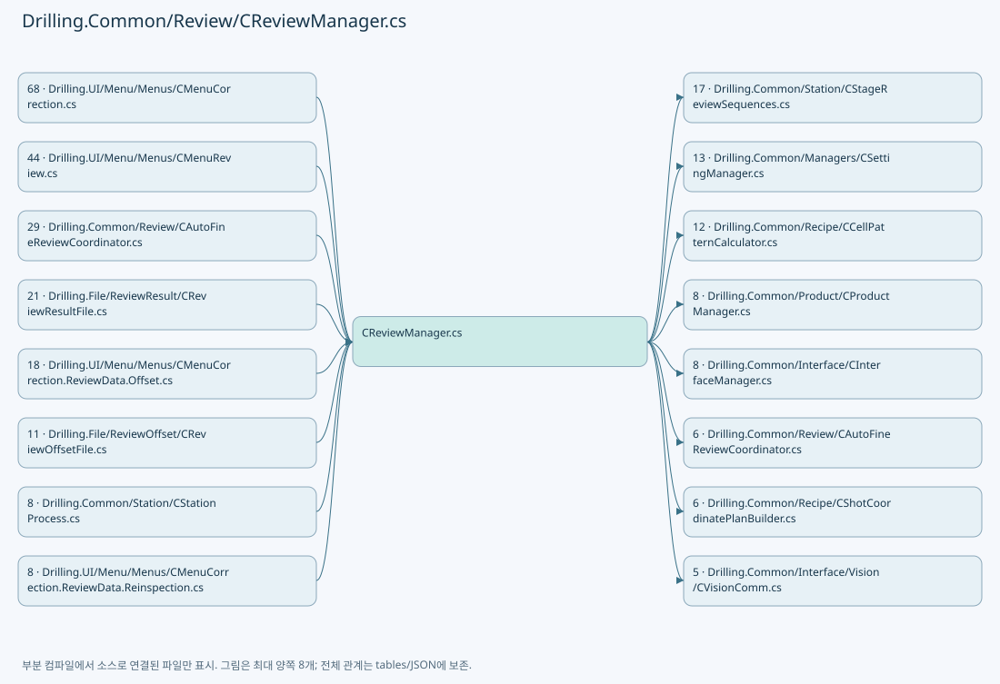

## 네임스페이스·타입·상속

| 타입 | 구분 | 원본 범위 | 선언/상속 |
| --- | --- | --- | --- |
| CReviewManager | ClassDeclaration | 17–3695 | CReviewManager: IReviewManager |
| CLazyReviewPointList | ClassDeclaration | 901–949 | CLazyReviewPointList: IReadOnlyList<ST_REVIEW_PLAN_POINT>, IReviewPointListInfo, IReviewCellPointSource |
| ST_REVIEW_MEASURE_RESULT | RecordDeclaration | 1154–1162 | ST_REVIEW_MEASURE_RESULT |
| EN_PRODUCT_REVIEW_UPDATE_OUTCOME | EnumDeclaration | 1164–1170 | EN_PRODUCT_REVIEW_UPDATE_OUTCOME |
| ST_PRODUCT_REVIEW_UPDATE_RESULT | RecordDeclaration | 1172–1176 | ST_PRODUCT_REVIEW_UPDATE_RESULT |
| ST_REVIEW_HEAD_LAYOUT | RecordDeclaration | 1223–1229 | ST_REVIEW_HEAD_LAYOUT |
| ST_REVIEW_HEAD_FIELD | RecordDeclaration | 1231–1231 | ST_REVIEW_HEAD_FIELD |
| ST_REVIEW_COORDINATE_SETTINGS | RecordDeclaration | 1232–1232 | ST_REVIEW_COORDINATE_SETTINGS |
| CReviewStageMotion | ClassDeclaration | 2494–2526 | CReviewStageMotion: IDisposable |
| DefaultInspectionSession | ClassDeclaration | 3109–3149 | DefaultInspectionSession: IDisposable |
| ZeroLineVisionSession | ClassDeclaration | 3451–3534 | ZeroLineVisionSession: IDisposable |
| ST_FINE_OFFSET_DELTA | RecordDeclaration | 3697–3697 | ST_FINE_OFFSET_DELTA |
| CFlyingCountMismatchException | ClassDeclaration | 3698–3698 | CFlyingCountMismatchException: InvalidOperationException("Vision 촬영 개수 불일치 / " + response) |
| EN_VISION_FLIP_TYPE | EnumDeclaration | 3699–3706 | EN_VISION_FLIP_TYPE |
| ST_REVIEW_COORDINATE_OFFSET | RecordStructDeclaration | 3708–3708 | ST_REVIEW_COORDINATE_OFFSET |
| ST_REVIEW_COORDINATE_FORMULA | RecordStructDeclaration | 3709–3709 | ST_REVIEW_COORDINATE_FORMULA |
| ST_REVIEW_FAILURE_MESSAGE | RecordDeclaration | 3710–3723 | ST_REVIEW_FAILURE_MESSAGE |
| CReviewFailureMessageBuilder | ClassDeclaration | 3725–3907 | CReviewFailureMessageBuilder |
| ST_REVIEW_FAILURE_PART | RecordDeclaration | 3906–3906 | ST_REVIEW_FAILURE_PART |
| ST_BEAM_INSPECTION_SNAPSHOT | RecordDeclaration | 3909–3919 | ST_BEAM_INSPECTION_SNAPSHOT |
| ST_BEAM_INSPECTION_RESULT_BEAM | RecordDeclaration | 3922–3925 | ST_BEAM_INSPECTION_RESULT_BEAM |
| ST_BEAM_INSPECTION_RESULT_SHOT | RecordDeclaration | 3927–3927 | ST_BEAM_INSPECTION_RESULT_SHOT |
| ST_BEAM_INSPECTION_RESULT_FILE_DATA | RecordDeclaration | 3928–3932 | ST_BEAM_INSPECTION_RESULT_FILE_DATA |
| IReviewPointListInfo | InterfaceDeclaration | 3933–3936 | IReviewPointListInfo |
| ST_REVIEW_CELL_POINT_RANGE | RecordStructDeclaration | 3944–3944 | ST_REVIEW_CELL_POINT_RANGE |
| IReviewCellPointSource | InterfaceDeclaration | 3945–3950 | IReviewCellPointSource |
| EN_REVIEW_POINT_STATE | EnumDeclaration | 3952–3959 | EN_REVIEW_POINT_STATE |
| EN_REVIEW_SEQUENCE_STATE | EnumDeclaration | 3961–3969 | EN_REVIEW_SEQUENCE_STATE |
| EN_REVIEW_RULE_TYPE | EnumDeclaration | 3971–3980 | EN_REVIEW_RULE_TYPE |
| ST_REVIEW_SEQUENCE_STATUS | RecordDeclaration | 3982–3982 | ST_REVIEW_SEQUENCE_STATUS |
| ST_REVIEW_PLAN_POINT | RecordDeclaration | 3983–4008 | ST_REVIEW_PLAN_POINT |
| CReviewNgReasons | ClassDeclaration | 4010–4017 | CReviewNgReasons |
| ST_REVIEW_NG_SUMMARY | RecordDeclaration | 4019–4045 | ST_REVIEW_NG_SUMMARY |
| ST_REVIEW_BEAM_POSITION | RecordDeclaration | 4047–4047 | ST_REVIEW_BEAM_POSITION |
| ST_REVIEW_HEAD_SCOPE | RecordDeclaration | 4054–4054 | ST_REVIEW_HEAD_SCOPE |
| CReviewShotNameFormatter | ClassDeclaration | 4055–4079 | CReviewShotNameFormatter |
| ST_REVIEW_PLAN | RecordDeclaration | 4081–4160 | ST_REVIEW_PLAN |
| CReviewPointCache | ClassDeclaration | 4156–4159 | CReviewPointCache |
| ST_REVIEW_CORRECTION_PLAN | RecordDeclaration | 4162–4168 | ST_REVIEW_CORRECTION_PLAN |
| ST_REVIEW_RESULT_DATA | RecordDeclaration | 4169–4174 | ST_REVIEW_RESULT_DATA |
| ST_REVIEW_RESULT_FILE_ROW | RecordDeclaration | 4176–4186 | ST_REVIEW_RESULT_FILE_ROW |
| ST_REVIEW_RESULT_FILE_DATA | RecordDeclaration | 4187–4205 | ST_REVIEW_RESULT_FILE_DATA |
| ST_REVIEW_REINSPECTION_UPDATE | RecordDeclaration | 4207–4217 | ST_REVIEW_REINSPECTION_UPDATE |
| ST_REVIEW_RESULT_EDIT_UPDATE | RecordDeclaration | 4219–4226 | ST_REVIEW_RESULT_EDIT_UPDATE |
| IReviewResultFile | InterfaceDeclaration | 4228–4234 | IReviewResultFile |
| ST_REVIEW_RESULT_CATALOG_ITEM | RecordDeclaration | 4236–4248 | ST_REVIEW_RESULT_CATALOG_ITEM |
| CReviewResultFileBase | ClassDeclaration | 4253–4271 | CReviewResultFileBase: IReviewResultFile |
| ST_REVIEW_OFFSET_ROW | RecordDeclaration | 4273–4277 | ST_REVIEW_OFFSET_ROW |
| ST_REVIEW_OFFSET_FILE_DATA | RecordDeclaration | 4279–4285 | ST_REVIEW_OFFSET_FILE_DATA |
| ST_REVIEW_OFFSET_ROLLBACK_RESULT | RecordDeclaration | 4287–4292 | ST_REVIEW_OFFSET_ROLLBACK_RESULT |
| ST_REVIEW_OFFSET_SOURCE_APPLICATION | RecordDeclaration | 4294–4298 | ST_REVIEW_OFFSET_SOURCE_APPLICATION |
| CReviewOffsetDuplicateSourceException | ClassDeclaration | 4300–4307 | CReviewOffsetDuplicateSourceException: InvalidOperationException( $"{existingApplication.AppliedAt:yyyy-MM-dd} 적용 이력에 동일한 Review Result가 있습니다: " + existingApplication.SourceResultFile) |
| CReviewOffsetFileBase | ClassDeclaration | 4309–4329 | CReviewOffsetFileBase |
| IReviewManager | InterfaceDeclaration | 4331–4349 | IReviewManager |
| EN_FINE_INSPECTION_METHOD | EnumDeclaration | 4351–4355 | EN_FINE_INSPECTION_METHOD |
| EN_FINE_REVIEW_LINE_STATE | EnumDeclaration | 4357–4364 | EN_FINE_REVIEW_LINE_STATE |
| ST_FINE_REVIEW_LINE | RecordDeclaration | 4366–4366 | ST_FINE_REVIEW_LINE |
| ST_FINE_REVIEW_REQUEST | RecordDeclaration | 4367–4375 | ST_FINE_REVIEW_REQUEST |
| ST_FINE_REVIEW_SNAPSHOT | RecordDeclaration | 4377–4382 | ST_FINE_REVIEW_SNAPSHOT |
| ST_FINE_REVIEW_RESULT_DATA | RecordDeclaration | 4384–4389 | ST_FINE_REVIEW_RESULT_DATA |
| EN_ONE_SHOT_ACTION | EnumDeclaration | 4391–4396 | EN_ONE_SHOT_ACTION |
| EN_ONE_SHOT_METHOD | EnumDeclaration | 4398–4402 | EN_ONE_SHOT_METHOD |
| ST_ONE_SHOT_RESULT | RecordDeclaration | 4404–4410 | ST_ONE_SHOT_RESULT |
| ST_ONE_SHOT_RESULT_DATA | RecordDeclaration | 4411–4411 | ST_ONE_SHOT_RESULT_DATA |
| ST_ROUGH_REVIEW_SNAPSHOT | RecordDeclaration | 4412–4416 | ST_ROUGH_REVIEW_SNAPSHOT |
| ST_ROUGH_REVIEW_RESULT_DATA | RecordDeclaration | 4418–4429 | ST_ROUGH_REVIEW_RESULT_DATA |
| ST_ROUGH_REVIEW_MEASUREMENT | RecordDeclaration | 4431–4434 | ST_ROUGH_REVIEW_MEASUREMENT |
| ST_REVIEW_MOTION_PARAMETERS | RecordDeclaration | 4435–4452 | ST_REVIEW_MOTION_PARAMETERS |
| CReviewRuntimePoints | ClassDeclaration | 4456–4532 | CReviewRuntimePoints: IReadOnlyList<ST_REVIEW_PLAN_POINT> |
| Index | ClassDeclaration | 4458–4481 | Index |
| Selection | ClassDeclaration | 4519–4531 | Selection: IReadOnlyList<ST_REVIEW_PLAN_POINT> |

## 멤버 빠른 목록

| 이름 | 종류 | 범위 | 서명 |
| --- | --- | --- | --- |
| DefaultReviewBeamNo | FieldDeclaration | L26–26 | int Drilling.Common.Review.CReviewManager.DefaultReviewBeamNo |
| MaxHeadCount | FieldDeclaration | L27–27 | int Drilling.Common.Review.CReviewManager.MaxHeadCount |
| DefaultHeadCount | FieldDeclaration | L28–28 | int Drilling.Common.Review.CReviewManager.DefaultHeadCount |
| DefaultCellCount | FieldDeclaration | L29–29 | int Drilling.Common.Review.CReviewManager.DefaultCellCount |
| IofInspectionType | FieldDeclaration | L30–30 | int Drilling.Common.Review.CReviewManager.IofInspectionType |
| ReviewSequenceRowTolerance | FieldDeclaration | L31–31 | double Drilling.Common.Review.CReviewManager.ReviewSequenceRowTolerance |
| RecipeParameterIndexes | FieldDeclaration | L32–32 | System.Runtime.CompilerServices.ConditionalWeakTable<Drilling.Common.Managers.ST_RECIPE_DEFINITION, System.Collections.Generic.Dictionary<string, string>> Drilling.Common.Review.CReviewManager.RecipeParameterIndexes |
| _sequenceLock | FieldDeclaration | L33–33 | System.Threading.SemaphoreSlim Drilling.Common.Review.CReviewManager._sequenceLock |
| _stateLock | FieldDeclaration | L34–34 | object Drilling.Common.Review.CReviewManager._stateLock |
| _stopRequested | FieldDeclaration | L35–35 | int Drilling.Common.Review.CReviewManager._stopRequested |
| _sequenceState | FieldDeclaration | L36–36 | int Drilling.Common.Review.CReviewManager._sequenceState |
| _currentPlan | FieldDeclaration | L37–37 | Drilling.Common.Review.ST_REVIEW_PLAN? Drilling.Common.Review.CReviewManager._currentPlan |
| _currentPoint | FieldDeclaration | L38–38 | Drilling.Common.Review.ST_REVIEW_PLAN_POINT? Drilling.Common.Review.CReviewManager._currentPoint |
| _lastMeasuredPoint | FieldDeclaration | L39–39 | Drilling.Common.Review.ST_REVIEW_PLAN_POINT? Drilling.Common.Review.CReviewManager._lastMeasuredPoint |
| _reviewProductId | FieldDeclaration | L40–40 | string? Drilling.Common.Review.CReviewManager._reviewProductId |
| _reviewStageMotion | FieldDeclaration | L41–41 | Drilling.Common.Review.CReviewManager.CReviewStageMotion? Drilling.Common.Review.CReviewManager._reviewStageMotion |
| _interruptedReviewPlan | FieldDeclaration | L42–42 | Drilling.Common.Review.ST_REVIEW_PLAN? Drilling.Common.Review.CReviewManager._interruptedReviewPlan |
| _interruptedReviewProductId | FieldDeclaration | L43–43 | string? Drilling.Common.Review.CReviewManager._interruptedReviewProductId |
| FineMonitor | PropertyDeclaration | L44–44 | Drilling.Common.Review.CFineReviewMonitorStore Drilling.Common.Review.CReviewManager.FineMonitor |
| get_FineMonitor | GetAccessorDeclaration | L44–44 | Drilling.Common.Review.CFineReviewMonitorStore Drilling.Common.Review.CReviewManager.FineMonitor.get |
| LastSavedResultPath | PropertyDeclaration | L47–47 | string? Drilling.Common.Review.CReviewManager.LastSavedResultPath |
| get_LastSavedResultPath | GetAccessorDeclaration | L47–47 | string? Drilling.Common.Review.CReviewManager.LastSavedResultPath.get |
| set_LastSavedResultPath | SetAccessorDeclaration | L47–47 | void Drilling.Common.Review.CReviewManager.LastSavedResultPath.set |
| CameraResolution | PropertyDeclaration | L48–48 | double Drilling.Common.Review.CReviewManager.CameraResolution |
| CurrentPlan | PropertyDeclaration | L50–59 | Drilling.Common.Review.ST_REVIEW_PLAN? Drilling.Common.Review.CReviewManager.CurrentPlan |
| get_CurrentPlan | GetAccessorDeclaration | L52–58 | Drilling.Common.Review.ST_REVIEW_PLAN? Drilling.Common.Review.CReviewManager.CurrentPlan.get |
| SequenceState | PropertyDeclaration | L61–61 | Drilling.Common.Review.EN_REVIEW_SEQUENCE_STATE Drilling.Common.Review.CReviewManager.SequenceState |
| get_SequenceState | GetAccessorDeclaration | L61–61 | Drilling.Common.Review.EN_REVIEW_SEQUENCE_STATE Drilling.Common.Review.CReviewManager.SequenceState.get |
| set_SequenceState | SetAccessorDeclaration | L61–61 | void Drilling.Common.Review.CReviewManager.SequenceState.set |
| IsStopRequested | PropertyDeclaration | L62–62 | bool Drilling.Common.Review.CReviewManager.IsStopRequested |
| CreatePlan | MethodDeclaration | L64–67 | Drilling.Common.Review.ST_REVIEW_PLAN Drilling.Common.Review.CReviewManager.CreatePlan(Drilling.Common.Managers.ST_RECIPE_DEFINITION, System.Collections.Generic.IReadOnlyCollection<string>) |
| CreatePlan | MethodDeclaration | L69–72 | Drilling.Common.Review.ST_REVIEW_PLAN Drilling.Common.Review.CReviewManager.CreatePlan(Drilling.Common.Managers.ST_RECIPE_DEFINITION, System.Collections.Generic.IReadOnlyCollection<string>, int) |
| CreatePlan | MethodDeclaration | L74–114 | Drilling.Common.Review.ST_REVIEW_PLAN Drilling.Common.Review.CReviewManager.CreatePlan(Drilling.Common.Managers.ST_RECIPE_DEFINITION, System.Collections.Generic.IReadOnlyCollection<string>, int, double, double) |
| CurrentPoint | PropertyDeclaration | L116–125 | Drilling.Common.Review.ST_REVIEW_PLAN_POINT? Drilling.Common.Review.CReviewManager.CurrentPoint |
| get_CurrentPoint | GetAccessorDeclaration | L118–124 | Drilling.Common.Review.ST_REVIEW_PLAN_POINT? Drilling.Common.Review.CReviewManager.CurrentPoint.get |
| LastMeasuredPoint | PropertyDeclaration | L127–136 | Drilling.Common.Review.ST_REVIEW_PLAN_POINT? Drilling.Common.Review.CReviewManager.LastMeasuredPoint |
| get_LastMeasuredPoint | GetAccessorDeclaration | L129–135 | Drilling.Common.Review.ST_REVIEW_PLAN_POINT? Drilling.Common.Review.CReviewManager.LastMeasuredPoint.get |
| GetShotBeamPositions | MethodDeclaration | L138–148 | System.Collections.Generic.IReadOnlyList<Drilling.Common.Review.ST_REVIEW_BEAM_POSITION> Drilling.Common.Review.CReviewManager.GetShotBeamPositions(Drilling.Common.Managers.ST_RECIPE_DEFINITION, Drilling.Common.Review.ST_REVIEW_PLAN_POINT, double, double, double) |
| CreateShotBeamPositionCalculator | MethodDeclaration | L151–193 | System.Func<Drilling.Common.Review.ST_REVIEW_PLAN_POINT, int, Drilling.Common.Review.ST_REVIEW_BEAM_POSITION> Drilling.Common.Review.CReviewManager.CreateShotBeamPositionCalculator(Drilling.Common.Managers.ST_RECIPE_DEFINITION, double, double, double) |
| CreateAllPlan | MethodDeclaration | L195–198 | Drilling.Common.Review.ST_REVIEW_PLAN Drilling.Common.Review.CReviewManager.CreateAllPlan(Drilling.Common.Managers.ST_RECIPE_DEFINITION, int) |
| CreateAllPlan | MethodDeclaration | L200–209 | Drilling.Common.Review.ST_REVIEW_PLAN Drilling.Common.Review.CReviewManager.CreateAllPlan(Drilling.Common.Managers.ST_RECIPE_DEFINITION, int, double, double) |
| SelectGlassLineShotKeys | MethodDeclaration | L211–246 | System.Collections.Generic.IReadOnlyList<string> Drilling.Common.Review.CReviewManager.SelectGlassLineShotKeys(Drilling.Common.Review.ST_REVIEW_PLAN, string) |
| ApplyShiftOffset | MethodDeclaration | L248–273 | Drilling.Common.Review.ST_REVIEW_PLAN Drilling.Common.Review.CReviewManager.ApplyShiftOffset(Drilling.Common.Review.ST_REVIEW_PLAN, double, double) |
| Apply | LocalFunctionStatement | L254–261 | Drilling.Common.Review.ST_REVIEW_PLAN_POINT Apply(Drilling.Common.Review.ST_REVIEW_PLAN_POINT) |
| GetHeadScopes | MethodDeclaration | L280–283 | System.Collections.Generic.IReadOnlyList<Drilling.Common.Review.ST_REVIEW_HEAD_SCOPE> Drilling.Common.Review.CReviewManager.GetHeadScopes(Drilling.Common.Managers.ST_RECIPE_DEFINITION) |
| Start | MethodDeclaration | L285–288 | System.Threading.Tasks.Task<Drilling.Common.Review.ST_REVIEW_SEQUENCE_STATUS> Drilling.Common.Review.CReviewManager.Start(Drilling.Common.Review.ST_REVIEW_PLAN, string?, System.Action<Drilling.Common.Review.ST_REVIEW_PLAN>?, System.Threading.CancellationToken) |
| Start | MethodDeclaration | L290–439 | System.Threading.Tasks.Task<Drilling.Common.Review.ST_REVIEW_SEQUENCE_STATUS> Drilling.Common.Review.CReviewManager.Start(Drilling.Common.Review.ST_REVIEW_PLAN, string?, Drilling.Common.Product.ST_PRODUCT_REVIEW_DATA?, bool, System.Action<Drilling.Common.Review.ST_REVIEW_PLAN>?, System.Threading.CancellationToken) |
| Stop | MethodDeclaration | L441–451 | void Drilling.Common.Review.CReviewManager.Stop() |
| FindIncompleteProductReview | MethodDeclaration | L453–464 | System.Threading.Tasks.Task<Drilling.Common.Product.ST_PRODUCT_REVIEW_DATA?> Drilling.Common.Review.CReviewManager.FindIncompleteProductReview(Drilling.Common.Review.ST_REVIEW_PLAN, string, System.Threading.CancellationToken) |
| GetScannerAxisTransform | MethodDeclaration | L466–474 | Drilling.Common.Recipe.ST_SCANNER_AXIS_TRANSFORM Drilling.Common.Review.CReviewManager.GetScannerAxisTransform(int) |
| RetryRemaining | MethodDeclaration | L476–494 | System.Threading.Tasks.Task<Drilling.Common.Review.ST_REVIEW_SEQUENCE_STATUS> Drilling.Common.Review.CReviewManager.RetryRemaining(System.Action<Drilling.Common.Review.ST_REVIEW_PLAN>?, System.Threading.CancellationToken) |
| CreatePlanCore | MethodDeclaration | L496–548 | Drilling.Common.Review.ST_REVIEW_PLAN Drilling.Common.Review.CReviewManager.CreatePlanCore(Drilling.Common.Managers.ST_RECIPE_DEFINITION, System.Func<Drilling.Common.Review.ST_REVIEW_PLAN_POINT, bool>, int, bool, double, double) |
| BuildReviewExcludedShots | MethodDeclaration | L550–566 | System.Collections.Generic.IReadOnlyDictionary<string, string> Drilling.Common.Review.CReviewManager.BuildReviewExcludedShots(System.Collections.Generic.IReadOnlyDictionary<string, string>, System.Collections.Generic.IReadOnlyList<Drilling.Common.Recipe.ST_HEAD_SHOT_POINT>) |
| BuildRuntimeCoordinateParameters | MethodDeclaration | L568–592 | System.Collections.Generic.IReadOnlyDictionary<string, string> Drilling.Common.Review.CReviewManager.BuildRuntimeCoordinateParameters(Drilling.Common.Managers.ST_RECIPE_DEFINITION) |
| LoadReviewCoordinateSettings | MethodDeclaration | L594–609 | Drilling.Common.Review.CReviewManager.ST_REVIEW_COORDINATE_SETTINGS Drilling.Common.Review.CReviewManager.LoadReviewCoordinateSettings(Drilling.Common.Managers.ST_RECIPE_DEFINITION) |
| ReadHeadPositionX | MethodDeclaration | L611–618 | double Drilling.Common.Review.CReviewManager.ReadHeadPositionX(System.Collections.Generic.IReadOnlyList<Drilling.Common.Managers.ST_SYSTEM_PARAMETER>, int) |
| ReadSettingDouble | MethodDeclaration | L620–636 | double Drilling.Common.Review.CReviewManager.ReadSettingDouble(System.Collections.Generic.IReadOnlyList<Drilling.Common.Managers.ST_SYSTEM_PARAMETER>, double, params string[]) |
| ReadSettingBoolean | MethodDeclaration | L638–657 | bool Drilling.Common.Review.CReviewManager.ReadSettingBoolean(System.Collections.Generic.IReadOnlyList<Drilling.Common.Managers.ST_SYSTEM_PARAMETER>, bool, params string[]) |
| ReadSettingText | MethodDeclaration | L659–672 | string Drilling.Common.Review.CReviewManager.ReadSettingText(System.Collections.Generic.IReadOnlyList<Drilling.Common.Managers.ST_SYSTEM_PARAMETER>, string, params string[]) |
| BuildShotPoints | MethodDeclaration | L674–771 | System.Collections.Generic.IReadOnlyList<Drilling.Common.Review.ST_REVIEW_PLAN_POINT> Drilling.Common.Review.CReviewManager.BuildShotPoints(Drilling.Common.Managers.ST_RECIPE_DEFINITION, int, int, Drilling.Common.Review.CReviewManager.ST_REVIEW_COORDINATE_SETTINGS, System.Collections.Generic.IReadOnlyDictionary<(int CellNo, int CellShotNo), int>, double, int, bool, System.Collections.Generic.IReadOnlyDictionary<string, string>, double, double) |
| GetMeasuredResultRows | MethodDeclaration | L773–785 | System.Collections.Generic.IReadOnlyList<Drilling.Common.Review.ST_REVIEW_PLAN_POINT> Drilling.Common.Review.CReviewManager.GetMeasuredResultRows(System.Collections.Generic.IReadOnlyList<Drilling.Common.Review.ST_REVIEW_PLAN_POINT>) |
| ProjectCorrectionRows | MethodDeclaration | L787–808 | System.Collections.Generic.IReadOnlyList<Drilling.Common.Review.ST_REVIEW_PLAN_POINT> Drilling.Common.Review.CReviewManager.ProjectCorrectionRows(Drilling.Common.Review.ST_REVIEW_PLAN, System.Collections.Generic.IReadOnlyList<Drilling.Common.Review.ST_REVIEW_PLAN_POINT>) |
| ProjectSimpleResultRows | MethodDeclaration | L810–819 | System.Collections.Generic.IReadOnlyList<Drilling.Common.Review.ST_REVIEW_PLAN_POINT> Drilling.Common.Review.CReviewManager.ProjectSimpleResultRows(Drilling.Common.Review.ST_REVIEW_CORRECTION_PLAN, System.Collections.Generic.IReadOnlyList<Drilling.Common.Review.ST_REVIEW_PLAN_POINT>) |
| ProjectRoughResultRows | MethodDeclaration | L821–825 | System.Collections.Generic.IReadOnlyList<Drilling.Common.Review.ST_REVIEW_PLAN_POINT> Drilling.Common.Review.CReviewManager.ProjectRoughResultRows(Drilling.Common.Review.ST_REVIEW_CORRECTION_PLAN, System.Collections.Generic.IReadOnlyList<Drilling.Common.Review.ST_REVIEW_PLAN_POINT>) |
| ProjectFineResultRows | MethodDeclaration | L827–842 | System.Collections.Generic.IReadOnlyList<Drilling.Common.Review.ST_REVIEW_PLAN_POINT> Drilling.Common.Review.CReviewManager.ProjectFineResultRows(System.Collections.Generic.IReadOnlyList<Drilling.Common.Review.ST_REVIEW_PLAN_POINT>, System.Collections.Generic.IReadOnlyList<Drilling.Common.Review.ST_REVIEW_PLAN_POINT>) |
| InterpolateFineMeasurementAcrossGlass | MethodDeclaration | L844–853 | Drilling.Common.Review.ST_REVIEW_PLAN_POINT Drilling.Common.Review.CReviewManager.InterpolateFineMeasurementAcrossGlass(Drilling.Common.Review.ST_REVIEW_PLAN_POINT, System.Collections.Generic.IReadOnlyList<Drilling.Common.Review.ST_REVIEW_PLAN_POINT>) |
| InterpolateFineMeasurement | MethodDeclaration | L855–890 | Drilling.Common.Review.ST_REVIEW_PLAN_POINT Drilling.Common.Review.CReviewManager.InterpolateFineMeasurement(Drilling.Common.Review.ST_REVIEW_PLAN_POINT, System.Collections.Generic.IReadOnlyList<Drilling.Common.Review.ST_REVIEW_PLAN_POINT>) |
| CopyMeasurement | MethodDeclaration | L892–899 | Drilling.Common.Review.ST_REVIEW_PLAN_POINT Drilling.Common.Review.CReviewManager.CopyMeasurement(Drilling.Common.Review.ST_REVIEW_PLAN_POINT, Drilling.Common.Review.ST_REVIEW_PLAN_POINT) |
| FineCoordinateKey | MethodDeclaration | L900–900 | double Drilling.Common.Review.CReviewManager.FineCoordinateKey(double) |
| _pointCache | FieldDeclaration | L903–903 | Drilling.Common.Review.ST_REVIEW_PLAN_POINT?[] Drilling.Common.Review.CReviewManager.CLazyReviewPointList._pointCache |
| Count | PropertyDeclaration | L904–904 | int Drilling.Common.Review.CReviewManager.CLazyReviewPointList.Count |
| AreAllPointsSelected | PropertyDeclaration | L905–905 | bool Drilling.Common.Review.CReviewManager.CLazyReviewPointList.AreAllPointsSelected |
| PatternCellCount | PropertyDeclaration | L906–906 | int Drilling.Common.Review.CReviewManager.CLazyReviewPointList.PatternCellCount |
| GetCellRange | MethodDeclaration | L908–917 | Drilling.Common.Review.ST_REVIEW_CELL_POINT_RANGE Drilling.Common.Review.CReviewManager.CLazyReviewPointList.GetCellRange(int) |
| this[] | IndexerDeclaration | L919–938 | Drilling.Common.Review.ST_REVIEW_PLAN_POINT Drilling.Common.Review.CReviewManager.CLazyReviewPointList.this[int] |
| get_Item | GetAccessorDeclaration | L921–937 | Drilling.Common.Review.ST_REVIEW_PLAN_POINT Drilling.Common.Review.CReviewManager.CLazyReviewPointList.this[int].get |
| GetEnumerator | MethodDeclaration | L940–946 | System.Collections.Generic.IEnumerator<Drilling.Common.Review.ST_REVIEW_PLAN_POINT> Drilling.Common.Review.CReviewManager.CLazyReviewPointList.GetEnumerator() |
| System.Collections.IEnumerable.GetEnumerator | MethodDeclaration | L948–948 | System.Collections.IEnumerator Drilling.Common.Review.CReviewManager.CLazyReviewPointList.System.Collections.IEnumerable.GetEnumerator() |
| CalculateBeamOffset | MethodDeclaration | L951–971 | Drilling.Common.Review.ST_REVIEW_COORDINATE_OFFSET Drilling.Common.Review.CReviewManager.CalculateBeamOffset(int, int, double) |
| ValidateBeamNo | MethodDeclaration | L973–985 | void Drilling.Common.Review.CReviewManager.ValidateBeamNo(int, int) |
| ValidateShiftOffset | MethodDeclaration | L987–992 | void Drilling.Common.Review.CReviewManager.ValidateShiftOffset(double, double) |
| CalculateReviewTarget | MethodDeclaration | L994–1007 | Drilling.Common.Review.ST_REVIEW_COORDINATE_OFFSET Drilling.Common.Review.CReviewManager.CalculateReviewTarget(double, double, double, double, double, double, double, double) |
| RotateLocalOffset | MethodDeclaration | L1009–1015 | Drilling.Common.Review.ST_REVIEW_COORDINATE_OFFSET Drilling.Common.Review.CReviewManager.RotateLocalOffset(double, double, double) |
| FormatDouble | MethodDeclaration | L1017–1020 | string Drilling.Common.Review.CReviewManager.FormatDouble(double) |
| WriteReviewLog | MethodDeclaration | L1022–1038 | void Drilling.Common.Review.CReviewManager.WriteReviewLog(string, string) |
| WriteReviewError | MethodDeclaration | L1040–1043 | void Drilling.Common.Review.CReviewManager.WriteReviewError() |
| SetCurrentPlan | MethodDeclaration | L1045–1053 | void Drilling.Common.Review.CReviewManager.SetCurrentPlan(Drilling.Common.Review.ST_REVIEW_PLAN, System.Action<Drilling.Common.Review.ST_REVIEW_PLAN>?) |
| SetActivePoints | MethodDeclaration | L1055–1062 | void Drilling.Common.Review.CReviewManager.SetActivePoints(Drilling.Common.Review.ST_REVIEW_PLAN_POINT?, Drilling.Common.Review.ST_REVIEW_PLAN_POINT?) |
| SetReviewProductId | MethodDeclaration | L1064–1070 | void Drilling.Common.Review.CReviewManager.SetReviewProductId(string?) |
| GetReviewProductId | MethodDeclaration | L1072–1078 | string? Drilling.Common.Review.CReviewManager.GetReviewProductId() |
| ResetPlanForRun | MethodDeclaration | L1080–1087 | Drilling.Common.Review.ST_REVIEW_PLAN Drilling.Common.Review.CReviewManager.ResetPlanForRun(Drilling.Common.Review.ST_REVIEW_PLAN) |
| SetWaitingPointsReady | MethodDeclaration | L1089–1092 | Drilling.Common.Review.ST_REVIEW_PLAN Drilling.Common.Review.CReviewManager.SetWaitingPointsReady(Drilling.Common.Review.ST_REVIEW_PLAN) |
| PrepareRuntimePlan | MethodDeclaration | L1094–1099 | Drilling.Common.Review.ST_REVIEW_PLAN Drilling.Common.Review.CReviewManager.PrepareRuntimePlan(Drilling.Common.Review.ST_REVIEW_PLAN) |
| UpdatePoints | MethodDeclaration | L1100–1108 | Drilling.Common.Review.ST_REVIEW_PLAN Drilling.Common.Review.CReviewManager.UpdatePoints(Drilling.Common.Review.ST_REVIEW_PLAN, System.Collections.Generic.IReadOnlyList<Drilling.Common.Review.ST_REVIEW_PLAN_POINT>) |
| UpdatePoint | MethodDeclaration | L1110–1113 | Drilling.Common.Review.ST_REVIEW_PLAN Drilling.Common.Review.CReviewManager.UpdatePoint(Drilling.Common.Review.ST_REVIEW_PLAN, Drilling.Common.Review.ST_REVIEW_PLAN_POINT) |
| CreateStatus | MethodDeclaration | L1115–1121 | Drilling.Common.Review.ST_REVIEW_SEQUENCE_STATUS Drilling.Common.Review.CReviewManager.CreateStatus(Drilling.Common.Review.ST_REVIEW_PLAN, Drilling.Common.Review.EN_REVIEW_SEQUENCE_STATE, string) |
| SummarizeReviewResults | MethodDeclaration | L1123–1145 | Drilling.Common.Review.ST_REVIEW_NG_SUMMARY Drilling.Common.Review.CReviewManager.SummarizeReviewResults(System.Collections.Generic.IEnumerable<Drilling.Common.Review.ST_REVIEW_PLAN_POINT>) |
| WriteReviewNgSummary | MethodDeclaration | L1147–1152 | void Drilling.Common.Review.CReviewManager.WriteReviewNgSummary(string, System.Collections.Generic.IEnumerable<Drilling.Common.Review.ST_REVIEW_PLAN_POINT>) |
| MarkFind | PropertyDeclaration | L1156–1156 | Drilling.Common.Interface.Vision.ST_VISION_MARK_FIND? Drilling.Common.Review.CReviewManager.ST_REVIEW_MEASURE_RESULT.MarkFind |
| get_MarkFind | GetAccessorDeclaration | L1156–1156 | Drilling.Common.Interface.Vision.ST_VISION_MARK_FIND? Drilling.Common.Review.CReviewManager.ST_REVIEW_MEASURE_RESULT.MarkFind.get |
| set_MarkFind | InitAccessorDeclaration | L1156–1156 | void Drilling.Common.Review.CReviewManager.ST_REVIEW_MEASURE_RESULT.MarkFind.init |
| Resolution | PropertyDeclaration | L1157–1157 | int Drilling.Common.Review.CReviewManager.ST_REVIEW_MEASURE_RESULT.Resolution |
| get_Resolution | GetAccessorDeclaration | L1157–1157 | int Drilling.Common.Review.CReviewManager.ST_REVIEW_MEASURE_RESULT.Resolution.get |
| set_Resolution | InitAccessorDeclaration | L1157–1157 | void Drilling.Common.Review.CReviewManager.ST_REVIEW_MEASURE_RESULT.Resolution.init |
| CameraResolution | PropertyDeclaration | L1158–1158 | double Drilling.Common.Review.CReviewManager.ST_REVIEW_MEASURE_RESULT.CameraResolution |
| get_CameraResolution | GetAccessorDeclaration | L1158–1158 | double Drilling.Common.Review.CReviewManager.ST_REVIEW_MEASURE_RESULT.CameraResolution.get |
| set_CameraResolution | InitAccessorDeclaration | L1158–1158 | void Drilling.Common.Review.CReviewManager.ST_REVIEW_MEASURE_RESULT.CameraResolution.init |
| ErrorMillimeters | PropertyDeclaration | L1159–1159 | Drilling.Common.Review.ST_REVIEW_COORDINATE_OFFSET? Drilling.Common.Review.CReviewManager.ST_REVIEW_MEASURE_RESULT.ErrorMillimeters |
| get_ErrorMillimeters | GetAccessorDeclaration | L1159–1159 | Drilling.Common.Review.ST_REVIEW_COORDINATE_OFFSET? Drilling.Common.Review.CReviewManager.ST_REVIEW_MEASURE_RESULT.ErrorMillimeters.get |
| set_ErrorMillimeters | InitAccessorDeclaration | L1159–1159 | void Drilling.Common.Review.CReviewManager.ST_REVIEW_MEASURE_RESULT.ErrorMillimeters.init |
| VisionResultCode | PropertyDeclaration | L1160–1160 | int? Drilling.Common.Review.CReviewManager.ST_REVIEW_MEASURE_RESULT.VisionResultCode |
| get_VisionResultCode | GetAccessorDeclaration | L1160–1160 | int? Drilling.Common.Review.CReviewManager.ST_REVIEW_MEASURE_RESULT.VisionResultCode.get |
| set_VisionResultCode | InitAccessorDeclaration | L1160–1160 | void Drilling.Common.Review.CReviewManager.ST_REVIEW_MEASURE_RESULT.VisionResultCode.init |
| NgReason | PropertyDeclaration | L1161–1161 | string Drilling.Common.Review.CReviewManager.ST_REVIEW_MEASURE_RESULT.NgReason |
| get_NgReason | GetAccessorDeclaration | L1161–1161 | string Drilling.Common.Review.CReviewManager.ST_REVIEW_MEASURE_RESULT.NgReason.get |
| set_NgReason | InitAccessorDeclaration | L1161–1161 | void Drilling.Common.Review.CReviewManager.ST_REVIEW_MEASURE_RESULT.NgReason.init |
| Success | EnumMemberDeclaration | L1166–1166 | Drilling.Common.Review.CReviewManager.EN_PRODUCT_REVIEW_UPDATE_OUTCOME.Success |
| NotApplicable | EnumMemberDeclaration | L1167–1167 | Drilling.Common.Review.CReviewManager.EN_PRODUCT_REVIEW_UPDATE_OUTCOME.NotApplicable |
| ProductReplaced | EnumMemberDeclaration | L1168–1168 | Drilling.Common.Review.CReviewManager.EN_PRODUCT_REVIEW_UPDATE_OUTCOME.ProductReplaced |
| Failed | EnumMemberDeclaration | L1169–1169 | Drilling.Common.Review.CReviewManager.EN_PRODUCT_REVIEW_UPDATE_OUTCOME.Failed |
| Success | FieldDeclaration | L1174–1174 | Drilling.Common.Review.CReviewManager.ST_PRODUCT_REVIEW_UPDATE_RESULT Drilling.Common.Review.CReviewManager.ST_PRODUCT_REVIEW_UPDATE_RESULT.Success |
| NotApplicable | FieldDeclaration | L1175–1175 | Drilling.Common.Review.CReviewManager.ST_PRODUCT_REVIEW_UPDATE_RESULT Drilling.Common.Review.CReviewManager.ST_PRODUCT_REVIEW_UPDATE_RESULT.NotApplicable |
| OrderByReviewSequence | MethodDeclaration | L1178–1221 | System.Collections.Generic.IReadOnlyList<Drilling.Common.Review.ST_REVIEW_PLAN_POINT> Drilling.Common.Review.CReviewManager.OrderByReviewSequence(System.Collections.Generic.IEnumerable<Drilling.Common.Review.ST_REVIEW_PLAN_POINT>) |
| GetDesignY | LocalFunctionStatement | L1180–1183 | double GetDesignY(Drilling.Common.Review.ST_REVIEW_PLAN_POINT) |
| GetDesignX | LocalFunctionStatement | L1185–1188 | double GetDesignX(Drilling.Common.Review.ST_REVIEW_PLAN_POINT) |
| GetCellNo | LocalFunctionStatement | L1190–1193 | int GetCellNo(Drilling.Common.Review.ST_REVIEW_PLAN_POINT) |
| GetShotNo | LocalFunctionStatement | L1195–1198 | int GetShotNo(Drilling.Common.Review.ST_REVIEW_PLAN_POINT) |
| GetFieldOrUnassigned | MethodDeclaration | L1225–1228 | Drilling.Common.Review.CReviewManager.ST_REVIEW_HEAD_FIELD Drilling.Common.Review.CReviewManager.ST_REVIEW_HEAD_LAYOUT.GetFieldOrUnassigned(int) |
| ToShotKey | MethodDeclaration | L1233–1236 | string Drilling.Common.Review.CReviewManager.ToShotKey(int, int) |
| NormalizeShotKey | MethodDeclaration | L1238–1264 | string Drilling.Common.Review.CReviewManager.NormalizeShotKey(string) |
| TryParseShotKey | MethodDeclaration | L1266–1273 | bool Drilling.Common.Review.CReviewManager.TryParseShotKey(string, out int, out int) |
| ReadInt | MethodDeclaration | L1275–1284 | int Drilling.Common.Review.CReviewManager.ReadInt(Drilling.Common.Managers.ST_RECIPE_DEFINITION, int, params string[]) |
| ReadRequiredCellCount | MethodDeclaration | L1286–1298 | int Drilling.Common.Review.CReviewManager.ReadRequiredCellCount(Drilling.Common.Managers.ST_RECIPE_DEFINITION, string) |
| FindParameter | MethodDeclaration | L1300–1303 | Drilling.Common.Managers.ST_RECIPE_PARAMETER? Drilling.Common.Review.CReviewManager.FindParameter(Drilling.Common.Managers.ST_RECIPE_DEFINITION, string) |
| GetParameterMinimum | MethodDeclaration | L1305–1308 | int Drilling.Common.Review.CReviewManager.GetParameterMinimum(Drilling.Common.Managers.ST_RECIPE_PARAMETER?) |
| GetParameterMaximum | MethodDeclaration | L1310–1313 | int? Drilling.Common.Review.CReviewManager.GetParameterMaximum(Drilling.Common.Managers.ST_RECIPE_PARAMETER?, int) |
| ReadDouble | MethodDeclaration | L1315–1319 | double Drilling.Common.Review.CReviewManager.ReadDouble(Drilling.Common.Managers.ST_RECIPE_DEFINITION, double, params string[]) |
| ReadText | MethodDeclaration | L1321–1333 | string Drilling.Common.Review.CReviewManager.ReadText(Drilling.Common.Managers.ST_RECIPE_DEFINITION, params string[]) |
| CreateRecipeParameterIndex | MethodDeclaration | L1335–1353 | System.Collections.Generic.Dictionary<string, string> Drilling.Common.Review.CReviewManager.CreateRecipeParameterIndex(Drilling.Common.Managers.ST_RECIPE_DEFINITION) |
| BuildBeamInspectionTargets | MethodDeclaration | L1357–1385 | System.Collections.Generic.IReadOnlyList<Drilling.Common.Review.ST_REVIEW_PLAN_POINT> Drilling.Common.Review.CReviewManager.BuildBeamInspectionTargets(Drilling.Common.Managers.ST_RECIPE_DEFINITION, Drilling.Common.Review.ST_REVIEW_PLAN, System.Collections.Generic.IReadOnlyCollection<string>, System.Collections.Generic.IReadOnlyCollection<int>) |
| StartBeamInspection | MethodDeclaration | L1387–1513 | System.Threading.Tasks.Task<Drilling.Common.Review.ST_BEAM_INSPECTION_SNAPSHOT> Drilling.Common.Review.CReviewManager.StartBeamInspection(Drilling.Common.Managers.ST_RECIPE_DEFINITION, Drilling.Common.Review.ST_REVIEW_PLAN, System.Collections.Generic.IReadOnlyCollection<string>, System.Collections.Generic.IReadOnlyCollection<int>, System.Action<Drilling.Common.Review.ST_BEAM_INSPECTION_SNAPSHOT>, System.Threading.CancellationToken) |
| Publish | LocalFunctionStatement | L1404–1415 | Drilling.Common.Review.ST_BEAM_INSPECTION_SNAPSHOT Publish(string) |
| Finish | LocalFunctionStatement | L1417–1447 | System.Threading.Tasks.Task<Drilling.Common.Review.ST_BEAM_INSPECTION_SNAPSHOT> Finish(string) |
| LoadLastBeamInspection | MethodDeclaration | L1515–1515 | System.Threading.Tasks.Task<Drilling.Common.Review.ST_BEAM_INSPECTION_RESULT_FILE_DATA?> Drilling.Common.Review.CReviewManager.LoadLastBeamInspection(System.Threading.CancellationToken) |
| ResolveReviewProductId | MethodDeclaration | L1518–1536 | string? Drilling.Common.Review.CReviewManager.ResolveReviewProductId(Drilling.Common.Review.ST_REVIEW_PLAN, string?) |
| SaveResultForProduct | MethodDeclaration | L1538–1552 | System.Threading.Tasks.Task Drilling.Common.Review.CReviewManager.SaveResultForProduct(Drilling.Common.Review.ST_REVIEW_PLAN, System.Collections.Generic.IReadOnlyList<Drilling.Common.Review.ST_REVIEW_PLAN_POINT>, string?, System.Threading.CancellationToken) |
| SaveProgressToProduct | MethodDeclaration | L1554–1562 | System.Threading.Tasks.Task Drilling.Common.Review.CReviewManager.SaveProgressToProduct(Drilling.Common.Review.ST_REVIEW_PLAN, string?, System.Threading.CancellationToken) |
| CreateProductReviewData | MethodDeclaration | L1564–1587 | Drilling.Common.Product.ST_PRODUCT_REVIEW_DATA Drilling.Common.Review.CReviewManager.CreateProductReviewData(Drilling.Common.Review.ST_REVIEW_PLAN, System.DateTimeOffset?) |
| CreateProductReviewResults | MethodDeclaration | L1589–1607 | System.Collections.Generic.IReadOnlyList<Drilling.Common.Product.ST_PRODUCT_REVIEW_RESULT> Drilling.Common.Review.CReviewManager.CreateProductReviewResults(System.Collections.Generic.IReadOnlyList<Drilling.Common.Review.ST_REVIEW_PLAN_POINT>) |
| IsPointToPoint | MethodDeclaration | L1609–1612 | bool Drilling.Common.Review.CReviewManager.IsPointToPoint(Drilling.Common.Review.ST_REVIEW_PLAN) |
| IsMatchingIncompleteReview | MethodDeclaration | L1614–1673 | bool Drilling.Common.Review.CReviewManager.IsMatchingIncompleteReview(Drilling.Common.Review.ST_REVIEW_PLAN, string, Drilling.Common.Product.ST_PRODUCT_REVIEW_DATA) |
| RestoreCheckpoint | MethodDeclaration | L1675–1717 | Drilling.Common.Review.ST_REVIEW_PLAN Drilling.Common.Review.CReviewManager.RestoreCheckpoint(Drilling.Common.Review.ST_REVIEW_PLAN, Drilling.Common.Product.ST_PRODUCT_REVIEW_DATA) |
| CreateCheckpointPointKey | MethodDeclaration | L1719–1722 | string Drilling.Common.Review.CReviewManager.CreateCheckpointPointKey(Drilling.Common.Review.ST_REVIEW_PLAN_POINT) |
| FormatShotName | MethodDeclaration | L1724–1727 | string Drilling.Common.Review.CReviewManager.FormatShotName(Drilling.Common.Review.ST_REVIEW_PLAN_POINT?) |
| CreateCheckpointPointKey | MethodDeclaration | L1729–1732 | string Drilling.Common.Review.CReviewManager.CreateCheckpointPointKey(Drilling.Common.Review.ST_REVIEW_RESULT_FILE_ROW) |
| CreateCheckpointPointKey | MethodDeclaration | L1734–1737 | string Drilling.Common.Review.CReviewManager.CreateCheckpointPointKey(Drilling.Common.Product.ST_PRODUCT_REVIEW_RESULT) |
| CreateCheckpointPointKey | MethodDeclaration | L1739–1752 | string Drilling.Common.Review.CReviewManager.CreateCheckpointPointKey(int, int, string, string) |
| TrySetProductReviewError | MethodDeclaration | L1754–1770 | System.Threading.Tasks.Task<Drilling.Common.Review.CReviewManager.ST_PRODUCT_REVIEW_UPDATE_RESULT> Drilling.Common.Review.CReviewManager.TrySetProductReviewError(string?, string) |
| TrySetProductReviewStopped | MethodDeclaration | L1772–1788 | System.Threading.Tasks.Task<Drilling.Common.Review.CReviewManager.ST_PRODUCT_REVIEW_UPDATE_RESULT> Drilling.Common.Review.CReviewManager.TrySetProductReviewStopped(string?, string) |
| CreateStoppedStatus | MethodDeclaration | L1790–1800 | System.Threading.Tasks.Task<Drilling.Common.Review.ST_REVIEW_SEQUENCE_STATUS> Drilling.Common.Review.CReviewManager.CreateStoppedStatus(Drilling.Common.Review.ST_REVIEW_PLAN, string?, string) |
| LogProductReviewUpdateFailure | MethodDeclaration | L1802–1824 | Drilling.Common.Review.CReviewManager.ST_PRODUCT_REVIEW_UPDATE_RESULT Drilling.Common.Review.CReviewManager.LogProductReviewUpdateFailure(string, string, System.Exception) |
| AppendUpdateResult | MethodDeclaration | L1826–1834 | string Drilling.Common.Review.CReviewManager.AppendUpdateResult(string, Drilling.Common.Review.CReviewManager.ST_PRODUCT_REVIEW_UPDATE_RESULT) |
| MoveStageY | MethodDeclaration | L1836–1843 | System.Threading.Tasks.Task Drilling.Common.Review.CReviewManager.MoveStageY(Drilling.Common.Review.ST_REVIEW_PLAN_POINT, System.Threading.CancellationToken) |
| MoveVisionX | MethodDeclaration | L1845–1855 | System.Threading.Tasks.Task Drilling.Common.Review.CReviewManager.MoveVisionX(Drilling.Common.Review.ST_REVIEW_PLAN_POINT, bool, System.Threading.CancellationToken) |
| MeasureVision | MethodDeclaration | L1857–1889 | System.Threading.Tasks.Task<Drilling.Common.Review.CReviewManager.ST_REVIEW_MEASURE_RESULT> Drilling.Common.Review.CReviewManager.MeasureVision(Drilling.Common.Review.ST_REVIEW_PLAN_POINT, System.Threading.CancellationToken) |
| RunIofSequence | MethodDeclaration | L1891–1961 | System.Threading.Tasks.Task<Drilling.Common.Review.ST_REVIEW_SEQUENCE_STATUS> Drilling.Common.Review.CReviewManager.RunIofSequence(Drilling.Common.Review.ST_REVIEW_PLAN, string?, System.Action<Drilling.Common.Review.ST_REVIEW_PLAN>?, System.Threading.CancellationToken, System.Collections.Generic.IReadOnlyList<Drilling.Common.Review.ST_REVIEW_PLAN_POINT>?, bool) |
| StopIofSequence | MethodDeclaration | L1963–1970 | System.Threading.Tasks.Task<Drilling.Common.Review.ST_REVIEW_SEQUENCE_STATUS> Drilling.Common.Review.CReviewManager.StopIofSequence(Drilling.Common.Review.ST_REVIEW_PLAN, string?, System.Action<Drilling.Common.Review.ST_REVIEW_PLAN>?, string) |
| MeasureVisionLine | MethodDeclaration | L1972–2019 | System.Threading.Tasks.Task<System.Collections.Generic.IReadOnlyList<Drilling.Common.Review.CReviewManager.ST_REVIEW_MEASURE_RESULT>> Drilling.Common.Review.CReviewManager.MeasureVisionLine(System.Collections.Generic.IReadOnlyList<Drilling.Common.Review.ST_REVIEW_PLAN_POINT>, System.Threading.CancellationToken) |
| ExecuteVisionCommand | MethodDeclaration | L2021–2032 | System.Threading.Tasks.Task<string> Drilling.Common.Review.CReviewManager.ExecuteVisionCommand(string, string, System.Threading.CancellationToken) |
| MoveIofLineStart | MethodDeclaration | L2034–2038 | System.Threading.Tasks.Task Drilling.Common.Review.CReviewManager.MoveIofLineStart(Drilling.Common.Review.ST_REVIEW_PLAN_POINT, System.Threading.CancellationToken) |
| MoveIofLineEnd | MethodDeclaration | L2040–2044 | System.Threading.Tasks.Task Drilling.Common.Review.CReviewManager.MoveIofLineEnd(Drilling.Common.Review.ST_REVIEW_PLAN_POINT, System.Threading.CancellationToken) |
| CreateFlyingReadyCommand | MethodDeclaration | L2046–2067 | string Drilling.Common.Review.CReviewManager.CreateFlyingReadyCommand(System.Collections.Generic.IReadOnlyList<Drilling.Common.Review.ST_REVIEW_PLAN_POINT>, bool) |
| AppendVisionMarkSearch | MethodDeclaration | L2069–2076 | void Drilling.Common.Review.CReviewManager.AppendVisionMarkSearch(System.Text.StringBuilder, Drilling.Common.Review.ST_REVIEW_PLAN_POINT) |
| ParseVisionLineResponse | MethodDeclaration | L2078–2122 | System.Collections.Generic.IReadOnlyList<Drilling.Common.Review.CReviewManager.ST_REVIEW_MEASURE_RESULT> Drilling.Common.Review.CReviewManager.ParseVisionLineResponse(string, System.Collections.Generic.IReadOnlyList<Drilling.Common.Review.ST_REVIEW_PLAN_POINT>) |
| CreateIofLines | MethodDeclaration | L2124–2143 | System.Collections.Generic.IReadOnlyList<System.Collections.Generic.IReadOnlyList<Drilling.Common.Review.ST_REVIEW_PLAN_POINT>> Drilling.Common.Review.CReviewManager.CreateIofLines(System.Collections.Generic.IReadOnlyList<Drilling.Common.Review.ST_REVIEW_PLAN_POINT>) |
| SetIofLineCurrent | MethodDeclaration | L2145–2154 | Drilling.Common.Review.ST_REVIEW_PLAN Drilling.Common.Review.CReviewManager.SetIofLineCurrent(Drilling.Common.Review.ST_REVIEW_PLAN, System.Collections.Generic.IReadOnlyList<Drilling.Common.Review.ST_REVIEW_PLAN_POINT>) |
| GetPlanPoint | MethodDeclaration | L2156–2169 | Drilling.Common.Review.ST_REVIEW_PLAN_POINT Drilling.Common.Review.CReviewManager.GetPlanPoint(Drilling.Common.Review.ST_REVIEW_PLAN, string) |
| CreateMarkFindSingleCommand | MethodDeclaration | L2171–2179 | string Drilling.Common.Review.CReviewManager.CreateMarkFindSingleCommand(Drilling.Common.Review.ST_REVIEW_PLAN_POINT) |
| CreateTemporaryVisionMeasurement | MethodDeclaration | L2181–2211 | Drilling.Common.Review.CReviewManager.ST_REVIEW_MEASURE_RESULT Drilling.Common.Review.CReviewManager.CreateTemporaryVisionMeasurement(Drilling.Common.Review.ST_REVIEW_PLAN_POINT) |
| CreateRandomSignedValue | MethodDeclaration | L2213–2216 | double Drilling.Common.Review.CReviewManager.CreateRandomSignedValue(double) |
| CreateRandomSignedValue | MethodDeclaration | L2218–2222 | double Drilling.Common.Review.CReviewManager.CreateRandomSignedValue(double, double) |
| IsReviewSimulation | MethodDeclaration | L2224–2227 | bool Drilling.Common.Review.CReviewManager.IsReviewSimulation() |
| ApplyMeasurement | MethodDeclaration | L2229–2233 | Drilling.Common.Review.ST_REVIEW_PLAN_POINT Drilling.Common.Review.CReviewManager.ApplyMeasurement(Drilling.Common.Review.ST_REVIEW_PLAN, Drilling.Common.Review.ST_REVIEW_PLAN_POINT, Drilling.Common.Review.CReviewManager.ST_REVIEW_MEASURE_RESULT) |
| ApplyMeasurementError | MethodDeclaration | L2235–2268 | Drilling.Common.Review.ST_REVIEW_PLAN_POINT Drilling.Common.Review.CReviewManager.ApplyMeasurementError(Drilling.Common.Review.ST_REVIEW_PLAN, Drilling.Common.Review.ST_REVIEW_PLAN_POINT, double, double, string, int?, string) |
| ParseVisionResponse | MethodDeclaration | L2270–2279 | Drilling.Common.Review.CReviewManager.ST_REVIEW_MEASURE_RESULT Drilling.Common.Review.CReviewManager.ParseVisionResponse(string, Drilling.Common.Review.ST_REVIEW_PLAN_POINT) |
| CreateVisionMeasurement | MethodDeclaration | L2281–2295 | Drilling.Common.Review.CReviewManager.ST_REVIEW_MEASURE_RESULT Drilling.Common.Review.CReviewManager.CreateVisionMeasurement(Drilling.Common.Review.ST_REVIEW_PLAN_POINT, Drilling.Common.Interface.Vision.ST_VISION_MARK_FIND, int, string, string?, double?) |
| VisionPixelsToMillimeters | MethodDeclaration | L2298–2308 | Drilling.Common.Review.ST_REVIEW_COORDINATE_OFFSET Drilling.Common.Review.CReviewManager.VisionPixelsToMillimeters(Drilling.Common.Interface.Vision.ST_VISION_MARK_FIND, int, double) |
| SplitResponse | MethodDeclaration | L2310–2326 | System.Collections.Generic.IReadOnlyDictionary<string, string> Drilling.Common.Review.CReviewManager.SplitResponse(string) |
| TryReadDouble | MethodDeclaration | L2328–2332 | bool Drilling.Common.Review.CReviewManager.TryReadDouble(System.Collections.Generic.IReadOnlyDictionary<string, string>, string, out double) |
| TryReadInt | MethodDeclaration | L2334–2338 | bool Drilling.Common.Review.CReviewManager.TryReadInt(System.Collections.Generic.IReadOnlyDictionary<string, string>, string, out int) |
| FormatCommand | MethodDeclaration | L2340–2343 | string Drilling.Common.Review.CReviewManager.FormatCommand(string, params (string Key, string Value)[]) |
| RunRetryPoints | MethodDeclaration | L2345–2455 | System.Threading.Tasks.Task<Drilling.Common.Review.ST_REVIEW_SEQUENCE_STATUS> Drilling.Common.Review.CReviewManager.RunRetryPoints(System.Collections.Generic.IReadOnlyList<Drilling.Common.Review.ST_REVIEW_PLAN_POINT>, string, System.Action<Drilling.Common.Review.ST_REVIEW_PLAN>?, System.Threading.CancellationToken) |
| GetReviewStageDeviceNo | MethodDeclaration | L2457–2457 | int Drilling.Common.Review.CReviewManager.GetReviewStageDeviceNo() |
| IsReviewDeviceSimulation | MethodDeclaration | L2458–2463 | bool Drilling.Common.Review.CReviewManager.IsReviewDeviceSimulation(Drilling.Common.Interface.EN_EQP_MODULE, int) |
| ValidateReviewMoveMethod | MethodDeclaration | L2465–2474 | void Drilling.Common.Review.CReviewManager.ValidateReviewMoveMethod(Drilling.Common.Review.ST_REVIEW_PLAN) |
| OpenReviewStageMotion | MethodDeclaration | L2476–2492 | Drilling.Common.Review.CReviewManager.CReviewStageMotion Drilling.Common.Review.CReviewManager.OpenReviewStageMotion(double?) |
| _session | FieldDeclaration | L2496–2496 | Drilling.Common.Station.CStageReviewSequences.Session Drilling.Common.Review.CReviewManager.CReviewStageMotion._session |
| _motion | FieldDeclaration | L2497–2497 | Drilling.Common.Review.ST_REVIEW_MOTION_PARAMETERS Drilling.Common.Review.CReviewManager.CReviewStageMotion._motion |
| _stageSpeed | FieldDeclaration | L2498–2498 | double Drilling.Common.Review.CReviewManager.CReviewStageMotion._stageSpeed |
| _pendingY | FieldDeclaration | L2499–2499 | double? Drilling.Common.Review.CReviewManager.CReviewStageMotion._pendingY |
| _pending | FieldDeclaration | L2500–2500 | System.Threading.Tasks.Task Drilling.Common.Review.CReviewManager.CReviewStageMotion._pending |
| .ctor | ConstructorDeclaration | L2501–2506 | Drilling.Common.Review.CReviewManager.CReviewStageMotion.CReviewStageMotion(Drilling.Common.Station.CStageReviewSequences.Session, Drilling.Common.Review.ST_REVIEW_MOTION_PARAMETERS, double) |
| MoveStageY | MethodDeclaration | L2508–2508 | void Drilling.Common.Review.CReviewManager.CReviewStageMotion.MoveStageY(double) |
| MoveReviewX | MethodDeclaration | L2509–2514 | void Drilling.Common.Review.CReviewManager.CReviewStageMotion.MoveReviewX(double, System.Threading.CancellationToken) |
| ReviewXPosition | PropertyDeclaration | L2516–2516 | double Drilling.Common.Review.CReviewManager.CReviewStageMotion.ReviewXPosition |
| Position | PropertyDeclaration | L2517–2517 | (double X, double Y) Drilling.Common.Review.CReviewManager.CReviewStageMotion.Position |
| ReadReviewXPosition | MethodDeclaration | L2518–2518 | System.Threading.Tasks.Task<double> Drilling.Common.Review.CReviewManager.CReviewStageMotion.ReadReviewXPosition(System.Threading.CancellationToken) |
| MoveAndWait | MethodDeclaration | L2520–2520 | System.Threading.Tasks.Task Drilling.Common.Review.CReviewManager.CReviewStageMotion.MoveAndWait(Drilling.Common.Review.ST_REVIEW_PLAN_POINT, System.Threading.CancellationToken, bool) |
| VerifyArrival | MethodDeclaration | L2521–2521 | System.Threading.Tasks.Task Drilling.Common.Review.CReviewManager.CReviewStageMotion.VerifyArrival(Drilling.Common.Review.ST_REVIEW_PLAN_POINT, System.Threading.CancellationToken) |
| WaitForArrival | MethodDeclaration | L2522–2522 | System.Threading.Tasks.Task Drilling.Common.Review.CReviewManager.CReviewStageMotion.WaitForArrival(Drilling.Common.Review.ST_REVIEW_PLAN_POINT, System.Threading.CancellationToken) |
| PrepareIof | MethodDeclaration | L2523–2523 | System.Threading.Tasks.Task<Drilling.Common.Station.ST_STAGE_IOF_PLAN> Drilling.Common.Review.CReviewManager.CReviewStageMotion.PrepareIof(System.Collections.Generic.IReadOnlyList<Drilling.Common.Review.ST_REVIEW_PLAN_POINT>, System.Threading.CancellationToken) |
| Stop | MethodDeclaration | L2524–2524 | void Drilling.Common.Review.CReviewManager.CReviewStageMotion.Stop() |
| Dispose | MethodDeclaration | L2525–2525 | void Drilling.Common.Review.CReviewManager.CReviewStageMotion.Dispose() |
| RememberInterruptedReview | MethodDeclaration | L2528–2535 | void Drilling.Common.Review.CReviewManager.RememberInterruptedReview(string?) |
| FindInterruptedReviewCheckpoint | MethodDeclaration | L2537–2558 | Drilling.Common.Product.ST_PRODUCT_REVIEW_DATA? Drilling.Common.Review.CReviewManager.FindInterruptedReviewCheckpoint(Drilling.Common.Review.ST_REVIEW_PLAN, string?) |
| OrderLineFromCurrentPosition | MethodDeclaration | L2560–2564 | System.Collections.Generic.IReadOnlyList<Drilling.Common.Review.ST_REVIEW_PLAN_POINT> Drilling.Common.Review.CReviewManager.OrderLineFromCurrentPosition(System.Collections.Generic.IReadOnlyList<Drilling.Common.Review.ST_REVIEW_PLAN_POINT>, double) |
| OrderPtoPFromCurrentPosition | MethodDeclaration | L2566–2577 | System.Collections.Generic.IEnumerable<Drilling.Common.Review.ST_REVIEW_PLAN_POINT> Drilling.Common.Review.CReviewManager.OrderPtoPFromCurrentPosition(System.Collections.Generic.IEnumerable<Drilling.Common.Review.ST_REVIEW_PLAN_POINT>, bool) |
| RecordAutoFineLog | MethodDeclaration | L2581–2581 | void Drilling.Common.Review.CReviewManager.RecordAutoFineLog(string, string) |
| ValidateFinePreparation | MethodDeclaration | L2582–2602 | void Drilling.Common.Review.CReviewManager.ValidateFinePreparation(Drilling.Common.Review.ST_FINE_REVIEW_REQUEST) |
| ReadFineStageSpeed | MethodDeclaration | L2604–2606 | double Drilling.Common.Review.CReviewManager.ReadFineStageSpeed(Drilling.Common.Review.ST_FINE_REVIEW_REQUEST) |
| CreateAutoFinePlan | MethodDeclaration | L2608–2622 | Drilling.Common.Review.ST_AUTO_FINE_PLAN Drilling.Common.Review.CReviewManager.CreateAutoFinePlan(Drilling.Common.Review.ST_AUTO_REVIEW_INPUT, System.Threading.CancellationToken) |
| CreateZeroLineFollowUpPlan | MethodDeclaration | L2626–2629 | Drilling.Common.Review.ST_AUTO_FINE_PLAN Drilling.Common.Review.CReviewManager.CreateZeroLineFollowUpPlan(Drilling.Common.Review.ST_AUTO_REVIEW_INPUT, System.Threading.CancellationToken) |
| StartFineCorrection | MethodDeclaration | L2633–3039 | System.Threading.Tasks.Task<Drilling.Common.Review.ST_FINE_REVIEW_SNAPSHOT> Drilling.Common.Review.CReviewManager.StartFineCorrection(Drilling.Common.Review.ST_FINE_REVIEW_REQUEST, System.Action<Drilling.Common.Review.ST_FINE_REVIEW_SNAPSHOT>, System.Threading.CancellationToken, System.Func<System.Collections.Generic.IReadOnlyList<Drilling.Common.Review.ST_REVIEW_PLAN_POINT>, System.Threading.CancellationToken, System.Threading.Tasks.Task<System.Collections.Generic.IReadOnlyList<Drilling.Common.Interface.Vision.ST_VISION_MARK_FIND>>>?) |
| Publish | LocalFunctionStatement | L2659–2670 | Drilling.Common.Review.ST_FINE_REVIEW_SNAPSHOT Publish(string) |
| ReceiveLine | LocalFunctionStatement | L2820–2842 | System.Threading.Tasks.Task ReceiveLine(System.Threading.CancellationToken) |
| Prefetch | LocalFunctionStatement | L2853–2864 | System.Threading.Tasks.Task Prefetch() |
| CheckStop | LocalFunctionStatement | L2943–2948 | void CheckStop() |
| ReplaceLine | LocalFunctionStatement | L2950–2954 | void ReplaceLine(int, System.Collections.Generic.IReadOnlyList<Drilling.Common.Review.ST_REVIEW_PLAN_POINT>, Drilling.Common.Review.EN_FINE_REVIEW_LINE_STATE) |
| LogNgAttempt | LocalFunctionStatement | L2955–2959 | void LogNgAttempt(int, int, System.Collections.Generic.IReadOnlyList<Drilling.Common.Review.ST_REVIEW_PLAN_POINT>) |
| MoveAndWait | LocalFunctionStatement | L2961–2975 | System.Threading.Tasks.Task MoveAndWait(Drilling.Common.Review.ST_REVIEW_PLAN_POINT, System.Threading.CancellationToken?, bool, bool) |
| SimulatedMarks | LocalFunctionStatement | L2977–2987 | System.Threading.Tasks.Task<System.Collections.Generic.IReadOnlyList<Drilling.Common.Interface.Vision.ST_VISION_MARK_FIND>> SimulatedMarks(System.Collections.Generic.IReadOnlyList<Drilling.Common.Review.ST_REVIEW_PLAN_POINT>, System.Threading.CancellationToken?) |
| ReleaseMotion | LocalFunctionStatement | L2989–2993 | void ReleaseMotion() |
| Finish | LocalFunctionStatement | L2995–3038 | System.Threading.Tasks.Task<Drilling.Common.Review.ST_FINE_REVIEW_SNAPSHOT> Finish(string) |
| ClearFinePoint | MethodDeclaration | L3041–3049 | Drilling.Common.Review.ST_REVIEW_PLAN_POINT Drilling.Common.Review.CReviewManager.ClearFinePoint(Drilling.Common.Review.ST_REVIEW_PLAN_POINT) |
| ValidateFineRequest | MethodDeclaration | L3050–3069 | void Drilling.Common.Review.CReviewManager.ValidateFineRequest(Drilling.Common.Review.ST_FINE_REVIEW_REQUEST) |
| OpenDefaultInspection | MethodDeclaration | L3077–3090 | System.Threading.Tasks.Task<Drilling.Common.Review.CReviewManager.DefaultInspectionSession> Drilling.Common.Review.CReviewManager.OpenDefaultInspection(System.Threading.CancellationToken) |
| ReceiveDefaultMark | MethodDeclaration | L3092–3107 | System.Threading.Tasks.Task<Drilling.Common.Review.CReviewManager.ST_REVIEW_MEASURE_RESULT> Drilling.Common.Review.CReviewManager.ReceiveDefaultMark(Drilling.Common.Review.ST_REVIEW_PLAN_POINT, Drilling.Common.Review.EN_ONE_SHOT_METHOD, System.Threading.CancellationToken) |
| _owner | FieldDeclaration | L3111–3111 | Drilling.Common.Review.CReviewManager Drilling.Common.Review.CReviewManager.DefaultInspectionSession._owner |
| _motion | FieldDeclaration | L3112–3112 | Drilling.Common.Review.CReviewManager.CReviewStageMotion Drilling.Common.Review.CReviewManager.DefaultInspectionSession._motion |
| _disposed | FieldDeclaration | L3113–3113 | bool Drilling.Common.Review.CReviewManager.DefaultInspectionSession._disposed |
| StageSimulation | PropertyDeclaration | L3114–3114 | bool Drilling.Common.Review.CReviewManager.DefaultInspectionSession.StageSimulation |
| get_StageSimulation | GetAccessorDeclaration | L3114–3114 | bool Drilling.Common.Review.CReviewManager.DefaultInspectionSession.StageSimulation.get |
| VisionSimulation | PropertyDeclaration | L3115–3115 | bool Drilling.Common.Review.CReviewManager.DefaultInspectionSession.VisionSimulation |
| get_VisionSimulation | GetAccessorDeclaration | L3115–3115 | bool Drilling.Common.Review.CReviewManager.DefaultInspectionSession.VisionSimulation.get |
| Position | PropertyDeclaration | L3116–3116 | (double X, double Y) Drilling.Common.Review.CReviewManager.DefaultInspectionSession.Position |
| .ctor | ConstructorDeclaration | L3117–3118 | Drilling.Common.Review.CReviewManager.DefaultInspectionSession.DefaultInspectionSession(Drilling.Common.Review.CReviewManager, bool, bool) |
| Move | MethodDeclaration | L3119–3119 | System.Threading.Tasks.Task Drilling.Common.Review.CReviewManager.DefaultInspectionSession.Move(double, double, System.Threading.CancellationToken) |
| Capture | MethodDeclaration | L3120–3141 | System.Threading.Tasks.Task<Drilling.Common.Correction.ST_DEFAULT_OFFSET_MARK> Drilling.Common.Review.CReviewManager.DefaultInspectionSession.Capture(int, int, double, double, double, double, Drilling.Common.Review.EN_VISION_FLIP_TYPE, System.Threading.CancellationToken, int, Drilling.Common.Review.EN_ONE_SHOT_METHOD) |
| Dispose | MethodDeclaration | L3142–3147 | void Drilling.Common.Review.CReviewManager.DefaultInspectionSession.Dispose() |
| Point | MethodDeclaration | L3148–3148 | Drilling.Common.Review.ST_REVIEW_PLAN_POINT Drilling.Common.Review.CReviewManager.DefaultInspectionSession.Point(int, int, double, double) |
| ExecuteOneShot | MethodDeclaration | L3151–3266 | System.Threading.Tasks.Task<Drilling.Common.Review.ST_ONE_SHOT_RESULT> Drilling.Common.Review.CReviewManager.ExecuteOneShot(Drilling.Common.Review.ST_REVIEW_PLAN, Drilling.Common.Review.ST_REVIEW_PLAN_POINT, Drilling.Common.Review.EN_ONE_SHOT_ACTION, Drilling.Common.Review.EN_ONE_SHOT_METHOD, System.Action<string>, System.Threading.CancellationToken, bool) |
| CheckStop | LocalFunctionStatement | L3260–3265 | void CheckStop() |
| OrderRoughTargets | MethodDeclaration | L3270–3270 | System.Collections.Generic.IReadOnlyList<Drilling.Common.Review.ST_REVIEW_PLAN_POINT> Drilling.Common.Review.CReviewManager.OrderRoughTargets(System.Collections.Generic.IEnumerable<Drilling.Common.Review.ST_REVIEW_PLAN_POINT>) |
| StartRoughCorrection | MethodDeclaration | L3271–3430 | System.Threading.Tasks.Task<Drilling.Common.Review.ST_ROUGH_REVIEW_SNAPSHOT> Drilling.Common.Review.CReviewManager.StartRoughCorrection(Drilling.Common.Review.ST_REVIEW_PLAN, bool, System.Action<Drilling.Common.Review.ST_ROUGH_REVIEW_SNAPSHOT>, System.Threading.CancellationToken, System.Func<Drilling.Common.Review.ST_REVIEW_PLAN_POINT, System.Threading.CancellationToken, System.Threading.Tasks.Task<Drilling.Common.Review.ST_ROUGH_REVIEW_MEASUREMENT>>?) |
| Publish | LocalFunctionStatement | L3291–3296 | Drilling.Common.Review.ST_ROUGH_REVIEW_SNAPSHOT Publish(string) |
| ReleaseMotion | LocalFunctionStatement | L3380–3384 | void ReleaseMotion() |
| Finish | LocalFunctionStatement | L3386–3429 | System.Threading.Tasks.Task<Drilling.Common.Review.ST_ROUGH_REVIEW_SNAPSHOT> Finish(string) |
| ApplyRoughMeasurement | MethodDeclaration | L3432–3438 | Drilling.Common.Review.ST_REVIEW_PLAN_POINT Drilling.Common.Review.CReviewManager.ApplyRoughMeasurement(Drilling.Common.Review.ST_REVIEW_PLAN, Drilling.Common.Review.ST_REVIEW_PLAN_POINT, Drilling.Common.Review.CReviewManager.ST_REVIEW_MEASURE_RESULT) |
| SaveZeroLineResult | MethodDeclaration | L3442–3442 | System.Threading.Tasks.Task<string> Drilling.Common.Review.CReviewManager.SaveZeroLineResult(Drilling.Common.Review.ST_ZERO_LINE_RESULT_DATA, System.Threading.CancellationToken) |
| OpenZeroLineVision | MethodDeclaration | L3443–3449 | System.Threading.Tasks.Task<Drilling.Common.Review.CReviewManager.ZeroLineVisionSession> Drilling.Common.Review.CReviewManager.OpenZeroLineVision(Drilling.Common.Review.ST_ZERO_LINE_CYCLE_PLAN, bool, System.Threading.CancellationToken) |
| _owner | FieldDeclaration | L3453–3453 | Drilling.Common.Review.CReviewManager Drilling.Common.Review.CReviewManager.ZeroLineVisionSession._owner |
| _plan | FieldDeclaration | L3454–3454 | Drilling.Common.Review.ST_ZERO_LINE_CYCLE_PLAN Drilling.Common.Review.CReviewManager.ZeroLineVisionSession._plan |
| _stageSimulation | FieldDeclaration | L3455–3455 | bool Drilling.Common.Review.CReviewManager.ZeroLineVisionSession._stageSimulation |
| _disposed | FieldDeclaration | L3456–3456 | bool Drilling.Common.Review.CReviewManager.ZeroLineVisionSession._disposed |
| IsSimulation | PropertyDeclaration | L3457–3457 | bool Drilling.Common.Review.CReviewManager.ZeroLineVisionSession.IsSimulation |
| get_IsSimulation | GetAccessorDeclaration | L3457–3457 | bool Drilling.Common.Review.CReviewManager.ZeroLineVisionSession.IsSimulation.get |
| _keepAlive | FieldDeclaration | L3459–3459 | bool Drilling.Common.Review.CReviewManager.ZeroLineVisionSession._keepAlive |
| _prepared | FieldDeclaration | L3460–3460 | bool Drilling.Common.Review.CReviewManager.ZeroLineVisionSession._prepared |
| _readStarted | FieldDeclaration | L3461–3461 | int Drilling.Common.Review.CReviewManager.ZeroLineVisionSession._readStarted |
| .ctor | ConstructorDeclaration | L3462–3468 | Drilling.Common.Review.CReviewManager.ZeroLineVisionSession.ZeroLineVisionSession(Drilling.Common.Review.CReviewManager, Drilling.Common.Review.ST_ZERO_LINE_CYCLE_PLAN, bool, bool) |
| PrepareFirst | MethodDeclaration | L3470–3482 | System.Threading.Tasks.Task Drilling.Common.Review.CReviewManager.ZeroLineVisionSession.PrepareFirst(System.Threading.CancellationToken) |
| MeasureAll | MethodDeclaration | L3485–3524 | System.Threading.Tasks.Task<System.Collections.Generic.IReadOnlyList<Drilling.Common.Review.ST_ZERO_LINE_POINT_RESULT>> Drilling.Common.Review.CReviewManager.ZeroLineVisionSession.MeasureAll(System.Threading.CancellationToken) |
| Save | MethodDeclaration | L3526–3526 | System.Threading.Tasks.Task<string> Drilling.Common.Review.CReviewManager.ZeroLineVisionSession.Save(Drilling.Common.Review.ST_ZERO_LINE_CYCLE_STATUS, System.DateTimeOffset, System.Threading.CancellationToken) |
| Dispose | MethodDeclaration | L3527–3533 | void Drilling.Common.Review.CReviewManager.ZeroLineVisionSession.Dispose() |
| CalculateFineOffsets | MethodDeclaration | L3537–3574 | System.Collections.Generic.IReadOnlyList<Drilling.Common.Review.ST_FINE_OFFSET_DELTA> Drilling.Common.Review.CReviewManager.CalculateFineOffsets(System.Collections.Generic.IReadOnlyList<Drilling.Common.Review.ST_REVIEW_PLAN_POINT>, System.Collections.Generic.IReadOnlyList<Drilling.Common.Review.ST_REVIEW_PLAN_POINT>, Drilling.Common.Review.EN_VISION_FLIP_TYPE) |
| FineOffsetColumnKey | MethodDeclaration | L3576–3576 | (int Cell, double X) Drilling.Common.Review.CReviewManager.FineOffsetColumnKey(Drilling.Common.Review.ST_REVIEW_PLAN_POINT) |
| InterpolateFineOffsetColumn | MethodDeclaration | L3577–3603 | double Drilling.Common.Review.CReviewManager.InterpolateFineOffsetColumn(Drilling.Common.Review.ST_REVIEW_PLAN_POINT[], double[], double) |
| VisionErrorToStageOffset | MethodDeclaration | L3607–3627 | Drilling.Common.Review.ST_REVIEW_COORDINATE_OFFSET Drilling.Common.Review.CReviewManager.VisionErrorToStageOffset(double, double, Drilling.Common.Review.EN_VISION_FLIP_TYPE) |
| VisionErrorToScannerOffset | MethodDeclaration | L3629–3634 | Drilling.Common.Review.ST_REVIEW_COORDINATE_OFFSET Drilling.Common.Review.CReviewManager.VisionErrorToScannerOffset(double, double, Drilling.Common.Review.EN_VISION_FLIP_TYPE, Drilling.Common.Recipe.ST_SCANNER_AXIS_TRANSFORM) |
| VisionErrorToScannerFormula | MethodDeclaration | L3636–3641 | Drilling.Common.Review.ST_REVIEW_COORDINATE_FORMULA Drilling.Common.Review.CReviewManager.VisionErrorToScannerFormula(Drilling.Common.Review.EN_VISION_FLIP_TYPE, Drilling.Common.Recipe.ST_SCANNER_AXIS_TRANSFORM) |
| CreateVisionFlipType | MethodDeclaration | L3643–3662 | Drilling.Common.Review.EN_VISION_FLIP_TYPE Drilling.Common.Review.CReviewManager.CreateVisionFlipType(bool, bool, bool) |
| ParseVisionFlipType | MethodDeclaration | L3664–3667 | Drilling.Common.Review.EN_VISION_FLIP_TYPE Drilling.Common.Review.CReviewManager.ParseVisionFlipType(string?, string?, string?) |
| FormatVisionFlipType | MethodDeclaration | L3669–3672 | string Drilling.Common.Review.CReviewManager.FormatVisionFlipType(Drilling.Common.Review.EN_VISION_FLIP_TYPE) |
| ParseVisionOnOff | MethodDeclaration | L3674–3677 | bool Drilling.Common.Review.CReviewManager.ParseVisionOnOff(string?) |
| FormatVisionOnOff | MethodDeclaration | L3679–3682 | string Drilling.Common.Review.CReviewManager.FormatVisionOnOff(bool) |
| FormatVisionFormula | MethodDeclaration | L3684–3692 | string Drilling.Common.Review.CReviewManager.FormatVisionFormula(double, double) |
| Normal | EnumMemberDeclaration | L3702–3702 | Drilling.Common.Review.EN_VISION_FLIP_TYPE.Normal |
| XFlip | EnumMemberDeclaration | L3703–3703 | Drilling.Common.Review.EN_VISION_FLIP_TYPE.XFlip |
| YFlip | EnumMemberDeclaration | L3704–3704 | Drilling.Common.Review.EN_VISION_FLIP_TYPE.YFlip |
| XyFlip | EnumMemberDeclaration | L3705–3705 | Drilling.Common.Review.EN_VISION_FLIP_TYPE.XyFlip |
| ToDisplayText | MethodDeclaration | L3712–3722 | string Drilling.Common.Review.ST_REVIEW_FAILURE_MESSAGE.ToDisplayText() |
| ProductUpdateFailureMarker | FieldDeclaration | L3727–3727 | string Drilling.Common.Review.CReviewFailureMessageBuilder.ProductUpdateFailureMarker |
| Create | MethodDeclaration | L3728–3732 | Drilling.Common.Review.ST_REVIEW_FAILURE_MESSAGE Drilling.Common.Review.CReviewFailureMessageBuilder.Create(System.Exception) |
| Create | MethodDeclaration | L3734–3759 | Drilling.Common.Review.ST_REVIEW_FAILURE_MESSAGE Drilling.Common.Review.CReviewFailureMessageBuilder.Create(string?) |
| Classify | MethodDeclaration | L3761–3855 | Drilling.Common.Review.CReviewFailureMessageBuilder.ST_REVIEW_FAILURE_PART Drilling.Common.Review.CReviewFailureMessageBuilder.Classify(string, bool) |
| AppendShot | MethodDeclaration | L3857–3861 | string Drilling.Common.Review.CReviewFailureMessageBuilder.AppendShot(string, string) |
| ReadValue | MethodDeclaration | L3863–3879 | string Drilling.Common.Review.CReviewFailureMessageBuilder.ReadValue(string, string) |
| FirstLine | MethodDeclaration | L3881–3899 | string Drilling.Common.Review.CReviewFailureMessageBuilder.FirstLine(string) |
| Contains | MethodDeclaration | L3901–3904 | bool Drilling.Common.Review.CReviewFailureMessageBuilder.Contains(string, string) |
| IsStageSimulation | PropertyDeclaration | L3911–3911 | bool Drilling.Common.Review.ST_BEAM_INSPECTION_SNAPSHOT.IsStageSimulation |
| get_IsStageSimulation | GetAccessorDeclaration | L3911–3911 | bool Drilling.Common.Review.ST_BEAM_INSPECTION_SNAPSHOT.IsStageSimulation.get |
| set_IsStageSimulation | InitAccessorDeclaration | L3911–3911 | void Drilling.Common.Review.ST_BEAM_INSPECTION_SNAPSHOT.IsStageSimulation.init |
| IsVisionSimulation | PropertyDeclaration | L3912–3912 | bool Drilling.Common.Review.ST_BEAM_INSPECTION_SNAPSHOT.IsVisionSimulation |
| get_IsVisionSimulation | GetAccessorDeclaration | L3912–3912 | bool Drilling.Common.Review.ST_BEAM_INSPECTION_SNAPSHOT.IsVisionSimulation.get |
| set_IsVisionSimulation | InitAccessorDeclaration | L3912–3912 | void Drilling.Common.Review.ST_BEAM_INSPECTION_SNAPSHOT.IsVisionSimulation.init |
| ShiftOffsetX | PropertyDeclaration | L3913–3913 | double Drilling.Common.Review.ST_BEAM_INSPECTION_SNAPSHOT.ShiftOffsetX |
| get_ShiftOffsetX | GetAccessorDeclaration | L3913–3913 | double Drilling.Common.Review.ST_BEAM_INSPECTION_SNAPSHOT.ShiftOffsetX.get |
| set_ShiftOffsetX | InitAccessorDeclaration | L3913–3913 | void Drilling.Common.Review.ST_BEAM_INSPECTION_SNAPSHOT.ShiftOffsetX.init |
| ShiftOffsetY | PropertyDeclaration | L3914–3914 | double Drilling.Common.Review.ST_BEAM_INSPECTION_SNAPSHOT.ShiftOffsetY |
| get_ShiftOffsetY | GetAccessorDeclaration | L3914–3914 | double Drilling.Common.Review.ST_BEAM_INSPECTION_SNAPSHOT.ShiftOffsetY.get |
| set_ShiftOffsetY | InitAccessorDeclaration | L3914–3914 | void Drilling.Common.Review.ST_BEAM_INSPECTION_SNAPSHOT.ShiftOffsetY.init |
| SavedPath | PropertyDeclaration | L3915–3915 | string? Drilling.Common.Review.ST_BEAM_INSPECTION_SNAPSHOT.SavedPath |
| get_SavedPath | GetAccessorDeclaration | L3915–3915 | string? Drilling.Common.Review.ST_BEAM_INSPECTION_SNAPSHOT.SavedPath.get |
| set_SavedPath | InitAccessorDeclaration | L3915–3915 | void Drilling.Common.Review.ST_BEAM_INSPECTION_SNAPSHOT.SavedPath.init |
| SaveError | PropertyDeclaration | L3916–3916 | string? Drilling.Common.Review.ST_BEAM_INSPECTION_SNAPSHOT.SaveError |
| get_SaveError | GetAccessorDeclaration | L3916–3916 | string? Drilling.Common.Review.ST_BEAM_INSPECTION_SNAPSHOT.SaveError.get |
| set_SaveError | InitAccessorDeclaration | L3916–3916 | void Drilling.Common.Review.ST_BEAM_INSPECTION_SNAPSHOT.SaveError.init |
| CompletedCount | PropertyDeclaration | L3917–3917 | int Drilling.Common.Review.ST_BEAM_INSPECTION_SNAPSHOT.CompletedCount |
| NgCount | PropertyDeclaration | L3918–3918 | int Drilling.Common.Review.ST_BEAM_INSPECTION_SNAPSHOT.NgCount |
| IsMeasured | PropertyDeclaration | L3924–3924 | bool Drilling.Common.Review.ST_BEAM_INSPECTION_RESULT_BEAM.IsMeasured |
| ShiftOffsetX | PropertyDeclaration | L3930–3930 | double Drilling.Common.Review.ST_BEAM_INSPECTION_RESULT_FILE_DATA.ShiftOffsetX |
| get_ShiftOffsetX | GetAccessorDeclaration | L3930–3930 | double Drilling.Common.Review.ST_BEAM_INSPECTION_RESULT_FILE_DATA.ShiftOffsetX.get |
| set_ShiftOffsetX | InitAccessorDeclaration | L3930–3930 | void Drilling.Common.Review.ST_BEAM_INSPECTION_RESULT_FILE_DATA.ShiftOffsetX.init |
| ShiftOffsetY | PropertyDeclaration | L3931–3931 | double Drilling.Common.Review.ST_BEAM_INSPECTION_RESULT_FILE_DATA.ShiftOffsetY |
| get_ShiftOffsetY | GetAccessorDeclaration | L3931–3931 | double Drilling.Common.Review.ST_BEAM_INSPECTION_RESULT_FILE_DATA.ShiftOffsetY.get |
| set_ShiftOffsetY | InitAccessorDeclaration | L3931–3931 | void Drilling.Common.Review.ST_BEAM_INSPECTION_RESULT_FILE_DATA.ShiftOffsetY.init |
| AreAllPointsSelected | PropertyDeclaration | L3935–3935 | bool Drilling.Common.Review.IReviewPointListInfo.AreAllPointsSelected |
| get_AreAllPointsSelected | GetAccessorDeclaration | L3935–3935 | bool Drilling.Common.Review.IReviewPointListInfo.AreAllPointsSelected.get |
| PatternCellCount | PropertyDeclaration | L3947–3947 | int Drilling.Common.Review.IReviewCellPointSource.PatternCellCount |
| get_PatternCellCount | GetAccessorDeclaration | L3947–3947 | int Drilling.Common.Review.IReviewCellPointSource.PatternCellCount.get |
| GetCellRange | MethodDeclaration | L3949–3949 | Drilling.Common.Review.ST_REVIEW_CELL_POINT_RANGE Drilling.Common.Review.IReviewCellPointSource.GetCellRange(int) |
| Ready | EnumMemberDeclaration | L3954–3954 | Drilling.Common.Review.EN_REVIEW_POINT_STATE.Ready |
| Current | EnumMemberDeclaration | L3955–3955 | Drilling.Common.Review.EN_REVIEW_POINT_STATE.Current |
| Ok | EnumMemberDeclaration | L3956–3956 | Drilling.Common.Review.EN_REVIEW_POINT_STATE.Ok |
| Ng | EnumMemberDeclaration | L3957–3957 | Drilling.Common.Review.EN_REVIEW_POINT_STATE.Ng |
| Skip | EnumMemberDeclaration | L3958–3958 | Drilling.Common.Review.EN_REVIEW_POINT_STATE.Skip |
| Idle | EnumMemberDeclaration | L3963–3963 | Drilling.Common.Review.EN_REVIEW_SEQUENCE_STATE.Idle |
| Running | EnumMemberDeclaration | L3964–3964 | Drilling.Common.Review.EN_REVIEW_SEQUENCE_STATE.Running |
| Stopping | EnumMemberDeclaration | L3965–3965 | Drilling.Common.Review.EN_REVIEW_SEQUENCE_STATE.Stopping |
| Stopped | EnumMemberDeclaration | L3966–3966 | Drilling.Common.Review.EN_REVIEW_SEQUENCE_STATE.Stopped |
| Completed | EnumMemberDeclaration | L3967–3967 | Drilling.Common.Review.EN_REVIEW_SEQUENCE_STATE.Completed |
| Failed | EnumMemberDeclaration | L3968–3968 | Drilling.Common.Review.EN_REVIEW_SEQUENCE_STATE.Failed |
| AllPoint | EnumMemberDeclaration | L3973–3973 | Drilling.Common.Review.EN_REVIEW_RULE_TYPE.AllPoint |
| SamplePoint | EnumMemberDeclaration | L3974–3974 | Drilling.Common.Review.EN_REVIEW_RULE_TYPE.SamplePoint |
| Edge | EnumMemberDeclaration | L3975–3975 | Drilling.Common.Review.EN_REVIEW_RULE_TYPE.Edge |
| Center | EnumMemberDeclaration | L3976–3976 | Drilling.Common.Review.EN_REVIEW_RULE_TYPE.Center |
| HeadPoint | EnumMemberDeclaration | L3977–3977 | Drilling.Common.Review.EN_REVIEW_RULE_TYPE.HeadPoint |
| CellPoint | EnumMemberDeclaration | L3978–3978 | Drilling.Common.Review.EN_REVIEW_RULE_TYPE.CellPoint |
| ZeroLine | EnumMemberDeclaration | L3979–3979 | Drilling.Common.Review.EN_REVIEW_RULE_TYPE.ZeroLine |
| BeamNo | PropertyDeclaration | L4002–4002 | int Drilling.Common.Review.ST_REVIEW_PLAN_POINT.BeamNo |
| get_BeamNo | GetAccessorDeclaration | L4002–4002 | int Drilling.Common.Review.ST_REVIEW_PLAN_POINT.BeamNo.get |
| set_BeamNo | InitAccessorDeclaration | L4002–4002 | void Drilling.Common.Review.ST_REVIEW_PLAN_POINT.BeamNo.init |
| BeamOffsetGx | PropertyDeclaration | L4003–4003 | double Drilling.Common.Review.ST_REVIEW_PLAN_POINT.BeamOffsetGx |
| get_BeamOffsetGx | GetAccessorDeclaration | L4003–4003 | double Drilling.Common.Review.ST_REVIEW_PLAN_POINT.BeamOffsetGx.get |
| set_BeamOffsetGx | InitAccessorDeclaration | L4003–4003 | void Drilling.Common.Review.ST_REVIEW_PLAN_POINT.BeamOffsetGx.init |
| BeamOffsetGy | PropertyDeclaration | L4004–4004 | double Drilling.Common.Review.ST_REVIEW_PLAN_POINT.BeamOffsetGy |
| get_BeamOffsetGy | GetAccessorDeclaration | L4004–4004 | double Drilling.Common.Review.ST_REVIEW_PLAN_POINT.BeamOffsetGy.get |
| set_BeamOffsetGy | InitAccessorDeclaration | L4004–4004 | void Drilling.Common.Review.ST_REVIEW_PLAN_POINT.BeamOffsetGy.init |
| ExclusionReason | PropertyDeclaration | L4005–4005 | string Drilling.Common.Review.ST_REVIEW_PLAN_POINT.ExclusionReason |
| get_ExclusionReason | GetAccessorDeclaration | L4005–4005 | string Drilling.Common.Review.ST_REVIEW_PLAN_POINT.ExclusionReason.get |
| set_ExclusionReason | InitAccessorDeclaration | L4005–4005 | void Drilling.Common.Review.ST_REVIEW_PLAN_POINT.ExclusionReason.init |
| VisionResultCode | PropertyDeclaration | L4006–4006 | int? Drilling.Common.Review.ST_REVIEW_PLAN_POINT.VisionResultCode |
| get_VisionResultCode | GetAccessorDeclaration | L4006–4006 | int? Drilling.Common.Review.ST_REVIEW_PLAN_POINT.VisionResultCode.get |
| set_VisionResultCode | InitAccessorDeclaration | L4006–4006 | void Drilling.Common.Review.ST_REVIEW_PLAN_POINT.VisionResultCode.init |
| NgReason | PropertyDeclaration | L4007–4007 | string Drilling.Common.Review.ST_REVIEW_PLAN_POINT.NgReason |
| get_NgReason | GetAccessorDeclaration | L4007–4007 | string Drilling.Common.Review.ST_REVIEW_PLAN_POINT.NgReason.get |
| set_NgReason | InitAccessorDeclaration | L4007–4007 | void Drilling.Common.Review.ST_REVIEW_PLAN_POINT.NgReason.init |
| VisionFind | FieldDeclaration | L4012–4012 | string Drilling.Common.Review.CReviewNgReasons.VisionFind |
| ToleranceX | FieldDeclaration | L4013–4013 | string Drilling.Common.Review.CReviewNgReasons.ToleranceX |
| ToleranceY | FieldDeclaration | L4014–4014 | string Drilling.Common.Review.CReviewNgReasons.ToleranceY |
| ToleranceXy | FieldDeclaration | L4015–4015 | string Drilling.Common.Review.CReviewNgReasons.ToleranceXy |
| Reinspection | FieldDeclaration | L4016–4016 | string Drilling.Common.Review.CReviewNgReasons.Reinspection |
| ResultCodeText | PropertyDeclaration | L4031–4033 | string Drilling.Common.Review.ST_REVIEW_NG_SUMMARY.ResultCodeText |
| ToLogText | MethodDeclaration | L4035–4039 | string Drilling.Common.Review.ST_REVIEW_NG_SUMMARY.ToLogText(string) |
| ToDisplayText | MethodDeclaration | L4041–4044 | string Drilling.Common.Review.ST_REVIEW_NG_SUMMARY.ToDisplayText() |
| ToMatrixName | MethodDeclaration | L4057–4064 | string Drilling.Common.Review.CReviewShotNameFormatter.ToMatrixName(int, int) |
| ToColumnLetters | MethodDeclaration | L4066–4078 | string Drilling.Common.Review.CReviewShotNameFormatter.ToColumnLetters(int) |
| GetCellPoints | MethodDeclaration | L4091–4117 | System.Collections.Generic.IReadOnlyList<Drilling.Common.Review.ST_REVIEW_PLAN_POINT> Drilling.Common.Review.ST_REVIEW_PLAN.GetCellPoints(int) |
| FindPoint | MethodDeclaration | L4119–4138 | Drilling.Common.Review.ST_REVIEW_PLAN_POINT? Drilling.Common.Review.ST_REVIEW_PLAN.FindPoint(int, int) |
| CorrectionPlan | PropertyDeclaration | L4140–4140 | Drilling.Common.Review.ST_REVIEW_CORRECTION_PLAN? Drilling.Common.Review.ST_REVIEW_PLAN.CorrectionPlan |
| get_CorrectionPlan | GetAccessorDeclaration | L4140–4140 | Drilling.Common.Review.ST_REVIEW_CORRECTION_PLAN? Drilling.Common.Review.ST_REVIEW_PLAN.CorrectionPlan.get |
| set_CorrectionPlan | InitAccessorDeclaration | L4140–4140 | void Drilling.Common.Review.ST_REVIEW_PLAN.CorrectionPlan.init |
| InspectionMethod | PropertyDeclaration | L4141–4141 | string Drilling.Common.Review.ST_REVIEW_PLAN.InspectionMethod |
| get_InspectionMethod | GetAccessorDeclaration | L4141–4141 | string Drilling.Common.Review.ST_REVIEW_PLAN.InspectionMethod.get |
| set_InspectionMethod | InitAccessorDeclaration | L4141–4141 | void Drilling.Common.Review.ST_REVIEW_PLAN.InspectionMethod.init |
| ResultType | PropertyDeclaration | L4142–4142 | string Drilling.Common.Review.ST_REVIEW_PLAN.ResultType |
| get_ResultType | GetAccessorDeclaration | L4142–4142 | string Drilling.Common.Review.ST_REVIEW_PLAN.ResultType.get |
| set_ResultType | InitAccessorDeclaration | L4142–4142 | void Drilling.Common.Review.ST_REVIEW_PLAN.ResultType.init |
| StageScanDirectionY | PropertyDeclaration | L4143–4143 | double Drilling.Common.Review.ST_REVIEW_PLAN.StageScanDirectionY |
| get_StageScanDirectionY | GetAccessorDeclaration | L4143–4143 | double Drilling.Common.Review.ST_REVIEW_PLAN.StageScanDirectionY.get |
| set_StageScanDirectionY | InitAccessorDeclaration | L4143–4143 | void Drilling.Common.Review.ST_REVIEW_PLAN.StageScanDirectionY.init |
| StageSpeed | PropertyDeclaration | L4144–4144 | double? Drilling.Common.Review.ST_REVIEW_PLAN.StageSpeed |
| get_StageSpeed | GetAccessorDeclaration | L4144–4144 | double? Drilling.Common.Review.ST_REVIEW_PLAN.StageSpeed.get |
| set_StageSpeed | InitAccessorDeclaration | L4144–4144 | void Drilling.Common.Review.ST_REVIEW_PLAN.StageSpeed.init |
| ShiftOffsetX | PropertyDeclaration | L4145–4145 | double Drilling.Common.Review.ST_REVIEW_PLAN.ShiftOffsetX |
| get_ShiftOffsetX | GetAccessorDeclaration | L4145–4145 | double Drilling.Common.Review.ST_REVIEW_PLAN.ShiftOffsetX.get |
| set_ShiftOffsetX | InitAccessorDeclaration | L4145–4145 | void Drilling.Common.Review.ST_REVIEW_PLAN.ShiftOffsetX.init |
| ShiftOffsetY | PropertyDeclaration | L4146–4146 | double Drilling.Common.Review.ST_REVIEW_PLAN.ShiftOffsetY |
| get_ShiftOffsetY | GetAccessorDeclaration | L4146–4146 | double Drilling.Common.Review.ST_REVIEW_PLAN.ShiftOffsetY.get |
| set_ShiftOffsetY | InitAccessorDeclaration | L4146–4146 | void Drilling.Common.Review.ST_REVIEW_PLAN.ShiftOffsetY.init |
| ReviewPointCaches | FieldDeclaration | L4148–4148 | System.Runtime.CompilerServices.ConditionalWeakTable<System.Collections.Generic.IReadOnlyList<Drilling.Common.Review.ST_REVIEW_PLAN_POINT>, Drilling.Common.Review.ST_REVIEW_PLAN.CReviewPointCache> Drilling.Common.Review.ST_REVIEW_PLAN.ReviewPointCaches |
| ReviewPointCache | PropertyDeclaration | L4149–4149 | Drilling.Common.Review.ST_REVIEW_PLAN.CReviewPointCache Drilling.Common.Review.ST_REVIEW_PLAN.ReviewPointCache |
| ReviewPoints | PropertyDeclaration | L4150–4150 | System.Collections.Generic.IReadOnlyList<Drilling.Common.Review.ST_REVIEW_PLAN_POINT> Drilling.Common.Review.ST_REVIEW_PLAN.ReviewPoints |
| RuntimeId | PropertyDeclaration | L4153–4153 | System.Guid Drilling.Common.Review.ST_REVIEW_PLAN.RuntimeId |
| get_RuntimeId | GetAccessorDeclaration | L4153–4153 | System.Guid Drilling.Common.Review.ST_REVIEW_PLAN.RuntimeId.get |
| set_RuntimeId | InitAccessorDeclaration | L4153–4153 | void Drilling.Common.Review.ST_REVIEW_PLAN.RuntimeId.init |
| PointUpdates | PropertyDeclaration | L4154–4154 | System.Collections.Generic.IReadOnlyList<Drilling.Common.Review.ST_REVIEW_PLAN_POINT>? Drilling.Common.Review.ST_REVIEW_PLAN.PointUpdates |
| get_PointUpdates | GetAccessorDeclaration | L4154–4154 | System.Collections.Generic.IReadOnlyList<Drilling.Common.Review.ST_REVIEW_PLAN_POINT>? Drilling.Common.Review.ST_REVIEW_PLAN.PointUpdates.get |
| set_PointUpdates | InitAccessorDeclaration | L4154–4154 | void Drilling.Common.Review.ST_REVIEW_PLAN.PointUpdates.init |
| ReviewPoints | PropertyDeclaration | L4158–4158 | System.Collections.Generic.IReadOnlyList<Drilling.Common.Review.ST_REVIEW_PLAN_POINT> Drilling.Common.Review.ST_REVIEW_PLAN.CReviewPointCache.ReviewPoints |
| get_ReviewPoints | GetAccessorDeclaration | L4158–4158 | System.Collections.Generic.IReadOnlyList<Drilling.Common.Review.ST_REVIEW_PLAN_POINT> Drilling.Common.Review.ST_REVIEW_PLAN.CReviewPointCache.ReviewPoints.get |
| ResultStatus | PropertyDeclaration | L4171–4171 | string Drilling.Common.Review.ST_REVIEW_RESULT_DATA.ResultStatus |
| get_ResultStatus | GetAccessorDeclaration | L4171–4171 | string Drilling.Common.Review.ST_REVIEW_RESULT_DATA.ResultStatus.get |
| set_ResultStatus | InitAccessorDeclaration | L4171–4171 | void Drilling.Common.Review.ST_REVIEW_RESULT_DATA.ResultStatus.init |
| TotalCount | PropertyDeclaration | L4172–4172 | int Drilling.Common.Review.ST_REVIEW_RESULT_DATA.TotalCount |
| get_TotalCount | GetAccessorDeclaration | L4172–4172 | int Drilling.Common.Review.ST_REVIEW_RESULT_DATA.TotalCount.get |
| set_TotalCount | InitAccessorDeclaration | L4172–4172 | void Drilling.Common.Review.ST_REVIEW_RESULT_DATA.TotalCount.init |
| TargetFilePath | PropertyDeclaration | L4173–4173 | string? Drilling.Common.Review.ST_REVIEW_RESULT_DATA.TargetFilePath |
| get_TargetFilePath | GetAccessorDeclaration | L4173–4173 | string? Drilling.Common.Review.ST_REVIEW_RESULT_DATA.TargetFilePath.get |
| set_TargetFilePath | InitAccessorDeclaration | L4173–4173 | void Drilling.Common.Review.ST_REVIEW_RESULT_DATA.TargetFilePath.init |
| BeamNo | PropertyDeclaration | L4178–4178 | int Drilling.Common.Review.ST_REVIEW_RESULT_FILE_ROW.BeamNo |
| get_BeamNo | GetAccessorDeclaration | L4178–4178 | int Drilling.Common.Review.ST_REVIEW_RESULT_FILE_ROW.BeamNo.get |
| set_BeamNo | InitAccessorDeclaration | L4178–4178 | void Drilling.Common.Review.ST_REVIEW_RESULT_FILE_ROW.BeamNo.init |
| GroupColumn | PropertyDeclaration | L4179–4179 | int Drilling.Common.Review.ST_REVIEW_RESULT_FILE_ROW.GroupColumn |
| get_GroupColumn | GetAccessorDeclaration | L4179–4179 | int Drilling.Common.Review.ST_REVIEW_RESULT_FILE_ROW.GroupColumn.get |
| set_GroupColumn | InitAccessorDeclaration | L4179–4179 | void Drilling.Common.Review.ST_REVIEW_RESULT_FILE_ROW.GroupColumn.init |
| GroupRow | PropertyDeclaration | L4180–4180 | int Drilling.Common.Review.ST_REVIEW_RESULT_FILE_ROW.GroupRow |
| get_GroupRow | GetAccessorDeclaration | L4180–4180 | int Drilling.Common.Review.ST_REVIEW_RESULT_FILE_ROW.GroupRow.get |
| set_GroupRow | InitAccessorDeclaration | L4180–4180 | void Drilling.Common.Review.ST_REVIEW_RESULT_FILE_ROW.GroupRow.init |
| DesignX | PropertyDeclaration | L4181–4181 | double? Drilling.Common.Review.ST_REVIEW_RESULT_FILE_ROW.DesignX |
| get_DesignX | GetAccessorDeclaration | L4181–4181 | double? Drilling.Common.Review.ST_REVIEW_RESULT_FILE_ROW.DesignX.get |
| set_DesignX | InitAccessorDeclaration | L4181–4181 | void Drilling.Common.Review.ST_REVIEW_RESULT_FILE_ROW.DesignX.init |
| DesignY | PropertyDeclaration | L4182–4182 | double? Drilling.Common.Review.ST_REVIEW_RESULT_FILE_ROW.DesignY |
| get_DesignY | GetAccessorDeclaration | L4182–4182 | double? Drilling.Common.Review.ST_REVIEW_RESULT_FILE_ROW.DesignY.get |
| set_DesignY | InitAccessorDeclaration | L4182–4182 | void Drilling.Common.Review.ST_REVIEW_RESULT_FILE_ROW.DesignY.init |
| ResultSource | PropertyDeclaration | L4183–4183 | string Drilling.Common.Review.ST_REVIEW_RESULT_FILE_ROW.ResultSource |
| get_ResultSource | GetAccessorDeclaration | L4183–4183 | string Drilling.Common.Review.ST_REVIEW_RESULT_FILE_ROW.ResultSource.get |
| set_ResultSource | InitAccessorDeclaration | L4183–4183 | void Drilling.Common.Review.ST_REVIEW_RESULT_FILE_ROW.ResultSource.init |
| VisionResultCode | PropertyDeclaration | L4184–4184 | int? Drilling.Common.Review.ST_REVIEW_RESULT_FILE_ROW.VisionResultCode |
| get_VisionResultCode | GetAccessorDeclaration | L4184–4184 | int? Drilling.Common.Review.ST_REVIEW_RESULT_FILE_ROW.VisionResultCode.get |
| set_VisionResultCode | InitAccessorDeclaration | L4184–4184 | void Drilling.Common.Review.ST_REVIEW_RESULT_FILE_ROW.VisionResultCode.init |
| NgReason | PropertyDeclaration | L4185–4185 | string Drilling.Common.Review.ST_REVIEW_RESULT_FILE_ROW.NgReason |
| get_NgReason | GetAccessorDeclaration | L4185–4185 | string Drilling.Common.Review.ST_REVIEW_RESULT_FILE_ROW.NgReason.get |
| set_NgReason | InitAccessorDeclaration | L4185–4185 | void Drilling.Common.Review.ST_REVIEW_RESULT_FILE_ROW.NgReason.init |
| GlassId | PropertyDeclaration | L4189–4189 | string Drilling.Common.Review.ST_REVIEW_RESULT_FILE_DATA.GlassId |
| get_GlassId | GetAccessorDeclaration | L4189–4189 | string Drilling.Common.Review.ST_REVIEW_RESULT_FILE_DATA.GlassId.get |
| set_GlassId | InitAccessorDeclaration | L4189–4189 | void Drilling.Common.Review.ST_REVIEW_RESULT_FILE_DATA.GlassId.init |
| InspectionMethod | PropertyDeclaration | L4190–4190 | string Drilling.Common.Review.ST_REVIEW_RESULT_FILE_DATA.InspectionMethod |
| get_InspectionMethod | GetAccessorDeclaration | L4190–4190 | string Drilling.Common.Review.ST_REVIEW_RESULT_FILE_DATA.InspectionMethod.get |
| set_InspectionMethod | InitAccessorDeclaration | L4190–4190 | void Drilling.Common.Review.ST_REVIEW_RESULT_FILE_DATA.InspectionMethod.init |
| RunType | PropertyDeclaration | L4191–4191 | string Drilling.Common.Review.ST_REVIEW_RESULT_FILE_DATA.RunType |
| get_RunType | GetAccessorDeclaration | L4191–4191 | string Drilling.Common.Review.ST_REVIEW_RESULT_FILE_DATA.RunType.get |
| set_RunType | InitAccessorDeclaration | L4191–4191 | void Drilling.Common.Review.ST_REVIEW_RESULT_FILE_DATA.RunType.init |
| Rule | PropertyDeclaration | L4192–4192 | string Drilling.Common.Review.ST_REVIEW_RESULT_FILE_DATA.Rule |
| get_Rule | GetAccessorDeclaration | L4192–4192 | string Drilling.Common.Review.ST_REVIEW_RESULT_FILE_DATA.Rule.get |
| set_Rule | InitAccessorDeclaration | L4192–4192 | void Drilling.Common.Review.ST_REVIEW_RESULT_FILE_DATA.Rule.init |
| RuleScope | PropertyDeclaration | L4193–4193 | string Drilling.Common.Review.ST_REVIEW_RESULT_FILE_DATA.RuleScope |
| get_RuleScope | GetAccessorDeclaration | L4193–4193 | string Drilling.Common.Review.ST_REVIEW_RESULT_FILE_DATA.RuleScope.get |
| set_RuleScope | InitAccessorDeclaration | L4193–4193 | void Drilling.Common.Review.ST_REVIEW_RESULT_FILE_DATA.RuleScope.init |
| BeamNo | PropertyDeclaration | L4194–4194 | int Drilling.Common.Review.ST_REVIEW_RESULT_FILE_DATA.BeamNo |
| get_BeamNo | GetAccessorDeclaration | L4194–4194 | int Drilling.Common.Review.ST_REVIEW_RESULT_FILE_DATA.BeamNo.get |
| set_BeamNo | InitAccessorDeclaration | L4194–4194 | void Drilling.Common.Review.ST_REVIEW_RESULT_FILE_DATA.BeamNo.init |
| ReferenceCellNo | PropertyDeclaration | L4195–4195 | int? Drilling.Common.Review.ST_REVIEW_RESULT_FILE_DATA.ReferenceCellNo |
| get_ReferenceCellNo | GetAccessorDeclaration | L4195–4195 | int? Drilling.Common.Review.ST_REVIEW_RESULT_FILE_DATA.ReferenceCellNo.get |
| set_ReferenceCellNo | InitAccessorDeclaration | L4195–4195 | void Drilling.Common.Review.ST_REVIEW_RESULT_FILE_DATA.ReferenceCellNo.init |
| ReferenceShot | PropertyDeclaration | L4196–4196 | string Drilling.Common.Review.ST_REVIEW_RESULT_FILE_DATA.ReferenceShot |
| get_ReferenceShot | GetAccessorDeclaration | L4196–4196 | string Drilling.Common.Review.ST_REVIEW_RESULT_FILE_DATA.ReferenceShot.get |
| set_ReferenceShot | InitAccessorDeclaration | L4196–4196 | void Drilling.Common.Review.ST_REVIEW_RESULT_FILE_DATA.ReferenceShot.init |
| RoughReference | PropertyDeclaration | L4197–4197 | string Drilling.Common.Review.ST_REVIEW_RESULT_FILE_DATA.RoughReference |
| get_RoughReference | GetAccessorDeclaration | L4197–4197 | string Drilling.Common.Review.ST_REVIEW_RESULT_FILE_DATA.RoughReference.get |
| set_RoughReference | InitAccessorDeclaration | L4197–4197 | void Drilling.Common.Review.ST_REVIEW_RESULT_FILE_DATA.RoughReference.init |
| FineLineCount | PropertyDeclaration | L4198–4198 | int Drilling.Common.Review.ST_REVIEW_RESULT_FILE_DATA.FineLineCount |
| get_FineLineCount | GetAccessorDeclaration | L4198–4198 | int Drilling.Common.Review.ST_REVIEW_RESULT_FILE_DATA.FineLineCount.get |
| set_FineLineCount | InitAccessorDeclaration | L4198–4198 | void Drilling.Common.Review.ST_REVIEW_RESULT_FILE_DATA.FineLineCount.init |
| Origin | PropertyDeclaration | L4199–4199 | string Drilling.Common.Review.ST_REVIEW_RESULT_FILE_DATA.Origin |
| get_Origin | GetAccessorDeclaration | L4199–4199 | string Drilling.Common.Review.ST_REVIEW_RESULT_FILE_DATA.Origin.get |
| set_Origin | InitAccessorDeclaration | L4199–4199 | void Drilling.Common.Review.ST_REVIEW_RESULT_FILE_DATA.Origin.init |
| LineCount | PropertyDeclaration | L4200–4200 | int Drilling.Common.Review.ST_REVIEW_RESULT_FILE_DATA.LineCount |
| get_LineCount | GetAccessorDeclaration | L4200–4200 | int Drilling.Common.Review.ST_REVIEW_RESULT_FILE_DATA.LineCount.get |
| set_LineCount | InitAccessorDeclaration | L4200–4200 | void Drilling.Common.Review.ST_REVIEW_RESULT_FILE_DATA.LineCount.init |
| ResultStatus | PropertyDeclaration | L4201–4201 | string Drilling.Common.Review.ST_REVIEW_RESULT_FILE_DATA.ResultStatus |
| get_ResultStatus | GetAccessorDeclaration | L4201–4201 | string Drilling.Common.Review.ST_REVIEW_RESULT_FILE_DATA.ResultStatus.get |
| set_ResultStatus | InitAccessorDeclaration | L4201–4201 | void Drilling.Common.Review.ST_REVIEW_RESULT_FILE_DATA.ResultStatus.init |
| TotalCount | PropertyDeclaration | L4202–4202 | int Drilling.Common.Review.ST_REVIEW_RESULT_FILE_DATA.TotalCount |
| get_TotalCount | GetAccessorDeclaration | L4202–4202 | int Drilling.Common.Review.ST_REVIEW_RESULT_FILE_DATA.TotalCount.get |
| set_TotalCount | InitAccessorDeclaration | L4202–4202 | void Drilling.Common.Review.ST_REVIEW_RESULT_FILE_DATA.TotalCount.init |
| ShiftOffsetX | PropertyDeclaration | L4203–4203 | double Drilling.Common.Review.ST_REVIEW_RESULT_FILE_DATA.ShiftOffsetX |
| get_ShiftOffsetX | GetAccessorDeclaration | L4203–4203 | double Drilling.Common.Review.ST_REVIEW_RESULT_FILE_DATA.ShiftOffsetX.get |
| set_ShiftOffsetX | InitAccessorDeclaration | L4203–4203 | void Drilling.Common.Review.ST_REVIEW_RESULT_FILE_DATA.ShiftOffsetX.init |
| ShiftOffsetY | PropertyDeclaration | L4204–4204 | double Drilling.Common.Review.ST_REVIEW_RESULT_FILE_DATA.ShiftOffsetY |
| get_ShiftOffsetY | GetAccessorDeclaration | L4204–4204 | double Drilling.Common.Review.ST_REVIEW_RESULT_FILE_DATA.ShiftOffsetY.get |
| set_ShiftOffsetY | InitAccessorDeclaration | L4204–4204 | void Drilling.Common.Review.ST_REVIEW_RESULT_FILE_DATA.ShiftOffsetY.init |
| RootPath | PropertyDeclaration | L4230–4230 | string Drilling.Common.Review.IReviewResultFile.RootPath |
| get_RootPath | GetAccessorDeclaration | L4230–4230 | string Drilling.Common.Review.IReviewResultFile.RootPath.get |
| Load | MethodDeclaration | L4232–4232 | System.Threading.Tasks.Task<Drilling.Common.Review.ST_REVIEW_RESULT_FILE_DATA> Drilling.Common.Review.IReviewResultFile.Load(string, System.Threading.CancellationToken) |
| Save | MethodDeclaration | L4233–4233 | System.Threading.Tasks.Task Drilling.Common.Review.IReviewResultFile.Save(Drilling.Common.Review.ST_REVIEW_RESULT_DATA, System.Threading.CancellationToken) |
| SaveZeroLine | MethodDeclaration | L4255–4255 | System.Threading.Tasks.Task<string> Drilling.Common.Review.CReviewResultFileBase.SaveZeroLine(Drilling.Common.Review.ST_ZERO_LINE_RESULT_DATA, System.Threading.CancellationToken) |
| SaveFineCorrection | MethodDeclaration | L4256–4256 | System.Threading.Tasks.Task<string> Drilling.Common.Review.CReviewResultFileBase.SaveFineCorrection(Drilling.Common.Review.ST_FINE_REVIEW_RESULT_DATA, System.Threading.CancellationToken) |
| SaveRoughCorrection | MethodDeclaration | L4257–4257 | System.Threading.Tasks.Task<string> Drilling.Common.Review.CReviewResultFileBase.SaveRoughCorrection(Drilling.Common.Review.ST_ROUGH_REVIEW_RESULT_DATA, System.Threading.CancellationToken) |
| SaveOneShot | MethodDeclaration | L4258–4258 | System.Threading.Tasks.Task<string> Drilling.Common.Review.CReviewResultFileBase.SaveOneShot(Drilling.Common.Review.ST_ONE_SHOT_RESULT_DATA, System.Threading.CancellationToken) |
| LoadLastBeamInspection | MethodDeclaration | L4259–4259 | System.Threading.Tasks.Task<Drilling.Common.Review.ST_BEAM_INSPECTION_RESULT_FILE_DATA?> Drilling.Common.Review.CReviewResultFileBase.LoadLastBeamInspection(System.Threading.CancellationToken) |
| SaveBeamInspection | MethodDeclaration | L4260–4260 | System.Threading.Tasks.Task<string> Drilling.Common.Review.CReviewResultFileBase.SaveBeamInspection(Drilling.Common.Review.ST_BEAM_INSPECTION_SNAPSHOT, string, System.DateTimeOffset, System.Threading.CancellationToken) |
| SaveReinspectionRevision | MethodDeclaration | L4261–4261 | System.Threading.Tasks.Task<string> Drilling.Common.Review.CReviewResultFileBase.SaveReinspectionRevision(Drilling.Common.Review.ST_REVIEW_RESULT_FILE_DATA, System.Collections.Generic.IReadOnlyList<Drilling.Common.Review.ST_REVIEW_REINSPECTION_UPDATE>, System.DateTimeOffset, System.Threading.CancellationToken) |
| SaveEditedRevision | MethodDeclaration | L4262–4262 | System.Threading.Tasks.Task<string> Drilling.Common.Review.CReviewResultFileBase.SaveEditedRevision(Drilling.Common.Review.ST_REVIEW_RESULT_FILE_DATA, System.Collections.Generic.IReadOnlyList<Drilling.Common.Review.ST_REVIEW_RESULT_EDIT_UPDATE>, System.DateTimeOffset, System.Threading.CancellationToken) |
| RootPath | PropertyDeclaration | L4263–4263 | string Drilling.Common.Review.CReviewResultFileBase.RootPath |
| get_RootPath | GetAccessorDeclaration | L4263–4263 | string Drilling.Common.Review.CReviewResultFileBase.RootPath.get |
| SearchRootPaths | PropertyDeclaration | L4264–4264 | System.Collections.Generic.IReadOnlyList<string> Drilling.Common.Review.CReviewResultFileBase.SearchRootPaths |
| LastSavedPath | PropertyDeclaration | L4265–4265 | string? Drilling.Common.Review.CReviewResultFileBase.LastSavedPath |
| ListCorrectionResults | MethodDeclaration | L4266–4267 | System.Threading.Tasks.Task<System.Collections.Generic.IReadOnlyList<Drilling.Common.Review.ST_REVIEW_RESULT_CATALOG_ITEM>> Drilling.Common.Review.CReviewResultFileBase.ListCorrectionResults(System.Threading.CancellationToken) |
| Load | MethodDeclaration | L4269–4269 | System.Threading.Tasks.Task<Drilling.Common.Review.ST_REVIEW_RESULT_FILE_DATA> Drilling.Common.Review.CReviewResultFileBase.Load(string, System.Threading.CancellationToken) |
| Save | MethodDeclaration | L4270–4270 | System.Threading.Tasks.Task Drilling.Common.Review.CReviewResultFileBase.Save(Drilling.Common.Review.ST_REVIEW_RESULT_DATA, System.Threading.CancellationToken) |
| IsDesignCoordinate | PropertyDeclaration | L4276–4276 | bool Drilling.Common.Review.ST_REVIEW_OFFSET_ROW.IsDesignCoordinate |
| get_IsDesignCoordinate | GetAccessorDeclaration | L4276–4276 | bool Drilling.Common.Review.ST_REVIEW_OFFSET_ROW.IsDesignCoordinate.get |
| set_IsDesignCoordinate | InitAccessorDeclaration | L4276–4276 | void Drilling.Common.Review.ST_REVIEW_OFFSET_ROW.IsDesignCoordinate.init |
| Empty | MethodDeclaration | L4281–4284 | Drilling.Common.Review.ST_REVIEW_OFFSET_FILE_DATA Drilling.Common.Review.ST_REVIEW_OFFSET_FILE_DATA.Empty(string) |
| ExistingApplication | PropertyDeclaration | L4306–4306 | Drilling.Common.Review.ST_REVIEW_OFFSET_SOURCE_APPLICATION Drilling.Common.Review.CReviewOffsetDuplicateSourceException.ExistingApplication |
| get_ExistingApplication | GetAccessorDeclaration | L4306–4306 | Drilling.Common.Review.ST_REVIEW_OFFSET_SOURCE_APPLICATION Drilling.Common.Review.CReviewOffsetDuplicateSourceException.ExistingApplication.get |
| RootPath | PropertyDeclaration | L4311–4311 | string Drilling.Common.Review.CReviewOffsetFileBase.RootPath |
| get_RootPath | GetAccessorDeclaration | L4311–4311 | string Drilling.Common.Review.CReviewOffsetFileBase.RootPath.get |
| LoadLatest | MethodDeclaration | L4313–4313 | System.Threading.Tasks.Task<Drilling.Common.Review.ST_REVIEW_OFFSET_FILE_DATA> Drilling.Common.Review.CReviewOffsetFileBase.LoadLatest(string, System.Threading.CancellationToken) |
| SaveNew | MethodDeclaration | L4314–4314 | System.Threading.Tasks.Task<Drilling.Common.Review.ST_REVIEW_OFFSET_FILE_DATA> Drilling.Common.Review.CReviewOffsetFileBase.SaveNew(string, System.Collections.Generic.IReadOnlyList<Drilling.Common.Review.ST_REVIEW_OFFSET_ROW>, System.Threading.CancellationToken) |
| FindSourceApplication | MethodDeclaration | L4315–4318 | System.Threading.Tasks.Task<Drilling.Common.Review.ST_REVIEW_OFFSET_SOURCE_APPLICATION?> Drilling.Common.Review.CReviewOffsetFileBase.FindSourceApplication(string, string, System.Threading.CancellationToken) |
| SaveNewFromSource | MethodDeclaration | L4319–4324 | System.Threading.Tasks.Task<Drilling.Common.Review.ST_REVIEW_OFFSET_FILE_DATA> Drilling.Common.Review.CReviewOffsetFileBase.SaveNewFromSource(string, System.Collections.Generic.IReadOnlyList<Drilling.Common.Review.ST_REVIEW_OFFSET_ROW>, string, bool, System.Threading.CancellationToken) |
| RollbackLatest | MethodDeclaration | L4325–4328 | System.Threading.Tasks.Task<Drilling.Common.Review.ST_REVIEW_OFFSET_ROLLBACK_RESULT> Drilling.Common.Review.CReviewOffsetFileBase.RollbackLatest(string, string, System.Threading.CancellationToken) |
| CurrentPlan | PropertyDeclaration | L4333–4333 | Drilling.Common.Review.ST_REVIEW_PLAN? Drilling.Common.Review.IReviewManager.CurrentPlan |
| get_CurrentPlan | GetAccessorDeclaration | L4333–4333 | Drilling.Common.Review.ST_REVIEW_PLAN? Drilling.Common.Review.IReviewManager.CurrentPlan.get |
| CurrentPoint | PropertyDeclaration | L4335–4335 | Drilling.Common.Review.ST_REVIEW_PLAN_POINT? Drilling.Common.Review.IReviewManager.CurrentPoint |
| get_CurrentPoint | GetAccessorDeclaration | L4335–4335 | Drilling.Common.Review.ST_REVIEW_PLAN_POINT? Drilling.Common.Review.IReviewManager.CurrentPoint.get |
| LastMeasuredPoint | PropertyDeclaration | L4337–4337 | Drilling.Common.Review.ST_REVIEW_PLAN_POINT? Drilling.Common.Review.IReviewManager.LastMeasuredPoint |
| get_LastMeasuredPoint | GetAccessorDeclaration | L4337–4337 | Drilling.Common.Review.ST_REVIEW_PLAN_POINT? Drilling.Common.Review.IReviewManager.LastMeasuredPoint.get |
| SequenceState | PropertyDeclaration | L4339–4339 | Drilling.Common.Review.EN_REVIEW_SEQUENCE_STATE Drilling.Common.Review.IReviewManager.SequenceState |
| get_SequenceState | GetAccessorDeclaration | L4339–4339 | Drilling.Common.Review.EN_REVIEW_SEQUENCE_STATE Drilling.Common.Review.IReviewManager.SequenceState.get |
| CreatePlan | MethodDeclaration | L4341–4341 | Drilling.Common.Review.ST_REVIEW_PLAN Drilling.Common.Review.IReviewManager.CreatePlan(Drilling.Common.Managers.ST_RECIPE_DEFINITION, System.Collections.Generic.IReadOnlyCollection<string>) |
| CreatePlan | MethodDeclaration | L4342–4342 | Drilling.Common.Review.ST_REVIEW_PLAN Drilling.Common.Review.IReviewManager.CreatePlan(Drilling.Common.Managers.ST_RECIPE_DEFINITION, System.Collections.Generic.IReadOnlyCollection<string>, int) |
| CreatePlan | MethodDeclaration | L4343–4343 | Drilling.Common.Review.ST_REVIEW_PLAN Drilling.Common.Review.IReviewManager.CreatePlan(Drilling.Common.Managers.ST_RECIPE_DEFINITION, System.Collections.Generic.IReadOnlyCollection<string>, int, double, double) |
| CreateAllPlan | MethodDeclaration | L4344–4344 | Drilling.Common.Review.ST_REVIEW_PLAN Drilling.Common.Review.IReviewManager.CreateAllPlan(Drilling.Common.Managers.ST_RECIPE_DEFINITION, int) |
| CreateAllPlan | MethodDeclaration | L4345–4345 | Drilling.Common.Review.ST_REVIEW_PLAN Drilling.Common.Review.IReviewManager.CreateAllPlan(Drilling.Common.Managers.ST_RECIPE_DEFINITION, int, double, double) |
| Start | MethodDeclaration | L4346–4346 | System.Threading.Tasks.Task<Drilling.Common.Review.ST_REVIEW_SEQUENCE_STATUS> Drilling.Common.Review.IReviewManager.Start(Drilling.Common.Review.ST_REVIEW_PLAN, string?, System.Action<Drilling.Common.Review.ST_REVIEW_PLAN>?, System.Threading.CancellationToken) |
| Stop | MethodDeclaration | L4347–4347 | void Drilling.Common.Review.IReviewManager.Stop() |
| RetryRemaining | MethodDeclaration | L4348–4348 | System.Threading.Tasks.Task<Drilling.Common.Review.ST_REVIEW_SEQUENCE_STATUS> Drilling.Common.Review.IReviewManager.RetryRemaining(System.Action<Drilling.Common.Review.ST_REVIEW_PLAN>?, System.Threading.CancellationToken) |
| Flying | EnumMemberDeclaration | L4353–4353 | Drilling.Common.Review.EN_FINE_INSPECTION_METHOD.Flying |
| PtoP | EnumMemberDeclaration | L4354–4354 | Drilling.Common.Review.EN_FINE_INSPECTION_METHOD.PtoP |
| Wait | EnumMemberDeclaration | L4359–4359 | Drilling.Common.Review.EN_FINE_REVIEW_LINE_STATE.Wait |
| Running | EnumMemberDeclaration | L4360–4360 | Drilling.Common.Review.EN_FINE_REVIEW_LINE_STATE.Running |
| Complete | EnumMemberDeclaration | L4361–4361 | Drilling.Common.Review.EN_FINE_REVIEW_LINE_STATE.Complete |
| Ng | EnumMemberDeclaration | L4362–4362 | Drilling.Common.Review.EN_FINE_REVIEW_LINE_STATE.Ng |
| Error | EnumMemberDeclaration | L4363–4363 | Drilling.Common.Review.EN_FINE_REVIEW_LINE_STATE.Error |
| Context | PropertyDeclaration | L4369–4369 | Drilling.Common.Review.ST_FINE_REVIEW_CONTEXT? Drilling.Common.Review.ST_FINE_REVIEW_REQUEST.Context |
| get_Context | GetAccessorDeclaration | L4369–4369 | Drilling.Common.Review.ST_FINE_REVIEW_CONTEXT? Drilling.Common.Review.ST_FINE_REVIEW_REQUEST.Context.get |
| set_Context | InitAccessorDeclaration | L4369–4369 | void Drilling.Common.Review.ST_FINE_REVIEW_REQUEST.Context.init |
| StopOnNgLine | PropertyDeclaration | L4370–4370 | bool Drilling.Common.Review.ST_FINE_REVIEW_REQUEST.StopOnNgLine |
| get_StopOnNgLine | GetAccessorDeclaration | L4370–4370 | bool Drilling.Common.Review.ST_FINE_REVIEW_REQUEST.StopOnNgLine.get |
| set_StopOnNgLine | InitAccessorDeclaration | L4370–4370 | void Drilling.Common.Review.ST_FINE_REVIEW_REQUEST.StopOnNgLine.init |
| PreparedMonitorRunId | PropertyDeclaration | L4371–4371 | System.Guid Drilling.Common.Review.ST_FINE_REVIEW_REQUEST.PreparedMonitorRunId |
| get_PreparedMonitorRunId | GetAccessorDeclaration | L4371–4371 | System.Guid Drilling.Common.Review.ST_FINE_REVIEW_REQUEST.PreparedMonitorRunId.get |
| set_PreparedMonitorRunId | InitAccessorDeclaration | L4371–4371 | void Drilling.Common.Review.ST_FINE_REVIEW_REQUEST.PreparedMonitorRunId.init |
| CountMismatchRetries | PropertyDeclaration | L4372–4372 | int Drilling.Common.Review.ST_FINE_REVIEW_REQUEST.CountMismatchRetries |
| get_CountMismatchRetries | GetAccessorDeclaration | L4372–4372 | int Drilling.Common.Review.ST_FINE_REVIEW_REQUEST.CountMismatchRetries.get |
| set_CountMismatchRetries | InitAccessorDeclaration | L4372–4372 | void Drilling.Common.Review.ST_FINE_REVIEW_REQUEST.CountMismatchRetries.init |
| ImmediateRetry | PropertyDeclaration | L4374–4374 | bool Drilling.Common.Review.ST_FINE_REVIEW_REQUEST.ImmediateRetry |
| get_ImmediateRetry | GetAccessorDeclaration | L4374–4374 | bool Drilling.Common.Review.ST_FINE_REVIEW_REQUEST.ImmediateRetry.get |
| set_ImmediateRetry | InitAccessorDeclaration | L4374–4374 | void Drilling.Common.Review.ST_FINE_REVIEW_REQUEST.ImmediateRetry.init |
| RunId | PropertyDeclaration | L4379–4379 | System.Guid Drilling.Common.Review.ST_FINE_REVIEW_SNAPSHOT.RunId |
| get_RunId | GetAccessorDeclaration | L4379–4379 | System.Guid Drilling.Common.Review.ST_FINE_REVIEW_SNAPSHOT.RunId.get |
| set_RunId | InitAccessorDeclaration | L4379–4379 | void Drilling.Common.Review.ST_FINE_REVIEW_SNAPSHOT.RunId.init |
| ResultFilePath | PropertyDeclaration | L4380–4380 | string Drilling.Common.Review.ST_FINE_REVIEW_SNAPSHOT.ResultFilePath |
| get_ResultFilePath | GetAccessorDeclaration | L4380–4380 | string Drilling.Common.Review.ST_FINE_REVIEW_SNAPSHOT.ResultFilePath.get |
| set_ResultFilePath | InitAccessorDeclaration | L4380–4380 | void Drilling.Common.Review.ST_FINE_REVIEW_SNAPSHOT.ResultFilePath.init |
| ResultSaveError | PropertyDeclaration | L4381–4381 | string Drilling.Common.Review.ST_FINE_REVIEW_SNAPSHOT.ResultSaveError |
| get_ResultSaveError | GetAccessorDeclaration | L4381–4381 | string Drilling.Common.Review.ST_FINE_REVIEW_SNAPSHOT.ResultSaveError.get |
| set_ResultSaveError | InitAccessorDeclaration | L4381–4381 | void Drilling.Common.Review.ST_FINE_REVIEW_SNAPSHOT.ResultSaveError.init |
| IsStageSimulation | PropertyDeclaration | L4386–4386 | bool Drilling.Common.Review.ST_FINE_REVIEW_RESULT_DATA.IsStageSimulation |
| get_IsStageSimulation | GetAccessorDeclaration | L4386–4386 | bool Drilling.Common.Review.ST_FINE_REVIEW_RESULT_DATA.IsStageSimulation.get |
| set_IsStageSimulation | InitAccessorDeclaration | L4386–4386 | void Drilling.Common.Review.ST_FINE_REVIEW_RESULT_DATA.IsStageSimulation.init |
| GlassId | PropertyDeclaration | L4387–4387 | string Drilling.Common.Review.ST_FINE_REVIEW_RESULT_DATA.GlassId |
| get_GlassId | GetAccessorDeclaration | L4387–4387 | string Drilling.Common.Review.ST_FINE_REVIEW_RESULT_DATA.GlassId.get |
| set_GlassId | InitAccessorDeclaration | L4387–4387 | void Drilling.Common.Review.ST_FINE_REVIEW_RESULT_DATA.GlassId.init |
| CaptureAttempts | PropertyDeclaration | L4388–4388 | System.Collections.Generic.IReadOnlyDictionary<string, int> Drilling.Common.Review.ST_FINE_REVIEW_RESULT_DATA.CaptureAttempts |
| get_CaptureAttempts | GetAccessorDeclaration | L4388–4388 | System.Collections.Generic.IReadOnlyDictionary<string, int> Drilling.Common.Review.ST_FINE_REVIEW_RESULT_DATA.CaptureAttempts.get |
| set_CaptureAttempts | InitAccessorDeclaration | L4388–4388 | void Drilling.Common.Review.ST_FINE_REVIEW_RESULT_DATA.CaptureAttempts.init |
| Move | EnumMemberDeclaration | L4393–4393 | Drilling.Common.Review.EN_ONE_SHOT_ACTION.Move |
| Inspection | EnumMemberDeclaration | L4394–4394 | Drilling.Common.Review.EN_ONE_SHOT_ACTION.Inspection |
| MoveAndInspection | EnumMemberDeclaration | L4395–4395 | Drilling.Common.Review.EN_ONE_SHOT_ACTION.MoveAndInspection |
| MarkFindSingle | EnumMemberDeclaration | L4400–4400 | Drilling.Common.Review.EN_ONE_SHOT_METHOD.MarkFindSingle |
| MarkFindSettingSingle | EnumMemberDeclaration | L4401–4401 | Drilling.Common.Review.EN_ONE_SHOT_METHOD.MarkFindSettingSingle |
| Resolution | PropertyDeclaration | L4406–4406 | int Drilling.Common.Review.ST_ONE_SHOT_RESULT.Resolution |
| get_Resolution | GetAccessorDeclaration | L4406–4406 | int Drilling.Common.Review.ST_ONE_SHOT_RESULT.Resolution.get |
| set_Resolution | InitAccessorDeclaration | L4406–4406 | void Drilling.Common.Review.ST_ONE_SHOT_RESULT.Resolution.init |
| CameraResolution | PropertyDeclaration | L4407–4407 | double Drilling.Common.Review.ST_ONE_SHOT_RESULT.CameraResolution |
| get_CameraResolution | GetAccessorDeclaration | L4407–4407 | double Drilling.Common.Review.ST_ONE_SHOT_RESULT.CameraResolution.get |
| set_CameraResolution | InitAccessorDeclaration | L4407–4407 | void Drilling.Common.Review.ST_ONE_SHOT_RESULT.CameraResolution.init |
| ResultFilePath | PropertyDeclaration | L4408–4408 | string Drilling.Common.Review.ST_ONE_SHOT_RESULT.ResultFilePath |
| get_ResultFilePath | GetAccessorDeclaration | L4408–4408 | string Drilling.Common.Review.ST_ONE_SHOT_RESULT.ResultFilePath.get |
| set_ResultFilePath | InitAccessorDeclaration | L4408–4408 | void Drilling.Common.Review.ST_ONE_SHOT_RESULT.ResultFilePath.init |
| ResultSaveError | PropertyDeclaration | L4409–4409 | string Drilling.Common.Review.ST_ONE_SHOT_RESULT.ResultSaveError |
| get_ResultSaveError | GetAccessorDeclaration | L4409–4409 | string Drilling.Common.Review.ST_ONE_SHOT_RESULT.ResultSaveError.get |
| set_ResultSaveError | InitAccessorDeclaration | L4409–4409 | void Drilling.Common.Review.ST_ONE_SHOT_RESULT.ResultSaveError.init |
| ResultFilePath | PropertyDeclaration | L4414–4414 | string Drilling.Common.Review.ST_ROUGH_REVIEW_SNAPSHOT.ResultFilePath |
| get_ResultFilePath | GetAccessorDeclaration | L4414–4414 | string Drilling.Common.Review.ST_ROUGH_REVIEW_SNAPSHOT.ResultFilePath.get |
| set_ResultFilePath | InitAccessorDeclaration | L4414–4414 | void Drilling.Common.Review.ST_ROUGH_REVIEW_SNAPSHOT.ResultFilePath.init |
| ResultSaveError | PropertyDeclaration | L4415–4415 | string Drilling.Common.Review.ST_ROUGH_REVIEW_SNAPSHOT.ResultSaveError |
| get_ResultSaveError | GetAccessorDeclaration | L4415–4415 | string Drilling.Common.Review.ST_ROUGH_REVIEW_SNAPSHOT.ResultSaveError.get |
| set_ResultSaveError | InitAccessorDeclaration | L4415–4415 | void Drilling.Common.Review.ST_ROUGH_REVIEW_SNAPSHOT.ResultSaveError.init |
| GlassId | PropertyDeclaration | L4428–4428 | string Drilling.Common.Review.ST_ROUGH_REVIEW_RESULT_DATA.GlassId |
| get_GlassId | GetAccessorDeclaration | L4428–4428 | string Drilling.Common.Review.ST_ROUGH_REVIEW_RESULT_DATA.GlassId.get |
| set_GlassId | InitAccessorDeclaration | L4428–4428 | void Drilling.Common.Review.ST_ROUGH_REVIEW_RESULT_DATA.GlassId.init |
| Resolution | PropertyDeclaration | L4433–4433 | int Drilling.Common.Review.ST_ROUGH_REVIEW_MEASUREMENT.Resolution |
| get_Resolution | GetAccessorDeclaration | L4433–4433 | int Drilling.Common.Review.ST_ROUGH_REVIEW_MEASUREMENT.Resolution.get |
| set_Resolution | InitAccessorDeclaration | L4433–4433 | void Drilling.Common.Review.ST_ROUGH_REVIEW_MEASUREMENT.Resolution.init |
| Read | MethodDeclaration | L4437–4437 | Drilling.Common.Review.ST_REVIEW_MOTION_PARAMETERS Drilling.Common.Review.ST_REVIEW_MOTION_PARAMETERS.Read(Drilling.Common.Managers.CSettingManager) |
| Read | MethodDeclaration | L4438–4451 | Drilling.Common.Review.ST_REVIEW_MOTION_PARAMETERS Drilling.Common.Review.ST_REVIEW_MOTION_PARAMETERS.Read(System.Collections.Generic.IEnumerable<Drilling.Common.Managers.ST_SYSTEM_PARAMETER>) |
| Get | LocalFunctionStatement | L4441–4448 | double Get(string, double) |
| Shots | FieldDeclaration | L4460–4460 | System.Collections.Generic.Dictionary<string, int> Drilling.Common.Review.CReviewRuntimePoints.Index.Shots |
| Positions | FieldDeclaration | L4461–4461 | System.Collections.Generic.Dictionary<(int Cell, int Shot), int> Drilling.Common.Review.CReviewRuntimePoints.Index.Positions |
| Cells | FieldDeclaration | L4462–4462 | System.Collections.Generic.Dictionary<int, System.Collections.Generic.List<int>> Drilling.Common.Review.CReviewRuntimePoints.Index.Cells |
| Selected | FieldDeclaration | L4463–4463 | int[] Drilling.Common.Review.CReviewRuntimePoints.Index.Selected |
| .ctor | ConstructorDeclaration | L4464–4480 | Drilling.Common.Review.CReviewRuntimePoints.Index.Index(System.Collections.Generic.IReadOnlyList<Drilling.Common.Review.ST_REVIEW_PLAN_POINT>) |
| _points | FieldDeclaration | L4483–4483 | System.Collections.Immutable.ImmutableList<Drilling.Common.Review.ST_REVIEW_PLAN_POINT> Drilling.Common.Review.CReviewRuntimePoints._points |
| _index | FieldDeclaration | L4484–4484 | Drilling.Common.Review.CReviewRuntimePoints.Index Drilling.Common.Review.CReviewRuntimePoints._index |
| SelectedPoints | PropertyDeclaration | L4485–4485 | System.Collections.Generic.IReadOnlyList<Drilling.Common.Review.ST_REVIEW_PLAN_POINT> Drilling.Common.Review.CReviewRuntimePoints.SelectedPoints |
| get_SelectedPoints | GetAccessorDeclaration | L4485–4485 | System.Collections.Generic.IReadOnlyList<Drilling.Common.Review.ST_REVIEW_PLAN_POINT> Drilling.Common.Review.CReviewRuntimePoints.SelectedPoints.get |
| Count | PropertyDeclaration | L4486–4486 | int Drilling.Common.Review.CReviewRuntimePoints.Count |
| this[] | IndexerDeclaration | L4488–4488 | Drilling.Common.Review.ST_REVIEW_PLAN_POINT Drilling.Common.Review.CReviewRuntimePoints.this[int] |
| .ctor | ConstructorDeclaration | L4489–4491 | Drilling.Common.Review.CReviewRuntimePoints.CReviewRuntimePoints(System.Collections.Generic.IReadOnlyList<Drilling.Common.Review.ST_REVIEW_PLAN_POINT>) |
| .ctor | ConstructorDeclaration | L4493–4498 | Drilling.Common.Review.CReviewRuntimePoints.CReviewRuntimePoints(System.Collections.Immutable.ImmutableList<Drilling.Common.Review.ST_REVIEW_PLAN_POINT>, Drilling.Common.Review.CReviewRuntimePoints.Index) |
| Update | MethodDeclaration | L4500–4512 | Drilling.Common.Review.CReviewRuntimePoints Drilling.Common.Review.CReviewRuntimePoints.Update(System.Collections.Generic.IReadOnlyList<Drilling.Common.Review.ST_REVIEW_PLAN_POINT>) |
| Find | MethodDeclaration | L4514–4514 | Drilling.Common.Review.ST_REVIEW_PLAN_POINT? Drilling.Common.Review.CReviewRuntimePoints.Find(string) |
| Find | MethodDeclaration | L4515–4515 | Drilling.Common.Review.ST_REVIEW_PLAN_POINT? Drilling.Common.Review.CReviewRuntimePoints.Find(int, int) |
| Cell | MethodDeclaration | L4516–4516 | System.Collections.Generic.IReadOnlyList<Drilling.Common.Review.ST_REVIEW_PLAN_POINT> Drilling.Common.Review.CReviewRuntimePoints.Cell(int) |
| GetEnumerator | MethodDeclaration | L4517–4517 | System.Collections.Generic.IEnumerator<Drilling.Common.Review.ST_REVIEW_PLAN_POINT> Drilling.Common.Review.CReviewRuntimePoints.GetEnumerator() |
| System.Collections.IEnumerable.GetEnumerator | MethodDeclaration | L4518–4518 | System.Collections.IEnumerator Drilling.Common.Review.CReviewRuntimePoints.System.Collections.IEnumerable.GetEnumerator() |
| Count | PropertyDeclaration | L4521–4521 | int Drilling.Common.Review.CReviewRuntimePoints.Selection.Count |
| this[] | IndexerDeclaration | L4523–4523 | Drilling.Common.Review.ST_REVIEW_PLAN_POINT Drilling.Common.Review.CReviewRuntimePoints.Selection.this[int] |
| GetEnumerator | MethodDeclaration | L4524–4528 | System.Collections.Generic.IEnumerator<Drilling.Common.Review.ST_REVIEW_PLAN_POINT> Drilling.Common.Review.CReviewRuntimePoints.Selection.GetEnumerator() |
| System.Collections.IEnumerable.GetEnumerator | MethodDeclaration | L4530–4530 | System.Collections.IEnumerator Drilling.Common.Review.CReviewRuntimePoints.Selection.System.Collections.IEnumerable.GetEnumerator() |

## 멤버별 상세 계약·호출·처리 해설

### FieldDeclaration `DefaultReviewBeamNo` · L26–26

[Drilling.Common/Review/CReviewManager.cs:26–26](https://github.com/kjuws10-rgb/A3Drilling/blob/dfa5920e6301d9ec4b0eab1452ae59521aafc986/Drilling.Common/Review/CReviewManager.cs#L26-L26)

| 항목 | 실제 추출 값 |
| --- | --- |
| 서명 | int Drilling.Common.Review.CReviewManager.DefaultReviewBeamNo |
| 접근/수식자 | Private / private, const |
| 반환/값 타입 | int |
| 소속 타입 | NamedType:Drilling.Common.Review.CReviewManager |

현재 부분 분석에서 직접 연결된 호출자는 없습니다. XAML/이벤트/인터페이스·델리게이트·외부 진입을 추가 확인해야 하며, 미사용으로 판정한 것이 아닙니다.

본문의 실제 연산·분기·예외·반환 순서(원문 위치 순):

| 원본 행 | 종류 | 주석 해설 |
| --- | --- | --- |
| 26 | variable-initializer | 변수의 초기값을 지정합니다: DefaultReviewBeamNo = 1 |

변경 전 점검: 입력/반환 타입, 위 호출자, 예외/취소 경로, 공유 상태와 저장·전송 소비자를 함께 확인합니다. 값의 단위나 물리 방향을 이름만으로 확정하지 않습니다.

### FieldDeclaration `MaxHeadCount` · L27–27

[Drilling.Common/Review/CReviewManager.cs:27–27](https://github.com/kjuws10-rgb/A3Drilling/blob/dfa5920e6301d9ec4b0eab1452ae59521aafc986/Drilling.Common/Review/CReviewManager.cs#L27-L27)

| 항목 | 실제 추출 값 |
| --- | --- |
| 서명 | int Drilling.Common.Review.CReviewManager.MaxHeadCount |
| 접근/수식자 | Private / private, const |
| 반환/값 타입 | int |
| 소속 타입 | NamedType:Drilling.Common.Review.CReviewManager |

현재 부분 분석에서 직접 연결된 호출자는 없습니다. XAML/이벤트/인터페이스·델리게이트·외부 진입을 추가 확인해야 하며, 미사용으로 판정한 것이 아닙니다.

본문의 실제 연산·분기·예외·반환 순서(원문 위치 순):

| 원본 행 | 종류 | 주석 해설 |
| --- | --- | --- |
| 27 | variable-initializer | 변수의 초기값을 지정합니다: MaxHeadCount = 8 |

변경 전 점검: 입력/반환 타입, 위 호출자, 예외/취소 경로, 공유 상태와 저장·전송 소비자를 함께 확인합니다. 값의 단위나 물리 방향을 이름만으로 확정하지 않습니다.

### FieldDeclaration `DefaultHeadCount` · L28–28

[Drilling.Common/Review/CReviewManager.cs:28–28](https://github.com/kjuws10-rgb/A3Drilling/blob/dfa5920e6301d9ec4b0eab1452ae59521aafc986/Drilling.Common/Review/CReviewManager.cs#L28-L28)

| 항목 | 실제 추출 값 |
| --- | --- |
| 서명 | int Drilling.Common.Review.CReviewManager.DefaultHeadCount |
| 접근/수식자 | Private / private, const |
| 반환/값 타입 | int |
| 소속 타입 | NamedType:Drilling.Common.Review.CReviewManager |

현재 부분 분석에서 직접 연결된 호출자는 없습니다. XAML/이벤트/인터페이스·델리게이트·외부 진입을 추가 확인해야 하며, 미사용으로 판정한 것이 아닙니다.

본문의 실제 연산·분기·예외·반환 순서(원문 위치 순):

| 원본 행 | 종류 | 주석 해설 |
| --- | --- | --- |
| 28 | variable-initializer | 변수의 초기값을 지정합니다: DefaultHeadCount = 8 |

변경 전 점검: 입력/반환 타입, 위 호출자, 예외/취소 경로, 공유 상태와 저장·전송 소비자를 함께 확인합니다. 값의 단위나 물리 방향을 이름만으로 확정하지 않습니다.

### FieldDeclaration `DefaultCellCount` · L29–29

[Drilling.Common/Review/CReviewManager.cs:29–29](https://github.com/kjuws10-rgb/A3Drilling/blob/dfa5920e6301d9ec4b0eab1452ae59521aafc986/Drilling.Common/Review/CReviewManager.cs#L29-L29)

| 항목 | 실제 추출 값 |
| --- | --- |
| 서명 | int Drilling.Common.Review.CReviewManager.DefaultCellCount |
| 접근/수식자 | Private / private, const |
| 반환/값 타입 | int |
| 소속 타입 | NamedType:Drilling.Common.Review.CReviewManager |

현재 부분 분석에서 직접 연결된 호출자는 없습니다. XAML/이벤트/인터페이스·델리게이트·외부 진입을 추가 확인해야 하며, 미사용으로 판정한 것이 아닙니다.

본문의 실제 연산·분기·예외·반환 순서(원문 위치 순):

| 원본 행 | 종류 | 주석 해설 |
| --- | --- | --- |
| 29 | variable-initializer | 변수의 초기값을 지정합니다: DefaultCellCount = 20 |

변경 전 점검: 입력/반환 타입, 위 호출자, 예외/취소 경로, 공유 상태와 저장·전송 소비자를 함께 확인합니다. 값의 단위나 물리 방향을 이름만으로 확정하지 않습니다.

### FieldDeclaration `IofInspectionType` · L30–30

[Drilling.Common/Review/CReviewManager.cs:30–30](https://github.com/kjuws10-rgb/A3Drilling/blob/dfa5920e6301d9ec4b0eab1452ae59521aafc986/Drilling.Common/Review/CReviewManager.cs#L30-L30)

| 항목 | 실제 추출 값 |
| --- | --- |
| 서명 | int Drilling.Common.Review.CReviewManager.IofInspectionType |
| 접근/수식자 | Private / private, const |
| 반환/값 타입 | int |
| 소속 타입 | NamedType:Drilling.Common.Review.CReviewManager |

현재 부분 분석에서 직접 연결된 호출자는 없습니다. XAML/이벤트/인터페이스·델리게이트·외부 진입을 추가 확인해야 하며, 미사용으로 판정한 것이 아닙니다.

본문의 실제 연산·분기·예외·반환 순서(원문 위치 순):

| 원본 행 | 종류 | 주석 해설 |
| --- | --- | --- |
| 30 | variable-initializer | 변수의 초기값을 지정합니다: IofInspectionType = 0 |

변경 전 점검: 입력/반환 타입, 위 호출자, 예외/취소 경로, 공유 상태와 저장·전송 소비자를 함께 확인합니다. 값의 단위나 물리 방향을 이름만으로 확정하지 않습니다.

### FieldDeclaration `ReviewSequenceRowTolerance` · L31–31

[Drilling.Common/Review/CReviewManager.cs:31–31](https://github.com/kjuws10-rgb/A3Drilling/blob/dfa5920e6301d9ec4b0eab1452ae59521aafc986/Drilling.Common/Review/CReviewManager.cs#L31-L31)

| 항목 | 실제 추출 값 |
| --- | --- |
| 서명 | double Drilling.Common.Review.CReviewManager.ReviewSequenceRowTolerance |
| 접근/수식자 | Private / private, const |
| 반환/값 타입 | double |
| 소속 타입 | NamedType:Drilling.Common.Review.CReviewManager |

현재 부분 분석에서 직접 연결된 호출자는 없습니다. XAML/이벤트/인터페이스·델리게이트·외부 진입을 추가 확인해야 하며, 미사용으로 판정한 것이 아닙니다.

본문의 실제 연산·분기·예외·반환 순서(원문 위치 순):

| 원본 행 | 종류 | 주석 해설 |
| --- | --- | --- |
| 31 | variable-initializer | 변수의 초기값을 지정합니다: ReviewSequenceRowTolerance = 0.001 |

변경 전 점검: 입력/반환 타입, 위 호출자, 예외/취소 경로, 공유 상태와 저장·전송 소비자를 함께 확인합니다. 값의 단위나 물리 방향을 이름만으로 확정하지 않습니다.

### FieldDeclaration `RecipeParameterIndexes` · L32–32

[Drilling.Common/Review/CReviewManager.cs:32–32](https://github.com/kjuws10-rgb/A3Drilling/blob/dfa5920e6301d9ec4b0eab1452ae59521aafc986/Drilling.Common/Review/CReviewManager.cs#L32-L32)

| 항목 | 실제 추출 값 |
| --- | --- |
| 서명 | System.Runtime.CompilerServices.ConditionalWeakTable<Drilling.Common.Managers.ST_RECIPE_DEFINITION, System.Collections.Generic.Dictionary<string, string>> Drilling.Common.Review.CReviewManager.RecipeParameterIndexes |
| 접근/수식자 | Private / private, static, readonly |
| 반환/값 타입 | System.Runtime.CompilerServices.ConditionalWeakTable<Drilling.Common.Managers.ST_RECIPE_DEFINITION, System.Collections.Generic.Dictionary<string, string>> |
| 소속 타입 | NamedType:Drilling.Common.Review.CReviewManager |

현재 부분 분석에서 직접 연결된 호출자는 없습니다. XAML/이벤트/인터페이스·델리게이트·외부 진입을 추가 확인해야 하며, 미사용으로 판정한 것이 아닙니다.

호출하는 대상과 해석 범위:

| 원본 행 | 표현식 | 분석 상태 | 대상/소스 위치 |
| --- | --- | --- | --- |
| 32 | new | resolved | System.Runtime.CompilerServices.ConditionalWeakTable<Drilling.Common.Managers.ST_RECIPE_DEFINITION, System.Collections.Generic.Dictionary<string, string>>.ConditionalWeakTable() |

본문의 실제 연산·분기·예외·반환 순서(원문 위치 순):

| 원본 행 | 종류 | 주석 해설 |
| --- | --- | --- |
| 32 | call | 함수·델리게이트 또는 객체 생성자를 호출합니다: new() |
| 32 | variable-initializer | 변수의 초기값을 지정합니다: RecipeParameterIndexes = new() |

변경 전 점검: 입력/반환 타입, 위 호출자, 예외/취소 경로, 공유 상태와 저장·전송 소비자를 함께 확인합니다. 값의 단위나 물리 방향을 이름만으로 확정하지 않습니다.

### FieldDeclaration `_sequenceLock` · L33–33

[Drilling.Common/Review/CReviewManager.cs:33–33](https://github.com/kjuws10-rgb/A3Drilling/blob/dfa5920e6301d9ec4b0eab1452ae59521aafc986/Drilling.Common/Review/CReviewManager.cs#L33-L33)

| 항목 | 실제 추출 값 |
| --- | --- |
| 서명 | System.Threading.SemaphoreSlim Drilling.Common.Review.CReviewManager._sequenceLock |
| 접근/수식자 | Private / private, readonly |
| 반환/값 타입 | System.Threading.SemaphoreSlim |
| 소속 타입 | NamedType:Drilling.Common.Review.CReviewManager |

현재 부분 분석에서 직접 연결된 호출자는 없습니다. XAML/이벤트/인터페이스·델리게이트·외부 진입을 추가 확인해야 하며, 미사용으로 판정한 것이 아닙니다.

호출하는 대상과 해석 범위:

| 원본 행 | 표현식 | 분석 상태 | 대상/소스 위치 |
| --- | --- | --- | --- |
| 33 | new | resolved | System.Threading.SemaphoreSlim.SemaphoreSlim(int, int) |

본문의 실제 연산·분기·예외·반환 순서(원문 위치 순):

| 원본 행 | 종류 | 주석 해설 |
| --- | --- | --- |
| 33 | call | 함수·델리게이트 또는 객체 생성자를 호출합니다: new(1, 1) |
| 33 | variable-initializer | 변수의 초기값을 지정합니다: _sequenceLock = new(1, 1) |

변경 전 점검: 입력/반환 타입, 위 호출자, 예외/취소 경로, 공유 상태와 저장·전송 소비자를 함께 확인합니다. 값의 단위나 물리 방향을 이름만으로 확정하지 않습니다.

### FieldDeclaration `_stateLock` · L34–34

[Drilling.Common/Review/CReviewManager.cs:34–34](https://github.com/kjuws10-rgb/A3Drilling/blob/dfa5920e6301d9ec4b0eab1452ae59521aafc986/Drilling.Common/Review/CReviewManager.cs#L34-L34)

| 항목 | 실제 추출 값 |
| --- | --- |
| 서명 | object Drilling.Common.Review.CReviewManager._stateLock |
| 접근/수식자 | Private / private, readonly |
| 반환/값 타입 | object |
| 소속 타입 | NamedType:Drilling.Common.Review.CReviewManager |

현재 부분 분석에서 직접 연결된 호출자는 없습니다. XAML/이벤트/인터페이스·델리게이트·외부 진입을 추가 확인해야 하며, 미사용으로 판정한 것이 아닙니다.

호출하는 대상과 해석 범위:

| 원본 행 | 표현식 | 분석 상태 | 대상/소스 위치 |
| --- | --- | --- | --- |
| 34 | new | resolved | object.Object() |

본문의 실제 연산·분기·예외·반환 순서(원문 위치 순):

| 원본 행 | 종류 | 주석 해설 |
| --- | --- | --- |
| 34 | call | 함수·델리게이트 또는 객체 생성자를 호출합니다: new() |
| 34 | variable-initializer | 변수의 초기값을 지정합니다: _stateLock = new() |

변경 전 점검: 입력/반환 타입, 위 호출자, 예외/취소 경로, 공유 상태와 저장·전송 소비자를 함께 확인합니다. 값의 단위나 물리 방향을 이름만으로 확정하지 않습니다.

### FieldDeclaration `_stopRequested` · L35–35

[Drilling.Common/Review/CReviewManager.cs:35–35](https://github.com/kjuws10-rgb/A3Drilling/blob/dfa5920e6301d9ec4b0eab1452ae59521aafc986/Drilling.Common/Review/CReviewManager.cs#L35-L35)

| 항목 | 실제 추출 값 |
| --- | --- |
| 서명 | int Drilling.Common.Review.CReviewManager._stopRequested |
| 접근/수식자 | Private / private |
| 반환/값 타입 | int |
| 소속 타입 | NamedType:Drilling.Common.Review.CReviewManager |

현재 부분 분석에서 직접 연결된 호출자는 없습니다. XAML/이벤트/인터페이스·델리게이트·외부 진입을 추가 확인해야 하며, 미사용으로 판정한 것이 아닙니다.

변경 전 점검: 입력/반환 타입, 위 호출자, 예외/취소 경로, 공유 상태와 저장·전송 소비자를 함께 확인합니다. 값의 단위나 물리 방향을 이름만으로 확정하지 않습니다.

### FieldDeclaration `_sequenceState` · L36–36

[Drilling.Common/Review/CReviewManager.cs:36–36](https://github.com/kjuws10-rgb/A3Drilling/blob/dfa5920e6301d9ec4b0eab1452ae59521aafc986/Drilling.Common/Review/CReviewManager.cs#L36-L36)

| 항목 | 실제 추출 값 |
| --- | --- |
| 서명 | int Drilling.Common.Review.CReviewManager._sequenceState |
| 접근/수식자 | Private / private |
| 반환/값 타입 | int |
| 소속 타입 | NamedType:Drilling.Common.Review.CReviewManager |

현재 부분 분석에서 직접 연결된 호출자는 없습니다. XAML/이벤트/인터페이스·델리게이트·외부 진입을 추가 확인해야 하며, 미사용으로 판정한 것이 아닙니다.

본문의 실제 연산·분기·예외·반환 순서(원문 위치 순):

| 원본 행 | 종류 | 주석 해설 |
| --- | --- | --- |
| 36 | variable-initializer | 변수의 초기값을 지정합니다: _sequenceState = (int)EN_REVIEW_SEQUENCE_STATE.Idle |

변경 전 점검: 입력/반환 타입, 위 호출자, 예외/취소 경로, 공유 상태와 저장·전송 소비자를 함께 확인합니다. 값의 단위나 물리 방향을 이름만으로 확정하지 않습니다.

### FieldDeclaration `_currentPlan` · L37–37

[Drilling.Common/Review/CReviewManager.cs:37–37](https://github.com/kjuws10-rgb/A3Drilling/blob/dfa5920e6301d9ec4b0eab1452ae59521aafc986/Drilling.Common/Review/CReviewManager.cs#L37-L37)

| 항목 | 실제 추출 값 |
| --- | --- |
| 서명 | Drilling.Common.Review.ST_REVIEW_PLAN? Drilling.Common.Review.CReviewManager._currentPlan |
| 접근/수식자 | Private / private |
| 반환/값 타입 | Drilling.Common.Review.ST_REVIEW_PLAN? |
| 소속 타입 | NamedType:Drilling.Common.Review.CReviewManager |

현재 부분 분석에서 직접 연결된 호출자는 없습니다. XAML/이벤트/인터페이스·델리게이트·외부 진입을 추가 확인해야 하며, 미사용으로 판정한 것이 아닙니다.

변경 전 점검: 입력/반환 타입, 위 호출자, 예외/취소 경로, 공유 상태와 저장·전송 소비자를 함께 확인합니다. 값의 단위나 물리 방향을 이름만으로 확정하지 않습니다.

### FieldDeclaration `_currentPoint` · L38–38

[Drilling.Common/Review/CReviewManager.cs:38–38](https://github.com/kjuws10-rgb/A3Drilling/blob/dfa5920e6301d9ec4b0eab1452ae59521aafc986/Drilling.Common/Review/CReviewManager.cs#L38-L38)

| 항목 | 실제 추출 값 |
| --- | --- |
| 서명 | Drilling.Common.Review.ST_REVIEW_PLAN_POINT? Drilling.Common.Review.CReviewManager._currentPoint |
| 접근/수식자 | Private / private |
| 반환/값 타입 | Drilling.Common.Review.ST_REVIEW_PLAN_POINT? |
| 소속 타입 | NamedType:Drilling.Common.Review.CReviewManager |

현재 부분 분석에서 직접 연결된 호출자는 없습니다. XAML/이벤트/인터페이스·델리게이트·외부 진입을 추가 확인해야 하며, 미사용으로 판정한 것이 아닙니다.

변경 전 점검: 입력/반환 타입, 위 호출자, 예외/취소 경로, 공유 상태와 저장·전송 소비자를 함께 확인합니다. 값의 단위나 물리 방향을 이름만으로 확정하지 않습니다.

### FieldDeclaration `_lastMeasuredPoint` · L39–39

[Drilling.Common/Review/CReviewManager.cs:39–39](https://github.com/kjuws10-rgb/A3Drilling/blob/dfa5920e6301d9ec4b0eab1452ae59521aafc986/Drilling.Common/Review/CReviewManager.cs#L39-L39)

| 항목 | 실제 추출 값 |
| --- | --- |
| 서명 | Drilling.Common.Review.ST_REVIEW_PLAN_POINT? Drilling.Common.Review.CReviewManager._lastMeasuredPoint |
| 접근/수식자 | Private / private |
| 반환/값 타입 | Drilling.Common.Review.ST_REVIEW_PLAN_POINT? |
| 소속 타입 | NamedType:Drilling.Common.Review.CReviewManager |

현재 부분 분석에서 직접 연결된 호출자는 없습니다. XAML/이벤트/인터페이스·델리게이트·외부 진입을 추가 확인해야 하며, 미사용으로 판정한 것이 아닙니다.

변경 전 점검: 입력/반환 타입, 위 호출자, 예외/취소 경로, 공유 상태와 저장·전송 소비자를 함께 확인합니다. 값의 단위나 물리 방향을 이름만으로 확정하지 않습니다.

### FieldDeclaration `_reviewProductId` · L40–40

[Drilling.Common/Review/CReviewManager.cs:40–40](https://github.com/kjuws10-rgb/A3Drilling/blob/dfa5920e6301d9ec4b0eab1452ae59521aafc986/Drilling.Common/Review/CReviewManager.cs#L40-L40)

| 항목 | 실제 추출 값 |
| --- | --- |
| 서명 | string? Drilling.Common.Review.CReviewManager._reviewProductId |
| 접근/수식자 | Private / private |
| 반환/값 타입 | string? |
| 소속 타입 | NamedType:Drilling.Common.Review.CReviewManager |

현재 부분 분석에서 직접 연결된 호출자는 없습니다. XAML/이벤트/인터페이스·델리게이트·외부 진입을 추가 확인해야 하며, 미사용으로 판정한 것이 아닙니다.

변경 전 점검: 입력/반환 타입, 위 호출자, 예외/취소 경로, 공유 상태와 저장·전송 소비자를 함께 확인합니다. 값의 단위나 물리 방향을 이름만으로 확정하지 않습니다.

### FieldDeclaration `_reviewStageMotion` · L41–41

[Drilling.Common/Review/CReviewManager.cs:41–41](https://github.com/kjuws10-rgb/A3Drilling/blob/dfa5920e6301d9ec4b0eab1452ae59521aafc986/Drilling.Common/Review/CReviewManager.cs#L41-L41)

| 항목 | 실제 추출 값 |
| --- | --- |
| 서명 | Drilling.Common.Review.CReviewManager.CReviewStageMotion? Drilling.Common.Review.CReviewManager._reviewStageMotion |
| 접근/수식자 | Private / private |
| 반환/값 타입 | Drilling.Common.Review.CReviewManager.CReviewStageMotion? |
| 소속 타입 | NamedType:Drilling.Common.Review.CReviewManager |

현재 부분 분석에서 직접 연결된 호출자는 없습니다. XAML/이벤트/인터페이스·델리게이트·외부 진입을 추가 확인해야 하며, 미사용으로 판정한 것이 아닙니다.

변경 전 점검: 입력/반환 타입, 위 호출자, 예외/취소 경로, 공유 상태와 저장·전송 소비자를 함께 확인합니다. 값의 단위나 물리 방향을 이름만으로 확정하지 않습니다.

### FieldDeclaration `_interruptedReviewPlan` · L42–42

[Drilling.Common/Review/CReviewManager.cs:42–42](https://github.com/kjuws10-rgb/A3Drilling/blob/dfa5920e6301d9ec4b0eab1452ae59521aafc986/Drilling.Common/Review/CReviewManager.cs#L42-L42)

| 항목 | 실제 추출 값 |
| --- | --- |
| 서명 | Drilling.Common.Review.ST_REVIEW_PLAN? Drilling.Common.Review.CReviewManager._interruptedReviewPlan |
| 접근/수식자 | Private / private |
| 반환/값 타입 | Drilling.Common.Review.ST_REVIEW_PLAN? |
| 소속 타입 | NamedType:Drilling.Common.Review.CReviewManager |

현재 부분 분석에서 직접 연결된 호출자는 없습니다. XAML/이벤트/인터페이스·델리게이트·외부 진입을 추가 확인해야 하며, 미사용으로 판정한 것이 아닙니다.

변경 전 점검: 입력/반환 타입, 위 호출자, 예외/취소 경로, 공유 상태와 저장·전송 소비자를 함께 확인합니다. 값의 단위나 물리 방향을 이름만으로 확정하지 않습니다.

### FieldDeclaration `_interruptedReviewProductId` · L43–43

[Drilling.Common/Review/CReviewManager.cs:43–43](https://github.com/kjuws10-rgb/A3Drilling/blob/dfa5920e6301d9ec4b0eab1452ae59521aafc986/Drilling.Common/Review/CReviewManager.cs#L43-L43)

| 항목 | 실제 추출 값 |
| --- | --- |
| 서명 | string? Drilling.Common.Review.CReviewManager._interruptedReviewProductId |
| 접근/수식자 | Private / private |
| 반환/값 타입 | string? |
| 소속 타입 | NamedType:Drilling.Common.Review.CReviewManager |

현재 부분 분석에서 직접 연결된 호출자는 없습니다. XAML/이벤트/인터페이스·델리게이트·외부 진입을 추가 확인해야 하며, 미사용으로 판정한 것이 아닙니다.

변경 전 점검: 입력/반환 타입, 위 호출자, 예외/취소 경로, 공유 상태와 저장·전송 소비자를 함께 확인합니다. 값의 단위나 물리 방향을 이름만으로 확정하지 않습니다.

### PropertyDeclaration `FineMonitor` · L44–44

[Drilling.Common/Review/CReviewManager.cs:44–44](https://github.com/kjuws10-rgb/A3Drilling/blob/dfa5920e6301d9ec4b0eab1452ae59521aafc986/Drilling.Common/Review/CReviewManager.cs#L44-L44)

| 항목 | 실제 추출 값 |
| --- | --- |
| 서명 | Drilling.Common.Review.CFineReviewMonitorStore Drilling.Common.Review.CReviewManager.FineMonitor |
| 접근/수식자 | Public / public |
| 반환/값 타입 | Drilling.Common.Review.CFineReviewMonitorStore |
| 소속 타입 | NamedType:Drilling.Common.Review.CReviewManager |

현재 부분 분석에서 직접 연결된 호출자는 없습니다. XAML/이벤트/인터페이스·델리게이트·외부 진입을 추가 확인해야 하며, 미사용으로 판정한 것이 아닙니다.

호출하는 대상과 해석 범위:

| 원본 행 | 표현식 | 분석 상태 | 대상/소스 위치 |
| --- | --- | --- | --- |
| 44 | new | resolved | Drilling.Common.Review.CFineReviewMonitorStore.CFineReviewMonitorStore() · Drilling.Common/Review/CAutoFineReviewCoordinator.cs:374 |

본문의 실제 연산·분기·예외·반환 순서(원문 위치 순):

| 원본 행 | 종류 | 주석 해설 |
| --- | --- | --- |
| 44 | call | 함수·델리게이트 또는 객체 생성자를 호출합니다: new() |

변경 전 점검: 입력/반환 타입, 위 호출자, 예외/취소 경로, 공유 상태와 저장·전송 소비자를 함께 확인합니다. 값의 단위나 물리 방향을 이름만으로 확정하지 않습니다.

### GetAccessorDeclaration `get_FineMonitor` · L44–44

[Drilling.Common/Review/CReviewManager.cs:44–44](https://github.com/kjuws10-rgb/A3Drilling/blob/dfa5920e6301d9ec4b0eab1452ae59521aafc986/Drilling.Common/Review/CReviewManager.cs#L44-L44)

| 항목 | 실제 추출 값 |
| --- | --- |
| 서명 | Drilling.Common.Review.CFineReviewMonitorStore Drilling.Common.Review.CReviewManager.FineMonitor.get |
| 접근/수식자 | Public / get |
| 반환/값 타입 | Drilling.Common.Review.CFineReviewMonitorStore |
| 소속 타입 | NamedType:Drilling.Common.Review.CReviewManager |

현재 부분 분석에서 직접 연결된 호출자는 없습니다. XAML/이벤트/인터페이스·델리게이트·외부 진입을 추가 확인해야 하며, 미사용으로 판정한 것이 아닙니다.

변경 전 점검: 입력/반환 타입, 위 호출자, 예외/취소 경로, 공유 상태와 저장·전송 소비자를 함께 확인합니다. 값의 단위나 물리 방향을 이름만으로 확정하지 않습니다.

### PropertyDeclaration `LastSavedResultPath` · L47–47

[Drilling.Common/Review/CReviewManager.cs:47–47](https://github.com/kjuws10-rgb/A3Drilling/blob/dfa5920e6301d9ec4b0eab1452ae59521aafc986/Drilling.Common/Review/CReviewManager.cs#L47-L47)

| 항목 | 실제 추출 값 |
| --- | --- |
| 서명 | string? Drilling.Common.Review.CReviewManager.LastSavedResultPath |
| 접근/수식자 | Public / public |
| 반환/값 타입 | string? |
| 소속 타입 | NamedType:Drilling.Common.Review.CReviewManager |

현재 부분 분석에서 직접 연결된 호출자는 없습니다. XAML/이벤트/인터페이스·델리게이트·외부 진입을 추가 확인해야 하며, 미사용으로 판정한 것이 아닙니다.

변경 전 점검: 입력/반환 타입, 위 호출자, 예외/취소 경로, 공유 상태와 저장·전송 소비자를 함께 확인합니다. 값의 단위나 물리 방향을 이름만으로 확정하지 않습니다.

### GetAccessorDeclaration `get_LastSavedResultPath` · L47–47

[Drilling.Common/Review/CReviewManager.cs:47–47](https://github.com/kjuws10-rgb/A3Drilling/blob/dfa5920e6301d9ec4b0eab1452ae59521aafc986/Drilling.Common/Review/CReviewManager.cs#L47-L47)

| 항목 | 실제 추출 값 |
| --- | --- |
| 서명 | string? Drilling.Common.Review.CReviewManager.LastSavedResultPath.get |
| 접근/수식자 | Public / get |
| 반환/값 타입 | string? |
| 소속 타입 | NamedType:Drilling.Common.Review.CReviewManager |

현재 부분 분석에서 직접 연결된 호출자는 없습니다. XAML/이벤트/인터페이스·델리게이트·외부 진입을 추가 확인해야 하며, 미사용으로 판정한 것이 아닙니다.

변경 전 점검: 입력/반환 타입, 위 호출자, 예외/취소 경로, 공유 상태와 저장·전송 소비자를 함께 확인합니다. 값의 단위나 물리 방향을 이름만으로 확정하지 않습니다.

### SetAccessorDeclaration `set_LastSavedResultPath` · L47–47

[Drilling.Common/Review/CReviewManager.cs:47–47](https://github.com/kjuws10-rgb/A3Drilling/blob/dfa5920e6301d9ec4b0eab1452ae59521aafc986/Drilling.Common/Review/CReviewManager.cs#L47-L47)

| 항목 | 실제 추출 값 |
| --- | --- |
| 서명 | void Drilling.Common.Review.CReviewManager.LastSavedResultPath.set |
| 접근/수식자 | Private / private, set |
| 반환/값 타입 | void |
| 소속 타입 | NamedType:Drilling.Common.Review.CReviewManager |

입력 계약:

| 이름 | 타입 | 전달 | 선택/기본값 |
| --- | --- | --- | --- |
| value | string? | None | False /  |

현재 부분 분석에서 직접 연결된 호출자는 없습니다. XAML/이벤트/인터페이스·델리게이트·외부 진입을 추가 확인해야 하며, 미사용으로 판정한 것이 아닙니다.

변경 전 점검: 입력/반환 타입, 위 호출자, 예외/취소 경로, 공유 상태와 저장·전송 소비자를 함께 확인합니다. 값의 단위나 물리 방향을 이름만으로 확정하지 않습니다.

### PropertyDeclaration `CameraResolution` · L48–48

[Drilling.Common/Review/CReviewManager.cs:48–48](https://github.com/kjuws10-rgb/A3Drilling/blob/dfa5920e6301d9ec4b0eab1452ae59521aafc986/Drilling.Common/Review/CReviewManager.cs#L48-L48)

| 항목 | 실제 추출 값 |
| --- | --- |
| 서명 | double Drilling.Common.Review.CReviewManager.CameraResolution |
| 접근/수식자 | Private / private |
| 반환/값 타입 | double |
| 소속 타입 | NamedType:Drilling.Common.Review.CReviewManager |

현재 부분 분석에서 직접 연결된 호출자는 없습니다. XAML/이벤트/인터페이스·델리게이트·외부 진입을 추가 확인해야 하며, 미사용으로 판정한 것이 아닙니다.

호출하는 대상과 해석 범위:

| 원본 행 | 표현식 | 분석 상태 | 대상/소스 위치 |
| --- | --- | --- | --- |
| 48 | settingManager.GetVisionCameraResolution | resolved | double Drilling.Common.Managers.CSettingManager.GetVisionCameraResolution() · Drilling.Common/Managers/CSettingManager.cs:113 |

본문의 실제 연산·분기·예외·반환 순서(원문 위치 순):

| 원본 행 | 종류 | 주석 해설 |
| --- | --- | --- |
| 48 | call | 함수·델리게이트 또는 객체 생성자를 호출합니다: settingManager.GetVisionCameraResolution() |

변경 전 점검: 입력/반환 타입, 위 호출자, 예외/취소 경로, 공유 상태와 저장·전송 소비자를 함께 확인합니다. 값의 단위나 물리 방향을 이름만으로 확정하지 않습니다.

### PropertyDeclaration `CurrentPlan` · L50–59

[Drilling.Common/Review/CReviewManager.cs:50–59](https://github.com/kjuws10-rgb/A3Drilling/blob/dfa5920e6301d9ec4b0eab1452ae59521aafc986/Drilling.Common/Review/CReviewManager.cs#L50-L59)

| 항목 | 실제 추출 값 |
| --- | --- |
| 서명 | Drilling.Common.Review.ST_REVIEW_PLAN? Drilling.Common.Review.CReviewManager.CurrentPlan |
| 접근/수식자 | Public / public |
| 반환/값 타입 | Drilling.Common.Review.ST_REVIEW_PLAN? |
| 소속 타입 | NamedType:Drilling.Common.Review.CReviewManager |

현재 부분 분석에서 직접 연결된 호출자는 없습니다. XAML/이벤트/인터페이스·델리게이트·외부 진입을 추가 확인해야 하며, 미사용으로 판정한 것이 아닙니다.

변경 전 점검: 입력/반환 타입, 위 호출자, 예외/취소 경로, 공유 상태와 저장·전송 소비자를 함께 확인합니다. 값의 단위나 물리 방향을 이름만으로 확정하지 않습니다.

### GetAccessorDeclaration `get_CurrentPlan` · L52–58

[Drilling.Common/Review/CReviewManager.cs:52–58](https://github.com/kjuws10-rgb/A3Drilling/blob/dfa5920e6301d9ec4b0eab1452ae59521aafc986/Drilling.Common/Review/CReviewManager.cs#L52-L58)

| 항목 | 실제 추출 값 |
| --- | --- |
| 서명 | Drilling.Common.Review.ST_REVIEW_PLAN? Drilling.Common.Review.CReviewManager.CurrentPlan.get |
| 접근/수식자 | Public / get |
| 반환/값 타입 | Drilling.Common.Review.ST_REVIEW_PLAN? |
| 소속 타입 | NamedType:Drilling.Common.Review.CReviewManager |

현재 부분 분석에서 직접 연결된 호출자는 없습니다. XAML/이벤트/인터페이스·델리게이트·외부 진입을 추가 확인해야 하며, 미사용으로 판정한 것이 아닙니다.

본문의 실제 연산·분기·예외·반환 순서(원문 위치 순):

| 원본 행 | 종류 | 주석 해설 |
| --- | --- | --- |
| 54 | lock | 공유 상태의 임계 구역에 진입합니다: lock (_stateLock) |
| 56 | return | 호출자에게 값 또는 제어를 반환합니다: return _currentPlan; |

제어 구문의 포함 구조(실제 실행 순서/CFG가 아닌 구문 탐색 그림):


변경 전 점검: 입력/반환 타입, 위 호출자, 예외/취소 경로, 공유 상태와 저장·전송 소비자를 함께 확인합니다. 값의 단위나 물리 방향을 이름만으로 확정하지 않습니다.

### PropertyDeclaration `SequenceState` · L61–61

[Drilling.Common/Review/CReviewManager.cs:61–61](https://github.com/kjuws10-rgb/A3Drilling/blob/dfa5920e6301d9ec4b0eab1452ae59521aafc986/Drilling.Common/Review/CReviewManager.cs#L61-L61)

| 항목 | 실제 추출 값 |
| --- | --- |
| 서명 | Drilling.Common.Review.EN_REVIEW_SEQUENCE_STATE Drilling.Common.Review.CReviewManager.SequenceState |
| 접근/수식자 | Public / public |
| 반환/값 타입 | Drilling.Common.Review.EN_REVIEW_SEQUENCE_STATE |
| 소속 타입 | NamedType:Drilling.Common.Review.CReviewManager |

현재 부분 분석에서 직접 연결된 호출자는 없습니다. XAML/이벤트/인터페이스·델리게이트·외부 진입을 추가 확인해야 하며, 미사용으로 판정한 것이 아닙니다.

변경 전 점검: 입력/반환 타입, 위 호출자, 예외/취소 경로, 공유 상태와 저장·전송 소비자를 함께 확인합니다. 값의 단위나 물리 방향을 이름만으로 확정하지 않습니다.

### GetAccessorDeclaration `get_SequenceState` · L61–61

[Drilling.Common/Review/CReviewManager.cs:61–61](https://github.com/kjuws10-rgb/A3Drilling/blob/dfa5920e6301d9ec4b0eab1452ae59521aafc986/Drilling.Common/Review/CReviewManager.cs#L61-L61)

| 항목 | 실제 추출 값 |
| --- | --- |
| 서명 | Drilling.Common.Review.EN_REVIEW_SEQUENCE_STATE Drilling.Common.Review.CReviewManager.SequenceState.get |
| 접근/수식자 | Public / get |
| 반환/값 타입 | Drilling.Common.Review.EN_REVIEW_SEQUENCE_STATE |
| 소속 타입 | NamedType:Drilling.Common.Review.CReviewManager |

현재 부분 분석에서 직접 연결된 호출자는 없습니다. XAML/이벤트/인터페이스·델리게이트·외부 진입을 추가 확인해야 하며, 미사용으로 판정한 것이 아닙니다.

호출하는 대상과 해석 범위:

| 원본 행 | 표현식 | 분석 상태 | 대상/소스 위치 |
| --- | --- | --- | --- |
| 61 | Volatile.Read | resolved | int System.Threading.Volatile.Read(ref readonly int) |

본문의 실제 연산·분기·예외·반환 순서(원문 위치 순):

| 원본 행 | 종류 | 주석 해설 |
| --- | --- | --- |
| 61 | call | 함수·델리게이트 또는 객체 생성자를 호출합니다: Volatile.Read(ref _sequenceState) |

변경 전 점검: 입력/반환 타입, 위 호출자, 예외/취소 경로, 공유 상태와 저장·전송 소비자를 함께 확인합니다. 값의 단위나 물리 방향을 이름만으로 확정하지 않습니다.

### SetAccessorDeclaration `set_SequenceState` · L61–61

[Drilling.Common/Review/CReviewManager.cs:61–61](https://github.com/kjuws10-rgb/A3Drilling/blob/dfa5920e6301d9ec4b0eab1452ae59521aafc986/Drilling.Common/Review/CReviewManager.cs#L61-L61)

| 항목 | 실제 추출 값 |
| --- | --- |
| 서명 | void Drilling.Common.Review.CReviewManager.SequenceState.set |
| 접근/수식자 | Private / private, set |
| 반환/값 타입 | void |
| 소속 타입 | NamedType:Drilling.Common.Review.CReviewManager |

입력 계약:

| 이름 | 타입 | 전달 | 선택/기본값 |
| --- | --- | --- | --- |
| value | Drilling.Common.Review.EN_REVIEW_SEQUENCE_STATE | None | False /  |

현재 부분 분석에서 직접 연결된 호출자는 없습니다. XAML/이벤트/인터페이스·델리게이트·외부 진입을 추가 확인해야 하며, 미사용으로 판정한 것이 아닙니다.

호출하는 대상과 해석 범위:

| 원본 행 | 표현식 | 분석 상태 | 대상/소스 위치 |
| --- | --- | --- | --- |
| 61 | Volatile.Write | resolved | void System.Threading.Volatile.Write(ref int, int) |

본문의 실제 연산·분기·예외·반환 순서(원문 위치 순):

| 원본 행 | 종류 | 주석 해설 |
| --- | --- | --- |
| 61 | call | 함수·델리게이트 또는 객체 생성자를 호출합니다: Volatile.Write(ref _sequenceState, (int)value) |

변경 전 점검: 입력/반환 타입, 위 호출자, 예외/취소 경로, 공유 상태와 저장·전송 소비자를 함께 확인합니다. 값의 단위나 물리 방향을 이름만으로 확정하지 않습니다.

### PropertyDeclaration `IsStopRequested` · L62–62

[Drilling.Common/Review/CReviewManager.cs:62–62](https://github.com/kjuws10-rgb/A3Drilling/blob/dfa5920e6301d9ec4b0eab1452ae59521aafc986/Drilling.Common/Review/CReviewManager.cs#L62-L62)

| 항목 | 실제 추출 값 |
| --- | --- |
| 서명 | bool Drilling.Common.Review.CReviewManager.IsStopRequested |
| 접근/수식자 | Private / private |
| 반환/값 타입 | bool |
| 소속 타입 | NamedType:Drilling.Common.Review.CReviewManager |

현재 부분 분석에서 직접 연결된 호출자는 없습니다. XAML/이벤트/인터페이스·델리게이트·외부 진입을 추가 확인해야 하며, 미사용으로 판정한 것이 아닙니다.

호출하는 대상과 해석 범위:

| 원본 행 | 표현식 | 분석 상태 | 대상/소스 위치 |
| --- | --- | --- | --- |
| 62 | Volatile.Read | resolved | int System.Threading.Volatile.Read(ref readonly int) |

본문의 실제 연산·분기·예외·반환 순서(원문 위치 순):

| 원본 행 | 종류 | 주석 해설 |
| --- | --- | --- |
| 62 | call | 함수·델리게이트 또는 객체 생성자를 호출합니다: Volatile.Read(ref _stopRequested) |

변경 전 점검: 입력/반환 타입, 위 호출자, 예외/취소 경로, 공유 상태와 저장·전송 소비자를 함께 확인합니다. 값의 단위나 물리 방향을 이름만으로 확정하지 않습니다.

### MethodDeclaration `CreatePlan` · L64–67

[Drilling.Common/Review/CReviewManager.cs:64–67](https://github.com/kjuws10-rgb/A3Drilling/blob/dfa5920e6301d9ec4b0eab1452ae59521aafc986/Drilling.Common/Review/CReviewManager.cs#L64-L67)

| 항목 | 실제 추출 값 |
| --- | --- |
| 서명 | Drilling.Common.Review.ST_REVIEW_PLAN Drilling.Common.Review.CReviewManager.CreatePlan(Drilling.Common.Managers.ST_RECIPE_DEFINITION, System.Collections.Generic.IReadOnlyCollection<string>) |
| 접근/수식자 | Public / public |
| 반환/값 타입 | Drilling.Common.Review.ST_REVIEW_PLAN |
| 소속 타입 | NamedType:Drilling.Common.Review.CReviewManager |

입력 계약:

| 이름 | 타입 | 전달 | 선택/기본값 |
| --- | --- | --- | --- |
| recipe | Drilling.Common.Managers.ST_RECIPE_DEFINITION | None | False /  |
| selectedShotKeys | System.Collections.Generic.IReadOnlyCollection<string> | None | False /  |

현재 부분 분석에서 직접 연결된 호출자는 없습니다. XAML/이벤트/인터페이스·델리게이트·외부 진입을 추가 확인해야 하며, 미사용으로 판정한 것이 아닙니다.

호출하는 대상과 해석 범위:

| 원본 행 | 표현식 | 분석 상태 | 대상/소스 위치 |
| --- | --- | --- | --- |
| 66 | CreatePlan | resolved | Drilling.Common.Review.ST_REVIEW_PLAN Drilling.Common.Review.CReviewManager.CreatePlan(Drilling.Common.Managers.ST_RECIPE_DEFINITION, System.Collections.Generic.IReadOnlyCollection<string>, int) · Drilling.Common/Review/CReviewManager.cs:69 |

본문의 실제 연산·분기·예외·반환 순서(원문 위치 순):

| 원본 행 | 종류 | 주석 해설 |
| --- | --- | --- |
| 66 | call | 함수·델리게이트 또는 객체 생성자를 호출합니다: CreatePlan(recipe, selectedShotKeys, 1) |
| 66 | return | 호출자에게 값 또는 제어를 반환합니다: return CreatePlan(recipe, selectedShotKeys, 1); |

변경 전 점검: 입력/반환 타입, 위 호출자, 예외/취소 경로, 공유 상태와 저장·전송 소비자를 함께 확인합니다. 값의 단위나 물리 방향을 이름만으로 확정하지 않습니다.

### MethodDeclaration `CreatePlan` · L69–72

[Drilling.Common/Review/CReviewManager.cs:69–72](https://github.com/kjuws10-rgb/A3Drilling/blob/dfa5920e6301d9ec4b0eab1452ae59521aafc986/Drilling.Common/Review/CReviewManager.cs#L69-L72)

| 항목 | 실제 추출 값 |
| --- | --- |
| 서명 | Drilling.Common.Review.ST_REVIEW_PLAN Drilling.Common.Review.CReviewManager.CreatePlan(Drilling.Common.Managers.ST_RECIPE_DEFINITION, System.Collections.Generic.IReadOnlyCollection<string>, int) |
| 접근/수식자 | Public / public |
| 반환/값 타입 | Drilling.Common.Review.ST_REVIEW_PLAN |
| 소속 타입 | NamedType:Drilling.Common.Review.CReviewManager |

입력 계약:

| 이름 | 타입 | 전달 | 선택/기본값 |
| --- | --- | --- | --- |
| recipe | Drilling.Common.Managers.ST_RECIPE_DEFINITION | None | False /  |
| selectedShotKeys | System.Collections.Generic.IReadOnlyCollection<string> | None | False /  |
| selectedBeamNo | int | None | False /  |

정적 호출자로 확인된 위치:

| 호출 파일/행 | 호출 표현식 | 런타임 분기 가능 |
| --- | --- | --- |
| [Drilling.Common/Review/CReviewManager.cs:66–66](https://github.com/kjuws10-rgb/A3Drilling/blob/dfa5920e6301d9ec4b0eab1452ae59521aafc986/Drilling.Common/Review/CReviewManager.cs#L66-L66) | CreatePlan | False |
| [Drilling.UI/Menu/Menus/CMenuReview.cs:3104–3104](https://github.com/kjuws10-rgb/A3Drilling/blob/dfa5920e6301d9ec4b0eab1452ae59521aafc986/Drilling.UI/Menu/Menus/CMenuReview.cs#L3104-L3104) | _reviewManager.CreatePlan | False |

호출하는 대상과 해석 범위:

| 원본 행 | 표현식 | 분석 상태 | 대상/소스 위치 |
| --- | --- | --- | --- |
| 71 | CreatePlan | resolved | Drilling.Common.Review.ST_REVIEW_PLAN Drilling.Common.Review.CReviewManager.CreatePlan(Drilling.Common.Managers.ST_RECIPE_DEFINITION, System.Collections.Generic.IReadOnlyCollection<string>, int, double, double) · Drilling.Common/Review/CReviewManager.cs:74 |

본문의 실제 연산·분기·예외·반환 순서(원문 위치 순):

| 원본 행 | 종류 | 주석 해설 |
| --- | --- | --- |
| 71 | call | 함수·델리게이트 또는 객체 생성자를 호출합니다: CreatePlan(recipe, selectedShotKeys, selectedBeamNo, 0.0, 0.0) |
| 71 | return | 호출자에게 값 또는 제어를 반환합니다: return CreatePlan(recipe, selectedShotKeys, selectedBeamNo, 0.0, 0.0); |

변경 전 점검: 입력/반환 타입, 위 호출자, 예외/취소 경로, 공유 상태와 저장·전송 소비자를 함께 확인합니다. 값의 단위나 물리 방향을 이름만으로 확정하지 않습니다.

### MethodDeclaration `CreatePlan` · L74–114

[Drilling.Common/Review/CReviewManager.cs:74–114](https://github.com/kjuws10-rgb/A3Drilling/blob/dfa5920e6301d9ec4b0eab1452ae59521aafc986/Drilling.Common/Review/CReviewManager.cs#L74-L114)

| 항목 | 실제 추출 값 |
| --- | --- |
| 서명 | Drilling.Common.Review.ST_REVIEW_PLAN Drilling.Common.Review.CReviewManager.CreatePlan(Drilling.Common.Managers.ST_RECIPE_DEFINITION, System.Collections.Generic.IReadOnlyCollection<string>, int, double, double) |
| 접근/수식자 | Public / public |
| 반환/값 타입 | Drilling.Common.Review.ST_REVIEW_PLAN |
| 소속 타입 | NamedType:Drilling.Common.Review.CReviewManager |

입력 계약:

| 이름 | 타입 | 전달 | 선택/기본값 |
| --- | --- | --- | --- |
| recipe | Drilling.Common.Managers.ST_RECIPE_DEFINITION | None | False /  |
| selectedShotKeys | System.Collections.Generic.IReadOnlyCollection<string> | None | False /  |
| selectedBeamNo | int | None | False /  |
| shiftOffsetX | double | None | False /  |
| shiftOffsetY | double | None | False /  |

정적 호출자로 확인된 위치:

| 호출 파일/행 | 호출 표현식 | 런타임 분기 가능 |
| --- | --- | --- |
| [Drilling.Common/Review/CReviewManager.cs:71–71](https://github.com/kjuws10-rgb/A3Drilling/blob/dfa5920e6301d9ec4b0eab1452ae59521aafc986/Drilling.Common/Review/CReviewManager.cs#L71-L71) | CreatePlan | False |
| [Drilling.UI/Menu/Menus/CMenuCorrection.ReviewData.Reinspection.cs:527–532](https://github.com/kjuws10-rgb/A3Drilling/blob/dfa5920e6301d9ec4b0eab1452ae59521aafc986/Drilling.UI/Menu/Menus/CMenuCorrection.ReviewData.Reinspection.cs#L527-L532) | _reviewManager.CreatePlan | False |
| [Drilling.UI/Menu/Menus/CMenuReview.cs:3176–3176](https://github.com/kjuws10-rgb/A3Drilling/blob/dfa5920e6301d9ec4b0eab1452ae59521aafc986/Drilling.UI/Menu/Menus/CMenuReview.cs#L3176-L3176) | _reviewManager.CreatePlan | False |

호출하는 대상과 해석 범위:

| 원본 행 | 표현식 | 분석 상태 | 대상/소스 위치 |
| --- | --- | --- | --- |
| 81 | ValidateShiftOffset | resolved | void Drilling.Common.Review.CReviewManager.ValidateShiftOffset(double, double) · Drilling.Common/Review/CReviewManager.cs:987 |
| 82 | ValidateBeamNo | resolved | void Drilling.Common.Review.CReviewManager.ValidateBeamNo(int, int) · Drilling.Common/Review/CReviewManager.cs:973 |
| 82 | ReadInt | resolved | int Drilling.Common.Review.CReviewManager.ReadInt(Drilling.Common.Managers.ST_RECIPE_DEFINITION, int, params string[]) · Drilling.Common/Review/CReviewManager.cs:1275 |
| 83 | selectedShotKeys.Where(key => !string.IsNullOrWhiteSpace(key)).Select(NormalizeShotKey).ToHashSet | resolved | System.Collections.Generic.HashSet<string> System.Collections.Generic.IEnumerable<string>.ToHashSet<string>(System.Collections.Generic.IEqualityComparer<string>?) |
| 83 | selectedShotKeys.Where(key => !string.IsNullOrWhiteSpace(key)).Select | resolved | System.Collections.Generic.IEnumerable<string> System.Collections.Generic.IEnumerable<string>.Select<string, string>(System.Func<string, string>) |
| 83 | selectedShotKeys.Where | resolved | System.Collections.Generic.IEnumerable<string> System.Collections.Generic.IEnumerable<string>.Where<string>(System.Func<string, bool>) |
| 83 | string.IsNullOrWhiteSpace | resolved | bool string.IsNullOrWhiteSpace(string?) |
| 84 | CreateAllPlan | resolved | Drilling.Common.Review.ST_REVIEW_PLAN Drilling.Common.Review.CReviewManager.CreateAllPlan(Drilling.Common.Managers.ST_RECIPE_DEFINITION, int, double, double) · Drilling.Common/Review/CReviewManager.cs:200 |
| 93 | new List<ST_REVIEW_PLAN_POINT> | resolved | System.Collections.Generic.List<Drilling.Common.Review.ST_REVIEW_PLAN_POINT>.List(int) |
| 96 | TryParseShotKey | resolved | bool Drilling.Common.Review.CReviewManager.TryParseShotKey(string, out int, out int) · Drilling.Common/Review/CReviewManager.cs:1266 |
| 101 | allPlan.FindPoint | resolved | Drilling.Common.Review.ST_REVIEW_PLAN_POINT? Drilling.Common.Review.ST_REVIEW_PLAN.FindPoint(int, int) · Drilling.Common/Review/CReviewManager.cs:4119 |
| 107 | selectedPoints.Add | resolved | void System.Collections.Generic.List<Drilling.Common.Review.ST_REVIEW_PLAN_POINT>.Add(Drilling.Common.Review.ST_REVIEW_PLAN_POINT) |
| 112 | selectedPoints.OrderBy(point => point.PointNo).ToArray | resolved | Drilling.Common.Review.ST_REVIEW_PLAN_POINT[] System.Collections.Generic.IEnumerable<Drilling.Common.Review.ST_REVIEW_PLAN_POINT>.ToArray<Drilling.Common.Review.ST_REVIEW_PLAN_POINT>() |
| 112 | selectedPoints.OrderBy | resolved | System.Linq.IOrderedEnumerable<Drilling.Common.Review.ST_REVIEW_PLAN_POINT> System.Collections.Generic.IEnumerable<Drilling.Common.Review.ST_REVIEW_PLAN_POINT>.OrderBy<Drilling.Common.Review.ST_REVIEW_PLAN_POINT, int>(System.Func<Drilling.Common.Review.ST_REVIEW_PLAN_POINT, int>) |

본문의 실제 연산·분기·예외·반환 순서(원문 위치 순):

| 원본 행 | 종류 | 주석 해설 |
| --- | --- | --- |
| 81 | call | 함수·델리게이트 또는 객체 생성자를 호출합니다: ValidateShiftOffset(shiftOffsetX, shiftOffsetY) |
| 82 | call | 함수·델리게이트 또는 객체 생성자를 호출합니다: ValidateBeamNo(selectedBeamNo, ReadInt(recipe, 0, "SPLITED_BEAM_COUNT")) |
| 82 | call | 함수·델리게이트 또는 객체 생성자를 호출합니다: ReadInt(recipe, 0, "SPLITED_BEAM_COUNT") |
| 83 | call | 함수·델리게이트 또는 객체 생성자를 호출합니다: selectedShotKeys.Where(key => !string.IsNullOrWhiteSpace(key)).Select(NormalizeShotKey).ToHashSet(StringComparer.OrdinalIgnoreCase) |
| 83 | call | 함수·델리게이트 또는 객체 생성자를 호출합니다: selectedShotKeys.Where(key => !string.IsNullOrWhiteSpace(key)).Select(NormalizeShotKey) |
| 83 | call | 함수·델리게이트 또는 객체 생성자를 호출합니다: selectedShotKeys.Where(key => !string.IsNullOrWhiteSpace(key)) |
| 83 | call | 함수·델리게이트 또는 객체 생성자를 호출합니다: string.IsNullOrWhiteSpace(key) |
| 83 | local-declaration | 지역 변수를 선언합니다: var selectedSet = selectedShotKeys.Where(key => !string.IsNullOrWhiteSpace(key)).Select(NormalizeShotKey).ToHashSet(StringComparer.OrdinalIgnoreCase); |
| 83 | variable-initializer | 변수의 초기값을 지정합니다: selectedSet = selectedShotKeys.Where(key => !string.IsNullOrWhiteSpace(key)).Select(NormalizeShotKey).ToHashSet(StringComparer.OrdinalIgnoreCase) |
| 84 | call | 함수·델리게이트 또는 객체 생성자를 호출합니다: CreateAllPlan(recipe, selectedBeamNo, shiftOffsetX, shiftOffsetY) |
| 84 | local-declaration | 지역 변수를 선언합니다: var allPlan = CreateAllPlan(recipe, selectedBeamNo, shiftOffsetX, shiftOffsetY); |
| 84 | variable-initializer | 변수의 초기값을 지정합니다: allPlan = CreateAllPlan(recipe, selectedBeamNo, shiftOffsetX, shiftOffsetY) |
| 85 | if | 조건에 따라 분기합니다: if (selectedSet.Count == 0) |
| 87 | return | 호출자에게 값 또는 제어를 반환합니다: return allPlan with { Points = [] }; |
| 89 | assignment | 값을 대상에 대입합니다: Points = [] |
| 93 | call | 함수·델리게이트 또는 객체 생성자를 호출합니다: new List<ST_REVIEW_PLAN_POINT>(selectedSet.Count) |
| 93 | local-declaration | 지역 변수를 선언합니다: var selectedPoints = new List<ST_REVIEW_PLAN_POINT>(selectedSet.Count); |
| 93 | variable-initializer | 변수의 초기값을 지정합니다: selectedPoints = new List<ST_REVIEW_PLAN_POINT>(selectedSet.Count) |
| 94 | foreach | 컬렉션 요소를 순회합니다: foreach (var key in selectedSet) |
| 96 | call | 함수·델리게이트 또는 객체 생성자를 호출합니다: TryParseShotKey(key, out var cellNo, out var shotNo) |
| 96 | if | 조건에 따라 분기합니다: if (!TryParseShotKey(key, out var cellNo, out var shotNo) &#124;&#124; cellNo > allPlan.CellCount) |
| 98 | continue | 다음 반복으로 진행합니다: continue; |
| 101 | call | 함수·델리게이트 또는 객체 생성자를 호출합니다: allPlan.FindPoint(cellNo, shotNo) |
| 101 | local-declaration | 지역 변수를 선언합니다: var point = allPlan.FindPoint(cellNo, shotNo); |
| 101 | variable-initializer | 변수의 초기값을 지정합니다: point = allPlan.FindPoint(cellNo, shotNo) |
| 102 | if | 조건에 따라 분기합니다: if (point is null &#124;&#124; !point.Use) |
| 104 | continue | 다음 반복으로 진행합니다: continue; |
| 107 | assignment | 값을 대상에 대입합니다: Use = true |
| 107 | assignment | 값을 대상에 대입합니다: State = EN_REVIEW_POINT_STATE.Ready |
| 107 | assignment | 값을 대상에 대입합니다: Judge = "WAIT" |
| 107 | assignment | 값을 대상에 대입합니다: VisionResultCode = null |
| 107 | assignment | 값을 대상에 대입합니다: NgReason = "" |
| 107 | call | 함수·델리게이트 또는 객체 생성자를 호출합니다: selectedPoints.Add(point with { Use = true, State = EN_REVIEW_POINT_STATE.Ready, Judge = "WAIT", VisionResultCode = null, NgReason = "" }) |
| 110 | return | 호출자에게 값 또는 제어를 반환합니다: return allPlan with { Points = selectedPoints.OrderBy(point => point.PointNo).ToArray() }; |
| 112 | assignment | 값을 대상에 대입합니다: Points = selectedPoints.OrderBy(point => point.PointNo).ToArray() |
| 112 | call | 함수·델리게이트 또는 객체 생성자를 호출합니다: selectedPoints.OrderBy(point => point.PointNo).ToArray() |
| 112 | call | 함수·델리게이트 또는 객체 생성자를 호출합니다: selectedPoints.OrderBy(point => point.PointNo) |

제어 구문의 포함 구조(실제 실행 순서/CFG가 아닌 구문 탐색 그림):

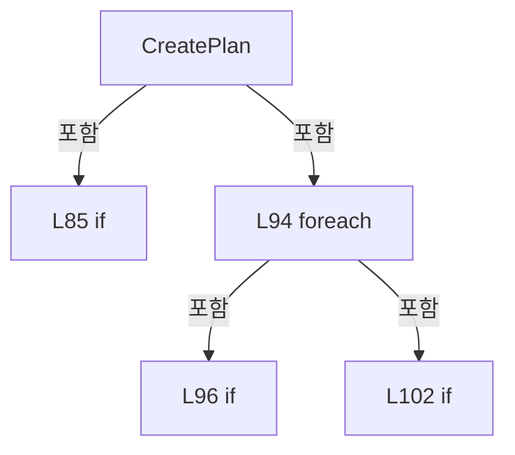

변경 전 점검: 입력/반환 타입, 위 호출자, 예외/취소 경로, 공유 상태와 저장·전송 소비자를 함께 확인합니다. 값의 단위나 물리 방향을 이름만으로 확정하지 않습니다.

### PropertyDeclaration `CurrentPoint` · L116–125

[Drilling.Common/Review/CReviewManager.cs:116–125](https://github.com/kjuws10-rgb/A3Drilling/blob/dfa5920e6301d9ec4b0eab1452ae59521aafc986/Drilling.Common/Review/CReviewManager.cs#L116-L125)

| 항목 | 실제 추출 값 |
| --- | --- |
| 서명 | Drilling.Common.Review.ST_REVIEW_PLAN_POINT? Drilling.Common.Review.CReviewManager.CurrentPoint |
| 접근/수식자 | Public / public |
| 반환/값 타입 | Drilling.Common.Review.ST_REVIEW_PLAN_POINT? |
| 소속 타입 | NamedType:Drilling.Common.Review.CReviewManager |

현재 부분 분석에서 직접 연결된 호출자는 없습니다. XAML/이벤트/인터페이스·델리게이트·외부 진입을 추가 확인해야 하며, 미사용으로 판정한 것이 아닙니다.

변경 전 점검: 입력/반환 타입, 위 호출자, 예외/취소 경로, 공유 상태와 저장·전송 소비자를 함께 확인합니다. 값의 단위나 물리 방향을 이름만으로 확정하지 않습니다.

### GetAccessorDeclaration `get_CurrentPoint` · L118–124

[Drilling.Common/Review/CReviewManager.cs:118–124](https://github.com/kjuws10-rgb/A3Drilling/blob/dfa5920e6301d9ec4b0eab1452ae59521aafc986/Drilling.Common/Review/CReviewManager.cs#L118-L124)

| 항목 | 실제 추출 값 |
| --- | --- |
| 서명 | Drilling.Common.Review.ST_REVIEW_PLAN_POINT? Drilling.Common.Review.CReviewManager.CurrentPoint.get |
| 접근/수식자 | Public / get |
| 반환/값 타입 | Drilling.Common.Review.ST_REVIEW_PLAN_POINT? |
| 소속 타입 | NamedType:Drilling.Common.Review.CReviewManager |

현재 부분 분석에서 직접 연결된 호출자는 없습니다. XAML/이벤트/인터페이스·델리게이트·외부 진입을 추가 확인해야 하며, 미사용으로 판정한 것이 아닙니다.

본문의 실제 연산·분기·예외·반환 순서(원문 위치 순):

| 원본 행 | 종류 | 주석 해설 |
| --- | --- | --- |
| 120 | lock | 공유 상태의 임계 구역에 진입합니다: lock (_stateLock) |
| 122 | return | 호출자에게 값 또는 제어를 반환합니다: return _currentPoint; |

제어 구문의 포함 구조(실제 실행 순서/CFG가 아닌 구문 탐색 그림):

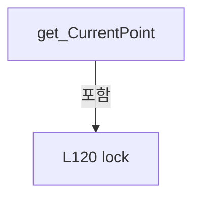

변경 전 점검: 입력/반환 타입, 위 호출자, 예외/취소 경로, 공유 상태와 저장·전송 소비자를 함께 확인합니다. 값의 단위나 물리 방향을 이름만으로 확정하지 않습니다.

### PropertyDeclaration `LastMeasuredPoint` · L127–136

[Drilling.Common/Review/CReviewManager.cs:127–136](https://github.com/kjuws10-rgb/A3Drilling/blob/dfa5920e6301d9ec4b0eab1452ae59521aafc986/Drilling.Common/Review/CReviewManager.cs#L127-L136)

| 항목 | 실제 추출 값 |
| --- | --- |
| 서명 | Drilling.Common.Review.ST_REVIEW_PLAN_POINT? Drilling.Common.Review.CReviewManager.LastMeasuredPoint |
| 접근/수식자 | Public / public |
| 반환/값 타입 | Drilling.Common.Review.ST_REVIEW_PLAN_POINT? |
| 소속 타입 | NamedType:Drilling.Common.Review.CReviewManager |

현재 부분 분석에서 직접 연결된 호출자는 없습니다. XAML/이벤트/인터페이스·델리게이트·외부 진입을 추가 확인해야 하며, 미사용으로 판정한 것이 아닙니다.

변경 전 점검: 입력/반환 타입, 위 호출자, 예외/취소 경로, 공유 상태와 저장·전송 소비자를 함께 확인합니다. 값의 단위나 물리 방향을 이름만으로 확정하지 않습니다.

### GetAccessorDeclaration `get_LastMeasuredPoint` · L129–135

[Drilling.Common/Review/CReviewManager.cs:129–135](https://github.com/kjuws10-rgb/A3Drilling/blob/dfa5920e6301d9ec4b0eab1452ae59521aafc986/Drilling.Common/Review/CReviewManager.cs#L129-L135)

| 항목 | 실제 추출 값 |
| --- | --- |
| 서명 | Drilling.Common.Review.ST_REVIEW_PLAN_POINT? Drilling.Common.Review.CReviewManager.LastMeasuredPoint.get |
| 접근/수식자 | Public / get |
| 반환/값 타입 | Drilling.Common.Review.ST_REVIEW_PLAN_POINT? |
| 소속 타입 | NamedType:Drilling.Common.Review.CReviewManager |

현재 부분 분석에서 직접 연결된 호출자는 없습니다. XAML/이벤트/인터페이스·델리게이트·외부 진입을 추가 확인해야 하며, 미사용으로 판정한 것이 아닙니다.

본문의 실제 연산·분기·예외·반환 순서(원문 위치 순):

| 원본 행 | 종류 | 주석 해설 |
| --- | --- | --- |
| 131 | lock | 공유 상태의 임계 구역에 진입합니다: lock (_stateLock) |
| 133 | return | 호출자에게 값 또는 제어를 반환합니다: return _lastMeasuredPoint; |

제어 구문의 포함 구조(실제 실행 순서/CFG가 아닌 구문 탐색 그림):

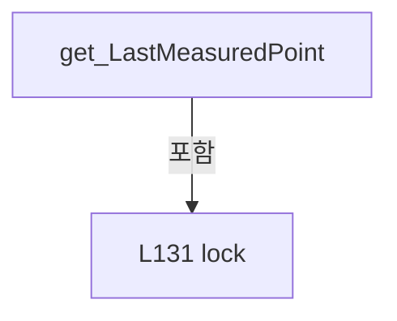

변경 전 점검: 입력/반환 타입, 위 호출자, 예외/취소 경로, 공유 상태와 저장·전송 소비자를 함께 확인합니다. 값의 단위나 물리 방향을 이름만으로 확정하지 않습니다.

### MethodDeclaration `GetShotBeamPositions` · L138–148

[Drilling.Common/Review/CReviewManager.cs:138–148](https://github.com/kjuws10-rgb/A3Drilling/blob/dfa5920e6301d9ec4b0eab1452ae59521aafc986/Drilling.Common/Review/CReviewManager.cs#L138-L148)

| 항목 | 실제 추출 값 |
| --- | --- |
| 서명 | System.Collections.Generic.IReadOnlyList<Drilling.Common.Review.ST_REVIEW_BEAM_POSITION> Drilling.Common.Review.CReviewManager.GetShotBeamPositions(Drilling.Common.Managers.ST_RECIPE_DEFINITION, Drilling.Common.Review.ST_REVIEW_PLAN_POINT, double, double, double) |
| 접근/수식자 | Public / public, static |
| 반환/값 타입 | System.Collections.Generic.IReadOnlyList<Drilling.Common.Review.ST_REVIEW_BEAM_POSITION> |
| 소속 타입 | NamedType:Drilling.Common.Review.CReviewManager |

입력 계약:

| 이름 | 타입 | 전달 | 선택/기본값 |
| --- | --- | --- | --- |
| recipe | Drilling.Common.Managers.ST_RECIPE_DEFINITION | None | False /  |
| point | Drilling.Common.Review.ST_REVIEW_PLAN_POINT | None | False /  |
| stageScanDirectionY | double | None | False /  |
| shiftOffsetX | double | None | True / 0 |
| shiftOffsetY | double | None | True / 0 |

정적 호출자로 확인된 위치:

| 호출 파일/행 | 호출 표현식 | 런타임 분기 가능 |
| --- | --- | --- |
| [Drilling.Common/Review/CReviewManager.cs:1371–1376](https://github.com/kjuws10-rgb/A3Drilling/blob/dfa5920e6301d9ec4b0eab1452ae59521aafc986/Drilling.Common/Review/CReviewManager.cs#L1371-L1376) | GetShotBeamPositions | False |
| [Drilling.UI/Menu/Menus/CMenuCorrection.cs:7312–7312](https://github.com/kjuws10-rgb/A3Drilling/blob/dfa5920e6301d9ec4b0eab1452ae59521aafc986/Drilling.UI/Menu/Menus/CMenuCorrection.cs#L7312-L7312) | CReviewManager.GetShotBeamPositions | False |
| [Drilling.UI/Menu/Menus/CMenuReview.cs:2469–2469](https://github.com/kjuws10-rgb/A3Drilling/blob/dfa5920e6301d9ec4b0eab1452ae59521aafc986/Drilling.UI/Menu/Menus/CMenuReview.cs#L2469-L2469) | CReviewManager.GetShotBeamPositions | False |
| [Drilling.UI/Menu/Menus/CMenuReview.cs:2731–2731](https://github.com/kjuws10-rgb/A3Drilling/blob/dfa5920e6301d9ec4b0eab1452ae59521aafc986/Drilling.UI/Menu/Menus/CMenuReview.cs#L2731-L2731) | CReviewManager.GetShotBeamPositions | False |

호출하는 대상과 해석 범위:

| 원본 행 | 표현식 | 분석 상태 | 대상/소스 위치 |
| --- | --- | --- | --- |
| 145 | CreateShotBeamPositionCalculator | resolved | System.Func<Drilling.Common.Review.ST_REVIEW_PLAN_POINT, int, Drilling.Common.Review.ST_REVIEW_BEAM_POSITION> Drilling.Common.Review.CReviewManager.CreateShotBeamPositionCalculator(Drilling.Common.Managers.ST_RECIPE_DEFINITION, double, double, double) · Drilling.Common/Review/CReviewManager.cs:151 |
| 146 | ReadInt | resolved | int Drilling.Common.Review.CReviewManager.ReadInt(Drilling.Common.Managers.ST_RECIPE_DEFINITION, int, params string[]) · Drilling.Common/Review/CReviewManager.cs:1275 |
| 147 | Enumerable.Range(1, splitBeamCount * splitBeamCount).Select(beam => calculate(point, beam)).ToArray | resolved | Drilling.Common.Review.ST_REVIEW_BEAM_POSITION[] System.Collections.Generic.IEnumerable<Drilling.Common.Review.ST_REVIEW_BEAM_POSITION>.ToArray<Drilling.Common.Review.ST_REVIEW_BEAM_POSITION>() |
| 147 | Enumerable.Range(1, splitBeamCount * splitBeamCount).Select | resolved | System.Collections.Generic.IEnumerable<Drilling.Common.Review.ST_REVIEW_BEAM_POSITION> System.Collections.Generic.IEnumerable<int>.Select<int, Drilling.Common.Review.ST_REVIEW_BEAM_POSITION>(System.Func<int, Drilling.Common.Review.ST_REVIEW_BEAM_POSITION>) |
| 147 | Enumerable.Range | resolved | System.Collections.Generic.IEnumerable<int> System.Linq.Enumerable.Range(int, int) |
| 147 | calculate | resolved · 동적 구현 선택 가능 | Drilling.Common.Review.ST_REVIEW_BEAM_POSITION System.Func<Drilling.Common.Review.ST_REVIEW_PLAN_POINT, int, Drilling.Common.Review.ST_REVIEW_BEAM_POSITION>.Invoke(Drilling.Common.Review.ST_REVIEW_PLAN_POINT, int) |

본문의 실제 연산·분기·예외·반환 순서(원문 위치 순):

| 원본 행 | 종류 | 주석 해설 |
| --- | --- | --- |
| 145 | call | 함수·델리게이트 또는 객체 생성자를 호출합니다: CreateShotBeamPositionCalculator(recipe, stageScanDirectionY, shiftOffsetX, shiftOffsetY) |
| 145 | local-declaration | 지역 변수를 선언합니다: var calculate = CreateShotBeamPositionCalculator(recipe, stageScanDirectionY, shiftOffsetX, shiftOffsetY); |
| 145 | variable-initializer | 변수의 초기값을 지정합니다: calculate = CreateShotBeamPositionCalculator(recipe, stageScanDirectionY, shiftOffsetX, shiftOffsetY) |
| 146 | call | 함수·델리게이트 또는 객체 생성자를 호출합니다: ReadInt(recipe, 0, "SPLITED_BEAM_COUNT") |
| 146 | local-declaration | 지역 변수를 선언합니다: var splitBeamCount = ReadInt(recipe, 0, "SPLITED_BEAM_COUNT"); |
| 146 | variable-initializer | 변수의 초기값을 지정합니다: splitBeamCount = ReadInt(recipe, 0, "SPLITED_BEAM_COUNT") |
| 147 | call | 함수·델리게이트 또는 객체 생성자를 호출합니다: Enumerable.Range(1, splitBeamCount * splitBeamCount).Select(beam => calculate(point, beam)).ToArray() |
| 147 | call | 함수·델리게이트 또는 객체 생성자를 호출합니다: Enumerable.Range(1, splitBeamCount * splitBeamCount).Select(beam => calculate(point, beam)) |
| 147 | call | 함수·델리게이트 또는 객체 생성자를 호출합니다: Enumerable.Range(1, splitBeamCount * splitBeamCount) |
| 147 | call | 함수·델리게이트 또는 객체 생성자를 호출합니다: calculate(point, beam) |
| 147 | return | 호출자에게 값 또는 제어를 반환합니다: return Enumerable.Range(1, splitBeamCount * splitBeamCount).Select(beam => calculate(point, beam)).ToArray(); |

변경 전 점검: 입력/반환 타입, 위 호출자, 예외/취소 경로, 공유 상태와 저장·전송 소비자를 함께 확인합니다. 값의 단위나 물리 방향을 이름만으로 확정하지 않습니다.

### MethodDeclaration `CreateShotBeamPositionCalculator` · L151–193

[Drilling.Common/Review/CReviewManager.cs:151–193](https://github.com/kjuws10-rgb/A3Drilling/blob/dfa5920e6301d9ec4b0eab1452ae59521aafc986/Drilling.Common/Review/CReviewManager.cs#L151-L193)

| 항목 | 실제 추출 값 |
| --- | --- |
| 서명 | System.Func<Drilling.Common.Review.ST_REVIEW_PLAN_POINT, int, Drilling.Common.Review.ST_REVIEW_BEAM_POSITION> Drilling.Common.Review.CReviewManager.CreateShotBeamPositionCalculator(Drilling.Common.Managers.ST_RECIPE_DEFINITION, double, double, double) |
| 접근/수식자 | Public / public, static |
| 반환/값 타입 | System.Func<Drilling.Common.Review.ST_REVIEW_PLAN_POINT, int, Drilling.Common.Review.ST_REVIEW_BEAM_POSITION> |
| 소속 타입 | NamedType:Drilling.Common.Review.CReviewManager |

원본 XML 주석:

````xml
/// <summary>Build recipe lookup and Cell geometry once for a batch. No device access or live recipe mutation.</summary>
````

입력 계약:

| 이름 | 타입 | 전달 | 선택/기본값 |
| --- | --- | --- | --- |
| recipe | Drilling.Common.Managers.ST_RECIPE_DEFINITION | None | False /  |
| stageScanDirectionY | double | None | False /  |
| shiftOffsetX | double | None | True / 0 |
| shiftOffsetY | double | None | True / 0 |

정적 호출자로 확인된 위치:

| 호출 파일/행 | 호출 표현식 | 런타임 분기 가능 |
| --- | --- | --- |
| [Drilling.Common/Review/CAutoFineReviewCoordinator.cs:225–225](https://github.com/kjuws10-rgb/A3Drilling/blob/dfa5920e6301d9ec4b0eab1452ae59521aafc986/Drilling.Common/Review/CAutoFineReviewCoordinator.cs#L225-L225) | CReviewManager.CreateShotBeamPositionCalculator | False |
| [Drilling.Common/Review/CReviewManager.cs:145–145](https://github.com/kjuws10-rgb/A3Drilling/blob/dfa5920e6301d9ec4b0eab1452ae59521aafc986/Drilling.Common/Review/CReviewManager.cs#L145-L145) | CreateShotBeamPositionCalculator | False |
| [Drilling.Common/Review/CZeroDefenceRecipePlan.cs:34–34](https://github.com/kjuws10-rgb/A3Drilling/blob/dfa5920e6301d9ec4b0eab1452ae59521aafc986/Drilling.Common/Review/CZeroDefenceRecipePlan.cs#L34-L34) | CReviewManager.CreateShotBeamPositionCalculator | False |
| [Drilling.UI/Menu/Menus/CMenuCorrection.cs:6192–6192](https://github.com/kjuws10-rgb/A3Drilling/blob/dfa5920e6301d9ec4b0eab1452ae59521aafc986/Drilling.UI/Menu/Menus/CMenuCorrection.cs#L6192-L6192) | CReviewManager.CreateShotBeamPositionCalculator | False |

호출하는 대상과 해석 범위:

| 원본 행 | 표현식 | 분석 상태 | 대상/소스 위치 |
| --- | --- | --- | --- |
| 157 | ValidateShiftOffset | resolved | void Drilling.Common.Review.CReviewManager.ValidateShiftOffset(double, double) · Drilling.Common/Review/CReviewManager.cs:987 |
| 158 | ReadInt | resolved | int Drilling.Common.Review.CReviewManager.ReadInt(Drilling.Common.Managers.ST_RECIPE_DEFINITION, int, params string[]) · Drilling.Common/Review/CReviewManager.cs:1275 |
| 159 | ValidateBeamNo | resolved | void Drilling.Common.Review.CReviewManager.ValidateBeamNo(int, int) · Drilling.Common/Review/CReviewManager.cs:973 |
| 160 | recipe.Parameters.GroupBy(parameter => parameter.Key, StringComparer.OrdinalIgnoreCase).ToDictionary | resolved | System.Collections.Generic.Dictionary<string, string> System.Collections.Generic.IEnumerable<System.Linq.IGrouping<string, Drilling.Common.Managers.ST_RECIPE_PARAMETER>>.ToDictionary<System.Linq.IGrouping<string, Drilling.Common.Managers.ST_RECIPE_PARAMETER>, string, string>(System.Func<System.Linq.IGrouping<string, Drilling.Common.Managers.ST_RECIPE_PARAMETER>, string>, System.Func<System.Linq.IGrouping<string, Drilling.Common.Managers.ST_RECIPE_PARAMETER>, string>, System.Collections.Generic.IEqualityComparer<string>?) |
| 160 | recipe.Parameters.GroupBy | resolved | System.Collections.Generic.IEnumerable<System.Linq.IGrouping<string, Drilling.Common.Managers.ST_RECIPE_PARAMETER>> System.Collections.Generic.IEnumerable<Drilling.Common.Managers.ST_RECIPE_PARAMETER>.GroupBy<Drilling.Common.Managers.ST_RECIPE_PARAMETER, string>(System.Func<Drilling.Common.Managers.ST_RECIPE_PARAMETER, string>, System.Collections.Generic.IEqualityComparer<string>?) |
| 160 | group.Last | resolved | Drilling.Common.Managers.ST_RECIPE_PARAMETER System.Collections.Generic.IEnumerable<Drilling.Common.Managers.ST_RECIPE_PARAMETER>.Last<Drilling.Common.Managers.ST_RECIPE_PARAMETER>() |
| 161 | ReadDouble | resolved | double Drilling.Common.Review.CReviewManager.ReadDouble(Drilling.Common.Managers.ST_RECIPE_DEFINITION, double, params string[]) · Drilling.Common/Review/CReviewManager.cs:1315 |
| 162 | ReadDouble | resolved | double Drilling.Common.Review.CReviewManager.ReadDouble(Drilling.Common.Managers.ST_RECIPE_DEFINITION, double, params string[]) · Drilling.Common/Review/CReviewManager.cs:1315 |
| 163 | ReadDouble | resolved | double Drilling.Common.Review.CReviewManager.ReadDouble(Drilling.Common.Managers.ST_RECIPE_DEFINITION, double, params string[]) · Drilling.Common/Review/CReviewManager.cs:1315 |
| 164 | ReadDouble | resolved | double Drilling.Common.Review.CReviewManager.ReadDouble(Drilling.Common.Managers.ST_RECIPE_DEFINITION, double, params string[]) · Drilling.Common/Review/CReviewManager.cs:1315 |
| 165 | ReadDouble | resolved | double Drilling.Common.Review.CReviewManager.ReadDouble(Drilling.Common.Managers.ST_RECIPE_DEFINITION, double, params string[]) · Drilling.Common/Review/CReviewManager.cs:1315 |
| 166 | new System.Collections.Concurrent.ConcurrentDictionary<int, (double Rotation, double BeamPitch)> | resolved | System.Collections.Concurrent.ConcurrentDictionary<int, (double Rotation, double BeamPitch)>.ConcurrentDictionary() |
| 169 | ValidateBeamNo | resolved | void Drilling.Common.Review.CReviewManager.ValidateBeamNo(int, int) · Drilling.Common/Review/CReviewManager.cs:973 |
| 170 | cells.GetOrAdd | resolved | (double Rotation, double BeamPitch) System.Collections.Concurrent.ConcurrentDictionary<int, (double Rotation, double BeamPitch)>.GetOrAdd(int, System.Func<int, (double Rotation, double BeamPitch)>) |
| 172 | CRecipeModelPixelCountReader.ReadPatternForCell | resolved | Drilling.Common.Recipe.ST_RECIPE_MODEL_PATTERN Drilling.Common.Recipe.CRecipeModelPixelCountReader.ReadPatternForCell(System.Collections.Generic.IReadOnlyDictionary<string, string>, int) · Drilling.Common/Recipe/CCellPatternCalculator.cs:444 |
| 173 | ReadDouble | resolved | double Drilling.Common.Review.CReviewManager.ReadDouble(Drilling.Common.Managers.ST_RECIPE_DEFINITION, double, params string[]) · Drilling.Common/Review/CReviewManager.cs:1315 |
| 174 | CCellPatternCalculator.Calculate | resolved | Drilling.Common.Recipe.ST_CELL_PATTERN_LAYOUT Drilling.Common.Recipe.CCellPatternCalculator.Calculate(Drilling.Common.Recipe.ST_CELL_PATTERN_DEFINITION, bool) · Drilling.Common/Recipe/CCellPatternCalculator.cs:66 |
| 174 | new ST_CELL_PATTERN_DEFINITION | resolved | Drilling.Common.Recipe.ST_CELL_PATTERN_DEFINITION.ST_CELL_PATTERN_DEFINITION(int, double, double, double, double, int, int, int, int, double, double) · Drilling.Common/Recipe/CCellPatternCalculator.cs:277 |
| 176 | new InvalidOperationException | resolved | System.InvalidOperationException.InvalidOperationException(string?) |
| 179 | CalculateBeamOffset | resolved | Drilling.Common.Review.ST_REVIEW_COORDINATE_OFFSET Drilling.Common.Review.CReviewManager.CalculateBeamOffset(int, int, double) · Drilling.Common/Review/CReviewManager.cs:951 |
| 180 | CalculateReviewTarget | resolved | Drilling.Common.Review.ST_REVIEW_COORDINATE_OFFSET Drilling.Common.Review.CReviewManager.CalculateReviewTarget(double, double, double, double, double, double, double, double) · Drilling.Common/Review/CReviewManager.cs:994 |
| 189 | double.IsFinite | resolved | bool double.IsFinite(double) |
| 189 | double.IsFinite | resolved | bool double.IsFinite(double) |
| 190 | new InvalidOperationException | resolved | System.InvalidOperationException.InvalidOperationException(string?) |
| 191 | new ST_REVIEW_BEAM_POSITION | resolved | Drilling.Common.Review.ST_REVIEW_BEAM_POSITION.ST_REVIEW_BEAM_POSITION(int, double, double) · Drilling.Common/Review/CReviewManager.cs:4047 |

본문의 실제 연산·분기·예외·반환 순서(원문 위치 순):

| 원본 행 | 종류 | 주석 해설 |
| --- | --- | --- |
| 157 | call | 함수·델리게이트 또는 객체 생성자를 호출합니다: ValidateShiftOffset(shiftOffsetX, shiftOffsetY) |
| 158 | call | 함수·델리게이트 또는 객체 생성자를 호출합니다: ReadInt(recipe, 0, "SPLITED_BEAM_COUNT") |
| 158 | local-declaration | 지역 변수를 선언합니다: var splitBeamCount = ReadInt(recipe, 0, "SPLITED_BEAM_COUNT"); |
| 158 | variable-initializer | 변수의 초기값을 지정합니다: splitBeamCount = ReadInt(recipe, 0, "SPLITED_BEAM_COUNT") |
| 159 | call | 함수·델리게이트 또는 객체 생성자를 호출합니다: ValidateBeamNo(1, splitBeamCount) |
| 160 | call | 함수·델리게이트 또는 객체 생성자를 호출합니다: recipe.Parameters.GroupBy(parameter => parameter.Key, StringComparer.OrdinalIgnoreCase).ToDictionary(group => group.Key, group => group.Last().Value, StringComparer.OrdinalIgnoreCase) |
| 160 | call | 함수·델리게이트 또는 객체 생성자를 호출합니다: recipe.Parameters.GroupBy(parameter => parameter.Key, StringComparer.OrdinalIgnoreCase) |
| 160 | call | 함수·델리게이트 또는 객체 생성자를 호출합니다: group.Last() |
| 160 | local-declaration | 지역 변수를 선언합니다: var parameters = recipe.Parameters.GroupBy(parameter => parameter.Key, StringComparer.OrdinalIgnoreCase).ToDictionary(group => group.Key, group => group.Last().Value, StringComparer.OrdinalIgnoreCase); |
| 160 | variable-initializer | 변수의 초기값을 지정합니다: parameters = recipe.Parameters.GroupBy(parameter => parameter.Key, StringComparer.OrdinalIgnoreCase).ToDictionary(group => group.Key, group => group.Last().Value, StringComparer.OrdinalIgnoreCase) |
| 161 | call | 함수·델리게이트 또는 객체 생성자를 호출합니다: ReadDouble(recipe, 0.0, "PIXEL_SIZE") |
| 161 | local-declaration | 지역 변수를 선언합니다: var pixelSize = ReadDouble(recipe, 0.0, "PIXEL_SIZE"); |
| 161 | variable-initializer | 변수의 초기값을 지정합니다: pixelSize = ReadDouble(recipe, 0.0, "PIXEL_SIZE") |
| 162 | call | 함수·델리게이트 또는 객체 생성자를 호출합니다: ReadDouble(recipe, 55.0, "AK_MARGIN_X", "ALIGN_MARGIN_X") |
| 162 | local-declaration | 지역 변수를 선언합니다: var marginX = ReadDouble(recipe, 55.0, "AK_MARGIN_X", "ALIGN_MARGIN_X"); |
| 162 | variable-initializer | 변수의 초기값을 지정합니다: marginX = ReadDouble(recipe, 55.0, "AK_MARGIN_X", "ALIGN_MARGIN_X") |
| 163 | call | 함수·델리게이트 또는 객체 생성자를 호출합니다: ReadDouble(recipe, 45.0, "AK_MARGIN_Y", "ALIGN_MARGIN_Y") |
| 163 | local-declaration | 지역 변수를 선언합니다: var marginY = ReadDouble(recipe, 45.0, "AK_MARGIN_Y", "ALIGN_MARGIN_Y"); |
| 163 | variable-initializer | 변수의 초기값을 지정합니다: marginY = ReadDouble(recipe, 45.0, "AK_MARGIN_Y", "ALIGN_MARGIN_Y") |
| 164 | call | 함수·델리게이트 또는 객체 생성자를 호출합니다: ReadDouble(recipe, 0.0, "REVIEW_CAMERA_ALIGN_KEY_POS_X") |
| 164 | local-declaration | 지역 변수를 선언합니다: var cameraAlignX = ReadDouble(recipe, 0.0, "REVIEW_CAMERA_ALIGN_KEY_POS_X"); |
| 164 | variable-initializer | 변수의 초기값을 지정합니다: cameraAlignX = ReadDouble(recipe, 0.0, "REVIEW_CAMERA_ALIGN_KEY_POS_X") |
| 165 | call | 함수·델리게이트 또는 객체 생성자를 호출합니다: ReadDouble(recipe, 0.0, "REVIEW_CAMERA_ALIGN_KEY_POS_Y") |
| 165 | local-declaration | 지역 변수를 선언합니다: var cameraAlignY = ReadDouble(recipe, 0.0, "REVIEW_CAMERA_ALIGN_KEY_POS_Y"); |
| 165 | variable-initializer | 변수의 초기값을 지정합니다: cameraAlignY = ReadDouble(recipe, 0.0, "REVIEW_CAMERA_ALIGN_KEY_POS_Y") |
| 166 | call | 함수·델리게이트 또는 객체 생성자를 호출합니다: new System.Collections.Concurrent.ConcurrentDictionary<int, (double Rotation, double BeamPitch)>() |
| 166 | local-declaration | 지역 변수를 선언합니다: var cells = new System.Collections.Concurrent.ConcurrentDictionary<int, (double Rotation, double BeamPitch)>(); |
| 166 | variable-initializer | 변수의 초기값을 지정합니다: cells = new System.Collections.Concurrent.ConcurrentDictionary<int, (double Rotation, double BeamPitch)>() |
| 167 | return | 호출자에게 값 또는 제어를 반환합니다: return (point, beamNo) => { ValidateBeamNo(beamNo, splitBeamCount); var cell = cells.GetOrAdd(point.CellNo, cellNo => { var model = CRecipeModelPixelCountReader.ReadPatternForCell(parameters, cellNo); var rotation = ReadDouble(rec |
| 169 | call | 함수·델리게이트 또는 객체 생성자를 호출합니다: ValidateBeamNo(beamNo, splitBeamCount) |
| 170 | call | 함수·델리게이트 또는 객체 생성자를 호출합니다: cells.GetOrAdd(point.CellNo, cellNo => { var model = CRecipeModelPixelCountReader.ReadPatternForCell(parameters, cellNo); var rotation = ReadDouble(recipe, 0.0, $"CELL{cellNo}_ROTATION"); var layout = CCellPatternCalcula… |
| 170 | local-declaration | 지역 변수를 선언합니다: var cell = cells.GetOrAdd(point.CellNo, cellNo => { var model = CRecipeModelPixelCountReader.ReadPatternForCell(parameters, cellNo); var rotation = ReadDouble(recipe, 0.0, $"CELL{cellNo}_ROTATION"); var layout = CCellPatternCalcul |
| 170 | variable-initializer | 변수의 초기값을 지정합니다: cell = cells.GetOrAdd(point.CellNo, cellNo => { var model = CRecipeModelPixelCountReader.ReadPatternForCell(parameters, cellNo); var rotation = ReadDouble(recipe, 0.0, $"CELL{cellNo}_ROTATION"); var layout = CCellPatternCalculator |
| 172 | call | 함수·델리게이트 또는 객체 생성자를 호출합니다: CRecipeModelPixelCountReader.ReadPatternForCell(parameters, cellNo) |
| 172 | local-declaration | 지역 변수를 선언합니다: var model = CRecipeModelPixelCountReader.ReadPatternForCell(parameters, cellNo); |
| 172 | variable-initializer | 변수의 초기값을 지정합니다: model = CRecipeModelPixelCountReader.ReadPatternForCell(parameters, cellNo) |
| 173 | call | 함수·델리게이트 또는 객체 생성자를 호출합니다: ReadDouble(recipe, 0.0, $"CELL{cellNo}_ROTATION") |
| 173 | local-declaration | 지역 변수를 선언합니다: var rotation = ReadDouble(recipe, 0.0, $"CELL{cellNo}_ROTATION"); |
| 173 | variable-initializer | 변수의 초기값을 지정합니다: rotation = ReadDouble(recipe, 0.0, $"CELL{cellNo}_ROTATION") |
| 174 | call | 함수·델리게이트 또는 객체 생성자를 호출합니다: CCellPatternCalculator.Calculate(new ST_CELL_PATTERN_DEFINITION(cellNo, 0, 0, rotation, pixelSize, model.PixelCountX, model.PixelCountY, model.ProcessPitch, splitBeamCount), includeShotCenters: false) |
| 174 | call | 함수·델리게이트 또는 객체 생성자를 호출합니다: new ST_CELL_PATTERN_DEFINITION(cellNo, 0, 0, rotation, pixelSize, model.PixelCountX, model.PixelCountY, model.ProcessPitch, splitBeamCount) |
| 174 | local-declaration | 지역 변수를 선언합니다: var layout = CCellPatternCalculator.Calculate(new ST_CELL_PATTERN_DEFINITION(cellNo, 0, 0, rotation, pixelSize, model.PixelCountX, model.PixelCountY, model.ProcessPitch, splitBeamCount), includeShotCenters: false); |
| 174 | variable-initializer | 변수의 초기값을 지정합니다: layout = CCellPatternCalculator.Calculate(new ST_CELL_PATTERN_DEFINITION(cellNo, 0, 0, rotation, pixelSize, model.PixelCountX, model.PixelCountY, model.ProcessPitch, splitBeamCount), includeShotCenters: false) |
| 175 | if | 조건에 따라 분기합니다: if (!layout.IsValid) |
| 176 | call | 함수·델리게이트 또는 객체 생성자를 호출합니다: new InvalidOperationException(layout.ValidationMessage) |
| 176 | throw | 예외를 발생/전달합니다: throw new InvalidOperationException(layout.ValidationMessage); |
| 177 | return | 호출자에게 값 또는 제어를 반환합니다: return (rotation, layout.BeamPitchMillimeters); |
| 179 | call | 함수·델리게이트 또는 객체 생성자를 호출합니다: CalculateBeamOffset(beamNo, splitBeamCount, cell.BeamPitch) |
| 179 | local-declaration | 지역 변수를 선언합니다: var offset = CalculateBeamOffset(beamNo, splitBeamCount, cell.BeamPitch); |
| 179 | variable-initializer | 변수의 초기값을 지정합니다: offset = CalculateBeamOffset(beamNo, splitBeamCount, cell.BeamPitch) |
| 180 | call | 함수·델리게이트 또는 객체 생성자를 호출합니다: CalculateReviewTarget( point.DesignX - marginX + shiftOffsetX, point.DesignY - marginY + shiftOffsetY, cameraAlignX, cameraAlignY, offset.X, offset.Y, cell.Rotation, stageScanDirectionY) |
| 180 | local-declaration | 지역 변수를 선언합니다: var target = CalculateReviewTarget( point.DesignX - marginX + shiftOffsetX, point.DesignY - marginY + shiftOffsetY, cameraAlignX, cameraAlignY, offset.X, offset.Y, cell.Rotation, stageScanDirectionY); |
| 180 | variable-initializer | 변수의 초기값을 지정합니다: target = CalculateReviewTarget( point.DesignX - marginX + shiftOffsetX, point.DesignY - marginY + shiftOffsetY, cameraAlignX, cameraAlignY, offset.X, offset.Y, cell.Rotation, stageScanDirectionY) |
| 189 | call | 함수·델리게이트 또는 객체 생성자를 호출합니다: double.IsFinite(target.X) |
| 189 | call | 함수·델리게이트 또는 객체 생성자를 호출합니다: double.IsFinite(target.Y) |
| 189 | if | 조건에 따라 분기합니다: if (!double.IsFinite(target.X) &#124;&#124; !double.IsFinite(target.Y)) |
| 190 | call | 함수·델리게이트 또는 객체 생성자를 호출합니다: new InvalidOperationException($"Beam {beamNo}의 목표 위치를 계산할 수 없습니다.") |
| 190 | throw | 예외를 발생/전달합니다: throw new InvalidOperationException($"Beam {beamNo}의 목표 위치를 계산할 수 없습니다."); |
| 191 | call | 함수·델리게이트 또는 객체 생성자를 호출합니다: new ST_REVIEW_BEAM_POSITION(beamNo, target.Y, target.X) |
| 191 | return | 호출자에게 값 또는 제어를 반환합니다: return new ST_REVIEW_BEAM_POSITION(beamNo, target.Y, target.X); |

제어 구문의 포함 구조(실제 실행 순서/CFG가 아닌 구문 탐색 그림):

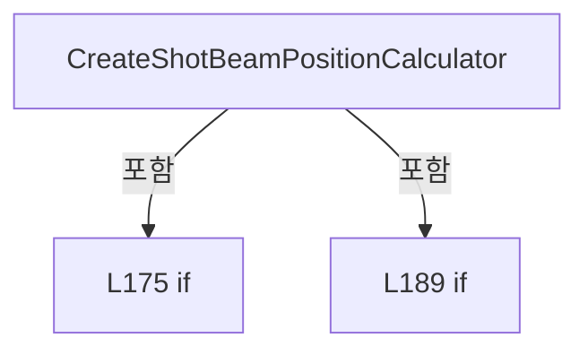

변경 전 점검: 입력/반환 타입, 위 호출자, 예외/취소 경로, 공유 상태와 저장·전송 소비자를 함께 확인합니다. 값의 단위나 물리 방향을 이름만으로 확정하지 않습니다.

### MethodDeclaration `CreateAllPlan` · L195–198

[Drilling.Common/Review/CReviewManager.cs:195–198](https://github.com/kjuws10-rgb/A3Drilling/blob/dfa5920e6301d9ec4b0eab1452ae59521aafc986/Drilling.Common/Review/CReviewManager.cs#L195-L198)

| 항목 | 실제 추출 값 |
| --- | --- |
| 서명 | Drilling.Common.Review.ST_REVIEW_PLAN Drilling.Common.Review.CReviewManager.CreateAllPlan(Drilling.Common.Managers.ST_RECIPE_DEFINITION, int) |
| 접근/수식자 | Public / public |
| 반환/값 타입 | Drilling.Common.Review.ST_REVIEW_PLAN |
| 소속 타입 | NamedType:Drilling.Common.Review.CReviewManager |

입력 계약:

| 이름 | 타입 | 전달 | 선택/기본값 |
| --- | --- | --- | --- |
| recipe | Drilling.Common.Managers.ST_RECIPE_DEFINITION | None | False /  |
| selectedBeamNo | int | None | False /  |

정적 호출자로 확인된 위치:

| 호출 파일/행 | 호출 표현식 | 런타임 분기 가능 |
| --- | --- | --- |
| [Drilling.UI/Menu/Menus/CMenuCorrection.ReviewData.Offset.cs:145–145](https://github.com/kjuws10-rgb/A3Drilling/blob/dfa5920e6301d9ec4b0eab1452ae59521aafc986/Drilling.UI/Menu/Menus/CMenuCorrection.ReviewData.Offset.cs#L145-L145) | _reviewManager.CreateAllPlan | False |
| [Drilling.UI/Menu/Menus/CMenuCorrection.ReviewData.Offset.cs:265–265](https://github.com/kjuws10-rgb/A3Drilling/blob/dfa5920e6301d9ec4b0eab1452ae59521aafc986/Drilling.UI/Menu/Menus/CMenuCorrection.ReviewData.Offset.cs#L265-L265) | _reviewManager.CreateAllPlan | False |
| [Drilling.UI/Menu/Menus/CMenuCorrection.cs:1856–1856](https://github.com/kjuws10-rgb/A3Drilling/blob/dfa5920e6301d9ec4b0eab1452ae59521aafc986/Drilling.UI/Menu/Menus/CMenuCorrection.cs#L1856-L1856) | _reviewManager.CreateAllPlan | False |
| [Drilling.UI/Menu/Menus/CMenuReview.cs:403–403](https://github.com/kjuws10-rgb/A3Drilling/blob/dfa5920e6301d9ec4b0eab1452ae59521aafc986/Drilling.UI/Menu/Menus/CMenuReview.cs#L403-L403) | _reviewManager.CreateAllPlan | False |
| [Drilling.UI/Menu/Menus/CMenuReview.cs:2758–2758](https://github.com/kjuws10-rgb/A3Drilling/blob/dfa5920e6301d9ec4b0eab1452ae59521aafc986/Drilling.UI/Menu/Menus/CMenuReview.cs#L2758-L2758) | _reviewManager.CreateAllPlan | False |
| [Drilling.UI/Menu/Menus/CMenuReview.cs:3408–3408](https://github.com/kjuws10-rgb/A3Drilling/blob/dfa5920e6301d9ec4b0eab1452ae59521aafc986/Drilling.UI/Menu/Menus/CMenuReview.cs#L3408-L3408) | _reviewManager.CreateAllPlan | False |

호출하는 대상과 해석 범위:

| 원본 행 | 표현식 | 분석 상태 | 대상/소스 위치 |
| --- | --- | --- | --- |
| 197 | CreateAllPlan | resolved | Drilling.Common.Review.ST_REVIEW_PLAN Drilling.Common.Review.CReviewManager.CreateAllPlan(Drilling.Common.Managers.ST_RECIPE_DEFINITION, int, double, double) · Drilling.Common/Review/CReviewManager.cs:200 |

본문의 실제 연산·분기·예외·반환 순서(원문 위치 순):

| 원본 행 | 종류 | 주석 해설 |
| --- | --- | --- |
| 197 | call | 함수·델리게이트 또는 객체 생성자를 호출합니다: CreateAllPlan(recipe, selectedBeamNo, 0.0, 0.0) |
| 197 | return | 호출자에게 값 또는 제어를 반환합니다: return CreateAllPlan(recipe, selectedBeamNo, 0.0, 0.0); |

변경 전 점검: 입력/반환 타입, 위 호출자, 예외/취소 경로, 공유 상태와 저장·전송 소비자를 함께 확인합니다. 값의 단위나 물리 방향을 이름만으로 확정하지 않습니다.

### MethodDeclaration `CreateAllPlan` · L200–209

[Drilling.Common/Review/CReviewManager.cs:200–209](https://github.com/kjuws10-rgb/A3Drilling/blob/dfa5920e6301d9ec4b0eab1452ae59521aafc986/Drilling.Common/Review/CReviewManager.cs#L200-L209)

| 항목 | 실제 추출 값 |
| --- | --- |
| 서명 | Drilling.Common.Review.ST_REVIEW_PLAN Drilling.Common.Review.CReviewManager.CreateAllPlan(Drilling.Common.Managers.ST_RECIPE_DEFINITION, int, double, double) |
| 접근/수식자 | Public / public |
| 반환/값 타입 | Drilling.Common.Review.ST_REVIEW_PLAN |
| 소속 타입 | NamedType:Drilling.Common.Review.CReviewManager |

입력 계약:

| 이름 | 타입 | 전달 | 선택/기본값 |
| --- | --- | --- | --- |
| recipe | Drilling.Common.Managers.ST_RECIPE_DEFINITION | None | False /  |
| selectedBeamNo | int | None | False /  |
| shiftOffsetX | double | None | False /  |
| shiftOffsetY | double | None | False /  |

정적 호출자로 확인된 위치:

| 호출 파일/행 | 호출 표현식 | 런타임 분기 가능 |
| --- | --- | --- |
| [Drilling.Common/Review/CReviewManager.cs:84–84](https://github.com/kjuws10-rgb/A3Drilling/blob/dfa5920e6301d9ec4b0eab1452ae59521aafc986/Drilling.Common/Review/CReviewManager.cs#L84-L84) | CreateAllPlan | False |
| [Drilling.Common/Review/CReviewManager.cs:197–197](https://github.com/kjuws10-rgb/A3Drilling/blob/dfa5920e6301d9ec4b0eab1452ae59521aafc986/Drilling.Common/Review/CReviewManager.cs#L197-L197) | CreateAllPlan | False |
| [Drilling.UI/Menu/Menus/CMenuReview.cs:2318–2318](https://github.com/kjuws10-rgb/A3Drilling/blob/dfa5920e6301d9ec4b0eab1452ae59521aafc986/Drilling.UI/Menu/Menus/CMenuReview.cs#L2318-L2318) | _reviewManager.CreateAllPlan | False |
| [Drilling.UI/Menu/Menus/CMenuReview.cs:3161–3161](https://github.com/kjuws10-rgb/A3Drilling/blob/dfa5920e6301d9ec4b0eab1452ae59521aafc986/Drilling.UI/Menu/Menus/CMenuReview.cs#L3161-L3161) | _reviewManager.CreateAllPlan | False |

호출하는 대상과 해석 범위:

| 원본 행 | 표현식 | 분석 상태 | 대상/소스 위치 |
| --- | --- | --- | --- |
| 206 | ValidateShiftOffset | resolved | void Drilling.Common.Review.CReviewManager.ValidateShiftOffset(double, double) · Drilling.Common/Review/CReviewManager.cs:987 |
| 207 | ValidateBeamNo | resolved | void Drilling.Common.Review.CReviewManager.ValidateBeamNo(int, int) · Drilling.Common/Review/CReviewManager.cs:973 |
| 207 | ReadInt | resolved | int Drilling.Common.Review.CReviewManager.ReadInt(Drilling.Common.Managers.ST_RECIPE_DEFINITION, int, params string[]) · Drilling.Common/Review/CReviewManager.cs:1275 |
| 208 | CreatePlanCore | resolved | Drilling.Common.Review.ST_REVIEW_PLAN Drilling.Common.Review.CReviewManager.CreatePlanCore(Drilling.Common.Managers.ST_RECIPE_DEFINITION, System.Func<Drilling.Common.Review.ST_REVIEW_PLAN_POINT, bool>, int, bool, double, double) · Drilling.Common/Review/CReviewManager.cs:496 |

본문의 실제 연산·분기·예외·반환 순서(원문 위치 순):

| 원본 행 | 종류 | 주석 해설 |
| --- | --- | --- |
| 206 | call | 함수·델리게이트 또는 객체 생성자를 호출합니다: ValidateShiftOffset(shiftOffsetX, shiftOffsetY) |
| 207 | call | 함수·델리게이트 또는 객체 생성자를 호출합니다: ValidateBeamNo(selectedBeamNo, ReadInt(recipe, 0, "SPLITED_BEAM_COUNT")) |
| 207 | call | 함수·델리게이트 또는 객체 생성자를 호출합니다: ReadInt(recipe, 0, "SPLITED_BEAM_COUNT") |
| 208 | call | 함수·델리게이트 또는 객체 생성자를 호출합니다: CreatePlanCore(recipe, _ => true, selectedBeamNo, selectAllAssignedPoints: true, shiftOffsetX, shiftOffsetY) |
| 208 | return | 호출자에게 값 또는 제어를 반환합니다: return CreatePlanCore(recipe, _ => true, selectedBeamNo, selectAllAssignedPoints: true, shiftOffsetX, shiftOffsetY); |

변경 전 점검: 입력/반환 타입, 위 호출자, 예외/취소 경로, 공유 상태와 저장·전송 소비자를 함께 확인합니다. 값의 단위나 물리 방향을 이름만으로 확정하지 않습니다.

### MethodDeclaration `SelectGlassLineShotKeys` · L211–246

[Drilling.Common/Review/CReviewManager.cs:211–246](https://github.com/kjuws10-rgb/A3Drilling/blob/dfa5920e6301d9ec4b0eab1452ae59521aafc986/Drilling.Common/Review/CReviewManager.cs#L211-L246)

| 항목 | 실제 추출 값 |
| --- | --- |
| 서명 | System.Collections.Generic.IReadOnlyList<string> Drilling.Common.Review.CReviewManager.SelectGlassLineShotKeys(Drilling.Common.Review.ST_REVIEW_PLAN, string) |
| 접근/수식자 | Public / public, static |
| 반환/값 타입 | System.Collections.Generic.IReadOnlyList<string> |
| 소속 타입 | NamedType:Drilling.Common.Review.CReviewManager |

입력 계약:

| 이름 | 타입 | 전달 | 선택/기본값 |
| --- | --- | --- | --- |
| plan | Drilling.Common.Review.ST_REVIEW_PLAN | None | False /  |
| anchorShotKey | string | None | False /  |

정적 호출자로 확인된 위치:

| 호출 파일/행 | 호출 표현식 | 런타임 분기 가능 |
| --- | --- | --- |
| [Drilling.UI/Menu/Menus/CMenuReview.cs:1815–1815](https://github.com/kjuws10-rgb/A3Drilling/blob/dfa5920e6301d9ec4b0eab1452ae59521aafc986/Drilling.UI/Menu/Menus/CMenuReview.cs#L1815-L1815) | CReviewManager.SelectGlassLineShotKeys | False |
| [Drilling.UI/Menu/Menus/CMenuReview.cs:1856–1856](https://github.com/kjuws10-rgb/A3Drilling/blob/dfa5920e6301d9ec4b0eab1452ae59521aafc986/Drilling.UI/Menu/Menus/CMenuReview.cs#L1856-L1856) | CReviewManager.SelectGlassLineShotKeys | False |

호출하는 대상과 해석 범위:

| 원본 행 | 표현식 | 분석 상태 | 대상/소스 위치 |
| --- | --- | --- | --- |
| 215 | ArgumentNullException.ThrowIfNull | resolved | void System.ArgumentNullException.ThrowIfNull(object?, string?) |
| 216 | NormalizeShotKey | resolved | string Drilling.Common.Review.CReviewManager.NormalizeShotKey(string) · Drilling.Common/Review/CReviewManager.cs:1238 |
| 217 | plan.Points .Where(point => point.Use && point.HeadNo > 0 && double.IsFinite(point.DesignX) && double.IsFinite(point.DesignY)) .ToArray | resolved | Drilling.Common.Review.ST_REVIEW_PLAN_POINT[] System.Collections.Generic.IEnumerable<Drilling.Common.Review.ST_REVIEW_PLAN_POINT>.ToArray<Drilling.Common.Review.ST_REVIEW_PLAN_POINT>() |
| 217 | plan.Points .Where | resolved | System.Collections.Generic.IEnumerable<Drilling.Common.Review.ST_REVIEW_PLAN_POINT> System.Collections.Generic.IEnumerable<Drilling.Common.Review.ST_REVIEW_PLAN_POINT>.Where<Drilling.Common.Review.ST_REVIEW_PLAN_POINT>(System.Func<Drilling.Common.Review.ST_REVIEW_PLAN_POINT, bool>) |
| 221 | double.IsFinite | resolved | bool double.IsFinite(double) |
| 222 | double.IsFinite | resolved | bool double.IsFinite(double) |
| 224 | executablePoints.Any | resolved | bool System.Collections.Generic.IEnumerable<Drilling.Common.Review.ST_REVIEW_PLAN_POINT>.Any<Drilling.Common.Review.ST_REVIEW_PLAN_POINT>(System.Func<Drilling.Common.Review.ST_REVIEW_PLAN_POINT, bool>) |
| 224 | point.ShotKey.Equals | resolved | bool string.Equals(string?, System.StringComparison) |
| 229 | CreateIofLines | resolved | System.Collections.Generic.IReadOnlyList<System.Collections.Generic.IReadOnlyList<Drilling.Common.Review.ST_REVIEW_PLAN_POINT>> Drilling.Common.Review.CReviewManager.CreateIofLines(System.Collections.Generic.IReadOnlyList<Drilling.Common.Review.ST_REVIEW_PLAN_POINT>) · Drilling.Common/Review/CReviewManager.cs:2124 |
| 231 | line.Any | resolved | bool System.Collections.Generic.IEnumerable<Drilling.Common.Review.ST_REVIEW_PLAN_POINT>.Any<Drilling.Common.Review.ST_REVIEW_PLAN_POINT>(System.Func<Drilling.Common.Review.ST_REVIEW_PLAN_POINT, bool>) |
| 231 | point.ShotKey.Equals | resolved | bool string.Equals(string?, System.StringComparison) |
| 236 | line .OrderBy(point => point.DesignX) .ThenBy(point => point.CellNo) .ThenBy(point => point.ShotNo) .Select(point => point.ShotKey) .Distinct(StringComparer.OrdinalIgnoreCase) .ToArray | resolved | string[] System.Collections.Generic.IEnumerable<string>.ToArray<string>() |
| 236 | line .OrderBy(point => point.DesignX) .ThenBy(point => point.CellNo) .ThenBy(point => point.ShotNo) .Select(point => point.ShotKey) .Distinct | resolved | System.Collections.Generic.IEnumerable<string> System.Collections.Generic.IEnumerable<string>.Distinct<string>(System.Collections.Generic.IEqualityComparer<string>?) |
| 236 | line .OrderBy(point => point.DesignX) .ThenBy(point => point.CellNo) .ThenBy(point => point.ShotNo) .Select | resolved | System.Collections.Generic.IEnumerable<string> System.Collections.Generic.IEnumerable<Drilling.Common.Review.ST_REVIEW_PLAN_POINT>.Select<Drilling.Common.Review.ST_REVIEW_PLAN_POINT, string>(System.Func<Drilling.Common.Review.ST_REVIEW_PLAN_POINT, string>) |
| 236 | line .OrderBy(point => point.DesignX) .ThenBy(point => point.CellNo) .ThenBy | resolved | System.Linq.IOrderedEnumerable<Drilling.Common.Review.ST_REVIEW_PLAN_POINT> System.Linq.IOrderedEnumerable<Drilling.Common.Review.ST_REVIEW_PLAN_POINT>.ThenBy<Drilling.Common.Review.ST_REVIEW_PLAN_POINT, int>(System.Func<Drilling.Common.Review.ST_REVIEW_PLAN_POINT, int>) |
| 236 | line .OrderBy(point => point.DesignX) .ThenBy | resolved | System.Linq.IOrderedEnumerable<Drilling.Common.Review.ST_REVIEW_PLAN_POINT> System.Linq.IOrderedEnumerable<Drilling.Common.Review.ST_REVIEW_PLAN_POINT>.ThenBy<Drilling.Common.Review.ST_REVIEW_PLAN_POINT, int>(System.Func<Drilling.Common.Review.ST_REVIEW_PLAN_POINT, int>) |
| 236 | line .OrderBy | resolved | System.Linq.IOrderedEnumerable<Drilling.Common.Review.ST_REVIEW_PLAN_POINT> System.Collections.Generic.IEnumerable<Drilling.Common.Review.ST_REVIEW_PLAN_POINT>.OrderBy<Drilling.Common.Review.ST_REVIEW_PLAN_POINT, double>(System.Func<Drilling.Common.Review.ST_REVIEW_PLAN_POINT, double>) |

본문의 실제 연산·분기·예외·반환 순서(원문 위치 순):

| 원본 행 | 종류 | 주석 해설 |
| --- | --- | --- |
| 215 | call | 함수·델리게이트 또는 객체 생성자를 호출합니다: ArgumentNullException.ThrowIfNull(plan) |
| 216 | call | 함수·델리게이트 또는 객체 생성자를 호출합니다: NormalizeShotKey(anchorShotKey) |
| 216 | local-declaration | 지역 변수를 선언합니다: var normalizedAnchorKey = NormalizeShotKey(anchorShotKey); |
| 216 | variable-initializer | 변수의 초기값을 지정합니다: normalizedAnchorKey = NormalizeShotKey(anchorShotKey) |
| 217 | call | 함수·델리게이트 또는 객체 생성자를 호출합니다: plan.Points .Where(point => point.Use && point.HeadNo > 0 && double.IsFinite(point.DesignX) && double.IsFinite(point.DesignY)) |
| 217 | call | 함수·델리게이트 또는 객체 생성자를 호출합니다: plan.Points .Where(point => point.Use && point.HeadNo > 0 && double.IsFinite(point.DesignX) && double.IsFinite(point.DesignY)) .ToArray() |
| 217 | local-declaration | 지역 변수를 선언합니다: var executablePoints = plan.Points .Where(point => point.Use && point.HeadNo > 0 && double.IsFinite(point.DesignX) && double.IsFinite(point.DesignY)) .ToArray(); |
| 217 | variable-initializer | 변수의 초기값을 지정합니다: executablePoints = plan.Points .Where(point => point.Use && point.HeadNo > 0 && double.IsFinite(point.DesignX) && double.IsFinite(point.DesignY)) .ToArray() |
| 221 | call | 함수·델리게이트 또는 객체 생성자를 호출합니다: double.IsFinite(point.DesignX) |
| 222 | call | 함수·델리게이트 또는 객체 생성자를 호출합니다: double.IsFinite(point.DesignY) |
| 224 | call | 함수·델리게이트 또는 객체 생성자를 호출합니다: executablePoints.Any(point => point.ShotKey.Equals(normalizedAnchorKey, StringComparison.OrdinalIgnoreCase)) |
| 224 | call | 함수·델리게이트 또는 객체 생성자를 호출합니다: point.ShotKey.Equals(normalizedAnchorKey, StringComparison.OrdinalIgnoreCase) |
| 224 | if | 조건에 따라 분기합니다: if (!executablePoints.Any(point => point.ShotKey.Equals(normalizedAnchorKey, StringComparison.OrdinalIgnoreCase))) |
| 226 | return | 호출자에게 값 또는 제어를 반환합니다: return []; |
| 229 | call | 함수·델리게이트 또는 객체 생성자를 호출합니다: CreateIofLines(executablePoints) |
| 229 | foreach | 컬렉션 요소를 순회합니다: foreach (var line in CreateIofLines(executablePoints)) |
| 231 | call | 함수·델리게이트 또는 객체 생성자를 호출합니다: line.Any(point => point.ShotKey.Equals(normalizedAnchorKey, StringComparison.OrdinalIgnoreCase)) |
| 231 | call | 함수·델리게이트 또는 객체 생성자를 호출합니다: point.ShotKey.Equals(normalizedAnchorKey, StringComparison.OrdinalIgnoreCase) |
| 231 | if | 조건에 따라 분기합니다: if (!line.Any(point => point.ShotKey.Equals(normalizedAnchorKey, StringComparison.OrdinalIgnoreCase))) |
| 233 | continue | 다음 반복으로 진행합니다: continue; |
| 236 | call | 함수·델리게이트 또는 객체 생성자를 호출합니다: line .OrderBy(point => point.DesignX) |
| 236 | call | 함수·델리게이트 또는 객체 생성자를 호출합니다: line .OrderBy(point => point.DesignX) .ThenBy(point => point.CellNo) |
| 236 | call | 함수·델리게이트 또는 객체 생성자를 호출합니다: line .OrderBy(point => point.DesignX) .ThenBy(point => point.CellNo) .ThenBy(point => point.ShotNo) |
| 236 | call | 함수·델리게이트 또는 객체 생성자를 호출합니다: line .OrderBy(point => point.DesignX) .ThenBy(point => point.CellNo) .ThenBy(point => point.ShotNo) .Select(point => point.ShotKey) |
| 236 | call | 함수·델리게이트 또는 객체 생성자를 호출합니다: line .OrderBy(point => point.DesignX) .ThenBy(point => point.CellNo) .ThenBy(point => point.ShotNo) .Select(point => point.ShotKey) .Distinct(StringComparer.OrdinalIgnoreCase) |
| 236 | call | 함수·델리게이트 또는 객체 생성자를 호출합니다: line .OrderBy(point => point.DesignX) .ThenBy(point => point.CellNo) .ThenBy(point => point.ShotNo) .Select(point => point.ShotKey) .Distinct(StringComparer.OrdinalIgnoreCase) .ToArray() |
| 236 | return | 호출자에게 값 또는 제어를 반환합니다: return line .OrderBy(point => point.DesignX) .ThenBy(point => point.CellNo) .ThenBy(point => point.ShotNo) .Select(point => point.ShotKey) .Distinct(StringComparer.OrdinalIgnoreCase) .ToArray(); |
| 245 | return | 호출자에게 값 또는 제어를 반환합니다: return []; |

제어 구문의 포함 구조(실제 실행 순서/CFG가 아닌 구문 탐색 그림):


변경 전 점검: 입력/반환 타입, 위 호출자, 예외/취소 경로, 공유 상태와 저장·전송 소비자를 함께 확인합니다. 값의 단위나 물리 방향을 이름만으로 확정하지 않습니다.

### MethodDeclaration `ApplyShiftOffset` · L248–273

[Drilling.Common/Review/CReviewManager.cs:248–273](https://github.com/kjuws10-rgb/A3Drilling/blob/dfa5920e6301d9ec4b0eab1452ae59521aafc986/Drilling.Common/Review/CReviewManager.cs#L248-L273)

| 항목 | 실제 추출 값 |
| --- | --- |
| 서명 | Drilling.Common.Review.ST_REVIEW_PLAN Drilling.Common.Review.CReviewManager.ApplyShiftOffset(Drilling.Common.Review.ST_REVIEW_PLAN, double, double) |
| 접근/수식자 | Public / public, static |
| 반환/값 타입 | Drilling.Common.Review.ST_REVIEW_PLAN |
| 소속 타입 | NamedType:Drilling.Common.Review.CReviewManager |

입력 계약:

| 이름 | 타입 | 전달 | 선택/기본값 |
| --- | --- | --- | --- |
| plan | Drilling.Common.Review.ST_REVIEW_PLAN | None | False /  |
| shiftOffsetX | double | None | False /  |
| shiftOffsetY | double | None | False /  |

정적 호출자로 확인된 위치:

| 호출 파일/행 | 호출 표현식 | 런타임 분기 가능 |
| --- | --- | --- |
| [Drilling.UI/Menu/Menus/CMenuCorrection.cs:6325–6325](https://github.com/kjuws10-rgb/A3Drilling/blob/dfa5920e6301d9ec4b0eab1452ae59521aafc986/Drilling.UI/Menu/Menus/CMenuCorrection.cs#L6325-L6325) | CReviewManager.ApplyShiftOffset | False |
| [Drilling.UI/Menu/Menus/CMenuCorrection.cs:7348–7348](https://github.com/kjuws10-rgb/A3Drilling/blob/dfa5920e6301d9ec4b0eab1452ae59521aafc986/Drilling.UI/Menu/Menus/CMenuCorrection.cs#L7348-L7348) | CReviewManager.ApplyShiftOffset | False |

호출하는 대상과 해석 범위:

| 원본 행 | 표현식 | 분석 상태 | 대상/소스 위치 |
| --- | --- | --- | --- |
| 250 | ValidateShiftOffset | resolved | void Drilling.Common.Review.CReviewManager.ValidateShiftOffset(double, double) · Drilling.Common/Review/CReviewManager.cs:987 |
| 265 | plan.CorrectionPlan.SourcePoints.Select(Apply).ToArray | resolved | Drilling.Common.Review.ST_REVIEW_PLAN_POINT[] System.Collections.Generic.IEnumerable<Drilling.Common.Review.ST_REVIEW_PLAN_POINT>.ToArray<Drilling.Common.Review.ST_REVIEW_PLAN_POINT>() |
| 265 | plan.CorrectionPlan.SourcePoints.Select | resolved | System.Collections.Generic.IEnumerable<Drilling.Common.Review.ST_REVIEW_PLAN_POINT> System.Collections.Generic.IEnumerable<Drilling.Common.Review.ST_REVIEW_PLAN_POINT>.Select<Drilling.Common.Review.ST_REVIEW_PLAN_POINT, Drilling.Common.Review.ST_REVIEW_PLAN_POINT>(System.Func<Drilling.Common.Review.ST_REVIEW_PLAN_POINT, Drilling.Common.Review.ST_REVIEW_PLAN_POINT>) |
| 268 | plan.Points.Select(Apply).ToArray | resolved | Drilling.Common.Review.ST_REVIEW_PLAN_POINT[] System.Collections.Generic.IEnumerable<Drilling.Common.Review.ST_REVIEW_PLAN_POINT>.ToArray<Drilling.Common.Review.ST_REVIEW_PLAN_POINT>() |
| 268 | plan.Points.Select | resolved | System.Collections.Generic.IEnumerable<Drilling.Common.Review.ST_REVIEW_PLAN_POINT> System.Collections.Generic.IEnumerable<Drilling.Common.Review.ST_REVIEW_PLAN_POINT>.Select<Drilling.Common.Review.ST_REVIEW_PLAN_POINT, Drilling.Common.Review.ST_REVIEW_PLAN_POINT>(System.Func<Drilling.Common.Review.ST_REVIEW_PLAN_POINT, Drilling.Common.Review.ST_REVIEW_PLAN_POINT>) |

본문의 실제 연산·분기·예외·반환 순서(원문 위치 순):

| 원본 행 | 종류 | 주석 해설 |
| --- | --- | --- |
| 250 | call | 함수·델리게이트 또는 객체 생성자를 호출합니다: ValidateShiftOffset(shiftOffsetX, shiftOffsetY) |
| 251 | local-declaration | 지역 변수를 선언합니다: var deltaX = shiftOffsetX - plan.ShiftOffsetX; |
| 251 | variable-initializer | 변수의 초기값을 지정합니다: deltaX = shiftOffsetX - plan.ShiftOffsetX |
| 252 | local-declaration | 지역 변수를 선언합니다: var deltaY = plan.StageScanDirectionY * (shiftOffsetY - plan.ShiftOffsetY); |
| 252 | variable-initializer | 변수의 초기값을 지정합니다: deltaY = plan.StageScanDirectionY * (shiftOffsetY - plan.ShiftOffsetY) |
| 263 | conditional-expression | 조건에 따라 결과식을 선택합니다: plan.CorrectionPlan is null ? null : plan.CorrectionPlan with { SourcePoints = plan.CorrectionPlan.SourcePoints.Select(Apply).ToArray() } |
| 263 | local-declaration | 지역 변수를 선언합니다: var correction = plan.CorrectionPlan is null ? null : plan.CorrectionPlan with { SourcePoints = plan.CorrectionPlan.SourcePoints.Select(Apply).ToArray() }; |
| 263 | variable-initializer | 변수의 초기값을 지정합니다: correction = plan.CorrectionPlan is null ? null : plan.CorrectionPlan with { SourcePoints = plan.CorrectionPlan.SourcePoints.Select(Apply).ToArray() } |
| 265 | assignment | 값을 대상에 대입합니다: SourcePoints = plan.CorrectionPlan.SourcePoints.Select(Apply).ToArray() |
| 265 | call | 함수·델리게이트 또는 객체 생성자를 호출합니다: plan.CorrectionPlan.SourcePoints.Select(Apply).ToArray() |
| 265 | call | 함수·델리게이트 또는 객체 생성자를 호출합니다: plan.CorrectionPlan.SourcePoints.Select(Apply) |
| 266 | return | 호출자에게 값 또는 제어를 반환합니다: return plan with { Points = plan.Points.Select(Apply).ToArray(), CorrectionPlan = correction, ShiftOffsetX = shiftOffsetX, ShiftOffsetY = shiftOffsetY }; |
| 268 | assignment | 값을 대상에 대입합니다: Points = plan.Points.Select(Apply).ToArray() |
| 268 | call | 함수·델리게이트 또는 객체 생성자를 호출합니다: plan.Points.Select(Apply).ToArray() |
| 268 | call | 함수·델리게이트 또는 객체 생성자를 호출합니다: plan.Points.Select(Apply) |
| 269 | assignment | 값을 대상에 대입합니다: CorrectionPlan = correction |
| 270 | assignment | 값을 대상에 대입합니다: ShiftOffsetX = shiftOffsetX |
| 271 | assignment | 값을 대상에 대입합니다: ShiftOffsetY = shiftOffsetY |

변경 전 점검: 입력/반환 타입, 위 호출자, 예외/취소 경로, 공유 상태와 저장·전송 소비자를 함께 확인합니다. 값의 단위나 물리 방향을 이름만으로 확정하지 않습니다.

### LocalFunctionStatement `Apply` · L254–261

[Drilling.Common/Review/CReviewManager.cs:254–261](https://github.com/kjuws10-rgb/A3Drilling/blob/dfa5920e6301d9ec4b0eab1452ae59521aafc986/Drilling.Common/Review/CReviewManager.cs#L254-L261)

| 항목 | 실제 추출 값 |
| --- | --- |
| 서명 | Drilling.Common.Review.ST_REVIEW_PLAN_POINT Apply(Drilling.Common.Review.ST_REVIEW_PLAN_POINT) |
| 접근/수식자 | Private /  |
| 반환/값 타입 | Drilling.Common.Review.ST_REVIEW_PLAN_POINT |
| 소속 타입 | NamedType:Drilling.Common.Review.CReviewManager |

입력 계약:

| 이름 | 타입 | 전달 | 선택/기본값 |
| --- | --- | --- | --- |
| point | Drilling.Common.Review.ST_REVIEW_PLAN_POINT | None | False /  |

현재 부분 분석에서 직접 연결된 호출자는 없습니다. XAML/이벤트/인터페이스·델리게이트·외부 진입을 추가 확인해야 하며, 미사용으로 판정한 것이 아닙니다.

호출하는 대상과 해석 범위:

| 원본 행 | 표현식 | 분석 상태 | 대상/소스 위치 |
| --- | --- | --- | --- |
| 258 | double.IsFinite | resolved | bool double.IsFinite(double) |
| 258 | double.IsFinite | resolved | bool double.IsFinite(double) |
| 259 | new InvalidOperationException | resolved | System.InvalidOperationException.InvalidOperationException(string?) |

본문의 실제 연산·분기·예외·반환 순서(원문 위치 순):

| 원본 행 | 종류 | 주석 해설 |
| --- | --- | --- |
| 256 | local-declaration | 지역 변수를 선언합니다: var targetX = point.ReviewTargetX + deltaX; |
| 256 | variable-initializer | 변수의 초기값을 지정합니다: targetX = point.ReviewTargetX + deltaX |
| 257 | local-declaration | 지역 변수를 선언합니다: var targetY = point.ReviewTargetY + deltaY; |
| 257 | variable-initializer | 변수의 초기값을 지정합니다: targetY = point.ReviewTargetY + deltaY |
| 258 | call | 함수·델리게이트 또는 객체 생성자를 호출합니다: double.IsFinite(targetX) |
| 258 | call | 함수·델리게이트 또는 객체 생성자를 호출합니다: double.IsFinite(targetY) |
| 258 | if | 조건에 따라 분기합니다: if (!double.IsFinite(targetX) &#124;&#124; !double.IsFinite(targetY)) |
| 259 | call | 함수·델리게이트 또는 객체 생성자를 호출합니다: new InvalidOperationException($"Shift Offset 적용 후 Review 목표 좌표가 유효하지 않습니다. X={targetX:R}, Y={targetY:R}") |
| 259 | throw | 예외를 발생/전달합니다: throw new InvalidOperationException($"Shift Offset 적용 후 Review 목표 좌표가 유효하지 않습니다. X={targetX:R}, Y={targetY:R}"); |
| 260 | assignment | 값을 대상에 대입합니다: ReviewTargetX = targetX |
| 260 | assignment | 값을 대상에 대입합니다: ReviewTargetY = targetY |
| 260 | return | 호출자에게 값 또는 제어를 반환합니다: return point with { ReviewTargetX = targetX, ReviewTargetY = targetY }; |

제어 구문의 포함 구조(실제 실행 순서/CFG가 아닌 구문 탐색 그림):


변경 전 점검: 입력/반환 타입, 위 호출자, 예외/취소 경로, 공유 상태와 저장·전송 소비자를 함께 확인합니다. 값의 단위나 물리 방향을 이름만으로 확정하지 않습니다.

### MethodDeclaration `GetHeadScopes` · L280–283

[Drilling.Common/Review/CReviewManager.cs:280–283](https://github.com/kjuws10-rgb/A3Drilling/blob/dfa5920e6301d9ec4b0eab1452ae59521aafc986/Drilling.Common/Review/CReviewManager.cs#L280-L283)

| 항목 | 실제 추출 값 |
| --- | --- |
| 서명 | System.Collections.Generic.IReadOnlyList<Drilling.Common.Review.ST_REVIEW_HEAD_SCOPE> Drilling.Common.Review.CReviewManager.GetHeadScopes(Drilling.Common.Managers.ST_RECIPE_DEFINITION) |
| 접근/수식자 | Public / public |
| 반환/값 타입 | System.Collections.Generic.IReadOnlyList<Drilling.Common.Review.ST_REVIEW_HEAD_SCOPE> |
| 소속 타입 | NamedType:Drilling.Common.Review.CReviewManager |

원본 XML 주석:

````xml
/// <summary>
        /// Returns the same physical head scan fields used while assigning Review
        /// plan points.  Review UI uses these values to render a global Head scope
        /// exactly like Main, instead of inferring a range from Cell columns.
        /// </summary>
````

입력 계약:

| 이름 | 타입 | 전달 | 선택/기본값 |
| --- | --- | --- | --- |
| recipe | Drilling.Common.Managers.ST_RECIPE_DEFINITION | None | False /  |

정적 호출자로 확인된 위치:

| 호출 파일/행 | 호출 표현식 | 런타임 분기 가능 |
| --- | --- | --- |
| [Drilling.UI/Menu/Menus/CMenuReview.cs:1067–1067](https://github.com/kjuws10-rgb/A3Drilling/blob/dfa5920e6301d9ec4b0eab1452ae59521aafc986/Drilling.UI/Menu/Menus/CMenuReview.cs#L1067-L1067) | _reviewManager.GetHeadScopes | False |
| [Drilling.UI/Menu/Menus/CMenuReview.cs:3516–3516](https://github.com/kjuws10-rgb/A3Drilling/blob/dfa5920e6301d9ec4b0eab1452ae59521aafc986/Drilling.UI/Menu/Menus/CMenuReview.cs#L3516-L3516) | _reviewManager.GetHeadScopes | False |

호출하는 대상과 해석 범위:

| 원본 행 | 표현식 | 분석 상태 | 대상/소스 위치 |
| --- | --- | --- | --- |
| 282 | LoadReviewCoordinateSettings(recipe).HeadLayout.Fields.Select(field => new ST_REVIEW_HEAD_SCOPE(field.HeadNo, field.PositionX, field.ScanFieldWidthX)).ToArray | resolved | Drilling.Common.Review.ST_REVIEW_HEAD_SCOPE[] System.Collections.Generic.IEnumerable<Drilling.Common.Review.ST_REVIEW_HEAD_SCOPE>.ToArray<Drilling.Common.Review.ST_REVIEW_HEAD_SCOPE>() |
| 282 | LoadReviewCoordinateSettings(recipe).HeadLayout.Fields.Select | resolved | System.Collections.Generic.IEnumerable<Drilling.Common.Review.ST_REVIEW_HEAD_SCOPE> System.Collections.Generic.IEnumerable<Drilling.Common.Review.CReviewManager.ST_REVIEW_HEAD_FIELD>.Select<Drilling.Common.Review.CReviewManager.ST_REVIEW_HEAD_FIELD, Drilling.Common.Review.ST_REVIEW_HEAD_SCOPE>(System.Func<Drilling.Common.Review.CReviewManager.ST_REVIEW_HEAD_FIELD, Drilling.Common.Review.ST_REVIEW_HEAD_SCOPE>) |
| 282 | LoadReviewCoordinateSettings | resolved | Drilling.Common.Review.CReviewManager.ST_REVIEW_COORDINATE_SETTINGS Drilling.Common.Review.CReviewManager.LoadReviewCoordinateSettings(Drilling.Common.Managers.ST_RECIPE_DEFINITION) · Drilling.Common/Review/CReviewManager.cs:594 |
| 282 | new ST_REVIEW_HEAD_SCOPE | resolved | Drilling.Common.Review.ST_REVIEW_HEAD_SCOPE.ST_REVIEW_HEAD_SCOPE(int, double, double) · Drilling.Common/Review/CReviewManager.cs:4054 |

본문의 실제 연산·분기·예외·반환 순서(원문 위치 순):

| 원본 행 | 종류 | 주석 해설 |
| --- | --- | --- |
| 282 | call | 함수·델리게이트 또는 객체 생성자를 호출합니다: LoadReviewCoordinateSettings(recipe).HeadLayout.Fields.Select(field => new ST_REVIEW_HEAD_SCOPE(field.HeadNo, field.PositionX, field.ScanFieldWidthX)).ToArray() |
| 282 | call | 함수·델리게이트 또는 객체 생성자를 호출합니다: LoadReviewCoordinateSettings(recipe).HeadLayout.Fields.Select(field => new ST_REVIEW_HEAD_SCOPE(field.HeadNo, field.PositionX, field.ScanFieldWidthX)) |
| 282 | call | 함수·델리게이트 또는 객체 생성자를 호출합니다: LoadReviewCoordinateSettings(recipe) |
| 282 | call | 함수·델리게이트 또는 객체 생성자를 호출합니다: new ST_REVIEW_HEAD_SCOPE(field.HeadNo, field.PositionX, field.ScanFieldWidthX) |
| 282 | return | 호출자에게 값 또는 제어를 반환합니다: return LoadReviewCoordinateSettings(recipe).HeadLayout.Fields.Select(field => new ST_REVIEW_HEAD_SCOPE(field.HeadNo, field.PositionX, field.ScanFieldWidthX)).ToArray(); |

변경 전 점검: 입력/반환 타입, 위 호출자, 예외/취소 경로, 공유 상태와 저장·전송 소비자를 함께 확인합니다. 값의 단위나 물리 방향을 이름만으로 확정하지 않습니다.

### MethodDeclaration `Start` · L285–288

[Drilling.Common/Review/CReviewManager.cs:285–288](https://github.com/kjuws10-rgb/A3Drilling/blob/dfa5920e6301d9ec4b0eab1452ae59521aafc986/Drilling.Common/Review/CReviewManager.cs#L285-L288)

| 항목 | 실제 추출 값 |
| --- | --- |
| 서명 | System.Threading.Tasks.Task<Drilling.Common.Review.ST_REVIEW_SEQUENCE_STATUS> Drilling.Common.Review.CReviewManager.Start(Drilling.Common.Review.ST_REVIEW_PLAN, string?, System.Action<Drilling.Common.Review.ST_REVIEW_PLAN>?, System.Threading.CancellationToken) |
| 접근/수식자 | Public / public |
| 반환/값 타입 | System.Threading.Tasks.Task<Drilling.Common.Review.ST_REVIEW_SEQUENCE_STATUS> |
| 소속 타입 | NamedType:Drilling.Common.Review.CReviewManager |

입력 계약:

| 이름 | 타입 | 전달 | 선택/기본값 |
| --- | --- | --- | --- |
| plan | Drilling.Common.Review.ST_REVIEW_PLAN | None | False /  |
| productId | string? | None | False /  |
| progress | System.Action<Drilling.Common.Review.ST_REVIEW_PLAN>? | None | True / null |
| cancellationToken | System.Threading.CancellationToken | None | True / null |

현재 부분 분석에서 직접 연결된 호출자는 없습니다. XAML/이벤트/인터페이스·델리게이트·외부 진입을 추가 확인해야 하며, 미사용으로 판정한 것이 아닙니다.

호출하는 대상과 해석 범위:

| 원본 행 | 표현식 | 분석 상태 | 대상/소스 위치 |
| --- | --- | --- | --- |
| 287 | Start | resolved | System.Threading.Tasks.Task<Drilling.Common.Review.ST_REVIEW_SEQUENCE_STATUS> Drilling.Common.Review.CReviewManager.Start(Drilling.Common.Review.ST_REVIEW_PLAN, string?, Drilling.Common.Product.ST_PRODUCT_REVIEW_DATA?, bool, System.Action<Drilling.Common.Review.ST_REVIEW_PLAN>?, System.Threading.CancellationToken) · Drilling.Common/Review/CReviewManager.cs:290 |

본문의 실제 연산·분기·예외·반환 순서(원문 위치 순):

| 원본 행 | 종류 | 주석 해설 |
| --- | --- | --- |
| 287 | call | 함수·델리게이트 또는 객체 생성자를 호출합니다: Start(plan, productId, null, false, progress, cancellationToken) |
| 287 | return | 호출자에게 값 또는 제어를 반환합니다: return Start(plan, productId, null, false, progress, cancellationToken); |

변경 전 점검: 입력/반환 타입, 위 호출자, 예외/취소 경로, 공유 상태와 저장·전송 소비자를 함께 확인합니다. 값의 단위나 물리 방향을 이름만으로 확정하지 않습니다.

### MethodDeclaration `Start` · L290–439

[Drilling.Common/Review/CReviewManager.cs:290–439](https://github.com/kjuws10-rgb/A3Drilling/blob/dfa5920e6301d9ec4b0eab1452ae59521aafc986/Drilling.Common/Review/CReviewManager.cs#L290-L439)

| 항목 | 실제 추출 값 |
| --- | --- |
| 서명 | System.Threading.Tasks.Task<Drilling.Common.Review.ST_REVIEW_SEQUENCE_STATUS> Drilling.Common.Review.CReviewManager.Start(Drilling.Common.Review.ST_REVIEW_PLAN, string?, Drilling.Common.Product.ST_PRODUCT_REVIEW_DATA?, bool, System.Action<Drilling.Common.Review.ST_REVIEW_PLAN>?, System.Threading.CancellationToken) |
| 접근/수식자 | Public / public, async |
| 반환/값 타입 | System.Threading.Tasks.Task<Drilling.Common.Review.ST_REVIEW_SEQUENCE_STATUS> |
| 소속 타입 | NamedType:Drilling.Common.Review.CReviewManager |

입력 계약:

| 이름 | 타입 | 전달 | 선택/기본값 |
| --- | --- | --- | --- |
| plan | Drilling.Common.Review.ST_REVIEW_PLAN | None | False /  |
| productId | string? | None | False /  |
| checkpoint | Drilling.Common.Product.ST_PRODUCT_REVIEW_DATA? | None | False /  |
| resumeCheckpoint | bool | None | False /  |
| progress | System.Action<Drilling.Common.Review.ST_REVIEW_PLAN>? | None | True / null |
| cancellationToken | System.Threading.CancellationToken | None | True / null |

정적 호출자로 확인된 위치:

| 호출 파일/행 | 호출 표현식 | 런타임 분기 가능 |
| --- | --- | --- |
| [Drilling.Common/Review/CReviewManager.cs:287–287](https://github.com/kjuws10-rgb/A3Drilling/blob/dfa5920e6301d9ec4b0eab1452ae59521aafc986/Drilling.Common/Review/CReviewManager.cs#L287-L287) | Start | False |
| [Drilling.UI/Menu/Menus/CMenuReview.cs:3219–3219](https://github.com/kjuws10-rgb/A3Drilling/blob/dfa5920e6301d9ec4b0eab1452ae59521aafc986/Drilling.UI/Menu/Menus/CMenuReview.cs#L3219-L3219) | _reviewManager.Start | False |

호출하는 대상과 해석 범위:

| 원본 행 | 표현식 | 분석 상태 | 대상/소스 위치 |
| --- | --- | --- | --- |
| 299 | _sequenceLock.WaitAsync | resolved | System.Threading.Tasks.Task<bool> System.Threading.SemaphoreSlim.WaitAsync(int, System.Threading.CancellationToken) |
| 301 | CreateStatus | resolved | Drilling.Common.Review.ST_REVIEW_SEQUENCE_STATUS Drilling.Common.Review.CReviewManager.CreateStatus(Drilling.Common.Review.ST_REVIEW_PLAN, Drilling.Common.Review.EN_REVIEW_SEQUENCE_STATE, string) · Drilling.Common/Review/CReviewManager.cs:1115 |
| 309 | ResolveReviewProductId | resolved | string? Drilling.Common.Review.CReviewManager.ResolveReviewProductId(Drilling.Common.Review.ST_REVIEW_PLAN, string?) · Drilling.Common/Review/CReviewManager.cs:1518 |
| 310 | SetReviewProductId | resolved | void Drilling.Common.Review.CReviewManager.SetReviewProductId(string?) · Drilling.Common/Review/CReviewManager.cs:1064 |
| 311 | Interlocked.Exchange | resolved | int System.Threading.Interlocked.Exchange(ref int, int) |
| 312 | plan.ReviewPoints.FirstOrDefault | resolved | Drilling.Common.Review.ST_REVIEW_PLAN_POINT? System.Collections.Generic.IEnumerable<Drilling.Common.Review.ST_REVIEW_PLAN_POINT>.FirstOrDefault<Drilling.Common.Review.ST_REVIEW_PLAN_POINT>(System.Func<Drilling.Common.Review.ST_REVIEW_PLAN_POINT, bool>) |
| 316 | WriteReviewLog | resolved | void Drilling.Common.Review.CReviewManager.WriteReviewLog(string, string) · Drilling.Common/Review/CReviewManager.cs:1022 |
| 317 | CreateStatus | resolved | Drilling.Common.Review.ST_REVIEW_SEQUENCE_STATUS Drilling.Common.Review.CReviewManager.CreateStatus(Drilling.Common.Review.ST_REVIEW_PLAN, Drilling.Common.Review.EN_REVIEW_SEQUENCE_STATE, string) · Drilling.Common/Review/CReviewManager.cs:1115 |
| 323 | WriteReviewLog | resolved | void Drilling.Common.Review.CReviewManager.WriteReviewLog(string, string) · Drilling.Common/Review/CReviewManager.cs:1022 |
| 324 | CreateStatus | resolved | Drilling.Common.Review.ST_REVIEW_SEQUENCE_STATUS Drilling.Common.Review.CReviewManager.CreateStatus(Drilling.Common.Review.ST_REVIEW_PLAN, Drilling.Common.Review.EN_REVIEW_SEQUENCE_STATE, string) · Drilling.Common/Review/CReviewManager.cs:1115 |
| 328 | SetActivePoints | resolved | void Drilling.Common.Review.CReviewManager.SetActivePoints(Drilling.Common.Review.ST_REVIEW_PLAN_POINT?, Drilling.Common.Review.ST_REVIEW_PLAN_POINT?) · Drilling.Common/Review/CReviewManager.cs:1055 |
| 329 | RestoreCheckpoint | resolved | Drilling.Common.Review.ST_REVIEW_PLAN Drilling.Common.Review.CReviewManager.RestoreCheckpoint(Drilling.Common.Review.ST_REVIEW_PLAN, Drilling.Common.Product.ST_PRODUCT_REVIEW_DATA) · Drilling.Common/Review/CReviewManager.cs:1675 |
| 329 | ResetPlanForRun | resolved | Drilling.Common.Review.ST_REVIEW_PLAN Drilling.Common.Review.CReviewManager.ResetPlanForRun(Drilling.Common.Review.ST_REVIEW_PLAN) · Drilling.Common/Review/CReviewManager.cs:1080 |
| 330 | PrepareRuntimePlan | resolved | Drilling.Common.Review.ST_REVIEW_PLAN Drilling.Common.Review.CReviewManager.PrepareRuntimePlan(Drilling.Common.Review.ST_REVIEW_PLAN) · Drilling.Common/Review/CReviewManager.cs:1094 |
| 331 | SetCurrentPlan | resolved | void Drilling.Common.Review.CReviewManager.SetCurrentPlan(Drilling.Common.Review.ST_REVIEW_PLAN, System.Action<Drilling.Common.Review.ST_REVIEW_PLAN>?) · Drilling.Common/Review/CReviewManager.cs:1045 |
| 333 | ValidateReviewMoveMethod | resolved | void Drilling.Common.Review.CReviewManager.ValidateReviewMoveMethod(Drilling.Common.Review.ST_REVIEW_PLAN) · Drilling.Common/Review/CReviewManager.cs:2465 |
| 334 | OpenReviewStageMotion | resolved | Drilling.Common.Review.CReviewManager.CReviewStageMotion Drilling.Common.Review.CReviewManager.OpenReviewStageMotion(double?) · Drilling.Common/Review/CReviewManager.cs:2476 |
| 335 | WriteReviewLog | resolved | void Drilling.Common.Review.CReviewManager.WriteReviewLog(string, string) · Drilling.Common/Review/CReviewManager.cs:1022 |
| 336 | string.IsNullOrWhiteSpace | resolved | bool string.IsNullOrWhiteSpace(string?) |
| 338 | productManager.SetReviewRunning | resolved | System.Threading.Tasks.Task<Drilling.Common.Product.ST_PRODUCT_DATA> Drilling.Common.Product.CProductManager.SetReviewRunning(string, Drilling.Common.Product.ST_PRODUCT_REVIEW_DATA, System.Threading.CancellationToken) · Drilling.Common/Product/CProductManager.cs:444 |
| 338 | CreateProductReviewData | resolved | Drilling.Common.Product.ST_PRODUCT_REVIEW_DATA Drilling.Common.Review.CReviewManager.CreateProductReviewData(Drilling.Common.Review.ST_REVIEW_PLAN, System.DateTimeOffset?) · Drilling.Common/Review/CReviewManager.cs:1564 |
| 341 | IsPointToPoint | resolved | bool Drilling.Common.Review.CReviewManager.IsPointToPoint(Drilling.Common.Review.ST_REVIEW_PLAN) · Drilling.Common/Review/CReviewManager.cs:1609 |
| 343 | RunIofSequence | resolved | System.Threading.Tasks.Task<Drilling.Common.Review.ST_REVIEW_SEQUENCE_STATUS> Drilling.Common.Review.CReviewManager.RunIofSequence(Drilling.Common.Review.ST_REVIEW_PLAN, string?, System.Action<Drilling.Common.Review.ST_REVIEW_PLAN>?, System.Threading.CancellationToken, System.Collections.Generic.IReadOnlyList<Drilling.Common.Review.ST_REVIEW_PLAN_POINT>?, bool) · Drilling.Common/Review/CReviewManager.cs:1891 |
| 346 | OrderPtoPFromCurrentPosition | resolved | System.Collections.Generic.IEnumerable<Drilling.Common.Review.ST_REVIEW_PLAN_POINT> Drilling.Common.Review.CReviewManager.OrderPtoPFromCurrentPosition(System.Collections.Generic.IEnumerable<Drilling.Common.Review.ST_REVIEW_PLAN_POINT>, bool) · Drilling.Common/Review/CReviewManager.cs:2566 |
| 346 | workingPlan.ReviewPoints.Where | resolved | System.Collections.Generic.IEnumerable<Drilling.Common.Review.ST_REVIEW_PLAN_POINT> System.Collections.Generic.IEnumerable<Drilling.Common.Review.ST_REVIEW_PLAN_POINT>.Where<Drilling.Common.Review.ST_REVIEW_PLAN_POINT>(System.Func<Drilling.Common.Review.ST_REVIEW_PLAN_POINT, bool>) |
| 348 | cancellationToken.ThrowIfCancellationRequested | resolved | void System.Threading.CancellationToken.ThrowIfCancellationRequested() |
| 357 | SetWaitingPointsReady | resolved | Drilling.Common.Review.ST_REVIEW_PLAN Drilling.Common.Review.CReviewManager.SetWaitingPointsReady(Drilling.Common.Review.ST_REVIEW_PLAN) · Drilling.Common/Review/CReviewManager.cs:1089 |
| 358 | SetCurrentPlan | resolved | void Drilling.Common.Review.CReviewManager.SetCurrentPlan(Drilling.Common.Review.ST_REVIEW_PLAN, System.Action<Drilling.Common.Review.ST_REVIEW_PLAN>?) · Drilling.Common/Review/CReviewManager.cs:1045 |
| 359 | CreateStoppedStatus | resolved | System.Threading.Tasks.Task<Drilling.Common.Review.ST_REVIEW_SEQUENCE_STATUS> Drilling.Common.Review.CReviewManager.CreateStoppedStatus(Drilling.Common.Review.ST_REVIEW_PLAN, string?, string) · Drilling.Common/Review/CReviewManager.cs:1790 |
| 369 | SetActivePoints | resolved | void Drilling.Common.Review.CReviewManager.SetActivePoints(Drilling.Common.Review.ST_REVIEW_PLAN_POINT?, Drilling.Common.Review.ST_REVIEW_PLAN_POINT?) · Drilling.Common/Review/CReviewManager.cs:1055 |
| 370 | UpdatePoint | resolved | Drilling.Common.Review.ST_REVIEW_PLAN Drilling.Common.Review.CReviewManager.UpdatePoint(Drilling.Common.Review.ST_REVIEW_PLAN, Drilling.Common.Review.ST_REVIEW_PLAN_POINT) · Drilling.Common/Review/CReviewManager.cs:1110 |
| 371 | SetCurrentPlan | resolved | void Drilling.Common.Review.CReviewManager.SetCurrentPlan(Drilling.Common.Review.ST_REVIEW_PLAN, System.Action<Drilling.Common.Review.ST_REVIEW_PLAN>?) · Drilling.Common/Review/CReviewManager.cs:1045 |
| 372 | MoveStageY | resolved | System.Threading.Tasks.Task Drilling.Common.Review.CReviewManager.MoveStageY(Drilling.Common.Review.ST_REVIEW_PLAN_POINT, System.Threading.CancellationToken) · Drilling.Common/Review/CReviewManager.cs:1836 |
| 376 | UpdatePoint | resolved | Drilling.Common.Review.ST_REVIEW_PLAN Drilling.Common.Review.CReviewManager.UpdatePoint(Drilling.Common.Review.ST_REVIEW_PLAN, Drilling.Common.Review.ST_REVIEW_PLAN_POINT) · Drilling.Common/Review/CReviewManager.cs:1110 |
| 377 | SetCurrentPlan | resolved | void Drilling.Common.Review.CReviewManager.SetCurrentPlan(Drilling.Common.Review.ST_REVIEW_PLAN, System.Action<Drilling.Common.Review.ST_REVIEW_PLAN>?) · Drilling.Common/Review/CReviewManager.cs:1045 |
| 378 | CreateStoppedStatus | resolved | System.Threading.Tasks.Task<Drilling.Common.Review.ST_REVIEW_SEQUENCE_STATUS> Drilling.Common.Review.CReviewManager.CreateStoppedStatus(Drilling.Common.Review.ST_REVIEW_PLAN, string?, string) · Drilling.Common/Review/CReviewManager.cs:1790 |
| 381 | MoveVisionX | resolved | System.Threading.Tasks.Task Drilling.Common.Review.CReviewManager.MoveVisionX(Drilling.Common.Review.ST_REVIEW_PLAN_POINT, bool, System.Threading.CancellationToken) · Drilling.Common/Review/CReviewManager.cs:1845 |
| 385 | UpdatePoint | resolved | Drilling.Common.Review.ST_REVIEW_PLAN Drilling.Common.Review.CReviewManager.UpdatePoint(Drilling.Common.Review.ST_REVIEW_PLAN, Drilling.Common.Review.ST_REVIEW_PLAN_POINT) · Drilling.Common/Review/CReviewManager.cs:1110 |
| 386 | SetCurrentPlan | resolved | void Drilling.Common.Review.CReviewManager.SetCurrentPlan(Drilling.Common.Review.ST_REVIEW_PLAN, System.Action<Drilling.Common.Review.ST_REVIEW_PLAN>?) · Drilling.Common/Review/CReviewManager.cs:1045 |
| 387 | CreateStoppedStatus | resolved | System.Threading.Tasks.Task<Drilling.Common.Review.ST_REVIEW_SEQUENCE_STATUS> Drilling.Common.Review.CReviewManager.CreateStoppedStatus(Drilling.Common.Review.ST_REVIEW_PLAN, string?, string) · Drilling.Common/Review/CReviewManager.cs:1790 |
| 390 | MeasureVision | resolved | System.Threading.Tasks.Task<Drilling.Common.Review.CReviewManager.ST_REVIEW_MEASURE_RESULT> Drilling.Common.Review.CReviewManager.MeasureVision(Drilling.Common.Review.ST_REVIEW_PLAN_POINT, System.Threading.CancellationToken) · Drilling.Common/Review/CReviewManager.cs:1857 |
| 394 | UpdatePoint | resolved | Drilling.Common.Review.ST_REVIEW_PLAN Drilling.Common.Review.CReviewManager.UpdatePoint(Drilling.Common.Review.ST_REVIEW_PLAN, Drilling.Common.Review.ST_REVIEW_PLAN_POINT) · Drilling.Common/Review/CReviewManager.cs:1110 |
| 395 | SetCurrentPlan | resolved | void Drilling.Common.Review.CReviewManager.SetCurrentPlan(Drilling.Common.Review.ST_REVIEW_PLAN, System.Action<Drilling.Common.Review.ST_REVIEW_PLAN>?) · Drilling.Common/Review/CReviewManager.cs:1045 |
| 396 | CreateStoppedStatus | resolved | System.Threading.Tasks.Task<Drilling.Common.Review.ST_REVIEW_SEQUENCE_STATUS> Drilling.Common.Review.CReviewManager.CreateStoppedStatus(Drilling.Common.Review.ST_REVIEW_PLAN, string?, string) · Drilling.Common/Review/CReviewManager.cs:1790 |
| 399 | ApplyMeasurement | resolved | Drilling.Common.Review.ST_REVIEW_PLAN_POINT Drilling.Common.Review.CReviewManager.ApplyMeasurement(Drilling.Common.Review.ST_REVIEW_PLAN, Drilling.Common.Review.ST_REVIEW_PLAN_POINT, Drilling.Common.Review.CReviewManager.ST_REVIEW_MEASURE_RESULT) · Drilling.Common/Review/CReviewManager.cs:2229 |
| 400 | SetActivePoints | resolved | void Drilling.Common.Review.CReviewManager.SetActivePoints(Drilling.Common.Review.ST_REVIEW_PLAN_POINT?, Drilling.Common.Review.ST_REVIEW_PLAN_POINT?) · Drilling.Common/Review/CReviewManager.cs:1055 |
| 401 | UpdatePoint | resolved | Drilling.Common.Review.ST_REVIEW_PLAN Drilling.Common.Review.CReviewManager.UpdatePoint(Drilling.Common.Review.ST_REVIEW_PLAN, Drilling.Common.Review.ST_REVIEW_PLAN_POINT) · Drilling.Common/Review/CReviewManager.cs:1110 |
| 402 | SetCurrentPlan | resolved | void Drilling.Common.Review.CReviewManager.SetCurrentPlan(Drilling.Common.Review.ST_REVIEW_PLAN, System.Action<Drilling.Common.Review.ST_REVIEW_PLAN>?) · Drilling.Common/Review/CReviewManager.cs:1045 |
| 403 | SaveProgressToProduct | resolved | System.Threading.Tasks.Task Drilling.Common.Review.CReviewManager.SaveProgressToProduct(Drilling.Common.Review.ST_REVIEW_PLAN, string?, System.Threading.CancellationToken) · Drilling.Common/Review/CReviewManager.cs:1554 |
| 406 | WriteReviewNgSummary | resolved | void Drilling.Common.Review.CReviewManager.WriteReviewNgSummary(string, System.Collections.Generic.IEnumerable<Drilling.Common.Review.ST_REVIEW_PLAN_POINT>) · Drilling.Common/Review/CReviewManager.cs:1147 |
| 408 | SetCurrentPlan | resolved | void Drilling.Common.Review.CReviewManager.SetCurrentPlan(Drilling.Common.Review.ST_REVIEW_PLAN, System.Action<Drilling.Common.Review.ST_REVIEW_PLAN>?) · Drilling.Common/Review/CReviewManager.cs:1045 |
| 409 | SaveResultForProduct | resolved | System.Threading.Tasks.Task Drilling.Common.Review.CReviewManager.SaveResultForProduct(Drilling.Common.Review.ST_REVIEW_PLAN, System.Collections.Generic.IReadOnlyList<Drilling.Common.Review.ST_REVIEW_PLAN_POINT>, string?, System.Threading.CancellationToken) · Drilling.Common/Review/CReviewManager.cs:1538 |
| 410 | WriteReviewLog | resolved | void Drilling.Common.Review.CReviewManager.WriteReviewLog(string, string) · Drilling.Common/Review/CReviewManager.cs:1022 |
| 411 | CreateStatus | resolved | Drilling.Common.Review.ST_REVIEW_SEQUENCE_STATUS Drilling.Common.Review.CReviewManager.CreateStatus(Drilling.Common.Review.ST_REVIEW_PLAN, Drilling.Common.Review.EN_REVIEW_SEQUENCE_STATE, string) · Drilling.Common/Review/CReviewManager.cs:1115 |
| 415 | .Stop | resolved | void Drilling.Common.Review.CReviewManager.CReviewStageMotion.Stop() · Drilling.Common/Review/CReviewManager.cs:2524 |
| 417 | SetWaitingPointsReady | resolved | Drilling.Common.Review.ST_REVIEW_PLAN Drilling.Common.Review.CReviewManager.SetWaitingPointsReady(Drilling.Common.Review.ST_REVIEW_PLAN) · Drilling.Common/Review/CReviewManager.cs:1089 |
| 418 | SetCurrentPlan | resolved | void Drilling.Common.Review.CReviewManager.SetCurrentPlan(Drilling.Common.Review.ST_REVIEW_PLAN, System.Action<Drilling.Common.Review.ST_REVIEW_PLAN>?) · Drilling.Common/Review/CReviewManager.cs:1045 |
| 419 | CreateStoppedStatus | resolved | System.Threading.Tasks.Task<Drilling.Common.Review.ST_REVIEW_SEQUENCE_STATUS> Drilling.Common.Review.CReviewManager.CreateStoppedStatus(Drilling.Common.Review.ST_REVIEW_PLAN, string?, string) · Drilling.Common/Review/CReviewManager.cs:1790 |
| 423 | .Stop | resolved | void Drilling.Common.Review.CReviewManager.CReviewStageMotion.Stop() · Drilling.Common/Review/CReviewManager.cs:2524 |
| 425 | SetWaitingPointsReady | resolved | Drilling.Common.Review.ST_REVIEW_PLAN Drilling.Common.Review.CReviewManager.SetWaitingPointsReady(Drilling.Common.Review.ST_REVIEW_PLAN) · Drilling.Common/Review/CReviewManager.cs:1089 |
| 426 | SetCurrentPlan | resolved | void Drilling.Common.Review.CReviewManager.SetCurrentPlan(Drilling.Common.Review.ST_REVIEW_PLAN, System.Action<Drilling.Common.Review.ST_REVIEW_PLAN>?) · Drilling.Common/Review/CReviewManager.cs:1045 |
| 427 | WriteReviewError | resolved | void Drilling.Common.Review.CReviewManager.WriteReviewError() · Drilling.Common/Review/CReviewManager.cs:1040 |
| 428 | TrySetProductReviewError | resolved | System.Threading.Tasks.Task<Drilling.Common.Review.CReviewManager.ST_PRODUCT_REVIEW_UPDATE_RESULT> Drilling.Common.Review.CReviewManager.TrySetProductReviewError(string?, string) · Drilling.Common/Review/CReviewManager.cs:1754 |
| 429 | CreateStatus | resolved | Drilling.Common.Review.ST_REVIEW_SEQUENCE_STATUS Drilling.Common.Review.CReviewManager.CreateStatus(Drilling.Common.Review.ST_REVIEW_PLAN, Drilling.Common.Review.EN_REVIEW_SEQUENCE_STATE, string) · Drilling.Common/Review/CReviewManager.cs:1115 |
| 429 | AppendUpdateResult | resolved | string Drilling.Common.Review.CReviewManager.AppendUpdateResult(string, Drilling.Common.Review.CReviewManager.ST_PRODUCT_REVIEW_UPDATE_RESULT) · Drilling.Common/Review/CReviewManager.cs:1826 |
| 434 | RememberInterruptedReview | resolved | void Drilling.Common.Review.CReviewManager.RememberInterruptedReview(string?) · Drilling.Common/Review/CReviewManager.cs:2528 |
| 435 | .Dispose | resolved | void Drilling.Common.Review.CReviewManager.CReviewStageMotion.Dispose() · Drilling.Common/Review/CReviewManager.cs:2525 |
| 437 | _sequenceLock.Release | resolved | int System.Threading.SemaphoreSlim.Release() |

본문의 실제 연산·분기·예외·반환 순서(원문 위치 순):

| 원본 행 | 종류 | 주석 해설 |
| --- | --- | --- |
| 299 | await | 비동기 완료를 기다립니다: await _sequenceLock.WaitAsync(0, cancellationToken) |
| 299 | call | 함수·델리게이트 또는 객체 생성자를 호출합니다: _sequenceLock.WaitAsync(0, cancellationToken) |
| 299 | if | 조건에 따라 분기합니다: if (!await _sequenceLock.WaitAsync(0, cancellationToken)) |
| 301 | call | 함수·델리게이트 또는 객체 생성자를 호출합니다: CreateStatus(CurrentPlan ?? plan, EN_REVIEW_SEQUENCE_STATE.Running, "Review sequence is already running.") |
| 301 | return | 호출자에게 값 또는 제어를 반환합니다: return CreateStatus(CurrentPlan ?? plan, EN_REVIEW_SEQUENCE_STATE.Running, "Review sequence is already running."); |
| 304 | local-declaration | 지역 변수를 선언합니다: string? reviewProductId = null; |
| 304 | variable-initializer | 변수의 초기값을 지정합니다: reviewProductId = null |
| 305 | local-declaration | 지역 변수를 선언합니다: var runInitialized = false; |
| 305 | variable-initializer | 변수의 초기값을 지정합니다: runInitialized = false |
| 306 | try | 예외 처리 범위입니다: try |
| 308 | assignment | 값을 대상에 대입합니다: LastSavedResultPath = null |
| 309 | assignment | 값을 대상에 대입합니다: reviewProductId = ResolveReviewProductId(plan, productId) |
| 309 | call | 함수·델리게이트 또는 객체 생성자를 호출합니다: ResolveReviewProductId(plan, productId) |
| 310 | call | 함수·델리게이트 또는 객체 생성자를 호출합니다: SetReviewProductId(reviewProductId) |
| 311 | call | 함수·델리게이트 또는 객체 생성자를 호출합니다: Interlocked.Exchange(ref _stopRequested, 0) |
| 312 | call | 함수·델리게이트 또는 객체 생성자를 호출합니다: plan.ReviewPoints.FirstOrDefault(point => point.HeadNo <= 0) |
| 312 | local-declaration | 지역 변수를 선언합니다: var unassignedPoint = plan.ReviewPoints.FirstOrDefault(point => point.HeadNo <= 0); |
| 312 | variable-initializer | 변수의 초기값을 지정합니다: unassignedPoint = plan.ReviewPoints.FirstOrDefault(point => point.HeadNo <= 0) |
| 313 | if | 조건에 따라 분기합니다: if (unassignedPoint is not null) |
| 315 | assignment | 값을 대상에 대입합니다: SequenceState = EN_REVIEW_SEQUENCE_STATE.Failed |
| 316 | call | 함수·델리게이트 또는 객체 생성자를 호출합니다: WriteReviewLog("START", "Review could not start because a processing Head is not assigned.") |
| 317 | call | 함수·델리게이트 또는 객체 생성자를 호출합니다: CreateStatus(plan, SequenceState, $"Review point {unassignedPoint.ShotKey} is not assigned to a processing Head.") |
| 317 | return | 호출자에게 값 또는 제어를 반환합니다: return CreateStatus(plan, SequenceState, $"Review point {unassignedPoint.ShotKey} is not assigned to a processing Head."); |
| 320 | if | 조건에 따라 분기합니다: if (plan.ReviewPoints.Count == 0) |
| 322 | assignment | 값을 대상에 대입합니다: SequenceState = EN_REVIEW_SEQUENCE_STATE.Failed |
| 323 | call | 함수·델리게이트 또는 객체 생성자를 호출합니다: WriteReviewLog("START", "Review could not start because there is no inspection target.") |
| 324 | call | 함수·델리게이트 또는 객체 생성자를 호출합니다: CreateStatus(plan, SequenceState, "Executable review point is empty.") |
| 324 | return | 호출자에게 값 또는 제어를 반환합니다: return CreateStatus(plan, SequenceState, "Executable review point is empty."); |
| 327 | assignment | 값을 대상에 대입합니다: SequenceState = EN_REVIEW_SEQUENCE_STATE.Running |
| 328 | call | 함수·델리게이트 또는 객체 생성자를 호출합니다: SetActivePoints(null, null) |
| 329 | call | 함수·델리게이트 또는 객체 생성자를 호출합니다: RestoreCheckpoint(plan, checkpoint) |
| 329 | call | 함수·델리게이트 또는 객체 생성자를 호출합니다: ResetPlanForRun(plan) |
| 329 | conditional-expression | 조건에 따라 결과식을 선택합니다: resumeCheckpoint && checkpoint is not null ? RestoreCheckpoint(plan, checkpoint) : ResetPlanForRun(plan) |
| 329 | local-declaration | 지역 변수를 선언합니다: var workingPlan = resumeCheckpoint && checkpoint is not null ? RestoreCheckpoint(plan, checkpoint) : ResetPlanForRun(plan); |
| 329 | variable-initializer | 변수의 초기값을 지정합니다: workingPlan = resumeCheckpoint && checkpoint is not null ? RestoreCheckpoint(plan, checkpoint) : ResetPlanForRun(plan) |
| 330 | assignment | 값을 대상에 대입합니다: workingPlan = PrepareRuntimePlan(workingPlan) |
| 330 | call | 함수·델리게이트 또는 객체 생성자를 호출합니다: PrepareRuntimePlan(workingPlan) |
| 331 | call | 함수·델리게이트 또는 객체 생성자를 호출합니다: SetCurrentPlan(workingPlan, progress) |
| 332 | assignment | 값을 대상에 대입합니다: runInitialized = true |
| 333 | call | 함수·델리게이트 또는 객체 생성자를 호출합니다: ValidateReviewMoveMethod(workingPlan) |
| 334 | assignment | 값을 대상에 대입합니다: _reviewStageMotion = OpenReviewStageMotion(workingPlan.StageSpeed) |
| 334 | call | 함수·델리게이트 또는 객체 생성자를 호출합니다: OpenReviewStageMotion(workingPlan.StageSpeed) |
| 335 | call | 함수·델리게이트 또는 객체 생성자를 호출합니다: WriteReviewLog(resumeCheckpoint && checkpoint is not null ? "RESUME" : "START", resumeCheckpoint && checkpoint is not null ? "Review resumed." : "Review started.") |
| 335 | conditional-expression | 조건에 따라 결과식을 선택합니다: resumeCheckpoint && checkpoint is not null ? "RESUME" : "START" |
| 335 | conditional-expression | 조건에 따라 결과식을 선택합니다: resumeCheckpoint && checkpoint is not null ? "Review resumed." : "Review started." |
| 336 | call | 함수·델리게이트 또는 객체 생성자를 호출합니다: string.IsNullOrWhiteSpace(reviewProductId) |
| 336 | if | 조건에 따라 분기합니다: if (!string.IsNullOrWhiteSpace(reviewProductId) && productManager is not null) |
| 338 | await | 비동기 완료를 기다립니다: await productManager.SetReviewRunning(reviewProductId, CreateProductReviewData(workingPlan, resumeCheckpoint ? checkpoint?.SavedAt : null), cancellationToken) |
| 338 | call | 함수·델리게이트 또는 객체 생성자를 호출합니다: productManager.SetReviewRunning(reviewProductId, CreateProductReviewData(workingPlan, resumeCheckpoint ? checkpoint?.SavedAt : null), cancellationToken) |
| 338 | call | 함수·델리게이트 또는 객체 생성자를 호출합니다: CreateProductReviewData(workingPlan, resumeCheckpoint ? checkpoint?.SavedAt : null) |
| 338 | conditional-expression | 조건에 따라 결과식을 선택합니다: resumeCheckpoint ? checkpoint?.SavedAt : null |
| 341 | call | 함수·델리게이트 또는 객체 생성자를 호출합니다: IsPointToPoint(workingPlan) |
| 341 | if | 조건에 따라 분기합니다: if (!IsPointToPoint(workingPlan)) |
| 343 | await | 비동기 완료를 기다립니다: await RunIofSequence(workingPlan, reviewProductId, progress, cancellationToken, resumeFromCurrentPosition: resumeCheckpoint) |
| 343 | call | 함수·델리게이트 또는 객체 생성자를 호출합니다: RunIofSequence(workingPlan, reviewProductId, progress, cancellationToken, resumeFromCurrentPosition: resumeCheckpoint) |
| 343 | return | 호출자에게 값 또는 제어를 반환합니다: return await RunIofSequence(workingPlan, reviewProductId, progress, cancellationToken, resumeFromCurrentPosition: resumeCheckpoint); |
| 346 | call | 함수·델리게이트 또는 객체 생성자를 호출합니다: OrderPtoPFromCurrentPosition(workingPlan.ReviewPoints.Where(point => point.State is not (EN_REVIEW_POINT_STATE.Ok or EN_REVIEW_POINT_STATE.Ng)), resumeCheckpoint) |
| 346 | call | 함수·델리게이트 또는 객체 생성자를 호출합니다: workingPlan.ReviewPoints.Where(point => point.State is not (EN_REVIEW_POINT_STATE.Ok or EN_REVIEW_POINT_STATE.Ng)) |
| 346 | foreach | 컬렉션 요소를 순회합니다: foreach (var point in OrderPtoPFromCurrentPosition(workingPlan.ReviewPoints.Where(point => point.State is not (EN_REVIEW_POINT_STATE.Ok or EN_REVIEW_POINT_STATE.Ng)), resumeCheckpoint)) |
| 348 | call | 함수·델리게이트 또는 객체 생성자를 호출합니다: cancellationToken.ThrowIfCancellationRequested() |
| 349 | if | 조건에 따라 분기합니다: if (point.State is EN_REVIEW_POINT_STATE.Ok or EN_REVIEW_POINT_STATE.Ng) |
| 351 | continue | 다음 반복으로 진행합니다: continue; |
| 354 | if | 조건에 따라 분기합니다: if (IsStopRequested) |
| 356 | assignment | 값을 대상에 대입합니다: SequenceState = EN_REVIEW_SEQUENCE_STATE.Stopped |
| 357 | assignment | 값을 대상에 대입합니다: workingPlan = SetWaitingPointsReady(workingPlan) |
| 357 | call | 함수·델리게이트 또는 객체 생성자를 호출합니다: SetWaitingPointsReady(workingPlan) |
| 358 | call | 함수·델리게이트 또는 객체 생성자를 호출합니다: SetCurrentPlan(workingPlan, progress) |
| 359 | await | 비동기 완료를 기다립니다: await CreateStoppedStatus(workingPlan, reviewProductId, "Review sequence stopped.") |
| 359 | call | 함수·델리게이트 또는 객체 생성자를 호출합니다: CreateStoppedStatus(workingPlan, reviewProductId, "Review sequence stopped.") |
| 359 | return | 호출자에게 값 또는 제어를 반환합니다: return await CreateStoppedStatus(workingPlan, reviewProductId, "Review sequence stopped."); |
| 362 | local-declaration | 지역 변수를 선언합니다: var currentPoint = point with { State = EN_REVIEW_POINT_STATE.Current, Judge = "WAIT", VisionResultCode = null, NgReason = "" }; |
| 362 | variable-initializer | 변수의 초기값을 지정합니다: currentPoint = point with { State = EN_REVIEW_POINT_STATE.Current, Judge = "WAIT", VisionResultCode = null, NgReason = "" } |
| 364 | assignment | 값을 대상에 대입합니다: State = EN_REVIEW_POINT_STATE.Current |
| 365 | assignment | 값을 대상에 대입합니다: Judge = "WAIT" |
| 366 | assignment | 값을 대상에 대입합니다: VisionResultCode = null |
| 367 | assignment | 값을 대상에 대입합니다: NgReason = "" |
| 369 | call | 함수·델리게이트 또는 객체 생성자를 호출합니다: SetActivePoints(currentPoint, LastMeasuredPoint) |
| 370 | assignment | 값을 대상에 대입합니다: workingPlan = UpdatePoint(workingPlan, currentPoint) |
| 370 | call | 함수·델리게이트 또는 객체 생성자를 호출합니다: UpdatePoint(workingPlan, currentPoint) |
| 371 | call | 함수·델리게이트 또는 객체 생성자를 호출합니다: SetCurrentPlan(workingPlan, progress) |
| 372 | await | 비동기 완료를 기다립니다: await MoveStageY(currentPoint, cancellationToken) |
| 372 | call | 함수·델리게이트 또는 객체 생성자를 호출합니다: MoveStageY(currentPoint, cancellationToken) |
| 373 | if | 조건에 따라 분기합니다: if (IsStopRequested) |
| 375 | assignment | 값을 대상에 대입합니다: SequenceState = EN_REVIEW_SEQUENCE_STATE.Stopped |
| 376 | assignment | 값을 대상에 대입합니다: workingPlan = UpdatePoint(workingPlan, currentPoint with { State = EN_REVIEW_POINT_STATE.Ready }) |
| 376 | assignment | 값을 대상에 대입합니다: State = EN_REVIEW_POINT_STATE.Ready |
| 376 | call | 함수·델리게이트 또는 객체 생성자를 호출합니다: UpdatePoint(workingPlan, currentPoint with { State = EN_REVIEW_POINT_STATE.Ready }) |
| 377 | call | 함수·델리게이트 또는 객체 생성자를 호출합니다: SetCurrentPlan(workingPlan, progress) |
| 378 | await | 비동기 완료를 기다립니다: await CreateStoppedStatus(workingPlan, reviewProductId, "Review sequence stopped.") |
| 378 | call | 함수·델리게이트 또는 객체 생성자를 호출합니다: CreateStoppedStatus(workingPlan, reviewProductId, "Review sequence stopped.") |
| 378 | return | 호출자에게 값 또는 제어를 반환합니다: return await CreateStoppedStatus(workingPlan, reviewProductId, "Review sequence stopped."); |
| 381 | await | 비동기 완료를 기다립니다: await MoveVisionX(currentPoint, waitForMoveCompletion: true, cancellationToken) |
| 381 | call | 함수·델리게이트 또는 객체 생성자를 호출합니다: MoveVisionX(currentPoint, waitForMoveCompletion: true, cancellationToken) |
| 382 | if | 조건에 따라 분기합니다: if (IsStopRequested) |
| 384 | assignment | 값을 대상에 대입합니다: SequenceState = EN_REVIEW_SEQUENCE_STATE.Stopped |
| 385 | assignment | 값을 대상에 대입합니다: workingPlan = UpdatePoint(workingPlan, currentPoint with { State = EN_REVIEW_POINT_STATE.Ready }) |
| 385 | assignment | 값을 대상에 대입합니다: State = EN_REVIEW_POINT_STATE.Ready |
| 385 | call | 함수·델리게이트 또는 객체 생성자를 호출합니다: UpdatePoint(workingPlan, currentPoint with { State = EN_REVIEW_POINT_STATE.Ready }) |
| 386 | call | 함수·델리게이트 또는 객체 생성자를 호출합니다: SetCurrentPlan(workingPlan, progress) |
| 387 | await | 비동기 완료를 기다립니다: await CreateStoppedStatus(workingPlan, reviewProductId, "Review sequence stopped.") |
| 387 | call | 함수·델리게이트 또는 객체 생성자를 호출합니다: CreateStoppedStatus(workingPlan, reviewProductId, "Review sequence stopped.") |
| 387 | return | 호출자에게 값 또는 제어를 반환합니다: return await CreateStoppedStatus(workingPlan, reviewProductId, "Review sequence stopped."); |
| 390 | await | 비동기 완료를 기다립니다: await MeasureVision(currentPoint, cancellationToken) |
| 390 | call | 함수·델리게이트 또는 객체 생성자를 호출합니다: MeasureVision(currentPoint, cancellationToken) |
| 390 | local-declaration | 지역 변수를 선언합니다: var measurement = await MeasureVision(currentPoint, cancellationToken); |
| 390 | variable-initializer | 변수의 초기값을 지정합니다: measurement = await MeasureVision(currentPoint, cancellationToken) |
| 391 | if | 조건에 따라 분기합니다: if (IsStopRequested) |
| 393 | assignment | 값을 대상에 대입합니다: SequenceState = EN_REVIEW_SEQUENCE_STATE.Stopped |
| 394 | assignment | 값을 대상에 대입합니다: workingPlan = UpdatePoint(workingPlan, currentPoint with { State = EN_REVIEW_POINT_STATE.Ready }) |
| 394 | assignment | 값을 대상에 대입합니다: State = EN_REVIEW_POINT_STATE.Ready |
| 394 | call | 함수·델리게이트 또는 객체 생성자를 호출합니다: UpdatePoint(workingPlan, currentPoint with { State = EN_REVIEW_POINT_STATE.Ready }) |
| 395 | call | 함수·델리게이트 또는 객체 생성자를 호출합니다: SetCurrentPlan(workingPlan, progress) |
| 396 | await | 비동기 완료를 기다립니다: await CreateStoppedStatus(workingPlan, reviewProductId, "Review sequence stopped.") |
| 396 | call | 함수·델리게이트 또는 객체 생성자를 호출합니다: CreateStoppedStatus(workingPlan, reviewProductId, "Review sequence stopped.") |
| 396 | return | 호출자에게 값 또는 제어를 반환합니다: return await CreateStoppedStatus(workingPlan, reviewProductId, "Review sequence stopped."); |
| 399 | call | 함수·델리게이트 또는 객체 생성자를 호출합니다: ApplyMeasurement(workingPlan, currentPoint, measurement) |
| 399 | local-declaration | 지역 변수를 선언합니다: var measuredPoint = ApplyMeasurement(workingPlan, currentPoint, measurement); |
| 399 | variable-initializer | 변수의 초기값을 지정합니다: measuredPoint = ApplyMeasurement(workingPlan, currentPoint, measurement) |
| 400 | call | 함수·델리게이트 또는 객체 생성자를 호출합니다: SetActivePoints(null, measuredPoint) |
| 401 | assignment | 값을 대상에 대입합니다: workingPlan = UpdatePoint(workingPlan, measuredPoint) |
| 401 | call | 함수·델리게이트 또는 객체 생성자를 호출합니다: UpdatePoint(workingPlan, measuredPoint) |
| 402 | call | 함수·델리게이트 또는 객체 생성자를 호출합니다: SetCurrentPlan(workingPlan, progress) |
| 403 | await | 비동기 완료를 기다립니다: await SaveProgressToProduct(workingPlan, reviewProductId, cancellationToken) |
| 403 | call | 함수·델리게이트 또는 객체 생성자를 호출합니다: SaveProgressToProduct(workingPlan, reviewProductId, cancellationToken) |
| 406 | call | 함수·델리게이트 또는 객체 생성자를 호출합니다: WriteReviewNgSummary("P2P_RUN", workingPlan.ReviewPoints) |
| 407 | assignment | 값을 대상에 대입합니다: SequenceState = EN_REVIEW_SEQUENCE_STATE.Completed |
| 408 | call | 함수·델리게이트 또는 객체 생성자를 호출합니다: SetCurrentPlan(workingPlan, progress) |
| 409 | await | 비동기 완료를 기다립니다: await SaveResultForProduct(workingPlan, workingPlan.ReviewPoints, reviewProductId, cancellationToken) |
| 409 | call | 함수·델리게이트 또는 객체 생성자를 호출합니다: SaveResultForProduct(workingPlan, workingPlan.ReviewPoints, reviewProductId, cancellationToken) |
| 410 | call | 함수·델리게이트 또는 객체 생성자를 호출합니다: WriteReviewLog("COMPLETE", "Review completed.") |
| 411 | call | 함수·델리게이트 또는 객체 생성자를 호출합니다: CreateStatus(workingPlan, SequenceState, "Review sequence completed.") |
| 411 | return | 호출자에게 값 또는 제어를 반환합니다: return CreateStatus(workingPlan, SequenceState, "Review sequence completed."); |
| 413 | catch | 지정 예외를 처리합니다: catch (OperationCanceledException) |
| 415 | call | 함수·델리게이트 또는 객체 생성자를 호출합니다: .Stop() |
| 416 | assignment | 값을 대상에 대입합니다: SequenceState = EN_REVIEW_SEQUENCE_STATE.Stopped |
| 417 | call | 함수·델리게이트 또는 객체 생성자를 호출합니다: SetWaitingPointsReady(CurrentPlan ?? plan) |
| 417 | local-declaration | 지역 변수를 선언합니다: var stoppedPlan = SetWaitingPointsReady(CurrentPlan ?? plan); |
| 417 | variable-initializer | 변수의 초기값을 지정합니다: stoppedPlan = SetWaitingPointsReady(CurrentPlan ?? plan) |
| 418 | call | 함수·델리게이트 또는 객체 생성자를 호출합니다: SetCurrentPlan(stoppedPlan, progress) |
| 419 | await | 비동기 완료를 기다립니다: await CreateStoppedStatus(stoppedPlan, reviewProductId, "Review sequence canceled.") |
| 419 | call | 함수·델리게이트 또는 객체 생성자를 호출합니다: CreateStoppedStatus(stoppedPlan, reviewProductId, "Review sequence canceled.") |
| 419 | return | 호출자에게 값 또는 제어를 반환합니다: return await CreateStoppedStatus(stoppedPlan, reviewProductId, "Review sequence canceled."); |
| 421 | catch | 지정 예외를 처리합니다: catch (Exception ex) |
| 423 | call | 함수·델리게이트 또는 객체 생성자를 호출합니다: .Stop() |
| 424 | assignment | 값을 대상에 대입합니다: SequenceState = EN_REVIEW_SEQUENCE_STATE.Failed |
| 425 | call | 함수·델리게이트 또는 객체 생성자를 호출합니다: SetWaitingPointsReady(CurrentPlan ?? plan) |
| 425 | local-declaration | 지역 변수를 선언합니다: var failedPlan = SetWaitingPointsReady(CurrentPlan ?? plan); |
| 425 | variable-initializer | 변수의 초기값을 지정합니다: failedPlan = SetWaitingPointsReady(CurrentPlan ?? plan) |
| 426 | call | 함수·델리게이트 또는 객체 생성자를 호출합니다: SetCurrentPlan(failedPlan, progress) |
| 427 | call | 함수·델리게이트 또는 객체 생성자를 호출합니다: WriteReviewError() |
| 428 | await | 비동기 완료를 기다립니다: await TrySetProductReviewError(reviewProductId, ex.Message) |
| 428 | call | 함수·델리게이트 또는 객체 생성자를 호출합니다: TrySetProductReviewError(reviewProductId, ex.Message) |
| 428 | local-declaration | 지역 변수를 선언합니다: var updateResult = await TrySetProductReviewError(reviewProductId, ex.Message); |
| 428 | variable-initializer | 변수의 초기값을 지정합니다: updateResult = await TrySetProductReviewError(reviewProductId, ex.Message) |
| 429 | call | 함수·델리게이트 또는 객체 생성자를 호출합니다: CreateStatus(failedPlan, SequenceState, AppendUpdateResult(ex.Message, updateResult)) |
| 429 | call | 함수·델리게이트 또는 객체 생성자를 호출합니다: AppendUpdateResult(ex.Message, updateResult) |
| 429 | return | 호출자에게 값 또는 제어를 반환합니다: return CreateStatus(failedPlan, SequenceState, AppendUpdateResult(ex.Message, updateResult)); |
| 431 | finally | 종료 정리 구간입니다: finally |
| 433 | if | 조건에 따라 분기합니다: if (runInitialized) |
| 434 | call | 함수·델리게이트 또는 객체 생성자를 호출합니다: RememberInterruptedReview(reviewProductId) |
| 435 | call | 함수·델리게이트 또는 객체 생성자를 호출합니다: .Dispose() |
| 436 | assignment | 값을 대상에 대입합니다: _reviewStageMotion = null |
| 437 | call | 함수·델리게이트 또는 객체 생성자를 호출합니다: _sequenceLock.Release() |

제어 구문의 포함 구조(실제 실행 순서/CFG가 아닌 구문 탐색 그림):

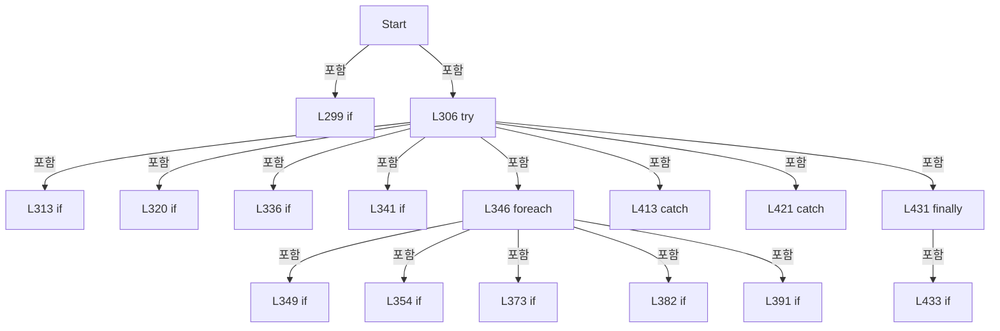

변경 전 점검: 입력/반환 타입, 위 호출자, 예외/취소 경로, 공유 상태와 저장·전송 소비자를 함께 확인합니다. 값의 단위나 물리 방향을 이름만으로 확정하지 않습니다.

### MethodDeclaration `Stop` · L441–451

[Drilling.Common/Review/CReviewManager.cs:441–451](https://github.com/kjuws10-rgb/A3Drilling/blob/dfa5920e6301d9ec4b0eab1452ae59521aafc986/Drilling.Common/Review/CReviewManager.cs#L441-L451)

| 항목 | 실제 추출 값 |
| --- | --- |
| 서명 | void Drilling.Common.Review.CReviewManager.Stop() |
| 접근/수식자 | Public / public |
| 반환/값 타입 | void |
| 소속 타입 | NamedType:Drilling.Common.Review.CReviewManager |

정적 호출자로 확인된 위치:

| 호출 파일/행 | 호출 표현식 | 런타임 분기 가능 |
| --- | --- | --- |
| [Drilling.UI/CRootView.cs:2683–2683](https://github.com/kjuws10-rgb/A3Drilling/blob/dfa5920e6301d9ec4b0eab1452ae59521aafc986/Drilling.UI/CRootView.cs#L2683-L2683) | _reviewManager.Stop | False |
| [Drilling.UI/Menu/Menus/CMenuCorrection.ReviewData.Reinspection.cs:336–336](https://github.com/kjuws10-rgb/A3Drilling/blob/dfa5920e6301d9ec4b0eab1452ae59521aafc986/Drilling.UI/Menu/Menus/CMenuCorrection.ReviewData.Reinspection.cs#L336-L336) | _reviewManager.Stop | False |
| [Drilling.UI/Menu/Menus/CMenuCorrection.ReviewData.Reinspection.cs:664–664](https://github.com/kjuws10-rgb/A3Drilling/blob/dfa5920e6301d9ec4b0eab1452ae59521aafc986/Drilling.UI/Menu/Menus/CMenuCorrection.ReviewData.Reinspection.cs#L664-L664) | _reviewManager.Stop | False |
| [Drilling.UI/Menu/Menus/CMenuCorrection.cs:2586–2586](https://github.com/kjuws10-rgb/A3Drilling/blob/dfa5920e6301d9ec4b0eab1452ae59521aafc986/Drilling.UI/Menu/Menus/CMenuCorrection.cs#L2586-L2586) | _reviewManager.Stop | False |
| [Drilling.UI/Menu/Menus/CMenuReview.cs:2120–2120](https://github.com/kjuws10-rgb/A3Drilling/blob/dfa5920e6301d9ec4b0eab1452ae59521aafc986/Drilling.UI/Menu/Menus/CMenuReview.cs#L2120-L2120) | _reviewManager.Stop | False |
| [Drilling.UI/Menu/Menus/CMenuReview.cs:3328–3328](https://github.com/kjuws10-rgb/A3Drilling/blob/dfa5920e6301d9ec4b0eab1452ae59521aafc986/Drilling.UI/Menu/Menus/CMenuReview.cs#L3328-L3328) | _reviewManager.Stop | False |

호출하는 대상과 해석 범위:

| 원본 행 | 표현식 | 분석 상태 | 대상/소스 위치 |
| --- | --- | --- | --- |
| 443 | Interlocked.Exchange | resolved | int System.Threading.Interlocked.Exchange(ref int, int) |
| 444 | .Stop | resolved | void Drilling.Common.Review.CReviewManager.CReviewStageMotion.Stop() · Drilling.Common/Review/CReviewManager.cs:2524 |
| 446 | WriteReviewLog | resolved | void Drilling.Common.Review.CReviewManager.WriteReviewLog(string, string) · Drilling.Common/Review/CReviewManager.cs:1022 |

본문의 실제 연산·분기·예외·반환 순서(원문 위치 순):

| 원본 행 | 종류 | 주석 해설 |
| --- | --- | --- |
| 443 | call | 함수·델리게이트 또는 객체 생성자를 호출합니다: Interlocked.Exchange(ref _stopRequested, 1) |
| 444 | call | 함수·델리게이트 또는 객체 생성자를 호출합니다: .Stop() |
| 445 | local-declaration | 지역 변수를 선언합니다: var plan = CurrentPlan; |
| 445 | variable-initializer | 변수의 초기값을 지정합니다: plan = CurrentPlan |
| 446 | call | 함수·델리게이트 또는 객체 생성자를 호출합니다: WriteReviewLog("STOP_REQUEST", "Review stop requested.") |
| 447 | if | 조건에 따라 분기합니다: if (SequenceState == EN_REVIEW_SEQUENCE_STATE.Running) |
| 449 | assignment | 값을 대상에 대입합니다: SequenceState = EN_REVIEW_SEQUENCE_STATE.Stopping |

제어 구문의 포함 구조(실제 실행 순서/CFG가 아닌 구문 탐색 그림):

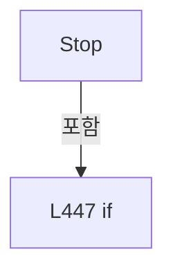

변경 전 점검: 입력/반환 타입, 위 호출자, 예외/취소 경로, 공유 상태와 저장·전송 소비자를 함께 확인합니다. 값의 단위나 물리 방향을 이름만으로 확정하지 않습니다.

### MethodDeclaration `FindIncompleteProductReview` · L453–464

[Drilling.Common/Review/CReviewManager.cs:453–464](https://github.com/kjuws10-rgb/A3Drilling/blob/dfa5920e6301d9ec4b0eab1452ae59521aafc986/Drilling.Common/Review/CReviewManager.cs#L453-L464)

| 항목 | 실제 추출 값 |
| --- | --- |
| 서명 | System.Threading.Tasks.Task<Drilling.Common.Product.ST_PRODUCT_REVIEW_DATA?> Drilling.Common.Review.CReviewManager.FindIncompleteProductReview(Drilling.Common.Review.ST_REVIEW_PLAN, string, System.Threading.CancellationToken) |
| 접근/수식자 | Public / public |
| 반환/값 타입 | System.Threading.Tasks.Task<Drilling.Common.Product.ST_PRODUCT_REVIEW_DATA?> |
| 소속 타입 | NamedType:Drilling.Common.Review.CReviewManager |

입력 계약:

| 이름 | 타입 | 전달 | 선택/기본값 |
| --- | --- | --- | --- |
| plan | Drilling.Common.Review.ST_REVIEW_PLAN | None | False /  |
| glassId | string | None | False /  |
| cancellationToken | System.Threading.CancellationToken | None | True / null |

정적 호출자로 확인된 위치:

| 호출 파일/행 | 호출 표현식 | 런타임 분기 가능 |
| --- | --- | --- |
| [Drilling.UI/Menu/Menus/CMenuReview.cs:3204–3204](https://github.com/kjuws10-rgb/A3Drilling/blob/dfa5920e6301d9ec4b0eab1452ae59521aafc986/Drilling.UI/Menu/Menus/CMenuReview.cs#L3204-L3204) | _reviewManager.FindIncompleteProductReview | False |

호출하는 대상과 해석 범위:

| 원본 행 | 표현식 | 분석 상태 | 대상/소스 위치 |
| --- | --- | --- | --- |
| 455 | cancellationToken.ThrowIfCancellationRequested | resolved | void System.Threading.CancellationToken.ThrowIfCancellationRequested() |
| 456 | FindInterruptedReviewCheckpoint | resolved | Drilling.Common.Product.ST_PRODUCT_REVIEW_DATA? Drilling.Common.Review.CReviewManager.FindInterruptedReviewCheckpoint(Drilling.Common.Review.ST_REVIEW_PLAN, string?) · Drilling.Common/Review/CReviewManager.cs:2537 |
| 457 | Task.FromResult<ST_PRODUCT_REVIEW_DATA?> | resolved | System.Threading.Tasks.Task<Drilling.Common.Product.ST_PRODUCT_REVIEW_DATA?> System.Threading.Tasks.Task.FromResult<Drilling.Common.Product.ST_PRODUCT_REVIEW_DATA?>(Drilling.Common.Product.ST_PRODUCT_REVIEW_DATA?) |
| 458 | string.IsNullOrWhiteSpace | resolved | bool string.IsNullOrWhiteSpace(string?) |
| 458 | product.GlassId.Equals | resolved | bool string.Equals(string?, System.StringComparison) |
| 458 | IsMatchingIncompleteReview | resolved | bool Drilling.Common.Review.CReviewManager.IsMatchingIncompleteReview(Drilling.Common.Review.ST_REVIEW_PLAN, string, Drilling.Common.Product.ST_PRODUCT_REVIEW_DATA) · Drilling.Common/Review/CReviewManager.cs:1614 |
| 460 | Task.FromResult<ST_PRODUCT_REVIEW_DATA?> | resolved | System.Threading.Tasks.Task<Drilling.Common.Product.ST_PRODUCT_REVIEW_DATA?> System.Threading.Tasks.Task.FromResult<Drilling.Common.Product.ST_PRODUCT_REVIEW_DATA?>(Drilling.Common.Product.ST_PRODUCT_REVIEW_DATA?) |
| 463 | Task.FromResult<ST_PRODUCT_REVIEW_DATA?> | resolved | System.Threading.Tasks.Task<Drilling.Common.Product.ST_PRODUCT_REVIEW_DATA?> System.Threading.Tasks.Task.FromResult<Drilling.Common.Product.ST_PRODUCT_REVIEW_DATA?>(Drilling.Common.Product.ST_PRODUCT_REVIEW_DATA?) |

본문의 실제 연산·분기·예외·반환 순서(원문 위치 순):

| 원본 행 | 종류 | 주석 해설 |
| --- | --- | --- |
| 455 | call | 함수·델리게이트 또는 객체 생성자를 호출합니다: cancellationToken.ThrowIfCancellationRequested() |
| 456 | call | 함수·델리게이트 또는 객체 생성자를 호출합니다: FindInterruptedReviewCheckpoint(plan, glassId) |
| 456 | if | 조건에 따라 분기합니다: if (FindInterruptedReviewCheckpoint(plan, glassId)is { } interrupted) |
| 457 | call | 함수·델리게이트 또는 객체 생성자를 호출합니다: Task.FromResult<ST_PRODUCT_REVIEW_DATA?>(interrupted) |
| 457 | return | 호출자에게 값 또는 제어를 반환합니다: return Task.FromResult<ST_PRODUCT_REVIEW_DATA?>(interrupted); |
| 458 | call | 함수·델리게이트 또는 객체 생성자를 호출합니다: string.IsNullOrWhiteSpace(glassId) |
| 458 | call | 함수·델리게이트 또는 객체 생성자를 호출합니다: product.GlassId.Equals(glassId, StringComparison.OrdinalIgnoreCase) |
| 458 | call | 함수·델리게이트 또는 객체 생성자를 호출합니다: IsMatchingIncompleteReview(plan, product.RecipeId, product.Review) |
| 458 | if | 조건에 따라 분기합니다: if (string.IsNullOrWhiteSpace(glassId) &#124;&#124; productManager?.Current is not { } product &#124;&#124; !product.GlassId.Equals(glassId, StringComparison.OrdinalIgnoreCase) &#124;&#124; !IsMatchingIncompleteReview(plan, product.RecipeId, product.Revi…) |
| 460 | call | 함수·델리게이트 또는 객체 생성자를 호출합니다: Task.FromResult<ST_PRODUCT_REVIEW_DATA?>(null) |
| 460 | return | 호출자에게 값 또는 제어를 반환합니다: return Task.FromResult<ST_PRODUCT_REVIEW_DATA?>(null); |
| 463 | call | 함수·델리게이트 또는 객체 생성자를 호출합니다: Task.FromResult<ST_PRODUCT_REVIEW_DATA?>(product.Review) |
| 463 | return | 호출자에게 값 또는 제어를 반환합니다: return Task.FromResult<ST_PRODUCT_REVIEW_DATA?>(product.Review); |

제어 구문의 포함 구조(실제 실행 순서/CFG가 아닌 구문 탐색 그림):

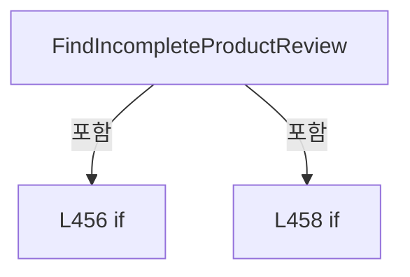

변경 전 점검: 입력/반환 타입, 위 호출자, 예외/취소 경로, 공유 상태와 저장·전송 소비자를 함께 확인합니다. 값의 단위나 물리 방향을 이름만으로 확정하지 않습니다.

### MethodDeclaration `GetScannerAxisTransform` · L466–474

[Drilling.Common/Review/CReviewManager.cs:466–474](https://github.com/kjuws10-rgb/A3Drilling/blob/dfa5920e6301d9ec4b0eab1452ae59521aafc986/Drilling.Common/Review/CReviewManager.cs#L466-L474)

| 항목 | 실제 추출 값 |
| --- | --- |
| 서명 | Drilling.Common.Recipe.ST_SCANNER_AXIS_TRANSFORM Drilling.Common.Review.CReviewManager.GetScannerAxisTransform(int) |
| 접근/수식자 | Public / public |
| 반환/값 타입 | Drilling.Common.Recipe.ST_SCANNER_AXIS_TRANSFORM |
| 소속 타입 | NamedType:Drilling.Common.Review.CReviewManager |

입력 계약:

| 이름 | 타입 | 전달 | 선택/기본값 |
| --- | --- | --- | --- |
| headNo | int | None | False /  |

현재 부분 분석에서 직접 연결된 호출자는 없습니다. XAML/이벤트/인터페이스·델리게이트·외부 진입을 추가 확인해야 하며, 미사용으로 판정한 것이 아닙니다.

호출하는 대상과 해석 범위:

| 원본 행 | 표현식 | 분석 상태 | 대상/소스 위치 |
| --- | --- | --- | --- |
| 470 | new ArgumentOutOfRangeException | resolved | System.ArgumentOutOfRangeException.ArgumentOutOfRangeException(string?, object?, string?) |
| 470 | nameof | unresolved | None |
| 473 | CScannerAxisTransform.Read | resolved | Drilling.Common.Recipe.ST_SCANNER_AXIS_TRANSFORM Drilling.Common.Recipe.CScannerAxisTransform.Read(System.Collections.Generic.IReadOnlyList<Drilling.Common.Managers.ST_SYSTEM_PARAMETER>, int) · Drilling.Common/Recipe/CShotCoordinatePlanBuilder.cs:1246 |
| 473 | settingManager.LoadSection | resolved | System.Collections.Generic.IReadOnlyList<Drilling.Common.Managers.ST_SYSTEM_PARAMETER> Drilling.Common.Managers.CSettingManager.LoadSection(Drilling.Common.Managers.EN_SETTING_TAB, System.Threading.CancellationToken) · Drilling.Common/Managers/CSettingManager.cs:26 |

본문의 실제 연산·분기·예외·반환 순서(원문 위치 순):

| 원본 행 | 종류 | 주석 해설 |
| --- | --- | --- |
| 468 | if | 조건에 따라 분기합니다: if (headNo is < 1 or > DefaultHeadCount) |
| 470 | call | 함수·델리게이트 또는 객체 생성자를 호출합니다: new ArgumentOutOfRangeException(nameof(headNo), headNo, $"Head number must be between 1 and {DefaultHeadCount}.") |
| 470 | call | 함수·델리게이트 또는 객체 생성자를 호출합니다: nameof(headNo) |
| 470 | throw | 예외를 발생/전달합니다: throw new ArgumentOutOfRangeException(nameof(headNo), headNo, $"Head number must be between 1 and {DefaultHeadCount}."); |
| 473 | call | 함수·델리게이트 또는 객체 생성자를 호출합니다: CScannerAxisTransform.Read(settingManager.LoadSection(EN_SETTING_TAB.Option), headNo) |
| 473 | call | 함수·델리게이트 또는 객체 생성자를 호출합니다: settingManager.LoadSection(EN_SETTING_TAB.Option) |
| 473 | return | 호출자에게 값 또는 제어를 반환합니다: return CScannerAxisTransform.Read(settingManager.LoadSection(EN_SETTING_TAB.Option), headNo); |

제어 구문의 포함 구조(실제 실행 순서/CFG가 아닌 구문 탐색 그림):

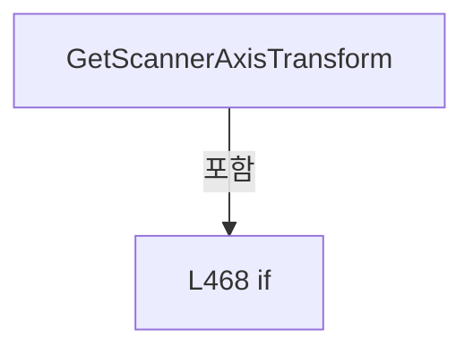

변경 전 점검: 입력/반환 타입, 위 호출자, 예외/취소 경로, 공유 상태와 저장·전송 소비자를 함께 확인합니다. 값의 단위나 물리 방향을 이름만으로 확정하지 않습니다.

### MethodDeclaration `RetryRemaining` · L476–494

[Drilling.Common/Review/CReviewManager.cs:476–494](https://github.com/kjuws10-rgb/A3Drilling/blob/dfa5920e6301d9ec4b0eab1452ae59521aafc986/Drilling.Common/Review/CReviewManager.cs#L476-L494)

| 항목 | 실제 추출 값 |
| --- | --- |
| 서명 | System.Threading.Tasks.Task<Drilling.Common.Review.ST_REVIEW_SEQUENCE_STATUS> Drilling.Common.Review.CReviewManager.RetryRemaining(System.Action<Drilling.Common.Review.ST_REVIEW_PLAN>?, System.Threading.CancellationToken) |
| 접근/수식자 | Public / public, async |
| 반환/값 타입 | System.Threading.Tasks.Task<Drilling.Common.Review.ST_REVIEW_SEQUENCE_STATUS> |
| 소속 타입 | NamedType:Drilling.Common.Review.CReviewManager |

입력 계약:

| 이름 | 타입 | 전달 | 선택/기본값 |
| --- | --- | --- | --- |
| progress | System.Action<Drilling.Common.Review.ST_REVIEW_PLAN>? | None | True / null |
| cancellationToken | System.Threading.CancellationToken | None | True / null |

정적 호출자로 확인된 위치:

| 호출 파일/행 | 호출 표현식 | 런타임 분기 가능 |
| --- | --- | --- |
| [Drilling.UI/Menu/Menus/CMenuReview.cs:3355–3355](https://github.com/kjuws10-rgb/A3Drilling/blob/dfa5920e6301d9ec4b0eab1452ae59521aafc986/Drilling.UI/Menu/Menus/CMenuReview.cs#L3355-L3355) | _reviewManager.RetryRemaining | False |

호출하는 대상과 해석 범위:

| 원본 행 | 표현식 | 분석 상태 | 대상/소스 위치 |
| --- | --- | --- | --- |
| 481 | new ST_REVIEW_SEQUENCE_STATUS | resolved | Drilling.Common.Review.ST_REVIEW_SEQUENCE_STATUS.ST_REVIEW_SEQUENCE_STATUS(Drilling.Common.Review.EN_REVIEW_SEQUENCE_STATE, int, int, int, string) · Drilling.Common/Review/CReviewManager.cs:3982 |
| 484 | SetWaitingPointsReady | resolved | Drilling.Common.Review.ST_REVIEW_PLAN Drilling.Common.Review.CReviewManager.SetWaitingPointsReady(Drilling.Common.Review.ST_REVIEW_PLAN) · Drilling.Common/Review/CReviewManager.cs:1089 |
| 485 | SetCurrentPlan | resolved | void Drilling.Common.Review.CReviewManager.SetCurrentPlan(Drilling.Common.Review.ST_REVIEW_PLAN, System.Action<Drilling.Common.Review.ST_REVIEW_PLAN>?) · Drilling.Common/Review/CReviewManager.cs:1045 |
| 486 | plan.ReviewPoints.Where | resolved | System.Collections.Generic.IEnumerable<Drilling.Common.Review.ST_REVIEW_PLAN_POINT> System.Collections.Generic.IEnumerable<Drilling.Common.Review.ST_REVIEW_PLAN_POINT>.Where<Drilling.Common.Review.ST_REVIEW_PLAN_POINT>(System.Func<Drilling.Common.Review.ST_REVIEW_PLAN_POINT, bool>) |
| 487 | OrderByReviewSequence(points).ToArray | resolved | Drilling.Common.Review.ST_REVIEW_PLAN_POINT[] System.Collections.Generic.IEnumerable<Drilling.Common.Review.ST_REVIEW_PLAN_POINT>.ToArray<Drilling.Common.Review.ST_REVIEW_PLAN_POINT>() |
| 487 | OrderByReviewSequence | resolved | System.Collections.Generic.IReadOnlyList<Drilling.Common.Review.ST_REVIEW_PLAN_POINT> Drilling.Common.Review.CReviewManager.OrderByReviewSequence(System.Collections.Generic.IEnumerable<Drilling.Common.Review.ST_REVIEW_PLAN_POINT>) · Drilling.Common/Review/CReviewManager.cs:1178 |
| 490 | CreateStatus | resolved | Drilling.Common.Review.ST_REVIEW_SEQUENCE_STATUS Drilling.Common.Review.CReviewManager.CreateStatus(Drilling.Common.Review.ST_REVIEW_PLAN, Drilling.Common.Review.EN_REVIEW_SEQUENCE_STATE, string) · Drilling.Common/Review/CReviewManager.cs:1115 |
| 493 | RunRetryPoints | resolved | System.Threading.Tasks.Task<Drilling.Common.Review.ST_REVIEW_SEQUENCE_STATUS> Drilling.Common.Review.CReviewManager.RunRetryPoints(System.Collections.Generic.IReadOnlyList<Drilling.Common.Review.ST_REVIEW_PLAN_POINT>, string, System.Action<Drilling.Common.Review.ST_REVIEW_PLAN>?, System.Threading.CancellationToken) · Drilling.Common/Review/CReviewManager.cs:2345 |

본문의 실제 연산·분기·예외·반환 순서(원문 위치 순):

| 원본 행 | 종류 | 주석 해설 |
| --- | --- | --- |
| 478 | local-declaration | 지역 변수를 선언합니다: var plan = CurrentPlan; |
| 478 | variable-initializer | 변수의 초기값을 지정합니다: plan = CurrentPlan |
| 479 | if | 조건에 따라 분기합니다: if (plan is null) |
| 481 | call | 함수·델리게이트 또는 객체 생성자를 호출합니다: new ST_REVIEW_SEQUENCE_STATUS(EN_REVIEW_SEQUENCE_STATE.Idle, 0, 0, 0, "Review plan is empty.") |
| 481 | return | 호출자에게 값 또는 제어를 반환합니다: return new ST_REVIEW_SEQUENCE_STATUS(EN_REVIEW_SEQUENCE_STATE.Idle, 0, 0, 0, "Review plan is empty."); |
| 484 | assignment | 값을 대상에 대입합니다: plan = SetWaitingPointsReady(plan) |
| 484 | call | 함수·델리게이트 또는 객체 생성자를 호출합니다: SetWaitingPointsReady(plan) |
| 485 | call | 함수·델리게이트 또는 객체 생성자를 호출합니다: SetCurrentPlan(plan, progress) |
| 486 | call | 함수·델리게이트 또는 객체 생성자를 호출합니다: plan.ReviewPoints.Where(point => point.State == EN_REVIEW_POINT_STATE.Ready) |
| 486 | local-declaration | 지역 변수를 선언합니다: var points = plan.ReviewPoints.Where(point => point.State == EN_REVIEW_POINT_STATE.Ready); |
| 486 | variable-initializer | 변수의 초기값을 지정합니다: points = plan.ReviewPoints.Where(point => point.State == EN_REVIEW_POINT_STATE.Ready) |
| 487 | call | 함수·델리게이트 또는 객체 생성자를 호출합니다: OrderByReviewSequence(points).ToArray() |
| 487 | call | 함수·델리게이트 또는 객체 생성자를 호출합니다: OrderByReviewSequence(points) |
| 487 | local-declaration | 지역 변수를 선언합니다: var orderedPoints = OrderByReviewSequence(points).ToArray(); |
| 487 | variable-initializer | 변수의 초기값을 지정합니다: orderedPoints = OrderByReviewSequence(points).ToArray() |
| 488 | if | 조건에 따라 분기합니다: if (orderedPoints.Length == 0) |
| 490 | call | 함수·델리게이트 또는 객체 생성자를 호출합니다: CreateStatus(plan, SequenceState, "Ready review point is empty.") |
| 490 | return | 호출자에게 값 또는 제어를 반환합니다: return CreateStatus(plan, SequenceState, "Ready review point is empty."); |
| 493 | await | 비동기 완료를 기다립니다: await RunRetryPoints(orderedPoints, "Review ready point retry completed.", progress, cancellationToken) |
| 493 | call | 함수·델리게이트 또는 객체 생성자를 호출합니다: RunRetryPoints(orderedPoints, "Review ready point retry completed.", progress, cancellationToken) |
| 493 | return | 호출자에게 값 또는 제어를 반환합니다: return await RunRetryPoints(orderedPoints, "Review ready point retry completed.", progress, cancellationToken); |

제어 구문의 포함 구조(실제 실행 순서/CFG가 아닌 구문 탐색 그림):

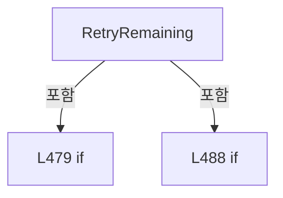

변경 전 점검: 입력/반환 타입, 위 호출자, 예외/취소 경로, 공유 상태와 저장·전송 소비자를 함께 확인합니다. 값의 단위나 물리 방향을 이름만으로 확정하지 않습니다.

### MethodDeclaration `CreatePlanCore` · L496–548

[Drilling.Common/Review/CReviewManager.cs:496–548](https://github.com/kjuws10-rgb/A3Drilling/blob/dfa5920e6301d9ec4b0eab1452ae59521aafc986/Drilling.Common/Review/CReviewManager.cs#L496-L548)

| 항목 | 실제 추출 값 |
| --- | --- |
| 서명 | Drilling.Common.Review.ST_REVIEW_PLAN Drilling.Common.Review.CReviewManager.CreatePlanCore(Drilling.Common.Managers.ST_RECIPE_DEFINITION, System.Func<Drilling.Common.Review.ST_REVIEW_PLAN_POINT, bool>, int, bool, double, double) |
| 접근/수식자 | Private / private |
| 반환/값 타입 | Drilling.Common.Review.ST_REVIEW_PLAN |
| 소속 타입 | NamedType:Drilling.Common.Review.CReviewManager |

입력 계약:

| 이름 | 타입 | 전달 | 선택/기본값 |
| --- | --- | --- | --- |
| recipe | Drilling.Common.Managers.ST_RECIPE_DEFINITION | None | False /  |
| useSelector | System.Func<Drilling.Common.Review.ST_REVIEW_PLAN_POINT, bool> | None | False /  |
| selectedBeamNo | int | None | True / 1 |
| selectAllAssignedPoints | bool | None | True / false |
| shiftOffsetX | double | None | True / 0 |
| shiftOffsetY | double | None | True / 0 |

정적 호출자로 확인된 위치:

| 호출 파일/행 | 호출 표현식 | 런타임 분기 가능 |
| --- | --- | --- |
| [Drilling.Common/Review/CReviewManager.cs:208–208](https://github.com/kjuws10-rgb/A3Drilling/blob/dfa5920e6301d9ec4b0eab1452ae59521aafc986/Drilling.Common/Review/CReviewManager.cs#L208-L208) | CreatePlanCore | False |

호출하는 대상과 해석 범위:

| 원본 행 | 표현식 | 분석 상태 | 대상/소스 위치 |
| --- | --- | --- | --- |
| 505 | ReadRequiredCellCount | resolved | int Drilling.Common.Review.CReviewManager.ReadRequiredCellCount(Drilling.Common.Managers.ST_RECIPE_DEFINITION, string) · Drilling.Common/Review/CReviewManager.cs:1286 |
| 506 | ReadDouble | resolved | double Drilling.Common.Review.CReviewManager.ReadDouble(Drilling.Common.Managers.ST_RECIPE_DEFINITION, double, params string[]) · Drilling.Common/Review/CReviewManager.cs:1315 |
| 507 | ReadDouble | resolved | double Drilling.Common.Review.CReviewManager.ReadDouble(Drilling.Common.Managers.ST_RECIPE_DEFINITION, double, params string[]) · Drilling.Common/Review/CReviewManager.cs:1315 |
| 508 | LoadReviewCoordinateSettings | resolved | Drilling.Common.Review.CReviewManager.ST_REVIEW_COORDINATE_SETTINGS Drilling.Common.Review.CReviewManager.LoadReviewCoordinateSettings(Drilling.Common.Managers.ST_RECIPE_DEFINITION) · Drilling.Common/Review/CReviewManager.cs:594 |
| 509 | BuildRuntimeCoordinateParameters | resolved | System.Collections.Generic.IReadOnlyDictionary<string, string> Drilling.Common.Review.CReviewManager.BuildRuntimeCoordinateParameters(Drilling.Common.Managers.ST_RECIPE_DEFINITION) · Drilling.Common/Review/CReviewManager.cs:568 |
| 510 | CShotCoordinatePlanBuilder.ReadDirection | resolved | double Drilling.Common.Recipe.CShotCoordinatePlanBuilder.ReadDirection(System.Collections.Generic.IReadOnlyDictionary<string, string>, double, params string[]) · Drilling.Common/Recipe/CShotCoordinatePlanBuilder.cs:505 |
| 511 | CShotCoordinatePlanBuilder.Build | resolved | Drilling.Common.Recipe.ST_SHOT_COORDINATE_PLAN Drilling.Common.Recipe.CShotCoordinatePlanBuilder.Build(System.Collections.Generic.IReadOnlyDictionary<string, string>) · Drilling.Common/Recipe/CShotCoordinatePlanBuilder.cs:11 |
| 512 | BuildReviewExcludedShots | resolved | System.Collections.Generic.IReadOnlyDictionary<string, string> Drilling.Common.Review.CReviewManager.BuildReviewExcludedShots(System.Collections.Generic.IReadOnlyDictionary<string, string>, System.Collections.Generic.IReadOnlyList<Drilling.Common.Recipe.ST_HEAD_SHOT_POINT>) · Drilling.Common/Review/CReviewManager.cs:550 |
| 513 | processCoordinatePlan.Shots.GroupBy(shot => (shot.CellNo, shot.CellShotNo)).ToDictionary | resolved | System.Collections.Generic.Dictionary<(int CellNo, int CellShotNo), int> System.Collections.Generic.IEnumerable<System.Linq.IGrouping<(int CellNo, int CellShotNo), Drilling.Common.Recipe.ST_HEAD_SHOT_POINT>>.ToDictionary<System.Linq.IGrouping<(int CellNo, int CellShotNo), Drilling.Common.Recipe.ST_HEAD_SHOT_POINT>, (int CellNo, int CellShotNo), int>(System.Func<System.Linq.IGrouping<(int CellNo, int CellShotNo), Drilling.Common.Recipe.ST_HEAD_SHOT_POINT>, (int CellNo, int CellShotNo)>, System.Func<System.Linq.IGrouping<(int CellNo, int CellShotNo), Drilling.Common.Recipe.ST_HEAD_SHOT_POINT>, int>) |
| 513 | processCoordinatePlan.Shots.GroupBy | resolved | System.Collections.Generic.IEnumerable<System.Linq.IGrouping<(int CellNo, int CellShotNo), Drilling.Common.Recipe.ST_HEAD_SHOT_POINT>> System.Collections.Generic.IEnumerable<Drilling.Common.Recipe.ST_HEAD_SHOT_POINT>.GroupBy<Drilling.Common.Recipe.ST_HEAD_SHOT_POINT, (int CellNo, int CellShotNo)>(System.Func<Drilling.Common.Recipe.ST_HEAD_SHOT_POINT, (int CellNo, int CellShotNo)>) |
| 513 | group.Last | resolved | Drilling.Common.Recipe.ST_HEAD_SHOT_POINT System.Collections.Generic.IEnumerable<Drilling.Common.Recipe.ST_HEAD_SHOT_POINT>.Last<Drilling.Common.Recipe.ST_HEAD_SHOT_POINT>() |
| 514 | BuildShotPoints | resolved | System.Collections.Generic.IReadOnlyList<Drilling.Common.Review.ST_REVIEW_PLAN_POINT> Drilling.Common.Review.CReviewManager.BuildShotPoints(Drilling.Common.Managers.ST_RECIPE_DEFINITION, int, int, Drilling.Common.Review.CReviewManager.ST_REVIEW_COORDINATE_SETTINGS, System.Collections.Generic.IReadOnlyDictionary<(int CellNo, int CellShotNo), int>, double, int, bool, System.Collections.Generic.IReadOnlyDictionary<string, string>, double, double) · Drilling.Common/Review/CReviewManager.cs:674 |
| 528 | points.Select(point => { var use = point.HeadNo > 0 && !excludedShots.ContainsKey(point.ShotKey) && useSelector(point); return point with { BeamNo = selectedBeamNo, Use = use, State = use ? EN_REVIEW_POINT_STATE.Ready : EN_REVIEW_POINT_STATE.Skip, Judge = use ? "WAIT" : "-" }; }).ToArray | resolved | Drilling.Common.Review.ST_REVIEW_PLAN_POINT[] System.Collections.Generic.IEnumerable<Drilling.Common.Review.ST_REVIEW_PLAN_POINT>.ToArray<Drilling.Common.Review.ST_REVIEW_PLAN_POINT>() |
| 528 | points.Select | resolved | System.Collections.Generic.IEnumerable<Drilling.Common.Review.ST_REVIEW_PLAN_POINT> System.Collections.Generic.IEnumerable<Drilling.Common.Review.ST_REVIEW_PLAN_POINT>.Select<Drilling.Common.Review.ST_REVIEW_PLAN_POINT, Drilling.Common.Review.ST_REVIEW_PLAN_POINT>(System.Func<Drilling.Common.Review.ST_REVIEW_PLAN_POINT, Drilling.Common.Review.ST_REVIEW_PLAN_POINT>) |
| 530 | excludedShots.ContainsKey | resolved · 동적 구현 선택 가능 | bool System.Collections.Generic.IReadOnlyDictionary<string, string>.ContainsKey(string) |
| 530 | useSelector | resolved · 동적 구현 선택 가능 | bool System.Func<Drilling.Common.Review.ST_REVIEW_PLAN_POINT, bool>.Invoke(Drilling.Common.Review.ST_REVIEW_PLAN_POINT) |
| 541 | new ST_REVIEW_PLAN | resolved | Drilling.Common.Review.ST_REVIEW_PLAN.ST_REVIEW_PLAN(string, int, double, double, Drilling.Common.Review.EN_VISION_FLIP_TYPE, System.DateTimeOffset, System.Collections.Generic.IReadOnlyList<Drilling.Common.Review.ST_REVIEW_PLAN_POINT>) · Drilling.Common/Review/CReviewManager.cs:4081 |
| 544 | ReadDouble | resolved | double Drilling.Common.Review.CReviewManager.ReadDouble(Drilling.Common.Managers.ST_RECIPE_DEFINITION, double, params string[]) · Drilling.Common/Review/CReviewManager.cs:1315 |

본문의 실제 연산·분기·예외·반환 순서(원문 위치 순):

| 원본 행 | 종류 | 주석 해설 |
| --- | --- | --- |
| 504 | local-declaration | 지역 변수를 선언합니다: const int headCount = DefaultHeadCount; |
| 504 | variable-initializer | 변수의 초기값을 지정합니다: headCount = DefaultHeadCount |
| 505 | call | 함수·델리게이트 또는 객체 생성자를 호출합니다: ReadRequiredCellCount(recipe, "MAX_CELL_NUMBER") |
| 505 | local-declaration | 지역 변수를 선언합니다: var cellCount = ReadRequiredCellCount(recipe, "MAX_CELL_NUMBER"); |
| 505 | variable-initializer | 변수의 초기값을 지정합니다: cellCount = ReadRequiredCellCount(recipe, "MAX_CELL_NUMBER") |
| 506 | call | 함수·델리게이트 또는 객체 생성자를 호출합니다: ReadDouble(recipe, 0.030, "REVIEW_TOLERANCE_X") |
| 506 | local-declaration | 지역 변수를 선언합니다: var toleranceX = ReadDouble(recipe, 0.030, "REVIEW_TOLERANCE_X"); |
| 506 | variable-initializer | 변수의 초기값을 지정합니다: toleranceX = ReadDouble(recipe, 0.030, "REVIEW_TOLERANCE_X") |
| 507 | call | 함수·델리게이트 또는 객체 생성자를 호출합니다: ReadDouble(recipe, 0.030, "REVIEW_TOLERANCE_Y") |
| 507 | local-declaration | 지역 변수를 선언합니다: var toleranceY = ReadDouble(recipe, 0.030, "REVIEW_TOLERANCE_Y"); |
| 507 | variable-initializer | 변수의 초기값을 지정합니다: toleranceY = ReadDouble(recipe, 0.030, "REVIEW_TOLERANCE_Y") |
| 508 | call | 함수·델리게이트 또는 객체 생성자를 호출합니다: LoadReviewCoordinateSettings(recipe) |
| 508 | local-declaration | 지역 변수를 선언합니다: var coordinateSettings = LoadReviewCoordinateSettings(recipe); |
| 508 | variable-initializer | 변수의 초기값을 지정합니다: coordinateSettings = LoadReviewCoordinateSettings(recipe) |
| 509 | call | 함수·델리게이트 또는 객체 생성자를 호출합니다: BuildRuntimeCoordinateParameters(recipe) |
| 509 | local-declaration | 지역 변수를 선언합니다: var runtimeCoordinateParameters = BuildRuntimeCoordinateParameters(recipe); |
| 509 | variable-initializer | 변수의 초기값을 지정합니다: runtimeCoordinateParameters = BuildRuntimeCoordinateParameters(recipe) |
| 510 | call | 함수·델리게이트 또는 객체 생성자를 호출합니다: CShotCoordinatePlanBuilder.ReadDirection(runtimeCoordinateParameters, -1.0, "STAGE_SCAN_DIRECTION_Y") |
| 510 | local-declaration | 지역 변수를 선언합니다: var stageScanDirectionY = CShotCoordinatePlanBuilder.ReadDirection(runtimeCoordinateParameters, -1.0, "STAGE_SCAN_DIRECTION_Y"); |
| 510 | variable-initializer | 변수의 초기값을 지정합니다: stageScanDirectionY = CShotCoordinatePlanBuilder.ReadDirection(runtimeCoordinateParameters, -1.0, "STAGE_SCAN_DIRECTION_Y") |
| 511 | call | 함수·델리게이트 또는 객체 생성자를 호출합니다: CShotCoordinatePlanBuilder.Build(runtimeCoordinateParameters) |
| 511 | local-declaration | 지역 변수를 선언합니다: var processCoordinatePlan = CShotCoordinatePlanBuilder.Build(runtimeCoordinateParameters); |
| 511 | variable-initializer | 변수의 초기값을 지정합니다: processCoordinatePlan = CShotCoordinatePlanBuilder.Build(runtimeCoordinateParameters) |
| 512 | call | 함수·델리게이트 또는 객체 생성자를 호출합니다: BuildReviewExcludedShots(runtimeCoordinateParameters, processCoordinatePlan.Shots) |
| 512 | local-declaration | 지역 변수를 선언합니다: var excludedShots = BuildReviewExcludedShots(runtimeCoordinateParameters, processCoordinatePlan.Shots); |
| 512 | variable-initializer | 변수의 초기값을 지정합니다: excludedShots = BuildReviewExcludedShots(runtimeCoordinateParameters, processCoordinatePlan.Shots) |
| 513 | call | 함수·델리게이트 또는 객체 생성자를 호출합니다: processCoordinatePlan.Shots.GroupBy(shot => (shot.CellNo, shot.CellShotNo)).ToDictionary(group => group.Key, group => group.Last().HeadNo) |
| 513 | call | 함수·델리게이트 또는 객체 생성자를 호출합니다: processCoordinatePlan.Shots.GroupBy(shot => (shot.CellNo, shot.CellShotNo)) |
| 513 | call | 함수·델리게이트 또는 객체 생성자를 호출합니다: group.Last() |
| 513 | local-declaration | 지역 변수를 선언합니다: var assignedHeadNos = processCoordinatePlan.Shots.GroupBy(shot => (shot.CellNo, shot.CellShotNo)).ToDictionary(group => group.Key, group => group.Last().HeadNo); |
| 513 | variable-initializer | 변수의 초기값을 지정합니다: assignedHeadNos = processCoordinatePlan.Shots.GroupBy(shot => (shot.CellNo, shot.CellShotNo)).ToDictionary(group => group.Key, group => group.Last().HeadNo) |
| 514 | call | 함수·델리게이트 또는 객체 생성자를 호출합니다: BuildShotPoints( recipe, headCount, cellCount, coordinateSettings, assignedHeadNos, stageScanDirectionY, selectedBeamNo, selectAllAssignedPoints, excludedShots, shiftOffsetX, shiftOffsetY) |
| 514 | local-declaration | 지역 변수를 선언합니다: IReadOnlyList<ST_REVIEW_PLAN_POINT> points = BuildShotPoints( recipe, headCount, cellCount, coordinateSettings, assignedHeadNos, stageScanDirectionY, selectedBeamNo, selectAllAssignedPoints, excludedShots, shiftOffsetX, shiftOffse |
| 514 | variable-initializer | 변수의 초기값을 지정합니다: points = BuildShotPoints( recipe, headCount, cellCount, coordinateSettings, assignedHeadNos, stageScanDirectionY, selectedBeamNo, selectAllAssignedPoints, excludedShots, shiftOffsetX, shiftOffsetY) |
| 526 | if | 조건에 따라 분기합니다: if (!selectAllAssignedPoints) |
| 528 | assignment | 값을 대상에 대입합니다: points = points.Select(point => { var use = point.HeadNo > 0 && !excludedShots.ContainsKey(point.ShotKey) && useSelector(point); return point with { BeamNo = selectedBeamNo, Use = use, State = use ? EN_REVIEW_POINT_STATE.Ready : E |
| 528 | call | 함수·델리게이트 또는 객체 생성자를 호출합니다: points.Select(point => { var use = point.HeadNo > 0 && !excludedShots.ContainsKey(point.ShotKey) && useSelector(point); return point with { BeamNo = selectedBeamNo, Use = use, State = use ? EN_REVIEW_POINT_STATE.Ready : … |
| 528 | call | 함수·델리게이트 또는 객체 생성자를 호출합니다: points.Select(point => { var use = point.HeadNo > 0 && !excludedShots.ContainsKey(point.ShotKey) && useSelector(point); return point with { BeamNo = selectedBeamNo, Use = use, State = use ? EN_REVIEW_POINT_STATE.Ready : … |
| 530 | call | 함수·델리게이트 또는 객체 생성자를 호출합니다: excludedShots.ContainsKey(point.ShotKey) |
| 530 | call | 함수·델리게이트 또는 객체 생성자를 호출합니다: useSelector(point) |
| 530 | local-declaration | 지역 변수를 선언합니다: var use = point.HeadNo > 0 && !excludedShots.ContainsKey(point.ShotKey) && useSelector(point); |
| 530 | variable-initializer | 변수의 초기값을 지정합니다: use = point.HeadNo > 0 && !excludedShots.ContainsKey(point.ShotKey) && useSelector(point) |
| 531 | return | 호출자에게 값 또는 제어를 반환합니다: return point with { BeamNo = selectedBeamNo, Use = use, State = use ? EN_REVIEW_POINT_STATE.Ready : EN_REVIEW_POINT_STATE.Skip, Judge = use ? "WAIT" : "-" }; |
| 533 | assignment | 값을 대상에 대입합니다: BeamNo = selectedBeamNo |
| 534 | assignment | 값을 대상에 대입합니다: Use = use |
| 535 | assignment | 값을 대상에 대입합니다: State = use ? EN_REVIEW_POINT_STATE.Ready : EN_REVIEW_POINT_STATE.Skip |
| 535 | conditional-expression | 조건에 따라 결과식을 선택합니다: use ? EN_REVIEW_POINT_STATE.Ready : EN_REVIEW_POINT_STATE.Skip |
| 536 | assignment | 값을 대상에 대입합니다: Judge = use ? "WAIT" : "-" |
| 536 | conditional-expression | 조건에 따라 결과식을 선택합니다: use ? "WAIT" : "-" |
| 541 | call | 함수·델리게이트 또는 객체 생성자를 호출합니다: new ST_REVIEW_PLAN(recipe.Id, cellCount, toleranceX, toleranceY, coordinateSettings.VisionFlipType, DateTimeOffset.Now, points) { StageScanDirectionY = stageScanDirectionY, StageSpeed = ReadDouble(recipe, 0, "STAGE_SPEED… |
| 541 | return | 호출자에게 값 또는 제어를 반환합니다: return new ST_REVIEW_PLAN(recipe.Id, cellCount, toleranceX, toleranceY, coordinateSettings.VisionFlipType, DateTimeOffset.Now, points) { StageScanDirectionY = stageScanDirectionY, StageSpeed = ReadDouble(recipe, 0, "STAGE_SPEED"), |
| 543 | assignment | 값을 대상에 대입합니다: StageScanDirectionY = stageScanDirectionY |
| 544 | assignment | 값을 대상에 대입합니다: StageSpeed = ReadDouble(recipe, 0, "STAGE_SPEED") |
| 544 | call | 함수·델리게이트 또는 객체 생성자를 호출합니다: ReadDouble(recipe, 0, "STAGE_SPEED") |
| 545 | assignment | 값을 대상에 대입합니다: ShiftOffsetX = shiftOffsetX |
| 546 | assignment | 값을 대상에 대입합니다: ShiftOffsetY = shiftOffsetY |

제어 구문의 포함 구조(실제 실행 순서/CFG가 아닌 구문 탐색 그림):

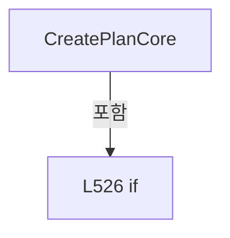

변경 전 점검: 입력/반환 타입, 위 호출자, 예외/취소 경로, 공유 상태와 저장·전송 소비자를 함께 확인합니다. 값의 단위나 물리 방향을 이름만으로 확정하지 않습니다.

### MethodDeclaration `BuildReviewExcludedShots` · L550–566

[Drilling.Common/Review/CReviewManager.cs:550–566](https://github.com/kjuws10-rgb/A3Drilling/blob/dfa5920e6301d9ec4b0eab1452ae59521aafc986/Drilling.Common/Review/CReviewManager.cs#L550-L566)

| 항목 | 실제 추출 값 |
| --- | --- |
| 서명 | System.Collections.Generic.IReadOnlyDictionary<string, string> Drilling.Common.Review.CReviewManager.BuildReviewExcludedShots(System.Collections.Generic.IReadOnlyDictionary<string, string>, System.Collections.Generic.IReadOnlyList<Drilling.Common.Recipe.ST_HEAD_SHOT_POINT>) |
| 접근/수식자 | Private / private, static |
| 반환/값 타입 | System.Collections.Generic.IReadOnlyDictionary<string, string> |
| 소속 타입 | NamedType:Drilling.Common.Review.CReviewManager |

입력 계약:

| 이름 | 타입 | 전달 | 선택/기본값 |
| --- | --- | --- | --- |
| runtimeCoordinateParameters | System.Collections.Generic.IReadOnlyDictionary<string, string> | None | False /  |
| processShots | System.Collections.Generic.IReadOnlyList<Drilling.Common.Recipe.ST_HEAD_SHOT_POINT> | None | False /  |

정적 호출자로 확인된 위치:

| 호출 파일/행 | 호출 표현식 | 런타임 분기 가능 |
| --- | --- | --- |
| [Drilling.Common/Review/CReviewManager.cs:512–512](https://github.com/kjuws10-rgb/A3Drilling/blob/dfa5920e6301d9ec4b0eab1452ae59521aafc986/Drilling.Common/Review/CReviewManager.cs#L512-L512) | BuildReviewExcludedShots | False |

호출하는 대상과 해석 범위:

| 원본 행 | 표현식 | 분석 상태 | 대상/소스 위치 |
| --- | --- | --- | --- |
| 552 | CRecipeShotMaskingPlan.Build | resolved | Drilling.Common.Recipe.CRecipeShotMaskingPlan Drilling.Common.Recipe.CRecipeShotMaskingPlan.Build(System.Collections.Generic.IReadOnlyDictionary<string, string>) · Drilling.Common/Recipe/CShotCoordinatePlanBuilder.cs:813 |
| 553 | new Dictionary<string, string> | resolved | System.Collections.Generic.Dictionary<string, string>.Dictionary(System.Collections.Generic.IEqualityComparer<string>?) |
| 556 | maskingPlan.EvaluateShot | resolved | Drilling.Common.Recipe.ST_RECIPE_SHOT_MASKING_RESULT Drilling.Common.Recipe.CRecipeShotMaskingPlan.EvaluateShot(Drilling.Common.Recipe.ST_HEAD_SHOT_POINT) · Drilling.Common/Recipe/CShotCoordinatePlanBuilder.cs:853 |
| 562 | NormalizeShotKey | resolved | string Drilling.Common.Review.CReviewManager.NormalizeShotKey(string) · Drilling.Common/Review/CReviewManager.cs:1238 |

본문의 실제 연산·분기·예외·반환 순서(원문 위치 순):

| 원본 행 | 종류 | 주석 해설 |
| --- | --- | --- |
| 552 | call | 함수·델리게이트 또는 객체 생성자를 호출합니다: CRecipeShotMaskingPlan.Build(runtimeCoordinateParameters) |
| 552 | local-declaration | 지역 변수를 선언합니다: var maskingPlan = CRecipeShotMaskingPlan.Build(runtimeCoordinateParameters); |
| 552 | variable-initializer | 변수의 초기값을 지정합니다: maskingPlan = CRecipeShotMaskingPlan.Build(runtimeCoordinateParameters) |
| 553 | call | 함수·델리게이트 또는 객체 생성자를 호출합니다: new Dictionary<string, string>(StringComparer.OrdinalIgnoreCase) |
| 553 | local-declaration | 지역 변수를 선언합니다: var excludedShots = new Dictionary<string, string>(StringComparer.OrdinalIgnoreCase); |
| 553 | variable-initializer | 변수의 초기값을 지정합니다: excludedShots = new Dictionary<string, string>(StringComparer.OrdinalIgnoreCase) |
| 554 | foreach | 컬렉션 요소를 순회합니다: foreach (var shot in processShots) |
| 556 | call | 함수·델리게이트 또는 객체 생성자를 호출합니다: maskingPlan.EvaluateShot(shot) |
| 556 | local-declaration | 지역 변수를 선언합니다: var exclusion = maskingPlan.EvaluateShot(shot); |
| 556 | variable-initializer | 변수의 초기값을 지정합니다: exclusion = maskingPlan.EvaluateShot(shot) |
| 557 | if | 조건에 따라 분기합니다: if (!exclusion.ShouldSkipLaser) |
| 559 | continue | 다음 반복으로 진행합니다: continue; |
| 562 | assignment | 값을 대상에 대입합니다: excludedShots[NormalizeShotKey(shot.ShotKey)] = exclusion.IsMasked && exclusion.IsChessSkipped ? "MASKING + CHESS" : exclusion.IsMasked ? "MASKING" : "CHESS" |
| 562 | call | 함수·델리게이트 또는 객체 생성자를 호출합니다: NormalizeShotKey(shot.ShotKey) |
| 562 | conditional-expression | 조건에 따라 결과식을 선택합니다: exclusion.IsMasked && exclusion.IsChessSkipped ? "MASKING + CHESS" : exclusion.IsMasked ? "MASKING" : "CHESS" |
| 562 | conditional-expression | 조건에 따라 결과식을 선택합니다: exclusion.IsMasked ? "MASKING" : "CHESS" |
| 565 | return | 호출자에게 값 또는 제어를 반환합니다: return excludedShots; |

제어 구문의 포함 구조(실제 실행 순서/CFG가 아닌 구문 탐색 그림):


변경 전 점검: 입력/반환 타입, 위 호출자, 예외/취소 경로, 공유 상태와 저장·전송 소비자를 함께 확인합니다. 값의 단위나 물리 방향을 이름만으로 확정하지 않습니다.

### MethodDeclaration `BuildRuntimeCoordinateParameters` · L568–592

[Drilling.Common/Review/CReviewManager.cs:568–592](https://github.com/kjuws10-rgb/A3Drilling/blob/dfa5920e6301d9ec4b0eab1452ae59521aafc986/Drilling.Common/Review/CReviewManager.cs#L568-L592)

| 항목 | 실제 추출 값 |
| --- | --- |
| 서명 | System.Collections.Generic.IReadOnlyDictionary<string, string> Drilling.Common.Review.CReviewManager.BuildRuntimeCoordinateParameters(Drilling.Common.Managers.ST_RECIPE_DEFINITION) |
| 접근/수식자 | Private / private |
| 반환/값 타입 | System.Collections.Generic.IReadOnlyDictionary<string, string> |
| 소속 타입 | NamedType:Drilling.Common.Review.CReviewManager |

입력 계약:

| 이름 | 타입 | 전달 | 선택/기본값 |
| --- | --- | --- | --- |
| recipe | Drilling.Common.Managers.ST_RECIPE_DEFINITION | None | False /  |

정적 호출자로 확인된 위치:

| 호출 파일/행 | 호출 표현식 | 런타임 분기 가능 |
| --- | --- | --- |
| [Drilling.Common/Review/CReviewManager.cs:509–509](https://github.com/kjuws10-rgb/A3Drilling/blob/dfa5920e6301d9ec4b0eab1452ae59521aafc986/Drilling.Common/Review/CReviewManager.cs#L509-L509) | BuildRuntimeCoordinateParameters | False |

호출하는 대상과 해석 범위:

| 원본 행 | 표현식 | 분석 상태 | 대상/소스 위치 |
| --- | --- | --- | --- |
| 570 | recipe.Parameters.Where(parameter => !string.IsNullOrWhiteSpace(parameter.Key)).GroupBy(parameter => parameter.Key, StringComparer.OrdinalIgnoreCase).ToDictionary | resolved | System.Collections.Generic.Dictionary<string, string> System.Collections.Generic.IEnumerable<System.Linq.IGrouping<string, Drilling.Common.Managers.ST_RECIPE_PARAMETER>>.ToDictionary<System.Linq.IGrouping<string, Drilling.Common.Managers.ST_RECIPE_PARAMETER>, string, string>(System.Func<System.Linq.IGrouping<string, Drilling.Common.Managers.ST_RECIPE_PARAMETER>, string>, System.Func<System.Linq.IGrouping<string, Drilling.Common.Managers.ST_RECIPE_PARAMETER>, string>, System.Collections.Generic.IEqualityComparer<string>?) |
| 570 | recipe.Parameters.Where(parameter => !string.IsNullOrWhiteSpace(parameter.Key)).GroupBy | resolved | System.Collections.Generic.IEnumerable<System.Linq.IGrouping<string, Drilling.Common.Managers.ST_RECIPE_PARAMETER>> System.Collections.Generic.IEnumerable<Drilling.Common.Managers.ST_RECIPE_PARAMETER>.GroupBy<Drilling.Common.Managers.ST_RECIPE_PARAMETER, string>(System.Func<Drilling.Common.Managers.ST_RECIPE_PARAMETER, string>, System.Collections.Generic.IEqualityComparer<string>?) |
| 570 | recipe.Parameters.Where | resolved | System.Collections.Generic.IEnumerable<Drilling.Common.Managers.ST_RECIPE_PARAMETER> System.Collections.Generic.IEnumerable<Drilling.Common.Managers.ST_RECIPE_PARAMETER>.Where<Drilling.Common.Managers.ST_RECIPE_PARAMETER>(System.Func<Drilling.Common.Managers.ST_RECIPE_PARAMETER, bool>) |
| 570 | string.IsNullOrWhiteSpace | resolved | bool string.IsNullOrWhiteSpace(string?) |
| 570 | group.Last | resolved | Drilling.Common.Managers.ST_RECIPE_PARAMETER System.Collections.Generic.IEnumerable<Drilling.Common.Managers.ST_RECIPE_PARAMETER>.Last<Drilling.Common.Managers.ST_RECIPE_PARAMETER>() |
| 582 | settingManager.LoadSection | resolved | System.Collections.Generic.IReadOnlyList<Drilling.Common.Managers.ST_SYSTEM_PARAMETER> Drilling.Common.Managers.CSettingManager.LoadSection(Drilling.Common.Managers.EN_SETTING_TAB, System.Threading.CancellationToken) · Drilling.Common/Managers/CSettingManager.cs:26 |
| 584 | string.IsNullOrWhiteSpace | resolved | bool string.IsNullOrWhiteSpace(string?) |

본문의 실제 연산·분기·예외·반환 순서(원문 위치 순):

| 원본 행 | 종류 | 주석 해설 |
| --- | --- | --- |
| 570 | call | 함수·델리게이트 또는 객체 생성자를 호출합니다: recipe.Parameters.Where(parameter => !string.IsNullOrWhiteSpace(parameter.Key)).GroupBy(parameter => parameter.Key, StringComparer.OrdinalIgnoreCase).ToDictionary(group => group.Key, group => group.Last().Value, StringCo… |
| 570 | call | 함수·델리게이트 또는 객체 생성자를 호출합니다: recipe.Parameters.Where(parameter => !string.IsNullOrWhiteSpace(parameter.Key)).GroupBy(parameter => parameter.Key, StringComparer.OrdinalIgnoreCase) |
| 570 | call | 함수·델리게이트 또는 객체 생성자를 호출합니다: recipe.Parameters.Where(parameter => !string.IsNullOrWhiteSpace(parameter.Key)) |
| 570 | call | 함수·델리게이트 또는 객체 생성자를 호출합니다: string.IsNullOrWhiteSpace(parameter.Key) |
| 570 | call | 함수·델리게이트 또는 객체 생성자를 호출합니다: group.Last() |
| 570 | local-declaration | 지역 변수를 선언합니다: var parameters = recipe.Parameters.Where(parameter => !string.IsNullOrWhiteSpace(parameter.Key)).GroupBy(parameter => parameter.Key, StringComparer.OrdinalIgnoreCase).ToDictionary(group => group.Key, group => group.Last().Value, S |
| 570 | variable-initializer | 변수의 초기값을 지정합니다: parameters = recipe.Parameters.Where(parameter => !string.IsNullOrWhiteSpace(parameter.Key)).GroupBy(parameter => parameter.Key, StringComparer.OrdinalIgnoreCase).ToDictionary(group => group.Key, group => group.Last().Value, Strin |
| 574 | foreach | 컬렉션 요소를 순회합니다: foreach (var tab in new[] { EN_SETTING_TAB.Option, EN_SETTING_TAB.Motor }) |
| 582 | call | 함수·델리게이트 또는 객체 생성자를 호출합니다: settingManager.LoadSection(tab) |
| 582 | foreach | 컬렉션 요소를 순회합니다: foreach (var setting in settingManager.LoadSection(tab)) |
| 584 | call | 함수·델리게이트 또는 객체 생성자를 호출합니다: string.IsNullOrWhiteSpace(setting.Key) |
| 584 | if | 조건에 따라 분기합니다: if (!string.IsNullOrWhiteSpace(setting.Key)) |
| 586 | assignment | 값을 대상에 대입합니다: parameters[setting.Key] = setting.Value |
| 591 | return | 호출자에게 값 또는 제어를 반환합니다: return parameters; |

제어 구문의 포함 구조(실제 실행 순서/CFG가 아닌 구문 탐색 그림):

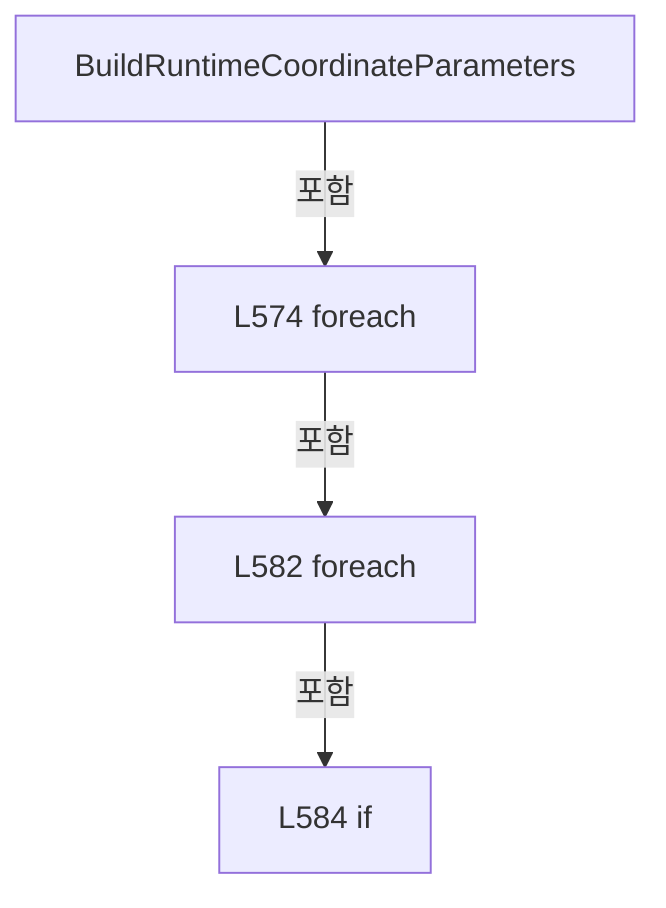

변경 전 점검: 입력/반환 타입, 위 호출자, 예외/취소 경로, 공유 상태와 저장·전송 소비자를 함께 확인합니다. 값의 단위나 물리 방향을 이름만으로 확정하지 않습니다.

### MethodDeclaration `LoadReviewCoordinateSettings` · L594–609

[Drilling.Common/Review/CReviewManager.cs:594–609](https://github.com/kjuws10-rgb/A3Drilling/blob/dfa5920e6301d9ec4b0eab1452ae59521aafc986/Drilling.Common/Review/CReviewManager.cs#L594-L609)

| 항목 | 실제 추출 값 |
| --- | --- |
| 서명 | Drilling.Common.Review.CReviewManager.ST_REVIEW_COORDINATE_SETTINGS Drilling.Common.Review.CReviewManager.LoadReviewCoordinateSettings(Drilling.Common.Managers.ST_RECIPE_DEFINITION) |
| 접근/수식자 | Private / private |
| 반환/값 타입 | Drilling.Common.Review.CReviewManager.ST_REVIEW_COORDINATE_SETTINGS |
| 소속 타입 | NamedType:Drilling.Common.Review.CReviewManager |

입력 계약:

| 이름 | 타입 | 전달 | 선택/기본값 |
| --- | --- | --- | --- |
| recipe | Drilling.Common.Managers.ST_RECIPE_DEFINITION | None | False /  |

정적 호출자로 확인된 위치:

| 호출 파일/행 | 호출 표현식 | 런타임 분기 가능 |
| --- | --- | --- |
| [Drilling.Common/Review/CReviewManager.cs:282–282](https://github.com/kjuws10-rgb/A3Drilling/blob/dfa5920e6301d9ec4b0eab1452ae59521aafc986/Drilling.Common/Review/CReviewManager.cs#L282-L282) | LoadReviewCoordinateSettings | False |
| [Drilling.Common/Review/CReviewManager.cs:508–508](https://github.com/kjuws10-rgb/A3Drilling/blob/dfa5920e6301d9ec4b0eab1452ae59521aafc986/Drilling.Common/Review/CReviewManager.cs#L508-L508) | LoadReviewCoordinateSettings | False |

호출하는 대상과 해석 범위:

| 원본 행 | 표현식 | 분석 상태 | 대상/소스 위치 |
| --- | --- | --- | --- |
| 596 | settingManager.LoadSection | resolved | System.Collections.Generic.IReadOnlyList<Drilling.Common.Managers.ST_SYSTEM_PARAMETER> Drilling.Common.Managers.CSettingManager.LoadSection(Drilling.Common.Managers.EN_SETTING_TAB, System.Threading.CancellationToken) · Drilling.Common/Managers/CSettingManager.cs:26 |
| 597 | CReviewManager.ParseVisionFlipType | resolved | Drilling.Common.Review.EN_VISION_FLIP_TYPE Drilling.Common.Review.CReviewManager.ParseVisionFlipType(string?, string?, string?) · Drilling.Common/Review/CReviewManager.cs:3664 |
| 597 | ReadSettingText | resolved | string Drilling.Common.Review.CReviewManager.ReadSettingText(System.Collections.Generic.IReadOnlyList<Drilling.Common.Managers.ST_SYSTEM_PARAMETER>, string, params string[]) · Drilling.Common/Review/CReviewManager.cs:659 |
| 597 | ReadSettingText | resolved | string Drilling.Common.Review.CReviewManager.ReadSettingText(System.Collections.Generic.IReadOnlyList<Drilling.Common.Managers.ST_SYSTEM_PARAMETER>, string, params string[]) · Drilling.Common/Review/CReviewManager.cs:659 |
| 597 | ReadSettingText | resolved | string Drilling.Common.Review.CReviewManager.ReadSettingText(System.Collections.Generic.IReadOnlyList<Drilling.Common.Managers.ST_SYSTEM_PARAMETER>, string, params string[]) · Drilling.Common/Review/CReviewManager.cs:659 |
| 598 | Enumerable.Range(1, 8).Select(headNo => { var position = ReadHeadPositionX(optionSettings, headNo); const double fallbackWidthX = 110.0; var widthX = ReadSettingDouble(optionSettings, fallbackWidthX, $"H{headNo:00}_SCAN_FIELD_WIDTH_X", $"H{headNo:00}_HEAD_FIELD_WIDTH_X"); return new ST_REVIEW_HEAD_FIELD(headNo, position, widthX > 0.0 ? widthX : fal… | resolved | Drilling.Common.Review.CReviewManager.ST_REVIEW_HEAD_FIELD[] System.Collections.Generic.IEnumerable<Drilling.Common.Review.CReviewManager.ST_REVIEW_HEAD_FIELD>.ToArray<Drilling.Common.Review.CReviewManager.ST_REVIEW_HEAD_FIELD>() |
| 598 | Enumerable.Range(1, 8).Select | resolved | System.Collections.Generic.IEnumerable<Drilling.Common.Review.CReviewManager.ST_REVIEW_HEAD_FIELD> System.Collections.Generic.IEnumerable<int>.Select<int, Drilling.Common.Review.CReviewManager.ST_REVIEW_HEAD_FIELD>(System.Func<int, Drilling.Common.Review.CReviewManager.ST_REVIEW_HEAD_FIELD>) |
| 598 | Enumerable.Range | resolved | System.Collections.Generic.IEnumerable<int> System.Linq.Enumerable.Range(int, int) |
| 600 | ReadHeadPositionX | resolved | double Drilling.Common.Review.CReviewManager.ReadHeadPositionX(System.Collections.Generic.IReadOnlyList<Drilling.Common.Managers.ST_SYSTEM_PARAMETER>, int) · Drilling.Common/Review/CReviewManager.cs:611 |
| 602 | ReadSettingDouble | resolved | double Drilling.Common.Review.CReviewManager.ReadSettingDouble(System.Collections.Generic.IReadOnlyList<Drilling.Common.Managers.ST_SYSTEM_PARAMETER>, double, params string[]) · Drilling.Common/Review/CReviewManager.cs:620 |
| 603 | new ST_REVIEW_HEAD_FIELD | resolved | Drilling.Common.Review.CReviewManager.ST_REVIEW_HEAD_FIELD.ST_REVIEW_HEAD_FIELD(int, double, double) · Drilling.Common/Review/CReviewManager.cs:1231 |
| 607 | headFields.Where(field => ReadSettingBoolean(optionSettings, true, $"H{field.HeadNo:00}_USE")).Select(field => field.HeadNo).ToArray | resolved | int[] System.Collections.Generic.IEnumerable<int>.ToArray<int>() |
| 607 | headFields.Where(field => ReadSettingBoolean(optionSettings, true, $"H{field.HeadNo:00}_USE")).Select | resolved | System.Collections.Generic.IEnumerable<int> System.Collections.Generic.IEnumerable<Drilling.Common.Review.CReviewManager.ST_REVIEW_HEAD_FIELD>.Select<Drilling.Common.Review.CReviewManager.ST_REVIEW_HEAD_FIELD, int>(System.Func<Drilling.Common.Review.CReviewManager.ST_REVIEW_HEAD_FIELD, int>) |
| 607 | headFields.Where | resolved | System.Collections.Generic.IEnumerable<Drilling.Common.Review.CReviewManager.ST_REVIEW_HEAD_FIELD> System.Collections.Generic.IEnumerable<Drilling.Common.Review.CReviewManager.ST_REVIEW_HEAD_FIELD>.Where<Drilling.Common.Review.CReviewManager.ST_REVIEW_HEAD_FIELD>(System.Func<Drilling.Common.Review.CReviewManager.ST_REVIEW_HEAD_FIELD, bool>) |
| 607 | ReadSettingBoolean | resolved | bool Drilling.Common.Review.CReviewManager.ReadSettingBoolean(System.Collections.Generic.IReadOnlyList<Drilling.Common.Managers.ST_SYSTEM_PARAMETER>, bool, params string[]) · Drilling.Common/Review/CReviewManager.cs:638 |
| 608 | new ST_REVIEW_COORDINATE_SETTINGS | resolved | Drilling.Common.Review.CReviewManager.ST_REVIEW_COORDINATE_SETTINGS.ST_REVIEW_COORDINATE_SETTINGS(Drilling.Common.Review.CReviewManager.ST_REVIEW_HEAD_LAYOUT, System.Collections.Generic.IReadOnlyList<int>, Drilling.Common.Review.EN_VISION_FLIP_TYPE) · Drilling.Common/Review/CReviewManager.cs:1232 |
| 608 | new ST_REVIEW_HEAD_LAYOUT | resolved | Drilling.Common.Review.CReviewManager.ST_REVIEW_HEAD_LAYOUT.ST_REVIEW_HEAD_LAYOUT(System.Collections.Generic.IReadOnlyList<Drilling.Common.Review.CReviewManager.ST_REVIEW_HEAD_FIELD>) · Drilling.Common/Review/CReviewManager.cs:1223 |

본문의 실제 연산·분기·예외·반환 순서(원문 위치 순):

| 원본 행 | 종류 | 주석 해설 |
| --- | --- | --- |
| 596 | call | 함수·델리게이트 또는 객체 생성자를 호출합니다: settingManager.LoadSection(EN_SETTING_TAB.Option) |
| 596 | local-declaration | 지역 변수를 선언합니다: var optionSettings = settingManager.LoadSection(EN_SETTING_TAB.Option); |
| 596 | variable-initializer | 변수의 초기값을 지정합니다: optionSettings = settingManager.LoadSection(EN_SETTING_TAB.Option) |
| 597 | call | 함수·델리게이트 또는 객체 생성자를 호출합니다: CReviewManager.ParseVisionFlipType(ReadSettingText(optionSettings, "", "VisionXFlip"), ReadSettingText(optionSettings, "", "VisionYFlip"), ReadSettingText(optionSettings, "", "VisionXyFlip")) |
| 597 | call | 함수·델리게이트 또는 객체 생성자를 호출합니다: ReadSettingText(optionSettings, "", "VisionXFlip") |
| 597 | call | 함수·델리게이트 또는 객체 생성자를 호출합니다: ReadSettingText(optionSettings, "", "VisionYFlip") |
| 597 | call | 함수·델리게이트 또는 객체 생성자를 호출합니다: ReadSettingText(optionSettings, "", "VisionXyFlip") |
| 597 | local-declaration | 지역 변수를 선언합니다: var visionFlipType = CReviewManager.ParseVisionFlipType(ReadSettingText(optionSettings, "", "VisionXFlip"), ReadSettingText(optionSettings, "", "VisionYFlip"), ReadSettingText(optionSettings, "", "VisionXyFlip")); |
| 597 | variable-initializer | 변수의 초기값을 지정합니다: visionFlipType = CReviewManager.ParseVisionFlipType(ReadSettingText(optionSettings, "", "VisionXFlip"), ReadSettingText(optionSettings, "", "VisionYFlip"), ReadSettingText(optionSettings, "", "VisionXyFlip")) |
| 598 | call | 함수·델리게이트 또는 객체 생성자를 호출합니다: Enumerable.Range(1, 8) |
| 598 | call | 함수·델리게이트 또는 객체 생성자를 호출합니다: Enumerable.Range(1, 8).Select(headNo => { var position = ReadHeadPositionX(optionSettings, headNo); const double fallbackWidthX = 110.0; var widthX = ReadSettingDouble(optionSettings, fallbackWidthX, $"H{headNo:00}_SCAN_… |
| 598 | call | 함수·델리게이트 또는 객체 생성자를 호출합니다: Enumerable.Range(1, 8).Select(headNo => { var position = ReadHeadPositionX(optionSettings, headNo); const double fallbackWidthX = 110.0; var widthX = ReadSettingDouble(optionSettings, fallbackWidthX, $"H{headNo:00}_SCAN_… |
| 598 | local-declaration | 지역 변수를 선언합니다: var headFields = Enumerable.Range(1, 8).Select(headNo => { var position = ReadHeadPositionX(optionSettings, headNo); const double fallbackWidthX = 110.0; var widthX = ReadSettingDouble(optionSettings, fallbackWidthX, $"H{headNo:00 |
| 598 | variable-initializer | 변수의 초기값을 지정합니다: headFields = Enumerable.Range(1, 8).Select(headNo => { var position = ReadHeadPositionX(optionSettings, headNo); const double fallbackWidthX = 110.0; var widthX = ReadSettingDouble(optionSettings, fallbackWidthX, $"H{headNo:00}_SC |
| 600 | call | 함수·델리게이트 또는 객체 생성자를 호출합니다: ReadHeadPositionX(optionSettings, headNo) |
| 600 | local-declaration | 지역 변수를 선언합니다: var position = ReadHeadPositionX(optionSettings, headNo); |
| 600 | variable-initializer | 변수의 초기값을 지정합니다: position = ReadHeadPositionX(optionSettings, headNo) |
| 601 | local-declaration | 지역 변수를 선언합니다: const double fallbackWidthX = 110.0; |
| 601 | variable-initializer | 변수의 초기값을 지정합니다: fallbackWidthX = 110.0 |
| 602 | call | 함수·델리게이트 또는 객체 생성자를 호출합니다: ReadSettingDouble(optionSettings, fallbackWidthX, $"H{headNo:00}_SCAN_FIELD_WIDTH_X", $"H{headNo:00}_HEAD_FIELD_WIDTH_X") |
| 602 | local-declaration | 지역 변수를 선언합니다: var widthX = ReadSettingDouble(optionSettings, fallbackWidthX, $"H{headNo:00}_SCAN_FIELD_WIDTH_X", $"H{headNo:00}_HEAD_FIELD_WIDTH_X"); |
| 602 | variable-initializer | 변수의 초기값을 지정합니다: widthX = ReadSettingDouble(optionSettings, fallbackWidthX, $"H{headNo:00}_SCAN_FIELD_WIDTH_X", $"H{headNo:00}_HEAD_FIELD_WIDTH_X") |
| 603 | call | 함수·델리게이트 또는 객체 생성자를 호출합니다: new ST_REVIEW_HEAD_FIELD(headNo, position, widthX > 0.0 ? widthX : fallbackWidthX) |
| 603 | conditional-expression | 조건에 따라 결과식을 선택합니다: widthX > 0.0 ? widthX : fallbackWidthX |
| 603 | return | 호출자에게 값 또는 제어를 반환합니다: return new ST_REVIEW_HEAD_FIELD(headNo, position, widthX > 0.0 ? widthX : fallbackWidthX); |
| 607 | call | 함수·델리게이트 또는 객체 생성자를 호출합니다: headFields.Where(field => ReadSettingBoolean(optionSettings, true, $"H{field.HeadNo:00}_USE")).Select(field => field.HeadNo).ToArray() |
| 607 | call | 함수·델리게이트 또는 객체 생성자를 호출합니다: headFields.Where(field => ReadSettingBoolean(optionSettings, true, $"H{field.HeadNo:00}_USE")).Select(field => field.HeadNo) |
| 607 | call | 함수·델리게이트 또는 객체 생성자를 호출합니다: headFields.Where(field => ReadSettingBoolean(optionSettings, true, $"H{field.HeadNo:00}_USE")) |
| 607 | call | 함수·델리게이트 또는 객체 생성자를 호출합니다: ReadSettingBoolean(optionSettings, true, $"H{field.HeadNo:00}_USE") |
| 607 | local-declaration | 지역 변수를 선언합니다: var activeHeadNos = headFields.Where(field => ReadSettingBoolean(optionSettings, true, $"H{field.HeadNo:00}_USE")).Select(field => field.HeadNo).ToArray(); |
| 607 | variable-initializer | 변수의 초기값을 지정합니다: activeHeadNos = headFields.Where(field => ReadSettingBoolean(optionSettings, true, $"H{field.HeadNo:00}_USE")).Select(field => field.HeadNo).ToArray() |
| 608 | call | 함수·델리게이트 또는 객체 생성자를 호출합니다: new ST_REVIEW_COORDINATE_SETTINGS(new ST_REVIEW_HEAD_LAYOUT(headFields), activeHeadNos, visionFlipType) |
| 608 | call | 함수·델리게이트 또는 객체 생성자를 호출합니다: new ST_REVIEW_HEAD_LAYOUT(headFields) |
| 608 | return | 호출자에게 값 또는 제어를 반환합니다: return new ST_REVIEW_COORDINATE_SETTINGS(new ST_REVIEW_HEAD_LAYOUT(headFields), activeHeadNos, visionFlipType); |

변경 전 점검: 입력/반환 타입, 위 호출자, 예외/취소 경로, 공유 상태와 저장·전송 소비자를 함께 확인합니다. 값의 단위나 물리 방향을 이름만으로 확정하지 않습니다.

### MethodDeclaration `ReadHeadPositionX` · L611–618

[Drilling.Common/Review/CReviewManager.cs:611–618](https://github.com/kjuws10-rgb/A3Drilling/blob/dfa5920e6301d9ec4b0eab1452ae59521aafc986/Drilling.Common/Review/CReviewManager.cs#L611-L618)

| 항목 | 실제 추출 값 |
| --- | --- |
| 서명 | double Drilling.Common.Review.CReviewManager.ReadHeadPositionX(System.Collections.Generic.IReadOnlyList<Drilling.Common.Managers.ST_SYSTEM_PARAMETER>, int) |
| 접근/수식자 | Private / private, static |
| 반환/값 타입 | double |
| 소속 타입 | NamedType:Drilling.Common.Review.CReviewManager |

입력 계약:

| 이름 | 타입 | 전달 | 선택/기본값 |
| --- | --- | --- | --- |
| settings | System.Collections.Generic.IReadOnlyList<Drilling.Common.Managers.ST_SYSTEM_PARAMETER> | None | False /  |
| headNo | int | None | False /  |

정적 호출자로 확인된 위치:

| 호출 파일/행 | 호출 표현식 | 런타임 분기 가능 |
| --- | --- | --- |
| [Drilling.Common/Review/CReviewManager.cs:600–600](https://github.com/kjuws10-rgb/A3Drilling/blob/dfa5920e6301d9ec4b0eab1452ae59521aafc986/Drilling.Common/Review/CReviewManager.cs#L600-L600) | ReadHeadPositionX | False |

호출하는 대상과 해석 범위:

| 원본 행 | 표현식 | 분석 상태 | 대상/소스 위치 |
| --- | --- | --- | --- |
| 615 | ReadSettingDouble | resolved | double Drilling.Common.Review.CReviewManager.ReadSettingDouble(System.Collections.Generic.IReadOnlyList<Drilling.Common.Managers.ST_SYSTEM_PARAMETER>, double, params string[]) · Drilling.Common/Review/CReviewManager.cs:620 |
| 616 | ReadSettingDouble | resolved | double Drilling.Common.Review.CReviewManager.ReadSettingDouble(System.Collections.Generic.IReadOnlyList<Drilling.Common.Managers.ST_SYSTEM_PARAMETER>, double, params string[]) · Drilling.Common/Review/CReviewManager.cs:620 |

본문의 실제 연산·분기·예외·반환 순서(원문 위치 순):

| 원본 행 | 종류 | 주석 해설 |
| --- | --- | --- |
| 613 | local-declaration | 지역 변수를 선언합니다: const double fallbackHead1PositionX = -5.0; |
| 613 | variable-initializer | 변수의 초기값을 지정합니다: fallbackHead1PositionX = -5.0 |
| 614 | local-declaration | 지역 변수를 선언합니다: const double fallbackHeadGapX = 200.0; |
| 614 | variable-initializer | 변수의 초기값을 지정합니다: fallbackHeadGapX = 200.0 |
| 615 | call | 함수·델리게이트 또는 객체 생성자를 호출합니다: ReadSettingDouble(settings, fallbackHead1PositionX, "H01_AK_POSITION_X") |
| 615 | local-declaration | 지역 변수를 선언합니다: var head1PositionX = ReadSettingDouble(settings, fallbackHead1PositionX, "H01_AK_POSITION_X"); |
| 615 | variable-initializer | 변수의 초기값을 지정합니다: head1PositionX = ReadSettingDouble(settings, fallbackHead1PositionX, "H01_AK_POSITION_X") |
| 616 | call | 함수·델리게이트 또는 객체 생성자를 호출합니다: ReadSettingDouble(settings, fallbackHeadGapX, "HeadGapX") |
| 616 | local-declaration | 지역 변수를 선언합니다: var headGapX = ReadSettingDouble(settings, fallbackHeadGapX, "HeadGapX"); |
| 616 | variable-initializer | 변수의 초기값을 지정합니다: headGapX = ReadSettingDouble(settings, fallbackHeadGapX, "HeadGapX") |
| 617 | return | 호출자에게 값 또는 제어를 반환합니다: return head1PositionX + ((headNo - 1) * headGapX); |

변경 전 점검: 입력/반환 타입, 위 호출자, 예외/취소 경로, 공유 상태와 저장·전송 소비자를 함께 확인합니다. 값의 단위나 물리 방향을 이름만으로 확정하지 않습니다.

### MethodDeclaration `ReadSettingDouble` · L620–636

[Drilling.Common/Review/CReviewManager.cs:620–636](https://github.com/kjuws10-rgb/A3Drilling/blob/dfa5920e6301d9ec4b0eab1452ae59521aafc986/Drilling.Common/Review/CReviewManager.cs#L620-L636)

| 항목 | 실제 추출 값 |
| --- | --- |
| 서명 | double Drilling.Common.Review.CReviewManager.ReadSettingDouble(System.Collections.Generic.IReadOnlyList<Drilling.Common.Managers.ST_SYSTEM_PARAMETER>, double, params string[]) |
| 접근/수식자 | Private / private, static |
| 반환/값 타입 | double |
| 소속 타입 | NamedType:Drilling.Common.Review.CReviewManager |

입력 계약:

| 이름 | 타입 | 전달 | 선택/기본값 |
| --- | --- | --- | --- |
| settings | System.Collections.Generic.IReadOnlyList<Drilling.Common.Managers.ST_SYSTEM_PARAMETER> | None | False /  |
| defaultValue | double | None | False /  |
| keys | string[] | None | False /  |

정적 호출자로 확인된 위치:

| 호출 파일/행 | 호출 표현식 | 런타임 분기 가능 |
| --- | --- | --- |
| [Drilling.Common/Review/CReviewManager.cs:602–602](https://github.com/kjuws10-rgb/A3Drilling/blob/dfa5920e6301d9ec4b0eab1452ae59521aafc986/Drilling.Common/Review/CReviewManager.cs#L602-L602) | ReadSettingDouble | False |
| [Drilling.Common/Review/CReviewManager.cs:615–615](https://github.com/kjuws10-rgb/A3Drilling/blob/dfa5920e6301d9ec4b0eab1452ae59521aafc986/Drilling.Common/Review/CReviewManager.cs#L615-L615) | ReadSettingDouble | False |
| [Drilling.Common/Review/CReviewManager.cs:616–616](https://github.com/kjuws10-rgb/A3Drilling/blob/dfa5920e6301d9ec4b0eab1452ae59521aafc986/Drilling.Common/Review/CReviewManager.cs#L616-L616) | ReadSettingDouble | False |

호출하는 대상과 해석 범위:

| 원본 행 | 표현식 | 분석 상태 | 대상/소스 위치 |
| --- | --- | --- | --- |
| 624 | keys.Any | resolved | bool System.Collections.Generic.IEnumerable<string>.Any<string>(System.Func<string, bool>) |
| 624 | key.Equals | resolved | bool string.Equals(string?, System.StringComparison) |
| 624 | key.Equals | resolved | bool string.Equals(string?, System.StringComparison) |
| 629 | double.TryParse | resolved | bool double.TryParse(string?, System.Globalization.NumberStyles, System.IFormatProvider?, out double) |

본문의 실제 연산·분기·예외·반환 순서(원문 위치 순):

| 원본 행 | 종류 | 주석 해설 |
| --- | --- | --- |
| 622 | foreach | 컬렉션 요소를 순회합니다: foreach (var setting in settings) |
| 624 | call | 함수·델리게이트 또는 객체 생성자를 호출합니다: keys.Any(key => key.Equals(setting.Key, StringComparison.OrdinalIgnoreCase) &#124;&#124; key.Equals(setting.Name, StringComparison.OrdinalIgnoreCase)) |
| 624 | call | 함수·델리게이트 또는 객체 생성자를 호출합니다: key.Equals(setting.Key, StringComparison.OrdinalIgnoreCase) |
| 624 | call | 함수·델리게이트 또는 객체 생성자를 호출합니다: key.Equals(setting.Name, StringComparison.OrdinalIgnoreCase) |
| 624 | if | 조건에 따라 분기합니다: if (!keys.Any(key => key.Equals(setting.Key, StringComparison.OrdinalIgnoreCase) &#124;&#124; key.Equals(setting.Name, StringComparison.OrdinalIgnoreCase))) |
| 626 | continue | 다음 반복으로 진행합니다: continue; |
| 629 | call | 함수·델리게이트 또는 객체 생성자를 호출합니다: double.TryParse(setting.Value, NumberStyles.Float, CultureInfo.InvariantCulture, out var parsed) |
| 629 | if | 조건에 따라 분기합니다: if (double.TryParse(setting.Value, NumberStyles.Float, CultureInfo.InvariantCulture, out var parsed)) |
| 631 | return | 호출자에게 값 또는 제어를 반환합니다: return parsed; |
| 635 | return | 호출자에게 값 또는 제어를 반환합니다: return defaultValue; |

제어 구문의 포함 구조(실제 실행 순서/CFG가 아닌 구문 탐색 그림):

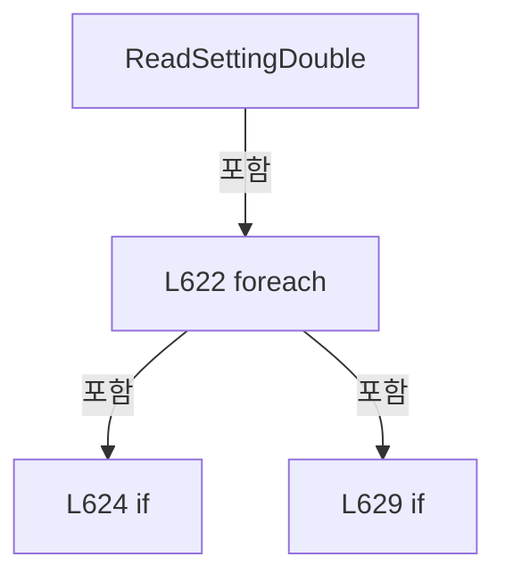

변경 전 점검: 입력/반환 타입, 위 호출자, 예외/취소 경로, 공유 상태와 저장·전송 소비자를 함께 확인합니다. 값의 단위나 물리 방향을 이름만으로 확정하지 않습니다.

### MethodDeclaration `ReadSettingBoolean` · L638–657

[Drilling.Common/Review/CReviewManager.cs:638–657](https://github.com/kjuws10-rgb/A3Drilling/blob/dfa5920e6301d9ec4b0eab1452ae59521aafc986/Drilling.Common/Review/CReviewManager.cs#L638-L657)

| 항목 | 실제 추출 값 |
| --- | --- |
| 서명 | bool Drilling.Common.Review.CReviewManager.ReadSettingBoolean(System.Collections.Generic.IReadOnlyList<Drilling.Common.Managers.ST_SYSTEM_PARAMETER>, bool, params string[]) |
| 접근/수식자 | Private / private, static |
| 반환/값 타입 | bool |
| 소속 타입 | NamedType:Drilling.Common.Review.CReviewManager |

입력 계약:

| 이름 | 타입 | 전달 | 선택/기본값 |
| --- | --- | --- | --- |
| settings | System.Collections.Generic.IReadOnlyList<Drilling.Common.Managers.ST_SYSTEM_PARAMETER> | None | False /  |
| defaultValue | bool | None | False /  |
| keys | string[] | None | False /  |

정적 호출자로 확인된 위치:

| 호출 파일/행 | 호출 표현식 | 런타임 분기 가능 |
| --- | --- | --- |
| [Drilling.Common/Review/CReviewManager.cs:607–607](https://github.com/kjuws10-rgb/A3Drilling/blob/dfa5920e6301d9ec4b0eab1452ae59521aafc986/Drilling.Common/Review/CReviewManager.cs#L607-L607) | ReadSettingBoolean | False |

호출하는 대상과 해석 범위:

| 원본 행 | 표현식 | 분석 상태 | 대상/소스 위치 |
| --- | --- | --- | --- |
| 640 | ReadSettingText | resolved | string Drilling.Common.Review.CReviewManager.ReadSettingText(System.Collections.Generic.IReadOnlyList<Drilling.Common.Managers.ST_SYSTEM_PARAMETER>, string, params string[]) · Drilling.Common/Review/CReviewManager.cs:659 |
| 641 | string.IsNullOrWhiteSpace | resolved | bool string.IsNullOrWhiteSpace(string?) |
| 646 | bool.TryParse | resolved | bool bool.TryParse(string?, out bool) |
| 651 | text.Trim().ToUpperInvariant | resolved | string string.ToUpperInvariant() |
| 651 | text.Trim | resolved | string string.Trim() |

본문의 실제 연산·분기·예외·반환 순서(원문 위치 순):

| 원본 행 | 종류 | 주석 해설 |
| --- | --- | --- |
| 640 | call | 함수·델리게이트 또는 객체 생성자를 호출합니다: ReadSettingText(settings, "", keys) |
| 640 | local-declaration | 지역 변수를 선언합니다: var text = ReadSettingText(settings, "", keys); |
| 640 | variable-initializer | 변수의 초기값을 지정합니다: text = ReadSettingText(settings, "", keys) |
| 641 | call | 함수·델리게이트 또는 객체 생성자를 호출합니다: string.IsNullOrWhiteSpace(text) |
| 641 | if | 조건에 따라 분기합니다: if (string.IsNullOrWhiteSpace(text)) |
| 643 | return | 호출자에게 값 또는 제어를 반환합니다: return defaultValue; |
| 646 | call | 함수·델리게이트 또는 객체 생성자를 호출합니다: bool.TryParse(text, out var parsed) |
| 646 | if | 조건에 따라 분기합니다: if (bool.TryParse(text, out var parsed)) |
| 648 | return | 호출자에게 값 또는 제어를 반환합니다: return parsed; |
| 651 | call | 함수·델리게이트 또는 객체 생성자를 호출합니다: text.Trim().ToUpperInvariant() |
| 651 | call | 함수·델리게이트 또는 객체 생성자를 호출합니다: text.Trim() |
| 651 | return | 호출자에게 값 또는 제어를 반환합니다: return text.Trim().ToUpperInvariant() switch { "1" or "ON" or "YES" or "Y" => true, "0" or "OFF" or "NO" or "N" => false, _ => defaultValue }; |
| 651 | switch-expression | 값별 결과식을 선택합니다: text.Trim().ToUpperInvariant() switch { "1" or "ON" or "YES" or "Y" => true, "0" or "OFF" or "NO" or "N" => false, _ => defaultValue } |

제어 구문의 포함 구조(실제 실행 순서/CFG가 아닌 구문 탐색 그림):

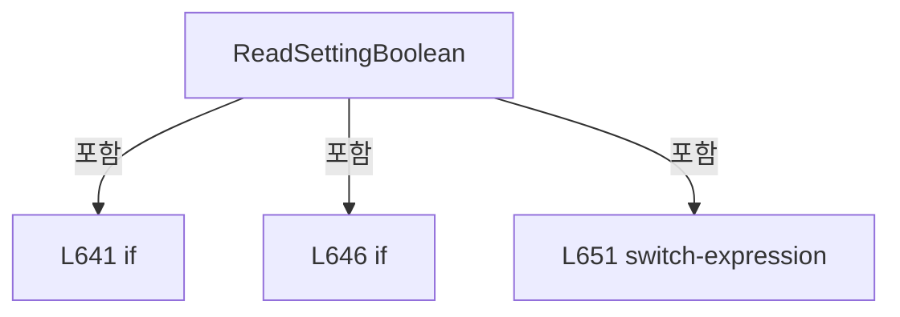

변경 전 점검: 입력/반환 타입, 위 호출자, 예외/취소 경로, 공유 상태와 저장·전송 소비자를 함께 확인합니다. 값의 단위나 물리 방향을 이름만으로 확정하지 않습니다.

### MethodDeclaration `ReadSettingText` · L659–672

[Drilling.Common/Review/CReviewManager.cs:659–672](https://github.com/kjuws10-rgb/A3Drilling/blob/dfa5920e6301d9ec4b0eab1452ae59521aafc986/Drilling.Common/Review/CReviewManager.cs#L659-L672)

| 항목 | 실제 추출 값 |
| --- | --- |
| 서명 | string Drilling.Common.Review.CReviewManager.ReadSettingText(System.Collections.Generic.IReadOnlyList<Drilling.Common.Managers.ST_SYSTEM_PARAMETER>, string, params string[]) |
| 접근/수식자 | Private / private, static |
| 반환/값 타입 | string |
| 소속 타입 | NamedType:Drilling.Common.Review.CReviewManager |

입력 계약:

| 이름 | 타입 | 전달 | 선택/기본값 |
| --- | --- | --- | --- |
| settings | System.Collections.Generic.IReadOnlyList<Drilling.Common.Managers.ST_SYSTEM_PARAMETER> | None | False /  |
| defaultValue | string | None | False /  |
| keys | string[] | None | False /  |

정적 호출자로 확인된 위치:

| 호출 파일/행 | 호출 표현식 | 런타임 분기 가능 |
| --- | --- | --- |
| [Drilling.Common/Review/CReviewManager.cs:597–597](https://github.com/kjuws10-rgb/A3Drilling/blob/dfa5920e6301d9ec4b0eab1452ae59521aafc986/Drilling.Common/Review/CReviewManager.cs#L597-L597) | ReadSettingText | False |
| [Drilling.Common/Review/CReviewManager.cs:597–597](https://github.com/kjuws10-rgb/A3Drilling/blob/dfa5920e6301d9ec4b0eab1452ae59521aafc986/Drilling.Common/Review/CReviewManager.cs#L597-L597) | ReadSettingText | False |
| [Drilling.Common/Review/CReviewManager.cs:597–597](https://github.com/kjuws10-rgb/A3Drilling/blob/dfa5920e6301d9ec4b0eab1452ae59521aafc986/Drilling.Common/Review/CReviewManager.cs#L597-L597) | ReadSettingText | False |
| [Drilling.Common/Review/CReviewManager.cs:640–640](https://github.com/kjuws10-rgb/A3Drilling/blob/dfa5920e6301d9ec4b0eab1452ae59521aafc986/Drilling.Common/Review/CReviewManager.cs#L640-L640) | ReadSettingText | False |

호출하는 대상과 해석 범위:

| 원본 행 | 표현식 | 분석 상태 | 대상/소스 위치 |
| --- | --- | --- | --- |
| 663 | keys.Any | resolved | bool System.Collections.Generic.IEnumerable<string>.Any<string>(System.Func<string, bool>) |
| 663 | key.Equals | resolved | bool string.Equals(string?, System.StringComparison) |
| 663 | key.Equals | resolved | bool string.Equals(string?, System.StringComparison) |
| 668 | string.IsNullOrWhiteSpace | resolved | bool string.IsNullOrWhiteSpace(string?) |
| 668 | setting.Value.Trim | resolved | string string.Trim() |

본문의 실제 연산·분기·예외·반환 순서(원문 위치 순):

| 원본 행 | 종류 | 주석 해설 |
| --- | --- | --- |
| 661 | foreach | 컬렉션 요소를 순회합니다: foreach (var setting in settings) |
| 663 | call | 함수·델리게이트 또는 객체 생성자를 호출합니다: keys.Any(key => key.Equals(setting.Key, StringComparison.OrdinalIgnoreCase) &#124;&#124; key.Equals(setting.Name, StringComparison.OrdinalIgnoreCase)) |
| 663 | call | 함수·델리게이트 또는 객체 생성자를 호출합니다: key.Equals(setting.Key, StringComparison.OrdinalIgnoreCase) |
| 663 | call | 함수·델리게이트 또는 객체 생성자를 호출합니다: key.Equals(setting.Name, StringComparison.OrdinalIgnoreCase) |
| 663 | if | 조건에 따라 분기합니다: if (!keys.Any(key => key.Equals(setting.Key, StringComparison.OrdinalIgnoreCase) &#124;&#124; key.Equals(setting.Name, StringComparison.OrdinalIgnoreCase))) |
| 665 | continue | 다음 반복으로 진행합니다: continue; |
| 668 | call | 함수·델리게이트 또는 객체 생성자를 호출합니다: string.IsNullOrWhiteSpace(setting.Value) |
| 668 | call | 함수·델리게이트 또는 객체 생성자를 호출합니다: setting.Value.Trim() |
| 668 | conditional-expression | 조건에 따라 결과식을 선택합니다: string.IsNullOrWhiteSpace(setting.Value) ? defaultValue : setting.Value.Trim() |
| 668 | return | 호출자에게 값 또는 제어를 반환합니다: return string.IsNullOrWhiteSpace(setting.Value) ? defaultValue : setting.Value.Trim(); |
| 671 | return | 호출자에게 값 또는 제어를 반환합니다: return defaultValue; |

제어 구문의 포함 구조(실제 실행 순서/CFG가 아닌 구문 탐색 그림):

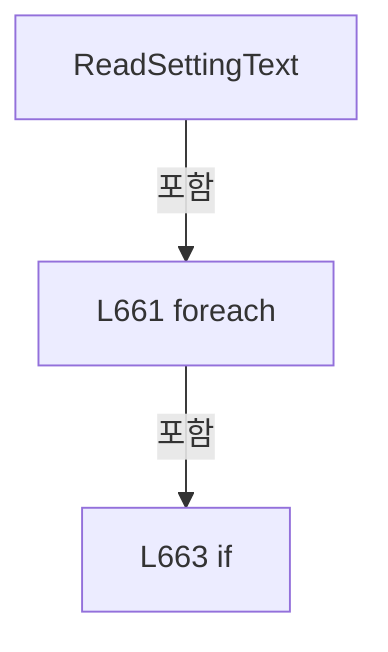

변경 전 점검: 입력/반환 타입, 위 호출자, 예외/취소 경로, 공유 상태와 저장·전송 소비자를 함께 확인합니다. 값의 단위나 물리 방향을 이름만으로 확정하지 않습니다.

### MethodDeclaration `BuildShotPoints` · L674–771

[Drilling.Common/Review/CReviewManager.cs:674–771](https://github.com/kjuws10-rgb/A3Drilling/blob/dfa5920e6301d9ec4b0eab1452ae59521aafc986/Drilling.Common/Review/CReviewManager.cs#L674-L771)

| 항목 | 실제 추출 값 |
| --- | --- |
| 서명 | System.Collections.Generic.IReadOnlyList<Drilling.Common.Review.ST_REVIEW_PLAN_POINT> Drilling.Common.Review.CReviewManager.BuildShotPoints(Drilling.Common.Managers.ST_RECIPE_DEFINITION, int, int, Drilling.Common.Review.CReviewManager.ST_REVIEW_COORDINATE_SETTINGS, System.Collections.Generic.IReadOnlyDictionary<(int CellNo, int CellShotNo), int>, double, int, bool, System.Collections.Generic.IReadOnlyDictionary<string, string>, double, double) |
| 접근/수식자 | Private / private, static |
| 반환/값 타입 | System.Collections.Generic.IReadOnlyList<Drilling.Common.Review.ST_REVIEW_PLAN_POINT> |
| 소속 타입 | NamedType:Drilling.Common.Review.CReviewManager |

입력 계약:

| 이름 | 타입 | 전달 | 선택/기본값 |
| --- | --- | --- | --- |
| recipe | Drilling.Common.Managers.ST_RECIPE_DEFINITION | None | False /  |
| headCount | int | None | False /  |
| cellCount | int | None | False /  |
| coordinateSettings | Drilling.Common.Review.CReviewManager.ST_REVIEW_COORDINATE_SETTINGS | None | False /  |
| assignedHeadNos | System.Collections.Generic.IReadOnlyDictionary<(int CellNo, int CellShotNo), int> | None | False /  |
| stageScanDirectionY | double | None | False /  |
| selectedBeamNo | int | None | False /  |
| selectAllAssignedPoints | bool | None | False /  |
| excludedShots | System.Collections.Generic.IReadOnlyDictionary<string, string> | None | False /  |
| shiftOffsetX | double | None | False /  |
| shiftOffsetY | double | None | False /  |

정적 호출자로 확인된 위치:

| 호출 파일/행 | 호출 표현식 | 런타임 분기 가능 |
| --- | --- | --- |
| [Drilling.Common/Review/CReviewManager.cs:514–525](https://github.com/kjuws10-rgb/A3Drilling/blob/dfa5920e6301d9ec4b0eab1452ae59521aafc986/Drilling.Common/Review/CReviewManager.cs#L514-L525) | BuildShotPoints | False |

호출하는 대상과 해석 범위:

| 원본 행 | 표현식 | 분석 상태 | 대상/소스 위치 |
| --- | --- | --- | --- |
| 689 | ReadDouble | resolved | double Drilling.Common.Review.CReviewManager.ReadDouble(Drilling.Common.Managers.ST_RECIPE_DEFINITION, double, params string[]) · Drilling.Common/Review/CReviewManager.cs:1315 |
| 690 | ReadDouble | resolved | double Drilling.Common.Review.CReviewManager.ReadDouble(Drilling.Common.Managers.ST_RECIPE_DEFINITION, double, params string[]) · Drilling.Common/Review/CReviewManager.cs:1315 |
| 691 | ReadDouble | resolved | double Drilling.Common.Review.CReviewManager.ReadDouble(Drilling.Common.Managers.ST_RECIPE_DEFINITION, double, params string[]) · Drilling.Common/Review/CReviewManager.cs:1315 |
| 692 | ReadDouble | resolved | double Drilling.Common.Review.CReviewManager.ReadDouble(Drilling.Common.Managers.ST_RECIPE_DEFINITION, double, params string[]) · Drilling.Common/Review/CReviewManager.cs:1315 |
| 693 | ReadDouble | resolved | double Drilling.Common.Review.CReviewManager.ReadDouble(Drilling.Common.Managers.ST_RECIPE_DEFINITION, double, params string[]) · Drilling.Common/Review/CReviewManager.cs:1315 |
| 694 | ReadInt | resolved | int Drilling.Common.Review.CReviewManager.ReadInt(Drilling.Common.Managers.ST_RECIPE_DEFINITION, int, params string[]) · Drilling.Common/Review/CReviewManager.cs:1275 |
| 695 | recipe.Parameters.GroupBy(parameter => parameter.Key, StringComparer.OrdinalIgnoreCase).ToDictionary | resolved | System.Collections.Generic.Dictionary<string, string> System.Collections.Generic.IEnumerable<System.Linq.IGrouping<string, Drilling.Common.Managers.ST_RECIPE_PARAMETER>>.ToDictionary<System.Linq.IGrouping<string, Drilling.Common.Managers.ST_RECIPE_PARAMETER>, string, string>(System.Func<System.Linq.IGrouping<string, Drilling.Common.Managers.ST_RECIPE_PARAMETER>, string>, System.Func<System.Linq.IGrouping<string, Drilling.Common.Managers.ST_RECIPE_PARAMETER>, string>, System.Collections.Generic.IEqualityComparer<string>?) |
| 695 | recipe.Parameters.GroupBy | resolved | System.Collections.Generic.IEnumerable<System.Linq.IGrouping<string, Drilling.Common.Managers.ST_RECIPE_PARAMETER>> System.Collections.Generic.IEnumerable<Drilling.Common.Managers.ST_RECIPE_PARAMETER>.GroupBy<Drilling.Common.Managers.ST_RECIPE_PARAMETER, string>(System.Func<Drilling.Common.Managers.ST_RECIPE_PARAMETER, string>, System.Collections.Generic.IEqualityComparer<string>?) |
| 695 | group.Last | resolved | Drilling.Common.Managers.ST_RECIPE_PARAMETER System.Collections.Generic.IEnumerable<Drilling.Common.Managers.ST_RECIPE_PARAMETER>.Last<Drilling.Common.Managers.ST_RECIPE_PARAMETER>() |
| 696 | CRecipeModelPixelCountReader.ReadModelTypeCount | resolved | int Drilling.Common.Recipe.CRecipeModelPixelCountReader.ReadModelTypeCount(System.Collections.Generic.IReadOnlyDictionary<string, string>) · Drilling.Common/Recipe/CCellPatternCalculator.cs:428 |
| 697 | ValidateBeamNo | resolved | void Drilling.Common.Review.CReviewManager.ValidateBeamNo(int, int) · Drilling.Common/Review/CReviewManager.cs:973 |
| 698 | new List<ST_CELL_PATTERN_DEFINITION> | resolved | System.Collections.Generic.List<Drilling.Common.Recipe.ST_CELL_PATTERN_DEFINITION>.List(int) |
| 701 | ReadDouble | resolved | double Drilling.Common.Review.CReviewManager.ReadDouble(Drilling.Common.Managers.ST_RECIPE_DEFINITION, double, params string[]) · Drilling.Common/Review/CReviewManager.cs:1315 |
| 702 | ReadDouble | resolved | double Drilling.Common.Review.CReviewManager.ReadDouble(Drilling.Common.Managers.ST_RECIPE_DEFINITION, double, params string[]) · Drilling.Common/Review/CReviewManager.cs:1315 |
| 703 | ReadDouble | resolved | double Drilling.Common.Review.CReviewManager.ReadDouble(Drilling.Common.Managers.ST_RECIPE_DEFINITION, double, params string[]) · Drilling.Common/Review/CReviewManager.cs:1315 |
| 704 | CRecipeModelPixelCountReader.ReadCellModelType | resolved | int Drilling.Common.Recipe.CRecipeModelPixelCountReader.ReadCellModelType(System.Collections.Generic.IReadOnlyDictionary<string, string>, int, int) · Drilling.Common/Recipe/CCellPatternCalculator.cs:433 |
| 705 | CRecipeModelPixelCountReader.ReadPatternForModel | resolved | Drilling.Common.Recipe.ST_RECIPE_MODEL_PATTERN Drilling.Common.Recipe.CRecipeModelPixelCountReader.ReadPatternForModel(System.Collections.Generic.IReadOnlyDictionary<string, string>, int) · Drilling.Common/Recipe/CCellPatternCalculator.cs:455 |
| 706 | new ST_CELL_PATTERN_DEFINITION | resolved | Drilling.Common.Recipe.ST_CELL_PATTERN_DEFINITION.ST_CELL_PATTERN_DEFINITION(int, double, double, double, double, int, int, int, int, double, double) · Drilling.Common/Recipe/CCellPatternCalculator.cs:277 |
| 707 | definitions.Add | resolved | void System.Collections.Generic.List<Drilling.Common.Recipe.ST_CELL_PATTERN_DEFINITION>.Add(Drilling.Common.Recipe.ST_CELL_PATTERN_DEFINITION) |
| 710 | CRecipeCellPatternCatalog.Create | resolved | Drilling.Common.Recipe.CRecipeCellPatternCatalog Drilling.Common.Recipe.CRecipeCellPatternCatalog.Create(System.Collections.Generic.IEnumerable<Drilling.Common.Recipe.ST_CELL_PATTERN_DEFINITION>) · Drilling.Common/Recipe/CCellPatternCalculator.cs:349 |
| 716 | cellCatalog.Cells.ToDictionary | resolved | System.Collections.Generic.Dictionary<int, int> System.Collections.Generic.IEnumerable<Drilling.Common.Recipe.ST_RECIPE_CELL_PATTERN_ENTRY>.ToDictionary<Drilling.Common.Recipe.ST_RECIPE_CELL_PATTERN_ENTRY, int, int>(System.Func<Drilling.Common.Recipe.ST_RECIPE_CELL_PATTERN_ENTRY, int>, System.Func<Drilling.Common.Recipe.ST_RECIPE_CELL_PATTERN_ENTRY, int>) |
| 717 | assignedHeadNos.Count | resolved | int System.Collections.Generic.IEnumerable<System.Collections.Generic.KeyValuePair<(int CellNo, int CellShotNo), int>>.Count<System.Collections.Generic.KeyValuePair<(int CellNo, int CellShotNo), int>>(System.Func<System.Collections.Generic.KeyValuePair<(int CellNo, int CellShotNo), int>, bool>) |
| 717 | shotCounts.TryGetValue | resolved | bool System.Collections.Generic.Dictionary<int, int>.TryGetValue(int, out int) |
| 720 | new CLazyReviewPointList | resolved | Drilling.Common.Review.CReviewManager.CLazyReviewPointList.CLazyReviewPointList(Drilling.Common.Recipe.CRecipeCellPatternCatalog, bool, System.Func<Drilling.Common.Recipe.ST_RECIPE_CELL_PATTERN_ENTRY, int, Drilling.Common.Review.ST_REVIEW_PLAN_POINT>) · Drilling.Common/Review/CReviewManager.cs:901 |
| 722 | CRecipeCellPatternCatalog.GetShotCenter | resolved | Drilling.Common.Recipe.ST_SHOT_GROUP_CENTER Drilling.Common.Recipe.CRecipeCellPatternCatalog.GetShotCenter(Drilling.Common.Recipe.ST_RECIPE_CELL_PATTERN_ENTRY, int) · Drilling.Common/Recipe/CCellPatternCalculator.cs:382 |
| 723 | CalculateBeamOffset | resolved | Drilling.Common.Review.ST_REVIEW_COORDINATE_OFFSET Drilling.Common.Review.CReviewManager.CalculateBeamOffset(int, int, double) · Drilling.Common/Review/CReviewManager.cs:951 |
| 725 | CReviewShotNameFormatter.ToMatrixName | resolved | string Drilling.Common.Review.CReviewShotNameFormatter.ToMatrixName(int, int) · Drilling.Common/Review/CReviewManager.cs:4057 |
| 726 | assignedHeadNos.TryGetValue | resolved · 동적 구현 선택 가능 | bool System.Collections.Generic.IReadOnlyDictionary<(int CellNo, int CellShotNo), int>.TryGetValue((int CellNo, int CellShotNo), out int) |
| 727 | CalculateReviewTarget | resolved | Drilling.Common.Review.ST_REVIEW_COORDINATE_OFFSET Drilling.Common.Review.CReviewManager.CalculateReviewTarget(double, double, double, double, double, double, double, double) · Drilling.Common/Review/CReviewManager.cs:994 |
| 738 | double.IsFinite | resolved | bool double.IsFinite(double) |
| 738 | double.IsFinite | resolved | bool double.IsFinite(double) |
| 740 | new InvalidOperationException | resolved | System.InvalidOperationException.InvalidOperationException(string?) |
| 743 | ToShotKey | resolved | string Drilling.Common.Review.CReviewManager.ToShotKey(int, int) · Drilling.Common/Review/CReviewManager.cs:1233 |
| 744 | excludedShots.TryGetValue | resolved · 동적 구현 선택 가능 | bool System.Collections.Generic.IReadOnlyDictionary<string, string>.TryGetValue(string, out string) |
| 746 | new ST_REVIEW_PLAN_POINT | resolved | Drilling.Common.Review.ST_REVIEW_PLAN_POINT.ST_REVIEW_PLAN_POINT(int, string, int, int, int, int, int, bool, double, double, double, double, double, double, Drilling.Common.Review.EN_REVIEW_POINT_STATE, string) · Drilling.Common/Review/CReviewManager.cs:3983 |

본문의 실제 연산·분기·예외·반환 순서(원문 위치 순):

| 원본 행 | 종류 | 주석 해설 |
| --- | --- | --- |
| 688 | local-declaration | 지역 변수를 선언합니다: var headLayout = coordinateSettings.HeadLayout; |
| 688 | variable-initializer | 변수의 초기값을 지정합니다: headLayout = coordinateSettings.HeadLayout |
| 689 | call | 함수·델리게이트 또는 객체 생성자를 호출합니다: ReadDouble(recipe, 55.0, "AK_MARGIN_X", "ALIGN_MARGIN_X") |
| 689 | local-declaration | 지역 변수를 선언합니다: var akMarginX = ReadDouble(recipe, 55.0, "AK_MARGIN_X", "ALIGN_MARGIN_X"); |
| 689 | variable-initializer | 변수의 초기값을 지정합니다: akMarginX = ReadDouble(recipe, 55.0, "AK_MARGIN_X", "ALIGN_MARGIN_X") |
| 690 | call | 함수·델리게이트 또는 객체 생성자를 호출합니다: ReadDouble(recipe, 45.0, "AK_MARGIN_Y", "ALIGN_MARGIN_Y") |
| 690 | local-declaration | 지역 변수를 선언합니다: var akMarginY = ReadDouble(recipe, 45.0, "AK_MARGIN_Y", "ALIGN_MARGIN_Y"); |
| 690 | variable-initializer | 변수의 초기값을 지정합니다: akMarginY = ReadDouble(recipe, 45.0, "AK_MARGIN_Y", "ALIGN_MARGIN_Y") |
| 691 | call | 함수·델리게이트 또는 객체 생성자를 호출합니다: ReadDouble(recipe, 0.0, "REVIEW_CAMERA_ALIGN_KEY_POS_X") |
| 691 | local-declaration | 지역 변수를 선언합니다: var reviewCameraAlignKeyPosX = ReadDouble(recipe, 0.0, "REVIEW_CAMERA_ALIGN_KEY_POS_X"); |
| 691 | variable-initializer | 변수의 초기값을 지정합니다: reviewCameraAlignKeyPosX = ReadDouble(recipe, 0.0, "REVIEW_CAMERA_ALIGN_KEY_POS_X") |
| 692 | call | 함수·델리게이트 또는 객체 생성자를 호출합니다: ReadDouble(recipe, 0.0, "REVIEW_CAMERA_ALIGN_KEY_POS_Y") |
| 692 | local-declaration | 지역 변수를 선언합니다: var reviewCameraAlignKeyPosY = ReadDouble(recipe, 0.0, "REVIEW_CAMERA_ALIGN_KEY_POS_Y"); |
| 692 | variable-initializer | 변수의 초기값을 지정합니다: reviewCameraAlignKeyPosY = ReadDouble(recipe, 0.0, "REVIEW_CAMERA_ALIGN_KEY_POS_Y") |
| 693 | call | 함수·델리게이트 또는 객체 생성자를 호출합니다: ReadDouble(recipe, 0.0, "PIXEL_SIZE") |
| 693 | local-declaration | 지역 변수를 선언합니다: var pixelSize = ReadDouble(recipe, 0.0, "PIXEL_SIZE"); |
| 693 | variable-initializer | 변수의 초기값을 지정합니다: pixelSize = ReadDouble(recipe, 0.0, "PIXEL_SIZE") |
| 694 | call | 함수·델리게이트 또는 객체 생성자를 호출합니다: ReadInt(recipe, 0, "SPLITED_BEAM_COUNT") |
| 694 | local-declaration | 지역 변수를 선언합니다: var splitBeamCount = ReadInt(recipe, 0, "SPLITED_BEAM_COUNT"); |
| 694 | variable-initializer | 변수의 초기값을 지정합니다: splitBeamCount = ReadInt(recipe, 0, "SPLITED_BEAM_COUNT") |
| 695 | call | 함수·델리게이트 또는 객체 생성자를 호출합니다: recipe.Parameters.GroupBy(parameter => parameter.Key, StringComparer.OrdinalIgnoreCase).ToDictionary(group => group.Key, group => group.Last().Value, StringComparer.OrdinalIgnoreCase) |
| 695 | call | 함수·델리게이트 또는 객체 생성자를 호출합니다: recipe.Parameters.GroupBy(parameter => parameter.Key, StringComparer.OrdinalIgnoreCase) |
| 695 | call | 함수·델리게이트 또는 객체 생성자를 호출합니다: group.Last() |
| 695 | local-declaration | 지역 변수를 선언합니다: var recipeParameterMap = recipe.Parameters.GroupBy(parameter => parameter.Key, StringComparer.OrdinalIgnoreCase).ToDictionary(group => group.Key, group => group.Last().Value, StringComparer.OrdinalIgnoreCase); |
| 695 | variable-initializer | 변수의 초기값을 지정합니다: recipeParameterMap = recipe.Parameters.GroupBy(parameter => parameter.Key, StringComparer.OrdinalIgnoreCase).ToDictionary(group => group.Key, group => group.Last().Value, StringComparer.OrdinalIgnoreCase) |
| 696 | call | 함수·델리게이트 또는 객체 생성자를 호출합니다: CRecipeModelPixelCountReader.ReadModelTypeCount(recipeParameterMap) |
| 696 | local-declaration | 지역 변수를 선언합니다: var modelTypeCount = CRecipeModelPixelCountReader.ReadModelTypeCount(recipeParameterMap); |
| 696 | variable-initializer | 변수의 초기값을 지정합니다: modelTypeCount = CRecipeModelPixelCountReader.ReadModelTypeCount(recipeParameterMap) |
| 697 | call | 함수·델리게이트 또는 객체 생성자를 호출합니다: ValidateBeamNo(selectedBeamNo, splitBeamCount) |
| 698 | call | 함수·델리게이트 또는 객체 생성자를 호출합니다: new List<ST_CELL_PATTERN_DEFINITION>(cellCount) |
| 698 | local-declaration | 지역 변수를 선언합니다: var definitions = new List<ST_CELL_PATTERN_DEFINITION>(cellCount); |
| 698 | variable-initializer | 변수의 초기값을 지정합니다: definitions = new List<ST_CELL_PATTERN_DEFINITION>(cellCount) |
| 699 | variable-initializer | 변수의 초기값을 지정합니다: cellNo = 1 |
| 699 | for | 초기화·조건·증감이 있는 반복입니다: for (var cellNo = 1; cellNo <= cellCount; cellNo++) |
| 701 | call | 함수·델리게이트 또는 객체 생성자를 호출합니다: ReadDouble(recipe, 0.0, $"CELL{cellNo}_ALIGN_TO_1ST_PIXEL_X") |
| 701 | local-declaration | 지역 변수를 선언합니다: var firstTargetX = ReadDouble(recipe, 0.0, $"CELL{cellNo}_ALIGN_TO_1ST_PIXEL_X"); |
| 701 | variable-initializer | 변수의 초기값을 지정합니다: firstTargetX = ReadDouble(recipe, 0.0, $"CELL{cellNo}_ALIGN_TO_1ST_PIXEL_X") |
| 702 | call | 함수·델리게이트 또는 객체 생성자를 호출합니다: ReadDouble(recipe, 0.0, $"CELL{cellNo}_ALIGN_TO_1ST_PIXEL_Y") |
| 702 | local-declaration | 지역 변수를 선언합니다: var firstTargetY = ReadDouble(recipe, 0.0, $"CELL{cellNo}_ALIGN_TO_1ST_PIXEL_Y"); |
| 702 | variable-initializer | 변수의 초기값을 지정합니다: firstTargetY = ReadDouble(recipe, 0.0, $"CELL{cellNo}_ALIGN_TO_1ST_PIXEL_Y") |
| 703 | call | 함수·델리게이트 또는 객체 생성자를 호출합니다: ReadDouble(recipe, 0.0, $"CELL{cellNo}_ROTATION") |
| 703 | local-declaration | 지역 변수를 선언합니다: var rotation = ReadDouble(recipe, 0.0, $"CELL{cellNo}_ROTATION"); |
| 703 | variable-initializer | 변수의 초기값을 지정합니다: rotation = ReadDouble(recipe, 0.0, $"CELL{cellNo}_ROTATION") |
| 704 | call | 함수·델리게이트 또는 객체 생성자를 호출합니다: CRecipeModelPixelCountReader.ReadCellModelType(recipeParameterMap, cellNo, modelTypeCount) |
| 704 | local-declaration | 지역 변수를 선언합니다: var modelType = CRecipeModelPixelCountReader.ReadCellModelType(recipeParameterMap, cellNo, modelTypeCount); |
| 704 | variable-initializer | 변수의 초기값을 지정합니다: modelType = CRecipeModelPixelCountReader.ReadCellModelType(recipeParameterMap, cellNo, modelTypeCount) |
| 705 | call | 함수·델리게이트 또는 객체 생성자를 호출합니다: CRecipeModelPixelCountReader.ReadPatternForModel(recipeParameterMap, modelType) |
| 705 | local-declaration | 지역 변수를 선언합니다: var modelPattern = CRecipeModelPixelCountReader.ReadPatternForModel(recipeParameterMap, modelType); |
| 705 | variable-initializer | 변수의 초기값을 지정합니다: modelPattern = CRecipeModelPixelCountReader.ReadPatternForModel(recipeParameterMap, modelType) |
| 706 | call | 함수·델리게이트 또는 객체 생성자를 호출합니다: new ST_CELL_PATTERN_DEFINITION(cellNo, firstTargetX, firstTargetY, rotation, pixelSize, modelPattern.PixelCountX, modelPattern.PixelCountY, modelPattern.ProcessPitch, splitBeamCount, akMarginX, akMarginY) |
| 706 | local-declaration | 지역 변수를 선언합니다: var patternDefinition = new ST_CELL_PATTERN_DEFINITION(cellNo, firstTargetX, firstTargetY, rotation, pixelSize, modelPattern.PixelCountX, modelPattern.PixelCountY, modelPattern.ProcessPitch, splitBeamCount, akMarginX, akMarginY); |
| 706 | variable-initializer | 변수의 초기값을 지정합니다: patternDefinition = new ST_CELL_PATTERN_DEFINITION(cellNo, firstTargetX, firstTargetY, rotation, pixelSize, modelPattern.PixelCountX, modelPattern.PixelCountY, modelPattern.ProcessPitch, splitBeamCount, akMarginX, akMarginY) |
| 707 | call | 함수·델리게이트 또는 객체 생성자를 호출합니다: definitions.Add(patternDefinition) |
| 710 | call | 함수·델리게이트 또는 객체 생성자를 호출합니다: CRecipeCellPatternCatalog.Create(definitions) |
| 710 | local-declaration | 지역 변수를 선언합니다: var cellCatalog = CRecipeCellPatternCatalog.Create(definitions); |
| 710 | variable-initializer | 변수의 초기값을 지정합니다: cellCatalog = CRecipeCellPatternCatalog.Create(definitions) |
| 711 | local-declaration | 지역 변수를 선언합니다: var allPointsSelected = false; |
| 711 | variable-initializer | 변수의 초기값을 지정합니다: allPointsSelected = false |
| 712 | if | 조건에 따라 분기합니다: if (selectAllAssignedPoints && excludedShots.Count == 0) |
| 716 | call | 함수·델리게이트 또는 객체 생성자를 호출합니다: cellCatalog.Cells.ToDictionary(cell => cell.Definition.CellNo, cell => cell.Count) |
| 716 | local-declaration | 지역 변수를 선언합니다: var shotCounts = cellCatalog.Cells.ToDictionary(cell => cell.Definition.CellNo, cell => cell.Count); |
| 716 | variable-initializer | 변수의 초기값을 지정합니다: shotCounts = cellCatalog.Cells.ToDictionary(cell => cell.Definition.CellNo, cell => cell.Count) |
| 717 | assignment | 값을 대상에 대입합니다: allPointsSelected = assignedHeadNos.Count(pair => pair.Value > 0 && shotCounts.TryGetValue(pair.Key.CellNo, out var count) && pair.Key.CellShotNo >= 1 && pair.Key.CellShotNo <= count) == cellCatalog.Count |
| 717 | call | 함수·델리게이트 또는 객체 생성자를 호출합니다: assignedHeadNos.Count(pair => pair.Value > 0 && shotCounts.TryGetValue(pair.Key.CellNo, out var count) && pair.Key.CellShotNo >= 1 && pair.Key.CellShotNo <= count) |
| 717 | call | 함수·델리게이트 또는 객체 생성자를 호출합니다: shotCounts.TryGetValue(pair.Key.CellNo, out var count) |
| 720 | call | 함수·델리게이트 또는 객체 생성자를 호출합니다: new CLazyReviewPointList(cellCatalog, allPointsSelected, (cell, pointIndex) => { var shotGroup = CRecipeCellPatternCatalog.GetShotCenter(cell, pointIndex); var beamOffset = CalculateBeamOffset(selectedBeamNo, splitBeamCo… |
| 720 | return | 호출자에게 값 또는 제어를 반환합니다: return new CLazyReviewPointList(cellCatalog, allPointsSelected, (cell, pointIndex) => { var shotGroup = CRecipeCellPatternCatalog.GetShotCenter(cell, pointIndex); var beamOffset = CalculateBeamOffset(selectedBeamNo, splitBeamCount |
| 722 | call | 함수·델리게이트 또는 객체 생성자를 호출합니다: CRecipeCellPatternCatalog.GetShotCenter(cell, pointIndex) |
| 722 | local-declaration | 지역 변수를 선언합니다: var shotGroup = CRecipeCellPatternCatalog.GetShotCenter(cell, pointIndex); |
| 722 | variable-initializer | 변수의 초기값을 지정합니다: shotGroup = CRecipeCellPatternCatalog.GetShotCenter(cell, pointIndex) |
| 723 | call | 함수·델리게이트 또는 객체 생성자를 호출합니다: CalculateBeamOffset(selectedBeamNo, splitBeamCount, cell.Layout.BeamPitchMillimeters) |
| 723 | local-declaration | 지역 변수를 선언합니다: var beamOffset = CalculateBeamOffset(selectedBeamNo, splitBeamCount, cell.Layout.BeamPitchMillimeters); |
| 723 | variable-initializer | 변수의 초기값을 지정합니다: beamOffset = CalculateBeamOffset(selectedBeamNo, splitBeamCount, cell.Layout.BeamPitchMillimeters) |
| 724 | local-declaration | 지역 변수를 선언합니다: var cellNo = cell.Definition.CellNo; |
| 724 | variable-initializer | 변수의 초기값을 지정합니다: cellNo = cell.Definition.CellNo |
| 725 | call | 함수·델리게이트 또는 객체 생성자를 호출합니다: CReviewShotNameFormatter.ToMatrixName(shotGroup.CellShotNo, cell.Layout.GroupCountX) |
| 725 | local-declaration | 지역 변수를 선언합니다: var shotName = CReviewShotNameFormatter.ToMatrixName(shotGroup.CellShotNo, cell.Layout.GroupCountX); |
| 725 | variable-initializer | 변수의 초기값을 지정합니다: shotName = CReviewShotNameFormatter.ToMatrixName(shotGroup.CellShotNo, cell.Layout.GroupCountX) |
| 726 | call | 함수·델리게이트 또는 객체 생성자를 호출합니다: assignedHeadNos.TryGetValue((cellNo, shotGroup.CellShotNo), out var processHeadNo) |
| 726 | conditional-expression | 조건에 따라 결과식을 선택합니다: assignedHeadNos.TryGetValue((cellNo, shotGroup.CellShotNo), out var processHeadNo) ? processHeadNo : 0 |
| 726 | local-declaration | 지역 변수를 선언합니다: var headNo = assignedHeadNos.TryGetValue((cellNo, shotGroup.CellShotNo), out var processHeadNo) ? processHeadNo : 0; |
| 726 | variable-initializer | 변수의 초기값을 지정합니다: headNo = assignedHeadNos.TryGetValue((cellNo, shotGroup.CellShotNo), out var processHeadNo) ? processHeadNo : 0 |
| 727 | call | 함수·델리게이트 또는 객체 생성자를 호출합니다: CalculateReviewTarget( shotGroup.DesignX - akMarginX + shiftOffsetX, shotGroup.DesignY - akMarginY + shiftOffsetY, reviewCameraAlignKeyPosX, reviewCameraAlignKeyPosY, beamOffset.X, beamOffset.Y, cell.Definition.RotationD… |
| 727 | local-declaration | 지역 변수를 선언합니다: var reviewTarget = CalculateReviewTarget( shotGroup.DesignX - akMarginX + shiftOffsetX, shotGroup.DesignY - akMarginY + shiftOffsetY, reviewCameraAlignKeyPosX, reviewCameraAlignKeyPosY, beamOffset.X, beamOffset.Y, cell.Definition. |
| 727 | variable-initializer | 변수의 초기값을 지정합니다: reviewTarget = CalculateReviewTarget( shotGroup.DesignX - akMarginX + shiftOffsetX, shotGroup.DesignY - akMarginY + shiftOffsetY, reviewCameraAlignKeyPosX, reviewCameraAlignKeyPosY, beamOffset.X, beamOffset.Y, cell.Definition.Rota |
| 738 | call | 함수·델리게이트 또는 객체 생성자를 호출합니다: double.IsFinite(reviewTarget.X) |
| 738 | call | 함수·델리게이트 또는 객체 생성자를 호출합니다: double.IsFinite(reviewTarget.Y) |
| 738 | if | 조건에 따라 분기합니다: if (!double.IsFinite(reviewTarget.X) &#124;&#124; !double.IsFinite(reviewTarget.Y)) |
| 740 | call | 함수·델리게이트 또는 객체 생성자를 호출합니다: new InvalidOperationException($"Cell{cellNo} Shot Group {shotGroup.CellShotNo} produced a non-finite review target. " + $"X={reviewTarget.X:R}, Y={reviewTarget.Y:R}.") |
| 740 | throw | 예외를 발생/전달합니다: throw new InvalidOperationException($"Cell{cellNo} Shot Group {shotGroup.CellShotNo} produced a non-finite review target. " + $"X={reviewTarget.X:R}, Y={reviewTarget.Y:R}."); |
| 743 | call | 함수·델리게이트 또는 객체 생성자를 호출합니다: ToShotKey(cellNo, shotGroup.CellShotNo) |
| 743 | local-declaration | 지역 변수를 선언합니다: var shotKey = ToShotKey(cellNo, shotGroup.CellShotNo); |
| 743 | variable-initializer | 변수의 초기값을 지정합니다: shotKey = ToShotKey(cellNo, shotGroup.CellShotNo) |
| 744 | call | 함수·델리게이트 또는 객체 생성자를 호출합니다: excludedShots.TryGetValue(shotKey, out var exclusionReason) |
| 744 | local-declaration | 지역 변수를 선언합니다: var isExcluded = excludedShots.TryGetValue(shotKey, out var exclusionReason); |
| 744 | variable-initializer | 변수의 초기값을 지정합니다: isExcluded = excludedShots.TryGetValue(shotKey, out var exclusionReason) |
| 745 | local-declaration | 지역 변수를 선언합니다: var use = selectAllAssignedPoints && headNo > 0 && !isExcluded; |
| 745 | variable-initializer | 변수의 초기값을 지정합니다: use = selectAllAssignedPoints && headNo > 0 && !isExcluded |
| 746 | call | 함수·델리게이트 또는 객체 생성자를 호출합니다: new ST_REVIEW_PLAN_POINT( cell.StartIndex + pointIndex + 1, shotKey, headNo, cellNo, shotGroup.CellShotNo, cell.Layout.GroupCountX, cell.Layout.GroupCountY, use, shotGroup.DesignX, shotGroup.DesignY, reviewTarget.X, revi… |
| 746 | return | 호출자에게 값 또는 제어를 반환합니다: return new ST_REVIEW_PLAN_POINT( cell.StartIndex + pointIndex + 1, shotKey, headNo, cellNo, shotGroup.CellShotNo, cell.Layout.GroupCountX, cell.Layout.GroupCountY, use, shotGroup.DesignX, shotGroup.DesignY, reviewTarget.X, reviewT |
| 761 | conditional-expression | 조건에 따라 결과식을 선택합니다: use ? EN_REVIEW_POINT_STATE.Ready : EN_REVIEW_POINT_STATE.Skip |
| 762 | conditional-expression | 조건에 따라 결과식을 선택합니다: use ? "WAIT" : "-" |
| 765 | assignment | 값을 대상에 대입합니다: BeamNo = selectedBeamNo |
| 766 | assignment | 값을 대상에 대입합니다: BeamOffsetGx = beamOffset.X |
| 767 | assignment | 값을 대상에 대입합니다: BeamOffsetGy = beamOffset.Y |
| 768 | assignment | 값을 대상에 대입합니다: ExclusionReason = exclusionReason ?? "" |

제어 구문의 포함 구조(실제 실행 순서/CFG가 아닌 구문 탐색 그림):


변경 전 점검: 입력/반환 타입, 위 호출자, 예외/취소 경로, 공유 상태와 저장·전송 소비자를 함께 확인합니다. 값의 단위나 물리 방향을 이름만으로 확정하지 않습니다.

### MethodDeclaration `GetMeasuredResultRows` · L773–785

[Drilling.Common/Review/CReviewManager.cs:773–785](https://github.com/kjuws10-rgb/A3Drilling/blob/dfa5920e6301d9ec4b0eab1452ae59521aafc986/Drilling.Common/Review/CReviewManager.cs#L773-L785)

| 항목 | 실제 추출 값 |
| --- | --- |
| 서명 | System.Collections.Generic.IReadOnlyList<Drilling.Common.Review.ST_REVIEW_PLAN_POINT> Drilling.Common.Review.CReviewManager.GetMeasuredResultRows(System.Collections.Generic.IReadOnlyList<Drilling.Common.Review.ST_REVIEW_PLAN_POINT>) |
| 접근/수식자 | Private / private, static |
| 반환/값 타입 | System.Collections.Generic.IReadOnlyList<Drilling.Common.Review.ST_REVIEW_PLAN_POINT> |
| 소속 타입 | NamedType:Drilling.Common.Review.CReviewManager |

입력 계약:

| 이름 | 타입 | 전달 | 선택/기본값 |
| --- | --- | --- | --- |
| results | System.Collections.Generic.IReadOnlyList<Drilling.Common.Review.ST_REVIEW_PLAN_POINT> | None | False /  |

정적 호출자로 확인된 위치:

| 호출 파일/행 | 호출 표현식 | 런타임 분기 가능 |
| --- | --- | --- |
| [Drilling.Common/Review/CReviewManager.cs:1541–1541](https://github.com/kjuws10-rgb/A3Drilling/blob/dfa5920e6301d9ec4b0eab1452ae59521aafc986/Drilling.Common/Review/CReviewManager.cs#L1541-L1541) | GetMeasuredResultRows | False |

호출하는 대상과 해석 범위:

| 원본 행 | 표현식 | 분석 상태 | 대상/소스 위치 |
| --- | --- | --- | --- |
| 775 | new List<ST_REVIEW_PLAN_POINT> | resolved | System.Collections.Generic.List<Drilling.Common.Review.ST_REVIEW_PLAN_POINT>.List() |
| 780 | measuredRows.Add | resolved | void System.Collections.Generic.List<Drilling.Common.Review.ST_REVIEW_PLAN_POINT>.Add(Drilling.Common.Review.ST_REVIEW_PLAN_POINT) |

본문의 실제 연산·분기·예외·반환 순서(원문 위치 순):

| 원본 행 | 종류 | 주석 해설 |
| --- | --- | --- |
| 775 | call | 함수·델리게이트 또는 객체 생성자를 호출합니다: new List<ST_REVIEW_PLAN_POINT>() |
| 775 | local-declaration | 지역 변수를 선언합니다: var measuredRows = new List<ST_REVIEW_PLAN_POINT>(); |
| 775 | variable-initializer | 변수의 초기값을 지정합니다: measuredRows = new List<ST_REVIEW_PLAN_POINT>() |
| 776 | foreach | 컬렉션 요소를 순회합니다: foreach (var point in results) |
| 778 | if | 조건에 따라 분기합니다: if (point.Use && point.State is EN_REVIEW_POINT_STATE.Ok or EN_REVIEW_POINT_STATE.Ng) |
| 780 | call | 함수·델리게이트 또는 객체 생성자를 호출합니다: measuredRows.Add(point) |
| 784 | return | 호출자에게 값 또는 제어를 반환합니다: return measuredRows; |

제어 구문의 포함 구조(실제 실행 순서/CFG가 아닌 구문 탐색 그림):

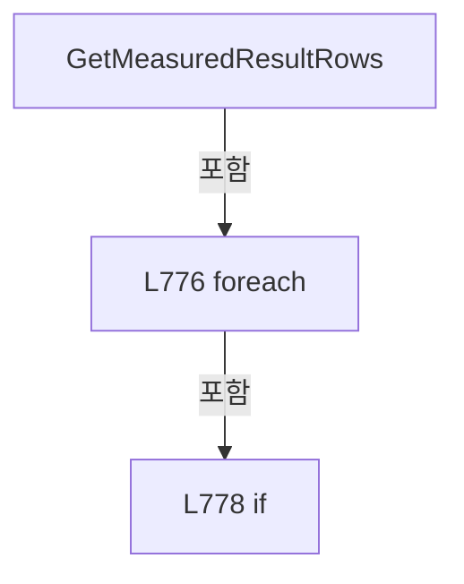

변경 전 점검: 입력/반환 타입, 위 호출자, 예외/취소 경로, 공유 상태와 저장·전송 소비자를 함께 확인합니다. 값의 단위나 물리 방향을 이름만으로 확정하지 않습니다.

### MethodDeclaration `ProjectCorrectionRows` · L787–808

[Drilling.Common/Review/CReviewManager.cs:787–808](https://github.com/kjuws10-rgb/A3Drilling/blob/dfa5920e6301d9ec4b0eab1452ae59521aafc986/Drilling.Common/Review/CReviewManager.cs#L787-L808)

| 항목 | 실제 추출 값 |
| --- | --- |
| 서명 | System.Collections.Generic.IReadOnlyList<Drilling.Common.Review.ST_REVIEW_PLAN_POINT> Drilling.Common.Review.CReviewManager.ProjectCorrectionRows(Drilling.Common.Review.ST_REVIEW_PLAN, System.Collections.Generic.IReadOnlyList<Drilling.Common.Review.ST_REVIEW_PLAN_POINT>) |
| 접근/수식자 | Public / public, static |
| 반환/값 타입 | System.Collections.Generic.IReadOnlyList<Drilling.Common.Review.ST_REVIEW_PLAN_POINT> |
| 소속 타입 | NamedType:Drilling.Common.Review.CReviewManager |

입력 계약:

| 이름 | 타입 | 전달 | 선택/기본값 |
| --- | --- | --- | --- |
| plan | Drilling.Common.Review.ST_REVIEW_PLAN | None | False /  |
| measuredResults | System.Collections.Generic.IReadOnlyList<Drilling.Common.Review.ST_REVIEW_PLAN_POINT> | None | False /  |

정적 호출자로 확인된 위치:

| 호출 파일/행 | 호출 표현식 | 런타임 분기 가능 |
| --- | --- | --- |
| [Drilling.UI/Menu/Menus/CMenuCorrection.ReviewData.Offset.cs:428–428](https://github.com/kjuws10-rgb/A3Drilling/blob/dfa5920e6301d9ec4b0eab1452ae59521aafc986/Drilling.UI/Menu/Menus/CMenuCorrection.ReviewData.Offset.cs#L428-L428) | CReviewManager.ProjectCorrectionRows | False |
| [Drilling.UI/Menu/Menus/CMenuCorrection.cs:1910–1910](https://github.com/kjuws10-rgb/A3Drilling/blob/dfa5920e6301d9ec4b0eab1452ae59521aafc986/Drilling.UI/Menu/Menus/CMenuCorrection.cs#L1910-L1910) | CReviewManager.ProjectCorrectionRows | False |

호출하는 대상과 해석 범위:

| 원본 행 | 표현식 | 분석 상태 | 대상/소스 위치 |
| --- | --- | --- | --- |
| 794 | measuredResults.Where(point => point.Use && point.State is EN_REVIEW_POINT_STATE.Ok or EN_REVIEW_POINT_STATE.Ng).ToArray | resolved | Drilling.Common.Review.ST_REVIEW_PLAN_POINT[] System.Collections.Generic.IEnumerable<Drilling.Common.Review.ST_REVIEW_PLAN_POINT>.ToArray<Drilling.Common.Review.ST_REVIEW_PLAN_POINT>() |
| 794 | measuredResults.Where | resolved | System.Collections.Generic.IEnumerable<Drilling.Common.Review.ST_REVIEW_PLAN_POINT> System.Collections.Generic.IEnumerable<Drilling.Common.Review.ST_REVIEW_PLAN_POINT>.Where<Drilling.Common.Review.ST_REVIEW_PLAN_POINT>(System.Func<Drilling.Common.Review.ST_REVIEW_PLAN_POINT, bool>) |
| 802 | ProjectSimpleResultRows | resolved | System.Collections.Generic.IReadOnlyList<Drilling.Common.Review.ST_REVIEW_PLAN_POINT> Drilling.Common.Review.CReviewManager.ProjectSimpleResultRows(Drilling.Common.Review.ST_REVIEW_CORRECTION_PLAN, System.Collections.Generic.IReadOnlyList<Drilling.Common.Review.ST_REVIEW_PLAN_POINT>) · Drilling.Common/Review/CReviewManager.cs:810 |
| 803 | ProjectRoughResultRows | resolved | System.Collections.Generic.IReadOnlyList<Drilling.Common.Review.ST_REVIEW_PLAN_POINT> Drilling.Common.Review.CReviewManager.ProjectRoughResultRows(Drilling.Common.Review.ST_REVIEW_CORRECTION_PLAN, System.Collections.Generic.IReadOnlyList<Drilling.Common.Review.ST_REVIEW_PLAN_POINT>) · Drilling.Common/Review/CReviewManager.cs:821 |
| 804 | ProjectFineResultRows | resolved | System.Collections.Generic.IReadOnlyList<Drilling.Common.Review.ST_REVIEW_PLAN_POINT> Drilling.Common.Review.CReviewManager.ProjectFineResultRows(System.Collections.Generic.IReadOnlyList<Drilling.Common.Review.ST_REVIEW_PLAN_POINT>, System.Collections.Generic.IReadOnlyList<Drilling.Common.Review.ST_REVIEW_PLAN_POINT>) · Drilling.Common/Review/CReviewManager.cs:827 |

본문의 실제 연산·분기·예외·반환 순서(원문 위치 순):

| 원본 행 | 종류 | 주석 해설 |
| --- | --- | --- |
| 789 | if | 조건에 따라 분기합니다: if (plan.CorrectionPlan is not { SourcePoints.Count: > 0 } projection) |
| 791 | return | 호출자에게 값 또는 제어를 반환합니다: return measuredResults; |
| 794 | call | 함수·델리게이트 또는 객체 생성자를 호출합니다: measuredResults.Where(point => point.Use && point.State is EN_REVIEW_POINT_STATE.Ok or EN_REVIEW_POINT_STATE.Ng).ToArray() |
| 794 | call | 함수·델리게이트 또는 객체 생성자를 호출합니다: measuredResults.Where(point => point.Use && point.State is EN_REVIEW_POINT_STATE.Ok or EN_REVIEW_POINT_STATE.Ng) |
| 794 | local-declaration | 지역 변수를 선언합니다: var measuredPoints = measuredResults.Where(point => point.Use && point.State is EN_REVIEW_POINT_STATE.Ok or EN_REVIEW_POINT_STATE.Ng).ToArray(); |
| 794 | variable-initializer | 변수의 초기값을 지정합니다: measuredPoints = measuredResults.Where(point => point.Use && point.State is EN_REVIEW_POINT_STATE.Ok or EN_REVIEW_POINT_STATE.Ng).ToArray() |
| 795 | if | 조건에 따라 분기합니다: if (measuredPoints.Length == 0) |
| 797 | return | 호출자에게 값 또는 제어를 반환합니다: return measuredResults; |
| 800 | return | 호출자에게 값 또는 제어를 반환합니다: return projection.Rule switch { EN_REVIEW_CORRECTION_RULE.Simple => ProjectSimpleResultRows(projection, measuredPoints), EN_REVIEW_CORRECTION_RULE.Rough => ProjectRoughResultRows(projection, measuredPoints), EN_REVIEW_CORRECTION_R |
| 800 | switch-expression | 값별 결과식을 선택합니다: projection.Rule switch { EN_REVIEW_CORRECTION_RULE.Simple => ProjectSimpleResultRows(projection, measuredPoints), EN_REVIEW_CORRECTION_RULE.Rough => ProjectRoughResultRows(projection, measuredPoints), EN_REVIEW_CORRECTION_RULE.Fin |
| 802 | call | 함수·델리게이트 또는 객체 생성자를 호출합니다: ProjectSimpleResultRows(projection, measuredPoints) |
| 803 | call | 함수·델리게이트 또는 객체 생성자를 호출합니다: ProjectRoughResultRows(projection, measuredPoints) |
| 804 | call | 함수·델리게이트 또는 객체 생성자를 호출합니다: ProjectFineResultRows(projection.SourcePoints, measuredPoints) |

제어 구문의 포함 구조(실제 실행 순서/CFG가 아닌 구문 탐색 그림):

```mermaid
flowchart TD
 M["ProjectCorrectionRows"]
 N0["L789 if"]
 M -->|포함| N0
 N1["L795 if"]
 M -->|포함| N1
 N2["L800 switch-expression"]
 M -->|포함| N2
```

변경 전 점검: 입력/반환 타입, 위 호출자, 예외/취소 경로, 공유 상태와 저장·전송 소비자를 함께 확인합니다. 값의 단위나 물리 방향을 이름만으로 확정하지 않습니다.

### MethodDeclaration `ProjectSimpleResultRows` · L810–819

[Drilling.Common/Review/CReviewManager.cs:810–819](https://github.com/kjuws10-rgb/A3Drilling/blob/dfa5920e6301d9ec4b0eab1452ae59521aafc986/Drilling.Common/Review/CReviewManager.cs#L810-L819)

| 항목 | 실제 추출 값 |
| --- | --- |
| 서명 | System.Collections.Generic.IReadOnlyList<Drilling.Common.Review.ST_REVIEW_PLAN_POINT> Drilling.Common.Review.CReviewManager.ProjectSimpleResultRows(Drilling.Common.Review.ST_REVIEW_CORRECTION_PLAN, System.Collections.Generic.IReadOnlyList<Drilling.Common.Review.ST_REVIEW_PLAN_POINT>) |
| 접근/수식자 | Private / private, static |
| 반환/값 타입 | System.Collections.Generic.IReadOnlyList<Drilling.Common.Review.ST_REVIEW_PLAN_POINT> |
| 소속 타입 | NamedType:Drilling.Common.Review.CReviewManager |

입력 계약:

| 이름 | 타입 | 전달 | 선택/기본값 |
| --- | --- | --- | --- |
| projection | Drilling.Common.Review.ST_REVIEW_CORRECTION_PLAN | None | False /  |
| measuredPoints | System.Collections.Generic.IReadOnlyList<Drilling.Common.Review.ST_REVIEW_PLAN_POINT> | None | False /  |

정적 호출자로 확인된 위치:

| 호출 파일/행 | 호출 표현식 | 런타임 분기 가능 |
| --- | --- | --- |
| [Drilling.Common/Review/CReviewManager.cs:802–802](https://github.com/kjuws10-rgb/A3Drilling/blob/dfa5920e6301d9ec4b0eab1452ae59521aafc986/Drilling.Common/Review/CReviewManager.cs#L802-L802) | ProjectSimpleResultRows | False |

호출하는 대상과 해석 범위:

| 원본 행 | 표현식 | 분석 상태 | 대상/소스 위치 |
| --- | --- | --- | --- |
| 818 | projection.SourcePoints.Where(point => point.HeadNo == measuredPoint.HeadNo && (projection.Scope != EN_REVIEW_CORRECTION_SCOPE.HeadCell &#124;&#124; point.CellNo == measuredPoint.CellNo)).Where(point => point.HeadNo > 0).Select(point => CopyMeasurement(point, measuredPoint)).ToArray | resolved | Drilling.Common.Review.ST_REVIEW_PLAN_POINT[] System.Collections.Generic.IEnumerable<Drilling.Common.Review.ST_REVIEW_PLAN_POINT>.ToArray<Drilling.Common.Review.ST_REVIEW_PLAN_POINT>() |
| 818 | projection.SourcePoints.Where(point => point.HeadNo == measuredPoint.HeadNo && (projection.Scope != EN_REVIEW_CORRECTION_SCOPE.HeadCell &#124;&#124; point.CellNo == measuredPoint.CellNo)).Where(point => point.HeadNo > 0).Select | resolved | System.Collections.Generic.IEnumerable<Drilling.Common.Review.ST_REVIEW_PLAN_POINT> System.Collections.Generic.IEnumerable<Drilling.Common.Review.ST_REVIEW_PLAN_POINT>.Select<Drilling.Common.Review.ST_REVIEW_PLAN_POINT, Drilling.Common.Review.ST_REVIEW_PLAN_POINT>(System.Func<Drilling.Common.Review.ST_REVIEW_PLAN_POINT, Drilling.Common.Review.ST_REVIEW_PLAN_POINT>) |
| 818 | projection.SourcePoints.Where(point => point.HeadNo == measuredPoint.HeadNo && (projection.Scope != EN_REVIEW_CORRECTION_SCOPE.HeadCell &#124;&#124; point.CellNo == measuredPoint.CellNo)).Where | resolved | System.Collections.Generic.IEnumerable<Drilling.Common.Review.ST_REVIEW_PLAN_POINT> System.Collections.Generic.IEnumerable<Drilling.Common.Review.ST_REVIEW_PLAN_POINT>.Where<Drilling.Common.Review.ST_REVIEW_PLAN_POINT>(System.Func<Drilling.Common.Review.ST_REVIEW_PLAN_POINT, bool>) |
| 818 | projection.SourcePoints.Where | resolved | System.Collections.Generic.IEnumerable<Drilling.Common.Review.ST_REVIEW_PLAN_POINT> System.Collections.Generic.IEnumerable<Drilling.Common.Review.ST_REVIEW_PLAN_POINT>.Where<Drilling.Common.Review.ST_REVIEW_PLAN_POINT>(System.Func<Drilling.Common.Review.ST_REVIEW_PLAN_POINT, bool>) |
| 818 | CopyMeasurement | resolved | Drilling.Common.Review.ST_REVIEW_PLAN_POINT Drilling.Common.Review.CReviewManager.CopyMeasurement(Drilling.Common.Review.ST_REVIEW_PLAN_POINT, Drilling.Common.Review.ST_REVIEW_PLAN_POINT) · Drilling.Common/Review/CReviewManager.cs:892 |

본문의 실제 연산·분기·예외·반환 순서(원문 위치 순):

| 원본 행 | 종류 | 주석 해설 |
| --- | --- | --- |
| 812 | if | 조건에 따라 분기합니다: if (measuredPoints.Count != 1) |
| 814 | return | 호출자에게 값 또는 제어를 반환합니다: return measuredPoints; |
| 817 | local-declaration | 지역 변수를 선언합니다: var measuredPoint = measuredPoints[0]; |
| 817 | variable-initializer | 변수의 초기값을 지정합니다: measuredPoint = measuredPoints[0] |
| 818 | call | 함수·델리게이트 또는 객체 생성자를 호출합니다: projection.SourcePoints.Where(point => point.HeadNo == measuredPoint.HeadNo && (projection.Scope != EN_REVIEW_CORRECTION_SCOPE.HeadCell &#124;&#124; point.CellNo == measuredPoint.CellNo)).Where(point => point.HeadNo > 0).Select(po… |
| 818 | call | 함수·델리게이트 또는 객체 생성자를 호출합니다: projection.SourcePoints.Where(point => point.HeadNo == measuredPoint.HeadNo && (projection.Scope != EN_REVIEW_CORRECTION_SCOPE.HeadCell &#124;&#124; point.CellNo == measuredPoint.CellNo)).Where(point => point.HeadNo > 0).Select(po… |
| 818 | call | 함수·델리게이트 또는 객체 생성자를 호출합니다: projection.SourcePoints.Where(point => point.HeadNo == measuredPoint.HeadNo && (projection.Scope != EN_REVIEW_CORRECTION_SCOPE.HeadCell &#124;&#124; point.CellNo == measuredPoint.CellNo)).Where(point => point.HeadNo > 0) |
| 818 | call | 함수·델리게이트 또는 객체 생성자를 호출합니다: projection.SourcePoints.Where(point => point.HeadNo == measuredPoint.HeadNo && (projection.Scope != EN_REVIEW_CORRECTION_SCOPE.HeadCell &#124;&#124; point.CellNo == measuredPoint.CellNo)) |
| 818 | call | 함수·델리게이트 또는 객체 생성자를 호출합니다: CopyMeasurement(point, measuredPoint) |
| 818 | return | 호출자에게 값 또는 제어를 반환합니다: return projection.SourcePoints.Where(point => point.HeadNo == measuredPoint.HeadNo && (projection.Scope != EN_REVIEW_CORRECTION_SCOPE.HeadCell &#124;&#124; point.CellNo == measuredPoint.CellNo)).Where(point => point.HeadNo > 0).Select(point |

제어 구문의 포함 구조(실제 실행 순서/CFG가 아닌 구문 탐색 그림):

```mermaid
flowchart TD
 M["ProjectSimpleResultRows"]
 N0["L812 if"]
 M -->|포함| N0
```

변경 전 점검: 입력/반환 타입, 위 호출자, 예외/취소 경로, 공유 상태와 저장·전송 소비자를 함께 확인합니다. 값의 단위나 물리 방향을 이름만으로 확정하지 않습니다.

### MethodDeclaration `ProjectRoughResultRows` · L821–825

[Drilling.Common/Review/CReviewManager.cs:821–825](https://github.com/kjuws10-rgb/A3Drilling/blob/dfa5920e6301d9ec4b0eab1452ae59521aafc986/Drilling.Common/Review/CReviewManager.cs#L821-L825)

| 항목 | 실제 추출 값 |
| --- | --- |
| 서명 | System.Collections.Generic.IReadOnlyList<Drilling.Common.Review.ST_REVIEW_PLAN_POINT> Drilling.Common.Review.CReviewManager.ProjectRoughResultRows(Drilling.Common.Review.ST_REVIEW_CORRECTION_PLAN, System.Collections.Generic.IReadOnlyList<Drilling.Common.Review.ST_REVIEW_PLAN_POINT>) |
| 접근/수식자 | Private / private, static |
| 반환/값 타입 | System.Collections.Generic.IReadOnlyList<Drilling.Common.Review.ST_REVIEW_PLAN_POINT> |
| 소속 타입 | NamedType:Drilling.Common.Review.CReviewManager |

입력 계약:

| 이름 | 타입 | 전달 | 선택/기본값 |
| --- | --- | --- | --- |
| projection | Drilling.Common.Review.ST_REVIEW_CORRECTION_PLAN | None | False /  |
| measuredPoints | System.Collections.Generic.IReadOnlyList<Drilling.Common.Review.ST_REVIEW_PLAN_POINT> | None | False /  |

정적 호출자로 확인된 위치:

| 호출 파일/행 | 호출 표현식 | 런타임 분기 가능 |
| --- | --- | --- |
| [Drilling.Common/Review/CReviewManager.cs:803–803](https://github.com/kjuws10-rgb/A3Drilling/blob/dfa5920e6301d9ec4b0eab1452ae59521aafc986/Drilling.Common/Review/CReviewManager.cs#L803-L803) | ProjectRoughResultRows | False |

호출하는 대상과 해석 범위:

| 원본 행 | 표현식 | 분석 상태 | 대상/소스 위치 |
| --- | --- | --- | --- |
| 823 | measuredPoints.GroupBy(point => projection.Scope == EN_REVIEW_CORRECTION_SCOPE.HeadCell ? (point.HeadNo, point.CellNo) : (point.HeadNo, 0)).ToDictionary | resolved | System.Collections.Generic.Dictionary<(int HeadNo, int), Drilling.Common.Review.ST_REVIEW_PLAN_POINT> System.Collections.Generic.IEnumerable<System.Linq.IGrouping<(int HeadNo, int), Drilling.Common.Review.ST_REVIEW_PLAN_POINT>>.ToDictionary<System.Linq.IGrouping<(int HeadNo, int), Drilling.Common.Review.ST_REVIEW_PLAN_POINT>, (int HeadNo, int), Drilling.Common.Review.ST_REVIEW_PLAN_POINT>(System.Func<System.Linq.IGrouping<(int HeadNo, int), Drilling.Common.Review.ST_REVIEW_PLAN_POINT>, (int HeadNo, int)>, System.Func<System.Linq.IGrouping<(int HeadNo, int), Drilling.Common.Review.ST_REVIEW_PLAN_POINT>, Drilling.Common.Review.ST_REVIEW_PLAN_POINT>) |
| 823 | measuredPoints.GroupBy | resolved | System.Collections.Generic.IEnumerable<System.Linq.IGrouping<(int HeadNo, int), Drilling.Common.Review.ST_REVIEW_PLAN_POINT>> System.Collections.Generic.IEnumerable<Drilling.Common.Review.ST_REVIEW_PLAN_POINT>.GroupBy<Drilling.Common.Review.ST_REVIEW_PLAN_POINT, (int HeadNo, int)>(System.Func<Drilling.Common.Review.ST_REVIEW_PLAN_POINT, (int HeadNo, int)>) |
| 823 | group.First | resolved | Drilling.Common.Review.ST_REVIEW_PLAN_POINT System.Collections.Generic.IEnumerable<Drilling.Common.Review.ST_REVIEW_PLAN_POINT>.First<Drilling.Common.Review.ST_REVIEW_PLAN_POINT>() |
| 824 | projection.SourcePoints.Where(point => point.HeadNo > 0).Select(point => new { Point = point, Key = projection.Scope == EN_REVIEW_CORRECTION_SCOPE.HeadCell ? (point.HeadNo, point.CellNo) : (point.HeadNo, 0) }).Where(item => measurements.ContainsKey(item.Key)).Select(item => CopyMeasurement(item.Point, measurements[item.Key])).ToArray | resolved | Drilling.Common.Review.ST_REVIEW_PLAN_POINT[] System.Collections.Generic.IEnumerable<Drilling.Common.Review.ST_REVIEW_PLAN_POINT>.ToArray<Drilling.Common.Review.ST_REVIEW_PLAN_POINT>() |
| 824 | projection.SourcePoints.Where(point => point.HeadNo > 0).Select(point => new { Point = point, Key = projection.Scope == EN_REVIEW_CORRECTION_SCOPE.HeadCell ? (point.HeadNo, point.CellNo) : (point.HeadNo, 0) }).Where(item => measurements.ContainsKey(item.Key)).Select | resolved | System.Collections.Generic.IEnumerable<Drilling.Common.Review.ST_REVIEW_PLAN_POINT> System.Collections.Generic.IEnumerable<<anonymous type: Drilling.Common.Review.ST_REVIEW_PLAN_POINT Point, (int HeadNo, int) Key>>.Select<<anonymous type: Drilling.Common.Review.ST_REVIEW_PLAN_POINT Point, (int HeadNo, int) Key>, Drilling.Common.Review.ST_REVIEW_PLAN_POINT>(System.Func<<anonymous type: Drilling.Common.Review.ST_REVIEW_PLAN_POINT Point, (int HeadNo, int) Key>, Drilling.Common.Review.ST_REVIEW_PLAN_POINT>) |
| 824 | projection.SourcePoints.Where(point => point.HeadNo > 0).Select(point => new { Point = point, Key = projection.Scope == EN_REVIEW_CORRECTION_SCOPE.HeadCell ? (point.HeadNo, point.CellNo) : (point.HeadNo, 0) }).Where | resolved | System.Collections.Generic.IEnumerable<<anonymous type: Drilling.Common.Review.ST_REVIEW_PLAN_POINT Point, (int HeadNo, int) Key>> System.Collections.Generic.IEnumerable<<anonymous type: Drilling.Common.Review.ST_REVIEW_PLAN_POINT Point, (int HeadNo, int) Key>>.Where<<anonymous type: Drilling.Common.Review.ST_REVIEW_PLAN_POINT Point, (int HeadNo, int) Key>>(System.Func<<anonymous type: Drilling.Common.Review.ST_REVIEW_PLAN_POINT Point, (int HeadNo, int) Key>, bool>) |
| 824 | projection.SourcePoints.Where(point => point.HeadNo > 0).Select | resolved | System.Collections.Generic.IEnumerable<<anonymous type: Drilling.Common.Review.ST_REVIEW_PLAN_POINT Point, (int HeadNo, int) Key>> System.Collections.Generic.IEnumerable<Drilling.Common.Review.ST_REVIEW_PLAN_POINT>.Select<Drilling.Common.Review.ST_REVIEW_PLAN_POINT, <anonymous type: Drilling.Common.Review.ST_REVIEW_PLAN_POINT Point, (int HeadNo, int) Key>>(System.Func<Drilling.Common.Review.ST_REVIEW_PLAN_POINT, <anonymous type: Drilling.Common.Review.ST_REVIEW_PLAN_POINT Point, (int HeadNo, int) Key>>) |
| 824 | projection.SourcePoints.Where | resolved | System.Collections.Generic.IEnumerable<Drilling.Common.Review.ST_REVIEW_PLAN_POINT> System.Collections.Generic.IEnumerable<Drilling.Common.Review.ST_REVIEW_PLAN_POINT>.Where<Drilling.Common.Review.ST_REVIEW_PLAN_POINT>(System.Func<Drilling.Common.Review.ST_REVIEW_PLAN_POINT, bool>) |
| 824 | measurements.ContainsKey | resolved | bool System.Collections.Generic.Dictionary<(int HeadNo, int), Drilling.Common.Review.ST_REVIEW_PLAN_POINT>.ContainsKey((int HeadNo, int)) |
| 824 | CopyMeasurement | resolved | Drilling.Common.Review.ST_REVIEW_PLAN_POINT Drilling.Common.Review.CReviewManager.CopyMeasurement(Drilling.Common.Review.ST_REVIEW_PLAN_POINT, Drilling.Common.Review.ST_REVIEW_PLAN_POINT) · Drilling.Common/Review/CReviewManager.cs:892 |

본문의 실제 연산·분기·예외·반환 순서(원문 위치 순):

| 원본 행 | 종류 | 주석 해설 |
| --- | --- | --- |
| 823 | call | 함수·델리게이트 또는 객체 생성자를 호출합니다: measuredPoints.GroupBy(point => projection.Scope == EN_REVIEW_CORRECTION_SCOPE.HeadCell ? (point.HeadNo, point.CellNo) : (point.HeadNo, 0)).ToDictionary(group => group.Key, group => group.First()) |
| 823 | call | 함수·델리게이트 또는 객체 생성자를 호출합니다: measuredPoints.GroupBy(point => projection.Scope == EN_REVIEW_CORRECTION_SCOPE.HeadCell ? (point.HeadNo, point.CellNo) : (point.HeadNo, 0)) |
| 823 | call | 함수·델리게이트 또는 객체 생성자를 호출합니다: group.First() |
| 823 | conditional-expression | 조건에 따라 결과식을 선택합니다: projection.Scope == EN_REVIEW_CORRECTION_SCOPE.HeadCell ? (point.HeadNo, point.CellNo) : (point.HeadNo, 0) |
| 823 | local-declaration | 지역 변수를 선언합니다: var measurements = measuredPoints.GroupBy(point => projection.Scope == EN_REVIEW_CORRECTION_SCOPE.HeadCell ? (point.HeadNo, point.CellNo) : (point.HeadNo, 0)).ToDictionary(group => group.Key, group => group.First()); |
| 823 | variable-initializer | 변수의 초기값을 지정합니다: measurements = measuredPoints.GroupBy(point => projection.Scope == EN_REVIEW_CORRECTION_SCOPE.HeadCell ? (point.HeadNo, point.CellNo) : (point.HeadNo, 0)).ToDictionary(group => group.Key, group => group.First()) |
| 824 | call | 함수·델리게이트 또는 객체 생성자를 호출합니다: projection.SourcePoints.Where(point => point.HeadNo > 0).Select(point => new { Point = point, Key = projection.Scope == EN_REVIEW_CORRECTION_SCOPE.HeadCell ? (point.HeadNo, point.CellNo) : (point.HeadNo, 0) }).Where(item… |
| 824 | call | 함수·델리게이트 또는 객체 생성자를 호출합니다: projection.SourcePoints.Where(point => point.HeadNo > 0).Select(point => new { Point = point, Key = projection.Scope == EN_REVIEW_CORRECTION_SCOPE.HeadCell ? (point.HeadNo, point.CellNo) : (point.HeadNo, 0) }).Where(item… |
| 824 | call | 함수·델리게이트 또는 객체 생성자를 호출합니다: projection.SourcePoints.Where(point => point.HeadNo > 0).Select(point => new { Point = point, Key = projection.Scope == EN_REVIEW_CORRECTION_SCOPE.HeadCell ? (point.HeadNo, point.CellNo) : (point.HeadNo, 0) }).Where(item… |
| 824 | call | 함수·델리게이트 또는 객체 생성자를 호출합니다: projection.SourcePoints.Where(point => point.HeadNo > 0).Select(point => new { Point = point, Key = projection.Scope == EN_REVIEW_CORRECTION_SCOPE.HeadCell ? (point.HeadNo, point.CellNo) : (point.HeadNo, 0) }) |
| 824 | call | 함수·델리게이트 또는 객체 생성자를 호출합니다: projection.SourcePoints.Where(point => point.HeadNo > 0) |
| 824 | call | 함수·델리게이트 또는 객체 생성자를 호출합니다: measurements.ContainsKey(item.Key) |
| 824 | call | 함수·델리게이트 또는 객체 생성자를 호출합니다: CopyMeasurement(item.Point, measurements[item.Key]) |
| 824 | conditional-expression | 조건에 따라 결과식을 선택합니다: projection.Scope == EN_REVIEW_CORRECTION_SCOPE.HeadCell ? (point.HeadNo, point.CellNo) : (point.HeadNo, 0) |
| 824 | return | 호출자에게 값 또는 제어를 반환합니다: return projection.SourcePoints.Where(point => point.HeadNo > 0).Select(point => new { Point = point, Key = projection.Scope == EN_REVIEW_CORRECTION_SCOPE.HeadCell ? (point.HeadNo, point.CellNo) : (point.HeadNo, 0) }).Where(item => |

변경 전 점검: 입력/반환 타입, 위 호출자, 예외/취소 경로, 공유 상태와 저장·전송 소비자를 함께 확인합니다. 값의 단위나 물리 방향을 이름만으로 확정하지 않습니다.

### MethodDeclaration `ProjectFineResultRows` · L827–842

[Drilling.Common/Review/CReviewManager.cs:827–842](https://github.com/kjuws10-rgb/A3Drilling/blob/dfa5920e6301d9ec4b0eab1452ae59521aafc986/Drilling.Common/Review/CReviewManager.cs#L827-L842)

| 항목 | 실제 추출 값 |
| --- | --- |
| 서명 | System.Collections.Generic.IReadOnlyList<Drilling.Common.Review.ST_REVIEW_PLAN_POINT> Drilling.Common.Review.CReviewManager.ProjectFineResultRows(System.Collections.Generic.IReadOnlyList<Drilling.Common.Review.ST_REVIEW_PLAN_POINT>, System.Collections.Generic.IReadOnlyList<Drilling.Common.Review.ST_REVIEW_PLAN_POINT>) |
| 접근/수식자 | Private / private, static |
| 반환/값 타입 | System.Collections.Generic.IReadOnlyList<Drilling.Common.Review.ST_REVIEW_PLAN_POINT> |
| 소속 타입 | NamedType:Drilling.Common.Review.CReviewManager |

입력 계약:

| 이름 | 타입 | 전달 | 선택/기본값 |
| --- | --- | --- | --- |
| sourcePoints | System.Collections.Generic.IReadOnlyList<Drilling.Common.Review.ST_REVIEW_PLAN_POINT> | None | False /  |
| measuredPoints | System.Collections.Generic.IReadOnlyList<Drilling.Common.Review.ST_REVIEW_PLAN_POINT> | None | False /  |

정적 호출자로 확인된 위치:

| 호출 파일/행 | 호출 표현식 | 런타임 분기 가능 |
| --- | --- | --- |
| [Drilling.Common/Review/CReviewManager.cs:804–804](https://github.com/kjuws10-rgb/A3Drilling/blob/dfa5920e6301d9ec4b0eab1452ae59521aafc986/Drilling.Common/Review/CReviewManager.cs#L804-L804) | ProjectFineResultRows | False |

호출하는 대상과 해석 범위:

| 원본 행 | 표현식 | 분석 상태 | 대상/소스 위치 |
| --- | --- | --- | --- |
| 829 | measuredPoints.Where(point => point.HeadNo > 0 && double.IsFinite(point.DesignX) && double.IsFinite(point.DesignY)).GroupBy(point => (point.HeadNo, X: FineCoordinateKey(point.DesignX))).ToDictionary | resolved | System.Collections.Generic.Dictionary<(int HeadNo, double X), Drilling.Common.Review.ST_REVIEW_PLAN_POINT[]> System.Collections.Generic.IEnumerable<System.Linq.IGrouping<(int HeadNo, double X), Drilling.Common.Review.ST_REVIEW_PLAN_POINT>>.ToDictionary<System.Linq.IGrouping<(int HeadNo, double X), Drilling.Common.Review.ST_REVIEW_PLAN_POINT>, (int HeadNo, double X), Drilling.Common.Review.ST_REVIEW_PLAN_POINT[]>(System.Func<System.Linq.IGrouping<(int HeadNo, double X), Drilling.Common.Review.ST_REVIEW_PLAN_POINT>, (int HeadNo, double X)>, System.Func<System.Linq.IGrouping<(int HeadNo, double X), Drilling.Common.Review.ST_REVIEW_PLAN_POINT>, Drilling.Common.Review.ST_REVIEW_PLAN_POINT[]>) |
| 829 | measuredPoints.Where(point => point.HeadNo > 0 && double.IsFinite(point.DesignX) && double.IsFinite(point.DesignY)).GroupBy | resolved | System.Collections.Generic.IEnumerable<System.Linq.IGrouping<(int HeadNo, double X), Drilling.Common.Review.ST_REVIEW_PLAN_POINT>> System.Collections.Generic.IEnumerable<Drilling.Common.Review.ST_REVIEW_PLAN_POINT>.GroupBy<Drilling.Common.Review.ST_REVIEW_PLAN_POINT, (int HeadNo, double X)>(System.Func<Drilling.Common.Review.ST_REVIEW_PLAN_POINT, (int HeadNo, double X)>) |
| 829 | measuredPoints.Where | resolved | System.Collections.Generic.IEnumerable<Drilling.Common.Review.ST_REVIEW_PLAN_POINT> System.Collections.Generic.IEnumerable<Drilling.Common.Review.ST_REVIEW_PLAN_POINT>.Where<Drilling.Common.Review.ST_REVIEW_PLAN_POINT>(System.Func<Drilling.Common.Review.ST_REVIEW_PLAN_POINT, bool>) |
| 829 | double.IsFinite | resolved | bool double.IsFinite(double) |
| 829 | double.IsFinite | resolved | bool double.IsFinite(double) |
| 829 | FineCoordinateKey | resolved | double Drilling.Common.Review.CReviewManager.FineCoordinateKey(double) · Drilling.Common/Review/CReviewManager.cs:900 |
| 829 | group.GroupBy(point => FineCoordinateKey(point.DesignY)).Select(yGroup => yGroup.First()).OrderBy(point => point.DesignY).ToArray | resolved | Drilling.Common.Review.ST_REVIEW_PLAN_POINT[] System.Collections.Generic.IEnumerable<Drilling.Common.Review.ST_REVIEW_PLAN_POINT>.ToArray<Drilling.Common.Review.ST_REVIEW_PLAN_POINT>() |
| 829 | group.GroupBy(point => FineCoordinateKey(point.DesignY)).Select(yGroup => yGroup.First()).OrderBy | resolved | System.Linq.IOrderedEnumerable<Drilling.Common.Review.ST_REVIEW_PLAN_POINT> System.Collections.Generic.IEnumerable<Drilling.Common.Review.ST_REVIEW_PLAN_POINT>.OrderBy<Drilling.Common.Review.ST_REVIEW_PLAN_POINT, double>(System.Func<Drilling.Common.Review.ST_REVIEW_PLAN_POINT, double>) |
| 829 | group.GroupBy(point => FineCoordinateKey(point.DesignY)).Select | resolved | System.Collections.Generic.IEnumerable<Drilling.Common.Review.ST_REVIEW_PLAN_POINT> System.Collections.Generic.IEnumerable<System.Linq.IGrouping<double, Drilling.Common.Review.ST_REVIEW_PLAN_POINT>>.Select<System.Linq.IGrouping<double, Drilling.Common.Review.ST_REVIEW_PLAN_POINT>, Drilling.Common.Review.ST_REVIEW_PLAN_POINT>(System.Func<System.Linq.IGrouping<double, Drilling.Common.Review.ST_REVIEW_PLAN_POINT>, Drilling.Common.Review.ST_REVIEW_PLAN_POINT>) |
| 829 | group.GroupBy | resolved | System.Collections.Generic.IEnumerable<System.Linq.IGrouping<double, Drilling.Common.Review.ST_REVIEW_PLAN_POINT>> System.Collections.Generic.IEnumerable<Drilling.Common.Review.ST_REVIEW_PLAN_POINT>.GroupBy<Drilling.Common.Review.ST_REVIEW_PLAN_POINT, double>(System.Func<Drilling.Common.Review.ST_REVIEW_PLAN_POINT, double>) |
| 829 | FineCoordinateKey | resolved | double Drilling.Common.Review.CReviewManager.FineCoordinateKey(double) · Drilling.Common/Review/CReviewManager.cs:900 |
| 829 | yGroup.First | resolved | Drilling.Common.Review.ST_REVIEW_PLAN_POINT System.Collections.Generic.IEnumerable<Drilling.Common.Review.ST_REVIEW_PLAN_POINT>.First<Drilling.Common.Review.ST_REVIEW_PLAN_POINT>() |
| 830 | new List<ST_REVIEW_PLAN_POINT> | resolved | System.Collections.Generic.List<Drilling.Common.Review.ST_REVIEW_PLAN_POINT>.List(int) |
| 831 | sourcePoints.Where | resolved | System.Collections.Generic.IEnumerable<Drilling.Common.Review.ST_REVIEW_PLAN_POINT> System.Collections.Generic.IEnumerable<Drilling.Common.Review.ST_REVIEW_PLAN_POINT>.Where<Drilling.Common.Review.ST_REVIEW_PLAN_POINT>(System.Func<Drilling.Common.Review.ST_REVIEW_PLAN_POINT, bool>) |
| 831 | double.IsFinite | resolved | bool double.IsFinite(double) |
| 831 | double.IsFinite | resolved | bool double.IsFinite(double) |
| 833 | anchorsByHeadAndX.TryGetValue | resolved | bool System.Collections.Generic.Dictionary<(int HeadNo, double X), Drilling.Common.Review.ST_REVIEW_PLAN_POINT[]>.TryGetValue((int HeadNo, double X), out Drilling.Common.Review.ST_REVIEW_PLAN_POINT[]) |
| 833 | FineCoordinateKey | resolved | double Drilling.Common.Review.CReviewManager.FineCoordinateKey(double) · Drilling.Common/Review/CReviewManager.cs:900 |
| 838 | rows.Add | resolved | void System.Collections.Generic.List<Drilling.Common.Review.ST_REVIEW_PLAN_POINT>.Add(Drilling.Common.Review.ST_REVIEW_PLAN_POINT) |
| 838 | InterpolateFineMeasurementAcrossGlass | resolved | Drilling.Common.Review.ST_REVIEW_PLAN_POINT Drilling.Common.Review.CReviewManager.InterpolateFineMeasurementAcrossGlass(Drilling.Common.Review.ST_REVIEW_PLAN_POINT, System.Collections.Generic.IReadOnlyList<Drilling.Common.Review.ST_REVIEW_PLAN_POINT>) · Drilling.Common/Review/CReviewManager.cs:844 |

본문의 실제 연산·분기·예외·반환 순서(원문 위치 순):

| 원본 행 | 종류 | 주석 해설 |
| --- | --- | --- |
| 829 | call | 함수·델리게이트 또는 객체 생성자를 호출합니다: measuredPoints.Where(point => point.HeadNo > 0 && double.IsFinite(point.DesignX) && double.IsFinite(point.DesignY)).GroupBy(point => (point.HeadNo, X: FineCoordinateKey(point.DesignX))).ToDictionary(group => group.Key, g… |
| 829 | call | 함수·델리게이트 또는 객체 생성자를 호출합니다: measuredPoints.Where(point => point.HeadNo > 0 && double.IsFinite(point.DesignX) && double.IsFinite(point.DesignY)).GroupBy(point => (point.HeadNo, X: FineCoordinateKey(point.DesignX))) |
| 829 | call | 함수·델리게이트 또는 객체 생성자를 호출합니다: measuredPoints.Where(point => point.HeadNo > 0 && double.IsFinite(point.DesignX) && double.IsFinite(point.DesignY)) |
| 829 | call | 함수·델리게이트 또는 객체 생성자를 호출합니다: double.IsFinite(point.DesignX) |
| 829 | call | 함수·델리게이트 또는 객체 생성자를 호출합니다: double.IsFinite(point.DesignY) |
| 829 | call | 함수·델리게이트 또는 객체 생성자를 호출합니다: FineCoordinateKey(point.DesignX) |
| 829 | call | 함수·델리게이트 또는 객체 생성자를 호출합니다: group.GroupBy(point => FineCoordinateKey(point.DesignY)).Select(yGroup => yGroup.First()).OrderBy(point => point.DesignY).ToArray() |
| 829 | call | 함수·델리게이트 또는 객체 생성자를 호출합니다: group.GroupBy(point => FineCoordinateKey(point.DesignY)).Select(yGroup => yGroup.First()).OrderBy(point => point.DesignY) |
| 829 | call | 함수·델리게이트 또는 객체 생성자를 호출합니다: group.GroupBy(point => FineCoordinateKey(point.DesignY)).Select(yGroup => yGroup.First()) |
| 829 | call | 함수·델리게이트 또는 객체 생성자를 호출합니다: group.GroupBy(point => FineCoordinateKey(point.DesignY)) |
| 829 | call | 함수·델리게이트 또는 객체 생성자를 호출합니다: FineCoordinateKey(point.DesignY) |
| 829 | call | 함수·델리게이트 또는 객체 생성자를 호출합니다: yGroup.First() |
| 829 | local-declaration | 지역 변수를 선언합니다: var anchorsByHeadAndX = measuredPoints.Where(point => point.HeadNo > 0 && double.IsFinite(point.DesignX) && double.IsFinite(point.DesignY)).GroupBy(point => (point.HeadNo, X: FineCoordinateKey(point.DesignX))).ToDictionary(group = |
| 829 | variable-initializer | 변수의 초기값을 지정합니다: anchorsByHeadAndX = measuredPoints.Where(point => point.HeadNo > 0 && double.IsFinite(point.DesignX) && double.IsFinite(point.DesignY)).GroupBy(point => (point.HeadNo, X: FineCoordinateKey(point.DesignX))).ToDictionary(group => gr |
| 830 | call | 함수·델리게이트 또는 객체 생성자를 호출합니다: new List<ST_REVIEW_PLAN_POINT>(sourcePoints.Count) |
| 830 | local-declaration | 지역 변수를 선언합니다: var rows = new List<ST_REVIEW_PLAN_POINT>(sourcePoints.Count); |
| 830 | variable-initializer | 변수의 초기값을 지정합니다: rows = new List<ST_REVIEW_PLAN_POINT>(sourcePoints.Count) |
| 831 | call | 함수·델리게이트 또는 객체 생성자를 호출합니다: sourcePoints.Where(point => point.HeadNo > 0 && double.IsFinite(point.DesignX) && double.IsFinite(point.DesignY)) |
| 831 | call | 함수·델리게이트 또는 객체 생성자를 호출합니다: double.IsFinite(point.DesignX) |
| 831 | call | 함수·델리게이트 또는 객체 생성자를 호출합니다: double.IsFinite(point.DesignY) |
| 831 | foreach | 컬렉션 요소를 순회합니다: foreach (var point in sourcePoints.Where(point => point.HeadNo > 0 && double.IsFinite(point.DesignX) && double.IsFinite(point.DesignY))) |
| 833 | call | 함수·델리게이트 또는 객체 생성자를 호출합니다: anchorsByHeadAndX.TryGetValue((point.HeadNo, FineCoordinateKey(point.DesignX)), out var anchors) |
| 833 | call | 함수·델리게이트 또는 객체 생성자를 호출합니다: FineCoordinateKey(point.DesignX) |
| 833 | if | 조건에 따라 분기합니다: if (!anchorsByHeadAndX.TryGetValue((point.HeadNo, FineCoordinateKey(point.DesignX)), out var anchors) &#124;&#124; anchors.Length == 0) |
| 835 | continue | 다음 반복으로 진행합니다: continue; |
| 838 | call | 함수·델리게이트 또는 객체 생성자를 호출합니다: rows.Add(InterpolateFineMeasurementAcrossGlass(point, anchors)) |
| 838 | call | 함수·델리게이트 또는 객체 생성자를 호출합니다: InterpolateFineMeasurementAcrossGlass(point, anchors) |
| 841 | return | 호출자에게 값 또는 제어를 반환합니다: return rows; |

제어 구문의 포함 구조(실제 실행 순서/CFG가 아닌 구문 탐색 그림):

```mermaid
flowchart TD
 M["ProjectFineResultRows"]
 N0["L831 foreach"]
 M -->|포함| N0
 N1["L833 if"]
 N0 -->|포함| N1
```

변경 전 점검: 입력/반환 타입, 위 호출자, 예외/취소 경로, 공유 상태와 저장·전송 소비자를 함께 확인합니다. 값의 단위나 물리 방향을 이름만으로 확정하지 않습니다.

### MethodDeclaration `InterpolateFineMeasurementAcrossGlass` · L844–853

[Drilling.Common/Review/CReviewManager.cs:844–853](https://github.com/kjuws10-rgb/A3Drilling/blob/dfa5920e6301d9ec4b0eab1452ae59521aafc986/Drilling.Common/Review/CReviewManager.cs#L844-L853)

| 항목 | 실제 추출 값 |
| --- | --- |
| 서명 | Drilling.Common.Review.ST_REVIEW_PLAN_POINT Drilling.Common.Review.CReviewManager.InterpolateFineMeasurementAcrossGlass(Drilling.Common.Review.ST_REVIEW_PLAN_POINT, System.Collections.Generic.IReadOnlyList<Drilling.Common.Review.ST_REVIEW_PLAN_POINT>) |
| 접근/수식자 | Private / private, static |
| 반환/값 타입 | Drilling.Common.Review.ST_REVIEW_PLAN_POINT |
| 소속 타입 | NamedType:Drilling.Common.Review.CReviewManager |

입력 계약:

| 이름 | 타입 | 전달 | 선택/기본값 |
| --- | --- | --- | --- |
| point | Drilling.Common.Review.ST_REVIEW_PLAN_POINT | None | False /  |
| anchors | System.Collections.Generic.IReadOnlyList<Drilling.Common.Review.ST_REVIEW_PLAN_POINT> | None | False /  |

정적 호출자로 확인된 위치:

| 호출 파일/행 | 호출 표현식 | 런타임 분기 가능 |
| --- | --- | --- |
| [Drilling.Common/Review/CReviewManager.cs:838–838](https://github.com/kjuws10-rgb/A3Drilling/blob/dfa5920e6301d9ec4b0eab1452ae59521aafc986/Drilling.Common/Review/CReviewManager.cs#L838-L838) | InterpolateFineMeasurementAcrossGlass | False |

호출하는 대상과 해석 범위:

| 원본 행 | 표현식 | 분석 상태 | 대상/소스 위치 |
| --- | --- | --- | --- |
| 846 | InterpolateFineMeasurement | resolved | Drilling.Common.Review.ST_REVIEW_PLAN_POINT Drilling.Common.Review.CReviewManager.InterpolateFineMeasurement(Drilling.Common.Review.ST_REVIEW_PLAN_POINT, System.Collections.Generic.IReadOnlyList<Drilling.Common.Review.ST_REVIEW_PLAN_POINT>) · Drilling.Common/Review/CReviewManager.cs:855 |
| 847 | anchors.Any | resolved | bool System.Collections.Generic.IEnumerable<Drilling.Common.Review.ST_REVIEW_PLAN_POINT>.Any<Drilling.Common.Review.ST_REVIEW_PLAN_POINT>(System.Func<Drilling.Common.Review.ST_REVIEW_PLAN_POINT, bool>) |
| 847 | anchor.Judge.Equals | resolved | bool string.Equals(string?, System.StringComparison) |

본문의 실제 연산·분기·예외·반환 순서(원문 위치 순):

| 원본 행 | 종류 | 주석 해설 |
| --- | --- | --- |
| 846 | call | 함수·델리게이트 또는 객체 생성자를 호출합니다: InterpolateFineMeasurement(point, anchors) |
| 846 | local-declaration | 지역 변수를 선언합니다: var projected = InterpolateFineMeasurement(point, anchors); |
| 846 | variable-initializer | 변수의 초기값을 지정합니다: projected = InterpolateFineMeasurement(point, anchors) |
| 847 | call | 함수·델리게이트 또는 객체 생성자를 호출합니다: anchors.Any(anchor => anchor.Judge.Equals("NG", StringComparison.OrdinalIgnoreCase)) |
| 847 | call | 함수·델리게이트 또는 객체 생성자를 호출합니다: anchor.Judge.Equals("NG", StringComparison.OrdinalIgnoreCase) |
| 847 | conditional-expression | 조건에 따라 결과식을 선택합니다: anchors.Any(anchor => anchor.Judge.Equals("NG", StringComparison.OrdinalIgnoreCase)) ? "NG" : "OK" |
| 847 | local-declaration | 지역 변수를 선언합니다: var judge = anchors.Any(anchor => anchor.Judge.Equals("NG", StringComparison.OrdinalIgnoreCase)) ? "NG" : "OK"; |
| 847 | variable-initializer | 변수의 초기값을 지정합니다: judge = anchors.Any(anchor => anchor.Judge.Equals("NG", StringComparison.OrdinalIgnoreCase)) ? "NG" : "OK" |
| 848 | return | 호출자에게 값 또는 제어를 반환합니다: return projected with { State = judge == "NG" ? EN_REVIEW_POINT_STATE.Ng : EN_REVIEW_POINT_STATE.Ok, Judge = judge }; |
| 850 | assignment | 값을 대상에 대입합니다: State = judge == "NG" ? EN_REVIEW_POINT_STATE.Ng : EN_REVIEW_POINT_STATE.Ok |
| 850 | conditional-expression | 조건에 따라 결과식을 선택합니다: judge == "NG" ? EN_REVIEW_POINT_STATE.Ng : EN_REVIEW_POINT_STATE.Ok |
| 851 | assignment | 값을 대상에 대입합니다: Judge = judge |

변경 전 점검: 입력/반환 타입, 위 호출자, 예외/취소 경로, 공유 상태와 저장·전송 소비자를 함께 확인합니다. 값의 단위나 물리 방향을 이름만으로 확정하지 않습니다.

### MethodDeclaration `InterpolateFineMeasurement` · L855–890

[Drilling.Common/Review/CReviewManager.cs:855–890](https://github.com/kjuws10-rgb/A3Drilling/blob/dfa5920e6301d9ec4b0eab1452ae59521aafc986/Drilling.Common/Review/CReviewManager.cs#L855-L890)

| 항목 | 실제 추출 값 |
| --- | --- |
| 서명 | Drilling.Common.Review.ST_REVIEW_PLAN_POINT Drilling.Common.Review.CReviewManager.InterpolateFineMeasurement(Drilling.Common.Review.ST_REVIEW_PLAN_POINT, System.Collections.Generic.IReadOnlyList<Drilling.Common.Review.ST_REVIEW_PLAN_POINT>) |
| 접근/수식자 | Private / private, static |
| 반환/값 타입 | Drilling.Common.Review.ST_REVIEW_PLAN_POINT |
| 소속 타입 | NamedType:Drilling.Common.Review.CReviewManager |

입력 계약:

| 이름 | 타입 | 전달 | 선택/기본값 |
| --- | --- | --- | --- |
| point | Drilling.Common.Review.ST_REVIEW_PLAN_POINT | None | False /  |
| anchors | System.Collections.Generic.IReadOnlyList<Drilling.Common.Review.ST_REVIEW_PLAN_POINT> | None | False /  |

정적 호출자로 확인된 위치:

| 호출 파일/행 | 호출 표현식 | 런타임 분기 가능 |
| --- | --- | --- |
| [Drilling.Common/Review/CReviewManager.cs:846–846](https://github.com/kjuws10-rgb/A3Drilling/blob/dfa5920e6301d9ec4b0eab1452ae59521aafc986/Drilling.Common/Review/CReviewManager.cs#L846-L846) | InterpolateFineMeasurement | False |

호출하는 대상과 해석 범위:

| 원본 행 | 표현식 | 분석 상태 | 대상/소스 위치 |
| --- | --- | --- | --- |
| 859 | CopyMeasurement | resolved | Drilling.Common.Review.ST_REVIEW_PLAN_POINT Drilling.Common.Review.CReviewManager.CopyMeasurement(Drilling.Common.Review.ST_REVIEW_PLAN_POINT, Drilling.Common.Review.ST_REVIEW_PLAN_POINT) · Drilling.Common/Review/CReviewManager.cs:892 |
| 864 | CopyMeasurement | resolved | Drilling.Common.Review.ST_REVIEW_PLAN_POINT Drilling.Common.Review.CReviewManager.CopyMeasurement(Drilling.Common.Review.ST_REVIEW_PLAN_POINT, Drilling.Common.Review.ST_REVIEW_PLAN_POINT) · Drilling.Common/Review/CReviewManager.cs:892 |
| 877 | Math.Abs | resolved | double System.Math.Abs(double) |
| 877 | Math.Clamp | resolved | double System.Math.Clamp(double, double, double) |
| 878 | lower.Judge.Equals | resolved | bool string.Equals(string?, System.StringComparison) |
| 878 | upper.Judge.Equals | resolved | bool string.Equals(string?, System.StringComparison) |
| 889 | CopyMeasurement | resolved | Drilling.Common.Review.ST_REVIEW_PLAN_POINT Drilling.Common.Review.CReviewManager.CopyMeasurement(Drilling.Common.Review.ST_REVIEW_PLAN_POINT, Drilling.Common.Review.ST_REVIEW_PLAN_POINT) · Drilling.Common/Review/CReviewManager.cs:892 |

본문의 실제 연산·분기·예외·반환 순서(원문 위치 순):

| 원본 행 | 종류 | 주석 해설 |
| --- | --- | --- |
| 857 | if | 조건에 따라 분기합니다: if (anchors.Count == 1 &#124;&#124; point.DesignY <= anchors[0].DesignY) |
| 859 | call | 함수·델리게이트 또는 객체 생성자를 호출합니다: CopyMeasurement(point, anchors[0]) |
| 859 | return | 호출자에게 값 또는 제어를 반환합니다: return CopyMeasurement(point, anchors[0]); |
| 862 | if | 조건에 따라 분기합니다: if (point.DesignY >= anchors[^1].DesignY) |
| 864 | call | 함수·델리게이트 또는 객체 생성자를 호출합니다: CopyMeasurement(point, anchors[^1]) |
| 864 | return | 호출자에게 값 또는 제어를 반환합니다: return CopyMeasurement(point, anchors[^1]); |
| 867 | variable-initializer | 변수의 초기값을 지정합니다: index = 1 |
| 867 | for | 초기화·조건·증감이 있는 반복입니다: for (var index = 1; index < anchors.Count; index++) |
| 869 | local-declaration | 지역 변수를 선언합니다: var upper = anchors[index]; |
| 869 | variable-initializer | 변수의 초기값을 지정합니다: upper = anchors[index] |
| 870 | if | 조건에 따라 분기합니다: if (point.DesignY > upper.DesignY) |
| 872 | continue | 다음 반복으로 진행합니다: continue; |
| 875 | local-declaration | 지역 변수를 선언합니다: var lower = anchors[index - 1]; |
| 875 | variable-initializer | 변수의 초기값을 지정합니다: lower = anchors[index - 1] |
| 876 | local-declaration | 지역 변수를 선언합니다: var distance = upper.DesignY - lower.DesignY; |
| 876 | variable-initializer | 변수의 초기값을 지정합니다: distance = upper.DesignY - lower.DesignY |
| 877 | call | 함수·델리게이트 또는 객체 생성자를 호출합니다: Math.Abs(distance) |
| 877 | call | 함수·델리게이트 또는 객체 생성자를 호출합니다: Math.Clamp((point.DesignY - lower.DesignY) / distance, 0.0, 1.0) |
| 877 | conditional-expression | 조건에 따라 결과식을 선택합니다: Math.Abs(distance) <= double.Epsilon ? 0.0 : Math.Clamp((point.DesignY - lower.DesignY) / distance, 0.0, 1.0) |
| 877 | local-declaration | 지역 변수를 선언합니다: var ratio = Math.Abs(distance) <= double.Epsilon ? 0.0 : Math.Clamp((point.DesignY - lower.DesignY) / distance, 0.0, 1.0); |
| 877 | variable-initializer | 변수의 초기값을 지정합니다: ratio = Math.Abs(distance) <= double.Epsilon ? 0.0 : Math.Clamp((point.DesignY - lower.DesignY) / distance, 0.0, 1.0) |
| 878 | call | 함수·델리게이트 또는 객체 생성자를 호출합니다: lower.Judge.Equals("NG", StringComparison.OrdinalIgnoreCase) |
| 878 | call | 함수·델리게이트 또는 객체 생성자를 호출합니다: upper.Judge.Equals("NG", StringComparison.OrdinalIgnoreCase) |
| 878 | conditional-expression | 조건에 따라 결과식을 선택합니다: lower.Judge.Equals("NG", StringComparison.OrdinalIgnoreCase) &#124;&#124; upper.Judge.Equals("NG", StringComparison.OrdinalIgnoreCase) ? "NG" : "OK" |
| 878 | local-declaration | 지역 변수를 선언합니다: var judge = lower.Judge.Equals("NG", StringComparison.OrdinalIgnoreCase) &#124;&#124; upper.Judge.Equals("NG", StringComparison.OrdinalIgnoreCase) ? "NG" : "OK"; |
| 878 | variable-initializer | 변수의 초기값을 지정합니다: judge = lower.Judge.Equals("NG", StringComparison.OrdinalIgnoreCase) &#124;&#124; upper.Judge.Equals("NG", StringComparison.OrdinalIgnoreCase) ? "NG" : "OK" |
| 879 | return | 호출자에게 값 또는 제어를 반환합니다: return point with { Use = true, ErrorX = lower.ErrorX + ((upper.ErrorX - lower.ErrorX) * ratio), ErrorY = lower.ErrorY + ((upper.ErrorY - lower.ErrorY) * ratio), State = judge == "NG" ? EN_REVIEW_POINT_STATE.Ng : EN_REVIEW_POINT_S |
| 881 | assignment | 값을 대상에 대입합니다: Use = true |
| 882 | assignment | 값을 대상에 대입합니다: ErrorX = lower.ErrorX + ((upper.ErrorX - lower.ErrorX) * ratio) |
| 883 | assignment | 값을 대상에 대입합니다: ErrorY = lower.ErrorY + ((upper.ErrorY - lower.ErrorY) * ratio) |
| 884 | assignment | 값을 대상에 대입합니다: State = judge == "NG" ? EN_REVIEW_POINT_STATE.Ng : EN_REVIEW_POINT_STATE.Ok |
| 884 | conditional-expression | 조건에 따라 결과식을 선택합니다: judge == "NG" ? EN_REVIEW_POINT_STATE.Ng : EN_REVIEW_POINT_STATE.Ok |
| 885 | assignment | 값을 대상에 대입합니다: Judge = judge |
| 889 | call | 함수·델리게이트 또는 객체 생성자를 호출합니다: CopyMeasurement(point, anchors[^1]) |
| 889 | return | 호출자에게 값 또는 제어를 반환합니다: return CopyMeasurement(point, anchors[^1]); |

제어 구문의 포함 구조(실제 실행 순서/CFG가 아닌 구문 탐색 그림):

```mermaid
flowchart TD
 M["InterpolateFineMeasurement"]
 N0["L857 if"]
 M -->|포함| N0
 N1["L862 if"]
 M -->|포함| N1
 N2["L867 for"]
 M -->|포함| N2
 N3["L870 if"]
 N2 -->|포함| N3
```

변경 전 점검: 입력/반환 타입, 위 호출자, 예외/취소 경로, 공유 상태와 저장·전송 소비자를 함께 확인합니다. 값의 단위나 물리 방향을 이름만으로 확정하지 않습니다.

### MethodDeclaration `CopyMeasurement` · L892–899

[Drilling.Common/Review/CReviewManager.cs:892–899](https://github.com/kjuws10-rgb/A3Drilling/blob/dfa5920e6301d9ec4b0eab1452ae59521aafc986/Drilling.Common/Review/CReviewManager.cs#L892-L899)

| 항목 | 실제 추출 값 |
| --- | --- |
| 서명 | Drilling.Common.Review.ST_REVIEW_PLAN_POINT Drilling.Common.Review.CReviewManager.CopyMeasurement(Drilling.Common.Review.ST_REVIEW_PLAN_POINT, Drilling.Common.Review.ST_REVIEW_PLAN_POINT) |
| 접근/수식자 | Private / private, static |
| 반환/값 타입 | Drilling.Common.Review.ST_REVIEW_PLAN_POINT |
| 소속 타입 | NamedType:Drilling.Common.Review.CReviewManager |

입력 계약:

| 이름 | 타입 | 전달 | 선택/기본값 |
| --- | --- | --- | --- |
| target | Drilling.Common.Review.ST_REVIEW_PLAN_POINT | None | False /  |
| measurement | Drilling.Common.Review.ST_REVIEW_PLAN_POINT | None | False /  |

정적 호출자로 확인된 위치:

| 호출 파일/행 | 호출 표현식 | 런타임 분기 가능 |
| --- | --- | --- |
| [Drilling.Common/Review/CReviewManager.cs:818–818](https://github.com/kjuws10-rgb/A3Drilling/blob/dfa5920e6301d9ec4b0eab1452ae59521aafc986/Drilling.Common/Review/CReviewManager.cs#L818-L818) | CopyMeasurement | False |
| [Drilling.Common/Review/CReviewManager.cs:824–824](https://github.com/kjuws10-rgb/A3Drilling/blob/dfa5920e6301d9ec4b0eab1452ae59521aafc986/Drilling.Common/Review/CReviewManager.cs#L824-L824) | CopyMeasurement | False |
| [Drilling.Common/Review/CReviewManager.cs:859–859](https://github.com/kjuws10-rgb/A3Drilling/blob/dfa5920e6301d9ec4b0eab1452ae59521aafc986/Drilling.Common/Review/CReviewManager.cs#L859-L859) | CopyMeasurement | False |
| [Drilling.Common/Review/CReviewManager.cs:864–864](https://github.com/kjuws10-rgb/A3Drilling/blob/dfa5920e6301d9ec4b0eab1452ae59521aafc986/Drilling.Common/Review/CReviewManager.cs#L864-L864) | CopyMeasurement | False |
| [Drilling.Common/Review/CReviewManager.cs:889–889](https://github.com/kjuws10-rgb/A3Drilling/blob/dfa5920e6301d9ec4b0eab1452ae59521aafc986/Drilling.Common/Review/CReviewManager.cs#L889-L889) | CopyMeasurement | False |

본문의 실제 연산·분기·예외·반환 순서(원문 위치 순):

| 원본 행 | 종류 | 주석 해설 |
| --- | --- | --- |
| 894 | assignment | 값을 대상에 대입합니다: Use = true |
| 895 | assignment | 값을 대상에 대입합니다: ErrorX = measurement.ErrorX |
| 896 | assignment | 값을 대상에 대입합니다: ErrorY = measurement.ErrorY |
| 897 | assignment | 값을 대상에 대입합니다: State = measurement.State |
| 898 | assignment | 값을 대상에 대입합니다: Judge = measurement.Judge |

변경 전 점검: 입력/반환 타입, 위 호출자, 예외/취소 경로, 공유 상태와 저장·전송 소비자를 함께 확인합니다. 값의 단위나 물리 방향을 이름만으로 확정하지 않습니다.

### MethodDeclaration `FineCoordinateKey` · L900–900

[Drilling.Common/Review/CReviewManager.cs:900–900](https://github.com/kjuws10-rgb/A3Drilling/blob/dfa5920e6301d9ec4b0eab1452ae59521aafc986/Drilling.Common/Review/CReviewManager.cs#L900-L900)

| 항목 | 실제 추출 값 |
| --- | --- |
| 서명 | double Drilling.Common.Review.CReviewManager.FineCoordinateKey(double) |
| 접근/수식자 | Private / private, static |
| 반환/값 타입 | double |
| 소속 타입 | NamedType:Drilling.Common.Review.CReviewManager |

입력 계약:

| 이름 | 타입 | 전달 | 선택/기본값 |
| --- | --- | --- | --- |
| value | double | None | False /  |

정적 호출자로 확인된 위치:

| 호출 파일/행 | 호출 표현식 | 런타임 분기 가능 |
| --- | --- | --- |
| [Drilling.Common/Review/CReviewManager.cs:829–829](https://github.com/kjuws10-rgb/A3Drilling/blob/dfa5920e6301d9ec4b0eab1452ae59521aafc986/Drilling.Common/Review/CReviewManager.cs#L829-L829) | FineCoordinateKey | False |
| [Drilling.Common/Review/CReviewManager.cs:829–829](https://github.com/kjuws10-rgb/A3Drilling/blob/dfa5920e6301d9ec4b0eab1452ae59521aafc986/Drilling.Common/Review/CReviewManager.cs#L829-L829) | FineCoordinateKey | False |
| [Drilling.Common/Review/CReviewManager.cs:833–833](https://github.com/kjuws10-rgb/A3Drilling/blob/dfa5920e6301d9ec4b0eab1452ae59521aafc986/Drilling.Common/Review/CReviewManager.cs#L833-L833) | FineCoordinateKey | False |

호출하는 대상과 해석 범위:

| 원본 행 | 표현식 | 분석 상태 | 대상/소스 위치 |
| --- | --- | --- | --- |
| 900 | Math.Round | resolved | double System.Math.Round(double, int) |

본문의 실제 연산·분기·예외·반환 순서(원문 위치 순):

| 원본 행 | 종류 | 주석 해설 |
| --- | --- | --- |
| 900 | call | 함수·델리게이트 또는 객체 생성자를 호출합니다: Math.Round(value, 6) |

변경 전 점검: 입력/반환 타입, 위 호출자, 예외/취소 경로, 공유 상태와 저장·전송 소비자를 함께 확인합니다. 값의 단위나 물리 방향을 이름만으로 확정하지 않습니다.

### FieldDeclaration `_pointCache` · L903–903

[Drilling.Common/Review/CReviewManager.cs:903–903](https://github.com/kjuws10-rgb/A3Drilling/blob/dfa5920e6301d9ec4b0eab1452ae59521aafc986/Drilling.Common/Review/CReviewManager.cs#L903-L903)

| 항목 | 실제 추출 값 |
| --- | --- |
| 서명 | Drilling.Common.Review.ST_REVIEW_PLAN_POINT?[] Drilling.Common.Review.CReviewManager.CLazyReviewPointList._pointCache |
| 접근/수식자 | Private / private, readonly |
| 반환/값 타입 | Drilling.Common.Review.ST_REVIEW_PLAN_POINT?[] |
| 소속 타입 | NamedType:Drilling.Common.Review.CReviewManager.CLazyReviewPointList |

현재 부분 분석에서 직접 연결된 호출자는 없습니다. XAML/이벤트/인터페이스·델리게이트·외부 진입을 추가 확인해야 하며, 미사용으로 판정한 것이 아닙니다.

본문의 실제 연산·분기·예외·반환 순서(원문 위치 순):

| 원본 행 | 종류 | 주석 해설 |
| --- | --- | --- |
| 903 | variable-initializer | 변수의 초기값을 지정합니다: _pointCache = new ST_REVIEW_PLAN_POINT? [catalog.Count] |

변경 전 점검: 입력/반환 타입, 위 호출자, 예외/취소 경로, 공유 상태와 저장·전송 소비자를 함께 확인합니다. 값의 단위나 물리 방향을 이름만으로 확정하지 않습니다.

### PropertyDeclaration `Count` · L904–904

[Drilling.Common/Review/CReviewManager.cs:904–904](https://github.com/kjuws10-rgb/A3Drilling/blob/dfa5920e6301d9ec4b0eab1452ae59521aafc986/Drilling.Common/Review/CReviewManager.cs#L904-L904)

| 항목 | 실제 추출 값 |
| --- | --- |
| 서명 | int Drilling.Common.Review.CReviewManager.CLazyReviewPointList.Count |
| 접근/수식자 | Public / public |
| 반환/값 타입 | int |
| 소속 타입 | NamedType:Drilling.Common.Review.CReviewManager.CLazyReviewPointList |

현재 부분 분석에서 직접 연결된 호출자는 없습니다. XAML/이벤트/인터페이스·델리게이트·외부 진입을 추가 확인해야 하며, 미사용으로 판정한 것이 아닙니다.

변경 전 점검: 입력/반환 타입, 위 호출자, 예외/취소 경로, 공유 상태와 저장·전송 소비자를 함께 확인합니다. 값의 단위나 물리 방향을 이름만으로 확정하지 않습니다.

### PropertyDeclaration `AreAllPointsSelected` · L905–905

[Drilling.Common/Review/CReviewManager.cs:905–905](https://github.com/kjuws10-rgb/A3Drilling/blob/dfa5920e6301d9ec4b0eab1452ae59521aafc986/Drilling.Common/Review/CReviewManager.cs#L905-L905)

| 항목 | 실제 추출 값 |
| --- | --- |
| 서명 | bool Drilling.Common.Review.CReviewManager.CLazyReviewPointList.AreAllPointsSelected |
| 접근/수식자 | Public / public |
| 반환/값 타입 | bool |
| 소속 타입 | NamedType:Drilling.Common.Review.CReviewManager.CLazyReviewPointList |

현재 부분 분석에서 직접 연결된 호출자는 없습니다. XAML/이벤트/인터페이스·델리게이트·외부 진입을 추가 확인해야 하며, 미사용으로 판정한 것이 아닙니다.

변경 전 점검: 입력/반환 타입, 위 호출자, 예외/취소 경로, 공유 상태와 저장·전송 소비자를 함께 확인합니다. 값의 단위나 물리 방향을 이름만으로 확정하지 않습니다.

### PropertyDeclaration `PatternCellCount` · L906–906

[Drilling.Common/Review/CReviewManager.cs:906–906](https://github.com/kjuws10-rgb/A3Drilling/blob/dfa5920e6301d9ec4b0eab1452ae59521aafc986/Drilling.Common/Review/CReviewManager.cs#L906-L906)

| 항목 | 실제 추출 값 |
| --- | --- |
| 서명 | int Drilling.Common.Review.CReviewManager.CLazyReviewPointList.PatternCellCount |
| 접근/수식자 | Public / public |
| 반환/값 타입 | int |
| 소속 타입 | NamedType:Drilling.Common.Review.CReviewManager.CLazyReviewPointList |

현재 부분 분석에서 직접 연결된 호출자는 없습니다. XAML/이벤트/인터페이스·델리게이트·외부 진입을 추가 확인해야 하며, 미사용으로 판정한 것이 아닙니다.

변경 전 점검: 입력/반환 타입, 위 호출자, 예외/취소 경로, 공유 상태와 저장·전송 소비자를 함께 확인합니다. 값의 단위나 물리 방향을 이름만으로 확정하지 않습니다.

### MethodDeclaration `GetCellRange` · L908–917

[Drilling.Common/Review/CReviewManager.cs:908–917](https://github.com/kjuws10-rgb/A3Drilling/blob/dfa5920e6301d9ec4b0eab1452ae59521aafc986/Drilling.Common/Review/CReviewManager.cs#L908-L917)

| 항목 | 실제 추출 값 |
| --- | --- |
| 서명 | Drilling.Common.Review.ST_REVIEW_CELL_POINT_RANGE Drilling.Common.Review.CReviewManager.CLazyReviewPointList.GetCellRange(int) |
| 접근/수식자 | Public / public |
| 반환/값 타입 | Drilling.Common.Review.ST_REVIEW_CELL_POINT_RANGE |
| 소속 타입 | NamedType:Drilling.Common.Review.CReviewManager.CLazyReviewPointList |

입력 계약:

| 이름 | 타입 | 전달 | 선택/기본값 |
| --- | --- | --- | --- |
| zeroBasedCellIndex | int | None | False /  |

현재 부분 분석에서 직접 연결된 호출자는 없습니다. XAML/이벤트/인터페이스·델리게이트·외부 진입을 추가 확인해야 하며, 미사용으로 판정한 것이 아닙니다.

호출하는 대상과 해석 범위:

| 원본 행 | 표현식 | 분석 상태 | 대상/소스 위치 |
| --- | --- | --- | --- |
| 912 | new ArgumentOutOfRangeException | resolved | System.ArgumentOutOfRangeException.ArgumentOutOfRangeException(string?) |
| 912 | nameof | unresolved | None |
| 916 | new ST_REVIEW_CELL_POINT_RANGE | resolved | Drilling.Common.Review.ST_REVIEW_CELL_POINT_RANGE.ST_REVIEW_CELL_POINT_RANGE(int, int, int, int) · Drilling.Common/Review/CReviewManager.cs:3944 |

본문의 실제 연산·분기·예외·반환 순서(원문 위치 순):

| 원본 행 | 종류 | 주석 해설 |
| --- | --- | --- |
| 910 | if | 조건에 따라 분기합니다: if ((uint)zeroBasedCellIndex >= (uint)catalog.CellCount) |
| 912 | call | 함수·델리게이트 또는 객체 생성자를 호출합니다: new ArgumentOutOfRangeException(nameof(zeroBasedCellIndex)) |
| 912 | call | 함수·델리게이트 또는 객체 생성자를 호출합니다: nameof(zeroBasedCellIndex) |
| 912 | throw | 예외를 발생/전달합니다: throw new ArgumentOutOfRangeException(nameof(zeroBasedCellIndex)); |
| 915 | local-declaration | 지역 변수를 선언합니다: var cell = catalog.Cells[zeroBasedCellIndex]; |
| 915 | variable-initializer | 변수의 초기값을 지정합니다: cell = catalog.Cells[zeroBasedCellIndex] |
| 916 | call | 함수·델리게이트 또는 객체 생성자를 호출합니다: new ST_REVIEW_CELL_POINT_RANGE(cell.StartIndex, cell.Count, cell.Layout.GroupCountX, cell.Layout.GroupCountY) |
| 916 | return | 호출자에게 값 또는 제어를 반환합니다: return new ST_REVIEW_CELL_POINT_RANGE(cell.StartIndex, cell.Count, cell.Layout.GroupCountX, cell.Layout.GroupCountY); |

제어 구문의 포함 구조(실제 실행 순서/CFG가 아닌 구문 탐색 그림):

```mermaid
flowchart TD
 M["GetCellRange"]
 N0["L910 if"]
 M -->|포함| N0
```

변경 전 점검: 입력/반환 타입, 위 호출자, 예외/취소 경로, 공유 상태와 저장·전송 소비자를 함께 확인합니다. 값의 단위나 물리 방향을 이름만으로 확정하지 않습니다.

### IndexerDeclaration `this[]` · L919–938

[Drilling.Common/Review/CReviewManager.cs:919–938](https://github.com/kjuws10-rgb/A3Drilling/blob/dfa5920e6301d9ec4b0eab1452ae59521aafc986/Drilling.Common/Review/CReviewManager.cs#L919-L938)

| 항목 | 실제 추출 값 |
| --- | --- |
| 서명 | Drilling.Common.Review.ST_REVIEW_PLAN_POINT Drilling.Common.Review.CReviewManager.CLazyReviewPointList.this[int] |
| 접근/수식자 | Public / public, this |
| 반환/값 타입 | Drilling.Common.Review.ST_REVIEW_PLAN_POINT |
| 소속 타입 | NamedType:Drilling.Common.Review.CReviewManager.CLazyReviewPointList |

입력 계약:

| 이름 | 타입 | 전달 | 선택/기본값 |
| --- | --- | --- | --- |
| index | int | None | False /  |

현재 부분 분석에서 직접 연결된 호출자는 없습니다. XAML/이벤트/인터페이스·델리게이트·외부 진입을 추가 확인해야 하며, 미사용으로 판정한 것이 아닙니다.

변경 전 점검: 입력/반환 타입, 위 호출자, 예외/취소 경로, 공유 상태와 저장·전송 소비자를 함께 확인합니다. 값의 단위나 물리 방향을 이름만으로 확정하지 않습니다.

### GetAccessorDeclaration `get_Item` · L921–937

[Drilling.Common/Review/CReviewManager.cs:921–937](https://github.com/kjuws10-rgb/A3Drilling/blob/dfa5920e6301d9ec4b0eab1452ae59521aafc986/Drilling.Common/Review/CReviewManager.cs#L921-L937)

| 항목 | 실제 추출 값 |
| --- | --- |
| 서명 | Drilling.Common.Review.ST_REVIEW_PLAN_POINT Drilling.Common.Review.CReviewManager.CLazyReviewPointList.this[int].get |
| 접근/수식자 | Public / get |
| 반환/값 타입 | Drilling.Common.Review.ST_REVIEW_PLAN_POINT |
| 소속 타입 | NamedType:Drilling.Common.Review.CReviewManager.CLazyReviewPointList |

입력 계약:

| 이름 | 타입 | 전달 | 선택/기본값 |
| --- | --- | --- | --- |
| index | int | None | False /  |

현재 부분 분석에서 직접 연결된 호출자는 없습니다. XAML/이벤트/인터페이스·델리게이트·외부 진입을 추가 확인해야 하며, 미사용으로 판정한 것이 아닙니다.

호출하는 대상과 해석 범위:

| 원본 행 | 표현식 | 분석 상태 | 대상/소스 위치 |
| --- | --- | --- | --- |
| 925 | new ArgumentOutOfRangeException | resolved | System.ArgumentOutOfRangeException.ArgumentOutOfRangeException(string?) |
| 925 | nameof | unresolved | None |
| 928 | Volatile.Read | resolved | Drilling.Common.Review.ST_REVIEW_PLAN_POINT? System.Threading.Volatile.Read<Drilling.Common.Review.ST_REVIEW_PLAN_POINT?>(ref readonly Drilling.Common.Review.ST_REVIEW_PLAN_POINT?) |
| 934 | catalog.Resolve | resolved | (Drilling.Common.Recipe.ST_RECIPE_CELL_PATTERN_ENTRY Cell, int PointIndex) Drilling.Common.Recipe.CRecipeCellPatternCatalog.Resolve(int) · Drilling.Common/Recipe/CCellPatternCalculator.cs:392 |
| 935 | pointFactory | resolved · 동적 구현 선택 가능 | Drilling.Common.Review.ST_REVIEW_PLAN_POINT System.Func<Drilling.Common.Recipe.ST_RECIPE_CELL_PATTERN_ENTRY, int, Drilling.Common.Review.ST_REVIEW_PLAN_POINT>.Invoke(Drilling.Common.Recipe.ST_RECIPE_CELL_PATTERN_ENTRY, int) |
| 936 | Interlocked.CompareExchange | resolved | Drilling.Common.Review.ST_REVIEW_PLAN_POINT? System.Threading.Interlocked.CompareExchange<Drilling.Common.Review.ST_REVIEW_PLAN_POINT?>(ref Drilling.Common.Review.ST_REVIEW_PLAN_POINT?, Drilling.Common.Review.ST_REVIEW_PLAN_POINT?, Drilling.Common.Review.ST_REVIEW_PLAN_POINT?) |

본문의 실제 연산·분기·예외·반환 순서(원문 위치 순):

| 원본 행 | 종류 | 주석 해설 |
| --- | --- | --- |
| 923 | if | 조건에 따라 분기합니다: if ((uint)index >= (uint)Count) |
| 925 | call | 함수·델리게이트 또는 객체 생성자를 호출합니다: new ArgumentOutOfRangeException(nameof(index)) |
| 925 | call | 함수·델리게이트 또는 객체 생성자를 호출합니다: nameof(index) |
| 925 | throw | 예외를 발생/전달합니다: throw new ArgumentOutOfRangeException(nameof(index)); |
| 928 | call | 함수·델리게이트 또는 객체 생성자를 호출합니다: Volatile.Read(ref _pointCache[index]) |
| 928 | local-declaration | 지역 변수를 선언합니다: var cached = Volatile.Read(ref _pointCache[index]); |
| 928 | variable-initializer | 변수의 초기값을 지정합니다: cached = Volatile.Read(ref _pointCache[index]) |
| 929 | if | 조건에 따라 분기합니다: if (cached is not null) |
| 931 | return | 호출자에게 값 또는 제어를 반환합니다: return cached; |
| 934 | assignment | 값을 대상에 대입합니다: var(cell, pointIndex) = catalog.Resolve(index) |
| 934 | call | 함수·델리게이트 또는 객체 생성자를 호출합니다: catalog.Resolve(index) |
| 935 | call | 함수·델리게이트 또는 객체 생성자를 호출합니다: pointFactory(cell, pointIndex) |
| 935 | local-declaration | 지역 변수를 선언합니다: var created = pointFactory(cell, pointIndex); |
| 935 | variable-initializer | 변수의 초기값을 지정합니다: created = pointFactory(cell, pointIndex) |
| 936 | call | 함수·델리게이트 또는 객체 생성자를 호출합니다: Interlocked.CompareExchange(ref _pointCache[index], created, null) |
| 936 | return | 호출자에게 값 또는 제어를 반환합니다: return Interlocked.CompareExchange(ref _pointCache[index], created, null) ?? created; |

제어 구문의 포함 구조(실제 실행 순서/CFG가 아닌 구문 탐색 그림):

```mermaid
flowchart TD
 M["get_Item"]
 N0["L923 if"]
 M -->|포함| N0
 N1["L929 if"]
 M -->|포함| N1
```

변경 전 점검: 입력/반환 타입, 위 호출자, 예외/취소 경로, 공유 상태와 저장·전송 소비자를 함께 확인합니다. 값의 단위나 물리 방향을 이름만으로 확정하지 않습니다.

### MethodDeclaration `GetEnumerator` · L940–946

[Drilling.Common/Review/CReviewManager.cs:940–946](https://github.com/kjuws10-rgb/A3Drilling/blob/dfa5920e6301d9ec4b0eab1452ae59521aafc986/Drilling.Common/Review/CReviewManager.cs#L940-L946)

| 항목 | 실제 추출 값 |
| --- | --- |
| 서명 | System.Collections.Generic.IEnumerator<Drilling.Common.Review.ST_REVIEW_PLAN_POINT> Drilling.Common.Review.CReviewManager.CLazyReviewPointList.GetEnumerator() |
| 접근/수식자 | Public / public |
| 반환/값 타입 | System.Collections.Generic.IEnumerator<Drilling.Common.Review.ST_REVIEW_PLAN_POINT> |
| 소속 타입 | NamedType:Drilling.Common.Review.CReviewManager.CLazyReviewPointList |

정적 호출자로 확인된 위치:

| 호출 파일/행 | 호출 표현식 | 런타임 분기 가능 |
| --- | --- | --- |
| [Drilling.Common/Review/CReviewManager.cs:948–948](https://github.com/kjuws10-rgb/A3Drilling/blob/dfa5920e6301d9ec4b0eab1452ae59521aafc986/Drilling.Common/Review/CReviewManager.cs#L948-L948) | GetEnumerator | False |

본문의 실제 연산·분기·예외·반환 순서(원문 위치 순):

| 원본 행 | 종류 | 주석 해설 |
| --- | --- | --- |
| 942 | variable-initializer | 변수의 초기값을 지정합니다: index = 0 |
| 942 | for | 초기화·조건·증감이 있는 반복입니다: for (var index = 0; index < Count; index++) |
| 944 | yield | 열거값/종료를 전달합니다: yield return this[index]; |

제어 구문의 포함 구조(실제 실행 순서/CFG가 아닌 구문 탐색 그림):

```mermaid
flowchart TD
 M["GetEnumerator"]
 N0["L942 for"]
 M -->|포함| N0
```

변경 전 점검: 입력/반환 타입, 위 호출자, 예외/취소 경로, 공유 상태와 저장·전송 소비자를 함께 확인합니다. 값의 단위나 물리 방향을 이름만으로 확정하지 않습니다.

### MethodDeclaration `System.Collections.IEnumerable.GetEnumerator` · L948–948

[Drilling.Common/Review/CReviewManager.cs:948–948](https://github.com/kjuws10-rgb/A3Drilling/blob/dfa5920e6301d9ec4b0eab1452ae59521aafc986/Drilling.Common/Review/CReviewManager.cs#L948-L948)

| 항목 | 실제 추출 값 |
| --- | --- |
| 서명 | System.Collections.IEnumerator Drilling.Common.Review.CReviewManager.CLazyReviewPointList.System.Collections.IEnumerable.GetEnumerator() |
| 접근/수식자 | Private /  |
| 반환/값 타입 | System.Collections.IEnumerator |
| 소속 타입 | NamedType:Drilling.Common.Review.CReviewManager.CLazyReviewPointList |

현재 부분 분석에서 직접 연결된 호출자는 없습니다. XAML/이벤트/인터페이스·델리게이트·외부 진입을 추가 확인해야 하며, 미사용으로 판정한 것이 아닙니다.

호출하는 대상과 해석 범위:

| 원본 행 | 표현식 | 분석 상태 | 대상/소스 위치 |
| --- | --- | --- | --- |
| 948 | GetEnumerator | resolved | System.Collections.Generic.IEnumerator<Drilling.Common.Review.ST_REVIEW_PLAN_POINT> Drilling.Common.Review.CReviewManager.CLazyReviewPointList.GetEnumerator() · Drilling.Common/Review/CReviewManager.cs:940 |

본문의 실제 연산·분기·예외·반환 순서(원문 위치 순):

| 원본 행 | 종류 | 주석 해설 |
| --- | --- | --- |
| 948 | call | 함수·델리게이트 또는 객체 생성자를 호출합니다: GetEnumerator() |

변경 전 점검: 입력/반환 타입, 위 호출자, 예외/취소 경로, 공유 상태와 저장·전송 소비자를 함께 확인합니다. 값의 단위나 물리 방향을 이름만으로 확정하지 않습니다.

### MethodDeclaration `CalculateBeamOffset` · L951–971

[Drilling.Common/Review/CReviewManager.cs:951–971](https://github.com/kjuws10-rgb/A3Drilling/blob/dfa5920e6301d9ec4b0eab1452ae59521aafc986/Drilling.Common/Review/CReviewManager.cs#L951-L971)

| 항목 | 실제 추출 값 |
| --- | --- |
| 서명 | Drilling.Common.Review.ST_REVIEW_COORDINATE_OFFSET Drilling.Common.Review.CReviewManager.CalculateBeamOffset(int, int, double) |
| 접근/수식자 | Private / private, static |
| 반환/값 타입 | Drilling.Common.Review.ST_REVIEW_COORDINATE_OFFSET |
| 소속 타입 | NamedType:Drilling.Common.Review.CReviewManager |

입력 계약:

| 이름 | 타입 | 전달 | 선택/기본값 |
| --- | --- | --- | --- |
| beamNo | int | None | False /  |
| splitBeamCount | int | None | False /  |
| doePitch | double | None | False /  |

정적 호출자로 확인된 위치:

| 호출 파일/행 | 호출 표현식 | 런타임 분기 가능 |
| --- | --- | --- |
| [Drilling.Common/Review/CReviewManager.cs:179–179](https://github.com/kjuws10-rgb/A3Drilling/blob/dfa5920e6301d9ec4b0eab1452ae59521aafc986/Drilling.Common/Review/CReviewManager.cs#L179-L179) | CalculateBeamOffset | False |
| [Drilling.Common/Review/CReviewManager.cs:723–723](https://github.com/kjuws10-rgb/A3Drilling/blob/dfa5920e6301d9ec4b0eab1452ae59521aafc986/Drilling.Common/Review/CReviewManager.cs#L723-L723) | CalculateBeamOffset | False |

호출하는 대상과 해석 범위:

| 원본 행 | 표현식 | 분석 상태 | 대상/소스 위치 |
| --- | --- | --- | --- |
| 953 | ValidateBeamNo | resolved | void Drilling.Common.Review.CReviewManager.ValidateBeamNo(int, int) · Drilling.Common/Review/CReviewManager.cs:973 |
| 954 | double.IsFinite | resolved | bool double.IsFinite(double) |
| 956 | new InvalidOperationException | resolved | System.InvalidOperationException.InvalidOperationException(string?) |
| 965 | double.IsFinite | resolved | bool double.IsFinite(double) |
| 965 | double.IsFinite | resolved | bool double.IsFinite(double) |
| 967 | new InvalidOperationException | resolved | System.InvalidOperationException.InvalidOperationException(string?) |
| 970 | new ST_REVIEW_COORDINATE_OFFSET | resolved | Drilling.Common.Review.ST_REVIEW_COORDINATE_OFFSET.ST_REVIEW_COORDINATE_OFFSET(double, double) · Drilling.Common/Review/CReviewManager.cs:3708 |

본문의 실제 연산·분기·예외·반환 순서(원문 위치 순):

| 원본 행 | 종류 | 주석 해설 |
| --- | --- | --- |
| 953 | call | 함수·델리게이트 또는 객체 생성자를 호출합니다: ValidateBeamNo(beamNo, splitBeamCount) |
| 954 | call | 함수·델리게이트 또는 객체 생성자를 호출합니다: double.IsFinite(doePitch) |
| 954 | if | 조건에 따라 분기합니다: if (!double.IsFinite(doePitch) &#124;&#124; doePitch <= 0.0) |
| 956 | call | 함수·델리게이트 또는 객체 생성자를 호출합니다: new InvalidOperationException($"DOE pitch must be a finite value greater than 0. Current value: {doePitch}") |
| 956 | throw | 예외를 발생/전달합니다: throw new InvalidOperationException($"DOE pitch must be a finite value greater than 0. Current value: {doePitch}"); |
| 959 | local-declaration | 지역 변수를 선언합니다: var normalizedBeamNo = beamNo - 1; |
| 959 | variable-initializer | 변수의 초기값을 지정합니다: normalizedBeamNo = beamNo - 1 |
| 960 | local-declaration | 지역 변수를 선언합니다: var column = normalizedBeamNo % splitBeamCount; |
| 960 | variable-initializer | 변수의 초기값을 지정합니다: column = normalizedBeamNo % splitBeamCount |
| 961 | local-declaration | 지역 변수를 선언합니다: var row = normalizedBeamNo / splitBeamCount; |
| 961 | variable-initializer | 변수의 초기값을 지정합니다: row = normalizedBeamNo / splitBeamCount |
| 962 | local-declaration | 지역 변수를 선언합니다: var center = (splitBeamCount - 1) / 2.0; |
| 962 | variable-initializer | 변수의 초기값을 지정합니다: center = (splitBeamCount - 1) / 2.0 |
| 963 | local-declaration | 지역 변수를 선언합니다: var offsetX = (column - center) * doePitch; |
| 963 | variable-initializer | 변수의 초기값을 지정합니다: offsetX = (column - center) * doePitch |
| 964 | local-declaration | 지역 변수를 선언합니다: var offsetY = (row - center) * doePitch; |
| 964 | variable-initializer | 변수의 초기값을 지정합니다: offsetY = (row - center) * doePitch |
| 965 | call | 함수·델리게이트 또는 객체 생성자를 호출합니다: double.IsFinite(offsetX) |
| 965 | call | 함수·델리게이트 또는 객체 생성자를 호출합니다: double.IsFinite(offsetY) |
| 965 | if | 조건에 따라 분기합니다: if (!double.IsFinite(offsetX) &#124;&#124; !double.IsFinite(offsetY)) |
| 967 | call | 함수·델리게이트 또는 객체 생성자를 호출합니다: new InvalidOperationException("DOE beam offset calculation produced a non-finite value.") |
| 967 | throw | 예외를 발생/전달합니다: throw new InvalidOperationException("DOE beam offset calculation produced a non-finite value."); |
| 970 | call | 함수·델리게이트 또는 객체 생성자를 호출합니다: new ST_REVIEW_COORDINATE_OFFSET(offsetX, offsetY) |
| 970 | return | 호출자에게 값 또는 제어를 반환합니다: return new ST_REVIEW_COORDINATE_OFFSET(offsetX, offsetY); |

제어 구문의 포함 구조(실제 실행 순서/CFG가 아닌 구문 탐색 그림):

```mermaid
flowchart TD
 M["CalculateBeamOffset"]
 N0["L954 if"]
 M -->|포함| N0
 N1["L965 if"]
 M -->|포함| N1
```

변경 전 점검: 입력/반환 타입, 위 호출자, 예외/취소 경로, 공유 상태와 저장·전송 소비자를 함께 확인합니다. 값의 단위나 물리 방향을 이름만으로 확정하지 않습니다.

### MethodDeclaration `ValidateBeamNo` · L973–985

[Drilling.Common/Review/CReviewManager.cs:973–985](https://github.com/kjuws10-rgb/A3Drilling/blob/dfa5920e6301d9ec4b0eab1452ae59521aafc986/Drilling.Common/Review/CReviewManager.cs#L973-L985)

| 항목 | 실제 추출 값 |
| --- | --- |
| 서명 | void Drilling.Common.Review.CReviewManager.ValidateBeamNo(int, int) |
| 접근/수식자 | Private / private, static |
| 반환/값 타입 | void |
| 소속 타입 | NamedType:Drilling.Common.Review.CReviewManager |

입력 계약:

| 이름 | 타입 | 전달 | 선택/기본값 |
| --- | --- | --- | --- |
| beamNo | int | None | False /  |
| splitBeamCount | int | None | True / 4 |

정적 호출자로 확인된 위치:

| 호출 파일/행 | 호출 표현식 | 런타임 분기 가능 |
| --- | --- | --- |
| [Drilling.Common/Review/CReviewManager.cs:82–82](https://github.com/kjuws10-rgb/A3Drilling/blob/dfa5920e6301d9ec4b0eab1452ae59521aafc986/Drilling.Common/Review/CReviewManager.cs#L82-L82) | ValidateBeamNo | False |
| [Drilling.Common/Review/CReviewManager.cs:159–159](https://github.com/kjuws10-rgb/A3Drilling/blob/dfa5920e6301d9ec4b0eab1452ae59521aafc986/Drilling.Common/Review/CReviewManager.cs#L159-L159) | ValidateBeamNo | False |
| [Drilling.Common/Review/CReviewManager.cs:169–169](https://github.com/kjuws10-rgb/A3Drilling/blob/dfa5920e6301d9ec4b0eab1452ae59521aafc986/Drilling.Common/Review/CReviewManager.cs#L169-L169) | ValidateBeamNo | False |
| [Drilling.Common/Review/CReviewManager.cs:207–207](https://github.com/kjuws10-rgb/A3Drilling/blob/dfa5920e6301d9ec4b0eab1452ae59521aafc986/Drilling.Common/Review/CReviewManager.cs#L207-L207) | ValidateBeamNo | False |
| [Drilling.Common/Review/CReviewManager.cs:697–697](https://github.com/kjuws10-rgb/A3Drilling/blob/dfa5920e6301d9ec4b0eab1452ae59521aafc986/Drilling.Common/Review/CReviewManager.cs#L697-L697) | ValidateBeamNo | False |
| [Drilling.Common/Review/CReviewManager.cs:953–953](https://github.com/kjuws10-rgb/A3Drilling/blob/dfa5920e6301d9ec4b0eab1452ae59521aafc986/Drilling.Common/Review/CReviewManager.cs#L953-L953) | ValidateBeamNo | False |
| [Drilling.Common/Review/CReviewManager.cs:1364–1364](https://github.com/kjuws10-rgb/A3Drilling/blob/dfa5920e6301d9ec4b0eab1452ae59521aafc986/Drilling.Common/Review/CReviewManager.cs#L1364-L1364) | ValidateBeamNo | False |

호출하는 대상과 해석 범위:

| 원본 행 | 표현식 | 분석 상태 | 대상/소스 위치 |
| --- | --- | --- | --- |
| 975 | CCellPatternCalculator.IsSupportedSplitBeamCount | resolved | bool Drilling.Common.Recipe.CCellPatternCalculator.IsSupportedSplitBeamCount(int) · Drilling.Common/Recipe/CCellPatternCalculator.cs:15 |
| 977 | new InvalidOperationException | resolved | System.InvalidOperationException.InvalidOperationException(string?) |
| 983 | new ArgumentOutOfRangeException | resolved | System.ArgumentOutOfRangeException.ArgumentOutOfRangeException(string?, object?, string?) |
| 983 | nameof | unresolved | None |

본문의 실제 연산·분기·예외·반환 순서(원문 위치 순):

| 원본 행 | 종류 | 주석 해설 |
| --- | --- | --- |
| 975 | call | 함수·델리게이트 또는 객체 생성자를 호출합니다: CCellPatternCalculator.IsSupportedSplitBeamCount(splitBeamCount) |
| 975 | if | 조건에 따라 분기합니다: if (!CCellPatternCalculator.IsSupportedSplitBeamCount(splitBeamCount)) |
| 977 | call | 함수·델리게이트 또는 객체 생성자를 호출합니다: new InvalidOperationException("SPLITED_BEAM_COUNT must be either 1 or 4 before a review beam can be selected.") |
| 977 | throw | 예외를 발생/전달합니다: throw new InvalidOperationException("SPLITED_BEAM_COUNT must be either 1 or 4 before a review beam can be selected."); |
| 980 | local-declaration | 지역 변수를 선언합니다: var maximumBeamNo = (long)splitBeamCount * splitBeamCount; |
| 980 | variable-initializer | 변수의 초기값을 지정합니다: maximumBeamNo = (long)splitBeamCount * splitBeamCount |
| 981 | if | 조건에 따라 분기합니다: if (beamNo < 1 &#124;&#124; beamNo > maximumBeamNo) |
| 983 | call | 함수·델리게이트 또는 객체 생성자를 호출합니다: new ArgumentOutOfRangeException(nameof(beamNo), beamNo, $"Review beam number must be between 1 and {maximumBeamNo}.") |
| 983 | call | 함수·델리게이트 또는 객체 생성자를 호출합니다: nameof(beamNo) |
| 983 | throw | 예외를 발생/전달합니다: throw new ArgumentOutOfRangeException(nameof(beamNo), beamNo, $"Review beam number must be between 1 and {maximumBeamNo}."); |

제어 구문의 포함 구조(실제 실행 순서/CFG가 아닌 구문 탐색 그림):

```mermaid
flowchart TD
 M["ValidateBeamNo"]
 N0["L975 if"]
 M -->|포함| N0
 N1["L981 if"]
 M -->|포함| N1
```

변경 전 점검: 입력/반환 타입, 위 호출자, 예외/취소 경로, 공유 상태와 저장·전송 소비자를 함께 확인합니다. 값의 단위나 물리 방향을 이름만으로 확정하지 않습니다.

### MethodDeclaration `ValidateShiftOffset` · L987–992

[Drilling.Common/Review/CReviewManager.cs:987–992](https://github.com/kjuws10-rgb/A3Drilling/blob/dfa5920e6301d9ec4b0eab1452ae59521aafc986/Drilling.Common/Review/CReviewManager.cs#L987-L992)

| 항목 | 실제 추출 값 |
| --- | --- |
| 서명 | void Drilling.Common.Review.CReviewManager.ValidateShiftOffset(double, double) |
| 접근/수식자 | Private / private, static |
| 반환/값 타입 | void |
| 소속 타입 | NamedType:Drilling.Common.Review.CReviewManager |

입력 계약:

| 이름 | 타입 | 전달 | 선택/기본값 |
| --- | --- | --- | --- |
| shiftOffsetX | double | None | False /  |
| shiftOffsetY | double | None | False /  |

정적 호출자로 확인된 위치:

| 호출 파일/행 | 호출 표현식 | 런타임 분기 가능 |
| --- | --- | --- |
| [Drilling.Common/Review/CReviewManager.cs:81–81](https://github.com/kjuws10-rgb/A3Drilling/blob/dfa5920e6301d9ec4b0eab1452ae59521aafc986/Drilling.Common/Review/CReviewManager.cs#L81-L81) | ValidateShiftOffset | False |
| [Drilling.Common/Review/CReviewManager.cs:157–157](https://github.com/kjuws10-rgb/A3Drilling/blob/dfa5920e6301d9ec4b0eab1452ae59521aafc986/Drilling.Common/Review/CReviewManager.cs#L157-L157) | ValidateShiftOffset | False |
| [Drilling.Common/Review/CReviewManager.cs:206–206](https://github.com/kjuws10-rgb/A3Drilling/blob/dfa5920e6301d9ec4b0eab1452ae59521aafc986/Drilling.Common/Review/CReviewManager.cs#L206-L206) | ValidateShiftOffset | False |
| [Drilling.Common/Review/CReviewManager.cs:250–250](https://github.com/kjuws10-rgb/A3Drilling/blob/dfa5920e6301d9ec4b0eab1452ae59521aafc986/Drilling.Common/Review/CReviewManager.cs#L250-L250) | ValidateShiftOffset | False |

호출하는 대상과 해석 범위:

| 원본 행 | 표현식 | 분석 상태 | 대상/소스 위치 |
| --- | --- | --- | --- |
| 989 | double.IsFinite | resolved | bool double.IsFinite(double) |
| 989 | double.IsFinite | resolved | bool double.IsFinite(double) |
| 990 | new ArgumentOutOfRangeException | resolved | System.ArgumentOutOfRangeException.ArgumentOutOfRangeException(string?, string?) |
| 990 | nameof | unresolved | None |

본문의 실제 연산·분기·예외·반환 순서(원문 위치 순):

| 원본 행 | 종류 | 주석 해설 |
| --- | --- | --- |
| 989 | call | 함수·델리게이트 또는 객체 생성자를 호출합니다: double.IsFinite(shiftOffsetX) |
| 989 | call | 함수·델리게이트 또는 객체 생성자를 호출합니다: double.IsFinite(shiftOffsetY) |
| 989 | if | 조건에 따라 분기합니다: if (!double.IsFinite(shiftOffsetX) &#124;&#124; !double.IsFinite(shiftOffsetY)) |
| 990 | call | 함수·델리게이트 또는 객체 생성자를 호출합니다: nameof(shiftOffsetX) |
| 990 | call | 함수·델리게이트 또는 객체 생성자를 호출합니다: new ArgumentOutOfRangeException(nameof(shiftOffsetX), $"Review Shift Offset은 유한한 값이어야 합니다. X={shiftOffsetX:R}, Y={shiftOffsetY:R}") |
| 990 | throw | 예외를 발생/전달합니다: throw new ArgumentOutOfRangeException(nameof(shiftOffsetX), $"Review Shift Offset은 유한한 값이어야 합니다. X={shiftOffsetX:R}, Y={shiftOffsetY:R}"); |

제어 구문의 포함 구조(실제 실행 순서/CFG가 아닌 구문 탐색 그림):

```mermaid
flowchart TD
 M["ValidateShiftOffset"]
 N0["L989 if"]
 M -->|포함| N0
```

변경 전 점검: 입력/반환 타입, 위 호출자, 예외/취소 경로, 공유 상태와 저장·전송 소비자를 함께 확인합니다. 값의 단위나 물리 방향을 이름만으로 확정하지 않습니다.

### MethodDeclaration `CalculateReviewTarget` · L994–1007

[Drilling.Common/Review/CReviewManager.cs:994–1007](https://github.com/kjuws10-rgb/A3Drilling/blob/dfa5920e6301d9ec4b0eab1452ae59521aafc986/Drilling.Common/Review/CReviewManager.cs#L994-L1007)

| 항목 | 실제 추출 값 |
| --- | --- |
| 서명 | Drilling.Common.Review.ST_REVIEW_COORDINATE_OFFSET Drilling.Common.Review.CReviewManager.CalculateReviewTarget(double, double, double, double, double, double, double, double) |
| 접근/수식자 | Private / private, static |
| 반환/값 타입 | Drilling.Common.Review.ST_REVIEW_COORDINATE_OFFSET |
| 소속 타입 | NamedType:Drilling.Common.Review.CReviewManager |

입력 계약:

| 이름 | 타입 | 전달 | 선택/기본값 |
| --- | --- | --- | --- |
| shotFromAlignKeyX | double | None | False /  |
| shotFromAlignKeyY | double | None | False /  |
| reviewCameraAlignKeyPosX | double | None | False /  |
| reviewCameraAlignKeyPosY | double | None | False /  |
| beamOffsetLocalX | double | None | False /  |
| beamOffsetLocalY | double | None | False /  |
| cellRotationDegrees | double | None | False /  |
| stageScanDirectionY | double | None | False /  |

정적 호출자로 확인된 위치:

| 호출 파일/행 | 호출 표현식 | 런타임 분기 가능 |
| --- | --- | --- |
| [Drilling.Common/Review/CReviewManager.cs:180–188](https://github.com/kjuws10-rgb/A3Drilling/blob/dfa5920e6301d9ec4b0eab1452ae59521aafc986/Drilling.Common/Review/CReviewManager.cs#L180-L188) | CalculateReviewTarget | False |
| [Drilling.Common/Review/CReviewManager.cs:727–735](https://github.com/kjuws10-rgb/A3Drilling/blob/dfa5920e6301d9ec4b0eab1452ae59521aafc986/Drilling.Common/Review/CReviewManager.cs#L727-L735) | CalculateReviewTarget | False |

호출하는 대상과 해석 범위:

| 원본 행 | 표현식 | 분석 상태 | 대상/소스 위치 |
| --- | --- | --- | --- |
| 1005 | RotateLocalOffset | resolved | Drilling.Common.Review.ST_REVIEW_COORDINATE_OFFSET Drilling.Common.Review.CReviewManager.RotateLocalOffset(double, double, double) · Drilling.Common/Review/CReviewManager.cs:1009 |
| 1006 | new ST_REVIEW_COORDINATE_OFFSET | resolved | Drilling.Common.Review.ST_REVIEW_COORDINATE_OFFSET.ST_REVIEW_COORDINATE_OFFSET(double, double) · Drilling.Common/Review/CReviewManager.cs:3708 |

본문의 실제 연산·분기·예외·반환 순서(원문 위치 순):

| 원본 행 | 종류 | 주석 해설 |
| --- | --- | --- |
| 1005 | call | 함수·델리게이트 또는 객체 생성자를 호출합니다: RotateLocalOffset(beamOffsetLocalX, beamOffsetLocalY, cellRotationDegrees) |
| 1005 | local-declaration | 지역 변수를 선언합니다: var beamOffset = RotateLocalOffset(beamOffsetLocalX, beamOffsetLocalY, cellRotationDegrees); |
| 1005 | variable-initializer | 변수의 초기값을 지정합니다: beamOffset = RotateLocalOffset(beamOffsetLocalX, beamOffsetLocalY, cellRotationDegrees) |
| 1006 | call | 함수·델리게이트 또는 객체 생성자를 호출합니다: new ST_REVIEW_COORDINATE_OFFSET(reviewCameraAlignKeyPosX + shotFromAlignKeyX + beamOffset.X, reviewCameraAlignKeyPosY + (stageScanDirectionY * (shotFromAlignKeyY + beamOffset.Y))) |
| 1006 | return | 호출자에게 값 또는 제어를 반환합니다: return new ST_REVIEW_COORDINATE_OFFSET(reviewCameraAlignKeyPosX + shotFromAlignKeyX + beamOffset.X, reviewCameraAlignKeyPosY + (stageScanDirectionY * (shotFromAlignKeyY + beamOffset.Y))); |

변경 전 점검: 입력/반환 타입, 위 호출자, 예외/취소 경로, 공유 상태와 저장·전송 소비자를 함께 확인합니다. 값의 단위나 물리 방향을 이름만으로 확정하지 않습니다.

### MethodDeclaration `RotateLocalOffset` · L1009–1015

[Drilling.Common/Review/CReviewManager.cs:1009–1015](https://github.com/kjuws10-rgb/A3Drilling/blob/dfa5920e6301d9ec4b0eab1452ae59521aafc986/Drilling.Common/Review/CReviewManager.cs#L1009-L1015)

| 항목 | 실제 추출 값 |
| --- | --- |
| 서명 | Drilling.Common.Review.ST_REVIEW_COORDINATE_OFFSET Drilling.Common.Review.CReviewManager.RotateLocalOffset(double, double, double) |
| 접근/수식자 | Private / private, static |
| 반환/값 타입 | Drilling.Common.Review.ST_REVIEW_COORDINATE_OFFSET |
| 소속 타입 | NamedType:Drilling.Common.Review.CReviewManager |

입력 계약:

| 이름 | 타입 | 전달 | 선택/기본값 |
| --- | --- | --- | --- |
| localX | double | None | False /  |
| localY | double | None | False /  |
| rotationDegrees | double | None | False /  |

정적 호출자로 확인된 위치:

| 호출 파일/행 | 호출 표현식 | 런타임 분기 가능 |
| --- | --- | --- |
| [Drilling.Common/Review/CReviewManager.cs:1005–1005](https://github.com/kjuws10-rgb/A3Drilling/blob/dfa5920e6301d9ec4b0eab1452ae59521aafc986/Drilling.Common/Review/CReviewManager.cs#L1005-L1005) | RotateLocalOffset | False |

호출하는 대상과 해석 범위:

| 원본 행 | 표현식 | 분석 상태 | 대상/소스 위치 |
| --- | --- | --- | --- |
| 1012 | Math.Cos | resolved | double System.Math.Cos(double) |
| 1013 | Math.Sin | resolved | double System.Math.Sin(double) |
| 1014 | new ST_REVIEW_COORDINATE_OFFSET | resolved | Drilling.Common.Review.ST_REVIEW_COORDINATE_OFFSET.ST_REVIEW_COORDINATE_OFFSET(double, double) · Drilling.Common/Review/CReviewManager.cs:3708 |

본문의 실제 연산·분기·예외·반환 순서(원문 위치 순):

| 원본 행 | 종류 | 주석 해설 |
| --- | --- | --- |
| 1011 | local-declaration | 지역 변수를 선언합니다: var radians = rotationDegrees * Math.PI / 180.0; |
| 1011 | variable-initializer | 변수의 초기값을 지정합니다: radians = rotationDegrees * Math.PI / 180.0 |
| 1012 | call | 함수·델리게이트 또는 객체 생성자를 호출합니다: Math.Cos(radians) |
| 1012 | local-declaration | 지역 변수를 선언합니다: var cos = Math.Cos(radians); |
| 1012 | variable-initializer | 변수의 초기값을 지정합니다: cos = Math.Cos(radians) |
| 1013 | call | 함수·델리게이트 또는 객체 생성자를 호출합니다: Math.Sin(radians) |
| 1013 | local-declaration | 지역 변수를 선언합니다: var sin = Math.Sin(radians); |
| 1013 | variable-initializer | 변수의 초기값을 지정합니다: sin = Math.Sin(radians) |
| 1014 | call | 함수·델리게이트 또는 객체 생성자를 호출합니다: new ST_REVIEW_COORDINATE_OFFSET((localX * cos) - (localY * sin), (localX * sin) + (localY * cos)) |
| 1014 | return | 호출자에게 값 또는 제어를 반환합니다: return new ST_REVIEW_COORDINATE_OFFSET((localX * cos) - (localY * sin), (localX * sin) + (localY * cos)); |

변경 전 점검: 입력/반환 타입, 위 호출자, 예외/취소 경로, 공유 상태와 저장·전송 소비자를 함께 확인합니다. 값의 단위나 물리 방향을 이름만으로 확정하지 않습니다.

### MethodDeclaration `FormatDouble` · L1017–1020

[Drilling.Common/Review/CReviewManager.cs:1017–1020](https://github.com/kjuws10-rgb/A3Drilling/blob/dfa5920e6301d9ec4b0eab1452ae59521aafc986/Drilling.Common/Review/CReviewManager.cs#L1017-L1020)

| 항목 | 실제 추출 값 |
| --- | --- |
| 서명 | string Drilling.Common.Review.CReviewManager.FormatDouble(double) |
| 접근/수식자 | Private / private, static |
| 반환/값 타입 | string |
| 소속 타입 | NamedType:Drilling.Common.Review.CReviewManager |

입력 계약:

| 이름 | 타입 | 전달 | 선택/기본값 |
| --- | --- | --- | --- |
| value | double | None | False /  |

정적 호출자로 확인된 위치:

| 호출 파일/행 | 호출 표현식 | 런타임 분기 가능 |
| --- | --- | --- |
| [Drilling.Common/Review/CReviewManager.cs:1852–1852](https://github.com/kjuws10-rgb/A3Drilling/blob/dfa5920e6301d9ec4b0eab1452ae59521aafc986/Drilling.Common/Review/CReviewManager.cs#L1852-L1852) | FormatDouble | False |
| [Drilling.Common/Review/CReviewManager.cs:1852–1852](https://github.com/kjuws10-rgb/A3Drilling/blob/dfa5920e6301d9ec4b0eab1452ae59521aafc986/Drilling.Common/Review/CReviewManager.cs#L1852-L1852) | FormatDouble | False |
| [Drilling.Common/Review/CReviewManager.cs:2203–2203](https://github.com/kjuws10-rgb/A3Drilling/blob/dfa5920e6301d9ec4b0eab1452ae59521aafc986/Drilling.Common/Review/CReviewManager.cs#L2203-L2203) | FormatDouble | False |
| [Drilling.Common/Review/CReviewManager.cs:2203–2203](https://github.com/kjuws10-rgb/A3Drilling/blob/dfa5920e6301d9ec4b0eab1452ae59521aafc986/Drilling.Common/Review/CReviewManager.cs#L2203-L2203) | FormatDouble | False |

호출하는 대상과 해석 범위:

| 원본 행 | 표현식 | 분석 상태 | 대상/소스 위치 |
| --- | --- | --- | --- |
| 1019 | value.ToString | resolved | string double.ToString(string?, System.IFormatProvider?) |

본문의 실제 연산·분기·예외·반환 순서(원문 위치 순):

| 원본 행 | 종류 | 주석 해설 |
| --- | --- | --- |
| 1019 | call | 함수·델리게이트 또는 객체 생성자를 호출합니다: value.ToString("0.000000", CultureInfo.InvariantCulture) |
| 1019 | return | 호출자에게 값 또는 제어를 반환합니다: return value.ToString("0.000000", CultureInfo.InvariantCulture); |

변경 전 점검: 입력/반환 타입, 위 호출자, 예외/취소 경로, 공유 상태와 저장·전송 소비자를 함께 확인합니다. 값의 단위나 물리 방향을 이름만으로 확정하지 않습니다.

### MethodDeclaration `WriteReviewLog` · L1022–1038

[Drilling.Common/Review/CReviewManager.cs:1022–1038](https://github.com/kjuws10-rgb/A3Drilling/blob/dfa5920e6301d9ec4b0eab1452ae59521aafc986/Drilling.Common/Review/CReviewManager.cs#L1022-L1038)

| 항목 | 실제 추출 값 |
| --- | --- |
| 서명 | void Drilling.Common.Review.CReviewManager.WriteReviewLog(string, string) |
| 접근/수식자 | Private / private |
| 반환/값 타입 | void |
| 소속 타입 | NamedType:Drilling.Common.Review.CReviewManager |

입력 계약:

| 이름 | 타입 | 전달 | 선택/기본값 |
| --- | --- | --- | --- |
| action | string | None | False /  |
| detail | string | None | False /  |

정적 호출자로 확인된 위치:

| 호출 파일/행 | 호출 표현식 | 런타임 분기 가능 |
| --- | --- | --- |
| [Drilling.Common/Review/CReviewManager.cs:316–316](https://github.com/kjuws10-rgb/A3Drilling/blob/dfa5920e6301d9ec4b0eab1452ae59521aafc986/Drilling.Common/Review/CReviewManager.cs#L316-L316) | WriteReviewLog | False |
| [Drilling.Common/Review/CReviewManager.cs:323–323](https://github.com/kjuws10-rgb/A3Drilling/blob/dfa5920e6301d9ec4b0eab1452ae59521aafc986/Drilling.Common/Review/CReviewManager.cs#L323-L323) | WriteReviewLog | False |
| [Drilling.Common/Review/CReviewManager.cs:335–335](https://github.com/kjuws10-rgb/A3Drilling/blob/dfa5920e6301d9ec4b0eab1452ae59521aafc986/Drilling.Common/Review/CReviewManager.cs#L335-L335) | WriteReviewLog | False |
| [Drilling.Common/Review/CReviewManager.cs:410–410](https://github.com/kjuws10-rgb/A3Drilling/blob/dfa5920e6301d9ec4b0eab1452ae59521aafc986/Drilling.Common/Review/CReviewManager.cs#L410-L410) | WriteReviewLog | False |
| [Drilling.Common/Review/CReviewManager.cs:446–446](https://github.com/kjuws10-rgb/A3Drilling/blob/dfa5920e6301d9ec4b0eab1452ae59521aafc986/Drilling.Common/Review/CReviewManager.cs#L446-L446) | WriteReviewLog | False |
| [Drilling.Common/Review/CReviewManager.cs:1042–1042](https://github.com/kjuws10-rgb/A3Drilling/blob/dfa5920e6301d9ec4b0eab1452ae59521aafc986/Drilling.Common/Review/CReviewManager.cs#L1042-L1042) | WriteReviewLog | False |
| [Drilling.Common/Review/CReviewManager.cs:1151–1151](https://github.com/kjuws10-rgb/A3Drilling/blob/dfa5920e6301d9ec4b0eab1452ae59521aafc986/Drilling.Common/Review/CReviewManager.cs#L1151-L1151) | WriteReviewLog | False |
| [Drilling.Common/Review/CReviewManager.cs:1544–1544](https://github.com/kjuws10-rgb/A3Drilling/blob/dfa5920e6301d9ec4b0eab1452ae59521aafc986/Drilling.Common/Review/CReviewManager.cs#L1544-L1544) | WriteReviewLog | False |
| [Drilling.Common/Review/CReviewManager.cs:1792–1792](https://github.com/kjuws10-rgb/A3Drilling/blob/dfa5920e6301d9ec4b0eab1452ae59521aafc986/Drilling.Common/Review/CReviewManager.cs#L1792-L1792) | WriteReviewLog | False |
| [Drilling.Common/Review/CReviewManager.cs:1852–1852](https://github.com/kjuws10-rgb/A3Drilling/blob/dfa5920e6301d9ec4b0eab1452ae59521aafc986/Drilling.Common/Review/CReviewManager.cs#L1852-L1852) | WriteReviewLog | False |
| [Drilling.Common/Review/CReviewManager.cs:1861–1861](https://github.com/kjuws10-rgb/A3Drilling/blob/dfa5920e6301d9ec4b0eab1452ae59521aafc986/Drilling.Common/Review/CReviewManager.cs#L1861-L1861) | WriteReviewLog | False |
| [Drilling.Common/Review/CReviewManager.cs:1881–1881](https://github.com/kjuws10-rgb/A3Drilling/blob/dfa5920e6301d9ec4b0eab1452ae59521aafc986/Drilling.Common/Review/CReviewManager.cs#L1881-L1881) | WriteReviewLog | False |
| [Drilling.Common/Review/CReviewManager.cs:1886–1886](https://github.com/kjuws10-rgb/A3Drilling/blob/dfa5920e6301d9ec4b0eab1452ae59521aafc986/Drilling.Common/Review/CReviewManager.cs#L1886-L1886) | WriteReviewLog | False |
| [Drilling.Common/Review/CReviewManager.cs:1916–1916](https://github.com/kjuws10-rgb/A3Drilling/blob/dfa5920e6301d9ec4b0eab1452ae59521aafc986/Drilling.Common/Review/CReviewManager.cs#L1916-L1916) | WriteReviewLog | False |
| [Drilling.Common/Review/CReviewManager.cs:1923–1923](https://github.com/kjuws10-rgb/A3Drilling/blob/dfa5920e6301d9ec4b0eab1452ae59521aafc986/Drilling.Common/Review/CReviewManager.cs#L1923-L1923) | WriteReviewLog | False |
| [Drilling.Common/Review/CReviewManager.cs:1927–1927](https://github.com/kjuws10-rgb/A3Drilling/blob/dfa5920e6301d9ec4b0eab1452ae59521aafc986/Drilling.Common/Review/CReviewManager.cs#L1927-L1927) | WriteReviewLog | False |
| [Drilling.Common/Review/CReviewManager.cs:1932–1932](https://github.com/kjuws10-rgb/A3Drilling/blob/dfa5920e6301d9ec4b0eab1452ae59521aafc986/Drilling.Common/Review/CReviewManager.cs#L1932-L1932) | WriteReviewLog | False |
| [Drilling.Common/Review/CReviewManager.cs:1959–1959](https://github.com/kjuws10-rgb/A3Drilling/blob/dfa5920e6301d9ec4b0eab1452ae59521aafc986/Drilling.Common/Review/CReviewManager.cs#L1959-L1959) | WriteReviewLog | False |
| [Drilling.Common/Review/CReviewManager.cs:2361–2361](https://github.com/kjuws10-rgb/A3Drilling/blob/dfa5920e6301d9ec4b0eab1452ae59521aafc986/Drilling.Common/Review/CReviewManager.cs#L2361-L2361) | WriteReviewLog | False |
| [Drilling.Common/Review/CReviewManager.cs:2427–2427](https://github.com/kjuws10-rgb/A3Drilling/blob/dfa5920e6301d9ec4b0eab1452ae59521aafc986/Drilling.Common/Review/CReviewManager.cs#L2427-L2427) | WriteReviewLog | False |
| [Drilling.Common/Review/CReviewManager.cs:2581–2581](https://github.com/kjuws10-rgb/A3Drilling/blob/dfa5920e6301d9ec4b0eab1452ae59521aafc986/Drilling.Common/Review/CReviewManager.cs#L2581-L2581) | WriteReviewLog | False |
| [Drilling.Common/Review/CReviewManager.cs:2958–2958](https://github.com/kjuws10-rgb/A3Drilling/blob/dfa5920e6301d9ec4b0eab1452ae59521aafc986/Drilling.Common/Review/CReviewManager.cs#L2958-L2958) | WriteReviewLog | False |
| [Drilling.Common/Review/CReviewManager.cs:3023–3023](https://github.com/kjuws10-rgb/A3Drilling/blob/dfa5920e6301d9ec4b0eab1452ae59521aafc986/Drilling.Common/Review/CReviewManager.cs#L3023-L3023) | WriteReviewLog | False |
| [Drilling.Common/Review/CReviewManager.cs:3032–3032](https://github.com/kjuws10-rgb/A3Drilling/blob/dfa5920e6301d9ec4b0eab1452ae59521aafc986/Drilling.Common/Review/CReviewManager.cs#L3032-L3032) | WriteReviewLog | False |
| [Drilling.Common/Review/CReviewManager.cs:3105–3105](https://github.com/kjuws10-rgb/A3Drilling/blob/dfa5920e6301d9ec4b0eab1452ae59521aafc986/Drilling.Common/Review/CReviewManager.cs#L3105-L3105) | WriteReviewLog | False |
| [Drilling.Common/Review/CReviewManager.cs:3231–3231](https://github.com/kjuws10-rgb/A3Drilling/blob/dfa5920e6301d9ec4b0eab1452ae59521aafc986/Drilling.Common/Review/CReviewManager.cs#L3231-L3231) | WriteReviewLog | False |
| [Drilling.Common/Review/CReviewManager.cs:3236–3236](https://github.com/kjuws10-rgb/A3Drilling/blob/dfa5920e6301d9ec4b0eab1452ae59521aafc986/Drilling.Common/Review/CReviewManager.cs#L3236-L3236) | WriteReviewLog | False |
| [Drilling.Common/Review/CReviewManager.cs:3415–3415](https://github.com/kjuws10-rgb/A3Drilling/blob/dfa5920e6301d9ec4b0eab1452ae59521aafc986/Drilling.Common/Review/CReviewManager.cs#L3415-L3415) | WriteReviewLog | False |
| [Drilling.Common/Review/CReviewManager.cs:3424–3424](https://github.com/kjuws10-rgb/A3Drilling/blob/dfa5920e6301d9ec4b0eab1452ae59521aafc986/Drilling.Common/Review/CReviewManager.cs#L3424-L3424) | WriteReviewLog | False |

호출하는 대상과 해석 범위:

| 원본 행 | 표현식 | 분석 상태 | 대상/소스 위치 |
| --- | --- | --- | --- |
| 1031 | logManager.WriteSequence | unresolved | None |
| 1032 | logManager.WriteStationState | unresolved | None |
| 1036 | System.Diagnostics.Trace.TraceError | resolved | void System.Diagnostics.Trace.TraceError(string?) |

본문의 실제 연산·분기·예외·반환 순서(원문 위치 순):

| 원본 행 | 종류 | 주석 해설 |
| --- | --- | --- |
| 1024 | if | 조건에 따라 분기합니다: if (logManager is null) |
| 1026 | return | 호출자에게 값 또는 제어를 반환합니다: return; |
| 1029 | try | 예외 처리 범위입니다: try |
| 1031 | call | 함수·델리게이트 또는 객체 생성자를 호출합니다: logManager.WriteSequence("INFO", $"REVIEW_{action}", detail) |
| 1032 | call | 함수·델리게이트 또는 객체 생성자를 호출합니다: logManager.WriteStationState("PROCESS", "INSPECTION", $"REVIEW_{action}", detail) |
| 1034 | catch | 지정 예외를 처리합니다: catch (Exception exception) |
| 1036 | call | 함수·델리게이트 또는 객체 생성자를 호출합니다: System.Diagnostics.Trace.TraceError($"Review log write failed. Action={action}, Error={exception.Message}") |

제어 구문의 포함 구조(실제 실행 순서/CFG가 아닌 구문 탐색 그림):

```mermaid
flowchart TD
 M["WriteReviewLog"]
 N0["L1024 if"]
 M -->|포함| N0
 N1["L1029 try"]
 M -->|포함| N1
 N2["L1034 catch"]
 N1 -->|포함| N2
```

변경 전 점검: 입력/반환 타입, 위 호출자, 예외/취소 경로, 공유 상태와 저장·전송 소비자를 함께 확인합니다. 값의 단위나 물리 방향을 이름만으로 확정하지 않습니다.

### MethodDeclaration `WriteReviewError` · L1040–1043

[Drilling.Common/Review/CReviewManager.cs:1040–1043](https://github.com/kjuws10-rgb/A3Drilling/blob/dfa5920e6301d9ec4b0eab1452ae59521aafc986/Drilling.Common/Review/CReviewManager.cs#L1040-L1043)

| 항목 | 실제 추출 값 |
| --- | --- |
| 서명 | void Drilling.Common.Review.CReviewManager.WriteReviewError() |
| 접근/수식자 | Private / private |
| 반환/값 타입 | void |
| 소속 타입 | NamedType:Drilling.Common.Review.CReviewManager |

정적 호출자로 확인된 위치:

| 호출 파일/행 | 호출 표현식 | 런타임 분기 가능 |
| --- | --- | --- |
| [Drilling.Common/Review/CReviewManager.cs:427–427](https://github.com/kjuws10-rgb/A3Drilling/blob/dfa5920e6301d9ec4b0eab1452ae59521aafc986/Drilling.Common/Review/CReviewManager.cs#L427-L427) | WriteReviewError | False |
| [Drilling.Common/Review/CReviewManager.cs:2444–2444](https://github.com/kjuws10-rgb/A3Drilling/blob/dfa5920e6301d9ec4b0eab1452ae59521aafc986/Drilling.Common/Review/CReviewManager.cs#L2444-L2444) | WriteReviewError | False |

호출하는 대상과 해석 범위:

| 원본 행 | 표현식 | 분석 상태 | 대상/소스 위치 |
| --- | --- | --- | --- |
| 1042 | WriteReviewLog | resolved | void Drilling.Common.Review.CReviewManager.WriteReviewLog(string, string) · Drilling.Common/Review/CReviewManager.cs:1022 |

본문의 실제 연산·분기·예외·반환 순서(원문 위치 순):

| 원본 행 | 종류 | 주석 해설 |
| --- | --- | --- |
| 1042 | call | 함수·델리게이트 또는 객체 생성자를 호출합니다: WriteReviewLog("ERROR", "Review failed.") |

변경 전 점검: 입력/반환 타입, 위 호출자, 예외/취소 경로, 공유 상태와 저장·전송 소비자를 함께 확인합니다. 값의 단위나 물리 방향을 이름만으로 확정하지 않습니다.

### MethodDeclaration `SetCurrentPlan` · L1045–1053

[Drilling.Common/Review/CReviewManager.cs:1045–1053](https://github.com/kjuws10-rgb/A3Drilling/blob/dfa5920e6301d9ec4b0eab1452ae59521aafc986/Drilling.Common/Review/CReviewManager.cs#L1045-L1053)

| 항목 | 실제 추출 값 |
| --- | --- |
| 서명 | void Drilling.Common.Review.CReviewManager.SetCurrentPlan(Drilling.Common.Review.ST_REVIEW_PLAN, System.Action<Drilling.Common.Review.ST_REVIEW_PLAN>?) |
| 접근/수식자 | Private / private |
| 반환/값 타입 | void |
| 소속 타입 | NamedType:Drilling.Common.Review.CReviewManager |

입력 계약:

| 이름 | 타입 | 전달 | 선택/기본값 |
| --- | --- | --- | --- |
| plan | Drilling.Common.Review.ST_REVIEW_PLAN | None | False /  |
| progress | System.Action<Drilling.Common.Review.ST_REVIEW_PLAN>? | None | False /  |

정적 호출자로 확인된 위치:

| 호출 파일/행 | 호출 표현식 | 런타임 분기 가능 |
| --- | --- | --- |
| [Drilling.Common/Review/CReviewManager.cs:331–331](https://github.com/kjuws10-rgb/A3Drilling/blob/dfa5920e6301d9ec4b0eab1452ae59521aafc986/Drilling.Common/Review/CReviewManager.cs#L331-L331) | SetCurrentPlan | False |
| [Drilling.Common/Review/CReviewManager.cs:358–358](https://github.com/kjuws10-rgb/A3Drilling/blob/dfa5920e6301d9ec4b0eab1452ae59521aafc986/Drilling.Common/Review/CReviewManager.cs#L358-L358) | SetCurrentPlan | False |
| [Drilling.Common/Review/CReviewManager.cs:371–371](https://github.com/kjuws10-rgb/A3Drilling/blob/dfa5920e6301d9ec4b0eab1452ae59521aafc986/Drilling.Common/Review/CReviewManager.cs#L371-L371) | SetCurrentPlan | False |
| [Drilling.Common/Review/CReviewManager.cs:377–377](https://github.com/kjuws10-rgb/A3Drilling/blob/dfa5920e6301d9ec4b0eab1452ae59521aafc986/Drilling.Common/Review/CReviewManager.cs#L377-L377) | SetCurrentPlan | False |
| [Drilling.Common/Review/CReviewManager.cs:386–386](https://github.com/kjuws10-rgb/A3Drilling/blob/dfa5920e6301d9ec4b0eab1452ae59521aafc986/Drilling.Common/Review/CReviewManager.cs#L386-L386) | SetCurrentPlan | False |
| [Drilling.Common/Review/CReviewManager.cs:395–395](https://github.com/kjuws10-rgb/A3Drilling/blob/dfa5920e6301d9ec4b0eab1452ae59521aafc986/Drilling.Common/Review/CReviewManager.cs#L395-L395) | SetCurrentPlan | False |
| [Drilling.Common/Review/CReviewManager.cs:402–402](https://github.com/kjuws10-rgb/A3Drilling/blob/dfa5920e6301d9ec4b0eab1452ae59521aafc986/Drilling.Common/Review/CReviewManager.cs#L402-L402) | SetCurrentPlan | False |
| [Drilling.Common/Review/CReviewManager.cs:408–408](https://github.com/kjuws10-rgb/A3Drilling/blob/dfa5920e6301d9ec4b0eab1452ae59521aafc986/Drilling.Common/Review/CReviewManager.cs#L408-L408) | SetCurrentPlan | False |
| [Drilling.Common/Review/CReviewManager.cs:418–418](https://github.com/kjuws10-rgb/A3Drilling/blob/dfa5920e6301d9ec4b0eab1452ae59521aafc986/Drilling.Common/Review/CReviewManager.cs#L418-L418) | SetCurrentPlan | False |
| [Drilling.Common/Review/CReviewManager.cs:426–426](https://github.com/kjuws10-rgb/A3Drilling/blob/dfa5920e6301d9ec4b0eab1452ae59521aafc986/Drilling.Common/Review/CReviewManager.cs#L426-L426) | SetCurrentPlan | False |
| [Drilling.Common/Review/CReviewManager.cs:485–485](https://github.com/kjuws10-rgb/A3Drilling/blob/dfa5920e6301d9ec4b0eab1452ae59521aafc986/Drilling.Common/Review/CReviewManager.cs#L485-L485) | SetCurrentPlan | False |
| [Drilling.Common/Review/CReviewManager.cs:1915–1915](https://github.com/kjuws10-rgb/A3Drilling/blob/dfa5920e6301d9ec4b0eab1452ae59521aafc986/Drilling.Common/Review/CReviewManager.cs#L1915-L1915) | SetCurrentPlan | False |
| [Drilling.Common/Review/CReviewManager.cs:1951–1951](https://github.com/kjuws10-rgb/A3Drilling/blob/dfa5920e6301d9ec4b0eab1452ae59521aafc986/Drilling.Common/Review/CReviewManager.cs#L1951-L1951) | SetCurrentPlan | False |
| [Drilling.Common/Review/CReviewManager.cs:1957–1957](https://github.com/kjuws10-rgb/A3Drilling/blob/dfa5920e6301d9ec4b0eab1452ae59521aafc986/Drilling.Common/Review/CReviewManager.cs#L1957-L1957) | SetCurrentPlan | False |
| [Drilling.Common/Review/CReviewManager.cs:1968–1968](https://github.com/kjuws10-rgb/A3Drilling/blob/dfa5920e6301d9ec4b0eab1452ae59521aafc986/Drilling.Common/Review/CReviewManager.cs#L1968-L1968) | SetCurrentPlan | False |
| [Drilling.Common/Review/CReviewManager.cs:2360–2360](https://github.com/kjuws10-rgb/A3Drilling/blob/dfa5920e6301d9ec4b0eab1452ae59521aafc986/Drilling.Common/Review/CReviewManager.cs#L2360-L2360) | SetCurrentPlan | False |
| [Drilling.Common/Review/CReviewManager.cs:2390–2390](https://github.com/kjuws10-rgb/A3Drilling/blob/dfa5920e6301d9ec4b0eab1452ae59521aafc986/Drilling.Common/Review/CReviewManager.cs#L2390-L2390) | SetCurrentPlan | False |
| [Drilling.Common/Review/CReviewManager.cs:2396–2396](https://github.com/kjuws10-rgb/A3Drilling/blob/dfa5920e6301d9ec4b0eab1452ae59521aafc986/Drilling.Common/Review/CReviewManager.cs#L2396-L2396) | SetCurrentPlan | False |
| [Drilling.Common/Review/CReviewManager.cs:2405–2405](https://github.com/kjuws10-rgb/A3Drilling/blob/dfa5920e6301d9ec4b0eab1452ae59521aafc986/Drilling.Common/Review/CReviewManager.cs#L2405-L2405) | SetCurrentPlan | False |
| [Drilling.Common/Review/CReviewManager.cs:2414–2414](https://github.com/kjuws10-rgb/A3Drilling/blob/dfa5920e6301d9ec4b0eab1452ae59521aafc986/Drilling.Common/Review/CReviewManager.cs#L2414-L2414) | SetCurrentPlan | False |
| [Drilling.Common/Review/CReviewManager.cs:2421–2421](https://github.com/kjuws10-rgb/A3Drilling/blob/dfa5920e6301d9ec4b0eab1452ae59521aafc986/Drilling.Common/Review/CReviewManager.cs#L2421-L2421) | SetCurrentPlan | False |
| [Drilling.Common/Review/CReviewManager.cs:2435–2435](https://github.com/kjuws10-rgb/A3Drilling/blob/dfa5920e6301d9ec4b0eab1452ae59521aafc986/Drilling.Common/Review/CReviewManager.cs#L2435-L2435) | SetCurrentPlan | False |
| [Drilling.Common/Review/CReviewManager.cs:2443–2443](https://github.com/kjuws10-rgb/A3Drilling/blob/dfa5920e6301d9ec4b0eab1452ae59521aafc986/Drilling.Common/Review/CReviewManager.cs#L2443-L2443) | SetCurrentPlan | False |

호출하는 대상과 해석 범위:

| 원본 행 | 표현식 | 분석 상태 | 대상/소스 위치 |
| --- | --- | --- | --- |
| 1052 | .Invoke | resolved · 동적 구현 선택 가능 | void System.Action<Drilling.Common.Review.ST_REVIEW_PLAN>.Invoke(Drilling.Common.Review.ST_REVIEW_PLAN) |

본문의 실제 연산·분기·예외·반환 순서(원문 위치 순):

| 원본 행 | 종류 | 주석 해설 |
| --- | --- | --- |
| 1047 | lock | 공유 상태의 임계 구역에 진입합니다: lock (_stateLock) |
| 1049 | assignment | 값을 대상에 대입합니다: _currentPlan = plan |
| 1052 | call | 함수·델리게이트 또는 객체 생성자를 호출합니다: .Invoke(plan) |

제어 구문의 포함 구조(실제 실행 순서/CFG가 아닌 구문 탐색 그림):

```mermaid
flowchart TD
 M["SetCurrentPlan"]
 N0["L1047 lock"]
 M -->|포함| N0
```

변경 전 점검: 입력/반환 타입, 위 호출자, 예외/취소 경로, 공유 상태와 저장·전송 소비자를 함께 확인합니다. 값의 단위나 물리 방향을 이름만으로 확정하지 않습니다.

### MethodDeclaration `SetActivePoints` · L1055–1062

[Drilling.Common/Review/CReviewManager.cs:1055–1062](https://github.com/kjuws10-rgb/A3Drilling/blob/dfa5920e6301d9ec4b0eab1452ae59521aafc986/Drilling.Common/Review/CReviewManager.cs#L1055-L1062)

| 항목 | 실제 추출 값 |
| --- | --- |
| 서명 | void Drilling.Common.Review.CReviewManager.SetActivePoints(Drilling.Common.Review.ST_REVIEW_PLAN_POINT?, Drilling.Common.Review.ST_REVIEW_PLAN_POINT?) |
| 접근/수식자 | Private / private |
| 반환/값 타입 | void |
| 소속 타입 | NamedType:Drilling.Common.Review.CReviewManager |

입력 계약:

| 이름 | 타입 | 전달 | 선택/기본값 |
| --- | --- | --- | --- |
| currentPoint | Drilling.Common.Review.ST_REVIEW_PLAN_POINT? | None | False /  |
| lastMeasuredPoint | Drilling.Common.Review.ST_REVIEW_PLAN_POINT? | None | False /  |

정적 호출자로 확인된 위치:

| 호출 파일/행 | 호출 표현식 | 런타임 분기 가능 |
| --- | --- | --- |
| [Drilling.Common/Review/CReviewManager.cs:328–328](https://github.com/kjuws10-rgb/A3Drilling/blob/dfa5920e6301d9ec4b0eab1452ae59521aafc986/Drilling.Common/Review/CReviewManager.cs#L328-L328) | SetActivePoints | False |
| [Drilling.Common/Review/CReviewManager.cs:369–369](https://github.com/kjuws10-rgb/A3Drilling/blob/dfa5920e6301d9ec4b0eab1452ae59521aafc986/Drilling.Common/Review/CReviewManager.cs#L369-L369) | SetActivePoints | False |
| [Drilling.Common/Review/CReviewManager.cs:400–400](https://github.com/kjuws10-rgb/A3Drilling/blob/dfa5920e6301d9ec4b0eab1452ae59521aafc986/Drilling.Common/Review/CReviewManager.cs#L400-L400) | SetActivePoints | False |
| [Drilling.Common/Review/CReviewManager.cs:1914–1914](https://github.com/kjuws10-rgb/A3Drilling/blob/dfa5920e6301d9ec4b0eab1452ae59521aafc986/Drilling.Common/Review/CReviewManager.cs#L1914-L1914) | SetActivePoints | False |
| [Drilling.Common/Review/CReviewManager.cs:1950–1950](https://github.com/kjuws10-rgb/A3Drilling/blob/dfa5920e6301d9ec4b0eab1452ae59521aafc986/Drilling.Common/Review/CReviewManager.cs#L1950-L1950) | SetActivePoints | False |
| [Drilling.Common/Review/CReviewManager.cs:1967–1967](https://github.com/kjuws10-rgb/A3Drilling/blob/dfa5920e6301d9ec4b0eab1452ae59521aafc986/Drilling.Common/Review/CReviewManager.cs#L1967-L1967) | SetActivePoints | False |
| [Drilling.Common/Review/CReviewManager.cs:2388–2388](https://github.com/kjuws10-rgb/A3Drilling/blob/dfa5920e6301d9ec4b0eab1452ae59521aafc986/Drilling.Common/Review/CReviewManager.cs#L2388-L2388) | SetActivePoints | False |
| [Drilling.Common/Review/CReviewManager.cs:2419–2419](https://github.com/kjuws10-rgb/A3Drilling/blob/dfa5920e6301d9ec4b0eab1452ae59521aafc986/Drilling.Common/Review/CReviewManager.cs#L2419-L2419) | SetActivePoints | False |

본문의 실제 연산·분기·예외·반환 순서(원문 위치 순):

| 원본 행 | 종류 | 주석 해설 |
| --- | --- | --- |
| 1057 | lock | 공유 상태의 임계 구역에 진입합니다: lock (_stateLock) |
| 1059 | assignment | 값을 대상에 대입합니다: _currentPoint = currentPoint |
| 1060 | assignment | 값을 대상에 대입합니다: _lastMeasuredPoint = lastMeasuredPoint |

제어 구문의 포함 구조(실제 실행 순서/CFG가 아닌 구문 탐색 그림):

```mermaid
flowchart TD
 M["SetActivePoints"]
 N0["L1057 lock"]
 M -->|포함| N0
```

변경 전 점검: 입력/반환 타입, 위 호출자, 예외/취소 경로, 공유 상태와 저장·전송 소비자를 함께 확인합니다. 값의 단위나 물리 방향을 이름만으로 확정하지 않습니다.

### MethodDeclaration `SetReviewProductId` · L1064–1070

[Drilling.Common/Review/CReviewManager.cs:1064–1070](https://github.com/kjuws10-rgb/A3Drilling/blob/dfa5920e6301d9ec4b0eab1452ae59521aafc986/Drilling.Common/Review/CReviewManager.cs#L1064-L1070)

| 항목 | 실제 추출 값 |
| --- | --- |
| 서명 | void Drilling.Common.Review.CReviewManager.SetReviewProductId(string?) |
| 접근/수식자 | Private / private |
| 반환/값 타입 | void |
| 소속 타입 | NamedType:Drilling.Common.Review.CReviewManager |

입력 계약:

| 이름 | 타입 | 전달 | 선택/기본값 |
| --- | --- | --- | --- |
| productId | string? | None | False /  |

정적 호출자로 확인된 위치:

| 호출 파일/행 | 호출 표현식 | 런타임 분기 가능 |
| --- | --- | --- |
| [Drilling.Common/Review/CReviewManager.cs:310–310](https://github.com/kjuws10-rgb/A3Drilling/blob/dfa5920e6301d9ec4b0eab1452ae59521aafc986/Drilling.Common/Review/CReviewManager.cs#L310-L310) | SetReviewProductId | False |

호출하는 대상과 해석 범위:

| 원본 행 | 표현식 | 분석 상태 | 대상/소스 위치 |
| --- | --- | --- | --- |
| 1068 | string.IsNullOrWhiteSpace | resolved | bool string.IsNullOrWhiteSpace(string?) |

본문의 실제 연산·분기·예외·반환 순서(원문 위치 순):

| 원본 행 | 종류 | 주석 해설 |
| --- | --- | --- |
| 1066 | lock | 공유 상태의 임계 구역에 진입합니다: lock (_stateLock) |
| 1068 | assignment | 값을 대상에 대입합니다: _reviewProductId = string.IsNullOrWhiteSpace(productId) ? null : productId |
| 1068 | call | 함수·델리게이트 또는 객체 생성자를 호출합니다: string.IsNullOrWhiteSpace(productId) |
| 1068 | conditional-expression | 조건에 따라 결과식을 선택합니다: string.IsNullOrWhiteSpace(productId) ? null : productId |

제어 구문의 포함 구조(실제 실행 순서/CFG가 아닌 구문 탐색 그림):

```mermaid
flowchart TD
 M["SetReviewProductId"]
 N0["L1066 lock"]
 M -->|포함| N0
```

변경 전 점검: 입력/반환 타입, 위 호출자, 예외/취소 경로, 공유 상태와 저장·전송 소비자를 함께 확인합니다. 값의 단위나 물리 방향을 이름만으로 확정하지 않습니다.

### MethodDeclaration `GetReviewProductId` · L1072–1078

[Drilling.Common/Review/CReviewManager.cs:1072–1078](https://github.com/kjuws10-rgb/A3Drilling/blob/dfa5920e6301d9ec4b0eab1452ae59521aafc986/Drilling.Common/Review/CReviewManager.cs#L1072-L1078)

| 항목 | 실제 추출 값 |
| --- | --- |
| 서명 | string? Drilling.Common.Review.CReviewManager.GetReviewProductId() |
| 접근/수식자 | Private / private |
| 반환/값 타입 | string? |
| 소속 타입 | NamedType:Drilling.Common.Review.CReviewManager |

정적 호출자로 확인된 위치:

| 호출 파일/행 | 호출 표현식 | 런타임 분기 가능 |
| --- | --- | --- |
| [Drilling.Common/Review/CReviewManager.cs:2352–2352](https://github.com/kjuws10-rgb/A3Drilling/blob/dfa5920e6301d9ec4b0eab1452ae59521aafc986/Drilling.Common/Review/CReviewManager.cs#L2352-L2352) | GetReviewProductId | False |

본문의 실제 연산·분기·예외·반환 순서(원문 위치 순):

| 원본 행 | 종류 | 주석 해설 |
| --- | --- | --- |
| 1074 | lock | 공유 상태의 임계 구역에 진입합니다: lock (_stateLock) |
| 1076 | return | 호출자에게 값 또는 제어를 반환합니다: return _reviewProductId; |

제어 구문의 포함 구조(실제 실행 순서/CFG가 아닌 구문 탐색 그림):

```mermaid
flowchart TD
 M["GetReviewProductId"]
 N0["L1074 lock"]
 M -->|포함| N0
```

변경 전 점검: 입력/반환 타입, 위 호출자, 예외/취소 경로, 공유 상태와 저장·전송 소비자를 함께 확인합니다. 값의 단위나 물리 방향을 이름만으로 확정하지 않습니다.

### MethodDeclaration `ResetPlanForRun` · L1080–1087

[Drilling.Common/Review/CReviewManager.cs:1080–1087](https://github.com/kjuws10-rgb/A3Drilling/blob/dfa5920e6301d9ec4b0eab1452ae59521aafc986/Drilling.Common/Review/CReviewManager.cs#L1080-L1087)

| 항목 | 실제 추출 값 |
| --- | --- |
| 서명 | Drilling.Common.Review.ST_REVIEW_PLAN Drilling.Common.Review.CReviewManager.ResetPlanForRun(Drilling.Common.Review.ST_REVIEW_PLAN) |
| 접근/수식자 | Private / private, static |
| 반환/값 타입 | Drilling.Common.Review.ST_REVIEW_PLAN |
| 소속 타입 | NamedType:Drilling.Common.Review.CReviewManager |

입력 계약:

| 이름 | 타입 | 전달 | 선택/기본값 |
| --- | --- | --- | --- |
| plan | Drilling.Common.Review.ST_REVIEW_PLAN | None | False /  |

정적 호출자로 확인된 위치:

| 호출 파일/행 | 호출 표현식 | 런타임 분기 가능 |
| --- | --- | --- |
| [Drilling.Common/Review/CReviewManager.cs:329–329](https://github.com/kjuws10-rgb/A3Drilling/blob/dfa5920e6301d9ec4b0eab1452ae59521aafc986/Drilling.Common/Review/CReviewManager.cs#L329-L329) | ResetPlanForRun | False |

호출하는 대상과 해석 범위:

| 원본 행 | 표현식 | 분석 상태 | 대상/소스 위치 |
| --- | --- | --- | --- |
| 1082 | OrderByReviewSequence(plan.ReviewPoints).Select(point => point.ShotKey).FirstOrDefault | resolved | string? System.Collections.Generic.IEnumerable<string>.FirstOrDefault<string>() |
| 1082 | OrderByReviewSequence(plan.ReviewPoints).Select | resolved | System.Collections.Generic.IEnumerable<string> System.Collections.Generic.IEnumerable<Drilling.Common.Review.ST_REVIEW_PLAN_POINT>.Select<Drilling.Common.Review.ST_REVIEW_PLAN_POINT, string>(System.Func<Drilling.Common.Review.ST_REVIEW_PLAN_POINT, string>) |
| 1082 | OrderByReviewSequence | resolved | System.Collections.Generic.IReadOnlyList<Drilling.Common.Review.ST_REVIEW_PLAN_POINT> Drilling.Common.Review.CReviewManager.OrderByReviewSequence(System.Collections.Generic.IEnumerable<Drilling.Common.Review.ST_REVIEW_PLAN_POINT>) · Drilling.Common/Review/CReviewManager.cs:1178 |
| 1085 | plan.Points.Select(point => point.Use ? point with { ErrorX = 0.0, ErrorY = 0.0, State = point.ShotKey.Equals(firstShotKey, StringComparison.OrdinalIgnoreCase) ? EN_REVIEW_POINT_STATE.Current : EN_REVIEW_POINT_STATE.Ready, Judge = "WAIT", VisionResultCode = null, NgReason = "" } : point with { State = EN_REVIEW_POINT_STATE.Skip, Judge = "-", Vision… | resolved | Drilling.Common.Review.ST_REVIEW_PLAN_POINT[] System.Collections.Generic.IEnumerable<Drilling.Common.Review.ST_REVIEW_PLAN_POINT>.ToArray<Drilling.Common.Review.ST_REVIEW_PLAN_POINT>() |
| 1085 | plan.Points.Select | resolved | System.Collections.Generic.IEnumerable<Drilling.Common.Review.ST_REVIEW_PLAN_POINT> System.Collections.Generic.IEnumerable<Drilling.Common.Review.ST_REVIEW_PLAN_POINT>.Select<Drilling.Common.Review.ST_REVIEW_PLAN_POINT, Drilling.Common.Review.ST_REVIEW_PLAN_POINT>(System.Func<Drilling.Common.Review.ST_REVIEW_PLAN_POINT, Drilling.Common.Review.ST_REVIEW_PLAN_POINT>) |
| 1085 | point.ShotKey.Equals | resolved | bool string.Equals(string?, System.StringComparison) |

본문의 실제 연산·분기·예외·반환 순서(원문 위치 순):

| 원본 행 | 종류 | 주석 해설 |
| --- | --- | --- |
| 1082 | call | 함수·델리게이트 또는 객체 생성자를 호출합니다: OrderByReviewSequence(plan.ReviewPoints).Select(point => point.ShotKey).FirstOrDefault() |
| 1082 | call | 함수·델리게이트 또는 객체 생성자를 호출합니다: OrderByReviewSequence(plan.ReviewPoints).Select(point => point.ShotKey) |
| 1082 | call | 함수·델리게이트 또는 객체 생성자를 호출합니다: OrderByReviewSequence(plan.ReviewPoints) |
| 1082 | local-declaration | 지역 변수를 선언합니다: var firstShotKey = OrderByReviewSequence(plan.ReviewPoints).Select(point => point.ShotKey).FirstOrDefault(); |
| 1082 | variable-initializer | 변수의 초기값을 지정합니다: firstShotKey = OrderByReviewSequence(plan.ReviewPoints).Select(point => point.ShotKey).FirstOrDefault() |
| 1083 | return | 호출자에게 값 또는 제어를 반환합니다: return plan with { Points = plan.Points.Select(point => point.Use ? point with { ErrorX = 0.0, ErrorY = 0.0, State = point.ShotKey.Equals(firstShotKey, StringComparison.OrdinalIgnoreCase) ? EN_REVIEW_POINT_STATE.Current : EN_REVIE |
| 1085 | assignment | 값을 대상에 대입합니다: Points = plan.Points.Select(point => point.Use ? point with { ErrorX = 0.0, ErrorY = 0.0, State = point.ShotKey.Equals(firstShotKey, StringComparison.OrdinalIgnoreCase) ? EN_REVIEW_POINT_STATE.Current : EN_REVIEW_POINT_STATE.Ready |
| 1085 | assignment | 값을 대상에 대입합니다: ErrorX = 0.0 |
| 1085 | assignment | 값을 대상에 대입합니다: ErrorY = 0.0 |
| 1085 | assignment | 값을 대상에 대입합니다: State = point.ShotKey.Equals(firstShotKey, StringComparison.OrdinalIgnoreCase) ? EN_REVIEW_POINT_STATE.Current : EN_REVIEW_POINT_STATE.Ready |
| 1085 | assignment | 값을 대상에 대입합니다: Judge = "WAIT" |
| 1085 | assignment | 값을 대상에 대입합니다: VisionResultCode = null |
| 1085 | assignment | 값을 대상에 대입합니다: NgReason = "" |
| 1085 | assignment | 값을 대상에 대입합니다: State = EN_REVIEW_POINT_STATE.Skip |
| 1085 | assignment | 값을 대상에 대입합니다: Judge = "-" |
| 1085 | assignment | 값을 대상에 대입합니다: VisionResultCode = null |
| 1085 | assignment | 값을 대상에 대입합니다: NgReason = "" |
| 1085 | call | 함수·델리게이트 또는 객체 생성자를 호출합니다: plan.Points.Select(point => point.Use ? point with { ErrorX = 0.0, ErrorY = 0.0, State = point.ShotKey.Equals(firstShotKey, StringComparison.OrdinalIgnoreCase) ? EN_REVIEW_POINT_STATE.Current : EN_REVIEW_POINT_STATE.Read… |
| 1085 | call | 함수·델리게이트 또는 객체 생성자를 호출합니다: plan.Points.Select(point => point.Use ? point with { ErrorX = 0.0, ErrorY = 0.0, State = point.ShotKey.Equals(firstShotKey, StringComparison.OrdinalIgnoreCase) ? EN_REVIEW_POINT_STATE.Current : EN_REVIEW_POINT_STATE.Read… |
| 1085 | call | 함수·델리게이트 또는 객체 생성자를 호출합니다: point.ShotKey.Equals(firstShotKey, StringComparison.OrdinalIgnoreCase) |
| 1085 | conditional-expression | 조건에 따라 결과식을 선택합니다: point.Use ? point with { ErrorX = 0.0, ErrorY = 0.0, State = point.ShotKey.Equals(firstShotKey, StringComparison.OrdinalIgnoreCase) ? EN_REVIEW_POINT_STATE.Current : EN_REVIEW_POINT_STATE.Ready, Judge = "WAIT", VisionResultCode =  |
| 1085 | conditional-expression | 조건에 따라 결과식을 선택합니다: point.ShotKey.Equals(firstShotKey, StringComparison.OrdinalIgnoreCase) ? EN_REVIEW_POINT_STATE.Current : EN_REVIEW_POINT_STATE.Ready |

변경 전 점검: 입력/반환 타입, 위 호출자, 예외/취소 경로, 공유 상태와 저장·전송 소비자를 함께 확인합니다. 값의 단위나 물리 방향을 이름만으로 확정하지 않습니다.

### MethodDeclaration `SetWaitingPointsReady` · L1089–1092

[Drilling.Common/Review/CReviewManager.cs:1089–1092](https://github.com/kjuws10-rgb/A3Drilling/blob/dfa5920e6301d9ec4b0eab1452ae59521aafc986/Drilling.Common/Review/CReviewManager.cs#L1089-L1092)

| 항목 | 실제 추출 값 |
| --- | --- |
| 서명 | Drilling.Common.Review.ST_REVIEW_PLAN Drilling.Common.Review.CReviewManager.SetWaitingPointsReady(Drilling.Common.Review.ST_REVIEW_PLAN) |
| 접근/수식자 | Private / private, static |
| 반환/값 타입 | Drilling.Common.Review.ST_REVIEW_PLAN |
| 소속 타입 | NamedType:Drilling.Common.Review.CReviewManager |

입력 계약:

| 이름 | 타입 | 전달 | 선택/기본값 |
| --- | --- | --- | --- |
| plan | Drilling.Common.Review.ST_REVIEW_PLAN | None | False /  |

정적 호출자로 확인된 위치:

| 호출 파일/행 | 호출 표현식 | 런타임 분기 가능 |
| --- | --- | --- |
| [Drilling.Common/Review/CReviewManager.cs:357–357](https://github.com/kjuws10-rgb/A3Drilling/blob/dfa5920e6301d9ec4b0eab1452ae59521aafc986/Drilling.Common/Review/CReviewManager.cs#L357-L357) | SetWaitingPointsReady | False |
| [Drilling.Common/Review/CReviewManager.cs:417–417](https://github.com/kjuws10-rgb/A3Drilling/blob/dfa5920e6301d9ec4b0eab1452ae59521aafc986/Drilling.Common/Review/CReviewManager.cs#L417-L417) | SetWaitingPointsReady | False |
| [Drilling.Common/Review/CReviewManager.cs:425–425](https://github.com/kjuws10-rgb/A3Drilling/blob/dfa5920e6301d9ec4b0eab1452ae59521aafc986/Drilling.Common/Review/CReviewManager.cs#L425-L425) | SetWaitingPointsReady | False |
| [Drilling.Common/Review/CReviewManager.cs:484–484](https://github.com/kjuws10-rgb/A3Drilling/blob/dfa5920e6301d9ec4b0eab1452ae59521aafc986/Drilling.Common/Review/CReviewManager.cs#L484-L484) | SetWaitingPointsReady | False |
| [Drilling.Common/Review/CReviewManager.cs:1966–1966](https://github.com/kjuws10-rgb/A3Drilling/blob/dfa5920e6301d9ec4b0eab1452ae59521aafc986/Drilling.Common/Review/CReviewManager.cs#L1966-L1966) | SetWaitingPointsReady | False |
| [Drilling.Common/Review/CReviewManager.cs:2434–2434](https://github.com/kjuws10-rgb/A3Drilling/blob/dfa5920e6301d9ec4b0eab1452ae59521aafc986/Drilling.Common/Review/CReviewManager.cs#L2434-L2434) | SetWaitingPointsReady | False |
| [Drilling.Common/Review/CReviewManager.cs:2442–2442](https://github.com/kjuws10-rgb/A3Drilling/blob/dfa5920e6301d9ec4b0eab1452ae59521aafc986/Drilling.Common/Review/CReviewManager.cs#L2442-L2442) | SetWaitingPointsReady | False |

호출하는 대상과 해석 범위:

| 원본 행 | 표현식 | 분석 상태 | 대상/소스 위치 |
| --- | --- | --- | --- |
| 1091 | UpdatePoints | resolved | Drilling.Common.Review.ST_REVIEW_PLAN Drilling.Common.Review.CReviewManager.UpdatePoints(Drilling.Common.Review.ST_REVIEW_PLAN, System.Collections.Generic.IReadOnlyList<Drilling.Common.Review.ST_REVIEW_PLAN_POINT>) · Drilling.Common/Review/CReviewManager.cs:1100 |
| 1091 | plan.ReviewPoints.Where(point => point.State == EN_REVIEW_POINT_STATE.Current).Select(point => point with { State = EN_REVIEW_POINT_STATE.Ready }).ToArray | resolved | Drilling.Common.Review.ST_REVIEW_PLAN_POINT[] System.Collections.Generic.IEnumerable<Drilling.Common.Review.ST_REVIEW_PLAN_POINT>.ToArray<Drilling.Common.Review.ST_REVIEW_PLAN_POINT>() |
| 1091 | plan.ReviewPoints.Where(point => point.State == EN_REVIEW_POINT_STATE.Current).Select | resolved | System.Collections.Generic.IEnumerable<Drilling.Common.Review.ST_REVIEW_PLAN_POINT> System.Collections.Generic.IEnumerable<Drilling.Common.Review.ST_REVIEW_PLAN_POINT>.Select<Drilling.Common.Review.ST_REVIEW_PLAN_POINT, Drilling.Common.Review.ST_REVIEW_PLAN_POINT>(System.Func<Drilling.Common.Review.ST_REVIEW_PLAN_POINT, Drilling.Common.Review.ST_REVIEW_PLAN_POINT>) |
| 1091 | plan.ReviewPoints.Where | resolved | System.Collections.Generic.IEnumerable<Drilling.Common.Review.ST_REVIEW_PLAN_POINT> System.Collections.Generic.IEnumerable<Drilling.Common.Review.ST_REVIEW_PLAN_POINT>.Where<Drilling.Common.Review.ST_REVIEW_PLAN_POINT>(System.Func<Drilling.Common.Review.ST_REVIEW_PLAN_POINT, bool>) |

본문의 실제 연산·분기·예외·반환 순서(원문 위치 순):

| 원본 행 | 종류 | 주석 해설 |
| --- | --- | --- |
| 1091 | assignment | 값을 대상에 대입합니다: State = EN_REVIEW_POINT_STATE.Ready |
| 1091 | call | 함수·델리게이트 또는 객체 생성자를 호출합니다: UpdatePoints(plan, plan.ReviewPoints.Where(point => point.State == EN_REVIEW_POINT_STATE.Current).Select(point => point with { State = EN_REVIEW_POINT_STATE.Ready }).ToArray()) |
| 1091 | call | 함수·델리게이트 또는 객체 생성자를 호출합니다: plan.ReviewPoints.Where(point => point.State == EN_REVIEW_POINT_STATE.Current).Select(point => point with { State = EN_REVIEW_POINT_STATE.Ready }).ToArray() |
| 1091 | call | 함수·델리게이트 또는 객체 생성자를 호출합니다: plan.ReviewPoints.Where(point => point.State == EN_REVIEW_POINT_STATE.Current).Select(point => point with { State = EN_REVIEW_POINT_STATE.Ready }) |
| 1091 | call | 함수·델리게이트 또는 객체 생성자를 호출합니다: plan.ReviewPoints.Where(point => point.State == EN_REVIEW_POINT_STATE.Current) |
| 1091 | return | 호출자에게 값 또는 제어를 반환합니다: return UpdatePoints(plan, plan.ReviewPoints.Where(point => point.State == EN_REVIEW_POINT_STATE.Current).Select(point => point with { State = EN_REVIEW_POINT_STATE.Ready }).ToArray()); |

변경 전 점검: 입력/반환 타입, 위 호출자, 예외/취소 경로, 공유 상태와 저장·전송 소비자를 함께 확인합니다. 값의 단위나 물리 방향을 이름만으로 확정하지 않습니다.

### MethodDeclaration `PrepareRuntimePlan` · L1094–1099

[Drilling.Common/Review/CReviewManager.cs:1094–1099](https://github.com/kjuws10-rgb/A3Drilling/blob/dfa5920e6301d9ec4b0eab1452ae59521aafc986/Drilling.Common/Review/CReviewManager.cs#L1094-L1099)

| 항목 | 실제 추출 값 |
| --- | --- |
| 서명 | Drilling.Common.Review.ST_REVIEW_PLAN Drilling.Common.Review.CReviewManager.PrepareRuntimePlan(Drilling.Common.Review.ST_REVIEW_PLAN) |
| 접근/수식자 | Private / private, static |
| 반환/값 타입 | Drilling.Common.Review.ST_REVIEW_PLAN |
| 소속 타입 | NamedType:Drilling.Common.Review.CReviewManager |

입력 계약:

| 이름 | 타입 | 전달 | 선택/기본값 |
| --- | --- | --- | --- |
| plan | Drilling.Common.Review.ST_REVIEW_PLAN | None | False /  |

정적 호출자로 확인된 위치:

| 호출 파일/행 | 호출 표현식 | 런타임 분기 가능 |
| --- | --- | --- |
| [Drilling.Common/Review/CReviewManager.cs:330–330](https://github.com/kjuws10-rgb/A3Drilling/blob/dfa5920e6301d9ec4b0eab1452ae59521aafc986/Drilling.Common/Review/CReviewManager.cs#L330-L330) | PrepareRuntimePlan | False |
| [Drilling.Common/Review/CReviewManager.cs:2355–2355](https://github.com/kjuws10-rgb/A3Drilling/blob/dfa5920e6301d9ec4b0eab1452ae59521aafc986/Drilling.Common/Review/CReviewManager.cs#L2355-L2355) | PrepareRuntimePlan | False |

호출하는 대상과 해석 범위:

| 원본 행 | 표현식 | 분석 상태 | 대상/소스 위치 |
| --- | --- | --- | --- |
| 1096 | new CReviewRuntimePoints | resolved | Drilling.Common.Review.CReviewRuntimePoints.CReviewRuntimePoints(System.Collections.Generic.IReadOnlyList<Drilling.Common.Review.ST_REVIEW_PLAN_POINT>) · Drilling.Common/Review/CReviewManager.cs:4489 |
| 1097 | Guid.NewGuid | resolved | System.Guid System.Guid.NewGuid() |

본문의 실제 연산·분기·예외·반환 순서(원문 위치 순):

| 원본 행 | 종류 | 주석 해설 |
| --- | --- | --- |
| 1096 | assignment | 값을 대상에 대입합니다: Points = plan.Points is CReviewRuntimePoints ? plan.Points : new CReviewRuntimePoints(plan.Points) |
| 1096 | call | 함수·델리게이트 또는 객체 생성자를 호출합니다: new CReviewRuntimePoints(plan.Points) |
| 1096 | conditional-expression | 조건에 따라 결과식을 선택합니다: plan.Points is CReviewRuntimePoints ? plan.Points : new CReviewRuntimePoints(plan.Points) |
| 1097 | assignment | 값을 대상에 대입합니다: RuntimeId = Guid.NewGuid() |
| 1097 | call | 함수·델리게이트 또는 객체 생성자를 호출합니다: Guid.NewGuid() |
| 1098 | assignment | 값을 대상에 대입합니다: PointUpdates = null |

변경 전 점검: 입력/반환 타입, 위 호출자, 예외/취소 경로, 공유 상태와 저장·전송 소비자를 함께 확인합니다. 값의 단위나 물리 방향을 이름만으로 확정하지 않습니다.

### MethodDeclaration `UpdatePoints` · L1100–1108

[Drilling.Common/Review/CReviewManager.cs:1100–1108](https://github.com/kjuws10-rgb/A3Drilling/blob/dfa5920e6301d9ec4b0eab1452ae59521aafc986/Drilling.Common/Review/CReviewManager.cs#L1100-L1108)

| 항목 | 실제 추출 값 |
| --- | --- |
| 서명 | Drilling.Common.Review.ST_REVIEW_PLAN Drilling.Common.Review.CReviewManager.UpdatePoints(Drilling.Common.Review.ST_REVIEW_PLAN, System.Collections.Generic.IReadOnlyList<Drilling.Common.Review.ST_REVIEW_PLAN_POINT>) |
| 접근/수식자 | Private / private, static |
| 반환/값 타입 | Drilling.Common.Review.ST_REVIEW_PLAN |
| 소속 타입 | NamedType:Drilling.Common.Review.CReviewManager |

입력 계약:

| 이름 | 타입 | 전달 | 선택/기본값 |
| --- | --- | --- | --- |
| plan | Drilling.Common.Review.ST_REVIEW_PLAN | None | False /  |
| updates | System.Collections.Generic.IReadOnlyList<Drilling.Common.Review.ST_REVIEW_PLAN_POINT> | None | False /  |

정적 호출자로 확인된 위치:

| 호출 파일/행 | 호출 표현식 | 런타임 분기 가능 |
| --- | --- | --- |
| [Drilling.Common/Review/CReviewManager.cs:1091–1091](https://github.com/kjuws10-rgb/A3Drilling/blob/dfa5920e6301d9ec4b0eab1452ae59521aafc986/Drilling.Common/Review/CReviewManager.cs#L1091-L1091) | UpdatePoints | False |
| [Drilling.Common/Review/CReviewManager.cs:1112–1112](https://github.com/kjuws10-rgb/A3Drilling/blob/dfa5920e6301d9ec4b0eab1452ae59521aafc986/Drilling.Common/Review/CReviewManager.cs#L1112-L1112) | UpdatePoints | False |
| [Drilling.Common/Review/CReviewManager.cs:1949–1949](https://github.com/kjuws10-rgb/A3Drilling/blob/dfa5920e6301d9ec4b0eab1452ae59521aafc986/Drilling.Common/Review/CReviewManager.cs#L1949-L1949) | UpdatePoints | False |
| [Drilling.Common/Review/CReviewManager.cs:2147–2153](https://github.com/kjuws10-rgb/A3Drilling/blob/dfa5920e6301d9ec4b0eab1452ae59521aafc986/Drilling.Common/Review/CReviewManager.cs#L2147-L2153) | UpdatePoints | False |

호출하는 대상과 해석 범위:

| 원본 행 | 표현식 | 분석 상태 | 대상/소스 위치 |
| --- | --- | --- | --- |
| 1102 | new CReviewRuntimePoints | resolved | Drilling.Common.Review.CReviewRuntimePoints.CReviewRuntimePoints(System.Collections.Generic.IReadOnlyList<Drilling.Common.Review.ST_REVIEW_PLAN_POINT>) · Drilling.Common/Review/CReviewManager.cs:4489 |
| 1105 | points.Update | resolved | Drilling.Common.Review.CReviewRuntimePoints Drilling.Common.Review.CReviewRuntimePoints.Update(System.Collections.Generic.IReadOnlyList<Drilling.Common.Review.ST_REVIEW_PLAN_POINT>) · Drilling.Common/Review/CReviewManager.cs:4500 |

본문의 실제 연산·분기·예외·반환 순서(원문 위치 순):

| 원본 행 | 종류 | 주석 해설 |
| --- | --- | --- |
| 1102 | call | 함수·델리게이트 또는 객체 생성자를 호출합니다: new CReviewRuntimePoints(plan.Points) |
| 1102 | local-declaration | 지역 변수를 선언합니다: var points = plan.Points as CReviewRuntimePoints ?? new CReviewRuntimePoints(plan.Points); |
| 1102 | variable-initializer | 변수의 초기값을 지정합니다: points = plan.Points as CReviewRuntimePoints ?? new CReviewRuntimePoints(plan.Points) |
| 1103 | return | 호출자에게 값 또는 제어를 반환합니다: return plan with { Points = points.Update(updates), PointUpdates = updates }; |
| 1105 | assignment | 값을 대상에 대입합니다: Points = points.Update(updates) |
| 1105 | call | 함수·델리게이트 또는 객체 생성자를 호출합니다: points.Update(updates) |
| 1106 | assignment | 값을 대상에 대입합니다: PointUpdates = updates |

변경 전 점검: 입력/반환 타입, 위 호출자, 예외/취소 경로, 공유 상태와 저장·전송 소비자를 함께 확인합니다. 값의 단위나 물리 방향을 이름만으로 확정하지 않습니다.

### MethodDeclaration `UpdatePoint` · L1110–1113

[Drilling.Common/Review/CReviewManager.cs:1110–1113](https://github.com/kjuws10-rgb/A3Drilling/blob/dfa5920e6301d9ec4b0eab1452ae59521aafc986/Drilling.Common/Review/CReviewManager.cs#L1110-L1113)

| 항목 | 실제 추출 값 |
| --- | --- |
| 서명 | Drilling.Common.Review.ST_REVIEW_PLAN Drilling.Common.Review.CReviewManager.UpdatePoint(Drilling.Common.Review.ST_REVIEW_PLAN, Drilling.Common.Review.ST_REVIEW_PLAN_POINT) |
| 접근/수식자 | Private / private, static |
| 반환/값 타입 | Drilling.Common.Review.ST_REVIEW_PLAN |
| 소속 타입 | NamedType:Drilling.Common.Review.CReviewManager |

입력 계약:

| 이름 | 타입 | 전달 | 선택/기본값 |
| --- | --- | --- | --- |
| plan | Drilling.Common.Review.ST_REVIEW_PLAN | None | False /  |
| point | Drilling.Common.Review.ST_REVIEW_PLAN_POINT | None | False /  |

정적 호출자로 확인된 위치:

| 호출 파일/행 | 호출 표현식 | 런타임 분기 가능 |
| --- | --- | --- |
| [Drilling.Common/Review/CReviewManager.cs:370–370](https://github.com/kjuws10-rgb/A3Drilling/blob/dfa5920e6301d9ec4b0eab1452ae59521aafc986/Drilling.Common/Review/CReviewManager.cs#L370-L370) | UpdatePoint | False |
| [Drilling.Common/Review/CReviewManager.cs:376–376](https://github.com/kjuws10-rgb/A3Drilling/blob/dfa5920e6301d9ec4b0eab1452ae59521aafc986/Drilling.Common/Review/CReviewManager.cs#L376-L376) | UpdatePoint | False |
| [Drilling.Common/Review/CReviewManager.cs:385–385](https://github.com/kjuws10-rgb/A3Drilling/blob/dfa5920e6301d9ec4b0eab1452ae59521aafc986/Drilling.Common/Review/CReviewManager.cs#L385-L385) | UpdatePoint | False |
| [Drilling.Common/Review/CReviewManager.cs:394–394](https://github.com/kjuws10-rgb/A3Drilling/blob/dfa5920e6301d9ec4b0eab1452ae59521aafc986/Drilling.Common/Review/CReviewManager.cs#L394-L394) | UpdatePoint | False |
| [Drilling.Common/Review/CReviewManager.cs:401–401](https://github.com/kjuws10-rgb/A3Drilling/blob/dfa5920e6301d9ec4b0eab1452ae59521aafc986/Drilling.Common/Review/CReviewManager.cs#L401-L401) | UpdatePoint | False |
| [Drilling.Common/Review/CReviewManager.cs:2389–2389](https://github.com/kjuws10-rgb/A3Drilling/blob/dfa5920e6301d9ec4b0eab1452ae59521aafc986/Drilling.Common/Review/CReviewManager.cs#L2389-L2389) | UpdatePoint | False |
| [Drilling.Common/Review/CReviewManager.cs:2395–2395](https://github.com/kjuws10-rgb/A3Drilling/blob/dfa5920e6301d9ec4b0eab1452ae59521aafc986/Drilling.Common/Review/CReviewManager.cs#L2395-L2395) | UpdatePoint | False |
| [Drilling.Common/Review/CReviewManager.cs:2404–2404](https://github.com/kjuws10-rgb/A3Drilling/blob/dfa5920e6301d9ec4b0eab1452ae59521aafc986/Drilling.Common/Review/CReviewManager.cs#L2404-L2404) | UpdatePoint | False |
| [Drilling.Common/Review/CReviewManager.cs:2413–2413](https://github.com/kjuws10-rgb/A3Drilling/blob/dfa5920e6301d9ec4b0eab1452ae59521aafc986/Drilling.Common/Review/CReviewManager.cs#L2413-L2413) | UpdatePoint | False |
| [Drilling.Common/Review/CReviewManager.cs:2420–2420](https://github.com/kjuws10-rgb/A3Drilling/blob/dfa5920e6301d9ec4b0eab1452ae59521aafc986/Drilling.Common/Review/CReviewManager.cs#L2420-L2420) | UpdatePoint | False |

호출하는 대상과 해석 범위:

| 원본 행 | 표현식 | 분석 상태 | 대상/소스 위치 |
| --- | --- | --- | --- |
| 1112 | UpdatePoints | resolved | Drilling.Common.Review.ST_REVIEW_PLAN Drilling.Common.Review.CReviewManager.UpdatePoints(Drilling.Common.Review.ST_REVIEW_PLAN, System.Collections.Generic.IReadOnlyList<Drilling.Common.Review.ST_REVIEW_PLAN_POINT>) · Drilling.Common/Review/CReviewManager.cs:1100 |

본문의 실제 연산·분기·예외·반환 순서(원문 위치 순):

| 원본 행 | 종류 | 주석 해설 |
| --- | --- | --- |
| 1112 | call | 함수·델리게이트 또는 객체 생성자를 호출합니다: UpdatePoints(plan, [point]) |
| 1112 | return | 호출자에게 값 또는 제어를 반환합니다: return UpdatePoints(plan, [point]); |

변경 전 점검: 입력/반환 타입, 위 호출자, 예외/취소 경로, 공유 상태와 저장·전송 소비자를 함께 확인합니다. 값의 단위나 물리 방향을 이름만으로 확정하지 않습니다.

### MethodDeclaration `CreateStatus` · L1115–1121

[Drilling.Common/Review/CReviewManager.cs:1115–1121](https://github.com/kjuws10-rgb/A3Drilling/blob/dfa5920e6301d9ec4b0eab1452ae59521aafc986/Drilling.Common/Review/CReviewManager.cs#L1115-L1121)

| 항목 | 실제 추출 값 |
| --- | --- |
| 서명 | Drilling.Common.Review.ST_REVIEW_SEQUENCE_STATUS Drilling.Common.Review.CReviewManager.CreateStatus(Drilling.Common.Review.ST_REVIEW_PLAN, Drilling.Common.Review.EN_REVIEW_SEQUENCE_STATE, string) |
| 접근/수식자 | Private / private, static |
| 반환/값 타입 | Drilling.Common.Review.ST_REVIEW_SEQUENCE_STATUS |
| 소속 타입 | NamedType:Drilling.Common.Review.CReviewManager |

입력 계약:

| 이름 | 타입 | 전달 | 선택/기본값 |
| --- | --- | --- | --- |
| plan | Drilling.Common.Review.ST_REVIEW_PLAN | None | False /  |
| state | Drilling.Common.Review.EN_REVIEW_SEQUENCE_STATE | None | False /  |
| message | string | None | False /  |

정적 호출자로 확인된 위치:

| 호출 파일/행 | 호출 표현식 | 런타임 분기 가능 |
| --- | --- | --- |
| [Drilling.Common/Review/CReviewManager.cs:301–301](https://github.com/kjuws10-rgb/A3Drilling/blob/dfa5920e6301d9ec4b0eab1452ae59521aafc986/Drilling.Common/Review/CReviewManager.cs#L301-L301) | CreateStatus | False |
| [Drilling.Common/Review/CReviewManager.cs:317–317](https://github.com/kjuws10-rgb/A3Drilling/blob/dfa5920e6301d9ec4b0eab1452ae59521aafc986/Drilling.Common/Review/CReviewManager.cs#L317-L317) | CreateStatus | False |
| [Drilling.Common/Review/CReviewManager.cs:324–324](https://github.com/kjuws10-rgb/A3Drilling/blob/dfa5920e6301d9ec4b0eab1452ae59521aafc986/Drilling.Common/Review/CReviewManager.cs#L324-L324) | CreateStatus | False |
| [Drilling.Common/Review/CReviewManager.cs:411–411](https://github.com/kjuws10-rgb/A3Drilling/blob/dfa5920e6301d9ec4b0eab1452ae59521aafc986/Drilling.Common/Review/CReviewManager.cs#L411-L411) | CreateStatus | False |
| [Drilling.Common/Review/CReviewManager.cs:429–429](https://github.com/kjuws10-rgb/A3Drilling/blob/dfa5920e6301d9ec4b0eab1452ae59521aafc986/Drilling.Common/Review/CReviewManager.cs#L429-L429) | CreateStatus | False |
| [Drilling.Common/Review/CReviewManager.cs:490–490](https://github.com/kjuws10-rgb/A3Drilling/blob/dfa5920e6301d9ec4b0eab1452ae59521aafc986/Drilling.Common/Review/CReviewManager.cs#L490-L490) | CreateStatus | False |
| [Drilling.Common/Review/CReviewManager.cs:1799–1799](https://github.com/kjuws10-rgb/A3Drilling/blob/dfa5920e6301d9ec4b0eab1452ae59521aafc986/Drilling.Common/Review/CReviewManager.cs#L1799-L1799) | CreateStatus | False |
| [Drilling.Common/Review/CReviewManager.cs:1960–1960](https://github.com/kjuws10-rgb/A3Drilling/blob/dfa5920e6301d9ec4b0eab1452ae59521aafc986/Drilling.Common/Review/CReviewManager.cs#L1960-L1960) | CreateStatus | False |
| [Drilling.Common/Review/CReviewManager.cs:2349–2349](https://github.com/kjuws10-rgb/A3Drilling/blob/dfa5920e6301d9ec4b0eab1452ae59521aafc986/Drilling.Common/Review/CReviewManager.cs#L2349-L2349) | CreateStatus | False |
| [Drilling.Common/Review/CReviewManager.cs:2428–2428](https://github.com/kjuws10-rgb/A3Drilling/blob/dfa5920e6301d9ec4b0eab1452ae59521aafc986/Drilling.Common/Review/CReviewManager.cs#L2428-L2428) | CreateStatus | False |
| [Drilling.Common/Review/CReviewManager.cs:2446–2446](https://github.com/kjuws10-rgb/A3Drilling/blob/dfa5920e6301d9ec4b0eab1452ae59521aafc986/Drilling.Common/Review/CReviewManager.cs#L2446-L2446) | CreateStatus | False |

호출하는 대상과 해석 범위:

| 원본 행 | 표현식 | 분석 상태 | 대상/소스 위치 |
| --- | --- | --- | --- |
| 1118 | reviewPoints.Count | resolved | int System.Collections.Generic.IEnumerable<Drilling.Common.Review.ST_REVIEW_PLAN_POINT>.Count<Drilling.Common.Review.ST_REVIEW_PLAN_POINT>(System.Func<Drilling.Common.Review.ST_REVIEW_PLAN_POINT, bool>) |
| 1119 | reviewPoints.Count | resolved | int System.Collections.Generic.IEnumerable<Drilling.Common.Review.ST_REVIEW_PLAN_POINT>.Count<Drilling.Common.Review.ST_REVIEW_PLAN_POINT>(System.Func<Drilling.Common.Review.ST_REVIEW_PLAN_POINT, bool>) |
| 1120 | new ST_REVIEW_SEQUENCE_STATUS | resolved | Drilling.Common.Review.ST_REVIEW_SEQUENCE_STATUS.ST_REVIEW_SEQUENCE_STATUS(Drilling.Common.Review.EN_REVIEW_SEQUENCE_STATE, int, int, int, string) · Drilling.Common/Review/CReviewManager.cs:3982 |

본문의 실제 연산·분기·예외·반환 순서(원문 위치 순):

| 원본 행 | 종류 | 주석 해설 |
| --- | --- | --- |
| 1117 | local-declaration | 지역 변수를 선언합니다: var reviewPoints = plan.ReviewPoints; |
| 1117 | variable-initializer | 변수의 초기값을 지정합니다: reviewPoints = plan.ReviewPoints |
| 1118 | call | 함수·델리게이트 또는 객체 생성자를 호출합니다: reviewPoints.Count(point => point.State is EN_REVIEW_POINT_STATE.Ok or EN_REVIEW_POINT_STATE.Ng) |
| 1118 | local-declaration | 지역 변수를 선언합니다: var completedCount = reviewPoints.Count(point => point.State is EN_REVIEW_POINT_STATE.Ok or EN_REVIEW_POINT_STATE.Ng); |
| 1118 | variable-initializer | 변수의 초기값을 지정합니다: completedCount = reviewPoints.Count(point => point.State is EN_REVIEW_POINT_STATE.Ok or EN_REVIEW_POINT_STATE.Ng) |
| 1119 | call | 함수·델리게이트 또는 객체 생성자를 호출합니다: reviewPoints.Count(point => point.State == EN_REVIEW_POINT_STATE.Ng) |
| 1119 | local-declaration | 지역 변수를 선언합니다: var ngCount = reviewPoints.Count(point => point.State == EN_REVIEW_POINT_STATE.Ng); |
| 1119 | variable-initializer | 변수의 초기값을 지정합니다: ngCount = reviewPoints.Count(point => point.State == EN_REVIEW_POINT_STATE.Ng) |
| 1120 | call | 함수·델리게이트 또는 객체 생성자를 호출합니다: new ST_REVIEW_SEQUENCE_STATUS(state, reviewPoints.Count, completedCount, ngCount, message) |
| 1120 | return | 호출자에게 값 또는 제어를 반환합니다: return new ST_REVIEW_SEQUENCE_STATUS(state, reviewPoints.Count, completedCount, ngCount, message); |

변경 전 점검: 입력/반환 타입, 위 호출자, 예외/취소 경로, 공유 상태와 저장·전송 소비자를 함께 확인합니다. 값의 단위나 물리 방향을 이름만으로 확정하지 않습니다.

### MethodDeclaration `SummarizeReviewResults` · L1123–1145

[Drilling.Common/Review/CReviewManager.cs:1123–1145](https://github.com/kjuws10-rgb/A3Drilling/blob/dfa5920e6301d9ec4b0eab1452ae59521aafc986/Drilling.Common/Review/CReviewManager.cs#L1123-L1145)

| 항목 | 실제 추출 값 |
| --- | --- |
| 서명 | Drilling.Common.Review.ST_REVIEW_NG_SUMMARY Drilling.Common.Review.CReviewManager.SummarizeReviewResults(System.Collections.Generic.IEnumerable<Drilling.Common.Review.ST_REVIEW_PLAN_POINT>) |
| 접근/수식자 | Public / public, static |
| 반환/값 타입 | Drilling.Common.Review.ST_REVIEW_NG_SUMMARY |
| 소속 타입 | NamedType:Drilling.Common.Review.CReviewManager |

입력 계약:

| 이름 | 타입 | 전달 | 선택/기본값 |
| --- | --- | --- | --- |
| points | System.Collections.Generic.IEnumerable<Drilling.Common.Review.ST_REVIEW_PLAN_POINT> | None | False /  |

정적 호출자로 확인된 위치:

| 호출 파일/행 | 호출 표현식 | 런타임 분기 가능 |
| --- | --- | --- |
| [Drilling.Common/Review/CAutoFineReviewCoordinator.cs:57–57](https://github.com/kjuws10-rgb/A3Drilling/blob/dfa5920e6301d9ec4b0eab1452ae59521aafc986/Drilling.Common/Review/CAutoFineReviewCoordinator.cs#L57-L57) | CReviewManager.SummarizeReviewResults | False |
| [Drilling.Common/Review/CAutoFineReviewCoordinator.cs:107–107](https://github.com/kjuws10-rgb/A3Drilling/blob/dfa5920e6301d9ec4b0eab1452ae59521aafc986/Drilling.Common/Review/CAutoFineReviewCoordinator.cs#L107-L107) | CReviewManager.SummarizeReviewResults | False |
| [Drilling.Common/Review/CReviewManager.cs:1149–1149](https://github.com/kjuws10-rgb/A3Drilling/blob/dfa5920e6301d9ec4b0eab1452ae59521aafc986/Drilling.Common/Review/CReviewManager.cs#L1149-L1149) | SummarizeReviewResults | False |

호출하는 대상과 해석 범위:

| 원본 행 | 표현식 | 분석 상태 | 대상/소스 위치 |
| --- | --- | --- | --- |
| 1125 | ArgumentNullException.ThrowIfNull | resolved | void System.ArgumentNullException.ThrowIfNull(object?, string?) |
| 1126 | points.Where(point => point.State is EN_REVIEW_POINT_STATE.Ok or EN_REVIEW_POINT_STATE.Ng).ToArray | resolved | Drilling.Common.Review.ST_REVIEW_PLAN_POINT[] System.Collections.Generic.IEnumerable<Drilling.Common.Review.ST_REVIEW_PLAN_POINT>.ToArray<Drilling.Common.Review.ST_REVIEW_PLAN_POINT>() |
| 1126 | points.Where | resolved | System.Collections.Generic.IEnumerable<Drilling.Common.Review.ST_REVIEW_PLAN_POINT> System.Collections.Generic.IEnumerable<Drilling.Common.Review.ST_REVIEW_PLAN_POINT>.Where<Drilling.Common.Review.ST_REVIEW_PLAN_POINT>(System.Func<Drilling.Common.Review.ST_REVIEW_PLAN_POINT, bool>) |
| 1127 | measured .Where(point => point.VisionResultCode.HasValue) .GroupBy(point => point.VisionResultCode!.Value) .OrderBy(group => group.Key) .ToDictionary | resolved | System.Collections.Generic.Dictionary<int, int> System.Collections.Generic.IEnumerable<System.Linq.IGrouping<int, Drilling.Common.Review.ST_REVIEW_PLAN_POINT>>.ToDictionary<System.Linq.IGrouping<int, Drilling.Common.Review.ST_REVIEW_PLAN_POINT>, int, int>(System.Func<System.Linq.IGrouping<int, Drilling.Common.Review.ST_REVIEW_PLAN_POINT>, int>, System.Func<System.Linq.IGrouping<int, Drilling.Common.Review.ST_REVIEW_PLAN_POINT>, int>) |
| 1127 | measured .Where(point => point.VisionResultCode.HasValue) .GroupBy(point => point.VisionResultCode!.Value) .OrderBy | resolved | System.Linq.IOrderedEnumerable<System.Linq.IGrouping<int, Drilling.Common.Review.ST_REVIEW_PLAN_POINT>> System.Collections.Generic.IEnumerable<System.Linq.IGrouping<int, Drilling.Common.Review.ST_REVIEW_PLAN_POINT>>.OrderBy<System.Linq.IGrouping<int, Drilling.Common.Review.ST_REVIEW_PLAN_POINT>, int>(System.Func<System.Linq.IGrouping<int, Drilling.Common.Review.ST_REVIEW_PLAN_POINT>, int>) |
| 1127 | measured .Where(point => point.VisionResultCode.HasValue) .GroupBy | resolved | System.Collections.Generic.IEnumerable<System.Linq.IGrouping<int, Drilling.Common.Review.ST_REVIEW_PLAN_POINT>> System.Collections.Generic.IEnumerable<Drilling.Common.Review.ST_REVIEW_PLAN_POINT>.GroupBy<Drilling.Common.Review.ST_REVIEW_PLAN_POINT, int>(System.Func<Drilling.Common.Review.ST_REVIEW_PLAN_POINT, int>) |
| 1127 | measured .Where | resolved | System.Collections.Generic.IEnumerable<Drilling.Common.Review.ST_REVIEW_PLAN_POINT> System.Collections.Generic.IEnumerable<Drilling.Common.Review.ST_REVIEW_PLAN_POINT>.Where<Drilling.Common.Review.ST_REVIEW_PLAN_POINT>(System.Func<Drilling.Common.Review.ST_REVIEW_PLAN_POINT, bool>) |
| 1131 | group.Count | resolved | int System.Collections.Generic.IEnumerable<Drilling.Common.Review.ST_REVIEW_PLAN_POINT>.Count<Drilling.Common.Review.ST_REVIEW_PLAN_POINT>() |
| 1132 | measured.Where(point => point.State == EN_REVIEW_POINT_STATE.Ng).ToArray | resolved | Drilling.Common.Review.ST_REVIEW_PLAN_POINT[] System.Collections.Generic.IEnumerable<Drilling.Common.Review.ST_REVIEW_PLAN_POINT>.ToArray<Drilling.Common.Review.ST_REVIEW_PLAN_POINT>() |
| 1132 | measured.Where | resolved | System.Collections.Generic.IEnumerable<Drilling.Common.Review.ST_REVIEW_PLAN_POINT> System.Collections.Generic.IEnumerable<Drilling.Common.Review.ST_REVIEW_PLAN_POINT>.Where<Drilling.Common.Review.ST_REVIEW_PLAN_POINT>(System.Func<Drilling.Common.Review.ST_REVIEW_PLAN_POINT, bool>) |
| 1133 | ng.FirstOrDefault | resolved | Drilling.Common.Review.ST_REVIEW_PLAN_POINT? System.Collections.Generic.IEnumerable<Drilling.Common.Review.ST_REVIEW_PLAN_POINT>.FirstOrDefault<Drilling.Common.Review.ST_REVIEW_PLAN_POINT>() |
| 1134 | new ST_REVIEW_NG_SUMMARY | resolved | Drilling.Common.Review.ST_REVIEW_NG_SUMMARY.ST_REVIEW_NG_SUMMARY(int, int, int, int, int, int, int, int, System.Collections.Generic.IReadOnlyDictionary<int, int>, string) · Drilling.Common/Review/CReviewManager.cs:4019 |
| 1138 | ng.Count | resolved | int System.Collections.Generic.IEnumerable<Drilling.Common.Review.ST_REVIEW_PLAN_POINT>.Count<Drilling.Common.Review.ST_REVIEW_PLAN_POINT>(System.Func<Drilling.Common.Review.ST_REVIEW_PLAN_POINT, bool>) |
| 1139 | ng.Count | resolved | int System.Collections.Generic.IEnumerable<Drilling.Common.Review.ST_REVIEW_PLAN_POINT>.Count<Drilling.Common.Review.ST_REVIEW_PLAN_POINT>(System.Func<Drilling.Common.Review.ST_REVIEW_PLAN_POINT, bool>) |
| 1140 | ng.Count | resolved | int System.Collections.Generic.IEnumerable<Drilling.Common.Review.ST_REVIEW_PLAN_POINT>.Count<Drilling.Common.Review.ST_REVIEW_PLAN_POINT>(System.Func<Drilling.Common.Review.ST_REVIEW_PLAN_POINT, bool>) |
| 1141 | ng.Count | resolved | int System.Collections.Generic.IEnumerable<Drilling.Common.Review.ST_REVIEW_PLAN_POINT>.Count<Drilling.Common.Review.ST_REVIEW_PLAN_POINT>(System.Func<Drilling.Common.Review.ST_REVIEW_PLAN_POINT, bool>) |
| 1142 | ng.Count | resolved | int System.Collections.Generic.IEnumerable<Drilling.Common.Review.ST_REVIEW_PLAN_POINT>.Count<Drilling.Common.Review.ST_REVIEW_PLAN_POINT>(System.Func<Drilling.Common.Review.ST_REVIEW_PLAN_POINT, bool>) |

본문의 실제 연산·분기·예외·반환 순서(원문 위치 순):

| 원본 행 | 종류 | 주석 해설 |
| --- | --- | --- |
| 1125 | call | 함수·델리게이트 또는 객체 생성자를 호출합니다: ArgumentNullException.ThrowIfNull(points) |
| 1126 | call | 함수·델리게이트 또는 객체 생성자를 호출합니다: points.Where(point => point.State is EN_REVIEW_POINT_STATE.Ok or EN_REVIEW_POINT_STATE.Ng).ToArray() |
| 1126 | call | 함수·델리게이트 또는 객체 생성자를 호출합니다: points.Where(point => point.State is EN_REVIEW_POINT_STATE.Ok or EN_REVIEW_POINT_STATE.Ng) |
| 1126 | local-declaration | 지역 변수를 선언합니다: var measured = points.Where(point => point.State is EN_REVIEW_POINT_STATE.Ok or EN_REVIEW_POINT_STATE.Ng).ToArray(); |
| 1126 | variable-initializer | 변수의 초기값을 지정합니다: measured = points.Where(point => point.State is EN_REVIEW_POINT_STATE.Ok or EN_REVIEW_POINT_STATE.Ng).ToArray() |
| 1127 | call | 함수·델리게이트 또는 객체 생성자를 호출합니다: measured .Where(point => point.VisionResultCode.HasValue) |
| 1127 | call | 함수·델리게이트 또는 객체 생성자를 호출합니다: measured .Where(point => point.VisionResultCode.HasValue) .GroupBy(point => point.VisionResultCode!.Value) |
| 1127 | call | 함수·델리게이트 또는 객체 생성자를 호출합니다: measured .Where(point => point.VisionResultCode.HasValue) .GroupBy(point => point.VisionResultCode!.Value) .OrderBy(group => group.Key) |
| 1127 | call | 함수·델리게이트 또는 객체 생성자를 호출합니다: measured .Where(point => point.VisionResultCode.HasValue) .GroupBy(point => point.VisionResultCode!.Value) .OrderBy(group => group.Key) .ToDictionary(group => group.Key, group => group.Count()) |
| 1127 | local-declaration | 지역 변수를 선언합니다: var resultCodes = measured .Where(point => point.VisionResultCode.HasValue) .GroupBy(point => point.VisionResultCode!.Value) .OrderBy(group => group.Key) .ToDictionary(group => group.Key, group => group.Count()); |
| 1127 | variable-initializer | 변수의 초기값을 지정합니다: resultCodes = measured .Where(point => point.VisionResultCode.HasValue) .GroupBy(point => point.VisionResultCode!.Value) .OrderBy(group => group.Key) .ToDictionary(group => group.Key, group => group.Count()) |
| 1131 | call | 함수·델리게이트 또는 객체 생성자를 호출합니다: group.Count() |
| 1132 | call | 함수·델리게이트 또는 객체 생성자를 호출합니다: measured.Where(point => point.State == EN_REVIEW_POINT_STATE.Ng).ToArray() |
| 1132 | call | 함수·델리게이트 또는 객체 생성자를 호출합니다: measured.Where(point => point.State == EN_REVIEW_POINT_STATE.Ng) |
| 1132 | local-declaration | 지역 변수를 선언합니다: var ng = measured.Where(point => point.State == EN_REVIEW_POINT_STATE.Ng).ToArray(); |
| 1132 | variable-initializer | 변수의 초기값을 지정합니다: ng = measured.Where(point => point.State == EN_REVIEW_POINT_STATE.Ng).ToArray() |
| 1133 | call | 함수·델리게이트 또는 객체 생성자를 호출합니다: ng.FirstOrDefault() |
| 1133 | local-declaration | 지역 변수를 선언합니다: var firstNg = ng.FirstOrDefault(); |
| 1133 | variable-initializer | 변수의 초기값을 지정합니다: firstNg = ng.FirstOrDefault() |
| 1134 | call | 함수·델리게이트 또는 객체 생성자를 호출합니다: new ST_REVIEW_NG_SUMMARY( measured.Length, measured.Length - ng.Length, ng.Length, ng.Count(point => point.NgReason == CReviewNgReasons.VisionFind), ng.Count(point => point.NgReason == CReviewNgReasons.ToleranceX), ng.Co… |
| 1134 | return | 호출자에게 값 또는 제어를 반환합니다: return new ST_REVIEW_NG_SUMMARY( measured.Length, measured.Length - ng.Length, ng.Length, ng.Count(point => point.NgReason == CReviewNgReasons.VisionFind), ng.Count(point => point.NgReason == CReviewNgReasons.ToleranceX), ng.Count |
| 1138 | call | 함수·델리게이트 또는 객체 생성자를 호출합니다: ng.Count(point => point.NgReason == CReviewNgReasons.VisionFind) |
| 1139 | call | 함수·델리게이트 또는 객체 생성자를 호출합니다: ng.Count(point => point.NgReason == CReviewNgReasons.ToleranceX) |
| 1140 | call | 함수·델리게이트 또는 객체 생성자를 호출합니다: ng.Count(point => point.NgReason == CReviewNgReasons.ToleranceY) |
| 1141 | call | 함수·델리게이트 또는 객체 생성자를 호출합니다: ng.Count(point => point.NgReason == CReviewNgReasons.ToleranceXy) |
| 1142 | call | 함수·델리게이트 또는 객체 생성자를 호출합니다: ng.Count(point => point.NgReason is not (CReviewNgReasons.VisionFind or CReviewNgReasons.ToleranceX or CReviewNgReasons.ToleranceY or CReviewNgReasons.ToleranceXy)) |
| 1144 | conditional-expression | 조건에 따라 결과식을 선택합니다: firstNg is null ? "" : $"H{firstNg.HeadNo:00}/CELL{firstNg.CellNo:00}/{firstNg.ShotKey}/B{firstNg.BeamNo}" |

변경 전 점검: 입력/반환 타입, 위 호출자, 예외/취소 경로, 공유 상태와 저장·전송 소비자를 함께 확인합니다. 값의 단위나 물리 방향을 이름만으로 확정하지 않습니다.

### MethodDeclaration `WriteReviewNgSummary` · L1147–1152

[Drilling.Common/Review/CReviewManager.cs:1147–1152](https://github.com/kjuws10-rgb/A3Drilling/blob/dfa5920e6301d9ec4b0eab1452ae59521aafc986/Drilling.Common/Review/CReviewManager.cs#L1147-L1152)

| 항목 | 실제 추출 값 |
| --- | --- |
| 서명 | void Drilling.Common.Review.CReviewManager.WriteReviewNgSummary(string, System.Collections.Generic.IEnumerable<Drilling.Common.Review.ST_REVIEW_PLAN_POINT>) |
| 접근/수식자 | Private / private |
| 반환/값 타입 | void |
| 소속 타입 | NamedType:Drilling.Common.Review.CReviewManager |

입력 계약:

| 이름 | 타입 | 전달 | 선택/기본값 |
| --- | --- | --- | --- |
| scope | string | None | False /  |
| points | System.Collections.Generic.IEnumerable<Drilling.Common.Review.ST_REVIEW_PLAN_POINT> | None | False /  |

정적 호출자로 확인된 위치:

| 호출 파일/행 | 호출 표현식 | 런타임 분기 가능 |
| --- | --- | --- |
| [Drilling.Common/Review/CReviewManager.cs:406–406](https://github.com/kjuws10-rgb/A3Drilling/blob/dfa5920e6301d9ec4b0eab1452ae59521aafc986/Drilling.Common/Review/CReviewManager.cs#L406-L406) | WriteReviewNgSummary | False |
| [Drilling.Common/Review/CReviewManager.cs:1955–1955](https://github.com/kjuws10-rgb/A3Drilling/blob/dfa5920e6301d9ec4b0eab1452ae59521aafc986/Drilling.Common/Review/CReviewManager.cs#L1955-L1955) | WriteReviewNgSummary | False |
| [Drilling.Common/Review/CReviewManager.cs:3008–3008](https://github.com/kjuws10-rgb/A3Drilling/blob/dfa5920e6301d9ec4b0eab1452ae59521aafc986/Drilling.Common/Review/CReviewManager.cs#L3008-L3008) | WriteReviewNgSummary | False |

호출하는 대상과 해석 범위:

| 원본 행 | 표현식 | 분석 상태 | 대상/소스 위치 |
| --- | --- | --- | --- |
| 1149 | SummarizeReviewResults | resolved | Drilling.Common.Review.ST_REVIEW_NG_SUMMARY Drilling.Common.Review.CReviewManager.SummarizeReviewResults(System.Collections.Generic.IEnumerable<Drilling.Common.Review.ST_REVIEW_PLAN_POINT>) · Drilling.Common/Review/CReviewManager.cs:1123 |
| 1151 | WriteReviewLog | resolved | void Drilling.Common.Review.CReviewManager.WriteReviewLog(string, string) · Drilling.Common/Review/CReviewManager.cs:1022 |
| 1151 | summary.ToLogText | resolved | string Drilling.Common.Review.ST_REVIEW_NG_SUMMARY.ToLogText(string) · Drilling.Common/Review/CReviewManager.cs:4035 |

본문의 실제 연산·분기·예외·반환 순서(원문 위치 순):

| 원본 행 | 종류 | 주석 해설 |
| --- | --- | --- |
| 1149 | call | 함수·델리게이트 또는 객체 생성자를 호출합니다: SummarizeReviewResults(points) |
| 1149 | local-declaration | 지역 변수를 선언합니다: var summary = SummarizeReviewResults(points); |
| 1149 | variable-initializer | 변수의 초기값을 지정합니다: summary = SummarizeReviewResults(points) |
| 1150 | if | 조건에 따라 분기합니다: if (summary.TotalCount > 0) |
| 1151 | call | 함수·델리게이트 또는 객체 생성자를 호출합니다: WriteReviewLog("NG_SUMMARY", summary.ToLogText(scope)) |
| 1151 | call | 함수·델리게이트 또는 객체 생성자를 호출합니다: summary.ToLogText(scope) |

제어 구문의 포함 구조(실제 실행 순서/CFG가 아닌 구문 탐색 그림):

```mermaid
flowchart TD
 M["WriteReviewNgSummary"]
 N0["L1150 if"]
 M -->|포함| N0
```

변경 전 점검: 입력/반환 타입, 위 호출자, 예외/취소 경로, 공유 상태와 저장·전송 소비자를 함께 확인합니다. 값의 단위나 물리 방향을 이름만으로 확정하지 않습니다.

### PropertyDeclaration `MarkFind` · L1156–1156

[Drilling.Common/Review/CReviewManager.cs:1156–1156](https://github.com/kjuws10-rgb/A3Drilling/blob/dfa5920e6301d9ec4b0eab1452ae59521aafc986/Drilling.Common/Review/CReviewManager.cs#L1156-L1156)

| 항목 | 실제 추출 값 |
| --- | --- |
| 서명 | Drilling.Common.Interface.Vision.ST_VISION_MARK_FIND? Drilling.Common.Review.CReviewManager.ST_REVIEW_MEASURE_RESULT.MarkFind |
| 접근/수식자 | Public / public |
| 반환/값 타입 | Drilling.Common.Interface.Vision.ST_VISION_MARK_FIND? |
| 소속 타입 | NamedType:Drilling.Common.Review.CReviewManager.ST_REVIEW_MEASURE_RESULT |

현재 부분 분석에서 직접 연결된 호출자는 없습니다. XAML/이벤트/인터페이스·델리게이트·외부 진입을 추가 확인해야 하며, 미사용으로 판정한 것이 아닙니다.

변경 전 점검: 입력/반환 타입, 위 호출자, 예외/취소 경로, 공유 상태와 저장·전송 소비자를 함께 확인합니다. 값의 단위나 물리 방향을 이름만으로 확정하지 않습니다.

### GetAccessorDeclaration `get_MarkFind` · L1156–1156

[Drilling.Common/Review/CReviewManager.cs:1156–1156](https://github.com/kjuws10-rgb/A3Drilling/blob/dfa5920e6301d9ec4b0eab1452ae59521aafc986/Drilling.Common/Review/CReviewManager.cs#L1156-L1156)

| 항목 | 실제 추출 값 |
| --- | --- |
| 서명 | Drilling.Common.Interface.Vision.ST_VISION_MARK_FIND? Drilling.Common.Review.CReviewManager.ST_REVIEW_MEASURE_RESULT.MarkFind.get |
| 접근/수식자 | Public / get |
| 반환/값 타입 | Drilling.Common.Interface.Vision.ST_VISION_MARK_FIND? |
| 소속 타입 | NamedType:Drilling.Common.Review.CReviewManager.ST_REVIEW_MEASURE_RESULT |

현재 부분 분석에서 직접 연결된 호출자는 없습니다. XAML/이벤트/인터페이스·델리게이트·외부 진입을 추가 확인해야 하며, 미사용으로 판정한 것이 아닙니다.

변경 전 점검: 입력/반환 타입, 위 호출자, 예외/취소 경로, 공유 상태와 저장·전송 소비자를 함께 확인합니다. 값의 단위나 물리 방향을 이름만으로 확정하지 않습니다.

### InitAccessorDeclaration `set_MarkFind` · L1156–1156

[Drilling.Common/Review/CReviewManager.cs:1156–1156](https://github.com/kjuws10-rgb/A3Drilling/blob/dfa5920e6301d9ec4b0eab1452ae59521aafc986/Drilling.Common/Review/CReviewManager.cs#L1156-L1156)

| 항목 | 실제 추출 값 |
| --- | --- |
| 서명 | void Drilling.Common.Review.CReviewManager.ST_REVIEW_MEASURE_RESULT.MarkFind.init |
| 접근/수식자 | Public / init |
| 반환/값 타입 | void |
| 소속 타입 | NamedType:Drilling.Common.Review.CReviewManager.ST_REVIEW_MEASURE_RESULT |

입력 계약:

| 이름 | 타입 | 전달 | 선택/기본값 |
| --- | --- | --- | --- |
| value | Drilling.Common.Interface.Vision.ST_VISION_MARK_FIND? | None | False /  |

현재 부분 분석에서 직접 연결된 호출자는 없습니다. XAML/이벤트/인터페이스·델리게이트·외부 진입을 추가 확인해야 하며, 미사용으로 판정한 것이 아닙니다.

변경 전 점검: 입력/반환 타입, 위 호출자, 예외/취소 경로, 공유 상태와 저장·전송 소비자를 함께 확인합니다. 값의 단위나 물리 방향을 이름만으로 확정하지 않습니다.

### PropertyDeclaration `Resolution` · L1157–1157

[Drilling.Common/Review/CReviewManager.cs:1157–1157](https://github.com/kjuws10-rgb/A3Drilling/blob/dfa5920e6301d9ec4b0eab1452ae59521aafc986/Drilling.Common/Review/CReviewManager.cs#L1157-L1157)

| 항목 | 실제 추출 값 |
| --- | --- |
| 서명 | int Drilling.Common.Review.CReviewManager.ST_REVIEW_MEASURE_RESULT.Resolution |
| 접근/수식자 | Public / public |
| 반환/값 타입 | int |
| 소속 타입 | NamedType:Drilling.Common.Review.CReviewManager.ST_REVIEW_MEASURE_RESULT |

현재 부분 분석에서 직접 연결된 호출자는 없습니다. XAML/이벤트/인터페이스·델리게이트·외부 진입을 추가 확인해야 하며, 미사용으로 판정한 것이 아닙니다.

변경 전 점검: 입력/반환 타입, 위 호출자, 예외/취소 경로, 공유 상태와 저장·전송 소비자를 함께 확인합니다. 값의 단위나 물리 방향을 이름만으로 확정하지 않습니다.

### GetAccessorDeclaration `get_Resolution` · L1157–1157

[Drilling.Common/Review/CReviewManager.cs:1157–1157](https://github.com/kjuws10-rgb/A3Drilling/blob/dfa5920e6301d9ec4b0eab1452ae59521aafc986/Drilling.Common/Review/CReviewManager.cs#L1157-L1157)

| 항목 | 실제 추출 값 |
| --- | --- |
| 서명 | int Drilling.Common.Review.CReviewManager.ST_REVIEW_MEASURE_RESULT.Resolution.get |
| 접근/수식자 | Public / get |
| 반환/값 타입 | int |
| 소속 타입 | NamedType:Drilling.Common.Review.CReviewManager.ST_REVIEW_MEASURE_RESULT |

현재 부분 분석에서 직접 연결된 호출자는 없습니다. XAML/이벤트/인터페이스·델리게이트·외부 진입을 추가 확인해야 하며, 미사용으로 판정한 것이 아닙니다.

변경 전 점검: 입력/반환 타입, 위 호출자, 예외/취소 경로, 공유 상태와 저장·전송 소비자를 함께 확인합니다. 값의 단위나 물리 방향을 이름만으로 확정하지 않습니다.

### InitAccessorDeclaration `set_Resolution` · L1157–1157

[Drilling.Common/Review/CReviewManager.cs:1157–1157](https://github.com/kjuws10-rgb/A3Drilling/blob/dfa5920e6301d9ec4b0eab1452ae59521aafc986/Drilling.Common/Review/CReviewManager.cs#L1157-L1157)

| 항목 | 실제 추출 값 |
| --- | --- |
| 서명 | void Drilling.Common.Review.CReviewManager.ST_REVIEW_MEASURE_RESULT.Resolution.init |
| 접근/수식자 | Public / init |
| 반환/값 타입 | void |
| 소속 타입 | NamedType:Drilling.Common.Review.CReviewManager.ST_REVIEW_MEASURE_RESULT |

입력 계약:

| 이름 | 타입 | 전달 | 선택/기본값 |
| --- | --- | --- | --- |
| value | int | None | False /  |

현재 부분 분석에서 직접 연결된 호출자는 없습니다. XAML/이벤트/인터페이스·델리게이트·외부 진입을 추가 확인해야 하며, 미사용으로 판정한 것이 아닙니다.

변경 전 점검: 입력/반환 타입, 위 호출자, 예외/취소 경로, 공유 상태와 저장·전송 소비자를 함께 확인합니다. 값의 단위나 물리 방향을 이름만으로 확정하지 않습니다.

### PropertyDeclaration `CameraResolution` · L1158–1158

[Drilling.Common/Review/CReviewManager.cs:1158–1158](https://github.com/kjuws10-rgb/A3Drilling/blob/dfa5920e6301d9ec4b0eab1452ae59521aafc986/Drilling.Common/Review/CReviewManager.cs#L1158-L1158)

| 항목 | 실제 추출 값 |
| --- | --- |
| 서명 | double Drilling.Common.Review.CReviewManager.ST_REVIEW_MEASURE_RESULT.CameraResolution |
| 접근/수식자 | Public / public |
| 반환/값 타입 | double |
| 소속 타입 | NamedType:Drilling.Common.Review.CReviewManager.ST_REVIEW_MEASURE_RESULT |

현재 부분 분석에서 직접 연결된 호출자는 없습니다. XAML/이벤트/인터페이스·델리게이트·외부 진입을 추가 확인해야 하며, 미사용으로 판정한 것이 아닙니다.

변경 전 점검: 입력/반환 타입, 위 호출자, 예외/취소 경로, 공유 상태와 저장·전송 소비자를 함께 확인합니다. 값의 단위나 물리 방향을 이름만으로 확정하지 않습니다.

### GetAccessorDeclaration `get_CameraResolution` · L1158–1158

[Drilling.Common/Review/CReviewManager.cs:1158–1158](https://github.com/kjuws10-rgb/A3Drilling/blob/dfa5920e6301d9ec4b0eab1452ae59521aafc986/Drilling.Common/Review/CReviewManager.cs#L1158-L1158)

| 항목 | 실제 추출 값 |
| --- | --- |
| 서명 | double Drilling.Common.Review.CReviewManager.ST_REVIEW_MEASURE_RESULT.CameraResolution.get |
| 접근/수식자 | Public / get |
| 반환/값 타입 | double |
| 소속 타입 | NamedType:Drilling.Common.Review.CReviewManager.ST_REVIEW_MEASURE_RESULT |

현재 부분 분석에서 직접 연결된 호출자는 없습니다. XAML/이벤트/인터페이스·델리게이트·외부 진입을 추가 확인해야 하며, 미사용으로 판정한 것이 아닙니다.

변경 전 점검: 입력/반환 타입, 위 호출자, 예외/취소 경로, 공유 상태와 저장·전송 소비자를 함께 확인합니다. 값의 단위나 물리 방향을 이름만으로 확정하지 않습니다.

### InitAccessorDeclaration `set_CameraResolution` · L1158–1158

[Drilling.Common/Review/CReviewManager.cs:1158–1158](https://github.com/kjuws10-rgb/A3Drilling/blob/dfa5920e6301d9ec4b0eab1452ae59521aafc986/Drilling.Common/Review/CReviewManager.cs#L1158-L1158)

| 항목 | 실제 추출 값 |
| --- | --- |
| 서명 | void Drilling.Common.Review.CReviewManager.ST_REVIEW_MEASURE_RESULT.CameraResolution.init |
| 접근/수식자 | Public / init |
| 반환/값 타입 | void |
| 소속 타입 | NamedType:Drilling.Common.Review.CReviewManager.ST_REVIEW_MEASURE_RESULT |

입력 계약:

| 이름 | 타입 | 전달 | 선택/기본값 |
| --- | --- | --- | --- |
| value | double | None | False /  |

현재 부분 분석에서 직접 연결된 호출자는 없습니다. XAML/이벤트/인터페이스·델리게이트·외부 진입을 추가 확인해야 하며, 미사용으로 판정한 것이 아닙니다.

변경 전 점검: 입력/반환 타입, 위 호출자, 예외/취소 경로, 공유 상태와 저장·전송 소비자를 함께 확인합니다. 값의 단위나 물리 방향을 이름만으로 확정하지 않습니다.

### PropertyDeclaration `ErrorMillimeters` · L1159–1159

[Drilling.Common/Review/CReviewManager.cs:1159–1159](https://github.com/kjuws10-rgb/A3Drilling/blob/dfa5920e6301d9ec4b0eab1452ae59521aafc986/Drilling.Common/Review/CReviewManager.cs#L1159-L1159)

| 항목 | 실제 추출 값 |
| --- | --- |
| 서명 | Drilling.Common.Review.ST_REVIEW_COORDINATE_OFFSET? Drilling.Common.Review.CReviewManager.ST_REVIEW_MEASURE_RESULT.ErrorMillimeters |
| 접근/수식자 | Public / public |
| 반환/값 타입 | Drilling.Common.Review.ST_REVIEW_COORDINATE_OFFSET? |
| 소속 타입 | NamedType:Drilling.Common.Review.CReviewManager.ST_REVIEW_MEASURE_RESULT |

현재 부분 분석에서 직접 연결된 호출자는 없습니다. XAML/이벤트/인터페이스·델리게이트·외부 진입을 추가 확인해야 하며, 미사용으로 판정한 것이 아닙니다.

변경 전 점검: 입력/반환 타입, 위 호출자, 예외/취소 경로, 공유 상태와 저장·전송 소비자를 함께 확인합니다. 값의 단위나 물리 방향을 이름만으로 확정하지 않습니다.

### GetAccessorDeclaration `get_ErrorMillimeters` · L1159–1159

[Drilling.Common/Review/CReviewManager.cs:1159–1159](https://github.com/kjuws10-rgb/A3Drilling/blob/dfa5920e6301d9ec4b0eab1452ae59521aafc986/Drilling.Common/Review/CReviewManager.cs#L1159-L1159)

| 항목 | 실제 추출 값 |
| --- | --- |
| 서명 | Drilling.Common.Review.ST_REVIEW_COORDINATE_OFFSET? Drilling.Common.Review.CReviewManager.ST_REVIEW_MEASURE_RESULT.ErrorMillimeters.get |
| 접근/수식자 | Public / get |
| 반환/값 타입 | Drilling.Common.Review.ST_REVIEW_COORDINATE_OFFSET? |
| 소속 타입 | NamedType:Drilling.Common.Review.CReviewManager.ST_REVIEW_MEASURE_RESULT |

현재 부분 분석에서 직접 연결된 호출자는 없습니다. XAML/이벤트/인터페이스·델리게이트·외부 진입을 추가 확인해야 하며, 미사용으로 판정한 것이 아닙니다.

변경 전 점검: 입력/반환 타입, 위 호출자, 예외/취소 경로, 공유 상태와 저장·전송 소비자를 함께 확인합니다. 값의 단위나 물리 방향을 이름만으로 확정하지 않습니다.

### InitAccessorDeclaration `set_ErrorMillimeters` · L1159–1159

[Drilling.Common/Review/CReviewManager.cs:1159–1159](https://github.com/kjuws10-rgb/A3Drilling/blob/dfa5920e6301d9ec4b0eab1452ae59521aafc986/Drilling.Common/Review/CReviewManager.cs#L1159-L1159)

| 항목 | 실제 추출 값 |
| --- | --- |
| 서명 | void Drilling.Common.Review.CReviewManager.ST_REVIEW_MEASURE_RESULT.ErrorMillimeters.init |
| 접근/수식자 | Public / init |
| 반환/값 타입 | void |
| 소속 타입 | NamedType:Drilling.Common.Review.CReviewManager.ST_REVIEW_MEASURE_RESULT |

입력 계약:

| 이름 | 타입 | 전달 | 선택/기본값 |
| --- | --- | --- | --- |
| value | Drilling.Common.Review.ST_REVIEW_COORDINATE_OFFSET? | None | False /  |

현재 부분 분석에서 직접 연결된 호출자는 없습니다. XAML/이벤트/인터페이스·델리게이트·외부 진입을 추가 확인해야 하며, 미사용으로 판정한 것이 아닙니다.

변경 전 점검: 입력/반환 타입, 위 호출자, 예외/취소 경로, 공유 상태와 저장·전송 소비자를 함께 확인합니다. 값의 단위나 물리 방향을 이름만으로 확정하지 않습니다.

### PropertyDeclaration `VisionResultCode` · L1160–1160

[Drilling.Common/Review/CReviewManager.cs:1160–1160](https://github.com/kjuws10-rgb/A3Drilling/blob/dfa5920e6301d9ec4b0eab1452ae59521aafc986/Drilling.Common/Review/CReviewManager.cs#L1160-L1160)

| 항목 | 실제 추출 값 |
| --- | --- |
| 서명 | int? Drilling.Common.Review.CReviewManager.ST_REVIEW_MEASURE_RESULT.VisionResultCode |
| 접근/수식자 | Public / public |
| 반환/값 타입 | int? |
| 소속 타입 | NamedType:Drilling.Common.Review.CReviewManager.ST_REVIEW_MEASURE_RESULT |

현재 부분 분석에서 직접 연결된 호출자는 없습니다. XAML/이벤트/인터페이스·델리게이트·외부 진입을 추가 확인해야 하며, 미사용으로 판정한 것이 아닙니다.

변경 전 점검: 입력/반환 타입, 위 호출자, 예외/취소 경로, 공유 상태와 저장·전송 소비자를 함께 확인합니다. 값의 단위나 물리 방향을 이름만으로 확정하지 않습니다.

### GetAccessorDeclaration `get_VisionResultCode` · L1160–1160

[Drilling.Common/Review/CReviewManager.cs:1160–1160](https://github.com/kjuws10-rgb/A3Drilling/blob/dfa5920e6301d9ec4b0eab1452ae59521aafc986/Drilling.Common/Review/CReviewManager.cs#L1160-L1160)

| 항목 | 실제 추출 값 |
| --- | --- |
| 서명 | int? Drilling.Common.Review.CReviewManager.ST_REVIEW_MEASURE_RESULT.VisionResultCode.get |
| 접근/수식자 | Public / get |
| 반환/값 타입 | int? |
| 소속 타입 | NamedType:Drilling.Common.Review.CReviewManager.ST_REVIEW_MEASURE_RESULT |

현재 부분 분석에서 직접 연결된 호출자는 없습니다. XAML/이벤트/인터페이스·델리게이트·외부 진입을 추가 확인해야 하며, 미사용으로 판정한 것이 아닙니다.

변경 전 점검: 입력/반환 타입, 위 호출자, 예외/취소 경로, 공유 상태와 저장·전송 소비자를 함께 확인합니다. 값의 단위나 물리 방향을 이름만으로 확정하지 않습니다.

### InitAccessorDeclaration `set_VisionResultCode` · L1160–1160

[Drilling.Common/Review/CReviewManager.cs:1160–1160](https://github.com/kjuws10-rgb/A3Drilling/blob/dfa5920e6301d9ec4b0eab1452ae59521aafc986/Drilling.Common/Review/CReviewManager.cs#L1160-L1160)

| 항목 | 실제 추출 값 |
| --- | --- |
| 서명 | void Drilling.Common.Review.CReviewManager.ST_REVIEW_MEASURE_RESULT.VisionResultCode.init |
| 접근/수식자 | Public / init |
| 반환/값 타입 | void |
| 소속 타입 | NamedType:Drilling.Common.Review.CReviewManager.ST_REVIEW_MEASURE_RESULT |

입력 계약:

| 이름 | 타입 | 전달 | 선택/기본값 |
| --- | --- | --- | --- |
| value | int? | None | False /  |

현재 부분 분석에서 직접 연결된 호출자는 없습니다. XAML/이벤트/인터페이스·델리게이트·외부 진입을 추가 확인해야 하며, 미사용으로 판정한 것이 아닙니다.

변경 전 점검: 입력/반환 타입, 위 호출자, 예외/취소 경로, 공유 상태와 저장·전송 소비자를 함께 확인합니다. 값의 단위나 물리 방향을 이름만으로 확정하지 않습니다.

### PropertyDeclaration `NgReason` · L1161–1161

[Drilling.Common/Review/CReviewManager.cs:1161–1161](https://github.com/kjuws10-rgb/A3Drilling/blob/dfa5920e6301d9ec4b0eab1452ae59521aafc986/Drilling.Common/Review/CReviewManager.cs#L1161-L1161)

| 항목 | 실제 추출 값 |
| --- | --- |
| 서명 | string Drilling.Common.Review.CReviewManager.ST_REVIEW_MEASURE_RESULT.NgReason |
| 접근/수식자 | Public / public |
| 반환/값 타입 | string |
| 소속 타입 | NamedType:Drilling.Common.Review.CReviewManager.ST_REVIEW_MEASURE_RESULT |

현재 부분 분석에서 직접 연결된 호출자는 없습니다. XAML/이벤트/인터페이스·델리게이트·외부 진입을 추가 확인해야 하며, 미사용으로 판정한 것이 아닙니다.

변경 전 점검: 입력/반환 타입, 위 호출자, 예외/취소 경로, 공유 상태와 저장·전송 소비자를 함께 확인합니다. 값의 단위나 물리 방향을 이름만으로 확정하지 않습니다.

### GetAccessorDeclaration `get_NgReason` · L1161–1161

[Drilling.Common/Review/CReviewManager.cs:1161–1161](https://github.com/kjuws10-rgb/A3Drilling/blob/dfa5920e6301d9ec4b0eab1452ae59521aafc986/Drilling.Common/Review/CReviewManager.cs#L1161-L1161)

| 항목 | 실제 추출 값 |
| --- | --- |
| 서명 | string Drilling.Common.Review.CReviewManager.ST_REVIEW_MEASURE_RESULT.NgReason.get |
| 접근/수식자 | Public / get |
| 반환/값 타입 | string |
| 소속 타입 | NamedType:Drilling.Common.Review.CReviewManager.ST_REVIEW_MEASURE_RESULT |

현재 부분 분석에서 직접 연결된 호출자는 없습니다. XAML/이벤트/인터페이스·델리게이트·외부 진입을 추가 확인해야 하며, 미사용으로 판정한 것이 아닙니다.

변경 전 점검: 입력/반환 타입, 위 호출자, 예외/취소 경로, 공유 상태와 저장·전송 소비자를 함께 확인합니다. 값의 단위나 물리 방향을 이름만으로 확정하지 않습니다.

### InitAccessorDeclaration `set_NgReason` · L1161–1161

[Drilling.Common/Review/CReviewManager.cs:1161–1161](https://github.com/kjuws10-rgb/A3Drilling/blob/dfa5920e6301d9ec4b0eab1452ae59521aafc986/Drilling.Common/Review/CReviewManager.cs#L1161-L1161)

| 항목 | 실제 추출 값 |
| --- | --- |
| 서명 | void Drilling.Common.Review.CReviewManager.ST_REVIEW_MEASURE_RESULT.NgReason.init |
| 접근/수식자 | Public / init |
| 반환/값 타입 | void |
| 소속 타입 | NamedType:Drilling.Common.Review.CReviewManager.ST_REVIEW_MEASURE_RESULT |

입력 계약:

| 이름 | 타입 | 전달 | 선택/기본값 |
| --- | --- | --- | --- |
| value | string | None | False /  |

현재 부분 분석에서 직접 연결된 호출자는 없습니다. XAML/이벤트/인터페이스·델리게이트·외부 진입을 추가 확인해야 하며, 미사용으로 판정한 것이 아닙니다.

변경 전 점검: 입력/반환 타입, 위 호출자, 예외/취소 경로, 공유 상태와 저장·전송 소비자를 함께 확인합니다. 값의 단위나 물리 방향을 이름만으로 확정하지 않습니다.

### EnumMemberDeclaration `Success` · L1166–1166

[Drilling.Common/Review/CReviewManager.cs:1166–1166](https://github.com/kjuws10-rgb/A3Drilling/blob/dfa5920e6301d9ec4b0eab1452ae59521aafc986/Drilling.Common/Review/CReviewManager.cs#L1166-L1166)

| 항목 | 실제 추출 값 |
| --- | --- |
| 서명 | Drilling.Common.Review.CReviewManager.EN_PRODUCT_REVIEW_UPDATE_OUTCOME.Success |
| 접근/수식자 | Public /  |
| 반환/값 타입 | Drilling.Common.Review.CReviewManager.EN_PRODUCT_REVIEW_UPDATE_OUTCOME |
| 소속 타입 | NamedType:Drilling.Common.Review.CReviewManager.EN_PRODUCT_REVIEW_UPDATE_OUTCOME |

현재 부분 분석에서 직접 연결된 호출자는 없습니다. XAML/이벤트/인터페이스·델리게이트·외부 진입을 추가 확인해야 하며, 미사용으로 판정한 것이 아닙니다.

변경 전 점검: 입력/반환 타입, 위 호출자, 예외/취소 경로, 공유 상태와 저장·전송 소비자를 함께 확인합니다. 값의 단위나 물리 방향을 이름만으로 확정하지 않습니다.

### EnumMemberDeclaration `NotApplicable` · L1167–1167

[Drilling.Common/Review/CReviewManager.cs:1167–1167](https://github.com/kjuws10-rgb/A3Drilling/blob/dfa5920e6301d9ec4b0eab1452ae59521aafc986/Drilling.Common/Review/CReviewManager.cs#L1167-L1167)

| 항목 | 실제 추출 값 |
| --- | --- |
| 서명 | Drilling.Common.Review.CReviewManager.EN_PRODUCT_REVIEW_UPDATE_OUTCOME.NotApplicable |
| 접근/수식자 | Public /  |
| 반환/값 타입 | Drilling.Common.Review.CReviewManager.EN_PRODUCT_REVIEW_UPDATE_OUTCOME |
| 소속 타입 | NamedType:Drilling.Common.Review.CReviewManager.EN_PRODUCT_REVIEW_UPDATE_OUTCOME |

현재 부분 분석에서 직접 연결된 호출자는 없습니다. XAML/이벤트/인터페이스·델리게이트·외부 진입을 추가 확인해야 하며, 미사용으로 판정한 것이 아닙니다.

변경 전 점검: 입력/반환 타입, 위 호출자, 예외/취소 경로, 공유 상태와 저장·전송 소비자를 함께 확인합니다. 값의 단위나 물리 방향을 이름만으로 확정하지 않습니다.

### EnumMemberDeclaration `ProductReplaced` · L1168–1168

[Drilling.Common/Review/CReviewManager.cs:1168–1168](https://github.com/kjuws10-rgb/A3Drilling/blob/dfa5920e6301d9ec4b0eab1452ae59521aafc986/Drilling.Common/Review/CReviewManager.cs#L1168-L1168)

| 항목 | 실제 추출 값 |
| --- | --- |
| 서명 | Drilling.Common.Review.CReviewManager.EN_PRODUCT_REVIEW_UPDATE_OUTCOME.ProductReplaced |
| 접근/수식자 | Public /  |
| 반환/값 타입 | Drilling.Common.Review.CReviewManager.EN_PRODUCT_REVIEW_UPDATE_OUTCOME |
| 소속 타입 | NamedType:Drilling.Common.Review.CReviewManager.EN_PRODUCT_REVIEW_UPDATE_OUTCOME |

현재 부분 분석에서 직접 연결된 호출자는 없습니다. XAML/이벤트/인터페이스·델리게이트·외부 진입을 추가 확인해야 하며, 미사용으로 판정한 것이 아닙니다.

변경 전 점검: 입력/반환 타입, 위 호출자, 예외/취소 경로, 공유 상태와 저장·전송 소비자를 함께 확인합니다. 값의 단위나 물리 방향을 이름만으로 확정하지 않습니다.

### EnumMemberDeclaration `Failed` · L1169–1169

[Drilling.Common/Review/CReviewManager.cs:1169–1169](https://github.com/kjuws10-rgb/A3Drilling/blob/dfa5920e6301d9ec4b0eab1452ae59521aafc986/Drilling.Common/Review/CReviewManager.cs#L1169-L1169)

| 항목 | 실제 추출 값 |
| --- | --- |
| 서명 | Drilling.Common.Review.CReviewManager.EN_PRODUCT_REVIEW_UPDATE_OUTCOME.Failed |
| 접근/수식자 | Public /  |
| 반환/값 타입 | Drilling.Common.Review.CReviewManager.EN_PRODUCT_REVIEW_UPDATE_OUTCOME |
| 소속 타입 | NamedType:Drilling.Common.Review.CReviewManager.EN_PRODUCT_REVIEW_UPDATE_OUTCOME |

현재 부분 분석에서 직접 연결된 호출자는 없습니다. XAML/이벤트/인터페이스·델리게이트·외부 진입을 추가 확인해야 하며, 미사용으로 판정한 것이 아닙니다.

변경 전 점검: 입력/반환 타입, 위 호출자, 예외/취소 경로, 공유 상태와 저장·전송 소비자를 함께 확인합니다. 값의 단위나 물리 방향을 이름만으로 확정하지 않습니다.

### FieldDeclaration `Success` · L1174–1174

[Drilling.Common/Review/CReviewManager.cs:1174–1174](https://github.com/kjuws10-rgb/A3Drilling/blob/dfa5920e6301d9ec4b0eab1452ae59521aafc986/Drilling.Common/Review/CReviewManager.cs#L1174-L1174)

| 항목 | 실제 추출 값 |
| --- | --- |
| 서명 | Drilling.Common.Review.CReviewManager.ST_PRODUCT_REVIEW_UPDATE_RESULT Drilling.Common.Review.CReviewManager.ST_PRODUCT_REVIEW_UPDATE_RESULT.Success |
| 접근/수식자 | Public / public, static, readonly |
| 반환/값 타입 | Drilling.Common.Review.CReviewManager.ST_PRODUCT_REVIEW_UPDATE_RESULT |
| 소속 타입 | NamedType:Drilling.Common.Review.CReviewManager.ST_PRODUCT_REVIEW_UPDATE_RESULT |

현재 부분 분석에서 직접 연결된 호출자는 없습니다. XAML/이벤트/인터페이스·델리게이트·외부 진입을 추가 확인해야 하며, 미사용으로 판정한 것이 아닙니다.

호출하는 대상과 해석 범위:

| 원본 행 | 표현식 | 분석 상태 | 대상/소스 위치 |
| --- | --- | --- | --- |
| 1174 | new | resolved | Drilling.Common.Review.CReviewManager.ST_PRODUCT_REVIEW_UPDATE_RESULT.ST_PRODUCT_REVIEW_UPDATE_RESULT(Drilling.Common.Review.CReviewManager.EN_PRODUCT_REVIEW_UPDATE_OUTCOME, string) · Drilling.Common/Review/CReviewManager.cs:1172 |

본문의 실제 연산·분기·예외·반환 순서(원문 위치 순):

| 원본 행 | 종류 | 주석 해설 |
| --- | --- | --- |
| 1174 | call | 함수·델리게이트 또는 객체 생성자를 호출합니다: new(EN_PRODUCT_REVIEW_UPDATE_OUTCOME.Success, string.Empty) |
| 1174 | variable-initializer | 변수의 초기값을 지정합니다: Success = new(EN_PRODUCT_REVIEW_UPDATE_OUTCOME.Success, string.Empty) |

변경 전 점검: 입력/반환 타입, 위 호출자, 예외/취소 경로, 공유 상태와 저장·전송 소비자를 함께 확인합니다. 값의 단위나 물리 방향을 이름만으로 확정하지 않습니다.

### FieldDeclaration `NotApplicable` · L1175–1175

[Drilling.Common/Review/CReviewManager.cs:1175–1175](https://github.com/kjuws10-rgb/A3Drilling/blob/dfa5920e6301d9ec4b0eab1452ae59521aafc986/Drilling.Common/Review/CReviewManager.cs#L1175-L1175)

| 항목 | 실제 추출 값 |
| --- | --- |
| 서명 | Drilling.Common.Review.CReviewManager.ST_PRODUCT_REVIEW_UPDATE_RESULT Drilling.Common.Review.CReviewManager.ST_PRODUCT_REVIEW_UPDATE_RESULT.NotApplicable |
| 접근/수식자 | Public / public, static, readonly |
| 반환/값 타입 | Drilling.Common.Review.CReviewManager.ST_PRODUCT_REVIEW_UPDATE_RESULT |
| 소속 타입 | NamedType:Drilling.Common.Review.CReviewManager.ST_PRODUCT_REVIEW_UPDATE_RESULT |

현재 부분 분석에서 직접 연결된 호출자는 없습니다. XAML/이벤트/인터페이스·델리게이트·외부 진입을 추가 확인해야 하며, 미사용으로 판정한 것이 아닙니다.

호출하는 대상과 해석 범위:

| 원본 행 | 표현식 | 분석 상태 | 대상/소스 위치 |
| --- | --- | --- | --- |
| 1175 | new | resolved | Drilling.Common.Review.CReviewManager.ST_PRODUCT_REVIEW_UPDATE_RESULT.ST_PRODUCT_REVIEW_UPDATE_RESULT(Drilling.Common.Review.CReviewManager.EN_PRODUCT_REVIEW_UPDATE_OUTCOME, string) · Drilling.Common/Review/CReviewManager.cs:1172 |

본문의 실제 연산·분기·예외·반환 순서(원문 위치 순):

| 원본 행 | 종류 | 주석 해설 |
| --- | --- | --- |
| 1175 | call | 함수·델리게이트 또는 객체 생성자를 호출합니다: new(EN_PRODUCT_REVIEW_UPDATE_OUTCOME.NotApplicable, string.Empty) |
| 1175 | variable-initializer | 변수의 초기값을 지정합니다: NotApplicable = new(EN_PRODUCT_REVIEW_UPDATE_OUTCOME.NotApplicable, string.Empty) |

변경 전 점검: 입력/반환 타입, 위 호출자, 예외/취소 경로, 공유 상태와 저장·전송 소비자를 함께 확인합니다. 값의 단위나 물리 방향을 이름만으로 확정하지 않습니다.

### MethodDeclaration `OrderByReviewSequence` · L1178–1221

[Drilling.Common/Review/CReviewManager.cs:1178–1221](https://github.com/kjuws10-rgb/A3Drilling/blob/dfa5920e6301d9ec4b0eab1452ae59521aafc986/Drilling.Common/Review/CReviewManager.cs#L1178-L1221)

| 항목 | 실제 추출 값 |
| --- | --- |
| 서명 | System.Collections.Generic.IReadOnlyList<Drilling.Common.Review.ST_REVIEW_PLAN_POINT> Drilling.Common.Review.CReviewManager.OrderByReviewSequence(System.Collections.Generic.IEnumerable<Drilling.Common.Review.ST_REVIEW_PLAN_POINT>) |
| 접근/수식자 | Private / private, static |
| 반환/값 타입 | System.Collections.Generic.IReadOnlyList<Drilling.Common.Review.ST_REVIEW_PLAN_POINT> |
| 소속 타입 | NamedType:Drilling.Common.Review.CReviewManager |

입력 계약:

| 이름 | 타입 | 전달 | 선택/기본값 |
| --- | --- | --- | --- |
| points | System.Collections.Generic.IEnumerable<Drilling.Common.Review.ST_REVIEW_PLAN_POINT> | None | False /  |

정적 호출자로 확인된 위치:

| 호출 파일/행 | 호출 표현식 | 런타임 분기 가능 |
| --- | --- | --- |
| [Drilling.Common/Review/CReviewManager.cs:487–487](https://github.com/kjuws10-rgb/A3Drilling/blob/dfa5920e6301d9ec4b0eab1452ae59521aafc986/Drilling.Common/Review/CReviewManager.cs#L487-L487) | OrderByReviewSequence | False |
| [Drilling.Common/Review/CReviewManager.cs:1082–1082](https://github.com/kjuws10-rgb/A3Drilling/blob/dfa5920e6301d9ec4b0eab1452ae59521aafc986/Drilling.Common/Review/CReviewManager.cs#L1082-L1082) | OrderByReviewSequence | False |
| [Drilling.Common/Review/CReviewManager.cs:2126–2126](https://github.com/kjuws10-rgb/A3Drilling/blob/dfa5920e6301d9ec4b0eab1452ae59521aafc986/Drilling.Common/Review/CReviewManager.cs#L2126-L2126) | OrderByReviewSequence | False |

호출하는 대상과 해석 범위:

| 원본 행 | 표현식 | 분석 상태 | 대상/소스 위치 |
| --- | --- | --- | --- |
| 1200 | points.OrderBy(GetDesignY).ThenBy(GetDesignX).ThenBy(GetCellNo).ThenBy(GetShotNo).ToArray | resolved | Drilling.Common.Review.ST_REVIEW_PLAN_POINT[] System.Collections.Generic.IEnumerable<Drilling.Common.Review.ST_REVIEW_PLAN_POINT>.ToArray<Drilling.Common.Review.ST_REVIEW_PLAN_POINT>() |
| 1200 | points.OrderBy(GetDesignY).ThenBy(GetDesignX).ThenBy(GetCellNo).ThenBy | resolved | System.Linq.IOrderedEnumerable<Drilling.Common.Review.ST_REVIEW_PLAN_POINT> System.Linq.IOrderedEnumerable<Drilling.Common.Review.ST_REVIEW_PLAN_POINT>.ThenBy<Drilling.Common.Review.ST_REVIEW_PLAN_POINT, int>(System.Func<Drilling.Common.Review.ST_REVIEW_PLAN_POINT, int>) |
| 1200 | points.OrderBy(GetDesignY).ThenBy(GetDesignX).ThenBy | resolved | System.Linq.IOrderedEnumerable<Drilling.Common.Review.ST_REVIEW_PLAN_POINT> System.Linq.IOrderedEnumerable<Drilling.Common.Review.ST_REVIEW_PLAN_POINT>.ThenBy<Drilling.Common.Review.ST_REVIEW_PLAN_POINT, int>(System.Func<Drilling.Common.Review.ST_REVIEW_PLAN_POINT, int>) |
| 1200 | points.OrderBy(GetDesignY).ThenBy | resolved | System.Linq.IOrderedEnumerable<Drilling.Common.Review.ST_REVIEW_PLAN_POINT> System.Linq.IOrderedEnumerable<Drilling.Common.Review.ST_REVIEW_PLAN_POINT>.ThenBy<Drilling.Common.Review.ST_REVIEW_PLAN_POINT, double>(System.Func<Drilling.Common.Review.ST_REVIEW_PLAN_POINT, double>) |
| 1200 | points.OrderBy | resolved | System.Linq.IOrderedEnumerable<Drilling.Common.Review.ST_REVIEW_PLAN_POINT> System.Collections.Generic.IEnumerable<Drilling.Common.Review.ST_REVIEW_PLAN_POINT>.OrderBy<Drilling.Common.Review.ST_REVIEW_PLAN_POINT, double>(System.Func<Drilling.Common.Review.ST_REVIEW_PLAN_POINT, double>) |
| 1201 | new List<List<ST_REVIEW_PLAN_POINT>> | resolved | System.Collections.Generic.List<System.Collections.Generic.List<Drilling.Common.Review.ST_REVIEW_PLAN_POINT>>.List() |
| 1204 | Math.Abs | resolved | double System.Math.Abs(double) |
| 1206 | rows.Add | resolved | void System.Collections.Generic.List<System.Collections.Generic.List<Drilling.Common.Review.ST_REVIEW_PLAN_POINT>>.Add(System.Collections.Generic.List<Drilling.Common.Review.ST_REVIEW_PLAN_POINT>) |
| 1206 | new List<ST_REVIEW_PLAN_POINT> | resolved | System.Collections.Generic.List<Drilling.Common.Review.ST_REVIEW_PLAN_POINT>.List() |
| 1209 | rows[^1].Add | resolved | void System.Collections.Generic.List<Drilling.Common.Review.ST_REVIEW_PLAN_POINT>.Add(Drilling.Common.Review.ST_REVIEW_PLAN_POINT) |
| 1212 | new List<ST_REVIEW_PLAN_POINT> | resolved | System.Collections.Generic.List<Drilling.Common.Review.ST_REVIEW_PLAN_POINT>.List(int) |
| 1216 | row.OrderBy(GetDesignX).ThenBy(GetCellNo).ThenBy | resolved | System.Linq.IOrderedEnumerable<Drilling.Common.Review.ST_REVIEW_PLAN_POINT> System.Linq.IOrderedEnumerable<Drilling.Common.Review.ST_REVIEW_PLAN_POINT>.ThenBy<Drilling.Common.Review.ST_REVIEW_PLAN_POINT, int>(System.Func<Drilling.Common.Review.ST_REVIEW_PLAN_POINT, int>) |
| 1216 | row.OrderBy(GetDesignX).ThenBy | resolved | System.Linq.IOrderedEnumerable<Drilling.Common.Review.ST_REVIEW_PLAN_POINT> System.Linq.IOrderedEnumerable<Drilling.Common.Review.ST_REVIEW_PLAN_POINT>.ThenBy<Drilling.Common.Review.ST_REVIEW_PLAN_POINT, int>(System.Func<Drilling.Common.Review.ST_REVIEW_PLAN_POINT, int>) |
| 1216 | row.OrderBy | resolved | System.Linq.IOrderedEnumerable<Drilling.Common.Review.ST_REVIEW_PLAN_POINT> System.Collections.Generic.IEnumerable<Drilling.Common.Review.ST_REVIEW_PLAN_POINT>.OrderBy<Drilling.Common.Review.ST_REVIEW_PLAN_POINT, double>(System.Func<Drilling.Common.Review.ST_REVIEW_PLAN_POINT, double>) |
| 1216 | row.OrderByDescending(GetDesignX).ThenBy(GetCellNo).ThenBy | resolved | System.Linq.IOrderedEnumerable<Drilling.Common.Review.ST_REVIEW_PLAN_POINT> System.Linq.IOrderedEnumerable<Drilling.Common.Review.ST_REVIEW_PLAN_POINT>.ThenBy<Drilling.Common.Review.ST_REVIEW_PLAN_POINT, int>(System.Func<Drilling.Common.Review.ST_REVIEW_PLAN_POINT, int>) |
| 1216 | row.OrderByDescending(GetDesignX).ThenBy | resolved | System.Linq.IOrderedEnumerable<Drilling.Common.Review.ST_REVIEW_PLAN_POINT> System.Linq.IOrderedEnumerable<Drilling.Common.Review.ST_REVIEW_PLAN_POINT>.ThenBy<Drilling.Common.Review.ST_REVIEW_PLAN_POINT, int>(System.Func<Drilling.Common.Review.ST_REVIEW_PLAN_POINT, int>) |
| 1216 | row.OrderByDescending | resolved | System.Linq.IOrderedEnumerable<Drilling.Common.Review.ST_REVIEW_PLAN_POINT> System.Collections.Generic.IEnumerable<Drilling.Common.Review.ST_REVIEW_PLAN_POINT>.OrderByDescending<Drilling.Common.Review.ST_REVIEW_PLAN_POINT, double>(System.Func<Drilling.Common.Review.ST_REVIEW_PLAN_POINT, double>) |
| 1217 | orderedPoints.AddRange | resolved | void System.Collections.Generic.List<Drilling.Common.Review.ST_REVIEW_PLAN_POINT>.AddRange(System.Collections.Generic.IEnumerable<Drilling.Common.Review.ST_REVIEW_PLAN_POINT>) |

본문의 실제 연산·분기·예외·반환 순서(원문 위치 순):

| 원본 행 | 종류 | 주석 해설 |
| --- | --- | --- |
| 1200 | call | 함수·델리게이트 또는 객체 생성자를 호출합니다: points.OrderBy(GetDesignY).ThenBy(GetDesignX).ThenBy(GetCellNo).ThenBy(GetShotNo).ToArray() |
| 1200 | call | 함수·델리게이트 또는 객체 생성자를 호출합니다: points.OrderBy(GetDesignY).ThenBy(GetDesignX).ThenBy(GetCellNo).ThenBy(GetShotNo) |
| 1200 | call | 함수·델리게이트 또는 객체 생성자를 호출합니다: points.OrderBy(GetDesignY).ThenBy(GetDesignX).ThenBy(GetCellNo) |
| 1200 | call | 함수·델리게이트 또는 객체 생성자를 호출합니다: points.OrderBy(GetDesignY).ThenBy(GetDesignX) |
| 1200 | call | 함수·델리게이트 또는 객체 생성자를 호출합니다: points.OrderBy(GetDesignY) |
| 1200 | local-declaration | 지역 변수를 선언합니다: var source = points.OrderBy(GetDesignY).ThenBy(GetDesignX).ThenBy(GetCellNo).ThenBy(GetShotNo).ToArray(); |
| 1200 | variable-initializer | 변수의 초기값을 지정합니다: source = points.OrderBy(GetDesignY).ThenBy(GetDesignX).ThenBy(GetCellNo).ThenBy(GetShotNo).ToArray() |
| 1201 | call | 함수·델리게이트 또는 객체 생성자를 호출합니다: new List<List<ST_REVIEW_PLAN_POINT>>() |
| 1201 | local-declaration | 지역 변수를 선언합니다: var rows = new List<List<ST_REVIEW_PLAN_POINT>>(); |
| 1201 | variable-initializer | 변수의 초기값을 지정합니다: rows = new List<List<ST_REVIEW_PLAN_POINT>>() |
| 1202 | foreach | 컬렉션 요소를 순회합니다: foreach (var point in source) |
| 1204 | call | 함수·델리게이트 또는 객체 생성자를 호출합니다: Math.Abs(point.DesignY - rows[^1][0].DesignY) |
| 1204 | if | 조건에 따라 분기합니다: if (rows.Count == 0 &#124;&#124; Math.Abs(point.DesignY - rows[^1][0].DesignY) > ReviewSequenceRowTolerance) |
| 1206 | call | 함수·델리게이트 또는 객체 생성자를 호출합니다: rows.Add(new List<ST_REVIEW_PLAN_POINT>()) |
| 1206 | call | 함수·델리게이트 또는 객체 생성자를 호출합니다: new List<ST_REVIEW_PLAN_POINT>() |
| 1209 | call | 함수·델리게이트 또는 객체 생성자를 호출합니다: rows[^1].Add(point) |
| 1212 | call | 함수·델리게이트 또는 객체 생성자를 호출합니다: new List<ST_REVIEW_PLAN_POINT>(source.Length) |
| 1212 | local-declaration | 지역 변수를 선언합니다: var orderedPoints = new List<ST_REVIEW_PLAN_POINT>(source.Length); |
| 1212 | variable-initializer | 변수의 초기값을 지정합니다: orderedPoints = new List<ST_REVIEW_PLAN_POINT>(source.Length) |
| 1213 | variable-initializer | 변수의 초기값을 지정합니다: rowIndex = 0 |
| 1213 | for | 초기화·조건·증감이 있는 반복입니다: for (var rowIndex = 0; rowIndex < rows.Count; rowIndex++) |
| 1215 | local-declaration | 지역 변수를 선언합니다: var row = rows[rowIndex]; |
| 1215 | variable-initializer | 변수의 초기값을 지정합니다: row = rows[rowIndex] |
| 1216 | call | 함수·델리게이트 또는 객체 생성자를 호출합니다: row.OrderBy(GetDesignX).ThenBy(GetCellNo).ThenBy(GetShotNo) |
| 1216 | call | 함수·델리게이트 또는 객체 생성자를 호출합니다: row.OrderBy(GetDesignX).ThenBy(GetCellNo) |
| 1216 | call | 함수·델리게이트 또는 객체 생성자를 호출합니다: row.OrderBy(GetDesignX) |
| 1216 | call | 함수·델리게이트 또는 객체 생성자를 호출합니다: row.OrderByDescending(GetDesignX).ThenBy(GetCellNo).ThenBy(GetShotNo) |
| 1216 | call | 함수·델리게이트 또는 객체 생성자를 호출합니다: row.OrderByDescending(GetDesignX).ThenBy(GetCellNo) |
| 1216 | call | 함수·델리게이트 또는 객체 생성자를 호출합니다: row.OrderByDescending(GetDesignX) |
| 1216 | conditional-expression | 조건에 따라 결과식을 선택합니다: rowIndex % 2 == 0 ? row.OrderBy(GetDesignX).ThenBy(GetCellNo).ThenBy(GetShotNo) : row.OrderByDescending(GetDesignX).ThenBy(GetCellNo).ThenBy(GetShotNo) |
| 1216 | local-declaration | 지역 변수를 선언합니다: var orderedRow = rowIndex % 2 == 0 ? row.OrderBy(GetDesignX).ThenBy(GetCellNo).ThenBy(GetShotNo) : row.OrderByDescending(GetDesignX).ThenBy(GetCellNo).ThenBy(GetShotNo); |
| 1216 | variable-initializer | 변수의 초기값을 지정합니다: orderedRow = rowIndex % 2 == 0 ? row.OrderBy(GetDesignX).ThenBy(GetCellNo).ThenBy(GetShotNo) : row.OrderByDescending(GetDesignX).ThenBy(GetCellNo).ThenBy(GetShotNo) |
| 1217 | call | 함수·델리게이트 또는 객체 생성자를 호출합니다: orderedPoints.AddRange(orderedRow) |
| 1220 | return | 호출자에게 값 또는 제어를 반환합니다: return orderedPoints; |

제어 구문의 포함 구조(실제 실행 순서/CFG가 아닌 구문 탐색 그림):

```mermaid
flowchart TD
 M["OrderByReviewSequence"]
 N0["L1202 foreach"]
 M -->|포함| N0
 N1["L1204 if"]
 N0 -->|포함| N1
 N2["L1213 for"]
 M -->|포함| N2
```

변경 전 점검: 입력/반환 타입, 위 호출자, 예외/취소 경로, 공유 상태와 저장·전송 소비자를 함께 확인합니다. 값의 단위나 물리 방향을 이름만으로 확정하지 않습니다.

### LocalFunctionStatement `GetDesignY` · L1180–1183

[Drilling.Common/Review/CReviewManager.cs:1180–1183](https://github.com/kjuws10-rgb/A3Drilling/blob/dfa5920e6301d9ec4b0eab1452ae59521aafc986/Drilling.Common/Review/CReviewManager.cs#L1180-L1183)

| 항목 | 실제 추출 값 |
| --- | --- |
| 서명 | double GetDesignY(Drilling.Common.Review.ST_REVIEW_PLAN_POINT) |
| 접근/수식자 | Private / static |
| 반환/값 타입 | double |
| 소속 타입 | NamedType:Drilling.Common.Review.CReviewManager |

입력 계약:

| 이름 | 타입 | 전달 | 선택/기본값 |
| --- | --- | --- | --- |
| point | Drilling.Common.Review.ST_REVIEW_PLAN_POINT | None | False /  |

현재 부분 분석에서 직접 연결된 호출자는 없습니다. XAML/이벤트/인터페이스·델리게이트·외부 진입을 추가 확인해야 하며, 미사용으로 판정한 것이 아닙니다.

본문의 실제 연산·분기·예외·반환 순서(원문 위치 순):

| 원본 행 | 종류 | 주석 해설 |
| --- | --- | --- |
| 1182 | return | 호출자에게 값 또는 제어를 반환합니다: return point.DesignY; |

변경 전 점검: 입력/반환 타입, 위 호출자, 예외/취소 경로, 공유 상태와 저장·전송 소비자를 함께 확인합니다. 값의 단위나 물리 방향을 이름만으로 확정하지 않습니다.

### LocalFunctionStatement `GetDesignX` · L1185–1188

[Drilling.Common/Review/CReviewManager.cs:1185–1188](https://github.com/kjuws10-rgb/A3Drilling/blob/dfa5920e6301d9ec4b0eab1452ae59521aafc986/Drilling.Common/Review/CReviewManager.cs#L1185-L1188)

| 항목 | 실제 추출 값 |
| --- | --- |
| 서명 | double GetDesignX(Drilling.Common.Review.ST_REVIEW_PLAN_POINT) |
| 접근/수식자 | Private / static |
| 반환/값 타입 | double |
| 소속 타입 | NamedType:Drilling.Common.Review.CReviewManager |

입력 계약:

| 이름 | 타입 | 전달 | 선택/기본값 |
| --- | --- | --- | --- |
| point | Drilling.Common.Review.ST_REVIEW_PLAN_POINT | None | False /  |

현재 부분 분석에서 직접 연결된 호출자는 없습니다. XAML/이벤트/인터페이스·델리게이트·외부 진입을 추가 확인해야 하며, 미사용으로 판정한 것이 아닙니다.

본문의 실제 연산·분기·예외·반환 순서(원문 위치 순):

| 원본 행 | 종류 | 주석 해설 |
| --- | --- | --- |
| 1187 | return | 호출자에게 값 또는 제어를 반환합니다: return point.DesignX; |

변경 전 점검: 입력/반환 타입, 위 호출자, 예외/취소 경로, 공유 상태와 저장·전송 소비자를 함께 확인합니다. 값의 단위나 물리 방향을 이름만으로 확정하지 않습니다.

### LocalFunctionStatement `GetCellNo` · L1190–1193

[Drilling.Common/Review/CReviewManager.cs:1190–1193](https://github.com/kjuws10-rgb/A3Drilling/blob/dfa5920e6301d9ec4b0eab1452ae59521aafc986/Drilling.Common/Review/CReviewManager.cs#L1190-L1193)

| 항목 | 실제 추출 값 |
| --- | --- |
| 서명 | int GetCellNo(Drilling.Common.Review.ST_REVIEW_PLAN_POINT) |
| 접근/수식자 | Private / static |
| 반환/값 타입 | int |
| 소속 타입 | NamedType:Drilling.Common.Review.CReviewManager |

입력 계약:

| 이름 | 타입 | 전달 | 선택/기본값 |
| --- | --- | --- | --- |
| point | Drilling.Common.Review.ST_REVIEW_PLAN_POINT | None | False /  |

현재 부분 분석에서 직접 연결된 호출자는 없습니다. XAML/이벤트/인터페이스·델리게이트·외부 진입을 추가 확인해야 하며, 미사용으로 판정한 것이 아닙니다.

본문의 실제 연산·분기·예외·반환 순서(원문 위치 순):

| 원본 행 | 종류 | 주석 해설 |
| --- | --- | --- |
| 1192 | return | 호출자에게 값 또는 제어를 반환합니다: return point.CellNo; |

변경 전 점검: 입력/반환 타입, 위 호출자, 예외/취소 경로, 공유 상태와 저장·전송 소비자를 함께 확인합니다. 값의 단위나 물리 방향을 이름만으로 확정하지 않습니다.

### LocalFunctionStatement `GetShotNo` · L1195–1198

[Drilling.Common/Review/CReviewManager.cs:1195–1198](https://github.com/kjuws10-rgb/A3Drilling/blob/dfa5920e6301d9ec4b0eab1452ae59521aafc986/Drilling.Common/Review/CReviewManager.cs#L1195-L1198)

| 항목 | 실제 추출 값 |
| --- | --- |
| 서명 | int GetShotNo(Drilling.Common.Review.ST_REVIEW_PLAN_POINT) |
| 접근/수식자 | Private / static |
| 반환/값 타입 | int |
| 소속 타입 | NamedType:Drilling.Common.Review.CReviewManager |

입력 계약:

| 이름 | 타입 | 전달 | 선택/기본값 |
| --- | --- | --- | --- |
| point | Drilling.Common.Review.ST_REVIEW_PLAN_POINT | None | False /  |

현재 부분 분석에서 직접 연결된 호출자는 없습니다. XAML/이벤트/인터페이스·델리게이트·외부 진입을 추가 확인해야 하며, 미사용으로 판정한 것이 아닙니다.

본문의 실제 연산·분기·예외·반환 순서(원문 위치 순):

| 원본 행 | 종류 | 주석 해설 |
| --- | --- | --- |
| 1197 | return | 호출자에게 값 또는 제어를 반환합니다: return point.ShotNo; |

변경 전 점검: 입력/반환 타입, 위 호출자, 예외/취소 경로, 공유 상태와 저장·전송 소비자를 함께 확인합니다. 값의 단위나 물리 방향을 이름만으로 확정하지 않습니다.

### MethodDeclaration `GetFieldOrUnassigned` · L1225–1228

[Drilling.Common/Review/CReviewManager.cs:1225–1228](https://github.com/kjuws10-rgb/A3Drilling/blob/dfa5920e6301d9ec4b0eab1452ae59521aafc986/Drilling.Common/Review/CReviewManager.cs#L1225-L1228)

| 항목 | 실제 추출 값 |
| --- | --- |
| 서명 | Drilling.Common.Review.CReviewManager.ST_REVIEW_HEAD_FIELD Drilling.Common.Review.CReviewManager.ST_REVIEW_HEAD_LAYOUT.GetFieldOrUnassigned(int) |
| 접근/수식자 | Public / public |
| 반환/값 타입 | Drilling.Common.Review.CReviewManager.ST_REVIEW_HEAD_FIELD |
| 소속 타입 | NamedType:Drilling.Common.Review.CReviewManager.ST_REVIEW_HEAD_LAYOUT |

입력 계약:

| 이름 | 타입 | 전달 | 선택/기본값 |
| --- | --- | --- | --- |
| headNo | int | None | False /  |

현재 부분 분석에서 직접 연결된 호출자는 없습니다. XAML/이벤트/인터페이스·델리게이트·외부 진입을 추가 확인해야 하며, 미사용으로 판정한 것이 아닙니다.

호출하는 대상과 해석 범위:

| 원본 행 | 표현식 | 분석 상태 | 대상/소스 위치 |
| --- | --- | --- | --- |
| 1227 | Fields.FirstOrDefault | resolved | Drilling.Common.Review.CReviewManager.ST_REVIEW_HEAD_FIELD? System.Collections.Generic.IEnumerable<Drilling.Common.Review.CReviewManager.ST_REVIEW_HEAD_FIELD>.FirstOrDefault<Drilling.Common.Review.CReviewManager.ST_REVIEW_HEAD_FIELD>(System.Func<Drilling.Common.Review.CReviewManager.ST_REVIEW_HEAD_FIELD, bool>) |
| 1227 | new ST_REVIEW_HEAD_FIELD | resolved | Drilling.Common.Review.CReviewManager.ST_REVIEW_HEAD_FIELD.ST_REVIEW_HEAD_FIELD(int, double, double) · Drilling.Common/Review/CReviewManager.cs:1231 |

본문의 실제 연산·분기·예외·반환 순서(원문 위치 순):

| 원본 행 | 종류 | 주석 해설 |
| --- | --- | --- |
| 1227 | call | 함수·델리게이트 또는 객체 생성자를 호출합니다: Fields.FirstOrDefault(field => field.HeadNo == headNo) |
| 1227 | call | 함수·델리게이트 또는 객체 생성자를 호출합니다: new ST_REVIEW_HEAD_FIELD(0, 0.0, 0.0) |
| 1227 | return | 호출자에게 값 또는 제어를 반환합니다: return Fields.FirstOrDefault(field => field.HeadNo == headNo) ?? new ST_REVIEW_HEAD_FIELD(0, 0.0, 0.0); |

변경 전 점검: 입력/반환 타입, 위 호출자, 예외/취소 경로, 공유 상태와 저장·전송 소비자를 함께 확인합니다. 값의 단위나 물리 방향을 이름만으로 확정하지 않습니다.

### MethodDeclaration `ToShotKey` · L1233–1236

[Drilling.Common/Review/CReviewManager.cs:1233–1236](https://github.com/kjuws10-rgb/A3Drilling/blob/dfa5920e6301d9ec4b0eab1452ae59521aafc986/Drilling.Common/Review/CReviewManager.cs#L1233-L1236)

| 항목 | 실제 추출 값 |
| --- | --- |
| 서명 | string Drilling.Common.Review.CReviewManager.ToShotKey(int, int) |
| 접근/수식자 | Public / public, static |
| 반환/값 타입 | string |
| 소속 타입 | NamedType:Drilling.Common.Review.CReviewManager |

입력 계약:

| 이름 | 타입 | 전달 | 선택/기본값 |
| --- | --- | --- | --- |
| cellNo | int | None | False /  |
| shotNo | int | None | False /  |

정적 호출자로 확인된 위치:

| 호출 파일/행 | 호출 표현식 | 런타임 분기 가능 |
| --- | --- | --- |
| [Drilling.Common/Review/CReviewManager.cs:743–743](https://github.com/kjuws10-rgb/A3Drilling/blob/dfa5920e6301d9ec4b0eab1452ae59521aafc986/Drilling.Common/Review/CReviewManager.cs#L743-L743) | ToShotKey | False |
| [Drilling.Common/Review/CReviewManager.cs:1259–1259](https://github.com/kjuws10-rgb/A3Drilling/blob/dfa5920e6301d9ec4b0eab1452ae59521aafc986/Drilling.Common/Review/CReviewManager.cs#L1259-L1259) | ToShotKey | False |
| [Drilling.UI/Menu/Menus/CMenuCorrection.ReviewData.Display.cs:423–423](https://github.com/kjuws10-rgb/A3Drilling/blob/dfa5920e6301d9ec4b0eab1452ae59521aafc986/Drilling.UI/Menu/Menus/CMenuCorrection.ReviewData.Display.cs#L423-L423) | CReviewManager.ToShotKey | False |
| [Drilling.UI/Menu/Menus/CReviewGlassPreviewBuilder.cs:527–527](https://github.com/kjuws10-rgb/A3Drilling/blob/dfa5920e6301d9ec4b0eab1452ae59521aafc986/Drilling.UI/Menu/Menus/CReviewGlassPreviewBuilder.cs#L527-L527) | CReviewManager.ToShotKey | False |

호출하는 대상과 해석 범위:

| 원본 행 | 표현식 | 분석 상태 | 대상/소스 위치 |
| --- | --- | --- | --- |
| 1235 | Math.Max | resolved | int System.Math.Max(int, int) |
| 1235 | Math.Max | resolved | int System.Math.Max(int, int) |

본문의 실제 연산·분기·예외·반환 순서(원문 위치 순):

| 원본 행 | 종류 | 주석 해설 |
| --- | --- | --- |
| 1235 | call | 함수·델리게이트 또는 객체 생성자를 호출합니다: Math.Max(1, cellNo) |
| 1235 | call | 함수·델리게이트 또는 객체 생성자를 호출합니다: Math.Max(1, shotNo) |
| 1235 | return | 호출자에게 값 또는 제어를 반환합니다: return $"CELL{Math.Max(1, cellNo):000}_SHOT{Math.Max(1, shotNo):0000}"; |

변경 전 점검: 입력/반환 타입, 위 호출자, 예외/취소 경로, 공유 상태와 저장·전송 소비자를 함께 확인합니다. 값의 단위나 물리 방향을 이름만으로 확정하지 않습니다.

### MethodDeclaration `NormalizeShotKey` · L1238–1264

[Drilling.Common/Review/CReviewManager.cs:1238–1264](https://github.com/kjuws10-rgb/A3Drilling/blob/dfa5920e6301d9ec4b0eab1452ae59521aafc986/Drilling.Common/Review/CReviewManager.cs#L1238-L1264)

| 항목 | 실제 추출 값 |
| --- | --- |
| 서명 | string Drilling.Common.Review.CReviewManager.NormalizeShotKey(string) |
| 접근/수식자 | Public / public, static |
| 반환/값 타입 | string |
| 소속 타입 | NamedType:Drilling.Common.Review.CReviewManager |

입력 계약:

| 이름 | 타입 | 전달 | 선택/기본값 |
| --- | --- | --- | --- |
| value | string | None | False /  |

정적 호출자로 확인된 위치:

| 호출 파일/행 | 호출 표현식 | 런타임 분기 가능 |
| --- | --- | --- |
| [Drilling.Common/Review/CReviewManager.cs:216–216](https://github.com/kjuws10-rgb/A3Drilling/blob/dfa5920e6301d9ec4b0eab1452ae59521aafc986/Drilling.Common/Review/CReviewManager.cs#L216-L216) | NormalizeShotKey | False |
| [Drilling.Common/Review/CReviewManager.cs:562–562](https://github.com/kjuws10-rgb/A3Drilling/blob/dfa5920e6301d9ec4b0eab1452ae59521aafc986/Drilling.Common/Review/CReviewManager.cs#L562-L562) | NormalizeShotKey | False |
| [Drilling.Common/Review/CReviewManager.cs:1270–1270](https://github.com/kjuws10-rgb/A3Drilling/blob/dfa5920e6301d9ec4b0eab1452ae59521aafc986/Drilling.Common/Review/CReviewManager.cs#L1270-L1270) | NormalizeShotKey | False |
| [Drilling.Common/Review/CReviewRulePlanBuilder.cs:21–21](https://github.com/kjuws10-rgb/A3Drilling/blob/dfa5920e6301d9ec4b0eab1452ae59521aafc986/Drilling.Common/Review/CReviewRulePlanBuilder.cs#L21-L21) | CReviewManager.NormalizeShotKey | False |
| [Drilling.File/ReviewResult/CReviewResultFile.cs:338–338](https://github.com/kjuws10-rgb/A3Drilling/blob/dfa5920e6301d9ec4b0eab1452ae59521aafc986/Drilling.File/ReviewResult/CReviewResultFile.cs#L338-L338) | CReviewManager.NormalizeShotKey | False |
| [Drilling.File/ReviewResult/CReviewResultFile.cs:339–339](https://github.com/kjuws10-rgb/A3Drilling/blob/dfa5920e6301d9ec4b0eab1452ae59521aafc986/Drilling.File/ReviewResult/CReviewResultFile.cs#L339-L339) | CReviewManager.NormalizeShotKey | False |
| [Drilling.File/ReviewResult/CReviewResultFile.cs:494–494](https://github.com/kjuws10-rgb/A3Drilling/blob/dfa5920e6301d9ec4b0eab1452ae59521aafc986/Drilling.File/ReviewResult/CReviewResultFile.cs#L494-L494) | CReviewManager.NormalizeShotKey | False |
| [Drilling.UI/Menu/Menus/CMenuCorrection.ReviewData.Display.cs:435–435](https://github.com/kjuws10-rgb/A3Drilling/blob/dfa5920e6301d9ec4b0eab1452ae59521aafc986/Drilling.UI/Menu/Menus/CMenuCorrection.ReviewData.Display.cs#L435-L435) | CReviewManager.NormalizeShotKey | False |
| [Drilling.UI/Menu/Menus/CMenuReview.cs:510–510](https://github.com/kjuws10-rgb/A3Drilling/blob/dfa5920e6301d9ec4b0eab1452ae59521aafc986/Drilling.UI/Menu/Menus/CMenuReview.cs#L510-L510) | CReviewManager.NormalizeShotKey | False |
| [Drilling.UI/Menu/Menus/CMenuReview.cs:728–728](https://github.com/kjuws10-rgb/A3Drilling/blob/dfa5920e6301d9ec4b0eab1452ae59521aafc986/Drilling.UI/Menu/Menus/CMenuReview.cs#L728-L728) | CReviewManager.NormalizeShotKey | False |
| [Drilling.UI/Menu/Menus/CMenuReview.cs:1120–1120](https://github.com/kjuws10-rgb/A3Drilling/blob/dfa5920e6301d9ec4b0eab1452ae59521aafc986/Drilling.UI/Menu/Menus/CMenuReview.cs#L1120-L1120) | CReviewManager.NormalizeShotKey | False |
| [Drilling.UI/Menu/Menus/CMenuReview.cs:1336–1336](https://github.com/kjuws10-rgb/A3Drilling/blob/dfa5920e6301d9ec4b0eab1452ae59521aafc986/Drilling.UI/Menu/Menus/CMenuReview.cs#L1336-L1336) | CReviewManager.NormalizeShotKey | False |
| [Drilling.UI/Menu/Menus/CMenuReview.cs:1679–1679](https://github.com/kjuws10-rgb/A3Drilling/blob/dfa5920e6301d9ec4b0eab1452ae59521aafc986/Drilling.UI/Menu/Menus/CMenuReview.cs#L1679-L1679) | CReviewManager.NormalizeShotKey | False |
| [Drilling.UI/Menu/Menus/CMenuReview.cs:2460–2460](https://github.com/kjuws10-rgb/A3Drilling/blob/dfa5920e6301d9ec4b0eab1452ae59521aafc986/Drilling.UI/Menu/Menus/CMenuReview.cs#L2460-L2460) | CReviewManager.NormalizeShotKey | False |

호출하는 대상과 해석 범위:

| 원본 행 | 표현식 | 분석 상태 | 대상/소스 위치 |
| --- | --- | --- | --- |
| 1240 | value.Trim().ToUpperInvariant | resolved | string string.ToUpperInvariant() |
| 1240 | value.Trim | resolved | string string.Trim() |
| 1241 | string.IsNullOrWhiteSpace | resolved | bool string.IsNullOrWhiteSpace(string?) |
| 1246 | text.IndexOf | resolved | int string.IndexOf(string, System.StringComparison) |
| 1250 | text.IndexOf | resolved | int string.IndexOf(string, System.StringComparison) |
| 1253 | text.StartsWith | resolved | bool string.StartsWith(string, System.StringComparison) |
| 1255 | new string | resolved | string.String(char[]?) |
| 1255 | text[4..shotIndex].Where(char.IsDigit).ToArray | resolved | char[] System.Collections.Generic.IEnumerable<char>.ToArray<char>() |
| 1255 | text[4..shotIndex].Where | resolved | System.Collections.Generic.IEnumerable<char> System.Collections.Generic.IEnumerable<char>.Where<char>(System.Func<char, bool>) |
| 1256 | new string | resolved | string.String(char[]?) |
| 1256 | text[(shotIndex + keyLength)..].Where(char.IsDigit).ToArray | resolved | char[] System.Collections.Generic.IEnumerable<char>.ToArray<char>() |
| 1256 | text[(shotIndex + keyLength)..].Where | resolved | System.Collections.Generic.IEnumerable<char> System.Collections.Generic.IEnumerable<char>.Where<char>(System.Func<char, bool>) |
| 1257 | int.TryParse | resolved | bool int.TryParse(string?, System.Globalization.NumberStyles, System.IFormatProvider?, out int) |
| 1257 | int.TryParse | resolved | bool int.TryParse(string?, System.Globalization.NumberStyles, System.IFormatProvider?, out int) |
| 1259 | ToShotKey | resolved | string Drilling.Common.Review.CReviewManager.ToShotKey(int, int) · Drilling.Common/Review/CReviewManager.cs:1233 |

본문의 실제 연산·분기·예외·반환 순서(원문 위치 순):

| 원본 행 | 종류 | 주석 해설 |
| --- | --- | --- |
| 1240 | call | 함수·델리게이트 또는 객체 생성자를 호출합니다: value.Trim().ToUpperInvariant() |
| 1240 | call | 함수·델리게이트 또는 객체 생성자를 호출합니다: value.Trim() |
| 1240 | local-declaration | 지역 변수를 선언합니다: var text = value.Trim().ToUpperInvariant(); |
| 1240 | variable-initializer | 변수의 초기값을 지정합니다: text = value.Trim().ToUpperInvariant() |
| 1241 | call | 함수·델리게이트 또는 객체 생성자를 호출합니다: string.IsNullOrWhiteSpace(text) |
| 1241 | if | 조건에 따라 분기합니다: if (string.IsNullOrWhiteSpace(text)) |
| 1243 | return | 호출자에게 값 또는 제어를 반환합니다: return ""; |
| 1246 | call | 함수·델리게이트 또는 객체 생성자를 호출합니다: text.IndexOf("_SHOT", StringComparison.OrdinalIgnoreCase) |
| 1246 | local-declaration | 지역 변수를 선언합니다: var shotIndex = text.IndexOf("_SHOT", StringComparison.OrdinalIgnoreCase); |
| 1246 | variable-initializer | 변수의 초기값을 지정합니다: shotIndex = text.IndexOf("_SHOT", StringComparison.OrdinalIgnoreCase) |
| 1247 | local-declaration | 지역 변수를 선언합니다: const int keyLength = 5; |
| 1247 | variable-initializer | 변수의 초기값을 지정합니다: keyLength = 5 |
| 1248 | if | 조건에 따라 분기합니다: if (shotIndex < 0) |
| 1250 | assignment | 값을 대상에 대입합니다: shotIndex = text.IndexOf("_HOLE", StringComparison.OrdinalIgnoreCase) |
| 1250 | call | 함수·델리게이트 또는 객체 생성자를 호출합니다: text.IndexOf("_HOLE", StringComparison.OrdinalIgnoreCase) |
| 1253 | call | 함수·델리게이트 또는 객체 생성자를 호출합니다: text.StartsWith("CELL", StringComparison.OrdinalIgnoreCase) |
| 1253 | if | 조건에 따라 분기합니다: if (text.StartsWith("CELL", StringComparison.OrdinalIgnoreCase) && shotIndex > 4) |
| 1255 | call | 함수·델리게이트 또는 객체 생성자를 호출합니다: new string (text[4..shotIndex].Where(char.IsDigit).ToArray()) |
| 1255 | call | 함수·델리게이트 또는 객체 생성자를 호출합니다: text[4..shotIndex].Where(char.IsDigit).ToArray() |
| 1255 | call | 함수·델리게이트 또는 객체 생성자를 호출합니다: text[4..shotIndex].Where(char.IsDigit) |
| 1255 | local-declaration | 지역 변수를 선언합니다: var cellDigits = new string (text[4..shotIndex].Where(char.IsDigit).ToArray()); |
| 1255 | variable-initializer | 변수의 초기값을 지정합니다: cellDigits = new string (text[4..shotIndex].Where(char.IsDigit).ToArray()) |
| 1256 | call | 함수·델리게이트 또는 객체 생성자를 호출합니다: new string (text[(shotIndex + keyLength)..].Where(char.IsDigit).ToArray()) |
| 1256 | call | 함수·델리게이트 또는 객체 생성자를 호출합니다: text[(shotIndex + keyLength)..].Where(char.IsDigit).ToArray() |
| 1256 | call | 함수·델리게이트 또는 객체 생성자를 호출합니다: text[(shotIndex + keyLength)..].Where(char.IsDigit) |
| 1256 | local-declaration | 지역 변수를 선언합니다: var shotDigits = new string (text[(shotIndex + keyLength)..].Where(char.IsDigit).ToArray()); |
| 1256 | variable-initializer | 변수의 초기값을 지정합니다: shotDigits = new string (text[(shotIndex + keyLength)..].Where(char.IsDigit).ToArray()) |
| 1257 | call | 함수·델리게이트 또는 객체 생성자를 호출합니다: int.TryParse(cellDigits, NumberStyles.Integer, CultureInfo.InvariantCulture, out var cellNo) |
| 1257 | call | 함수·델리게이트 또는 객체 생성자를 호출합니다: int.TryParse(shotDigits, NumberStyles.Integer, CultureInfo.InvariantCulture, out var shotNo) |
| 1257 | if | 조건에 따라 분기합니다: if (int.TryParse(cellDigits, NumberStyles.Integer, CultureInfo.InvariantCulture, out var cellNo) && int.TryParse(shotDigits, NumberStyles.Integer, CultureInfo.InvariantCulture, out var shotNo) && cellNo > 0 && shotNo > 0) |
| 1259 | call | 함수·델리게이트 또는 객체 생성자를 호출합니다: ToShotKey(cellNo, shotNo) |
| 1259 | return | 호출자에게 값 또는 제어를 반환합니다: return ToShotKey(cellNo, shotNo); |
| 1263 | return | 호출자에게 값 또는 제어를 반환합니다: return ""; |

제어 구문의 포함 구조(실제 실행 순서/CFG가 아닌 구문 탐색 그림):

```mermaid
flowchart TD
 M["NormalizeShotKey"]
 N0["L1241 if"]
 M -->|포함| N0
 N1["L1248 if"]
 M -->|포함| N1
 N2["L1253 if"]
 M -->|포함| N2
 N3["L1257 if"]
 N2 -->|포함| N3
```

변경 전 점검: 입력/반환 타입, 위 호출자, 예외/취소 경로, 공유 상태와 저장·전송 소비자를 함께 확인합니다. 값의 단위나 물리 방향을 이름만으로 확정하지 않습니다.

### MethodDeclaration `TryParseShotKey` · L1266–1273

[Drilling.Common/Review/CReviewManager.cs:1266–1273](https://github.com/kjuws10-rgb/A3Drilling/blob/dfa5920e6301d9ec4b0eab1452ae59521aafc986/Drilling.Common/Review/CReviewManager.cs#L1266-L1273)

| 항목 | 실제 추출 값 |
| --- | --- |
| 서명 | bool Drilling.Common.Review.CReviewManager.TryParseShotKey(string, out int, out int) |
| 접근/수식자 | Private / private, static |
| 반환/값 타입 | bool |
| 소속 타입 | NamedType:Drilling.Common.Review.CReviewManager |

입력 계약:

| 이름 | 타입 | 전달 | 선택/기본값 |
| --- | --- | --- | --- |
| value | string | None | False /  |
| cellNo | int | Out | False /  |
| shotNo | int | Out | False /  |

정적 호출자로 확인된 위치:

| 호출 파일/행 | 호출 표현식 | 런타임 분기 가능 |
| --- | --- | --- |
| [Drilling.Common/Review/CReviewManager.cs:96–96](https://github.com/kjuws10-rgb/A3Drilling/blob/dfa5920e6301d9ec4b0eab1452ae59521aafc986/Drilling.Common/Review/CReviewManager.cs#L96-L96) | TryParseShotKey | False |
| [Drilling.Common/Review/CReviewManager.cs:1365–1365](https://github.com/kjuws10-rgb/A3Drilling/blob/dfa5920e6301d9ec4b0eab1452ae59521aafc986/Drilling.Common/Review/CReviewManager.cs#L1365-L1365) | TryParseShotKey | False |

호출하는 대상과 해석 범위:

| 원본 행 | 표현식 | 분석 상태 | 대상/소스 위치 |
| --- | --- | --- | --- |
| 1270 | NormalizeShotKey | resolved | string Drilling.Common.Review.CReviewManager.NormalizeShotKey(string) · Drilling.Common/Review/CReviewManager.cs:1238 |
| 1271 | normalized.IndexOf | resolved | int string.IndexOf(string, System.StringComparison) |
| 1272 | int.TryParse | resolved | bool int.TryParse(System.ReadOnlySpan<char>, System.Globalization.NumberStyles, System.IFormatProvider?, out int) |
| 1272 | normalized.AsSpan | resolved | System.ReadOnlySpan<char> string?.AsSpan(int, int) |
| 1272 | int.TryParse | resolved | bool int.TryParse(System.ReadOnlySpan<char>, System.Globalization.NumberStyles, System.IFormatProvider?, out int) |
| 1272 | normalized.AsSpan | resolved | System.ReadOnlySpan<char> string?.AsSpan(int) |

본문의 실제 연산·분기·예외·반환 순서(원문 위치 순):

| 원본 행 | 종류 | 주석 해설 |
| --- | --- | --- |
| 1268 | assignment | 값을 대상에 대입합니다: cellNo = 0 |
| 1269 | assignment | 값을 대상에 대입합니다: shotNo = 0 |
| 1270 | call | 함수·델리게이트 또는 객체 생성자를 호출합니다: NormalizeShotKey(value) |
| 1270 | local-declaration | 지역 변수를 선언합니다: var normalized = NormalizeShotKey(value); |
| 1270 | variable-initializer | 변수의 초기값을 지정합니다: normalized = NormalizeShotKey(value) |
| 1271 | call | 함수·델리게이트 또는 객체 생성자를 호출합니다: normalized.IndexOf("_SHOT", StringComparison.Ordinal) |
| 1271 | local-declaration | 지역 변수를 선언합니다: var separator = normalized.IndexOf("_SHOT", StringComparison.Ordinal); |
| 1271 | variable-initializer | 변수의 초기값을 지정합니다: separator = normalized.IndexOf("_SHOT", StringComparison.Ordinal) |
| 1272 | call | 함수·델리게이트 또는 객체 생성자를 호출합니다: int.TryParse(normalized.AsSpan(4, separator - 4), NumberStyles.Integer, CultureInfo.InvariantCulture, out cellNo) |
| 1272 | call | 함수·델리게이트 또는 객체 생성자를 호출합니다: normalized.AsSpan(4, separator - 4) |
| 1272 | call | 함수·델리게이트 또는 객체 생성자를 호출합니다: int.TryParse(normalized.AsSpan(separator + 5), NumberStyles.Integer, CultureInfo.InvariantCulture, out shotNo) |
| 1272 | call | 함수·델리게이트 또는 객체 생성자를 호출합니다: normalized.AsSpan(separator + 5) |
| 1272 | return | 호출자에게 값 또는 제어를 반환합니다: return separator > 4 && int.TryParse(normalized.AsSpan(4, separator - 4), NumberStyles.Integer, CultureInfo.InvariantCulture, out cellNo) && int.TryParse(normalized.AsSpan(separator + 5), NumberStyles.Integer, CultureInfo.Invarian |

변경 전 점검: 입력/반환 타입, 위 호출자, 예외/취소 경로, 공유 상태와 저장·전송 소비자를 함께 확인합니다. 값의 단위나 물리 방향을 이름만으로 확정하지 않습니다.

### MethodDeclaration `ReadInt` · L1275–1284

[Drilling.Common/Review/CReviewManager.cs:1275–1284](https://github.com/kjuws10-rgb/A3Drilling/blob/dfa5920e6301d9ec4b0eab1452ae59521aafc986/Drilling.Common/Review/CReviewManager.cs#L1275-L1284)

| 항목 | 실제 추출 값 |
| --- | --- |
| 서명 | int Drilling.Common.Review.CReviewManager.ReadInt(Drilling.Common.Managers.ST_RECIPE_DEFINITION, int, params string[]) |
| 접근/수식자 | Private / private, static |
| 반환/값 타입 | int |
| 소속 타입 | NamedType:Drilling.Common.Review.CReviewManager |

입력 계약:

| 이름 | 타입 | 전달 | 선택/기본값 |
| --- | --- | --- | --- |
| recipe | Drilling.Common.Managers.ST_RECIPE_DEFINITION | None | False /  |
| defaultValue | int | None | False /  |
| keys | string[] | None | False /  |

정적 호출자로 확인된 위치:

| 호출 파일/행 | 호출 표현식 | 런타임 분기 가능 |
| --- | --- | --- |
| [Drilling.Common/Review/CReviewManager.cs:82–82](https://github.com/kjuws10-rgb/A3Drilling/blob/dfa5920e6301d9ec4b0eab1452ae59521aafc986/Drilling.Common/Review/CReviewManager.cs#L82-L82) | ReadInt | False |
| [Drilling.Common/Review/CReviewManager.cs:146–146](https://github.com/kjuws10-rgb/A3Drilling/blob/dfa5920e6301d9ec4b0eab1452ae59521aafc986/Drilling.Common/Review/CReviewManager.cs#L146-L146) | ReadInt | False |
| [Drilling.Common/Review/CReviewManager.cs:158–158](https://github.com/kjuws10-rgb/A3Drilling/blob/dfa5920e6301d9ec4b0eab1452ae59521aafc986/Drilling.Common/Review/CReviewManager.cs#L158-L158) | ReadInt | False |
| [Drilling.Common/Review/CReviewManager.cs:207–207](https://github.com/kjuws10-rgb/A3Drilling/blob/dfa5920e6301d9ec4b0eab1452ae59521aafc986/Drilling.Common/Review/CReviewManager.cs#L207-L207) | ReadInt | False |
| [Drilling.Common/Review/CReviewManager.cs:694–694](https://github.com/kjuws10-rgb/A3Drilling/blob/dfa5920e6301d9ec4b0eab1452ae59521aafc986/Drilling.Common/Review/CReviewManager.cs#L694-L694) | ReadInt | False |
| [Drilling.Common/Review/CReviewManager.cs:1362–1362](https://github.com/kjuws10-rgb/A3Drilling/blob/dfa5920e6301d9ec4b0eab1452ae59521aafc986/Drilling.Common/Review/CReviewManager.cs#L1362-L1362) | ReadInt | False |

호출하는 대상과 해석 범위:

| 원본 행 | 표현식 | 분석 상태 | 대상/소스 위치 |
| --- | --- | --- | --- |
| 1277 | ReadText | resolved | string Drilling.Common.Review.CReviewManager.ReadText(Drilling.Common.Managers.ST_RECIPE_DEFINITION, params string[]) · Drilling.Common/Review/CReviewManager.cs:1321 |
| 1278 | int.TryParse | resolved | bool int.TryParse(string?, System.Globalization.NumberStyles, System.IFormatProvider?, out int) |
| 1283 | double.TryParse | resolved | bool double.TryParse(string?, System.Globalization.NumberStyles, System.IFormatProvider?, out double) |
| 1283 | Math.Round | resolved | double System.Math.Round(double) |

본문의 실제 연산·분기·예외·반환 순서(원문 위치 순):

| 원본 행 | 종류 | 주석 해설 |
| --- | --- | --- |
| 1277 | call | 함수·델리게이트 또는 객체 생성자를 호출합니다: ReadText(recipe, keys) |
| 1277 | local-declaration | 지역 변수를 선언합니다: var value = ReadText(recipe, keys); |
| 1277 | variable-initializer | 변수의 초기값을 지정합니다: value = ReadText(recipe, keys) |
| 1278 | call | 함수·델리게이트 또는 객체 생성자를 호출합니다: int.TryParse(value, NumberStyles.Integer, CultureInfo.InvariantCulture, out var intValue) |
| 1278 | if | 조건에 따라 분기합니다: if (int.TryParse(value, NumberStyles.Integer, CultureInfo.InvariantCulture, out var intValue)) |
| 1280 | return | 호출자에게 값 또는 제어를 반환합니다: return intValue; |
| 1283 | call | 함수·델리게이트 또는 객체 생성자를 호출합니다: double.TryParse(value, NumberStyles.Float, CultureInfo.InvariantCulture, out var doubleValue) |
| 1283 | call | 함수·델리게이트 또는 객체 생성자를 호출합니다: Math.Round(doubleValue) |
| 1283 | conditional-expression | 조건에 따라 결과식을 선택합니다: double.TryParse(value, NumberStyles.Float, CultureInfo.InvariantCulture, out var doubleValue) ? (int)Math.Round(doubleValue) : defaultValue |
| 1283 | return | 호출자에게 값 또는 제어를 반환합니다: return double.TryParse(value, NumberStyles.Float, CultureInfo.InvariantCulture, out var doubleValue) ? (int)Math.Round(doubleValue) : defaultValue; |

제어 구문의 포함 구조(실제 실행 순서/CFG가 아닌 구문 탐색 그림):

```mermaid
flowchart TD
 M["ReadInt"]
 N0["L1278 if"]
 M -->|포함| N0
```

변경 전 점검: 입력/반환 타입, 위 호출자, 예외/취소 경로, 공유 상태와 저장·전송 소비자를 함께 확인합니다. 값의 단위나 물리 방향을 이름만으로 확정하지 않습니다.

### MethodDeclaration `ReadRequiredCellCount` · L1286–1298

[Drilling.Common/Review/CReviewManager.cs:1286–1298](https://github.com/kjuws10-rgb/A3Drilling/blob/dfa5920e6301d9ec4b0eab1452ae59521aafc986/Drilling.Common/Review/CReviewManager.cs#L1286-L1298)

| 항목 | 실제 추출 값 |
| --- | --- |
| 서명 | int Drilling.Common.Review.CReviewManager.ReadRequiredCellCount(Drilling.Common.Managers.ST_RECIPE_DEFINITION, string) |
| 접근/수식자 | Private / private, static |
| 반환/값 타입 | int |
| 소속 타입 | NamedType:Drilling.Common.Review.CReviewManager |

입력 계약:

| 이름 | 타입 | 전달 | 선택/기본값 |
| --- | --- | --- | --- |
| recipe | Drilling.Common.Managers.ST_RECIPE_DEFINITION | None | False /  |
| key | string | None | False /  |

정적 호출자로 확인된 위치:

| 호출 파일/행 | 호출 표현식 | 런타임 분기 가능 |
| --- | --- | --- |
| [Drilling.Common/Review/CReviewManager.cs:505–505](https://github.com/kjuws10-rgb/A3Drilling/blob/dfa5920e6301d9ec4b0eab1452ae59521aafc986/Drilling.Common/Review/CReviewManager.cs#L505-L505) | ReadRequiredCellCount | False |

호출하는 대상과 해석 범위:

| 원본 행 | 표현식 | 분석 상태 | 대상/소스 위치 |
| --- | --- | --- | --- |
| 1288 | FindParameter | resolved | Drilling.Common.Managers.ST_RECIPE_PARAMETER? Drilling.Common.Review.CReviewManager.FindParameter(Drilling.Common.Managers.ST_RECIPE_DEFINITION, string) · Drilling.Common/Review/CReviewManager.cs:1300 |
| 1289 | .Trim | resolved | string string.Trim() |
| 1290 | GetParameterMinimum | resolved | int Drilling.Common.Review.CReviewManager.GetParameterMinimum(Drilling.Common.Managers.ST_RECIPE_PARAMETER?) · Drilling.Common/Review/CReviewManager.cs:1305 |
| 1291 | GetParameterMaximum | resolved | int? Drilling.Common.Review.CReviewManager.GetParameterMaximum(Drilling.Common.Managers.ST_RECIPE_PARAMETER?, int) · Drilling.Common/Review/CReviewManager.cs:1310 |
| 1292 | CCellPatternCalculator.TryParseCellCount | resolved | bool Drilling.Common.Recipe.CCellPatternCalculator.TryParseCellCount(string?, int, int?, out int, out string) · Drilling.Common/Recipe/CCellPatternCalculator.cs:35 |
| 1297 | new InvalidOperationException | resolved | System.InvalidOperationException.InvalidOperationException(string?) |

본문의 실제 연산·분기·예외·반환 순서(원문 위치 순):

| 원본 행 | 종류 | 주석 해설 |
| --- | --- | --- |
| 1288 | call | 함수·델리게이트 또는 객체 생성자를 호출합니다: FindParameter(recipe, key) |
| 1288 | local-declaration | 지역 변수를 선언합니다: var parameter = FindParameter(recipe, key); |
| 1288 | variable-initializer | 변수의 초기값을 지정합니다: parameter = FindParameter(recipe, key) |
| 1289 | call | 함수·델리게이트 또는 객체 생성자를 호출합니다: .Trim() |
| 1289 | local-declaration | 지역 변수를 선언합니다: var value = parameter?.Value?.Trim() ?? ""; |
| 1289 | variable-initializer | 변수의 초기값을 지정합니다: value = parameter?.Value?.Trim() ?? "" |
| 1290 | call | 함수·델리게이트 또는 객체 생성자를 호출합니다: GetParameterMinimum(parameter) |
| 1290 | local-declaration | 지역 변수를 선언합니다: var minimum = GetParameterMinimum(parameter); |
| 1290 | variable-initializer | 변수의 초기값을 지정합니다: minimum = GetParameterMinimum(parameter) |
| 1291 | call | 함수·델리게이트 또는 객체 생성자를 호출합니다: GetParameterMaximum(parameter, minimum) |
| 1291 | local-declaration | 지역 변수를 선언합니다: var maximum = GetParameterMaximum(parameter, minimum); |
| 1291 | variable-initializer | 변수의 초기값을 지정합니다: maximum = GetParameterMaximum(parameter, minimum) |
| 1292 | call | 함수·델리게이트 또는 객체 생성자를 호출합니다: CCellPatternCalculator.TryParseCellCount(value, minimum, maximum, out var cellCount, out var validationMessage) |
| 1292 | if | 조건에 따라 분기합니다: if (CCellPatternCalculator.TryParseCellCount(value, minimum, maximum, out var cellCount, out var validationMessage)) |
| 1294 | return | 호출자에게 값 또는 제어를 반환합니다: return cellCount; |
| 1297 | call | 함수·델리게이트 또는 객체 생성자를 호출합니다: new InvalidOperationException(validationMessage) |
| 1297 | throw | 예외를 발생/전달합니다: throw new InvalidOperationException(validationMessage); |

제어 구문의 포함 구조(실제 실행 순서/CFG가 아닌 구문 탐색 그림):

```mermaid
flowchart TD
 M["ReadRequiredCellCount"]
 N0["L1292 if"]
 M -->|포함| N0
```

변경 전 점검: 입력/반환 타입, 위 호출자, 예외/취소 경로, 공유 상태와 저장·전송 소비자를 함께 확인합니다. 값의 단위나 물리 방향을 이름만으로 확정하지 않습니다.

### MethodDeclaration `FindParameter` · L1300–1303

[Drilling.Common/Review/CReviewManager.cs:1300–1303](https://github.com/kjuws10-rgb/A3Drilling/blob/dfa5920e6301d9ec4b0eab1452ae59521aafc986/Drilling.Common/Review/CReviewManager.cs#L1300-L1303)

| 항목 | 실제 추출 값 |
| --- | --- |
| 서명 | Drilling.Common.Managers.ST_RECIPE_PARAMETER? Drilling.Common.Review.CReviewManager.FindParameter(Drilling.Common.Managers.ST_RECIPE_DEFINITION, string) |
| 접근/수식자 | Private / private, static |
| 반환/값 타입 | Drilling.Common.Managers.ST_RECIPE_PARAMETER? |
| 소속 타입 | NamedType:Drilling.Common.Review.CReviewManager |

입력 계약:

| 이름 | 타입 | 전달 | 선택/기본값 |
| --- | --- | --- | --- |
| recipe | Drilling.Common.Managers.ST_RECIPE_DEFINITION | None | False /  |
| key | string | None | False /  |

정적 호출자로 확인된 위치:

| 호출 파일/행 | 호출 표현식 | 런타임 분기 가능 |
| --- | --- | --- |
| [Drilling.Common/Review/CReviewManager.cs:1288–1288](https://github.com/kjuws10-rgb/A3Drilling/blob/dfa5920e6301d9ec4b0eab1452ae59521aafc986/Drilling.Common/Review/CReviewManager.cs#L1288-L1288) | FindParameter | False |

호출하는 대상과 해석 범위:

| 원본 행 | 표현식 | 분석 상태 | 대상/소스 위치 |
| --- | --- | --- | --- |
| 1302 | recipe.Parameters.FirstOrDefault | resolved | Drilling.Common.Managers.ST_RECIPE_PARAMETER? System.Collections.Generic.IEnumerable<Drilling.Common.Managers.ST_RECIPE_PARAMETER>.FirstOrDefault<Drilling.Common.Managers.ST_RECIPE_PARAMETER>(System.Func<Drilling.Common.Managers.ST_RECIPE_PARAMETER, bool>) |
| 1302 | item.Key.Equals | resolved | bool string.Equals(string?, System.StringComparison) |
| 1302 | item.Name.Equals | resolved | bool string.Equals(string?, System.StringComparison) |

본문의 실제 연산·분기·예외·반환 순서(원문 위치 순):

| 원본 행 | 종류 | 주석 해설 |
| --- | --- | --- |
| 1302 | call | 함수·델리게이트 또는 객체 생성자를 호출합니다: recipe.Parameters.FirstOrDefault(item => item.Key.Equals(key, StringComparison.OrdinalIgnoreCase) &#124;&#124; item.Name.Equals(key, StringComparison.OrdinalIgnoreCase)) |
| 1302 | call | 함수·델리게이트 또는 객체 생성자를 호출합니다: item.Key.Equals(key, StringComparison.OrdinalIgnoreCase) |
| 1302 | call | 함수·델리게이트 또는 객체 생성자를 호출합니다: item.Name.Equals(key, StringComparison.OrdinalIgnoreCase) |
| 1302 | return | 호출자에게 값 또는 제어를 반환합니다: return recipe.Parameters.FirstOrDefault(item => item.Key.Equals(key, StringComparison.OrdinalIgnoreCase) &#124;&#124; item.Name.Equals(key, StringComparison.OrdinalIgnoreCase)); |

변경 전 점검: 입력/반환 타입, 위 호출자, 예외/취소 경로, 공유 상태와 저장·전송 소비자를 함께 확인합니다. 값의 단위나 물리 방향을 이름만으로 확정하지 않습니다.

### MethodDeclaration `GetParameterMinimum` · L1305–1308

[Drilling.Common/Review/CReviewManager.cs:1305–1308](https://github.com/kjuws10-rgb/A3Drilling/blob/dfa5920e6301d9ec4b0eab1452ae59521aafc986/Drilling.Common/Review/CReviewManager.cs#L1305-L1308)

| 항목 | 실제 추출 값 |
| --- | --- |
| 서명 | int Drilling.Common.Review.CReviewManager.GetParameterMinimum(Drilling.Common.Managers.ST_RECIPE_PARAMETER?) |
| 접근/수식자 | Private / private, static |
| 반환/값 타입 | int |
| 소속 타입 | NamedType:Drilling.Common.Review.CReviewManager |

입력 계약:

| 이름 | 타입 | 전달 | 선택/기본값 |
| --- | --- | --- | --- |
| parameter | Drilling.Common.Managers.ST_RECIPE_PARAMETER? | None | False /  |

정적 호출자로 확인된 위치:

| 호출 파일/행 | 호출 표현식 | 런타임 분기 가능 |
| --- | --- | --- |
| [Drilling.Common/Review/CReviewManager.cs:1290–1290](https://github.com/kjuws10-rgb/A3Drilling/blob/dfa5920e6301d9ec4b0eab1452ae59521aafc986/Drilling.Common/Review/CReviewManager.cs#L1290-L1290) | GetParameterMinimum | False |

호출하는 대상과 해석 범위:

| 원본 행 | 표현식 | 분석 상태 | 대상/소스 위치 |
| --- | --- | --- | --- |
| 1307 | Math.Max | resolved | int System.Math.Max(int, int) |
| 1307 | Math.Ceiling | resolved | double System.Math.Ceiling(double) |

본문의 실제 연산·분기·예외·반환 순서(원문 위치 순):

| 원본 행 | 종류 | 주석 해설 |
| --- | --- | --- |
| 1307 | call | 함수·델리게이트 또는 객체 생성자를 호출합니다: Math.Max(CCellPatternCalculator.MinCellCount, (int)Math.Ceiling(parameter.Min)) |
| 1307 | call | 함수·델리게이트 또는 객체 생성자를 호출합니다: Math.Ceiling(parameter.Min) |
| 1307 | conditional-expression | 조건에 따라 결과식을 선택합니다: parameter is not null && parameter.Max > parameter.Min ? Math.Max(CCellPatternCalculator.MinCellCount, (int)Math.Ceiling(parameter.Min)) : CCellPatternCalculator.MinCellCount |
| 1307 | return | 호출자에게 값 또는 제어를 반환합니다: return parameter is not null && parameter.Max > parameter.Min ? Math.Max(CCellPatternCalculator.MinCellCount, (int)Math.Ceiling(parameter.Min)) : CCellPatternCalculator.MinCellCount; |

변경 전 점검: 입력/반환 타입, 위 호출자, 예외/취소 경로, 공유 상태와 저장·전송 소비자를 함께 확인합니다. 값의 단위나 물리 방향을 이름만으로 확정하지 않습니다.

### MethodDeclaration `GetParameterMaximum` · L1310–1313

[Drilling.Common/Review/CReviewManager.cs:1310–1313](https://github.com/kjuws10-rgb/A3Drilling/blob/dfa5920e6301d9ec4b0eab1452ae59521aafc986/Drilling.Common/Review/CReviewManager.cs#L1310-L1313)

| 항목 | 실제 추출 값 |
| --- | --- |
| 서명 | int? Drilling.Common.Review.CReviewManager.GetParameterMaximum(Drilling.Common.Managers.ST_RECIPE_PARAMETER?, int) |
| 접근/수식자 | Private / private, static |
| 반환/값 타입 | int? |
| 소속 타입 | NamedType:Drilling.Common.Review.CReviewManager |

입력 계약:

| 이름 | 타입 | 전달 | 선택/기본값 |
| --- | --- | --- | --- |
| parameter | Drilling.Common.Managers.ST_RECIPE_PARAMETER? | None | False /  |
| minimum | int | None | False /  |

정적 호출자로 확인된 위치:

| 호출 파일/행 | 호출 표현식 | 런타임 분기 가능 |
| --- | --- | --- |
| [Drilling.Common/Review/CReviewManager.cs:1291–1291](https://github.com/kjuws10-rgb/A3Drilling/blob/dfa5920e6301d9ec4b0eab1452ae59521aafc986/Drilling.Common/Review/CReviewManager.cs#L1291-L1291) | GetParameterMaximum | False |

호출하는 대상과 해석 범위:

| 원본 행 | 표현식 | 분석 상태 | 대상/소스 위치 |
| --- | --- | --- | --- |
| 1312 | Math.Floor | resolved | double System.Math.Floor(double) |

본문의 실제 연산·분기·예외·반환 순서(원문 위치 순):

| 원본 행 | 종류 | 주석 해설 |
| --- | --- | --- |
| 1312 | call | 함수·델리게이트 또는 객체 생성자를 호출합니다: Math.Floor(parameter.Max) |
| 1312 | conditional-expression | 조건에 따라 결과식을 선택합니다: parameter is not null && parameter.Max >= minimum ? (int)Math.Floor(parameter.Max) : null |
| 1312 | return | 호출자에게 값 또는 제어를 반환합니다: return parameter is not null && parameter.Max >= minimum ? (int)Math.Floor(parameter.Max) : null; |

변경 전 점검: 입력/반환 타입, 위 호출자, 예외/취소 경로, 공유 상태와 저장·전송 소비자를 함께 확인합니다. 값의 단위나 물리 방향을 이름만으로 확정하지 않습니다.

### MethodDeclaration `ReadDouble` · L1315–1319

[Drilling.Common/Review/CReviewManager.cs:1315–1319](https://github.com/kjuws10-rgb/A3Drilling/blob/dfa5920e6301d9ec4b0eab1452ae59521aafc986/Drilling.Common/Review/CReviewManager.cs#L1315-L1319)

| 항목 | 실제 추출 값 |
| --- | --- |
| 서명 | double Drilling.Common.Review.CReviewManager.ReadDouble(Drilling.Common.Managers.ST_RECIPE_DEFINITION, double, params string[]) |
| 접근/수식자 | Private / private, static |
| 반환/값 타입 | double |
| 소속 타입 | NamedType:Drilling.Common.Review.CReviewManager |

입력 계약:

| 이름 | 타입 | 전달 | 선택/기본값 |
| --- | --- | --- | --- |
| recipe | Drilling.Common.Managers.ST_RECIPE_DEFINITION | None | False /  |
| defaultValue | double | None | False /  |
| keys | string[] | None | False /  |

정적 호출자로 확인된 위치:

| 호출 파일/행 | 호출 표현식 | 런타임 분기 가능 |
| --- | --- | --- |
| [Drilling.Common/Review/CReviewManager.cs:161–161](https://github.com/kjuws10-rgb/A3Drilling/blob/dfa5920e6301d9ec4b0eab1452ae59521aafc986/Drilling.Common/Review/CReviewManager.cs#L161-L161) | ReadDouble | False |
| [Drilling.Common/Review/CReviewManager.cs:162–162](https://github.com/kjuws10-rgb/A3Drilling/blob/dfa5920e6301d9ec4b0eab1452ae59521aafc986/Drilling.Common/Review/CReviewManager.cs#L162-L162) | ReadDouble | False |
| [Drilling.Common/Review/CReviewManager.cs:163–163](https://github.com/kjuws10-rgb/A3Drilling/blob/dfa5920e6301d9ec4b0eab1452ae59521aafc986/Drilling.Common/Review/CReviewManager.cs#L163-L163) | ReadDouble | False |
| [Drilling.Common/Review/CReviewManager.cs:164–164](https://github.com/kjuws10-rgb/A3Drilling/blob/dfa5920e6301d9ec4b0eab1452ae59521aafc986/Drilling.Common/Review/CReviewManager.cs#L164-L164) | ReadDouble | False |
| [Drilling.Common/Review/CReviewManager.cs:165–165](https://github.com/kjuws10-rgb/A3Drilling/blob/dfa5920e6301d9ec4b0eab1452ae59521aafc986/Drilling.Common/Review/CReviewManager.cs#L165-L165) | ReadDouble | False |
| [Drilling.Common/Review/CReviewManager.cs:173–173](https://github.com/kjuws10-rgb/A3Drilling/blob/dfa5920e6301d9ec4b0eab1452ae59521aafc986/Drilling.Common/Review/CReviewManager.cs#L173-L173) | ReadDouble | False |
| [Drilling.Common/Review/CReviewManager.cs:506–506](https://github.com/kjuws10-rgb/A3Drilling/blob/dfa5920e6301d9ec4b0eab1452ae59521aafc986/Drilling.Common/Review/CReviewManager.cs#L506-L506) | ReadDouble | False |
| [Drilling.Common/Review/CReviewManager.cs:507–507](https://github.com/kjuws10-rgb/A3Drilling/blob/dfa5920e6301d9ec4b0eab1452ae59521aafc986/Drilling.Common/Review/CReviewManager.cs#L507-L507) | ReadDouble | False |
| [Drilling.Common/Review/CReviewManager.cs:544–544](https://github.com/kjuws10-rgb/A3Drilling/blob/dfa5920e6301d9ec4b0eab1452ae59521aafc986/Drilling.Common/Review/CReviewManager.cs#L544-L544) | ReadDouble | False |
| [Drilling.Common/Review/CReviewManager.cs:689–689](https://github.com/kjuws10-rgb/A3Drilling/blob/dfa5920e6301d9ec4b0eab1452ae59521aafc986/Drilling.Common/Review/CReviewManager.cs#L689-L689) | ReadDouble | False |
| [Drilling.Common/Review/CReviewManager.cs:690–690](https://github.com/kjuws10-rgb/A3Drilling/blob/dfa5920e6301d9ec4b0eab1452ae59521aafc986/Drilling.Common/Review/CReviewManager.cs#L690-L690) | ReadDouble | False |
| [Drilling.Common/Review/CReviewManager.cs:691–691](https://github.com/kjuws10-rgb/A3Drilling/blob/dfa5920e6301d9ec4b0eab1452ae59521aafc986/Drilling.Common/Review/CReviewManager.cs#L691-L691) | ReadDouble | False |
| [Drilling.Common/Review/CReviewManager.cs:692–692](https://github.com/kjuws10-rgb/A3Drilling/blob/dfa5920e6301d9ec4b0eab1452ae59521aafc986/Drilling.Common/Review/CReviewManager.cs#L692-L692) | ReadDouble | False |
| [Drilling.Common/Review/CReviewManager.cs:693–693](https://github.com/kjuws10-rgb/A3Drilling/blob/dfa5920e6301d9ec4b0eab1452ae59521aafc986/Drilling.Common/Review/CReviewManager.cs#L693-L693) | ReadDouble | False |
| [Drilling.Common/Review/CReviewManager.cs:701–701](https://github.com/kjuws10-rgb/A3Drilling/blob/dfa5920e6301d9ec4b0eab1452ae59521aafc986/Drilling.Common/Review/CReviewManager.cs#L701-L701) | ReadDouble | False |
| [Drilling.Common/Review/CReviewManager.cs:702–702](https://github.com/kjuws10-rgb/A3Drilling/blob/dfa5920e6301d9ec4b0eab1452ae59521aafc986/Drilling.Common/Review/CReviewManager.cs#L702-L702) | ReadDouble | False |
| [Drilling.Common/Review/CReviewManager.cs:703–703](https://github.com/kjuws10-rgb/A3Drilling/blob/dfa5920e6301d9ec4b0eab1452ae59521aafc986/Drilling.Common/Review/CReviewManager.cs#L703-L703) | ReadDouble | False |

호출하는 대상과 해석 범위:

| 원본 행 | 표현식 | 분석 상태 | 대상/소스 위치 |
| --- | --- | --- | --- |
| 1317 | ReadText | resolved | string Drilling.Common.Review.CReviewManager.ReadText(Drilling.Common.Managers.ST_RECIPE_DEFINITION, params string[]) · Drilling.Common/Review/CReviewManager.cs:1321 |
| 1318 | double.TryParse | resolved | bool double.TryParse(string?, System.Globalization.NumberStyles, System.IFormatProvider?, out double) |

본문의 실제 연산·분기·예외·반환 순서(원문 위치 순):

| 원본 행 | 종류 | 주석 해설 |
| --- | --- | --- |
| 1317 | call | 함수·델리게이트 또는 객체 생성자를 호출합니다: ReadText(recipe, keys) |
| 1317 | local-declaration | 지역 변수를 선언합니다: var value = ReadText(recipe, keys); |
| 1317 | variable-initializer | 변수의 초기값을 지정합니다: value = ReadText(recipe, keys) |
| 1318 | call | 함수·델리게이트 또는 객체 생성자를 호출합니다: double.TryParse(value, NumberStyles.Float, CultureInfo.InvariantCulture, out var doubleValue) |
| 1318 | conditional-expression | 조건에 따라 결과식을 선택합니다: double.TryParse(value, NumberStyles.Float, CultureInfo.InvariantCulture, out var doubleValue) ? doubleValue : defaultValue |
| 1318 | return | 호출자에게 값 또는 제어를 반환합니다: return double.TryParse(value, NumberStyles.Float, CultureInfo.InvariantCulture, out var doubleValue) ? doubleValue : defaultValue; |

변경 전 점검: 입력/반환 타입, 위 호출자, 예외/취소 경로, 공유 상태와 저장·전송 소비자를 함께 확인합니다. 값의 단위나 물리 방향을 이름만으로 확정하지 않습니다.

### MethodDeclaration `ReadText` · L1321–1333

[Drilling.Common/Review/CReviewManager.cs:1321–1333](https://github.com/kjuws10-rgb/A3Drilling/blob/dfa5920e6301d9ec4b0eab1452ae59521aafc986/Drilling.Common/Review/CReviewManager.cs#L1321-L1333)

| 항목 | 실제 추출 값 |
| --- | --- |
| 서명 | string Drilling.Common.Review.CReviewManager.ReadText(Drilling.Common.Managers.ST_RECIPE_DEFINITION, params string[]) |
| 접근/수식자 | Private / private, static |
| 반환/값 타입 | string |
| 소속 타입 | NamedType:Drilling.Common.Review.CReviewManager |

입력 계약:

| 이름 | 타입 | 전달 | 선택/기본값 |
| --- | --- | --- | --- |
| recipe | Drilling.Common.Managers.ST_RECIPE_DEFINITION | None | False /  |
| keys | string[] | None | False /  |

정적 호출자로 확인된 위치:

| 호출 파일/행 | 호출 표현식 | 런타임 분기 가능 |
| --- | --- | --- |
| [Drilling.Common/Review/CReviewManager.cs:1277–1277](https://github.com/kjuws10-rgb/A3Drilling/blob/dfa5920e6301d9ec4b0eab1452ae59521aafc986/Drilling.Common/Review/CReviewManager.cs#L1277-L1277) | ReadText | False |
| [Drilling.Common/Review/CReviewManager.cs:1317–1317](https://github.com/kjuws10-rgb/A3Drilling/blob/dfa5920e6301d9ec4b0eab1452ae59521aafc986/Drilling.Common/Review/CReviewManager.cs#L1317-L1317) | ReadText | False |

호출하는 대상과 해석 범위:

| 원본 행 | 표현식 | 분석 상태 | 대상/소스 위치 |
| --- | --- | --- | --- |
| 1323 | RecipeParameterIndexes.GetValue | resolved | System.Collections.Generic.Dictionary<string, string> System.Runtime.CompilerServices.ConditionalWeakTable<Drilling.Common.Managers.ST_RECIPE_DEFINITION, System.Collections.Generic.Dictionary<string, string>>.GetValue(Drilling.Common.Managers.ST_RECIPE_DEFINITION, System.Runtime.CompilerServices.ConditionalWeakTable<Drilling.Common.Managers.ST_RECIPE_DEFINITION, System.Collections.Generic.Dictionary<string, string>>.CreateValueCallback) |
| 1323 | CreateRecipeParameterIndex | resolved | System.Collections.Generic.Dictionary<string, string> Drilling.Common.Review.CReviewManager.CreateRecipeParameterIndex(Drilling.Common.Managers.ST_RECIPE_DEFINITION) · Drilling.Common/Review/CReviewManager.cs:1335 |
| 1326 | parameters.TryGetValue | resolved | bool System.Collections.Generic.Dictionary<string, string>.TryGetValue(string, out string) |
| 1326 | string.IsNullOrWhiteSpace | resolved | bool string.IsNullOrWhiteSpace(string?) |

본문의 실제 연산·분기·예외·반환 순서(원문 위치 순):

| 원본 행 | 종류 | 주석 해설 |
| --- | --- | --- |
| 1323 | call | 함수·델리게이트 또는 객체 생성자를 호출합니다: RecipeParameterIndexes.GetValue(recipe, static definition => CreateRecipeParameterIndex(definition)) |
| 1323 | call | 함수·델리게이트 또는 객체 생성자를 호출합니다: CreateRecipeParameterIndex(definition) |
| 1323 | local-declaration | 지역 변수를 선언합니다: var parameters = RecipeParameterIndexes.GetValue(recipe, static definition => CreateRecipeParameterIndex(definition)); |
| 1323 | variable-initializer | 변수의 초기값을 지정합니다: parameters = RecipeParameterIndexes.GetValue(recipe, static definition => CreateRecipeParameterIndex(definition)) |
| 1324 | foreach | 컬렉션 요소를 순회합니다: foreach (var key in keys) |
| 1326 | call | 함수·델리게이트 또는 객체 생성자를 호출합니다: parameters.TryGetValue(key, out var value) |
| 1326 | call | 함수·델리게이트 또는 객체 생성자를 호출합니다: string.IsNullOrWhiteSpace(value) |
| 1326 | if | 조건에 따라 분기합니다: if (parameters.TryGetValue(key, out var value) && !string.IsNullOrWhiteSpace(value)) |
| 1328 | return | 호출자에게 값 또는 제어를 반환합니다: return value; |
| 1332 | return | 호출자에게 값 또는 제어를 반환합니다: return ""; |

제어 구문의 포함 구조(실제 실행 순서/CFG가 아닌 구문 탐색 그림):

```mermaid
flowchart TD
 M["ReadText"]
 N0["L1324 foreach"]
 M -->|포함| N0
 N1["L1326 if"]
 N0 -->|포함| N1
```

변경 전 점검: 입력/반환 타입, 위 호출자, 예외/취소 경로, 공유 상태와 저장·전송 소비자를 함께 확인합니다. 값의 단위나 물리 방향을 이름만으로 확정하지 않습니다.

### MethodDeclaration `CreateRecipeParameterIndex` · L1335–1353

[Drilling.Common/Review/CReviewManager.cs:1335–1353](https://github.com/kjuws10-rgb/A3Drilling/blob/dfa5920e6301d9ec4b0eab1452ae59521aafc986/Drilling.Common/Review/CReviewManager.cs#L1335-L1353)

| 항목 | 실제 추출 값 |
| --- | --- |
| 서명 | System.Collections.Generic.Dictionary<string, string> Drilling.Common.Review.CReviewManager.CreateRecipeParameterIndex(Drilling.Common.Managers.ST_RECIPE_DEFINITION) |
| 접근/수식자 | Private / private, static |
| 반환/값 타입 | System.Collections.Generic.Dictionary<string, string> |
| 소속 타입 | NamedType:Drilling.Common.Review.CReviewManager |

입력 계약:

| 이름 | 타입 | 전달 | 선택/기본값 |
| --- | --- | --- | --- |
| recipe | Drilling.Common.Managers.ST_RECIPE_DEFINITION | None | False /  |

정적 호출자로 확인된 위치:

| 호출 파일/행 | 호출 표현식 | 런타임 분기 가능 |
| --- | --- | --- |
| [Drilling.Common/Review/CReviewManager.cs:1323–1323](https://github.com/kjuws10-rgb/A3Drilling/blob/dfa5920e6301d9ec4b0eab1452ae59521aafc986/Drilling.Common/Review/CReviewManager.cs#L1323-L1323) | CreateRecipeParameterIndex | False |

호출하는 대상과 해석 범위:

| 원본 행 | 표현식 | 분석 상태 | 대상/소스 위치 |
| --- | --- | --- | --- |
| 1337 | new Dictionary<string, string> | resolved | System.Collections.Generic.Dictionary<string, string>.Dictionary(System.Collections.Generic.IEqualityComparer<string>?) |
| 1340 | .Trim | resolved | string string.Trim() |
| 1341 | string.IsNullOrWhiteSpace | resolved | bool string.IsNullOrWhiteSpace(string?) |
| 1343 | parameters.TryAdd | resolved | bool System.Collections.Generic.Dictionary<string, string>.TryAdd(string, string) |
| 1346 | string.IsNullOrWhiteSpace | resolved | bool string.IsNullOrWhiteSpace(string?) |
| 1348 | parameters.TryAdd | resolved | bool System.Collections.Generic.Dictionary<string, string>.TryAdd(string, string) |

본문의 실제 연산·분기·예외·반환 순서(원문 위치 순):

| 원본 행 | 종류 | 주석 해설 |
| --- | --- | --- |
| 1337 | call | 함수·델리게이트 또는 객체 생성자를 호출합니다: new Dictionary<string, string>(StringComparer.OrdinalIgnoreCase) |
| 1337 | local-declaration | 지역 변수를 선언합니다: var parameters = new Dictionary<string, string>(StringComparer.OrdinalIgnoreCase); |
| 1337 | variable-initializer | 변수의 초기값을 지정합니다: parameters = new Dictionary<string, string>(StringComparer.OrdinalIgnoreCase) |
| 1338 | foreach | 컬렉션 요소를 순회합니다: foreach (var parameter in recipe.Parameters) |
| 1340 | call | 함수·델리게이트 또는 객체 생성자를 호출합니다: .Trim() |
| 1340 | local-declaration | 지역 변수를 선언합니다: var value = parameter.Value?.Trim() ?? ""; |
| 1340 | variable-initializer | 변수의 초기값을 지정합니다: value = parameter.Value?.Trim() ?? "" |
| 1341 | call | 함수·델리게이트 또는 객체 생성자를 호출합니다: string.IsNullOrWhiteSpace(parameter.Key) |
| 1341 | if | 조건에 따라 분기합니다: if (!string.IsNullOrWhiteSpace(parameter.Key)) |
| 1343 | call | 함수·델리게이트 또는 객체 생성자를 호출합니다: parameters.TryAdd(parameter.Key, value) |
| 1346 | call | 함수·델리게이트 또는 객체 생성자를 호출합니다: string.IsNullOrWhiteSpace(parameter.Name) |
| 1346 | if | 조건에 따라 분기합니다: if (!string.IsNullOrWhiteSpace(parameter.Name)) |
| 1348 | call | 함수·델리게이트 또는 객체 생성자를 호출합니다: parameters.TryAdd(parameter.Name, value) |
| 1352 | return | 호출자에게 값 또는 제어를 반환합니다: return parameters; |

제어 구문의 포함 구조(실제 실행 순서/CFG가 아닌 구문 탐색 그림):

```mermaid
flowchart TD
 M["CreateRecipeParameterIndex"]
 N0["L1338 foreach"]
 M -->|포함| N0
 N1["L1341 if"]
 N0 -->|포함| N1
 N2["L1346 if"]
 N0 -->|포함| N2
```

변경 전 점검: 입력/반환 타입, 위 호출자, 예외/취소 경로, 공유 상태와 저장·전송 소비자를 함께 확인합니다. 값의 단위나 물리 방향을 이름만으로 확정하지 않습니다.

### MethodDeclaration `BuildBeamInspectionTargets` · L1357–1385

[Drilling.Common/Review/CReviewManager.cs:1357–1385](https://github.com/kjuws10-rgb/A3Drilling/blob/dfa5920e6301d9ec4b0eab1452ae59521aafc986/Drilling.Common/Review/CReviewManager.cs#L1357-L1385)

| 항목 | 실제 추출 값 |
| --- | --- |
| 서명 | System.Collections.Generic.IReadOnlyList<Drilling.Common.Review.ST_REVIEW_PLAN_POINT> Drilling.Common.Review.CReviewManager.BuildBeamInspectionTargets(Drilling.Common.Managers.ST_RECIPE_DEFINITION, Drilling.Common.Review.ST_REVIEW_PLAN, System.Collections.Generic.IReadOnlyCollection<string>, System.Collections.Generic.IReadOnlyCollection<int>) |
| 접근/수식자 | Public / public, static |
| 반환/값 타입 | System.Collections.Generic.IReadOnlyList<Drilling.Common.Review.ST_REVIEW_PLAN_POINT> |
| 소속 타입 | NamedType:Drilling.Common.Review.CReviewManager |

입력 계약:

| 이름 | 타입 | 전달 | 선택/기본값 |
| --- | --- | --- | --- |
| recipe | Drilling.Common.Managers.ST_RECIPE_DEFINITION | None | False /  |
| allPlan | Drilling.Common.Review.ST_REVIEW_PLAN | None | False /  |
| shotKeys | System.Collections.Generic.IReadOnlyCollection<string> | None | False /  |
| beamNos | System.Collections.Generic.IReadOnlyCollection<int> | None | False /  |

정적 호출자로 확인된 위치:

| 호출 파일/행 | 호출 표현식 | 런타임 분기 가능 |
| --- | --- | --- |
| [Drilling.Common/Review/CReviewManager.cs:1396–1396](https://github.com/kjuws10-rgb/A3Drilling/blob/dfa5920e6301d9ec4b0eab1452ae59521aafc986/Drilling.Common/Review/CReviewManager.cs#L1396-L1396) | BuildBeamInspectionTargets | False |

호출하는 대상과 해석 범위:

| 원본 행 | 표현식 | 분석 상태 | 대상/소스 위치 |
| --- | --- | --- | --- |
| 1360 | new InvalidOperationException | resolved | System.InvalidOperationException.InvalidOperationException(string?) |
| 1361 | beamNos.Distinct().Order().ToArray | resolved | int[] System.Collections.Generic.IEnumerable<int>.ToArray<int>() |
| 1361 | beamNos.Distinct().Order | resolved | System.Linq.IOrderedEnumerable<int> System.Collections.Generic.IEnumerable<int>.Order<int>() |
| 1361 | beamNos.Distinct | resolved | System.Collections.Generic.IEnumerable<int> System.Collections.Generic.IEnumerable<int>.Distinct<int>() |
| 1362 | ReadInt | resolved | int Drilling.Common.Review.CReviewManager.ReadInt(Drilling.Common.Managers.ST_RECIPE_DEFINITION, int, params string[]) · Drilling.Common/Review/CReviewManager.cs:1275 |
| 1364 | ValidateBeamNo | resolved | void Drilling.Common.Review.CReviewManager.ValidateBeamNo(int, int) · Drilling.Common/Review/CReviewManager.cs:973 |
| 1365 | shotKeys.Distinct(StringComparer.OrdinalIgnoreCase).Select(key => TryParseShotKey(key, out var cell, out var shot) ? allPlan.FindPoint(cell, shot) : null).ToArray | resolved | Drilling.Common.Review.ST_REVIEW_PLAN_POINT?[] System.Collections.Generic.IEnumerable<Drilling.Common.Review.ST_REVIEW_PLAN_POINT?>.ToArray<Drilling.Common.Review.ST_REVIEW_PLAN_POINT?>() |
| 1365 | shotKeys.Distinct(StringComparer.OrdinalIgnoreCase).Select | resolved | System.Collections.Generic.IEnumerable<Drilling.Common.Review.ST_REVIEW_PLAN_POINT?> System.Collections.Generic.IEnumerable<string>.Select<string, Drilling.Common.Review.ST_REVIEW_PLAN_POINT?>(System.Func<string, Drilling.Common.Review.ST_REVIEW_PLAN_POINT?>) |
| 1365 | shotKeys.Distinct | resolved | System.Collections.Generic.IEnumerable<string> System.Collections.Generic.IEnumerable<string>.Distinct<string>(System.Collections.Generic.IEqualityComparer<string>?) |
| 1365 | TryParseShotKey | resolved | bool Drilling.Common.Review.CReviewManager.TryParseShotKey(string, out int, out int) · Drilling.Common/Review/CReviewManager.cs:1266 |
| 1365 | allPlan.FindPoint | resolved | Drilling.Common.Review.ST_REVIEW_PLAN_POINT? Drilling.Common.Review.ST_REVIEW_PLAN.FindPoint(int, int) · Drilling.Common/Review/CReviewManager.cs:4119 |
| 1366 | shots.Any | resolved | bool System.Collections.Generic.IEnumerable<Drilling.Common.Review.ST_REVIEW_PLAN_POINT?>.Any<Drilling.Common.Review.ST_REVIEW_PLAN_POINT?>(System.Func<Drilling.Common.Review.ST_REVIEW_PLAN_POINT?, bool>) |
| 1366 | string.IsNullOrWhiteSpace | resolved | bool string.IsNullOrWhiteSpace(string?) |
| 1367 | new InvalidOperationException | resolved | System.InvalidOperationException.InvalidOperationException(string?) |
| 1368 | new List<ST_REVIEW_PLAN_POINT> | resolved | System.Collections.Generic.List<Drilling.Common.Review.ST_REVIEW_PLAN_POINT>.List() |
| 1369 | shots.OfType<ST_REVIEW_PLAN_POINT>().OrderBy(p => p.CellNo).ThenBy | resolved | System.Linq.IOrderedEnumerable<Drilling.Common.Review.ST_REVIEW_PLAN_POINT> System.Linq.IOrderedEnumerable<Drilling.Common.Review.ST_REVIEW_PLAN_POINT>.ThenBy<Drilling.Common.Review.ST_REVIEW_PLAN_POINT, int>(System.Func<Drilling.Common.Review.ST_REVIEW_PLAN_POINT, int>) |
| 1369 | shots.OfType<ST_REVIEW_PLAN_POINT>().OrderBy | resolved | System.Linq.IOrderedEnumerable<Drilling.Common.Review.ST_REVIEW_PLAN_POINT> System.Collections.Generic.IEnumerable<Drilling.Common.Review.ST_REVIEW_PLAN_POINT>.OrderBy<Drilling.Common.Review.ST_REVIEW_PLAN_POINT, int>(System.Func<Drilling.Common.Review.ST_REVIEW_PLAN_POINT, int>) |
| 1369 | shots.OfType<ST_REVIEW_PLAN_POINT> | resolved | System.Collections.Generic.IEnumerable<Drilling.Common.Review.ST_REVIEW_PLAN_POINT> System.Collections.IEnumerable.OfType<Drilling.Common.Review.ST_REVIEW_PLAN_POINT>() |
| 1371 | GetShotBeamPositions( recipe, shot, allPlan.StageScanDirectionY, allPlan.ShiftOffsetX, allPlan.ShiftOffsetY).ToDictionary | resolved | System.Collections.Generic.Dictionary<int, Drilling.Common.Review.ST_REVIEW_BEAM_POSITION> System.Collections.Generic.IEnumerable<Drilling.Common.Review.ST_REVIEW_BEAM_POSITION>.ToDictionary<Drilling.Common.Review.ST_REVIEW_BEAM_POSITION, int>(System.Func<Drilling.Common.Review.ST_REVIEW_BEAM_POSITION, int>) |
| 1371 | GetShotBeamPositions | resolved | System.Collections.Generic.IReadOnlyList<Drilling.Common.Review.ST_REVIEW_BEAM_POSITION> Drilling.Common.Review.CReviewManager.GetShotBeamPositions(Drilling.Common.Managers.ST_RECIPE_DEFINITION, Drilling.Common.Review.ST_REVIEW_PLAN_POINT, double, double, double) · Drilling.Common/Review/CReviewManager.cs:138 |
| 1380 | targets.Add | resolved | void System.Collections.Generic.List<Drilling.Common.Review.ST_REVIEW_PLAN_POINT>.Add(Drilling.Common.Review.ST_REVIEW_PLAN_POINT) |

본문의 실제 연산·분기·예외·반환 순서(원문 위치 순):

| 원본 행 | 종류 | 주석 해설 |
| --- | --- | --- |
| 1359 | if | 조건에 따라 분기합니다: if (shotKeys.Count == 0 &#124;&#124; beamNos.Count == 0) |
| 1360 | call | 함수·델리게이트 또는 객체 생성자를 호출합니다: new InvalidOperationException("Shot과 Beam을 각각 하나 이상 선택해 주세요.") |
| 1360 | throw | 예외를 발생/전달합니다: throw new InvalidOperationException("Shot과 Beam을 각각 하나 이상 선택해 주세요."); |
| 1361 | call | 함수·델리게이트 또는 객체 생성자를 호출합니다: beamNos.Distinct().Order().ToArray() |
| 1361 | call | 함수·델리게이트 또는 객체 생성자를 호출합니다: beamNos.Distinct().Order() |
| 1361 | call | 함수·델리게이트 또는 객체 생성자를 호출합니다: beamNos.Distinct() |
| 1361 | local-declaration | 지역 변수를 선언합니다: var beams = beamNos.Distinct().Order().ToArray(); |
| 1361 | variable-initializer | 변수의 초기값을 지정합니다: beams = beamNos.Distinct().Order().ToArray() |
| 1362 | call | 함수·델리게이트 또는 객체 생성자를 호출합니다: ReadInt(recipe, 0, "SPLITED_BEAM_COUNT") |
| 1362 | local-declaration | 지역 변수를 선언합니다: var splitCount = ReadInt(recipe, 0, "SPLITED_BEAM_COUNT"); |
| 1362 | variable-initializer | 변수의 초기값을 지정합니다: splitCount = ReadInt(recipe, 0, "SPLITED_BEAM_COUNT") |
| 1363 | foreach | 컬렉션 요소를 순회합니다: foreach (var beam in beams) |
| 1364 | call | 함수·델리게이트 또는 객체 생성자를 호출합니다: ValidateBeamNo(beam, splitCount) |
| 1365 | call | 함수·델리게이트 또는 객체 생성자를 호출합니다: shotKeys.Distinct(StringComparer.OrdinalIgnoreCase).Select(key => TryParseShotKey(key, out var cell, out var shot) ? allPlan.FindPoint(cell, shot) : null).ToArray() |
| 1365 | call | 함수·델리게이트 또는 객체 생성자를 호출합니다: shotKeys.Distinct(StringComparer.OrdinalIgnoreCase).Select(key => TryParseShotKey(key, out var cell, out var shot) ? allPlan.FindPoint(cell, shot) : null) |
| 1365 | call | 함수·델리게이트 또는 객체 생성자를 호출합니다: shotKeys.Distinct(StringComparer.OrdinalIgnoreCase) |
| 1365 | call | 함수·델리게이트 또는 객체 생성자를 호출합니다: TryParseShotKey(key, out var cell, out var shot) |
| 1365 | call | 함수·델리게이트 또는 객체 생성자를 호출합니다: allPlan.FindPoint(cell, shot) |
| 1365 | conditional-expression | 조건에 따라 결과식을 선택합니다: TryParseShotKey(key, out var cell, out var shot) ? allPlan.FindPoint(cell, shot) : null |
| 1365 | local-declaration | 지역 변수를 선언합니다: var shots = shotKeys.Distinct(StringComparer.OrdinalIgnoreCase).Select(key => TryParseShotKey(key, out var cell, out var shot) ? allPlan.FindPoint(cell, shot) : null).ToArray(); |
| 1365 | variable-initializer | 변수의 초기값을 지정합니다: shots = shotKeys.Distinct(StringComparer.OrdinalIgnoreCase).Select(key => TryParseShotKey(key, out var cell, out var shot) ? allPlan.FindPoint(cell, shot) : null).ToArray() |
| 1366 | call | 함수·델리게이트 또는 객체 생성자를 호출합니다: shots.Any(point => point is null &#124;&#124; point.HeadNo <= 0 &#124;&#124; !string.IsNullOrWhiteSpace(point.ExclusionReason)) |
| 1366 | call | 함수·델리게이트 또는 객체 생성자를 호출합니다: string.IsNullOrWhiteSpace(point.ExclusionReason) |
| 1366 | if | 조건에 따라 분기합니다: if (shots.Any(point => point is null &#124;&#124; point.HeadNo <= 0 &#124;&#124; !string.IsNullOrWhiteSpace(point.ExclusionReason))) |
| 1367 | call | 함수·델리게이트 또는 객체 생성자를 호출합니다: new InvalidOperationException("선택한 Shot에 미할당 또는 MASKING/CHESS 제외 항목이 있습니다. 선택을 확인해 주세요.") |
| 1367 | throw | 예외를 발생/전달합니다: throw new InvalidOperationException("선택한 Shot에 미할당 또는 MASKING/CHESS 제외 항목이 있습니다. 선택을 확인해 주세요."); |
| 1368 | call | 함수·델리게이트 또는 객체 생성자를 호출합니다: new List<ST_REVIEW_PLAN_POINT>() |
| 1368 | local-declaration | 지역 변수를 선언합니다: var targets = new List<ST_REVIEW_PLAN_POINT>(); |
| 1368 | variable-initializer | 변수의 초기값을 지정합니다: targets = new List<ST_REVIEW_PLAN_POINT>() |
| 1369 | call | 함수·델리게이트 또는 객체 생성자를 호출합니다: shots.OfType<ST_REVIEW_PLAN_POINT>().OrderBy(p => p.CellNo).ThenBy(p => p.ShotNo) |
| 1369 | call | 함수·델리게이트 또는 객체 생성자를 호출합니다: shots.OfType<ST_REVIEW_PLAN_POINT>().OrderBy(p => p.CellNo) |
| 1369 | call | 함수·델리게이트 또는 객체 생성자를 호출합니다: shots.OfType<ST_REVIEW_PLAN_POINT>() |
| 1369 | foreach | 컬렉션 요소를 순회합니다: foreach (var shot in shots.OfType<ST_REVIEW_PLAN_POINT>().OrderBy(p => p.CellNo).ThenBy(p => p.ShotNo)) |
| 1371 | call | 함수·델리게이트 또는 객체 생성자를 호출합니다: GetShotBeamPositions( recipe, shot, allPlan.StageScanDirectionY, allPlan.ShiftOffsetX, allPlan.ShiftOffsetY).ToDictionary(p => p.BeamNo) |
| 1371 | call | 함수·델리게이트 또는 객체 생성자를 호출합니다: GetShotBeamPositions( recipe, shot, allPlan.StageScanDirectionY, allPlan.ShiftOffsetX, allPlan.ShiftOffsetY) |
| 1371 | local-declaration | 지역 변수를 선언합니다: var positions = GetShotBeamPositions( recipe, shot, allPlan.StageScanDirectionY, allPlan.ShiftOffsetX, allPlan.ShiftOffsetY).ToDictionary(p => p.BeamNo); |
| 1371 | variable-initializer | 변수의 초기값을 지정합니다: positions = GetShotBeamPositions( recipe, shot, allPlan.StageScanDirectionY, allPlan.ShiftOffsetX, allPlan.ShiftOffsetY).ToDictionary(p => p.BeamNo) |
| 1377 | foreach | 컬렉션 요소를 순회합니다: foreach (var beam in beams) |
| 1379 | local-declaration | 지역 변수를 선언합니다: var position = positions[beam]; |
| 1379 | variable-initializer | 변수의 초기값을 지정합니다: position = positions[beam] |
| 1380 | assignment | 값을 대상에 대입합니다: PointNo = targets.Count + 1 |
| 1380 | assignment | 값을 대상에 대입합니다: BeamNo = beam |
| 1380 | assignment | 값을 대상에 대입합니다: Use = true |
| 1380 | assignment | 값을 대상에 대입합니다: ReviewTargetX = position.ReviewX |
| 1380 | assignment | 값을 대상에 대입합니다: ReviewTargetY = position.StageY |
| 1380 | assignment | 값을 대상에 대입합니다: State = EN_REVIEW_POINT_STATE.Ready |
| 1380 | assignment | 값을 대상에 대입합니다: Judge = "WAIT" |
| 1380 | assignment | 값을 대상에 대입합니다: ErrorX = 0 |
| 1380 | assignment | 값을 대상에 대입합니다: ErrorY = 0 |
| 1380 | assignment | 값을 대상에 대입합니다: VisionResultCode = null |
| 1380 | assignment | 값을 대상에 대입합니다: NgReason = "" |
| 1380 | call | 함수·델리게이트 또는 객체 생성자를 호출합니다: targets.Add(shot with { PointNo = targets.Count + 1, BeamNo = beam, Use = true, ReviewTargetX = position.ReviewX, ReviewTargetY = position.StageY, State = EN_REVIEW_POINT_STATE.Ready, Judge = "WAIT", ErrorX = 0, ErrorY =… |
| 1384 | return | 호출자에게 값 또는 제어를 반환합니다: return targets; |

제어 구문의 포함 구조(실제 실행 순서/CFG가 아닌 구문 탐색 그림):

```mermaid
flowchart TD
 M["BuildBeamInspectionTargets"]
 N0["L1359 if"]
 M -->|포함| N0
 N1["L1363 foreach"]
 M -->|포함| N1
 N2["L1366 if"]
 M -->|포함| N2
 N3["L1369 foreach"]
 M -->|포함| N3
 N4["L1377 foreach"]
 N3 -->|포함| N4
```

변경 전 점검: 입력/반환 타입, 위 호출자, 예외/취소 경로, 공유 상태와 저장·전송 소비자를 함께 확인합니다. 값의 단위나 물리 방향을 이름만으로 확정하지 않습니다.

### MethodDeclaration `StartBeamInspection` · L1387–1513

[Drilling.Common/Review/CReviewManager.cs:1387–1513](https://github.com/kjuws10-rgb/A3Drilling/blob/dfa5920e6301d9ec4b0eab1452ae59521aafc986/Drilling.Common/Review/CReviewManager.cs#L1387-L1513)

| 항목 | 실제 추출 값 |
| --- | --- |
| 서명 | System.Threading.Tasks.Task<Drilling.Common.Review.ST_BEAM_INSPECTION_SNAPSHOT> Drilling.Common.Review.CReviewManager.StartBeamInspection(Drilling.Common.Managers.ST_RECIPE_DEFINITION, Drilling.Common.Review.ST_REVIEW_PLAN, System.Collections.Generic.IReadOnlyCollection<string>, System.Collections.Generic.IReadOnlyCollection<int>, System.Action<Drilling.Common.Review.ST_BEAM_INSPECTION_SNAPSHOT>, System.Threading.CancellationToken) |
| 접근/수식자 | Public / public, async |
| 반환/값 타입 | System.Threading.Tasks.Task<Drilling.Common.Review.ST_BEAM_INSPECTION_SNAPSHOT> |
| 소속 타입 | NamedType:Drilling.Common.Review.CReviewManager |

입력 계약:

| 이름 | 타입 | 전달 | 선택/기본값 |
| --- | --- | --- | --- |
| recipe | Drilling.Common.Managers.ST_RECIPE_DEFINITION | None | False /  |
| allPlan | Drilling.Common.Review.ST_REVIEW_PLAN | None | False /  |
| shotKeys | System.Collections.Generic.IReadOnlyCollection<string> | None | False /  |
| beamNos | System.Collections.Generic.IReadOnlyCollection<int> | None | False /  |
| progress | System.Action<Drilling.Common.Review.ST_BEAM_INSPECTION_SNAPSHOT> | None | False /  |
| cancellationToken | System.Threading.CancellationToken | None | True / null |

정적 호출자로 확인된 위치:

| 호출 파일/행 | 호출 표현식 | 런타임 분기 가능 |
| --- | --- | --- |
| [Drilling.UI/Menu/Menus/CMenuReview.cs:2327–2327](https://github.com/kjuws10-rgb/A3Drilling/blob/dfa5920e6301d9ec4b0eab1452ae59521aafc986/Drilling.UI/Menu/Menus/CMenuReview.cs#L2327-L2327) | _reviewManager.StartBeamInspection | False |

호출하는 대상과 해석 범위:

| 원본 행 | 표현식 | 분석 상태 | 대상/소스 위치 |
| --- | --- | --- | --- |
| 1396 | BuildBeamInspectionTargets(recipe, allPlan, shotKeys, beamNos).ToArray | resolved | Drilling.Common.Review.ST_REVIEW_PLAN_POINT[] System.Collections.Generic.IEnumerable<Drilling.Common.Review.ST_REVIEW_PLAN_POINT>.ToArray<Drilling.Common.Review.ST_REVIEW_PLAN_POINT>() |
| 1396 | BuildBeamInspectionTargets | resolved | System.Collections.Generic.IReadOnlyList<Drilling.Common.Review.ST_REVIEW_PLAN_POINT> Drilling.Common.Review.CReviewManager.BuildBeamInspectionTargets(Drilling.Common.Managers.ST_RECIPE_DEFINITION, Drilling.Common.Review.ST_REVIEW_PLAN, System.Collections.Generic.IReadOnlyCollection<string>, System.Collections.Generic.IReadOnlyCollection<int>) · Drilling.Common/Review/CReviewManager.cs:1357 |
| 1397 | IsReviewDeviceSimulation | resolved | bool Drilling.Common.Review.CReviewManager.IsReviewDeviceSimulation(Drilling.Common.Interface.EN_EQP_MODULE, int) · Drilling.Common/Review/CReviewManager.cs:2458 |
| 1397 | GetReviewStageDeviceNo | resolved | int Drilling.Common.Review.CReviewManager.GetReviewStageDeviceNo() · Drilling.Common/Review/CReviewManager.cs:2457 |
| 1398 | IsReviewSimulation | resolved | bool Drilling.Common.Review.CReviewManager.IsReviewSimulation() · Drilling.Common/Review/CReviewManager.cs:2224 |
| 1399 | _sequenceLock.WaitAsync | resolved | System.Threading.Tasks.Task<bool> System.Threading.SemaphoreSlim.WaitAsync(int, System.Threading.CancellationToken) |
| 1400 | new InvalidOperationException | resolved | System.InvalidOperationException.InvalidOperationException(string?) |
| 1451 | Interlocked.Exchange | resolved | int System.Threading.Interlocked.Exchange(ref int, int) |
| 1452 | OpenReviewStageMotion | resolved | Drilling.Common.Review.CReviewManager.CReviewStageMotion Drilling.Common.Review.CReviewManager.OpenReviewStageMotion(double?) · Drilling.Common/Review/CReviewManager.cs:2476 |
| 1454 | Publish | resolved | Drilling.Common.Review.ST_BEAM_INSPECTION_SNAPSHOT Publish(string) · Drilling.Common/Review/CReviewManager.cs:1404 |
| 1457 | cancellationToken.ThrowIfCancellationRequested | resolved | void System.Threading.CancellationToken.ThrowIfCancellationRequested() |
| 1465 | Publish | resolved | Drilling.Common.Review.ST_BEAM_INSPECTION_SNAPSHOT Publish(string) · Drilling.Common/Review/CReviewManager.cs:1404 |
| 1466 | motion.MoveAndWait | resolved | System.Threading.Tasks.Task Drilling.Common.Review.CReviewManager.CReviewStageMotion.MoveAndWait(Drilling.Common.Review.ST_REVIEW_PLAN_POINT, System.Threading.CancellationToken, bool) · Drilling.Common/Review/CReviewManager.cs:2520 |
| 1467 | Task.Delay | resolved | System.Threading.Tasks.Task System.Threading.Tasks.Task.Delay(int, System.Threading.CancellationToken) |
| 1470 | MeasureVision | resolved | System.Threading.Tasks.Task<Drilling.Common.Review.CReviewManager.ST_REVIEW_MEASURE_RESULT> Drilling.Common.Review.CReviewManager.MeasureVision(Drilling.Common.Review.ST_REVIEW_PLAN_POINT, System.Threading.CancellationToken) · Drilling.Common/Review/CReviewManager.cs:1857 |
| 1471 | ApplyMeasurement | resolved | Drilling.Common.Review.ST_REVIEW_PLAN_POINT Drilling.Common.Review.CReviewManager.ApplyMeasurement(Drilling.Common.Review.ST_REVIEW_PLAN, Drilling.Common.Review.ST_REVIEW_PLAN_POINT, Drilling.Common.Review.CReviewManager.ST_REVIEW_MEASURE_RESULT) · Drilling.Common/Review/CReviewManager.cs:2229 |
| 1472 | Publish | resolved | Drilling.Common.Review.ST_BEAM_INSPECTION_SNAPSHOT Publish(string) · Drilling.Common/Review/CReviewManager.cs:1404 |
| 1475 | targets.All | resolved | bool System.Collections.Generic.IEnumerable<Drilling.Common.Review.ST_REVIEW_PLAN_POINT>.All<Drilling.Common.Review.ST_REVIEW_PLAN_POINT>(System.Func<Drilling.Common.Review.ST_REVIEW_PLAN_POINT, bool>) |
| 1483 | Finish | resolved | System.Threading.Tasks.Task<Drilling.Common.Review.ST_BEAM_INSPECTION_SNAPSHOT> Finish(string) · Drilling.Common/Review/CReviewManager.cs:1417 |
| 1494 | Finish | resolved | System.Threading.Tasks.Task<Drilling.Common.Review.ST_BEAM_INSPECTION_SNAPSHOT> Finish(string) · Drilling.Common/Review/CReviewManager.cs:1417 |
| 1506 | Finish | resolved | System.Threading.Tasks.Task<Drilling.Common.Review.ST_BEAM_INSPECTION_SNAPSHOT> Finish(string) · Drilling.Common/Review/CReviewManager.cs:1417 |
| 1510 | .Dispose | resolved | void Drilling.Common.Review.CReviewManager.CReviewStageMotion.Dispose() · Drilling.Common/Review/CReviewManager.cs:2525 |
| 1511 | _sequenceLock.Release | resolved | int System.Threading.SemaphoreSlim.Release() |

본문의 실제 연산·분기·예외·반환 순서(원문 위치 순):

| 원본 행 | 종류 | 주석 해설 |
| --- | --- | --- |
| 1396 | call | 함수·델리게이트 또는 객체 생성자를 호출합니다: BuildBeamInspectionTargets(recipe, allPlan, shotKeys, beamNos).ToArray() |
| 1396 | call | 함수·델리게이트 또는 객체 생성자를 호출합니다: BuildBeamInspectionTargets(recipe, allPlan, shotKeys, beamNos) |
| 1396 | local-declaration | 지역 변수를 선언합니다: var targets = BuildBeamInspectionTargets(recipe, allPlan, shotKeys, beamNos).ToArray(); |
| 1396 | variable-initializer | 변수의 초기값을 지정합니다: targets = BuildBeamInspectionTargets(recipe, allPlan, shotKeys, beamNos).ToArray() |
| 1397 | call | 함수·델리게이트 또는 객체 생성자를 호출합니다: IsReviewDeviceSimulation(EN_EQP_MODULE.Melsec, GetReviewStageDeviceNo()) |
| 1397 | call | 함수·델리게이트 또는 객체 생성자를 호출합니다: GetReviewStageDeviceNo() |
| 1397 | local-declaration | 지역 변수를 선언합니다: var stageSimulation = IsReviewDeviceSimulation(EN_EQP_MODULE.Melsec, GetReviewStageDeviceNo()); |
| 1397 | variable-initializer | 변수의 초기값을 지정합니다: stageSimulation = IsReviewDeviceSimulation(EN_EQP_MODULE.Melsec, GetReviewStageDeviceNo()) |
| 1398 | call | 함수·델리게이트 또는 객체 생성자를 호출합니다: IsReviewSimulation() |
| 1398 | local-declaration | 지역 변수를 선언합니다: var visionSimulation = IsReviewSimulation(); |
| 1398 | variable-initializer | 변수의 초기값을 지정합니다: visionSimulation = IsReviewSimulation() |
| 1399 | await | 비동기 완료를 기다립니다: await _sequenceLock.WaitAsync(0, cancellationToken) |
| 1399 | call | 함수·델리게이트 또는 객체 생성자를 호출합니다: _sequenceLock.WaitAsync(0, cancellationToken) |
| 1399 | if | 조건에 따라 분기합니다: if (!await _sequenceLock.WaitAsync(0, cancellationToken)) |
| 1400 | call | 함수·델리게이트 또는 객체 생성자를 호출합니다: new InvalidOperationException("다른 Review 검사가 진행 중입니다.") |
| 1400 | throw | 예외를 발생/전달합니다: throw new InvalidOperationException("다른 Review 검사가 진행 중입니다."); |
| 1401 | local-declaration | 지역 변수를 선언합니다: var activeIndex = -1; |
| 1401 | variable-initializer | 변수의 초기값을 지정합니다: activeIndex = -1 |
| 1402 | local-declaration | 지역 변수를 선언합니다: CReviewStageMotion? motion = null; |
| 1402 | variable-initializer | 변수의 초기값을 지정합니다: motion = null |
| 1403 | local-declaration | 지역 변수를 선언합니다: var glassId = productManager?.Current?.GlassId ?? ""; |
| 1403 | variable-initializer | 변수의 초기값을 지정합니다: glassId = productManager?.Current?.GlassId ?? "" |
| 1449 | try | 예외 처리 범위입니다: try |
| 1451 | call | 함수·델리게이트 또는 객체 생성자를 호출합니다: Interlocked.Exchange(ref _stopRequested, 0) |
| 1452 | assignment | 값을 대상에 대입합니다: motion = OpenReviewStageMotion(allPlan.StageSpeed) |
| 1452 | call | 함수·델리게이트 또는 객체 생성자를 호출합니다: OpenReviewStageMotion(allPlan.StageSpeed) |
| 1453 | assignment | 값을 대상에 대입합니다: SequenceState = EN_REVIEW_SEQUENCE_STATE.Running |
| 1454 | call | 함수·델리게이트 또는 객체 생성자를 호출합니다: Publish("Beam Inspection 시작") |
| 1455 | variable-initializer | 변수의 초기값을 지정합니다: index = 0 |
| 1455 | for | 초기화·조건·증감이 있는 반복입니다: for (var index = 0; index < targets.Length; index++) |
| 1457 | call | 함수·델리게이트 또는 객체 생성자를 호출합니다: cancellationToken.ThrowIfCancellationRequested() |
| 1458 | if | 조건에 따라 분기합니다: if (IsStopRequested) |
| 1459 | break | 해당 반복/분기 구간을 종료합니다: break; |
| 1460 | assignment | 값을 대상에 대입합니다: activeIndex = index |
| 1461 | assignment | 값을 대상에 대입합니다: targets[index] = targets[index] with { State = EN_REVIEW_POINT_STATE.Current } |
| 1463 | assignment | 값을 대상에 대입합니다: State = EN_REVIEW_POINT_STATE.Current |
| 1465 | call | 함수·델리게이트 또는 객체 생성자를 호출합니다: Publish("측정 중") |
| 1466 | await | 비동기 완료를 기다립니다: await motion.MoveAndWait(targets[index], cancellationToken) |
| 1466 | call | 함수·델리게이트 또는 객체 생성자를 호출합니다: motion.MoveAndWait(targets[index], cancellationToken) |
| 1467 | await | 비동기 완료를 기다립니다: await Task.Delay(250, cancellationToken) |
| 1467 | call | 함수·델리게이트 또는 객체 생성자를 호출합니다: Task.Delay(250, cancellationToken) |
| 1468 | if | 조건에 따라 분기합니다: if (IsStopRequested) |
| 1469 | break | 해당 반복/분기 구간을 종료합니다: break; |
| 1470 | await | 비동기 완료를 기다립니다: await MeasureVision(targets[index], cancellationToken) |
| 1470 | call | 함수·델리게이트 또는 객체 생성자를 호출합니다: MeasureVision(targets[index], cancellationToken) |
| 1470 | local-declaration | 지역 변수를 선언합니다: var measurement = await MeasureVision(targets[index], cancellationToken); |
| 1470 | variable-initializer | 변수의 초기값을 지정합니다: measurement = await MeasureVision(targets[index], cancellationToken) |
| 1471 | assignment | 값을 대상에 대입합니다: targets[index] = ApplyMeasurement(allPlan, targets[index], measurement) |
| 1471 | call | 함수·델리게이트 또는 객체 생성자를 호출합니다: ApplyMeasurement(allPlan, targets[index], measurement) |
| 1472 | call | 함수·델리게이트 또는 객체 생성자를 호출합니다: Publish("측정 완료") |
| 1475 | assignment | 값을 대상에 대입합니다: SequenceState = targets.All(p => p.State is EN_REVIEW_POINT_STATE.Ok or EN_REVIEW_POINT_STATE.Ng) ? EN_REVIEW_SEQUENCE_STATE.Completed : EN_REVIEW_SEQUENCE_STATE.Stopped |
| 1475 | call | 함수·델리게이트 또는 객체 생성자를 호출합니다: targets.All(p => p.State is EN_REVIEW_POINT_STATE.Ok or EN_REVIEW_POINT_STATE.Ng) |
| 1475 | conditional-expression | 조건에 따라 결과식을 선택합니다: targets.All(p => p.State is EN_REVIEW_POINT_STATE.Ok or EN_REVIEW_POINT_STATE.Ng) ? EN_REVIEW_SEQUENCE_STATE.Completed : EN_REVIEW_SEQUENCE_STATE.Stopped |
| 1476 | variable-initializer | 변수의 초기값을 지정합니다: i = 0 |
| 1476 | for | 초기화·조건·증감이 있는 반복입니다: for (var i = 0; i < targets.Length; i++) |
| 1477 | if | 조건에 따라 분기합니다: if (targets[i].State == EN_REVIEW_POINT_STATE.Current) |
| 1478 | assignment | 값을 대상에 대입합니다: targets[i] = targets[i] with { State = EN_REVIEW_POINT_STATE.Ready } |
| 1480 | assignment | 값을 대상에 대입합니다: State = EN_REVIEW_POINT_STATE.Ready |
| 1482 | assignment | 값을 대상에 대입합니다: activeIndex = -1 |
| 1483 | await | 비동기 완료를 기다립니다: await Finish(SequenceState == EN_REVIEW_SEQUENCE_STATE.Completed ? "검사 완료" : "검사 중지") |
| 1483 | call | 함수·델리게이트 또는 객체 생성자를 호출합니다: Finish(SequenceState == EN_REVIEW_SEQUENCE_STATE.Completed ? "검사 완료" : "검사 중지") |
| 1483 | conditional-expression | 조건에 따라 결과식을 선택합니다: SequenceState == EN_REVIEW_SEQUENCE_STATE.Completed ? "검사 완료" : "검사 중지" |
| 1483 | return | 호출자에게 값 또는 제어를 반환합니다: return await Finish(SequenceState == EN_REVIEW_SEQUENCE_STATE.Completed ? "검사 완료" : "검사 중지"); |
| 1485 | catch | 지정 예외를 처리합니다: catch (OperationCanceledException) |
| 1487 | assignment | 값을 대상에 대입합니다: SequenceState = EN_REVIEW_SEQUENCE_STATE.Stopped |
| 1488 | if | 조건에 따라 분기합니다: if (activeIndex >= 0 && targets[activeIndex].State == EN_REVIEW_POINT_STATE.Current) |
| 1489 | assignment | 값을 대상에 대입합니다: targets[activeIndex] = targets[activeIndex] with { State = EN_REVIEW_POINT_STATE.Ready } |
| 1491 | assignment | 값을 대상에 대입합니다: State = EN_REVIEW_POINT_STATE.Ready |
| 1493 | assignment | 값을 대상에 대입합니다: activeIndex = -1 |
| 1494 | await | 비동기 완료를 기다립니다: await Finish("검사 취소") |
| 1494 | call | 함수·델리게이트 또는 객체 생성자를 호출합니다: Finish("검사 취소") |
| 1494 | return | 호출자에게 값 또는 제어를 반환합니다: return await Finish("검사 취소"); |
| 1496 | catch | 지정 예외를 처리합니다: catch (Exception exception) |
| 1498 | assignment | 값을 대상에 대입합니다: SequenceState = EN_REVIEW_SEQUENCE_STATE.Failed |
| 1499 | if | 조건에 따라 분기합니다: if (activeIndex >= 0 && targets[activeIndex].State == EN_REVIEW_POINT_STATE.Current) |
| 1500 | assignment | 값을 대상에 대입합니다: targets[activeIndex] = targets[activeIndex] with { State = EN_REVIEW_POINT_STATE.Ready, Judge = "ERROR" } |
| 1502 | assignment | 값을 대상에 대입합니다: State = EN_REVIEW_POINT_STATE.Ready |
| 1503 | assignment | 값을 대상에 대입합니다: Judge = "ERROR" |
| 1505 | assignment | 값을 대상에 대입합니다: activeIndex = -1 |
| 1506 | await | 비동기 완료를 기다립니다: await Finish(exception.Message) |
| 1506 | call | 함수·델리게이트 또는 객체 생성자를 호출합니다: Finish(exception.Message) |
| 1506 | return | 호출자에게 값 또는 제어를 반환합니다: return await Finish(exception.Message); |
| 1508 | finally | 종료 정리 구간입니다: finally |
| 1510 | call | 함수·델리게이트 또는 객체 생성자를 호출합니다: .Dispose() |
| 1511 | call | 함수·델리게이트 또는 객체 생성자를 호출합니다: _sequenceLock.Release() |

제어 구문의 포함 구조(실제 실행 순서/CFG가 아닌 구문 탐색 그림):

```mermaid
flowchart TD
 M["StartBeamInspection"]
 N0["L1399 if"]
 M -->|포함| N0
 N1["L1449 try"]
 M -->|포함| N1
 N2["L1455 for"]
 N1 -->|포함| N2
 N3["L1458 if"]
 N2 -->|포함| N3
 N4["L1468 if"]
 N2 -->|포함| N4
 N5["L1476 for"]
 N1 -->|포함| N5
 N6["L1477 if"]
 N5 -->|포함| N6
 N7["L1485 catch"]
 N1 -->|포함| N7
 N8["L1488 if"]
 N7 -->|포함| N8
 N9["L1496 catch"]
 N1 -->|포함| N9
 N10["L1499 if"]
 N9 -->|포함| N10
 N11["L1508 finally"]
 N1 -->|포함| N11
```

변경 전 점검: 입력/반환 타입, 위 호출자, 예외/취소 경로, 공유 상태와 저장·전송 소비자를 함께 확인합니다. 값의 단위나 물리 방향을 이름만으로 확정하지 않습니다.

### LocalFunctionStatement `Publish` · L1404–1415

[Drilling.Common/Review/CReviewManager.cs:1404–1415](https://github.com/kjuws10-rgb/A3Drilling/blob/dfa5920e6301d9ec4b0eab1452ae59521aafc986/Drilling.Common/Review/CReviewManager.cs#L1404-L1415)

| 항목 | 실제 추출 값 |
| --- | --- |
| 서명 | Drilling.Common.Review.ST_BEAM_INSPECTION_SNAPSHOT Publish(string) |
| 접근/수식자 | Private /  |
| 반환/값 타입 | Drilling.Common.Review.ST_BEAM_INSPECTION_SNAPSHOT |
| 소속 타입 | NamedType:Drilling.Common.Review.CReviewManager |

입력 계약:

| 이름 | 타입 | 전달 | 선택/기본값 |
| --- | --- | --- | --- |
| message | string | None | False /  |

정적 호출자로 확인된 위치:

| 호출 파일/행 | 호출 표현식 | 런타임 분기 가능 |
| --- | --- | --- |
| [Drilling.Common/Review/CReviewManager.cs:1454–1454](https://github.com/kjuws10-rgb/A3Drilling/blob/dfa5920e6301d9ec4b0eab1452ae59521aafc986/Drilling.Common/Review/CReviewManager.cs#L1454-L1454) | Publish | False |
| [Drilling.Common/Review/CReviewManager.cs:1465–1465](https://github.com/kjuws10-rgb/A3Drilling/blob/dfa5920e6301d9ec4b0eab1452ae59521aafc986/Drilling.Common/Review/CReviewManager.cs#L1465-L1465) | Publish | False |
| [Drilling.Common/Review/CReviewManager.cs:1472–1472](https://github.com/kjuws10-rgb/A3Drilling/blob/dfa5920e6301d9ec4b0eab1452ae59521aafc986/Drilling.Common/Review/CReviewManager.cs#L1472-L1472) | Publish | False |

호출하는 대상과 해석 범위:

| 원본 행 | 표현식 | 분석 상태 | 대상/소스 위치 |
| --- | --- | --- | --- |
| 1406 | new ST_BEAM_INSPECTION_SNAPSHOT | resolved | Drilling.Common.Review.ST_BEAM_INSPECTION_SNAPSHOT.ST_BEAM_INSPECTION_SNAPSHOT(string, System.Collections.Generic.IReadOnlyList<Drilling.Common.Review.ST_REVIEW_PLAN_POINT>, Drilling.Common.Review.EN_REVIEW_SEQUENCE_STATE, int, string, bool) · Drilling.Common/Review/CReviewManager.cs:3909 |
| 1406 | Array.AsReadOnly | resolved | System.Collections.ObjectModel.ReadOnlyCollection<Drilling.Common.Review.ST_REVIEW_PLAN_POINT> System.Array.AsReadOnly<Drilling.Common.Review.ST_REVIEW_PLAN_POINT>(Drilling.Common.Review.ST_REVIEW_PLAN_POINT[]) |
| 1406 | targets.ToArray | resolved | Drilling.Common.Review.ST_REVIEW_PLAN_POINT[] System.Collections.Generic.IEnumerable<Drilling.Common.Review.ST_REVIEW_PLAN_POINT>.ToArray<Drilling.Common.Review.ST_REVIEW_PLAN_POINT>() |
| 1413 | progress | resolved · 동적 구현 선택 가능 | void System.Action<Drilling.Common.Review.ST_BEAM_INSPECTION_SNAPSHOT>.Invoke(Drilling.Common.Review.ST_BEAM_INSPECTION_SNAPSHOT) |

본문의 실제 연산·분기·예외·반환 순서(원문 위치 순):

| 원본 행 | 종류 | 주석 해설 |
| --- | --- | --- |
| 1406 | call | 함수·델리게이트 또는 객체 생성자를 호출합니다: Array.AsReadOnly(targets.ToArray()) |
| 1406 | call | 함수·델리게이트 또는 객체 생성자를 호출합니다: targets.ToArray() |
| 1406 | call | 함수·델리게이트 또는 객체 생성자를 호출합니다: new ST_BEAM_INSPECTION_SNAPSHOT(recipe.Id, Array.AsReadOnly(targets.ToArray()), SequenceState, activeIndex, message, stageSimulation &#124;&#124; visionSimulation) { IsStageSimulation = stageSimulation, IsVisionSimulation = vision… |
| 1406 | local-declaration | 지역 변수를 선언합니다: var snapshot = new ST_BEAM_INSPECTION_SNAPSHOT(recipe.Id, Array.AsReadOnly(targets.ToArray()), SequenceState, activeIndex, message, stageSimulation &#124;&#124; visionSimulation) { IsStageSimulation = stageSimulation, IsVisionSimulation = v |
| 1406 | variable-initializer | 변수의 초기값을 지정합니다: snapshot = new ST_BEAM_INSPECTION_SNAPSHOT(recipe.Id, Array.AsReadOnly(targets.ToArray()), SequenceState, activeIndex, message, stageSimulation &#124;&#124; visionSimulation) { IsStageSimulation = stageSimulation, IsVisionSimulation = visio |
| 1408 | assignment | 값을 대상에 대입합니다: IsStageSimulation = stageSimulation |
| 1409 | assignment | 값을 대상에 대입합니다: IsVisionSimulation = visionSimulation |
| 1410 | assignment | 값을 대상에 대입합니다: ShiftOffsetX = allPlan.ShiftOffsetX |
| 1411 | assignment | 값을 대상에 대입합니다: ShiftOffsetY = allPlan.ShiftOffsetY |
| 1413 | call | 함수·델리게이트 또는 객체 생성자를 호출합니다: progress(snapshot) |
| 1414 | return | 호출자에게 값 또는 제어를 반환합니다: return snapshot; |

변경 전 점검: 입력/반환 타입, 위 호출자, 예외/취소 경로, 공유 상태와 저장·전송 소비자를 함께 확인합니다. 값의 단위나 물리 방향을 이름만으로 확정하지 않습니다.

### LocalFunctionStatement `Finish` · L1417–1447

[Drilling.Common/Review/CReviewManager.cs:1417–1447](https://github.com/kjuws10-rgb/A3Drilling/blob/dfa5920e6301d9ec4b0eab1452ae59521aafc986/Drilling.Common/Review/CReviewManager.cs#L1417-L1447)

| 항목 | 실제 추출 값 |
| --- | --- |
| 서명 | System.Threading.Tasks.Task<Drilling.Common.Review.ST_BEAM_INSPECTION_SNAPSHOT> Finish(string) |
| 접근/수식자 | Private / async |
| 반환/값 타입 | System.Threading.Tasks.Task<Drilling.Common.Review.ST_BEAM_INSPECTION_SNAPSHOT> |
| 소속 타입 | NamedType:Drilling.Common.Review.CReviewManager |

입력 계약:

| 이름 | 타입 | 전달 | 선택/기본값 |
| --- | --- | --- | --- |
| message | string | None | False /  |

정적 호출자로 확인된 위치:

| 호출 파일/행 | 호출 표현식 | 런타임 분기 가능 |
| --- | --- | --- |
| [Drilling.Common/Review/CReviewManager.cs:1483–1483](https://github.com/kjuws10-rgb/A3Drilling/blob/dfa5920e6301d9ec4b0eab1452ae59521aafc986/Drilling.Common/Review/CReviewManager.cs#L1483-L1483) | Finish | False |
| [Drilling.Common/Review/CReviewManager.cs:1494–1494](https://github.com/kjuws10-rgb/A3Drilling/blob/dfa5920e6301d9ec4b0eab1452ae59521aafc986/Drilling.Common/Review/CReviewManager.cs#L1494-L1494) | Finish | False |
| [Drilling.Common/Review/CReviewManager.cs:1506–1506](https://github.com/kjuws10-rgb/A3Drilling/blob/dfa5920e6301d9ec4b0eab1452ae59521aafc986/Drilling.Common/Review/CReviewManager.cs#L1506-L1506) | Finish | False |

호출하는 대상과 해석 범위:

| 원본 행 | 표현식 | 분석 상태 | 대상/소스 위치 |
| --- | --- | --- | --- |
| 1419 | .Dispose | resolved | void Drilling.Common.Review.CReviewManager.CReviewStageMotion.Dispose() · Drilling.Common/Review/CReviewManager.cs:2525 |
| 1421 | new ST_BEAM_INSPECTION_SNAPSHOT | resolved | Drilling.Common.Review.ST_BEAM_INSPECTION_SNAPSHOT.ST_BEAM_INSPECTION_SNAPSHOT(string, System.Collections.Generic.IReadOnlyList<Drilling.Common.Review.ST_REVIEW_PLAN_POINT>, Drilling.Common.Review.EN_REVIEW_SEQUENCE_STATE, int, string, bool) · Drilling.Common/Review/CReviewManager.cs:3909 |
| 1421 | Array.AsReadOnly | resolved | System.Collections.ObjectModel.ReadOnlyCollection<Drilling.Common.Review.ST_REVIEW_PLAN_POINT> System.Array.AsReadOnly<Drilling.Common.Review.ST_REVIEW_PLAN_POINT>(Drilling.Common.Review.ST_REVIEW_PLAN_POINT[]) |
| 1421 | targets.ToArray | resolved | Drilling.Common.Review.ST_REVIEW_PLAN_POINT[] System.Collections.Generic.IEnumerable<Drilling.Common.Review.ST_REVIEW_PLAN_POINT>.ToArray<Drilling.Common.Review.ST_REVIEW_PLAN_POINT>() |
| 1431 | reviewResultFile.SaveBeamInspection | resolved · 동적 구현 선택 가능 | System.Threading.Tasks.Task<string> Drilling.Common.Review.CReviewResultFileBase.SaveBeamInspection(Drilling.Common.Review.ST_BEAM_INSPECTION_SNAPSHOT, string, System.DateTimeOffset, System.Threading.CancellationToken) · Drilling.Common/Review/CReviewManager.cs:4260 |
| 1445 | progress | resolved · 동적 구현 선택 가능 | void System.Action<Drilling.Common.Review.ST_BEAM_INSPECTION_SNAPSHOT>.Invoke(Drilling.Common.Review.ST_BEAM_INSPECTION_SNAPSHOT) |

본문의 실제 연산·분기·예외·반환 순서(원문 위치 순):

| 원본 행 | 종류 | 주석 해설 |
| --- | --- | --- |
| 1419 | call | 함수·델리게이트 또는 객체 생성자를 호출합니다: .Dispose() |
| 1420 | assignment | 값을 대상에 대입합니다: motion = null |
| 1421 | call | 함수·델리게이트 또는 객체 생성자를 호출합니다: Array.AsReadOnly(targets.ToArray()) |
| 1421 | call | 함수·델리게이트 또는 객체 생성자를 호출합니다: targets.ToArray() |
| 1421 | call | 함수·델리게이트 또는 객체 생성자를 호출합니다: new ST_BEAM_INSPECTION_SNAPSHOT(recipe.Id, Array.AsReadOnly(targets.ToArray()), SequenceState, -1, message, stageSimulation &#124;&#124; visionSimulation) { IsStageSimulation = stageSimulation, IsVisionSimulation = visionSimulatio… |
| 1421 | local-declaration | 지역 변수를 선언합니다: var snapshot = new ST_BEAM_INSPECTION_SNAPSHOT(recipe.Id, Array.AsReadOnly(targets.ToArray()), SequenceState, -1, message, stageSimulation &#124;&#124; visionSimulation) { IsStageSimulation = stageSimulation, IsVisionSimulation = visionSimu |
| 1421 | variable-initializer | 변수의 초기값을 지정합니다: snapshot = new ST_BEAM_INSPECTION_SNAPSHOT(recipe.Id, Array.AsReadOnly(targets.ToArray()), SequenceState, -1, message, stageSimulation &#124;&#124; visionSimulation) { IsStageSimulation = stageSimulation, IsVisionSimulation = visionSimulati |
| 1423 | assignment | 값을 대상에 대입합니다: IsStageSimulation = stageSimulation |
| 1424 | assignment | 값을 대상에 대입합니다: IsVisionSimulation = visionSimulation |
| 1425 | assignment | 값을 대상에 대입합니다: ShiftOffsetX = allPlan.ShiftOffsetX |
| 1426 | assignment | 값을 대상에 대입합니다: ShiftOffsetY = allPlan.ShiftOffsetY |
| 1428 | try | 예외 처리 범위입니다: try |
| 1431 | await | 비동기 완료를 기다립니다: await reviewResultFile.SaveBeamInspection(snapshot, glassId, DateTimeOffset.Now, CancellationToken.None) |
| 1431 | call | 함수·델리게이트 또는 객체 생성자를 호출합니다: reviewResultFile.SaveBeamInspection(snapshot, glassId, DateTimeOffset.Now, CancellationToken.None) |
| 1431 | local-declaration | 지역 변수를 선언합니다: var path = await reviewResultFile.SaveBeamInspection(snapshot, glassId, DateTimeOffset.Now, CancellationToken.None); |
| 1431 | variable-initializer | 변수의 초기값을 지정합니다: path = await reviewResultFile.SaveBeamInspection(snapshot, glassId, DateTimeOffset.Now, CancellationToken.None) |
| 1432 | assignment | 값을 대상에 대입합니다: snapshot = snapshot with { SavedPath = path } |
| 1434 | assignment | 값을 대상에 대입합니다: SavedPath = path |
| 1437 | catch | 지정 예외를 처리합니다: catch (Exception exception) |
| 1439 | assignment | 값을 대상에 대입합니다: snapshot = snapshot with { SaveError = exception.Message } |
| 1441 | assignment | 값을 대상에 대입합니다: SaveError = exception.Message |
| 1445 | call | 함수·델리게이트 또는 객체 생성자를 호출합니다: progress(snapshot) |
| 1446 | return | 호출자에게 값 또는 제어를 반환합니다: return snapshot; |

제어 구문의 포함 구조(실제 실행 순서/CFG가 아닌 구문 탐색 그림):

```mermaid
flowchart TD
 M["Finish"]
 N0["L1428 try"]
 M -->|포함| N0
 N1["L1437 catch"]
 N0 -->|포함| N1
```

변경 전 점검: 입력/반환 타입, 위 호출자, 예외/취소 경로, 공유 상태와 저장·전송 소비자를 함께 확인합니다. 값의 단위나 물리 방향을 이름만으로 확정하지 않습니다.

### MethodDeclaration `LoadLastBeamInspection` · L1515–1515

[Drilling.Common/Review/CReviewManager.cs:1515–1515](https://github.com/kjuws10-rgb/A3Drilling/blob/dfa5920e6301d9ec4b0eab1452ae59521aafc986/Drilling.Common/Review/CReviewManager.cs#L1515-L1515)

| 항목 | 실제 추출 값 |
| --- | --- |
| 서명 | System.Threading.Tasks.Task<Drilling.Common.Review.ST_BEAM_INSPECTION_RESULT_FILE_DATA?> Drilling.Common.Review.CReviewManager.LoadLastBeamInspection(System.Threading.CancellationToken) |
| 접근/수식자 | Public / public |
| 반환/값 타입 | System.Threading.Tasks.Task<Drilling.Common.Review.ST_BEAM_INSPECTION_RESULT_FILE_DATA?> |
| 소속 타입 | NamedType:Drilling.Common.Review.CReviewManager |

입력 계약:

| 이름 | 타입 | 전달 | 선택/기본값 |
| --- | --- | --- | --- |
| cancellationToken | System.Threading.CancellationToken | None | True / null |

정적 호출자로 확인된 위치:

| 호출 파일/행 | 호출 표현식 | 런타임 분기 가능 |
| --- | --- | --- |
| [Drilling.UI/Menu/Menus/CMenuReview.cs:2521–2521](https://github.com/kjuws10-rgb/A3Drilling/blob/dfa5920e6301d9ec4b0eab1452ae59521aafc986/Drilling.UI/Menu/Menus/CMenuReview.cs#L2521-L2521) | _reviewManager.LoadLastBeamInspection | False |

호출하는 대상과 해석 범위:

| 원본 행 | 표현식 | 분석 상태 | 대상/소스 위치 |
| --- | --- | --- | --- |
| 1515 | reviewResultFile.LoadLastBeamInspection | resolved · 동적 구현 선택 가능 | System.Threading.Tasks.Task<Drilling.Common.Review.ST_BEAM_INSPECTION_RESULT_FILE_DATA?> Drilling.Common.Review.CReviewResultFileBase.LoadLastBeamInspection(System.Threading.CancellationToken) · Drilling.Common/Review/CReviewManager.cs:4259 |

본문의 실제 연산·분기·예외·반환 순서(원문 위치 순):

| 원본 행 | 종류 | 주석 해설 |
| --- | --- | --- |
| 1515 | call | 함수·델리게이트 또는 객체 생성자를 호출합니다: reviewResultFile.LoadLastBeamInspection(cancellationToken) |

변경 전 점검: 입력/반환 타입, 위 호출자, 예외/취소 경로, 공유 상태와 저장·전송 소비자를 함께 확인합니다. 값의 단위나 물리 방향을 이름만으로 확정하지 않습니다.

### MethodDeclaration `ResolveReviewProductId` · L1518–1536

[Drilling.Common/Review/CReviewManager.cs:1518–1536](https://github.com/kjuws10-rgb/A3Drilling/blob/dfa5920e6301d9ec4b0eab1452ae59521aafc986/Drilling.Common/Review/CReviewManager.cs#L1518-L1536)

| 항목 | 실제 추출 값 |
| --- | --- |
| 서명 | string? Drilling.Common.Review.CReviewManager.ResolveReviewProductId(Drilling.Common.Review.ST_REVIEW_PLAN, string?) |
| 접근/수식자 | Private / private |
| 반환/값 타입 | string? |
| 소속 타입 | NamedType:Drilling.Common.Review.CReviewManager |

입력 계약:

| 이름 | 타입 | 전달 | 선택/기본값 |
| --- | --- | --- | --- |
| plan | Drilling.Common.Review.ST_REVIEW_PLAN | None | False /  |
| productId | string? | None | False /  |

정적 호출자로 확인된 위치:

| 호출 파일/행 | 호출 표현식 | 런타임 분기 가능 |
| --- | --- | --- |
| [Drilling.Common/Review/CReviewManager.cs:309–309](https://github.com/kjuws10-rgb/A3Drilling/blob/dfa5920e6301d9ec4b0eab1452ae59521aafc986/Drilling.Common/Review/CReviewManager.cs#L309-L309) | ResolveReviewProductId | False |

호출하는 대상과 해석 범위:

| 원본 행 | 표현식 | 분석 상태 | 대상/소스 위치 |
| --- | --- | --- | --- |
| 1520 | string.IsNullOrWhiteSpace | resolved | bool string.IsNullOrWhiteSpace(string?) |
| 1525 | product.GlassId.Equals | resolved | bool string.Equals(string?, System.StringComparison) |
| 1527 | new InvalidOperationException | resolved | System.InvalidOperationException.InvalidOperationException(string?) |
| 1530 | string.IsNullOrWhiteSpace | resolved | bool string.IsNullOrWhiteSpace(string?) |
| 1530 | product.RecipeId.Equals | resolved | bool string.Equals(string?, System.StringComparison) |
| 1532 | new InvalidOperationException | resolved | System.InvalidOperationException.InvalidOperationException(string?) |

본문의 실제 연산·분기·예외·반환 순서(원문 위치 순):

| 원본 행 | 종류 | 주석 해설 |
| --- | --- | --- |
| 1520 | call | 함수·델리게이트 또는 객체 생성자를 호출합니다: string.IsNullOrWhiteSpace(productId) |
| 1520 | if | 조건에 따라 분기합니다: if (string.IsNullOrWhiteSpace(productId) &#124;&#124; productManager?.Current is not { } product) |
| 1522 | return | 호출자에게 값 또는 제어를 반환합니다: return null; |
| 1525 | call | 함수·델리게이트 또는 객체 생성자를 호출합니다: product.GlassId.Equals(productId, StringComparison.OrdinalIgnoreCase) |
| 1525 | if | 조건에 따라 분기합니다: if (!product.GlassId.Equals(productId, StringComparison.OrdinalIgnoreCase)) |
| 1527 | call | 함수·델리게이트 또는 객체 생성자를 호출합니다: new InvalidOperationException($"Review Glass ID mismatch. Current={product.GlassId}, Input={productId}") |
| 1527 | throw | 예외를 발생/전달합니다: throw new InvalidOperationException($"Review Glass ID mismatch. Current={product.GlassId}, Input={productId}"); |
| 1530 | call | 함수·델리게이트 또는 객체 생성자를 호출합니다: string.IsNullOrWhiteSpace(product.RecipeId) |
| 1530 | call | 함수·델리게이트 또는 객체 생성자를 호출합니다: product.RecipeId.Equals(plan.RecipeId, StringComparison.OrdinalIgnoreCase) |
| 1530 | if | 조건에 따라 분기합니다: if (!string.IsNullOrWhiteSpace(product.RecipeId) && !product.RecipeId.Equals(plan.RecipeId, StringComparison.OrdinalIgnoreCase)) |
| 1532 | call | 함수·델리게이트 또는 객체 생성자를 호출합니다: new InvalidOperationException($"Review Recipe mismatch. Product={product.RecipeId}, Review={plan.RecipeId}") |
| 1532 | throw | 예외를 발생/전달합니다: throw new InvalidOperationException($"Review Recipe mismatch. Product={product.RecipeId}, Review={plan.RecipeId}"); |
| 1535 | return | 호출자에게 값 또는 제어를 반환합니다: return product.GlassId; |

제어 구문의 포함 구조(실제 실행 순서/CFG가 아닌 구문 탐색 그림):

```mermaid
flowchart TD
 M["ResolveReviewProductId"]
 N0["L1520 if"]
 M -->|포함| N0
 N1["L1525 if"]
 M -->|포함| N1
 N2["L1530 if"]
 M -->|포함| N2
```

변경 전 점검: 입력/반환 타입, 위 호출자, 예외/취소 경로, 공유 상태와 저장·전송 소비자를 함께 확인합니다. 값의 단위나 물리 방향을 이름만으로 확정하지 않습니다.

### MethodDeclaration `SaveResultForProduct` · L1538–1552

[Drilling.Common/Review/CReviewManager.cs:1538–1552](https://github.com/kjuws10-rgb/A3Drilling/blob/dfa5920e6301d9ec4b0eab1452ae59521aafc986/Drilling.Common/Review/CReviewManager.cs#L1538-L1552)

| 항목 | 실제 추출 값 |
| --- | --- |
| 서명 | System.Threading.Tasks.Task Drilling.Common.Review.CReviewManager.SaveResultForProduct(Drilling.Common.Review.ST_REVIEW_PLAN, System.Collections.Generic.IReadOnlyList<Drilling.Common.Review.ST_REVIEW_PLAN_POINT>, string?, System.Threading.CancellationToken) |
| 접근/수식자 | Private / private, async |
| 반환/값 타입 | System.Threading.Tasks.Task |
| 소속 타입 | NamedType:Drilling.Common.Review.CReviewManager |

입력 계약:

| 이름 | 타입 | 전달 | 선택/기본값 |
| --- | --- | --- | --- |
| plan | Drilling.Common.Review.ST_REVIEW_PLAN | None | False /  |
| results | System.Collections.Generic.IReadOnlyList<Drilling.Common.Review.ST_REVIEW_PLAN_POINT> | None | False /  |
| reviewProductId | string? | None | False /  |
| cancellationToken | System.Threading.CancellationToken | None | False /  |

정적 호출자로 확인된 위치:

| 호출 파일/행 | 호출 표현식 | 런타임 분기 가능 |
| --- | --- | --- |
| [Drilling.Common/Review/CReviewManager.cs:409–409](https://github.com/kjuws10-rgb/A3Drilling/blob/dfa5920e6301d9ec4b0eab1452ae59521aafc986/Drilling.Common/Review/CReviewManager.cs#L409-L409) | SaveResultForProduct | False |
| [Drilling.Common/Review/CReviewManager.cs:1958–1958](https://github.com/kjuws10-rgb/A3Drilling/blob/dfa5920e6301d9ec4b0eab1452ae59521aafc986/Drilling.Common/Review/CReviewManager.cs#L1958-L1958) | SaveResultForProduct | False |
| [Drilling.Common/Review/CReviewManager.cs:2426–2426](https://github.com/kjuws10-rgb/A3Drilling/blob/dfa5920e6301d9ec4b0eab1452ae59521aafc986/Drilling.Common/Review/CReviewManager.cs#L2426-L2426) | SaveResultForProduct | False |

호출하는 대상과 해석 범위:

| 원본 행 | 표현식 | 분석 상태 | 대상/소스 위치 |
| --- | --- | --- | --- |
| 1541 | GetMeasuredResultRows | resolved | System.Collections.Generic.IReadOnlyList<Drilling.Common.Review.ST_REVIEW_PLAN_POINT> Drilling.Common.Review.CReviewManager.GetMeasuredResultRows(System.Collections.Generic.IReadOnlyList<Drilling.Common.Review.ST_REVIEW_PLAN_POINT>) · Drilling.Common/Review/CReviewManager.cs:773 |
| 1542 | reviewResultFile.Save(new ST_REVIEW_RESULT_DATA(plan, resultFileRows, savedAt, reviewProductId ?? "", plan.InspectionMethod) { ResultStatus = "COMPLETED", TotalCount = plan.ReviewPoints.Count, TargetFilePath = null }, cancellationToken).ConfigureAwait | resolved | System.Runtime.CompilerServices.ConfiguredTaskAwaitable System.Threading.Tasks.Task.ConfigureAwait(bool) |
| 1542 | reviewResultFile.Save | resolved | System.Threading.Tasks.Task Drilling.Common.Review.CReviewResultFileBase.Save(Drilling.Common.Review.ST_REVIEW_RESULT_DATA, System.Threading.CancellationToken) · Drilling.Common/Review/CReviewManager.cs:4270 |
| 1542 | new ST_REVIEW_RESULT_DATA | resolved | Drilling.Common.Review.ST_REVIEW_RESULT_DATA.ST_REVIEW_RESULT_DATA(Drilling.Common.Review.ST_REVIEW_PLAN, System.Collections.Generic.IReadOnlyList<Drilling.Common.Review.ST_REVIEW_PLAN_POINT>, System.DateTimeOffset, string, string) · Drilling.Common/Review/CReviewManager.cs:4169 |
| 1544 | WriteReviewLog | resolved | void Drilling.Common.Review.CReviewManager.WriteReviewLog(string, string) · Drilling.Common/Review/CReviewManager.cs:1022 |
| 1545 | string.IsNullOrWhiteSpace | resolved | bool string.IsNullOrWhiteSpace(string?) |
| 1550 | CreateProductReviewResults | resolved | System.Collections.Generic.IReadOnlyList<Drilling.Common.Product.ST_PRODUCT_REVIEW_RESULT> Drilling.Common.Review.CReviewManager.CreateProductReviewResults(System.Collections.Generic.IReadOnlyList<Drilling.Common.Review.ST_REVIEW_PLAN_POINT>) · Drilling.Common/Review/CReviewManager.cs:1589 |
| 1551 | productManager.SetReviewCompleted(reviewProductId, savedAt, productResults, CancellationToken.None).ConfigureAwait | resolved | System.Runtime.CompilerServices.ConfiguredTaskAwaitable<Drilling.Common.Product.ST_PRODUCT_DATA> System.Threading.Tasks.Task<Drilling.Common.Product.ST_PRODUCT_DATA>.ConfigureAwait(bool) |
| 1551 | productManager.SetReviewCompleted | resolved | System.Threading.Tasks.Task<Drilling.Common.Product.ST_PRODUCT_DATA> Drilling.Common.Product.CProductManager.SetReviewCompleted(string, System.DateTimeOffset, System.Collections.Generic.IReadOnlyList<Drilling.Common.Product.ST_PRODUCT_REVIEW_RESULT>, System.Threading.CancellationToken) · Drilling.Common/Product/CProductManager.cs:490 |

본문의 실제 연산·분기·예외·반환 순서(원문 위치 순):

| 원본 행 | 종류 | 주석 해설 |
| --- | --- | --- |
| 1540 | local-declaration | 지역 변수를 선언합니다: var savedAt = DateTimeOffset.Now; |
| 1540 | variable-initializer | 변수의 초기값을 지정합니다: savedAt = DateTimeOffset.Now |
| 1541 | call | 함수·델리게이트 또는 객체 생성자를 호출합니다: GetMeasuredResultRows(results) |
| 1541 | local-declaration | 지역 변수를 선언합니다: var resultFileRows = GetMeasuredResultRows(results); |
| 1541 | variable-initializer | 변수의 초기값을 지정합니다: resultFileRows = GetMeasuredResultRows(results) |
| 1542 | assignment | 값을 대상에 대입합니다: ResultStatus = "COMPLETED" |
| 1542 | assignment | 값을 대상에 대입합니다: TotalCount = plan.ReviewPoints.Count |
| 1542 | assignment | 값을 대상에 대입합니다: TargetFilePath = null |
| 1542 | await | 비동기 완료를 기다립니다: await reviewResultFile.Save(new ST_REVIEW_RESULT_DATA(plan, resultFileRows, savedAt, reviewProductId ?? "", plan.InspectionMethod) { ResultStatus = "COMPLETED", TotalCount = plan.ReviewPoints.Count, TargetFilePath = null }, cancel |
| 1542 | call | 함수·델리게이트 또는 객체 생성자를 호출합니다: reviewResultFile.Save(new ST_REVIEW_RESULT_DATA(plan, resultFileRows, savedAt, reviewProductId ?? "", plan.InspectionMethod) { ResultStatus = "COMPLETED", TotalCount = plan.ReviewPoints.Count, TargetFilePath = null }, ca… |
| 1542 | call | 함수·델리게이트 또는 객체 생성자를 호출합니다: reviewResultFile.Save(new ST_REVIEW_RESULT_DATA(plan, resultFileRows, savedAt, reviewProductId ?? "", plan.InspectionMethod) { ResultStatus = "COMPLETED", TotalCount = plan.ReviewPoints.Count, TargetFilePath = null }, ca… |
| 1542 | call | 함수·델리게이트 또는 객체 생성자를 호출합니다: new ST_REVIEW_RESULT_DATA(plan, resultFileRows, savedAt, reviewProductId ?? "", plan.InspectionMethod) { ResultStatus = "COMPLETED", TotalCount = plan.ReviewPoints.Count, TargetFilePath = null } |
| 1543 | assignment | 값을 대상에 대입합니다: LastSavedResultPath = reviewResultFile.LastSavedPath |
| 1544 | call | 함수·델리게이트 또는 객체 생성자를 호출합니다: WriteReviewLog("RESULT_FILE_SAVED", "Review result file saved.") |
| 1545 | call | 함수·델리게이트 또는 객체 생성자를 호출합니다: string.IsNullOrWhiteSpace(reviewProductId) |
| 1545 | if | 조건에 따라 분기합니다: if (string.IsNullOrWhiteSpace(reviewProductId) &#124;&#124; productManager is null) |
| 1547 | return | 호출자에게 값 또는 제어를 반환합니다: return; |
| 1550 | call | 함수·델리게이트 또는 객체 생성자를 호출합니다: CreateProductReviewResults(results) |
| 1550 | local-declaration | 지역 변수를 선언합니다: var productResults = CreateProductReviewResults(results); |
| 1550 | variable-initializer | 변수의 초기값을 지정합니다: productResults = CreateProductReviewResults(results) |
| 1551 | await | 비동기 완료를 기다립니다: await productManager.SetReviewCompleted(reviewProductId, savedAt, productResults, CancellationToken.None).ConfigureAwait(false) |
| 1551 | call | 함수·델리게이트 또는 객체 생성자를 호출합니다: productManager.SetReviewCompleted(reviewProductId, savedAt, productResults, CancellationToken.None).ConfigureAwait(false) |
| 1551 | call | 함수·델리게이트 또는 객체 생성자를 호출합니다: productManager.SetReviewCompleted(reviewProductId, savedAt, productResults, CancellationToken.None) |

제어 구문의 포함 구조(실제 실행 순서/CFG가 아닌 구문 탐색 그림):

```mermaid
flowchart TD
 M["SaveResultForProduct"]
 N0["L1545 if"]
 M -->|포함| N0
```

변경 전 점검: 입력/반환 타입, 위 호출자, 예외/취소 경로, 공유 상태와 저장·전송 소비자를 함께 확인합니다. 값의 단위나 물리 방향을 이름만으로 확정하지 않습니다.

### MethodDeclaration `SaveProgressToProduct` · L1554–1562

[Drilling.Common/Review/CReviewManager.cs:1554–1562](https://github.com/kjuws10-rgb/A3Drilling/blob/dfa5920e6301d9ec4b0eab1452ae59521aafc986/Drilling.Common/Review/CReviewManager.cs#L1554-L1562)

| 항목 | 실제 추출 값 |
| --- | --- |
| 서명 | System.Threading.Tasks.Task Drilling.Common.Review.CReviewManager.SaveProgressToProduct(Drilling.Common.Review.ST_REVIEW_PLAN, string?, System.Threading.CancellationToken) |
| 접근/수식자 | Private / private, async |
| 반환/값 타입 | System.Threading.Tasks.Task |
| 소속 타입 | NamedType:Drilling.Common.Review.CReviewManager |

입력 계약:

| 이름 | 타입 | 전달 | 선택/기본값 |
| --- | --- | --- | --- |
| plan | Drilling.Common.Review.ST_REVIEW_PLAN | None | False /  |
| reviewProductId | string? | None | False /  |
| cancellationToken | System.Threading.CancellationToken | None | False /  |

정적 호출자로 확인된 위치:

| 호출 파일/행 | 호출 표현식 | 런타임 분기 가능 |
| --- | --- | --- |
| [Drilling.Common/Review/CReviewManager.cs:403–403](https://github.com/kjuws10-rgb/A3Drilling/blob/dfa5920e6301d9ec4b0eab1452ae59521aafc986/Drilling.Common/Review/CReviewManager.cs#L403-L403) | SaveProgressToProduct | False |
| [Drilling.Common/Review/CReviewManager.cs:1952–1952](https://github.com/kjuws10-rgb/A3Drilling/blob/dfa5920e6301d9ec4b0eab1452ae59521aafc986/Drilling.Common/Review/CReviewManager.cs#L1952-L1952) | SaveProgressToProduct | False |
| [Drilling.Common/Review/CReviewManager.cs:2422–2422](https://github.com/kjuws10-rgb/A3Drilling/blob/dfa5920e6301d9ec4b0eab1452ae59521aafc986/Drilling.Common/Review/CReviewManager.cs#L2422-L2422) | SaveProgressToProduct | False |

호출하는 대상과 해석 범위:

| 원본 행 | 표현식 | 분석 상태 | 대상/소스 위치 |
| --- | --- | --- | --- |
| 1556 | string.IsNullOrWhiteSpace | resolved | bool string.IsNullOrWhiteSpace(string?) |
| 1561 | productManager.SetReviewProgress(reviewProductId, CreateProductReviewData(plan, DateTimeOffset.Now), cancellationToken).ConfigureAwait | resolved | System.Runtime.CompilerServices.ConfiguredTaskAwaitable<Drilling.Common.Product.ST_PRODUCT_DATA> System.Threading.Tasks.Task<Drilling.Common.Product.ST_PRODUCT_DATA>.ConfigureAwait(bool) |
| 1561 | productManager.SetReviewProgress | resolved | System.Threading.Tasks.Task<Drilling.Common.Product.ST_PRODUCT_DATA> Drilling.Common.Product.CProductManager.SetReviewProgress(string, Drilling.Common.Product.ST_PRODUCT_REVIEW_DATA, System.Threading.CancellationToken) · Drilling.Common/Product/CProductManager.cs:466 |
| 1561 | CreateProductReviewData | resolved | Drilling.Common.Product.ST_PRODUCT_REVIEW_DATA Drilling.Common.Review.CReviewManager.CreateProductReviewData(Drilling.Common.Review.ST_REVIEW_PLAN, System.DateTimeOffset?) · Drilling.Common/Review/CReviewManager.cs:1564 |

본문의 실제 연산·분기·예외·반환 순서(원문 위치 순):

| 원본 행 | 종류 | 주석 해설 |
| --- | --- | --- |
| 1556 | call | 함수·델리게이트 또는 객체 생성자를 호출합니다: string.IsNullOrWhiteSpace(reviewProductId) |
| 1556 | if | 조건에 따라 분기합니다: if (string.IsNullOrWhiteSpace(reviewProductId) &#124;&#124; productManager is null) |
| 1558 | return | 호출자에게 값 또는 제어를 반환합니다: return; |
| 1561 | await | 비동기 완료를 기다립니다: await productManager.SetReviewProgress(reviewProductId, CreateProductReviewData(plan, DateTimeOffset.Now), cancellationToken).ConfigureAwait(false) |
| 1561 | call | 함수·델리게이트 또는 객체 생성자를 호출합니다: productManager.SetReviewProgress(reviewProductId, CreateProductReviewData(plan, DateTimeOffset.Now), cancellationToken).ConfigureAwait(false) |
| 1561 | call | 함수·델리게이트 또는 객체 생성자를 호출합니다: productManager.SetReviewProgress(reviewProductId, CreateProductReviewData(plan, DateTimeOffset.Now), cancellationToken) |
| 1561 | call | 함수·델리게이트 또는 객체 생성자를 호출합니다: CreateProductReviewData(plan, DateTimeOffset.Now) |

제어 구문의 포함 구조(실제 실행 순서/CFG가 아닌 구문 탐색 그림):

```mermaid
flowchart TD
 M["SaveProgressToProduct"]
 N0["L1556 if"]
 M -->|포함| N0
```

변경 전 점검: 입력/반환 타입, 위 호출자, 예외/취소 경로, 공유 상태와 저장·전송 소비자를 함께 확인합니다. 값의 단위나 물리 방향을 이름만으로 확정하지 않습니다.

### MethodDeclaration `CreateProductReviewData` · L1564–1587

[Drilling.Common/Review/CReviewManager.cs:1564–1587](https://github.com/kjuws10-rgb/A3Drilling/blob/dfa5920e6301d9ec4b0eab1452ae59521aafc986/Drilling.Common/Review/CReviewManager.cs#L1564-L1587)

| 항목 | 실제 추출 값 |
| --- | --- |
| 서명 | Drilling.Common.Product.ST_PRODUCT_REVIEW_DATA Drilling.Common.Review.CReviewManager.CreateProductReviewData(Drilling.Common.Review.ST_REVIEW_PLAN, System.DateTimeOffset?) |
| 접근/수식자 | Private / private, static |
| 반환/값 타입 | Drilling.Common.Product.ST_PRODUCT_REVIEW_DATA |
| 소속 타입 | NamedType:Drilling.Common.Review.CReviewManager |

입력 계약:

| 이름 | 타입 | 전달 | 선택/기본값 |
| --- | --- | --- | --- |
| plan | Drilling.Common.Review.ST_REVIEW_PLAN | None | False /  |
| savedAt | System.DateTimeOffset? | None | False /  |

정적 호출자로 확인된 위치:

| 호출 파일/행 | 호출 표현식 | 런타임 분기 가능 |
| --- | --- | --- |
| [Drilling.Common/Review/CReviewManager.cs:338–338](https://github.com/kjuws10-rgb/A3Drilling/blob/dfa5920e6301d9ec4b0eab1452ae59521aafc986/Drilling.Common/Review/CReviewManager.cs#L338-L338) | CreateProductReviewData | False |
| [Drilling.Common/Review/CReviewManager.cs:1561–1561](https://github.com/kjuws10-rgb/A3Drilling/blob/dfa5920e6301d9ec4b0eab1452ae59521aafc986/Drilling.Common/Review/CReviewManager.cs#L1561-L1561) | CreateProductReviewData | False |
| [Drilling.Common/Review/CReviewManager.cs:2364–2364](https://github.com/kjuws10-rgb/A3Drilling/blob/dfa5920e6301d9ec4b0eab1452ae59521aafc986/Drilling.Common/Review/CReviewManager.cs#L2364-L2364) | CreateProductReviewData | False |
| [Drilling.Common/Review/CReviewManager.cs:2554–2554](https://github.com/kjuws10-rgb/A3Drilling/blob/dfa5920e6301d9ec4b0eab1452ae59521aafc986/Drilling.Common/Review/CReviewManager.cs#L2554-L2554) | CreateProductReviewData | False |

호출하는 대상과 해석 범위:

| 원본 행 | 표현식 | 분석 상태 | 대상/소스 위치 |
| --- | --- | --- | --- |
| 1574 | new ST_PRODUCT_REVIEW_DATA | resolved | Drilling.Common.Product.ST_PRODUCT_REVIEW_DATA.ST_PRODUCT_REVIEW_DATA(Drilling.Common.Product.EN_PRODUCT_PROCESS_STATE, System.DateTimeOffset?, System.Collections.Generic.IReadOnlyList<Drilling.Common.Product.ST_PRODUCT_REVIEW_RESULT>) · Drilling.Common/Product/CProductManager.cs:1003 |
| 1574 | CreateProductReviewResults | resolved | System.Collections.Generic.IReadOnlyList<Drilling.Common.Product.ST_PRODUCT_REVIEW_RESULT> Drilling.Common.Review.CReviewManager.CreateProductReviewResults(System.Collections.Generic.IReadOnlyList<Drilling.Common.Review.ST_REVIEW_PLAN_POINT>) · Drilling.Common/Review/CReviewManager.cs:1589 |
| 1578 | .Rule.ToString().ToUpperInvariant | resolved | string string.ToUpperInvariant() |
| 1578 | .Rule.ToString | resolved · 동적 구현 선택 가능 | string System.Enum.ToString() |
| 1582 | FormatShotName | resolved | string Drilling.Common.Review.CReviewManager.FormatShotName(Drilling.Common.Review.ST_REVIEW_PLAN_POINT?) · Drilling.Common/Review/CReviewManager.cs:1724 |
| 1583 | projection.RoughReference.ToString().ToUpperInvariant | resolved | string string.ToUpperInvariant() |
| 1583 | projection.RoughReference.ToString | resolved · 동적 구현 선택 가능 | string System.Enum.ToString() |

본문의 실제 연산·분기·예외·반환 순서(원문 위치 순):

| 원본 행 | 종류 | 주석 해설 |
| --- | --- | --- |
| 1566 | local-declaration | 지역 변수를 선언합니다: var projection = plan.CorrectionPlan; |
| 1566 | variable-initializer | 변수의 초기값을 지정합니다: projection = plan.CorrectionPlan |
| 1567 | local-declaration | 지역 변수를 선언합니다: ST_REVIEW_PLAN_POINT? referencePoint = null; |
| 1567 | variable-initializer | 변수의 초기값을 지정합니다: referencePoint = null |
| 1568 | foreach | 컬렉션 요소를 순회합니다: foreach (var point in plan.ReviewPoints) |
| 1570 | assignment | 값을 대상에 대입합니다: referencePoint = point |
| 1571 | break | 해당 반복/분기 구간을 종료합니다: break; |
| 1574 | call | 함수·델리게이트 또는 객체 생성자를 호출합니다: CreateProductReviewResults(plan.ReviewPoints) |
| 1574 | call | 함수·델리게이트 또는 객체 생성자를 호출합니다: new ST_PRODUCT_REVIEW_DATA(EN_PRODUCT_PROCESS_STATE.Running, savedAt, CreateProductReviewResults(plan.ReviewPoints)) { InspectionMethod = plan.InspectionMethod, RecipeId = plan.RecipeId, Rule = projection?.Rule.ToString(… |
| 1574 | return | 호출자에게 값 또는 제어를 반환합니다: return new ST_PRODUCT_REVIEW_DATA(EN_PRODUCT_PROCESS_STATE.Running, savedAt, CreateProductReviewResults(plan.ReviewPoints)) { InspectionMethod = plan.InspectionMethod, RecipeId = plan.RecipeId, Rule = projection?.Rule.ToString().T |
| 1576 | assignment | 값을 대상에 대입합니다: InspectionMethod = plan.InspectionMethod |
| 1577 | assignment | 값을 대상에 대입합니다: RecipeId = plan.RecipeId |
| 1578 | assignment | 값을 대상에 대입합니다: Rule = projection?.Rule.ToString().ToUpperInvariant() ?? "ALL" |
| 1578 | call | 함수·델리게이트 또는 객체 생성자를 호출합니다: .Rule.ToString().ToUpperInvariant() |
| 1578 | call | 함수·델리게이트 또는 객체 생성자를 호출합니다: .Rule.ToString() |
| 1579 | assignment | 값을 대상에 대입합니다: RuleScope = projection is null ? "" : projection.Scope == EN_REVIEW_CORRECTION_SCOPE.HeadCell ? "HEAD_CELL" : "HEAD" |
| 1579 | conditional-expression | 조건에 따라 결과식을 선택합니다: projection is null ? "" : projection.Scope == EN_REVIEW_CORRECTION_SCOPE.HeadCell ? "HEAD_CELL" : "HEAD" |
| 1579 | conditional-expression | 조건에 따라 결과식을 선택합니다: projection.Scope == EN_REVIEW_CORRECTION_SCOPE.HeadCell ? "HEAD_CELL" : "HEAD" |
| 1580 | assignment | 값을 대상에 대입합니다: BeamNo = referencePoint?.BeamNo ?? DefaultReviewBeamNo |
| 1581 | assignment | 값을 대상에 대입합니다: ReferenceCellNo = projection?.Rule == EN_REVIEW_CORRECTION_RULE.Simple ? referencePoint?.CellNo : null |
| 1581 | conditional-expression | 조건에 따라 결과식을 선택합니다: projection?.Rule == EN_REVIEW_CORRECTION_RULE.Simple ? referencePoint?.CellNo : null |
| 1582 | assignment | 값을 대상에 대입합니다: ReferenceShot = projection?.Rule == EN_REVIEW_CORRECTION_RULE.Simple ? FormatShotName(referencePoint) : "" |
| 1582 | call | 함수·델리게이트 또는 객체 생성자를 호출합니다: FormatShotName(referencePoint) |
| 1582 | conditional-expression | 조건에 따라 결과식을 선택합니다: projection?.Rule == EN_REVIEW_CORRECTION_RULE.Simple ? FormatShotName(referencePoint) : "" |
| 1583 | assignment | 값을 대상에 대입합니다: RoughReference = projection?.Rule == EN_REVIEW_CORRECTION_RULE.Rough ? projection.RoughReference.ToString().ToUpperInvariant() : "" |
| 1583 | call | 함수·델리게이트 또는 객체 생성자를 호출합니다: projection.RoughReference.ToString().ToUpperInvariant() |
| 1583 | call | 함수·델리게이트 또는 객체 생성자를 호출합니다: projection.RoughReference.ToString() |
| 1583 | conditional-expression | 조건에 따라 결과식을 선택합니다: projection?.Rule == EN_REVIEW_CORRECTION_RULE.Rough ? projection.RoughReference.ToString().ToUpperInvariant() : "" |
| 1584 | assignment | 값을 대상에 대입합니다: FineLineCount = projection?.Rule == EN_REVIEW_CORRECTION_RULE.Fine ? projection.FineLineCount : 0 |
| 1584 | conditional-expression | 조건에 따라 결과식을 선택합니다: projection?.Rule == EN_REVIEW_CORRECTION_RULE.Fine ? projection.FineLineCount : 0 |
| 1585 | assignment | 값을 대상에 대입합니다: TotalCount = plan.ReviewPoints.Count |

제어 구문의 포함 구조(실제 실행 순서/CFG가 아닌 구문 탐색 그림):

```mermaid
flowchart TD
 M["CreateProductReviewData"]
 N0["L1568 foreach"]
 M -->|포함| N0
```

변경 전 점검: 입력/반환 타입, 위 호출자, 예외/취소 경로, 공유 상태와 저장·전송 소비자를 함께 확인합니다. 값의 단위나 물리 방향을 이름만으로 확정하지 않습니다.

### MethodDeclaration `CreateProductReviewResults` · L1589–1607

[Drilling.Common/Review/CReviewManager.cs:1589–1607](https://github.com/kjuws10-rgb/A3Drilling/blob/dfa5920e6301d9ec4b0eab1452ae59521aafc986/Drilling.Common/Review/CReviewManager.cs#L1589-L1607)

| 항목 | 실제 추출 값 |
| --- | --- |
| 서명 | System.Collections.Generic.IReadOnlyList<Drilling.Common.Product.ST_PRODUCT_REVIEW_RESULT> Drilling.Common.Review.CReviewManager.CreateProductReviewResults(System.Collections.Generic.IReadOnlyList<Drilling.Common.Review.ST_REVIEW_PLAN_POINT>) |
| 접근/수식자 | Private / private, static |
| 반환/값 타입 | System.Collections.Generic.IReadOnlyList<Drilling.Common.Product.ST_PRODUCT_REVIEW_RESULT> |
| 소속 타입 | NamedType:Drilling.Common.Review.CReviewManager |

입력 계약:

| 이름 | 타입 | 전달 | 선택/기본값 |
| --- | --- | --- | --- |
| results | System.Collections.Generic.IReadOnlyList<Drilling.Common.Review.ST_REVIEW_PLAN_POINT> | None | False /  |

정적 호출자로 확인된 위치:

| 호출 파일/행 | 호출 표현식 | 런타임 분기 가능 |
| --- | --- | --- |
| [Drilling.Common/Review/CReviewManager.cs:1550–1550](https://github.com/kjuws10-rgb/A3Drilling/blob/dfa5920e6301d9ec4b0eab1452ae59521aafc986/Drilling.Common/Review/CReviewManager.cs#L1550-L1550) | CreateProductReviewResults | False |
| [Drilling.Common/Review/CReviewManager.cs:1574–1574](https://github.com/kjuws10-rgb/A3Drilling/blob/dfa5920e6301d9ec4b0eab1452ae59521aafc986/Drilling.Common/Review/CReviewManager.cs#L1574-L1574) | CreateProductReviewResults | False |

호출하는 대상과 해석 범위:

| 원본 행 | 표현식 | 분석 상태 | 대상/소스 위치 |
| --- | --- | --- | --- |
| 1591 | new List<ST_PRODUCT_REVIEW_RESULT> | resolved | System.Collections.Generic.List<Drilling.Common.Product.ST_PRODUCT_REVIEW_RESULT>.List() |
| 1599 | productResults.Add | resolved | void System.Collections.Generic.List<Drilling.Common.Product.ST_PRODUCT_REVIEW_RESULT>.Add(Drilling.Common.Product.ST_PRODUCT_REVIEW_RESULT) |
| 1599 | new ST_PRODUCT_REVIEW_RESULT | resolved | Drilling.Common.Product.ST_PRODUCT_REVIEW_RESULT.ST_PRODUCT_REVIEW_RESULT(string, int, int, int, double, double, string) · Drilling.Common/Product/CProductManager.cs:998 |
| 1599 | FormatShotName | resolved | string Drilling.Common.Review.CReviewManager.FormatShotName(Drilling.Common.Review.ST_REVIEW_PLAN_POINT?) · Drilling.Common/Review/CReviewManager.cs:1724 |

본문의 실제 연산·분기·예외·반환 순서(원문 위치 순):

| 원본 행 | 종류 | 주석 해설 |
| --- | --- | --- |
| 1591 | call | 함수·델리게이트 또는 객체 생성자를 호출합니다: new List<ST_PRODUCT_REVIEW_RESULT>() |
| 1591 | local-declaration | 지역 변수를 선언합니다: var productResults = new List<ST_PRODUCT_REVIEW_RESULT>(); |
| 1591 | variable-initializer | 변수의 초기값을 지정합니다: productResults = new List<ST_PRODUCT_REVIEW_RESULT>() |
| 1592 | foreach | 컬렉션 요소를 순회합니다: foreach (var point in results) |
| 1594 | if | 조건에 따라 분기합니다: if (!point.Use &#124;&#124; point.State is not (EN_REVIEW_POINT_STATE.Ok or EN_REVIEW_POINT_STATE.Ng)) |
| 1596 | continue | 다음 반복으로 진행합니다: continue; |
| 1599 | call | 함수·델리게이트 또는 객체 생성자를 호출합니다: FormatShotName(point) |
| 1599 | call | 함수·델리게이트 또는 객체 생성자를 호출합니다: productResults.Add(new ST_PRODUCT_REVIEW_RESULT($"CELL{point.CellNo}_{FormatShotName(point)}", point.HeadNo, point.CellNo, point.BeamNo, point.ErrorX, point.ErrorY, point.Judge) { VisionResultCode = point.VisionResultCod… |
| 1599 | call | 함수·델리게이트 또는 객체 생성자를 호출합니다: new ST_PRODUCT_REVIEW_RESULT($"CELL{point.CellNo}_{FormatShotName(point)}", point.HeadNo, point.CellNo, point.BeamNo, point.ErrorX, point.ErrorY, point.Judge) { VisionResultCode = point.VisionResultCode, NgReason = point… |
| 1601 | assignment | 값을 대상에 대입합니다: VisionResultCode = point.VisionResultCode |
| 1602 | assignment | 값을 대상에 대입합니다: NgReason = point.NgReason |
| 1606 | return | 호출자에게 값 또는 제어를 반환합니다: return productResults; |

제어 구문의 포함 구조(실제 실행 순서/CFG가 아닌 구문 탐색 그림):

```mermaid
flowchart TD
 M["CreateProductReviewResults"]
 N0["L1592 foreach"]
 M -->|포함| N0
 N1["L1594 if"]
 N0 -->|포함| N1
```

변경 전 점검: 입력/반환 타입, 위 호출자, 예외/취소 경로, 공유 상태와 저장·전송 소비자를 함께 확인합니다. 값의 단위나 물리 방향을 이름만으로 확정하지 않습니다.

### MethodDeclaration `IsPointToPoint` · L1609–1612

[Drilling.Common/Review/CReviewManager.cs:1609–1612](https://github.com/kjuws10-rgb/A3Drilling/blob/dfa5920e6301d9ec4b0eab1452ae59521aafc986/Drilling.Common/Review/CReviewManager.cs#L1609-L1612)

| 항목 | 실제 추출 값 |
| --- | --- |
| 서명 | bool Drilling.Common.Review.CReviewManager.IsPointToPoint(Drilling.Common.Review.ST_REVIEW_PLAN) |
| 접근/수식자 | Private / private, static |
| 반환/값 타입 | bool |
| 소속 타입 | NamedType:Drilling.Common.Review.CReviewManager |

입력 계약:

| 이름 | 타입 | 전달 | 선택/기본값 |
| --- | --- | --- | --- |
| plan | Drilling.Common.Review.ST_REVIEW_PLAN | None | False /  |

정적 호출자로 확인된 위치:

| 호출 파일/행 | 호출 표현식 | 런타임 분기 가능 |
| --- | --- | --- |
| [Drilling.Common/Review/CReviewManager.cs:341–341](https://github.com/kjuws10-rgb/A3Drilling/blob/dfa5920e6301d9ec4b0eab1452ae59521aafc986/Drilling.Common/Review/CReviewManager.cs#L341-L341) | IsPointToPoint | False |
| [Drilling.Common/Review/CReviewManager.cs:2367–2367](https://github.com/kjuws10-rgb/A3Drilling/blob/dfa5920e6301d9ec4b0eab1452ae59521aafc986/Drilling.Common/Review/CReviewManager.cs#L2367-L2367) | IsPointToPoint | False |
| [Drilling.Common/Review/CReviewManager.cs:2467–2467](https://github.com/kjuws10-rgb/A3Drilling/blob/dfa5920e6301d9ec4b0eab1452ae59521aafc986/Drilling.Common/Review/CReviewManager.cs#L2467-L2467) | IsPointToPoint | False |

호출하는 대상과 해석 범위:

| 원본 행 | 표현식 | 분석 상태 | 대상/소스 위치 |
| --- | --- | --- | --- |
| 1611 | plan.InspectionMethod.Equals | resolved | bool string.Equals(string?, System.StringComparison) |

본문의 실제 연산·분기·예외·반환 순서(원문 위치 순):

| 원본 행 | 종류 | 주석 해설 |
| --- | --- | --- |
| 1611 | call | 함수·델리게이트 또는 객체 생성자를 호출합니다: plan.InspectionMethod.Equals("P2P", StringComparison.OrdinalIgnoreCase) |
| 1611 | return | 호출자에게 값 또는 제어를 반환합니다: return plan.InspectionMethod.Equals("P2P", StringComparison.OrdinalIgnoreCase); |

변경 전 점검: 입력/반환 타입, 위 호출자, 예외/취소 경로, 공유 상태와 저장·전송 소비자를 함께 확인합니다. 값의 단위나 물리 방향을 이름만으로 확정하지 않습니다.

### MethodDeclaration `IsMatchingIncompleteReview` · L1614–1673

[Drilling.Common/Review/CReviewManager.cs:1614–1673](https://github.com/kjuws10-rgb/A3Drilling/blob/dfa5920e6301d9ec4b0eab1452ae59521aafc986/Drilling.Common/Review/CReviewManager.cs#L1614-L1673)

| 항목 | 실제 추출 값 |
| --- | --- |
| 서명 | bool Drilling.Common.Review.CReviewManager.IsMatchingIncompleteReview(Drilling.Common.Review.ST_REVIEW_PLAN, string, Drilling.Common.Product.ST_PRODUCT_REVIEW_DATA) |
| 접근/수식자 | Private / private, static |
| 반환/값 타입 | bool |
| 소속 타입 | NamedType:Drilling.Common.Review.CReviewManager |

입력 계약:

| 이름 | 타입 | 전달 | 선택/기본값 |
| --- | --- | --- | --- |
| plan | Drilling.Common.Review.ST_REVIEW_PLAN | None | False /  |
| productRecipeId | string | None | False /  |
| review | Drilling.Common.Product.ST_PRODUCT_REVIEW_DATA | None | False /  |

정적 호출자로 확인된 위치:

| 호출 파일/행 | 호출 표현식 | 런타임 분기 가능 |
| --- | --- | --- |
| [Drilling.Common/Review/CReviewManager.cs:458–458](https://github.com/kjuws10-rgb/A3Drilling/blob/dfa5920e6301d9ec4b0eab1452ae59521aafc986/Drilling.Common/Review/CReviewManager.cs#L458-L458) | IsMatchingIncompleteReview | False |

호출하는 대상과 해석 범위:

| 원본 행 | 표현식 | 분석 상태 | 대상/소스 위치 |
| --- | --- | --- | --- |
| 1616 | string.IsNullOrWhiteSpace | resolved | bool string.IsNullOrWhiteSpace(string?) |
| 1617 | string.IsNullOrWhiteSpace | resolved | bool string.IsNullOrWhiteSpace(string?) |
| 1617 | checkpointRecipeId.Equals | resolved | bool string.Equals(string?, System.StringComparison) |
| 1617 | review.InspectionMethod.Equals | resolved | bool string.Equals(string?, System.StringComparison) |
| 1623 | .Rule.ToString().ToUpperInvariant | resolved | string string.ToUpperInvariant() |
| 1623 | .Rule.ToString | resolved · 동적 구현 선택 가능 | string System.Enum.ToString() |
| 1625 | review.Rule.Equals | resolved | bool string.Equals(string?, System.StringComparison) |
| 1625 | review.RuleScope.Equals | resolved | bool string.Equals(string?, System.StringComparison) |
| 1643 | review.ReferenceShot.Equals | resolved | bool string.Equals(string?, System.StringComparison) |
| 1643 | FormatShotName | resolved | string Drilling.Common.Review.CReviewManager.FormatShotName(Drilling.Common.Review.ST_REVIEW_PLAN_POINT?) · Drilling.Common/Review/CReviewManager.cs:1724 |
| 1648 | review.RoughReference.Equals | resolved | bool string.Equals(string?, System.StringComparison) |
| 1648 | projection.RoughReference.ToString | resolved · 동적 구현 선택 가능 | string System.Enum.ToString() |
| 1658 | new HashSet<string> | resolved | System.Collections.Generic.HashSet<string>.HashSet(System.Collections.Generic.IEqualityComparer<string>?) |
| 1661 | planKeys.Add | resolved | bool System.Collections.Generic.HashSet<string>.Add(string) |
| 1661 | CreateCheckpointPointKey | resolved | string Drilling.Common.Review.CReviewManager.CreateCheckpointPointKey(Drilling.Common.Review.ST_REVIEW_PLAN_POINT) · Drilling.Common/Review/CReviewManager.cs:1719 |
| 1666 | planKeys.Contains | resolved | bool System.Collections.Generic.HashSet<string>.Contains(string) |
| 1666 | CreateCheckpointPointKey | resolved | string Drilling.Common.Review.CReviewManager.CreateCheckpointPointKey(Drilling.Common.Product.ST_PRODUCT_REVIEW_RESULT) · Drilling.Common/Review/CReviewManager.cs:1734 |

본문의 실제 연산·분기·예외·반환 순서(원문 위치 순):

| 원본 행 | 종류 | 주석 해설 |
| --- | --- | --- |
| 1616 | call | 함수·델리게이트 또는 객체 생성자를 호출합니다: string.IsNullOrWhiteSpace(review.RecipeId) |
| 1616 | conditional-expression | 조건에 따라 결과식을 선택합니다: string.IsNullOrWhiteSpace(review.RecipeId) ? productRecipeId : review.RecipeId |
| 1616 | local-declaration | 지역 변수를 선언합니다: var checkpointRecipeId = string.IsNullOrWhiteSpace(review.RecipeId) ? productRecipeId : review.RecipeId; |
| 1616 | variable-initializer | 변수의 초기값을 지정합니다: checkpointRecipeId = string.IsNullOrWhiteSpace(review.RecipeId) ? productRecipeId : review.RecipeId |
| 1617 | call | 함수·델리게이트 또는 객체 생성자를 호출합니다: string.IsNullOrWhiteSpace(checkpointRecipeId) |
| 1617 | call | 함수·델리게이트 또는 객체 생성자를 호출합니다: checkpointRecipeId.Equals(plan.RecipeId, StringComparison.OrdinalIgnoreCase) |
| 1617 | call | 함수·델리게이트 또는 객체 생성자를 호출합니다: review.InspectionMethod.Equals(plan.InspectionMethod, StringComparison.OrdinalIgnoreCase) |
| 1617 | if | 조건에 따라 분기합니다: if (review.State is EN_PRODUCT_PROCESS_STATE.NotStarted or EN_PRODUCT_PROCESS_STATE.Completed &#124;&#124; review.Results.Count == 0 &#124;&#124; (!string.IsNullOrWhiteSpace(checkpointRecipeId) && !checkpointRecipeId.Equals(plan.RecipeId, Strin…) |
| 1619 | return | 호출자에게 값 또는 제어를 반환합니다: return false; |
| 1622 | local-declaration | 지역 변수를 선언합니다: var projection = plan.CorrectionPlan; |
| 1622 | variable-initializer | 변수의 초기값을 지정합니다: projection = plan.CorrectionPlan |
| 1623 | call | 함수·델리게이트 또는 객체 생성자를 호출합니다: .Rule.ToString().ToUpperInvariant() |
| 1623 | call | 함수·델리게이트 또는 객체 생성자를 호출합니다: .Rule.ToString() |
| 1623 | local-declaration | 지역 변수를 선언합니다: var expectedRule = projection?.Rule.ToString().ToUpperInvariant() ?? "ALL"; |
| 1623 | variable-initializer | 변수의 초기값을 지정합니다: expectedRule = projection?.Rule.ToString().ToUpperInvariant() ?? "ALL" |
| 1624 | conditional-expression | 조건에 따라 결과식을 선택합니다: projection is null ? "" : projection.Scope == EN_REVIEW_CORRECTION_SCOPE.HeadCell ? "HEAD_CELL" : "HEAD" |
| 1624 | conditional-expression | 조건에 따라 결과식을 선택합니다: projection.Scope == EN_REVIEW_CORRECTION_SCOPE.HeadCell ? "HEAD_CELL" : "HEAD" |
| 1624 | local-declaration | 지역 변수를 선언합니다: var expectedScope = projection is null ? "" : projection.Scope == EN_REVIEW_CORRECTION_SCOPE.HeadCell ? "HEAD_CELL" : "HEAD"; |
| 1624 | variable-initializer | 변수의 초기값을 지정합니다: expectedScope = projection is null ? "" : projection.Scope == EN_REVIEW_CORRECTION_SCOPE.HeadCell ? "HEAD_CELL" : "HEAD" |
| 1625 | call | 함수·델리게이트 또는 객체 생성자를 호출합니다: review.Rule.Equals(expectedRule, StringComparison.OrdinalIgnoreCase) |
| 1625 | call | 함수·델리게이트 또는 객체 생성자를 호출합니다: review.RuleScope.Equals(expectedScope, StringComparison.OrdinalIgnoreCase) |
| 1625 | if | 조건에 따라 분기합니다: if (!review.Rule.Equals(expectedRule, StringComparison.OrdinalIgnoreCase) &#124;&#124; !review.RuleScope.Equals(expectedScope, StringComparison.OrdinalIgnoreCase)) |
| 1627 | return | 호출자에게 값 또는 제어를 반환합니다: return false; |
| 1630 | local-declaration | 지역 변수를 선언합니다: ST_REVIEW_PLAN_POINT? referencePoint = null; |
| 1630 | variable-initializer | 변수의 초기값을 지정합니다: referencePoint = null |
| 1631 | foreach | 컬렉션 요소를 순회합니다: foreach (var point in plan.ReviewPoints) |
| 1633 | assignment | 값을 대상에 대입합니다: referencePoint = point |
| 1634 | break | 해당 반복/분기 구간을 종료합니다: break; |
| 1637 | local-declaration | 지역 변수를 선언합니다: var expectedBeamNo = referencePoint?.BeamNo ?? DefaultReviewBeamNo; |
| 1637 | variable-initializer | 변수의 초기값을 지정합니다: expectedBeamNo = referencePoint?.BeamNo ?? DefaultReviewBeamNo |
| 1638 | if | 조건에 따라 분기합니다: if (review.BeamNo != expectedBeamNo) |
| 1640 | return | 호출자에게 값 또는 제어를 반환합니다: return false; |
| 1643 | call | 함수·델리게이트 또는 객체 생성자를 호출합니다: review.ReferenceShot.Equals(FormatShotName(referencePoint), StringComparison.OrdinalIgnoreCase) |
| 1643 | call | 함수·델리게이트 또는 객체 생성자를 호출합니다: FormatShotName(referencePoint) |
| 1643 | if | 조건에 따라 분기합니다: if (projection?.Rule == EN_REVIEW_CORRECTION_RULE.Simple && (review.ReferenceCellNo != referencePoint?.CellNo &#124;&#124; !review.ReferenceShot.Equals(FormatShotName(referencePoint), StringComparison.OrdinalIgnoreCase))) |
| 1645 | return | 호출자에게 값 또는 제어를 반환합니다: return false; |
| 1648 | call | 함수·델리게이트 또는 객체 생성자를 호출합니다: review.RoughReference.Equals(projection.RoughReference.ToString(), StringComparison.OrdinalIgnoreCase) |
| 1648 | call | 함수·델리게이트 또는 객체 생성자를 호출합니다: projection.RoughReference.ToString() |
| 1648 | if | 조건에 따라 분기합니다: if (projection?.Rule == EN_REVIEW_CORRECTION_RULE.Rough && !review.RoughReference.Equals(projection.RoughReference.ToString(), StringComparison.OrdinalIgnoreCase)) |
| 1650 | return | 호출자에게 값 또는 제어를 반환합니다: return false; |
| 1653 | if | 조건에 따라 분기합니다: if (projection?.Rule == EN_REVIEW_CORRECTION_RULE.Fine && review.FineLineCount != projection.FineLineCount) |
| 1655 | return | 호출자에게 값 또는 제어를 반환합니다: return false; |
| 1658 | call | 함수·델리게이트 또는 객체 생성자를 호출합니다: new HashSet<string>(StringComparer.OrdinalIgnoreCase) |
| 1658 | local-declaration | 지역 변수를 선언합니다: var planKeys = new HashSet<string>(StringComparer.OrdinalIgnoreCase); |
| 1658 | variable-initializer | 변수의 초기값을 지정합니다: planKeys = new HashSet<string>(StringComparer.OrdinalIgnoreCase) |
| 1659 | foreach | 컬렉션 요소를 순회합니다: foreach (var point in plan.ReviewPoints) |
| 1661 | call | 함수·델리게이트 또는 객체 생성자를 호출합니다: planKeys.Add(CreateCheckpointPointKey(point)) |
| 1661 | call | 함수·델리게이트 또는 객체 생성자를 호출합니다: CreateCheckpointPointKey(point) |
| 1664 | foreach | 컬렉션 요소를 순회합니다: foreach (var result in review.Results) |
| 1666 | call | 함수·델리게이트 또는 객체 생성자를 호출합니다: planKeys.Contains(CreateCheckpointPointKey(result)) |
| 1666 | call | 함수·델리게이트 또는 객체 생성자를 호출합니다: CreateCheckpointPointKey(result) |
| 1666 | if | 조건에 따라 분기합니다: if (!planKeys.Contains(CreateCheckpointPointKey(result))) |
| 1668 | return | 호출자에게 값 또는 제어를 반환합니다: return false; |
| 1672 | return | 호출자에게 값 또는 제어를 반환합니다: return true; |

제어 구문의 포함 구조(실제 실행 순서/CFG가 아닌 구문 탐색 그림):

```mermaid
flowchart TD
 M["IsMatchingIncompleteReview"]
 N0["L1617 if"]
 M -->|포함| N0
 N1["L1625 if"]
 M -->|포함| N1
 N2["L1631 foreach"]
 M -->|포함| N2
 N3["L1638 if"]
 M -->|포함| N3
 N4["L1643 if"]
 M -->|포함| N4
 N5["L1648 if"]
 M -->|포함| N5
 N6["L1653 if"]
 M -->|포함| N6
 N7["L1659 foreach"]
 M -->|포함| N7
 N8["L1664 foreach"]
 M -->|포함| N8
 N9["L1666 if"]
 N8 -->|포함| N9
```

변경 전 점검: 입력/반환 타입, 위 호출자, 예외/취소 경로, 공유 상태와 저장·전송 소비자를 함께 확인합니다. 값의 단위나 물리 방향을 이름만으로 확정하지 않습니다.

### MethodDeclaration `RestoreCheckpoint` · L1675–1717

[Drilling.Common/Review/CReviewManager.cs:1675–1717](https://github.com/kjuws10-rgb/A3Drilling/blob/dfa5920e6301d9ec4b0eab1452ae59521aafc986/Drilling.Common/Review/CReviewManager.cs#L1675-L1717)

| 항목 | 실제 추출 값 |
| --- | --- |
| 서명 | Drilling.Common.Review.ST_REVIEW_PLAN Drilling.Common.Review.CReviewManager.RestoreCheckpoint(Drilling.Common.Review.ST_REVIEW_PLAN, Drilling.Common.Product.ST_PRODUCT_REVIEW_DATA) |
| 접근/수식자 | Private / private, static |
| 반환/값 타입 | Drilling.Common.Review.ST_REVIEW_PLAN |
| 소속 타입 | NamedType:Drilling.Common.Review.CReviewManager |

입력 계약:

| 이름 | 타입 | 전달 | 선택/기본값 |
| --- | --- | --- | --- |
| plan | Drilling.Common.Review.ST_REVIEW_PLAN | None | False /  |
| checkpoint | Drilling.Common.Product.ST_PRODUCT_REVIEW_DATA | None | False /  |

정적 호출자로 확인된 위치:

| 호출 파일/행 | 호출 표현식 | 런타임 분기 가능 |
| --- | --- | --- |
| [Drilling.Common/Review/CReviewManager.cs:329–329](https://github.com/kjuws10-rgb/A3Drilling/blob/dfa5920e6301d9ec4b0eab1452ae59521aafc986/Drilling.Common/Review/CReviewManager.cs#L329-L329) | RestoreCheckpoint | False |

호출하는 대상과 해석 범위:

| 원본 행 | 표현식 | 분석 상태 | 대상/소스 위치 |
| --- | --- | --- | --- |
| 1677 | new Dictionary<string, ST_PRODUCT_REVIEW_RESULT> | resolved | System.Collections.Generic.Dictionary<string, Drilling.Common.Product.ST_PRODUCT_REVIEW_RESULT>.Dictionary(System.Collections.Generic.IEqualityComparer<string>?) |
| 1680 | CreateCheckpointPointKey | resolved | string Drilling.Common.Review.CReviewManager.CreateCheckpointPointKey(Drilling.Common.Product.ST_PRODUCT_REVIEW_RESULT) · Drilling.Common/Review/CReviewManager.cs:1734 |
| 1687 | measuredRows.TryGetValue | resolved | bool System.Collections.Generic.Dictionary<string, Drilling.Common.Product.ST_PRODUCT_REVIEW_RESULT>.TryGetValue(string, out Drilling.Common.Product.ST_PRODUCT_REVIEW_RESULT) |
| 1687 | CreateCheckpointPointKey | resolved | string Drilling.Common.Review.CReviewManager.CreateCheckpointPointKey(Drilling.Common.Review.ST_REVIEW_PLAN_POINT) · Drilling.Common/Review/CReviewManager.cs:1719 |
| 1701 | measured.Judge.Equals | resolved | bool string.Equals(string?, System.StringComparison) |

본문의 실제 연산·분기·예외·반환 순서(원문 위치 순):

| 원본 행 | 종류 | 주석 해설 |
| --- | --- | --- |
| 1677 | call | 함수·델리게이트 또는 객체 생성자를 호출합니다: new Dictionary<string, ST_PRODUCT_REVIEW_RESULT>(StringComparer.OrdinalIgnoreCase) |
| 1677 | local-declaration | 지역 변수를 선언합니다: var measuredRows = new Dictionary<string, ST_PRODUCT_REVIEW_RESULT>(StringComparer.OrdinalIgnoreCase); |
| 1677 | variable-initializer | 변수의 초기값을 지정합니다: measuredRows = new Dictionary<string, ST_PRODUCT_REVIEW_RESULT>(StringComparer.OrdinalIgnoreCase) |
| 1678 | foreach | 컬렉션 요소를 순회합니다: foreach (var result in checkpoint.Results) |
| 1680 | assignment | 값을 대상에 대입합니다: measuredRows[CreateCheckpointPointKey(result)] = result |
| 1680 | call | 함수·델리게이트 또는 객체 생성자를 호출합니다: CreateCheckpointPointKey(result) |
| 1683 | local-declaration | 지역 변수를 선언합니다: var points = new ST_REVIEW_PLAN_POINT[plan.Points.Count]; |
| 1683 | variable-initializer | 변수의 초기값을 지정합니다: points = new ST_REVIEW_PLAN_POINT[plan.Points.Count] |
| 1684 | variable-initializer | 변수의 초기값을 지정합니다: index = 0 |
| 1684 | for | 초기화·조건·증감이 있는 반복입니다: for (var index = 0; index < plan.Points.Count; index++) |
| 1686 | local-declaration | 지역 변수를 선언합니다: var point = plan.Points[index]; |
| 1686 | variable-initializer | 변수의 초기값을 지정합니다: point = plan.Points[index] |
| 1687 | call | 함수·델리게이트 또는 객체 생성자를 호출합니다: measuredRows.TryGetValue(CreateCheckpointPointKey(point), out var measured) |
| 1687 | call | 함수·델리게이트 또는 객체 생성자를 호출합니다: CreateCheckpointPointKey(point) |
| 1687 | if | 조건에 따라 분기합니다: if (!point.Use &#124;&#124; !measuredRows.TryGetValue(CreateCheckpointPointKey(point), out var measured)) |
| 1689 | assignment | 값을 대상에 대입합니다: points[index] = point with { ErrorX = 0.0, ErrorY = 0.0, State = point.Use ? EN_REVIEW_POINT_STATE.Ready : EN_REVIEW_POINT_STATE.Skip, Judge = point.Use ? "WAIT" : "SKIP", VisionResultCode = null, NgReason = "" } |
| 1691 | assignment | 값을 대상에 대입합니다: ErrorX = 0.0 |
| 1692 | assignment | 값을 대상에 대입합니다: ErrorY = 0.0 |
| 1693 | assignment | 값을 대상에 대입합니다: State = point.Use ? EN_REVIEW_POINT_STATE.Ready : EN_REVIEW_POINT_STATE.Skip |
| 1693 | conditional-expression | 조건에 따라 결과식을 선택합니다: point.Use ? EN_REVIEW_POINT_STATE.Ready : EN_REVIEW_POINT_STATE.Skip |
| 1694 | assignment | 값을 대상에 대입합니다: Judge = point.Use ? "WAIT" : "SKIP" |
| 1694 | conditional-expression | 조건에 따라 결과식을 선택합니다: point.Use ? "WAIT" : "SKIP" |
| 1695 | assignment | 값을 대상에 대입합니다: VisionResultCode = null |
| 1696 | assignment | 값을 대상에 대입합니다: NgReason = "" |
| 1698 | continue | 다음 반복으로 진행합니다: continue; |
| 1701 | call | 함수·델리게이트 또는 객체 생성자를 호출합니다: measured.Judge.Equals("NG", StringComparison.OrdinalIgnoreCase) |
| 1701 | conditional-expression | 조건에 따라 결과식을 선택합니다: measured.Judge.Equals("NG", StringComparison.OrdinalIgnoreCase) ? EN_REVIEW_POINT_STATE.Ng : EN_REVIEW_POINT_STATE.Ok |
| 1701 | local-declaration | 지역 변수를 선언합니다: var state = measured.Judge.Equals("NG", StringComparison.OrdinalIgnoreCase) ? EN_REVIEW_POINT_STATE.Ng : EN_REVIEW_POINT_STATE.Ok; |
| 1701 | variable-initializer | 변수의 초기값을 지정합니다: state = measured.Judge.Equals("NG", StringComparison.OrdinalIgnoreCase) ? EN_REVIEW_POINT_STATE.Ng : EN_REVIEW_POINT_STATE.Ok |
| 1702 | assignment | 값을 대상에 대입합니다: points[index] = point with { ErrorX = measured.ErrorX, ErrorY = measured.ErrorY, State = state, Judge = state == EN_REVIEW_POINT_STATE.Ng ? "NG" : "OK", VisionResultCode = measured.VisionResultCode, NgReason = measured.NgReason } |
| 1704 | assignment | 값을 대상에 대입합니다: ErrorX = measured.ErrorX |
| 1705 | assignment | 값을 대상에 대입합니다: ErrorY = measured.ErrorY |
| 1706 | assignment | 값을 대상에 대입합니다: State = state |
| 1707 | assignment | 값을 대상에 대입합니다: Judge = state == EN_REVIEW_POINT_STATE.Ng ? "NG" : "OK" |
| 1707 | conditional-expression | 조건에 따라 결과식을 선택합니다: state == EN_REVIEW_POINT_STATE.Ng ? "NG" : "OK" |
| 1708 | assignment | 값을 대상에 대입합니다: VisionResultCode = measured.VisionResultCode |
| 1709 | assignment | 값을 대상에 대입합니다: NgReason = measured.NgReason |
| 1713 | return | 호출자에게 값 또는 제어를 반환합니다: return plan with { Points = points }; |
| 1715 | assignment | 값을 대상에 대입합니다: Points = points |

제어 구문의 포함 구조(실제 실행 순서/CFG가 아닌 구문 탐색 그림):

```mermaid
flowchart TD
 M["RestoreCheckpoint"]
 N0["L1678 foreach"]
 M -->|포함| N0
 N1["L1684 for"]
 M -->|포함| N1
 N2["L1687 if"]
 N1 -->|포함| N2
```

변경 전 점검: 입력/반환 타입, 위 호출자, 예외/취소 경로, 공유 상태와 저장·전송 소비자를 함께 확인합니다. 값의 단위나 물리 방향을 이름만으로 확정하지 않습니다.

### MethodDeclaration `CreateCheckpointPointKey` · L1719–1722

[Drilling.Common/Review/CReviewManager.cs:1719–1722](https://github.com/kjuws10-rgb/A3Drilling/blob/dfa5920e6301d9ec4b0eab1452ae59521aafc986/Drilling.Common/Review/CReviewManager.cs#L1719-L1722)

| 항목 | 실제 추출 값 |
| --- | --- |
| 서명 | string Drilling.Common.Review.CReviewManager.CreateCheckpointPointKey(Drilling.Common.Review.ST_REVIEW_PLAN_POINT) |
| 접근/수식자 | Private / private, static |
| 반환/값 타입 | string |
| 소속 타입 | NamedType:Drilling.Common.Review.CReviewManager |

입력 계약:

| 이름 | 타입 | 전달 | 선택/기본값 |
| --- | --- | --- | --- |
| point | Drilling.Common.Review.ST_REVIEW_PLAN_POINT | None | False /  |

정적 호출자로 확인된 위치:

| 호출 파일/행 | 호출 표현식 | 런타임 분기 가능 |
| --- | --- | --- |
| [Drilling.Common/Review/CReviewManager.cs:1661–1661](https://github.com/kjuws10-rgb/A3Drilling/blob/dfa5920e6301d9ec4b0eab1452ae59521aafc986/Drilling.Common/Review/CReviewManager.cs#L1661-L1661) | CreateCheckpointPointKey | False |
| [Drilling.Common/Review/CReviewManager.cs:1687–1687](https://github.com/kjuws10-rgb/A3Drilling/blob/dfa5920e6301d9ec4b0eab1452ae59521aafc986/Drilling.Common/Review/CReviewManager.cs#L1687-L1687) | CreateCheckpointPointKey | False |

호출하는 대상과 해석 범위:

| 원본 행 | 표현식 | 분석 상태 | 대상/소스 위치 |
| --- | --- | --- | --- |
| 1721 | CreateCheckpointPointKey | resolved | string Drilling.Common.Review.CReviewManager.CreateCheckpointPointKey(int, int, string, string) · Drilling.Common/Review/CReviewManager.cs:1739 |
| 1721 | FormatShotName | resolved | string Drilling.Common.Review.CReviewManager.FormatShotName(Drilling.Common.Review.ST_REVIEW_PLAN_POINT?) · Drilling.Common/Review/CReviewManager.cs:1724 |

본문의 실제 연산·분기·예외·반환 순서(원문 위치 순):

| 원본 행 | 종류 | 주석 해설 |
| --- | --- | --- |
| 1721 | call | 함수·델리게이트 또는 객체 생성자를 호출합니다: CreateCheckpointPointKey(point.HeadNo, point.CellNo, FormatShotName(point), point.ShotKey) |
| 1721 | call | 함수·델리게이트 또는 객체 생성자를 호출합니다: FormatShotName(point) |
| 1721 | return | 호출자에게 값 또는 제어를 반환합니다: return CreateCheckpointPointKey(point.HeadNo, point.CellNo, FormatShotName(point), point.ShotKey); |

변경 전 점검: 입력/반환 타입, 위 호출자, 예외/취소 경로, 공유 상태와 저장·전송 소비자를 함께 확인합니다. 값의 단위나 물리 방향을 이름만으로 확정하지 않습니다.

### MethodDeclaration `FormatShotName` · L1724–1727

[Drilling.Common/Review/CReviewManager.cs:1724–1727](https://github.com/kjuws10-rgb/A3Drilling/blob/dfa5920e6301d9ec4b0eab1452ae59521aafc986/Drilling.Common/Review/CReviewManager.cs#L1724-L1727)

| 항목 | 실제 추출 값 |
| --- | --- |
| 서명 | string Drilling.Common.Review.CReviewManager.FormatShotName(Drilling.Common.Review.ST_REVIEW_PLAN_POINT?) |
| 접근/수식자 | Private / private, static |
| 반환/값 타입 | string |
| 소속 타입 | NamedType:Drilling.Common.Review.CReviewManager |

입력 계약:

| 이름 | 타입 | 전달 | 선택/기본값 |
| --- | --- | --- | --- |
| point | Drilling.Common.Review.ST_REVIEW_PLAN_POINT? | None | False /  |

정적 호출자로 확인된 위치:

| 호출 파일/행 | 호출 표현식 | 런타임 분기 가능 |
| --- | --- | --- |
| [Drilling.Common/Review/CReviewManager.cs:1582–1582](https://github.com/kjuws10-rgb/A3Drilling/blob/dfa5920e6301d9ec4b0eab1452ae59521aafc986/Drilling.Common/Review/CReviewManager.cs#L1582-L1582) | FormatShotName | False |
| [Drilling.Common/Review/CReviewManager.cs:1599–1599](https://github.com/kjuws10-rgb/A3Drilling/blob/dfa5920e6301d9ec4b0eab1452ae59521aafc986/Drilling.Common/Review/CReviewManager.cs#L1599-L1599) | FormatShotName | False |
| [Drilling.Common/Review/CReviewManager.cs:1643–1643](https://github.com/kjuws10-rgb/A3Drilling/blob/dfa5920e6301d9ec4b0eab1452ae59521aafc986/Drilling.Common/Review/CReviewManager.cs#L1643-L1643) | FormatShotName | False |
| [Drilling.Common/Review/CReviewManager.cs:1721–1721](https://github.com/kjuws10-rgb/A3Drilling/blob/dfa5920e6301d9ec4b0eab1452ae59521aafc986/Drilling.Common/Review/CReviewManager.cs#L1721-L1721) | FormatShotName | False |

호출하는 대상과 해석 범위:

| 원본 행 | 표현식 | 분석 상태 | 대상/소스 위치 |
| --- | --- | --- | --- |
| 1726 | CReviewShotNameFormatter.ToMatrixName | resolved | string Drilling.Common.Review.CReviewShotNameFormatter.ToMatrixName(int, int) · Drilling.Common/Review/CReviewManager.cs:4057 |

본문의 실제 연산·분기·예외·반환 순서(원문 위치 순):

| 원본 행 | 종류 | 주석 해설 |
| --- | --- | --- |
| 1726 | call | 함수·델리게이트 또는 객체 생성자를 호출합니다: CReviewShotNameFormatter.ToMatrixName(point.ShotNo, point.PixelCountX) |
| 1726 | conditional-expression | 조건에 따라 결과식을 선택합니다: point is null ? "" : CReviewShotNameFormatter.ToMatrixName(point.ShotNo, point.PixelCountX) |
| 1726 | return | 호출자에게 값 또는 제어를 반환합니다: return point is null ? "" : CReviewShotNameFormatter.ToMatrixName(point.ShotNo, point.PixelCountX); |

변경 전 점검: 입력/반환 타입, 위 호출자, 예외/취소 경로, 공유 상태와 저장·전송 소비자를 함께 확인합니다. 값의 단위나 물리 방향을 이름만으로 확정하지 않습니다.

### MethodDeclaration `CreateCheckpointPointKey` · L1729–1732

[Drilling.Common/Review/CReviewManager.cs:1729–1732](https://github.com/kjuws10-rgb/A3Drilling/blob/dfa5920e6301d9ec4b0eab1452ae59521aafc986/Drilling.Common/Review/CReviewManager.cs#L1729-L1732)

| 항목 | 실제 추출 값 |
| --- | --- |
| 서명 | string Drilling.Common.Review.CReviewManager.CreateCheckpointPointKey(Drilling.Common.Review.ST_REVIEW_RESULT_FILE_ROW) |
| 접근/수식자 | Private / private, static |
| 반환/값 타입 | string |
| 소속 타입 | NamedType:Drilling.Common.Review.CReviewManager |

입력 계약:

| 이름 | 타입 | 전달 | 선택/기본값 |
| --- | --- | --- | --- |
| row | Drilling.Common.Review.ST_REVIEW_RESULT_FILE_ROW | None | False /  |

현재 부분 분석에서 직접 연결된 호출자는 없습니다. XAML/이벤트/인터페이스·델리게이트·외부 진입을 추가 확인해야 하며, 미사용으로 판정한 것이 아닙니다.

호출하는 대상과 해석 범위:

| 원본 행 | 표현식 | 분석 상태 | 대상/소스 위치 |
| --- | --- | --- | --- |
| 1731 | CreateCheckpointPointKey | resolved | string Drilling.Common.Review.CReviewManager.CreateCheckpointPointKey(int, int, string, string) · Drilling.Common/Review/CReviewManager.cs:1739 |

본문의 실제 연산·분기·예외·반환 순서(원문 위치 순):

| 원본 행 | 종류 | 주석 해설 |
| --- | --- | --- |
| 1731 | call | 함수·델리게이트 또는 객체 생성자를 호출합니다: CreateCheckpointPointKey(row.HeadNo, row.CellNo, row.ShotName, row.ShotKey) |
| 1731 | return | 호출자에게 값 또는 제어를 반환합니다: return CreateCheckpointPointKey(row.HeadNo, row.CellNo, row.ShotName, row.ShotKey); |

변경 전 점검: 입력/반환 타입, 위 호출자, 예외/취소 경로, 공유 상태와 저장·전송 소비자를 함께 확인합니다. 값의 단위나 물리 방향을 이름만으로 확정하지 않습니다.

### MethodDeclaration `CreateCheckpointPointKey` · L1734–1737

[Drilling.Common/Review/CReviewManager.cs:1734–1737](https://github.com/kjuws10-rgb/A3Drilling/blob/dfa5920e6301d9ec4b0eab1452ae59521aafc986/Drilling.Common/Review/CReviewManager.cs#L1734-L1737)

| 항목 | 실제 추출 값 |
| --- | --- |
| 서명 | string Drilling.Common.Review.CReviewManager.CreateCheckpointPointKey(Drilling.Common.Product.ST_PRODUCT_REVIEW_RESULT) |
| 접근/수식자 | Private / private, static |
| 반환/값 타입 | string |
| 소속 타입 | NamedType:Drilling.Common.Review.CReviewManager |

입력 계약:

| 이름 | 타입 | 전달 | 선택/기본값 |
| --- | --- | --- | --- |
| result | Drilling.Common.Product.ST_PRODUCT_REVIEW_RESULT | None | False /  |

정적 호출자로 확인된 위치:

| 호출 파일/행 | 호출 표현식 | 런타임 분기 가능 |
| --- | --- | --- |
| [Drilling.Common/Review/CReviewManager.cs:1666–1666](https://github.com/kjuws10-rgb/A3Drilling/blob/dfa5920e6301d9ec4b0eab1452ae59521aafc986/Drilling.Common/Review/CReviewManager.cs#L1666-L1666) | CreateCheckpointPointKey | False |
| [Drilling.Common/Review/CReviewManager.cs:1680–1680](https://github.com/kjuws10-rgb/A3Drilling/blob/dfa5920e6301d9ec4b0eab1452ae59521aafc986/Drilling.Common/Review/CReviewManager.cs#L1680-L1680) | CreateCheckpointPointKey | False |

호출하는 대상과 해석 범위:

| 원본 행 | 표현식 | 분석 상태 | 대상/소스 위치 |
| --- | --- | --- | --- |
| 1736 | CreateCheckpointPointKey | resolved | string Drilling.Common.Review.CReviewManager.CreateCheckpointPointKey(int, int, string, string) · Drilling.Common/Review/CReviewManager.cs:1739 |

본문의 실제 연산·분기·예외·반환 순서(원문 위치 순):

| 원본 행 | 종류 | 주석 해설 |
| --- | --- | --- |
| 1736 | call | 함수·델리게이트 또는 객체 생성자를 호출합니다: CreateCheckpointPointKey(result.HeadNo, result.CellNo, "", result.ShotKey) |
| 1736 | return | 호출자에게 값 또는 제어를 반환합니다: return CreateCheckpointPointKey(result.HeadNo, result.CellNo, "", result.ShotKey); |

변경 전 점검: 입력/반환 타입, 위 호출자, 예외/취소 경로, 공유 상태와 저장·전송 소비자를 함께 확인합니다. 값의 단위나 물리 방향을 이름만으로 확정하지 않습니다.

### MethodDeclaration `CreateCheckpointPointKey` · L1739–1752

[Drilling.Common/Review/CReviewManager.cs:1739–1752](https://github.com/kjuws10-rgb/A3Drilling/blob/dfa5920e6301d9ec4b0eab1452ae59521aafc986/Drilling.Common/Review/CReviewManager.cs#L1739-L1752)

| 항목 | 실제 추출 값 |
| --- | --- |
| 서명 | string Drilling.Common.Review.CReviewManager.CreateCheckpointPointKey(int, int, string, string) |
| 접근/수식자 | Private / private, static |
| 반환/값 타입 | string |
| 소속 타입 | NamedType:Drilling.Common.Review.CReviewManager |

입력 계약:

| 이름 | 타입 | 전달 | 선택/기본값 |
| --- | --- | --- | --- |
| headNo | int | None | False /  |
| cellNo | int | None | False /  |
| shotName | string | None | False /  |
| shotKey | string | None | False /  |

정적 호출자로 확인된 위치:

| 호출 파일/행 | 호출 표현식 | 런타임 분기 가능 |
| --- | --- | --- |
| [Drilling.Common/Review/CReviewManager.cs:1721–1721](https://github.com/kjuws10-rgb/A3Drilling/blob/dfa5920e6301d9ec4b0eab1452ae59521aafc986/Drilling.Common/Review/CReviewManager.cs#L1721-L1721) | CreateCheckpointPointKey | False |
| [Drilling.Common/Review/CReviewManager.cs:1731–1731](https://github.com/kjuws10-rgb/A3Drilling/blob/dfa5920e6301d9ec4b0eab1452ae59521aafc986/Drilling.Common/Review/CReviewManager.cs#L1731-L1731) | CreateCheckpointPointKey | False |
| [Drilling.Common/Review/CReviewManager.cs:1736–1736](https://github.com/kjuws10-rgb/A3Drilling/blob/dfa5920e6301d9ec4b0eab1452ae59521aafc986/Drilling.Common/Review/CReviewManager.cs#L1736-L1736) | CreateCheckpointPointKey | False |

호출하는 대상과 해석 범위:

| 원본 행 | 표현식 | 분석 상태 | 대상/소스 위치 |
| --- | --- | --- | --- |
| 1741 | shotName.Trim().ToUpperInvariant | resolved | string string.ToUpperInvariant() |
| 1741 | shotName.Trim | resolved | string string.Trim() |
| 1742 | string.IsNullOrWhiteSpace | resolved | bool string.IsNullOrWhiteSpace(string?) |
| 1744 | shotKey.LastIndexOf | resolved | int string.LastIndexOf(char) |
| 1747 | shotKey[(separatorIndex + 1)..].Trim().ToUpperInvariant | resolved | string string.ToUpperInvariant() |
| 1747 | shotKey[(separatorIndex + 1)..].Trim | resolved | string string.Trim() |

본문의 실제 연산·분기·예외·반환 순서(원문 위치 순):

| 원본 행 | 종류 | 주석 해설 |
| --- | --- | --- |
| 1741 | call | 함수·델리게이트 또는 객체 생성자를 호출합니다: shotName.Trim().ToUpperInvariant() |
| 1741 | call | 함수·델리게이트 또는 객체 생성자를 호출합니다: shotName.Trim() |
| 1741 | local-declaration | 지역 변수를 선언합니다: var normalizedShotName = shotName.Trim().ToUpperInvariant(); |
| 1741 | variable-initializer | 변수의 초기값을 지정합니다: normalizedShotName = shotName.Trim().ToUpperInvariant() |
| 1742 | call | 함수·델리게이트 또는 객체 생성자를 호출합니다: string.IsNullOrWhiteSpace(normalizedShotName) |
| 1742 | if | 조건에 따라 분기합니다: if (string.IsNullOrWhiteSpace(normalizedShotName)) |
| 1744 | call | 함수·델리게이트 또는 객체 생성자를 호출합니다: shotKey.LastIndexOf('_') |
| 1744 | local-declaration | 지역 변수를 선언합니다: var separatorIndex = shotKey.LastIndexOf('_'); |
| 1744 | variable-initializer | 변수의 초기값을 지정합니다: separatorIndex = shotKey.LastIndexOf('_') |
| 1745 | if | 조건에 따라 분기합니다: if (separatorIndex >= 0 && separatorIndex + 1 < shotKey.Length) |
| 1747 | assignment | 값을 대상에 대입합니다: normalizedShotName = shotKey[(separatorIndex + 1)..].Trim().ToUpperInvariant() |
| 1747 | call | 함수·델리게이트 또는 객체 생성자를 호출합니다: shotKey[(separatorIndex + 1)..].Trim().ToUpperInvariant() |
| 1747 | call | 함수·델리게이트 또는 객체 생성자를 호출합니다: shotKey[(separatorIndex + 1)..].Trim() |
| 1751 | return | 호출자에게 값 또는 제어를 반환합니다: return $"H{headNo:00}&#124;CELL{cellNo:000}&#124;{normalizedShotName}"; |

제어 구문의 포함 구조(실제 실행 순서/CFG가 아닌 구문 탐색 그림):

```mermaid
flowchart TD
 M["CreateCheckpointPointKey"]
 N0["L1742 if"]
 M -->|포함| N0
 N1["L1745 if"]
 N0 -->|포함| N1
```

변경 전 점검: 입력/반환 타입, 위 호출자, 예외/취소 경로, 공유 상태와 저장·전송 소비자를 함께 확인합니다. 값의 단위나 물리 방향을 이름만으로 확정하지 않습니다.

### MethodDeclaration `TrySetProductReviewError` · L1754–1770

[Drilling.Common/Review/CReviewManager.cs:1754–1770](https://github.com/kjuws10-rgb/A3Drilling/blob/dfa5920e6301d9ec4b0eab1452ae59521aafc986/Drilling.Common/Review/CReviewManager.cs#L1754-L1770)

| 항목 | 실제 추출 값 |
| --- | --- |
| 서명 | System.Threading.Tasks.Task<Drilling.Common.Review.CReviewManager.ST_PRODUCT_REVIEW_UPDATE_RESULT> Drilling.Common.Review.CReviewManager.TrySetProductReviewError(string?, string) |
| 접근/수식자 | Private / private, async |
| 반환/값 타입 | System.Threading.Tasks.Task<Drilling.Common.Review.CReviewManager.ST_PRODUCT_REVIEW_UPDATE_RESULT> |
| 소속 타입 | NamedType:Drilling.Common.Review.CReviewManager |

입력 계약:

| 이름 | 타입 | 전달 | 선택/기본값 |
| --- | --- | --- | --- |
| reviewProductId | string? | None | False /  |
| message | string | None | False /  |

정적 호출자로 확인된 위치:

| 호출 파일/행 | 호출 표현식 | 런타임 분기 가능 |
| --- | --- | --- |
| [Drilling.Common/Review/CReviewManager.cs:428–428](https://github.com/kjuws10-rgb/A3Drilling/blob/dfa5920e6301d9ec4b0eab1452ae59521aafc986/Drilling.Common/Review/CReviewManager.cs#L428-L428) | TrySetProductReviewError | False |
| [Drilling.Common/Review/CReviewManager.cs:2445–2445](https://github.com/kjuws10-rgb/A3Drilling/blob/dfa5920e6301d9ec4b0eab1452ae59521aafc986/Drilling.Common/Review/CReviewManager.cs#L2445-L2445) | TrySetProductReviewError | False |

호출하는 대상과 해석 범위:

| 원본 행 | 표현식 | 분석 상태 | 대상/소스 위치 |
| --- | --- | --- | --- |
| 1756 | string.IsNullOrWhiteSpace | resolved | bool string.IsNullOrWhiteSpace(string?) |
| 1763 | productManager.SetReviewError | resolved | System.Threading.Tasks.Task<Drilling.Common.Product.ST_PRODUCT_DATA> Drilling.Common.Product.CProductManager.SetReviewError(string, string, System.Threading.CancellationToken) · Drilling.Common/Product/CProductManager.cs:536 |
| 1768 | LogProductReviewUpdateFailure | resolved | Drilling.Common.Review.CReviewManager.ST_PRODUCT_REVIEW_UPDATE_RESULT Drilling.Common.Review.CReviewManager.LogProductReviewUpdateFailure(string, string, System.Exception) · Drilling.Common/Review/CReviewManager.cs:1802 |

본문의 실제 연산·분기·예외·반환 순서(원문 위치 순):

| 원본 행 | 종류 | 주석 해설 |
| --- | --- | --- |
| 1756 | call | 함수·델리게이트 또는 객체 생성자를 호출합니다: string.IsNullOrWhiteSpace(reviewProductId) |
| 1756 | if | 조건에 따라 분기합니다: if (string.IsNullOrWhiteSpace(reviewProductId) &#124;&#124; productManager is null) |
| 1758 | return | 호출자에게 값 또는 제어를 반환합니다: return ST_PRODUCT_REVIEW_UPDATE_RESULT.NotApplicable; |
| 1761 | try | 예외 처리 범위입니다: try |
| 1763 | await | 비동기 완료를 기다립니다: await productManager.SetReviewError(reviewProductId, message, CancellationToken.None) |
| 1763 | call | 함수·델리게이트 또는 객체 생성자를 호출합니다: productManager.SetReviewError(reviewProductId, message, CancellationToken.None) |
| 1764 | return | 호출자에게 값 또는 제어를 반환합니다: return ST_PRODUCT_REVIEW_UPDATE_RESULT.Success; |
| 1766 | catch | 지정 예외를 처리합니다: catch (Exception ex) |
| 1768 | call | 함수·델리게이트 또는 객체 생성자를 호출합니다: LogProductReviewUpdateFailure(reviewProductId, "REVIEW ERROR UPDATE", ex) |
| 1768 | return | 호출자에게 값 또는 제어를 반환합니다: return LogProductReviewUpdateFailure(reviewProductId, "REVIEW ERROR UPDATE", ex); |

제어 구문의 포함 구조(실제 실행 순서/CFG가 아닌 구문 탐색 그림):

```mermaid
flowchart TD
 M["TrySetProductReviewError"]
 N0["L1756 if"]
 M -->|포함| N0
 N1["L1761 try"]
 M -->|포함| N1
 N2["L1766 catch"]
 N1 -->|포함| N2
```

변경 전 점검: 입력/반환 타입, 위 호출자, 예외/취소 경로, 공유 상태와 저장·전송 소비자를 함께 확인합니다. 값의 단위나 물리 방향을 이름만으로 확정하지 않습니다.

### MethodDeclaration `TrySetProductReviewStopped` · L1772–1788

[Drilling.Common/Review/CReviewManager.cs:1772–1788](https://github.com/kjuws10-rgb/A3Drilling/blob/dfa5920e6301d9ec4b0eab1452ae59521aafc986/Drilling.Common/Review/CReviewManager.cs#L1772-L1788)

| 항목 | 실제 추출 값 |
| --- | --- |
| 서명 | System.Threading.Tasks.Task<Drilling.Common.Review.CReviewManager.ST_PRODUCT_REVIEW_UPDATE_RESULT> Drilling.Common.Review.CReviewManager.TrySetProductReviewStopped(string?, string) |
| 접근/수식자 | Private / private, async |
| 반환/값 타입 | System.Threading.Tasks.Task<Drilling.Common.Review.CReviewManager.ST_PRODUCT_REVIEW_UPDATE_RESULT> |
| 소속 타입 | NamedType:Drilling.Common.Review.CReviewManager |

입력 계약:

| 이름 | 타입 | 전달 | 선택/기본값 |
| --- | --- | --- | --- |
| reviewProductId | string? | None | False /  |
| message | string | None | False /  |

정적 호출자로 확인된 위치:

| 호출 파일/행 | 호출 표현식 | 런타임 분기 가능 |
| --- | --- | --- |
| [Drilling.Common/Review/CReviewManager.cs:1793–1793](https://github.com/kjuws10-rgb/A3Drilling/blob/dfa5920e6301d9ec4b0eab1452ae59521aafc986/Drilling.Common/Review/CReviewManager.cs#L1793-L1793) | TrySetProductReviewStopped | False |

호출하는 대상과 해석 범위:

| 원본 행 | 표현식 | 분석 상태 | 대상/소스 위치 |
| --- | --- | --- | --- |
| 1774 | string.IsNullOrWhiteSpace | resolved | bool string.IsNullOrWhiteSpace(string?) |
| 1781 | productManager.SetReviewStopped | resolved | System.Threading.Tasks.Task<Drilling.Common.Product.ST_PRODUCT_DATA> Drilling.Common.Product.CProductManager.SetReviewStopped(string, string, System.Threading.CancellationToken) · Drilling.Common/Product/CProductManager.cs:514 |
| 1786 | LogProductReviewUpdateFailure | resolved | Drilling.Common.Review.CReviewManager.ST_PRODUCT_REVIEW_UPDATE_RESULT Drilling.Common.Review.CReviewManager.LogProductReviewUpdateFailure(string, string, System.Exception) · Drilling.Common/Review/CReviewManager.cs:1802 |

본문의 실제 연산·분기·예외·반환 순서(원문 위치 순):

| 원본 행 | 종류 | 주석 해설 |
| --- | --- | --- |
| 1774 | call | 함수·델리게이트 또는 객체 생성자를 호출합니다: string.IsNullOrWhiteSpace(reviewProductId) |
| 1774 | if | 조건에 따라 분기합니다: if (string.IsNullOrWhiteSpace(reviewProductId) &#124;&#124; productManager is null) |
| 1776 | return | 호출자에게 값 또는 제어를 반환합니다: return ST_PRODUCT_REVIEW_UPDATE_RESULT.NotApplicable; |
| 1779 | try | 예외 처리 범위입니다: try |
| 1781 | await | 비동기 완료를 기다립니다: await productManager.SetReviewStopped(reviewProductId, message, CancellationToken.None) |
| 1781 | call | 함수·델리게이트 또는 객체 생성자를 호출합니다: productManager.SetReviewStopped(reviewProductId, message, CancellationToken.None) |
| 1782 | return | 호출자에게 값 또는 제어를 반환합니다: return ST_PRODUCT_REVIEW_UPDATE_RESULT.Success; |
| 1784 | catch | 지정 예외를 처리합니다: catch (Exception ex) |
| 1786 | call | 함수·델리게이트 또는 객체 생성자를 호출합니다: LogProductReviewUpdateFailure(reviewProductId, "REVIEW STOP UPDATE", ex) |
| 1786 | return | 호출자에게 값 또는 제어를 반환합니다: return LogProductReviewUpdateFailure(reviewProductId, "REVIEW STOP UPDATE", ex); |

제어 구문의 포함 구조(실제 실행 순서/CFG가 아닌 구문 탐색 그림):

```mermaid
flowchart TD
 M["TrySetProductReviewStopped"]
 N0["L1774 if"]
 M -->|포함| N0
 N1["L1779 try"]
 M -->|포함| N1
 N2["L1784 catch"]
 N1 -->|포함| N2
```

변경 전 점검: 입력/반환 타입, 위 호출자, 예외/취소 경로, 공유 상태와 저장·전송 소비자를 함께 확인합니다. 값의 단위나 물리 방향을 이름만으로 확정하지 않습니다.

### MethodDeclaration `CreateStoppedStatus` · L1790–1800

[Drilling.Common/Review/CReviewManager.cs:1790–1800](https://github.com/kjuws10-rgb/A3Drilling/blob/dfa5920e6301d9ec4b0eab1452ae59521aafc986/Drilling.Common/Review/CReviewManager.cs#L1790-L1800)

| 항목 | 실제 추출 값 |
| --- | --- |
| 서명 | System.Threading.Tasks.Task<Drilling.Common.Review.ST_REVIEW_SEQUENCE_STATUS> Drilling.Common.Review.CReviewManager.CreateStoppedStatus(Drilling.Common.Review.ST_REVIEW_PLAN, string?, string) |
| 접근/수식자 | Private / private, async |
| 반환/값 타입 | System.Threading.Tasks.Task<Drilling.Common.Review.ST_REVIEW_SEQUENCE_STATUS> |
| 소속 타입 | NamedType:Drilling.Common.Review.CReviewManager |

입력 계약:

| 이름 | 타입 | 전달 | 선택/기본값 |
| --- | --- | --- | --- |
| plan | Drilling.Common.Review.ST_REVIEW_PLAN | None | False /  |
| reviewProductId | string? | None | False /  |
| message | string | None | False /  |

정적 호출자로 확인된 위치:

| 호출 파일/행 | 호출 표현식 | 런타임 분기 가능 |
| --- | --- | --- |
| [Drilling.Common/Review/CReviewManager.cs:359–359](https://github.com/kjuws10-rgb/A3Drilling/blob/dfa5920e6301d9ec4b0eab1452ae59521aafc986/Drilling.Common/Review/CReviewManager.cs#L359-L359) | CreateStoppedStatus | False |
| [Drilling.Common/Review/CReviewManager.cs:378–378](https://github.com/kjuws10-rgb/A3Drilling/blob/dfa5920e6301d9ec4b0eab1452ae59521aafc986/Drilling.Common/Review/CReviewManager.cs#L378-L378) | CreateStoppedStatus | False |
| [Drilling.Common/Review/CReviewManager.cs:387–387](https://github.com/kjuws10-rgb/A3Drilling/blob/dfa5920e6301d9ec4b0eab1452ae59521aafc986/Drilling.Common/Review/CReviewManager.cs#L387-L387) | CreateStoppedStatus | False |
| [Drilling.Common/Review/CReviewManager.cs:396–396](https://github.com/kjuws10-rgb/A3Drilling/blob/dfa5920e6301d9ec4b0eab1452ae59521aafc986/Drilling.Common/Review/CReviewManager.cs#L396-L396) | CreateStoppedStatus | False |
| [Drilling.Common/Review/CReviewManager.cs:419–419](https://github.com/kjuws10-rgb/A3Drilling/blob/dfa5920e6301d9ec4b0eab1452ae59521aafc986/Drilling.Common/Review/CReviewManager.cs#L419-L419) | CreateStoppedStatus | False |
| [Drilling.Common/Review/CReviewManager.cs:1969–1969](https://github.com/kjuws10-rgb/A3Drilling/blob/dfa5920e6301d9ec4b0eab1452ae59521aafc986/Drilling.Common/Review/CReviewManager.cs#L1969-L1969) | CreateStoppedStatus | False |
| [Drilling.Common/Review/CReviewManager.cs:2378–2378](https://github.com/kjuws10-rgb/A3Drilling/blob/dfa5920e6301d9ec4b0eab1452ae59521aafc986/Drilling.Common/Review/CReviewManager.cs#L2378-L2378) | CreateStoppedStatus | False |
| [Drilling.Common/Review/CReviewManager.cs:2397–2397](https://github.com/kjuws10-rgb/A3Drilling/blob/dfa5920e6301d9ec4b0eab1452ae59521aafc986/Drilling.Common/Review/CReviewManager.cs#L2397-L2397) | CreateStoppedStatus | False |
| [Drilling.Common/Review/CReviewManager.cs:2406–2406](https://github.com/kjuws10-rgb/A3Drilling/blob/dfa5920e6301d9ec4b0eab1452ae59521aafc986/Drilling.Common/Review/CReviewManager.cs#L2406-L2406) | CreateStoppedStatus | False |
| [Drilling.Common/Review/CReviewManager.cs:2415–2415](https://github.com/kjuws10-rgb/A3Drilling/blob/dfa5920e6301d9ec4b0eab1452ae59521aafc986/Drilling.Common/Review/CReviewManager.cs#L2415-L2415) | CreateStoppedStatus | False |
| [Drilling.Common/Review/CReviewManager.cs:2436–2436](https://github.com/kjuws10-rgb/A3Drilling/blob/dfa5920e6301d9ec4b0eab1452ae59521aafc986/Drilling.Common/Review/CReviewManager.cs#L2436-L2436) | CreateStoppedStatus | False |

호출하는 대상과 해석 범위:

| 원본 행 | 표현식 | 분석 상태 | 대상/소스 위치 |
| --- | --- | --- | --- |
| 1792 | WriteReviewLog | resolved | void Drilling.Common.Review.CReviewManager.WriteReviewLog(string, string) · Drilling.Common/Review/CReviewManager.cs:1022 |
| 1793 | TrySetProductReviewStopped | resolved | System.Threading.Tasks.Task<Drilling.Common.Review.CReviewManager.ST_PRODUCT_REVIEW_UPDATE_RESULT> Drilling.Common.Review.CReviewManager.TrySetProductReviewStopped(string?, string) · Drilling.Common/Review/CReviewManager.cs:1772 |
| 1799 | CreateStatus | resolved | Drilling.Common.Review.ST_REVIEW_SEQUENCE_STATUS Drilling.Common.Review.CReviewManager.CreateStatus(Drilling.Common.Review.ST_REVIEW_PLAN, Drilling.Common.Review.EN_REVIEW_SEQUENCE_STATE, string) · Drilling.Common/Review/CReviewManager.cs:1115 |
| 1799 | AppendUpdateResult | resolved | string Drilling.Common.Review.CReviewManager.AppendUpdateResult(string, Drilling.Common.Review.CReviewManager.ST_PRODUCT_REVIEW_UPDATE_RESULT) · Drilling.Common/Review/CReviewManager.cs:1826 |

본문의 실제 연산·분기·예외·반환 순서(원문 위치 순):

| 원본 행 | 종류 | 주석 해설 |
| --- | --- | --- |
| 1792 | call | 함수·델리게이트 또는 객체 생성자를 호출합니다: WriteReviewLog("STOP", message) |
| 1793 | await | 비동기 완료를 기다립니다: await TrySetProductReviewStopped(reviewProductId, message) |
| 1793 | call | 함수·델리게이트 또는 객체 생성자를 호출합니다: TrySetProductReviewStopped(reviewProductId, message) |
| 1793 | local-declaration | 지역 변수를 선언합니다: var updateResult = await TrySetProductReviewStopped(reviewProductId, message); |
| 1793 | variable-initializer | 변수의 초기값을 지정합니다: updateResult = await TrySetProductReviewStopped(reviewProductId, message) |
| 1794 | if | 조건에 따라 분기합니다: if (updateResult.Outcome == EN_PRODUCT_REVIEW_UPDATE_OUTCOME.Failed) |
| 1796 | assignment | 값을 대상에 대입합니다: SequenceState = EN_REVIEW_SEQUENCE_STATE.Failed |
| 1799 | call | 함수·델리게이트 또는 객체 생성자를 호출합니다: CreateStatus(plan, SequenceState, AppendUpdateResult(message, updateResult)) |
| 1799 | call | 함수·델리게이트 또는 객체 생성자를 호출합니다: AppendUpdateResult(message, updateResult) |
| 1799 | return | 호출자에게 값 또는 제어를 반환합니다: return CreateStatus(plan, SequenceState, AppendUpdateResult(message, updateResult)); |

제어 구문의 포함 구조(실제 실행 순서/CFG가 아닌 구문 탐색 그림):

```mermaid
flowchart TD
 M["CreateStoppedStatus"]
 N0["L1794 if"]
 M -->|포함| N0
```

변경 전 점검: 입력/반환 타입, 위 호출자, 예외/취소 경로, 공유 상태와 저장·전송 소비자를 함께 확인합니다. 값의 단위나 물리 방향을 이름만으로 확정하지 않습니다.

### MethodDeclaration `LogProductReviewUpdateFailure` · L1802–1824

[Drilling.Common/Review/CReviewManager.cs:1802–1824](https://github.com/kjuws10-rgb/A3Drilling/blob/dfa5920e6301d9ec4b0eab1452ae59521aafc986/Drilling.Common/Review/CReviewManager.cs#L1802-L1824)

| 항목 | 실제 추출 값 |
| --- | --- |
| 서명 | Drilling.Common.Review.CReviewManager.ST_PRODUCT_REVIEW_UPDATE_RESULT Drilling.Common.Review.CReviewManager.LogProductReviewUpdateFailure(string, string, System.Exception) |
| 접근/수식자 | Private / private |
| 반환/값 타입 | Drilling.Common.Review.CReviewManager.ST_PRODUCT_REVIEW_UPDATE_RESULT |
| 소속 타입 | NamedType:Drilling.Common.Review.CReviewManager |

입력 계약:

| 이름 | 타입 | 전달 | 선택/기본값 |
| --- | --- | --- | --- |
| reviewProductId | string | None | False /  |
| action | string | None | False /  |
| exception | System.Exception | None | False /  |

정적 호출자로 확인된 위치:

| 호출 파일/행 | 호출 표현식 | 런타임 분기 가능 |
| --- | --- | --- |
| [Drilling.Common/Review/CReviewManager.cs:1768–1768](https://github.com/kjuws10-rgb/A3Drilling/blob/dfa5920e6301d9ec4b0eab1452ae59521aafc986/Drilling.Common/Review/CReviewManager.cs#L1768-L1768) | LogProductReviewUpdateFailure | False |
| [Drilling.Common/Review/CReviewManager.cs:1786–1786](https://github.com/kjuws10-rgb/A3Drilling/blob/dfa5920e6301d9ec4b0eab1452ae59521aafc986/Drilling.Common/Review/CReviewManager.cs#L1786-L1786) | LogProductReviewUpdateFailure | False |

호출하는 대상과 해석 범위:

| 원본 행 | 표현식 | 분석 상태 | 대상/소스 위치 |
| --- | --- | --- | --- |
| 1804 | string.Equals | resolved | bool string.Equals(string?, string?, System.StringComparison) |
| 1811 | System.Diagnostics.Trace.TraceError | resolved | void System.Diagnostics.Trace.TraceError(string?) |
| 1815 | logManager.WriteProductEvent | unresolved | None |
| 1820 | System.Diagnostics.Trace.TraceError | resolved | void System.Diagnostics.Trace.TraceError(string?) |
| 1823 | new ST_PRODUCT_REVIEW_UPDATE_RESULT | resolved | Drilling.Common.Review.CReviewManager.ST_PRODUCT_REVIEW_UPDATE_RESULT.ST_PRODUCT_REVIEW_UPDATE_RESULT(Drilling.Common.Review.CReviewManager.EN_PRODUCT_REVIEW_UPDATE_OUTCOME, string) · Drilling.Common/Review/CReviewManager.cs:1172 |

본문의 실제 연산·분기·예외·반환 순서(원문 위치 순):

| 원본 행 | 종류 | 주석 해설 |
| --- | --- | --- |
| 1804 | call | 함수·델리게이트 또는 객체 생성자를 호출합니다: string.Equals(current.GlassId, reviewProductId, StringComparison.Ordinal) |
| 1804 | local-declaration | 지역 변수를 선언합니다: var productWasReplaced = productManager?.Current is not { } current &#124;&#124; !string.Equals(current.GlassId, reviewProductId, StringComparison.Ordinal); |
| 1804 | variable-initializer | 변수의 초기값을 지정합니다: productWasReplaced = productManager?.Current is not { } current &#124;&#124; !string.Equals(current.GlassId, reviewProductId, StringComparison.Ordinal) |
| 1805 | conditional-expression | 조건에 따라 결과식을 선택합니다: productWasReplaced ? EN_PRODUCT_REVIEW_UPDATE_OUTCOME.ProductReplaced : EN_PRODUCT_REVIEW_UPDATE_OUTCOME.Failed |
| 1805 | local-declaration | 지역 변수를 선언합니다: var outcome = productWasReplaced ? EN_PRODUCT_REVIEW_UPDATE_OUTCOME.ProductReplaced : EN_PRODUCT_REVIEW_UPDATE_OUTCOME.Failed; |
| 1805 | variable-initializer | 변수의 초기값을 지정합니다: outcome = productWasReplaced ? EN_PRODUCT_REVIEW_UPDATE_OUTCOME.ProductReplaced : EN_PRODUCT_REVIEW_UPDATE_OUTCOME.Failed |
| 1806 | conditional-expression | 조건에 따라 결과식을 선택합니다: productWasReplaced ? $"Product changed before Review state could be updated. Error={exception.Message}" : $"Failed to persist Product Review state. Error={exception}" |
| 1806 | local-declaration | 지역 변수를 선언합니다: var detail = productWasReplaced ? $"Product changed before Review state could be updated. Error={exception.Message}" : $"Failed to persist Product Review state. Error={exception}"; |
| 1806 | variable-initializer | 변수의 초기값을 지정합니다: detail = productWasReplaced ? $"Product changed before Review state could be updated. Error={exception.Message}" : $"Failed to persist Product Review state. Error={exception}" |
| 1807 | try | 예외 처리 범위입니다: try |
| 1809 | if | 조건에 따라 분기합니다: if (logManager is null) |
| 1811 | call | 함수·델리게이트 또는 객체 생성자를 호출합니다: System.Diagnostics.Trace.TraceError(detail) |
| 1813 | else | 앞 조건이 거짓인 경로입니다: else |
| 1815 | call | 함수·델리게이트 또는 객체 생성자를 호출합니다: logManager.WriteProductEvent(reviewProductId, action, "REVIEW", outcome == EN_PRODUCT_REVIEW_UPDATE_OUTCOME.Failed ? "FAILED" : "SKIPPED", detail) |
| 1815 | conditional-expression | 조건에 따라 결과식을 선택합니다: outcome == EN_PRODUCT_REVIEW_UPDATE_OUTCOME.Failed ? "FAILED" : "SKIPPED" |
| 1818 | catch | 지정 예외를 처리합니다: catch (Exception logException) |
| 1820 | call | 함수·델리게이트 또는 객체 생성자를 호출합니다: System.Diagnostics.Trace.TraceError($"{detail} Product event logging also failed: {logException}") |
| 1823 | call | 함수·델리게이트 또는 객체 생성자를 호출합니다: new ST_PRODUCT_REVIEW_UPDATE_RESULT(outcome, detail) |
| 1823 | return | 호출자에게 값 또는 제어를 반환합니다: return new ST_PRODUCT_REVIEW_UPDATE_RESULT(outcome, detail); |

제어 구문의 포함 구조(실제 실행 순서/CFG가 아닌 구문 탐색 그림):

```mermaid
flowchart TD
 M["LogProductReviewUpdateFailure"]
 N0["L1807 try"]
 M -->|포함| N0
 N1["L1809 if"]
 N0 -->|포함| N1
 N2["L1813 else"]
 N1 -->|포함| N2
 N3["L1818 catch"]
 N0 -->|포함| N3
```

변경 전 점검: 입력/반환 타입, 위 호출자, 예외/취소 경로, 공유 상태와 저장·전송 소비자를 함께 확인합니다. 값의 단위나 물리 방향을 이름만으로 확정하지 않습니다.

### MethodDeclaration `AppendUpdateResult` · L1826–1834

[Drilling.Common/Review/CReviewManager.cs:1826–1834](https://github.com/kjuws10-rgb/A3Drilling/blob/dfa5920e6301d9ec4b0eab1452ae59521aafc986/Drilling.Common/Review/CReviewManager.cs#L1826-L1834)

| 항목 | 실제 추출 값 |
| --- | --- |
| 서명 | string Drilling.Common.Review.CReviewManager.AppendUpdateResult(string, Drilling.Common.Review.CReviewManager.ST_PRODUCT_REVIEW_UPDATE_RESULT) |
| 접근/수식자 | Private / private, static |
| 반환/값 타입 | string |
| 소속 타입 | NamedType:Drilling.Common.Review.CReviewManager |

입력 계약:

| 이름 | 타입 | 전달 | 선택/기본값 |
| --- | --- | --- | --- |
| message | string | None | False /  |
| updateResult | Drilling.Common.Review.CReviewManager.ST_PRODUCT_REVIEW_UPDATE_RESULT | None | False /  |

정적 호출자로 확인된 위치:

| 호출 파일/행 | 호출 표현식 | 런타임 분기 가능 |
| --- | --- | --- |
| [Drilling.Common/Review/CReviewManager.cs:429–429](https://github.com/kjuws10-rgb/A3Drilling/blob/dfa5920e6301d9ec4b0eab1452ae59521aafc986/Drilling.Common/Review/CReviewManager.cs#L429-L429) | AppendUpdateResult | False |
| [Drilling.Common/Review/CReviewManager.cs:1799–1799](https://github.com/kjuws10-rgb/A3Drilling/blob/dfa5920e6301d9ec4b0eab1452ae59521aafc986/Drilling.Common/Review/CReviewManager.cs#L1799-L1799) | AppendUpdateResult | False |
| [Drilling.Common/Review/CReviewManager.cs:2446–2446](https://github.com/kjuws10-rgb/A3Drilling/blob/dfa5920e6301d9ec4b0eab1452ae59521aafc986/Drilling.Common/Review/CReviewManager.cs#L2446-L2446) | AppendUpdateResult | False |

본문의 실제 연산·분기·예외·반환 순서(원문 위치 순):

| 원본 행 | 종류 | 주석 해설 |
| --- | --- | --- |
| 1828 | return | 호출자에게 값 또는 제어를 반환합니다: return updateResult.Outcome switch { EN_PRODUCT_REVIEW_UPDATE_OUTCOME.ProductReplaced => $"{message} Product changed; Product Review state update was skipped.", EN_PRODUCT_REVIEW_UPDATE_OUTCOME.Failed => $"{message} Product Review |
| 1828 | switch-expression | 값별 결과식을 선택합니다: updateResult.Outcome switch { EN_PRODUCT_REVIEW_UPDATE_OUTCOME.ProductReplaced => $"{message} Product changed; Product Review state update was skipped.", EN_PRODUCT_REVIEW_UPDATE_OUTCOME.Failed => $"{message} Product Review state  |

제어 구문의 포함 구조(실제 실행 순서/CFG가 아닌 구문 탐색 그림):

```mermaid
flowchart TD
 M["AppendUpdateResult"]
 N0["L1828 switch-expression"]
 M -->|포함| N0
```

변경 전 점검: 입력/반환 타입, 위 호출자, 예외/취소 경로, 공유 상태와 저장·전송 소비자를 함께 확인합니다. 값의 단위나 물리 방향을 이름만으로 확정하지 않습니다.

### MethodDeclaration `MoveStageY` · L1836–1843

[Drilling.Common/Review/CReviewManager.cs:1836–1843](https://github.com/kjuws10-rgb/A3Drilling/blob/dfa5920e6301d9ec4b0eab1452ae59521aafc986/Drilling.Common/Review/CReviewManager.cs#L1836-L1843)

| 항목 | 실제 추출 값 |
| --- | --- |
| 서명 | System.Threading.Tasks.Task Drilling.Common.Review.CReviewManager.MoveStageY(Drilling.Common.Review.ST_REVIEW_PLAN_POINT, System.Threading.CancellationToken) |
| 접근/수식자 | Private / private |
| 반환/값 타입 | System.Threading.Tasks.Task |
| 소속 타입 | NamedType:Drilling.Common.Review.CReviewManager |

입력 계약:

| 이름 | 타입 | 전달 | 선택/기본값 |
| --- | --- | --- | --- |
| point | Drilling.Common.Review.ST_REVIEW_PLAN_POINT | None | False /  |
| cancellationToken | System.Threading.CancellationToken | None | False /  |

정적 호출자로 확인된 위치:

| 호출 파일/행 | 호출 표현식 | 런타임 분기 가능 |
| --- | --- | --- |
| [Drilling.Common/Review/CReviewManager.cs:372–372](https://github.com/kjuws10-rgb/A3Drilling/blob/dfa5920e6301d9ec4b0eab1452ae59521aafc986/Drilling.Common/Review/CReviewManager.cs#L372-L372) | MoveStageY | False |
| [Drilling.Common/Review/CReviewManager.cs:2391–2391](https://github.com/kjuws10-rgb/A3Drilling/blob/dfa5920e6301d9ec4b0eab1452ae59521aafc986/Drilling.Common/Review/CReviewManager.cs#L2391-L2391) | MoveStageY | False |

호출하는 대상과 해석 범위:

| 원본 행 | 표현식 | 분석 상태 | 대상/소스 위치 |
| --- | --- | --- | --- |
| 1838 | cancellationToken.ThrowIfCancellationRequested | resolved | void System.Threading.CancellationToken.ThrowIfCancellationRequested() |
| 1840 | new OperationCanceledException | resolved | System.OperationCanceledException.OperationCanceledException(string?) |
| 1841 | (_reviewStageMotion ?? throw new InvalidOperationException("Review Stage 이동이 준비되지 않았습니다.")).MoveStageY | resolved | void Drilling.Common.Review.CReviewManager.CReviewStageMotion.MoveStageY(double) · Drilling.Common/Review/CReviewManager.cs:2508 |
| 1841 | new InvalidOperationException | resolved | System.InvalidOperationException.InvalidOperationException(string?) |

본문의 실제 연산·분기·예외·반환 순서(원문 위치 순):

| 원본 행 | 종류 | 주석 해설 |
| --- | --- | --- |
| 1838 | call | 함수·델리게이트 또는 객체 생성자를 호출합니다: cancellationToken.ThrowIfCancellationRequested() |
| 1839 | if | 조건에 따라 분기합니다: if (IsStopRequested) |
| 1840 | call | 함수·델리게이트 또는 객체 생성자를 호출합니다: new OperationCanceledException("Review Stop") |
| 1840 | throw | 예외를 발생/전달합니다: throw new OperationCanceledException("Review Stop"); |
| 1841 | call | 함수·델리게이트 또는 객체 생성자를 호출합니다: (_reviewStageMotion ?? throw new InvalidOperationException("Review Stage 이동이 준비되지 않았습니다.")).MoveStageY(point.ReviewTargetY) |
| 1841 | call | 함수·델리게이트 또는 객체 생성자를 호출합니다: new InvalidOperationException("Review Stage 이동이 준비되지 않았습니다.") |
| 1841 | throw | 예외를 발생/전달합니다: throw new InvalidOperationException("Review Stage 이동이 준비되지 않았습니다.") |
| 1842 | return | 호출자에게 값 또는 제어를 반환합니다: return Task.CompletedTask; |

제어 구문의 포함 구조(실제 실행 순서/CFG가 아닌 구문 탐색 그림):

```mermaid
flowchart TD
 M["MoveStageY"]
 N0["L1839 if"]
 M -->|포함| N0
```

변경 전 점검: 입력/반환 타입, 위 호출자, 예외/취소 경로, 공유 상태와 저장·전송 소비자를 함께 확인합니다. 값의 단위나 물리 방향을 이름만으로 확정하지 않습니다.

### MethodDeclaration `MoveVisionX` · L1845–1855

[Drilling.Common/Review/CReviewManager.cs:1845–1855](https://github.com/kjuws10-rgb/A3Drilling/blob/dfa5920e6301d9ec4b0eab1452ae59521aafc986/Drilling.Common/Review/CReviewManager.cs#L1845-L1855)

| 항목 | 실제 추출 값 |
| --- | --- |
| 서명 | System.Threading.Tasks.Task Drilling.Common.Review.CReviewManager.MoveVisionX(Drilling.Common.Review.ST_REVIEW_PLAN_POINT, bool, System.Threading.CancellationToken) |
| 접근/수식자 | Private / private, async |
| 반환/값 타입 | System.Threading.Tasks.Task |
| 소속 타입 | NamedType:Drilling.Common.Review.CReviewManager |

입력 계약:

| 이름 | 타입 | 전달 | 선택/기본값 |
| --- | --- | --- | --- |
| point | Drilling.Common.Review.ST_REVIEW_PLAN_POINT | None | False /  |
| waitForMoveCompletion | bool | None | False /  |
| cancellationToken | System.Threading.CancellationToken | None | False /  |

정적 호출자로 확인된 위치:

| 호출 파일/행 | 호출 표현식 | 런타임 분기 가능 |
| --- | --- | --- |
| [Drilling.Common/Review/CReviewManager.cs:381–381](https://github.com/kjuws10-rgb/A3Drilling/blob/dfa5920e6301d9ec4b0eab1452ae59521aafc986/Drilling.Common/Review/CReviewManager.cs#L381-L381) | MoveVisionX | False |
| [Drilling.Common/Review/CReviewManager.cs:2400–2400](https://github.com/kjuws10-rgb/A3Drilling/blob/dfa5920e6301d9ec4b0eab1452ae59521aafc986/Drilling.Common/Review/CReviewManager.cs#L2400-L2400) | MoveVisionX | False |

호출하는 대상과 해석 범위:

| 원본 행 | 표현식 | 분석 상태 | 대상/소스 위치 |
| --- | --- | --- | --- |
| 1847 | cancellationToken.ThrowIfCancellationRequested | resolved | void System.Threading.CancellationToken.ThrowIfCancellationRequested() |
| 1849 | new OperationCanceledException | resolved | System.OperationCanceledException.OperationCanceledException(string?) |
| 1850 | new InvalidOperationException | resolved | System.InvalidOperationException.InvalidOperationException(string?) |
| 1851 | motion.MoveReviewX | resolved | void Drilling.Common.Review.CReviewManager.CReviewStageMotion.MoveReviewX(double, System.Threading.CancellationToken) · Drilling.Common/Review/CReviewManager.cs:2509 |
| 1852 | WriteReviewLog | resolved | void Drilling.Common.Review.CReviewManager.WriteReviewLog(string, string) · Drilling.Common/Review/CReviewManager.cs:1022 |
| 1852 | FormatDouble | resolved | string Drilling.Common.Review.CReviewManager.FormatDouble(double) · Drilling.Common/Review/CReviewManager.cs:1017 |
| 1852 | FormatDouble | resolved | string Drilling.Common.Review.CReviewManager.FormatDouble(double) · Drilling.Common/Review/CReviewManager.cs:1017 |
| 1854 | motion.WaitForArrival | resolved | System.Threading.Tasks.Task Drilling.Common.Review.CReviewManager.CReviewStageMotion.WaitForArrival(Drilling.Common.Review.ST_REVIEW_PLAN_POINT, System.Threading.CancellationToken) · Drilling.Common/Review/CReviewManager.cs:2522 |

본문의 실제 연산·분기·예외·반환 순서(원문 위치 순):

| 원본 행 | 종류 | 주석 해설 |
| --- | --- | --- |
| 1847 | call | 함수·델리게이트 또는 객체 생성자를 호출합니다: cancellationToken.ThrowIfCancellationRequested() |
| 1848 | if | 조건에 따라 분기합니다: if (IsStopRequested) |
| 1849 | call | 함수·델리게이트 또는 객체 생성자를 호출합니다: new OperationCanceledException("Review Stop") |
| 1849 | throw | 예외를 발생/전달합니다: throw new OperationCanceledException("Review Stop"); |
| 1850 | call | 함수·델리게이트 또는 객체 생성자를 호출합니다: new InvalidOperationException("Review Stage 이동이 준비되지 않았습니다.") |
| 1850 | local-declaration | 지역 변수를 선언합니다: var motion = _reviewStageMotion ?? throw new InvalidOperationException("Review Stage 이동이 준비되지 않았습니다."); |
| 1850 | throw | 예외를 발생/전달합니다: throw new InvalidOperationException("Review Stage 이동이 준비되지 않았습니다.") |
| 1850 | variable-initializer | 변수의 초기값을 지정합니다: motion = _reviewStageMotion ?? throw new InvalidOperationException("Review Stage 이동이 준비되지 않았습니다.") |
| 1851 | call | 함수·델리게이트 또는 객체 생성자를 호출합니다: motion.MoveReviewX(point.ReviewTargetX, cancellationToken) |
| 1852 | call | 함수·델리게이트 또는 객체 생성자를 호출합니다: WriteReviewLog("MOVE", $"Stage move. X={FormatDouble(point.ReviewTargetX)}, Y={FormatDouble(point.ReviewTargetY)}") |
| 1852 | call | 함수·델리게이트 또는 객체 생성자를 호출합니다: FormatDouble(point.ReviewTargetX) |
| 1852 | call | 함수·델리게이트 또는 객체 생성자를 호출합니다: FormatDouble(point.ReviewTargetY) |
| 1853 | if | 조건에 따라 분기합니다: if (waitForMoveCompletion) |
| 1854 | await | 비동기 완료를 기다립니다: await motion.WaitForArrival(point, cancellationToken) |
| 1854 | call | 함수·델리게이트 또는 객체 생성자를 호출합니다: motion.WaitForArrival(point, cancellationToken) |

제어 구문의 포함 구조(실제 실행 순서/CFG가 아닌 구문 탐색 그림):

```mermaid
flowchart TD
 M["MoveVisionX"]
 N0["L1848 if"]
 M -->|포함| N0
 N1["L1853 if"]
 M -->|포함| N1
```

변경 전 점검: 입력/반환 타입, 위 호출자, 예외/취소 경로, 공유 상태와 저장·전송 소비자를 함께 확인합니다. 값의 단위나 물리 방향을 이름만으로 확정하지 않습니다.

### MethodDeclaration `MeasureVision` · L1857–1889

[Drilling.Common/Review/CReviewManager.cs:1857–1889](https://github.com/kjuws10-rgb/A3Drilling/blob/dfa5920e6301d9ec4b0eab1452ae59521aafc986/Drilling.Common/Review/CReviewManager.cs#L1857-L1889)

| 항목 | 실제 추출 값 |
| --- | --- |
| 서명 | System.Threading.Tasks.Task<Drilling.Common.Review.CReviewManager.ST_REVIEW_MEASURE_RESULT> Drilling.Common.Review.CReviewManager.MeasureVision(Drilling.Common.Review.ST_REVIEW_PLAN_POINT, System.Threading.CancellationToken) |
| 접근/수식자 | Private / private, async |
| 반환/값 타입 | System.Threading.Tasks.Task<Drilling.Common.Review.CReviewManager.ST_REVIEW_MEASURE_RESULT> |
| 소속 타입 | NamedType:Drilling.Common.Review.CReviewManager |

입력 계약:

| 이름 | 타입 | 전달 | 선택/기본값 |
| --- | --- | --- | --- |
| point | Drilling.Common.Review.ST_REVIEW_PLAN_POINT | None | False /  |
| cancellationToken | System.Threading.CancellationToken | None | False /  |

정적 호출자로 확인된 위치:

| 호출 파일/행 | 호출 표현식 | 런타임 분기 가능 |
| --- | --- | --- |
| [Drilling.Common/Review/CReviewManager.cs:390–390](https://github.com/kjuws10-rgb/A3Drilling/blob/dfa5920e6301d9ec4b0eab1452ae59521aafc986/Drilling.Common/Review/CReviewManager.cs#L390-L390) | MeasureVision | False |
| [Drilling.Common/Review/CReviewManager.cs:1470–1470](https://github.com/kjuws10-rgb/A3Drilling/blob/dfa5920e6301d9ec4b0eab1452ae59521aafc986/Drilling.Common/Review/CReviewManager.cs#L1470-L1470) | MeasureVision | False |
| [Drilling.Common/Review/CReviewManager.cs:2409–2409](https://github.com/kjuws10-rgb/A3Drilling/blob/dfa5920e6301d9ec4b0eab1452ae59521aafc986/Drilling.Common/Review/CReviewManager.cs#L2409-L2409) | MeasureVision | False |
| [Drilling.Common/Review/CReviewManager.cs:2748–2748](https://github.com/kjuws10-rgb/A3Drilling/blob/dfa5920e6301d9ec4b0eab1452ae59521aafc986/Drilling.Common/Review/CReviewManager.cs#L2748-L2748) | MeasureVision | False |
| [Drilling.Common/Review/CReviewManager.cs:3202–3202](https://github.com/kjuws10-rgb/A3Drilling/blob/dfa5920e6301d9ec4b0eab1452ae59521aafc986/Drilling.Common/Review/CReviewManager.cs#L3202-L3202) | MeasureVision | False |
| [Drilling.Common/Review/CReviewManager.cs:3343–3343](https://github.com/kjuws10-rgb/A3Drilling/blob/dfa5920e6301d9ec4b0eab1452ae59521aafc986/Drilling.Common/Review/CReviewManager.cs#L3343-L3343) | MeasureVision | False |

호출하는 대상과 해석 범위:

| 원본 행 | 표현식 | 분석 상태 | 대상/소스 위치 |
| --- | --- | --- | --- |
| 1859 | cancellationToken.ThrowIfCancellationRequested | resolved | void System.Threading.CancellationToken.ThrowIfCancellationRequested() |
| 1860 | IsReviewSimulation | resolved | bool Drilling.Common.Review.CReviewManager.IsReviewSimulation() · Drilling.Common/Review/CReviewManager.cs:2224 |
| 1861 | WriteReviewLog | resolved | void Drilling.Common.Review.CReviewManager.WriteReviewLog(string, string) · Drilling.Common/Review/CReviewManager.cs:1022 |
| 1867 | CreateTemporaryVisionMeasurement | resolved | Drilling.Common.Review.CReviewManager.ST_REVIEW_MEASURE_RESULT Drilling.Common.Review.CReviewManager.CreateTemporaryVisionMeasurement(Drilling.Common.Review.ST_REVIEW_PLAN_POINT) · Drilling.Common/Review/CReviewManager.cs:2181 |
| 1871 | CreateMarkFindSingleCommand | resolved | string Drilling.Common.Review.CReviewManager.CreateMarkFindSingleCommand(Drilling.Common.Review.ST_REVIEW_PLAN_POINT) · Drilling.Common/Review/CReviewManager.cs:2171 |
| 1872 | interfaceManager.ExecuteFunction | resolved · 동적 구현 선택 가능 | System.Threading.Tasks.Task<string> Drilling.Common.Interface.CInterfaceManager.ExecuteFunction(Drilling.Common.Interface.EN_EQP_MODULE, int, string, System.Threading.CancellationToken) · Drilling.Common/Interface/CInterfaceManager.cs:320 |
| 1873 | string.IsNullOrWhiteSpace | resolved | bool string.IsNullOrWhiteSpace(string?) |
| 1875 | new InvalidDataException | resolved | System.IO.InvalidDataException.InvalidDataException(string?) |
| 1878 | ParseVisionResponse | resolved | Drilling.Common.Review.CReviewManager.ST_REVIEW_MEASURE_RESULT Drilling.Common.Review.CReviewManager.ParseVisionResponse(string, Drilling.Common.Review.ST_REVIEW_PLAN_POINT) · Drilling.Common/Review/CReviewManager.cs:2270 |
| 1881 | WriteReviewLog | resolved | void Drilling.Common.Review.CReviewManager.WriteReviewLog(string, string) · Drilling.Common/Review/CReviewManager.cs:1022 |
| 1886 | WriteReviewLog | resolved | void Drilling.Common.Review.CReviewManager.WriteReviewLog(string, string) · Drilling.Common/Review/CReviewManager.cs:1022 |

본문의 실제 연산·분기·예외·반환 순서(원문 위치 순):

| 원본 행 | 종류 | 주석 해설 |
| --- | --- | --- |
| 1859 | call | 함수·델리게이트 또는 객체 생성자를 호출합니다: cancellationToken.ThrowIfCancellationRequested() |
| 1860 | call | 함수·델리게이트 또는 객체 생성자를 호출합니다: IsReviewSimulation() |
| 1860 | local-declaration | 지역 변수를 선언합니다: var isSimulation = IsReviewSimulation(); |
| 1860 | variable-initializer | 변수의 초기값을 지정합니다: isSimulation = IsReviewSimulation() |
| 1861 | call | 함수·델리게이트 또는 객체 생성자를 호출합니다: WriteReviewLog("MEASURE_START", "Measurement started.") |
| 1862 | try | 예외 처리 범위입니다: try |
| 1864 | local-declaration | 지역 변수를 선언합니다: ST_REVIEW_MEASURE_RESULT measurement; |
| 1865 | if | 조건에 따라 분기합니다: if (isSimulation) |
| 1867 | assignment | 값을 대상에 대입합니다: measurement = CreateTemporaryVisionMeasurement(point) |
| 1867 | call | 함수·델리게이트 또는 객체 생성자를 호출합니다: CreateTemporaryVisionMeasurement(point) |
| 1869 | else | 앞 조건이 거짓인 경로입니다: else |
| 1871 | call | 함수·델리게이트 또는 객체 생성자를 호출합니다: CreateMarkFindSingleCommand(point) |
| 1871 | local-declaration | 지역 변수를 선언합니다: var command = CreateMarkFindSingleCommand(point); |
| 1871 | variable-initializer | 변수의 초기값을 지정합니다: command = CreateMarkFindSingleCommand(point) |
| 1872 | await | 비동기 완료를 기다립니다: await interfaceManager.ExecuteFunction(EN_EQP_MODULE.Vision, 0, command, cancellationToken) |
| 1872 | call | 함수·델리게이트 또는 객체 생성자를 호출합니다: interfaceManager.ExecuteFunction(EN_EQP_MODULE.Vision, 0, command, cancellationToken) |
| 1872 | local-declaration | 지역 변수를 선언합니다: var response = await interfaceManager.ExecuteFunction(EN_EQP_MODULE.Vision, 0, command, cancellationToken); |
| 1872 | variable-initializer | 변수의 초기값을 지정합니다: response = await interfaceManager.ExecuteFunction(EN_EQP_MODULE.Vision, 0, command, cancellationToken) |
| 1873 | call | 함수·델리게이트 또는 객체 생성자를 호출합니다: string.IsNullOrWhiteSpace(response) |
| 1873 | if | 조건에 따라 분기합니다: if (string.IsNullOrWhiteSpace(response)) |
| 1875 | call | 함수·델리게이트 또는 객체 생성자를 호출합니다: new InvalidDataException($"Vision Mark Find Single response is empty. Shot={point.ShotKey}") |
| 1875 | throw | 예외를 발생/전달합니다: throw new InvalidDataException($"Vision Mark Find Single response is empty. Shot={point.ShotKey}"); |
| 1878 | assignment | 값을 대상에 대입합니다: measurement = ParseVisionResponse(response, point) |
| 1878 | call | 함수·델리게이트 또는 객체 생성자를 호출합니다: ParseVisionResponse(response, point) |
| 1881 | call | 함수·델리게이트 또는 객체 생성자를 호출합니다: WriteReviewLog("RESULT_RECEIVED", "Inspection result received.") |
| 1882 | return | 호출자에게 값 또는 제어를 반환합니다: return measurement; |
| 1884 | catch | 지정 예외를 처리합니다: catch (Exception exception) when (exception is not OperationCanceledException) |
| 1886 | call | 함수·델리게이트 또는 객체 생성자를 호출합니다: WriteReviewLog("MEASURE_ERROR", "Measurement failed.") |
| 1887 | throw | 예외를 발생/전달합니다: throw; |

제어 구문의 포함 구조(실제 실행 순서/CFG가 아닌 구문 탐색 그림):

```mermaid
flowchart TD
 M["MeasureVision"]
 N0["L1862 try"]
 M -->|포함| N0
 N1["L1865 if"]
 N0 -->|포함| N1
 N2["L1869 else"]
 N1 -->|포함| N2
 N3["L1873 if"]
 N2 -->|포함| N3
 N4["L1884 catch"]
 N0 -->|포함| N4
```

변경 전 점검: 입력/반환 타입, 위 호출자, 예외/취소 경로, 공유 상태와 저장·전송 소비자를 함께 확인합니다. 값의 단위나 물리 방향을 이름만으로 확정하지 않습니다.

### MethodDeclaration `RunIofSequence` · L1891–1961

[Drilling.Common/Review/CReviewManager.cs:1891–1961](https://github.com/kjuws10-rgb/A3Drilling/blob/dfa5920e6301d9ec4b0eab1452ae59521aafc986/Drilling.Common/Review/CReviewManager.cs#L1891-L1961)

| 항목 | 실제 추출 값 |
| --- | --- |
| 서명 | System.Threading.Tasks.Task<Drilling.Common.Review.ST_REVIEW_SEQUENCE_STATUS> Drilling.Common.Review.CReviewManager.RunIofSequence(Drilling.Common.Review.ST_REVIEW_PLAN, string?, System.Action<Drilling.Common.Review.ST_REVIEW_PLAN>?, System.Threading.CancellationToken, System.Collections.Generic.IReadOnlyList<Drilling.Common.Review.ST_REVIEW_PLAN_POINT>?, bool) |
| 접근/수식자 | Private / private, async |
| 반환/값 타입 | System.Threading.Tasks.Task<Drilling.Common.Review.ST_REVIEW_SEQUENCE_STATUS> |
| 소속 타입 | NamedType:Drilling.Common.Review.CReviewManager |

입력 계약:

| 이름 | 타입 | 전달 | 선택/기본값 |
| --- | --- | --- | --- |
| workingPlan | Drilling.Common.Review.ST_REVIEW_PLAN | None | False /  |
| reviewProductId | string? | None | False /  |
| progress | System.Action<Drilling.Common.Review.ST_REVIEW_PLAN>? | None | False /  |
| cancellationToken | System.Threading.CancellationToken | None | False /  |
| runPoints | System.Collections.Generic.IReadOnlyList<Drilling.Common.Review.ST_REVIEW_PLAN_POINT>? | None | True / null |
| resumeFromCurrentPosition | bool | None | True / false |

정적 호출자로 확인된 위치:

| 호출 파일/행 | 호출 표현식 | 런타임 분기 가능 |
| --- | --- | --- |
| [Drilling.Common/Review/CReviewManager.cs:343–343](https://github.com/kjuws10-rgb/A3Drilling/blob/dfa5920e6301d9ec4b0eab1452ae59521aafc986/Drilling.Common/Review/CReviewManager.cs#L343-L343) | RunIofSequence | False |
| [Drilling.Common/Review/CReviewManager.cs:2369–2369](https://github.com/kjuws10-rgb/A3Drilling/blob/dfa5920e6301d9ec4b0eab1452ae59521aafc986/Drilling.Common/Review/CReviewManager.cs#L2369-L2369) | RunIofSequence | False |

호출하는 대상과 해석 범위:

| 원본 행 | 표현식 | 분석 상태 | 대상/소스 위치 |
| --- | --- | --- | --- |
| 1900 | workingPlan.ReviewPoints.Where(point => point.State is not (EN_REVIEW_POINT_STATE.Ok or EN_REVIEW_POINT_STATE.Ng)).ToArray | resolved | Drilling.Common.Review.ST_REVIEW_PLAN_POINT[] System.Collections.Generic.IEnumerable<Drilling.Common.Review.ST_REVIEW_PLAN_POINT>.ToArray<Drilling.Common.Review.ST_REVIEW_PLAN_POINT>() |
| 1900 | workingPlan.ReviewPoints.Where | resolved | System.Collections.Generic.IEnumerable<Drilling.Common.Review.ST_REVIEW_PLAN_POINT> System.Collections.Generic.IEnumerable<Drilling.Common.Review.ST_REVIEW_PLAN_POINT>.Where<Drilling.Common.Review.ST_REVIEW_PLAN_POINT>(System.Func<Drilling.Common.Review.ST_REVIEW_PLAN_POINT, bool>) |
| 1901 | CreateIofLines | resolved | System.Collections.Generic.IReadOnlyList<System.Collections.Generic.IReadOnlyList<Drilling.Common.Review.ST_REVIEW_PLAN_POINT>> Drilling.Common.Review.CReviewManager.CreateIofLines(System.Collections.Generic.IReadOnlyList<Drilling.Common.Review.ST_REVIEW_PLAN_POINT>) · Drilling.Common/Review/CReviewManager.cs:2124 |
| 1904 | cancellationToken.ThrowIfCancellationRequested | resolved | void System.Threading.CancellationToken.ThrowIfCancellationRequested() |
| 1907 | StopIofSequence | resolved | System.Threading.Tasks.Task<Drilling.Common.Review.ST_REVIEW_SEQUENCE_STATUS> Drilling.Common.Review.CReviewManager.StopIofSequence(Drilling.Common.Review.ST_REVIEW_PLAN, string?, System.Action<Drilling.Common.Review.ST_REVIEW_PLAN>?, string) · Drilling.Common/Review/CReviewManager.cs:1963 |
| 1912 | OrderLineFromCurrentPosition | resolved | System.Collections.Generic.IReadOnlyList<Drilling.Common.Review.ST_REVIEW_PLAN_POINT> Drilling.Common.Review.CReviewManager.OrderLineFromCurrentPosition(System.Collections.Generic.IReadOnlyList<Drilling.Common.Review.ST_REVIEW_PLAN_POINT>, double) · Drilling.Common/Review/CReviewManager.cs:2560 |
| 1913 | SetIofLineCurrent | resolved | Drilling.Common.Review.ST_REVIEW_PLAN Drilling.Common.Review.CReviewManager.SetIofLineCurrent(Drilling.Common.Review.ST_REVIEW_PLAN, System.Collections.Generic.IReadOnlyList<Drilling.Common.Review.ST_REVIEW_PLAN_POINT>) · Drilling.Common/Review/CReviewManager.cs:2145 |
| 1914 | SetActivePoints | resolved | void Drilling.Common.Review.CReviewManager.SetActivePoints(Drilling.Common.Review.ST_REVIEW_PLAN_POINT?, Drilling.Common.Review.ST_REVIEW_PLAN_POINT?) · Drilling.Common/Review/CReviewManager.cs:1055 |
| 1915 | SetCurrentPlan | resolved | void Drilling.Common.Review.CReviewManager.SetCurrentPlan(Drilling.Common.Review.ST_REVIEW_PLAN, System.Action<Drilling.Common.Review.ST_REVIEW_PLAN>?) · Drilling.Common/Review/CReviewManager.cs:1045 |
| 1916 | WriteReviewLog | resolved | void Drilling.Common.Review.CReviewManager.WriteReviewLog(string, string) · Drilling.Common/Review/CReviewManager.cs:1022 |
| 1920 | MeasureVisionLine | resolved | System.Threading.Tasks.Task<System.Collections.Generic.IReadOnlyList<Drilling.Common.Review.CReviewManager.ST_REVIEW_MEASURE_RESULT>> Drilling.Common.Review.CReviewManager.MeasureVisionLine(System.Collections.Generic.IReadOnlyList<Drilling.Common.Review.ST_REVIEW_PLAN_POINT>, System.Threading.CancellationToken) · Drilling.Common/Review/CReviewManager.cs:1972 |
| 1923 | WriteReviewLog | resolved | void Drilling.Common.Review.CReviewManager.WriteReviewLog(string, string) · Drilling.Common/Review/CReviewManager.cs:1022 |
| 1927 | WriteReviewLog | resolved | void Drilling.Common.Review.CReviewManager.WriteReviewLog(string, string) · Drilling.Common/Review/CReviewManager.cs:1022 |
| 1932 | WriteReviewLog | resolved | void Drilling.Common.Review.CReviewManager.WriteReviewLog(string, string) · Drilling.Common/Review/CReviewManager.cs:1022 |
| 1938 | StopIofSequence | resolved | System.Threading.Tasks.Task<Drilling.Common.Review.ST_REVIEW_SEQUENCE_STATUS> Drilling.Common.Review.CReviewManager.StopIofSequence(Drilling.Common.Review.ST_REVIEW_PLAN, string?, System.Action<Drilling.Common.Review.ST_REVIEW_PLAN>?, string) · Drilling.Common/Review/CReviewManager.cs:1963 |
| 1944 | GetPlanPoint | resolved | Drilling.Common.Review.ST_REVIEW_PLAN_POINT Drilling.Common.Review.CReviewManager.GetPlanPoint(Drilling.Common.Review.ST_REVIEW_PLAN, string) · Drilling.Common/Review/CReviewManager.cs:2156 |
| 1945 | ApplyMeasurement | resolved | Drilling.Common.Review.ST_REVIEW_PLAN_POINT Drilling.Common.Review.CReviewManager.ApplyMeasurement(Drilling.Common.Review.ST_REVIEW_PLAN, Drilling.Common.Review.ST_REVIEW_PLAN_POINT, Drilling.Common.Review.CReviewManager.ST_REVIEW_MEASURE_RESULT) · Drilling.Common/Review/CReviewManager.cs:2229 |
| 1949 | UpdatePoints | resolved | Drilling.Common.Review.ST_REVIEW_PLAN Drilling.Common.Review.CReviewManager.UpdatePoints(Drilling.Common.Review.ST_REVIEW_PLAN, System.Collections.Generic.IReadOnlyList<Drilling.Common.Review.ST_REVIEW_PLAN_POINT>) · Drilling.Common/Review/CReviewManager.cs:1100 |
| 1950 | SetActivePoints | resolved | void Drilling.Common.Review.CReviewManager.SetActivePoints(Drilling.Common.Review.ST_REVIEW_PLAN_POINT?, Drilling.Common.Review.ST_REVIEW_PLAN_POINT?) · Drilling.Common/Review/CReviewManager.cs:1055 |
| 1951 | SetCurrentPlan | resolved | void Drilling.Common.Review.CReviewManager.SetCurrentPlan(Drilling.Common.Review.ST_REVIEW_PLAN, System.Action<Drilling.Common.Review.ST_REVIEW_PLAN>?) · Drilling.Common/Review/CReviewManager.cs:1045 |
| 1952 | SaveProgressToProduct | resolved | System.Threading.Tasks.Task Drilling.Common.Review.CReviewManager.SaveProgressToProduct(Drilling.Common.Review.ST_REVIEW_PLAN, string?, System.Threading.CancellationToken) · Drilling.Common/Review/CReviewManager.cs:1554 |
| 1955 | WriteReviewNgSummary | resolved | void Drilling.Common.Review.CReviewManager.WriteReviewNgSummary(string, System.Collections.Generic.IEnumerable<Drilling.Common.Review.ST_REVIEW_PLAN_POINT>) · Drilling.Common/Review/CReviewManager.cs:1147 |
| 1957 | SetCurrentPlan | resolved | void Drilling.Common.Review.CReviewManager.SetCurrentPlan(Drilling.Common.Review.ST_REVIEW_PLAN, System.Action<Drilling.Common.Review.ST_REVIEW_PLAN>?) · Drilling.Common/Review/CReviewManager.cs:1045 |
| 1958 | SaveResultForProduct | resolved | System.Threading.Tasks.Task Drilling.Common.Review.CReviewManager.SaveResultForProduct(Drilling.Common.Review.ST_REVIEW_PLAN, System.Collections.Generic.IReadOnlyList<Drilling.Common.Review.ST_REVIEW_PLAN_POINT>, string?, System.Threading.CancellationToken) · Drilling.Common/Review/CReviewManager.cs:1538 |
| 1959 | WriteReviewLog | resolved | void Drilling.Common.Review.CReviewManager.WriteReviewLog(string, string) · Drilling.Common/Review/CReviewManager.cs:1022 |
| 1960 | CreateStatus | resolved | Drilling.Common.Review.ST_REVIEW_SEQUENCE_STATUS Drilling.Common.Review.CReviewManager.CreateStatus(Drilling.Common.Review.ST_REVIEW_PLAN, Drilling.Common.Review.EN_REVIEW_SEQUENCE_STATE, string) · Drilling.Common/Review/CReviewManager.cs:1115 |

본문의 실제 연산·분기·예외·반환 순서(원문 위치 순):

| 원본 행 | 종류 | 주석 해설 |
| --- | --- | --- |
| 1900 | call | 함수·델리게이트 또는 객체 생성자를 호출합니다: workingPlan.ReviewPoints.Where(point => point.State is not (EN_REVIEW_POINT_STATE.Ok or EN_REVIEW_POINT_STATE.Ng)).ToArray() |
| 1900 | call | 함수·델리게이트 또는 객체 생성자를 호출합니다: workingPlan.ReviewPoints.Where(point => point.State is not (EN_REVIEW_POINT_STATE.Ok or EN_REVIEW_POINT_STATE.Ng)) |
| 1900 | local-declaration | 지역 변수를 선언합니다: var pendingPoints = runPoints ?? workingPlan.ReviewPoints.Where(point => point.State is not (EN_REVIEW_POINT_STATE.Ok or EN_REVIEW_POINT_STATE.Ng)).ToArray(); |
| 1900 | variable-initializer | 변수의 초기값을 지정합니다: pendingPoints = runPoints ?? workingPlan.ReviewPoints.Where(point => point.State is not (EN_REVIEW_POINT_STATE.Ok or EN_REVIEW_POINT_STATE.Ng)).ToArray() |
| 1901 | call | 함수·델리게이트 또는 객체 생성자를 호출합니다: CreateIofLines(pendingPoints) |
| 1901 | local-declaration | 지역 변수를 선언합니다: var lines = CreateIofLines(pendingPoints); |
| 1901 | variable-initializer | 변수의 초기값을 지정합니다: lines = CreateIofLines(pendingPoints) |
| 1902 | variable-initializer | 변수의 초기값을 지정합니다: lineIndex = 0 |
| 1902 | for | 초기화·조건·증감이 있는 반복입니다: for (var lineIndex = 0; lineIndex < lines.Count; lineIndex++) |
| 1904 | call | 함수·델리게이트 또는 객체 생성자를 호출합니다: cancellationToken.ThrowIfCancellationRequested() |
| 1905 | if | 조건에 따라 분기합니다: if (IsStopRequested) |
| 1907 | await | 비동기 완료를 기다립니다: await StopIofSequence(workingPlan, reviewProductId, progress, "Review IOF sequence stopped.") |
| 1907 | call | 함수·델리게이트 또는 객체 생성자를 호출합니다: StopIofSequence(workingPlan, reviewProductId, progress, "Review IOF sequence stopped.") |
| 1907 | return | 호출자에게 값 또는 제어를 반환합니다: return await StopIofSequence(workingPlan, reviewProductId, progress, "Review IOF sequence stopped."); |
| 1912 | call | 함수·델리게이트 또는 객체 생성자를 호출합니다: OrderLineFromCurrentPosition(lines[lineIndex], _reviewStageMotion!.ReviewXPosition) |
| 1912 | conditional-expression | 조건에 따라 결과식을 선택합니다: resumeFromCurrentPosition &#124;&#124; runPoints is not null &#124;&#124; lineIndex > 0 ? OrderLineFromCurrentPosition(lines[lineIndex], _reviewStageMotion!.ReviewXPosition) : lines[lineIndex] |
| 1912 | local-declaration | 지역 변수를 선언합니다: var line = resumeFromCurrentPosition &#124;&#124; runPoints is not null &#124;&#124; lineIndex > 0 ? OrderLineFromCurrentPosition(lines[lineIndex], _reviewStageMotion!.ReviewXPosition) : lines[lineIndex]; |
| 1912 | variable-initializer | 변수의 초기값을 지정합니다: line = resumeFromCurrentPosition &#124;&#124; runPoints is not null &#124;&#124; lineIndex > 0 ? OrderLineFromCurrentPosition(lines[lineIndex], _reviewStageMotion!.ReviewXPosition) : lines[lineIndex] |
| 1913 | assignment | 값을 대상에 대입합니다: workingPlan = SetIofLineCurrent(workingPlan, line) |
| 1913 | call | 함수·델리게이트 또는 객체 생성자를 호출합니다: SetIofLineCurrent(workingPlan, line) |
| 1914 | call | 함수·델리게이트 또는 객체 생성자를 호출합니다: SetActivePoints(line[0], LastMeasuredPoint) |
| 1915 | call | 함수·델리게이트 또는 객체 생성자를 호출합니다: SetCurrentPlan(workingPlan, progress) |
| 1916 | call | 함수·델리게이트 또는 객체 생성자를 호출합니다: WriteReviewLog("MEASURE_START", "Measurement started.") |
| 1917 | local-declaration | 지역 변수를 선언합니다: IReadOnlyList<ST_REVIEW_MEASURE_RESULT> measurements; |
| 1918 | try | 예외 처리 범위입니다: try |
| 1920 | assignment | 값을 대상에 대입합니다: measurements = await MeasureVisionLine(line, cancellationToken) |
| 1920 | await | 비동기 완료를 기다립니다: await MeasureVisionLine(line, cancellationToken) |
| 1920 | call | 함수·델리게이트 또는 객체 생성자를 호출합니다: MeasureVisionLine(line, cancellationToken) |
| 1921 | if | 조건에 따라 분기합니다: if (IsStopRequested) |
| 1923 | call | 함수·델리게이트 또는 객체 생성자를 호출합니다: WriteReviewLog("MEASURE_STOPPED", "Measurement stopped.") |
| 1925 | else | 앞 조건이 거짓인 경로입니다: else |
| 1927 | call | 함수·델리게이트 또는 객체 생성자를 호출합니다: WriteReviewLog("RESULT_RECEIVED", "Inspection result received.") |
| 1930 | catch | 지정 예외를 처리합니다: catch (Exception exception) when (exception is not OperationCanceledException) |
| 1932 | call | 함수·델리게이트 또는 객체 생성자를 호출합니다: WriteReviewLog("MEASURE_ERROR", "Measurement failed.") |
| 1933 | throw | 예외를 발생/전달합니다: throw; |
| 1936 | if | 조건에 따라 분기합니다: if (IsStopRequested) |
| 1938 | await | 비동기 완료를 기다립니다: await StopIofSequence(workingPlan, reviewProductId, progress, "Review IOF sequence stopped.") |
| 1938 | call | 함수·델리게이트 또는 객체 생성자를 호출합니다: StopIofSequence(workingPlan, reviewProductId, progress, "Review IOF sequence stopped.") |
| 1938 | return | 호출자에게 값 또는 제어를 반환합니다: return await StopIofSequence(workingPlan, reviewProductId, progress, "Review IOF sequence stopped."); |
| 1941 | local-declaration | 지역 변수를 선언합니다: var measuredLine = new ST_REVIEW_PLAN_POINT[line.Count]; |
| 1941 | variable-initializer | 변수의 초기값을 지정합니다: measuredLine = new ST_REVIEW_PLAN_POINT[line.Count] |
| 1942 | variable-initializer | 변수의 초기값을 지정합니다: index = 0 |
| 1942 | for | 초기화·조건·증감이 있는 반복입니다: for (var index = 0; index < line.Count; index++) |
| 1944 | call | 함수·델리게이트 또는 객체 생성자를 호출합니다: GetPlanPoint(workingPlan, line[index].ShotKey) |
| 1944 | local-declaration | 지역 변수를 선언합니다: var currentPoint = GetPlanPoint(workingPlan, line[index].ShotKey); |
| 1944 | variable-initializer | 변수의 초기값을 지정합니다: currentPoint = GetPlanPoint(workingPlan, line[index].ShotKey) |
| 1945 | call | 함수·델리게이트 또는 객체 생성자를 호출합니다: ApplyMeasurement(workingPlan, currentPoint, measurements[index]) |
| 1945 | local-declaration | 지역 변수를 선언합니다: var measuredPoint = ApplyMeasurement(workingPlan, currentPoint, measurements[index]); |
| 1945 | variable-initializer | 변수의 초기값을 지정합니다: measuredPoint = ApplyMeasurement(workingPlan, currentPoint, measurements[index]) |
| 1946 | assignment | 값을 대상에 대입합니다: measuredLine[index] = measuredPoint |
| 1949 | assignment | 값을 대상에 대입합니다: workingPlan = UpdatePoints(workingPlan, measuredLine) |
| 1949 | call | 함수·델리게이트 또는 객체 생성자를 호출합니다: UpdatePoints(workingPlan, measuredLine) |
| 1950 | call | 함수·델리게이트 또는 객체 생성자를 호출합니다: SetActivePoints(null, measuredLine[^1]) |
| 1951 | call | 함수·델리게이트 또는 객체 생성자를 호출합니다: SetCurrentPlan(workingPlan, progress) |
| 1952 | await | 비동기 완료를 기다립니다: await SaveProgressToProduct(workingPlan, reviewProductId, cancellationToken) |
| 1952 | call | 함수·델리게이트 또는 객체 생성자를 호출합니다: SaveProgressToProduct(workingPlan, reviewProductId, cancellationToken) |
| 1955 | call | 함수·델리게이트 또는 객체 생성자를 호출합니다: WriteReviewNgSummary(runPoints is null ? "IOF_RUN" : "IOF_RETRY", workingPlan.ReviewPoints) |
| 1955 | conditional-expression | 조건에 따라 결과식을 선택합니다: runPoints is null ? "IOF_RUN" : "IOF_RETRY" |
| 1956 | assignment | 값을 대상에 대입합니다: SequenceState = EN_REVIEW_SEQUENCE_STATE.Completed |
| 1957 | call | 함수·델리게이트 또는 객체 생성자를 호출합니다: SetCurrentPlan(workingPlan, progress) |
| 1958 | await | 비동기 완료를 기다립니다: await SaveResultForProduct(workingPlan, workingPlan.ReviewPoints, reviewProductId, cancellationToken) |
| 1958 | call | 함수·델리게이트 또는 객체 생성자를 호출합니다: SaveResultForProduct(workingPlan, workingPlan.ReviewPoints, reviewProductId, cancellationToken) |
| 1959 | call | 함수·델리게이트 또는 객체 생성자를 호출합니다: WriteReviewLog(runPoints is null ? "COMPLETE" : "RETRY_COMPLETE", runPoints is null ? "Review completed." : "Review retry completed.") |
| 1959 | conditional-expression | 조건에 따라 결과식을 선택합니다: runPoints is null ? "COMPLETE" : "RETRY_COMPLETE" |
| 1959 | conditional-expression | 조건에 따라 결과식을 선택합니다: runPoints is null ? "Review completed." : "Review retry completed." |
| 1960 | call | 함수·델리게이트 또는 객체 생성자를 호출합니다: CreateStatus(workingPlan, SequenceState, "Review IOF sequence completed.") |
| 1960 | return | 호출자에게 값 또는 제어를 반환합니다: return CreateStatus(workingPlan, SequenceState, "Review IOF sequence completed."); |

제어 구문의 포함 구조(실제 실행 순서/CFG가 아닌 구문 탐색 그림):

```mermaid
flowchart TD
 M["RunIofSequence"]
 N0["L1902 for"]
 M -->|포함| N0
 N1["L1905 if"]
 N0 -->|포함| N1
 N2["L1918 try"]
 N0 -->|포함| N2
 N3["L1921 if"]
 N2 -->|포함| N3
 N4["L1925 else"]
 N3 -->|포함| N4
 N5["L1930 catch"]
 N2 -->|포함| N5
 N6["L1936 if"]
 N0 -->|포함| N6
 N7["L1942 for"]
 N0 -->|포함| N7
```

변경 전 점검: 입력/반환 타입, 위 호출자, 예외/취소 경로, 공유 상태와 저장·전송 소비자를 함께 확인합니다. 값의 단위나 물리 방향을 이름만으로 확정하지 않습니다.

### MethodDeclaration `StopIofSequence` · L1963–1970

[Drilling.Common/Review/CReviewManager.cs:1963–1970](https://github.com/kjuws10-rgb/A3Drilling/blob/dfa5920e6301d9ec4b0eab1452ae59521aafc986/Drilling.Common/Review/CReviewManager.cs#L1963-L1970)

| 항목 | 실제 추출 값 |
| --- | --- |
| 서명 | System.Threading.Tasks.Task<Drilling.Common.Review.ST_REVIEW_SEQUENCE_STATUS> Drilling.Common.Review.CReviewManager.StopIofSequence(Drilling.Common.Review.ST_REVIEW_PLAN, string?, System.Action<Drilling.Common.Review.ST_REVIEW_PLAN>?, string) |
| 접근/수식자 | Private / private, async |
| 반환/값 타입 | System.Threading.Tasks.Task<Drilling.Common.Review.ST_REVIEW_SEQUENCE_STATUS> |
| 소속 타입 | NamedType:Drilling.Common.Review.CReviewManager |

입력 계약:

| 이름 | 타입 | 전달 | 선택/기본값 |
| --- | --- | --- | --- |
| workingPlan | Drilling.Common.Review.ST_REVIEW_PLAN | None | False /  |
| reviewProductId | string? | None | False /  |
| progress | System.Action<Drilling.Common.Review.ST_REVIEW_PLAN>? | None | False /  |
| message | string | None | False /  |

정적 호출자로 확인된 위치:

| 호출 파일/행 | 호출 표현식 | 런타임 분기 가능 |
| --- | --- | --- |
| [Drilling.Common/Review/CReviewManager.cs:1907–1907](https://github.com/kjuws10-rgb/A3Drilling/blob/dfa5920e6301d9ec4b0eab1452ae59521aafc986/Drilling.Common/Review/CReviewManager.cs#L1907-L1907) | StopIofSequence | False |
| [Drilling.Common/Review/CReviewManager.cs:1938–1938](https://github.com/kjuws10-rgb/A3Drilling/blob/dfa5920e6301d9ec4b0eab1452ae59521aafc986/Drilling.Common/Review/CReviewManager.cs#L1938-L1938) | StopIofSequence | False |

호출하는 대상과 해석 범위:

| 원본 행 | 표현식 | 분석 상태 | 대상/소스 위치 |
| --- | --- | --- | --- |
| 1966 | SetWaitingPointsReady | resolved | Drilling.Common.Review.ST_REVIEW_PLAN Drilling.Common.Review.CReviewManager.SetWaitingPointsReady(Drilling.Common.Review.ST_REVIEW_PLAN) · Drilling.Common/Review/CReviewManager.cs:1089 |
| 1967 | SetActivePoints | resolved | void Drilling.Common.Review.CReviewManager.SetActivePoints(Drilling.Common.Review.ST_REVIEW_PLAN_POINT?, Drilling.Common.Review.ST_REVIEW_PLAN_POINT?) · Drilling.Common/Review/CReviewManager.cs:1055 |
| 1968 | SetCurrentPlan | resolved | void Drilling.Common.Review.CReviewManager.SetCurrentPlan(Drilling.Common.Review.ST_REVIEW_PLAN, System.Action<Drilling.Common.Review.ST_REVIEW_PLAN>?) · Drilling.Common/Review/CReviewManager.cs:1045 |
| 1969 | CreateStoppedStatus | resolved | System.Threading.Tasks.Task<Drilling.Common.Review.ST_REVIEW_SEQUENCE_STATUS> Drilling.Common.Review.CReviewManager.CreateStoppedStatus(Drilling.Common.Review.ST_REVIEW_PLAN, string?, string) · Drilling.Common/Review/CReviewManager.cs:1790 |

본문의 실제 연산·분기·예외·반환 순서(원문 위치 순):

| 원본 행 | 종류 | 주석 해설 |
| --- | --- | --- |
| 1965 | assignment | 값을 대상에 대입합니다: SequenceState = EN_REVIEW_SEQUENCE_STATE.Stopped |
| 1966 | assignment | 값을 대상에 대입합니다: workingPlan = SetWaitingPointsReady(workingPlan) |
| 1966 | call | 함수·델리게이트 또는 객체 생성자를 호출합니다: SetWaitingPointsReady(workingPlan) |
| 1967 | call | 함수·델리게이트 또는 객체 생성자를 호출합니다: SetActivePoints(null, LastMeasuredPoint) |
| 1968 | call | 함수·델리게이트 또는 객체 생성자를 호출합니다: SetCurrentPlan(workingPlan, progress) |
| 1969 | await | 비동기 완료를 기다립니다: await CreateStoppedStatus(workingPlan, reviewProductId, message) |
| 1969 | call | 함수·델리게이트 또는 객체 생성자를 호출합니다: CreateStoppedStatus(workingPlan, reviewProductId, message) |
| 1969 | return | 호출자에게 값 또는 제어를 반환합니다: return await CreateStoppedStatus(workingPlan, reviewProductId, message); |

변경 전 점검: 입력/반환 타입, 위 호출자, 예외/취소 경로, 공유 상태와 저장·전송 소비자를 함께 확인합니다. 값의 단위나 물리 방향을 이름만으로 확정하지 않습니다.

### MethodDeclaration `MeasureVisionLine` · L1972–2019

[Drilling.Common/Review/CReviewManager.cs:1972–2019](https://github.com/kjuws10-rgb/A3Drilling/blob/dfa5920e6301d9ec4b0eab1452ae59521aafc986/Drilling.Common/Review/CReviewManager.cs#L1972-L2019)

| 항목 | 실제 추출 값 |
| --- | --- |
| 서명 | System.Threading.Tasks.Task<System.Collections.Generic.IReadOnlyList<Drilling.Common.Review.CReviewManager.ST_REVIEW_MEASURE_RESULT>> Drilling.Common.Review.CReviewManager.MeasureVisionLine(System.Collections.Generic.IReadOnlyList<Drilling.Common.Review.ST_REVIEW_PLAN_POINT>, System.Threading.CancellationToken) |
| 접근/수식자 | Private / private, async |
| 반환/값 타입 | System.Threading.Tasks.Task<System.Collections.Generic.IReadOnlyList<Drilling.Common.Review.CReviewManager.ST_REVIEW_MEASURE_RESULT>> |
| 소속 타입 | NamedType:Drilling.Common.Review.CReviewManager |

입력 계약:

| 이름 | 타입 | 전달 | 선택/기본값 |
| --- | --- | --- | --- |
| line | System.Collections.Generic.IReadOnlyList<Drilling.Common.Review.ST_REVIEW_PLAN_POINT> | None | False /  |
| cancellationToken | System.Threading.CancellationToken | None | False /  |

정적 호출자로 확인된 위치:

| 호출 파일/행 | 호출 표현식 | 런타임 분기 가능 |
| --- | --- | --- |
| [Drilling.Common/Review/CReviewManager.cs:1920–1920](https://github.com/kjuws10-rgb/A3Drilling/blob/dfa5920e6301d9ec4b0eab1452ae59521aafc986/Drilling.Common/Review/CReviewManager.cs#L1920-L1920) | MeasureVisionLine | False |

호출하는 대상과 해석 범위:

| 원본 행 | 표현식 | 분석 상태 | 대상/소스 위치 |
| --- | --- | --- | --- |
| 1976 | new InvalidOperationException | resolved | System.InvalidOperationException.InvalidOperationException(string?) |
| 1979 | MoveIofLineStart | resolved | System.Threading.Tasks.Task Drilling.Common.Review.CReviewManager.MoveIofLineStart(Drilling.Common.Review.ST_REVIEW_PLAN_POINT, System.Threading.CancellationToken) · Drilling.Common/Review/CReviewManager.cs:2034 |
| 1980 | (_reviewStageMotion ?? throw new InvalidOperationException("Review Stage 이동이 준비되지 않았습니다.")).PrepareIof | resolved | System.Threading.Tasks.Task<Drilling.Common.Station.ST_STAGE_IOF_PLAN> Drilling.Common.Review.CReviewManager.CReviewStageMotion.PrepareIof(System.Collections.Generic.IReadOnlyList<Drilling.Common.Review.ST_REVIEW_PLAN_POINT>, System.Threading.CancellationToken) · Drilling.Common/Review/CReviewManager.cs:2523 |
| 1980 | new InvalidOperationException | resolved | System.InvalidOperationException.InvalidOperationException(string?) |
| 1981 | cancellationToken.ThrowIfCancellationRequested | resolved | void System.Threading.CancellationToken.ThrowIfCancellationRequested() |
| 1987 | IsReviewSimulation | resolved | bool Drilling.Common.Review.CReviewManager.IsReviewSimulation() · Drilling.Common/Review/CReviewManager.cs:2224 |
| 1989 | MoveIofLineEnd | resolved | System.Threading.Tasks.Task Drilling.Common.Review.CReviewManager.MoveIofLineEnd(Drilling.Common.Review.ST_REVIEW_PLAN_POINT, System.Threading.CancellationToken) · Drilling.Common/Review/CReviewManager.cs:2040 |
| 1998 | CreateTemporaryVisionMeasurement | resolved | Drilling.Common.Review.CReviewManager.ST_REVIEW_MEASURE_RESULT Drilling.Common.Review.CReviewManager.CreateTemporaryVisionMeasurement(Drilling.Common.Review.ST_REVIEW_PLAN_POINT) · Drilling.Common/Review/CReviewManager.cs:2181 |
| 2004 | ExecuteVisionCommand | resolved | System.Threading.Tasks.Task<string> Drilling.Common.Review.CReviewManager.ExecuteVisionCommand(string, string, System.Threading.CancellationToken) · Drilling.Common/Review/CReviewManager.cs:2021 |
| 2004 | CreateFlyingReadyCommand | resolved | string Drilling.Common.Review.CReviewManager.CreateFlyingReadyCommand(System.Collections.Generic.IReadOnlyList<Drilling.Common.Review.ST_REVIEW_PLAN_POINT>, bool) · Drilling.Common/Review/CReviewManager.cs:2046 |
| 2007 | MoveIofLineEnd | resolved | System.Threading.Tasks.Task Drilling.Common.Review.CReviewManager.MoveIofLineEnd(Drilling.Common.Review.ST_REVIEW_PLAN_POINT, System.Threading.CancellationToken) · Drilling.Common/Review/CReviewManager.cs:2040 |
| 2008 | cancellationToken.ThrowIfCancellationRequested | resolved | void System.Threading.CancellationToken.ThrowIfCancellationRequested() |
| 2014 | ExecuteVisionCommand | resolved | System.Threading.Tasks.Task<string> Drilling.Common.Review.CReviewManager.ExecuteVisionCommand(string, string, System.Threading.CancellationToken) · Drilling.Common/Review/CReviewManager.cs:2021 |
| 2017 | ExecuteVisionCommand | resolved | System.Threading.Tasks.Task<string> Drilling.Common.Review.CReviewManager.ExecuteVisionCommand(string, string, System.Threading.CancellationToken) · Drilling.Common/Review/CReviewManager.cs:2021 |
| 2018 | ParseVisionLineResponse | resolved | System.Collections.Generic.IReadOnlyList<Drilling.Common.Review.CReviewManager.ST_REVIEW_MEASURE_RESULT> Drilling.Common.Review.CReviewManager.ParseVisionLineResponse(string, System.Collections.Generic.IReadOnlyList<Drilling.Common.Review.ST_REVIEW_PLAN_POINT>) · Drilling.Common/Review/CReviewManager.cs:2078 |

본문의 실제 연산·분기·예외·반환 순서(원문 위치 순):

| 원본 행 | 종류 | 주석 해설 |
| --- | --- | --- |
| 1974 | if | 조건에 따라 분기합니다: if (line.Count == 0) |
| 1976 | call | 함수·델리게이트 또는 객체 생성자를 호출합니다: new InvalidOperationException("Vision IOF line is empty.") |
| 1976 | throw | 예외를 발생/전달합니다: throw new InvalidOperationException("Vision IOF line is empty."); |
| 1979 | await | 비동기 완료를 기다립니다: await MoveIofLineStart(line[0], cancellationToken) |
| 1979 | call | 함수·델리게이트 또는 객체 생성자를 호출합니다: MoveIofLineStart(line[0], cancellationToken) |
| 1980 | await | 비동기 완료를 기다립니다: await (_reviewStageMotion ?? throw new InvalidOperationException("Review Stage 이동이 준비되지 않았습니다.")).PrepareIof(line, cancellationToken) |
| 1980 | call | 함수·델리게이트 또는 객체 생성자를 호출합니다: (_reviewStageMotion ?? throw new InvalidOperationException("Review Stage 이동이 준비되지 않았습니다.")).PrepareIof(line, cancellationToken) |
| 1980 | call | 함수·델리게이트 또는 객체 생성자를 호출합니다: new InvalidOperationException("Review Stage 이동이 준비되지 않았습니다.") |
| 1980 | throw | 예외를 발생/전달합니다: throw new InvalidOperationException("Review Stage 이동이 준비되지 않았습니다.") |
| 1981 | call | 함수·델리게이트 또는 객체 생성자를 호출합니다: cancellationToken.ThrowIfCancellationRequested() |
| 1982 | if | 조건에 따라 분기합니다: if (IsStopRequested) |
| 1984 | return | 호출자에게 값 또는 제어를 반환합니다: return[]; |
| 1987 | call | 함수·델리게이트 또는 객체 생성자를 호출합니다: IsReviewSimulation() |
| 1987 | if | 조건에 따라 분기합니다: if (IsReviewSimulation()) |
| 1989 | await | 비동기 완료를 기다립니다: await MoveIofLineEnd(line[^1], cancellationToken) |
| 1989 | call | 함수·델리게이트 또는 객체 생성자를 호출합니다: MoveIofLineEnd(line[^1], cancellationToken) |
| 1990 | if | 조건에 따라 분기합니다: if (IsStopRequested) |
| 1992 | return | 호출자에게 값 또는 제어를 반환합니다: return[]; |
| 1995 | local-declaration | 지역 변수를 선언합니다: var temporaryResults = new ST_REVIEW_MEASURE_RESULT[line.Count]; |
| 1995 | variable-initializer | 변수의 초기값을 지정합니다: temporaryResults = new ST_REVIEW_MEASURE_RESULT[line.Count] |
| 1996 | variable-initializer | 변수의 초기값을 지정합니다: index = 0 |
| 1996 | for | 초기화·조건·증감이 있는 반복입니다: for (var index = 0; index < line.Count; index++) |
| 1998 | assignment | 값을 대상에 대입합니다: temporaryResults[index] = CreateTemporaryVisionMeasurement(line[index]) |
| 1998 | call | 함수·델리게이트 또는 객체 생성자를 호출합니다: CreateTemporaryVisionMeasurement(line[index]) |
| 2001 | return | 호출자에게 값 또는 제어를 반환합니다: return temporaryResults; |
| 2004 | await | 비동기 완료를 기다립니다: await ExecuteVisionCommand(CreateFlyingReadyCommand(line), "Vision Flying Ready response is empty.", cancellationToken) |
| 2004 | call | 함수·델리게이트 또는 객체 생성자를 호출합니다: ExecuteVisionCommand(CreateFlyingReadyCommand(line), "Vision Flying Ready response is empty.", cancellationToken) |
| 2004 | call | 함수·델리게이트 또는 객체 생성자를 호출합니다: CreateFlyingReadyCommand(line) |
| 2005 | if | 조건에 따라 분기합니다: if (IsStopRequested) |
| 2006 | return | 호출자에게 값 또는 제어를 반환합니다: return[]; |
| 2007 | await | 비동기 완료를 기다립니다: await MoveIofLineEnd(line[^1], cancellationToken) |
| 2007 | call | 함수·델리게이트 또는 객체 생성자를 호출합니다: MoveIofLineEnd(line[^1], cancellationToken) |
| 2008 | call | 함수·델리게이트 또는 객체 생성자를 호출합니다: cancellationToken.ThrowIfCancellationRequested() |
| 2009 | if | 조건에 따라 분기합니다: if (IsStopRequested) |
| 2011 | return | 호출자에게 값 또는 제어를 반환합니다: return[]; |
| 2014 | await | 비동기 완료를 기다립니다: await ExecuteVisionCommand("FLYING_MOVE_DONE", "Vision Flying Move Done response is empty.", cancellationToken) |
| 2014 | call | 함수·델리게이트 또는 객체 생성자를 호출합니다: ExecuteVisionCommand("FLYING_MOVE_DONE", "Vision Flying Move Done response is empty.", cancellationToken) |
| 2015 | if | 조건에 따라 분기합니다: if (IsStopRequested) |
| 2016 | return | 호출자에게 값 또는 제어를 반환합니다: return[]; |
| 2017 | await | 비동기 완료를 기다립니다: await ExecuteVisionCommand("MARK_FIND_LINE", "Vision Mark Find Line response is empty.", cancellationToken) |
| 2017 | call | 함수·델리게이트 또는 객체 생성자를 호출합니다: ExecuteVisionCommand("MARK_FIND_LINE", "Vision Mark Find Line response is empty.", cancellationToken) |
| 2017 | local-declaration | 지역 변수를 선언합니다: var response = await ExecuteVisionCommand("MARK_FIND_LINE", "Vision Mark Find Line response is empty.", cancellationToken); |
| 2017 | variable-initializer | 변수의 초기값을 지정합니다: response = await ExecuteVisionCommand("MARK_FIND_LINE", "Vision Mark Find Line response is empty.", cancellationToken) |
| 2018 | call | 함수·델리게이트 또는 객체 생성자를 호출합니다: ParseVisionLineResponse(response, line) |
| 2018 | return | 호출자에게 값 또는 제어를 반환합니다: return ParseVisionLineResponse(response, line); |

제어 구문의 포함 구조(실제 실행 순서/CFG가 아닌 구문 탐색 그림):

```mermaid
flowchart TD
 M["MeasureVisionLine"]
 N0["L1974 if"]
 M -->|포함| N0
 N1["L1982 if"]
 M -->|포함| N1
 N2["L1987 if"]
 M -->|포함| N2
 N3["L1990 if"]
 N2 -->|포함| N3
 N4["L1996 for"]
 N2 -->|포함| N4
 N5["L2005 if"]
 M -->|포함| N5
 N6["L2009 if"]
 M -->|포함| N6
 N7["L2015 if"]
 M -->|포함| N7
```

변경 전 점검: 입력/반환 타입, 위 호출자, 예외/취소 경로, 공유 상태와 저장·전송 소비자를 함께 확인합니다. 값의 단위나 물리 방향을 이름만으로 확정하지 않습니다.

### MethodDeclaration `ExecuteVisionCommand` · L2021–2032

[Drilling.Common/Review/CReviewManager.cs:2021–2032](https://github.com/kjuws10-rgb/A3Drilling/blob/dfa5920e6301d9ec4b0eab1452ae59521aafc986/Drilling.Common/Review/CReviewManager.cs#L2021-L2032)

| 항목 | 실제 추출 값 |
| --- | --- |
| 서명 | System.Threading.Tasks.Task<string> Drilling.Common.Review.CReviewManager.ExecuteVisionCommand(string, string, System.Threading.CancellationToken) |
| 접근/수식자 | Private / private, async |
| 반환/값 타입 | System.Threading.Tasks.Task<string> |
| 소속 타입 | NamedType:Drilling.Common.Review.CReviewManager |

입력 계약:

| 이름 | 타입 | 전달 | 선택/기본값 |
| --- | --- | --- | --- |
| command | string | None | False /  |
| emptyResponseMessage | string | None | False /  |
| cancellationToken | System.Threading.CancellationToken | None | False /  |

정적 호출자로 확인된 위치:

| 호출 파일/행 | 호출 표현식 | 런타임 분기 가능 |
| --- | --- | --- |
| [Drilling.Common/Review/CReviewManager.cs:2004–2004](https://github.com/kjuws10-rgb/A3Drilling/blob/dfa5920e6301d9ec4b0eab1452ae59521aafc986/Drilling.Common/Review/CReviewManager.cs#L2004-L2004) | ExecuteVisionCommand | False |
| [Drilling.Common/Review/CReviewManager.cs:2014–2014](https://github.com/kjuws10-rgb/A3Drilling/blob/dfa5920e6301d9ec4b0eab1452ae59521aafc986/Drilling.Common/Review/CReviewManager.cs#L2014-L2014) | ExecuteVisionCommand | False |
| [Drilling.Common/Review/CReviewManager.cs:2017–2017](https://github.com/kjuws10-rgb/A3Drilling/blob/dfa5920e6301d9ec4b0eab1452ae59521aafc986/Drilling.Common/Review/CReviewManager.cs#L2017-L2017) | ExecuteVisionCommand | False |
| [Drilling.Common/Review/CReviewManager.cs:2738–2738](https://github.com/kjuws10-rgb/A3Drilling/blob/dfa5920e6301d9ec4b0eab1452ae59521aafc986/Drilling.Common/Review/CReviewManager.cs#L2738-L2738) | ExecuteVisionCommand | False |
| [Drilling.Common/Review/CReviewManager.cs:2781–2781](https://github.com/kjuws10-rgb/A3Drilling/blob/dfa5920e6301d9ec4b0eab1452ae59521aafc986/Drilling.Common/Review/CReviewManager.cs#L2781-L2781) | ExecuteVisionCommand | False |
| [Drilling.Common/Review/CReviewManager.cs:2782–2782](https://github.com/kjuws10-rgb/A3Drilling/blob/dfa5920e6301d9ec4b0eab1452ae59521aafc986/Drilling.Common/Review/CReviewManager.cs#L2782-L2782) | ExecuteVisionCommand | False |
| [Drilling.Common/Review/CReviewManager.cs:2799–2799](https://github.com/kjuws10-rgb/A3Drilling/blob/dfa5920e6301d9ec4b0eab1452ae59521aafc986/Drilling.Common/Review/CReviewManager.cs#L2799-L2799) | ExecuteVisionCommand | False |
| [Drilling.Common/Review/CReviewManager.cs:2830–2830](https://github.com/kjuws10-rgb/A3Drilling/blob/dfa5920e6301d9ec4b0eab1452ae59521aafc986/Drilling.Common/Review/CReviewManager.cs#L2830-L2830) | ExecuteVisionCommand | False |
| [Drilling.Common/Review/CReviewManager.cs:3206–3206](https://github.com/kjuws10-rgb/A3Drilling/blob/dfa5920e6301d9ec4b0eab1452ae59521aafc986/Drilling.Common/Review/CReviewManager.cs#L3206-L3206) | ExecuteVisionCommand | False |
| [Drilling.Common/Review/CReviewManager.cs:3477–3477](https://github.com/kjuws10-rgb/A3Drilling/blob/dfa5920e6301d9ec4b0eab1452ae59521aafc986/Drilling.Common/Review/CReviewManager.cs#L3477-L3477) | _owner.ExecuteVisionCommand | False |
| [Drilling.Common/Review/CReviewManager.cs:3480–3480](https://github.com/kjuws10-rgb/A3Drilling/blob/dfa5920e6301d9ec4b0eab1452ae59521aafc986/Drilling.Common/Review/CReviewManager.cs#L3480-L3480) | _owner.ExecuteVisionCommand | False |
| [Drilling.Common/Review/CReviewManager.cs:3506–3506](https://github.com/kjuws10-rgb/A3Drilling/blob/dfa5920e6301d9ec4b0eab1452ae59521aafc986/Drilling.Common/Review/CReviewManager.cs#L3506-L3506) | _owner.ExecuteVisionCommand | False |
| [Drilling.Common/Review/CReviewManager.cs:3513–3513](https://github.com/kjuws10-rgb/A3Drilling/blob/dfa5920e6301d9ec4b0eab1452ae59521aafc986/Drilling.Common/Review/CReviewManager.cs#L3513-L3513) | _owner.ExecuteVisionCommand | False |

호출하는 대상과 해석 범위:

| 원본 행 | 표현식 | 분석 상태 | 대상/소스 위치 |
| --- | --- | --- | --- |
| 2023 | interfaceManager.ExecuteFunction | resolved · 동적 구현 선택 가능 | System.Threading.Tasks.Task<string> Drilling.Common.Interface.CInterfaceManager.ExecuteFunction(Drilling.Common.Interface.EN_EQP_MODULE, int, string, System.Threading.CancellationToken) · Drilling.Common/Interface/CInterfaceManager.cs:320 |
| 2024 | string.IsNullOrWhiteSpace | resolved | bool string.IsNullOrWhiteSpace(string?) |
| 2026 | new InvalidDataException | resolved | System.IO.InvalidDataException.InvalidDataException(string?) |
| 2029 | response.StartsWith | resolved | bool string.StartsWith(string, System.StringComparison) |
| 2030 | new CFlyingCountMismatchException | resolved | Drilling.Common.Review.CFlyingCountMismatchException.CFlyingCountMismatchException(string) · Drilling.Common/Review/CReviewManager.cs:3698 |

본문의 실제 연산·분기·예외·반환 순서(원문 위치 순):

| 원본 행 | 종류 | 주석 해설 |
| --- | --- | --- |
| 2023 | await | 비동기 완료를 기다립니다: await interfaceManager.ExecuteFunction(EN_EQP_MODULE.Vision, 0, command, cancellationToken) |
| 2023 | call | 함수·델리게이트 또는 객체 생성자를 호출합니다: interfaceManager.ExecuteFunction(EN_EQP_MODULE.Vision, 0, command, cancellationToken) |
| 2023 | local-declaration | 지역 변수를 선언합니다: var response = await interfaceManager.ExecuteFunction(EN_EQP_MODULE.Vision, 0, command, cancellationToken); |
| 2023 | variable-initializer | 변수의 초기값을 지정합니다: response = await interfaceManager.ExecuteFunction(EN_EQP_MODULE.Vision, 0, command, cancellationToken) |
| 2024 | call | 함수·델리게이트 또는 객체 생성자를 호출합니다: string.IsNullOrWhiteSpace(response) |
| 2024 | if | 조건에 따라 분기합니다: if (string.IsNullOrWhiteSpace(response)) |
| 2026 | call | 함수·델리게이트 또는 객체 생성자를 호출합니다: new InvalidDataException(emptyResponseMessage) |
| 2026 | throw | 예외를 발생/전달합니다: throw new InvalidDataException(emptyResponseMessage); |
| 2029 | call | 함수·델리게이트 또는 객체 생성자를 호출합니다: response.StartsWith("NCK:1002:", StringComparison.OrdinalIgnoreCase) |
| 2029 | if | 조건에 따라 분기합니다: if (response.StartsWith("NCK:1002:", StringComparison.OrdinalIgnoreCase)) |
| 2030 | call | 함수·델리게이트 또는 객체 생성자를 호출합니다: new CFlyingCountMismatchException(response) |
| 2030 | throw | 예외를 발생/전달합니다: throw new CFlyingCountMismatchException(response); |
| 2031 | return | 호출자에게 값 또는 제어를 반환합니다: return response; |

제어 구문의 포함 구조(실제 실행 순서/CFG가 아닌 구문 탐색 그림):

```mermaid
flowchart TD
 M["ExecuteVisionCommand"]
 N0["L2024 if"]
 M -->|포함| N0
 N1["L2029 if"]
 M -->|포함| N1
```

변경 전 점검: 입력/반환 타입, 위 호출자, 예외/취소 경로, 공유 상태와 저장·전송 소비자를 함께 확인합니다. 값의 단위나 물리 방향을 이름만으로 확정하지 않습니다.

### MethodDeclaration `MoveIofLineStart` · L2034–2038

[Drilling.Common/Review/CReviewManager.cs:2034–2038](https://github.com/kjuws10-rgb/A3Drilling/blob/dfa5920e6301d9ec4b0eab1452ae59521aafc986/Drilling.Common/Review/CReviewManager.cs#L2034-L2038)

| 항목 | 실제 추출 값 |
| --- | --- |
| 서명 | System.Threading.Tasks.Task Drilling.Common.Review.CReviewManager.MoveIofLineStart(Drilling.Common.Review.ST_REVIEW_PLAN_POINT, System.Threading.CancellationToken) |
| 접근/수식자 | Private / private, async |
| 반환/값 타입 | System.Threading.Tasks.Task |
| 소속 타입 | NamedType:Drilling.Common.Review.CReviewManager |

입력 계약:

| 이름 | 타입 | 전달 | 선택/기본값 |
| --- | --- | --- | --- |
| point | Drilling.Common.Review.ST_REVIEW_PLAN_POINT | None | False /  |
| cancellationToken | System.Threading.CancellationToken | None | False /  |

정적 호출자로 확인된 위치:

| 호출 파일/행 | 호출 표현식 | 런타임 분기 가능 |
| --- | --- | --- |
| [Drilling.Common/Review/CReviewManager.cs:1979–1979](https://github.com/kjuws10-rgb/A3Drilling/blob/dfa5920e6301d9ec4b0eab1452ae59521aafc986/Drilling.Common/Review/CReviewManager.cs#L1979-L1979) | MoveIofLineStart | False |

호출하는 대상과 해석 범위:

| 원본 행 | 표현식 | 분석 상태 | 대상/소스 위치 |
| --- | --- | --- | --- |
| 2037 | (_reviewStageMotion ?? throw new InvalidOperationException("Review Stage 이동이 준비되지 않았습니다.")).MoveAndWait | resolved | System.Threading.Tasks.Task Drilling.Common.Review.CReviewManager.CReviewStageMotion.MoveAndWait(Drilling.Common.Review.ST_REVIEW_PLAN_POINT, System.Threading.CancellationToken, bool) · Drilling.Common/Review/CReviewManager.cs:2520 |
| 2037 | new InvalidOperationException | resolved | System.InvalidOperationException.InvalidOperationException(string?) |

본문의 실제 연산·분기·예외·반환 순서(원문 위치 순):

| 원본 행 | 종류 | 주석 해설 |
| --- | --- | --- |
| 2037 | await | 비동기 완료를 기다립니다: await (_reviewStageMotion ?? throw new InvalidOperationException("Review Stage 이동이 준비되지 않았습니다.")).MoveAndWait(point, cancellationToken) |
| 2037 | call | 함수·델리게이트 또는 객체 생성자를 호출합니다: (_reviewStageMotion ?? throw new InvalidOperationException("Review Stage 이동이 준비되지 않았습니다.")).MoveAndWait(point, cancellationToken) |
| 2037 | call | 함수·델리게이트 또는 객체 생성자를 호출합니다: new InvalidOperationException("Review Stage 이동이 준비되지 않았습니다.") |
| 2037 | throw | 예외를 발생/전달합니다: throw new InvalidOperationException("Review Stage 이동이 준비되지 않았습니다.") |

변경 전 점검: 입력/반환 타입, 위 호출자, 예외/취소 경로, 공유 상태와 저장·전송 소비자를 함께 확인합니다. 값의 단위나 물리 방향을 이름만으로 확정하지 않습니다.

### MethodDeclaration `MoveIofLineEnd` · L2040–2044

[Drilling.Common/Review/CReviewManager.cs:2040–2044](https://github.com/kjuws10-rgb/A3Drilling/blob/dfa5920e6301d9ec4b0eab1452ae59521aafc986/Drilling.Common/Review/CReviewManager.cs#L2040-L2044)

| 항목 | 실제 추출 값 |
| --- | --- |
| 서명 | System.Threading.Tasks.Task Drilling.Common.Review.CReviewManager.MoveIofLineEnd(Drilling.Common.Review.ST_REVIEW_PLAN_POINT, System.Threading.CancellationToken) |
| 접근/수식자 | Private / private, async |
| 반환/값 타입 | System.Threading.Tasks.Task |
| 소속 타입 | NamedType:Drilling.Common.Review.CReviewManager |

입력 계약:

| 이름 | 타입 | 전달 | 선택/기본값 |
| --- | --- | --- | --- |
| point | Drilling.Common.Review.ST_REVIEW_PLAN_POINT | None | False /  |
| cancellationToken | System.Threading.CancellationToken | None | False /  |

정적 호출자로 확인된 위치:

| 호출 파일/행 | 호출 표현식 | 런타임 분기 가능 |
| --- | --- | --- |
| [Drilling.Common/Review/CReviewManager.cs:1989–1989](https://github.com/kjuws10-rgb/A3Drilling/blob/dfa5920e6301d9ec4b0eab1452ae59521aafc986/Drilling.Common/Review/CReviewManager.cs#L1989-L1989) | MoveIofLineEnd | False |
| [Drilling.Common/Review/CReviewManager.cs:2007–2007](https://github.com/kjuws10-rgb/A3Drilling/blob/dfa5920e6301d9ec4b0eab1452ae59521aafc986/Drilling.Common/Review/CReviewManager.cs#L2007-L2007) | MoveIofLineEnd | False |

호출하는 대상과 해석 범위:

| 원본 행 | 표현식 | 분석 상태 | 대상/소스 위치 |
| --- | --- | --- | --- |
| 2043 | (_reviewStageMotion ?? throw new InvalidOperationException("Review Stage 이동이 준비되지 않았습니다.")).MoveAndWait | resolved | System.Threading.Tasks.Task Drilling.Common.Review.CReviewManager.CReviewStageMotion.MoveAndWait(Drilling.Common.Review.ST_REVIEW_PLAN_POINT, System.Threading.CancellationToken, bool) · Drilling.Common/Review/CReviewManager.cs:2520 |
| 2043 | new InvalidOperationException | resolved | System.InvalidOperationException.InvalidOperationException(string?) |

본문의 실제 연산·분기·예외·반환 순서(원문 위치 순):

| 원본 행 | 종류 | 주석 해설 |
| --- | --- | --- |
| 2043 | await | 비동기 완료를 기다립니다: await (_reviewStageMotion ?? throw new InvalidOperationException("Review Stage 이동이 준비되지 않았습니다.")).MoveAndWait(point, cancellationToken, reviewXOnly: true) |
| 2043 | call | 함수·델리게이트 또는 객체 생성자를 호출합니다: (_reviewStageMotion ?? throw new InvalidOperationException("Review Stage 이동이 준비되지 않았습니다.")).MoveAndWait(point, cancellationToken, reviewXOnly: true) |
| 2043 | call | 함수·델리게이트 또는 객체 생성자를 호출합니다: new InvalidOperationException("Review Stage 이동이 준비되지 않았습니다.") |
| 2043 | throw | 예외를 발생/전달합니다: throw new InvalidOperationException("Review Stage 이동이 준비되지 않았습니다.") |

변경 전 점검: 입력/반환 타입, 위 호출자, 예외/취소 경로, 공유 상태와 저장·전송 소비자를 함께 확인합니다. 값의 단위나 물리 방향을 이름만으로 확정하지 않습니다.

### MethodDeclaration `CreateFlyingReadyCommand` · L2046–2067

[Drilling.Common/Review/CReviewManager.cs:2046–2067](https://github.com/kjuws10-rgb/A3Drilling/blob/dfa5920e6301d9ec4b0eab1452ae59521aafc986/Drilling.Common/Review/CReviewManager.cs#L2046-L2067)

| 항목 | 실제 추출 값 |
| --- | --- |
| 서명 | string Drilling.Common.Review.CReviewManager.CreateFlyingReadyCommand(System.Collections.Generic.IReadOnlyList<Drilling.Common.Review.ST_REVIEW_PLAN_POINT>, bool) |
| 접근/수식자 | Private / private |
| 반환/값 타입 | string |
| 소속 타입 | NamedType:Drilling.Common.Review.CReviewManager |

입력 계약:

| 이름 | 타입 | 전달 | 선택/기본값 |
| --- | --- | --- | --- |
| line | System.Collections.Generic.IReadOnlyList<Drilling.Common.Review.ST_REVIEW_PLAN_POINT> | None | False /  |
| zeroLine | bool | None | True / false |

정적 호출자로 확인된 위치:

| 호출 파일/행 | 호출 표현식 | 런타임 분기 가능 |
| --- | --- | --- |
| [Drilling.Common/Review/CReviewManager.cs:2004–2004](https://github.com/kjuws10-rgb/A3Drilling/blob/dfa5920e6301d9ec4b0eab1452ae59521aafc986/Drilling.Common/Review/CReviewManager.cs#L2004-L2004) | CreateFlyingReadyCommand | False |
| [Drilling.Common/Review/CReviewManager.cs:2782–2782](https://github.com/kjuws10-rgb/A3Drilling/blob/dfa5920e6301d9ec4b0eab1452ae59521aafc986/Drilling.Common/Review/CReviewManager.cs#L2782-L2782) | CreateFlyingReadyCommand | False |
| [Drilling.Common/Review/CReviewManager.cs:3480–3480](https://github.com/kjuws10-rgb/A3Drilling/blob/dfa5920e6301d9ec4b0eab1452ae59521aafc986/Drilling.Common/Review/CReviewManager.cs#L3480-L3480) | _owner.CreateFlyingReadyCommand | False |

호출하는 대상과 해석 범위:

| 원본 행 | 표현식 | 분석 상태 | 대상/소스 위치 |
| --- | --- | --- | --- |
| 2048 | settingManager.GetVisionMaxHoleCountPerLine | resolved | int Drilling.Common.Managers.CSettingManager.GetVisionMaxHoleCountPerLine() · Drilling.Common/Managers/CSettingManager.cs:104 |
| 2051 | new InvalidOperationException | resolved | System.InvalidOperationException.InvalidOperationException(string?) |
| 2054 | new StringBuilder | resolved | System.Text.StringBuilder.StringBuilder() |
| 2055 | builder.Append("FLYING_READY:").Append(zeroLine ? 1 : IofInspectionType).Append | resolved | System.Text.StringBuilder System.Text.StringBuilder.Append(char) |
| 2055 | builder.Append("FLYING_READY:").Append | resolved | System.Text.StringBuilder System.Text.StringBuilder.Append(int) |
| 2055 | builder.Append | resolved | System.Text.StringBuilder System.Text.StringBuilder.Append(string?) |
| 2060 | builder.Append | resolved | System.Text.StringBuilder System.Text.StringBuilder.Append(char) |
| 2063 | AppendVisionMarkSearch | resolved | void Drilling.Common.Review.CReviewManager.AppendVisionMarkSearch(System.Text.StringBuilder, Drilling.Common.Review.ST_REVIEW_PLAN_POINT) · Drilling.Common/Review/CReviewManager.cs:2069 |
| 2066 | builder.ToString | resolved · 동적 구현 선택 가능 | string System.Text.StringBuilder.ToString() |

본문의 실제 연산·분기·예외·반환 순서(원문 위치 순):

| 원본 행 | 종류 | 주석 해설 |
| --- | --- | --- |
| 2048 | call | 함수·델리게이트 또는 객체 생성자를 호출합니다: settingManager.GetVisionMaxHoleCountPerLine() |
| 2048 | local-declaration | 지역 변수를 선언합니다: var maximum = settingManager.GetVisionMaxHoleCountPerLine(); |
| 2048 | variable-initializer | 변수의 초기값을 지정합니다: maximum = settingManager.GetVisionMaxHoleCountPerLine() |
| 2049 | if | 조건에 따라 분기합니다: if (line.Count > maximum) |
| 2051 | call | 함수·델리게이트 또는 객체 생성자를 호출합니다: new InvalidOperationException($"Vision IOF 라인 Shot 수({line.Count})가 MaxHoleCountPerLine({maximum})을 초과합니다.") |
| 2051 | throw | 예외를 발생/전달합니다: throw new InvalidOperationException($"Vision IOF 라인 Shot 수({line.Count})가 MaxHoleCountPerLine({maximum})을 초과합니다."); |
| 2054 | call | 함수·델리게이트 또는 객체 생성자를 호출합니다: new StringBuilder() |
| 2054 | local-declaration | 지역 변수를 선언합니다: var builder = new StringBuilder(); |
| 2054 | variable-initializer | 변수의 초기값을 지정합니다: builder = new StringBuilder() |
| 2055 | call | 함수·델리게이트 또는 객체 생성자를 호출합니다: builder.Append("FLYING_READY:").Append(zeroLine ? 1 : IofInspectionType).Append(':') |
| 2055 | call | 함수·델리게이트 또는 객체 생성자를 호출합니다: builder.Append("FLYING_READY:").Append(zeroLine ? 1 : IofInspectionType) |
| 2055 | call | 함수·델리게이트 또는 객체 생성자를 호출합니다: builder.Append("FLYING_READY:") |
| 2055 | conditional-expression | 조건에 따라 결과식을 선택합니다: zeroLine ? 1 : IofInspectionType |
| 2056 | variable-initializer | 변수의 초기값을 지정합니다: index = 0 |
| 2056 | for | 초기화·조건·증감이 있는 반복입니다: for (var index = 0; index < line.Count; index++) |
| 2058 | if | 조건에 따라 분기합니다: if (index > 0) |
| 2060 | call | 함수·델리게이트 또는 객체 생성자를 호출합니다: builder.Append(';') |
| 2063 | call | 함수·델리게이트 또는 객체 생성자를 호출합니다: AppendVisionMarkSearch(builder, line[index]) |
| 2066 | call | 함수·델리게이트 또는 객체 생성자를 호출합니다: builder.ToString() |
| 2066 | return | 호출자에게 값 또는 제어를 반환합니다: return builder.ToString(); |

제어 구문의 포함 구조(실제 실행 순서/CFG가 아닌 구문 탐색 그림):

```mermaid
flowchart TD
 M["CreateFlyingReadyCommand"]
 N0["L2049 if"]
 M -->|포함| N0
 N1["L2056 for"]
 M -->|포함| N1
 N2["L2058 if"]
 N1 -->|포함| N2
```

변경 전 점검: 입력/반환 타입, 위 호출자, 예외/취소 경로, 공유 상태와 저장·전송 소비자를 함께 확인합니다. 값의 단위나 물리 방향을 이름만으로 확정하지 않습니다.

### MethodDeclaration `AppendVisionMarkSearch` · L2069–2076

[Drilling.Common/Review/CReviewManager.cs:2069–2076](https://github.com/kjuws10-rgb/A3Drilling/blob/dfa5920e6301d9ec4b0eab1452ae59521aafc986/Drilling.Common/Review/CReviewManager.cs#L2069-L2076)

| 항목 | 실제 추출 값 |
| --- | --- |
| 서명 | void Drilling.Common.Review.CReviewManager.AppendVisionMarkSearch(System.Text.StringBuilder, Drilling.Common.Review.ST_REVIEW_PLAN_POINT) |
| 접근/수식자 | Private / private, static |
| 반환/값 타입 | void |
| 소속 타입 | NamedType:Drilling.Common.Review.CReviewManager |

입력 계약:

| 이름 | 타입 | 전달 | 선택/기본값 |
| --- | --- | --- | --- |
| builder | System.Text.StringBuilder | None | False /  |
| point | Drilling.Common.Review.ST_REVIEW_PLAN_POINT | None | False /  |

정적 호출자로 확인된 위치:

| 호출 파일/행 | 호출 표현식 | 런타임 분기 가능 |
| --- | --- | --- |
| [Drilling.Common/Review/CReviewManager.cs:2063–2063](https://github.com/kjuws10-rgb/A3Drilling/blob/dfa5920e6301d9ec4b0eab1452ae59521aafc986/Drilling.Common/Review/CReviewManager.cs#L2063-L2063) | AppendVisionMarkSearch | False |

호출하는 대상과 해석 범위:

| 원본 행 | 표현식 | 분석 상태 | 대상/소스 위치 |
| --- | --- | --- | --- |
| 2071 | Math.Max | resolved | int System.Math.Max(int, int) |
| 2072 | Math.Max | resolved | int System.Math.Max(int, int) |
| 2075 | builder.Append(point.CellNo).Append(',').Append(point.BeamNo).Append(',').Append(indexY).Append(',').Append(indexX).Append(',').Append(indexY).Append(',').Append | resolved | System.Text.StringBuilder System.Text.StringBuilder.Append(int) |
| 2075 | builder.Append(point.CellNo).Append(',').Append(point.BeamNo).Append(',').Append(indexY).Append(',').Append(indexX).Append(',').Append(indexY).Append | resolved | System.Text.StringBuilder System.Text.StringBuilder.Append(char) |
| 2075 | builder.Append(point.CellNo).Append(',').Append(point.BeamNo).Append(',').Append(indexY).Append(',').Append(indexX).Append(',').Append | resolved | System.Text.StringBuilder System.Text.StringBuilder.Append(int) |
| 2075 | builder.Append(point.CellNo).Append(',').Append(point.BeamNo).Append(',').Append(indexY).Append(',').Append(indexX).Append | resolved | System.Text.StringBuilder System.Text.StringBuilder.Append(char) |
| 2075 | builder.Append(point.CellNo).Append(',').Append(point.BeamNo).Append(',').Append(indexY).Append(',').Append | resolved | System.Text.StringBuilder System.Text.StringBuilder.Append(int) |
| 2075 | builder.Append(point.CellNo).Append(',').Append(point.BeamNo).Append(',').Append(indexY).Append | resolved | System.Text.StringBuilder System.Text.StringBuilder.Append(char) |
| 2075 | builder.Append(point.CellNo).Append(',').Append(point.BeamNo).Append(',').Append | resolved | System.Text.StringBuilder System.Text.StringBuilder.Append(int) |
| 2075 | builder.Append(point.CellNo).Append(',').Append(point.BeamNo).Append | resolved | System.Text.StringBuilder System.Text.StringBuilder.Append(char) |
| 2075 | builder.Append(point.CellNo).Append(',').Append | resolved | System.Text.StringBuilder System.Text.StringBuilder.Append(int) |
| 2075 | builder.Append(point.CellNo).Append | resolved | System.Text.StringBuilder System.Text.StringBuilder.Append(char) |
| 2075 | builder.Append | resolved | System.Text.StringBuilder System.Text.StringBuilder.Append(int) |

본문의 실제 연산·분기·예외·반환 순서(원문 위치 순):

| 원본 행 | 종류 | 주석 해설 |
| --- | --- | --- |
| 2071 | call | 함수·델리게이트 또는 객체 생성자를 호출합니다: Math.Max(1, point.PixelCountX) |
| 2071 | local-declaration | 지역 변수를 선언합니다: var columnCount = Math.Max(1, point.PixelCountX); |
| 2071 | variable-initializer | 변수의 초기값을 지정합니다: columnCount = Math.Max(1, point.PixelCountX) |
| 2072 | call | 함수·델리게이트 또는 객체 생성자를 호출합니다: Math.Max(0, point.ShotNo - 1) |
| 2072 | local-declaration | 지역 변수를 선언합니다: var zeroBasedShotNo = Math.Max(0, point.ShotNo - 1); |
| 2072 | variable-initializer | 변수의 초기값을 지정합니다: zeroBasedShotNo = Math.Max(0, point.ShotNo - 1) |
| 2073 | local-declaration | 지역 변수를 선언합니다: var indexX = (zeroBasedShotNo % columnCount) + 1; |
| 2073 | variable-initializer | 변수의 초기값을 지정합니다: indexX = (zeroBasedShotNo % columnCount) + 1 |
| 2074 | local-declaration | 지역 변수를 선언합니다: var indexY = (zeroBasedShotNo / columnCount) + 1; |
| 2074 | variable-initializer | 변수의 초기값을 지정합니다: indexY = (zeroBasedShotNo / columnCount) + 1 |
| 2075 | call | 함수·델리게이트 또는 객체 생성자를 호출합니다: builder.Append(point.CellNo).Append(',').Append(point.BeamNo).Append(',').Append(indexY).Append(',').Append(indexX).Append(',').Append(indexY).Append(',').Append(point.HeadNo) |
| 2075 | call | 함수·델리게이트 또는 객체 생성자를 호출합니다: builder.Append(point.CellNo).Append(',').Append(point.BeamNo).Append(',').Append(indexY).Append(',').Append(indexX).Append(',').Append(indexY).Append(',') |
| 2075 | call | 함수·델리게이트 또는 객체 생성자를 호출합니다: builder.Append(point.CellNo).Append(',').Append(point.BeamNo).Append(',').Append(indexY).Append(',').Append(indexX).Append(',').Append(indexY) |
| 2075 | call | 함수·델리게이트 또는 객체 생성자를 호출합니다: builder.Append(point.CellNo).Append(',').Append(point.BeamNo).Append(',').Append(indexY).Append(',').Append(indexX).Append(',') |
| 2075 | call | 함수·델리게이트 또는 객체 생성자를 호출합니다: builder.Append(point.CellNo).Append(',').Append(point.BeamNo).Append(',').Append(indexY).Append(',').Append(indexX) |
| 2075 | call | 함수·델리게이트 또는 객체 생성자를 호출합니다: builder.Append(point.CellNo).Append(',').Append(point.BeamNo).Append(',').Append(indexY).Append(',') |
| 2075 | call | 함수·델리게이트 또는 객체 생성자를 호출합니다: builder.Append(point.CellNo).Append(',').Append(point.BeamNo).Append(',').Append(indexY) |
| 2075 | call | 함수·델리게이트 또는 객체 생성자를 호출합니다: builder.Append(point.CellNo).Append(',').Append(point.BeamNo).Append(',') |
| 2075 | call | 함수·델리게이트 또는 객체 생성자를 호출합니다: builder.Append(point.CellNo).Append(',').Append(point.BeamNo) |
| 2075 | call | 함수·델리게이트 또는 객체 생성자를 호출합니다: builder.Append(point.CellNo).Append(',') |
| 2075 | call | 함수·델리게이트 또는 객체 생성자를 호출합니다: builder.Append(point.CellNo) |

변경 전 점검: 입력/반환 타입, 위 호출자, 예외/취소 경로, 공유 상태와 저장·전송 소비자를 함께 확인합니다. 값의 단위나 물리 방향을 이름만으로 확정하지 않습니다.

### MethodDeclaration `ParseVisionLineResponse` · L2078–2122

[Drilling.Common/Review/CReviewManager.cs:2078–2122](https://github.com/kjuws10-rgb/A3Drilling/blob/dfa5920e6301d9ec4b0eab1452ae59521aafc986/Drilling.Common/Review/CReviewManager.cs#L2078-L2122)

| 항목 | 실제 추출 값 |
| --- | --- |
| 서명 | System.Collections.Generic.IReadOnlyList<Drilling.Common.Review.CReviewManager.ST_REVIEW_MEASURE_RESULT> Drilling.Common.Review.CReviewManager.ParseVisionLineResponse(string, System.Collections.Generic.IReadOnlyList<Drilling.Common.Review.ST_REVIEW_PLAN_POINT>) |
| 접근/수식자 | Private / private |
| 반환/값 타입 | System.Collections.Generic.IReadOnlyList<Drilling.Common.Review.CReviewManager.ST_REVIEW_MEASURE_RESULT> |
| 소속 타입 | NamedType:Drilling.Common.Review.CReviewManager |

입력 계약:

| 이름 | 타입 | 전달 | 선택/기본값 |
| --- | --- | --- | --- |
| response | string | None | False /  |
| line | System.Collections.Generic.IReadOnlyList<Drilling.Common.Review.ST_REVIEW_PLAN_POINT> | None | False /  |

정적 호출자로 확인된 위치:

| 호출 파일/행 | 호출 표현식 | 런타임 분기 가능 |
| --- | --- | --- |
| [Drilling.Common/Review/CReviewManager.cs:2018–2018](https://github.com/kjuws10-rgb/A3Drilling/blob/dfa5920e6301d9ec4b0eab1452ae59521aafc986/Drilling.Common/Review/CReviewManager.cs#L2018-L2018) | ParseVisionLineResponse | False |
| [Drilling.Common/Review/CReviewManager.cs:2831–2831](https://github.com/kjuws10-rgb/A3Drilling/blob/dfa5920e6301d9ec4b0eab1452ae59521aafc986/Drilling.Common/Review/CReviewManager.cs#L2831-L2831) | ParseVisionLineResponse | False |
| [Drilling.Common/Review/CReviewManager.cs:3515–3515](https://github.com/kjuws10-rgb/A3Drilling/blob/dfa5920e6301d9ec4b0eab1452ae59521aafc986/Drilling.Common/Review/CReviewManager.cs#L3515-L3515) | _owner.ParseVisionLineResponse | False |

호출하는 대상과 해석 범위:

| 원본 행 | 표현식 | 분석 상태 | 대상/소스 위치 |
| --- | --- | --- | --- |
| 2081 | response.IndexOf | resolved | int string.IndexOf(string, System.StringComparison) |
| 2084 | new InvalidDataException | resolved | System.IO.InvalidDataException.InvalidDataException(string?) |
| 2087 | SplitResponse | resolved | System.Collections.Generic.IReadOnlyDictionary<string, string> Drilling.Common.Review.CReviewManager.SplitResponse(string) · Drilling.Common/Review/CReviewManager.cs:2310 |
| 2088 | TryReadInt | resolved | bool Drilling.Common.Review.CReviewManager.TryReadInt(System.Collections.Generic.IReadOnlyDictionary<string, string>, string, out int) · Drilling.Common/Review/CReviewManager.cs:2334 |
| 2088 | TryReadInt | resolved | bool Drilling.Common.Review.CReviewManager.TryReadInt(System.Collections.Generic.IReadOnlyDictionary<string, string>, string, out int) · Drilling.Common/Review/CReviewManager.cs:2334 |
| 2090 | new InvalidDataException | resolved | System.IO.InvalidDataException.InvalidDataException(string?) |
| 2097 | new InvalidDataException | resolved | System.IO.InvalidDataException.InvalidDataException(string?) |
| 2101 | marksText.Split | resolved | string[] string.Split(char, System.StringSplitOptions) |
| 2104 | new InvalidDataException | resolved | System.IO.InvalidDataException.InvalidDataException(string?) |
| 2108 | settingManager.GetVisionCameraResolution | resolved | double Drilling.Common.Managers.CSettingManager.GetVisionCameraResolution() · Drilling.Common/Managers/CSettingManager.cs:113 |
| 2111 | markTexts[index].Split | resolved | string[] string.Split(char, System.StringSplitOptions) |
| 2112 | int.TryParse | resolved | bool int.TryParse(string?, System.Globalization.NumberStyles, System.IFormatProvider?, out int) |
| 2112 | double.TryParse | resolved | bool double.TryParse(string?, System.Globalization.NumberStyles, System.IFormatProvider?, out double) |
| 2112 | double.TryParse | resolved | bool double.TryParse(string?, System.Globalization.NumberStyles, System.IFormatProvider?, out double) |
| 2112 | double.TryParse | resolved | bool double.TryParse(string?, System.Globalization.NumberStyles, System.IFormatProvider?, out double) |
| 2112 | double.TryParse | resolved | bool double.TryParse(string?, System.Globalization.NumberStyles, System.IFormatProvider?, out double) |
| 2114 | new InvalidDataException | resolved | System.IO.InvalidDataException.InvalidDataException(string?) |
| 2118 | CreateVisionMeasurement | resolved | Drilling.Common.Review.CReviewManager.ST_REVIEW_MEASURE_RESULT Drilling.Common.Review.CReviewManager.CreateVisionMeasurement(Drilling.Common.Review.ST_REVIEW_PLAN_POINT, Drilling.Common.Interface.Vision.ST_VISION_MARK_FIND, int, string, string?, double?) · Drilling.Common/Review/CReviewManager.cs:2281 |
| 2118 | new | resolved | Drilling.Common.Interface.Vision.ST_VISION_MARK_FIND.ST_VISION_MARK_FIND(int, double, double, double, double) · Drilling.Common/Interface/Vision/CVisionComm.cs:544 |

본문의 실제 연산·분기·예외·반환 순서(원문 위치 순):

| 원본 행 | 종류 | 주석 해설 |
| --- | --- | --- |
| 2080 | local-declaration | 지역 변수를 선언합니다: const string marksToken = ":MARKS="; |
| 2080 | variable-initializer | 변수의 초기값을 지정합니다: marksToken = ":MARKS=" |
| 2081 | call | 함수·델리게이트 또는 객체 생성자를 호출합니다: response.IndexOf(marksToken, StringComparison.OrdinalIgnoreCase) |
| 2081 | local-declaration | 지역 변수를 선언합니다: var marksIndex = response.IndexOf(marksToken, StringComparison.OrdinalIgnoreCase); |
| 2081 | variable-initializer | 변수의 초기값을 지정합니다: marksIndex = response.IndexOf(marksToken, StringComparison.OrdinalIgnoreCase) |
| 2082 | if | 조건에 따라 분기합니다: if (marksIndex < 0) |
| 2084 | call | 함수·델리게이트 또는 객체 생성자를 호출합니다: new InvalidDataException($"Vision Mark Find Line response has no result array. Response={response}") |
| 2084 | throw | 예외를 발생/전달합니다: throw new InvalidDataException($"Vision Mark Find Line response has no result array. Response={response}"); |
| 2087 | call | 함수·델리게이트 또는 객체 생성자를 호출합니다: SplitResponse(response[..marksIndex]) |
| 2087 | local-declaration | 지역 변수를 선언합니다: var headerValues = SplitResponse(response[..marksIndex]); |
| 2087 | variable-initializer | 변수의 초기값을 지정합니다: headerValues = SplitResponse(response[..marksIndex]) |
| 2088 | call | 함수·델리게이트 또는 객체 생성자를 호출합니다: TryReadInt(headerValues, "RESOLUTION", out var resolution) |
| 2088 | call | 함수·델리게이트 또는 객체 생성자를 호출합니다: TryReadInt(headerValues, "COUNT", out var resultCount) |
| 2088 | if | 조건에 따라 분기합니다: if (!TryReadInt(headerValues, "RESOLUTION", out var resolution) &#124;&#124; resolution <= 0 &#124;&#124; !TryReadInt(headerValues, "COUNT", out var resultCount)) |
| 2090 | call | 함수·델리게이트 또는 객체 생성자를 호출합니다: new InvalidDataException($"Vision Mark Find Line header is invalid. Response={response}") |
| 2090 | throw | 예외를 발생/전달합니다: throw new InvalidDataException($"Vision Mark Find Line header is invalid. Response={response}"); |
| 2093 | if | 조건에 따라 분기합니다: if (resultCount != line.Count) |
| 2097 | call | 함수·델리게이트 또는 객체 생성자를 호출합니다: new InvalidDataException($"Vision Mark Find Line count mismatch. Requested={line.Count}, Received={resultCount}. Requested는 이번 라인 검사점 수, Received는 응답 nFindHoleCount(유효 결과 수)이며 고정 수신 버퍼 용량이 아닙니다.") |
| 2097 | throw | 예외를 발생/전달합니다: throw new InvalidDataException($"Vision Mark Find Line count mismatch. Requested={line.Count}, Received={resultCount}. Requested는 이번 라인 검사점 수, Received는 응답 nFindHoleCount(유효 결과 수)이며 고정 수신 버퍼 용량이 아닙니다."); |
| 2100 | local-declaration | 지역 변수를 선언합니다: var marksText = response[(marksIndex + marksToken.Length)..]; |
| 2100 | variable-initializer | 변수의 초기값을 지정합니다: marksText = response[(marksIndex + marksToken.Length)..] |
| 2101 | call | 함수·델리게이트 또는 객체 생성자를 호출합니다: marksText.Split(';', StringSplitOptions.RemoveEmptyEntries &#124; StringSplitOptions.TrimEntries) |
| 2101 | local-declaration | 지역 변수를 선언합니다: var markTexts = marksText.Split(';', StringSplitOptions.RemoveEmptyEntries &#124; StringSplitOptions.TrimEntries); |
| 2101 | variable-initializer | 변수의 초기값을 지정합니다: markTexts = marksText.Split(';', StringSplitOptions.RemoveEmptyEntries &#124; StringSplitOptions.TrimEntries) |
| 2102 | if | 조건에 따라 분기합니다: if (markTexts.Length != resultCount) |
| 2104 | call | 함수·델리게이트 또는 객체 생성자를 호출합니다: new InvalidDataException($"Vision Mark Find Line result array mismatch. Header={resultCount}, Body={markTexts.Length}.") |
| 2104 | throw | 예외를 발생/전달합니다: throw new InvalidDataException($"Vision Mark Find Line result array mismatch. Header={resultCount}, Body={markTexts.Length}."); |
| 2107 | local-declaration | 지역 변수를 선언합니다: var measurements = new ST_REVIEW_MEASURE_RESULT[resultCount]; |
| 2107 | variable-initializer | 변수의 초기값을 지정합니다: measurements = new ST_REVIEW_MEASURE_RESULT[resultCount] |
| 2108 | call | 함수·델리게이트 또는 객체 생성자를 호출합니다: settingManager.GetVisionCameraResolution() |
| 2108 | local-declaration | 지역 변수를 선언합니다: var cameraResolution = settingManager.GetVisionCameraResolution(); |
| 2108 | variable-initializer | 변수의 초기값을 지정합니다: cameraResolution = settingManager.GetVisionCameraResolution() |
| 2109 | variable-initializer | 변수의 초기값을 지정합니다: index = 0 |
| 2109 | for | 초기화·조건·증감이 있는 반복입니다: for (var index = 0; index < resultCount; index++) |
| 2111 | call | 함수·델리게이트 또는 객체 생성자를 호출합니다: markTexts[index].Split(',', StringSplitOptions.TrimEntries) |
| 2111 | local-declaration | 지역 변수를 선언합니다: var fields = markTexts[index].Split(',', StringSplitOptions.TrimEntries); |
| 2111 | variable-initializer | 변수의 초기값을 지정합니다: fields = markTexts[index].Split(',', StringSplitOptions.TrimEntries) |
| 2112 | call | 함수·델리게이트 또는 객체 생성자를 호출합니다: int.TryParse(fields[0], NumberStyles.Integer, CultureInfo.InvariantCulture, out var result) |
| 2112 | call | 함수·델리게이트 또는 객체 생성자를 호출합니다: double.TryParse(fields[1], NumberStyles.Float, CultureInfo.InvariantCulture, out var targetX) |
| 2112 | call | 함수·델리게이트 또는 객체 생성자를 호출합니다: double.TryParse(fields[2], NumberStyles.Float, CultureInfo.InvariantCulture, out var targetY) |
| 2112 | call | 함수·델리게이트 또는 객체 생성자를 호출합니다: double.TryParse(fields[3], NumberStyles.Float, CultureInfo.InvariantCulture, out var shotX) |
| 2112 | call | 함수·델리게이트 또는 객체 생성자를 호출합니다: double.TryParse(fields[4], NumberStyles.Float, CultureInfo.InvariantCulture, out var shotY) |
| 2112 | if | 조건에 따라 분기합니다: if (fields.Length != 5 &#124;&#124; !int.TryParse(fields[0], NumberStyles.Integer, CultureInfo.InvariantCulture, out var result) &#124;&#124; !double.TryParse(fields[1], NumberStyles.Float, CultureInfo.InvariantCulture, out var targetX) &#124;&#124; !dou…) |
| 2114 | call | 함수·델리게이트 또는 객체 생성자를 호출합니다: new InvalidDataException($"Vision Mark Find Line result is invalid. Index={index}, Value={markTexts[index]}") |
| 2114 | throw | 예외를 발생/전달합니다: throw new InvalidDataException($"Vision Mark Find Line result is invalid. Index={index}, Value={markTexts[index]}"); |
| 2117 | local-declaration | 지역 변수를 선언합니다: var point = line[index]; |
| 2117 | variable-initializer | 변수의 초기값을 지정합니다: point = line[index] |
| 2118 | assignment | 값을 대상에 대입합니다: measurements[index] = CreateVisionMeasurement(point, new(result, targetX, targetY, shotX, shotY), resolution, markTexts[index], cameraResolution: cameraResolution) |
| 2118 | call | 함수·델리게이트 또는 객체 생성자를 호출합니다: CreateVisionMeasurement(point, new(result, targetX, targetY, shotX, shotY), resolution, markTexts[index], cameraResolution: cameraResolution) |
| 2118 | call | 함수·델리게이트 또는 객체 생성자를 호출합니다: new(result, targetX, targetY, shotX, shotY) |
| 2121 | return | 호출자에게 값 또는 제어를 반환합니다: return measurements; |

제어 구문의 포함 구조(실제 실행 순서/CFG가 아닌 구문 탐색 그림):

```mermaid
flowchart TD
 M["ParseVisionLineResponse"]
 N0["L2082 if"]
 M -->|포함| N0
 N1["L2088 if"]
 M -->|포함| N1
 N2["L2093 if"]
 M -->|포함| N2
 N3["L2102 if"]
 M -->|포함| N3
 N4["L2109 for"]
 M -->|포함| N4
 N5["L2112 if"]
 N4 -->|포함| N5
```

변경 전 점검: 입력/반환 타입, 위 호출자, 예외/취소 경로, 공유 상태와 저장·전송 소비자를 함께 확인합니다. 값의 단위나 물리 방향을 이름만으로 확정하지 않습니다.

### MethodDeclaration `CreateIofLines` · L2124–2143

[Drilling.Common/Review/CReviewManager.cs:2124–2143](https://github.com/kjuws10-rgb/A3Drilling/blob/dfa5920e6301d9ec4b0eab1452ae59521aafc986/Drilling.Common/Review/CReviewManager.cs#L2124-L2143)

| 항목 | 실제 추출 값 |
| --- | --- |
| 서명 | System.Collections.Generic.IReadOnlyList<System.Collections.Generic.IReadOnlyList<Drilling.Common.Review.ST_REVIEW_PLAN_POINT>> Drilling.Common.Review.CReviewManager.CreateIofLines(System.Collections.Generic.IReadOnlyList<Drilling.Common.Review.ST_REVIEW_PLAN_POINT>) |
| 접근/수식자 | Private / private, static |
| 반환/값 타입 | System.Collections.Generic.IReadOnlyList<System.Collections.Generic.IReadOnlyList<Drilling.Common.Review.ST_REVIEW_PLAN_POINT>> |
| 소속 타입 | NamedType:Drilling.Common.Review.CReviewManager |

입력 계약:

| 이름 | 타입 | 전달 | 선택/기본값 |
| --- | --- | --- | --- |
| points | System.Collections.Generic.IReadOnlyList<Drilling.Common.Review.ST_REVIEW_PLAN_POINT> | None | False /  |

정적 호출자로 확인된 위치:

| 호출 파일/행 | 호출 표현식 | 런타임 분기 가능 |
| --- | --- | --- |
| [Drilling.Common/Review/CReviewManager.cs:229–229](https://github.com/kjuws10-rgb/A3Drilling/blob/dfa5920e6301d9ec4b0eab1452ae59521aafc986/Drilling.Common/Review/CReviewManager.cs#L229-L229) | CreateIofLines | False |
| [Drilling.Common/Review/CReviewManager.cs:1901–1901](https://github.com/kjuws10-rgb/A3Drilling/blob/dfa5920e6301d9ec4b0eab1452ae59521aafc986/Drilling.Common/Review/CReviewManager.cs#L1901-L1901) | CreateIofLines | False |
| [Drilling.Common/Review/CReviewManager.cs:2469–2469](https://github.com/kjuws10-rgb/A3Drilling/blob/dfa5920e6301d9ec4b0eab1452ae59521aafc986/Drilling.Common/Review/CReviewManager.cs#L2469-L2469) | CreateIofLines | False |
| [Drilling.Common/Review/CReviewManager.cs:2568–2568](https://github.com/kjuws10-rgb/A3Drilling/blob/dfa5920e6301d9ec4b0eab1452ae59521aafc986/Drilling.Common/Review/CReviewManager.cs#L2568-L2568) | CreateIofLines | False |

호출하는 대상과 해석 범위:

| 원본 행 | 표현식 | 분석 상태 | 대상/소스 위치 |
| --- | --- | --- | --- |
| 2126 | OrderByReviewSequence | resolved | System.Collections.Generic.IReadOnlyList<Drilling.Common.Review.ST_REVIEW_PLAN_POINT> Drilling.Common.Review.CReviewManager.OrderByReviewSequence(System.Collections.Generic.IEnumerable<Drilling.Common.Review.ST_REVIEW_PLAN_POINT>) · Drilling.Common/Review/CReviewManager.cs:1178 |
| 2127 | new List<IReadOnlyList<ST_REVIEW_PLAN_POINT>> | resolved | System.Collections.Generic.List<System.Collections.Generic.IReadOnlyList<Drilling.Common.Review.ST_REVIEW_PLAN_POINT>>.List() |
| 2132 | Math.Abs | resolved | double System.Math.Abs(double) |
| 2135 | lines.Add | resolved | void System.Collections.Generic.List<System.Collections.Generic.IReadOnlyList<Drilling.Common.Review.ST_REVIEW_PLAN_POINT>>.Add(System.Collections.Generic.IReadOnlyList<Drilling.Common.Review.ST_REVIEW_PLAN_POINT>) |
| 2139 | currentLine.Add | resolved | void System.Collections.Generic.List<Drilling.Common.Review.ST_REVIEW_PLAN_POINT>.Add(Drilling.Common.Review.ST_REVIEW_PLAN_POINT) |

본문의 실제 연산·분기·예외·반환 순서(원문 위치 순):

| 원본 행 | 종류 | 주석 해설 |
| --- | --- | --- |
| 2126 | call | 함수·델리게이트 또는 객체 생성자를 호출합니다: OrderByReviewSequence(points) |
| 2126 | local-declaration | 지역 변수를 선언합니다: var orderedPoints = OrderByReviewSequence(points); |
| 2126 | variable-initializer | 변수의 초기값을 지정합니다: orderedPoints = OrderByReviewSequence(points) |
| 2127 | call | 함수·델리게이트 또는 객체 생성자를 호출합니다: new List<IReadOnlyList<ST_REVIEW_PLAN_POINT>>() |
| 2127 | local-declaration | 지역 변수를 선언합니다: var lines = new List<IReadOnlyList<ST_REVIEW_PLAN_POINT>>(); |
| 2127 | variable-initializer | 변수의 초기값을 지정합니다: lines = new List<IReadOnlyList<ST_REVIEW_PLAN_POINT>>() |
| 2128 | local-declaration | 지역 변수를 선언합니다: List<ST_REVIEW_PLAN_POINT>? currentLine = null; |
| 2128 | variable-initializer | 변수의 초기값을 지정합니다: currentLine = null |
| 2129 | local-declaration | 지역 변수를 선언합니다: double currentDesignY = 0.0; |
| 2129 | variable-initializer | 변수의 초기값을 지정합니다: currentDesignY = 0.0 |
| 2130 | foreach | 컬렉션 요소를 순회합니다: foreach (var point in orderedPoints) |
| 2132 | call | 함수·델리게이트 또는 객체 생성자를 호출합니다: Math.Abs(point.DesignY - currentDesignY) |
| 2132 | if | 조건에 따라 분기합니다: if (currentLine is null &#124;&#124; Math.Abs(point.DesignY - currentDesignY) > ReviewSequenceRowTolerance) |
| 2134 | assignment | 값을 대상에 대입합니다: currentLine = [] |
| 2135 | call | 함수·델리게이트 또는 객체 생성자를 호출합니다: lines.Add(currentLine) |
| 2136 | assignment | 값을 대상에 대입합니다: currentDesignY = point.DesignY |
| 2139 | call | 함수·델리게이트 또는 객체 생성자를 호출합니다: currentLine.Add(point) |
| 2142 | return | 호출자에게 값 또는 제어를 반환합니다: return lines; |

제어 구문의 포함 구조(실제 실행 순서/CFG가 아닌 구문 탐색 그림):

```mermaid
flowchart TD
 M["CreateIofLines"]
 N0["L2130 foreach"]
 M -->|포함| N0
 N1["L2132 if"]
 N0 -->|포함| N1
```

변경 전 점검: 입력/반환 타입, 위 호출자, 예외/취소 경로, 공유 상태와 저장·전송 소비자를 함께 확인합니다. 값의 단위나 물리 방향을 이름만으로 확정하지 않습니다.

### MethodDeclaration `SetIofLineCurrent` · L2145–2154

[Drilling.Common/Review/CReviewManager.cs:2145–2154](https://github.com/kjuws10-rgb/A3Drilling/blob/dfa5920e6301d9ec4b0eab1452ae59521aafc986/Drilling.Common/Review/CReviewManager.cs#L2145-L2154)

| 항목 | 실제 추출 값 |
| --- | --- |
| 서명 | Drilling.Common.Review.ST_REVIEW_PLAN Drilling.Common.Review.CReviewManager.SetIofLineCurrent(Drilling.Common.Review.ST_REVIEW_PLAN, System.Collections.Generic.IReadOnlyList<Drilling.Common.Review.ST_REVIEW_PLAN_POINT>) |
| 접근/수식자 | Private / private, static |
| 반환/값 타입 | Drilling.Common.Review.ST_REVIEW_PLAN |
| 소속 타입 | NamedType:Drilling.Common.Review.CReviewManager |

입력 계약:

| 이름 | 타입 | 전달 | 선택/기본값 |
| --- | --- | --- | --- |
| plan | Drilling.Common.Review.ST_REVIEW_PLAN | None | False /  |
| line | System.Collections.Generic.IReadOnlyList<Drilling.Common.Review.ST_REVIEW_PLAN_POINT> | None | False /  |

정적 호출자로 확인된 위치:

| 호출 파일/행 | 호출 표현식 | 런타임 분기 가능 |
| --- | --- | --- |
| [Drilling.Common/Review/CReviewManager.cs:1913–1913](https://github.com/kjuws10-rgb/A3Drilling/blob/dfa5920e6301d9ec4b0eab1452ae59521aafc986/Drilling.Common/Review/CReviewManager.cs#L1913-L1913) | SetIofLineCurrent | False |

호출하는 대상과 해석 범위:

| 원본 행 | 표현식 | 분석 상태 | 대상/소스 위치 |
| --- | --- | --- | --- |
| 2147 | UpdatePoints | resolved | Drilling.Common.Review.ST_REVIEW_PLAN Drilling.Common.Review.CReviewManager.UpdatePoints(Drilling.Common.Review.ST_REVIEW_PLAN, System.Collections.Generic.IReadOnlyList<Drilling.Common.Review.ST_REVIEW_PLAN_POINT>) · Drilling.Common/Review/CReviewManager.cs:1100 |
| 2147 | line.Select(point => GetPlanPoint(plan, point.ShotKey) with { State = EN_REVIEW_POINT_STATE.Current, Judge = "WAIT", VisionResultCode = null, NgReason = "" }).ToArray | resolved | Drilling.Common.Review.ST_REVIEW_PLAN_POINT[] System.Collections.Generic.IEnumerable<Drilling.Common.Review.ST_REVIEW_PLAN_POINT>.ToArray<Drilling.Common.Review.ST_REVIEW_PLAN_POINT>() |
| 2147 | line.Select | resolved | System.Collections.Generic.IEnumerable<Drilling.Common.Review.ST_REVIEW_PLAN_POINT> System.Collections.Generic.IEnumerable<Drilling.Common.Review.ST_REVIEW_PLAN_POINT>.Select<Drilling.Common.Review.ST_REVIEW_PLAN_POINT, Drilling.Common.Review.ST_REVIEW_PLAN_POINT>(System.Func<Drilling.Common.Review.ST_REVIEW_PLAN_POINT, Drilling.Common.Review.ST_REVIEW_PLAN_POINT>) |
| 2147 | GetPlanPoint | resolved | Drilling.Common.Review.ST_REVIEW_PLAN_POINT Drilling.Common.Review.CReviewManager.GetPlanPoint(Drilling.Common.Review.ST_REVIEW_PLAN, string) · Drilling.Common/Review/CReviewManager.cs:2156 |

본문의 실제 연산·분기·예외·반환 순서(원문 위치 순):

| 원본 행 | 종류 | 주석 해설 |
| --- | --- | --- |
| 2147 | call | 함수·델리게이트 또는 객체 생성자를 호출합니다: GetPlanPoint(plan, point.ShotKey) |
| 2147 | call | 함수·델리게이트 또는 객체 생성자를 호출합니다: UpdatePoints(plan, line.Select(point => GetPlanPoint(plan, point.ShotKey) with { State = EN_REVIEW_POINT_STATE.Current, Judge = "WAIT", VisionResultCode = null, NgReason = "" }).ToArray()) |
| 2147 | call | 함수·델리게이트 또는 객체 생성자를 호출합니다: line.Select(point => GetPlanPoint(plan, point.ShotKey) with { State = EN_REVIEW_POINT_STATE.Current, Judge = "WAIT", VisionResultCode = null, NgReason = "" }).ToArray() |
| 2147 | call | 함수·델리게이트 또는 객체 생성자를 호출합니다: line.Select(point => GetPlanPoint(plan, point.ShotKey) with { State = EN_REVIEW_POINT_STATE.Current, Judge = "WAIT", VisionResultCode = null, NgReason = "" }) |
| 2147 | return | 호출자에게 값 또는 제어를 반환합니다: return UpdatePoints(plan, line.Select(point => GetPlanPoint(plan, point.ShotKey) with { State = EN_REVIEW_POINT_STATE.Current, Judge = "WAIT", VisionResultCode = null, NgReason = "" }).ToArray()); |
| 2149 | assignment | 값을 대상에 대입합니다: State = EN_REVIEW_POINT_STATE.Current |
| 2150 | assignment | 값을 대상에 대입합니다: Judge = "WAIT" |
| 2151 | assignment | 값을 대상에 대입합니다: VisionResultCode = null |
| 2152 | assignment | 값을 대상에 대입합니다: NgReason = "" |

변경 전 점검: 입력/반환 타입, 위 호출자, 예외/취소 경로, 공유 상태와 저장·전송 소비자를 함께 확인합니다. 값의 단위나 물리 방향을 이름만으로 확정하지 않습니다.

### MethodDeclaration `GetPlanPoint` · L2156–2169

[Drilling.Common/Review/CReviewManager.cs:2156–2169](https://github.com/kjuws10-rgb/A3Drilling/blob/dfa5920e6301d9ec4b0eab1452ae59521aafc986/Drilling.Common/Review/CReviewManager.cs#L2156-L2169)

| 항목 | 실제 추출 값 |
| --- | --- |
| 서명 | Drilling.Common.Review.ST_REVIEW_PLAN_POINT Drilling.Common.Review.CReviewManager.GetPlanPoint(Drilling.Common.Review.ST_REVIEW_PLAN, string) |
| 접근/수식자 | Private / private, static |
| 반환/값 타입 | Drilling.Common.Review.ST_REVIEW_PLAN_POINT |
| 소속 타입 | NamedType:Drilling.Common.Review.CReviewManager |

입력 계약:

| 이름 | 타입 | 전달 | 선택/기본값 |
| --- | --- | --- | --- |
| plan | Drilling.Common.Review.ST_REVIEW_PLAN | None | False /  |
| shotKey | string | None | False /  |

정적 호출자로 확인된 위치:

| 호출 파일/행 | 호출 표현식 | 런타임 분기 가능 |
| --- | --- | --- |
| [Drilling.Common/Review/CReviewManager.cs:1944–1944](https://github.com/kjuws10-rgb/A3Drilling/blob/dfa5920e6301d9ec4b0eab1452ae59521aafc986/Drilling.Common/Review/CReviewManager.cs#L1944-L1944) | GetPlanPoint | False |
| [Drilling.Common/Review/CReviewManager.cs:2147–2147](https://github.com/kjuws10-rgb/A3Drilling/blob/dfa5920e6301d9ec4b0eab1452ae59521aafc986/Drilling.Common/Review/CReviewManager.cs#L2147-L2147) | GetPlanPoint | False |

호출하는 대상과 해석 범위:

| 원본 행 | 표현식 | 분석 상태 | 대상/소스 위치 |
| --- | --- | --- | --- |
| 2159 | runtime.Find | resolved | Drilling.Common.Review.ST_REVIEW_PLAN_POINT? Drilling.Common.Review.CReviewRuntimePoints.Find(string) · Drilling.Common/Review/CReviewManager.cs:4514 |
| 2159 | new InvalidOperationException | resolved | System.InvalidOperationException.InvalidOperationException(string?) |
| 2162 | point.ShotKey.Equals | resolved | bool string.Equals(string?, System.StringComparison) |
| 2168 | new InvalidOperationException | resolved | System.InvalidOperationException.InvalidOperationException(string?) |

본문의 실제 연산·분기·예외·반환 순서(원문 위치 순):

| 원본 행 | 종류 | 주석 해설 |
| --- | --- | --- |
| 2158 | if | 조건에 따라 분기합니다: if (plan.Points is CReviewRuntimePoints runtime) |
| 2159 | call | 함수·델리게이트 또는 객체 생성자를 호출합니다: runtime.Find(shotKey) |
| 2159 | call | 함수·델리게이트 또는 객체 생성자를 호출합니다: new InvalidOperationException($"Review point was not found. Shot={shotKey}") |
| 2159 | return | 호출자에게 값 또는 제어를 반환합니다: return runtime.Find(shotKey) ?? throw new InvalidOperationException($"Review point was not found. Shot={shotKey}"); |
| 2159 | throw | 예외를 발생/전달합니다: throw new InvalidOperationException($"Review point was not found. Shot={shotKey}") |
| 2160 | foreach | 컬렉션 요소를 순회합니다: foreach (var point in plan.Points) |
| 2162 | call | 함수·델리게이트 또는 객체 생성자를 호출합니다: point.ShotKey.Equals(shotKey, StringComparison.OrdinalIgnoreCase) |
| 2162 | if | 조건에 따라 분기합니다: if (point.ShotKey.Equals(shotKey, StringComparison.OrdinalIgnoreCase)) |
| 2164 | return | 호출자에게 값 또는 제어를 반환합니다: return point; |
| 2168 | call | 함수·델리게이트 또는 객체 생성자를 호출합니다: new InvalidOperationException($"Review point was not found. Shot={shotKey}") |
| 2168 | throw | 예외를 발생/전달합니다: throw new InvalidOperationException($"Review point was not found. Shot={shotKey}"); |

제어 구문의 포함 구조(실제 실행 순서/CFG가 아닌 구문 탐색 그림):

```mermaid
flowchart TD
 M["GetPlanPoint"]
 N0["L2158 if"]
 M -->|포함| N0
 N1["L2160 foreach"]
 M -->|포함| N1
 N2["L2162 if"]
 N1 -->|포함| N2
```

변경 전 점검: 입력/반환 타입, 위 호출자, 예외/취소 경로, 공유 상태와 저장·전송 소비자를 함께 확인합니다. 값의 단위나 물리 방향을 이름만으로 확정하지 않습니다.

### MethodDeclaration `CreateMarkFindSingleCommand` · L2171–2179

[Drilling.Common/Review/CReviewManager.cs:2171–2179](https://github.com/kjuws10-rgb/A3Drilling/blob/dfa5920e6301d9ec4b0eab1452ae59521aafc986/Drilling.Common/Review/CReviewManager.cs#L2171-L2179)

| 항목 | 실제 추출 값 |
| --- | --- |
| 서명 | string Drilling.Common.Review.CReviewManager.CreateMarkFindSingleCommand(Drilling.Common.Review.ST_REVIEW_PLAN_POINT) |
| 접근/수식자 | Private / private, static |
| 반환/값 타입 | string |
| 소속 타입 | NamedType:Drilling.Common.Review.CReviewManager |

입력 계약:

| 이름 | 타입 | 전달 | 선택/기본값 |
| --- | --- | --- | --- |
| point | Drilling.Common.Review.ST_REVIEW_PLAN_POINT | None | False /  |

정적 호출자로 확인된 위치:

| 호출 파일/행 | 호출 표현식 | 런타임 분기 가능 |
| --- | --- | --- |
| [Drilling.Common/Review/CReviewManager.cs:1871–1871](https://github.com/kjuws10-rgb/A3Drilling/blob/dfa5920e6301d9ec4b0eab1452ae59521aafc986/Drilling.Common/Review/CReviewManager.cs#L1871-L1871) | CreateMarkFindSingleCommand | False |
| [Drilling.Common/Review/CReviewManager.cs:3098–3098](https://github.com/kjuws10-rgb/A3Drilling/blob/dfa5920e6301d9ec4b0eab1452ae59521aafc986/Drilling.Common/Review/CReviewManager.cs#L3098-L3098) | CreateMarkFindSingleCommand | False |

호출하는 대상과 해석 범위:

| 원본 행 | 표현식 | 분석 상태 | 대상/소스 위치 |
| --- | --- | --- | --- |
| 2173 | Math.Max | resolved | int System.Math.Max(int, int) |
| 2174 | Math.Max | resolved | int System.Math.Max(int, int) |
| 2178 | string.Create | resolved | string string.Create(System.IFormatProvider?, ref System.Runtime.CompilerServices.DefaultInterpolatedStringHandler) |

본문의 실제 연산·분기·예외·반환 순서(원문 위치 순):

| 원본 행 | 종류 | 주석 해설 |
| --- | --- | --- |
| 2173 | call | 함수·델리게이트 또는 객체 생성자를 호출합니다: Math.Max(1, point.PixelCountX) |
| 2173 | local-declaration | 지역 변수를 선언합니다: var columnCount = Math.Max(1, point.PixelCountX); |
| 2173 | variable-initializer | 변수의 초기값을 지정합니다: columnCount = Math.Max(1, point.PixelCountX) |
| 2174 | call | 함수·델리게이트 또는 객체 생성자를 호출합니다: Math.Max(0, point.ShotNo - 1) |
| 2174 | local-declaration | 지역 변수를 선언합니다: var zeroBasedShotNo = Math.Max(0, point.ShotNo - 1); |
| 2174 | variable-initializer | 변수의 초기값을 지정합니다: zeroBasedShotNo = Math.Max(0, point.ShotNo - 1) |
| 2175 | local-declaration | 지역 변수를 선언합니다: var indexX = (zeroBasedShotNo % columnCount) + 1; |
| 2175 | variable-initializer | 변수의 초기값을 지정합니다: indexX = (zeroBasedShotNo % columnCount) + 1 |
| 2176 | local-declaration | 지역 변수를 선언합니다: var indexY = (zeroBasedShotNo / columnCount) + 1; |
| 2176 | variable-initializer | 변수의 초기값을 지정합니다: indexY = (zeroBasedShotNo / columnCount) + 1 |
| 2177 | local-declaration | 지역 변수를 선언합니다: var lineNo = indexY; |
| 2177 | variable-initializer | 변수의 초기값을 지정합니다: lineNo = indexY |
| 2178 | call | 함수·델리게이트 또는 객체 생성자를 호출합니다: string.Create(CultureInfo.InvariantCulture, $"MARK_FIND_SINGLE:{point.CellNo},{point.BeamNo},{lineNo},{indexX},{indexY},{point.HeadNo}") |
| 2178 | return | 호출자에게 값 또는 제어를 반환합니다: return string.Create(CultureInfo.InvariantCulture, $"MARK_FIND_SINGLE:{point.CellNo},{point.BeamNo},{lineNo},{indexX},{indexY},{point.HeadNo}"); |

변경 전 점검: 입력/반환 타입, 위 호출자, 예외/취소 경로, 공유 상태와 저장·전송 소비자를 함께 확인합니다. 값의 단위나 물리 방향을 이름만으로 확정하지 않습니다.

### MethodDeclaration `CreateTemporaryVisionMeasurement` · L2181–2211

[Drilling.Common/Review/CReviewManager.cs:2181–2211](https://github.com/kjuws10-rgb/A3Drilling/blob/dfa5920e6301d9ec4b0eab1452ae59521aafc986/Drilling.Common/Review/CReviewManager.cs#L2181-L2211)

| 항목 | 실제 추출 값 |
| --- | --- |
| 서명 | Drilling.Common.Review.CReviewManager.ST_REVIEW_MEASURE_RESULT Drilling.Common.Review.CReviewManager.CreateTemporaryVisionMeasurement(Drilling.Common.Review.ST_REVIEW_PLAN_POINT) |
| 접근/수식자 | Private / private |
| 반환/값 타입 | Drilling.Common.Review.CReviewManager.ST_REVIEW_MEASURE_RESULT |
| 소속 타입 | NamedType:Drilling.Common.Review.CReviewManager |

입력 계약:

| 이름 | 타입 | 전달 | 선택/기본값 |
| --- | --- | --- | --- |
| point | Drilling.Common.Review.ST_REVIEW_PLAN_POINT | None | False /  |

정적 호출자로 확인된 위치:

| 호출 파일/행 | 호출 표현식 | 런타임 분기 가능 |
| --- | --- | --- |
| [Drilling.Common/Review/CReviewManager.cs:1867–1867](https://github.com/kjuws10-rgb/A3Drilling/blob/dfa5920e6301d9ec4b0eab1452ae59521aafc986/Drilling.Common/Review/CReviewManager.cs#L1867-L1867) | CreateTemporaryVisionMeasurement | False |
| [Drilling.Common/Review/CReviewManager.cs:1998–1998](https://github.com/kjuws10-rgb/A3Drilling/blob/dfa5920e6301d9ec4b0eab1452ae59521aafc986/Drilling.Common/Review/CReviewManager.cs#L1998-L1998) | CreateTemporaryVisionMeasurement | False |
| [Drilling.Common/Review/CReviewManager.cs:2983–2983](https://github.com/kjuws10-rgb/A3Drilling/blob/dfa5920e6301d9ec4b0eab1452ae59521aafc986/Drilling.Common/Review/CReviewManager.cs#L2983-L2983) | CreateTemporaryVisionMeasurement | False |
| [Drilling.Common/Review/CReviewManager.cs:3204–3204](https://github.com/kjuws10-rgb/A3Drilling/blob/dfa5920e6301d9ec4b0eab1452ae59521aafc986/Drilling.Common/Review/CReviewManager.cs#L3204-L3204) | CreateTemporaryVisionMeasurement | False |

호출하는 대상과 해석 범위:

| 원본 행 | 표현식 | 분석 상태 | 대상/소스 위치 |
| --- | --- | --- | --- |
| 2186 | Random.Shared.Next | resolved · 동적 구현 선택 가능 | int System.Random.Next(int) |
| 2187 | CreateRandomSignedValue | resolved | double Drilling.Common.Review.CReviewManager.CreateRandomSignedValue(double) · Drilling.Common/Review/CReviewManager.cs:2213 |
| 2188 | CreateRandomSignedValue | resolved | double Drilling.Common.Review.CReviewManager.CreateRandomSignedValue(double) · Drilling.Common/Review/CReviewManager.cs:2213 |
| 2191 | Random.Shared.Next | resolved · 동적 구현 선택 가능 | int System.Random.Next(int) |
| 2193 | CreateRandomSignedValue | resolved | double Drilling.Common.Review.CReviewManager.CreateRandomSignedValue(double, double) · Drilling.Common/Review/CReviewManager.cs:2218 |
| 2197 | CreateRandomSignedValue | resolved | double Drilling.Common.Review.CReviewManager.CreateRandomSignedValue(double, double) · Drilling.Common/Review/CReviewManager.cs:2218 |
| 2201 | Math.Round | resolved | double System.Math.Round(double, int, System.MidpointRounding) |
| 2202 | Math.Round | resolved | double System.Math.Round(double, int, System.MidpointRounding) |
| 2203 | FormatCommand | resolved | string Drilling.Common.Review.CReviewManager.FormatCommand(string, params (string Key, string Value)[]) · Drilling.Common/Review/CReviewManager.cs:2340 |
| 2203 | FormatDouble | resolved | string Drilling.Common.Review.CReviewManager.FormatDouble(double) · Drilling.Common/Review/CReviewManager.cs:1017 |
| 2203 | FormatDouble | resolved | string Drilling.Common.Review.CReviewManager.FormatDouble(double) · Drilling.Common/Review/CReviewManager.cs:1017 |
| 2207 | settingManager.GetVisionCameraResolution | resolved | double Drilling.Common.Managers.CSettingManager.GetVisionCameraResolution() · Drilling.Common/Managers/CSettingManager.cs:113 |
| 2208 | new ST_VISION_MARK_FIND | resolved | Drilling.Common.Interface.Vision.ST_VISION_MARK_FIND.ST_VISION_MARK_FIND(int, double, double, double, double) · Drilling.Common/Interface/Vision/CVisionComm.cs:544 |
| 2210 | CreateVisionMeasurement | resolved | Drilling.Common.Review.CReviewManager.ST_REVIEW_MEASURE_RESULT Drilling.Common.Review.CReviewManager.CreateVisionMeasurement(Drilling.Common.Review.ST_REVIEW_PLAN_POINT, Drilling.Common.Interface.Vision.ST_VISION_MARK_FIND, int, string, string?, double?) · Drilling.Common/Review/CReviewManager.cs:2281 |

본문의 실제 연산·분기·예외·반환 순서(원문 위치 순):

| 원본 행 | 종류 | 주석 해설 |
| --- | --- | --- |
| 2183 | local-declaration | 지역 변수를 선언합니다: const double normalErrorLimit = 0.0200; |
| 2183 | variable-initializer | 변수의 초기값을 지정합니다: normalErrorLimit = 0.0200 |
| 2184 | local-declaration | 지역 변수를 선언합니다: const double ngErrorMinimum = 0.0350; |
| 2184 | variable-initializer | 변수의 초기값을 지정합니다: ngErrorMinimum = 0.0350 |
| 2185 | local-declaration | 지역 변수를 선언합니다: const double ngErrorRange = 0.0200; |
| 2185 | variable-initializer | 변수의 초기값을 지정합니다: ngErrorRange = 0.0200 |
| 2186 | call | 함수·델리게이트 또는 객체 생성자를 호출합니다: Random.Shared.Next(10) |
| 2186 | local-declaration | 지역 변수를 선언합니다: var createNgSample = Random.Shared.Next(10) == 0; |
| 2186 | variable-initializer | 변수의 초기값을 지정합니다: createNgSample = Random.Shared.Next(10) == 0 |
| 2187 | call | 함수·델리게이트 또는 객체 생성자를 호출합니다: CreateRandomSignedValue(normalErrorLimit) |
| 2187 | local-declaration | 지역 변수를 선언합니다: var errorX = CreateRandomSignedValue(normalErrorLimit); |
| 2187 | variable-initializer | 변수의 초기값을 지정합니다: errorX = CreateRandomSignedValue(normalErrorLimit) |
| 2188 | call | 함수·델리게이트 또는 객체 생성자를 호출합니다: CreateRandomSignedValue(normalErrorLimit) |
| 2188 | local-declaration | 지역 변수를 선언합니다: var errorY = CreateRandomSignedValue(normalErrorLimit); |
| 2188 | variable-initializer | 변수의 초기값을 지정합니다: errorY = CreateRandomSignedValue(normalErrorLimit) |
| 2189 | if | 조건에 따라 분기합니다: if (createNgSample) |
| 2191 | call | 함수·델리게이트 또는 객체 생성자를 호출합니다: Random.Shared.Next(2) |
| 2191 | if | 조건에 따라 분기합니다: if (Random.Shared.Next(2) == 0) |
| 2193 | assignment | 값을 대상에 대입합니다: errorX = CreateRandomSignedValue(ngErrorMinimum, ngErrorRange) |
| 2193 | call | 함수·델리게이트 또는 객체 생성자를 호출합니다: CreateRandomSignedValue(ngErrorMinimum, ngErrorRange) |
| 2195 | else | 앞 조건이 거짓인 경로입니다: else |
| 2197 | assignment | 값을 대상에 대입합니다: errorY = CreateRandomSignedValue(ngErrorMinimum, ngErrorRange) |
| 2197 | call | 함수·델리게이트 또는 객체 생성자를 호출합니다: CreateRandomSignedValue(ngErrorMinimum, ngErrorRange) |
| 2201 | assignment | 값을 대상에 대입합니다: errorX = Math.Round(errorX, 4, MidpointRounding.AwayFromZero) |
| 2201 | call | 함수·델리게이트 또는 객체 생성자를 호출합니다: Math.Round(errorX, 4, MidpointRounding.AwayFromZero) |
| 2202 | assignment | 값을 대상에 대입합니다: errorY = Math.Round(errorY, 4, MidpointRounding.AwayFromZero) |
| 2202 | call | 함수·델리게이트 또는 객체 생성자를 호출합니다: Math.Round(errorY, 4, MidpointRounding.AwayFromZero) |
| 2203 | call | 함수·델리게이트 또는 객체 생성자를 호출합니다: FormatCommand("TEMPORARY_RANDOM_VISION_RESULT", ("X", FormatDouble(point.ReviewTargetX + errorX)), ("Y", FormatDouble(point.ReviewTargetY + errorY))) |
| 2203 | call | 함수·델리게이트 또는 객체 생성자를 호출합니다: FormatDouble(point.ReviewTargetX + errorX) |
| 2203 | call | 함수·델리게이트 또는 객체 생성자를 호출합니다: FormatDouble(point.ReviewTargetY + errorY) |
| 2203 | local-declaration | 지역 변수를 선언합니다: var response = FormatCommand("TEMPORARY_RANDOM_VISION_RESULT", ("X", FormatDouble(point.ReviewTargetX + errorX)), ("Y", FormatDouble(point.ReviewTargetY + errorY))); |
| 2203 | variable-initializer | 변수의 초기값을 지정합니다: response = FormatCommand("TEMPORARY_RANDOM_VISION_RESULT", ("X", FormatDouble(point.ReviewTargetX + errorX)), ("Y", FormatDouble(point.ReviewTargetY + errorY))) |
| 2207 | call | 함수·델리게이트 또는 객체 생성자를 호출합니다: settingManager.GetVisionCameraResolution() |
| 2207 | local-declaration | 지역 변수를 선언합니다: var cameraResolution = settingManager.GetVisionCameraResolution(); |
| 2207 | variable-initializer | 변수의 초기값을 지정합니다: cameraResolution = settingManager.GetVisionCameraResolution() |
| 2208 | call | 함수·델리게이트 또는 객체 생성자를 호출합니다: new ST_VISION_MARK_FIND(0, point.ReviewTargetX / cameraResolution, point.ReviewTargetY / cameraResolution, (point.ReviewTargetX - errorX) / cameraResolution, (point.ReviewTargetY - errorY) / cameraResolution) |
| 2208 | local-declaration | 지역 변수를 선언합니다: var mark = new ST_VISION_MARK_FIND(0, point.ReviewTargetX / cameraResolution, point.ReviewTargetY / cameraResolution, (point.ReviewTargetX - errorX) / cameraResolution, (point.ReviewTargetY - errorY) / cameraResolution); |
| 2208 | variable-initializer | 변수의 초기값을 지정합니다: mark = new ST_VISION_MARK_FIND(0, point.ReviewTargetX / cameraResolution, point.ReviewTargetY / cameraResolution, (point.ReviewTargetX - errorX) / cameraResolution, (point.ReviewTargetY - errorY) / cameraResolution) |
| 2210 | call | 함수·델리게이트 또는 객체 생성자를 호출합니다: CreateVisionMeasurement(point, mark, 1, response, cameraResolution: cameraResolution) |
| 2210 | return | 호출자에게 값 또는 제어를 반환합니다: return CreateVisionMeasurement(point, mark, 1, response, cameraResolution: cameraResolution); |

제어 구문의 포함 구조(실제 실행 순서/CFG가 아닌 구문 탐색 그림):

```mermaid
flowchart TD
 M["CreateTemporaryVisionMeasurement"]
 N0["L2189 if"]
 M -->|포함| N0
 N1["L2191 if"]
 N0 -->|포함| N1
 N2["L2195 else"]
 N1 -->|포함| N2
```

변경 전 점검: 입력/반환 타입, 위 호출자, 예외/취소 경로, 공유 상태와 저장·전송 소비자를 함께 확인합니다. 값의 단위나 물리 방향을 이름만으로 확정하지 않습니다.

### MethodDeclaration `CreateRandomSignedValue` · L2213–2216

[Drilling.Common/Review/CReviewManager.cs:2213–2216](https://github.com/kjuws10-rgb/A3Drilling/blob/dfa5920e6301d9ec4b0eab1452ae59521aafc986/Drilling.Common/Review/CReviewManager.cs#L2213-L2216)

| 항목 | 실제 추출 값 |
| --- | --- |
| 서명 | double Drilling.Common.Review.CReviewManager.CreateRandomSignedValue(double) |
| 접근/수식자 | Private / private, static |
| 반환/값 타입 | double |
| 소속 타입 | NamedType:Drilling.Common.Review.CReviewManager |

입력 계약:

| 이름 | 타입 | 전달 | 선택/기본값 |
| --- | --- | --- | --- |
| maximum | double | None | False /  |

정적 호출자로 확인된 위치:

| 호출 파일/행 | 호출 표현식 | 런타임 분기 가능 |
| --- | --- | --- |
| [Drilling.Common/Review/CReviewManager.cs:2187–2187](https://github.com/kjuws10-rgb/A3Drilling/blob/dfa5920e6301d9ec4b0eab1452ae59521aafc986/Drilling.Common/Review/CReviewManager.cs#L2187-L2187) | CreateRandomSignedValue | False |
| [Drilling.Common/Review/CReviewManager.cs:2188–2188](https://github.com/kjuws10-rgb/A3Drilling/blob/dfa5920e6301d9ec4b0eab1452ae59521aafc986/Drilling.Common/Review/CReviewManager.cs#L2188-L2188) | CreateRandomSignedValue | False |

호출하는 대상과 해석 범위:

| 원본 행 | 표현식 | 분석 상태 | 대상/소스 위치 |
| --- | --- | --- | --- |
| 2215 | Random.Shared.NextDouble | resolved · 동적 구현 선택 가능 | double System.Random.NextDouble() |

본문의 실제 연산·분기·예외·반환 순서(원문 위치 순):

| 원본 행 | 종류 | 주석 해설 |
| --- | --- | --- |
| 2215 | call | 함수·델리게이트 또는 객체 생성자를 호출합니다: Random.Shared.NextDouble() |
| 2215 | return | 호출자에게 값 또는 제어를 반환합니다: return ((Random.Shared.NextDouble() * 2.0) - 1.0) * maximum; |

변경 전 점검: 입력/반환 타입, 위 호출자, 예외/취소 경로, 공유 상태와 저장·전송 소비자를 함께 확인합니다. 값의 단위나 물리 방향을 이름만으로 확정하지 않습니다.

### MethodDeclaration `CreateRandomSignedValue` · L2218–2222

[Drilling.Common/Review/CReviewManager.cs:2218–2222](https://github.com/kjuws10-rgb/A3Drilling/blob/dfa5920e6301d9ec4b0eab1452ae59521aafc986/Drilling.Common/Review/CReviewManager.cs#L2218-L2222)

| 항목 | 실제 추출 값 |
| --- | --- |
| 서명 | double Drilling.Common.Review.CReviewManager.CreateRandomSignedValue(double, double) |
| 접근/수식자 | Private / private, static |
| 반환/값 타입 | double |
| 소속 타입 | NamedType:Drilling.Common.Review.CReviewManager |

입력 계약:

| 이름 | 타입 | 전달 | 선택/기본값 |
| --- | --- | --- | --- |
| minimum | double | None | False /  |
| range | double | None | False /  |

정적 호출자로 확인된 위치:

| 호출 파일/행 | 호출 표현식 | 런타임 분기 가능 |
| --- | --- | --- |
| [Drilling.Common/Review/CReviewManager.cs:2193–2193](https://github.com/kjuws10-rgb/A3Drilling/blob/dfa5920e6301d9ec4b0eab1452ae59521aafc986/Drilling.Common/Review/CReviewManager.cs#L2193-L2193) | CreateRandomSignedValue | False |
| [Drilling.Common/Review/CReviewManager.cs:2197–2197](https://github.com/kjuws10-rgb/A3Drilling/blob/dfa5920e6301d9ec4b0eab1452ae59521aafc986/Drilling.Common/Review/CReviewManager.cs#L2197-L2197) | CreateRandomSignedValue | False |

호출하는 대상과 해석 범위:

| 원본 행 | 표현식 | 분석 상태 | 대상/소스 위치 |
| --- | --- | --- | --- |
| 2220 | Random.Shared.Next | resolved · 동적 구현 선택 가능 | int System.Random.Next(int) |
| 2221 | Random.Shared.NextDouble | resolved · 동적 구현 선택 가능 | double System.Random.NextDouble() |

본문의 실제 연산·분기·예외·반환 순서(원문 위치 순):

| 원본 행 | 종류 | 주석 해설 |
| --- | --- | --- |
| 2220 | call | 함수·델리게이트 또는 객체 생성자를 호출합니다: Random.Shared.Next(2) |
| 2220 | conditional-expression | 조건에 따라 결과식을 선택합니다: Random.Shared.Next(2) == 0 ? -1.0 : 1.0 |
| 2220 | local-declaration | 지역 변수를 선언합니다: var sign = Random.Shared.Next(2) == 0 ? -1.0 : 1.0; |
| 2220 | variable-initializer | 변수의 초기값을 지정합니다: sign = Random.Shared.Next(2) == 0 ? -1.0 : 1.0 |
| 2221 | call | 함수·델리게이트 또는 객체 생성자를 호출합니다: Random.Shared.NextDouble() |
| 2221 | return | 호출자에게 값 또는 제어를 반환합니다: return sign * (minimum + (Random.Shared.NextDouble() * range)); |

변경 전 점검: 입력/반환 타입, 위 호출자, 예외/취소 경로, 공유 상태와 저장·전송 소비자를 함께 확인합니다. 값의 단위나 물리 방향을 이름만으로 확정하지 않습니다.

### MethodDeclaration `IsReviewSimulation` · L2224–2227

[Drilling.Common/Review/CReviewManager.cs:2224–2227](https://github.com/kjuws10-rgb/A3Drilling/blob/dfa5920e6301d9ec4b0eab1452ae59521aafc986/Drilling.Common/Review/CReviewManager.cs#L2224-L2227)

| 항목 | 실제 추출 값 |
| --- | --- |
| 서명 | bool Drilling.Common.Review.CReviewManager.IsReviewSimulation() |
| 접근/수식자 | Private / private |
| 반환/값 타입 | bool |
| 소속 타입 | NamedType:Drilling.Common.Review.CReviewManager |

정적 호출자로 확인된 위치:

| 호출 파일/행 | 호출 표현식 | 런타임 분기 가능 |
| --- | --- | --- |
| [Drilling.Common/Review/CReviewManager.cs:1398–1398](https://github.com/kjuws10-rgb/A3Drilling/blob/dfa5920e6301d9ec4b0eab1452ae59521aafc986/Drilling.Common/Review/CReviewManager.cs#L1398-L1398) | IsReviewSimulation | False |
| [Drilling.Common/Review/CReviewManager.cs:1860–1860](https://github.com/kjuws10-rgb/A3Drilling/blob/dfa5920e6301d9ec4b0eab1452ae59521aafc986/Drilling.Common/Review/CReviewManager.cs#L1860-L1860) | IsReviewSimulation | False |
| [Drilling.Common/Review/CReviewManager.cs:1987–1987](https://github.com/kjuws10-rgb/A3Drilling/blob/dfa5920e6301d9ec4b0eab1452ae59521aafc986/Drilling.Common/Review/CReviewManager.cs#L1987-L1987) | IsReviewSimulation | False |
| [Drilling.Common/Review/CReviewManager.cs:2598–2598](https://github.com/kjuws10-rgb/A3Drilling/blob/dfa5920e6301d9ec4b0eab1452ae59521aafc986/Drilling.Common/Review/CReviewManager.cs#L2598-L2598) | IsReviewSimulation | False |
| [Drilling.Common/Review/CReviewManager.cs:2643–2643](https://github.com/kjuws10-rgb/A3Drilling/blob/dfa5920e6301d9ec4b0eab1452ae59521aafc986/Drilling.Common/Review/CReviewManager.cs#L2643-L2643) | IsReviewSimulation | False |
| [Drilling.Common/Review/CReviewManager.cs:3079–3079](https://github.com/kjuws10-rgb/A3Drilling/blob/dfa5920e6301d9ec4b0eab1452ae59521aafc986/Drilling.Common/Review/CReviewManager.cs#L3079-L3079) | IsReviewSimulation | False |
| [Drilling.Common/Review/CReviewManager.cs:3087–3087](https://github.com/kjuws10-rgb/A3Drilling/blob/dfa5920e6301d9ec4b0eab1452ae59521aafc986/Drilling.Common/Review/CReviewManager.cs#L3087-L3087) | IsReviewSimulation | False |
| [Drilling.Common/Review/CReviewManager.cs:3096–3096](https://github.com/kjuws10-rgb/A3Drilling/blob/dfa5920e6301d9ec4b0eab1452ae59521aafc986/Drilling.Common/Review/CReviewManager.cs#L3096-L3096) | IsReviewSimulation | False |
| [Drilling.Common/Review/CReviewManager.cs:3100–3100](https://github.com/kjuws10-rgb/A3Drilling/blob/dfa5920e6301d9ec4b0eab1452ae59521aafc986/Drilling.Common/Review/CReviewManager.cs#L3100-L3100) | IsReviewSimulation | False |
| [Drilling.Common/Review/CReviewManager.cs:3124–3124](https://github.com/kjuws10-rgb/A3Drilling/blob/dfa5920e6301d9ec4b0eab1452ae59521aafc986/Drilling.Common/Review/CReviewManager.cs#L3124-L3124) | _owner.IsReviewSimulation | False |
| [Drilling.Common/Review/CReviewManager.cs:3133–3133](https://github.com/kjuws10-rgb/A3Drilling/blob/dfa5920e6301d9ec4b0eab1452ae59521aafc986/Drilling.Common/Review/CReviewManager.cs#L3133-L3133) | _owner.IsReviewSimulation | False |
| [Drilling.Common/Review/CReviewManager.cs:3193–3193](https://github.com/kjuws10-rgb/A3Drilling/blob/dfa5920e6301d9ec4b0eab1452ae59521aafc986/Drilling.Common/Review/CReviewManager.cs#L3193-L3193) | IsReviewSimulation | False |
| [Drilling.Common/Review/CReviewManager.cs:3290–3290](https://github.com/kjuws10-rgb/A3Drilling/blob/dfa5920e6301d9ec4b0eab1452ae59521aafc986/Drilling.Common/Review/CReviewManager.cs#L3290-L3290) | IsReviewSimulation | False |
| [Drilling.Common/Review/CReviewManager.cs:3448–3448](https://github.com/kjuws10-rgb/A3Drilling/blob/dfa5920e6301d9ec4b0eab1452ae59521aafc986/Drilling.Common/Review/CReviewManager.cs#L3448-L3448) | IsReviewSimulation | False |

호출하는 대상과 해석 범위:

| 원본 행 | 표현식 | 분석 상태 | 대상/소스 위치 |
| --- | --- | --- | --- |
| 2226 | IsReviewDeviceSimulation | resolved | bool Drilling.Common.Review.CReviewManager.IsReviewDeviceSimulation(Drilling.Common.Interface.EN_EQP_MODULE, int) · Drilling.Common/Review/CReviewManager.cs:2458 |

본문의 실제 연산·분기·예외·반환 순서(원문 위치 순):

| 원본 행 | 종류 | 주석 해설 |
| --- | --- | --- |
| 2226 | call | 함수·델리게이트 또는 객체 생성자를 호출합니다: IsReviewDeviceSimulation(EN_EQP_MODULE.Vision, 0) |
| 2226 | return | 호출자에게 값 또는 제어를 반환합니다: return IsReviewDeviceSimulation(EN_EQP_MODULE.Vision, 0); |

변경 전 점검: 입력/반환 타입, 위 호출자, 예외/취소 경로, 공유 상태와 저장·전송 소비자를 함께 확인합니다. 값의 단위나 물리 방향을 이름만으로 확정하지 않습니다.

### MethodDeclaration `ApplyMeasurement` · L2229–2233

[Drilling.Common/Review/CReviewManager.cs:2229–2233](https://github.com/kjuws10-rgb/A3Drilling/blob/dfa5920e6301d9ec4b0eab1452ae59521aafc986/Drilling.Common/Review/CReviewManager.cs#L2229-L2233)

| 항목 | 실제 추출 값 |
| --- | --- |
| 서명 | Drilling.Common.Review.ST_REVIEW_PLAN_POINT Drilling.Common.Review.CReviewManager.ApplyMeasurement(Drilling.Common.Review.ST_REVIEW_PLAN, Drilling.Common.Review.ST_REVIEW_PLAN_POINT, Drilling.Common.Review.CReviewManager.ST_REVIEW_MEASURE_RESULT) |
| 접근/수식자 | Private / private, static |
| 반환/값 타입 | Drilling.Common.Review.ST_REVIEW_PLAN_POINT |
| 소속 타입 | NamedType:Drilling.Common.Review.CReviewManager |

입력 계약:

| 이름 | 타입 | 전달 | 선택/기본값 |
| --- | --- | --- | --- |
| plan | Drilling.Common.Review.ST_REVIEW_PLAN | None | False /  |
| point | Drilling.Common.Review.ST_REVIEW_PLAN_POINT | None | False /  |
| measurement | Drilling.Common.Review.CReviewManager.ST_REVIEW_MEASURE_RESULT | None | False /  |

정적 호출자로 확인된 위치:

| 호출 파일/행 | 호출 표현식 | 런타임 분기 가능 |
| --- | --- | --- |
| [Drilling.Common/Review/CReviewManager.cs:399–399](https://github.com/kjuws10-rgb/A3Drilling/blob/dfa5920e6301d9ec4b0eab1452ae59521aafc986/Drilling.Common/Review/CReviewManager.cs#L399-L399) | ApplyMeasurement | False |
| [Drilling.Common/Review/CReviewManager.cs:1471–1471](https://github.com/kjuws10-rgb/A3Drilling/blob/dfa5920e6301d9ec4b0eab1452ae59521aafc986/Drilling.Common/Review/CReviewManager.cs#L1471-L1471) | ApplyMeasurement | False |
| [Drilling.Common/Review/CReviewManager.cs:1945–1945](https://github.com/kjuws10-rgb/A3Drilling/blob/dfa5920e6301d9ec4b0eab1452ae59521aafc986/Drilling.Common/Review/CReviewManager.cs#L1945-L1945) | ApplyMeasurement | False |
| [Drilling.Common/Review/CReviewManager.cs:2418–2418](https://github.com/kjuws10-rgb/A3Drilling/blob/dfa5920e6301d9ec4b0eab1452ae59521aafc986/Drilling.Common/Review/CReviewManager.cs#L2418-L2418) | ApplyMeasurement | False |
| [Drilling.Common/Review/CReviewManager.cs:3437–3437](https://github.com/kjuws10-rgb/A3Drilling/blob/dfa5920e6301d9ec4b0eab1452ae59521aafc986/Drilling.Common/Review/CReviewManager.cs#L3437-L3437) | ApplyMeasurement | False |

호출하는 대상과 해석 범위:

| 원본 행 | 표현식 | 분석 상태 | 대상/소스 위치 |
| --- | --- | --- | --- |
| 2231 | new ST_REVIEW_COORDINATE_OFFSET | resolved | Drilling.Common.Review.ST_REVIEW_COORDINATE_OFFSET.ST_REVIEW_COORDINATE_OFFSET(double, double) · Drilling.Common/Review/CReviewManager.cs:3708 |
| 2232 | ApplyMeasurementError | resolved | Drilling.Common.Review.ST_REVIEW_PLAN_POINT Drilling.Common.Review.CReviewManager.ApplyMeasurementError(Drilling.Common.Review.ST_REVIEW_PLAN, Drilling.Common.Review.ST_REVIEW_PLAN_POINT, double, double, string, int?, string) · Drilling.Common/Review/CReviewManager.cs:2235 |

본문의 실제 연산·분기·예외·반환 순서(원문 위치 순):

| 원본 행 | 종류 | 주석 해설 |
| --- | --- | --- |
| 2231 | call | 함수·델리게이트 또는 객체 생성자를 호출합니다: new ST_REVIEW_COORDINATE_OFFSET(measurement.X - point.ReviewTargetX, measurement.Y - point.ReviewTargetY) |
| 2231 | local-declaration | 지역 변수를 선언합니다: var error = measurement.ErrorMillimeters ?? new ST_REVIEW_COORDINATE_OFFSET(measurement.X - point.ReviewTargetX, measurement.Y - point.ReviewTargetY); |
| 2231 | variable-initializer | 변수의 초기값을 지정합니다: error = measurement.ErrorMillimeters ?? new ST_REVIEW_COORDINATE_OFFSET(measurement.X - point.ReviewTargetX, measurement.Y - point.ReviewTargetY) |
| 2232 | call | 함수·델리게이트 또는 객체 생성자를 호출합니다: ApplyMeasurementError(plan, point, error.X, error.Y, measurement.Judge, measurement.VisionResultCode, measurement.NgReason) |
| 2232 | return | 호출자에게 값 또는 제어를 반환합니다: return ApplyMeasurementError(plan, point, error.X, error.Y, measurement.Judge, measurement.VisionResultCode, measurement.NgReason); |

변경 전 점검: 입력/반환 타입, 위 호출자, 예외/취소 경로, 공유 상태와 저장·전송 소비자를 함께 확인합니다. 값의 단위나 물리 방향을 이름만으로 확정하지 않습니다.

### MethodDeclaration `ApplyMeasurementError` · L2235–2268

[Drilling.Common/Review/CReviewManager.cs:2235–2268](https://github.com/kjuws10-rgb/A3Drilling/blob/dfa5920e6301d9ec4b0eab1452ae59521aafc986/Drilling.Common/Review/CReviewManager.cs#L2235-L2268)

| 항목 | 실제 추출 값 |
| --- | --- |
| 서명 | Drilling.Common.Review.ST_REVIEW_PLAN_POINT Drilling.Common.Review.CReviewManager.ApplyMeasurementError(Drilling.Common.Review.ST_REVIEW_PLAN, Drilling.Common.Review.ST_REVIEW_PLAN_POINT, double, double, string, int?, string) |
| 접근/수식자 | Private / private, static |
| 반환/값 타입 | Drilling.Common.Review.ST_REVIEW_PLAN_POINT |
| 소속 타입 | NamedType:Drilling.Common.Review.CReviewManager |

입력 계약:

| 이름 | 타입 | 전달 | 선택/기본값 |
| --- | --- | --- | --- |
| plan | Drilling.Common.Review.ST_REVIEW_PLAN | None | False /  |
| point | Drilling.Common.Review.ST_REVIEW_PLAN_POINT | None | False /  |
| errorX | double | None | False /  |
| errorY | double | None | False /  |
| measurementJudge | string | None | False /  |
| visionResultCode | int? | None | True / null |
| measurementNgReason | string | None | True / "" |

정적 호출자로 확인된 위치:

| 호출 파일/행 | 호출 표현식 | 런타임 분기 가능 |
| --- | --- | --- |
| [Drilling.Common/Review/CReviewManager.cs:2232–2232](https://github.com/kjuws10-rgb/A3Drilling/blob/dfa5920e6301d9ec4b0eab1452ae59521aafc986/Drilling.Common/Review/CReviewManager.cs#L2232-L2232) | ApplyMeasurementError | False |

호출하는 대상과 해석 범위:

| 원본 행 | 표현식 | 분석 상태 | 대상/소스 위치 |
| --- | --- | --- | --- |
| 2244 | VisionErrorToStageOffset | resolved | Drilling.Common.Review.ST_REVIEW_COORDINATE_OFFSET Drilling.Common.Review.CReviewManager.VisionErrorToStageOffset(double, double, Drilling.Common.Review.EN_VISION_FLIP_TYPE) · Drilling.Common/Review/CReviewManager.cs:3607 |
| 2245 | string.IsNullOrWhiteSpace | resolved | bool string.IsNullOrWhiteSpace(string?) |
| 2245 | measurementJudge.Trim().Equals | resolved | bool string.Equals(string?, System.StringComparison) |
| 2245 | measurementJudge.Trim | resolved | string string.Trim() |
| 2245 | measurementJudge.Trim().Equals | resolved | bool string.Equals(string?, System.StringComparison) |
| 2245 | measurementJudge.Trim | resolved | string string.Trim() |
| 2246 | Math.Abs | resolved | double System.Math.Abs(double) |
| 2247 | Math.Abs | resolved | double System.Math.Abs(double) |
| 2252 | string.IsNullOrWhiteSpace | resolved | bool string.IsNullOrWhiteSpace(string?) |
| 2258 | judge.Equals | resolved | bool string.Equals(string?, System.StringComparison) |

본문의 실제 연산·분기·예외·반환 순서(원문 위치 순):

| 원본 행 | 종류 | 주석 해설 |
| --- | --- | --- |
| 2244 | call | 함수·델리게이트 또는 객체 생성자를 호출합니다: VisionErrorToStageOffset(errorX, errorY, plan.VisionFlipType) |
| 2244 | local-declaration | 지역 변수를 선언합니다: var converted = VisionErrorToStageOffset(errorX, errorY, plan.VisionFlipType); |
| 2244 | variable-initializer | 변수의 초기값을 지정합니다: converted = VisionErrorToStageOffset(errorX, errorY, plan.VisionFlipType) |
| 2245 | call | 함수·델리게이트 또는 객체 생성자를 호출합니다: string.IsNullOrWhiteSpace(measurementJudge) |
| 2245 | call | 함수·델리게이트 또는 객체 생성자를 호출합니다: measurementJudge.Trim().Equals("WAIT", StringComparison.OrdinalIgnoreCase) |
| 2245 | call | 함수·델리게이트 또는 객체 생성자를 호출합니다: measurementJudge.Trim() |
| 2245 | call | 함수·델리게이트 또는 객체 생성자를 호출합니다: measurementJudge.Trim().Equals("OK", StringComparison.OrdinalIgnoreCase) |
| 2245 | call | 함수·델리게이트 또는 객체 생성자를 호출합니다: measurementJudge.Trim() |
| 2245 | local-declaration | 지역 변수를 선언합니다: var findOk = string.IsNullOrWhiteSpace(measurementJudge) &#124;&#124; measurementJudge.Trim().Equals("WAIT", StringComparison.OrdinalIgnoreCase) &#124;&#124; measurementJudge.Trim().Equals("OK", StringComparison.OrdinalIgnoreCase); |
| 2245 | variable-initializer | 변수의 초기값을 지정합니다: findOk = string.IsNullOrWhiteSpace(measurementJudge) &#124;&#124; measurementJudge.Trim().Equals("WAIT", StringComparison.OrdinalIgnoreCase) &#124;&#124; measurementJudge.Trim().Equals("OK", StringComparison.OrdinalIgnoreCase) |
| 2246 | call | 함수·델리게이트 또는 객체 생성자를 호출합니다: Math.Abs(converted.X) |
| 2246 | local-declaration | 지역 변수를 선언합니다: var xExceeded = Math.Abs(converted.X) > plan.ToleranceX; |
| 2246 | variable-initializer | 변수의 초기값을 지정합니다: xExceeded = Math.Abs(converted.X) > plan.ToleranceX |
| 2247 | call | 함수·델리게이트 또는 객체 생성자를 호출합니다: Math.Abs(converted.Y) |
| 2247 | local-declaration | 지역 변수를 선언합니다: var yExceeded = Math.Abs(converted.Y) > plan.ToleranceY; |
| 2247 | variable-initializer | 변수의 초기값을 지정합니다: yExceeded = Math.Abs(converted.Y) > plan.ToleranceY |
| 2248 | conditional-expression | 조건에 따라 결과식을 선택합니다: findOk && !xExceeded && !yExceeded ? "OK" : "NG" |
| 2248 | local-declaration | 지역 변수를 선언합니다: var judge = findOk && !xExceeded && !yExceeded ? "OK" : "NG"; |
| 2248 | variable-initializer | 변수의 초기값을 지정합니다: judge = findOk && !xExceeded && !yExceeded ? "OK" : "NG" |
| 2249 | conditional-expression | 조건에 따라 결과식을 선택합니다: judge == "OK" ? "" : !findOk ? string.IsNullOrWhiteSpace(measurementNgReason) ? CReviewNgReasons.VisionFind : measurementNgReason : xExceeded && yExceeded ? CReviewNgReasons.ToleranceXy : xExceeded ? CReviewNgReasons.ToleranceX :  |
| 2249 | local-declaration | 지역 변수를 선언합니다: var ngReason = judge == "OK" ? "" : !findOk ? string.IsNullOrWhiteSpace(measurementNgReason) ? CReviewNgReasons.VisionFind : measurementNgReason : xExceeded && yExceeded ? CReviewNgReasons.ToleranceXy : xExceeded ? CReviewNgReason |
| 2249 | variable-initializer | 변수의 초기값을 지정합니다: ngReason = judge == "OK" ? "" : !findOk ? string.IsNullOrWhiteSpace(measurementNgReason) ? CReviewNgReasons.VisionFind : measurementNgReason : xExceeded && yExceeded ? CReviewNgReasons.ToleranceXy : xExceeded ? CReviewNgReasons.To |
| 2251 | conditional-expression | 조건에 따라 결과식을 선택합니다: !findOk ? string.IsNullOrWhiteSpace(measurementNgReason) ? CReviewNgReasons.VisionFind : measurementNgReason : xExceeded && yExceeded ? CReviewNgReasons.ToleranceXy : xExceeded ? CReviewNgReasons.ToleranceX : CReviewNgReasons.Tole |
| 2252 | call | 함수·델리게이트 또는 객체 생성자를 호출합니다: string.IsNullOrWhiteSpace(measurementNgReason) |
| 2252 | conditional-expression | 조건에 따라 결과식을 선택합니다: string.IsNullOrWhiteSpace(measurementNgReason) ? CReviewNgReasons.VisionFind : measurementNgReason |
| 2253 | conditional-expression | 조건에 따라 결과식을 선택합니다: xExceeded && yExceeded ? CReviewNgReasons.ToleranceXy : xExceeded ? CReviewNgReasons.ToleranceX : CReviewNgReasons.ToleranceY |
| 2255 | conditional-expression | 조건에 따라 결과식을 선택합니다: xExceeded ? CReviewNgReasons.ToleranceX : CReviewNgReasons.ToleranceY |
| 2258 | call | 함수·델리게이트 또는 객체 생성자를 호출합니다: judge.Equals("OK", StringComparison.OrdinalIgnoreCase) |
| 2258 | conditional-expression | 조건에 따라 결과식을 선택합니다: judge.Equals("OK", StringComparison.OrdinalIgnoreCase) ? EN_REVIEW_POINT_STATE.Ok : EN_REVIEW_POINT_STATE.Ng |
| 2258 | local-declaration | 지역 변수를 선언합니다: var state = judge.Equals("OK", StringComparison.OrdinalIgnoreCase) ? EN_REVIEW_POINT_STATE.Ok : EN_REVIEW_POINT_STATE.Ng; |
| 2258 | variable-initializer | 변수의 초기값을 지정합니다: state = judge.Equals("OK", StringComparison.OrdinalIgnoreCase) ? EN_REVIEW_POINT_STATE.Ok : EN_REVIEW_POINT_STATE.Ng |
| 2259 | return | 호출자에게 값 또는 제어를 반환합니다: return point with { ErrorX = errorX, ErrorY = errorY, State = state, Judge = judge, VisionResultCode = visionResultCode, NgReason = ngReason }; |
| 2261 | assignment | 값을 대상에 대입합니다: ErrorX = errorX |
| 2262 | assignment | 값을 대상에 대입합니다: ErrorY = errorY |
| 2263 | assignment | 값을 대상에 대입합니다: State = state |
| 2264 | assignment | 값을 대상에 대입합니다: Judge = judge |
| 2265 | assignment | 값을 대상에 대입합니다: VisionResultCode = visionResultCode |
| 2266 | assignment | 값을 대상에 대입합니다: NgReason = ngReason |

변경 전 점검: 입력/반환 타입, 위 호출자, 예외/취소 경로, 공유 상태와 저장·전송 소비자를 함께 확인합니다. 값의 단위나 물리 방향을 이름만으로 확정하지 않습니다.

### MethodDeclaration `ParseVisionResponse` · L2270–2279

[Drilling.Common/Review/CReviewManager.cs:2270–2279](https://github.com/kjuws10-rgb/A3Drilling/blob/dfa5920e6301d9ec4b0eab1452ae59521aafc986/Drilling.Common/Review/CReviewManager.cs#L2270-L2279)

| 항목 | 실제 추출 값 |
| --- | --- |
| 서명 | Drilling.Common.Review.CReviewManager.ST_REVIEW_MEASURE_RESULT Drilling.Common.Review.CReviewManager.ParseVisionResponse(string, Drilling.Common.Review.ST_REVIEW_PLAN_POINT) |
| 접근/수식자 | Private / private |
| 반환/값 타입 | Drilling.Common.Review.CReviewManager.ST_REVIEW_MEASURE_RESULT |
| 소속 타입 | NamedType:Drilling.Common.Review.CReviewManager |

입력 계약:

| 이름 | 타입 | 전달 | 선택/기본값 |
| --- | --- | --- | --- |
| response | string | None | False /  |
| point | Drilling.Common.Review.ST_REVIEW_PLAN_POINT | None | False /  |

정적 호출자로 확인된 위치:

| 호출 파일/행 | 호출 표현식 | 런타임 분기 가능 |
| --- | --- | --- |
| [Drilling.Common/Review/CReviewManager.cs:1878–1878](https://github.com/kjuws10-rgb/A3Drilling/blob/dfa5920e6301d9ec4b0eab1452ae59521aafc986/Drilling.Common/Review/CReviewManager.cs#L1878-L1878) | ParseVisionResponse | False |
| [Drilling.Common/Review/CReviewManager.cs:3103–3103](https://github.com/kjuws10-rgb/A3Drilling/blob/dfa5920e6301d9ec4b0eab1452ae59521aafc986/Drilling.Common/Review/CReviewManager.cs#L3103-L3103) | ParseVisionResponse | False |
| [Drilling.Common/Review/CReviewManager.cs:3206–3206](https://github.com/kjuws10-rgb/A3Drilling/blob/dfa5920e6301d9ec4b0eab1452ae59521aafc986/Drilling.Common/Review/CReviewManager.cs#L3206-L3206) | ParseVisionResponse | False |

호출하는 대상과 해석 범위:

| 원본 행 | 표현식 | 분석 상태 | 대상/소스 위치 |
| --- | --- | --- | --- |
| 2272 | SplitResponse | resolved | System.Collections.Generic.IReadOnlyDictionary<string, string> Drilling.Common.Review.CReviewManager.SplitResponse(string) · Drilling.Common/Review/CReviewManager.cs:2310 |
| 2273 | TryReadInt | resolved | bool Drilling.Common.Review.CReviewManager.TryReadInt(System.Collections.Generic.IReadOnlyDictionary<string, string>, string, out int) · Drilling.Common/Review/CReviewManager.cs:2334 |
| 2273 | TryReadInt | resolved | bool Drilling.Common.Review.CReviewManager.TryReadInt(System.Collections.Generic.IReadOnlyDictionary<string, string>, string, out int) · Drilling.Common/Review/CReviewManager.cs:2334 |
| 2273 | TryReadDouble | resolved | bool Drilling.Common.Review.CReviewManager.TryReadDouble(System.Collections.Generic.IReadOnlyDictionary<string, string>, string, out double) · Drilling.Common/Review/CReviewManager.cs:2328 |
| 2273 | TryReadDouble | resolved | bool Drilling.Common.Review.CReviewManager.TryReadDouble(System.Collections.Generic.IReadOnlyDictionary<string, string>, string, out double) · Drilling.Common/Review/CReviewManager.cs:2328 |
| 2273 | TryReadDouble | resolved | bool Drilling.Common.Review.CReviewManager.TryReadDouble(System.Collections.Generic.IReadOnlyDictionary<string, string>, string, out double) · Drilling.Common/Review/CReviewManager.cs:2328 |
| 2273 | TryReadDouble | resolved | bool Drilling.Common.Review.CReviewManager.TryReadDouble(System.Collections.Generic.IReadOnlyDictionary<string, string>, string, out double) · Drilling.Common/Review/CReviewManager.cs:2328 |
| 2275 | new InvalidDataException | resolved | System.IO.InvalidDataException.InvalidDataException(string?) |
| 2278 | CreateVisionMeasurement | resolved | Drilling.Common.Review.CReviewManager.ST_REVIEW_MEASURE_RESULT Drilling.Common.Review.CReviewManager.CreateVisionMeasurement(Drilling.Common.Review.ST_REVIEW_PLAN_POINT, Drilling.Common.Interface.Vision.ST_VISION_MARK_FIND, int, string, string?, double?) · Drilling.Common/Review/CReviewManager.cs:2281 |
| 2278 | new | resolved | Drilling.Common.Interface.Vision.ST_VISION_MARK_FIND.ST_VISION_MARK_FIND(int, double, double, double, double) · Drilling.Common/Interface/Vision/CVisionComm.cs:544 |

본문의 실제 연산·분기·예외·반환 순서(원문 위치 순):

| 원본 행 | 종류 | 주석 해설 |
| --- | --- | --- |
| 2272 | call | 함수·델리게이트 또는 객체 생성자를 호출합니다: SplitResponse(response) |
| 2272 | local-declaration | 지역 변수를 선언합니다: var values = SplitResponse(response); |
| 2272 | variable-initializer | 변수의 초기값을 지정합니다: values = SplitResponse(response) |
| 2273 | call | 함수·델리게이트 또는 객체 생성자를 호출합니다: TryReadInt(values, "RESOLUTION", out var resolution) |
| 2273 | call | 함수·델리게이트 또는 객체 생성자를 호출합니다: TryReadInt(values, "RESULT", out var result) |
| 2273 | call | 함수·델리게이트 또는 객체 생성자를 호출합니다: TryReadDouble(values, "TARGET_X", out var targetX) |
| 2273 | call | 함수·델리게이트 또는 객체 생성자를 호출합니다: TryReadDouble(values, "TARGET_Y", out var targetY) |
| 2273 | call | 함수·델리게이트 또는 객체 생성자를 호출합니다: TryReadDouble(values, "HOLE_X", out var holeX) |
| 2273 | call | 함수·델리게이트 또는 객체 생성자를 호출합니다: TryReadDouble(values, "HOLE_Y", out var holeY) |
| 2273 | if | 조건에 따라 분기합니다: if (!TryReadInt(values, "RESOLUTION", out var resolution) &#124;&#124; !TryReadInt(values, "RESULT", out var result) &#124;&#124; !TryReadDouble(values, "TARGET_X", out var targetX) &#124;&#124; !TryReadDouble(values, "TARGET_Y", out var targetY) &#124;&#124; !Try…) |
| 2275 | call | 함수·델리게이트 또는 객체 생성자를 호출합니다: new InvalidDataException($"Vision Mark Find Single response is invalid. Shot={point.ShotKey}, Response={response}") |
| 2275 | throw | 예외를 발생/전달합니다: throw new InvalidDataException($"Vision Mark Find Single response is invalid. Shot={point.ShotKey}, Response={response}"); |
| 2278 | call | 함수·델리게이트 또는 객체 생성자를 호출합니다: CreateVisionMeasurement(point, new(result, targetX, targetY, holeX, holeY), resolution, response) |
| 2278 | call | 함수·델리게이트 또는 객체 생성자를 호출합니다: new(result, targetX, targetY, holeX, holeY) |
| 2278 | return | 호출자에게 값 또는 제어를 반환합니다: return CreateVisionMeasurement(point, new(result, targetX, targetY, holeX, holeY), resolution, response); |

제어 구문의 포함 구조(실제 실행 순서/CFG가 아닌 구문 탐색 그림):

```mermaid
flowchart TD
 M["ParseVisionResponse"]
 N0["L2273 if"]
 M -->|포함| N0
```

변경 전 점검: 입력/반환 타입, 위 호출자, 예외/취소 경로, 공유 상태와 저장·전송 소비자를 함께 확인합니다. 값의 단위나 물리 방향을 이름만으로 확정하지 않습니다.

### MethodDeclaration `CreateVisionMeasurement` · L2281–2295

[Drilling.Common/Review/CReviewManager.cs:2281–2295](https://github.com/kjuws10-rgb/A3Drilling/blob/dfa5920e6301d9ec4b0eab1452ae59521aafc986/Drilling.Common/Review/CReviewManager.cs#L2281-L2295)

| 항목 | 실제 추출 값 |
| --- | --- |
| 서명 | Drilling.Common.Review.CReviewManager.ST_REVIEW_MEASURE_RESULT Drilling.Common.Review.CReviewManager.CreateVisionMeasurement(Drilling.Common.Review.ST_REVIEW_PLAN_POINT, Drilling.Common.Interface.Vision.ST_VISION_MARK_FIND, int, string, string?, double?) |
| 접근/수식자 | Private / private |
| 반환/값 타입 | Drilling.Common.Review.CReviewManager.ST_REVIEW_MEASURE_RESULT |
| 소속 타입 | NamedType:Drilling.Common.Review.CReviewManager |

입력 계약:

| 이름 | 타입 | 전달 | 선택/기본값 |
| --- | --- | --- | --- |
| point | Drilling.Common.Review.ST_REVIEW_PLAN_POINT | None | False /  |
| mark | Drilling.Common.Interface.Vision.ST_VISION_MARK_FIND | None | False /  |
| resolution | int | None | False /  |
| response | string | None | False /  |
| judge | string? | None | True / null |
| cameraResolution | double? | None | True / null |

정적 호출자로 확인된 위치:

| 호출 파일/행 | 호출 표현식 | 런타임 분기 가능 |
| --- | --- | --- |
| [Drilling.Common/Review/CReviewManager.cs:2118–2118](https://github.com/kjuws10-rgb/A3Drilling/blob/dfa5920e6301d9ec4b0eab1452ae59521aafc986/Drilling.Common/Review/CReviewManager.cs#L2118-L2118) | CreateVisionMeasurement | False |
| [Drilling.Common/Review/CReviewManager.cs:2210–2210](https://github.com/kjuws10-rgb/A3Drilling/blob/dfa5920e6301d9ec4b0eab1452ae59521aafc986/Drilling.Common/Review/CReviewManager.cs#L2210-L2210) | CreateVisionMeasurement | False |
| [Drilling.Common/Review/CReviewManager.cs:2278–2278](https://github.com/kjuws10-rgb/A3Drilling/blob/dfa5920e6301d9ec4b0eab1452ae59521aafc986/Drilling.Common/Review/CReviewManager.cs#L2278-L2278) | CreateVisionMeasurement | False |
| [Drilling.Common/Review/CReviewManager.cs:2746–2746](https://github.com/kjuws10-rgb/A3Drilling/blob/dfa5920e6301d9ec4b0eab1452ae59521aafc986/Drilling.Common/Review/CReviewManager.cs#L2746-L2746) | CreateVisionMeasurement | False |
| [Drilling.Common/Review/CReviewManager.cs:2826–2826](https://github.com/kjuws10-rgb/A3Drilling/blob/dfa5920e6301d9ec4b0eab1452ae59521aafc986/Drilling.Common/Review/CReviewManager.cs#L2826-L2826) | CreateVisionMeasurement | False |
| [Drilling.Common/Review/CReviewManager.cs:3347–3348](https://github.com/kjuws10-rgb/A3Drilling/blob/dfa5920e6301d9ec4b0eab1452ae59521aafc986/Drilling.Common/Review/CReviewManager.cs#L3347-L3348) | CreateVisionMeasurement | False |
| [Drilling.Common/Review/CReviewManager.cs:3499–3500](https://github.com/kjuws10-rgb/A3Drilling/blob/dfa5920e6301d9ec4b0eab1452ae59521aafc986/Drilling.Common/Review/CReviewManager.cs#L3499-L3500) | _owner.CreateVisionMeasurement | False |

호출하는 대상과 해석 범위:

| 원본 행 | 표현식 | 분석 상태 | 대상/소스 위치 |
| --- | --- | --- | --- |
| 2283 | settingManager.GetVisionCameraResolution | resolved | double Drilling.Common.Managers.CSettingManager.GetVisionCameraResolution() · Drilling.Common/Managers/CSettingManager.cs:113 |
| 2284 | VisionPixelsToMillimeters | resolved | Drilling.Common.Review.ST_REVIEW_COORDINATE_OFFSET Drilling.Common.Review.CReviewManager.VisionPixelsToMillimeters(Drilling.Common.Interface.Vision.ST_VISION_MARK_FIND, int, double) · Drilling.Common/Review/CReviewManager.cs:2298 |
| 2286 | new ST_REVIEW_MEASURE_RESULT | resolved | Drilling.Common.Review.CReviewManager.ST_REVIEW_MEASURE_RESULT.ST_REVIEW_MEASURE_RESULT(double, double, string, string) · Drilling.Common/Review/CReviewManager.cs:1154 |

본문의 실제 연산·분기·예외·반환 순서(원문 위치 순):

| 원본 행 | 종류 | 주석 해설 |
| --- | --- | --- |
| 2283 | call | 함수·델리게이트 또는 객체 생성자를 호출합니다: settingManager.GetVisionCameraResolution() |
| 2283 | local-declaration | 지역 변수를 선언합니다: var camera = cameraResolution ?? settingManager.GetVisionCameraResolution(); |
| 2283 | variable-initializer | 변수의 초기값을 지정합니다: camera = cameraResolution ?? settingManager.GetVisionCameraResolution() |
| 2284 | call | 함수·델리게이트 또는 객체 생성자를 호출합니다: VisionPixelsToMillimeters(mark, resolution, camera) |
| 2284 | local-declaration | 지역 변수를 선언합니다: var error = VisionPixelsToMillimeters(mark, resolution, camera); |
| 2284 | variable-initializer | 변수의 초기값을 지정합니다: error = VisionPixelsToMillimeters(mark, resolution, camera) |
| 2286 | conditional-expression | 조건에 따라 결과식을 선택합니다: mark.Result == 0 ? judge ?? "OK" : "NG" |
| 2286 | call | 함수·델리게이트 또는 객체 생성자를 호출합니다: new ST_REVIEW_MEASURE_RESULT(point.ReviewTargetX + error.X, point.ReviewTargetY + error.Y, mark.Result == 0 ? judge ?? "OK" : "NG", response) { MarkFind = mark, Resolution = resolution, CameraResolution = camera, ErrorMi… |
| 2286 | return | 호출자에게 값 또는 제어를 반환합니다: return new ST_REVIEW_MEASURE_RESULT(point.ReviewTargetX + error.X, point.ReviewTargetY + error.Y, mark.Result == 0 ? judge ?? "OK" : "NG", response) { MarkFind = mark, Resolution = resolution, CameraResolution = camera, ErrorMilli |
| 2288 | assignment | 값을 대상에 대입합니다: MarkFind = mark |
| 2289 | assignment | 값을 대상에 대입합니다: Resolution = resolution |
| 2290 | assignment | 값을 대상에 대입합니다: CameraResolution = camera |
| 2291 | assignment | 값을 대상에 대입합니다: ErrorMillimeters = error |
| 2292 | assignment | 값을 대상에 대입합니다: VisionResultCode = mark.Result |
| 2293 | assignment | 값을 대상에 대입합니다: NgReason = mark.Result == 0 ? "" : CReviewNgReasons.VisionFind |
| 2293 | conditional-expression | 조건에 따라 결과식을 선택합니다: mark.Result == 0 ? "" : CReviewNgReasons.VisionFind |

변경 전 점검: 입력/반환 타입, 위 호출자, 예외/취소 경로, 공유 상태와 저장·전송 소비자를 함께 확인합니다. 값의 단위나 물리 방향을 이름만으로 확정하지 않습니다.

### MethodDeclaration `VisionPixelsToMillimeters` · L2298–2308

[Drilling.Common/Review/CReviewManager.cs:2298–2308](https://github.com/kjuws10-rgb/A3Drilling/blob/dfa5920e6301d9ec4b0eab1452ae59521aafc986/Drilling.Common/Review/CReviewManager.cs#L2298-L2308)

| 항목 | 실제 추출 값 |
| --- | --- |
| 서명 | Drilling.Common.Review.ST_REVIEW_COORDINATE_OFFSET Drilling.Common.Review.CReviewManager.VisionPixelsToMillimeters(Drilling.Common.Interface.Vision.ST_VISION_MARK_FIND, int, double) |
| 접근/수식자 | Public / public, static |
| 반환/값 타입 | Drilling.Common.Review.ST_REVIEW_COORDINATE_OFFSET |
| 소속 타입 | NamedType:Drilling.Common.Review.CReviewManager |

원본 XML 주석:

````xml
/// <summary>Camera pixels to mm, before Vision Flip and independent of Head direction.</summary>
````

입력 계약:

| 이름 | 타입 | 전달 | 선택/기본값 |
| --- | --- | --- | --- |
| mark | Drilling.Common.Interface.Vision.ST_VISION_MARK_FIND | None | False /  |
| resolution | int | None | False /  |
| cameraResolution | double | None | False /  |

정적 호출자로 확인된 위치:

| 호출 파일/행 | 호출 표현식 | 런타임 분기 가능 |
| --- | --- | --- |
| [Drilling.Common/Review/CReviewManager.cs:2284–2284](https://github.com/kjuws10-rgb/A3Drilling/blob/dfa5920e6301d9ec4b0eab1452ae59521aafc986/Drilling.Common/Review/CReviewManager.cs#L2284-L2284) | VisionPixelsToMillimeters | False |

호출하는 대상과 해석 범위:

| 원본 행 | 표현식 | 분석 상태 | 대상/소스 위치 |
| --- | --- | --- | --- |
| 2300 | double.IsFinite | resolved | bool double.IsFinite(double) |
| 2301 | new InvalidDataException | resolved | System.IO.InvalidDataException.InvalidDataException(string?) |
| 2305 | double.IsFinite | resolved | bool double.IsFinite(double) |
| 2305 | double.IsFinite | resolved | bool double.IsFinite(double) |
| 2305 | double.IsFinite | resolved | bool double.IsFinite(double) |
| 2305 | double.IsFinite | resolved | bool double.IsFinite(double) |
| 2305 | double.IsFinite | resolved | bool double.IsFinite(double) |
| 2305 | double.IsFinite | resolved | bool double.IsFinite(double) |
| 2305 | double.IsFinite | resolved | bool double.IsFinite(double) |
| 2306 | new InvalidDataException | resolved | System.IO.InvalidDataException.InvalidDataException(string?) |
| 2307 | new | resolved | Drilling.Common.Review.ST_REVIEW_COORDINATE_OFFSET.ST_REVIEW_COORDINATE_OFFSET(double, double) · Drilling.Common/Review/CReviewManager.cs:3708 |

본문의 실제 연산·분기·예외·반환 순서(원문 위치 순):

| 원본 행 | 종류 | 주석 해설 |
| --- | --- | --- |
| 2300 | call | 함수·델리게이트 또는 객체 생성자를 호출합니다: double.IsFinite(cameraResolution) |
| 2300 | if | 조건에 따라 분기합니다: if (resolution <= 0 &#124;&#124; !double.IsFinite(cameraResolution) &#124;&#124; cameraResolution <= 0) |
| 2301 | call | 함수·델리게이트 또는 객체 생성자를 호출합니다: new InvalidDataException("Vision nResolution 및 Review_Camera_Resolution(mm/pixel)은 0보다 커야 합니다.") |
| 2301 | throw | 예외를 발생/전달합니다: throw new InvalidDataException("Vision nResolution 및 Review_Camera_Resolution(mm/pixel)은 0보다 커야 합니다."); |
| 2302 | local-declaration | 지역 변수를 선언합니다: var factor = cameraResolution * resolution; |
| 2302 | variable-initializer | 변수의 초기값을 지정합니다: factor = cameraResolution * resolution |
| 2303 | local-declaration | 지역 변수를 선언합니다: var x = factor * (mark.TargetMarkX - mark.HoleX); |
| 2303 | variable-initializer | 변수의 초기값을 지정합니다: x = factor * (mark.TargetMarkX - mark.HoleX) |
| 2304 | local-declaration | 지역 변수를 선언합니다: var y = factor * (mark.TargetMarkY - mark.HoleY); |
| 2304 | variable-initializer | 변수의 초기값을 지정합니다: y = factor * (mark.TargetMarkY - mark.HoleY) |
| 2305 | call | 함수·델리게이트 또는 객체 생성자를 호출합니다: double.IsFinite(mark.TargetMarkX) |
| 2305 | call | 함수·델리게이트 또는 객체 생성자를 호출합니다: double.IsFinite(mark.TargetMarkY) |
| 2305 | call | 함수·델리게이트 또는 객체 생성자를 호출합니다: double.IsFinite(mark.HoleX) |
| 2305 | call | 함수·델리게이트 또는 객체 생성자를 호출합니다: double.IsFinite(mark.HoleY) |
| 2305 | call | 함수·델리게이트 또는 객체 생성자를 호출합니다: double.IsFinite(factor) |
| 2305 | call | 함수·델리게이트 또는 객체 생성자를 호출합니다: double.IsFinite(x) |
| 2305 | call | 함수·델리게이트 또는 객체 생성자를 호출합니다: double.IsFinite(y) |
| 2305 | if | 조건에 따라 분기합니다: if (!double.IsFinite(mark.TargetMarkX) &#124;&#124; !double.IsFinite(mark.TargetMarkY) &#124;&#124; !double.IsFinite(mark.HoleX) &#124;&#124; !double.IsFinite(mark.HoleY) &#124;&#124; !double.IsFinite(factor) &#124;&#124; !double.IsFinite(x) &#124;&#124; !double.IsFinite(y)) |
| 2306 | call | 함수·델리게이트 또는 객체 생성자를 호출합니다: new InvalidDataException("Vision Pixel 좌표 또는 mm 환산값이 유효하지 않습니다.") |
| 2306 | throw | 예외를 발생/전달합니다: throw new InvalidDataException("Vision Pixel 좌표 또는 mm 환산값이 유효하지 않습니다."); |
| 2307 | call | 함수·델리게이트 또는 객체 생성자를 호출합니다: new(x, y) |
| 2307 | return | 호출자에게 값 또는 제어를 반환합니다: return new(x, y); |

제어 구문의 포함 구조(실제 실행 순서/CFG가 아닌 구문 탐색 그림):

```mermaid
flowchart TD
 M["VisionPixelsToMillimeters"]
 N0["L2300 if"]
 M -->|포함| N0
 N1["L2305 if"]
 M -->|포함| N1
```

변경 전 점검: 입력/반환 타입, 위 호출자, 예외/취소 경로, 공유 상태와 저장·전송 소비자를 함께 확인합니다. 값의 단위나 물리 방향을 이름만으로 확정하지 않습니다.

### MethodDeclaration `SplitResponse` · L2310–2326

[Drilling.Common/Review/CReviewManager.cs:2310–2326](https://github.com/kjuws10-rgb/A3Drilling/blob/dfa5920e6301d9ec4b0eab1452ae59521aafc986/Drilling.Common/Review/CReviewManager.cs#L2310-L2326)

| 항목 | 실제 추출 값 |
| --- | --- |
| 서명 | System.Collections.Generic.IReadOnlyDictionary<string, string> Drilling.Common.Review.CReviewManager.SplitResponse(string) |
| 접근/수식자 | Private / private, static |
| 반환/값 타입 | System.Collections.Generic.IReadOnlyDictionary<string, string> |
| 소속 타입 | NamedType:Drilling.Common.Review.CReviewManager |

입력 계약:

| 이름 | 타입 | 전달 | 선택/기본값 |
| --- | --- | --- | --- |
| response | string | None | False /  |

정적 호출자로 확인된 위치:

| 호출 파일/행 | 호출 표현식 | 런타임 분기 가능 |
| --- | --- | --- |
| [Drilling.Common/Review/CReviewManager.cs:2087–2087](https://github.com/kjuws10-rgb/A3Drilling/blob/dfa5920e6301d9ec4b0eab1452ae59521aafc986/Drilling.Common/Review/CReviewManager.cs#L2087-L2087) | SplitResponse | False |
| [Drilling.Common/Review/CReviewManager.cs:2272–2272](https://github.com/kjuws10-rgb/A3Drilling/blob/dfa5920e6301d9ec4b0eab1452ae59521aafc986/Drilling.Common/Review/CReviewManager.cs#L2272-L2272) | SplitResponse | False |

호출하는 대상과 해석 범위:

| 원본 행 | 표현식 | 분석 상태 | 대상/소스 위치 |
| --- | --- | --- | --- |
| 2312 | new Dictionary<string, string> | resolved | System.Collections.Generic.Dictionary<string, string>.Dictionary(System.Collections.Generic.IEqualityComparer<string>?) |
| 2313 | response.Split | resolved | string[] string.Split(char[]?, System.StringSplitOptions) |
| 2316 | token.IndexOf | resolved | int string.IndexOf(char) |
| 2322 | token[..separatorIndex].Trim | resolved | string string.Trim() |
| 2322 | token[(separatorIndex + 1)..].Trim | resolved | string string.Trim() |

본문의 실제 연산·분기·예외·반환 순서(원문 위치 순):

| 원본 행 | 종류 | 주석 해설 |
| --- | --- | --- |
| 2312 | call | 함수·델리게이트 또는 객체 생성자를 호출합니다: new Dictionary<string, string>(StringComparer.OrdinalIgnoreCase) |
| 2312 | local-declaration | 지역 변수를 선언합니다: var values = new Dictionary<string, string>(StringComparer.OrdinalIgnoreCase); |
| 2312 | variable-initializer | 변수의 초기값을 지정합니다: values = new Dictionary<string, string>(StringComparer.OrdinalIgnoreCase) |
| 2313 | call | 함수·델리게이트 또는 객체 생성자를 호출합니다: response.Split([':', ';', ',', '&#124;', '\r', '\n', ' '], StringSplitOptions.RemoveEmptyEntries &#124; StringSplitOptions.TrimEntries) |
| 2313 | local-declaration | 지역 변수를 선언합니다: var tokens = response.Split([':', ';', ',', '&#124;', '\r', '\n', ' '], StringSplitOptions.RemoveEmptyEntries &#124; StringSplitOptions.TrimEntries); |
| 2313 | variable-initializer | 변수의 초기값을 지정합니다: tokens = response.Split([':', ';', ',', '&#124;', '\r', '\n', ' '], StringSplitOptions.RemoveEmptyEntries &#124; StringSplitOptions.TrimEntries) |
| 2314 | foreach | 컬렉션 요소를 순회합니다: foreach (var token in tokens) |
| 2316 | call | 함수·델리게이트 또는 객체 생성자를 호출합니다: token.IndexOf('=') |
| 2316 | local-declaration | 지역 변수를 선언합니다: var separatorIndex = token.IndexOf('='); |
| 2316 | variable-initializer | 변수의 초기값을 지정합니다: separatorIndex = token.IndexOf('=') |
| 2317 | if | 조건에 따라 분기합니다: if (separatorIndex <= 0 &#124;&#124; separatorIndex == token.Length - 1) |
| 2319 | continue | 다음 반복으로 진행합니다: continue; |
| 2322 | assignment | 값을 대상에 대입합니다: values[token[..separatorIndex].Trim()] = token[(separatorIndex + 1)..].Trim() |
| 2322 | call | 함수·델리게이트 또는 객체 생성자를 호출합니다: token[..separatorIndex].Trim() |
| 2322 | call | 함수·델리게이트 또는 객체 생성자를 호출합니다: token[(separatorIndex + 1)..].Trim() |
| 2325 | return | 호출자에게 값 또는 제어를 반환합니다: return values; |

제어 구문의 포함 구조(실제 실행 순서/CFG가 아닌 구문 탐색 그림):

```mermaid
flowchart TD
 M["SplitResponse"]
 N0["L2314 foreach"]
 M -->|포함| N0
 N1["L2317 if"]
 N0 -->|포함| N1
```

변경 전 점검: 입력/반환 타입, 위 호출자, 예외/취소 경로, 공유 상태와 저장·전송 소비자를 함께 확인합니다. 값의 단위나 물리 방향을 이름만으로 확정하지 않습니다.

### MethodDeclaration `TryReadDouble` · L2328–2332

[Drilling.Common/Review/CReviewManager.cs:2328–2332](https://github.com/kjuws10-rgb/A3Drilling/blob/dfa5920e6301d9ec4b0eab1452ae59521aafc986/Drilling.Common/Review/CReviewManager.cs#L2328-L2332)

| 항목 | 실제 추출 값 |
| --- | --- |
| 서명 | bool Drilling.Common.Review.CReviewManager.TryReadDouble(System.Collections.Generic.IReadOnlyDictionary<string, string>, string, out double) |
| 접근/수식자 | Private / private, static |
| 반환/값 타입 | bool |
| 소속 타입 | NamedType:Drilling.Common.Review.CReviewManager |

입력 계약:

| 이름 | 타입 | 전달 | 선택/기본값 |
| --- | --- | --- | --- |
| values | System.Collections.Generic.IReadOnlyDictionary<string, string> | None | False /  |
| key | string | None | False /  |
| value | double | Out | False /  |

정적 호출자로 확인된 위치:

| 호출 파일/행 | 호출 표현식 | 런타임 분기 가능 |
| --- | --- | --- |
| [Drilling.Common/Review/CReviewManager.cs:2273–2273](https://github.com/kjuws10-rgb/A3Drilling/blob/dfa5920e6301d9ec4b0eab1452ae59521aafc986/Drilling.Common/Review/CReviewManager.cs#L2273-L2273) | TryReadDouble | False |
| [Drilling.Common/Review/CReviewManager.cs:2273–2273](https://github.com/kjuws10-rgb/A3Drilling/blob/dfa5920e6301d9ec4b0eab1452ae59521aafc986/Drilling.Common/Review/CReviewManager.cs#L2273-L2273) | TryReadDouble | False |
| [Drilling.Common/Review/CReviewManager.cs:2273–2273](https://github.com/kjuws10-rgb/A3Drilling/blob/dfa5920e6301d9ec4b0eab1452ae59521aafc986/Drilling.Common/Review/CReviewManager.cs#L2273-L2273) | TryReadDouble | False |
| [Drilling.Common/Review/CReviewManager.cs:2273–2273](https://github.com/kjuws10-rgb/A3Drilling/blob/dfa5920e6301d9ec4b0eab1452ae59521aafc986/Drilling.Common/Review/CReviewManager.cs#L2273-L2273) | TryReadDouble | False |

호출하는 대상과 해석 범위:

| 원본 행 | 표현식 | 분석 상태 | 대상/소스 위치 |
| --- | --- | --- | --- |
| 2331 | values.TryGetValue | resolved · 동적 구현 선택 가능 | bool System.Collections.Generic.IReadOnlyDictionary<string, string>.TryGetValue(string, out string) |
| 2331 | double.TryParse | resolved | bool double.TryParse(string?, System.Globalization.NumberStyles, System.IFormatProvider?, out double) |

본문의 실제 연산·분기·예외·반환 순서(원문 위치 순):

| 원본 행 | 종류 | 주석 해설 |
| --- | --- | --- |
| 2330 | assignment | 값을 대상에 대입합니다: value = 0.0 |
| 2331 | call | 함수·델리게이트 또는 객체 생성자를 호출합니다: values.TryGetValue(key, out var text) |
| 2331 | call | 함수·델리게이트 또는 객체 생성자를 호출합니다: double.TryParse(text, NumberStyles.Float, CultureInfo.InvariantCulture, out value) |
| 2331 | return | 호출자에게 값 또는 제어를 반환합니다: return values.TryGetValue(key, out var text) && double.TryParse(text, NumberStyles.Float, CultureInfo.InvariantCulture, out value); |

변경 전 점검: 입력/반환 타입, 위 호출자, 예외/취소 경로, 공유 상태와 저장·전송 소비자를 함께 확인합니다. 값의 단위나 물리 방향을 이름만으로 확정하지 않습니다.

### MethodDeclaration `TryReadInt` · L2334–2338

[Drilling.Common/Review/CReviewManager.cs:2334–2338](https://github.com/kjuws10-rgb/A3Drilling/blob/dfa5920e6301d9ec4b0eab1452ae59521aafc986/Drilling.Common/Review/CReviewManager.cs#L2334-L2338)

| 항목 | 실제 추출 값 |
| --- | --- |
| 서명 | bool Drilling.Common.Review.CReviewManager.TryReadInt(System.Collections.Generic.IReadOnlyDictionary<string, string>, string, out int) |
| 접근/수식자 | Private / private, static |
| 반환/값 타입 | bool |
| 소속 타입 | NamedType:Drilling.Common.Review.CReviewManager |

입력 계약:

| 이름 | 타입 | 전달 | 선택/기본값 |
| --- | --- | --- | --- |
| values | System.Collections.Generic.IReadOnlyDictionary<string, string> | None | False /  |
| key | string | None | False /  |
| value | int | Out | False /  |

정적 호출자로 확인된 위치:

| 호출 파일/행 | 호출 표현식 | 런타임 분기 가능 |
| --- | --- | --- |
| [Drilling.Common/Review/CReviewManager.cs:2088–2088](https://github.com/kjuws10-rgb/A3Drilling/blob/dfa5920e6301d9ec4b0eab1452ae59521aafc986/Drilling.Common/Review/CReviewManager.cs#L2088-L2088) | TryReadInt | False |
| [Drilling.Common/Review/CReviewManager.cs:2088–2088](https://github.com/kjuws10-rgb/A3Drilling/blob/dfa5920e6301d9ec4b0eab1452ae59521aafc986/Drilling.Common/Review/CReviewManager.cs#L2088-L2088) | TryReadInt | False |
| [Drilling.Common/Review/CReviewManager.cs:2273–2273](https://github.com/kjuws10-rgb/A3Drilling/blob/dfa5920e6301d9ec4b0eab1452ae59521aafc986/Drilling.Common/Review/CReviewManager.cs#L2273-L2273) | TryReadInt | False |
| [Drilling.Common/Review/CReviewManager.cs:2273–2273](https://github.com/kjuws10-rgb/A3Drilling/blob/dfa5920e6301d9ec4b0eab1452ae59521aafc986/Drilling.Common/Review/CReviewManager.cs#L2273-L2273) | TryReadInt | False |

호출하는 대상과 해석 범위:

| 원본 행 | 표현식 | 분석 상태 | 대상/소스 위치 |
| --- | --- | --- | --- |
| 2337 | values.TryGetValue | resolved · 동적 구현 선택 가능 | bool System.Collections.Generic.IReadOnlyDictionary<string, string>.TryGetValue(string, out string) |
| 2337 | int.TryParse | resolved | bool int.TryParse(string?, System.Globalization.NumberStyles, System.IFormatProvider?, out int) |

본문의 실제 연산·분기·예외·반환 순서(원문 위치 순):

| 원본 행 | 종류 | 주석 해설 |
| --- | --- | --- |
| 2336 | assignment | 값을 대상에 대입합니다: value = 0 |
| 2337 | call | 함수·델리게이트 또는 객체 생성자를 호출합니다: values.TryGetValue(key, out var text) |
| 2337 | call | 함수·델리게이트 또는 객체 생성자를 호출합니다: int.TryParse(text, NumberStyles.Integer, CultureInfo.InvariantCulture, out value) |
| 2337 | return | 호출자에게 값 또는 제어를 반환합니다: return values.TryGetValue(key, out var text) && int.TryParse(text, NumberStyles.Integer, CultureInfo.InvariantCulture, out value); |

변경 전 점검: 입력/반환 타입, 위 호출자, 예외/취소 경로, 공유 상태와 저장·전송 소비자를 함께 확인합니다. 값의 단위나 물리 방향을 이름만으로 확정하지 않습니다.

### MethodDeclaration `FormatCommand` · L2340–2343

[Drilling.Common/Review/CReviewManager.cs:2340–2343](https://github.com/kjuws10-rgb/A3Drilling/blob/dfa5920e6301d9ec4b0eab1452ae59521aafc986/Drilling.Common/Review/CReviewManager.cs#L2340-L2343)

| 항목 | 실제 추출 값 |
| --- | --- |
| 서명 | string Drilling.Common.Review.CReviewManager.FormatCommand(string, params (string Key, string Value)[]) |
| 접근/수식자 | Private / private, static |
| 반환/값 타입 | string |
| 소속 타입 | NamedType:Drilling.Common.Review.CReviewManager |

입력 계약:

| 이름 | 타입 | 전달 | 선택/기본값 |
| --- | --- | --- | --- |
| command | string | None | False /  |
| arguments | (string Key, string Value)[] | None | False /  |

정적 호출자로 확인된 위치:

| 호출 파일/행 | 호출 표현식 | 런타임 분기 가능 |
| --- | --- | --- |
| [Drilling.Common/Review/CReviewManager.cs:2203–2203](https://github.com/kjuws10-rgb/A3Drilling/blob/dfa5920e6301d9ec4b0eab1452ae59521aafc986/Drilling.Common/Review/CReviewManager.cs#L2203-L2203) | FormatCommand | False |

호출하는 대상과 해석 범위:

| 원본 행 | 표현식 | 분석 상태 | 대상/소스 위치 |
| --- | --- | --- | --- |
| 2342 | string.Join | resolved | string string.Join(string?, System.Collections.Generic.IEnumerable<string?>) |
| 2342 | new[] { command }.Concat | resolved | System.Collections.Generic.IEnumerable<string> System.Collections.Generic.IEnumerable<string>.Concat<string>(System.Collections.Generic.IEnumerable<string>) |
| 2342 | arguments.Select | resolved | System.Collections.Generic.IEnumerable<string> System.Collections.Generic.IEnumerable<(string Key, string Value)>.Select<(string Key, string Value), string>(System.Func<(string Key, string Value), string>) |

본문의 실제 연산·분기·예외·반환 순서(원문 위치 순):

| 원본 행 | 종류 | 주석 해설 |
| --- | --- | --- |
| 2342 | call | 함수·델리게이트 또는 객체 생성자를 호출합니다: string.Join(";", new[] { command }.Concat(arguments.Select(argument => $"{argument.Key}={argument.Value}"))) |
| 2342 | call | 함수·델리게이트 또는 객체 생성자를 호출합니다: new[] { command }.Concat(arguments.Select(argument => $"{argument.Key}={argument.Value}")) |
| 2342 | call | 함수·델리게이트 또는 객체 생성자를 호출합니다: arguments.Select(argument => $"{argument.Key}={argument.Value}") |
| 2342 | return | 호출자에게 값 또는 제어를 반환합니다: return string.Join(";", new[] { command }.Concat(arguments.Select(argument => $"{argument.Key}={argument.Value}"))); |

변경 전 점검: 입력/반환 타입, 위 호출자, 예외/취소 경로, 공유 상태와 저장·전송 소비자를 함께 확인합니다. 값의 단위나 물리 방향을 이름만으로 확정하지 않습니다.

### MethodDeclaration `RunRetryPoints` · L2345–2455

[Drilling.Common/Review/CReviewManager.cs:2345–2455](https://github.com/kjuws10-rgb/A3Drilling/blob/dfa5920e6301d9ec4b0eab1452ae59521aafc986/Drilling.Common/Review/CReviewManager.cs#L2345-L2455)

| 항목 | 실제 추출 값 |
| --- | --- |
| 서명 | System.Threading.Tasks.Task<Drilling.Common.Review.ST_REVIEW_SEQUENCE_STATUS> Drilling.Common.Review.CReviewManager.RunRetryPoints(System.Collections.Generic.IReadOnlyList<Drilling.Common.Review.ST_REVIEW_PLAN_POINT>, string, System.Action<Drilling.Common.Review.ST_REVIEW_PLAN>?, System.Threading.CancellationToken) |
| 접근/수식자 | Private / private, async |
| 반환/값 타입 | System.Threading.Tasks.Task<Drilling.Common.Review.ST_REVIEW_SEQUENCE_STATUS> |
| 소속 타입 | NamedType:Drilling.Common.Review.CReviewManager |

입력 계약:

| 이름 | 타입 | 전달 | 선택/기본값 |
| --- | --- | --- | --- |
| retryPoints | System.Collections.Generic.IReadOnlyList<Drilling.Common.Review.ST_REVIEW_PLAN_POINT> | None | False /  |
| completedMessage | string | None | False /  |
| progress | System.Action<Drilling.Common.Review.ST_REVIEW_PLAN>? | None | False /  |
| cancellationToken | System.Threading.CancellationToken | None | False /  |

정적 호출자로 확인된 위치:

| 호출 파일/행 | 호출 표현식 | 런타임 분기 가능 |
| --- | --- | --- |
| [Drilling.Common/Review/CReviewManager.cs:493–493](https://github.com/kjuws10-rgb/A3Drilling/blob/dfa5920e6301d9ec4b0eab1452ae59521aafc986/Drilling.Common/Review/CReviewManager.cs#L493-L493) | RunRetryPoints | False |

호출하는 대상과 해석 범위:

| 원본 행 | 표현식 | 분석 상태 | 대상/소스 위치 |
| --- | --- | --- | --- |
| 2347 | _sequenceLock.WaitAsync | resolved | System.Threading.Tasks.Task<bool> System.Threading.SemaphoreSlim.WaitAsync(int, System.Threading.CancellationToken) |
| 2349 | CreateStatus | resolved | Drilling.Common.Review.ST_REVIEW_SEQUENCE_STATUS Drilling.Common.Review.CReviewManager.CreateStatus(Drilling.Common.Review.ST_REVIEW_PLAN, Drilling.Common.Review.EN_REVIEW_SEQUENCE_STATE, string) · Drilling.Common/Review/CReviewManager.cs:1115 |
| 2352 | GetReviewProductId | resolved | string? Drilling.Common.Review.CReviewManager.GetReviewProductId() · Drilling.Common/Review/CReviewManager.cs:1072 |
| 2355 | PrepareRuntimePlan | resolved | Drilling.Common.Review.ST_REVIEW_PLAN Drilling.Common.Review.CReviewManager.PrepareRuntimePlan(Drilling.Common.Review.ST_REVIEW_PLAN) · Drilling.Common/Review/CReviewManager.cs:1094 |
| 2356 | Interlocked.Exchange | resolved | int System.Threading.Interlocked.Exchange(ref int, int) |
| 2357 | ValidateReviewMoveMethod | resolved | void Drilling.Common.Review.CReviewManager.ValidateReviewMoveMethod(Drilling.Common.Review.ST_REVIEW_PLAN) · Drilling.Common/Review/CReviewManager.cs:2465 |
| 2358 | OpenReviewStageMotion | resolved | Drilling.Common.Review.CReviewManager.CReviewStageMotion Drilling.Common.Review.CReviewManager.OpenReviewStageMotion(double?) · Drilling.Common/Review/CReviewManager.cs:2476 |
| 2360 | SetCurrentPlan | resolved | void Drilling.Common.Review.CReviewManager.SetCurrentPlan(Drilling.Common.Review.ST_REVIEW_PLAN, System.Action<Drilling.Common.Review.ST_REVIEW_PLAN>?) · Drilling.Common/Review/CReviewManager.cs:1045 |
| 2361 | WriteReviewLog | resolved | void Drilling.Common.Review.CReviewManager.WriteReviewLog(string, string) · Drilling.Common/Review/CReviewManager.cs:1022 |
| 2362 | string.IsNullOrWhiteSpace | resolved | bool string.IsNullOrWhiteSpace(string?) |
| 2364 | productManager.SetReviewRunning | resolved | System.Threading.Tasks.Task<Drilling.Common.Product.ST_PRODUCT_DATA> Drilling.Common.Product.CProductManager.SetReviewRunning(string, Drilling.Common.Product.ST_PRODUCT_REVIEW_DATA, System.Threading.CancellationToken) · Drilling.Common/Product/CProductManager.cs:444 |
| 2364 | CreateProductReviewData | resolved | Drilling.Common.Product.ST_PRODUCT_REVIEW_DATA Drilling.Common.Review.CReviewManager.CreateProductReviewData(Drilling.Common.Review.ST_REVIEW_PLAN, System.DateTimeOffset?) · Drilling.Common/Review/CReviewManager.cs:1564 |
| 2367 | IsPointToPoint | resolved | bool Drilling.Common.Review.CReviewManager.IsPointToPoint(Drilling.Common.Review.ST_REVIEW_PLAN) · Drilling.Common/Review/CReviewManager.cs:1609 |
| 2369 | RunIofSequence | resolved | System.Threading.Tasks.Task<Drilling.Common.Review.ST_REVIEW_SEQUENCE_STATUS> Drilling.Common.Review.CReviewManager.RunIofSequence(Drilling.Common.Review.ST_REVIEW_PLAN, string?, System.Action<Drilling.Common.Review.ST_REVIEW_PLAN>?, System.Threading.CancellationToken, System.Collections.Generic.IReadOnlyList<Drilling.Common.Review.ST_REVIEW_PLAN_POINT>?, bool) · Drilling.Common/Review/CReviewManager.cs:1891 |
| 2372 | OrderPtoPFromCurrentPosition | resolved | System.Collections.Generic.IEnumerable<Drilling.Common.Review.ST_REVIEW_PLAN_POINT> Drilling.Common.Review.CReviewManager.OrderPtoPFromCurrentPosition(System.Collections.Generic.IEnumerable<Drilling.Common.Review.ST_REVIEW_PLAN_POINT>, bool) · Drilling.Common/Review/CReviewManager.cs:2566 |
| 2374 | cancellationToken.ThrowIfCancellationRequested | resolved | void System.Threading.CancellationToken.ThrowIfCancellationRequested() |
| 2378 | CreateStoppedStatus | resolved | System.Threading.Tasks.Task<Drilling.Common.Review.ST_REVIEW_SEQUENCE_STATUS> Drilling.Common.Review.CReviewManager.CreateStoppedStatus(Drilling.Common.Review.ST_REVIEW_PLAN, string?, string) · Drilling.Common/Review/CReviewManager.cs:1790 |
| 2388 | SetActivePoints | resolved | void Drilling.Common.Review.CReviewManager.SetActivePoints(Drilling.Common.Review.ST_REVIEW_PLAN_POINT?, Drilling.Common.Review.ST_REVIEW_PLAN_POINT?) · Drilling.Common/Review/CReviewManager.cs:1055 |
| 2389 | UpdatePoint | resolved | Drilling.Common.Review.ST_REVIEW_PLAN Drilling.Common.Review.CReviewManager.UpdatePoint(Drilling.Common.Review.ST_REVIEW_PLAN, Drilling.Common.Review.ST_REVIEW_PLAN_POINT) · Drilling.Common/Review/CReviewManager.cs:1110 |
| 2390 | SetCurrentPlan | resolved | void Drilling.Common.Review.CReviewManager.SetCurrentPlan(Drilling.Common.Review.ST_REVIEW_PLAN, System.Action<Drilling.Common.Review.ST_REVIEW_PLAN>?) · Drilling.Common/Review/CReviewManager.cs:1045 |
| 2391 | MoveStageY | resolved | System.Threading.Tasks.Task Drilling.Common.Review.CReviewManager.MoveStageY(Drilling.Common.Review.ST_REVIEW_PLAN_POINT, System.Threading.CancellationToken) · Drilling.Common/Review/CReviewManager.cs:1836 |
| 2395 | UpdatePoint | resolved | Drilling.Common.Review.ST_REVIEW_PLAN Drilling.Common.Review.CReviewManager.UpdatePoint(Drilling.Common.Review.ST_REVIEW_PLAN, Drilling.Common.Review.ST_REVIEW_PLAN_POINT) · Drilling.Common/Review/CReviewManager.cs:1110 |
| 2396 | SetCurrentPlan | resolved | void Drilling.Common.Review.CReviewManager.SetCurrentPlan(Drilling.Common.Review.ST_REVIEW_PLAN, System.Action<Drilling.Common.Review.ST_REVIEW_PLAN>?) · Drilling.Common/Review/CReviewManager.cs:1045 |
| 2397 | CreateStoppedStatus | resolved | System.Threading.Tasks.Task<Drilling.Common.Review.ST_REVIEW_SEQUENCE_STATUS> Drilling.Common.Review.CReviewManager.CreateStoppedStatus(Drilling.Common.Review.ST_REVIEW_PLAN, string?, string) · Drilling.Common/Review/CReviewManager.cs:1790 |
| 2400 | MoveVisionX | resolved | System.Threading.Tasks.Task Drilling.Common.Review.CReviewManager.MoveVisionX(Drilling.Common.Review.ST_REVIEW_PLAN_POINT, bool, System.Threading.CancellationToken) · Drilling.Common/Review/CReviewManager.cs:1845 |
| 2404 | UpdatePoint | resolved | Drilling.Common.Review.ST_REVIEW_PLAN Drilling.Common.Review.CReviewManager.UpdatePoint(Drilling.Common.Review.ST_REVIEW_PLAN, Drilling.Common.Review.ST_REVIEW_PLAN_POINT) · Drilling.Common/Review/CReviewManager.cs:1110 |
| 2405 | SetCurrentPlan | resolved | void Drilling.Common.Review.CReviewManager.SetCurrentPlan(Drilling.Common.Review.ST_REVIEW_PLAN, System.Action<Drilling.Common.Review.ST_REVIEW_PLAN>?) · Drilling.Common/Review/CReviewManager.cs:1045 |
| 2406 | CreateStoppedStatus | resolved | System.Threading.Tasks.Task<Drilling.Common.Review.ST_REVIEW_SEQUENCE_STATUS> Drilling.Common.Review.CReviewManager.CreateStoppedStatus(Drilling.Common.Review.ST_REVIEW_PLAN, string?, string) · Drilling.Common/Review/CReviewManager.cs:1790 |
| 2409 | MeasureVision | resolved | System.Threading.Tasks.Task<Drilling.Common.Review.CReviewManager.ST_REVIEW_MEASURE_RESULT> Drilling.Common.Review.CReviewManager.MeasureVision(Drilling.Common.Review.ST_REVIEW_PLAN_POINT, System.Threading.CancellationToken) · Drilling.Common/Review/CReviewManager.cs:1857 |
| 2413 | UpdatePoint | resolved | Drilling.Common.Review.ST_REVIEW_PLAN Drilling.Common.Review.CReviewManager.UpdatePoint(Drilling.Common.Review.ST_REVIEW_PLAN, Drilling.Common.Review.ST_REVIEW_PLAN_POINT) · Drilling.Common/Review/CReviewManager.cs:1110 |
| 2414 | SetCurrentPlan | resolved | void Drilling.Common.Review.CReviewManager.SetCurrentPlan(Drilling.Common.Review.ST_REVIEW_PLAN, System.Action<Drilling.Common.Review.ST_REVIEW_PLAN>?) · Drilling.Common/Review/CReviewManager.cs:1045 |
| 2415 | CreateStoppedStatus | resolved | System.Threading.Tasks.Task<Drilling.Common.Review.ST_REVIEW_SEQUENCE_STATUS> Drilling.Common.Review.CReviewManager.CreateStoppedStatus(Drilling.Common.Review.ST_REVIEW_PLAN, string?, string) · Drilling.Common/Review/CReviewManager.cs:1790 |
| 2418 | ApplyMeasurement | resolved | Drilling.Common.Review.ST_REVIEW_PLAN_POINT Drilling.Common.Review.CReviewManager.ApplyMeasurement(Drilling.Common.Review.ST_REVIEW_PLAN, Drilling.Common.Review.ST_REVIEW_PLAN_POINT, Drilling.Common.Review.CReviewManager.ST_REVIEW_MEASURE_RESULT) · Drilling.Common/Review/CReviewManager.cs:2229 |
| 2419 | SetActivePoints | resolved | void Drilling.Common.Review.CReviewManager.SetActivePoints(Drilling.Common.Review.ST_REVIEW_PLAN_POINT?, Drilling.Common.Review.ST_REVIEW_PLAN_POINT?) · Drilling.Common/Review/CReviewManager.cs:1055 |
| 2420 | UpdatePoint | resolved | Drilling.Common.Review.ST_REVIEW_PLAN Drilling.Common.Review.CReviewManager.UpdatePoint(Drilling.Common.Review.ST_REVIEW_PLAN, Drilling.Common.Review.ST_REVIEW_PLAN_POINT) · Drilling.Common/Review/CReviewManager.cs:1110 |
| 2421 | SetCurrentPlan | resolved | void Drilling.Common.Review.CReviewManager.SetCurrentPlan(Drilling.Common.Review.ST_REVIEW_PLAN, System.Action<Drilling.Common.Review.ST_REVIEW_PLAN>?) · Drilling.Common/Review/CReviewManager.cs:1045 |
| 2422 | SaveProgressToProduct | resolved | System.Threading.Tasks.Task Drilling.Common.Review.CReviewManager.SaveProgressToProduct(Drilling.Common.Review.ST_REVIEW_PLAN, string?, System.Threading.CancellationToken) · Drilling.Common/Review/CReviewManager.cs:1554 |
| 2426 | SaveResultForProduct | resolved | System.Threading.Tasks.Task Drilling.Common.Review.CReviewManager.SaveResultForProduct(Drilling.Common.Review.ST_REVIEW_PLAN, System.Collections.Generic.IReadOnlyList<Drilling.Common.Review.ST_REVIEW_PLAN_POINT>, string?, System.Threading.CancellationToken) · Drilling.Common/Review/CReviewManager.cs:1538 |
| 2427 | WriteReviewLog | resolved | void Drilling.Common.Review.CReviewManager.WriteReviewLog(string, string) · Drilling.Common/Review/CReviewManager.cs:1022 |
| 2428 | CreateStatus | resolved | Drilling.Common.Review.ST_REVIEW_SEQUENCE_STATUS Drilling.Common.Review.CReviewManager.CreateStatus(Drilling.Common.Review.ST_REVIEW_PLAN, Drilling.Common.Review.EN_REVIEW_SEQUENCE_STATE, string) · Drilling.Common/Review/CReviewManager.cs:1115 |
| 2432 | .Stop | resolved | void Drilling.Common.Review.CReviewManager.CReviewStageMotion.Stop() · Drilling.Common/Review/CReviewManager.cs:2524 |
| 2434 | SetWaitingPointsReady | resolved | Drilling.Common.Review.ST_REVIEW_PLAN Drilling.Common.Review.CReviewManager.SetWaitingPointsReady(Drilling.Common.Review.ST_REVIEW_PLAN) · Drilling.Common/Review/CReviewManager.cs:1089 |
| 2435 | SetCurrentPlan | resolved | void Drilling.Common.Review.CReviewManager.SetCurrentPlan(Drilling.Common.Review.ST_REVIEW_PLAN, System.Action<Drilling.Common.Review.ST_REVIEW_PLAN>?) · Drilling.Common/Review/CReviewManager.cs:1045 |
| 2436 | CreateStoppedStatus | resolved | System.Threading.Tasks.Task<Drilling.Common.Review.ST_REVIEW_SEQUENCE_STATUS> Drilling.Common.Review.CReviewManager.CreateStoppedStatus(Drilling.Common.Review.ST_REVIEW_PLAN, string?, string) · Drilling.Common/Review/CReviewManager.cs:1790 |
| 2440 | .Stop | resolved | void Drilling.Common.Review.CReviewManager.CReviewStageMotion.Stop() · Drilling.Common/Review/CReviewManager.cs:2524 |
| 2442 | SetWaitingPointsReady | resolved | Drilling.Common.Review.ST_REVIEW_PLAN Drilling.Common.Review.CReviewManager.SetWaitingPointsReady(Drilling.Common.Review.ST_REVIEW_PLAN) · Drilling.Common/Review/CReviewManager.cs:1089 |
| 2443 | SetCurrentPlan | resolved | void Drilling.Common.Review.CReviewManager.SetCurrentPlan(Drilling.Common.Review.ST_REVIEW_PLAN, System.Action<Drilling.Common.Review.ST_REVIEW_PLAN>?) · Drilling.Common/Review/CReviewManager.cs:1045 |
| 2444 | WriteReviewError | resolved | void Drilling.Common.Review.CReviewManager.WriteReviewError() · Drilling.Common/Review/CReviewManager.cs:1040 |
| 2445 | TrySetProductReviewError | resolved | System.Threading.Tasks.Task<Drilling.Common.Review.CReviewManager.ST_PRODUCT_REVIEW_UPDATE_RESULT> Drilling.Common.Review.CReviewManager.TrySetProductReviewError(string?, string) · Drilling.Common/Review/CReviewManager.cs:1754 |
| 2446 | CreateStatus | resolved | Drilling.Common.Review.ST_REVIEW_SEQUENCE_STATUS Drilling.Common.Review.CReviewManager.CreateStatus(Drilling.Common.Review.ST_REVIEW_PLAN, Drilling.Common.Review.EN_REVIEW_SEQUENCE_STATE, string) · Drilling.Common/Review/CReviewManager.cs:1115 |
| 2446 | AppendUpdateResult | resolved | string Drilling.Common.Review.CReviewManager.AppendUpdateResult(string, Drilling.Common.Review.CReviewManager.ST_PRODUCT_REVIEW_UPDATE_RESULT) · Drilling.Common/Review/CReviewManager.cs:1826 |
| 2450 | RememberInterruptedReview | resolved | void Drilling.Common.Review.CReviewManager.RememberInterruptedReview(string?) · Drilling.Common/Review/CReviewManager.cs:2528 |
| 2451 | .Dispose | resolved | void Drilling.Common.Review.CReviewManager.CReviewStageMotion.Dispose() · Drilling.Common/Review/CReviewManager.cs:2525 |
| 2453 | _sequenceLock.Release | resolved | int System.Threading.SemaphoreSlim.Release() |

본문의 실제 연산·분기·예외·반환 순서(원문 위치 순):

| 원본 행 | 종류 | 주석 해설 |
| --- | --- | --- |
| 2347 | await | 비동기 완료를 기다립니다: await _sequenceLock.WaitAsync(0, cancellationToken) |
| 2347 | call | 함수·델리게이트 또는 객체 생성자를 호출합니다: _sequenceLock.WaitAsync(0, cancellationToken) |
| 2347 | if | 조건에 따라 분기합니다: if (!await _sequenceLock.WaitAsync(0, cancellationToken)) |
| 2349 | call | 함수·델리게이트 또는 객체 생성자를 호출합니다: CreateStatus(CurrentPlan!, EN_REVIEW_SEQUENCE_STATE.Running, "Review sequence is already running.") |
| 2349 | return | 호출자에게 값 또는 제어를 반환합니다: return CreateStatus(CurrentPlan!, EN_REVIEW_SEQUENCE_STATE.Running, "Review sequence is already running."); |
| 2352 | call | 함수·델리게이트 또는 객체 생성자를 호출합니다: GetReviewProductId() |
| 2352 | local-declaration | 지역 변수를 선언합니다: var reviewProductId = GetReviewProductId(); |
| 2352 | variable-initializer | 변수의 초기값을 지정합니다: reviewProductId = GetReviewProductId() |
| 2353 | try | 예외 처리 범위입니다: try |
| 2355 | call | 함수·델리게이트 또는 객체 생성자를 호출합니다: PrepareRuntimePlan(CurrentPlan!) |
| 2355 | local-declaration | 지역 변수를 선언합니다: var workingPlan = PrepareRuntimePlan(CurrentPlan!); |
| 2355 | variable-initializer | 변수의 초기값을 지정합니다: workingPlan = PrepareRuntimePlan(CurrentPlan!) |
| 2356 | call | 함수·델리게이트 또는 객체 생성자를 호출합니다: Interlocked.Exchange(ref _stopRequested, 0) |
| 2357 | call | 함수·델리게이트 또는 객체 생성자를 호출합니다: ValidateReviewMoveMethod(workingPlan) |
| 2358 | assignment | 값을 대상에 대입합니다: _reviewStageMotion = OpenReviewStageMotion(workingPlan.StageSpeed) |
| 2358 | call | 함수·델리게이트 또는 객체 생성자를 호출합니다: OpenReviewStageMotion(workingPlan.StageSpeed) |
| 2359 | assignment | 값을 대상에 대입합니다: SequenceState = EN_REVIEW_SEQUENCE_STATE.Running |
| 2360 | call | 함수·델리게이트 또는 객체 생성자를 호출합니다: SetCurrentPlan(workingPlan, progress) |
| 2361 | call | 함수·델리게이트 또는 객체 생성자를 호출합니다: WriteReviewLog("RETRY_START", "Review retry started.") |
| 2362 | call | 함수·델리게이트 또는 객체 생성자를 호출합니다: string.IsNullOrWhiteSpace(reviewProductId) |
| 2362 | if | 조건에 따라 분기합니다: if (!string.IsNullOrWhiteSpace(reviewProductId) && productManager is not null) |
| 2364 | await | 비동기 완료를 기다립니다: await productManager.SetReviewRunning(reviewProductId, CreateProductReviewData(workingPlan, DateTimeOffset.Now), cancellationToken) |
| 2364 | call | 함수·델리게이트 또는 객체 생성자를 호출합니다: productManager.SetReviewRunning(reviewProductId, CreateProductReviewData(workingPlan, DateTimeOffset.Now), cancellationToken) |
| 2364 | call | 함수·델리게이트 또는 객체 생성자를 호출합니다: CreateProductReviewData(workingPlan, DateTimeOffset.Now) |
| 2367 | call | 함수·델리게이트 또는 객체 생성자를 호출합니다: IsPointToPoint(workingPlan) |
| 2367 | if | 조건에 따라 분기합니다: if (!IsPointToPoint(workingPlan)) |
| 2369 | await | 비동기 완료를 기다립니다: await RunIofSequence(workingPlan, reviewProductId, progress, cancellationToken, retryPoints) |
| 2369 | call | 함수·델리게이트 또는 객체 생성자를 호출합니다: RunIofSequence(workingPlan, reviewProductId, progress, cancellationToken, retryPoints) |
| 2369 | return | 호출자에게 값 또는 제어를 반환합니다: return await RunIofSequence(workingPlan, reviewProductId, progress, cancellationToken, retryPoints); |
| 2372 | call | 함수·델리게이트 또는 객체 생성자를 호출합니다: OrderPtoPFromCurrentPosition(retryPoints, resume: true) |
| 2372 | foreach | 컬렉션 요소를 순회합니다: foreach (var point in OrderPtoPFromCurrentPosition(retryPoints, resume: true)) |
| 2374 | call | 함수·델리게이트 또는 객체 생성자를 호출합니다: cancellationToken.ThrowIfCancellationRequested() |
| 2375 | if | 조건에 따라 분기합니다: if (IsStopRequested) |
| 2377 | assignment | 값을 대상에 대입합니다: SequenceState = EN_REVIEW_SEQUENCE_STATE.Stopped |
| 2378 | await | 비동기 완료를 기다립니다: await CreateStoppedStatus(workingPlan, reviewProductId, "Review retry stopped.") |
| 2378 | call | 함수·델리게이트 또는 객체 생성자를 호출합니다: CreateStoppedStatus(workingPlan, reviewProductId, "Review retry stopped.") |
| 2378 | return | 호출자에게 값 또는 제어를 반환합니다: return await CreateStoppedStatus(workingPlan, reviewProductId, "Review retry stopped."); |
| 2381 | local-declaration | 지역 변수를 선언합니다: var currentPoint = point with { State = EN_REVIEW_POINT_STATE.Current, Judge = "WAIT", VisionResultCode = null, NgReason = "" }; |
| 2381 | variable-initializer | 변수의 초기값을 지정합니다: currentPoint = point with { State = EN_REVIEW_POINT_STATE.Current, Judge = "WAIT", VisionResultCode = null, NgReason = "" } |
| 2383 | assignment | 값을 대상에 대입합니다: State = EN_REVIEW_POINT_STATE.Current |
| 2384 | assignment | 값을 대상에 대입합니다: Judge = "WAIT" |
| 2385 | assignment | 값을 대상에 대입합니다: VisionResultCode = null |
| 2386 | assignment | 값을 대상에 대입합니다: NgReason = "" |
| 2388 | call | 함수·델리게이트 또는 객체 생성자를 호출합니다: SetActivePoints(currentPoint, LastMeasuredPoint) |
| 2389 | assignment | 값을 대상에 대입합니다: workingPlan = UpdatePoint(workingPlan, currentPoint) |
| 2389 | call | 함수·델리게이트 또는 객체 생성자를 호출합니다: UpdatePoint(workingPlan, currentPoint) |
| 2390 | call | 함수·델리게이트 또는 객체 생성자를 호출합니다: SetCurrentPlan(workingPlan, progress) |
| 2391 | await | 비동기 완료를 기다립니다: await MoveStageY(currentPoint, cancellationToken) |
| 2391 | call | 함수·델리게이트 또는 객체 생성자를 호출합니다: MoveStageY(currentPoint, cancellationToken) |
| 2392 | if | 조건에 따라 분기합니다: if (IsStopRequested) |
| 2394 | assignment | 값을 대상에 대입합니다: SequenceState = EN_REVIEW_SEQUENCE_STATE.Stopped |
| 2395 | assignment | 값을 대상에 대입합니다: workingPlan = UpdatePoint(workingPlan, currentPoint with { State = EN_REVIEW_POINT_STATE.Ready }) |
| 2395 | assignment | 값을 대상에 대입합니다: State = EN_REVIEW_POINT_STATE.Ready |
| 2395 | call | 함수·델리게이트 또는 객체 생성자를 호출합니다: UpdatePoint(workingPlan, currentPoint with { State = EN_REVIEW_POINT_STATE.Ready }) |
| 2396 | call | 함수·델리게이트 또는 객체 생성자를 호출합니다: SetCurrentPlan(workingPlan, progress) |
| 2397 | await | 비동기 완료를 기다립니다: await CreateStoppedStatus(workingPlan, reviewProductId, "Review retry stopped.") |
| 2397 | call | 함수·델리게이트 또는 객체 생성자를 호출합니다: CreateStoppedStatus(workingPlan, reviewProductId, "Review retry stopped.") |
| 2397 | return | 호출자에게 값 또는 제어를 반환합니다: return await CreateStoppedStatus(workingPlan, reviewProductId, "Review retry stopped."); |
| 2400 | await | 비동기 완료를 기다립니다: await MoveVisionX(currentPoint, waitForMoveCompletion: true, cancellationToken) |
| 2400 | call | 함수·델리게이트 또는 객체 생성자를 호출합니다: MoveVisionX(currentPoint, waitForMoveCompletion: true, cancellationToken) |
| 2401 | if | 조건에 따라 분기합니다: if (IsStopRequested) |
| 2403 | assignment | 값을 대상에 대입합니다: SequenceState = EN_REVIEW_SEQUENCE_STATE.Stopped |
| 2404 | assignment | 값을 대상에 대입합니다: workingPlan = UpdatePoint(workingPlan, currentPoint with { State = EN_REVIEW_POINT_STATE.Ready }) |
| 2404 | assignment | 값을 대상에 대입합니다: State = EN_REVIEW_POINT_STATE.Ready |
| 2404 | call | 함수·델리게이트 또는 객체 생성자를 호출합니다: UpdatePoint(workingPlan, currentPoint with { State = EN_REVIEW_POINT_STATE.Ready }) |
| 2405 | call | 함수·델리게이트 또는 객체 생성자를 호출합니다: SetCurrentPlan(workingPlan, progress) |
| 2406 | await | 비동기 완료를 기다립니다: await CreateStoppedStatus(workingPlan, reviewProductId, "Review retry stopped.") |
| 2406 | call | 함수·델리게이트 또는 객체 생성자를 호출합니다: CreateStoppedStatus(workingPlan, reviewProductId, "Review retry stopped.") |
| 2406 | return | 호출자에게 값 또는 제어를 반환합니다: return await CreateStoppedStatus(workingPlan, reviewProductId, "Review retry stopped."); |
| 2409 | await | 비동기 완료를 기다립니다: await MeasureVision(currentPoint, cancellationToken) |
| 2409 | call | 함수·델리게이트 또는 객체 생성자를 호출합니다: MeasureVision(currentPoint, cancellationToken) |
| 2409 | local-declaration | 지역 변수를 선언합니다: var measurement = await MeasureVision(currentPoint, cancellationToken); |
| 2409 | variable-initializer | 변수의 초기값을 지정합니다: measurement = await MeasureVision(currentPoint, cancellationToken) |
| 2410 | if | 조건에 따라 분기합니다: if (IsStopRequested) |
| 2412 | assignment | 값을 대상에 대입합니다: SequenceState = EN_REVIEW_SEQUENCE_STATE.Stopped |
| 2413 | assignment | 값을 대상에 대입합니다: workingPlan = UpdatePoint(workingPlan, currentPoint with { State = EN_REVIEW_POINT_STATE.Ready }) |
| 2413 | assignment | 값을 대상에 대입합니다: State = EN_REVIEW_POINT_STATE.Ready |
| 2413 | call | 함수·델리게이트 또는 객체 생성자를 호출합니다: UpdatePoint(workingPlan, currentPoint with { State = EN_REVIEW_POINT_STATE.Ready }) |
| 2414 | call | 함수·델리게이트 또는 객체 생성자를 호출합니다: SetCurrentPlan(workingPlan, progress) |
| 2415 | await | 비동기 완료를 기다립니다: await CreateStoppedStatus(workingPlan, reviewProductId, "Review retry stopped.") |
| 2415 | call | 함수·델리게이트 또는 객체 생성자를 호출합니다: CreateStoppedStatus(workingPlan, reviewProductId, "Review retry stopped.") |
| 2415 | return | 호출자에게 값 또는 제어를 반환합니다: return await CreateStoppedStatus(workingPlan, reviewProductId, "Review retry stopped."); |
| 2418 | call | 함수·델리게이트 또는 객체 생성자를 호출합니다: ApplyMeasurement(workingPlan, currentPoint, measurement) |
| 2418 | local-declaration | 지역 변수를 선언합니다: var measuredPoint = ApplyMeasurement(workingPlan, currentPoint, measurement); |
| 2418 | variable-initializer | 변수의 초기값을 지정합니다: measuredPoint = ApplyMeasurement(workingPlan, currentPoint, measurement) |
| 2419 | call | 함수·델리게이트 또는 객체 생성자를 호출합니다: SetActivePoints(null, measuredPoint) |
| 2420 | assignment | 값을 대상에 대입합니다: workingPlan = UpdatePoint(workingPlan, measuredPoint) |
| 2420 | call | 함수·델리게이트 또는 객체 생성자를 호출합니다: UpdatePoint(workingPlan, measuredPoint) |
| 2421 | call | 함수·델리게이트 또는 객체 생성자를 호출합니다: SetCurrentPlan(workingPlan, progress) |
| 2422 | await | 비동기 완료를 기다립니다: await SaveProgressToProduct(workingPlan, reviewProductId, cancellationToken) |
| 2422 | call | 함수·델리게이트 또는 객체 생성자를 호출합니다: SaveProgressToProduct(workingPlan, reviewProductId, cancellationToken) |
| 2425 | assignment | 값을 대상에 대입합니다: SequenceState = EN_REVIEW_SEQUENCE_STATE.Completed |
| 2426 | await | 비동기 완료를 기다립니다: await SaveResultForProduct(workingPlan, workingPlan.ReviewPoints, reviewProductId, cancellationToken) |
| 2426 | call | 함수·델리게이트 또는 객체 생성자를 호출합니다: SaveResultForProduct(workingPlan, workingPlan.ReviewPoints, reviewProductId, cancellationToken) |
| 2427 | call | 함수·델리게이트 또는 객체 생성자를 호출합니다: WriteReviewLog("RETRY_COMPLETE", "Review retry completed.") |
| 2428 | call | 함수·델리게이트 또는 객체 생성자를 호출합니다: CreateStatus(workingPlan, SequenceState, completedMessage) |
| 2428 | return | 호출자에게 값 또는 제어를 반환합니다: return CreateStatus(workingPlan, SequenceState, completedMessage); |
| 2430 | catch | 지정 예외를 처리합니다: catch (OperationCanceledException) |
| 2432 | call | 함수·델리게이트 또는 객체 생성자를 호출합니다: .Stop() |
| 2433 | assignment | 값을 대상에 대입합니다: SequenceState = EN_REVIEW_SEQUENCE_STATE.Stopped |
| 2434 | call | 함수·델리게이트 또는 객체 생성자를 호출합니다: SetWaitingPointsReady(CurrentPlan!) |
| 2434 | local-declaration | 지역 변수를 선언합니다: var stoppedPlan = SetWaitingPointsReady(CurrentPlan!); |
| 2434 | variable-initializer | 변수의 초기값을 지정합니다: stoppedPlan = SetWaitingPointsReady(CurrentPlan!) |
| 2435 | call | 함수·델리게이트 또는 객체 생성자를 호출합니다: SetCurrentPlan(stoppedPlan, progress) |
| 2436 | await | 비동기 완료를 기다립니다: await CreateStoppedStatus(stoppedPlan, reviewProductId, "Review retry canceled.") |
| 2436 | call | 함수·델리게이트 또는 객체 생성자를 호출합니다: CreateStoppedStatus(stoppedPlan, reviewProductId, "Review retry canceled.") |
| 2436 | return | 호출자에게 값 또는 제어를 반환합니다: return await CreateStoppedStatus(stoppedPlan, reviewProductId, "Review retry canceled."); |
| 2438 | catch | 지정 예외를 처리합니다: catch (Exception ex) |
| 2440 | call | 함수·델리게이트 또는 객체 생성자를 호출합니다: .Stop() |
| 2441 | assignment | 값을 대상에 대입합니다: SequenceState = EN_REVIEW_SEQUENCE_STATE.Failed |
| 2442 | call | 함수·델리게이트 또는 객체 생성자를 호출합니다: SetWaitingPointsReady(CurrentPlan!) |
| 2442 | local-declaration | 지역 변수를 선언합니다: var failedPlan = SetWaitingPointsReady(CurrentPlan!); |
| 2442 | variable-initializer | 변수의 초기값을 지정합니다: failedPlan = SetWaitingPointsReady(CurrentPlan!) |
| 2443 | call | 함수·델리게이트 또는 객체 생성자를 호출합니다: SetCurrentPlan(failedPlan, progress) |
| 2444 | call | 함수·델리게이트 또는 객체 생성자를 호출합니다: WriteReviewError() |
| 2445 | await | 비동기 완료를 기다립니다: await TrySetProductReviewError(reviewProductId, ex.Message) |
| 2445 | call | 함수·델리게이트 또는 객체 생성자를 호출합니다: TrySetProductReviewError(reviewProductId, ex.Message) |
| 2445 | local-declaration | 지역 변수를 선언합니다: var updateResult = await TrySetProductReviewError(reviewProductId, ex.Message); |
| 2445 | variable-initializer | 변수의 초기값을 지정합니다: updateResult = await TrySetProductReviewError(reviewProductId, ex.Message) |
| 2446 | call | 함수·델리게이트 또는 객체 생성자를 호출합니다: CreateStatus(failedPlan, SequenceState, AppendUpdateResult(ex.Message, updateResult)) |
| 2446 | call | 함수·델리게이트 또는 객체 생성자를 호출합니다: AppendUpdateResult(ex.Message, updateResult) |
| 2446 | return | 호출자에게 값 또는 제어를 반환합니다: return CreateStatus(failedPlan, SequenceState, AppendUpdateResult(ex.Message, updateResult)); |
| 2448 | finally | 종료 정리 구간입니다: finally |
| 2450 | call | 함수·델리게이트 또는 객체 생성자를 호출합니다: RememberInterruptedReview(reviewProductId) |
| 2451 | call | 함수·델리게이트 또는 객체 생성자를 호출합니다: .Dispose() |
| 2452 | assignment | 값을 대상에 대입합니다: _reviewStageMotion = null |
| 2453 | call | 함수·델리게이트 또는 객체 생성자를 호출합니다: _sequenceLock.Release() |

제어 구문의 포함 구조(실제 실행 순서/CFG가 아닌 구문 탐색 그림):

```mermaid
flowchart TD
 M["RunRetryPoints"]
 N0["L2347 if"]
 M -->|포함| N0
 N1["L2353 try"]
 M -->|포함| N1
 N2["L2362 if"]
 N1 -->|포함| N2
 N3["L2367 if"]
 N1 -->|포함| N3
 N4["L2372 foreach"]
 N1 -->|포함| N4
 N5["L2375 if"]
 N4 -->|포함| N5
 N6["L2392 if"]
 N4 -->|포함| N6
 N7["L2401 if"]
 N4 -->|포함| N7
 N8["L2410 if"]
 N4 -->|포함| N8
 N9["L2430 catch"]
 N1 -->|포함| N9
 N10["L2438 catch"]
 N1 -->|포함| N10
 N11["L2448 finally"]
 N1 -->|포함| N11
```

변경 전 점검: 입력/반환 타입, 위 호출자, 예외/취소 경로, 공유 상태와 저장·전송 소비자를 함께 확인합니다. 값의 단위나 물리 방향을 이름만으로 확정하지 않습니다.

### MethodDeclaration `GetReviewStageDeviceNo` · L2457–2457

[Drilling.Common/Review/CReviewManager.cs:2457–2457](https://github.com/kjuws10-rgb/A3Drilling/blob/dfa5920e6301d9ec4b0eab1452ae59521aafc986/Drilling.Common/Review/CReviewManager.cs#L2457-L2457)

| 항목 | 실제 추출 값 |
| --- | --- |
| 서명 | int Drilling.Common.Review.CReviewManager.GetReviewStageDeviceNo() |
| 접근/수식자 | Private / private |
| 반환/값 타입 | int |
| 소속 타입 | NamedType:Drilling.Common.Review.CReviewManager |

정적 호출자로 확인된 위치:

| 호출 파일/행 | 호출 표현식 | 런타임 분기 가능 |
| --- | --- | --- |
| [Drilling.Common/Review/CReviewManager.cs:1397–1397](https://github.com/kjuws10-rgb/A3Drilling/blob/dfa5920e6301d9ec4b0eab1452ae59521aafc986/Drilling.Common/Review/CReviewManager.cs#L1397-L1397) | GetReviewStageDeviceNo | False |
| [Drilling.Common/Review/CReviewManager.cs:2472–2472](https://github.com/kjuws10-rgb/A3Drilling/blob/dfa5920e6301d9ec4b0eab1452ae59521aafc986/Drilling.Common/Review/CReviewManager.cs#L2472-L2472) | GetReviewStageDeviceNo | False |
| [Drilling.Common/Review/CReviewManager.cs:2478–2478](https://github.com/kjuws10-rgb/A3Drilling/blob/dfa5920e6301d9ec4b0eab1452ae59521aafc986/Drilling.Common/Review/CReviewManager.cs#L2478-L2478) | GetReviewStageDeviceNo | False |
| [Drilling.Common/Review/CReviewManager.cs:2592–2592](https://github.com/kjuws10-rgb/A3Drilling/blob/dfa5920e6301d9ec4b0eab1452ae59521aafc986/Drilling.Common/Review/CReviewManager.cs#L2592-L2592) | GetReviewStageDeviceNo | False |
| [Drilling.Common/Review/CReviewManager.cs:2595–2595](https://github.com/kjuws10-rgb/A3Drilling/blob/dfa5920e6301d9ec4b0eab1452ae59521aafc986/Drilling.Common/Review/CReviewManager.cs#L2595-L2595) | GetReviewStageDeviceNo | False |
| [Drilling.Common/Review/CReviewManager.cs:2596–2596](https://github.com/kjuws10-rgb/A3Drilling/blob/dfa5920e6301d9ec4b0eab1452ae59521aafc986/Drilling.Common/Review/CReviewManager.cs#L2596-L2596) | GetReviewStageDeviceNo | False |
| [Drilling.Common/Review/CReviewManager.cs:2614–2614](https://github.com/kjuws10-rgb/A3Drilling/blob/dfa5920e6301d9ec4b0eab1452ae59521aafc986/Drilling.Common/Review/CReviewManager.cs#L2614-L2614) | GetReviewStageDeviceNo | False |
| [Drilling.Common/Review/CReviewManager.cs:2641–2641](https://github.com/kjuws10-rgb/A3Drilling/blob/dfa5920e6301d9ec4b0eab1452ae59521aafc986/Drilling.Common/Review/CReviewManager.cs#L2641-L2641) | GetReviewStageDeviceNo | False |
| [Drilling.Common/Review/CReviewManager.cs:3083–3083](https://github.com/kjuws10-rgb/A3Drilling/blob/dfa5920e6301d9ec4b0eab1452ae59521aafc986/Drilling.Common/Review/CReviewManager.cs#L3083-L3083) | GetReviewStageDeviceNo | False |
| [Drilling.Common/Review/CReviewManager.cs:3165–3165](https://github.com/kjuws10-rgb/A3Drilling/blob/dfa5920e6301d9ec4b0eab1452ae59521aafc986/Drilling.Common/Review/CReviewManager.cs#L3165-L3165) | GetReviewStageDeviceNo | False |
| [Drilling.Common/Review/CReviewManager.cs:3279–3279](https://github.com/kjuws10-rgb/A3Drilling/blob/dfa5920e6301d9ec4b0eab1452ae59521aafc986/Drilling.Common/Review/CReviewManager.cs#L3279-L3279) | GetReviewStageDeviceNo | False |

호출하는 대상과 해석 범위:

| 원본 행 | 표현식 | 분석 상태 | 대상/소스 위치 |
| --- | --- | --- | --- |
| 2457 | interfaceManager.Melsec.Map.FirstOrDefault | resolved | Drilling.Common.Interface.ST_MELSEC_MAP_DATA? System.Collections.Generic.IEnumerable<Drilling.Common.Interface.ST_MELSEC_MAP_DATA>.FirstOrDefault<Drilling.Common.Interface.ST_MELSEC_MAP_DATA>(System.Func<Drilling.Common.Interface.ST_MELSEC_MAP_DATA, bool>) |
| 2457 | row.Id.Equals | resolved | bool string.Equals(string?, System.StringComparison) |
| 2457 | interfaceManager.GetInterfaceList(EN_EQP_MODULE.Melsec).FirstOrDefault | resolved | Drilling.Common.Interface.ST_INTERFACE_DATA? System.Collections.Generic.IEnumerable<Drilling.Common.Interface.ST_INTERFACE_DATA>.FirstOrDefault<Drilling.Common.Interface.ST_INTERFACE_DATA>() |
| 2457 | interfaceManager.GetInterfaceList | resolved | System.Collections.Generic.IReadOnlyList<Drilling.Common.Interface.ST_INTERFACE_DATA> Drilling.Common.Interface.CInterfaceManager.GetInterfaceList(Drilling.Common.Interface.EN_EQP_MODULE?) · Drilling.Common/Interface/CInterfaceManager.cs:442 |

본문의 실제 연산·분기·예외·반환 순서(원문 위치 순):

| 원본 행 | 종류 | 주석 해설 |
| --- | --- | --- |
| 2457 | call | 함수·델리게이트 또는 객체 생성자를 호출합니다: interfaceManager.Melsec.Map.FirstOrDefault(row => row.Id.Equals("MOTOR_STAGE_Y_CUR_POS", StringComparison.OrdinalIgnoreCase)) |
| 2457 | call | 함수·델리게이트 또는 객체 생성자를 호출합니다: row.Id.Equals("MOTOR_STAGE_Y_CUR_POS", StringComparison.OrdinalIgnoreCase) |
| 2457 | call | 함수·델리게이트 또는 객체 생성자를 호출합니다: interfaceManager.GetInterfaceList(EN_EQP_MODULE.Melsec).FirstOrDefault() |
| 2457 | call | 함수·델리게이트 또는 객체 생성자를 호출합니다: interfaceManager.GetInterfaceList(EN_EQP_MODULE.Melsec) |

변경 전 점검: 입력/반환 타입, 위 호출자, 예외/취소 경로, 공유 상태와 저장·전송 소비자를 함께 확인합니다. 값의 단위나 물리 방향을 이름만으로 확정하지 않습니다.

### MethodDeclaration `IsReviewDeviceSimulation` · L2458–2463

[Drilling.Common/Review/CReviewManager.cs:2458–2463](https://github.com/kjuws10-rgb/A3Drilling/blob/dfa5920e6301d9ec4b0eab1452ae59521aafc986/Drilling.Common/Review/CReviewManager.cs#L2458-L2463)

| 항목 | 실제 추출 값 |
| --- | --- |
| 서명 | bool Drilling.Common.Review.CReviewManager.IsReviewDeviceSimulation(Drilling.Common.Interface.EN_EQP_MODULE, int) |
| 접근/수식자 | Private / private |
| 반환/값 타입 | bool |
| 소속 타입 | NamedType:Drilling.Common.Review.CReviewManager |

입력 계약:

| 이름 | 타입 | 전달 | 선택/기본값 |
| --- | --- | --- | --- |
| module | Drilling.Common.Interface.EN_EQP_MODULE | None | False /  |
| number | int | None | False /  |

정적 호출자로 확인된 위치:

| 호출 파일/행 | 호출 표현식 | 런타임 분기 가능 |
| --- | --- | --- |
| [Drilling.Common/Review/CReviewManager.cs:1397–1397](https://github.com/kjuws10-rgb/A3Drilling/blob/dfa5920e6301d9ec4b0eab1452ae59521aafc986/Drilling.Common/Review/CReviewManager.cs#L1397-L1397) | IsReviewDeviceSimulation | False |
| [Drilling.Common/Review/CReviewManager.cs:2226–2226](https://github.com/kjuws10-rgb/A3Drilling/blob/dfa5920e6301d9ec4b0eab1452ae59521aafc986/Drilling.Common/Review/CReviewManager.cs#L2226-L2226) | IsReviewDeviceSimulation | False |
| [Drilling.Common/Review/CReviewManager.cs:2479–2479](https://github.com/kjuws10-rgb/A3Drilling/blob/dfa5920e6301d9ec4b0eab1452ae59521aafc986/Drilling.Common/Review/CReviewManager.cs#L2479-L2479) | IsReviewDeviceSimulation | False |
| [Drilling.Common/Review/CReviewManager.cs:2592–2592](https://github.com/kjuws10-rgb/A3Drilling/blob/dfa5920e6301d9ec4b0eab1452ae59521aafc986/Drilling.Common/Review/CReviewManager.cs#L2592-L2592) | IsReviewDeviceSimulation | False |
| [Drilling.Common/Review/CReviewManager.cs:2642–2642](https://github.com/kjuws10-rgb/A3Drilling/blob/dfa5920e6301d9ec4b0eab1452ae59521aafc986/Drilling.Common/Review/CReviewManager.cs#L2642-L2642) | IsReviewDeviceSimulation | False |
| [Drilling.Common/Review/CReviewManager.cs:3087–3087](https://github.com/kjuws10-rgb/A3Drilling/blob/dfa5920e6301d9ec4b0eab1452ae59521aafc986/Drilling.Common/Review/CReviewManager.cs#L3087-L3087) | IsReviewDeviceSimulation | False |
| [Drilling.Common/Review/CReviewManager.cs:3166–3166](https://github.com/kjuws10-rgb/A3Drilling/blob/dfa5920e6301d9ec4b0eab1452ae59521aafc986/Drilling.Common/Review/CReviewManager.cs#L3166-L3166) | IsReviewDeviceSimulation | False |
| [Drilling.Common/Review/CReviewManager.cs:3280–3280](https://github.com/kjuws10-rgb/A3Drilling/blob/dfa5920e6301d9ec4b0eab1452ae59521aafc986/Drilling.Common/Review/CReviewManager.cs#L3280-L3280) | IsReviewDeviceSimulation | False |

호출하는 대상과 해석 범위:

| 원본 행 | 표현식 | 분석 상태 | 대상/소스 위치 |
| --- | --- | --- | --- |
| 2461 | interfaceManager.GetInterfaceCommunicationList(module).FirstOrDefault | resolved | Drilling.Common.Interface.ST_INTERFACE_COMM_STATUS? System.Collections.Generic.IEnumerable<Drilling.Common.Interface.ST_INTERFACE_COMM_STATUS>.FirstOrDefault<Drilling.Common.Interface.ST_INTERFACE_COMM_STATUS>(System.Func<Drilling.Common.Interface.ST_INTERFACE_COMM_STATUS, bool>) |
| 2461 | interfaceManager.GetInterfaceCommunicationList | resolved | System.Collections.Generic.IReadOnlyList<Drilling.Common.Interface.ST_INTERFACE_COMM_STATUS> Drilling.Common.Interface.CInterfaceManager.GetInterfaceCommunicationList(Drilling.Common.Interface.EN_EQP_MODULE?) · Drilling.Common/Interface/CInterfaceManager.cs:472 |

본문의 실제 연산·분기·예외·반환 순서(원문 위치 순):

| 원본 행 | 종류 | 주석 해설 |
| --- | --- | --- |
| 2461 | call | 함수·델리게이트 또는 객체 생성자를 호출합니다: interfaceManager.GetInterfaceCommunicationList(module).FirstOrDefault(row => row.Number == number) |
| 2461 | call | 함수·델리게이트 또는 객체 생성자를 호출합니다: interfaceManager.GetInterfaceCommunicationList(module) |
| 2461 | local-declaration | 지역 변수를 선언합니다: var device = interfaceManager.GetInterfaceCommunicationList(module).FirstOrDefault(row => row.Number == number); |
| 2461 | variable-initializer | 변수의 초기값을 지정합니다: device = interfaceManager.GetInterfaceCommunicationList(module).FirstOrDefault(row => row.Number == number) |
| 2462 | return | 호출자에게 값 또는 제어를 반환합니다: return device?.IsSimulation ?? (interfaceManager.Devices.Count == 0 && interfaceManager.IsSimulation); |

변경 전 점검: 입력/반환 타입, 위 호출자, 예외/취소 경로, 공유 상태와 저장·전송 소비자를 함께 확인합니다. 값의 단위나 물리 방향을 이름만으로 확정하지 않습니다.

### MethodDeclaration `ValidateReviewMoveMethod` · L2465–2474

[Drilling.Common/Review/CReviewManager.cs:2465–2474](https://github.com/kjuws10-rgb/A3Drilling/blob/dfa5920e6301d9ec4b0eab1452ae59521aafc986/Drilling.Common/Review/CReviewManager.cs#L2465-L2474)

| 항목 | 실제 추출 값 |
| --- | --- |
| 서명 | void Drilling.Common.Review.CReviewManager.ValidateReviewMoveMethod(Drilling.Common.Review.ST_REVIEW_PLAN) |
| 접근/수식자 | Private / private |
| 반환/값 타입 | void |
| 소속 타입 | NamedType:Drilling.Common.Review.CReviewManager |

입력 계약:

| 이름 | 타입 | 전달 | 선택/기본값 |
| --- | --- | --- | --- |
| plan | Drilling.Common.Review.ST_REVIEW_PLAN | None | False /  |

정적 호출자로 확인된 위치:

| 호출 파일/행 | 호출 표현식 | 런타임 분기 가능 |
| --- | --- | --- |
| [Drilling.Common/Review/CReviewManager.cs:333–333](https://github.com/kjuws10-rgb/A3Drilling/blob/dfa5920e6301d9ec4b0eab1452ae59521aafc986/Drilling.Common/Review/CReviewManager.cs#L333-L333) | ValidateReviewMoveMethod | False |
| [Drilling.Common/Review/CReviewManager.cs:2357–2357](https://github.com/kjuws10-rgb/A3Drilling/blob/dfa5920e6301d9ec4b0eab1452ae59521aafc986/Drilling.Common/Review/CReviewManager.cs#L2357-L2357) | ValidateReviewMoveMethod | False |

호출하는 대상과 해석 범위:

| 원본 행 | 표현식 | 분석 상태 | 대상/소스 위치 |
| --- | --- | --- | --- |
| 2467 | IsPointToPoint | resolved | bool Drilling.Common.Review.CReviewManager.IsPointToPoint(Drilling.Common.Review.ST_REVIEW_PLAN) · Drilling.Common/Review/CReviewManager.cs:1609 |
| 2469 | CreateIofLines(plan.ReviewPoints.ToArray()).Select(line => line.Count).DefaultIfEmpty().Max | resolved | int System.Collections.Generic.IEnumerable<int>.Max() |
| 2469 | CreateIofLines(plan.ReviewPoints.ToArray()).Select(line => line.Count).DefaultIfEmpty | resolved | System.Collections.Generic.IEnumerable<int> System.Collections.Generic.IEnumerable<int>.DefaultIfEmpty<int>() |
| 2469 | CreateIofLines(plan.ReviewPoints.ToArray()).Select | resolved | System.Collections.Generic.IEnumerable<int> System.Collections.Generic.IEnumerable<System.Collections.Generic.IReadOnlyList<Drilling.Common.Review.ST_REVIEW_PLAN_POINT>>.Select<System.Collections.Generic.IReadOnlyList<Drilling.Common.Review.ST_REVIEW_PLAN_POINT>, int>(System.Func<System.Collections.Generic.IReadOnlyList<Drilling.Common.Review.ST_REVIEW_PLAN_POINT>, int>) |
| 2469 | CreateIofLines | resolved | System.Collections.Generic.IReadOnlyList<System.Collections.Generic.IReadOnlyList<Drilling.Common.Review.ST_REVIEW_PLAN_POINT>> Drilling.Common.Review.CReviewManager.CreateIofLines(System.Collections.Generic.IReadOnlyList<Drilling.Common.Review.ST_REVIEW_PLAN_POINT>) · Drilling.Common/Review/CReviewManager.cs:2124 |
| 2469 | plan.ReviewPoints.ToArray | resolved | Drilling.Common.Review.ST_REVIEW_PLAN_POINT[] System.Collections.Generic.IEnumerable<Drilling.Common.Review.ST_REVIEW_PLAN_POINT>.ToArray<Drilling.Common.Review.ST_REVIEW_PLAN_POINT>() |
| 2470 | settingManager.GetVisionMaxHoleCountPerLine | resolved | int Drilling.Common.Managers.CSettingManager.GetVisionMaxHoleCountPerLine() · Drilling.Common/Managers/CSettingManager.cs:104 |
| 2471 | new InvalidOperationException | resolved | System.InvalidOperationException.InvalidOperationException(string?) |
| 2472 | interfaceManager.StageReviewSequences.ValidateIofReadiness | resolved | void Drilling.Common.Station.CStageReviewSequences.ValidateIofReadiness(int, int) · Drilling.Common/Station/CStageReviewSequences.cs:143 |
| 2472 | GetReviewStageDeviceNo | resolved | int Drilling.Common.Review.CReviewManager.GetReviewStageDeviceNo() · Drilling.Common/Review/CReviewManager.cs:2457 |

본문의 실제 연산·분기·예외·반환 순서(원문 위치 순):

| 원본 행 | 종류 | 주석 해설 |
| --- | --- | --- |
| 2467 | call | 함수·델리게이트 또는 객체 생성자를 호출합니다: IsPointToPoint(plan) |
| 2467 | if | 조건에 따라 분기합니다: if (!IsPointToPoint(plan)) |
| 2469 | call | 함수·델리게이트 또는 객체 생성자를 호출합니다: CreateIofLines(plan.ReviewPoints.ToArray()).Select(line => line.Count).DefaultIfEmpty().Max() |
| 2469 | call | 함수·델리게이트 또는 객체 생성자를 호출합니다: CreateIofLines(plan.ReviewPoints.ToArray()).Select(line => line.Count).DefaultIfEmpty() |
| 2469 | call | 함수·델리게이트 또는 객체 생성자를 호출합니다: CreateIofLines(plan.ReviewPoints.ToArray()).Select(line => line.Count) |
| 2469 | call | 함수·델리게이트 또는 객체 생성자를 호출합니다: CreateIofLines(plan.ReviewPoints.ToArray()) |
| 2469 | call | 함수·델리게이트 또는 객체 생성자를 호출합니다: plan.ReviewPoints.ToArray() |
| 2469 | local-declaration | 지역 변수를 선언합니다: var count = CreateIofLines(plan.ReviewPoints.ToArray()).Select(line => line.Count).DefaultIfEmpty().Max(); |
| 2469 | variable-initializer | 변수의 초기값을 지정합니다: count = CreateIofLines(plan.ReviewPoints.ToArray()).Select(line => line.Count).DefaultIfEmpty().Max() |
| 2470 | call | 함수·델리게이트 또는 객체 생성자를 호출합니다: settingManager.GetVisionMaxHoleCountPerLine() |
| 2470 | if | 조건에 따라 분기합니다: if (count > settingManager.GetVisionMaxHoleCountPerLine()) |
| 2471 | call | 함수·델리게이트 또는 객체 생성자를 호출합니다: new InvalidOperationException($"Vision IOF 라인 Shot 수({count})가 Setting-Review MaxHoleCountPerLine을 초과합니다.") |
| 2471 | throw | 예외를 발생/전달합니다: throw new InvalidOperationException($"Vision IOF 라인 Shot 수({count})가 Setting-Review MaxHoleCountPerLine을 초과합니다."); |
| 2472 | call | 함수·델리게이트 또는 객체 생성자를 호출합니다: interfaceManager.StageReviewSequences.ValidateIofReadiness(GetReviewStageDeviceNo(), count) |
| 2472 | call | 함수·델리게이트 또는 객체 생성자를 호출합니다: GetReviewStageDeviceNo() |

제어 구문의 포함 구조(실제 실행 순서/CFG가 아닌 구문 탐색 그림):

```mermaid
flowchart TD
 M["ValidateReviewMoveMethod"]
 N0["L2467 if"]
 M -->|포함| N0
 N1["L2470 if"]
 N0 -->|포함| N1
```

변경 전 점검: 입력/반환 타입, 위 호출자, 예외/취소 경로, 공유 상태와 저장·전송 소비자를 함께 확인합니다. 값의 단위나 물리 방향을 이름만으로 확정하지 않습니다.

### MethodDeclaration `OpenReviewStageMotion` · L2476–2492

[Drilling.Common/Review/CReviewManager.cs:2476–2492](https://github.com/kjuws10-rgb/A3Drilling/blob/dfa5920e6301d9ec4b0eab1452ae59521aafc986/Drilling.Common/Review/CReviewManager.cs#L2476-L2492)

| 항목 | 실제 추출 값 |
| --- | --- |
| 서명 | Drilling.Common.Review.CReviewManager.CReviewStageMotion Drilling.Common.Review.CReviewManager.OpenReviewStageMotion(double?) |
| 접근/수식자 | Private / private |
| 반환/값 타입 | Drilling.Common.Review.CReviewManager.CReviewStageMotion |
| 소속 타입 | NamedType:Drilling.Common.Review.CReviewManager |

입력 계약:

| 이름 | 타입 | 전달 | 선택/기본값 |
| --- | --- | --- | --- |
| stageSpeed | double? | None | True / null |

정적 호출자로 확인된 위치:

| 호출 파일/행 | 호출 표현식 | 런타임 분기 가능 |
| --- | --- | --- |
| [Drilling.Common/Review/CReviewManager.cs:334–334](https://github.com/kjuws10-rgb/A3Drilling/blob/dfa5920e6301d9ec4b0eab1452ae59521aafc986/Drilling.Common/Review/CReviewManager.cs#L334-L334) | OpenReviewStageMotion | False |
| [Drilling.Common/Review/CReviewManager.cs:1452–1452](https://github.com/kjuws10-rgb/A3Drilling/blob/dfa5920e6301d9ec4b0eab1452ae59521aafc986/Drilling.Common/Review/CReviewManager.cs#L1452-L1452) | OpenReviewStageMotion | False |
| [Drilling.Common/Review/CReviewManager.cs:2358–2358](https://github.com/kjuws10-rgb/A3Drilling/blob/dfa5920e6301d9ec4b0eab1452ae59521aafc986/Drilling.Common/Review/CReviewManager.cs#L2358-L2358) | OpenReviewStageMotion | False |
| [Drilling.Common/Review/CReviewManager.cs:2676–2676](https://github.com/kjuws10-rgb/A3Drilling/blob/dfa5920e6301d9ec4b0eab1452ae59521aafc986/Drilling.Common/Review/CReviewManager.cs#L2676-L2676) | OpenReviewStageMotion | False |
| [Drilling.Common/Review/CReviewManager.cs:3118–3118](https://github.com/kjuws10-rgb/A3Drilling/blob/dfa5920e6301d9ec4b0eab1452ae59521aafc986/Drilling.Common/Review/CReviewManager.cs#L3118-L3118) | owner.OpenReviewStageMotion | False |
| [Drilling.Common/Review/CReviewManager.cs:3176–3176](https://github.com/kjuws10-rgb/A3Drilling/blob/dfa5920e6301d9ec4b0eab1452ae59521aafc986/Drilling.Common/Review/CReviewManager.cs#L3176-L3176) | OpenReviewStageMotion | False |
| [Drilling.Common/Review/CReviewManager.cs:3302–3302](https://github.com/kjuws10-rgb/A3Drilling/blob/dfa5920e6301d9ec4b0eab1452ae59521aafc986/Drilling.Common/Review/CReviewManager.cs#L3302-L3302) | OpenReviewStageMotion | False |

호출하는 대상과 해석 범위:

| 원본 행 | 표현식 | 분석 상태 | 대상/소스 위치 |
| --- | --- | --- | --- |
| 2478 | GetReviewStageDeviceNo | resolved | int Drilling.Common.Review.CReviewManager.GetReviewStageDeviceNo() · Drilling.Common/Review/CReviewManager.cs:2457 |
| 2479 | IsReviewDeviceSimulation | resolved | bool Drilling.Common.Review.CReviewManager.IsReviewDeviceSimulation(Drilling.Common.Interface.EN_EQP_MODULE, int) · Drilling.Common/Review/CReviewManager.cs:2458 |
| 2484 | double.IsFinite | resolved | bool double.IsFinite(double) |
| 2485 | new InvalidOperationException | resolved | System.InvalidOperationException.InvalidOperationException(string?) |
| 2488 | interfaceManager.StageReviewSequences.ValidateMoveReadiness | resolved | void Drilling.Common.Station.CStageReviewSequences.ValidateMoveReadiness(int) · Drilling.Common/Station/CStageReviewSequences.cs:118 |
| 2490 | ST_REVIEW_MOTION_PARAMETERS.Read | resolved | Drilling.Common.Review.ST_REVIEW_MOTION_PARAMETERS Drilling.Common.Review.ST_REVIEW_MOTION_PARAMETERS.Read(Drilling.Common.Managers.CSettingManager) · Drilling.Common/Review/CReviewManager.cs:4437 |
| 2491 | new | resolved | Drilling.Common.Review.CReviewManager.CReviewStageMotion.CReviewStageMotion(Drilling.Common.Station.CStageReviewSequences.Session, Drilling.Common.Review.ST_REVIEW_MOTION_PARAMETERS, double) · Drilling.Common/Review/CReviewManager.cs:2501 |
| 2491 | interfaceManager.StageReviewSequences.Open | resolved | Drilling.Common.Station.CStageReviewSequences.Session Drilling.Common.Station.CStageReviewSequences.Open(int, System.Func<bool>?, bool, bool) · Drilling.Common/Station/CStageReviewSequences.cs:177 |

본문의 실제 연산·분기·예외·반환 순서(원문 위치 순):

| 원본 행 | 종류 | 주석 해설 |
| --- | --- | --- |
| 2478 | call | 함수·델리게이트 또는 객체 생성자를 호출합니다: GetReviewStageDeviceNo() |
| 2478 | local-declaration | 지역 변수를 선언합니다: var number = GetReviewStageDeviceNo(); |
| 2478 | variable-initializer | 변수의 초기값을 지정합니다: number = GetReviewStageDeviceNo() |
| 2479 | call | 함수·델리게이트 또는 객체 생성자를 호출합니다: IsReviewDeviceSimulation(EN_EQP_MODULE.Melsec, number) |
| 2479 | local-declaration | 지역 변수를 선언합니다: var simulation = IsReviewDeviceSimulation(EN_EQP_MODULE.Melsec, number); |
| 2479 | variable-initializer | 변수의 초기값을 지정합니다: simulation = IsReviewDeviceSimulation(EN_EQP_MODULE.Melsec, number) |
| 2483 | conditional-expression | 조건에 따라 결과식을 선택합니다: simulation ? 1000 : double.NaN |
| 2483 | local-declaration | 지역 변수를 선언합니다: var moveSpeed = stageSpeed ?? (simulation ? 1000 : double.NaN); |
| 2483 | variable-initializer | 변수의 초기값을 지정합니다: moveSpeed = stageSpeed ?? (simulation ? 1000 : double.NaN) |
| 2484 | call | 함수·델리게이트 또는 객체 생성자를 호출합니다: double.IsFinite(moveSpeed) |
| 2484 | if | 조건에 따라 분기합니다: if (!double.IsFinite(moveSpeed) &#124;&#124; moveSpeed <= 0) |
| 2485 | call | 함수·델리게이트 또는 객체 생성자를 호출합니다: new InvalidOperationException("Recipe STAGE_SPEED는 0보다 큰 유한한 숫자여야 합니다.") |
| 2485 | throw | 예외를 발생/전달합니다: throw new InvalidOperationException("Recipe STAGE_SPEED는 0보다 큰 유한한 숫자여야 합니다."); |
| 2486 | if | 조건에 따라 분기합니다: if (!simulation) |
| 2488 | call | 함수·델리게이트 또는 객체 생성자를 호출합니다: interfaceManager.StageReviewSequences.ValidateMoveReadiness(number) |
| 2490 | call | 함수·델리게이트 또는 객체 생성자를 호출합니다: ST_REVIEW_MOTION_PARAMETERS.Read(settingManager) |
| 2490 | local-declaration | 지역 변수를 선언합니다: var parameters = ST_REVIEW_MOTION_PARAMETERS.Read(settingManager); |
| 2490 | variable-initializer | 변수의 초기값을 지정합니다: parameters = ST_REVIEW_MOTION_PARAMETERS.Read(settingManager) |
| 2491 | call | 함수·델리게이트 또는 객체 생성자를 호출합니다: new(interfaceManager.StageReviewSequences.Open(number, () => IsStopRequested), parameters, moveSpeed) |
| 2491 | call | 함수·델리게이트 또는 객체 생성자를 호출합니다: interfaceManager.StageReviewSequences.Open(number, () => IsStopRequested) |
| 2491 | return | 호출자에게 값 또는 제어를 반환합니다: return new(interfaceManager.StageReviewSequences.Open(number, () => IsStopRequested), parameters, moveSpeed); |

제어 구문의 포함 구조(실제 실행 순서/CFG가 아닌 구문 탐색 그림):

```mermaid
flowchart TD
 M["OpenReviewStageMotion"]
 N0["L2484 if"]
 M -->|포함| N0
 N1["L2486 if"]
 M -->|포함| N1
```

변경 전 점검: 입력/반환 타입, 위 호출자, 예외/취소 경로, 공유 상태와 저장·전송 소비자를 함께 확인합니다. 값의 단위나 물리 방향을 이름만으로 확정하지 않습니다.

### FieldDeclaration `_session` · L2496–2496

[Drilling.Common/Review/CReviewManager.cs:2496–2496](https://github.com/kjuws10-rgb/A3Drilling/blob/dfa5920e6301d9ec4b0eab1452ae59521aafc986/Drilling.Common/Review/CReviewManager.cs#L2496-L2496)

| 항목 | 실제 추출 값 |
| --- | --- |
| 서명 | Drilling.Common.Station.CStageReviewSequences.Session Drilling.Common.Review.CReviewManager.CReviewStageMotion._session |
| 접근/수식자 | Private / private, readonly |
| 반환/값 타입 | Drilling.Common.Station.CStageReviewSequences.Session |
| 소속 타입 | NamedType:Drilling.Common.Review.CReviewManager.CReviewStageMotion |

현재 부분 분석에서 직접 연결된 호출자는 없습니다. XAML/이벤트/인터페이스·델리게이트·외부 진입을 추가 확인해야 하며, 미사용으로 판정한 것이 아닙니다.

변경 전 점검: 입력/반환 타입, 위 호출자, 예외/취소 경로, 공유 상태와 저장·전송 소비자를 함께 확인합니다. 값의 단위나 물리 방향을 이름만으로 확정하지 않습니다.

### FieldDeclaration `_motion` · L2497–2497

[Drilling.Common/Review/CReviewManager.cs:2497–2497](https://github.com/kjuws10-rgb/A3Drilling/blob/dfa5920e6301d9ec4b0eab1452ae59521aafc986/Drilling.Common/Review/CReviewManager.cs#L2497-L2497)

| 항목 | 실제 추출 값 |
| --- | --- |
| 서명 | Drilling.Common.Review.ST_REVIEW_MOTION_PARAMETERS Drilling.Common.Review.CReviewManager.CReviewStageMotion._motion |
| 접근/수식자 | Private / private, readonly |
| 반환/값 타입 | Drilling.Common.Review.ST_REVIEW_MOTION_PARAMETERS |
| 소속 타입 | NamedType:Drilling.Common.Review.CReviewManager.CReviewStageMotion |

현재 부분 분석에서 직접 연결된 호출자는 없습니다. XAML/이벤트/인터페이스·델리게이트·외부 진입을 추가 확인해야 하며, 미사용으로 판정한 것이 아닙니다.

변경 전 점검: 입력/반환 타입, 위 호출자, 예외/취소 경로, 공유 상태와 저장·전송 소비자를 함께 확인합니다. 값의 단위나 물리 방향을 이름만으로 확정하지 않습니다.

### FieldDeclaration `_stageSpeed` · L2498–2498

[Drilling.Common/Review/CReviewManager.cs:2498–2498](https://github.com/kjuws10-rgb/A3Drilling/blob/dfa5920e6301d9ec4b0eab1452ae59521aafc986/Drilling.Common/Review/CReviewManager.cs#L2498-L2498)

| 항목 | 실제 추출 값 |
| --- | --- |
| 서명 | double Drilling.Common.Review.CReviewManager.CReviewStageMotion._stageSpeed |
| 접근/수식자 | Private / private, readonly |
| 반환/값 타입 | double |
| 소속 타입 | NamedType:Drilling.Common.Review.CReviewManager.CReviewStageMotion |

현재 부분 분석에서 직접 연결된 호출자는 없습니다. XAML/이벤트/인터페이스·델리게이트·외부 진입을 추가 확인해야 하며, 미사용으로 판정한 것이 아닙니다.

변경 전 점검: 입력/반환 타입, 위 호출자, 예외/취소 경로, 공유 상태와 저장·전송 소비자를 함께 확인합니다. 값의 단위나 물리 방향을 이름만으로 확정하지 않습니다.

### FieldDeclaration `_pendingY` · L2499–2499

[Drilling.Common/Review/CReviewManager.cs:2499–2499](https://github.com/kjuws10-rgb/A3Drilling/blob/dfa5920e6301d9ec4b0eab1452ae59521aafc986/Drilling.Common/Review/CReviewManager.cs#L2499-L2499)

| 항목 | 실제 추출 값 |
| --- | --- |
| 서명 | double? Drilling.Common.Review.CReviewManager.CReviewStageMotion._pendingY |
| 접근/수식자 | Private / private |
| 반환/값 타입 | double? |
| 소속 타입 | NamedType:Drilling.Common.Review.CReviewManager.CReviewStageMotion |

현재 부분 분석에서 직접 연결된 호출자는 없습니다. XAML/이벤트/인터페이스·델리게이트·외부 진입을 추가 확인해야 하며, 미사용으로 판정한 것이 아닙니다.

변경 전 점검: 입력/반환 타입, 위 호출자, 예외/취소 경로, 공유 상태와 저장·전송 소비자를 함께 확인합니다. 값의 단위나 물리 방향을 이름만으로 확정하지 않습니다.

### FieldDeclaration `_pending` · L2500–2500

[Drilling.Common/Review/CReviewManager.cs:2500–2500](https://github.com/kjuws10-rgb/A3Drilling/blob/dfa5920e6301d9ec4b0eab1452ae59521aafc986/Drilling.Common/Review/CReviewManager.cs#L2500-L2500)

| 항목 | 실제 추출 값 |
| --- | --- |
| 서명 | System.Threading.Tasks.Task Drilling.Common.Review.CReviewManager.CReviewStageMotion._pending |
| 접근/수식자 | Private / private |
| 반환/값 타입 | System.Threading.Tasks.Task |
| 소속 타입 | NamedType:Drilling.Common.Review.CReviewManager.CReviewStageMotion |

현재 부분 분석에서 직접 연결된 호출자는 없습니다. XAML/이벤트/인터페이스·델리게이트·외부 진입을 추가 확인해야 하며, 미사용으로 판정한 것이 아닙니다.

본문의 실제 연산·분기·예외·반환 순서(원문 위치 순):

| 원본 행 | 종류 | 주석 해설 |
| --- | --- | --- |
| 2500 | variable-initializer | 변수의 초기값을 지정합니다: _pending = Task.CompletedTask |

변경 전 점검: 입력/반환 타입, 위 호출자, 예외/취소 경로, 공유 상태와 저장·전송 소비자를 함께 확인합니다. 값의 단위나 물리 방향을 이름만으로 확정하지 않습니다.

### ConstructorDeclaration `.ctor` · L2501–2506

[Drilling.Common/Review/CReviewManager.cs:2501–2506](https://github.com/kjuws10-rgb/A3Drilling/blob/dfa5920e6301d9ec4b0eab1452ae59521aafc986/Drilling.Common/Review/CReviewManager.cs#L2501-L2506)

| 항목 | 실제 추출 값 |
| --- | --- |
| 서명 | Drilling.Common.Review.CReviewManager.CReviewStageMotion.CReviewStageMotion(Drilling.Common.Station.CStageReviewSequences.Session, Drilling.Common.Review.ST_REVIEW_MOTION_PARAMETERS, double) |
| 접근/수식자 | Public / public |
| 반환/값 타입 | void |
| 소속 타입 | NamedType:Drilling.Common.Review.CReviewManager.CReviewStageMotion |

입력 계약:

| 이름 | 타입 | 전달 | 선택/기본값 |
| --- | --- | --- | --- |
| session | Drilling.Common.Station.CStageReviewSequences.Session | None | False /  |
| motion | Drilling.Common.Review.ST_REVIEW_MOTION_PARAMETERS | None | False /  |
| stageSpeed | double | None | False /  |

정적 호출자로 확인된 위치:

| 호출 파일/행 | 호출 표현식 | 런타임 분기 가능 |
| --- | --- | --- |
| [Drilling.Common/Review/CReviewManager.cs:2491–2491](https://github.com/kjuws10-rgb/A3Drilling/blob/dfa5920e6301d9ec4b0eab1452ae59521aafc986/Drilling.Common/Review/CReviewManager.cs#L2491-L2491) | new | False |

본문의 실제 연산·분기·예외·반환 순서(원문 위치 순):

| 원본 행 | 종류 | 주석 해설 |
| --- | --- | --- |
| 2503 | assignment | 값을 대상에 대입합니다: _session = session |
| 2504 | assignment | 값을 대상에 대입합니다: _motion = motion |
| 2505 | assignment | 값을 대상에 대입합니다: _stageSpeed = stageSpeed |

변경 전 점검: 입력/반환 타입, 위 호출자, 예외/취소 경로, 공유 상태와 저장·전송 소비자를 함께 확인합니다. 값의 단위나 물리 방향을 이름만으로 확정하지 않습니다.

### MethodDeclaration `MoveStageY` · L2508–2508

[Drilling.Common/Review/CReviewManager.cs:2508–2508](https://github.com/kjuws10-rgb/A3Drilling/blob/dfa5920e6301d9ec4b0eab1452ae59521aafc986/Drilling.Common/Review/CReviewManager.cs#L2508-L2508)

| 항목 | 실제 추출 값 |
| --- | --- |
| 서명 | void Drilling.Common.Review.CReviewManager.CReviewStageMotion.MoveStageY(double) |
| 접근/수식자 | Public / public |
| 반환/값 타입 | void |
| 소속 타입 | NamedType:Drilling.Common.Review.CReviewManager.CReviewStageMotion |

입력 계약:

| 이름 | 타입 | 전달 | 선택/기본값 |
| --- | --- | --- | --- |
| position | double | None | False /  |

정적 호출자로 확인된 위치:

| 호출 파일/행 | 호출 표현식 | 런타임 분기 가능 |
| --- | --- | --- |
| [Drilling.Common/Review/CReviewManager.cs:1841–1841](https://github.com/kjuws10-rgb/A3Drilling/blob/dfa5920e6301d9ec4b0eab1452ae59521aafc986/Drilling.Common/Review/CReviewManager.cs#L1841-L1841) | (_reviewStageMotion ?? throw new InvalidOperationException("Review Stage 이동이 준비되지 않았습니다.")).MoveStageY | False |

본문의 실제 연산·분기·예외·반환 순서(원문 위치 순):

| 원본 행 | 종류 | 주석 해설 |
| --- | --- | --- |
| 2508 | assignment | 값을 대상에 대입합니다: _pendingY = position |

변경 전 점검: 입력/반환 타입, 위 호출자, 예외/취소 경로, 공유 상태와 저장·전송 소비자를 함께 확인합니다. 값의 단위나 물리 방향을 이름만으로 확정하지 않습니다.

### MethodDeclaration `MoveReviewX` · L2509–2514

[Drilling.Common/Review/CReviewManager.cs:2509–2514](https://github.com/kjuws10-rgb/A3Drilling/blob/dfa5920e6301d9ec4b0eab1452ae59521aafc986/Drilling.Common/Review/CReviewManager.cs#L2509-L2514)

| 항목 | 실제 추출 값 |
| --- | --- |
| 서명 | void Drilling.Common.Review.CReviewManager.CReviewStageMotion.MoveReviewX(double, System.Threading.CancellationToken) |
| 접근/수식자 | Public / public |
| 반환/값 타입 | void |
| 소속 타입 | NamedType:Drilling.Common.Review.CReviewManager.CReviewStageMotion |

입력 계약:

| 이름 | 타입 | 전달 | 선택/기본값 |
| --- | --- | --- | --- |
| position | double | None | False /  |
| token | System.Threading.CancellationToken | None | False /  |

정적 호출자로 확인된 위치:

| 호출 파일/행 | 호출 표현식 | 런타임 분기 가능 |
| --- | --- | --- |
| [Drilling.Common/Review/CReviewManager.cs:1851–1851](https://github.com/kjuws10-rgb/A3Drilling/blob/dfa5920e6301d9ec4b0eab1452ae59521aafc986/Drilling.Common/Review/CReviewManager.cs#L1851-L1851) | motion.MoveReviewX | False |

호출하는 대상과 해석 범위:

| 원본 행 | 표현식 | 분석 상태 | 대상/소스 위치 |
| --- | --- | --- | --- |
| 2513 | _session.Move | resolved | System.Threading.Tasks.Task Drilling.Common.Station.CStageReviewSequences.Session.Move(Drilling.Common.Station.ST_STAGE_MOVE_TARGET, System.Threading.CancellationToken) · Drilling.Common/Station/CStageReviewSequences.cs:538 |
| 2513 | new | resolved | Drilling.Common.Station.ST_STAGE_MOVE_TARGET.ST_STAGE_MOVE_TARGET(double, double, double, double, double, Drilling.Common.Station.EN_STAGE_MOVE_MODE) · Drilling.Common/Station/CStageReviewSequences.cs:941 |

본문의 실제 연산·분기·예외·반환 순서(원문 위치 순):

| 원본 행 | 종류 | 주석 해설 |
| --- | --- | --- |
| 2511 | local-declaration | 지역 변수를 선언합니다: var y = _pendingY ?? _session.CurrentY; |
| 2511 | variable-initializer | 변수의 초기값을 지정합니다: y = _pendingY ?? _session.CurrentY |
| 2512 | assignment | 값을 대상에 대입합니다: _pendingY = null |
| 2513 | assignment | 값을 대상에 대입합니다: _pending = _session.Move(new(position, y, _motion.Speed, _stageSpeed, _motion.Acceleration), token) |
| 2513 | call | 함수·델리게이트 또는 객체 생성자를 호출합니다: _session.Move(new(position, y, _motion.Speed, _stageSpeed, _motion.Acceleration), token) |
| 2513 | call | 함수·델리게이트 또는 객체 생성자를 호출합니다: new(position, y, _motion.Speed, _stageSpeed, _motion.Acceleration) |

변경 전 점검: 입력/반환 타입, 위 호출자, 예외/취소 경로, 공유 상태와 저장·전송 소비자를 함께 확인합니다. 값의 단위나 물리 방향을 이름만으로 확정하지 않습니다.

### PropertyDeclaration `ReviewXPosition` · L2516–2516

[Drilling.Common/Review/CReviewManager.cs:2516–2516](https://github.com/kjuws10-rgb/A3Drilling/blob/dfa5920e6301d9ec4b0eab1452ae59521aafc986/Drilling.Common/Review/CReviewManager.cs#L2516-L2516)

| 항목 | 실제 추출 값 |
| --- | --- |
| 서명 | double Drilling.Common.Review.CReviewManager.CReviewStageMotion.ReviewXPosition |
| 접근/수식자 | Public / public |
| 반환/값 타입 | double |
| 소속 타입 | NamedType:Drilling.Common.Review.CReviewManager.CReviewStageMotion |

현재 부분 분석에서 직접 연결된 호출자는 없습니다. XAML/이벤트/인터페이스·델리게이트·외부 진입을 추가 확인해야 하며, 미사용으로 판정한 것이 아닙니다.

변경 전 점검: 입력/반환 타입, 위 호출자, 예외/취소 경로, 공유 상태와 저장·전송 소비자를 함께 확인합니다. 값의 단위나 물리 방향을 이름만으로 확정하지 않습니다.

### PropertyDeclaration `Position` · L2517–2517

[Drilling.Common/Review/CReviewManager.cs:2517–2517](https://github.com/kjuws10-rgb/A3Drilling/blob/dfa5920e6301d9ec4b0eab1452ae59521aafc986/Drilling.Common/Review/CReviewManager.cs#L2517-L2517)

| 항목 | 실제 추출 값 |
| --- | --- |
| 서명 | (double X, double Y) Drilling.Common.Review.CReviewManager.CReviewStageMotion.Position |
| 접근/수식자 | Public / public |
| 반환/값 타입 | (double X, double Y) |
| 소속 타입 | NamedType:Drilling.Common.Review.CReviewManager.CReviewStageMotion |

현재 부분 분석에서 직접 연결된 호출자는 없습니다. XAML/이벤트/인터페이스·델리게이트·외부 진입을 추가 확인해야 하며, 미사용으로 판정한 것이 아닙니다.

변경 전 점검: 입력/반환 타입, 위 호출자, 예외/취소 경로, 공유 상태와 저장·전송 소비자를 함께 확인합니다. 값의 단위나 물리 방향을 이름만으로 확정하지 않습니다.

### MethodDeclaration `ReadReviewXPosition` · L2518–2518

[Drilling.Common/Review/CReviewManager.cs:2518–2518](https://github.com/kjuws10-rgb/A3Drilling/blob/dfa5920e6301d9ec4b0eab1452ae59521aafc986/Drilling.Common/Review/CReviewManager.cs#L2518-L2518)

| 항목 | 실제 추출 값 |
| --- | --- |
| 서명 | System.Threading.Tasks.Task<double> Drilling.Common.Review.CReviewManager.CReviewStageMotion.ReadReviewXPosition(System.Threading.CancellationToken) |
| 접근/수식자 | Public / public |
| 반환/값 타입 | System.Threading.Tasks.Task<double> |
| 소속 타입 | NamedType:Drilling.Common.Review.CReviewManager.CReviewStageMotion |

입력 계약:

| 이름 | 타입 | 전달 | 선택/기본값 |
| --- | --- | --- | --- |
| token | System.Threading.CancellationToken | None | False /  |

정적 호출자로 확인된 위치:

| 호출 파일/행 | 호출 표현식 | 런타임 분기 가능 |
| --- | --- | --- |
| [Drilling.Common/Review/CReviewManager.cs:2709–2709](https://github.com/kjuws10-rgb/A3Drilling/blob/dfa5920e6301d9ec4b0eab1452ae59521aafc986/Drilling.Common/Review/CReviewManager.cs#L2709-L2709) | motion.ReadReviewXPosition | False |
| [Drilling.Common/Review/CReviewManager.cs:2850–2850](https://github.com/kjuws10-rgb/A3Drilling/blob/dfa5920e6301d9ec4b0eab1452ae59521aafc986/Drilling.Common/Review/CReviewManager.cs#L2850-L2850) | motion.ReadReviewXPosition | False |

호출하는 대상과 해석 범위:

| 원본 행 | 표현식 | 분석 상태 | 대상/소스 위치 |
| --- | --- | --- | --- |
| 2518 | _session.ReadStationaryPosition | resolved | System.Threading.Tasks.Task<double> Drilling.Common.Station.CStageReviewSequences.Session.ReadStationaryPosition(Drilling.Common.Motion.EN_MANUAL_STAGE_AXIS, System.Threading.CancellationToken) · Drilling.Common/Station/CStageReviewSequences.cs:526 |

본문의 실제 연산·분기·예외·반환 순서(원문 위치 순):

| 원본 행 | 종류 | 주석 해설 |
| --- | --- | --- |
| 2518 | call | 함수·델리게이트 또는 객체 생성자를 호출합니다: _session.ReadStationaryPosition(EN_MANUAL_STAGE_AXIS.ReviewX, token) |

변경 전 점검: 입력/반환 타입, 위 호출자, 예외/취소 경로, 공유 상태와 저장·전송 소비자를 함께 확인합니다. 값의 단위나 물리 방향을 이름만으로 확정하지 않습니다.

### MethodDeclaration `MoveAndWait` · L2520–2520

[Drilling.Common/Review/CReviewManager.cs:2520–2520](https://github.com/kjuws10-rgb/A3Drilling/blob/dfa5920e6301d9ec4b0eab1452ae59521aafc986/Drilling.Common/Review/CReviewManager.cs#L2520-L2520)

| 항목 | 실제 추출 값 |
| --- | --- |
| 서명 | System.Threading.Tasks.Task Drilling.Common.Review.CReviewManager.CReviewStageMotion.MoveAndWait(Drilling.Common.Review.ST_REVIEW_PLAN_POINT, System.Threading.CancellationToken, bool) |
| 접근/수식자 | Public / public |
| 반환/값 타입 | System.Threading.Tasks.Task |
| 소속 타입 | NamedType:Drilling.Common.Review.CReviewManager.CReviewStageMotion |

입력 계약:

| 이름 | 타입 | 전달 | 선택/기본값 |
| --- | --- | --- | --- |
| point | Drilling.Common.Review.ST_REVIEW_PLAN_POINT | None | False /  |
| token | System.Threading.CancellationToken | None | False /  |
| reviewXOnly | bool | None | True / false |

정적 호출자로 확인된 위치:

| 호출 파일/행 | 호출 표현식 | 런타임 분기 가능 |
| --- | --- | --- |
| [Drilling.Common/Review/CReviewManager.cs:1466–1466](https://github.com/kjuws10-rgb/A3Drilling/blob/dfa5920e6301d9ec4b0eab1452ae59521aafc986/Drilling.Common/Review/CReviewManager.cs#L1466-L1466) | motion.MoveAndWait | False |
| [Drilling.Common/Review/CReviewManager.cs:2037–2037](https://github.com/kjuws10-rgb/A3Drilling/blob/dfa5920e6301d9ec4b0eab1452ae59521aafc986/Drilling.Common/Review/CReviewManager.cs#L2037-L2037) | (_reviewStageMotion ?? throw new InvalidOperationException("Review Stage 이동이 준비되지 않았습니다.")).MoveAndWait | False |
| [Drilling.Common/Review/CReviewManager.cs:2043–2043](https://github.com/kjuws10-rgb/A3Drilling/blob/dfa5920e6301d9ec4b0eab1452ae59521aafc986/Drilling.Common/Review/CReviewManager.cs#L2043-L2043) | (_reviewStageMotion ?? throw new InvalidOperationException("Review Stage 이동이 준비되지 않았습니다.")).MoveAndWait | False |
| [Drilling.Common/Review/CReviewManager.cs:2968–2968](https://github.com/kjuws10-rgb/A3Drilling/blob/dfa5920e6301d9ec4b0eab1452ae59521aafc986/Drilling.Common/Review/CReviewManager.cs#L2968-L2968) | motion!.MoveAndWait | False |
| [Drilling.Common/Review/CReviewManager.cs:3119–3119](https://github.com/kjuws10-rgb/A3Drilling/blob/dfa5920e6301d9ec4b0eab1452ae59521aafc986/Drilling.Common/Review/CReviewManager.cs#L3119-L3119) | _motion.MoveAndWait | False |
| [Drilling.Common/Review/CReviewManager.cs:3185–3185](https://github.com/kjuws10-rgb/A3Drilling/blob/dfa5920e6301d9ec4b0eab1452ae59521aafc986/Drilling.Common/Review/CReviewManager.cs#L3185-L3185) | motion!.MoveAndWait | False |
| [Drilling.Common/Review/CReviewManager.cs:3336–3336](https://github.com/kjuws10-rgb/A3Drilling/blob/dfa5920e6301d9ec4b0eab1452ae59521aafc986/Drilling.Common/Review/CReviewManager.cs#L3336-L3336) | motion.MoveAndWait | False |

호출하는 대상과 해석 범위:

| 원본 행 | 표현식 | 분석 상태 | 대상/소스 위치 |
| --- | --- | --- | --- |
| 2520 | _session.Move | resolved | System.Threading.Tasks.Task Drilling.Common.Station.CStageReviewSequences.Session.Move(Drilling.Common.Station.ST_STAGE_MOVE_TARGET, System.Threading.CancellationToken) · Drilling.Common/Station/CStageReviewSequences.cs:538 |
| 2520 | new | resolved | Drilling.Common.Station.ST_STAGE_MOVE_TARGET.ST_STAGE_MOVE_TARGET(double, double, double, double, double, Drilling.Common.Station.EN_STAGE_MOVE_MODE) · Drilling.Common/Station/CStageReviewSequences.cs:941 |

본문의 실제 연산·분기·예외·반환 순서(원문 위치 순):

| 원본 행 | 종류 | 주석 해설 |
| --- | --- | --- |
| 2520 | call | 함수·델리게이트 또는 객체 생성자를 호출합니다: _session.Move(new(point.ReviewTargetX, point.ReviewTargetY, _motion.Speed, _stageSpeed, _motion.Acceleration, reviewXOnly ? EN_STAGE_MOVE_MODE.ReviewX : EN_STAGE_MOVE_MODE.XY), token) |
| 2520 | call | 함수·델리게이트 또는 객체 생성자를 호출합니다: new(point.ReviewTargetX, point.ReviewTargetY, _motion.Speed, _stageSpeed, _motion.Acceleration, reviewXOnly ? EN_STAGE_MOVE_MODE.ReviewX : EN_STAGE_MOVE_MODE.XY) |
| 2520 | conditional-expression | 조건에 따라 결과식을 선택합니다: reviewXOnly ? EN_STAGE_MOVE_MODE.ReviewX : EN_STAGE_MOVE_MODE.XY |

변경 전 점검: 입력/반환 타입, 위 호출자, 예외/취소 경로, 공유 상태와 저장·전송 소비자를 함께 확인합니다. 값의 단위나 물리 방향을 이름만으로 확정하지 않습니다.

### MethodDeclaration `VerifyArrival` · L2521–2521

[Drilling.Common/Review/CReviewManager.cs:2521–2521](https://github.com/kjuws10-rgb/A3Drilling/blob/dfa5920e6301d9ec4b0eab1452ae59521aafc986/Drilling.Common/Review/CReviewManager.cs#L2521-L2521)

| 항목 | 실제 추출 값 |
| --- | --- |
| 서명 | System.Threading.Tasks.Task Drilling.Common.Review.CReviewManager.CReviewStageMotion.VerifyArrival(Drilling.Common.Review.ST_REVIEW_PLAN_POINT, System.Threading.CancellationToken) |
| 접근/수식자 | Public / public |
| 반환/값 타입 | System.Threading.Tasks.Task |
| 소속 타입 | NamedType:Drilling.Common.Review.CReviewManager.CReviewStageMotion |

입력 계약:

| 이름 | 타입 | 전달 | 선택/기본값 |
| --- | --- | --- | --- |
| point | Drilling.Common.Review.ST_REVIEW_PLAN_POINT | None | False /  |
| token | System.Threading.CancellationToken | None | False /  |

정적 호출자로 확인된 위치:

| 호출 파일/행 | 호출 표현식 | 런타임 분기 가능 |
| --- | --- | --- |
| [Drilling.Common/Review/CReviewManager.cs:2973–2973](https://github.com/kjuws10-rgb/A3Drilling/blob/dfa5920e6301d9ec4b0eab1452ae59521aafc986/Drilling.Common/Review/CReviewManager.cs#L2973-L2973) | motion!.VerifyArrival | False |

호출하는 대상과 해석 범위:

| 원본 행 | 표현식 | 분석 상태 | 대상/소스 위치 |
| --- | --- | --- | --- |
| 2521 | _session.VerifyArrival | resolved | System.Threading.Tasks.Task Drilling.Common.Station.CStageReviewSequences.Session.VerifyArrival(Drilling.Common.Station.ST_STAGE_MOVE_TARGET, System.Threading.CancellationToken) · Drilling.Common/Station/CStageReviewSequences.cs:656 |
| 2521 | new | resolved | Drilling.Common.Station.ST_STAGE_MOVE_TARGET.ST_STAGE_MOVE_TARGET(double, double, double, double, double, Drilling.Common.Station.EN_STAGE_MOVE_MODE) · Drilling.Common/Station/CStageReviewSequences.cs:941 |

본문의 실제 연산·분기·예외·반환 순서(원문 위치 순):

| 원본 행 | 종류 | 주석 해설 |
| --- | --- | --- |
| 2521 | call | 함수·델리게이트 또는 객체 생성자를 호출합니다: _session.VerifyArrival(new(point.ReviewTargetX, point.ReviewTargetY, _motion.Speed, _stageSpeed, _motion.Acceleration), token) |
| 2521 | call | 함수·델리게이트 또는 객체 생성자를 호출합니다: new(point.ReviewTargetX, point.ReviewTargetY, _motion.Speed, _stageSpeed, _motion.Acceleration) |

변경 전 점검: 입력/반환 타입, 위 호출자, 예외/취소 경로, 공유 상태와 저장·전송 소비자를 함께 확인합니다. 값의 단위나 물리 방향을 이름만으로 확정하지 않습니다.

### MethodDeclaration `WaitForArrival` · L2522–2522

[Drilling.Common/Review/CReviewManager.cs:2522–2522](https://github.com/kjuws10-rgb/A3Drilling/blob/dfa5920e6301d9ec4b0eab1452ae59521aafc986/Drilling.Common/Review/CReviewManager.cs#L2522-L2522)

| 항목 | 실제 추출 값 |
| --- | --- |
| 서명 | System.Threading.Tasks.Task Drilling.Common.Review.CReviewManager.CReviewStageMotion.WaitForArrival(Drilling.Common.Review.ST_REVIEW_PLAN_POINT, System.Threading.CancellationToken) |
| 접근/수식자 | Public / public |
| 반환/값 타입 | System.Threading.Tasks.Task |
| 소속 타입 | NamedType:Drilling.Common.Review.CReviewManager.CReviewStageMotion |

입력 계약:

| 이름 | 타입 | 전달 | 선택/기본값 |
| --- | --- | --- | --- |
| point | Drilling.Common.Review.ST_REVIEW_PLAN_POINT | None | False /  |
| token | System.Threading.CancellationToken | None | False /  |

정적 호출자로 확인된 위치:

| 호출 파일/행 | 호출 표현식 | 런타임 분기 가능 |
| --- | --- | --- |
| [Drilling.Common/Review/CReviewManager.cs:1854–1854](https://github.com/kjuws10-rgb/A3Drilling/blob/dfa5920e6301d9ec4b0eab1452ae59521aafc986/Drilling.Common/Review/CReviewManager.cs#L1854-L1854) | motion.WaitForArrival | False |

호출하는 대상과 해석 범위:

| 원본 행 | 표현식 | 분석 상태 | 대상/소스 위치 |
| --- | --- | --- | --- |
| 2522 | _pending.WaitAsync | resolved | System.Threading.Tasks.Task System.Threading.Tasks.Task.WaitAsync(System.Threading.CancellationToken) |

본문의 실제 연산·분기·예외·반환 순서(원문 위치 순):

| 원본 행 | 종류 | 주석 해설 |
| --- | --- | --- |
| 2522 | call | 함수·델리게이트 또는 객체 생성자를 호출합니다: _pending.WaitAsync(token) |

변경 전 점검: 입력/반환 타입, 위 호출자, 예외/취소 경로, 공유 상태와 저장·전송 소비자를 함께 확인합니다. 값의 단위나 물리 방향을 이름만으로 확정하지 않습니다.

### MethodDeclaration `PrepareIof` · L2523–2523

[Drilling.Common/Review/CReviewManager.cs:2523–2523](https://github.com/kjuws10-rgb/A3Drilling/blob/dfa5920e6301d9ec4b0eab1452ae59521aafc986/Drilling.Common/Review/CReviewManager.cs#L2523-L2523)

| 항목 | 실제 추출 값 |
| --- | --- |
| 서명 | System.Threading.Tasks.Task<Drilling.Common.Station.ST_STAGE_IOF_PLAN> Drilling.Common.Review.CReviewManager.CReviewStageMotion.PrepareIof(System.Collections.Generic.IReadOnlyList<Drilling.Common.Review.ST_REVIEW_PLAN_POINT>, System.Threading.CancellationToken) |
| 접근/수식자 | Public / public |
| 반환/값 타입 | System.Threading.Tasks.Task<Drilling.Common.Station.ST_STAGE_IOF_PLAN> |
| 소속 타입 | NamedType:Drilling.Common.Review.CReviewManager.CReviewStageMotion |

입력 계약:

| 이름 | 타입 | 전달 | 선택/기본값 |
| --- | --- | --- | --- |
| points | System.Collections.Generic.IReadOnlyList<Drilling.Common.Review.ST_REVIEW_PLAN_POINT> | None | False /  |
| token | System.Threading.CancellationToken | None | False /  |

정적 호출자로 확인된 위치:

| 호출 파일/행 | 호출 표현식 | 런타임 분기 가능 |
| --- | --- | --- |
| [Drilling.Common/Review/CReviewManager.cs:1980–1980](https://github.com/kjuws10-rgb/A3Drilling/blob/dfa5920e6301d9ec4b0eab1452ae59521aafc986/Drilling.Common/Review/CReviewManager.cs#L1980-L1980) | (_reviewStageMotion ?? throw new InvalidOperationException("Review Stage 이동이 준비되지 않았습니다.")).PrepareIof | False |
| [Drilling.Common/Review/CReviewManager.cs:2776–2776](https://github.com/kjuws10-rgb/A3Drilling/blob/dfa5920e6301d9ec4b0eab1452ae59521aafc986/Drilling.Common/Review/CReviewManager.cs#L2776-L2776) | motion!.PrepareIof | False |

호출하는 대상과 해석 범위:

| 원본 행 | 표현식 | 분석 상태 | 대상/소스 위치 |
| --- | --- | --- | --- |
| 2523 | _session.PrepareIof | resolved | System.Threading.Tasks.Task<Drilling.Common.Station.ST_STAGE_IOF_PLAN> Drilling.Common.Station.CStageReviewSequences.Session.PrepareIof(System.Collections.Generic.IReadOnlyList<Drilling.Common.Station.ST_STAGE_IOF_POINT>, bool, System.Threading.CancellationToken) · Drilling.Common/Station/CStageReviewSequences.cs:742 |
| 2523 | points.Select(point => new ST_STAGE_IOF_POINT(point.ReviewTargetX, point.ReviewTargetY)).ToArray | resolved | Drilling.Common.Station.ST_STAGE_IOF_POINT[] System.Collections.Generic.IEnumerable<Drilling.Common.Station.ST_STAGE_IOF_POINT>.ToArray<Drilling.Common.Station.ST_STAGE_IOF_POINT>() |
| 2523 | points.Select | resolved | System.Collections.Generic.IEnumerable<Drilling.Common.Station.ST_STAGE_IOF_POINT> System.Collections.Generic.IEnumerable<Drilling.Common.Review.ST_REVIEW_PLAN_POINT>.Select<Drilling.Common.Review.ST_REVIEW_PLAN_POINT, Drilling.Common.Station.ST_STAGE_IOF_POINT>(System.Func<Drilling.Common.Review.ST_REVIEW_PLAN_POINT, Drilling.Common.Station.ST_STAGE_IOF_POINT>) |
| 2523 | new ST_STAGE_IOF_POINT | resolved | Drilling.Common.Station.ST_STAGE_IOF_POINT.ST_STAGE_IOF_POINT(double, double) · Drilling.Common/Station/CStageReviewSequences.cs:942 |

본문의 실제 연산·분기·예외·반환 순서(원문 위치 순):

| 원본 행 | 종류 | 주석 해설 |
| --- | --- | --- |
| 2523 | call | 함수·델리게이트 또는 객체 생성자를 호출합니다: _session.PrepareIof(points.Select(point => new ST_STAGE_IOF_POINT(point.ReviewTargetX, point.ReviewTargetY)).ToArray(), false, token) |
| 2523 | call | 함수·델리게이트 또는 객체 생성자를 호출합니다: points.Select(point => new ST_STAGE_IOF_POINT(point.ReviewTargetX, point.ReviewTargetY)).ToArray() |
| 2523 | call | 함수·델리게이트 또는 객체 생성자를 호출합니다: points.Select(point => new ST_STAGE_IOF_POINT(point.ReviewTargetX, point.ReviewTargetY)) |
| 2523 | call | 함수·델리게이트 또는 객체 생성자를 호출합니다: new ST_STAGE_IOF_POINT(point.ReviewTargetX, point.ReviewTargetY) |

변경 전 점검: 입력/반환 타입, 위 호출자, 예외/취소 경로, 공유 상태와 저장·전송 소비자를 함께 확인합니다. 값의 단위나 물리 방향을 이름만으로 확정하지 않습니다.

### MethodDeclaration `Stop` · L2524–2524

[Drilling.Common/Review/CReviewManager.cs:2524–2524](https://github.com/kjuws10-rgb/A3Drilling/blob/dfa5920e6301d9ec4b0eab1452ae59521aafc986/Drilling.Common/Review/CReviewManager.cs#L2524-L2524)

| 항목 | 실제 추출 값 |
| --- | --- |
| 서명 | void Drilling.Common.Review.CReviewManager.CReviewStageMotion.Stop() |
| 접근/수식자 | Public / public |
| 반환/값 타입 | void |
| 소속 타입 | NamedType:Drilling.Common.Review.CReviewManager.CReviewStageMotion |

정적 호출자로 확인된 위치:

| 호출 파일/행 | 호출 표현식 | 런타임 분기 가능 |
| --- | --- | --- |
| [Drilling.Common/Review/CReviewManager.cs:415–415](https://github.com/kjuws10-rgb/A3Drilling/blob/dfa5920e6301d9ec4b0eab1452ae59521aafc986/Drilling.Common/Review/CReviewManager.cs#L415-L415) | .Stop | False |
| [Drilling.Common/Review/CReviewManager.cs:423–423](https://github.com/kjuws10-rgb/A3Drilling/blob/dfa5920e6301d9ec4b0eab1452ae59521aafc986/Drilling.Common/Review/CReviewManager.cs#L423-L423) | .Stop | False |
| [Drilling.Common/Review/CReviewManager.cs:444–444](https://github.com/kjuws10-rgb/A3Drilling/blob/dfa5920e6301d9ec4b0eab1452ae59521aafc986/Drilling.Common/Review/CReviewManager.cs#L444-L444) | .Stop | False |
| [Drilling.Common/Review/CReviewManager.cs:2432–2432](https://github.com/kjuws10-rgb/A3Drilling/blob/dfa5920e6301d9ec4b0eab1452ae59521aafc986/Drilling.Common/Review/CReviewManager.cs#L2432-L2432) | .Stop | False |
| [Drilling.Common/Review/CReviewManager.cs:2440–2440](https://github.com/kjuws10-rgb/A3Drilling/blob/dfa5920e6301d9ec4b0eab1452ae59521aafc986/Drilling.Common/Review/CReviewManager.cs#L2440-L2440) | .Stop | False |

호출하는 대상과 해석 범위:

| 원본 행 | 표현식 | 분석 상태 | 대상/소스 위치 |
| --- | --- | --- | --- |
| 2524 | _session.Stop | resolved | void Drilling.Common.Station.CStageReviewSequences.Session.Stop() · Drilling.Common/Station/CStageReviewSequences.cs:493 |

본문의 실제 연산·분기·예외·반환 순서(원문 위치 순):

| 원본 행 | 종류 | 주석 해설 |
| --- | --- | --- |
| 2524 | call | 함수·델리게이트 또는 객체 생성자를 호출합니다: _session.Stop() |

변경 전 점검: 입력/반환 타입, 위 호출자, 예외/취소 경로, 공유 상태와 저장·전송 소비자를 함께 확인합니다. 값의 단위나 물리 방향을 이름만으로 확정하지 않습니다.

### MethodDeclaration `Dispose` · L2525–2525

[Drilling.Common/Review/CReviewManager.cs:2525–2525](https://github.com/kjuws10-rgb/A3Drilling/blob/dfa5920e6301d9ec4b0eab1452ae59521aafc986/Drilling.Common/Review/CReviewManager.cs#L2525-L2525)

| 항목 | 실제 추출 값 |
| --- | --- |
| 서명 | void Drilling.Common.Review.CReviewManager.CReviewStageMotion.Dispose() |
| 접근/수식자 | Public / public |
| 반환/값 타입 | void |
| 소속 타입 | NamedType:Drilling.Common.Review.CReviewManager.CReviewStageMotion |

정적 호출자로 확인된 위치:

| 호출 파일/행 | 호출 표현식 | 런타임 분기 가능 |
| --- | --- | --- |
| [Drilling.Common/Review/CReviewManager.cs:435–435](https://github.com/kjuws10-rgb/A3Drilling/blob/dfa5920e6301d9ec4b0eab1452ae59521aafc986/Drilling.Common/Review/CReviewManager.cs#L435-L435) | .Dispose | False |
| [Drilling.Common/Review/CReviewManager.cs:1419–1419](https://github.com/kjuws10-rgb/A3Drilling/blob/dfa5920e6301d9ec4b0eab1452ae59521aafc986/Drilling.Common/Review/CReviewManager.cs#L1419-L1419) | .Dispose | False |
| [Drilling.Common/Review/CReviewManager.cs:1510–1510](https://github.com/kjuws10-rgb/A3Drilling/blob/dfa5920e6301d9ec4b0eab1452ae59521aafc986/Drilling.Common/Review/CReviewManager.cs#L1510-L1510) | .Dispose | False |
| [Drilling.Common/Review/CReviewManager.cs:2451–2451](https://github.com/kjuws10-rgb/A3Drilling/blob/dfa5920e6301d9ec4b0eab1452ae59521aafc986/Drilling.Common/Review/CReviewManager.cs#L2451-L2451) | .Dispose | False |
| [Drilling.Common/Review/CReviewManager.cs:2991–2991](https://github.com/kjuws10-rgb/A3Drilling/blob/dfa5920e6301d9ec4b0eab1452ae59521aafc986/Drilling.Common/Review/CReviewManager.cs#L2991-L2991) | .Dispose | False |
| [Drilling.Common/Review/CReviewManager.cs:3146–3146](https://github.com/kjuws10-rgb/A3Drilling/blob/dfa5920e6301d9ec4b0eab1452ae59521aafc986/Drilling.Common/Review/CReviewManager.cs#L3146-L3146) | _motion.Dispose | False |
| [Drilling.Common/Review/CReviewManager.cs:3256–3256](https://github.com/kjuws10-rgb/A3Drilling/blob/dfa5920e6301d9ec4b0eab1452ae59521aafc986/Drilling.Common/Review/CReviewManager.cs#L3256-L3256) | .Dispose | False |
| [Drilling.Common/Review/CReviewManager.cs:3382–3382](https://github.com/kjuws10-rgb/A3Drilling/blob/dfa5920e6301d9ec4b0eab1452ae59521aafc986/Drilling.Common/Review/CReviewManager.cs#L3382-L3382) | .Dispose | False |

호출하는 대상과 해석 범위:

| 원본 행 | 표현식 | 분석 상태 | 대상/소스 위치 |
| --- | --- | --- | --- |
| 2525 | _session.Dispose | resolved | void Drilling.Common.Station.CStageReviewSequences.Session.Dispose() · Drilling.Common/Station/CStageReviewSequences.cs:500 |

본문의 실제 연산·분기·예외·반환 순서(원문 위치 순):

| 원본 행 | 종류 | 주석 해설 |
| --- | --- | --- |
| 2525 | call | 함수·델리게이트 또는 객체 생성자를 호출합니다: _session.Dispose() |

변경 전 점검: 입력/반환 타입, 위 호출자, 예외/취소 경로, 공유 상태와 저장·전송 소비자를 함께 확인합니다. 값의 단위나 물리 방향을 이름만으로 확정하지 않습니다.

### MethodDeclaration `RememberInterruptedReview` · L2528–2535

[Drilling.Common/Review/CReviewManager.cs:2528–2535](https://github.com/kjuws10-rgb/A3Drilling/blob/dfa5920e6301d9ec4b0eab1452ae59521aafc986/Drilling.Common/Review/CReviewManager.cs#L2528-L2535)

| 항목 | 실제 추출 값 |
| --- | --- |
| 서명 | void Drilling.Common.Review.CReviewManager.RememberInterruptedReview(string?) |
| 접근/수식자 | Private / private |
| 반환/값 타입 | void |
| 소속 타입 | NamedType:Drilling.Common.Review.CReviewManager |

입력 계약:

| 이름 | 타입 | 전달 | 선택/기본값 |
| --- | --- | --- | --- |
| productId | string? | None | False /  |

정적 호출자로 확인된 위치:

| 호출 파일/행 | 호출 표현식 | 런타임 분기 가능 |
| --- | --- | --- |
| [Drilling.Common/Review/CReviewManager.cs:434–434](https://github.com/kjuws10-rgb/A3Drilling/blob/dfa5920e6301d9ec4b0eab1452ae59521aafc986/Drilling.Common/Review/CReviewManager.cs#L434-L434) | RememberInterruptedReview | False |
| [Drilling.Common/Review/CReviewManager.cs:2450–2450](https://github.com/kjuws10-rgb/A3Drilling/blob/dfa5920e6301d9ec4b0eab1452ae59521aafc986/Drilling.Common/Review/CReviewManager.cs#L2450-L2450) | RememberInterruptedReview | False |

본문의 실제 연산·분기·예외·반환 순서(원문 위치 순):

| 원본 행 | 종류 | 주석 해설 |
| --- | --- | --- |
| 2530 | lock | 공유 상태의 임계 구역에 진입합니다: lock (_stateLock) |
| 2532 | assignment | 값을 대상에 대입합니다: _interruptedReviewPlan = SequenceState is EN_REVIEW_SEQUENCE_STATE.Stopped or EN_REVIEW_SEQUENCE_STATE.Failed ? _currentPlan : null |
| 2532 | conditional-expression | 조건에 따라 결과식을 선택합니다: SequenceState is EN_REVIEW_SEQUENCE_STATE.Stopped or EN_REVIEW_SEQUENCE_STATE.Failed ? _currentPlan : null |
| 2533 | assignment | 값을 대상에 대입합니다: _interruptedReviewProductId = productId |

제어 구문의 포함 구조(실제 실행 순서/CFG가 아닌 구문 탐색 그림):

```mermaid
flowchart TD
 M["RememberInterruptedReview"]
 N0["L2530 lock"]
 M -->|포함| N0
```

변경 전 점검: 입력/반환 타입, 위 호출자, 예외/취소 경로, 공유 상태와 저장·전송 소비자를 함께 확인합니다. 값의 단위나 물리 방향을 이름만으로 확정하지 않습니다.

### MethodDeclaration `FindInterruptedReviewCheckpoint` · L2537–2558

[Drilling.Common/Review/CReviewManager.cs:2537–2558](https://github.com/kjuws10-rgb/A3Drilling/blob/dfa5920e6301d9ec4b0eab1452ae59521aafc986/Drilling.Common/Review/CReviewManager.cs#L2537-L2558)

| 항목 | 실제 추출 값 |
| --- | --- |
| 서명 | Drilling.Common.Product.ST_PRODUCT_REVIEW_DATA? Drilling.Common.Review.CReviewManager.FindInterruptedReviewCheckpoint(Drilling.Common.Review.ST_REVIEW_PLAN, string?) |
| 접근/수식자 | Private / private |
| 반환/값 타입 | Drilling.Common.Product.ST_PRODUCT_REVIEW_DATA? |
| 소속 타입 | NamedType:Drilling.Common.Review.CReviewManager |

입력 계약:

| 이름 | 타입 | 전달 | 선택/기본값 |
| --- | --- | --- | --- |
| plan | Drilling.Common.Review.ST_REVIEW_PLAN | None | False /  |
| productId | string? | None | False /  |

정적 호출자로 확인된 위치:

| 호출 파일/행 | 호출 표현식 | 런타임 분기 가능 |
| --- | --- | --- |
| [Drilling.Common/Review/CReviewManager.cs:456–456](https://github.com/kjuws10-rgb/A3Drilling/blob/dfa5920e6301d9ec4b0eab1452ae59521aafc986/Drilling.Common/Review/CReviewManager.cs#L456-L456) | FindInterruptedReviewCheckpoint | False |

호출하는 대상과 해석 범위:

| 원본 행 | 표현식 | 분석 상태 | 대상/소스 위치 |
| --- | --- | --- | --- |
| 2542 | string.Equals | resolved | bool string.Equals(string?, string?, System.StringComparison) |
| 2548 | previous.RecipeId.Equals | resolved | bool string.Equals(string?, System.StringComparison) |
| 2548 | previous.InspectionMethod.Equals | resolved | bool string.Equals(string?, System.StringComparison) |
| 2548 | previous.ReviewPoints.Any | resolved | bool System.Collections.Generic.IEnumerable<Drilling.Common.Review.ST_REVIEW_PLAN_POINT>.Any<Drilling.Common.Review.ST_REVIEW_PLAN_POINT>(System.Func<Drilling.Common.Review.ST_REVIEW_PLAN_POINT, bool>) |
| 2550 | previous.Points.ToDictionary | resolved | System.Collections.Generic.Dictionary<string, Drilling.Common.Review.ST_REVIEW_PLAN_POINT> System.Collections.Generic.IEnumerable<Drilling.Common.Review.ST_REVIEW_PLAN_POINT>.ToDictionary<Drilling.Common.Review.ST_REVIEW_PLAN_POINT, string>(System.Func<Drilling.Common.Review.ST_REVIEW_PLAN_POINT, string>, System.Collections.Generic.IEqualityComparer<string>?) |
| 2552 | points.TryGetValue | resolved | bool System.Collections.Generic.Dictionary<string, Drilling.Common.Review.ST_REVIEW_PLAN_POINT>.TryGetValue(string, out Drilling.Common.Review.ST_REVIEW_PLAN_POINT) |
| 2554 | CreateProductReviewData | resolved | Drilling.Common.Product.ST_PRODUCT_REVIEW_DATA Drilling.Common.Review.CReviewManager.CreateProductReviewData(Drilling.Common.Review.ST_REVIEW_PLAN, System.DateTimeOffset?) · Drilling.Common/Review/CReviewManager.cs:1564 |

본문의 실제 연산·분기·예외·반환 순서(원문 위치 순):

| 원본 행 | 종류 | 주석 해설 |
| --- | --- | --- |
| 2539 | local-declaration | 지역 변수를 선언합니다: ST_REVIEW_PLAN? previous; |
| 2540 | lock | 공유 상태의 임계 구역에 진입합니다: lock (_stateLock) |
| 2542 | call | 함수·델리게이트 또는 객체 생성자를 호출합니다: string.Equals(_interruptedReviewProductId ?? "", productId ?? "", StringComparison.OrdinalIgnoreCase) |
| 2542 | if | 조건에 따라 분기합니다: if (!string.Equals(_interruptedReviewProductId ?? "", productId ?? "", StringComparison.OrdinalIgnoreCase)) |
| 2543 | return | 호출자에게 값 또는 제어를 반환합니다: return null; |
| 2544 | assignment | 값을 대상에 대입합니다: previous = _interruptedReviewPlan |
| 2548 | call | 함수·델리게이트 또는 객체 생성자를 호출합니다: previous.RecipeId.Equals(plan.RecipeId, StringComparison.OrdinalIgnoreCase) |
| 2548 | call | 함수·델리게이트 또는 객체 생성자를 호출합니다: previous.InspectionMethod.Equals(plan.InspectionMethod, StringComparison.OrdinalIgnoreCase) |
| 2548 | call | 함수·델리게이트 또는 객체 생성자를 호출합니다: previous.ReviewPoints.Any(point => point.State is EN_REVIEW_POINT_STATE.Ready or EN_REVIEW_POINT_STATE.Current) |
| 2548 | if | 조건에 따라 분기합니다: if (previous is null &#124;&#124; !previous.RecipeId.Equals(plan.RecipeId, StringComparison.OrdinalIgnoreCase) &#124;&#124; !previous.InspectionMethod.Equals(plan.InspectionMethod, StringComparison.OrdinalIgnoreCase) &#124;&#124; previous.VisionFlipType …) |
| 2549 | return | 호출자에게 값 또는 제어를 반환합니다: return null; |
| 2550 | call | 함수·델리게이트 또는 객체 생성자를 호출합니다: previous.Points.ToDictionary(point => point.ShotKey, StringComparer.OrdinalIgnoreCase) |
| 2550 | local-declaration | 지역 변수를 선언합니다: var points = previous.Points.ToDictionary(point => point.ShotKey, StringComparer.OrdinalIgnoreCase); |
| 2550 | variable-initializer | 변수의 초기값을 지정합니다: points = previous.Points.ToDictionary(point => point.ShotKey, StringComparer.OrdinalIgnoreCase) |
| 2551 | foreach | 컬렉션 요소를 순회합니다: foreach (var point in plan.Points) |
| 2552 | call | 함수·델리게이트 또는 객체 생성자를 호출합니다: points.TryGetValue(point.ShotKey, out var old) |
| 2552 | if | 조건에 따라 분기합니다: if (!points.TryGetValue(point.ShotKey, out var old) &#124;&#124; old.Use != point.Use &#124;&#124; old.HeadNo != point.HeadNo &#124;&#124; old.BeamNo != point.BeamNo &#124;&#124; old.DesignX != point.DesignX &#124;&#124; old.DesignY != point.DesignY &#124;&#124; old.ReviewTargetX != …) |
| 2553 | return | 호출자에게 값 또는 제어를 반환합니다: return null; |
| 2554 | call | 함수·델리게이트 또는 객체 생성자를 호출합니다: CreateProductReviewData(previous, DateTimeOffset.Now) |
| 2554 | return | 호출자에게 값 또는 제어를 반환합니다: return CreateProductReviewData(previous, DateTimeOffset.Now)with { State = EN_PRODUCT_PROCESS_STATE.Stopped }; |
| 2556 | assignment | 값을 대상에 대입합니다: State = EN_PRODUCT_PROCESS_STATE.Stopped |

제어 구문의 포함 구조(실제 실행 순서/CFG가 아닌 구문 탐색 그림):

```mermaid
flowchart TD
 M["FindInterruptedReviewCheckpoint"]
 N0["L2540 lock"]
 M -->|포함| N0
 N1["L2542 if"]
 N0 -->|포함| N1
 N2["L2548 if"]
 M -->|포함| N2
 N3["L2551 foreach"]
 M -->|포함| N3
 N4["L2552 if"]
 N3 -->|포함| N4
```

변경 전 점검: 입력/반환 타입, 위 호출자, 예외/취소 경로, 공유 상태와 저장·전송 소비자를 함께 확인합니다. 값의 단위나 물리 방향을 이름만으로 확정하지 않습니다.

### MethodDeclaration `OrderLineFromCurrentPosition` · L2560–2564

[Drilling.Common/Review/CReviewManager.cs:2560–2564](https://github.com/kjuws10-rgb/A3Drilling/blob/dfa5920e6301d9ec4b0eab1452ae59521aafc986/Drilling.Common/Review/CReviewManager.cs#L2560-L2564)

| 항목 | 실제 추출 값 |
| --- | --- |
| 서명 | System.Collections.Generic.IReadOnlyList<Drilling.Common.Review.ST_REVIEW_PLAN_POINT> Drilling.Common.Review.CReviewManager.OrderLineFromCurrentPosition(System.Collections.Generic.IReadOnlyList<Drilling.Common.Review.ST_REVIEW_PLAN_POINT>, double) |
| 접근/수식자 | Private / private, static |
| 반환/값 타입 | System.Collections.Generic.IReadOnlyList<Drilling.Common.Review.ST_REVIEW_PLAN_POINT> |
| 소속 타입 | NamedType:Drilling.Common.Review.CReviewManager |

입력 계약:

| 이름 | 타입 | 전달 | 선택/기본값 |
| --- | --- | --- | --- |
| line | System.Collections.Generic.IReadOnlyList<Drilling.Common.Review.ST_REVIEW_PLAN_POINT> | None | False /  |
| currentReviewX | double | None | False /  |

정적 호출자로 확인된 위치:

| 호출 파일/행 | 호출 표현식 | 런타임 분기 가능 |
| --- | --- | --- |
| [Drilling.Common/Review/CReviewManager.cs:1912–1912](https://github.com/kjuws10-rgb/A3Drilling/blob/dfa5920e6301d9ec4b0eab1452ae59521aafc986/Drilling.Common/Review/CReviewManager.cs#L1912-L1912) | OrderLineFromCurrentPosition | False |
| [Drilling.Common/Review/CReviewManager.cs:2573–2573](https://github.com/kjuws10-rgb/A3Drilling/blob/dfa5920e6301d9ec4b0eab1452ae59521aafc986/Drilling.Common/Review/CReviewManager.cs#L2573-L2573) | OrderLineFromCurrentPosition | False |

호출하는 대상과 해석 범위:

| 원본 행 | 표현식 | 분석 상태 | 대상/소스 위치 |
| --- | --- | --- | --- |
| 2562 | line.OrderBy(point => point.ReviewTargetX).ThenBy(point => point.CellNo).ThenBy(point => point.ShotNo).ToArray | resolved | Drilling.Common.Review.ST_REVIEW_PLAN_POINT[] System.Collections.Generic.IEnumerable<Drilling.Common.Review.ST_REVIEW_PLAN_POINT>.ToArray<Drilling.Common.Review.ST_REVIEW_PLAN_POINT>() |
| 2562 | line.OrderBy(point => point.ReviewTargetX).ThenBy(point => point.CellNo).ThenBy | resolved | System.Linq.IOrderedEnumerable<Drilling.Common.Review.ST_REVIEW_PLAN_POINT> System.Linq.IOrderedEnumerable<Drilling.Common.Review.ST_REVIEW_PLAN_POINT>.ThenBy<Drilling.Common.Review.ST_REVIEW_PLAN_POINT, int>(System.Func<Drilling.Common.Review.ST_REVIEW_PLAN_POINT, int>) |
| 2562 | line.OrderBy(point => point.ReviewTargetX).ThenBy | resolved | System.Linq.IOrderedEnumerable<Drilling.Common.Review.ST_REVIEW_PLAN_POINT> System.Linq.IOrderedEnumerable<Drilling.Common.Review.ST_REVIEW_PLAN_POINT>.ThenBy<Drilling.Common.Review.ST_REVIEW_PLAN_POINT, int>(System.Func<Drilling.Common.Review.ST_REVIEW_PLAN_POINT, int>) |
| 2562 | line.OrderBy | resolved | System.Linq.IOrderedEnumerable<Drilling.Common.Review.ST_REVIEW_PLAN_POINT> System.Collections.Generic.IEnumerable<Drilling.Common.Review.ST_REVIEW_PLAN_POINT>.OrderBy<Drilling.Common.Review.ST_REVIEW_PLAN_POINT, double>(System.Func<Drilling.Common.Review.ST_REVIEW_PLAN_POINT, double>) |
| 2563 | Math.Abs | resolved | double System.Math.Abs(double) |
| 2563 | Math.Abs | resolved | double System.Math.Abs(double) |
| 2563 | sorted.Reverse().ToArray | resolved | Drilling.Common.Review.ST_REVIEW_PLAN_POINT[] System.Collections.Generic.IEnumerable<Drilling.Common.Review.ST_REVIEW_PLAN_POINT>.ToArray<Drilling.Common.Review.ST_REVIEW_PLAN_POINT>() |
| 2563 | sorted.Reverse | resolved | System.Collections.Generic.IEnumerable<Drilling.Common.Review.ST_REVIEW_PLAN_POINT> Drilling.Common.Review.ST_REVIEW_PLAN_POINT[].Reverse<Drilling.Common.Review.ST_REVIEW_PLAN_POINT>() |

본문의 실제 연산·분기·예외·반환 순서(원문 위치 순):

| 원본 행 | 종류 | 주석 해설 |
| --- | --- | --- |
| 2562 | call | 함수·델리게이트 또는 객체 생성자를 호출합니다: line.OrderBy(point => point.ReviewTargetX).ThenBy(point => point.CellNo).ThenBy(point => point.ShotNo).ToArray() |
| 2562 | call | 함수·델리게이트 또는 객체 생성자를 호출합니다: line.OrderBy(point => point.ReviewTargetX).ThenBy(point => point.CellNo).ThenBy(point => point.ShotNo) |
| 2562 | call | 함수·델리게이트 또는 객체 생성자를 호출합니다: line.OrderBy(point => point.ReviewTargetX).ThenBy(point => point.CellNo) |
| 2562 | call | 함수·델리게이트 또는 객체 생성자를 호출합니다: line.OrderBy(point => point.ReviewTargetX) |
| 2562 | local-declaration | 지역 변수를 선언합니다: var sorted = line.OrderBy(point => point.ReviewTargetX).ThenBy(point => point.CellNo).ThenBy(point => point.ShotNo).ToArray(); |
| 2562 | variable-initializer | 변수의 초기값을 지정합니다: sorted = line.OrderBy(point => point.ReviewTargetX).ThenBy(point => point.CellNo).ThenBy(point => point.ShotNo).ToArray() |
| 2563 | call | 함수·델리게이트 또는 객체 생성자를 호출합니다: Math.Abs(currentReviewX - sorted[0].ReviewTargetX) |
| 2563 | call | 함수·델리게이트 또는 객체 생성자를 호출합니다: Math.Abs(currentReviewX - sorted[^1].ReviewTargetX) |
| 2563 | call | 함수·델리게이트 또는 객체 생성자를 호출합니다: sorted.Reverse().ToArray() |
| 2563 | call | 함수·델리게이트 또는 객체 생성자를 호출합니다: sorted.Reverse() |
| 2563 | conditional-expression | 조건에 따라 결과식을 선택합니다: Math.Abs(currentReviewX - sorted[0].ReviewTargetX) <= Math.Abs(currentReviewX - sorted[^1].ReviewTargetX) ? sorted : sorted.Reverse().ToArray() |
| 2563 | return | 호출자에게 값 또는 제어를 반환합니다: return Math.Abs(currentReviewX - sorted[0].ReviewTargetX) <= Math.Abs(currentReviewX - sorted[^1].ReviewTargetX) ? sorted : sorted.Reverse().ToArray(); |

변경 전 점검: 입력/반환 타입, 위 호출자, 예외/취소 경로, 공유 상태와 저장·전송 소비자를 함께 확인합니다. 값의 단위나 물리 방향을 이름만으로 확정하지 않습니다.

### MethodDeclaration `OrderPtoPFromCurrentPosition` · L2566–2577

[Drilling.Common/Review/CReviewManager.cs:2566–2577](https://github.com/kjuws10-rgb/A3Drilling/blob/dfa5920e6301d9ec4b0eab1452ae59521aafc986/Drilling.Common/Review/CReviewManager.cs#L2566-L2577)

| 항목 | 실제 추출 값 |
| --- | --- |
| 서명 | System.Collections.Generic.IEnumerable<Drilling.Common.Review.ST_REVIEW_PLAN_POINT> Drilling.Common.Review.CReviewManager.OrderPtoPFromCurrentPosition(System.Collections.Generic.IEnumerable<Drilling.Common.Review.ST_REVIEW_PLAN_POINT>, bool) |
| 접근/수식자 | Private / private |
| 반환/값 타입 | System.Collections.Generic.IEnumerable<Drilling.Common.Review.ST_REVIEW_PLAN_POINT> |
| 소속 타입 | NamedType:Drilling.Common.Review.CReviewManager |

입력 계약:

| 이름 | 타입 | 전달 | 선택/기본값 |
| --- | --- | --- | --- |
| points | System.Collections.Generic.IEnumerable<Drilling.Common.Review.ST_REVIEW_PLAN_POINT> | None | False /  |
| resume | bool | None | False /  |

정적 호출자로 확인된 위치:

| 호출 파일/행 | 호출 표현식 | 런타임 분기 가능 |
| --- | --- | --- |
| [Drilling.Common/Review/CReviewManager.cs:346–346](https://github.com/kjuws10-rgb/A3Drilling/blob/dfa5920e6301d9ec4b0eab1452ae59521aafc986/Drilling.Common/Review/CReviewManager.cs#L346-L346) | OrderPtoPFromCurrentPosition | False |
| [Drilling.Common/Review/CReviewManager.cs:2372–2372](https://github.com/kjuws10-rgb/A3Drilling/blob/dfa5920e6301d9ec4b0eab1452ae59521aafc986/Drilling.Common/Review/CReviewManager.cs#L2372-L2372) | OrderPtoPFromCurrentPosition | False |

호출하는 대상과 해석 범위:

| 원본 행 | 표현식 | 분석 상태 | 대상/소스 위치 |
| --- | --- | --- | --- |
| 2568 | CreateIofLines | resolved | System.Collections.Generic.IReadOnlyList<System.Collections.Generic.IReadOnlyList<Drilling.Common.Review.ST_REVIEW_PLAN_POINT>> Drilling.Common.Review.CReviewManager.CreateIofLines(System.Collections.Generic.IReadOnlyList<Drilling.Common.Review.ST_REVIEW_PLAN_POINT>) · Drilling.Common/Review/CReviewManager.cs:2124 |
| 2568 | points.ToArray | resolved | Drilling.Common.Review.ST_REVIEW_PLAN_POINT[] System.Collections.Generic.IEnumerable<Drilling.Common.Review.ST_REVIEW_PLAN_POINT>.ToArray<Drilling.Common.Review.ST_REVIEW_PLAN_POINT>() |
| 2573 | OrderLineFromCurrentPosition | resolved | System.Collections.Generic.IReadOnlyList<Drilling.Common.Review.ST_REVIEW_PLAN_POINT> Drilling.Common.Review.CReviewManager.OrderLineFromCurrentPosition(System.Collections.Generic.IReadOnlyList<Drilling.Common.Review.ST_REVIEW_PLAN_POINT>, double) · Drilling.Common/Review/CReviewManager.cs:2560 |

본문의 실제 연산·분기·예외·반환 순서(원문 위치 순):

| 원본 행 | 종류 | 주석 해설 |
| --- | --- | --- |
| 2568 | call | 함수·델리게이트 또는 객체 생성자를 호출합니다: CreateIofLines(points.ToArray()) |
| 2568 | call | 함수·델리게이트 또는 객체 생성자를 호출합니다: points.ToArray() |
| 2568 | local-declaration | 지역 변수를 선언합니다: var rows = CreateIofLines(points.ToArray()); |
| 2568 | variable-initializer | 변수의 초기값을 지정합니다: rows = CreateIofLines(points.ToArray()) |
| 2569 | variable-initializer | 변수의 초기값을 지정합니다: index = 0 |
| 2569 | for | 초기화·조건·증감이 있는 반복입니다: for (var index = 0; index < rows.Count; index++) |
| 2573 | call | 함수·델리게이트 또는 객체 생성자를 호출합니다: OrderLineFromCurrentPosition(rows[index], _reviewStageMotion!.ReviewXPosition) |
| 2573 | conditional-expression | 조건에 따라 결과식을 선택합니다: resume &#124;&#124; index > 0 ? OrderLineFromCurrentPosition(rows[index], _reviewStageMotion!.ReviewXPosition) : rows[index] |
| 2573 | local-declaration | 지역 변수를 선언합니다: var row = resume &#124;&#124; index > 0 ? OrderLineFromCurrentPosition(rows[index], _reviewStageMotion!.ReviewXPosition) : rows[index]; |
| 2573 | variable-initializer | 변수의 초기값을 지정합니다: row = resume &#124;&#124; index > 0 ? OrderLineFromCurrentPosition(rows[index], _reviewStageMotion!.ReviewXPosition) : rows[index] |
| 2574 | foreach | 컬렉션 요소를 순회합니다: foreach (var point in row) |
| 2575 | yield | 열거값/종료를 전달합니다: yield return point; |

제어 구문의 포함 구조(실제 실행 순서/CFG가 아닌 구문 탐색 그림):

```mermaid
flowchart TD
 M["OrderPtoPFromCurrentPosition"]
 N0["L2569 for"]
 M -->|포함| N0
 N1["L2574 foreach"]
 N0 -->|포함| N1
```

변경 전 점검: 입력/반환 타입, 위 호출자, 예외/취소 경로, 공유 상태와 저장·전송 소비자를 함께 확인합니다. 값의 단위나 물리 방향을 이름만으로 확정하지 않습니다.

### MethodDeclaration `RecordAutoFineLog` · L2581–2581

[Drilling.Common/Review/CReviewManager.cs:2581–2581](https://github.com/kjuws10-rgb/A3Drilling/blob/dfa5920e6301d9ec4b0eab1452ae59521aafc986/Drilling.Common/Review/CReviewManager.cs#L2581-L2581)

| 항목 | 실제 추출 값 |
| --- | --- |
| 서명 | void Drilling.Common.Review.CReviewManager.RecordAutoFineLog(string, string) |
| 접근/수식자 | Internal / internal |
| 반환/값 타입 | void |
| 소속 타입 | NamedType:Drilling.Common.Review.CReviewManager |

입력 계약:

| 이름 | 타입 | 전달 | 선택/기본값 |
| --- | --- | --- | --- |
| action | string | None | False /  |
| message | string | None | False /  |

정적 호출자로 확인된 위치:

| 호출 파일/행 | 호출 표현식 | 런타임 분기 가능 |
| --- | --- | --- |
| [Drilling.Common/Review/CAutoFineReviewCoordinator.cs:40–40](https://github.com/kjuws10-rgb/A3Drilling/blob/dfa5920e6301d9ec4b0eab1452ae59521aafc986/Drilling.Common/Review/CAutoFineReviewCoordinator.cs#L40-L40) | review.RecordAutoFineLog | False |
| [Drilling.Common/Review/CAutoFineReviewCoordinator.cs:59–59](https://github.com/kjuws10-rgb/A3Drilling/blob/dfa5920e6301d9ec4b0eab1452ae59521aafc986/Drilling.Common/Review/CAutoFineReviewCoordinator.cs#L59-L59) | review.RecordAutoFineLog | False |
| [Drilling.Common/Review/CAutoFineReviewCoordinator.cs:65–65](https://github.com/kjuws10-rgb/A3Drilling/blob/dfa5920e6301d9ec4b0eab1452ae59521aafc986/Drilling.Common/Review/CAutoFineReviewCoordinator.cs#L65-L65) | review.RecordAutoFineLog | False |
| [Drilling.Common/Review/CAutoFineReviewCoordinator.cs:72–72](https://github.com/kjuws10-rgb/A3Drilling/blob/dfa5920e6301d9ec4b0eab1452ae59521aafc986/Drilling.Common/Review/CAutoFineReviewCoordinator.cs#L72-L72) | review.RecordAutoFineLog | False |
| [Drilling.Common/Review/CAutoFineReviewCoordinator.cs:109–109](https://github.com/kjuws10-rgb/A3Drilling/blob/dfa5920e6301d9ec4b0eab1452ae59521aafc986/Drilling.Common/Review/CAutoFineReviewCoordinator.cs#L109-L109) | review.RecordAutoFineLog | False |
| [Drilling.Common/Review/CAutoFineReviewCoordinator.cs:119–119](https://github.com/kjuws10-rgb/A3Drilling/blob/dfa5920e6301d9ec4b0eab1452ae59521aafc986/Drilling.Common/Review/CAutoFineReviewCoordinator.cs#L119-L119) | review.RecordAutoFineLog | False |
| [Drilling.Common/Review/CAutoFineReviewCoordinator.cs:160–160](https://github.com/kjuws10-rgb/A3Drilling/blob/dfa5920e6301d9ec4b0eab1452ae59521aafc986/Drilling.Common/Review/CAutoFineReviewCoordinator.cs#L160-L160) | review.RecordAutoFineLog | False |
| [Drilling.Common/Review/CAutoFineReviewCoordinator.cs:168–168](https://github.com/kjuws10-rgb/A3Drilling/blob/dfa5920e6301d9ec4b0eab1452ae59521aafc986/Drilling.Common/Review/CAutoFineReviewCoordinator.cs#L168-L168) | review.RecordAutoFineLog | False |

호출하는 대상과 해석 범위:

| 원본 행 | 표현식 | 분석 상태 | 대상/소스 위치 |
| --- | --- | --- | --- |
| 2581 | WriteReviewLog | resolved | void Drilling.Common.Review.CReviewManager.WriteReviewLog(string, string) · Drilling.Common/Review/CReviewManager.cs:1022 |

본문의 실제 연산·분기·예외·반환 순서(원문 위치 순):

| 원본 행 | 종류 | 주석 해설 |
| --- | --- | --- |
| 2581 | call | 함수·델리게이트 또는 객체 생성자를 호출합니다: WriteReviewLog(action, message) |

변경 전 점검: 입력/반환 타입, 위 호출자, 예외/취소 경로, 공유 상태와 저장·전송 소비자를 함께 확인합니다. 값의 단위나 물리 방향을 이름만으로 확정하지 않습니다.

### MethodDeclaration `ValidateFinePreparation` · L2582–2602

[Drilling.Common/Review/CReviewManager.cs:2582–2602](https://github.com/kjuws10-rgb/A3Drilling/blob/dfa5920e6301d9ec4b0eab1452ae59521aafc986/Drilling.Common/Review/CReviewManager.cs#L2582-L2602)

| 항목 | 실제 추출 값 |
| --- | --- |
| 서명 | void Drilling.Common.Review.CReviewManager.ValidateFinePreparation(Drilling.Common.Review.ST_FINE_REVIEW_REQUEST) |
| 접근/수식자 | Public / public |
| 반환/값 타입 | void |
| 소속 타입 | NamedType:Drilling.Common.Review.CReviewManager |

입력 계약:

| 이름 | 타입 | 전달 | 선택/기본값 |
| --- | --- | --- | --- |
| request | Drilling.Common.Review.ST_FINE_REVIEW_REQUEST | None | False /  |

정적 호출자로 확인된 위치:

| 호출 파일/행 | 호출 표현식 | 런타임 분기 가능 |
| --- | --- | --- |
| [Drilling.Common/Review/CReviewManager.cs:2613–2613](https://github.com/kjuws10-rgb/A3Drilling/blob/dfa5920e6301d9ec4b0eab1452ae59521aafc986/Drilling.Common/Review/CReviewManager.cs#L2613-L2613) | ValidateFinePreparation | False |
| [Drilling.Common/Review/CReviewManager.cs:2640–2640](https://github.com/kjuws10-rgb/A3Drilling/blob/dfa5920e6301d9ec4b0eab1452ae59521aafc986/Drilling.Common/Review/CReviewManager.cs#L2640-L2640) | ValidateFinePreparation | False |

호출하는 대상과 해석 범위:

| 원본 행 | 표현식 | 분석 상태 | 대상/소스 위치 |
| --- | --- | --- | --- |
| 2584 | ValidateFineRequest | resolved | void Drilling.Common.Review.CReviewManager.ValidateFineRequest(Drilling.Common.Review.ST_FINE_REVIEW_REQUEST) · Drilling.Common/Review/CReviewManager.cs:3050 |
| 2587 | settingManager.GetVisionMaxHoleCountPerLine | resolved | int Drilling.Common.Managers.CSettingManager.GetVisionMaxHoleCountPerLine() · Drilling.Common/Managers/CSettingManager.cs:104 |
| 2588 | request.Lines.FirstOrDefault | resolved | Drilling.Common.Review.ST_FINE_REVIEW_LINE? System.Collections.Generic.IEnumerable<Drilling.Common.Review.ST_FINE_REVIEW_LINE>.FirstOrDefault<Drilling.Common.Review.ST_FINE_REVIEW_LINE>(System.Func<Drilling.Common.Review.ST_FINE_REVIEW_LINE, bool>) |
| 2590 | new InvalidOperationException | resolved | System.InvalidOperationException.InvalidOperationException(string?) |
| 2592 | IsReviewDeviceSimulation | resolved | bool Drilling.Common.Review.CReviewManager.IsReviewDeviceSimulation(Drilling.Common.Interface.EN_EQP_MODULE, int) · Drilling.Common/Review/CReviewManager.cs:2458 |
| 2592 | GetReviewStageDeviceNo | resolved | int Drilling.Common.Review.CReviewManager.GetReviewStageDeviceNo() · Drilling.Common/Review/CReviewManager.cs:2457 |
| 2595 | interfaceManager.StageReviewSequences.ValidateIofReadiness | resolved | void Drilling.Common.Station.CStageReviewSequences.ValidateIofReadiness(int, int) · Drilling.Common/Station/CStageReviewSequences.cs:143 |
| 2595 | GetReviewStageDeviceNo | resolved | int Drilling.Common.Review.CReviewManager.GetReviewStageDeviceNo() · Drilling.Common/Review/CReviewManager.cs:2457 |
| 2595 | request.Lines.Select(line => line.Points.Count).DefaultIfEmpty().Max | resolved | int System.Collections.Generic.IEnumerable<int>.Max() |
| 2595 | request.Lines.Select(line => line.Points.Count).DefaultIfEmpty | resolved | System.Collections.Generic.IEnumerable<int> System.Collections.Generic.IEnumerable<int>.DefaultIfEmpty<int>() |
| 2595 | request.Lines.Select | resolved | System.Collections.Generic.IEnumerable<int> System.Collections.Generic.IEnumerable<Drilling.Common.Review.ST_FINE_REVIEW_LINE>.Select<Drilling.Common.Review.ST_FINE_REVIEW_LINE, int>(System.Func<Drilling.Common.Review.ST_FINE_REVIEW_LINE, int>) |
| 2596 | interfaceManager.StageReviewSequences.ValidateMoveReadiness | resolved | void Drilling.Common.Station.CStageReviewSequences.ValidateMoveReadiness(int) · Drilling.Common/Station/CStageReviewSequences.cs:118 |
| 2596 | GetReviewStageDeviceNo | resolved | int Drilling.Common.Review.CReviewManager.GetReviewStageDeviceNo() · Drilling.Common/Review/CReviewManager.cs:2457 |
| 2597 | ReadFineStageSpeed | resolved | double Drilling.Common.Review.CReviewManager.ReadFineStageSpeed(Drilling.Common.Review.ST_FINE_REVIEW_REQUEST) · Drilling.Common/Review/CReviewManager.cs:2604 |
| 2598 | IsReviewSimulation | resolved | bool Drilling.Common.Review.CReviewManager.IsReviewSimulation() · Drilling.Common/Review/CReviewManager.cs:2224 |
| 2598 | interfaceManager.IsConnect | resolved | bool Drilling.Common.Interface.CInterfaceManager.IsConnect(Drilling.Common.Interface.EN_EQP_MODULE, int) · Drilling.Common/Interface/CInterfaceManager.cs:338 |
| 2599 | new InvalidOperationException | resolved | System.InvalidOperationException.InvalidOperationException(string?) |
| 2601 | ST_REVIEW_MOTION_PARAMETERS.Read | resolved | Drilling.Common.Review.ST_REVIEW_MOTION_PARAMETERS Drilling.Common.Review.ST_REVIEW_MOTION_PARAMETERS.Read(Drilling.Common.Managers.CSettingManager) · Drilling.Common/Review/CReviewManager.cs:4437 |

본문의 실제 연산·분기·예외·반환 순서(원문 위치 순):

| 원본 행 | 종류 | 주석 해설 |
| --- | --- | --- |
| 2584 | call | 함수·델리게이트 또는 객체 생성자를 호출합니다: ValidateFineRequest(request) |
| 2585 | if | 조건에 따라 분기합니다: if (request.Method == EN_FINE_INSPECTION_METHOD.Flying) |
| 2587 | call | 함수·델리게이트 또는 객체 생성자를 호출합니다: settingManager.GetVisionMaxHoleCountPerLine() |
| 2587 | local-declaration | 지역 변수를 선언합니다: var maximum = settingManager.GetVisionMaxHoleCountPerLine(); |
| 2587 | variable-initializer | 변수의 초기값을 지정합니다: maximum = settingManager.GetVisionMaxHoleCountPerLine() |
| 2588 | call | 함수·델리게이트 또는 객체 생성자를 호출합니다: request.Lines.FirstOrDefault(line => line.Points.Count > maximum) |
| 2588 | local-declaration | 지역 변수를 선언합니다: var excessive = request.Lines.FirstOrDefault(line => line.Points.Count > maximum); |
| 2588 | variable-initializer | 변수의 초기값을 지정합니다: excessive = request.Lines.FirstOrDefault(line => line.Points.Count > maximum) |
| 2589 | if | 조건에 따라 분기합니다: if (excessive is not null) |
| 2590 | call | 함수·델리게이트 또는 객체 생성자를 호출합니다: new InvalidOperationException($"Line #{excessive.Number} Shot 수({excessive.Points.Count})가 MaxHoleCountPerLine({maximum})을 초과합니다.") |
| 2590 | throw | 예외를 발생/전달합니다: throw new InvalidOperationException($"Line #{excessive.Number} Shot 수({excessive.Points.Count})가 MaxHoleCountPerLine({maximum})을 초과합니다."); |
| 2592 | call | 함수·델리게이트 또는 객체 생성자를 호출합니다: IsReviewDeviceSimulation(EN_EQP_MODULE.Melsec, GetReviewStageDeviceNo()) |
| 2592 | call | 함수·델리게이트 또는 객체 생성자를 호출합니다: GetReviewStageDeviceNo() |
| 2592 | if | 조건에 따라 분기합니다: if (!IsReviewDeviceSimulation(EN_EQP_MODULE.Melsec, GetReviewStageDeviceNo())) |
| 2594 | if | 조건에 따라 분기합니다: if (request.Method != EN_FINE_INSPECTION_METHOD.PtoP) |
| 2595 | call | 함수·델리게이트 또는 객체 생성자를 호출합니다: interfaceManager.StageReviewSequences.ValidateIofReadiness(GetReviewStageDeviceNo(), request.Lines.Select(line => line.Points.Count).DefaultIfEmpty().Max()) |
| 2595 | call | 함수·델리게이트 또는 객체 생성자를 호출합니다: GetReviewStageDeviceNo() |
| 2595 | call | 함수·델리게이트 또는 객체 생성자를 호출합니다: request.Lines.Select(line => line.Points.Count).DefaultIfEmpty().Max() |
| 2595 | call | 함수·델리게이트 또는 객체 생성자를 호출합니다: request.Lines.Select(line => line.Points.Count).DefaultIfEmpty() |
| 2595 | call | 함수·델리게이트 또는 객체 생성자를 호출합니다: request.Lines.Select(line => line.Points.Count) |
| 2596 | call | 함수·델리게이트 또는 객체 생성자를 호출합니다: interfaceManager.StageReviewSequences.ValidateMoveReadiness(GetReviewStageDeviceNo()) |
| 2596 | call | 함수·델리게이트 또는 객체 생성자를 호출합니다: GetReviewStageDeviceNo() |
| 2597 | assignment | 값을 대상에 대입합니다: _ = ReadFineStageSpeed(request) |
| 2597 | call | 함수·델리게이트 또는 객체 생성자를 호출합니다: ReadFineStageSpeed(request) |
| 2598 | call | 함수·델리게이트 또는 객체 생성자를 호출합니다: IsReviewSimulation() |
| 2598 | call | 함수·델리게이트 또는 객체 생성자를 호출합니다: interfaceManager.IsConnect(EN_EQP_MODULE.Vision, 0) |
| 2598 | if | 조건에 따라 분기합니다: if (!IsReviewSimulation() && !interfaceManager.IsConnect(EN_EQP_MODULE.Vision, 0)) |
| 2599 | call | 함수·델리게이트 또는 객체 생성자를 호출합니다: new InvalidOperationException("Review의 Vision 장치가 연결되어 있지 않습니다.") |
| 2599 | throw | 예외를 발생/전달합니다: throw new InvalidOperationException("Review의 Vision 장치가 연결되어 있지 않습니다."); |
| 2601 | assignment | 값을 대상에 대입합니다: _ = ST_REVIEW_MOTION_PARAMETERS.Read(settingManager) |
| 2601 | call | 함수·델리게이트 또는 객체 생성자를 호출합니다: ST_REVIEW_MOTION_PARAMETERS.Read(settingManager) |

제어 구문의 포함 구조(실제 실행 순서/CFG가 아닌 구문 탐색 그림):

```mermaid
flowchart TD
 M["ValidateFinePreparation"]
 N0["L2585 if"]
 M -->|포함| N0
 N1["L2589 if"]
 N0 -->|포함| N1
 N2["L2592 if"]
 M -->|포함| N2
 N3["L2594 if"]
 N2 -->|포함| N3
 N4["L2598 if"]
 N2 -->|포함| N4
```

변경 전 점검: 입력/반환 타입, 위 호출자, 예외/취소 경로, 공유 상태와 저장·전송 소비자를 함께 확인합니다. 값의 단위나 물리 방향을 이름만으로 확정하지 않습니다.

### MethodDeclaration `ReadFineStageSpeed` · L2604–2606

[Drilling.Common/Review/CReviewManager.cs:2604–2606](https://github.com/kjuws10-rgb/A3Drilling/blob/dfa5920e6301d9ec4b0eab1452ae59521aafc986/Drilling.Common/Review/CReviewManager.cs#L2604-L2606)

| 항목 | 실제 추출 값 |
| --- | --- |
| 서명 | double Drilling.Common.Review.CReviewManager.ReadFineStageSpeed(Drilling.Common.Review.ST_FINE_REVIEW_REQUEST) |
| 접근/수식자 | Private / private, static |
| 반환/값 타입 | double |
| 소속 타입 | NamedType:Drilling.Common.Review.CReviewManager |

입력 계약:

| 이름 | 타입 | 전달 | 선택/기본값 |
| --- | --- | --- | --- |
| request | Drilling.Common.Review.ST_FINE_REVIEW_REQUEST | None | False /  |

정적 호출자로 확인된 위치:

| 호출 파일/행 | 호출 표현식 | 런타임 분기 가능 |
| --- | --- | --- |
| [Drilling.Common/Review/CReviewManager.cs:2597–2597](https://github.com/kjuws10-rgb/A3Drilling/blob/dfa5920e6301d9ec4b0eab1452ae59521aafc986/Drilling.Common/Review/CReviewManager.cs#L2597-L2597) | ReadFineStageSpeed | False |
| [Drilling.Common/Review/CReviewManager.cs:2675–2675](https://github.com/kjuws10-rgb/A3Drilling/blob/dfa5920e6301d9ec4b0eab1452ae59521aafc986/Drilling.Common/Review/CReviewManager.cs#L2675-L2675) | ReadFineStageSpeed | False |

호출하는 대상과 해석 범위:

| 원본 행 | 표현식 | 분석 상태 | 대상/소스 위치 |
| --- | --- | --- | --- |
| 2604 | .Parameters.TryGetValue | resolved · 동적 구현 선택 가능 | bool System.Collections.Generic.IReadOnlyDictionary<string, string>.TryGetValue(string, out string) |
| 2605 | double.TryParse | resolved | bool double.TryParse(string?, System.Globalization.NumberStyles, System.IFormatProvider?, out double) |
| 2605 | double.IsFinite | resolved | bool double.IsFinite(double) |
| 2606 | new InvalidOperationException | resolved | System.InvalidOperationException.InvalidOperationException(string?) |

본문의 실제 연산·분기·예외·반환 순서(원문 위치 순):

| 원본 행 | 종류 | 주석 해설 |
| --- | --- | --- |
| 2604 | call | 함수·델리게이트 또는 객체 생성자를 호출합니다: .Parameters.TryGetValue("STAGE_SPEED", out var text) |
| 2604 | conditional-expression | 조건에 따라 결과식을 선택합니다: request.Context?.Parameters.TryGetValue("STAGE_SPEED", out var text) == true && double.TryParse(text, NumberStyles.Float, CultureInfo.InvariantCulture, out var speed) && double.IsFinite(speed) && speed > 0 ? speed : throw new Inva |
| 2605 | call | 함수·델리게이트 또는 객체 생성자를 호출합니다: double.TryParse(text, NumberStyles.Float, CultureInfo.InvariantCulture, out var speed) |
| 2605 | call | 함수·델리게이트 또는 객체 생성자를 호출합니다: double.IsFinite(speed) |
| 2606 | call | 함수·델리게이트 또는 객체 생성자를 호출합니다: new InvalidOperationException("PtoP의 Recipe STAGE_SPEED는 0보다 큰 유한한 숫자여야 합니다.") |
| 2606 | throw | 예외를 발생/전달합니다: throw new InvalidOperationException("PtoP의 Recipe STAGE_SPEED는 0보다 큰 유한한 숫자여야 합니다.") |

변경 전 점검: 입력/반환 타입, 위 호출자, 예외/취소 경로, 공유 상태와 저장·전송 소비자를 함께 확인합니다. 값의 단위나 물리 방향을 이름만으로 확정하지 않습니다.

### MethodDeclaration `CreateAutoFinePlan` · L2608–2622

[Drilling.Common/Review/CReviewManager.cs:2608–2622](https://github.com/kjuws10-rgb/A3Drilling/blob/dfa5920e6301d9ec4b0eab1452ae59521aafc986/Drilling.Common/Review/CReviewManager.cs#L2608-L2622)

| 항목 | 실제 추출 값 |
| --- | --- |
| 서명 | Drilling.Common.Review.ST_AUTO_FINE_PLAN Drilling.Common.Review.CReviewManager.CreateAutoFinePlan(Drilling.Common.Review.ST_AUTO_REVIEW_INPUT, System.Threading.CancellationToken) |
| 접근/수식자 | Public / public |
| 반환/값 타입 | Drilling.Common.Review.ST_AUTO_FINE_PLAN |
| 소속 타입 | NamedType:Drilling.Common.Review.CReviewManager |

입력 계약:

| 이름 | 타입 | 전달 | 선택/기본값 |
| --- | --- | --- | --- |
| input | Drilling.Common.Review.ST_AUTO_REVIEW_INPUT | None | False /  |
| token | System.Threading.CancellationToken | None | True / null |

정적 호출자로 확인된 위치:

| 호출 파일/행 | 호출 표현식 | 런타임 분기 가능 |
| --- | --- | --- |
| [Drilling.Common/Review/CAutoFineReviewCoordinator.cs:36–36](https://github.com/kjuws10-rgb/A3Drilling/blob/dfa5920e6301d9ec4b0eab1452ae59521aafc986/Drilling.Common/Review/CAutoFineReviewCoordinator.cs#L36-L36) | review.CreateAutoFinePlan | False |
| [Drilling.Common/Review/CReviewManager.cs:2628–2628](https://github.com/kjuws10-rgb/A3Drilling/blob/dfa5920e6301d9ec4b0eab1452ae59521aafc986/Drilling.Common/Review/CReviewManager.cs#L2628-L2628) | CreateAutoFinePlan | False |

호출하는 대상과 해석 범위:

| 원본 행 | 표현식 | 분석 상태 | 대상/소스 위치 |
| --- | --- | --- | --- |
| 2610 | token.ThrowIfCancellationRequested | resolved | void System.Threading.CancellationToken.ThrowIfCancellationRequested() |
| 2611 | settingManager.LoadSection(Drilling.Common.Managers.EN_SETTING_TAB.Option, token).Concat(settingManager.LoadSection(Drilling.Common.Managers.EN_SETTING_TAB.Motor, token)).ToArray | resolved | Drilling.Common.Managers.ST_SYSTEM_PARAMETER[] System.Collections.Generic.IEnumerable<Drilling.Common.Managers.ST_SYSTEM_PARAMETER>.ToArray<Drilling.Common.Managers.ST_SYSTEM_PARAMETER>() |
| 2611 | settingManager.LoadSection(Drilling.Common.Managers.EN_SETTING_TAB.Option, token).Concat | resolved | System.Collections.Generic.IEnumerable<Drilling.Common.Managers.ST_SYSTEM_PARAMETER> System.Collections.Generic.IEnumerable<Drilling.Common.Managers.ST_SYSTEM_PARAMETER>.Concat<Drilling.Common.Managers.ST_SYSTEM_PARAMETER>(System.Collections.Generic.IEnumerable<Drilling.Common.Managers.ST_SYSTEM_PARAMETER>) |
| 2611 | settingManager.LoadSection | resolved | System.Collections.Generic.IReadOnlyList<Drilling.Common.Managers.ST_SYSTEM_PARAMETER> Drilling.Common.Managers.CSettingManager.LoadSection(Drilling.Common.Managers.EN_SETTING_TAB, System.Threading.CancellationToken) · Drilling.Common/Managers/CSettingManager.cs:26 |
| 2611 | settingManager.LoadSection | resolved | System.Collections.Generic.IReadOnlyList<Drilling.Common.Managers.ST_SYSTEM_PARAMETER> Drilling.Common.Managers.CSettingManager.LoadSection(Drilling.Common.Managers.EN_SETTING_TAB, System.Threading.CancellationToken) · Drilling.Common/Managers/CSettingManager.cs:26 |
| 2612 | CAutoFineReviewCoordinator.BuildPlan | resolved | Drilling.Common.Review.ST_AUTO_FINE_PLAN Drilling.Common.Review.CAutoFineReviewCoordinator.BuildPlan(Drilling.Common.Review.ST_AUTO_REVIEW_INPUT, System.Collections.Generic.IReadOnlyList<Drilling.Common.Managers.ST_SYSTEM_PARAMETER>) · Drilling.Common/Review/CAutoFineReviewCoordinator.cs:203 |
| 2613 | ValidateFinePreparation | resolved | void Drilling.Common.Review.CReviewManager.ValidateFinePreparation(Drilling.Common.Review.ST_FINE_REVIEW_REQUEST) · Drilling.Common/Review/CReviewManager.cs:2582 |
| 2614 | FineMonitor.Stage | resolved | System.Guid Drilling.Common.Review.CFineReviewMonitorStore.Stage(Drilling.Common.Review.ST_FINE_REVIEW_REQUEST, int) · Drilling.Common/Review/CAutoFineReviewCoordinator.cs:405 |
| 2614 | GetReviewStageDeviceNo | resolved | int Drilling.Common.Review.CReviewManager.GetReviewStageDeviceNo() · Drilling.Common/Review/CReviewManager.cs:2457 |

본문의 실제 연산·분기·예외·반환 순서(원문 위치 순):

| 원본 행 | 종류 | 주석 해설 |
| --- | --- | --- |
| 2610 | call | 함수·델리게이트 또는 객체 생성자를 호출합니다: token.ThrowIfCancellationRequested() |
| 2611 | call | 함수·델리게이트 또는 객체 생성자를 호출합니다: settingManager.LoadSection(Drilling.Common.Managers.EN_SETTING_TAB.Option, token).Concat(settingManager.LoadSection(Drilling.Common.Managers.EN_SETTING_TAB.Motor, token)).ToArray() |
| 2611 | call | 함수·델리게이트 또는 객체 생성자를 호출합니다: settingManager.LoadSection(Drilling.Common.Managers.EN_SETTING_TAB.Option, token).Concat(settingManager.LoadSection(Drilling.Common.Managers.EN_SETTING_TAB.Motor, token)) |
| 2611 | call | 함수·델리게이트 또는 객체 생성자를 호출합니다: settingManager.LoadSection(Drilling.Common.Managers.EN_SETTING_TAB.Option, token) |
| 2611 | call | 함수·델리게이트 또는 객체 생성자를 호출합니다: settingManager.LoadSection(Drilling.Common.Managers.EN_SETTING_TAB.Motor, token) |
| 2611 | local-declaration | 지역 변수를 선언합니다: var settings = settingManager.LoadSection(Drilling.Common.Managers.EN_SETTING_TAB.Option, token).Concat(settingManager.LoadSection(Drilling.Common.Managers.EN_SETTING_TAB.Motor, token)).ToArray(); |
| 2611 | variable-initializer | 변수의 초기값을 지정합니다: settings = settingManager.LoadSection(Drilling.Common.Managers.EN_SETTING_TAB.Option, token).Concat(settingManager.LoadSection(Drilling.Common.Managers.EN_SETTING_TAB.Motor, token)).ToArray() |
| 2612 | call | 함수·델리게이트 또는 객체 생성자를 호출합니다: CAutoFineReviewCoordinator.BuildPlan(input, settings) |
| 2612 | local-declaration | 지역 변수를 선언합니다: var plan = CAutoFineReviewCoordinator.BuildPlan(input, settings); |
| 2612 | variable-initializer | 변수의 초기값을 지정합니다: plan = CAutoFineReviewCoordinator.BuildPlan(input, settings) |
| 2613 | call | 함수·델리게이트 또는 객체 생성자를 호출합니다: ValidateFinePreparation(plan.Request) |
| 2614 | call | 함수·델리게이트 또는 객체 생성자를 호출합니다: FineMonitor.Stage(plan.Request, GetReviewStageDeviceNo()) |
| 2614 | call | 함수·델리게이트 또는 객체 생성자를 호출합니다: GetReviewStageDeviceNo() |
| 2614 | local-declaration | 지역 변수를 선언합니다: var id = FineMonitor.Stage(plan.Request, GetReviewStageDeviceNo()); |
| 2614 | variable-initializer | 변수의 초기값을 지정합니다: id = FineMonitor.Stage(plan.Request, GetReviewStageDeviceNo()) |
| 2615 | return | 호출자에게 값 또는 제어를 반환합니다: return plan with { Request = plan.Request with { PreparedMonitorRunId = id } }; |
| 2617 | assignment | 값을 대상에 대입합니다: Request = plan.Request with { PreparedMonitorRunId = id } |
| 2619 | assignment | 값을 대상에 대입합니다: PreparedMonitorRunId = id |

변경 전 점검: 입력/반환 타입, 위 호출자, 예외/취소 경로, 공유 상태와 저장·전송 소비자를 함께 확인합니다. 값의 단위나 물리 방향을 이름만으로 확정하지 않습니다.

### MethodDeclaration `CreateZeroLineFollowUpPlan` · L2626–2629

[Drilling.Common/Review/CReviewManager.cs:2626–2629](https://github.com/kjuws10-rgb/A3Drilling/blob/dfa5920e6301d9ec4b0eab1452ae59521aafc986/Drilling.Common/Review/CReviewManager.cs#L2626-L2629)

| 항목 | 실제 추출 값 |
| --- | --- |
| 서명 | Drilling.Common.Review.ST_AUTO_FINE_PLAN Drilling.Common.Review.CReviewManager.CreateZeroLineFollowUpPlan(Drilling.Common.Review.ST_AUTO_REVIEW_INPUT, System.Threading.CancellationToken) |
| 접근/수식자 | Public / public |
| 반환/값 타입 | Drilling.Common.Review.ST_AUTO_FINE_PLAN |
| 소속 타입 | NamedType:Drilling.Common.Review.CReviewManager |

원본 XML 주석:

````xml
/// <summary>Inspection-only follow-up, prepared at the owning Stage Review handshake.
        /// Uses one topmost-Cell middle row IOF line; never applies or saves correction offsets.</summary>
````

입력 계약:

| 이름 | 타입 | 전달 | 선택/기본값 |
| --- | --- | --- | --- |
| input | Drilling.Common.Review.ST_AUTO_REVIEW_INPUT | None | False /  |
| token | System.Threading.CancellationToken | None | True / null |

정적 호출자로 확인된 위치:

| 호출 파일/행 | 호출 표현식 | 런타임 분기 가능 |
| --- | --- | --- |
| [Drilling.Common/Review/CAutoFineReviewCoordinator.cs:36–36](https://github.com/kjuws10-rgb/A3Drilling/blob/dfa5920e6301d9ec4b0eab1452ae59521aafc986/Drilling.Common/Review/CAutoFineReviewCoordinator.cs#L36-L36) | review.CreateZeroLineFollowUpPlan | False |

호출하는 대상과 해석 범위:

| 원본 행 | 표현식 | 분석 상태 | 대상/소스 위치 |
| --- | --- | --- | --- |
| 2628 | CreateAutoFinePlan | resolved | Drilling.Common.Review.ST_AUTO_FINE_PLAN Drilling.Common.Review.CReviewManager.CreateAutoFinePlan(Drilling.Common.Review.ST_AUTO_REVIEW_INPUT, System.Threading.CancellationToken) · Drilling.Common/Review/CReviewManager.cs:2608 |

본문의 실제 연산·분기·예외·반환 순서(원문 위치 순):

| 원본 행 | 종류 | 주석 해설 |
| --- | --- | --- |
| 2628 | assignment | 값을 대상에 대입합니다: ZeroLineFollowUp = true |
| 2628 | call | 함수·델리게이트 또는 객체 생성자를 호출합니다: CreateAutoFinePlan(input with { ZeroLineFollowUp = true }, token) |
| 2628 | return | 호출자에게 값 또는 제어를 반환합니다: return CreateAutoFinePlan(input with { ZeroLineFollowUp = true }, token); |

변경 전 점검: 입력/반환 타입, 위 호출자, 예외/취소 경로, 공유 상태와 저장·전송 소비자를 함께 확인합니다. 값의 단위나 물리 방향을 이름만으로 확정하지 않습니다.

### MethodDeclaration `StartFineCorrection` · L2633–3039

[Drilling.Common/Review/CReviewManager.cs:2633–3039](https://github.com/kjuws10-rgb/A3Drilling/blob/dfa5920e6301d9ec4b0eab1452ae59521aafc986/Drilling.Common/Review/CReviewManager.cs#L2633-L3039)

| 항목 | 실제 추출 값 |
| --- | --- |
| 서명 | System.Threading.Tasks.Task<Drilling.Common.Review.ST_FINE_REVIEW_SNAPSHOT> Drilling.Common.Review.CReviewManager.StartFineCorrection(Drilling.Common.Review.ST_FINE_REVIEW_REQUEST, System.Action<Drilling.Common.Review.ST_FINE_REVIEW_SNAPSHOT>, System.Threading.CancellationToken, System.Func<System.Collections.Generic.IReadOnlyList<Drilling.Common.Review.ST_REVIEW_PLAN_POINT>, System.Threading.CancellationToken, System.Threading.Tasks.Task<System.Collections.Generic.IReadOnlyList<Drilling.Common.Interface.Vision.ST_VISION_MARK_FIND>>>?) |
| 접근/수식자 | Public / public, async |
| 반환/값 타입 | System.Threading.Tasks.Task<Drilling.Common.Review.ST_FINE_REVIEW_SNAPSHOT> |
| 소속 타입 | NamedType:Drilling.Common.Review.CReviewManager |

원본 XML 주석:

````xml
/// <summary>PtoP and Flying use the shared Process Move / IOF transactions.
        /// MELSEC and Vision independently follow their owning device's simulation setting.</summary>
````

입력 계약:

| 이름 | 타입 | 전달 | 선택/기본값 |
| --- | --- | --- | --- |
| request | Drilling.Common.Review.ST_FINE_REVIEW_REQUEST | None | False /  |
| progress | System.Action<Drilling.Common.Review.ST_FINE_REVIEW_SNAPSHOT> | None | False /  |
| cancellationToken | System.Threading.CancellationToken | None | True / null |
| simulationMeasurement | System.Func<System.Collections.Generic.IReadOnlyList<Drilling.Common.Review.ST_REVIEW_PLAN_POINT>, System.Threading.CancellationToken, System.Threading.Tasks.Task<System.Collections.Generic.IReadOnlyList<Drilling.Common.Interface.Vision.ST_VISION_MARK_FIND>>>? | None | True / null |

정적 호출자로 확인된 위치:

| 호출 파일/행 | 호출 표현식 | 런타임 분기 가능 |
| --- | --- | --- |
| [Drilling.Common/Review/CAutoFineReviewCoordinator.cs:47–49](https://github.com/kjuws10-rgb/A3Drilling/blob/dfa5920e6301d9ec4b0eab1452ae59521aafc986/Drilling.Common/Review/CAutoFineReviewCoordinator.cs#L47-L49) | review.StartFineCorrection | False |
| [Drilling.UI/Menu/Menus/CMenuCorrection.cs:3001–3001](https://github.com/kjuws10-rgb/A3Drilling/blob/dfa5920e6301d9ec4b0eab1452ae59521aafc986/Drilling.UI/Menu/Menus/CMenuCorrection.cs#L3001-L3001) | _reviewManager.StartFineCorrection | False |

호출하는 대상과 해석 범위:

| 원본 행 | 표현식 | 분석 상태 | 대상/소스 위치 |
| --- | --- | --- | --- |
| 2640 | ValidateFinePreparation | resolved | void Drilling.Common.Review.CReviewManager.ValidateFinePreparation(Drilling.Common.Review.ST_FINE_REVIEW_REQUEST) · Drilling.Common/Review/CReviewManager.cs:2582 |
| 2641 | GetReviewStageDeviceNo | resolved | int Drilling.Common.Review.CReviewManager.GetReviewStageDeviceNo() · Drilling.Common/Review/CReviewManager.cs:2457 |
| 2642 | IsReviewDeviceSimulation | resolved | bool Drilling.Common.Review.CReviewManager.IsReviewDeviceSimulation(Drilling.Common.Interface.EN_EQP_MODULE, int) · Drilling.Common/Review/CReviewManager.cs:2458 |
| 2643 | IsReviewSimulation | resolved | bool Drilling.Common.Review.CReviewManager.IsReviewSimulation() · Drilling.Common/Review/CReviewManager.cs:2224 |
| 2645 | new InvalidOperationException | resolved | System.InvalidOperationException.InvalidOperationException(string?) |
| 2646 | ST_REVIEW_MOTION_PARAMETERS.Read | resolved | Drilling.Common.Review.ST_REVIEW_MOTION_PARAMETERS Drilling.Common.Review.ST_REVIEW_MOTION_PARAMETERS.Read(Drilling.Common.Managers.CSettingManager) · Drilling.Common/Review/CReviewManager.cs:4437 |
| 2647 | _sequenceLock.WaitAsync | resolved | System.Threading.Tasks.Task<bool> System.Threading.SemaphoreSlim.WaitAsync(int, System.Threading.CancellationToken) |
| 2648 | new InvalidOperationException | resolved | System.InvalidOperationException.InvalidOperationException(string?) |
| 2650 | request.Lines.ToArray | resolved | Drilling.Common.Review.ST_FINE_REVIEW_LINE[] System.Collections.Generic.IEnumerable<Drilling.Common.Review.ST_FINE_REVIEW_LINE>.ToArray<Drilling.Common.Review.ST_FINE_REVIEW_LINE>() |
| 2651 | new HashSet<string> | resolved | System.Collections.Generic.HashSet<string>.HashSet(System.Collections.Generic.IEqualityComparer<string>?) |
| 2652 | new Dictionary<string, int> | resolved | System.Collections.Generic.Dictionary<string, int>.Dictionary(System.Collections.Generic.IEqualityComparer<string>?) |
| 2674 | .Parameters.ContainsKey | resolved · 동적 구현 선택 가능 | bool System.Collections.Generic.IReadOnlyDictionary<string, string>.ContainsKey(string) |
| 2675 | ReadFineStageSpeed | resolved | double Drilling.Common.Review.CReviewManager.ReadFineStageSpeed(Drilling.Common.Review.ST_FINE_REVIEW_REQUEST) · Drilling.Common/Review/CReviewManager.cs:2604 |
| 2676 | OpenReviewStageMotion | resolved | Drilling.Common.Review.CReviewManager.CReviewStageMotion Drilling.Common.Review.CReviewManager.OpenReviewStageMotion(double?) · Drilling.Common/Review/CReviewManager.cs:2476 |
| 2678 | FineMonitor.Begin | resolved | System.Guid Drilling.Common.Review.CFineReviewMonitorStore.Begin(Drilling.Common.Review.ST_FINE_REVIEW_REQUEST, int) · Drilling.Common/Review/CAutoFineReviewCoordinator.cs:385 |
| 2680 | Interlocked.Exchange | resolved | int System.Threading.Interlocked.Exchange(ref int, int) |
| 2682 | Array.FindIndex | resolved | int System.Array.FindIndex<Drilling.Common.Review.ST_FINE_REVIEW_LINE>(Drilling.Common.Review.ST_FINE_REVIEW_LINE[], System.Predicate<Drilling.Common.Review.ST_FINE_REVIEW_LINE>) |
| 2687 | line.Points.All | resolved | bool System.Collections.Generic.IEnumerable<Drilling.Common.Review.ST_REVIEW_PLAN_POINT>.All<Drilling.Common.Review.ST_REVIEW_PLAN_POINT>(System.Func<Drilling.Common.Review.ST_REVIEW_PLAN_POINT, bool>) |
| 2692 | Array.AsReadOnly | resolved | System.Collections.ObjectModel.ReadOnlyCollection<Drilling.Common.Review.ST_REVIEW_PLAN_POINT> System.Array.AsReadOnly<Drilling.Common.Review.ST_REVIEW_PLAN_POINT>(Drilling.Common.Review.ST_REVIEW_PLAN_POINT[]) |
| 2692 | line.Points.Select(ClearFinePoint).ToArray | resolved | Drilling.Common.Review.ST_REVIEW_PLAN_POINT[] System.Collections.Generic.IEnumerable<Drilling.Common.Review.ST_REVIEW_PLAN_POINT>.ToArray<Drilling.Common.Review.ST_REVIEW_PLAN_POINT>() |
| 2692 | line.Points.Select | resolved | System.Collections.Generic.IEnumerable<Drilling.Common.Review.ST_REVIEW_PLAN_POINT> System.Collections.Generic.IEnumerable<Drilling.Common.Review.ST_REVIEW_PLAN_POINT>.Select<Drilling.Common.Review.ST_REVIEW_PLAN_POINT, Drilling.Common.Review.ST_REVIEW_PLAN_POINT>(System.Func<Drilling.Common.Review.ST_REVIEW_PLAN_POINT, Drilling.Common.Review.ST_REVIEW_PLAN_POINT>) |
| 2696 | Publish | resolved | Drilling.Common.Review.ST_FINE_REVIEW_SNAPSHOT Publish(string) · Drilling.Common/Review/CReviewManager.cs:2659 |
| 2700 | CheckStop | resolved | void CheckStop() · Drilling.Common/Review/CReviewManager.cs:2943 |
| 2703 | original.Points.OrderBy(point => point.ReviewTargetX).ThenBy(point => point.CellNo).ToArray | resolved | Drilling.Common.Review.ST_REVIEW_PLAN_POINT[] System.Collections.Generic.IEnumerable<Drilling.Common.Review.ST_REVIEW_PLAN_POINT>.ToArray<Drilling.Common.Review.ST_REVIEW_PLAN_POINT>() |
| 2703 | original.Points.OrderBy(point => point.ReviewTargetX).ThenBy | resolved | System.Linq.IOrderedEnumerable<Drilling.Common.Review.ST_REVIEW_PLAN_POINT> System.Linq.IOrderedEnumerable<Drilling.Common.Review.ST_REVIEW_PLAN_POINT>.ThenBy<Drilling.Common.Review.ST_REVIEW_PLAN_POINT, int>(System.Func<Drilling.Common.Review.ST_REVIEW_PLAN_POINT, int>) |
| 2703 | original.Points.OrderBy | resolved | System.Linq.IOrderedEnumerable<Drilling.Common.Review.ST_REVIEW_PLAN_POINT> System.Collections.Generic.IEnumerable<Drilling.Common.Review.ST_REVIEW_PLAN_POINT>.OrderBy<Drilling.Common.Review.ST_REVIEW_PLAN_POINT, double>(System.Func<Drilling.Common.Review.ST_REVIEW_PLAN_POINT, double>) |
| 2704 | sorted.Reverse().ToArray | resolved | Drilling.Common.Review.ST_REVIEW_PLAN_POINT[] System.Collections.Generic.IEnumerable<Drilling.Common.Review.ST_REVIEW_PLAN_POINT>.ToArray<Drilling.Common.Review.ST_REVIEW_PLAN_POINT>() |
| 2704 | sorted.Reverse | resolved | System.Collections.Generic.IEnumerable<Drilling.Common.Review.ST_REVIEW_PLAN_POINT> Drilling.Common.Review.ST_REVIEW_PLAN_POINT[].Reverse<Drilling.Common.Review.ST_REVIEW_PLAN_POINT>() |
| 2709 | motion.ReadReviewXPosition | resolved | System.Threading.Tasks.Task<double> Drilling.Common.Review.CReviewManager.CReviewStageMotion.ReadReviewXPosition(System.Threading.CancellationToken) · Drilling.Common/Review/CReviewManager.cs:2518 |
| 2710 | Math.Abs | resolved | double System.Math.Abs(double) |
| 2710 | Math.Abs | resolved | double System.Math.Abs(double) |
| 2710 | sorted.Reverse().ToArray | resolved | Drilling.Common.Review.ST_REVIEW_PLAN_POINT[] System.Collections.Generic.IEnumerable<Drilling.Common.Review.ST_REVIEW_PLAN_POINT>.ToArray<Drilling.Common.Review.ST_REVIEW_PLAN_POINT>() |
| 2710 | sorted.Reverse | resolved | System.Collections.Generic.IEnumerable<Drilling.Common.Review.ST_REVIEW_PLAN_POINT> Drilling.Common.Review.ST_REVIEW_PLAN_POINT[].Reverse<Drilling.Common.Review.ST_REVIEW_PLAN_POINT>() |
| 2715 | Array.AsReadOnly | resolved | System.Collections.ObjectModel.ReadOnlyCollection<Drilling.Common.Review.ST_REVIEW_PLAN_POINT> System.Array.AsReadOnly<Drilling.Common.Review.ST_REVIEW_PLAN_POINT>(Drilling.Common.Review.ST_REVIEW_PLAN_POINT[]) |
| 2726 | CheckStop | resolved | void CheckStop() · Drilling.Common/Review/CReviewManager.cs:2943 |
| 2731 | ReplaceLine | resolved | void ReplaceLine(int, System.Collections.Generic.IReadOnlyList<Drilling.Common.Review.ST_REVIEW_PLAN_POINT>, Drilling.Common.Review.EN_FINE_REVIEW_LINE_STATE) · Drilling.Common/Review/CReviewManager.cs:2950 |
| 2732 | Publish | resolved | Drilling.Common.Review.ST_FINE_REVIEW_SNAPSHOT Publish(string) · Drilling.Common/Review/CReviewManager.cs:2659 |
| 2733 | MoveAndWait | resolved | System.Threading.Tasks.Task MoveAndWait(Drilling.Common.Review.ST_REVIEW_PLAN_POINT, System.Threading.CancellationToken?, bool, bool) · Drilling.Common/Review/CReviewManager.cs:2961 |
| 2734 | Task.Delay | resolved | System.Threading.Tasks.Task System.Threading.Tasks.Task.Delay(int, System.Threading.CancellationToken) |
| 2735 | CheckStop | resolved | void CheckStop() · Drilling.Common/Review/CReviewManager.cs:2943 |
| 2738 | ExecuteVisionCommand | resolved | System.Threading.Tasks.Task<string> Drilling.Common.Review.CReviewManager.ExecuteVisionCommand(string, string, System.Threading.CancellationToken) · Drilling.Common/Review/CReviewManager.cs:2021 |
| 2742 | attempted.Add | resolved | bool System.Collections.Generic.HashSet<string>.Add(string) |
| 2746 | CreateVisionMeasurement | resolved | Drilling.Common.Review.CReviewManager.ST_REVIEW_MEASURE_RESULT Drilling.Common.Review.CReviewManager.CreateVisionMeasurement(Drilling.Common.Review.ST_REVIEW_PLAN_POINT, Drilling.Common.Interface.Vision.ST_VISION_MARK_FIND, int, string, string?, double?) · Drilling.Common/Review/CReviewManager.cs:2281 |
| 2746 | SimulatedMarks | resolved | System.Threading.Tasks.Task<System.Collections.Generic.IReadOnlyList<Drilling.Common.Interface.Vision.ST_VISION_MARK_FIND>> SimulatedMarks(System.Collections.Generic.IReadOnlyList<Drilling.Common.Review.ST_REVIEW_PLAN_POINT>, System.Threading.CancellationToken?) · Drilling.Common/Review/CReviewManager.cs:2977 |
| 2748 | MeasureVision | resolved | System.Threading.Tasks.Task<Drilling.Common.Review.CReviewManager.ST_REVIEW_MEASURE_RESULT> Drilling.Common.Review.CReviewManager.MeasureVision(Drilling.Common.Review.ST_REVIEW_PLAN_POINT, System.Threading.CancellationToken) · Drilling.Common/Review/CReviewManager.cs:1857 |
| 2749 | ApplyRoughMeasurement | resolved | Drilling.Common.Review.ST_REVIEW_PLAN_POINT Drilling.Common.Review.CReviewManager.ApplyRoughMeasurement(Drilling.Common.Review.ST_REVIEW_PLAN, Drilling.Common.Review.ST_REVIEW_PLAN_POINT, Drilling.Common.Review.CReviewManager.ST_REVIEW_MEASURE_RESULT) · Drilling.Common/Review/CReviewManager.cs:3432 |
| 2751 | ReplaceLine | resolved | void ReplaceLine(int, System.Collections.Generic.IReadOnlyList<Drilling.Common.Review.ST_REVIEW_PLAN_POINT>, Drilling.Common.Review.EN_FINE_REVIEW_LINE_STATE) · Drilling.Common/Review/CReviewManager.cs:2950 |
| 2752 | Publish | resolved | Drilling.Common.Review.ST_FINE_REVIEW_SNAPSHOT Publish(string) · Drilling.Common/Review/CReviewManager.cs:2659 |
| 2755 | LogNgAttempt | resolved | void LogNgAttempt(int, int, System.Collections.Generic.IReadOnlyList<Drilling.Common.Review.ST_REVIEW_PLAN_POINT>) · Drilling.Common/Review/CReviewManager.cs:2955 |
| 2757 | new InvalidDataException | resolved | System.IO.InvalidDataException.InvalidDataException(string?) |
| 2767 | ordered.Select(point => point with { State = EN_REVIEW_POINT_STATE.Current }).ToArray | resolved | Drilling.Common.Review.ST_REVIEW_PLAN_POINT[] System.Collections.Generic.IEnumerable<Drilling.Common.Review.ST_REVIEW_PLAN_POINT>.ToArray<Drilling.Common.Review.ST_REVIEW_PLAN_POINT>() |
| 2767 | ordered.Select | resolved | System.Collections.Generic.IEnumerable<Drilling.Common.Review.ST_REVIEW_PLAN_POINT> System.Collections.Generic.IEnumerable<Drilling.Common.Review.ST_REVIEW_PLAN_POINT>.Select<Drilling.Common.Review.ST_REVIEW_PLAN_POINT, Drilling.Common.Review.ST_REVIEW_PLAN_POINT>(System.Func<Drilling.Common.Review.ST_REVIEW_PLAN_POINT, Drilling.Common.Review.ST_REVIEW_PLAN_POINT>) |
| 2768 | ReplaceLine | resolved | void ReplaceLine(int, System.Collections.Generic.IReadOnlyList<Drilling.Common.Review.ST_REVIEW_PLAN_POINT>, Drilling.Common.Review.EN_FINE_REVIEW_LINE_STATE) · Drilling.Common/Review/CReviewManager.cs:2950 |
| 2769 | Publish | resolved | Drilling.Common.Review.ST_FINE_REVIEW_SNAPSHOT Publish(string) · Drilling.Common/Review/CReviewManager.cs:2659 |
| 2770 | MoveAndWait | resolved | System.Threading.Tasks.Task MoveAndWait(Drilling.Common.Review.ST_REVIEW_PLAN_POINT, System.Threading.CancellationToken?, bool, bool) · Drilling.Common/Review/CReviewManager.cs:2961 |
| 2772 | CheckStop | resolved | void CheckStop() · Drilling.Common/Review/CReviewManager.cs:2943 |
| 2774 | Array.AsReadOnly | resolved | System.Collections.ObjectModel.ReadOnlyCollection<Drilling.Common.Review.ST_REVIEW_PLAN_POINT> System.Array.AsReadOnly<Drilling.Common.Review.ST_REVIEW_PLAN_POINT>(Drilling.Common.Review.ST_REVIEW_PLAN_POINT[]) |
| 2774 | ordered.ToArray | resolved | Drilling.Common.Review.ST_REVIEW_PLAN_POINT[] System.Collections.Generic.IEnumerable<Drilling.Common.Review.ST_REVIEW_PLAN_POINT>.ToArray<Drilling.Common.Review.ST_REVIEW_PLAN_POINT>() |
| 2775 | Publish | resolved | Drilling.Common.Review.ST_FINE_REVIEW_SNAPSHOT Publish(string) · Drilling.Common/Review/CReviewManager.cs:2659 |
| 2776 | motion!.PrepareIof | resolved | System.Threading.Tasks.Task<Drilling.Common.Station.ST_STAGE_IOF_PLAN> Drilling.Common.Review.CReviewManager.CReviewStageMotion.PrepareIof(System.Collections.Generic.IReadOnlyList<Drilling.Common.Review.ST_REVIEW_PLAN_POINT>, System.Threading.CancellationToken) · Drilling.Common/Review/CReviewManager.cs:2523 |
| 2777 | CheckStop | resolved | void CheckStop() · Drilling.Common/Review/CReviewManager.cs:2943 |
| 2781 | ExecuteVisionCommand | resolved | System.Threading.Tasks.Task<string> Drilling.Common.Review.CReviewManager.ExecuteVisionCommand(string, string, System.Threading.CancellationToken) · Drilling.Common/Review/CReviewManager.cs:2021 |
| 2782 | ExecuteVisionCommand | resolved | System.Threading.Tasks.Task<string> Drilling.Common.Review.CReviewManager.ExecuteVisionCommand(string, string, System.Threading.CancellationToken) · Drilling.Common/Review/CReviewManager.cs:2021 |
| 2782 | CreateFlyingReadyCommand | resolved | string Drilling.Common.Review.CReviewManager.CreateFlyingReadyCommand(System.Collections.Generic.IReadOnlyList<Drilling.Common.Review.ST_REVIEW_PLAN_POINT>, bool) · Drilling.Common/Review/CReviewManager.cs:2046 |
| 2785 | CheckStop | resolved | void CheckStop() · Drilling.Common/Review/CReviewManager.cs:2943 |
| 2786 | Publish | resolved | Drilling.Common.Review.ST_FINE_REVIEW_SNAPSHOT Publish(string) · Drilling.Common/Review/CReviewManager.cs:2659 |
| 2787 | MoveAndWait | resolved | System.Threading.Tasks.Task MoveAndWait(Drilling.Common.Review.ST_REVIEW_PLAN_POINT, System.Threading.CancellationToken?, bool, bool) · Drilling.Common/Review/CReviewManager.cs:2961 |
| 2788 | CheckStop | resolved | void CheckStop() · Drilling.Common/Review/CReviewManager.cs:2943 |
| 2791 | attempted.Add | resolved | bool System.Collections.Generic.HashSet<string>.Add(string) |
| 2799 | ExecuteVisionCommand | resolved | System.Threading.Tasks.Task<string> Drilling.Common.Review.CReviewManager.ExecuteVisionCommand(string, string, System.Threading.CancellationToken) · Drilling.Common/Review/CReviewManager.cs:2021 |
| 2806 | ordered.Reverse().ToArray | resolved | Drilling.Common.Review.ST_REVIEW_PLAN_POINT[] System.Collections.Generic.IEnumerable<Drilling.Common.Review.ST_REVIEW_PLAN_POINT>.ToArray<Drilling.Common.Review.ST_REVIEW_PLAN_POINT>() |
| 2806 | ordered.Reverse | resolved | System.Collections.Generic.IEnumerable<Drilling.Common.Review.ST_REVIEW_PLAN_POINT> Drilling.Common.Review.ST_REVIEW_PLAN_POINT[].Reverse<Drilling.Common.Review.ST_REVIEW_PLAN_POINT>() |
| 2807 | Publish | resolved | Drilling.Common.Review.ST_FINE_REVIEW_SNAPSHOT Publish(string) · Drilling.Common/Review/CReviewManager.cs:2659 |
| 2813 | new InvalidDataException | resolved | System.IO.InvalidDataException.InvalidDataException(string?, System.Exception?) |
| 2814 | new InvalidDataException | resolved | System.IO.InvalidDataException.InvalidDataException(string?, System.Exception?) |
| 2817 | CheckStop | resolved | void CheckStop() · Drilling.Common/Review/CReviewManager.cs:2943 |
| 2849 | lines[nextIndex].Points.OrderBy(point => point.ReviewTargetX).ThenBy(point => point.CellNo).ToArray | resolved | Drilling.Common.Review.ST_REVIEW_PLAN_POINT[] System.Collections.Generic.IEnumerable<Drilling.Common.Review.ST_REVIEW_PLAN_POINT>.ToArray<Drilling.Common.Review.ST_REVIEW_PLAN_POINT>() |
| 2849 | lines[nextIndex].Points.OrderBy(point => point.ReviewTargetX).ThenBy | resolved | System.Linq.IOrderedEnumerable<Drilling.Common.Review.ST_REVIEW_PLAN_POINT> System.Linq.IOrderedEnumerable<Drilling.Common.Review.ST_REVIEW_PLAN_POINT>.ThenBy<Drilling.Common.Review.ST_REVIEW_PLAN_POINT, int>(System.Func<Drilling.Common.Review.ST_REVIEW_PLAN_POINT, int>) |
| 2849 | lines[nextIndex].Points.OrderBy | resolved | System.Linq.IOrderedEnumerable<Drilling.Common.Review.ST_REVIEW_PLAN_POINT> System.Collections.Generic.IEnumerable<Drilling.Common.Review.ST_REVIEW_PLAN_POINT>.OrderBy<Drilling.Common.Review.ST_REVIEW_PLAN_POINT, double>(System.Func<Drilling.Common.Review.ST_REVIEW_PLAN_POINT, double>) |
| 2850 | motion.ReadReviewXPosition | resolved | System.Threading.Tasks.Task<double> Drilling.Common.Review.CReviewManager.CReviewStageMotion.ReadReviewXPosition(System.Threading.CancellationToken) · Drilling.Common/Review/CReviewManager.cs:2518 |
| 2851 | Math.Abs | resolved | double System.Math.Abs(double) |
| 2851 | Math.Abs | resolved | double System.Math.Abs(double) |
| 2852 | CancellationTokenSource.CreateLinkedTokenSource | resolved | System.Threading.CancellationTokenSource System.Threading.CancellationTokenSource.CreateLinkedTokenSource(System.Threading.CancellationToken) |
| 2866 | ReceiveLine | resolved | System.Threading.Tasks.Task ReceiveLine(System.Threading.CancellationToken) · Drilling.Common/Review/CReviewManager.cs:2820 |
| 2867 | Prefetch | resolved | System.Threading.Tasks.Task Prefetch() · Drilling.Common/Review/CReviewManager.cs:2853 |
| 2868 | Task.WhenAny | resolved | System.Threading.Tasks.Task<System.Threading.Tasks.Task> System.Threading.Tasks.Task.WhenAny(System.Threading.Tasks.Task, System.Threading.Tasks.Task) |
| 2870 | overlap.Cancel | resolved | void System.Threading.CancellationTokenSource.Cancel() |
| 2873 | Task.WhenAll | resolved | System.Threading.Tasks.Task System.Threading.Tasks.Task.WhenAll(params System.ReadOnlySpan<System.Threading.Tasks.Task>) |
| 2877 | overlap.Cancel | resolved | void System.Threading.CancellationTokenSource.Cancel() |
| 2885 | ReceiveLine | resolved | System.Threading.Tasks.Task ReceiveLine(System.Threading.CancellationToken) · Drilling.Common/Review/CReviewManager.cs:2820 |
| 2886 | ordered.Any | resolved | bool System.Collections.Generic.IEnumerable<Drilling.Common.Review.ST_REVIEW_PLAN_POINT>.Any<Drilling.Common.Review.ST_REVIEW_PLAN_POINT>(System.Func<Drilling.Common.Review.ST_REVIEW_PLAN_POINT, bool>) |
| 2888 | LogNgAttempt | resolved | void LogNgAttempt(int, int, System.Collections.Generic.IReadOnlyList<Drilling.Common.Review.ST_REVIEW_PLAN_POINT>) · Drilling.Common/Review/CReviewManager.cs:2955 |
| 2890 | new InvalidDataException | resolved | System.IO.InvalidDataException.InvalidDataException(string?) |
| 2892 | ordered.Reverse().ToArray | resolved | Drilling.Common.Review.ST_REVIEW_PLAN_POINT[] System.Collections.Generic.IEnumerable<Drilling.Common.Review.ST_REVIEW_PLAN_POINT>.ToArray<Drilling.Common.Review.ST_REVIEW_PLAN_POINT>() |
| 2892 | ordered.Reverse | resolved | System.Collections.Generic.IEnumerable<Drilling.Common.Review.ST_REVIEW_PLAN_POINT> Drilling.Common.Review.ST_REVIEW_PLAN_POINT[].Reverse<Drilling.Common.Review.ST_REVIEW_PLAN_POINT>() |
| 2893 | Publish | resolved | Drilling.Common.Review.ST_FINE_REVIEW_SNAPSHOT Publish(string) · Drilling.Common/Review/CReviewManager.cs:2659 |
| 2901 | ordered.Any | resolved | bool System.Collections.Generic.IEnumerable<Drilling.Common.Review.ST_REVIEW_PLAN_POINT>.Any<Drilling.Common.Review.ST_REVIEW_PLAN_POINT>(System.Func<Drilling.Common.Review.ST_REVIEW_PLAN_POINT, bool>) |
| 2902 | ReplaceLine | resolved | void ReplaceLine(int, System.Collections.Generic.IReadOnlyList<Drilling.Common.Review.ST_REVIEW_PLAN_POINT>, Drilling.Common.Review.EN_FINE_REVIEW_LINE_STATE) · Drilling.Common/Review/CReviewManager.cs:2950 |
| 2908 | Finish | resolved | System.Threading.Tasks.Task<Drilling.Common.Review.ST_FINE_REVIEW_SNAPSHOT> Finish(string) · Drilling.Common/Review/CReviewManager.cs:2995 |
| 2911 | Publish | resolved | Drilling.Common.Review.ST_FINE_REVIEW_SNAPSHOT Publish(string) · Drilling.Common/Review/CReviewManager.cs:2659 |
| 2915 | Finish | resolved | System.Threading.Tasks.Task<Drilling.Common.Review.ST_FINE_REVIEW_SNAPSHOT> Finish(string) · Drilling.Common/Review/CReviewManager.cs:2995 |
| 2920 | Finish | resolved | System.Threading.Tasks.Task<Drilling.Common.Review.ST_FINE_REVIEW_SNAPSHOT> Finish(string) · Drilling.Common/Review/CReviewManager.cs:2995 |
| 2931 | Array.AsReadOnly | resolved | System.Collections.ObjectModel.ReadOnlyCollection<Drilling.Common.Review.ST_REVIEW_PLAN_POINT> System.Array.AsReadOnly<Drilling.Common.Review.ST_REVIEW_PLAN_POINT>(Drilling.Common.Review.ST_REVIEW_PLAN_POINT[]) |
| 2931 | line.Points.Select(point => point.State == EN_REVIEW_POINT_STATE.Current ? ClearFinePoint(point)with { Judge = "ERROR" } : point).ToArray | resolved | Drilling.Common.Review.ST_REVIEW_PLAN_POINT[] System.Collections.Generic.IEnumerable<Drilling.Common.Review.ST_REVIEW_PLAN_POINT>.ToArray<Drilling.Common.Review.ST_REVIEW_PLAN_POINT>() |
| 2931 | line.Points.Select | resolved | System.Collections.Generic.IEnumerable<Drilling.Common.Review.ST_REVIEW_PLAN_POINT> System.Collections.Generic.IEnumerable<Drilling.Common.Review.ST_REVIEW_PLAN_POINT>.Select<Drilling.Common.Review.ST_REVIEW_PLAN_POINT, Drilling.Common.Review.ST_REVIEW_PLAN_POINT>(System.Func<Drilling.Common.Review.ST_REVIEW_PLAN_POINT, Drilling.Common.Review.ST_REVIEW_PLAN_POINT>) |
| 2931 | ClearFinePoint | resolved | Drilling.Common.Review.ST_REVIEW_PLAN_POINT Drilling.Common.Review.CReviewManager.ClearFinePoint(Drilling.Common.Review.ST_REVIEW_PLAN_POINT) · Drilling.Common/Review/CReviewManager.cs:3041 |
| 2935 | Finish | resolved | System.Threading.Tasks.Task<Drilling.Common.Review.ST_FINE_REVIEW_SNAPSHOT> Finish(string) · Drilling.Common/Review/CReviewManager.cs:2995 |
| 2939 | ReleaseMotion | resolved | void ReleaseMotion() · Drilling.Common/Review/CReviewManager.cs:2989 |
| 2940 | _sequenceLock.Release | resolved | int System.Threading.SemaphoreSlim.Release() |

본문의 실제 연산·분기·예외·반환 순서(원문 위치 순):

| 원본 행 | 종류 | 주석 해설 |
| --- | --- | --- |
| 2640 | call | 함수·델리게이트 또는 객체 생성자를 호출합니다: ValidateFinePreparation(request) |
| 2641 | call | 함수·델리게이트 또는 객체 생성자를 호출합니다: GetReviewStageDeviceNo() |
| 2641 | local-declaration | 지역 변수를 선언합니다: var deviceNo = GetReviewStageDeviceNo(); |
| 2641 | variable-initializer | 변수의 초기값을 지정합니다: deviceNo = GetReviewStageDeviceNo() |
| 2642 | call | 함수·델리게이트 또는 객체 생성자를 호출합니다: IsReviewDeviceSimulation(EN_EQP_MODULE.Melsec, deviceNo) |
| 2642 | local-declaration | 지역 변수를 선언합니다: var stageSimulation = IsReviewDeviceSimulation(EN_EQP_MODULE.Melsec, deviceNo); |
| 2642 | variable-initializer | 변수의 초기값을 지정합니다: stageSimulation = IsReviewDeviceSimulation(EN_EQP_MODULE.Melsec, deviceNo) |
| 2643 | call | 함수·델리게이트 또는 객체 생성자를 호출합니다: IsReviewSimulation() |
| 2643 | local-declaration | 지역 변수를 선언합니다: var visionSimulation = IsReviewSimulation(); |
| 2643 | variable-initializer | 변수의 초기값을 지정합니다: visionSimulation = IsReviewSimulation() |
| 2644 | if | 조건에 따라 분기합니다: if (simulationMeasurement is not null && !visionSimulation) |
| 2645 | call | 함수·델리게이트 또는 객체 생성자를 호출합니다: new InvalidOperationException("실제 Vision 모드에서는 시뮬레이션 측정값을 사용할 수 없습니다.") |
| 2645 | throw | 예외를 발생/전달합니다: throw new InvalidOperationException("실제 Vision 모드에서는 시뮬레이션 측정값을 사용할 수 없습니다."); |
| 2646 | call | 함수·델리게이트 또는 객체 생성자를 호출합니다: ST_REVIEW_MOTION_PARAMETERS.Read(settingManager) |
| 2646 | local-declaration | 지역 변수를 선언합니다: var reviewMotion = ST_REVIEW_MOTION_PARAMETERS.Read(settingManager); |
| 2646 | variable-initializer | 변수의 초기값을 지정합니다: reviewMotion = ST_REVIEW_MOTION_PARAMETERS.Read(settingManager) |
| 2647 | await | 비동기 완료를 기다립니다: await _sequenceLock.WaitAsync(0, cancellationToken) |
| 2647 | call | 함수·델리게이트 또는 객체 생성자를 호출합니다: _sequenceLock.WaitAsync(0, cancellationToken) |
| 2647 | if | 조건에 따라 분기합니다: if (!await _sequenceLock.WaitAsync(0, cancellationToken)) |
| 2648 | call | 함수·델리게이트 또는 객체 생성자를 호출합니다: new InvalidOperationException("다른 Review 검사가 진행 중입니다.") |
| 2648 | throw | 예외를 발생/전달합니다: throw new InvalidOperationException("다른 Review 검사가 진행 중입니다."); |
| 2649 | local-declaration | 지역 변수를 선언합니다: CReviewStageMotion? motion = null; |
| 2649 | variable-initializer | 변수의 초기값을 지정합니다: motion = null |
| 2650 | call | 함수·델리게이트 또는 객체 생성자를 호출합니다: request.Lines.ToArray() |
| 2650 | local-declaration | 지역 변수를 선언합니다: var lines = request.Lines.ToArray(); |
| 2650 | variable-initializer | 변수의 초기값을 지정합니다: lines = request.Lines.ToArray() |
| 2651 | call | 함수·델리게이트 또는 객체 생성자를 호출합니다: new HashSet<string>(StringComparer.OrdinalIgnoreCase) |
| 2651 | local-declaration | 지역 변수를 선언합니다: var attempted = new HashSet<string>(StringComparer.OrdinalIgnoreCase); |
| 2651 | variable-initializer | 변수의 초기값을 지정합니다: attempted = new HashSet<string>(StringComparer.OrdinalIgnoreCase) |
| 2652 | call | 함수·델리게이트 또는 객체 생성자를 호출합니다: new Dictionary<string, int>(StringComparer.OrdinalIgnoreCase) |
| 2652 | local-declaration | 지역 변수를 선언합니다: var captureAttempts = new Dictionary<string, int>(StringComparer.OrdinalIgnoreCase); |
| 2652 | variable-initializer | 변수의 초기값을 지정합니다: captureAttempts = new Dictionary<string, int>(StringComparer.OrdinalIgnoreCase) |
| 2653 | local-declaration | 지역 변수를 선언합니다: var activeLine = -1; |
| 2653 | variable-initializer | 변수의 초기값을 지정합니다: activeLine = -1 |
| 2654 | local-declaration | 지역 변수를 선언합니다: var started = false; |
| 2654 | variable-initializer | 변수의 초기값을 지정합니다: started = false |
| 2655 | local-declaration | 지역 변수를 선언합니다: var ngPause = false; |
| 2655 | variable-initializer | 변수의 초기값을 지정합니다: ngPause = false |
| 2656 | local-declaration | 지역 변수를 선언합니다: var runId = Guid.Empty; |
| 2656 | variable-initializer | 변수의 초기값을 지정합니다: runId = Guid.Empty |
| 2657 | local-declaration | 지역 변수를 선언합니다: var prefetchedIndex = -1; |
| 2657 | variable-initializer | 변수의 초기값을 지정합니다: prefetchedIndex = -1 |
| 2658 | local-declaration | 지역 변수를 선언합니다: var prefetchedShotKey = ""; |
| 2658 | variable-initializer | 변수의 초기값을 지정합니다: prefetchedShotKey = "" |
| 2672 | try | 예외 처리 범위입니다: try |
| 2674 | call | 함수·델리게이트 또는 객체 생성자를 호출합니다: .Parameters.ContainsKey("STAGE_SPEED") |
| 2674 | conditional-expression | 조건에 따라 결과식을 선택합니다: stageSimulation && request.Context?.Parameters.ContainsKey("STAGE_SPEED") != true ? request.Plan.StageSpeed : ReadFineStageSpeed(request) |
| 2674 | local-declaration | 지역 변수를 선언합니다: var stageSpeed = stageSimulation && request.Context?.Parameters.ContainsKey("STAGE_SPEED") != true ? request.Plan.StageSpeed : ReadFineStageSpeed(request); |
| 2674 | variable-initializer | 변수의 초기값을 지정합니다: stageSpeed = stageSimulation && request.Context?.Parameters.ContainsKey("STAGE_SPEED") != true ? request.Plan.StageSpeed : ReadFineStageSpeed(request) |
| 2675 | call | 함수·델리게이트 또는 객체 생성자를 호출합니다: ReadFineStageSpeed(request) |
| 2676 | assignment | 값을 대상에 대입합니다: motion = OpenReviewStageMotion(stageSpeed) |
| 2676 | call | 함수·델리게이트 또는 객체 생성자를 호출합니다: OpenReviewStageMotion(stageSpeed) |
| 2677 | assignment | 값을 대상에 대입합니다: started = true |
| 2678 | assignment | 값을 대상에 대입합니다: runId = FineMonitor.Begin(request, deviceNo) |
| 2678 | call | 함수·델리게이트 또는 객체 생성자를 호출합니다: FineMonitor.Begin(request, deviceNo) |
| 2679 | assignment | 값을 대상에 대입합니다: LastSavedResultPath = null |
| 2680 | call | 함수·델리게이트 또는 객체 생성자를 호출합니다: Interlocked.Exchange(ref _stopRequested, 0) |
| 2681 | assignment | 값을 대상에 대입합니다: SequenceState = EN_REVIEW_SEQUENCE_STATE.Running |
| 2682 | call | 함수·델리게이트 또는 객체 생성자를 호출합니다: Array.FindIndex(lines, line => line.Number == request.StartLineNo) |
| 2682 | local-declaration | 지역 변수를 선언합니다: var firstIndex = Array.FindIndex(lines, line => line.Number == request.StartLineNo); |
| 2682 | variable-initializer | 변수의 초기값을 지정합니다: firstIndex = Array.FindIndex(lines, line => line.Number == request.StartLineNo) |
| 2683 | variable-initializer | 변수의 초기값을 지정합니다: i = 0 |
| 2683 | for | 초기화·조건·증감이 있는 반복입니다: for (var i = 0; i < lines.Length; i++) |
| 2684 | if | 조건에 따라 분기합니다: if (!request.IsResume &#124;&#124; i >= firstIndex) |
| 2686 | local-declaration | 지역 변수를 선언합니다: var line = lines[i]; |
| 2686 | variable-initializer | 변수의 초기값을 지정합니다: line = lines[i] |
| 2687 | call | 함수·델리게이트 또는 객체 생성자를 호출합니다: line.Points.All(point => point.State == EN_REVIEW_POINT_STATE.Ready && point.Judge == "WAIT" && point.ErrorX == 0 && point.ErrorY == 0) |
| 2687 | local-declaration | 지역 변수를 선언합니다: var clean = line.Points.All(point => point.State == EN_REVIEW_POINT_STATE.Ready && point.Judge == "WAIT" && point.ErrorX == 0 && point.ErrorY == 0); |
| 2687 | variable-initializer | 변수의 초기값을 지정합니다: clean = line.Points.All(point => point.State == EN_REVIEW_POINT_STATE.Ready && point.Judge == "WAIT" && point.ErrorX == 0 && point.ErrorY == 0) |
| 2688 | if | 조건에 따라 분기합니다: if (!clean &#124;&#124; line.State != EN_FINE_REVIEW_LINE_STATE.Wait) |
| 2689 | assignment | 값을 대상에 대입합니다: lines[i] = line with { State = EN_FINE_REVIEW_LINE_STATE.Wait, Points = clean ? line.Points : Array.AsReadOnly(line.Points.Select(ClearFinePoint).ToArray()) } |
| 2691 | assignment | 값을 대상에 대입합니다: State = EN_FINE_REVIEW_LINE_STATE.Wait |
| 2692 | assignment | 값을 대상에 대입합니다: Points = clean ? line.Points : Array.AsReadOnly(line.Points.Select(ClearFinePoint).ToArray()) |
| 2692 | call | 함수·델리게이트 또는 객체 생성자를 호출합니다: Array.AsReadOnly(line.Points.Select(ClearFinePoint).ToArray()) |
| 2692 | call | 함수·델리게이트 또는 객체 생성자를 호출합니다: line.Points.Select(ClearFinePoint).ToArray() |
| 2692 | call | 함수·델리게이트 또는 객체 생성자를 호출합니다: line.Points.Select(ClearFinePoint) |
| 2692 | conditional-expression | 조건에 따라 결과식을 선택합니다: clean ? line.Points : Array.AsReadOnly(line.Points.Select(ClearFinePoint).ToArray()) |
| 2696 | call | 함수·델리게이트 또는 객체 생성자를 호출합니다: Publish("FINE 검사 시작") |
| 2697 | local-declaration | 지역 변수를 선언합니다: var ptpKeepAliveSent = false; |
| 2697 | variable-initializer | 변수의 초기값을 지정합니다: ptpKeepAliveSent = false |
| 2698 | variable-initializer | 변수의 초기값을 지정합니다: index = firstIndex |
| 2698 | for | 초기화·조건·증감이 있는 반복입니다: for (var index = firstIndex; index < lines.Length; index++) |
| 2700 | call | 함수·델리게이트 또는 객체 생성자를 호출합니다: CheckStop() |
| 2701 | assignment | 값을 대상에 대입합니다: activeLine = index |
| 2702 | local-declaration | 지역 변수를 선언합니다: var original = lines[index]; |
| 2702 | variable-initializer | 변수의 초기값을 지정합니다: original = lines[index] |
| 2703 | call | 함수·델리게이트 또는 객체 생성자를 호출합니다: original.Points.OrderBy(point => point.ReviewTargetX).ThenBy(point => point.CellNo).ToArray() |
| 2703 | call | 함수·델리게이트 또는 객체 생성자를 호출합니다: original.Points.OrderBy(point => point.ReviewTargetX).ThenBy(point => point.CellNo) |
| 2703 | call | 함수·델리게이트 또는 객체 생성자를 호출합니다: original.Points.OrderBy(point => point.ReviewTargetX) |
| 2703 | local-declaration | 지역 변수를 선언합니다: var sorted = original.Points.OrderBy(point => point.ReviewTargetX).ThenBy(point => point.CellNo).ToArray(); |
| 2703 | variable-initializer | 변수의 초기값을 지정합니다: sorted = original.Points.OrderBy(point => point.ReviewTargetX).ThenBy(point => point.CellNo).ToArray() |
| 2704 | call | 함수·델리게이트 또는 객체 생성자를 호출합니다: sorted.Reverse().ToArray() |
| 2704 | call | 함수·델리게이트 또는 객체 생성자를 호출합니다: sorted.Reverse() |
| 2704 | conditional-expression | 조건에 따라 결과식을 선택합니다: original.Points[0].DesignX <= original.Points[^1].DesignX ? sorted : sorted.Reverse().ToArray() |
| 2704 | local-declaration | 지역 변수를 선언합니다: var ordered = original.Points[0].DesignX <= original.Points[^1].DesignX ? sorted : sorted.Reverse().ToArray(); |
| 2704 | variable-initializer | 변수의 초기값을 지정합니다: ordered = original.Points[0].DesignX <= original.Points[^1].DesignX ? sorted : sorted.Reverse().ToArray() |
| 2707 | if | 조건에 따라 분기합니다: if (request.Context?.Origin == "AUTO" &#124;&#124; request.IsResume &#124;&#124; index > firstIndex) |
| 2709 | await | 비동기 완료를 기다립니다: await motion.ReadReviewXPosition(cancellationToken) |
| 2709 | call | 함수·델리게이트 또는 객체 생성자를 호출합니다: motion.ReadReviewXPosition(cancellationToken) |
| 2709 | local-declaration | 지역 변수를 선언합니다: var x = await motion.ReadReviewXPosition(cancellationToken); |
| 2709 | variable-initializer | 변수의 초기값을 지정합니다: x = await motion.ReadReviewXPosition(cancellationToken) |
| 2710 | assignment | 값을 대상에 대입합니다: ordered = Math.Abs(x - sorted[0].ReviewTargetX) <= Math.Abs(x - sorted[^1].ReviewTargetX) ? sorted : sorted.Reverse().ToArray() |
| 2710 | call | 함수·델리게이트 또는 객체 생성자를 호출합니다: Math.Abs(x - sorted[0].ReviewTargetX) |
| 2710 | call | 함수·델리게이트 또는 객체 생성자를 호출합니다: Math.Abs(x - sorted[^1].ReviewTargetX) |
| 2710 | call | 함수·델리게이트 또는 객체 생성자를 호출합니다: sorted.Reverse().ToArray() |
| 2710 | call | 함수·델리게이트 또는 객체 생성자를 호출합니다: sorted.Reverse() |
| 2710 | conditional-expression | 조건에 따라 결과식을 선택합니다: Math.Abs(x - sorted[0].ReviewTargetX) <= Math.Abs(x - sorted[^1].ReviewTargetX) ? sorted : sorted.Reverse().ToArray() |
| 2713 | assignment | 값을 대상에 대입합니다: lines[index] = original with { Points = Array.AsReadOnly(ordered), State = EN_FINE_REVIEW_LINE_STATE.Running } |
| 2715 | assignment | 값을 대상에 대입합니다: Points = Array.AsReadOnly(ordered) |
| 2715 | call | 함수·델리게이트 또는 객체 생성자를 호출합니다: Array.AsReadOnly(ordered) |
| 2716 | assignment | 값을 대상에 대입합니다: State = EN_FINE_REVIEW_LINE_STATE.Running |
| 2718 | if | 조건에 따라 분기합니다: if (request.Method == EN_FINE_INSPECTION_METHOD.PtoP) |
| 2720 | variable-initializer | 변수의 초기값을 지정합니다: pointIndex = 0 |
| 2720 | for | 초기화·조건·증감이 있는 반복입니다: for (var pointIndex = 0; pointIndex < ordered.Length; pointIndex++) |
| 2722 | local-declaration | 지역 변수를 선언합니다: var point = ordered[pointIndex]; |
| 2722 | variable-initializer | 변수의 초기값을 지정합니다: point = ordered[pointIndex] |
| 2723 | local-declaration | 지역 변수를 선언합니다: var pointRetry = 0; |
| 2723 | variable-initializer | 변수의 초기값을 지정합니다: pointRetry = 0 |
| 2724 | while | 조건을 먼저 확인하며 반복합니다: while (true) |
| 2726 | call | 함수·델리게이트 또는 객체 생성자를 호출합니다: CheckStop() |
| 2727 | assignment | 값을 대상에 대입합니다: ordered[pointIndex] = point with { State = EN_REVIEW_POINT_STATE.Current } |
| 2729 | assignment | 값을 대상에 대입합니다: State = EN_REVIEW_POINT_STATE.Current |
| 2731 | call | 함수·델리게이트 또는 객체 생성자를 호출합니다: ReplaceLine(index, ordered, EN_FINE_REVIEW_LINE_STATE.Running) |
| 2732 | call | 함수·델리게이트 또는 객체 생성자를 호출합니다: Publish($"Line #{original.Number} / {pointIndex + 1} / {ordered.Length} · " + (pointRetry == 0 ? "위치 이동" : $"Shot 즉시 재시도 {pointRetry} / {request.CountMismatchRetries}")) |
| 2732 | conditional-expression | 조건에 따라 결과식을 선택합니다: pointRetry == 0 ? "위치 이동" : $"Shot 즉시 재시도 {pointRetry} / {request.CountMismatchRetries}" |
| 2733 | await | 비동기 완료를 기다립니다: await MoveAndWait(point, alreadyPositioned: pointRetry > 0) |
| 2733 | call | 함수·델리게이트 또는 객체 생성자를 호출합니다: MoveAndWait(point, alreadyPositioned: pointRetry > 0) |
| 2734 | await | 비동기 완료를 기다립니다: await Task.Delay(250, cancellationToken) |
| 2734 | call | 함수·델리게이트 또는 객체 생성자를 호출합니다: Task.Delay(250, cancellationToken) |
| 2735 | call | 함수·델리게이트 또는 객체 생성자를 호출합니다: CheckStop() |
| 2736 | if | 조건에 따라 분기합니다: if (request.Context?.Origin == "AUTO" && !visionSimulation && !ptpKeepAliveSent) |
| 2738 | await | 비동기 완료를 기다립니다: await ExecuteVisionCommand("KEEP_ALIVE_REQUEST", "Vision Keep Alive 응답이 없습니다.", cancellationToken) |
| 2738 | call | 함수·델리게이트 또는 객체 생성자를 호출합니다: ExecuteVisionCommand("KEEP_ALIVE_REQUEST", "Vision Keep Alive 응답이 없습니다.", cancellationToken) |
| 2739 | assignment | 값을 대상에 대입합니다: ptpKeepAliveSent = true |
| 2742 | call | 함수·델리게이트 또는 객체 생성자를 호출합니다: attempted.Add(point.ShotKey) |
| 2743 | assignment | 값을 대상에 대입합니다: captureAttempts[point.ShotKey] = pointRetry + 1 |
| 2744 | local-declaration | 지역 변수를 선언합니다: ST_REVIEW_MEASURE_RESULT measurement; |
| 2745 | if | 조건에 따라 분기합니다: if (visionSimulation) |
| 2746 | assignment | 값을 대상에 대입합니다: measurement = CreateVisionMeasurement(point, (await SimulatedMarks([point]))[0], 1, "FINE_SIMULATION") |
| 2746 | await | 비동기 완료를 기다립니다: await SimulatedMarks([point]) |
| 2746 | call | 함수·델리게이트 또는 객체 생성자를 호출합니다: CreateVisionMeasurement(point, (await SimulatedMarks([point]))[0], 1, "FINE_SIMULATION") |
| 2746 | call | 함수·델리게이트 또는 객체 생성자를 호출합니다: SimulatedMarks([point]) |
| 2747 | else | 앞 조건이 거짓인 경로입니다: else |
| 2748 | assignment | 값을 대상에 대입합니다: measurement = await MeasureVision(point, cancellationToken) |
| 2748 | await | 비동기 완료를 기다립니다: await MeasureVision(point, cancellationToken) |
| 2748 | call | 함수·델리게이트 또는 객체 생성자를 호출합니다: MeasureVision(point, cancellationToken) |
| 2749 | assignment | 값을 대상에 대입합니다: point = ApplyRoughMeasurement(request.Plan, point, measurement) |
| 2749 | call | 함수·델리게이트 또는 객체 생성자를 호출합니다: ApplyRoughMeasurement(request.Plan, point, measurement) |
| 2750 | assignment | 값을 대상에 대입합니다: ordered[pointIndex] = point |
| 2751 | call | 함수·델리게이트 또는 객체 생성자를 호출합니다: ReplaceLine(index, ordered, EN_FINE_REVIEW_LINE_STATE.Running) |
| 2752 | call | 함수·델리게이트 또는 객체 생성자를 호출합니다: Publish($"Line #{original.Number} · Shot 측정 완료") |
| 2753 | if | 조건에 따라 분기합니다: if (!request.ImmediateRetry &#124;&#124; point.State != EN_REVIEW_POINT_STATE.Ng) |
| 2754 | break | 해당 반복/분기 구간을 종료합니다: break; |
| 2755 | call | 함수·델리게이트 또는 객체 생성자를 호출합니다: LogNgAttempt(original.Number, pointRetry + 1, [point]) |
| 2756 | if | 조건에 따라 분기합니다: if (pointRetry >= request.CountMismatchRetries) |
| 2757 | call | 함수·델리게이트 또는 객체 생성자를 호출합니다: new InvalidDataException($"Line #{original.Number} / {point.ShotKey} NG 즉시 재시도 한도 {request.CountMismatchRetries}회 초과") |
| 2757 | throw | 예외를 발생/전달합니다: throw new InvalidDataException($"Line #{original.Number} / {point.ShotKey} NG 즉시 재시도 한도 {request.CountMismatchRetries}회 초과"); |
| 2762 | else | 앞 조건이 거짓인 경로입니다: else |
| 2764 | local-declaration | 지역 변수를 선언합니다: var countRetry = 0; |
| 2764 | variable-initializer | 변수의 초기값을 지정합니다: countRetry = 0 |
| 2765 | while | 조건을 먼저 확인하며 반복합니다: while (true) |
| 2767 | assignment | 값을 대상에 대입합니다: ordered = ordered.Select(point => point with { State = EN_REVIEW_POINT_STATE.Current }).ToArray() |
| 2767 | assignment | 값을 대상에 대입합니다: State = EN_REVIEW_POINT_STATE.Current |
| 2767 | call | 함수·델리게이트 또는 객체 생성자를 호출합니다: ordered.Select(point => point with { State = EN_REVIEW_POINT_STATE.Current }).ToArray() |
| 2767 | call | 함수·델리게이트 또는 객체 생성자를 호출합니다: ordered.Select(point => point with { State = EN_REVIEW_POINT_STATE.Current }) |
| 2768 | call | 함수·델리게이트 또는 객체 생성자를 호출합니다: ReplaceLine(index, ordered, EN_FINE_REVIEW_LINE_STATE.Running) |
| 2769 | call | 함수·델리게이트 또는 객체 생성자를 호출합니다: Publish($"Line #{original.Number} · 시작 위치 이동") |
| 2770 | await | 비동기 완료를 기다립니다: await MoveAndWait(ordered[0], alreadyPositioned: countRetry > 0 &#124;&#124; prefetchedIndex == index && prefetchedShotKey == ordered[0].ShotKey) |
| 2770 | call | 함수·델리게이트 또는 객체 생성자를 호출합니다: MoveAndWait(ordered[0], alreadyPositioned: countRetry > 0 &#124;&#124; prefetchedIndex == index && prefetchedShotKey == ordered[0].ShotKey) |
| 2771 | assignment | 값을 대상에 대입합니다: prefetchedIndex = -1 |
| 2772 | call | 함수·델리게이트 또는 객체 생성자를 호출합니다: CheckStop() |
| 2774 | call | 함수·델리게이트 또는 객체 생성자를 호출합니다: Array.AsReadOnly(ordered.ToArray()) |
| 2774 | call | 함수·델리게이트 또는 객체 생성자를 호출합니다: ordered.ToArray() |
| 2774 | local-declaration | 지역 변수를 선언합니다: var triggerBuffer = Array.AsReadOnly(ordered.ToArray()); |
| 2774 | variable-initializer | 변수의 초기값을 지정합니다: triggerBuffer = Array.AsReadOnly(ordered.ToArray()) |
| 2775 | call | 함수·델리게이트 또는 객체 생성자를 호출합니다: Publish($"Line #{original.Number} · 공통 IOF Buffer 준비 {triggerBuffer.Count}개") |
| 2776 | await | 비동기 완료를 기다립니다: await motion!.PrepareIof(triggerBuffer, cancellationToken) |
| 2776 | call | 함수·델리게이트 또는 객체 생성자를 호출합니다: motion!.PrepareIof(triggerBuffer, cancellationToken) |
| 2777 | call | 함수·델리게이트 또는 객체 생성자를 호출합니다: CheckStop() |
| 2778 | if | 조건에 따라 분기합니다: if (!visionSimulation) |
| 2780 | if | 조건에 따라 분기합니다: if (request.Context?.Origin == "AUTO") |
| 2781 | await | 비동기 완료를 기다립니다: await ExecuteVisionCommand("KEEP_ALIVE_REQUEST", "Vision Keep Alive 응답이 없습니다.", cancellationToken) |
| 2781 | call | 함수·델리게이트 또는 객체 생성자를 호출합니다: ExecuteVisionCommand("KEEP_ALIVE_REQUEST", "Vision Keep Alive 응답이 없습니다.", cancellationToken) |
| 2782 | await | 비동기 완료를 기다립니다: await ExecuteVisionCommand(CreateFlyingReadyCommand(ordered), "Flying Ready 응답이 없습니다.", cancellationToken) |
| 2782 | call | 함수·델리게이트 또는 객체 생성자를 호출합니다: ExecuteVisionCommand(CreateFlyingReadyCommand(ordered), "Flying Ready 응답이 없습니다.", cancellationToken) |
| 2782 | call | 함수·델리게이트 또는 객체 생성자를 호출합니다: CreateFlyingReadyCommand(ordered) |
| 2785 | call | 함수·델리게이트 또는 객체 생성자를 호출합니다: CheckStop() |
| 2786 | call | 함수·델리게이트 또는 객체 생성자를 호출합니다: Publish($"Line #{original.Number} · IOF 준비 완료 / X Flying 이동") |
| 2787 | await | 비동기 완료를 기다립니다: await MoveAndWait(triggerBuffer[^1], reviewXOnly: true) |
| 2787 | call | 함수·델리게이트 또는 객체 생성자를 호출합니다: MoveAndWait(triggerBuffer[^1], reviewXOnly: true) |
| 2788 | call | 함수·델리게이트 또는 객체 생성자를 호출합니다: CheckStop() |
| 2789 | foreach | 컬렉션 요소를 순회합니다: foreach (var point in triggerBuffer) |
| 2791 | call | 함수·델리게이트 또는 객체 생성자를 호출합니다: attempted.Add(point.ShotKey) |
| 2792 | assignment | 값을 대상에 대입합니다: captureAttempts[point.ShotKey] = countRetry + 1 |
| 2795 | if | 조건에 따라 분기합니다: if (!visionSimulation) |
| 2797 | try | 예외 처리 범위입니다: try |
| 2799 | await | 비동기 완료를 기다립니다: await ExecuteVisionCommand("FLYING_MOVE_DONE", "Flying Move Done 응답이 없습니다.", cancellationToken) |
| 2799 | call | 함수·델리게이트 또는 객체 생성자를 호출합니다: ExecuteVisionCommand("FLYING_MOVE_DONE", "Flying Move Done 응답이 없습니다.", cancellationToken) |
| 2801 | catch | 지정 예외를 처리합니다: catch (CFlyingCountMismatchException) when ((request.Context?.Origin != "AUTO" &#124;&#124; request.ImmediateRetry) && countRetry < request.CountMismatchRetries) |
| 2806 | assignment | 값을 대상에 대입합니다: ordered = ordered.Reverse().ToArray() |
| 2806 | call | 함수·델리게이트 또는 객체 생성자를 호출합니다: ordered.Reverse().ToArray() |
| 2806 | call | 함수·델리게이트 또는 객체 생성자를 호출합니다: ordered.Reverse() |
| 2807 | call | 함수·델리게이트 또는 객체 생성자를 호출합니다: Publish($"Line #{original.Number} Count NCK · 반대 방향 재시도 {countRetry} / {request.CountMismatchRetries}") |
| 2808 | continue | 다음 반복으로 진행합니다: continue; |
| 2810 | catch | 지정 예외를 처리합니다: catch (CFlyingCountMismatchException error) |
| 2812 | if | 조건에 따라 분기합니다: if (request.Context?.Origin == "AUTO" && !request.ImmediateRetry) |
| 2813 | call | 함수·델리게이트 또는 객체 생성자를 호출합니다: new InvalidDataException($"Line #{original.Number} Count NCK / NG 즉시 재시도 OFF", error) |
| 2813 | throw | 예외를 발생/전달합니다: throw new InvalidDataException($"Line #{original.Number} Count NCK / NG 즉시 재시도 OFF", error); |
| 2814 | call | 함수·델리게이트 또는 객체 생성자를 호출합니다: new InvalidDataException($"Line #{original.Number} Count NCK 재시도 한도 {request.CountMismatchRetries}회 초과", error) |
| 2814 | throw | 예외를 발생/전달합니다: throw new InvalidDataException($"Line #{original.Number} Count NCK 재시도 한도 {request.CountMismatchRetries}회 초과", error); |
| 2817 | call | 함수·델리게이트 또는 객체 생성자를 호출합니다: CheckStop() |
| 2844 | if | 조건에 따라 분기합니다: if (request.Context?.Origin == "AUTO" && !request.ImmediateRetry && index + 1 < lines.Length) |
| 2848 | local-declaration | 지역 변수를 선언합니다: var nextIndex = index + 1; |
| 2848 | variable-initializer | 변수의 초기값을 지정합니다: nextIndex = index + 1 |
| 2849 | call | 함수·델리게이트 또는 객체 생성자를 호출합니다: lines[nextIndex].Points.OrderBy(point => point.ReviewTargetX).ThenBy(point => point.CellNo).ToArray() |
| 2849 | call | 함수·델리게이트 또는 객체 생성자를 호출합니다: lines[nextIndex].Points.OrderBy(point => point.ReviewTargetX).ThenBy(point => point.CellNo) |
| 2849 | call | 함수·델리게이트 또는 객체 생성자를 호출합니다: lines[nextIndex].Points.OrderBy(point => point.ReviewTargetX) |
| 2849 | local-declaration | 지역 변수를 선언합니다: var next = lines[nextIndex].Points.OrderBy(point => point.ReviewTargetX).ThenBy(point => point.CellNo).ToArray(); |
| 2849 | variable-initializer | 변수의 초기값을 지정합니다: next = lines[nextIndex].Points.OrderBy(point => point.ReviewTargetX).ThenBy(point => point.CellNo).ToArray() |
| 2850 | await | 비동기 완료를 기다립니다: await motion.ReadReviewXPosition(cancellationToken) |
| 2850 | call | 함수·델리게이트 또는 객체 생성자를 호출합니다: motion.ReadReviewXPosition(cancellationToken) |
| 2850 | local-declaration | 지역 변수를 선언합니다: var x = await motion.ReadReviewXPosition(cancellationToken); |
| 2850 | variable-initializer | 변수의 초기값을 지정합니다: x = await motion.ReadReviewXPosition(cancellationToken) |
| 2851 | call | 함수·델리게이트 또는 객체 생성자를 호출합니다: Math.Abs(x - next[0].ReviewTargetX) |
| 2851 | call | 함수·델리게이트 또는 객체 생성자를 호출합니다: Math.Abs(x - next[^1].ReviewTargetX) |
| 2851 | conditional-expression | 조건에 따라 결과식을 선택합니다: Math.Abs(x - next[0].ReviewTargetX) <= Math.Abs(x - next[^1].ReviewTargetX) ? next[0] : next[^1] |
| 2851 | local-declaration | 지역 변수를 선언합니다: var nextStart = Math.Abs(x - next[0].ReviewTargetX) <= Math.Abs(x - next[^1].ReviewTargetX) ? next[0] : next[^1]; |
| 2851 | variable-initializer | 변수의 초기값을 지정합니다: nextStart = Math.Abs(x - next[0].ReviewTargetX) <= Math.Abs(x - next[^1].ReviewTargetX) ? next[0] : next[^1] |
| 2852 | call | 함수·델리게이트 또는 객체 생성자를 호출합니다: CancellationTokenSource.CreateLinkedTokenSource(cancellationToken) |
| 2852 | using-declaration | 정리할 자원을 선언합니다: using var overlap = CancellationTokenSource.CreateLinkedTokenSource(cancellationToken); |
| 2852 | variable-initializer | 변수의 초기값을 지정합니다: overlap = CancellationTokenSource.CreateLinkedTokenSource(cancellationToken) |
| 2866 | call | 함수·델리게이트 또는 객체 생성자를 호출합니다: ReceiveLine(overlap.Token) |
| 2866 | local-declaration | 지역 변수를 선언합니다: var receive = ReceiveLine(overlap.Token); |
| 2866 | variable-initializer | 변수의 초기값을 지정합니다: receive = ReceiveLine(overlap.Token) |
| 2867 | call | 함수·델리게이트 또는 객체 생성자를 호출합니다: Prefetch() |
| 2867 | local-declaration | 지역 변수를 선언합니다: var move = Prefetch(); |
| 2867 | variable-initializer | 변수의 초기값을 지정합니다: move = Prefetch() |
| 2868 | await | 비동기 완료를 기다립니다: await Task.WhenAny(receive, move) |
| 2868 | call | 함수·델리게이트 또는 객체 생성자를 호출합니다: Task.WhenAny(receive, move) |
| 2868 | local-declaration | 지역 변수를 선언합니다: var first = await Task.WhenAny(receive, move); |
| 2868 | variable-initializer | 변수의 초기값을 지정합니다: first = await Task.WhenAny(receive, move) |
| 2869 | if | 조건에 따라 분기합니다: if (first.IsFaulted &#124;&#124; first.IsCanceled) |
| 2870 | call | 함수·델리게이트 또는 객체 생성자를 호출합니다: overlap.Cancel() |
| 2871 | try | 예외 처리 범위입니다: try |
| 2873 | await | 비동기 완료를 기다립니다: await Task.WhenAll(receive, move) |
| 2873 | call | 함수·델리게이트 또는 객체 생성자를 호출합니다: Task.WhenAll(receive, move) |
| 2875 | catch | 지정 예외를 처리합니다: catch  |
| 2877 | call | 함수·델리게이트 또는 객체 생성자를 호출합니다: overlap.Cancel() |
| 2878 | throw | 예외를 발생/전달합니다: throw; |
| 2881 | assignment | 값을 대상에 대입합니다: prefetchedIndex = nextIndex |
| 2882 | assignment | 값을 대상에 대입합니다: prefetchedShotKey = nextStart.ShotKey |
| 2884 | else | 앞 조건이 거짓인 경로입니다: else |
| 2885 | await | 비동기 완료를 기다립니다: await ReceiveLine(cancellationToken) |
| 2885 | call | 함수·델리게이트 또는 객체 생성자를 호출합니다: ReceiveLine(cancellationToken) |
| 2886 | call | 함수·델리게이트 또는 객체 생성자를 호출합니다: ordered.Any(point => point.State == EN_REVIEW_POINT_STATE.Ng) |
| 2886 | if | 조건에 따라 분기합니다: if (request.ImmediateRetry && ordered.Any(point => point.State == EN_REVIEW_POINT_STATE.Ng)) |
| 2888 | call | 함수·델리게이트 또는 객체 생성자를 호출합니다: LogNgAttempt(original.Number, countRetry + 1, ordered) |
| 2889 | if | 조건에 따라 분기합니다: if (countRetry >= request.CountMismatchRetries) |
| 2890 | call | 함수·델리게이트 또는 객체 생성자를 호출합니다: new InvalidDataException($"Line #{original.Number} NG 즉시 재시도 한도 {request.CountMismatchRetries}회 초과") |
| 2890 | throw | 예외를 발생/전달합니다: throw new InvalidDataException($"Line #{original.Number} NG 즉시 재시도 한도 {request.CountMismatchRetries}회 초과"); |
| 2892 | assignment | 값을 대상에 대입합니다: ordered = ordered.Reverse().ToArray() |
| 2892 | call | 함수·델리게이트 또는 객체 생성자를 호출합니다: ordered.Reverse().ToArray() |
| 2892 | call | 함수·델리게이트 또는 객체 생성자를 호출합니다: ordered.Reverse() |
| 2893 | call | 함수·델리게이트 또는 객체 생성자를 호출합니다: Publish($"Line #{original.Number} NG · 반대 방향 즉시 재시도 {countRetry} / {request.CountMismatchRetries}") |
| 2894 | continue | 다음 반복으로 진행합니다: continue; |
| 2897 | break | 해당 반복/분기 구간을 종료합니다: break; |
| 2901 | call | 함수·델리게이트 또는 객체 생성자를 호출합니다: ordered.Any(point => point.State == EN_REVIEW_POINT_STATE.Ng) |
| 2901 | conditional-expression | 조건에 따라 결과식을 선택합니다: ordered.Any(point => point.State == EN_REVIEW_POINT_STATE.Ng) ? EN_FINE_REVIEW_LINE_STATE.Ng : EN_FINE_REVIEW_LINE_STATE.Complete |
| 2901 | local-declaration | 지역 변수를 선언합니다: var state = ordered.Any(point => point.State == EN_REVIEW_POINT_STATE.Ng) ? EN_FINE_REVIEW_LINE_STATE.Ng : EN_FINE_REVIEW_LINE_STATE.Complete; |
| 2901 | variable-initializer | 변수의 초기값을 지정합니다: state = ordered.Any(point => point.State == EN_REVIEW_POINT_STATE.Ng) ? EN_FINE_REVIEW_LINE_STATE.Ng : EN_FINE_REVIEW_LINE_STATE.Complete |
| 2902 | call | 함수·델리게이트 또는 객체 생성자를 호출합니다: ReplaceLine(index, ordered, state) |
| 2903 | assignment | 값을 대상에 대입합니다: activeLine = -1 |
| 2904 | if | 조건에 따라 분기합니다: if (request.StopOnNgLine && request.Method == EN_FINE_INSPECTION_METHOD.Flying && state == EN_FINE_REVIEW_LINE_STATE.Ng) |
| 2906 | assignment | 값을 대상에 대입합니다: ngPause = true |
| 2907 | assignment | 값을 대상에 대입합니다: SequenceState = EN_REVIEW_SEQUENCE_STATE.Stopped |
| 2908 | await | 비동기 완료를 기다립니다: await Finish($"Line #{original.Number} NG · 라인 끝 위치에서 대기합니다. NG RETRY를 선택해 주세요.") |
| 2908 | call | 함수·델리게이트 또는 객체 생성자를 호출합니다: Finish($"Line #{original.Number} NG · 라인 끝 위치에서 대기합니다. NG RETRY를 선택해 주세요.") |
| 2908 | return | 호출자에게 값 또는 제어를 반환합니다: return await Finish($"Line #{original.Number} NG · 라인 끝 위치에서 대기합니다. NG RETRY를 선택해 주세요."); |
| 2911 | call | 함수·델리게이트 또는 객체 생성자를 호출합니다: Publish($"Line #{original.Number} 검사 완료") |
| 2914 | assignment | 값을 대상에 대입합니다: SequenceState = EN_REVIEW_SEQUENCE_STATE.Completed |
| 2915 | await | 비동기 완료를 기다립니다: await Finish("FINE 검사 완료") |
| 2915 | call | 함수·델리게이트 또는 객체 생성자를 호출합니다: Finish("FINE 검사 완료") |
| 2915 | return | 호출자에게 값 또는 제어를 반환합니다: return await Finish("FINE 검사 완료"); |
| 2917 | catch | 지정 예외를 처리합니다: catch (OperationCanceledException) |
| 2919 | assignment | 값을 대상에 대입합니다: SequenceState = EN_REVIEW_SEQUENCE_STATE.Stopped |
| 2920 | await | 비동기 완료를 기다립니다: await Finish("FINE 검사 중지") |
| 2920 | call | 함수·델리게이트 또는 객체 생성자를 호출합니다: Finish("FINE 검사 중지") |
| 2920 | return | 호출자에게 값 또는 제어를 반환합니다: return await Finish("FINE 검사 중지"); |
| 2922 | catch | 지정 예외를 처리합니다: catch (Exception error) |
| 2924 | assignment | 값을 대상에 대입합니다: SequenceState = EN_REVIEW_SEQUENCE_STATE.Failed |
| 2925 | if | 조건에 따라 분기합니다: if (activeLine >= 0) |
| 2927 | local-declaration | 지역 변수를 선언합니다: var line = lines[activeLine]; |
| 2927 | variable-initializer | 변수의 초기값을 지정합니다: line = lines[activeLine] |
| 2928 | assignment | 값을 대상에 대입합니다: lines[activeLine] = line with { State = EN_FINE_REVIEW_LINE_STATE.Error, Points = Array.AsReadOnly(line.Points.Select(point => point.State == EN_REVIEW_POINT_STATE.Current ? ClearFinePoint(point)with { Judge = "ERROR" } : point).T |
| 2930 | assignment | 값을 대상에 대입합니다: State = EN_FINE_REVIEW_LINE_STATE.Error |
| 2931 | assignment | 값을 대상에 대입합니다: Points = Array.AsReadOnly(line.Points.Select(point => point.State == EN_REVIEW_POINT_STATE.Current ? ClearFinePoint(point)with { Judge = "ERROR" } : point).ToArray()) |
| 2931 | assignment | 값을 대상에 대입합니다: Judge = "ERROR" |
| 2931 | call | 함수·델리게이트 또는 객체 생성자를 호출합니다: Array.AsReadOnly(line.Points.Select(point => point.State == EN_REVIEW_POINT_STATE.Current ? ClearFinePoint(point)with { Judge = "ERROR" } : point).ToArray()) |
| 2931 | call | 함수·델리게이트 또는 객체 생성자를 호출합니다: line.Points.Select(point => point.State == EN_REVIEW_POINT_STATE.Current ? ClearFinePoint(point)with { Judge = "ERROR" } : point).ToArray() |
| 2931 | call | 함수·델리게이트 또는 객체 생성자를 호출합니다: line.Points.Select(point => point.State == EN_REVIEW_POINT_STATE.Current ? ClearFinePoint(point)with { Judge = "ERROR" } : point) |
| 2931 | call | 함수·델리게이트 또는 객체 생성자를 호출합니다: ClearFinePoint(point) |
| 2931 | conditional-expression | 조건에 따라 결과식을 선택합니다: point.State == EN_REVIEW_POINT_STATE.Current ? ClearFinePoint(point)with { Judge = "ERROR" } : point |
| 2935 | await | 비동기 완료를 기다립니다: await Finish(error.Message) |
| 2935 | call | 함수·델리게이트 또는 객체 생성자를 호출합니다: Finish(error.Message) |
| 2935 | return | 호출자에게 값 또는 제어를 반환합니다: return await Finish(error.Message); |
| 2937 | finally | 종료 정리 구간입니다: finally |
| 2939 | call | 함수·델리게이트 또는 객체 생성자를 호출합니다: ReleaseMotion() |
| 2940 | call | 함수·델리게이트 또는 객체 생성자를 호출합니다: _sequenceLock.Release() |

제어 구문의 포함 구조(실제 실행 순서/CFG가 아닌 구문 탐색 그림):

```mermaid
flowchart TD
 M["StartFineCorrection"]
 N0["L2644 if"]
 M -->|포함| N0
 N1["L2647 if"]
 M -->|포함| N1
 N2["L2672 try"]
 M -->|포함| N2
 N3["L2683 for"]
 N2 -->|포함| N3
 N4["L2684 if"]
 N3 -->|포함| N4
 N5["L2688 if"]
 N4 -->|포함| N5
 N6["L2698 for"]
 N2 -->|포함| N6
 N7["L2707 if"]
 N6 -->|포함| N7
 N8["L2718 if"]
 N6 -->|포함| N8
 N9["L2720 for"]
 N8 -->|포함| N9
 N10["L2724 while"]
 N9 -->|포함| N10
 N11["L2736 if"]
 N10 -->|포함| N11
 N12["L2745 if"]
 N10 -->|포함| N12
 N13["L2747 else"]
 N12 -->|포함| N13
 N14["L2753 if"]
 N10 -->|포함| N14
 N15["L2756 if"]
 N10 -->|포함| N15
 N16["L2762 else"]
 N8 -->|포함| N16
 N17["L2765 while"]
 N16 -->|포함| N17
 N18["L2778 if"]
 N17 -->|포함| N18
 N19["L2780 if"]
 N18 -->|포함| N19
 N20["L2789 foreach"]
 N17 -->|포함| N20
 N21["L2795 if"]
 N17 -->|포함| N21
 N22["L2797 try"]
 N21 -->|포함| N22
 N23["L2801 catch"]
 N22 -->|포함| N23
 N24["L2810 catch"]
 N22 -->|포함| N24
 N25["L2812 if"]
 N24 -->|포함| N25
 N26["L2844 if"]
 N17 -->|포함| N26
 N27["L2869 if"]
 N26 -->|포함| N27
 N28["L2871 try"]
 N26 -->|포함| N28
 N29["L2875 catch"]
 N28 -->|포함| N29
 N30["L2884 else"]
 N26 -->|포함| N30
 N31["L2886 if"]
 N17 -->|포함| N31
 N32["L2889 if"]
 N31 -->|포함| N32
 N33["L2904 if"]
 N6 -->|포함| N33
 N34["L2917 catch"]
 N2 -->|포함| N34
 N35["L2922 catch"]
 N2 -->|포함| N35
 N36["L2925 if"]
 N35 -->|포함| N36
 N37["L2937 finally"]
 N2 -->|포함| N37
```

변경 전 점검: 입력/반환 타입, 위 호출자, 예외/취소 경로, 공유 상태와 저장·전송 소비자를 함께 확인합니다. 값의 단위나 물리 방향을 이름만으로 확정하지 않습니다.

### LocalFunctionStatement `Publish` · L2659–2670

[Drilling.Common/Review/CReviewManager.cs:2659–2670](https://github.com/kjuws10-rgb/A3Drilling/blob/dfa5920e6301d9ec4b0eab1452ae59521aafc986/Drilling.Common/Review/CReviewManager.cs#L2659-L2670)

| 항목 | 실제 추출 값 |
| --- | --- |
| 서명 | Drilling.Common.Review.ST_FINE_REVIEW_SNAPSHOT Publish(string) |
| 접근/수식자 | Private /  |
| 반환/값 타입 | Drilling.Common.Review.ST_FINE_REVIEW_SNAPSHOT |
| 소속 타입 | NamedType:Drilling.Common.Review.CReviewManager |

입력 계약:

| 이름 | 타입 | 전달 | 선택/기본값 |
| --- | --- | --- | --- |
| message | string | None | False /  |

정적 호출자로 확인된 위치:

| 호출 파일/행 | 호출 표현식 | 런타임 분기 가능 |
| --- | --- | --- |
| [Drilling.Common/Review/CReviewManager.cs:2696–2696](https://github.com/kjuws10-rgb/A3Drilling/blob/dfa5920e6301d9ec4b0eab1452ae59521aafc986/Drilling.Common/Review/CReviewManager.cs#L2696-L2696) | Publish | False |
| [Drilling.Common/Review/CReviewManager.cs:2732–2732](https://github.com/kjuws10-rgb/A3Drilling/blob/dfa5920e6301d9ec4b0eab1452ae59521aafc986/Drilling.Common/Review/CReviewManager.cs#L2732-L2732) | Publish | False |
| [Drilling.Common/Review/CReviewManager.cs:2752–2752](https://github.com/kjuws10-rgb/A3Drilling/blob/dfa5920e6301d9ec4b0eab1452ae59521aafc986/Drilling.Common/Review/CReviewManager.cs#L2752-L2752) | Publish | False |
| [Drilling.Common/Review/CReviewManager.cs:2769–2769](https://github.com/kjuws10-rgb/A3Drilling/blob/dfa5920e6301d9ec4b0eab1452ae59521aafc986/Drilling.Common/Review/CReviewManager.cs#L2769-L2769) | Publish | False |
| [Drilling.Common/Review/CReviewManager.cs:2775–2775](https://github.com/kjuws10-rgb/A3Drilling/blob/dfa5920e6301d9ec4b0eab1452ae59521aafc986/Drilling.Common/Review/CReviewManager.cs#L2775-L2775) | Publish | False |
| [Drilling.Common/Review/CReviewManager.cs:2786–2786](https://github.com/kjuws10-rgb/A3Drilling/blob/dfa5920e6301d9ec4b0eab1452ae59521aafc986/Drilling.Common/Review/CReviewManager.cs#L2786-L2786) | Publish | False |
| [Drilling.Common/Review/CReviewManager.cs:2807–2807](https://github.com/kjuws10-rgb/A3Drilling/blob/dfa5920e6301d9ec4b0eab1452ae59521aafc986/Drilling.Common/Review/CReviewManager.cs#L2807-L2807) | Publish | False |
| [Drilling.Common/Review/CReviewManager.cs:2841–2841](https://github.com/kjuws10-rgb/A3Drilling/blob/dfa5920e6301d9ec4b0eab1452ae59521aafc986/Drilling.Common/Review/CReviewManager.cs#L2841-L2841) | Publish | False |
| [Drilling.Common/Review/CReviewManager.cs:2893–2893](https://github.com/kjuws10-rgb/A3Drilling/blob/dfa5920e6301d9ec4b0eab1452ae59521aafc986/Drilling.Common/Review/CReviewManager.cs#L2893-L2893) | Publish | False |
| [Drilling.Common/Review/CReviewManager.cs:2911–2911](https://github.com/kjuws10-rgb/A3Drilling/blob/dfa5920e6301d9ec4b0eab1452ae59521aafc986/Drilling.Common/Review/CReviewManager.cs#L2911-L2911) | Publish | False |
| [Drilling.Common/Review/CReviewManager.cs:3005–3005](https://github.com/kjuws10-rgb/A3Drilling/blob/dfa5920e6301d9ec4b0eab1452ae59521aafc986/Drilling.Common/Review/CReviewManager.cs#L3005-L3005) | Publish | False |

호출하는 대상과 해석 범위:

| 원본 행 | 표현식 | 분석 상태 | 대상/소스 위치 |
| --- | --- | --- | --- |
| 2661 | new ST_FINE_REVIEW_SNAPSHOT | resolved | Drilling.Common.Review.ST_FINE_REVIEW_SNAPSHOT.ST_FINE_REVIEW_SNAPSHOT(string, System.Collections.Generic.IReadOnlyList<Drilling.Common.Review.ST_FINE_REVIEW_LINE>, Drilling.Common.Review.EN_REVIEW_SEQUENCE_STATE, string, bool) · Drilling.Common/Review/CReviewManager.cs:4377 |
| 2661 | Array.AsReadOnly | resolved | System.Collections.ObjectModel.ReadOnlyCollection<Drilling.Common.Review.ST_FINE_REVIEW_LINE> System.Array.AsReadOnly<Drilling.Common.Review.ST_FINE_REVIEW_LINE>(Drilling.Common.Review.ST_FINE_REVIEW_LINE[]) |
| 2661 | lines.ToArray | resolved | Drilling.Common.Review.ST_FINE_REVIEW_LINE[] System.Collections.Generic.IEnumerable<Drilling.Common.Review.ST_FINE_REVIEW_LINE>.ToArray<Drilling.Common.Review.ST_FINE_REVIEW_LINE>() |
| 2666 | .WriteSequence | unresolved | None |
| 2667 | FineMonitor.Publish | resolved | void Drilling.Common.Review.CFineReviewMonitorStore.Publish(Drilling.Common.Review.ST_FINE_REVIEW_SNAPSHOT) · Drilling.Common/Review/CAutoFineReviewCoordinator.cs:436 |
| 2668 | progress | resolved · 동적 구현 선택 가능 | void System.Action<Drilling.Common.Review.ST_FINE_REVIEW_SNAPSHOT>.Invoke(Drilling.Common.Review.ST_FINE_REVIEW_SNAPSHOT) |

본문의 실제 연산·분기·예외·반환 순서(원문 위치 순):

| 원본 행 | 종류 | 주석 해설 |
| --- | --- | --- |
| 2661 | call | 함수·델리게이트 또는 객체 생성자를 호출합니다: Array.AsReadOnly(lines.ToArray()) |
| 2661 | call | 함수·델리게이트 또는 객체 생성자를 호출합니다: lines.ToArray() |
| 2661 | call | 함수·델리게이트 또는 객체 생성자를 호출합니다: new ST_FINE_REVIEW_SNAPSHOT(request.Plan.RecipeId, Array.AsReadOnly(lines.ToArray()), SequenceState, message, ngPause) { RunId = runId } |
| 2661 | local-declaration | 지역 변수를 선언합니다: var snapshot = new ST_FINE_REVIEW_SNAPSHOT(request.Plan.RecipeId, Array.AsReadOnly(lines.ToArray()), SequenceState, message, ngPause) { RunId = runId }; |
| 2661 | variable-initializer | 변수의 초기값을 지정합니다: snapshot = new ST_FINE_REVIEW_SNAPSHOT(request.Plan.RecipeId, Array.AsReadOnly(lines.ToArray()), SequenceState, message, ngPause) { RunId = runId } |
| 2663 | assignment | 값을 대상에 대입합니다: RunId = runId |
| 2666 | call | 함수·델리게이트 또는 객체 생성자를 호출합니다: .WriteSequence("INFO", "FINE_PROGRESS", $"Run={runId}; LineIndex={activeLine}; State={SequenceState}; {message}", $"Recipe={request.Plan.RecipeId}; Glass={request.Context?.GlassId}") |
| 2667 | call | 함수·델리게이트 또는 객체 생성자를 호출합니다: FineMonitor.Publish(snapshot) |
| 2668 | call | 함수·델리게이트 또는 객체 생성자를 호출합니다: progress(snapshot) |
| 2669 | return | 호출자에게 값 또는 제어를 반환합니다: return snapshot; |

변경 전 점검: 입력/반환 타입, 위 호출자, 예외/취소 경로, 공유 상태와 저장·전송 소비자를 함께 확인합니다. 값의 단위나 물리 방향을 이름만으로 확정하지 않습니다.

### LocalFunctionStatement `ReceiveLine` · L2820–2842

[Drilling.Common/Review/CReviewManager.cs:2820–2842](https://github.com/kjuws10-rgb/A3Drilling/blob/dfa5920e6301d9ec4b0eab1452ae59521aafc986/Drilling.Common/Review/CReviewManager.cs#L2820-L2842)

| 항목 | 실제 추출 값 |
| --- | --- |
| 서명 | System.Threading.Tasks.Task ReceiveLine(System.Threading.CancellationToken) |
| 접근/수식자 | Private / async |
| 반환/값 타입 | System.Threading.Tasks.Task |
| 소속 타입 | NamedType:Drilling.Common.Review.CReviewManager |

입력 계약:

| 이름 | 타입 | 전달 | 선택/기본값 |
| --- | --- | --- | --- |
| token | System.Threading.CancellationToken | None | False /  |

정적 호출자로 확인된 위치:

| 호출 파일/행 | 호출 표현식 | 런타임 분기 가능 |
| --- | --- | --- |
| [Drilling.Common/Review/CReviewManager.cs:2866–2866](https://github.com/kjuws10-rgb/A3Drilling/blob/dfa5920e6301d9ec4b0eab1452ae59521aafc986/Drilling.Common/Review/CReviewManager.cs#L2866-L2866) | ReceiveLine | False |
| [Drilling.Common/Review/CReviewManager.cs:2885–2885](https://github.com/kjuws10-rgb/A3Drilling/blob/dfa5920e6301d9ec4b0eab1452ae59521aafc986/Drilling.Common/Review/CReviewManager.cs#L2885-L2885) | ReceiveLine | False |

호출하는 대상과 해석 범위:

| 원본 행 | 표현식 | 분석 상태 | 대상/소스 위치 |
| --- | --- | --- | --- |
| 2825 | SimulatedMarks | resolved | System.Threading.Tasks.Task<System.Collections.Generic.IReadOnlyList<Drilling.Common.Interface.Vision.ST_VISION_MARK_FIND>> SimulatedMarks(System.Collections.Generic.IReadOnlyList<Drilling.Common.Review.ST_REVIEW_PLAN_POINT>, System.Threading.CancellationToken?) · Drilling.Common/Review/CReviewManager.cs:2977 |
| 2826 | triggerBuffer.Select((point, i) => CreateVisionMeasurement(point, marks[i], 1, "FINE_SIMULATION")).ToArray | resolved | Drilling.Common.Review.CReviewManager.ST_REVIEW_MEASURE_RESULT[] System.Collections.Generic.IEnumerable<Drilling.Common.Review.CReviewManager.ST_REVIEW_MEASURE_RESULT>.ToArray<Drilling.Common.Review.CReviewManager.ST_REVIEW_MEASURE_RESULT>() |
| 2826 | triggerBuffer.Select | resolved | System.Collections.Generic.IEnumerable<Drilling.Common.Review.CReviewManager.ST_REVIEW_MEASURE_RESULT> System.Collections.Generic.IEnumerable<Drilling.Common.Review.ST_REVIEW_PLAN_POINT>.Select<Drilling.Common.Review.ST_REVIEW_PLAN_POINT, Drilling.Common.Review.CReviewManager.ST_REVIEW_MEASURE_RESULT>(System.Func<Drilling.Common.Review.ST_REVIEW_PLAN_POINT, int, Drilling.Common.Review.CReviewManager.ST_REVIEW_MEASURE_RESULT>) |
| 2826 | CreateVisionMeasurement | resolved | Drilling.Common.Review.CReviewManager.ST_REVIEW_MEASURE_RESULT Drilling.Common.Review.CReviewManager.CreateVisionMeasurement(Drilling.Common.Review.ST_REVIEW_PLAN_POINT, Drilling.Common.Interface.Vision.ST_VISION_MARK_FIND, int, string, string?, double?) · Drilling.Common/Review/CReviewManager.cs:2281 |
| 2830 | ExecuteVisionCommand | resolved | System.Threading.Tasks.Task<string> Drilling.Common.Review.CReviewManager.ExecuteVisionCommand(string, string, System.Threading.CancellationToken) · Drilling.Common/Review/CReviewManager.cs:2021 |
| 2831 | ParseVisionLineResponse | resolved | System.Collections.Generic.IReadOnlyList<Drilling.Common.Review.CReviewManager.ST_REVIEW_MEASURE_RESULT> Drilling.Common.Review.CReviewManager.ParseVisionLineResponse(string, System.Collections.Generic.IReadOnlyList<Drilling.Common.Review.ST_REVIEW_PLAN_POINT>) · Drilling.Common/Review/CReviewManager.cs:2078 |
| 2834 | CheckStop | resolved | void CheckStop() · Drilling.Common/Review/CReviewManager.cs:2943 |
| 2835 | token.ThrowIfCancellationRequested | resolved | void System.Threading.CancellationToken.ThrowIfCancellationRequested() |
| 2837 | new InvalidDataException | resolved | System.IO.InvalidDataException.InvalidDataException(string?) |
| 2839 | triggerBuffer.Select((point, i) => ApplyRoughMeasurement(request.Plan, point, measurements[i])).ToArray | resolved | Drilling.Common.Review.ST_REVIEW_PLAN_POINT[] System.Collections.Generic.IEnumerable<Drilling.Common.Review.ST_REVIEW_PLAN_POINT>.ToArray<Drilling.Common.Review.ST_REVIEW_PLAN_POINT>() |
| 2839 | triggerBuffer.Select | resolved | System.Collections.Generic.IEnumerable<Drilling.Common.Review.ST_REVIEW_PLAN_POINT> System.Collections.Generic.IEnumerable<Drilling.Common.Review.ST_REVIEW_PLAN_POINT>.Select<Drilling.Common.Review.ST_REVIEW_PLAN_POINT, Drilling.Common.Review.ST_REVIEW_PLAN_POINT>(System.Func<Drilling.Common.Review.ST_REVIEW_PLAN_POINT, int, Drilling.Common.Review.ST_REVIEW_PLAN_POINT>) |
| 2839 | ApplyRoughMeasurement | resolved | Drilling.Common.Review.ST_REVIEW_PLAN_POINT Drilling.Common.Review.CReviewManager.ApplyRoughMeasurement(Drilling.Common.Review.ST_REVIEW_PLAN, Drilling.Common.Review.ST_REVIEW_PLAN_POINT, Drilling.Common.Review.CReviewManager.ST_REVIEW_MEASURE_RESULT) · Drilling.Common/Review/CReviewManager.cs:3432 |
| 2840 | ReplaceLine | resolved | void ReplaceLine(int, System.Collections.Generic.IReadOnlyList<Drilling.Common.Review.ST_REVIEW_PLAN_POINT>, Drilling.Common.Review.EN_FINE_REVIEW_LINE_STATE) · Drilling.Common/Review/CReviewManager.cs:2950 |
| 2840 | ordered.Any | resolved | bool System.Collections.Generic.IEnumerable<Drilling.Common.Review.ST_REVIEW_PLAN_POINT>.Any<Drilling.Common.Review.ST_REVIEW_PLAN_POINT>(System.Func<Drilling.Common.Review.ST_REVIEW_PLAN_POINT, bool>) |
| 2841 | Publish | resolved | Drilling.Common.Review.ST_FINE_REVIEW_SNAPSHOT Publish(string) · Drilling.Common/Review/CReviewManager.cs:2659 |

본문의 실제 연산·분기·예외·반환 순서(원문 위치 순):

| 원본 행 | 종류 | 주석 해설 |
| --- | --- | --- |
| 2822 | local-declaration | 지역 변수를 선언합니다: IReadOnlyList<ST_REVIEW_MEASURE_RESULT> measurements; |
| 2823 | if | 조건에 따라 분기합니다: if (visionSimulation) |
| 2825 | await | 비동기 완료를 기다립니다: await SimulatedMarks(triggerBuffer, token) |
| 2825 | call | 함수·델리게이트 또는 객체 생성자를 호출합니다: SimulatedMarks(triggerBuffer, token) |
| 2825 | local-declaration | 지역 변수를 선언합니다: var marks = await SimulatedMarks(triggerBuffer, token); |
| 2825 | variable-initializer | 변수의 초기값을 지정합니다: marks = await SimulatedMarks(triggerBuffer, token) |
| 2826 | assignment | 값을 대상에 대입합니다: measurements = triggerBuffer.Select((point, i) => CreateVisionMeasurement(point, marks[i], 1, "FINE_SIMULATION")).ToArray() |
| 2826 | call | 함수·델리게이트 또는 객체 생성자를 호출합니다: triggerBuffer.Select((point, i) => CreateVisionMeasurement(point, marks[i], 1, "FINE_SIMULATION")).ToArray() |
| 2826 | call | 함수·델리게이트 또는 객체 생성자를 호출합니다: triggerBuffer.Select((point, i) => CreateVisionMeasurement(point, marks[i], 1, "FINE_SIMULATION")) |
| 2826 | call | 함수·델리게이트 또는 객체 생성자를 호출합니다: CreateVisionMeasurement(point, marks[i], 1, "FINE_SIMULATION") |
| 2828 | else | 앞 조건이 거짓인 경로입니다: else |
| 2830 | await | 비동기 완료를 기다립니다: await ExecuteVisionCommand("MARK_FIND_LINE", "Mark Find Line 응답이 없습니다.", token) |
| 2830 | call | 함수·델리게이트 또는 객체 생성자를 호출합니다: ExecuteVisionCommand("MARK_FIND_LINE", "Mark Find Line 응답이 없습니다.", token) |
| 2830 | local-declaration | 지역 변수를 선언합니다: var response = await ExecuteVisionCommand("MARK_FIND_LINE", "Mark Find Line 응답이 없습니다.", token); |
| 2830 | variable-initializer | 변수의 초기값을 지정합니다: response = await ExecuteVisionCommand("MARK_FIND_LINE", "Mark Find Line 응답이 없습니다.", token) |
| 2831 | assignment | 값을 대상에 대입합니다: measurements = ParseVisionLineResponse(response, triggerBuffer) |
| 2831 | call | 함수·델리게이트 또는 객체 생성자를 호출합니다: ParseVisionLineResponse(response, triggerBuffer) |
| 2834 | call | 함수·델리게이트 또는 객체 생성자를 호출합니다: CheckStop() |
| 2835 | call | 함수·델리게이트 또는 객체 생성자를 호출합니다: token.ThrowIfCancellationRequested() |
| 2836 | if | 조건에 따라 분기합니다: if (measurements.Count != triggerBuffer.Count) |
| 2837 | call | 함수·델리게이트 또는 객체 생성자를 호출합니다: new InvalidDataException($"라인 결과 수가 일치하지 않습니다. 요청={triggerBuffer.Count}, 수신={measurements.Count}") |
| 2837 | throw | 예외를 발생/전달합니다: throw new InvalidDataException($"라인 결과 수가 일치하지 않습니다. 요청={triggerBuffer.Count}, 수신={measurements.Count}"); |
| 2839 | assignment | 값을 대상에 대입합니다: ordered = triggerBuffer.Select((point, i) => ApplyRoughMeasurement(request.Plan, point, measurements[i])).ToArray() |
| 2839 | call | 함수·델리게이트 또는 객체 생성자를 호출합니다: triggerBuffer.Select((point, i) => ApplyRoughMeasurement(request.Plan, point, measurements[i])).ToArray() |
| 2839 | call | 함수·델리게이트 또는 객체 생성자를 호출합니다: triggerBuffer.Select((point, i) => ApplyRoughMeasurement(request.Plan, point, measurements[i])) |
| 2839 | call | 함수·델리게이트 또는 객체 생성자를 호출합니다: ApplyRoughMeasurement(request.Plan, point, measurements[i]) |
| 2840 | call | 함수·델리게이트 또는 객체 생성자를 호출합니다: ReplaceLine(index, ordered, ordered.Any(point => point.State == EN_REVIEW_POINT_STATE.Ng) ? EN_FINE_REVIEW_LINE_STATE.Ng : EN_FINE_REVIEW_LINE_STATE.Complete) |
| 2840 | call | 함수·델리게이트 또는 객체 생성자를 호출합니다: ordered.Any(point => point.State == EN_REVIEW_POINT_STATE.Ng) |
| 2840 | conditional-expression | 조건에 따라 결과식을 선택합니다: ordered.Any(point => point.State == EN_REVIEW_POINT_STATE.Ng) ? EN_FINE_REVIEW_LINE_STATE.Ng : EN_FINE_REVIEW_LINE_STATE.Complete |
| 2841 | call | 함수·델리게이트 또는 객체 생성자를 호출합니다: Publish($"Line #{original.Number} · 검사 결과 수신") |

제어 구문의 포함 구조(실제 실행 순서/CFG가 아닌 구문 탐색 그림):

```mermaid
flowchart TD
 M["ReceiveLine"]
 N0["L2823 if"]
 M -->|포함| N0
 N1["L2828 else"]
 N0 -->|포함| N1
 N2["L2836 if"]
 M -->|포함| N2
```

변경 전 점검: 입력/반환 타입, 위 호출자, 예외/취소 경로, 공유 상태와 저장·전송 소비자를 함께 확인합니다. 값의 단위나 물리 방향을 이름만으로 확정하지 않습니다.

### LocalFunctionStatement `Prefetch` · L2853–2864

[Drilling.Common/Review/CReviewManager.cs:2853–2864](https://github.com/kjuws10-rgb/A3Drilling/blob/dfa5920e6301d9ec4b0eab1452ae59521aafc986/Drilling.Common/Review/CReviewManager.cs#L2853-L2864)

| 항목 | 실제 추출 값 |
| --- | --- |
| 서명 | System.Threading.Tasks.Task Prefetch() |
| 접근/수식자 | Private / async |
| 반환/값 타입 | System.Threading.Tasks.Task |
| 소속 타입 | NamedType:Drilling.Common.Review.CReviewManager |

정적 호출자로 확인된 위치:

| 호출 파일/행 | 호출 표현식 | 런타임 분기 가능 |
| --- | --- | --- |
| [Drilling.Common/Review/CReviewManager.cs:2867–2867](https://github.com/kjuws10-rgb/A3Drilling/blob/dfa5920e6301d9ec4b0eab1452ae59521aafc986/Drilling.Common/Review/CReviewManager.cs#L2867-L2867) | Prefetch | False |

호출하는 대상과 해석 범위:

| 원본 행 | 표현식 | 분석 상태 | 대상/소스 위치 |
| --- | --- | --- | --- |
| 2857 | MoveAndWait | resolved | System.Threading.Tasks.Task MoveAndWait(Drilling.Common.Review.ST_REVIEW_PLAN_POINT, System.Threading.CancellationToken?, bool, bool) · Drilling.Common/Review/CReviewManager.cs:2961 |

본문의 실제 연산·분기·예외·반환 순서(원문 위치 순):

| 원본 행 | 종류 | 주석 해설 |
| --- | --- | --- |
| 2855 | try | 예외 처리 범위입니다: try |
| 2857 | await | 비동기 완료를 기다립니다: await MoveAndWait(nextStart, overlap.Token) |
| 2857 | call | 함수·델리게이트 또는 객체 생성자를 호출합니다: MoveAndWait(nextStart, overlap.Token) |
| 2859 | catch | 지정 예외를 처리합니다: catch (Exception error) when (error is not OperationCanceledException) |
| 2861 | assignment | 값을 대상에 대입합니다: activeLine = nextIndex |
| 2862 | throw | 예외를 발생/전달합니다: throw; |

제어 구문의 포함 구조(실제 실행 순서/CFG가 아닌 구문 탐색 그림):

```mermaid
flowchart TD
 M["Prefetch"]
 N0["L2855 try"]
 M -->|포함| N0
 N1["L2859 catch"]
 N0 -->|포함| N1
```

변경 전 점검: 입력/반환 타입, 위 호출자, 예외/취소 경로, 공유 상태와 저장·전송 소비자를 함께 확인합니다. 값의 단위나 물리 방향을 이름만으로 확정하지 않습니다.

### LocalFunctionStatement `CheckStop` · L2943–2948

[Drilling.Common/Review/CReviewManager.cs:2943–2948](https://github.com/kjuws10-rgb/A3Drilling/blob/dfa5920e6301d9ec4b0eab1452ae59521aafc986/Drilling.Common/Review/CReviewManager.cs#L2943-L2948)

| 항목 | 실제 추출 값 |
| --- | --- |
| 서명 | void CheckStop() |
| 접근/수식자 | Private /  |
| 반환/값 타입 | void |
| 소속 타입 | NamedType:Drilling.Common.Review.CReviewManager |

정적 호출자로 확인된 위치:

| 호출 파일/행 | 호출 표현식 | 런타임 분기 가능 |
| --- | --- | --- |
| [Drilling.Common/Review/CReviewManager.cs:2700–2700](https://github.com/kjuws10-rgb/A3Drilling/blob/dfa5920e6301d9ec4b0eab1452ae59521aafc986/Drilling.Common/Review/CReviewManager.cs#L2700-L2700) | CheckStop | False |
| [Drilling.Common/Review/CReviewManager.cs:2726–2726](https://github.com/kjuws10-rgb/A3Drilling/blob/dfa5920e6301d9ec4b0eab1452ae59521aafc986/Drilling.Common/Review/CReviewManager.cs#L2726-L2726) | CheckStop | False |
| [Drilling.Common/Review/CReviewManager.cs:2735–2735](https://github.com/kjuws10-rgb/A3Drilling/blob/dfa5920e6301d9ec4b0eab1452ae59521aafc986/Drilling.Common/Review/CReviewManager.cs#L2735-L2735) | CheckStop | False |
| [Drilling.Common/Review/CReviewManager.cs:2772–2772](https://github.com/kjuws10-rgb/A3Drilling/blob/dfa5920e6301d9ec4b0eab1452ae59521aafc986/Drilling.Common/Review/CReviewManager.cs#L2772-L2772) | CheckStop | False |
| [Drilling.Common/Review/CReviewManager.cs:2777–2777](https://github.com/kjuws10-rgb/A3Drilling/blob/dfa5920e6301d9ec4b0eab1452ae59521aafc986/Drilling.Common/Review/CReviewManager.cs#L2777-L2777) | CheckStop | False |
| [Drilling.Common/Review/CReviewManager.cs:2785–2785](https://github.com/kjuws10-rgb/A3Drilling/blob/dfa5920e6301d9ec4b0eab1452ae59521aafc986/Drilling.Common/Review/CReviewManager.cs#L2785-L2785) | CheckStop | False |
| [Drilling.Common/Review/CReviewManager.cs:2788–2788](https://github.com/kjuws10-rgb/A3Drilling/blob/dfa5920e6301d9ec4b0eab1452ae59521aafc986/Drilling.Common/Review/CReviewManager.cs#L2788-L2788) | CheckStop | False |
| [Drilling.Common/Review/CReviewManager.cs:2817–2817](https://github.com/kjuws10-rgb/A3Drilling/blob/dfa5920e6301d9ec4b0eab1452ae59521aafc986/Drilling.Common/Review/CReviewManager.cs#L2817-L2817) | CheckStop | False |
| [Drilling.Common/Review/CReviewManager.cs:2834–2834](https://github.com/kjuws10-rgb/A3Drilling/blob/dfa5920e6301d9ec4b0eab1452ae59521aafc986/Drilling.Common/Review/CReviewManager.cs#L2834-L2834) | CheckStop | False |
| [Drilling.Common/Review/CReviewManager.cs:2964–2964](https://github.com/kjuws10-rgb/A3Drilling/blob/dfa5920e6301d9ec4b0eab1452ae59521aafc986/Drilling.Common/Review/CReviewManager.cs#L2964-L2964) | CheckStop | False |
| [Drilling.Common/Review/CReviewManager.cs:2981–2981](https://github.com/kjuws10-rgb/A3Drilling/blob/dfa5920e6301d9ec4b0eab1452ae59521aafc986/Drilling.Common/Review/CReviewManager.cs#L2981-L2981) | CheckStop | False |

호출하는 대상과 해석 범위:

| 원본 행 | 표현식 | 분석 상태 | 대상/소스 위치 |
| --- | --- | --- | --- |
| 2945 | cancellationToken.ThrowIfCancellationRequested | resolved | void System.Threading.CancellationToken.ThrowIfCancellationRequested() |
| 2947 | new OperationCanceledException | resolved | System.OperationCanceledException.OperationCanceledException(string?) |

본문의 실제 연산·분기·예외·반환 순서(원문 위치 순):

| 원본 행 | 종류 | 주석 해설 |
| --- | --- | --- |
| 2945 | call | 함수·델리게이트 또는 객체 생성자를 호출합니다: cancellationToken.ThrowIfCancellationRequested() |
| 2946 | if | 조건에 따라 분기합니다: if (IsStopRequested) |
| 2947 | call | 함수·델리게이트 또는 객체 생성자를 호출합니다: new OperationCanceledException("Review Stop") |
| 2947 | throw | 예외를 발생/전달합니다: throw new OperationCanceledException("Review Stop"); |

제어 구문의 포함 구조(실제 실행 순서/CFG가 아닌 구문 탐색 그림):

```mermaid
flowchart TD
 M["CheckStop"]
 N0["L2946 if"]
 M -->|포함| N0
```

변경 전 점검: 입력/반환 타입, 위 호출자, 예외/취소 경로, 공유 상태와 저장·전송 소비자를 함께 확인합니다. 값의 단위나 물리 방향을 이름만으로 확정하지 않습니다.

### LocalFunctionStatement `ReplaceLine` · L2950–2954

[Drilling.Common/Review/CReviewManager.cs:2950–2954](https://github.com/kjuws10-rgb/A3Drilling/blob/dfa5920e6301d9ec4b0eab1452ae59521aafc986/Drilling.Common/Review/CReviewManager.cs#L2950-L2954)

| 항목 | 실제 추출 값 |
| --- | --- |
| 서명 | void ReplaceLine(int, System.Collections.Generic.IReadOnlyList<Drilling.Common.Review.ST_REVIEW_PLAN_POINT>, Drilling.Common.Review.EN_FINE_REVIEW_LINE_STATE) |
| 접근/수식자 | Private /  |
| 반환/값 타입 | void |
| 소속 타입 | NamedType:Drilling.Common.Review.CReviewManager |

입력 계약:

| 이름 | 타입 | 전달 | 선택/기본값 |
| --- | --- | --- | --- |
| index | int | None | False /  |
| points | System.Collections.Generic.IReadOnlyList<Drilling.Common.Review.ST_REVIEW_PLAN_POINT> | None | False /  |
| state | Drilling.Common.Review.EN_FINE_REVIEW_LINE_STATE | None | False /  |

정적 호출자로 확인된 위치:

| 호출 파일/행 | 호출 표현식 | 런타임 분기 가능 |
| --- | --- | --- |
| [Drilling.Common/Review/CReviewManager.cs:2731–2731](https://github.com/kjuws10-rgb/A3Drilling/blob/dfa5920e6301d9ec4b0eab1452ae59521aafc986/Drilling.Common/Review/CReviewManager.cs#L2731-L2731) | ReplaceLine | False |
| [Drilling.Common/Review/CReviewManager.cs:2751–2751](https://github.com/kjuws10-rgb/A3Drilling/blob/dfa5920e6301d9ec4b0eab1452ae59521aafc986/Drilling.Common/Review/CReviewManager.cs#L2751-L2751) | ReplaceLine | False |
| [Drilling.Common/Review/CReviewManager.cs:2768–2768](https://github.com/kjuws10-rgb/A3Drilling/blob/dfa5920e6301d9ec4b0eab1452ae59521aafc986/Drilling.Common/Review/CReviewManager.cs#L2768-L2768) | ReplaceLine | False |
| [Drilling.Common/Review/CReviewManager.cs:2840–2840](https://github.com/kjuws10-rgb/A3Drilling/blob/dfa5920e6301d9ec4b0eab1452ae59521aafc986/Drilling.Common/Review/CReviewManager.cs#L2840-L2840) | ReplaceLine | False |
| [Drilling.Common/Review/CReviewManager.cs:2902–2902](https://github.com/kjuws10-rgb/A3Drilling/blob/dfa5920e6301d9ec4b0eab1452ae59521aafc986/Drilling.Common/Review/CReviewManager.cs#L2902-L2902) | ReplaceLine | False |
| [Drilling.Common/Review/CReviewManager.cs:3001–3001](https://github.com/kjuws10-rgb/A3Drilling/blob/dfa5920e6301d9ec4b0eab1452ae59521aafc986/Drilling.Common/Review/CReviewManager.cs#L3001-L3001) | ReplaceLine | False |

호출하는 대상과 해석 범위:

| 원본 행 | 표현식 | 분석 상태 | 대상/소스 위치 |
| --- | --- | --- | --- |
| 2952 | Array.AsReadOnly | resolved | System.Collections.ObjectModel.ReadOnlyCollection<Drilling.Common.Review.ST_REVIEW_PLAN_POINT> System.Array.AsReadOnly<Drilling.Common.Review.ST_REVIEW_PLAN_POINT>(Drilling.Common.Review.ST_REVIEW_PLAN_POINT[]) |
| 2952 | points.ToArray | resolved | Drilling.Common.Review.ST_REVIEW_PLAN_POINT[] System.Collections.Generic.IEnumerable<Drilling.Common.Review.ST_REVIEW_PLAN_POINT>.ToArray<Drilling.Common.Review.ST_REVIEW_PLAN_POINT>() |

본문의 실제 연산·분기·예외·반환 순서(원문 위치 순):

| 원본 행 | 종류 | 주석 해설 |
| --- | --- | --- |
| 2950 | assignment | 값을 대상에 대입합니다: lines[index] = lines[index] with { Points = Array.AsReadOnly(points.ToArray()), State = state } |
| 2952 | assignment | 값을 대상에 대입합니다: Points = Array.AsReadOnly(points.ToArray()) |
| 2952 | call | 함수·델리게이트 또는 객체 생성자를 호출합니다: Array.AsReadOnly(points.ToArray()) |
| 2952 | call | 함수·델리게이트 또는 객체 생성자를 호출합니다: points.ToArray() |
| 2953 | assignment | 값을 대상에 대입합니다: State = state |

변경 전 점검: 입력/반환 타입, 위 호출자, 예외/취소 경로, 공유 상태와 저장·전송 소비자를 함께 확인합니다. 값의 단위나 물리 방향을 이름만으로 확정하지 않습니다.

### LocalFunctionStatement `LogNgAttempt` · L2955–2959

[Drilling.Common/Review/CReviewManager.cs:2955–2959](https://github.com/kjuws10-rgb/A3Drilling/blob/dfa5920e6301d9ec4b0eab1452ae59521aafc986/Drilling.Common/Review/CReviewManager.cs#L2955-L2959)

| 항목 | 실제 추출 값 |
| --- | --- |
| 서명 | void LogNgAttempt(int, int, System.Collections.Generic.IReadOnlyList<Drilling.Common.Review.ST_REVIEW_PLAN_POINT>) |
| 접근/수식자 | Private /  |
| 반환/값 타입 | void |
| 소속 타입 | NamedType:Drilling.Common.Review.CReviewManager |

입력 계약:

| 이름 | 타입 | 전달 | 선택/기본값 |
| --- | --- | --- | --- |
| lineNo | int | None | False /  |
| attemptNo | int | None | False /  |
| points | System.Collections.Generic.IReadOnlyList<Drilling.Common.Review.ST_REVIEW_PLAN_POINT> | None | False /  |

정적 호출자로 확인된 위치:

| 호출 파일/행 | 호출 표현식 | 런타임 분기 가능 |
| --- | --- | --- |
| [Drilling.Common/Review/CReviewManager.cs:2755–2755](https://github.com/kjuws10-rgb/A3Drilling/blob/dfa5920e6301d9ec4b0eab1452ae59521aafc986/Drilling.Common/Review/CReviewManager.cs#L2755-L2755) | LogNgAttempt | False |
| [Drilling.Common/Review/CReviewManager.cs:2888–2888](https://github.com/kjuws10-rgb/A3Drilling/blob/dfa5920e6301d9ec4b0eab1452ae59521aafc986/Drilling.Common/Review/CReviewManager.cs#L2888-L2888) | LogNgAttempt | False |

호출하는 대상과 해석 범위:

| 원본 행 | 표현식 | 분석 상태 | 대상/소스 위치 |
| --- | --- | --- | --- |
| 2957 | points.Where(point => point.State == EN_REVIEW_POINT_STATE.Ng).Select | resolved | System.Collections.Generic.IEnumerable<string> System.Collections.Generic.IEnumerable<Drilling.Common.Review.ST_REVIEW_PLAN_POINT>.Select<Drilling.Common.Review.ST_REVIEW_PLAN_POINT, string>(System.Func<Drilling.Common.Review.ST_REVIEW_PLAN_POINT, string>) |
| 2957 | points.Where | resolved | System.Collections.Generic.IEnumerable<Drilling.Common.Review.ST_REVIEW_PLAN_POINT> System.Collections.Generic.IEnumerable<Drilling.Common.Review.ST_REVIEW_PLAN_POINT>.Where<Drilling.Common.Review.ST_REVIEW_PLAN_POINT>(System.Func<Drilling.Common.Review.ST_REVIEW_PLAN_POINT, bool>) |
| 2957 | FormattableString.Invariant | resolved | string System.FormattableString.Invariant(System.FormattableString) |
| 2958 | WriteReviewLog | resolved | void Drilling.Common.Review.CReviewManager.WriteReviewLog(string, string) · Drilling.Common/Review/CReviewManager.cs:1022 |
| 2958 | string.Join | resolved | string string.Join(string?, System.Collections.Generic.IEnumerable<string?>) |

본문의 실제 연산·분기·예외·반환 순서(원문 위치 순):

| 원본 행 | 종류 | 주석 해설 |
| --- | --- | --- |
| 2957 | call | 함수·델리게이트 또는 객체 생성자를 호출합니다: points.Where(point => point.State == EN_REVIEW_POINT_STATE.Ng).Select(point => FormattableString.Invariant($"{point.ShotKey}/B{point.BeamNo}:RecvX={point.ErrorX:R},RecvY={point.ErrorY:R}")) |
| 2957 | call | 함수·델리게이트 또는 객체 생성자를 호출합니다: points.Where(point => point.State == EN_REVIEW_POINT_STATE.Ng) |
| 2957 | call | 함수·델리게이트 또는 객체 생성자를 호출합니다: FormattableString.Invariant($"{point.ShotKey}/B{point.BeamNo}:RecvX={point.ErrorX:R},RecvY={point.ErrorY:R}") |
| 2957 | local-declaration | 지역 변수를 선언합니다: var ng = points.Where(point => point.State == EN_REVIEW_POINT_STATE.Ng).Select(point => FormattableString.Invariant($"{point.ShotKey}/B{point.BeamNo}:RecvX={point.ErrorX:R},RecvY={point.ErrorY:R}")); |
| 2957 | variable-initializer | 변수의 초기값을 지정합니다: ng = points.Where(point => point.State == EN_REVIEW_POINT_STATE.Ng).Select(point => FormattableString.Invariant($"{point.ShotKey}/B{point.BeamNo}:RecvX={point.ErrorX:R},RecvY={point.ErrorY:R}")) |
| 2958 | call | 함수·델리게이트 또는 객체 생성자를 호출합니다: WriteReviewLog("FINE_NG_ATTEMPT", $"Run={runId},Recipe={request.Plan.RecipeId},Glass={request.Context?.GlassId},Line={lineNo},Attempt={attemptNo},NG={string.Join(";", ng)}") |
| 2958 | call | 함수·델리게이트 또는 객체 생성자를 호출합니다: string.Join(";", ng) |

변경 전 점검: 입력/반환 타입, 위 호출자, 예외/취소 경로, 공유 상태와 저장·전송 소비자를 함께 확인합니다. 값의 단위나 물리 방향을 이름만으로 확정하지 않습니다.

### LocalFunctionStatement `MoveAndWait` · L2961–2975

[Drilling.Common/Review/CReviewManager.cs:2961–2975](https://github.com/kjuws10-rgb/A3Drilling/blob/dfa5920e6301d9ec4b0eab1452ae59521aafc986/Drilling.Common/Review/CReviewManager.cs#L2961-L2975)

| 항목 | 실제 추출 값 |
| --- | --- |
| 서명 | System.Threading.Tasks.Task MoveAndWait(Drilling.Common.Review.ST_REVIEW_PLAN_POINT, System.Threading.CancellationToken?, bool, bool) |
| 접근/수식자 | Private / async |
| 반환/값 타입 | System.Threading.Tasks.Task |
| 소속 타입 | NamedType:Drilling.Common.Review.CReviewManager |

입력 계약:

| 이름 | 타입 | 전달 | 선택/기본값 |
| --- | --- | --- | --- |
| target | Drilling.Common.Review.ST_REVIEW_PLAN_POINT | None | False /  |
| movementToken | System.Threading.CancellationToken? | None | True / null |
| alreadyPositioned | bool | None | True / false |
| reviewXOnly | bool | None | True / false |

정적 호출자로 확인된 위치:

| 호출 파일/행 | 호출 표현식 | 런타임 분기 가능 |
| --- | --- | --- |
| [Drilling.Common/Review/CReviewManager.cs:2733–2733](https://github.com/kjuws10-rgb/A3Drilling/blob/dfa5920e6301d9ec4b0eab1452ae59521aafc986/Drilling.Common/Review/CReviewManager.cs#L2733-L2733) | MoveAndWait | False |
| [Drilling.Common/Review/CReviewManager.cs:2770–2770](https://github.com/kjuws10-rgb/A3Drilling/blob/dfa5920e6301d9ec4b0eab1452ae59521aafc986/Drilling.Common/Review/CReviewManager.cs#L2770-L2770) | MoveAndWait | False |
| [Drilling.Common/Review/CReviewManager.cs:2787–2787](https://github.com/kjuws10-rgb/A3Drilling/blob/dfa5920e6301d9ec4b0eab1452ae59521aafc986/Drilling.Common/Review/CReviewManager.cs#L2787-L2787) | MoveAndWait | False |
| [Drilling.Common/Review/CReviewManager.cs:2857–2857](https://github.com/kjuws10-rgb/A3Drilling/blob/dfa5920e6301d9ec4b0eab1452ae59521aafc986/Drilling.Common/Review/CReviewManager.cs#L2857-L2857) | MoveAndWait | False |

호출하는 대상과 해석 범위:

| 원본 행 | 표현식 | 분석 상태 | 대상/소스 위치 |
| --- | --- | --- | --- |
| 2964 | CheckStop | resolved | void CheckStop() · Drilling.Common/Review/CReviewManager.cs:2943 |
| 2965 | token.ThrowIfCancellationRequested | resolved | void System.Threading.CancellationToken.ThrowIfCancellationRequested() |
| 2968 | motion!.MoveAndWait | resolved | System.Threading.Tasks.Task Drilling.Common.Review.CReviewManager.CReviewStageMotion.MoveAndWait(Drilling.Common.Review.ST_REVIEW_PLAN_POINT, System.Threading.CancellationToken, bool) · Drilling.Common/Review/CReviewManager.cs:2520 |
| 2973 | motion!.VerifyArrival | resolved | System.Threading.Tasks.Task Drilling.Common.Review.CReviewManager.CReviewStageMotion.VerifyArrival(Drilling.Common.Review.ST_REVIEW_PLAN_POINT, System.Threading.CancellationToken) · Drilling.Common/Review/CReviewManager.cs:2521 |

본문의 실제 연산·분기·예외·반환 순서(원문 위치 순):

| 원본 행 | 종류 | 주석 해설 |
| --- | --- | --- |
| 2963 | local-declaration | 지역 변수를 선언합니다: var token = movementToken ?? cancellationToken; |
| 2963 | variable-initializer | 변수의 초기값을 지정합니다: token = movementToken ?? cancellationToken |
| 2964 | call | 함수·델리게이트 또는 객체 생성자를 호출합니다: CheckStop() |
| 2965 | call | 함수·델리게이트 또는 객체 생성자를 호출합니다: token.ThrowIfCancellationRequested() |
| 2966 | if | 조건에 따라 분기합니다: if (!alreadyPositioned) |
| 2968 | await | 비동기 완료를 기다립니다: await motion!.MoveAndWait(target, token, reviewXOnly) |
| 2968 | call | 함수·델리게이트 또는 객체 생성자를 호출합니다: motion!.MoveAndWait(target, token, reviewXOnly) |
| 2970 | else | 앞 조건이 거짓인 경로입니다: else |
| 2973 | await | 비동기 완료를 기다립니다: await motion!.VerifyArrival(target, token) |
| 2973 | call | 함수·델리게이트 또는 객체 생성자를 호출합니다: motion!.VerifyArrival(target, token) |

제어 구문의 포함 구조(실제 실행 순서/CFG가 아닌 구문 탐색 그림):

```mermaid
flowchart TD
 M["MoveAndWait"]
 N0["L2966 if"]
 M -->|포함| N0
 N1["L2970 else"]
 N0 -->|포함| N1
```

변경 전 점검: 입력/반환 타입, 위 호출자, 예외/취소 경로, 공유 상태와 저장·전송 소비자를 함께 확인합니다. 값의 단위나 물리 방향을 이름만으로 확정하지 않습니다.

### LocalFunctionStatement `SimulatedMarks` · L2977–2987

[Drilling.Common/Review/CReviewManager.cs:2977–2987](https://github.com/kjuws10-rgb/A3Drilling/blob/dfa5920e6301d9ec4b0eab1452ae59521aafc986/Drilling.Common/Review/CReviewManager.cs#L2977-L2987)

| 항목 | 실제 추출 값 |
| --- | --- |
| 서명 | System.Threading.Tasks.Task<System.Collections.Generic.IReadOnlyList<Drilling.Common.Interface.Vision.ST_VISION_MARK_FIND>> SimulatedMarks(System.Collections.Generic.IReadOnlyList<Drilling.Common.Review.ST_REVIEW_PLAN_POINT>, System.Threading.CancellationToken?) |
| 접근/수식자 | Private / async |
| 반환/값 타입 | System.Threading.Tasks.Task<System.Collections.Generic.IReadOnlyList<Drilling.Common.Interface.Vision.ST_VISION_MARK_FIND>> |
| 소속 타입 | NamedType:Drilling.Common.Review.CReviewManager |

입력 계약:

| 이름 | 타입 | 전달 | 선택/기본값 |
| --- | --- | --- | --- |
| targets | System.Collections.Generic.IReadOnlyList<Drilling.Common.Review.ST_REVIEW_PLAN_POINT> | None | False /  |
| measurementToken | System.Threading.CancellationToken? | None | True / null |

정적 호출자로 확인된 위치:

| 호출 파일/행 | 호출 표현식 | 런타임 분기 가능 |
| --- | --- | --- |
| [Drilling.Common/Review/CReviewManager.cs:2746–2746](https://github.com/kjuws10-rgb/A3Drilling/blob/dfa5920e6301d9ec4b0eab1452ae59521aafc986/Drilling.Common/Review/CReviewManager.cs#L2746-L2746) | SimulatedMarks | False |
| [Drilling.Common/Review/CReviewManager.cs:2825–2825](https://github.com/kjuws10-rgb/A3Drilling/blob/dfa5920e6301d9ec4b0eab1452ae59521aafc986/Drilling.Common/Review/CReviewManager.cs#L2825-L2825) | SimulatedMarks | False |

호출하는 대상과 해석 범위:

| 원본 행 | 표현식 | 분석 상태 | 대상/소스 위치 |
| --- | --- | --- | --- |
| 2980 | Task.Delay | resolved | System.Threading.Tasks.Task System.Threading.Tasks.Task.Delay(int, System.Threading.CancellationToken) |
| 2981 | CheckStop | resolved | void CheckStop() · Drilling.Common/Review/CReviewManager.cs:2943 |
| 2982 | token.ThrowIfCancellationRequested | resolved | void System.Threading.CancellationToken.ThrowIfCancellationRequested() |
| 2983 | simulationMeasurement | resolved · 동적 구현 선택 가능 | System.Threading.Tasks.Task<System.Collections.Generic.IReadOnlyList<Drilling.Common.Interface.Vision.ST_VISION_MARK_FIND>> System.Func<System.Collections.Generic.IReadOnlyList<Drilling.Common.Review.ST_REVIEW_PLAN_POINT>, System.Threading.CancellationToken, System.Threading.Tasks.Task<System.Collections.Generic.IReadOnlyList<Drilling.Common.Interface.Vision.ST_VISION_MARK_FIND>>>.Invoke(System.Collections.Generic.IReadOnlyList<Drilling.Common.Review.ST_REVIEW_PLAN_POINT>, System.Threading.CancellationToken) |
| 2983 | targets.Select(point => CreateTemporaryVisionMeasurement(point).MarkFind!.Value).ToArray | resolved | Drilling.Common.Interface.Vision.ST_VISION_MARK_FIND[] System.Collections.Generic.IEnumerable<Drilling.Common.Interface.Vision.ST_VISION_MARK_FIND>.ToArray<Drilling.Common.Interface.Vision.ST_VISION_MARK_FIND>() |
| 2983 | targets.Select | resolved | System.Collections.Generic.IEnumerable<Drilling.Common.Interface.Vision.ST_VISION_MARK_FIND> System.Collections.Generic.IEnumerable<Drilling.Common.Review.ST_REVIEW_PLAN_POINT>.Select<Drilling.Common.Review.ST_REVIEW_PLAN_POINT, Drilling.Common.Interface.Vision.ST_VISION_MARK_FIND>(System.Func<Drilling.Common.Review.ST_REVIEW_PLAN_POINT, Drilling.Common.Interface.Vision.ST_VISION_MARK_FIND>) |
| 2983 | CreateTemporaryVisionMeasurement | resolved | Drilling.Common.Review.CReviewManager.ST_REVIEW_MEASURE_RESULT Drilling.Common.Review.CReviewManager.CreateTemporaryVisionMeasurement(Drilling.Common.Review.ST_REVIEW_PLAN_POINT) · Drilling.Common/Review/CReviewManager.cs:2181 |
| 2985 | new InvalidDataException | resolved | System.IO.InvalidDataException.InvalidDataException(string?) |

본문의 실제 연산·분기·예외·반환 순서(원문 위치 순):

| 원본 행 | 종류 | 주석 해설 |
| --- | --- | --- |
| 2979 | local-declaration | 지역 변수를 선언합니다: var token = measurementToken ?? cancellationToken; |
| 2979 | variable-initializer | 변수의 초기값을 지정합니다: token = measurementToken ?? cancellationToken |
| 2980 | await | 비동기 완료를 기다립니다: await Task.Delay(80, token) |
| 2980 | call | 함수·델리게이트 또는 객체 생성자를 호출합니다: Task.Delay(80, token) |
| 2981 | call | 함수·델리게이트 또는 객체 생성자를 호출합니다: CheckStop() |
| 2982 | call | 함수·델리게이트 또는 객체 생성자를 호출합니다: token.ThrowIfCancellationRequested() |
| 2983 | await | 비동기 완료를 기다립니다: await simulationMeasurement(targets, token) |
| 2983 | call | 함수·델리게이트 또는 객체 생성자를 호출합니다: simulationMeasurement(targets, token) |
| 2983 | call | 함수·델리게이트 또는 객체 생성자를 호출합니다: targets.Select(point => CreateTemporaryVisionMeasurement(point).MarkFind!.Value).ToArray() |
| 2983 | call | 함수·델리게이트 또는 객체 생성자를 호출합니다: targets.Select(point => CreateTemporaryVisionMeasurement(point).MarkFind!.Value) |
| 2983 | call | 함수·델리게이트 또는 객체 생성자를 호출합니다: CreateTemporaryVisionMeasurement(point) |
| 2983 | conditional-expression | 조건에 따라 결과식을 선택합니다: simulationMeasurement is not null ? await simulationMeasurement(targets, token) : targets.Select(point => CreateTemporaryVisionMeasurement(point).MarkFind!.Value).ToArray() |
| 2983 | local-declaration | 지역 변수를 선언합니다: var marks = simulationMeasurement is not null ? await simulationMeasurement(targets, token) : targets.Select(point => CreateTemporaryVisionMeasurement(point).MarkFind!.Value).ToArray(); |
| 2983 | variable-initializer | 변수의 초기값을 지정합니다: marks = simulationMeasurement is not null ? await simulationMeasurement(targets, token) : targets.Select(point => CreateTemporaryVisionMeasurement(point).MarkFind!.Value).ToArray() |
| 2984 | if | 조건에 따라 분기합니다: if (marks.Count != targets.Count) |
| 2985 | call | 함수·델리게이트 또는 객체 생성자를 호출합니다: new InvalidDataException("시뮬레이션 결과 수가 요청과 일치하지 않습니다.") |
| 2985 | throw | 예외를 발생/전달합니다: throw new InvalidDataException("시뮬레이션 결과 수가 요청과 일치하지 않습니다."); |
| 2986 | return | 호출자에게 값 또는 제어를 반환합니다: return marks; |

제어 구문의 포함 구조(실제 실행 순서/CFG가 아닌 구문 탐색 그림):

```mermaid
flowchart TD
 M["SimulatedMarks"]
 N0["L2984 if"]
 M -->|포함| N0
```

변경 전 점검: 입력/반환 타입, 위 호출자, 예외/취소 경로, 공유 상태와 저장·전송 소비자를 함께 확인합니다. 값의 단위나 물리 방향을 이름만으로 확정하지 않습니다.

### LocalFunctionStatement `ReleaseMotion` · L2989–2993

[Drilling.Common/Review/CReviewManager.cs:2989–2993](https://github.com/kjuws10-rgb/A3Drilling/blob/dfa5920e6301d9ec4b0eab1452ae59521aafc986/Drilling.Common/Review/CReviewManager.cs#L2989-L2993)

| 항목 | 실제 추출 값 |
| --- | --- |
| 서명 | void ReleaseMotion() |
| 접근/수식자 | Private /  |
| 반환/값 타입 | void |
| 소속 타입 | NamedType:Drilling.Common.Review.CReviewManager |

정적 호출자로 확인된 위치:

| 호출 파일/행 | 호출 표현식 | 런타임 분기 가능 |
| --- | --- | --- |
| [Drilling.Common/Review/CReviewManager.cs:2939–2939](https://github.com/kjuws10-rgb/A3Drilling/blob/dfa5920e6301d9ec4b0eab1452ae59521aafc986/Drilling.Common/Review/CReviewManager.cs#L2939-L2939) | ReleaseMotion | False |
| [Drilling.Common/Review/CReviewManager.cs:3004–3004](https://github.com/kjuws10-rgb/A3Drilling/blob/dfa5920e6301d9ec4b0eab1452ae59521aafc986/Drilling.Common/Review/CReviewManager.cs#L3004-L3004) | ReleaseMotion | False |

호출하는 대상과 해석 범위:

| 원본 행 | 표현식 | 분석 상태 | 대상/소스 위치 |
| --- | --- | --- | --- |
| 2991 | .Dispose | resolved | void Drilling.Common.Review.CReviewManager.CReviewStageMotion.Dispose() · Drilling.Common/Review/CReviewManager.cs:2525 |

본문의 실제 연산·분기·예외·반환 순서(원문 위치 순):

| 원본 행 | 종류 | 주석 해설 |
| --- | --- | --- |
| 2991 | call | 함수·델리게이트 또는 객체 생성자를 호출합니다: .Dispose() |
| 2992 | assignment | 값을 대상에 대입합니다: motion = null |

변경 전 점검: 입력/반환 타입, 위 호출자, 예외/취소 경로, 공유 상태와 저장·전송 소비자를 함께 확인합니다. 값의 단위나 물리 방향을 이름만으로 확정하지 않습니다.

### LocalFunctionStatement `Finish` · L2995–3038

[Drilling.Common/Review/CReviewManager.cs:2995–3038](https://github.com/kjuws10-rgb/A3Drilling/blob/dfa5920e6301d9ec4b0eab1452ae59521aafc986/Drilling.Common/Review/CReviewManager.cs#L2995-L3038)

| 항목 | 실제 추출 값 |
| --- | --- |
| 서명 | System.Threading.Tasks.Task<Drilling.Common.Review.ST_FINE_REVIEW_SNAPSHOT> Finish(string) |
| 접근/수식자 | Private / async |
| 반환/값 타입 | System.Threading.Tasks.Task<Drilling.Common.Review.ST_FINE_REVIEW_SNAPSHOT> |
| 소속 타입 | NamedType:Drilling.Common.Review.CReviewManager |

입력 계약:

| 이름 | 타입 | 전달 | 선택/기본값 |
| --- | --- | --- | --- |
| message | string | None | False /  |

정적 호출자로 확인된 위치:

| 호출 파일/행 | 호출 표현식 | 런타임 분기 가능 |
| --- | --- | --- |
| [Drilling.Common/Review/CReviewManager.cs:2908–2908](https://github.com/kjuws10-rgb/A3Drilling/blob/dfa5920e6301d9ec4b0eab1452ae59521aafc986/Drilling.Common/Review/CReviewManager.cs#L2908-L2908) | Finish | False |
| [Drilling.Common/Review/CReviewManager.cs:2915–2915](https://github.com/kjuws10-rgb/A3Drilling/blob/dfa5920e6301d9ec4b0eab1452ae59521aafc986/Drilling.Common/Review/CReviewManager.cs#L2915-L2915) | Finish | False |
| [Drilling.Common/Review/CReviewManager.cs:2920–2920](https://github.com/kjuws10-rgb/A3Drilling/blob/dfa5920e6301d9ec4b0eab1452ae59521aafc986/Drilling.Common/Review/CReviewManager.cs#L2920-L2920) | Finish | False |
| [Drilling.Common/Review/CReviewManager.cs:2935–2935](https://github.com/kjuws10-rgb/A3Drilling/blob/dfa5920e6301d9ec4b0eab1452ae59521aafc986/Drilling.Common/Review/CReviewManager.cs#L2935-L2935) | Finish | False |

호출하는 대상과 해석 범위:

| 원본 행 | 표현식 | 분석 상태 | 대상/소스 위치 |
| --- | --- | --- | --- |
| 3000 | line.Points.Any | resolved | bool System.Collections.Generic.IEnumerable<Drilling.Common.Review.ST_REVIEW_PLAN_POINT>.Any<Drilling.Common.Review.ST_REVIEW_PLAN_POINT>(System.Func<Drilling.Common.Review.ST_REVIEW_PLAN_POINT, bool>) |
| 3001 | ReplaceLine | resolved | void ReplaceLine(int, System.Collections.Generic.IReadOnlyList<Drilling.Common.Review.ST_REVIEW_PLAN_POINT>, Drilling.Common.Review.EN_FINE_REVIEW_LINE_STATE) · Drilling.Common/Review/CReviewManager.cs:2950 |
| 3001 | line.Points.Select(point => point.State == EN_REVIEW_POINT_STATE.Current ? ClearFinePoint(point) : point).ToArray | resolved | Drilling.Common.Review.ST_REVIEW_PLAN_POINT[] System.Collections.Generic.IEnumerable<Drilling.Common.Review.ST_REVIEW_PLAN_POINT>.ToArray<Drilling.Common.Review.ST_REVIEW_PLAN_POINT>() |
| 3001 | line.Points.Select | resolved | System.Collections.Generic.IEnumerable<Drilling.Common.Review.ST_REVIEW_PLAN_POINT> System.Collections.Generic.IEnumerable<Drilling.Common.Review.ST_REVIEW_PLAN_POINT>.Select<Drilling.Common.Review.ST_REVIEW_PLAN_POINT, Drilling.Common.Review.ST_REVIEW_PLAN_POINT>(System.Func<Drilling.Common.Review.ST_REVIEW_PLAN_POINT, Drilling.Common.Review.ST_REVIEW_PLAN_POINT>) |
| 3001 | ClearFinePoint | resolved | Drilling.Common.Review.ST_REVIEW_PLAN_POINT Drilling.Common.Review.CReviewManager.ClearFinePoint(Drilling.Common.Review.ST_REVIEW_PLAN_POINT) · Drilling.Common/Review/CReviewManager.cs:3041 |
| 3001 | line.Points.Any | resolved | bool System.Collections.Generic.IEnumerable<Drilling.Common.Review.ST_REVIEW_PLAN_POINT>.Any<Drilling.Common.Review.ST_REVIEW_PLAN_POINT>(System.Func<Drilling.Common.Review.ST_REVIEW_PLAN_POINT, bool>) |
| 3001 | line.Points.All | resolved | bool System.Collections.Generic.IEnumerable<Drilling.Common.Review.ST_REVIEW_PLAN_POINT>.All<Drilling.Common.Review.ST_REVIEW_PLAN_POINT>(System.Func<Drilling.Common.Review.ST_REVIEW_PLAN_POINT, bool>) |
| 3004 | ReleaseMotion | resolved | void ReleaseMotion() · Drilling.Common/Review/CReviewManager.cs:2989 |
| 3005 | Publish | resolved | Drilling.Common.Review.ST_FINE_REVIEW_SNAPSHOT Publish(string) · Drilling.Common/Review/CReviewManager.cs:2659 |
| 3008 | WriteReviewNgSummary | resolved | void Drilling.Common.Review.CReviewManager.WriteReviewNgSummary(string, System.Collections.Generic.IEnumerable<Drilling.Common.Review.ST_REVIEW_PLAN_POINT>) · Drilling.Common/Review/CReviewManager.cs:1147 |
| 3008 | snapshot.Lines.SelectMany | resolved | System.Collections.Generic.IEnumerable<Drilling.Common.Review.ST_REVIEW_PLAN_POINT> System.Collections.Generic.IEnumerable<Drilling.Common.Review.ST_FINE_REVIEW_LINE>.SelectMany<Drilling.Common.Review.ST_FINE_REVIEW_LINE, Drilling.Common.Review.ST_REVIEW_PLAN_POINT>(System.Func<Drilling.Common.Review.ST_FINE_REVIEW_LINE, System.Collections.Generic.IEnumerable<Drilling.Common.Review.ST_REVIEW_PLAN_POINT>>) |
| 3011 | new ST_FINE_REVIEW_RESULT_DATA | resolved | Drilling.Common.Review.ST_FINE_REVIEW_RESULT_DATA.ST_FINE_REVIEW_RESULT_DATA(Drilling.Common.Review.ST_FINE_REVIEW_REQUEST, Drilling.Common.Review.ST_FINE_REVIEW_SNAPSHOT, System.DateTimeOffset, System.Collections.Generic.IReadOnlySet<string>, bool) · Drilling.Common/Review/CReviewManager.cs:4384 |
| 3015 | new System.Collections.ObjectModel.ReadOnlyDictionary<string, int> | resolved | System.Collections.ObjectModel.ReadOnlyDictionary<string, int>.ReadOnlyDictionary(System.Collections.Generic.IDictionary<string, int>) |
| 3017 | Task.Run | resolved | System.Threading.Tasks.Task<string> System.Threading.Tasks.Task.Run<string>(System.Func<System.Threading.Tasks.Task<string>?>) |
| 3017 | reviewResultFile.SaveFineCorrection | resolved · 동적 구현 선택 가능 | System.Threading.Tasks.Task<string> Drilling.Common.Review.CReviewResultFileBase.SaveFineCorrection(Drilling.Common.Review.ST_FINE_REVIEW_RESULT_DATA, System.Threading.CancellationToken) · Drilling.Common/Review/CReviewManager.cs:4256 |
| 3023 | WriteReviewLog | resolved | void Drilling.Common.Review.CReviewManager.WriteReviewLog(string, string) · Drilling.Common/Review/CReviewManager.cs:1022 |
| 3032 | WriteReviewLog | resolved | void Drilling.Common.Review.CReviewManager.WriteReviewLog(string, string) · Drilling.Common/Review/CReviewManager.cs:1022 |
| 3032 | error.ToString | resolved · 동적 구현 선택 가능 | string System.Exception.ToString() |
| 3035 | FineMonitor.Publish | resolved | void Drilling.Common.Review.CFineReviewMonitorStore.Publish(Drilling.Common.Review.ST_FINE_REVIEW_SNAPSHOT) · Drilling.Common/Review/CAutoFineReviewCoordinator.cs:436 |
| 3036 | progress | resolved · 동적 구현 선택 가능 | void System.Action<Drilling.Common.Review.ST_FINE_REVIEW_SNAPSHOT>.Invoke(Drilling.Common.Review.ST_FINE_REVIEW_SNAPSHOT) |

본문의 실제 연산·분기·예외·반환 순서(원문 위치 순):

| 원본 행 | 종류 | 주석 해설 |
| --- | --- | --- |
| 2997 | variable-initializer | 변수의 초기값을 지정합니다: i = 0 |
| 2997 | for | 초기화·조건·증감이 있는 반복입니다: for (var i = 0; i < lines.Length; i++) |
| 2999 | local-declaration | 지역 변수를 선언합니다: var line = lines[i]; |
| 2999 | variable-initializer | 변수의 초기값을 지정합니다: line = lines[i] |
| 3000 | call | 함수·델리게이트 또는 객체 생성자를 호출합니다: line.Points.Any(point => point.State == EN_REVIEW_POINT_STATE.Current) |
| 3000 | if | 조건에 따라 분기합니다: if (line.State == EN_FINE_REVIEW_LINE_STATE.Running &#124;&#124; line.Points.Any(point => point.State == EN_REVIEW_POINT_STATE.Current)) |
| 3001 | call | 함수·델리게이트 또는 객체 생성자를 호출합니다: ReplaceLine(i, line.Points.Select(point => point.State == EN_REVIEW_POINT_STATE.Current ? ClearFinePoint(point) : point).ToArray(), line.Points.Any(point => point.State == EN_REVIEW_POINT_STATE.Ng) ? EN_FINE_REVIEW_LINE_… |
| 3001 | call | 함수·델리게이트 또는 객체 생성자를 호출합니다: line.Points.Select(point => point.State == EN_REVIEW_POINT_STATE.Current ? ClearFinePoint(point) : point).ToArray() |
| 3001 | call | 함수·델리게이트 또는 객체 생성자를 호출합니다: line.Points.Select(point => point.State == EN_REVIEW_POINT_STATE.Current ? ClearFinePoint(point) : point) |
| 3001 | call | 함수·델리게이트 또는 객체 생성자를 호출합니다: ClearFinePoint(point) |
| 3001 | call | 함수·델리게이트 또는 객체 생성자를 호출합니다: line.Points.Any(point => point.State == EN_REVIEW_POINT_STATE.Ng) |
| 3001 | call | 함수·델리게이트 또는 객체 생성자를 호출합니다: line.Points.All(point => point.State == EN_REVIEW_POINT_STATE.Ok) |
| 3001 | conditional-expression | 조건에 따라 결과식을 선택합니다: point.State == EN_REVIEW_POINT_STATE.Current ? ClearFinePoint(point) : point |
| 3001 | conditional-expression | 조건에 따라 결과식을 선택합니다: line.Points.Any(point => point.State == EN_REVIEW_POINT_STATE.Ng) ? EN_FINE_REVIEW_LINE_STATE.Ng : line.Points.All(point => point.State == EN_REVIEW_POINT_STATE.Ok) ? EN_FINE_REVIEW_LINE_STATE.Complete : EN_FINE_REVIEW_LINE_STATE. |
| 3001 | conditional-expression | 조건에 따라 결과식을 선택합니다: line.Points.All(point => point.State == EN_REVIEW_POINT_STATE.Ok) ? EN_FINE_REVIEW_LINE_STATE.Complete : EN_FINE_REVIEW_LINE_STATE.Wait |
| 3004 | call | 함수·델리게이트 또는 객체 생성자를 호출합니다: ReleaseMotion() |
| 3005 | call | 함수·델리게이트 또는 객체 생성자를 호출합니다: Publish(message) |
| 3005 | local-declaration | 지역 변수를 선언합니다: var snapshot = Publish(message); |
| 3005 | variable-initializer | 변수의 초기값을 지정합니다: snapshot = Publish(message) |
| 3006 | if | 조건에 따라 분기합니다: if (!started) |
| 3007 | return | 호출자에게 값 또는 제어를 반환합니다: return snapshot; |
| 3008 | call | 함수·델리게이트 또는 객체 생성자를 호출합니다: WriteReviewNgSummary("FINE_RUN", snapshot.Lines.SelectMany(line => line.Points)) |
| 3008 | call | 함수·델리게이트 또는 객체 생성자를 호출합니다: snapshot.Lines.SelectMany(line => line.Points) |
| 3009 | try | 예외 처리 범위입니다: try |
| 3011 | call | 함수·델리게이트 또는 객체 생성자를 호출합니다: new ST_FINE_REVIEW_RESULT_DATA(request, snapshot, DateTimeOffset.Now, attempted, visionSimulation) { IsStageSimulation = stageSimulation, GlassId = request.Context?.GlassId ?? productManager?.Current?.GlassId ?? "", Capt… |
| 3011 | local-declaration | 지역 변수를 선언합니다: var data = new ST_FINE_REVIEW_RESULT_DATA(request, snapshot, DateTimeOffset.Now, attempted, visionSimulation) { IsStageSimulation = stageSimulation, GlassId = request.Context?.GlassId ?? productManager?.Current?.GlassId ?? "", Cap |
| 3011 | variable-initializer | 변수의 초기값을 지정합니다: data = new ST_FINE_REVIEW_RESULT_DATA(request, snapshot, DateTimeOffset.Now, attempted, visionSimulation) { IsStageSimulation = stageSimulation, GlassId = request.Context?.GlassId ?? productManager?.Current?.GlassId ?? "", Capture |
| 3013 | assignment | 값을 대상에 대입합니다: IsStageSimulation = stageSimulation |
| 3014 | assignment | 값을 대상에 대입합니다: GlassId = request.Context?.GlassId ?? productManager?.Current?.GlassId ?? "" |
| 3015 | assignment | 값을 대상에 대입합니다: CaptureAttempts = new System.Collections.ObjectModel.ReadOnlyDictionary<string, int>(captureAttempts) |
| 3015 | call | 함수·델리게이트 또는 객체 생성자를 호출합니다: new System.Collections.ObjectModel.ReadOnlyDictionary<string, int>(captureAttempts) |
| 3017 | await | 비동기 완료를 기다립니다: await Task.Run(() => reviewResultFile.SaveFineCorrection(data, CancellationToken.None)) |
| 3017 | call | 함수·델리게이트 또는 객체 생성자를 호출합니다: Task.Run(() => reviewResultFile.SaveFineCorrection(data, CancellationToken.None)) |
| 3017 | call | 함수·델리게이트 또는 객체 생성자를 호출합니다: reviewResultFile.SaveFineCorrection(data, CancellationToken.None) |
| 3017 | local-declaration | 지역 변수를 선언합니다: var path = await Task.Run(() => reviewResultFile.SaveFineCorrection(data, CancellationToken.None)); |
| 3017 | variable-initializer | 변수의 초기값을 지정합니다: path = await Task.Run(() => reviewResultFile.SaveFineCorrection(data, CancellationToken.None)) |
| 3018 | assignment | 값을 대상에 대입합니다: LastSavedResultPath = path |
| 3019 | assignment | 값을 대상에 대입합니다: snapshot = snapshot with { ResultFilePath = path } |
| 3021 | assignment | 값을 대상에 대입합니다: ResultFilePath = path |
| 3023 | call | 함수·델리게이트 또는 객체 생성자를 호출합니다: WriteReviewLog("FINE_RESULT_SAVED", path) |
| 3025 | catch | 지정 예외를 처리합니다: catch (Exception error) |
| 3027 | assignment | 값을 대상에 대입합니다: snapshot = snapshot with { ResultSaveError = error.Message, Message = message + " / 검사 결과 저장 실패: " + error.Message } |
| 3029 | assignment | 값을 대상에 대입합니다: ResultSaveError = error.Message |
| 3030 | assignment | 값을 대상에 대입합니다: Message = message + " / 검사 결과 저장 실패: " + error.Message |
| 3032 | call | 함수·델리게이트 또는 객체 생성자를 호출합니다: WriteReviewLog("FINE_RESULT_SAVE_ERROR", error.ToString()) |
| 3032 | call | 함수·델리게이트 또는 객체 생성자를 호출합니다: error.ToString() |
| 3035 | call | 함수·델리게이트 또는 객체 생성자를 호출합니다: FineMonitor.Publish(snapshot) |
| 3036 | call | 함수·델리게이트 또는 객체 생성자를 호출합니다: progress(snapshot) |
| 3037 | return | 호출자에게 값 또는 제어를 반환합니다: return snapshot; |

제어 구문의 포함 구조(실제 실행 순서/CFG가 아닌 구문 탐색 그림):

```mermaid
flowchart TD
 M["Finish"]
 N0["L2997 for"]
 M -->|포함| N0
 N1["L3000 if"]
 N0 -->|포함| N1
 N2["L3006 if"]
 M -->|포함| N2
 N3["L3009 try"]
 M -->|포함| N3
 N4["L3025 catch"]
 N3 -->|포함| N4
```

변경 전 점검: 입력/반환 타입, 위 호출자, 예외/취소 경로, 공유 상태와 저장·전송 소비자를 함께 확인합니다. 값의 단위나 물리 방향을 이름만으로 확정하지 않습니다.

### MethodDeclaration `ClearFinePoint` · L3041–3049

[Drilling.Common/Review/CReviewManager.cs:3041–3049](https://github.com/kjuws10-rgb/A3Drilling/blob/dfa5920e6301d9ec4b0eab1452ae59521aafc986/Drilling.Common/Review/CReviewManager.cs#L3041-L3049)

| 항목 | 실제 추출 값 |
| --- | --- |
| 서명 | Drilling.Common.Review.ST_REVIEW_PLAN_POINT Drilling.Common.Review.CReviewManager.ClearFinePoint(Drilling.Common.Review.ST_REVIEW_PLAN_POINT) |
| 접근/수식자 | Private / private, static |
| 반환/값 타입 | Drilling.Common.Review.ST_REVIEW_PLAN_POINT |
| 소속 타입 | NamedType:Drilling.Common.Review.CReviewManager |

입력 계약:

| 이름 | 타입 | 전달 | 선택/기본값 |
| --- | --- | --- | --- |
| point | Drilling.Common.Review.ST_REVIEW_PLAN_POINT | None | False /  |

정적 호출자로 확인된 위치:

| 호출 파일/행 | 호출 표현식 | 런타임 분기 가능 |
| --- | --- | --- |
| [Drilling.Common/Review/CReviewManager.cs:2931–2931](https://github.com/kjuws10-rgb/A3Drilling/blob/dfa5920e6301d9ec4b0eab1452ae59521aafc986/Drilling.Common/Review/CReviewManager.cs#L2931-L2931) | ClearFinePoint | False |
| [Drilling.Common/Review/CReviewManager.cs:3001–3001](https://github.com/kjuws10-rgb/A3Drilling/blob/dfa5920e6301d9ec4b0eab1452ae59521aafc986/Drilling.Common/Review/CReviewManager.cs#L3001-L3001) | ClearFinePoint | False |

본문의 실제 연산·분기·예외·반환 순서(원문 위치 순):

| 원본 행 | 종류 | 주석 해설 |
| --- | --- | --- |
| 3043 | assignment | 값을 대상에 대입합니다: State = EN_REVIEW_POINT_STATE.Ready |
| 3044 | assignment | 값을 대상에 대입합니다: Judge = "WAIT" |
| 3045 | assignment | 값을 대상에 대입합니다: ErrorX = 0 |
| 3046 | assignment | 값을 대상에 대입합니다: ErrorY = 0 |
| 3047 | assignment | 값을 대상에 대입합니다: VisionResultCode = null |
| 3048 | assignment | 값을 대상에 대입합니다: NgReason = "" |

변경 전 점검: 입력/반환 타입, 위 호출자, 예외/취소 경로, 공유 상태와 저장·전송 소비자를 함께 확인합니다. 값의 단위나 물리 방향을 이름만으로 확정하지 않습니다.

### MethodDeclaration `ValidateFineRequest` · L3050–3069

[Drilling.Common/Review/CReviewManager.cs:3050–3069](https://github.com/kjuws10-rgb/A3Drilling/blob/dfa5920e6301d9ec4b0eab1452ae59521aafc986/Drilling.Common/Review/CReviewManager.cs#L3050-L3069)

| 항목 | 실제 추출 값 |
| --- | --- |
| 서명 | void Drilling.Common.Review.CReviewManager.ValidateFineRequest(Drilling.Common.Review.ST_FINE_REVIEW_REQUEST) |
| 접근/수식자 | Private / private, static |
| 반환/값 타입 | void |
| 소속 타입 | NamedType:Drilling.Common.Review.CReviewManager |

입력 계약:

| 이름 | 타입 | 전달 | 선택/기본값 |
| --- | --- | --- | --- |
| request | Drilling.Common.Review.ST_FINE_REVIEW_REQUEST | None | False /  |

정적 호출자로 확인된 위치:

| 호출 파일/행 | 호출 표현식 | 런타임 분기 가능 |
| --- | --- | --- |
| [Drilling.Common/Review/CReviewManager.cs:2584–2584](https://github.com/kjuws10-rgb/A3Drilling/blob/dfa5920e6301d9ec4b0eab1452ae59521aafc986/Drilling.Common/Review/CReviewManager.cs#L2584-L2584) | ValidateFineRequest | False |

호출하는 대상과 해석 범위:

| 원본 행 | 표현식 | 분석 상태 | 대상/소스 위치 |
| --- | --- | --- | --- |
| 3053 | new InvalidOperationException | resolved | System.InvalidOperationException.InvalidOperationException(string?) |
| 3055 | new InvalidOperationException | resolved | System.InvalidOperationException.InvalidOperationException(string?) |
| 3056 | request.Lines.Any | resolved | bool System.Collections.Generic.IEnumerable<Drilling.Common.Review.ST_FINE_REVIEW_LINE>.Any<Drilling.Common.Review.ST_FINE_REVIEW_LINE>(System.Func<Drilling.Common.Review.ST_FINE_REVIEW_LINE, bool>) |
| 3056 | request.Lines.Any | resolved | bool System.Collections.Generic.IEnumerable<Drilling.Common.Review.ST_FINE_REVIEW_LINE>.Any<Drilling.Common.Review.ST_FINE_REVIEW_LINE>(System.Func<Drilling.Common.Review.ST_FINE_REVIEW_LINE, bool>) |
| 3056 | request.Lines.Select(line => line.Key).Distinct().Count | resolved | int System.Collections.Generic.IEnumerable<string>.Count<string>() |
| 3056 | request.Lines.Select(line => line.Key).Distinct | resolved | System.Collections.Generic.IEnumerable<string> System.Collections.Generic.IEnumerable<string>.Distinct<string>() |
| 3056 | request.Lines.Select | resolved | System.Collections.Generic.IEnumerable<string> System.Collections.Generic.IEnumerable<Drilling.Common.Review.ST_FINE_REVIEW_LINE>.Select<Drilling.Common.Review.ST_FINE_REVIEW_LINE, string>(System.Func<Drilling.Common.Review.ST_FINE_REVIEW_LINE, string>) |
| 3056 | request.Lines.Select(line => line.Number).SequenceEqual | resolved | bool System.Collections.Generic.IEnumerable<int>.SequenceEqual<int>(System.Collections.Generic.IEnumerable<int>) |
| 3056 | request.Lines.Select | resolved | System.Collections.Generic.IEnumerable<int> System.Collections.Generic.IEnumerable<Drilling.Common.Review.ST_FINE_REVIEW_LINE>.Select<Drilling.Common.Review.ST_FINE_REVIEW_LINE, int>(System.Func<Drilling.Common.Review.ST_FINE_REVIEW_LINE, int>) |
| 3056 | Enumerable.Range | resolved | System.Collections.Generic.IEnumerable<int> System.Linq.Enumerable.Range(int, int) |
| 3057 | new InvalidOperationException | resolved | System.InvalidOperationException.InvalidOperationException(string?) |
| 3058 | request.Lines.SelectMany(line => line.Points).ToArray | resolved | Drilling.Common.Review.ST_REVIEW_PLAN_POINT[] System.Collections.Generic.IEnumerable<Drilling.Common.Review.ST_REVIEW_PLAN_POINT>.ToArray<Drilling.Common.Review.ST_REVIEW_PLAN_POINT>() |
| 3058 | request.Lines.SelectMany | resolved | System.Collections.Generic.IEnumerable<Drilling.Common.Review.ST_REVIEW_PLAN_POINT> System.Collections.Generic.IEnumerable<Drilling.Common.Review.ST_FINE_REVIEW_LINE>.SelectMany<Drilling.Common.Review.ST_FINE_REVIEW_LINE, Drilling.Common.Review.ST_REVIEW_PLAN_POINT>(System.Func<Drilling.Common.Review.ST_FINE_REVIEW_LINE, System.Collections.Generic.IEnumerable<Drilling.Common.Review.ST_REVIEW_PLAN_POINT>>) |
| 3059 | points.Select(point => point.ShotKey).Distinct(StringComparer.OrdinalIgnoreCase).Count | resolved | int System.Collections.Generic.IEnumerable<string>.Count<string>() |
| 3059 | points.Select(point => point.ShotKey).Distinct | resolved | System.Collections.Generic.IEnumerable<string> System.Collections.Generic.IEnumerable<string>.Distinct<string>(System.Collections.Generic.IEqualityComparer<string>?) |
| 3059 | points.Select | resolved | System.Collections.Generic.IEnumerable<string> System.Collections.Generic.IEnumerable<Drilling.Common.Review.ST_REVIEW_PLAN_POINT>.Select<Drilling.Common.Review.ST_REVIEW_PLAN_POINT, string>(System.Func<Drilling.Common.Review.ST_REVIEW_PLAN_POINT, string>) |
| 3059 | points.Select(point => point.ShotKey).ToHashSet(StringComparer.OrdinalIgnoreCase).SetEquals | resolved | bool System.Collections.Generic.HashSet<string>.SetEquals(System.Collections.Generic.IEnumerable<string>) |
| 3059 | points.Select(point => point.ShotKey).ToHashSet | resolved | System.Collections.Generic.HashSet<string> System.Collections.Generic.IEnumerable<string>.ToHashSet<string>(System.Collections.Generic.IEqualityComparer<string>?) |
| 3059 | points.Select | resolved | System.Collections.Generic.IEnumerable<string> System.Collections.Generic.IEnumerable<Drilling.Common.Review.ST_REVIEW_PLAN_POINT>.Select<Drilling.Common.Review.ST_REVIEW_PLAN_POINT, string>(System.Func<Drilling.Common.Review.ST_REVIEW_PLAN_POINT, string>) |
| 3059 | request.Plan.Points.Select | resolved | System.Collections.Generic.IEnumerable<string> System.Collections.Generic.IEnumerable<Drilling.Common.Review.ST_REVIEW_PLAN_POINT>.Select<Drilling.Common.Review.ST_REVIEW_PLAN_POINT, string>(System.Func<Drilling.Common.Review.ST_REVIEW_PLAN_POINT, string>) |
| 3059 | points.Any | resolved | bool System.Collections.Generic.IEnumerable<Drilling.Common.Review.ST_REVIEW_PLAN_POINT>.Any<Drilling.Common.Review.ST_REVIEW_PLAN_POINT>(System.Func<Drilling.Common.Review.ST_REVIEW_PLAN_POINT, bool>) |
| 3059 | double.IsFinite | resolved | bool double.IsFinite(double) |
| 3059 | double.IsFinite | resolved | bool double.IsFinite(double) |
| 3059 | double.IsFinite | resolved | bool double.IsFinite(double) |
| 3059 | double.IsFinite | resolved | bool double.IsFinite(double) |
| 3060 | new InvalidOperationException | resolved | System.InvalidOperationException.InvalidOperationException(string?) |
| 3065 | new InvalidOperationException | resolved | System.InvalidOperationException.InvalidOperationException(string?) |
| 3066 | line.Points.Max | resolved | double System.Collections.Generic.IEnumerable<Drilling.Common.Review.ST_REVIEW_PLAN_POINT>.Max<Drilling.Common.Review.ST_REVIEW_PLAN_POINT>(System.Func<Drilling.Common.Review.ST_REVIEW_PLAN_POINT, double>) |
| 3066 | line.Points.Min | resolved | double System.Collections.Generic.IEnumerable<Drilling.Common.Review.ST_REVIEW_PLAN_POINT>.Min<Drilling.Common.Review.ST_REVIEW_PLAN_POINT>(System.Func<Drilling.Common.Review.ST_REVIEW_PLAN_POINT, double>) |
| 3067 | new InvalidOperationException | resolved | System.InvalidOperationException.InvalidOperationException(string?) |

본문의 실제 연산·분기·예외·반환 순서(원문 위치 순):

| 원본 행 | 종류 | 주석 해설 |
| --- | --- | --- |
| 3052 | if | 조건에 따라 분기합니다: if (request.CountMismatchRetries is < 0 or > 10) |
| 3053 | call | 함수·델리게이트 또는 객체 생성자를 호출합니다: new InvalidOperationException("Count NCK 재시도 횟수는 0~10이어야 합니다.") |
| 3053 | throw | 예외를 발생/전달합니다: throw new InvalidOperationException("Count NCK 재시도 횟수는 0~10이어야 합니다."); |
| 3054 | if | 조건에 따라 분기합니다: if (request.ImmediateRetry && request.CountMismatchRetries < 1) |
| 3055 | call | 함수·델리게이트 또는 객체 생성자를 호출합니다: new InvalidOperationException("즉시 재시도 ON일 때는 재시도 횟수가 1회 이상이어야 합니다.") |
| 3055 | throw | 예외를 발생/전달합니다: throw new InvalidOperationException("즉시 재시도 ON일 때는 재시도 횟수가 1회 이상이어야 합니다."); |
| 3056 | call | 함수·델리게이트 또는 객체 생성자를 호출합니다: request.Lines.Any(line => line.Number == request.StartLineNo) |
| 3056 | call | 함수·델리게이트 또는 객체 생성자를 호출합니다: request.Lines.Any(line => line.Points.Count == 0) |
| 3056 | call | 함수·델리게이트 또는 객체 생성자를 호출합니다: request.Lines.Select(line => line.Key).Distinct().Count() |
| 3056 | call | 함수·델리게이트 또는 객체 생성자를 호출합니다: request.Lines.Select(line => line.Key).Distinct() |
| 3056 | call | 함수·델리게이트 또는 객체 생성자를 호출합니다: request.Lines.Select(line => line.Key) |
| 3056 | call | 함수·델리게이트 또는 객체 생성자를 호출합니다: request.Lines.Select(line => line.Number).SequenceEqual(Enumerable.Range(1, request.Lines.Count)) |
| 3056 | call | 함수·델리게이트 또는 객체 생성자를 호출합니다: request.Lines.Select(line => line.Number) |
| 3056 | call | 함수·델리게이트 또는 객체 생성자를 호출합니다: Enumerable.Range(1, request.Lines.Count) |
| 3056 | if | 조건에 따라 분기합니다: if (request.Method is not (EN_FINE_INSPECTION_METHOD.Flying or EN_FINE_INSPECTION_METHOD.PtoP) &#124;&#124; request.Lines.Count == 0 &#124;&#124; !request.Lines.Any(line => line.Number == request.StartLineNo) &#124;&#124; !request.IsResume && request.Sta…) |
| 3057 | call | 함수·델리게이트 또는 객체 생성자를 호출합니다: new InvalidOperationException("FINE 검사 대상 또는 시작 라인이 올바르지 않습니다.") |
| 3057 | throw | 예외를 발생/전달합니다: throw new InvalidOperationException("FINE 검사 대상 또는 시작 라인이 올바르지 않습니다."); |
| 3058 | call | 함수·델리게이트 또는 객체 생성자를 호출합니다: request.Lines.SelectMany(line => line.Points).ToArray() |
| 3058 | call | 함수·델리게이트 또는 객체 생성자를 호출합니다: request.Lines.SelectMany(line => line.Points) |
| 3058 | local-declaration | 지역 변수를 선언합니다: var points = request.Lines.SelectMany(line => line.Points).ToArray(); |
| 3058 | variable-initializer | 변수의 초기값을 지정합니다: points = request.Lines.SelectMany(line => line.Points).ToArray() |
| 3059 | call | 함수·델리게이트 또는 객체 생성자를 호출합니다: points.Select(point => point.ShotKey).Distinct(StringComparer.OrdinalIgnoreCase).Count() |
| 3059 | call | 함수·델리게이트 또는 객체 생성자를 호출합니다: points.Select(point => point.ShotKey).Distinct(StringComparer.OrdinalIgnoreCase) |
| 3059 | call | 함수·델리게이트 또는 객체 생성자를 호출합니다: points.Select(point => point.ShotKey) |
| 3059 | call | 함수·델리게이트 또는 객체 생성자를 호출합니다: points.Select(point => point.ShotKey).ToHashSet(StringComparer.OrdinalIgnoreCase).SetEquals(request.Plan.Points.Select(point => point.ShotKey)) |
| 3059 | call | 함수·델리게이트 또는 객체 생성자를 호출합니다: points.Select(point => point.ShotKey).ToHashSet(StringComparer.OrdinalIgnoreCase) |
| 3059 | call | 함수·델리게이트 또는 객체 생성자를 호출합니다: points.Select(point => point.ShotKey) |
| 3059 | call | 함수·델리게이트 또는 객체 생성자를 호출합니다: request.Plan.Points.Select(point => point.ShotKey) |
| 3059 | call | 함수·델리게이트 또는 객체 생성자를 호출합니다: points.Any(point => !point.Use &#124;&#124; point.HeadNo <= 0 &#124;&#124; !double.IsFinite(point.ReviewTargetX) &#124;&#124; !double.IsFinite(point.ReviewTargetY)) |
| 3059 | call | 함수·델리게이트 또는 객체 생성자를 호출합니다: double.IsFinite(point.ReviewTargetX) |
| 3059 | call | 함수·델리게이트 또는 객체 생성자를 호출합니다: double.IsFinite(point.ReviewTargetY) |
| 3059 | call | 함수·델리게이트 또는 객체 생성자를 호출합니다: double.IsFinite(request.Plan.ToleranceX) |
| 3059 | call | 함수·델리게이트 또는 객체 생성자를 호출합니다: double.IsFinite(request.Plan.ToleranceY) |
| 3059 | if | 조건에 따라 분기합니다: if (points.Select(point => point.ShotKey).Distinct(StringComparer.OrdinalIgnoreCase).Count() != points.Length &#124;&#124; !points.Select(point => point.ShotKey).ToHashSet(StringComparer.OrdinalIgnoreCase).SetEquals(request.Plan.Point…) |
| 3060 | call | 함수·델리게이트 또는 객체 생성자를 호출합니다: new InvalidOperationException("FINE Shot 좌표·중복·사용 여부·공차를 확인해 주세요.") |
| 3060 | throw | 예외를 발생/전달합니다: throw new InvalidOperationException("FINE Shot 좌표·중복·사용 여부·공차를 확인해 주세요."); |
| 3061 | if | 조건에 따라 분기합니다: if (request.Method == EN_FINE_INSPECTION_METHOD.Flying) |
| 3062 | foreach | 컬렉션 요소를 순회합니다: foreach (var line in request.Lines) |
| 3064 | if | 조건에 따라 분기합니다: if (line.Points.Count > CVisionProtocol.MaximumMarkCount) |
| 3065 | call | 함수·델리게이트 또는 객체 생성자를 호출합니다: new InvalidOperationException($"Line #{line.Number} 결과가 Vision 패킷 크기 한도를 초과합니다.") |
| 3065 | throw | 예외를 발생/전달합니다: throw new InvalidOperationException($"Line #{line.Number} 결과가 Vision 패킷 크기 한도를 초과합니다."); |
| 3066 | call | 함수·델리게이트 또는 객체 생성자를 호출합니다: line.Points.Max(point => point.ReviewTargetY) |
| 3066 | call | 함수·델리게이트 또는 객체 생성자를 호출합니다: line.Points.Min(point => point.ReviewTargetY) |
| 3066 | if | 조건에 따라 분기합니다: if (line.Points.Max(point => point.ReviewTargetY) - line.Points.Min(point => point.ReviewTargetY) > .0005) |
| 3067 | call | 함수·델리게이트 또는 객체 생성자를 호출합니다: new InvalidOperationException($"Line #{line.Number}에 서로 다른 Stage Y 목표 위치가 포함되어 Flying할 수 없습니다. PtoP를 사용하거나 라인 구성을 확인해 주세요.") |
| 3067 | throw | 예외를 발생/전달합니다: throw new InvalidOperationException($"Line #{line.Number}에 서로 다른 Stage Y 목표 위치가 포함되어 Flying할 수 없습니다. PtoP를 사용하거나 라인 구성을 확인해 주세요."); |

제어 구문의 포함 구조(실제 실행 순서/CFG가 아닌 구문 탐색 그림):

```mermaid
flowchart TD
 M["ValidateFineRequest"]
 N0["L3052 if"]
 M -->|포함| N0
 N1["L3054 if"]
 M -->|포함| N1
 N2["L3056 if"]
 M -->|포함| N2
 N3["L3059 if"]
 M -->|포함| N3
 N4["L3061 if"]
 M -->|포함| N4
 N5["L3062 foreach"]
 N4 -->|포함| N5
 N6["L3064 if"]
 N5 -->|포함| N6
 N7["L3066 if"]
 N5 -->|포함| N7
```

변경 전 점검: 입력/반환 타입, 위 호출자, 예외/취소 경로, 공유 상태와 저장·전송 소비자를 함께 확인합니다. 값의 단위나 물리 방향을 이름만으로 확정하지 않습니다.

### MethodDeclaration `OpenDefaultInspection` · L3077–3090

[Drilling.Common/Review/CReviewManager.cs:3077–3090](https://github.com/kjuws10-rgb/A3Drilling/blob/dfa5920e6301d9ec4b0eab1452ae59521aafc986/Drilling.Common/Review/CReviewManager.cs#L3077-L3090)

| 항목 | 실제 추출 값 |
| --- | --- |
| 서명 | System.Threading.Tasks.Task<Drilling.Common.Review.CReviewManager.DefaultInspectionSession> Drilling.Common.Review.CReviewManager.OpenDefaultInspection(System.Threading.CancellationToken) |
| 접근/수식자 | Public / public, async |
| 반환/값 타입 | System.Threading.Tasks.Task<Drilling.Common.Review.CReviewManager.DefaultInspectionSession> |
| 소속 타입 | NamedType:Drilling.Common.Review.CReviewManager |

입력 계약:

| 이름 | 타입 | 전달 | 선택/기본값 |
| --- | --- | --- | --- |
| token | System.Threading.CancellationToken | None | False /  |

정적 호출자로 확인된 위치:

| 호출 파일/행 | 호출 표현식 | 런타임 분기 가능 |
| --- | --- | --- |
| [Drilling.UI/Menu/Menus/CMenuCorrection.cs:3527–3527](https://github.com/kjuws10-rgb/A3Drilling/blob/dfa5920e6301d9ec4b0eab1452ae59521aafc986/Drilling.UI/Menu/Menus/CMenuCorrection.cs#L3527-L3527) | _reviewManager.OpenDefaultInspection | False |
| [Drilling.UI/Menu/Menus/CMenuCorrection.cs:3787–3787](https://github.com/kjuws10-rgb/A3Drilling/blob/dfa5920e6301d9ec4b0eab1452ae59521aafc986/Drilling.UI/Menu/Menus/CMenuCorrection.cs#L3787-L3787) | _reviewManager.OpenDefaultInspection | False |

호출하는 대상과 해석 범위:

| 원본 행 | 표현식 | 분석 상태 | 대상/소스 위치 |
| --- | --- | --- | --- |
| 3079 | IsReviewSimulation | resolved | bool Drilling.Common.Review.CReviewManager.IsReviewSimulation() · Drilling.Common/Review/CReviewManager.cs:2224 |
| 3079 | new InvalidOperationException | resolved | System.InvalidOperationException.InvalidOperationException(string?) |
| 3080 | _sequenceLock.WaitAsync | resolved | System.Threading.Tasks.Task<bool> System.Threading.SemaphoreSlim.WaitAsync(int, System.Threading.CancellationToken) |
| 3080 | new InvalidOperationException | resolved | System.InvalidOperationException.InvalidOperationException(string?) |
| 3083 | GetReviewStageDeviceNo | resolved | int Drilling.Common.Review.CReviewManager.GetReviewStageDeviceNo() · Drilling.Common/Review/CReviewManager.cs:2457 |
| 3084 | interfaceManager.StageReviewSequences.ValidateMoveReadiness | resolved | void Drilling.Common.Station.CStageReviewSequences.ValidateMoveReadiness(int) · Drilling.Common/Station/CStageReviewSequences.cs:118 |
| 3085 | interfaceManager.IsConnect | resolved | bool Drilling.Common.Interface.CInterfaceManager.IsConnect(Drilling.Common.Interface.EN_EQP_MODULE, int) · Drilling.Common/Interface/CInterfaceManager.cs:338 |
| 3085 | new InvalidOperationException | resolved | System.InvalidOperationException.InvalidOperationException(string?) |
| 3086 | Interlocked.Exchange | resolved | int System.Threading.Interlocked.Exchange(ref int, int) |
| 3087 | new | resolved | Drilling.Common.Review.CReviewManager.DefaultInspectionSession.DefaultInspectionSession(Drilling.Common.Review.CReviewManager, bool, bool) · Drilling.Common/Review/CReviewManager.cs:3117 |
| 3087 | IsReviewDeviceSimulation | resolved | bool Drilling.Common.Review.CReviewManager.IsReviewDeviceSimulation(Drilling.Common.Interface.EN_EQP_MODULE, int) · Drilling.Common/Review/CReviewManager.cs:2458 |
| 3087 | IsReviewSimulation | resolved | bool Drilling.Common.Review.CReviewManager.IsReviewSimulation() · Drilling.Common/Review/CReviewManager.cs:2224 |
| 3089 | _sequenceLock.Release | resolved | int System.Threading.SemaphoreSlim.Release() |

본문의 실제 연산·분기·예외·반환 순서(원문 위치 순):

| 원본 행 | 종류 | 주석 해설 |
| --- | --- | --- |
| 3079 | call | 함수·델리게이트 또는 객체 생성자를 호출합니다: IsReviewSimulation() |
| 3079 | call | 함수·델리게이트 또는 객체 생성자를 호출합니다: new InvalidOperationException("Default 측정은 수신한 Vision 결과만 사용합니다. Vision Simulation을 OFF하고 비전 또는 외부 테스트 클라이언트를 연결해 주세요.") |
| 3079 | if | 조건에 따라 분기합니다: if (IsReviewSimulation()) |
| 3079 | throw | 예외를 발생/전달합니다: throw new InvalidOperationException("Default 측정은 수신한 Vision 결과만 사용합니다. Vision Simulation을 OFF하고 비전 또는 외부 테스트 클라이언트를 연결해 주세요."); |
| 3080 | await | 비동기 완료를 기다립니다: await _sequenceLock.WaitAsync(0, token) |
| 3080 | call | 함수·델리게이트 또는 객체 생성자를 호출합니다: _sequenceLock.WaitAsync(0, token) |
| 3080 | call | 함수·델리게이트 또는 객체 생성자를 호출합니다: new InvalidOperationException("다른 Review 검사가 진행 중입니다.") |
| 3080 | if | 조건에 따라 분기합니다: if (!await _sequenceLock.WaitAsync(0, token)) |
| 3080 | throw | 예외를 발생/전달합니다: throw new InvalidOperationException("다른 Review 검사가 진행 중입니다."); |
| 3081 | try | 예외 처리 범위입니다: try |
| 3083 | call | 함수·델리게이트 또는 객체 생성자를 호출합니다: GetReviewStageDeviceNo() |
| 3083 | local-declaration | 지역 변수를 선언합니다: var device = GetReviewStageDeviceNo(); |
| 3083 | variable-initializer | 변수의 초기값을 지정합니다: device = GetReviewStageDeviceNo() |
| 3084 | call | 함수·델리게이트 또는 객체 생성자를 호출합니다: interfaceManager.StageReviewSequences.ValidateMoveReadiness(device) |
| 3085 | call | 함수·델리게이트 또는 객체 생성자를 호출합니다: interfaceManager.IsConnect(EN_EQP_MODULE.Vision, 0) |
| 3085 | call | 함수·델리게이트 또는 객체 생성자를 호출합니다: new InvalidOperationException("Vision이 연결되어 있지 않습니다.") |
| 3085 | if | 조건에 따라 분기합니다: if (!interfaceManager.IsConnect(EN_EQP_MODULE.Vision, 0)) |
| 3085 | throw | 예외를 발생/전달합니다: throw new InvalidOperationException("Vision이 연결되어 있지 않습니다."); |
| 3086 | call | 함수·델리게이트 또는 객체 생성자를 호출합니다: Interlocked.Exchange(ref _stopRequested, 0) |
| 3087 | call | 함수·델리게이트 또는 객체 생성자를 호출합니다: new(this, IsReviewDeviceSimulation(EN_EQP_MODULE.Melsec, device), IsReviewSimulation()) |
| 3087 | call | 함수·델리게이트 또는 객체 생성자를 호출합니다: IsReviewDeviceSimulation(EN_EQP_MODULE.Melsec, device) |
| 3087 | call | 함수·델리게이트 또는 객체 생성자를 호출합니다: IsReviewSimulation() |
| 3087 | return | 호출자에게 값 또는 제어를 반환합니다: return new(this, IsReviewDeviceSimulation(EN_EQP_MODULE.Melsec, device), IsReviewSimulation()); |
| 3089 | call | 함수·델리게이트 또는 객체 생성자를 호출합니다: _sequenceLock.Release() |
| 3089 | catch | 지정 예외를 처리합니다: catch  |
| 3089 | throw | 예외를 발생/전달합니다: throw; |

제어 구문의 포함 구조(실제 실행 순서/CFG가 아닌 구문 탐색 그림):

```mermaid
flowchart TD
 M["OpenDefaultInspection"]
 N0["L3079 if"]
 M -->|포함| N0
 N1["L3080 if"]
 M -->|포함| N1
 N2["L3081 try"]
 M -->|포함| N2
 N3["L3085 if"]
 N2 -->|포함| N3
 N4["L3089 catch"]
 N2 -->|포함| N4
```

변경 전 점검: 입력/반환 타입, 위 호출자, 예외/취소 경로, 공유 상태와 저장·전송 소비자를 함께 확인합니다. 값의 단위나 물리 방향을 이름만으로 확정하지 않습니다.

### MethodDeclaration `ReceiveDefaultMark` · L3092–3107

[Drilling.Common/Review/CReviewManager.cs:3092–3107](https://github.com/kjuws10-rgb/A3Drilling/blob/dfa5920e6301d9ec4b0eab1452ae59521aafc986/Drilling.Common/Review/CReviewManager.cs#L3092-L3107)

| 항목 | 실제 추출 값 |
| --- | --- |
| 서명 | System.Threading.Tasks.Task<Drilling.Common.Review.CReviewManager.ST_REVIEW_MEASURE_RESULT> Drilling.Common.Review.CReviewManager.ReceiveDefaultMark(Drilling.Common.Review.ST_REVIEW_PLAN_POINT, Drilling.Common.Review.EN_ONE_SHOT_METHOD, System.Threading.CancellationToken) |
| 접근/수식자 | Private / private, async |
| 반환/값 타입 | System.Threading.Tasks.Task<Drilling.Common.Review.CReviewManager.ST_REVIEW_MEASURE_RESULT> |
| 소속 타입 | NamedType:Drilling.Common.Review.CReviewManager |

입력 계약:

| 이름 | 타입 | 전달 | 선택/기본값 |
| --- | --- | --- | --- |
| point | Drilling.Common.Review.ST_REVIEW_PLAN_POINT | None | False /  |
| method | Drilling.Common.Review.EN_ONE_SHOT_METHOD | None | False /  |
| token | System.Threading.CancellationToken | None | False /  |

정적 호출자로 확인된 위치:

| 호출 파일/행 | 호출 표현식 | 런타임 분기 가능 |
| --- | --- | --- |
| [Drilling.Common/Review/CReviewManager.cs:3130–3130](https://github.com/kjuws10-rgb/A3Drilling/blob/dfa5920e6301d9ec4b0eab1452ae59521aafc986/Drilling.Common/Review/CReviewManager.cs#L3130-L3130) | _owner.ReceiveDefaultMark | False |

호출하는 대상과 해석 범위:

| 원본 행 | 표현식 | 분석 상태 | 대상/소스 위치 |
| --- | --- | --- | --- |
| 3096 | IsReviewSimulation | resolved | bool Drilling.Common.Review.CReviewManager.IsReviewSimulation() · Drilling.Common/Review/CReviewManager.cs:2224 |
| 3096 | interfaceManager.IsConnect | resolved | bool Drilling.Common.Interface.CInterfaceManager.IsConnect(Drilling.Common.Interface.EN_EQP_MODULE, int) · Drilling.Common/Interface/CInterfaceManager.cs:338 |
| 3096 | new InvalidOperationException | resolved | System.InvalidOperationException.InvalidOperationException(string?) |
| 3097 | Enum.IsDefined | resolved | bool System.Enum.IsDefined<Drilling.Common.Review.EN_ONE_SHOT_METHOD>(Drilling.Common.Review.EN_ONE_SHOT_METHOD) |
| 3097 | new ArgumentOutOfRangeException | resolved | System.ArgumentOutOfRangeException.ArgumentOutOfRangeException(string?) |
| 3097 | nameof | unresolved | None |
| 3098 | CreateMarkFindSingleCommand | resolved | string Drilling.Common.Review.CReviewManager.CreateMarkFindSingleCommand(Drilling.Common.Review.ST_REVIEW_PLAN_POINT) · Drilling.Common/Review/CReviewManager.cs:2171 |
| 3099 | interfaceManager.ExecuteFunction(EN_EQP_MODULE.Vision, 0, command, token).ConfigureAwait | resolved | System.Runtime.CompilerServices.ConfiguredTaskAwaitable<string> System.Threading.Tasks.Task<string>.ConfigureAwait(bool) |
| 3099 | interfaceManager.ExecuteFunction | resolved · 동적 구현 선택 가능 | System.Threading.Tasks.Task<string> Drilling.Common.Interface.CInterfaceManager.ExecuteFunction(Drilling.Common.Interface.EN_EQP_MODULE, int, string, System.Threading.CancellationToken) · Drilling.Common/Interface/CInterfaceManager.cs:320 |
| 3100 | IsReviewSimulation | resolved | bool Drilling.Common.Review.CReviewManager.IsReviewSimulation() · Drilling.Common/Review/CReviewManager.cs:2224 |
| 3100 | string.IsNullOrWhiteSpace | resolved | bool string.IsNullOrWhiteSpace(string?) |
| 3100 | new InvalidDataException | resolved | System.IO.InvalidDataException.InvalidDataException(string?) |
| 3103 | ParseVisionResponse | resolved | Drilling.Common.Review.CReviewManager.ST_REVIEW_MEASURE_RESULT Drilling.Common.Review.CReviewManager.ParseVisionResponse(string, Drilling.Common.Review.ST_REVIEW_PLAN_POINT) · Drilling.Common/Review/CReviewManager.cs:2270 |
| 3104 | new InvalidDataException | resolved | System.IO.InvalidDataException.InvalidDataException(string?) |
| 3105 | WriteReviewLog | resolved | void Drilling.Common.Review.CReviewManager.WriteReviewLog(string, string) · Drilling.Common/Review/CReviewManager.cs:1022 |

본문의 실제 연산·분기·예외·반환 순서(원문 위치 순):

| 원본 행 | 종류 | 주석 해설 |
| --- | --- | --- |
| 3096 | call | 함수·델리게이트 또는 객체 생성자를 호출합니다: IsReviewSimulation() |
| 3096 | call | 함수·델리게이트 또는 객체 생성자를 호출합니다: interfaceManager.IsConnect(EN_EQP_MODULE.Vision, 0) |
| 3096 | call | 함수·델리게이트 또는 객체 생성자를 호출합니다: new InvalidOperationException("Default 측정에는 Vision의 실제 통신 응답이 필요합니다.") |
| 3096 | if | 조건에 따라 분기합니다: if (IsReviewSimulation() &#124;&#124; !interfaceManager.IsConnect(EN_EQP_MODULE.Vision, 0)) |
| 3096 | throw | 예외를 발생/전달합니다: throw new InvalidOperationException("Default 측정에는 Vision의 실제 통신 응답이 필요합니다."); |
| 3097 | call | 함수·델리게이트 또는 객체 생성자를 호출합니다: Enum.IsDefined(method) |
| 3097 | call | 함수·델리게이트 또는 객체 생성자를 호출합니다: new ArgumentOutOfRangeException(nameof(method)) |
| 3097 | call | 함수·델리게이트 또는 객체 생성자를 호출합니다: nameof(method) |
| 3097 | if | 조건에 따라 분기합니다: if (!Enum.IsDefined(method)) |
| 3097 | throw | 예외를 발생/전달합니다: throw new ArgumentOutOfRangeException(nameof(method)); |
| 3098 | call | 함수·델리게이트 또는 객체 생성자를 호출합니다: CreateMarkFindSingleCommand(point) |
| 3098 | conditional-expression | 조건에 따라 결과식을 선택합니다: method == EN_ONE_SHOT_METHOD.MarkFindSettingSingle ? "MARK_FIND_SETTING_SINGLE" : CreateMarkFindSingleCommand(point) |
| 3098 | local-declaration | 지역 변수를 선언합니다: var command = method == EN_ONE_SHOT_METHOD.MarkFindSettingSingle ? "MARK_FIND_SETTING_SINGLE" : CreateMarkFindSingleCommand(point); |
| 3098 | variable-initializer | 변수의 초기값을 지정합니다: command = method == EN_ONE_SHOT_METHOD.MarkFindSettingSingle ? "MARK_FIND_SETTING_SINGLE" : CreateMarkFindSingleCommand(point) |
| 3099 | await | 비동기 완료를 기다립니다: await interfaceManager.ExecuteFunction(EN_EQP_MODULE.Vision, 0, command, token).ConfigureAwait(false) |
| 3099 | call | 함수·델리게이트 또는 객체 생성자를 호출합니다: interfaceManager.ExecuteFunction(EN_EQP_MODULE.Vision, 0, command, token).ConfigureAwait(false) |
| 3099 | call | 함수·델리게이트 또는 객체 생성자를 호출합니다: interfaceManager.ExecuteFunction(EN_EQP_MODULE.Vision, 0, command, token) |
| 3099 | local-declaration | 지역 변수를 선언합니다: var response = await interfaceManager.ExecuteFunction(EN_EQP_MODULE.Vision, 0, command, token).ConfigureAwait(false); |
| 3099 | variable-initializer | 변수의 초기값을 지정합니다: response = await interfaceManager.ExecuteFunction(EN_EQP_MODULE.Vision, 0, command, token).ConfigureAwait(false) |
| 3100 | call | 함수·델리게이트 또는 객체 생성자를 호출합니다: IsReviewSimulation() |
| 3100 | call | 함수·델리게이트 또는 객체 생성자를 호출합니다: string.IsNullOrWhiteSpace(response) |
| 3100 | call | 함수·델리게이트 또는 객체 생성자를 호출합니다: new InvalidDataException("유효한 Default Vision 수신 응답이 없습니다.") |
| 3100 | if | 조건에 따라 분기합니다: if (IsReviewSimulation() &#124;&#124; string.IsNullOrWhiteSpace(response)) |
| 3100 | throw | 예외를 발생/전달합니다: throw new InvalidDataException("유효한 Default Vision 수신 응답이 없습니다."); |
| 3103 | call | 함수·델리게이트 또는 객체 생성자를 호출합니다: ParseVisionResponse(response, point) |
| 3103 | local-declaration | 지역 변수를 선언합니다: var measurement = ParseVisionResponse(response, point); |
| 3103 | variable-initializer | 변수의 초기값을 지정합니다: measurement = ParseVisionResponse(response, point) |
| 3104 | call | 함수·델리게이트 또는 객체 생성자를 호출합니다: new InvalidDataException("Vision 응답에 Target/Hole이 없습니다.") |
| 3104 | local-declaration | 지역 변수를 선언합니다: var mark = measurement.MarkFind ?? throw new InvalidDataException("Vision 응답에 Target/Hole이 없습니다."); |
| 3104 | throw | 예외를 발생/전달합니다: throw new InvalidDataException("Vision 응답에 Target/Hole이 없습니다.") |
| 3104 | variable-initializer | 변수의 초기값을 지정합니다: mark = measurement.MarkFind ?? throw new InvalidDataException("Vision 응답에 Target/Hole이 없습니다.") |
| 3105 | call | 함수·델리게이트 또는 객체 생성자를 호출합니다: WriteReviewLog("DEFAULT_RECEIVED", $"Method={method}, Head={point.HeadNo}, Beam={point.BeamNo}, TargetPixel=({mark.TargetMarkX:R},{mark.TargetMarkY:R}), HolePixel=({mark.HoleX:R},{mark.HoleY:R}), Resolution={measurement.… |
| 3106 | return | 호출자에게 값 또는 제어를 반환합니다: return measurement; |

제어 구문의 포함 구조(실제 실행 순서/CFG가 아닌 구문 탐색 그림):

```mermaid
flowchart TD
 M["ReceiveDefaultMark"]
 N0["L3096 if"]
 M -->|포함| N0
 N1["L3097 if"]
 M -->|포함| N1
 N2["L3100 if"]
 M -->|포함| N2
```

변경 전 점검: 입력/반환 타입, 위 호출자, 예외/취소 경로, 공유 상태와 저장·전송 소비자를 함께 확인합니다. 값의 단위나 물리 방향을 이름만으로 확정하지 않습니다.

### FieldDeclaration `_owner` · L3111–3111

[Drilling.Common/Review/CReviewManager.cs:3111–3111](https://github.com/kjuws10-rgb/A3Drilling/blob/dfa5920e6301d9ec4b0eab1452ae59521aafc986/Drilling.Common/Review/CReviewManager.cs#L3111-L3111)

| 항목 | 실제 추출 값 |
| --- | --- |
| 서명 | Drilling.Common.Review.CReviewManager Drilling.Common.Review.CReviewManager.DefaultInspectionSession._owner |
| 접근/수식자 | Private / private, readonly |
| 반환/값 타입 | Drilling.Common.Review.CReviewManager |
| 소속 타입 | NamedType:Drilling.Common.Review.CReviewManager.DefaultInspectionSession |

현재 부분 분석에서 직접 연결된 호출자는 없습니다. XAML/이벤트/인터페이스·델리게이트·외부 진입을 추가 확인해야 하며, 미사용으로 판정한 것이 아닙니다.

변경 전 점검: 입력/반환 타입, 위 호출자, 예외/취소 경로, 공유 상태와 저장·전송 소비자를 함께 확인합니다. 값의 단위나 물리 방향을 이름만으로 확정하지 않습니다.

### FieldDeclaration `_motion` · L3112–3112

[Drilling.Common/Review/CReviewManager.cs:3112–3112](https://github.com/kjuws10-rgb/A3Drilling/blob/dfa5920e6301d9ec4b0eab1452ae59521aafc986/Drilling.Common/Review/CReviewManager.cs#L3112-L3112)

| 항목 | 실제 추출 값 |
| --- | --- |
| 서명 | Drilling.Common.Review.CReviewManager.CReviewStageMotion Drilling.Common.Review.CReviewManager.DefaultInspectionSession._motion |
| 접근/수식자 | Private / private, readonly |
| 반환/값 타입 | Drilling.Common.Review.CReviewManager.CReviewStageMotion |
| 소속 타입 | NamedType:Drilling.Common.Review.CReviewManager.DefaultInspectionSession |

현재 부분 분석에서 직접 연결된 호출자는 없습니다. XAML/이벤트/인터페이스·델리게이트·외부 진입을 추가 확인해야 하며, 미사용으로 판정한 것이 아닙니다.

변경 전 점검: 입력/반환 타입, 위 호출자, 예외/취소 경로, 공유 상태와 저장·전송 소비자를 함께 확인합니다. 값의 단위나 물리 방향을 이름만으로 확정하지 않습니다.

### FieldDeclaration `_disposed` · L3113–3113

[Drilling.Common/Review/CReviewManager.cs:3113–3113](https://github.com/kjuws10-rgb/A3Drilling/blob/dfa5920e6301d9ec4b0eab1452ae59521aafc986/Drilling.Common/Review/CReviewManager.cs#L3113-L3113)

| 항목 | 실제 추출 값 |
| --- | --- |
| 서명 | bool Drilling.Common.Review.CReviewManager.DefaultInspectionSession._disposed |
| 접근/수식자 | Private / private |
| 반환/값 타입 | bool |
| 소속 타입 | NamedType:Drilling.Common.Review.CReviewManager.DefaultInspectionSession |

현재 부분 분석에서 직접 연결된 호출자는 없습니다. XAML/이벤트/인터페이스·델리게이트·외부 진입을 추가 확인해야 하며, 미사용으로 판정한 것이 아닙니다.

변경 전 점검: 입력/반환 타입, 위 호출자, 예외/취소 경로, 공유 상태와 저장·전송 소비자를 함께 확인합니다. 값의 단위나 물리 방향을 이름만으로 확정하지 않습니다.

### PropertyDeclaration `StageSimulation` · L3114–3114

[Drilling.Common/Review/CReviewManager.cs:3114–3114](https://github.com/kjuws10-rgb/A3Drilling/blob/dfa5920e6301d9ec4b0eab1452ae59521aafc986/Drilling.Common/Review/CReviewManager.cs#L3114-L3114)

| 항목 | 실제 추출 값 |
| --- | --- |
| 서명 | bool Drilling.Common.Review.CReviewManager.DefaultInspectionSession.StageSimulation |
| 접근/수식자 | Public / public |
| 반환/값 타입 | bool |
| 소속 타입 | NamedType:Drilling.Common.Review.CReviewManager.DefaultInspectionSession |

현재 부분 분석에서 직접 연결된 호출자는 없습니다. XAML/이벤트/인터페이스·델리게이트·외부 진입을 추가 확인해야 하며, 미사용으로 판정한 것이 아닙니다.

변경 전 점검: 입력/반환 타입, 위 호출자, 예외/취소 경로, 공유 상태와 저장·전송 소비자를 함께 확인합니다. 값의 단위나 물리 방향을 이름만으로 확정하지 않습니다.

### GetAccessorDeclaration `get_StageSimulation` · L3114–3114

[Drilling.Common/Review/CReviewManager.cs:3114–3114](https://github.com/kjuws10-rgb/A3Drilling/blob/dfa5920e6301d9ec4b0eab1452ae59521aafc986/Drilling.Common/Review/CReviewManager.cs#L3114-L3114)

| 항목 | 실제 추출 값 |
| --- | --- |
| 서명 | bool Drilling.Common.Review.CReviewManager.DefaultInspectionSession.StageSimulation.get |
| 접근/수식자 | Public / get |
| 반환/값 타입 | bool |
| 소속 타입 | NamedType:Drilling.Common.Review.CReviewManager.DefaultInspectionSession |

현재 부분 분석에서 직접 연결된 호출자는 없습니다. XAML/이벤트/인터페이스·델리게이트·외부 진입을 추가 확인해야 하며, 미사용으로 판정한 것이 아닙니다.

변경 전 점검: 입력/반환 타입, 위 호출자, 예외/취소 경로, 공유 상태와 저장·전송 소비자를 함께 확인합니다. 값의 단위나 물리 방향을 이름만으로 확정하지 않습니다.

### PropertyDeclaration `VisionSimulation` · L3115–3115

[Drilling.Common/Review/CReviewManager.cs:3115–3115](https://github.com/kjuws10-rgb/A3Drilling/blob/dfa5920e6301d9ec4b0eab1452ae59521aafc986/Drilling.Common/Review/CReviewManager.cs#L3115-L3115)

| 항목 | 실제 추출 값 |
| --- | --- |
| 서명 | bool Drilling.Common.Review.CReviewManager.DefaultInspectionSession.VisionSimulation |
| 접근/수식자 | Public / public |
| 반환/값 타입 | bool |
| 소속 타입 | NamedType:Drilling.Common.Review.CReviewManager.DefaultInspectionSession |

현재 부분 분석에서 직접 연결된 호출자는 없습니다. XAML/이벤트/인터페이스·델리게이트·외부 진입을 추가 확인해야 하며, 미사용으로 판정한 것이 아닙니다.

변경 전 점검: 입력/반환 타입, 위 호출자, 예외/취소 경로, 공유 상태와 저장·전송 소비자를 함께 확인합니다. 값의 단위나 물리 방향을 이름만으로 확정하지 않습니다.

### GetAccessorDeclaration `get_VisionSimulation` · L3115–3115

[Drilling.Common/Review/CReviewManager.cs:3115–3115](https://github.com/kjuws10-rgb/A3Drilling/blob/dfa5920e6301d9ec4b0eab1452ae59521aafc986/Drilling.Common/Review/CReviewManager.cs#L3115-L3115)

| 항목 | 실제 추출 값 |
| --- | --- |
| 서명 | bool Drilling.Common.Review.CReviewManager.DefaultInspectionSession.VisionSimulation.get |
| 접근/수식자 | Public / get |
| 반환/값 타입 | bool |
| 소속 타입 | NamedType:Drilling.Common.Review.CReviewManager.DefaultInspectionSession |

현재 부분 분석에서 직접 연결된 호출자는 없습니다. XAML/이벤트/인터페이스·델리게이트·외부 진입을 추가 확인해야 하며, 미사용으로 판정한 것이 아닙니다.

변경 전 점검: 입력/반환 타입, 위 호출자, 예외/취소 경로, 공유 상태와 저장·전송 소비자를 함께 확인합니다. 값의 단위나 물리 방향을 이름만으로 확정하지 않습니다.

### PropertyDeclaration `Position` · L3116–3116

[Drilling.Common/Review/CReviewManager.cs:3116–3116](https://github.com/kjuws10-rgb/A3Drilling/blob/dfa5920e6301d9ec4b0eab1452ae59521aafc986/Drilling.Common/Review/CReviewManager.cs#L3116-L3116)

| 항목 | 실제 추출 값 |
| --- | --- |
| 서명 | (double X, double Y) Drilling.Common.Review.CReviewManager.DefaultInspectionSession.Position |
| 접근/수식자 | Public / public |
| 반환/값 타입 | (double X, double Y) |
| 소속 타입 | NamedType:Drilling.Common.Review.CReviewManager.DefaultInspectionSession |

현재 부분 분석에서 직접 연결된 호출자는 없습니다. XAML/이벤트/인터페이스·델리게이트·외부 진입을 추가 확인해야 하며, 미사용으로 판정한 것이 아닙니다.

변경 전 점검: 입력/반환 타입, 위 호출자, 예외/취소 경로, 공유 상태와 저장·전송 소비자를 함께 확인합니다. 값의 단위나 물리 방향을 이름만으로 확정하지 않습니다.

### ConstructorDeclaration `.ctor` · L3117–3118

[Drilling.Common/Review/CReviewManager.cs:3117–3118](https://github.com/kjuws10-rgb/A3Drilling/blob/dfa5920e6301d9ec4b0eab1452ae59521aafc986/Drilling.Common/Review/CReviewManager.cs#L3117-L3118)

| 항목 | 실제 추출 값 |
| --- | --- |
| 서명 | Drilling.Common.Review.CReviewManager.DefaultInspectionSession.DefaultInspectionSession(Drilling.Common.Review.CReviewManager, bool, bool) |
| 접근/수식자 | Internal / internal |
| 반환/값 타입 | void |
| 소속 타입 | NamedType:Drilling.Common.Review.CReviewManager.DefaultInspectionSession |

입력 계약:

| 이름 | 타입 | 전달 | 선택/기본값 |
| --- | --- | --- | --- |
| owner | Drilling.Common.Review.CReviewManager | None | False /  |
| stage | bool | None | False /  |
| vision | bool | None | False /  |

정적 호출자로 확인된 위치:

| 호출 파일/행 | 호출 표현식 | 런타임 분기 가능 |
| --- | --- | --- |
| [Drilling.Common/Review/CReviewManager.cs:3087–3087](https://github.com/kjuws10-rgb/A3Drilling/blob/dfa5920e6301d9ec4b0eab1452ae59521aafc986/Drilling.Common/Review/CReviewManager.cs#L3087-L3087) | new | False |

호출하는 대상과 해석 범위:

| 원본 행 | 표현식 | 분석 상태 | 대상/소스 위치 |
| --- | --- | --- | --- |
| 3118 | owner.OpenReviewStageMotion | resolved | Drilling.Common.Review.CReviewManager.CReviewStageMotion Drilling.Common.Review.CReviewManager.OpenReviewStageMotion(double?) · Drilling.Common/Review/CReviewManager.cs:2476 |

본문의 실제 연산·분기·예외·반환 순서(원문 위치 순):

| 원본 행 | 종류 | 주석 해설 |
| --- | --- | --- |
| 3118 | assignment | 값을 대상에 대입합니다: _owner = owner |
| 3118 | assignment | 값을 대상에 대입합니다: _motion = owner.OpenReviewStageMotion(stageSpeed: 80) |
| 3118 | assignment | 값을 대상에 대입합니다: StageSimulation = stage |
| 3118 | assignment | 값을 대상에 대입합니다: VisionSimulation = vision |
| 3118 | call | 함수·델리게이트 또는 객체 생성자를 호출합니다: owner.OpenReviewStageMotion(stageSpeed: 80) |

변경 전 점검: 입력/반환 타입, 위 호출자, 예외/취소 경로, 공유 상태와 저장·전송 소비자를 함께 확인합니다. 값의 단위나 물리 방향을 이름만으로 확정하지 않습니다.

### MethodDeclaration `Move` · L3119–3119

[Drilling.Common/Review/CReviewManager.cs:3119–3119](https://github.com/kjuws10-rgb/A3Drilling/blob/dfa5920e6301d9ec4b0eab1452ae59521aafc986/Drilling.Common/Review/CReviewManager.cs#L3119-L3119)

| 항목 | 실제 추출 값 |
| --- | --- |
| 서명 | System.Threading.Tasks.Task Drilling.Common.Review.CReviewManager.DefaultInspectionSession.Move(double, double, System.Threading.CancellationToken) |
| 접근/수식자 | Public / public |
| 반환/값 타입 | System.Threading.Tasks.Task |
| 소속 타입 | NamedType:Drilling.Common.Review.CReviewManager.DefaultInspectionSession |

입력 계약:

| 이름 | 타입 | 전달 | 선택/기본값 |
| --- | --- | --- | --- |
| x | double | None | False /  |
| y | double | None | False /  |
| token | System.Threading.CancellationToken | None | False /  |

정적 호출자로 확인된 위치:

| 호출 파일/행 | 호출 표현식 | 런타임 분기 가능 |
| --- | --- | --- |
| [Drilling.Common/Review/CReviewManager.cs:3126–3126](https://github.com/kjuws10-rgb/A3Drilling/blob/dfa5920e6301d9ec4b0eab1452ae59521aafc986/Drilling.Common/Review/CReviewManager.cs#L3126-L3126) | Move | False |
| [Drilling.UI/Menu/Menus/CMenuCorrection.cs:3804–3804](https://github.com/kjuws10-rgb/A3Drilling/blob/dfa5920e6301d9ec4b0eab1452ae59521aafc986/Drilling.UI/Menu/Menus/CMenuCorrection.cs#L3804-L3804) | inspection.Move | False |

호출하는 대상과 해석 범위:

| 원본 행 | 표현식 | 분석 상태 | 대상/소스 위치 |
| --- | --- | --- | --- |
| 3119 | _motion.MoveAndWait | resolved | System.Threading.Tasks.Task Drilling.Common.Review.CReviewManager.CReviewStageMotion.MoveAndWait(Drilling.Common.Review.ST_REVIEW_PLAN_POINT, System.Threading.CancellationToken, bool) · Drilling.Common/Review/CReviewManager.cs:2520 |
| 3119 | Point | resolved | Drilling.Common.Review.ST_REVIEW_PLAN_POINT Drilling.Common.Review.CReviewManager.DefaultInspectionSession.Point(int, int, double, double) · Drilling.Common/Review/CReviewManager.cs:3148 |

본문의 실제 연산·분기·예외·반환 순서(원문 위치 순):

| 원본 행 | 종류 | 주석 해설 |
| --- | --- | --- |
| 3119 | call | 함수·델리게이트 또는 객체 생성자를 호출합니다: _motion.MoveAndWait(Point(1, 1, x, y), token) |
| 3119 | call | 함수·델리게이트 또는 객체 생성자를 호출합니다: Point(1, 1, x, y) |

변경 전 점검: 입력/반환 타입, 위 호출자, 예외/취소 경로, 공유 상태와 저장·전송 소비자를 함께 확인합니다. 값의 단위나 물리 방향을 이름만으로 확정하지 않습니다.

### MethodDeclaration `Capture` · L3120–3141

[Drilling.Common/Review/CReviewManager.cs:3120–3141](https://github.com/kjuws10-rgb/A3Drilling/blob/dfa5920e6301d9ec4b0eab1452ae59521aafc986/Drilling.Common/Review/CReviewManager.cs#L3120-L3141)

| 항목 | 실제 추출 값 |
| --- | --- |
| 서명 | System.Threading.Tasks.Task<Drilling.Common.Correction.ST_DEFAULT_OFFSET_MARK> Drilling.Common.Review.CReviewManager.DefaultInspectionSession.Capture(int, int, double, double, double, double, Drilling.Common.Review.EN_VISION_FLIP_TYPE, System.Threading.CancellationToken, int, Drilling.Common.Review.EN_ONE_SHOT_METHOD) |
| 접근/수식자 | Public / public, async |
| 반환/값 타입 | System.Threading.Tasks.Task<Drilling.Common.Correction.ST_DEFAULT_OFFSET_MARK> |
| 소속 타입 | NamedType:Drilling.Common.Review.CReviewManager.DefaultInspectionSession |

입력 계약:

| 이름 | 타입 | 전달 | 선택/기본값 |
| --- | --- | --- | --- |
| head | int | None | False /  |
| beam | int | None | False /  |
| slotX | double | None | False /  |
| slotY | double | None | False /  |
| targetX | double | None | False /  |
| targetY | double | None | False /  |
| flip | Drilling.Common.Review.EN_VISION_FLIP_TYPE | None | False /  |
| token | System.Threading.CancellationToken | None | False /  |
| referenceCell | int | None | True / 1 |
| method | Drilling.Common.Review.EN_ONE_SHOT_METHOD | None | True / 0 |

정적 호출자로 확인된 위치:

| 호출 파일/행 | 호출 표현식 | 런타임 분기 가능 |
| --- | --- | --- |
| [Drilling.UI/Menu/Menus/CMenuCorrection.cs:3797–3797](https://github.com/kjuws10-rgb/A3Drilling/blob/dfa5920e6301d9ec4b0eab1452ae59521aafc986/Drilling.UI/Menu/Menus/CMenuCorrection.cs#L3797-L3797) | inspection.Capture | False |

호출하는 대상과 해석 범위:

| 원본 행 | 표현식 | 분석 상태 | 대상/소스 위치 |
| --- | --- | --- | --- |
| 3122 | new ObjectDisposedException | resolved | System.ObjectDisposedException.ObjectDisposedException(string?) |
| 3122 | nameof | unresolved | None |
| 3123 | Enum.IsDefined | resolved | bool System.Enum.IsDefined<Drilling.Common.Review.EN_ONE_SHOT_METHOD>(Drilling.Common.Review.EN_ONE_SHOT_METHOD) |
| 3123 | new ArgumentOutOfRangeException | resolved | System.ArgumentOutOfRangeException.ArgumentOutOfRangeException(string?) |
| 3123 | nameof | unresolved | None |
| 3124 | _owner.IsReviewSimulation | resolved | bool Drilling.Common.Review.CReviewManager.IsReviewSimulation() · Drilling.Common/Review/CReviewManager.cs:2224 |
| 3124 | new InvalidOperationException | resolved | System.InvalidOperationException.InvalidOperationException(string?) |
| 3125 | token.ThrowIfCancellationRequested | resolved | void System.Threading.CancellationToken.ThrowIfCancellationRequested() |
| 3126 | Move(targetX, targetY, token).ConfigureAwait | resolved | System.Runtime.CompilerServices.ConfiguredTaskAwaitable System.Threading.Tasks.Task.ConfigureAwait(bool) |
| 3126 | Move | resolved | System.Threading.Tasks.Task Drilling.Common.Review.CReviewManager.DefaultInspectionSession.Move(double, double, System.Threading.CancellationToken) · Drilling.Common/Review/CReviewManager.cs:3119 |
| 3127 | Task.Delay(50, token).ConfigureAwait | resolved | System.Runtime.CompilerServices.ConfiguredTaskAwaitable System.Threading.Tasks.Task.ConfigureAwait(bool) |
| 3127 | Task.Delay | resolved | System.Threading.Tasks.Task System.Threading.Tasks.Task.Delay(int, System.Threading.CancellationToken) |
| 3130 | _owner.ReceiveDefaultMark(Point(head, beam, targetX, targetY) with { CellNo = referenceCell }, method, token).ConfigureAwait | resolved | System.Runtime.CompilerServices.ConfiguredTaskAwaitable<Drilling.Common.Review.CReviewManager.ST_REVIEW_MEASURE_RESULT> System.Threading.Tasks.Task<Drilling.Common.Review.CReviewManager.ST_REVIEW_MEASURE_RESULT>.ConfigureAwait(bool) |
| 3130 | _owner.ReceiveDefaultMark | resolved | System.Threading.Tasks.Task<Drilling.Common.Review.CReviewManager.ST_REVIEW_MEASURE_RESULT> Drilling.Common.Review.CReviewManager.ReceiveDefaultMark(Drilling.Common.Review.ST_REVIEW_PLAN_POINT, Drilling.Common.Review.EN_ONE_SHOT_METHOD, System.Threading.CancellationToken) · Drilling.Common/Review/CReviewManager.cs:3092 |
| 3130 | Point | resolved | Drilling.Common.Review.ST_REVIEW_PLAN_POINT Drilling.Common.Review.CReviewManager.DefaultInspectionSession.Point(int, int, double, double) · Drilling.Common/Review/CReviewManager.cs:3148 |
| 3131 | new InvalidDataException | resolved | System.IO.InvalidDataException.InvalidDataException(string?) |
| 3132 | token.ThrowIfCancellationRequested | resolved | void System.Threading.CancellationToken.ThrowIfCancellationRequested() |
| 3133 | _owner.IsReviewSimulation | resolved | bool Drilling.Common.Review.CReviewManager.IsReviewSimulation() · Drilling.Common/Review/CReviewManager.cs:2224 |
| 3133 | new InvalidOperationException | resolved | System.InvalidOperationException.InvalidOperationException(string?) |
| 3135 | Math.Abs | resolved | double System.Math.Abs(double) |
| 3135 | Math.Abs | resolved | double System.Math.Abs(double) |
| 3135 | new InvalidOperationException | resolved | System.InvalidOperationException.InvalidOperationException(string?) |
| 3136 | new InvalidDataException | resolved | System.IO.InvalidDataException.InvalidDataException(string?) |
| 3138 | new[] { mark.TargetMarkX, mark.TargetMarkY, mark.HoleX, mark.HoleY, rawX, rawY }.Any | resolved | bool System.Collections.Generic.IEnumerable<double>.Any<double>(System.Func<double, bool>) |
| 3138 | double.IsFinite | resolved | bool double.IsFinite(double) |
| 3138 | new InvalidDataException | resolved | System.IO.InvalidDataException.InvalidDataException(string?) |
| 3139 | VisionErrorToStageOffset | resolved | Drilling.Common.Review.ST_REVIEW_COORDINATE_OFFSET Drilling.Common.Review.CReviewManager.VisionErrorToStageOffset(double, double, Drilling.Common.Review.EN_VISION_FLIP_TYPE) · Drilling.Common/Review/CReviewManager.cs:3607 |
| 3140 | new | resolved | Drilling.Common.Correction.ST_DEFAULT_OFFSET_MARK.ST_DEFAULT_OFFSET_MARK(int, double, double, double, double, double, double, double, double, System.DateTimeOffset, string) · Drilling.Common/Correction/CDefaultOffsetCalibration.cs:288 |

본문의 실제 연산·분기·예외·반환 순서(원문 위치 순):

| 원본 행 | 종류 | 주석 해설 |
| --- | --- | --- |
| 3122 | call | 함수·델리게이트 또는 객체 생성자를 호출합니다: new ObjectDisposedException(nameof(DefaultInspectionSession)) |
| 3122 | call | 함수·델리게이트 또는 객체 생성자를 호출합니다: nameof(DefaultInspectionSession) |
| 3122 | if | 조건에 따라 분기합니다: if (_disposed) |
| 3122 | throw | 예외를 발생/전달합니다: throw new ObjectDisposedException(nameof(DefaultInspectionSession)); |
| 3123 | call | 함수·델리게이트 또는 객체 생성자를 호출합니다: Enum.IsDefined(method) |
| 3123 | call | 함수·델리게이트 또는 객체 생성자를 호출합니다: new ArgumentOutOfRangeException(nameof(method)) |
| 3123 | call | 함수·델리게이트 또는 객체 생성자를 호출합니다: nameof(method) |
| 3123 | if | 조건에 따라 분기합니다: if (!Enum.IsDefined(method)) |
| 3123 | throw | 예외를 발생/전달합니다: throw new ArgumentOutOfRangeException(nameof(method)); |
| 3124 | call | 함수·델리게이트 또는 객체 생성자를 호출합니다: _owner.IsReviewSimulation() |
| 3124 | call | 함수·델리게이트 또는 객체 생성자를 호출합니다: new InvalidOperationException("Default 측정 중 Vision Simulation 상태로 변경되었습니다.") |
| 3124 | if | 조건에 따라 분기합니다: if (_owner.IsReviewSimulation()) |
| 3124 | throw | 예외를 발생/전달합니다: throw new InvalidOperationException("Default 측정 중 Vision Simulation 상태로 변경되었습니다."); |
| 3125 | call | 함수·델리게이트 또는 객체 생성자를 호출합니다: token.ThrowIfCancellationRequested() |
| 3126 | await | 비동기 완료를 기다립니다: await Move(targetX, targetY, token).ConfigureAwait(false) |
| 3126 | call | 함수·델리게이트 또는 객체 생성자를 호출합니다: Move(targetX, targetY, token).ConfigureAwait(false) |
| 3126 | call | 함수·델리게이트 또는 객체 생성자를 호출합니다: Move(targetX, targetY, token) |
| 3127 | await | 비동기 완료를 기다립니다: await Task.Delay(50, token).ConfigureAwait(false) |
| 3127 | call | 함수·델리게이트 또는 객체 생성자를 호출합니다: Task.Delay(50, token).ConfigureAwait(false) |
| 3127 | call | 함수·델리게이트 또는 객체 생성자를 호출합니다: Task.Delay(50, token) |
| 3128 | local-declaration | 지역 변수를 선언합니다: var before = _motion.Position; |
| 3128 | variable-initializer | 변수의 초기값을 지정합니다: before = _motion.Position |
| 3129 | local-declaration | 지역 변수를 선언합니다: var started = DateTimeOffset.Now; |
| 3129 | variable-initializer | 변수의 초기값을 지정합니다: started = DateTimeOffset.Now |
| 3130 | assignment | 값을 대상에 대입합니다: CellNo = referenceCell |
| 3130 | await | 비동기 완료를 기다립니다: await _owner.ReceiveDefaultMark(Point(head, beam, targetX, targetY) with { CellNo = referenceCell }, method, token).ConfigureAwait(false) |
| 3130 | call | 함수·델리게이트 또는 객체 생성자를 호출합니다: _owner.ReceiveDefaultMark(Point(head, beam, targetX, targetY) with { CellNo = referenceCell }, method, token).ConfigureAwait(false) |
| 3130 | call | 함수·델리게이트 또는 객체 생성자를 호출합니다: _owner.ReceiveDefaultMark(Point(head, beam, targetX, targetY) with { CellNo = referenceCell }, method, token) |
| 3130 | call | 함수·델리게이트 또는 객체 생성자를 호출합니다: Point(head, beam, targetX, targetY) |
| 3130 | local-declaration | 지역 변수를 선언합니다: var measurement = await _owner.ReceiveDefaultMark(Point(head, beam, targetX, targetY) with { CellNo = referenceCell }, method, token).ConfigureAwait(false); |
| 3130 | variable-initializer | 변수의 초기값을 지정합니다: measurement = await _owner.ReceiveDefaultMark(Point(head, beam, targetX, targetY) with { CellNo = referenceCell }, method, token).ConfigureAwait(false) |
| 3131 | call | 함수·델리게이트 또는 객체 생성자를 호출합니다: new InvalidDataException("Default Vision 응답에 Target/Hole이 없습니다.") |
| 3131 | local-declaration | 지역 변수를 선언합니다: var mark = measurement.MarkFind ?? throw new InvalidDataException("Default Vision 응답에 Target/Hole이 없습니다."); |
| 3131 | throw | 예외를 발생/전달합니다: throw new InvalidDataException("Default Vision 응답에 Target/Hole이 없습니다.") |
| 3131 | variable-initializer | 변수의 초기값을 지정합니다: mark = measurement.MarkFind ?? throw new InvalidDataException("Default Vision 응답에 Target/Hole이 없습니다.") |
| 3132 | call | 함수·델리게이트 또는 객체 생성자를 호출합니다: token.ThrowIfCancellationRequested() |
| 3133 | call | 함수·델리게이트 또는 객체 생성자를 호출합니다: _owner.IsReviewSimulation() |
| 3133 | call | 함수·델리게이트 또는 객체 생성자를 호출합니다: new InvalidOperationException("Default 측정 중 Vision Simulation 상태로 변경되어 결과를 사용하지 않습니다.") |
| 3133 | if | 조건에 따라 분기합니다: if (_owner.IsReviewSimulation()) |
| 3133 | throw | 예외를 발생/전달합니다: throw new InvalidOperationException("Default 측정 중 Vision Simulation 상태로 변경되어 결과를 사용하지 않습니다."); |
| 3134 | local-declaration | 지역 변수를 선언합니다: var after = _motion.Position; |
| 3134 | variable-initializer | 변수의 초기값을 지정합니다: after = _motion.Position |
| 3135 | call | 함수·델리게이트 또는 객체 생성자를 호출합니다: Math.Abs(before.X - after.X) |
| 3135 | call | 함수·델리게이트 또는 객체 생성자를 호출합니다: Math.Abs(before.Y - after.Y) |
| 3135 | call | 함수·델리게이트 또는 객체 생성자를 호출합니다: new InvalidOperationException("촬영 중 Stage/Review 위치가 변했습니다.") |
| 3135 | if | 조건에 따라 분기합니다: if (Math.Abs(before.X - after.X) > .001 &#124;&#124; Math.Abs(before.Y - after.Y) > .001) |
| 3135 | throw | 예외를 발생/전달합니다: throw new InvalidOperationException("촬영 중 Stage/Review 위치가 변했습니다."); |
| 3136 | call | 함수·델리게이트 또는 객체 생성자를 호출합니다: new InvalidDataException("Default Vision 응답의 mm 환산값이 없습니다.") |
| 3136 | local-declaration | 지역 변수를 선언합니다: var millimeters = measurement.ErrorMillimeters ?? throw new InvalidDataException("Default Vision 응답의 mm 환산값이 없습니다."); |
| 3136 | throw | 예외를 발생/전달합니다: throw new InvalidDataException("Default Vision 응답의 mm 환산값이 없습니다.") |
| 3136 | variable-initializer | 변수의 초기값을 지정합니다: millimeters = measurement.ErrorMillimeters ?? throw new InvalidDataException("Default Vision 응답의 mm 환산값이 없습니다.") |
| 3137 | local-declaration | 지역 변수를 선언합니다: var rawX = millimeters.X; |
| 3137 | local-declaration | 지역 변수를 선언합니다: var rawY = millimeters.Y; |
| 3137 | variable-initializer | 변수의 초기값을 지정합니다: rawX = millimeters.X |
| 3137 | variable-initializer | 변수의 초기값을 지정합니다: rawY = millimeters.Y |
| 3138 | call | 함수·델리게이트 또는 객체 생성자를 호출합니다: new[] { mark.TargetMarkX, mark.TargetMarkY, mark.HoleX, mark.HoleY, rawX, rawY }.Any(v => !double.IsFinite(v)) |
| 3138 | call | 함수·델리게이트 또는 객체 생성자를 호출합니다: double.IsFinite(v) |
| 3138 | call | 함수·델리게이트 또는 객체 생성자를 호출합니다: new InvalidDataException("Default Vision Target/Hole에 유효하지 않은 숫자가 있습니다.") |
| 3138 | if | 조건에 따라 분기합니다: if (new[] { mark.TargetMarkX, mark.TargetMarkY, mark.HoleX, mark.HoleY, rawX, rawY }.Any(v => !double.IsFinite(v))) |
| 3138 | throw | 예외를 발생/전달합니다: throw new InvalidDataException("Default Vision Target/Hole에 유효하지 않은 숫자가 있습니다."); |
| 3139 | call | 함수·델리게이트 또는 객체 생성자를 호출합니다: VisionErrorToStageOffset(rawX, rawY, flip) |
| 3139 | local-declaration | 지역 변수를 선언합니다: var converted = VisionErrorToStageOffset(rawX, rawY, flip); |
| 3139 | variable-initializer | 변수의 초기값을 지정합니다: converted = VisionErrorToStageOffset(rawX, rawY, flip) |
| 3140 | call | 함수·델리게이트 또는 객체 생성자를 호출합니다: new(beam, slotX - converted.X, slotY - converted.Y, rawX, rawY, converted.X, converted.Y, after.X, after.Y, started, mark.Result == 0 ? "OK" : "NG") |
| 3140 | conditional-expression | 조건에 따라 결과식을 선택합니다: mark.Result == 0 ? "OK" : "NG" |
| 3140 | return | 호출자에게 값 또는 제어를 반환합니다: return new(beam, slotX - converted.X, slotY - converted.Y, rawX, rawY, converted.X, converted.Y, after.X, after.Y, started, mark.Result == 0 ? "OK" : "NG"); |

제어 구문의 포함 구조(실제 실행 순서/CFG가 아닌 구문 탐색 그림):

```mermaid
flowchart TD
 M["Capture"]
 N0["L3122 if"]
 M -->|포함| N0
 N1["L3123 if"]
 M -->|포함| N1
 N2["L3124 if"]
 M -->|포함| N2
 N3["L3133 if"]
 M -->|포함| N3
 N4["L3135 if"]
 M -->|포함| N4
 N5["L3138 if"]
 M -->|포함| N5
```

변경 전 점검: 입력/반환 타입, 위 호출자, 예외/취소 경로, 공유 상태와 저장·전송 소비자를 함께 확인합니다. 값의 단위나 물리 방향을 이름만으로 확정하지 않습니다.

### MethodDeclaration `Dispose` · L3142–3147

[Drilling.Common/Review/CReviewManager.cs:3142–3147](https://github.com/kjuws10-rgb/A3Drilling/blob/dfa5920e6301d9ec4b0eab1452ae59521aafc986/Drilling.Common/Review/CReviewManager.cs#L3142-L3147)

| 항목 | 실제 추출 값 |
| --- | --- |
| 서명 | void Drilling.Common.Review.CReviewManager.DefaultInspectionSession.Dispose() |
| 접근/수식자 | Public / public |
| 반환/값 타입 | void |
| 소속 타입 | NamedType:Drilling.Common.Review.CReviewManager.DefaultInspectionSession |

현재 부분 분석에서 직접 연결된 호출자는 없습니다. XAML/이벤트/인터페이스·델리게이트·외부 진입을 추가 확인해야 하며, 미사용으로 판정한 것이 아닙니다.

호출하는 대상과 해석 범위:

| 원본 행 | 표현식 | 분석 상태 | 대상/소스 위치 |
| --- | --- | --- | --- |
| 3146 | _motion.Dispose | resolved | void Drilling.Common.Review.CReviewManager.CReviewStageMotion.Dispose() · Drilling.Common/Review/CReviewManager.cs:2525 |
| 3146 | _owner._sequenceLock.Release | resolved | int System.Threading.SemaphoreSlim.Release() |

본문의 실제 연산·분기·예외·반환 순서(원문 위치 순):

| 원본 행 | 종류 | 주석 해설 |
| --- | --- | --- |
| 3144 | if | 조건에 따라 분기합니다: if (_disposed) |
| 3144 | return | 호출자에게 값 또는 제어를 반환합니다: return; |
| 3145 | assignment | 값을 대상에 대입합니다: _disposed = true |
| 3146 | call | 함수·델리게이트 또는 객체 생성자를 호출합니다: _motion.Dispose() |
| 3146 | call | 함수·델리게이트 또는 객체 생성자를 호출합니다: _owner._sequenceLock.Release() |
| 3146 | finally | 종료 정리 구간입니다: finally |
| 3146 | try | 예외 처리 범위입니다: try |

제어 구문의 포함 구조(실제 실행 순서/CFG가 아닌 구문 탐색 그림):

```mermaid
flowchart TD
 M["Dispose"]
 N0["L3144 if"]
 M -->|포함| N0
 N1["L3146 finally"]
 M -->|포함| N1
 N2["L3146 try"]
 M -->|포함| N2
```

변경 전 점검: 입력/반환 타입, 위 호출자, 예외/취소 경로, 공유 상태와 저장·전송 소비자를 함께 확인합니다. 값의 단위나 물리 방향을 이름만으로 확정하지 않습니다.

### MethodDeclaration `Point` · L3148–3148

[Drilling.Common/Review/CReviewManager.cs:3148–3148](https://github.com/kjuws10-rgb/A3Drilling/blob/dfa5920e6301d9ec4b0eab1452ae59521aafc986/Drilling.Common/Review/CReviewManager.cs#L3148-L3148)

| 항목 | 실제 추출 값 |
| --- | --- |
| 서명 | Drilling.Common.Review.ST_REVIEW_PLAN_POINT Drilling.Common.Review.CReviewManager.DefaultInspectionSession.Point(int, int, double, double) |
| 접근/수식자 | Private / private, static |
| 반환/값 타입 | Drilling.Common.Review.ST_REVIEW_PLAN_POINT |
| 소속 타입 | NamedType:Drilling.Common.Review.CReviewManager.DefaultInspectionSession |

입력 계약:

| 이름 | 타입 | 전달 | 선택/기본값 |
| --- | --- | --- | --- |
| head | int | None | False /  |
| beam | int | None | False /  |
| x | double | None | False /  |
| y | double | None | False /  |

정적 호출자로 확인된 위치:

| 호출 파일/행 | 호출 표현식 | 런타임 분기 가능 |
| --- | --- | --- |
| [Drilling.Common/Review/CReviewManager.cs:3119–3119](https://github.com/kjuws10-rgb/A3Drilling/blob/dfa5920e6301d9ec4b0eab1452ae59521aafc986/Drilling.Common/Review/CReviewManager.cs#L3119-L3119) | Point | False |
| [Drilling.Common/Review/CReviewManager.cs:3130–3130](https://github.com/kjuws10-rgb/A3Drilling/blob/dfa5920e6301d9ec4b0eab1452ae59521aafc986/Drilling.Common/Review/CReviewManager.cs#L3130-L3130) | Point | False |

호출하는 대상과 해석 범위:

| 원본 행 | 표현식 | 분석 상태 | 대상/소스 위치 |
| --- | --- | --- | --- |
| 3148 | new | resolved | Drilling.Common.Review.ST_REVIEW_PLAN_POINT.ST_REVIEW_PLAN_POINT(int, string, int, int, int, int, int, bool, double, double, double, double, double, double, Drilling.Common.Review.EN_REVIEW_POINT_STATE, string) · Drilling.Common/Review/CReviewManager.cs:3983 |

본문의 실제 연산·분기·예외·반환 순서(원문 위치 순):

| 원본 행 | 종류 | 주석 해설 |
| --- | --- | --- |
| 3148 | assignment | 값을 대상에 대입합니다: BeamNo = beam |
| 3148 | call | 함수·델리게이트 또는 객체 생성자를 호출합니다: new(1, $"DEFAULT_CENTER_H{head:00}_B{beam:00}", head, 1, 1, 1, 1, true, 0, 0, x, y, 0, 0, EN_REVIEW_POINT_STATE.Ready, "WAIT") { BeamNo = beam } |

변경 전 점검: 입력/반환 타입, 위 호출자, 예외/취소 경로, 공유 상태와 저장·전송 소비자를 함께 확인합니다. 값의 단위나 물리 방향을 이름만으로 확정하지 않습니다.

### MethodDeclaration `ExecuteOneShot` · L3151–3266

[Drilling.Common/Review/CReviewManager.cs:3151–3266](https://github.com/kjuws10-rgb/A3Drilling/blob/dfa5920e6301d9ec4b0eab1452ae59521aafc986/Drilling.Common/Review/CReviewManager.cs#L3151-L3266)

| 항목 | 실제 추출 값 |
| --- | --- |
| 서명 | System.Threading.Tasks.Task<Drilling.Common.Review.ST_ONE_SHOT_RESULT> Drilling.Common.Review.CReviewManager.ExecuteOneShot(Drilling.Common.Review.ST_REVIEW_PLAN, Drilling.Common.Review.ST_REVIEW_PLAN_POINT, Drilling.Common.Review.EN_ONE_SHOT_ACTION, Drilling.Common.Review.EN_ONE_SHOT_METHOD, System.Action<string>, System.Threading.CancellationToken, bool) |
| 접근/수식자 | Public / public, async |
| 반환/값 타입 | System.Threading.Tasks.Task<Drilling.Common.Review.ST_ONE_SHOT_RESULT> |
| 소속 타입 | NamedType:Drilling.Common.Review.CReviewManager |

입력 계약:

| 이름 | 타입 | 전달 | 선택/기본값 |
| --- | --- | --- | --- |
| plan | Drilling.Common.Review.ST_REVIEW_PLAN | None | False /  |
| point | Drilling.Common.Review.ST_REVIEW_PLAN_POINT | None | False /  |
| action | Drilling.Common.Review.EN_ONE_SHOT_ACTION | None | False /  |
| method | Drilling.Common.Review.EN_ONE_SHOT_METHOD | None | False /  |
| progress | System.Action<string> | None | False /  |
| cancellationToken | System.Threading.CancellationToken | None | True / null |
| saveResult | bool | None | True / true |

정적 호출자로 확인된 위치:

| 호출 파일/행 | 호출 표현식 | 런타임 분기 가능 |
| --- | --- | --- |
| [Drilling.UI/Menu/Menus/CMenuCorrection.ReviewData.Reinspection.cs:554–561](https://github.com/kjuws10-rgb/A3Drilling/blob/dfa5920e6301d9ec4b0eab1452ae59521aafc986/Drilling.UI/Menu/Menus/CMenuCorrection.ReviewData.Reinspection.cs#L554-L561) | _reviewManager.ExecuteOneShot | False |
| [Drilling.UI/Menu/Menus/CMenuReview.cs:2792–2792](https://github.com/kjuws10-rgb/A3Drilling/blob/dfa5920e6301d9ec4b0eab1452ae59521aafc986/Drilling.UI/Menu/Menus/CMenuReview.cs#L2792-L2792) | _reviewManager.ExecuteOneShot | False |

호출하는 대상과 해석 범위:

| 원본 행 | 표현식 | 분석 상태 | 대상/소스 위치 |
| --- | --- | --- | --- |
| 3161 | Enum.IsDefined | resolved | bool System.Enum.IsDefined<Drilling.Common.Review.EN_ONE_SHOT_ACTION>(Drilling.Common.Review.EN_ONE_SHOT_ACTION) |
| 3161 | Enum.IsDefined | resolved | bool System.Enum.IsDefined<Drilling.Common.Review.EN_ONE_SHOT_METHOD>(Drilling.Common.Review.EN_ONE_SHOT_METHOD) |
| 3162 | new ArgumentException | resolved | System.ArgumentException.ArgumentException(string?) |
| 3163 | plan.Points.Any | resolved | bool System.Collections.Generic.IEnumerable<Drilling.Common.Review.ST_REVIEW_PLAN_POINT>.Any<Drilling.Common.Review.ST_REVIEW_PLAN_POINT>(System.Func<Drilling.Common.Review.ST_REVIEW_PLAN_POINT, bool>) |
| 3163 | double.IsFinite | resolved | bool double.IsFinite(double) |
| 3163 | double.IsFinite | resolved | bool double.IsFinite(double) |
| 3164 | new InvalidOperationException | resolved | System.InvalidOperationException.InvalidOperationException(string?) |
| 3165 | GetReviewStageDeviceNo | resolved | int Drilling.Common.Review.CReviewManager.GetReviewStageDeviceNo() · Drilling.Common/Review/CReviewManager.cs:2457 |
| 3166 | IsReviewDeviceSimulation | resolved | bool Drilling.Common.Review.CReviewManager.IsReviewDeviceSimulation(Drilling.Common.Interface.EN_EQP_MODULE, int) · Drilling.Common/Review/CReviewManager.cs:2458 |
| 3168 | ST_REVIEW_MOTION_PARAMETERS.Read | resolved | Drilling.Common.Review.ST_REVIEW_MOTION_PARAMETERS Drilling.Common.Review.ST_REVIEW_MOTION_PARAMETERS.Read(Drilling.Common.Managers.CSettingManager) · Drilling.Common/Review/CReviewManager.cs:4437 |
| 3169 | _sequenceLock.WaitAsync | resolved | System.Threading.Tasks.Task<bool> System.Threading.SemaphoreSlim.WaitAsync(int, System.Threading.CancellationToken) |
| 3170 | new InvalidOperationException | resolved | System.InvalidOperationException.InvalidOperationException(string?) |
| 3176 | OpenReviewStageMotion | resolved | Drilling.Common.Review.CReviewManager.CReviewStageMotion Drilling.Common.Review.CReviewManager.OpenReviewStageMotion(double?) · Drilling.Common/Review/CReviewManager.cs:2476 |
| 3177 | Interlocked.Exchange | resolved | int System.Threading.Interlocked.Exchange(ref int, int) |
| 3180 | CheckStop | resolved | void CheckStop() · Drilling.Common/Review/CReviewManager.cs:3260 |
| 3183 | progress | resolved · 동적 구현 선택 가능 | void System.Action<string>.Invoke(string) |
| 3184 | CheckStop | resolved | void CheckStop() · Drilling.Common/Review/CReviewManager.cs:3260 |
| 3185 | motion!.MoveAndWait | resolved | System.Threading.Tasks.Task Drilling.Common.Review.CReviewManager.CReviewStageMotion.MoveAndWait(Drilling.Common.Review.ST_REVIEW_PLAN_POINT, System.Threading.CancellationToken, bool) · Drilling.Common/Review/CReviewManager.cs:2520 |
| 3186 | progress | resolved · 동적 구현 선택 가능 | void System.Action<string>.Invoke(string) |
| 3193 | IsReviewSimulation | resolved | bool Drilling.Common.Review.CReviewManager.IsReviewSimulation() · Drilling.Common/Review/CReviewManager.cs:2224 |
| 3197 | Task.Delay | resolved | System.Threading.Tasks.Task System.Threading.Tasks.Task.Delay(int, System.Threading.CancellationToken) |
| 3198 | CheckStop | resolved | void CheckStop() · Drilling.Common/Review/CReviewManager.cs:3260 |
| 3199 | progress | resolved · 동적 구현 선택 가능 | void System.Action<string>.Invoke(string) |
| 3202 | MeasureVision | resolved | System.Threading.Tasks.Task<Drilling.Common.Review.CReviewManager.ST_REVIEW_MEASURE_RESULT> Drilling.Common.Review.CReviewManager.MeasureVision(Drilling.Common.Review.ST_REVIEW_PLAN_POINT, System.Threading.CancellationToken) · Drilling.Common/Review/CReviewManager.cs:1857 |
| 3204 | CreateTemporaryVisionMeasurement | resolved | Drilling.Common.Review.CReviewManager.ST_REVIEW_MEASURE_RESULT Drilling.Common.Review.CReviewManager.CreateTemporaryVisionMeasurement(Drilling.Common.Review.ST_REVIEW_PLAN_POINT) · Drilling.Common/Review/CReviewManager.cs:2181 |
| 3206 | ParseVisionResponse | resolved | Drilling.Common.Review.CReviewManager.ST_REVIEW_MEASURE_RESULT Drilling.Common.Review.CReviewManager.ParseVisionResponse(string, Drilling.Common.Review.ST_REVIEW_PLAN_POINT) · Drilling.Common/Review/CReviewManager.cs:2270 |
| 3206 | ExecuteVisionCommand | resolved | System.Threading.Tasks.Task<string> Drilling.Common.Review.CReviewManager.ExecuteVisionCommand(string, string, System.Threading.CancellationToken) · Drilling.Common/Review/CReviewManager.cs:2021 |
| 3207 | CheckStop | resolved | void CheckStop() · Drilling.Common/Review/CReviewManager.cs:3260 |
| 3208 | ApplyRoughMeasurement | resolved | Drilling.Common.Review.ST_REVIEW_PLAN_POINT Drilling.Common.Review.CReviewManager.ApplyRoughMeasurement(Drilling.Common.Review.ST_REVIEW_PLAN, Drilling.Common.Review.ST_REVIEW_PLAN_POINT, Drilling.Common.Review.CReviewManager.ST_REVIEW_MEASURE_RESULT) · Drilling.Common/Review/CReviewManager.cs:3432 |
| 3214 | CheckStop | resolved | void CheckStop() · Drilling.Common/Review/CReviewManager.cs:3260 |
| 3216 | new ST_ONE_SHOT_RESULT | resolved | Drilling.Common.Review.ST_ONE_SHOT_RESULT.ST_ONE_SHOT_RESULT(Drilling.Common.Review.ST_REVIEW_PLAN_POINT, Drilling.Common.Interface.Vision.ST_VISION_MARK_FIND?, bool, bool) · Drilling.Common/Review/CReviewManager.cs:4404 |
| 3227 | new ST_ONE_SHOT_RESULT_DATA | resolved | Drilling.Common.Review.ST_ONE_SHOT_RESULT_DATA.ST_ONE_SHOT_RESULT_DATA(Drilling.Common.Review.ST_REVIEW_PLAN, Drilling.Common.Review.ST_ONE_SHOT_RESULT, System.DateTimeOffset, string, Drilling.Common.Review.EN_ONE_SHOT_ACTION, Drilling.Common.Review.EN_ONE_SHOT_METHOD) · Drilling.Common/Review/CReviewManager.cs:4411 |
| 3228 | Task.Run | resolved | System.Threading.Tasks.Task<string> System.Threading.Tasks.Task.Run<string>(System.Func<System.Threading.Tasks.Task<string>?>) |
| 3228 | reviewResultFile.SaveOneShot | resolved · 동적 구현 선택 가능 | System.Threading.Tasks.Task<string> Drilling.Common.Review.CReviewResultFileBase.SaveOneShot(Drilling.Common.Review.ST_ONE_SHOT_RESULT_DATA, System.Threading.CancellationToken) · Drilling.Common/Review/CReviewManager.cs:4258 |
| 3231 | WriteReviewLog | resolved | void Drilling.Common.Review.CReviewManager.WriteReviewLog(string, string) · Drilling.Common/Review/CReviewManager.cs:1022 |
| 3236 | WriteReviewLog | resolved | void Drilling.Common.Review.CReviewManager.WriteReviewLog(string, string) · Drilling.Common/Review/CReviewManager.cs:1022 |
| 3236 | error.ToString | resolved · 동적 구현 선택 가능 | string System.Exception.ToString() |
| 3256 | .Dispose | resolved | void Drilling.Common.Review.CReviewManager.CReviewStageMotion.Dispose() · Drilling.Common/Review/CReviewManager.cs:2525 |
| 3257 | _sequenceLock.Release | resolved | int System.Threading.SemaphoreSlim.Release() |

본문의 실제 연산·분기·예외·반환 순서(원문 위치 순):

| 원본 행 | 종류 | 주석 해설 |
| --- | --- | --- |
| 3161 | call | 함수·델리게이트 또는 객체 생성자를 호출합니다: Enum.IsDefined(action) |
| 3161 | call | 함수·델리게이트 또는 객체 생성자를 호출합니다: Enum.IsDefined(method) |
| 3161 | if | 조건에 따라 분기합니다: if (!Enum.IsDefined(action) &#124;&#124; !Enum.IsDefined(method)) |
| 3162 | call | 함수·델리게이트 또는 객체 생성자를 호출합니다: new ArgumentException("지원하지 않는 One Shot 동작입니다.") |
| 3162 | throw | 예외를 발생/전달합니다: throw new ArgumentException("지원하지 않는 One Shot 동작입니다."); |
| 3163 | call | 함수·델리게이트 또는 객체 생성자를 호출합니다: plan.Points.Any(item => item.ShotKey == point.ShotKey && item.Use) |
| 3163 | call | 함수·델리게이트 또는 객체 생성자를 호출합니다: double.IsFinite(point.ReviewTargetX) |
| 3163 | call | 함수·델리게이트 또는 객체 생성자를 호출합니다: double.IsFinite(point.ReviewTargetY) |
| 3163 | if | 조건에 따라 분기합니다: if (!point.Use &#124;&#124; point.HeadNo <= 0 &#124;&#124; point.ExclusionReason.Length > 0 &#124;&#124; !plan.Points.Any(item => item.ShotKey == point.ShotKey && item.Use) &#124;&#124; !double.IsFinite(point.ReviewTargetX) &#124;&#124; !double.IsFinite(point.ReviewTargetY)) |
| 3164 | call | 함수·델리게이트 또는 객체 생성자를 호출합니다: new InvalidOperationException("가공 가능한 Shot과 Beam을 선택해 주세요.") |
| 3164 | throw | 예외를 발생/전달합니다: throw new InvalidOperationException("가공 가능한 Shot과 Beam을 선택해 주세요."); |
| 3165 | call | 함수·델리게이트 또는 객체 생성자를 호출합니다: GetReviewStageDeviceNo() |
| 3165 | local-declaration | 지역 변수를 선언합니다: var deviceNo = GetReviewStageDeviceNo(); |
| 3165 | variable-initializer | 변수의 초기값을 지정합니다: deviceNo = GetReviewStageDeviceNo() |
| 3166 | call | 함수·델리게이트 또는 객체 생성자를 호출합니다: IsReviewDeviceSimulation(EN_EQP_MODULE.Melsec, deviceNo) |
| 3166 | local-declaration | 지역 변수를 선언합니다: var stageSimulation = IsReviewDeviceSimulation(EN_EQP_MODULE.Melsec, deviceNo); |
| 3166 | variable-initializer | 변수의 초기값을 지정합니다: stageSimulation = IsReviewDeviceSimulation(EN_EQP_MODULE.Melsec, deviceNo) |
| 3167 | local-declaration | 지역 변수를 선언합니다: var move = action != EN_ONE_SHOT_ACTION.Inspection; |
| 3167 | variable-initializer | 변수의 초기값을 지정합니다: move = action != EN_ONE_SHOT_ACTION.Inspection |
| 3168 | call | 함수·델리게이트 또는 객체 생성자를 호출합니다: ST_REVIEW_MOTION_PARAMETERS.Read(settingManager) |
| 3168 | local-declaration | 지역 변수를 선언합니다: var reviewMotion = ST_REVIEW_MOTION_PARAMETERS.Read(settingManager); |
| 3168 | variable-initializer | 변수의 초기값을 지정합니다: reviewMotion = ST_REVIEW_MOTION_PARAMETERS.Read(settingManager) |
| 3169 | await | 비동기 완료를 기다립니다: await _sequenceLock.WaitAsync(0, cancellationToken) |
| 3169 | call | 함수·델리게이트 또는 객체 생성자를 호출합니다: _sequenceLock.WaitAsync(0, cancellationToken) |
| 3169 | if | 조건에 따라 분기합니다: if (!await _sequenceLock.WaitAsync(0, cancellationToken)) |
| 3170 | call | 함수·델리게이트 또는 객체 생성자를 호출합니다: new InvalidOperationException("다른 Review 검사가 진행 중입니다.") |
| 3170 | throw | 예외를 발생/전달합니다: throw new InvalidOperationException("다른 Review 검사가 진행 중입니다."); |
| 3171 | local-declaration | 지역 변수를 선언합니다: CReviewStageMotion? motion = null; |
| 3171 | variable-initializer | 변수의 초기값을 지정합니다: motion = null |
| 3172 | local-declaration | 지역 변수를 선언합니다: var started = false; |
| 3172 | variable-initializer | 변수의 초기값을 지정합니다: started = false |
| 3173 | try | 예외 처리 범위입니다: try |
| 3175 | if | 조건에 따라 분기합니다: if (move) |
| 3176 | assignment | 값을 대상에 대입합니다: motion = OpenReviewStageMotion(plan.StageSpeed) |
| 3176 | call | 함수·델리게이트 또는 객체 생성자를 호출합니다: OpenReviewStageMotion(plan.StageSpeed) |
| 3177 | call | 함수·델리게이트 또는 객체 생성자를 호출합니다: Interlocked.Exchange(ref _stopRequested, 0) |
| 3178 | assignment | 값을 대상에 대입합니다: SequenceState = EN_REVIEW_SEQUENCE_STATE.Running |
| 3179 | assignment | 값을 대상에 대입합니다: started = true |
| 3180 | call | 함수·델리게이트 또는 객체 생성자를 호출합니다: CheckStop() |
| 3181 | if | 조건에 따라 분기합니다: if (move) |
| 3183 | call | 함수·델리게이트 또는 객체 생성자를 호출합니다: progress("Stage Y / Review X 이동 중") |
| 3184 | call | 함수·델리게이트 또는 객체 생성자를 호출합니다: CheckStop() |
| 3185 | await | 비동기 완료를 기다립니다: await motion!.MoveAndWait(point, cancellationToken) |
| 3185 | call | 함수·델리게이트 또는 객체 생성자를 호출합니다: motion!.MoveAndWait(point, cancellationToken) |
| 3186 | call | 함수·델리게이트 또는 객체 생성자를 호출합니다: progress("이동 완료") |
| 3189 | local-declaration | 지역 변수를 선언합니다: ST_VISION_MARK_FIND? mark = null; |
| 3189 | variable-initializer | 변수의 초기값을 지정합니다: mark = null |
| 3190 | local-declaration | 지역 변수를 선언합니다: var receivedResolution = 0; |
| 3190 | variable-initializer | 변수의 초기값을 지정합니다: receivedResolution = 0 |
| 3191 | local-declaration | 지역 변수를 선언합니다: var cameraResolution = CSettingManager.DefaultVisionCameraResolution; |
| 3191 | variable-initializer | 변수의 초기값을 지정합니다: cameraResolution = CSettingManager.DefaultVisionCameraResolution |
| 3192 | local-declaration | 지역 변수를 선언합니다: var result = point; |
| 3192 | variable-initializer | 변수의 초기값을 지정합니다: result = point |
| 3193 | call | 함수·델리게이트 또는 객체 생성자를 호출합니다: IsReviewSimulation() |
| 3193 | local-declaration | 지역 변수를 선언합니다: var visionSimulation = IsReviewSimulation(); |
| 3193 | variable-initializer | 변수의 초기값을 지정합니다: visionSimulation = IsReviewSimulation() |
| 3194 | if | 조건에 따라 분기합니다: if (action != EN_ONE_SHOT_ACTION.Move) |
| 3196 | if | 조건에 따라 분기합니다: if (move) |
| 3197 | await | 비동기 완료를 기다립니다: await Task.Delay(250, cancellationToken) |
| 3197 | call | 함수·델리게이트 또는 객체 생성자를 호출합니다: Task.Delay(250, cancellationToken) |
| 3198 | call | 함수·델리게이트 또는 객체 생성자를 호출합니다: CheckStop() |
| 3199 | call | 함수·델리게이트 또는 객체 생성자를 호출합니다: progress("Vision 응답 대기 중") |
| 3200 | local-declaration | 지역 변수를 선언합니다: ST_REVIEW_MEASURE_RESULT measurement; |
| 3201 | if | 조건에 따라 분기합니다: if (method == EN_ONE_SHOT_METHOD.MarkFindSingle) |
| 3202 | assignment | 값을 대상에 대입합니다: measurement = await MeasureVision(point, cancellationToken) |
| 3202 | await | 비동기 완료를 기다립니다: await MeasureVision(point, cancellationToken) |
| 3202 | call | 함수·델리게이트 또는 객체 생성자를 호출합니다: MeasureVision(point, cancellationToken) |
| 3203 | else | 앞 조건이 거짓인 경로입니다: else |
| 3203 | if | 조건에 따라 분기합니다: if (visionSimulation) |
| 3204 | assignment | 값을 대상에 대입합니다: measurement = CreateTemporaryVisionMeasurement(point) |
| 3204 | call | 함수·델리게이트 또는 객체 생성자를 호출합니다: CreateTemporaryVisionMeasurement(point) |
| 3205 | else | 앞 조건이 거짓인 경로입니다: else |
| 3206 | assignment | 값을 대상에 대입합니다: measurement = ParseVisionResponse(await ExecuteVisionCommand("MARK_FIND_SETTING_SINGLE", "Mark Find Setting Single 응답이 없습니다.", cancellationToken), point) |
| 3206 | await | 비동기 완료를 기다립니다: await ExecuteVisionCommand("MARK_FIND_SETTING_SINGLE", "Mark Find Setting Single 응답이 없습니다.", cancellationToken) |
| 3206 | call | 함수·델리게이트 또는 객체 생성자를 호출합니다: ParseVisionResponse(await ExecuteVisionCommand("MARK_FIND_SETTING_SINGLE", "Mark Find Setting Single 응답이 없습니다.", cancellationToken), point) |
| 3206 | call | 함수·델리게이트 또는 객체 생성자를 호출합니다: ExecuteVisionCommand("MARK_FIND_SETTING_SINGLE", "Mark Find Setting Single 응답이 없습니다.", cancellationToken) |
| 3207 | call | 함수·델리게이트 또는 객체 생성자를 호출합니다: CheckStop() |
| 3208 | assignment | 값을 대상에 대입합니다: result = ApplyRoughMeasurement(plan, point, measurement) |
| 3208 | call | 함수·델리게이트 또는 객체 생성자를 호출합니다: ApplyRoughMeasurement(plan, point, measurement) |
| 3209 | assignment | 값을 대상에 대입합니다: mark = measurement.MarkFind |
| 3210 | assignment | 값을 대상에 대입합니다: receivedResolution = measurement.Resolution |
| 3211 | assignment | 값을 대상에 대입합니다: cameraResolution = measurement.CameraResolution |
| 3214 | call | 함수·델리게이트 또는 객체 생성자를 호출합니다: CheckStop() |
| 3215 | assignment | 값을 대상에 대입합니다: SequenceState = EN_REVIEW_SEQUENCE_STATE.Completed |
| 3216 | call | 함수·델리게이트 또는 객체 생성자를 호출합니다: new ST_ONE_SHOT_RESULT(result, mark, stageSimulation, visionSimulation) { Resolution = receivedResolution, CameraResolution = cameraResolution } |
| 3216 | local-declaration | 지역 변수를 선언합니다: var oneShotResult = new ST_ONE_SHOT_RESULT(result, mark, stageSimulation, visionSimulation) { Resolution = receivedResolution, CameraResolution = cameraResolution }; |
| 3216 | variable-initializer | 변수의 초기값을 지정합니다: oneShotResult = new ST_ONE_SHOT_RESULT(result, mark, stageSimulation, visionSimulation) { Resolution = receivedResolution, CameraResolution = cameraResolution } |
| 3218 | assignment | 값을 대상에 대입합니다: Resolution = receivedResolution |
| 3219 | assignment | 값을 대상에 대입합니다: CameraResolution = cameraResolution |
| 3221 | if | 조건에 따라 분기합니다: if (action != EN_ONE_SHOT_ACTION.Move && saveResult) |
| 3223 | local-declaration | 지역 변수를 선언합니다: var savedAt = DateTimeOffset.Now; |
| 3223 | variable-initializer | 변수의 초기값을 지정합니다: savedAt = DateTimeOffset.Now |
| 3224 | local-declaration | 지역 변수를 선언합니다: var glassId = productManager?.Current?.GlassId ?? ""; |
| 3224 | variable-initializer | 변수의 초기값을 지정합니다: glassId = productManager?.Current?.GlassId ?? "" |
| 3225 | try | 예외 처리 범위입니다: try |
| 3227 | call | 함수·델리게이트 또는 객체 생성자를 호출합니다: new ST_ONE_SHOT_RESULT_DATA(plan, oneShotResult, savedAt, glassId, action, method) |
| 3227 | local-declaration | 지역 변수를 선언합니다: var data = new ST_ONE_SHOT_RESULT_DATA(plan, oneShotResult, savedAt, glassId, action, method); |
| 3227 | variable-initializer | 변수의 초기값을 지정합니다: data = new ST_ONE_SHOT_RESULT_DATA(plan, oneShotResult, savedAt, glassId, action, method) |
| 3228 | await | 비동기 완료를 기다립니다: await Task.Run(() => reviewResultFile.SaveOneShot(data, CancellationToken.None)) |
| 3228 | call | 함수·델리게이트 또는 객체 생성자를 호출합니다: Task.Run(() => reviewResultFile.SaveOneShot(data, CancellationToken.None)) |
| 3228 | call | 함수·델리게이트 또는 객체 생성자를 호출합니다: reviewResultFile.SaveOneShot(data, CancellationToken.None) |
| 3228 | local-declaration | 지역 변수를 선언합니다: var path = await Task.Run(() => reviewResultFile.SaveOneShot(data, CancellationToken.None)); |
| 3228 | variable-initializer | 변수의 초기값을 지정합니다: path = await Task.Run(() => reviewResultFile.SaveOneShot(data, CancellationToken.None)) |
| 3229 | assignment | 값을 대상에 대입합니다: oneShotResult = oneShotResult with { ResultFilePath = path } |
| 3229 | assignment | 값을 대상에 대입합니다: ResultFilePath = path |
| 3230 | assignment | 값을 대상에 대입합니다: LastSavedResultPath = path |
| 3231 | call | 함수·델리게이트 또는 객체 생성자를 호출합니다: WriteReviewLog("ONE_SHOT_RESULT_SAVED", path) |
| 3233 | catch | 지정 예외를 처리합니다: catch (Exception error) |
| 3235 | assignment | 값을 대상에 대입합니다: oneShotResult = oneShotResult with { ResultSaveError = error.Message } |
| 3235 | assignment | 값을 대상에 대입합니다: ResultSaveError = error.Message |
| 3236 | call | 함수·델리게이트 또는 객체 생성자를 호출합니다: WriteReviewLog("ONE_SHOT_RESULT_SAVE_ERROR", error.ToString()) |
| 3236 | call | 함수·델리게이트 또는 객체 생성자를 호출합니다: error.ToString() |
| 3240 | return | 호출자에게 값 또는 제어를 반환합니다: return oneShotResult; |
| 3242 | catch | 지정 예외를 처리합니다: catch (OperationCanceledException) |
| 3244 | if | 조건에 따라 분기합니다: if (started) |
| 3245 | assignment | 값을 대상에 대입합니다: SequenceState = EN_REVIEW_SEQUENCE_STATE.Stopped |
| 3246 | throw | 예외를 발생/전달합니다: throw; |
| 3248 | catch | 지정 예외를 처리합니다: catch  |
| 3250 | if | 조건에 따라 분기합니다: if (started) |
| 3251 | assignment | 값을 대상에 대입합니다: SequenceState = EN_REVIEW_SEQUENCE_STATE.Failed |
| 3252 | throw | 예외를 발생/전달합니다: throw; |
| 3254 | finally | 종료 정리 구간입니다: finally |
| 3256 | call | 함수·델리게이트 또는 객체 생성자를 호출합니다: .Dispose() |
| 3257 | call | 함수·델리게이트 또는 객체 생성자를 호출합니다: _sequenceLock.Release() |

제어 구문의 포함 구조(실제 실행 순서/CFG가 아닌 구문 탐색 그림):

```mermaid
flowchart TD
 M["ExecuteOneShot"]
 N0["L3161 if"]
 M -->|포함| N0
 N1["L3163 if"]
 M -->|포함| N1
 N2["L3169 if"]
 M -->|포함| N2
 N3["L3173 try"]
 M -->|포함| N3
 N4["L3175 if"]
 N3 -->|포함| N4
 N5["L3181 if"]
 N3 -->|포함| N5
 N6["L3194 if"]
 N3 -->|포함| N6
 N7["L3196 if"]
 N6 -->|포함| N7
 N8["L3201 if"]
 N6 -->|포함| N8
 N9["L3203 else"]
 N8 -->|포함| N9
 N10["L3203 if"]
 N8 -->|포함| N10
 N11["L3205 else"]
 N9 -->|포함| N11
 N12["L3221 if"]
 N3 -->|포함| N12
 N13["L3225 try"]
 N12 -->|포함| N13
 N14["L3233 catch"]
 N13 -->|포함| N14
 N15["L3242 catch"]
 N3 -->|포함| N15
 N16["L3244 if"]
 N15 -->|포함| N16
 N17["L3248 catch"]
 N3 -->|포함| N17
 N18["L3250 if"]
 N17 -->|포함| N18
 N19["L3254 finally"]
 N3 -->|포함| N19
```

변경 전 점검: 입력/반환 타입, 위 호출자, 예외/취소 경로, 공유 상태와 저장·전송 소비자를 함께 확인합니다. 값의 단위나 물리 방향을 이름만으로 확정하지 않습니다.

### LocalFunctionStatement `CheckStop` · L3260–3265

[Drilling.Common/Review/CReviewManager.cs:3260–3265](https://github.com/kjuws10-rgb/A3Drilling/blob/dfa5920e6301d9ec4b0eab1452ae59521aafc986/Drilling.Common/Review/CReviewManager.cs#L3260-L3265)

| 항목 | 실제 추출 값 |
| --- | --- |
| 서명 | void CheckStop() |
| 접근/수식자 | Private /  |
| 반환/값 타입 | void |
| 소속 타입 | NamedType:Drilling.Common.Review.CReviewManager |

정적 호출자로 확인된 위치:

| 호출 파일/행 | 호출 표현식 | 런타임 분기 가능 |
| --- | --- | --- |
| [Drilling.Common/Review/CReviewManager.cs:3180–3180](https://github.com/kjuws10-rgb/A3Drilling/blob/dfa5920e6301d9ec4b0eab1452ae59521aafc986/Drilling.Common/Review/CReviewManager.cs#L3180-L3180) | CheckStop | False |
| [Drilling.Common/Review/CReviewManager.cs:3184–3184](https://github.com/kjuws10-rgb/A3Drilling/blob/dfa5920e6301d9ec4b0eab1452ae59521aafc986/Drilling.Common/Review/CReviewManager.cs#L3184-L3184) | CheckStop | False |
| [Drilling.Common/Review/CReviewManager.cs:3198–3198](https://github.com/kjuws10-rgb/A3Drilling/blob/dfa5920e6301d9ec4b0eab1452ae59521aafc986/Drilling.Common/Review/CReviewManager.cs#L3198-L3198) | CheckStop | False |
| [Drilling.Common/Review/CReviewManager.cs:3207–3207](https://github.com/kjuws10-rgb/A3Drilling/blob/dfa5920e6301d9ec4b0eab1452ae59521aafc986/Drilling.Common/Review/CReviewManager.cs#L3207-L3207) | CheckStop | False |
| [Drilling.Common/Review/CReviewManager.cs:3214–3214](https://github.com/kjuws10-rgb/A3Drilling/blob/dfa5920e6301d9ec4b0eab1452ae59521aafc986/Drilling.Common/Review/CReviewManager.cs#L3214-L3214) | CheckStop | False |

호출하는 대상과 해석 범위:

| 원본 행 | 표현식 | 분석 상태 | 대상/소스 위치 |
| --- | --- | --- | --- |
| 3262 | cancellationToken.ThrowIfCancellationRequested | resolved | void System.Threading.CancellationToken.ThrowIfCancellationRequested() |
| 3264 | new OperationCanceledException | resolved | System.OperationCanceledException.OperationCanceledException(string?) |

본문의 실제 연산·분기·예외·반환 순서(원문 위치 순):

| 원본 행 | 종류 | 주석 해설 |
| --- | --- | --- |
| 3262 | call | 함수·델리게이트 또는 객체 생성자를 호출합니다: cancellationToken.ThrowIfCancellationRequested() |
| 3263 | if | 조건에 따라 분기합니다: if (IsStopRequested) |
| 3264 | call | 함수·델리게이트 또는 객체 생성자를 호출합니다: new OperationCanceledException("Review Stop") |
| 3264 | throw | 예외를 발생/전달합니다: throw new OperationCanceledException("Review Stop"); |

제어 구문의 포함 구조(실제 실행 순서/CFG가 아닌 구문 탐색 그림):

```mermaid
flowchart TD
 M["CheckStop"]
 N0["L3263 if"]
 M -->|포함| N0
```

변경 전 점검: 입력/반환 타입, 위 호출자, 예외/취소 경로, 공유 상태와 저장·전송 소비자를 함께 확인합니다. 값의 단위나 물리 방향을 이름만으로 확정하지 않습니다.

### MethodDeclaration `OrderRoughTargets` · L3270–3270

[Drilling.Common/Review/CReviewManager.cs:3270–3270](https://github.com/kjuws10-rgb/A3Drilling/blob/dfa5920e6301d9ec4b0eab1452ae59521aafc986/Drilling.Common/Review/CReviewManager.cs#L3270-L3270)

| 항목 | 실제 추출 값 |
| --- | --- |
| 서명 | System.Collections.Generic.IReadOnlyList<Drilling.Common.Review.ST_REVIEW_PLAN_POINT> Drilling.Common.Review.CReviewManager.OrderRoughTargets(System.Collections.Generic.IEnumerable<Drilling.Common.Review.ST_REVIEW_PLAN_POINT>) |
| 접근/수식자 | Public / public, static |
| 반환/값 타입 | System.Collections.Generic.IReadOnlyList<Drilling.Common.Review.ST_REVIEW_PLAN_POINT> |
| 소속 타입 | NamedType:Drilling.Common.Review.CReviewManager |

입력 계약:

| 이름 | 타입 | 전달 | 선택/기본값 |
| --- | --- | --- | --- |
| points | System.Collections.Generic.IEnumerable<Drilling.Common.Review.ST_REVIEW_PLAN_POINT> | None | False /  |

정적 호출자로 확인된 위치:

| 호출 파일/행 | 호출 표현식 | 런타임 분기 가능 |
| --- | --- | --- |
| [Drilling.Common/Review/CReviewManager.cs:3285–3285](https://github.com/kjuws10-rgb/A3Drilling/blob/dfa5920e6301d9ec4b0eab1452ae59521aafc986/Drilling.Common/Review/CReviewManager.cs#L3285-L3285) | OrderRoughTargets | False |
| [Drilling.UI/Menu/Menus/CMenuCorrection.cs:7316–7316](https://github.com/kjuws10-rgb/A3Drilling/blob/dfa5920e6301d9ec4b0eab1452ae59521aafc986/Drilling.UI/Menu/Menus/CMenuCorrection.cs#L7316-L7316) | CReviewManager.OrderRoughTargets | False |

호출하는 대상과 해석 범위:

| 원본 행 | 표현식 | 분석 상태 | 대상/소스 위치 |
| --- | --- | --- | --- |
| 3270 | points.GroupBy(point => Math.Round(point.DesignY, 3)).OrderBy(group => group.Key).SelectMany((group, row) => row % 2 == 0 ? group.OrderBy(point => point.DesignX).ThenBy(point => point.CellNo) : group.OrderByDescending(point => point.DesignX).ThenBy(point => point.CellNo)).ToArray | resolved | Drilling.Common.Review.ST_REVIEW_PLAN_POINT[] System.Collections.Generic.IEnumerable<Drilling.Common.Review.ST_REVIEW_PLAN_POINT>.ToArray<Drilling.Common.Review.ST_REVIEW_PLAN_POINT>() |
| 3270 | points.GroupBy(point => Math.Round(point.DesignY, 3)).OrderBy(group => group.Key).SelectMany | resolved | System.Collections.Generic.IEnumerable<Drilling.Common.Review.ST_REVIEW_PLAN_POINT> System.Collections.Generic.IEnumerable<System.Linq.IGrouping<double, Drilling.Common.Review.ST_REVIEW_PLAN_POINT>>.SelectMany<System.Linq.IGrouping<double, Drilling.Common.Review.ST_REVIEW_PLAN_POINT>, Drilling.Common.Review.ST_REVIEW_PLAN_POINT>(System.Func<System.Linq.IGrouping<double, Drilling.Common.Review.ST_REVIEW_PLAN_POINT>, int, System.Collections.Generic.IEnumerable<Drilling.Common.Review.ST_REVIEW_PLAN_POINT>>) |
| 3270 | points.GroupBy(point => Math.Round(point.DesignY, 3)).OrderBy | resolved | System.Linq.IOrderedEnumerable<System.Linq.IGrouping<double, Drilling.Common.Review.ST_REVIEW_PLAN_POINT>> System.Collections.Generic.IEnumerable<System.Linq.IGrouping<double, Drilling.Common.Review.ST_REVIEW_PLAN_POINT>>.OrderBy<System.Linq.IGrouping<double, Drilling.Common.Review.ST_REVIEW_PLAN_POINT>, double>(System.Func<System.Linq.IGrouping<double, Drilling.Common.Review.ST_REVIEW_PLAN_POINT>, double>) |
| 3270 | points.GroupBy | resolved | System.Collections.Generic.IEnumerable<System.Linq.IGrouping<double, Drilling.Common.Review.ST_REVIEW_PLAN_POINT>> System.Collections.Generic.IEnumerable<Drilling.Common.Review.ST_REVIEW_PLAN_POINT>.GroupBy<Drilling.Common.Review.ST_REVIEW_PLAN_POINT, double>(System.Func<Drilling.Common.Review.ST_REVIEW_PLAN_POINT, double>) |
| 3270 | Math.Round | resolved | double System.Math.Round(double, int) |
| 3270 | group.OrderBy(point => point.DesignX).ThenBy | resolved | System.Linq.IOrderedEnumerable<Drilling.Common.Review.ST_REVIEW_PLAN_POINT> System.Linq.IOrderedEnumerable<Drilling.Common.Review.ST_REVIEW_PLAN_POINT>.ThenBy<Drilling.Common.Review.ST_REVIEW_PLAN_POINT, int>(System.Func<Drilling.Common.Review.ST_REVIEW_PLAN_POINT, int>) |
| 3270 | group.OrderBy | resolved | System.Linq.IOrderedEnumerable<Drilling.Common.Review.ST_REVIEW_PLAN_POINT> System.Collections.Generic.IEnumerable<Drilling.Common.Review.ST_REVIEW_PLAN_POINT>.OrderBy<Drilling.Common.Review.ST_REVIEW_PLAN_POINT, double>(System.Func<Drilling.Common.Review.ST_REVIEW_PLAN_POINT, double>) |
| 3270 | group.OrderByDescending(point => point.DesignX).ThenBy | resolved | System.Linq.IOrderedEnumerable<Drilling.Common.Review.ST_REVIEW_PLAN_POINT> System.Linq.IOrderedEnumerable<Drilling.Common.Review.ST_REVIEW_PLAN_POINT>.ThenBy<Drilling.Common.Review.ST_REVIEW_PLAN_POINT, int>(System.Func<Drilling.Common.Review.ST_REVIEW_PLAN_POINT, int>) |
| 3270 | group.OrderByDescending | resolved | System.Linq.IOrderedEnumerable<Drilling.Common.Review.ST_REVIEW_PLAN_POINT> System.Collections.Generic.IEnumerable<Drilling.Common.Review.ST_REVIEW_PLAN_POINT>.OrderByDescending<Drilling.Common.Review.ST_REVIEW_PLAN_POINT, double>(System.Func<Drilling.Common.Review.ST_REVIEW_PLAN_POINT, double>) |

본문의 실제 연산·분기·예외·반환 순서(원문 위치 순):

| 원본 행 | 종류 | 주석 해설 |
| --- | --- | --- |
| 3270 | call | 함수·델리게이트 또는 객체 생성자를 호출합니다: points.GroupBy(point => Math.Round(point.DesignY, 3)).OrderBy(group => group.Key).SelectMany((group, row) => row % 2 == 0 ? group.OrderBy(point => point.DesignX).ThenBy(point => point.CellNo) : group.OrderByDescending(po… |
| 3270 | call | 함수·델리게이트 또는 객체 생성자를 호출합니다: points.GroupBy(point => Math.Round(point.DesignY, 3)).OrderBy(group => group.Key).SelectMany((group, row) => row % 2 == 0 ? group.OrderBy(point => point.DesignX).ThenBy(point => point.CellNo) : group.OrderByDescending(po… |
| 3270 | call | 함수·델리게이트 또는 객체 생성자를 호출합니다: points.GroupBy(point => Math.Round(point.DesignY, 3)).OrderBy(group => group.Key) |
| 3270 | call | 함수·델리게이트 또는 객체 생성자를 호출합니다: points.GroupBy(point => Math.Round(point.DesignY, 3)) |
| 3270 | call | 함수·델리게이트 또는 객체 생성자를 호출합니다: Math.Round(point.DesignY, 3) |
| 3270 | call | 함수·델리게이트 또는 객체 생성자를 호출합니다: group.OrderBy(point => point.DesignX).ThenBy(point => point.CellNo) |
| 3270 | call | 함수·델리게이트 또는 객체 생성자를 호출합니다: group.OrderBy(point => point.DesignX) |
| 3270 | call | 함수·델리게이트 또는 객체 생성자를 호출합니다: group.OrderByDescending(point => point.DesignX).ThenBy(point => point.CellNo) |
| 3270 | call | 함수·델리게이트 또는 객체 생성자를 호출합니다: group.OrderByDescending(point => point.DesignX) |
| 3270 | conditional-expression | 조건에 따라 결과식을 선택합니다: row % 2 == 0 ? group.OrderBy(point => point.DesignX).ThenBy(point => point.CellNo) : group.OrderByDescending(point => point.DesignX).ThenBy(point => point.CellNo) |

변경 전 점검: 입력/반환 타입, 위 호출자, 예외/취소 경로, 공유 상태와 저장·전송 소비자를 함께 확인합니다. 값의 단위나 물리 방향을 이름만으로 확정하지 않습니다.

### MethodDeclaration `StartRoughCorrection` · L3271–3430

[Drilling.Common/Review/CReviewManager.cs:3271–3430](https://github.com/kjuws10-rgb/A3Drilling/blob/dfa5920e6301d9ec4b0eab1452ae59521aafc986/Drilling.Common/Review/CReviewManager.cs#L3271-L3430)

| 항목 | 실제 추출 값 |
| --- | --- |
| 서명 | System.Threading.Tasks.Task<Drilling.Common.Review.ST_ROUGH_REVIEW_SNAPSHOT> Drilling.Common.Review.CReviewManager.StartRoughCorrection(Drilling.Common.Review.ST_REVIEW_PLAN, bool, System.Action<Drilling.Common.Review.ST_ROUGH_REVIEW_SNAPSHOT>, System.Threading.CancellationToken, System.Func<Drilling.Common.Review.ST_REVIEW_PLAN_POINT, System.Threading.CancellationToken, System.Threading.Tasks.Task<Drilling.Common.Review.ST_ROUGH_REVIEW_MEASUREMENT>>?) |
| 접근/수식자 | Public / public, async |
| 반환/값 타입 | System.Threading.Tasks.Task<Drilling.Common.Review.ST_ROUGH_REVIEW_SNAPSHOT> |
| 소속 타입 | NamedType:Drilling.Common.Review.CReviewManager |

입력 계약:

| 이름 | 타입 | 전달 | 선택/기본값 |
| --- | --- | --- | --- |
| plan | Drilling.Common.Review.ST_REVIEW_PLAN | None | False /  |
| retryNg | bool | None | False /  |
| progress | System.Action<Drilling.Common.Review.ST_ROUGH_REVIEW_SNAPSHOT> | None | False /  |
| cancellationToken | System.Threading.CancellationToken | None | True / null |
| simulationMeasurement | System.Func<Drilling.Common.Review.ST_REVIEW_PLAN_POINT, System.Threading.CancellationToken, System.Threading.Tasks.Task<Drilling.Common.Review.ST_ROUGH_REVIEW_MEASUREMENT>>? | None | True / null |

정적 호출자로 확인된 위치:

| 호출 파일/행 | 호출 표현식 | 런타임 분기 가능 |
| --- | --- | --- |
| [Drilling.UI/Menu/Menus/CMenuCorrection.cs:3962–3962](https://github.com/kjuws10-rgb/A3Drilling/blob/dfa5920e6301d9ec4b0eab1452ae59521aafc986/Drilling.UI/Menu/Menus/CMenuCorrection.cs#L3962-L3962) | _reviewManager.StartRoughCorrection | False |

호출하는 대상과 해석 범위:

| 원본 행 | 표현식 | 분석 상태 | 대상/소스 위치 |
| --- | --- | --- | --- |
| 3279 | GetReviewStageDeviceNo | resolved | int Drilling.Common.Review.CReviewManager.GetReviewStageDeviceNo() · Drilling.Common/Review/CReviewManager.cs:2457 |
| 3280 | IsReviewDeviceSimulation | resolved | bool Drilling.Common.Review.CReviewManager.IsReviewDeviceSimulation(Drilling.Common.Interface.EN_EQP_MODULE, int) · Drilling.Common/Review/CReviewManager.cs:2458 |
| 3281 | ST_REVIEW_MOTION_PARAMETERS.Read | resolved | Drilling.Common.Review.ST_REVIEW_MOTION_PARAMETERS Drilling.Common.Review.ST_REVIEW_MOTION_PARAMETERS.Read(Drilling.Common.Managers.CSettingManager) · Drilling.Common/Review/CReviewManager.cs:4437 |
| 3282 | _sequenceLock.WaitAsync | resolved | System.Threading.Tasks.Task<bool> System.Threading.SemaphoreSlim.WaitAsync(int, System.Threading.CancellationToken) |
| 3283 | new InvalidOperationException | resolved | System.InvalidOperationException.InvalidOperationException(string?) |
| 3284 | plan.Points.ToDictionary | resolved | System.Collections.Generic.Dictionary<string, Drilling.Common.Review.ST_REVIEW_PLAN_POINT> System.Collections.Generic.IEnumerable<Drilling.Common.Review.ST_REVIEW_PLAN_POINT>.ToDictionary<Drilling.Common.Review.ST_REVIEW_PLAN_POINT, string>(System.Func<Drilling.Common.Review.ST_REVIEW_PLAN_POINT, string>, System.Collections.Generic.IEqualityComparer<string>?) |
| 3285 | OrderRoughTargets | resolved | System.Collections.Generic.IReadOnlyList<Drilling.Common.Review.ST_REVIEW_PLAN_POINT> Drilling.Common.Review.CReviewManager.OrderRoughTargets(System.Collections.Generic.IEnumerable<Drilling.Common.Review.ST_REVIEW_PLAN_POINT>) · Drilling.Common/Review/CReviewManager.cs:3270 |
| 3285 | plan.Points.Where | resolved | System.Collections.Generic.IEnumerable<Drilling.Common.Review.ST_REVIEW_PLAN_POINT> System.Collections.Generic.IEnumerable<Drilling.Common.Review.ST_REVIEW_PLAN_POINT>.Where<Drilling.Common.Review.ST_REVIEW_PLAN_POINT>(System.Func<Drilling.Common.Review.ST_REVIEW_PLAN_POINT, bool>) |
| 3288 | new HashSet<string> | resolved | System.Collections.Generic.HashSet<string>.HashSet(System.Collections.Generic.IEqualityComparer<string>?) |
| 3290 | IsReviewSimulation | resolved | bool Drilling.Common.Review.CReviewManager.IsReviewSimulation() · Drilling.Common/Review/CReviewManager.cs:2224 |
| 3301 | new InvalidOperationException | resolved | System.InvalidOperationException.InvalidOperationException(string?) |
| 3302 | OpenReviewStageMotion | resolved | Drilling.Common.Review.CReviewManager.CReviewStageMotion Drilling.Common.Review.CReviewManager.OpenReviewStageMotion(double?) · Drilling.Common/Review/CReviewManager.cs:2476 |
| 3305 | Interlocked.Exchange | resolved | int System.Threading.Interlocked.Exchange(ref int, int) |
| 3308 | points.Keys.ToArray | resolved | string[] System.Collections.Generic.IEnumerable<string>.ToArray<string>() |
| 3318 | Publish | resolved | Drilling.Common.Review.ST_ROUGH_REVIEW_SNAPSHOT Publish(string) · Drilling.Common/Review/CReviewManager.cs:3291 |
| 3321 | cancellationToken.ThrowIfCancellationRequested | resolved | void System.Threading.CancellationToken.ThrowIfCancellationRequested() |
| 3325 | attempted.Add | resolved | bool System.Collections.Generic.HashSet<string>.Add(string) |
| 3335 | Publish | resolved | Drilling.Common.Review.ST_ROUGH_REVIEW_SNAPSHOT Publish(string) · Drilling.Common/Review/CReviewManager.cs:3291 |
| 3336 | motion.MoveAndWait | resolved | System.Threading.Tasks.Task Drilling.Common.Review.CReviewManager.CReviewStageMotion.MoveAndWait(Drilling.Common.Review.ST_REVIEW_PLAN_POINT, System.Threading.CancellationToken, bool) · Drilling.Common/Review/CReviewManager.cs:2520 |
| 3339 | Task.Delay | resolved | System.Threading.Tasks.Task System.Threading.Tasks.Task.Delay(int, System.Threading.CancellationToken) |
| 3343 | ApplyRoughMeasurement | resolved | Drilling.Common.Review.ST_REVIEW_PLAN_POINT Drilling.Common.Review.CReviewManager.ApplyRoughMeasurement(Drilling.Common.Review.ST_REVIEW_PLAN, Drilling.Common.Review.ST_REVIEW_PLAN_POINT, Drilling.Common.Review.CReviewManager.ST_REVIEW_MEASURE_RESULT) · Drilling.Common/Review/CReviewManager.cs:3432 |
| 3343 | MeasureVision | resolved | System.Threading.Tasks.Task<Drilling.Common.Review.CReviewManager.ST_REVIEW_MEASURE_RESULT> Drilling.Common.Review.CReviewManager.MeasureVision(Drilling.Common.Review.ST_REVIEW_PLAN_POINT, System.Threading.CancellationToken) · Drilling.Common/Review/CReviewManager.cs:1857 |
| 3346 | simulationMeasurement | resolved · 동적 구현 선택 가능 | System.Threading.Tasks.Task<Drilling.Common.Review.ST_ROUGH_REVIEW_MEASUREMENT> System.Func<Drilling.Common.Review.ST_REVIEW_PLAN_POINT, System.Threading.CancellationToken, System.Threading.Tasks.Task<Drilling.Common.Review.ST_ROUGH_REVIEW_MEASUREMENT>>.Invoke(Drilling.Common.Review.ST_REVIEW_PLAN_POINT, System.Threading.CancellationToken) |
| 3347 | ApplyRoughMeasurement | resolved | Drilling.Common.Review.ST_REVIEW_PLAN_POINT Drilling.Common.Review.CReviewManager.ApplyRoughMeasurement(Drilling.Common.Review.ST_REVIEW_PLAN, Drilling.Common.Review.ST_REVIEW_PLAN_POINT, Drilling.Common.Review.CReviewManager.ST_REVIEW_MEASURE_RESULT) · Drilling.Common/Review/CReviewManager.cs:3432 |
| 3347 | CreateVisionMeasurement | resolved | Drilling.Common.Review.CReviewManager.ST_REVIEW_MEASURE_RESULT Drilling.Common.Review.CReviewManager.CreateVisionMeasurement(Drilling.Common.Review.ST_REVIEW_PLAN_POINT, Drilling.Common.Interface.Vision.ST_VISION_MARK_FIND, int, string, string?, double?) · Drilling.Common/Review/CReviewManager.cs:2281 |
| 3348 | new ST_VISION_MARK_FIND | resolved | Drilling.Common.Interface.Vision.ST_VISION_MARK_FIND.ST_VISION_MARK_FIND(int, double, double, double, double) · Drilling.Common/Interface/Vision/CVisionComm.cs:544 |
| 3352 | Publish | resolved | Drilling.Common.Review.ST_ROUGH_REVIEW_SNAPSHOT Publish(string) · Drilling.Common/Review/CReviewManager.cs:3291 |
| 3356 | Finish | resolved | System.Threading.Tasks.Task<Drilling.Common.Review.ST_ROUGH_REVIEW_SNAPSHOT> Finish(string) · Drilling.Common/Review/CReviewManager.cs:3386 |
| 3361 | Finish | resolved | System.Threading.Tasks.Task<Drilling.Common.Review.ST_ROUGH_REVIEW_SNAPSHOT> Finish(string) · Drilling.Common/Review/CReviewManager.cs:3386 |
| 3372 | Finish | resolved | System.Threading.Tasks.Task<Drilling.Common.Review.ST_ROUGH_REVIEW_SNAPSHOT> Finish(string) · Drilling.Common/Review/CReviewManager.cs:3386 |
| 3376 | ReleaseMotion | resolved | void ReleaseMotion() · Drilling.Common/Review/CReviewManager.cs:3380 |
| 3377 | _sequenceLock.Release | resolved | int System.Threading.SemaphoreSlim.Release() |

본문의 실제 연산·분기·예외·반환 순서(원문 위치 순):

| 원본 행 | 종류 | 주석 해설 |
| --- | --- | --- |
| 3279 | call | 함수·델리게이트 또는 객체 생성자를 호출합니다: GetReviewStageDeviceNo() |
| 3279 | local-declaration | 지역 변수를 선언합니다: var deviceNo = GetReviewStageDeviceNo(); |
| 3279 | variable-initializer | 변수의 초기값을 지정합니다: deviceNo = GetReviewStageDeviceNo() |
| 3280 | call | 함수·델리게이트 또는 객체 생성자를 호출합니다: IsReviewDeviceSimulation(EN_EQP_MODULE.Melsec, deviceNo) |
| 3280 | local-declaration | 지역 변수를 선언합니다: var stageSimulation = IsReviewDeviceSimulation(EN_EQP_MODULE.Melsec, deviceNo); |
| 3280 | variable-initializer | 변수의 초기값을 지정합니다: stageSimulation = IsReviewDeviceSimulation(EN_EQP_MODULE.Melsec, deviceNo) |
| 3281 | call | 함수·델리게이트 또는 객체 생성자를 호출합니다: ST_REVIEW_MOTION_PARAMETERS.Read(settingManager) |
| 3281 | local-declaration | 지역 변수를 선언합니다: var reviewMotion = ST_REVIEW_MOTION_PARAMETERS.Read(settingManager); |
| 3281 | variable-initializer | 변수의 초기값을 지정합니다: reviewMotion = ST_REVIEW_MOTION_PARAMETERS.Read(settingManager) |
| 3282 | await | 비동기 완료를 기다립니다: await _sequenceLock.WaitAsync(0, cancellationToken) |
| 3282 | call | 함수·델리게이트 또는 객체 생성자를 호출합니다: _sequenceLock.WaitAsync(0, cancellationToken) |
| 3282 | if | 조건에 따라 분기합니다: if (!await _sequenceLock.WaitAsync(0, cancellationToken)) |
| 3283 | call | 함수·델리게이트 또는 객체 생성자를 호출합니다: new InvalidOperationException("다른 Review 검사가 진행 중입니다.") |
| 3283 | throw | 예외를 발생/전달합니다: throw new InvalidOperationException("다른 Review 검사가 진행 중입니다."); |
| 3284 | call | 함수·델리게이트 또는 객체 생성자를 호출합니다: plan.Points.ToDictionary(point => point.ShotKey, StringComparer.OrdinalIgnoreCase) |
| 3284 | local-declaration | 지역 변수를 선언합니다: var points = plan.Points.ToDictionary(point => point.ShotKey, StringComparer.OrdinalIgnoreCase); |
| 3284 | variable-initializer | 변수의 초기값을 지정합니다: points = plan.Points.ToDictionary(point => point.ShotKey, StringComparer.OrdinalIgnoreCase) |
| 3285 | call | 함수·델리게이트 또는 객체 생성자를 호출합니다: OrderRoughTargets(plan.Points.Where(point => !retryNg &#124;&#124; point.State == EN_REVIEW_POINT_STATE.Ng)) |
| 3285 | call | 함수·델리게이트 또는 객체 생성자를 호출합니다: plan.Points.Where(point => !retryNg &#124;&#124; point.State == EN_REVIEW_POINT_STATE.Ng) |
| 3285 | local-declaration | 지역 변수를 선언합니다: var targets = OrderRoughTargets(plan.Points.Where(point => !retryNg &#124;&#124; point.State == EN_REVIEW_POINT_STATE.Ng)); |
| 3285 | variable-initializer | 변수의 초기값을 지정합니다: targets = OrderRoughTargets(plan.Points.Where(point => !retryNg &#124;&#124; point.State == EN_REVIEW_POINT_STATE.Ng)) |
| 3286 | local-declaration | 지역 변수를 선언합니다: CReviewStageMotion? motion = null; |
| 3286 | variable-initializer | 변수의 초기값을 지정합니다: motion = null |
| 3287 | local-declaration | 지역 변수를 선언합니다: ST_REVIEW_PLAN_POINT? active = null; |
| 3287 | variable-initializer | 변수의 초기값을 지정합니다: active = null |
| 3288 | call | 함수·델리게이트 또는 객체 생성자를 호출합니다: new HashSet<string>(StringComparer.OrdinalIgnoreCase) |
| 3288 | local-declaration | 지역 변수를 선언합니다: var attempted = new HashSet<string>(StringComparer.OrdinalIgnoreCase); |
| 3288 | variable-initializer | 변수의 초기값을 지정합니다: attempted = new HashSet<string>(StringComparer.OrdinalIgnoreCase) |
| 3289 | local-declaration | 지역 변수를 선언합니다: var started = false; |
| 3289 | variable-initializer | 변수의 초기값을 지정합니다: started = false |
| 3290 | call | 함수·델리게이트 또는 객체 생성자를 호출합니다: IsReviewSimulation() |
| 3290 | local-declaration | 지역 변수를 선언합니다: var visionSimulation = IsReviewSimulation(); |
| 3290 | variable-initializer | 변수의 초기값을 지정합니다: visionSimulation = IsReviewSimulation() |
| 3298 | try | 예외 처리 범위입니다: try |
| 3300 | if | 조건에 따라 분기합니다: if (targets.Count == 0) |
| 3301 | call | 함수·델리게이트 또는 객체 생성자를 호출합니다: new InvalidOperationException(retryNg ? "재검사할 NG Shot이 없습니다." : "검사할 Shot이 없습니다.") |
| 3301 | conditional-expression | 조건에 따라 결과식을 선택합니다: retryNg ? "재검사할 NG Shot이 없습니다." : "검사할 Shot이 없습니다." |
| 3301 | throw | 예외를 발생/전달합니다: throw new InvalidOperationException(retryNg ? "재검사할 NG Shot이 없습니다." : "검사할 Shot이 없습니다."); |
| 3302 | assignment | 값을 대상에 대입합니다: motion = OpenReviewStageMotion(plan.StageSpeed) |
| 3302 | call | 함수·델리게이트 또는 객체 생성자를 호출합니다: OpenReviewStageMotion(plan.StageSpeed) |
| 3303 | assignment | 값을 대상에 대입합니다: started = true |
| 3304 | assignment | 값을 대상에 대입합니다: LastSavedResultPath = null |
| 3305 | call | 함수·델리게이트 또는 객체 생성자를 호출합니다: Interlocked.Exchange(ref _stopRequested, 0) |
| 3306 | assignment | 값을 대상에 대입합니다: SequenceState = EN_REVIEW_SEQUENCE_STATE.Running |
| 3307 | if | 조건에 따라 분기합니다: if (!retryNg) |
| 3308 | call | 함수·델리게이트 또는 객체 생성자를 호출합니다: points.Keys.ToArray() |
| 3308 | foreach | 컬렉션 요소를 순회합니다: foreach (var key in points.Keys.ToArray()) |
| 3309 | assignment | 값을 대상에 대입합니다: points[key] = points[key] with { State = EN_REVIEW_POINT_STATE.Ready, Judge = "WAIT", ErrorX = 0, ErrorY = 0, VisionResultCode = null, NgReason = "" } |
| 3311 | assignment | 값을 대상에 대입합니다: State = EN_REVIEW_POINT_STATE.Ready |
| 3312 | assignment | 값을 대상에 대입합니다: Judge = "WAIT" |
| 3313 | assignment | 값을 대상에 대입합니다: ErrorX = 0 |
| 3314 | assignment | 값을 대상에 대입합니다: ErrorY = 0 |
| 3315 | assignment | 값을 대상에 대입합니다: VisionResultCode = null |
| 3316 | assignment | 값을 대상에 대입합니다: NgReason = "" |
| 3318 | call | 함수·델리게이트 또는 객체 생성자를 호출합니다: Publish(retryNg ? "NG 재검사 시작" : "ROUGH 검사 시작") |
| 3318 | conditional-expression | 조건에 따라 결과식을 선택합니다: retryNg ? "NG 재검사 시작" : "ROUGH 검사 시작" |
| 3319 | foreach | 컬렉션 요소를 순회합니다: foreach (var target in targets) |
| 3321 | call | 함수·델리게이트 또는 객체 생성자를 호출합니다: cancellationToken.ThrowIfCancellationRequested() |
| 3322 | if | 조건에 따라 분기합니다: if (IsStopRequested) |
| 3323 | break | 해당 반복/분기 구간을 종료합니다: break; |
| 3324 | assignment | 값을 대상에 대입합니다: active = target |
| 3325 | call | 함수·델리게이트 또는 객체 생성자를 호출합니다: attempted.Add(target.ShotKey) |
| 3326 | assignment | 값을 대상에 대입합니다: points[target.ShotKey] = target with { State = EN_REVIEW_POINT_STATE.Current, Judge = "WAIT", ErrorX = 0, ErrorY = 0, VisionResultCode = null, NgReason = "" } |
| 3328 | assignment | 값을 대상에 대입합니다: State = EN_REVIEW_POINT_STATE.Current |
| 3329 | assignment | 값을 대상에 대입합니다: Judge = "WAIT" |
| 3330 | assignment | 값을 대상에 대입합니다: ErrorX = 0 |
| 3331 | assignment | 값을 대상에 대입합니다: ErrorY = 0 |
| 3332 | assignment | 값을 대상에 대입합니다: VisionResultCode = null |
| 3333 | assignment | 값을 대상에 대입합니다: NgReason = "" |
| 3335 | call | 함수·델리게이트 또는 객체 생성자를 호출합니다: Publish("이동 / 측정 중") |
| 3336 | await | 비동기 완료를 기다립니다: await motion.MoveAndWait(target, cancellationToken) |
| 3336 | call | 함수·델리게이트 또는 객체 생성자를 호출합니다: motion.MoveAndWait(target, cancellationToken) |
| 3337 | if | 조건에 따라 분기합니다: if (IsStopRequested) |
| 3338 | break | 해당 반복/분기 구간을 종료합니다: break; |
| 3339 | await | 비동기 완료를 기다립니다: await Task.Delay(250, cancellationToken) |
| 3339 | call | 함수·델리게이트 또는 객체 생성자를 호출합니다: Task.Delay(250, cancellationToken) |
| 3340 | if | 조건에 따라 분기합니다: if (IsStopRequested) |
| 3341 | break | 해당 반복/분기 구간을 종료합니다: break; |
| 3342 | if | 조건에 따라 분기합니다: if (simulationMeasurement is null) |
| 3343 | assignment | 값을 대상에 대입합니다: points[target.ShotKey] = ApplyRoughMeasurement(plan, target, await MeasureVision(target, cancellationToken)) |
| 3343 | await | 비동기 완료를 기다립니다: await MeasureVision(target, cancellationToken) |
| 3343 | call | 함수·델리게이트 또는 객체 생성자를 호출합니다: ApplyRoughMeasurement(plan, target, await MeasureVision(target, cancellationToken)) |
| 3343 | call | 함수·델리게이트 또는 객체 생성자를 호출합니다: MeasureVision(target, cancellationToken) |
| 3344 | else | 앞 조건이 거짓인 경로입니다: else |
| 3346 | await | 비동기 완료를 기다립니다: await simulationMeasurement(target, cancellationToken) |
| 3346 | call | 함수·델리게이트 또는 객체 생성자를 호출합니다: simulationMeasurement(target, cancellationToken) |
| 3346 | local-declaration | 지역 변수를 선언합니다: var measured = await simulationMeasurement(target, cancellationToken); |
| 3346 | variable-initializer | 변수의 초기값을 지정합니다: measured = await simulationMeasurement(target, cancellationToken) |
| 3347 | assignment | 값을 대상에 대입합니다: points[target.ShotKey] = ApplyRoughMeasurement(plan, target, CreateVisionMeasurement(target, new ST_VISION_MARK_FIND(measured.Judge == "NG" ? 1 : 0, measured.TargetX, measured.TargetY, measured.HoleX, measured.HoleY), measured.Res |
| 3347 | call | 함수·델리게이트 또는 객체 생성자를 호출합니다: ApplyRoughMeasurement(plan, target, CreateVisionMeasurement(target, new ST_VISION_MARK_FIND(measured.Judge == "NG" ? 1 : 0, measured.TargetX, measured.TargetY, measured.HoleX, measured.HoleY), measured.Resolution, "ROUGH… |
| 3347 | call | 함수·델리게이트 또는 객체 생성자를 호출합니다: CreateVisionMeasurement(target, new ST_VISION_MARK_FIND(measured.Judge == "NG" ? 1 : 0, measured.TargetX, measured.TargetY, measured.HoleX, measured.HoleY), measured.Resolution, "ROUGH_SIMULATION", measured.Judge) |
| 3348 | call | 함수·델리게이트 또는 객체 생성자를 호출합니다: new ST_VISION_MARK_FIND(measured.Judge == "NG" ? 1 : 0, measured.TargetX, measured.TargetY, measured.HoleX, measured.HoleY) |
| 3348 | conditional-expression | 조건에 따라 결과식을 선택합니다: measured.Judge == "NG" ? 1 : 0 |
| 3351 | assignment | 값을 대상에 대입합니다: active = null |
| 3352 | call | 함수·델리게이트 또는 객체 생성자를 호출합니다: Publish("측정 완료") |
| 3355 | assignment | 값을 대상에 대입합니다: SequenceState = active is null && !IsStopRequested ? EN_REVIEW_SEQUENCE_STATE.Completed : EN_REVIEW_SEQUENCE_STATE.Stopped |
| 3355 | conditional-expression | 조건에 따라 결과식을 선택합니다: active is null && !IsStopRequested ? EN_REVIEW_SEQUENCE_STATE.Completed : EN_REVIEW_SEQUENCE_STATE.Stopped |
| 3356 | await | 비동기 완료를 기다립니다: await Finish(SequenceState == EN_REVIEW_SEQUENCE_STATE.Completed ? "검사 완료" : "검사 중지") |
| 3356 | call | 함수·델리게이트 또는 객체 생성자를 호출합니다: Finish(SequenceState == EN_REVIEW_SEQUENCE_STATE.Completed ? "검사 완료" : "검사 중지") |
| 3356 | conditional-expression | 조건에 따라 결과식을 선택합니다: SequenceState == EN_REVIEW_SEQUENCE_STATE.Completed ? "검사 완료" : "검사 중지" |
| 3356 | return | 호출자에게 값 또는 제어를 반환합니다: return await Finish(SequenceState == EN_REVIEW_SEQUENCE_STATE.Completed ? "검사 완료" : "검사 중지"); |
| 3358 | catch | 지정 예외를 처리합니다: catch (OperationCanceledException) |
| 3360 | assignment | 값을 대상에 대입합니다: SequenceState = EN_REVIEW_SEQUENCE_STATE.Stopped |
| 3361 | await | 비동기 완료를 기다립니다: await Finish("검사 중지") |
| 3361 | call | 함수·델리게이트 또는 객체 생성자를 호출합니다: Finish("검사 중지") |
| 3361 | return | 호출자에게 값 또는 제어를 반환합니다: return await Finish("검사 중지"); |
| 3363 | catch | 지정 예외를 처리합니다: catch (Exception error) |
| 3365 | assignment | 값을 대상에 대입합니다: SequenceState = EN_REVIEW_SEQUENCE_STATE.Failed |
| 3366 | if | 조건에 따라 분기합니다: if (active is not null) |
| 3367 | assignment | 값을 대상에 대입합니다: points[active.ShotKey] = active with { State = EN_REVIEW_POINT_STATE.Ready, Judge = "ERROR" } |
| 3369 | assignment | 값을 대상에 대입합니다: State = EN_REVIEW_POINT_STATE.Ready |
| 3370 | assignment | 값을 대상에 대입합니다: Judge = "ERROR" |
| 3372 | await | 비동기 완료를 기다립니다: await Finish(error.Message) |
| 3372 | call | 함수·델리게이트 또는 객체 생성자를 호출합니다: Finish(error.Message) |
| 3372 | return | 호출자에게 값 또는 제어를 반환합니다: return await Finish(error.Message); |
| 3374 | finally | 종료 정리 구간입니다: finally |
| 3376 | call | 함수·델리게이트 또는 객체 생성자를 호출합니다: ReleaseMotion() |
| 3377 | call | 함수·델리게이트 또는 객체 생성자를 호출합니다: _sequenceLock.Release() |

제어 구문의 포함 구조(실제 실행 순서/CFG가 아닌 구문 탐색 그림):

```mermaid
flowchart TD
 M["StartRoughCorrection"]
 N0["L3282 if"]
 M -->|포함| N0
 N1["L3298 try"]
 M -->|포함| N1
 N2["L3300 if"]
 N1 -->|포함| N2
 N3["L3307 if"]
 N1 -->|포함| N3
 N4["L3308 foreach"]
 N3 -->|포함| N4
 N5["L3319 foreach"]
 N1 -->|포함| N5
 N6["L3322 if"]
 N5 -->|포함| N6
 N7["L3337 if"]
 N5 -->|포함| N7
 N8["L3340 if"]
 N5 -->|포함| N8
 N9["L3342 if"]
 N5 -->|포함| N9
 N10["L3344 else"]
 N9 -->|포함| N10
 N11["L3358 catch"]
 N1 -->|포함| N11
 N12["L3363 catch"]
 N1 -->|포함| N12
 N13["L3366 if"]
 N12 -->|포함| N13
 N14["L3374 finally"]
 N1 -->|포함| N14
```

변경 전 점검: 입력/반환 타입, 위 호출자, 예외/취소 경로, 공유 상태와 저장·전송 소비자를 함께 확인합니다. 값의 단위나 물리 방향을 이름만으로 확정하지 않습니다.

### LocalFunctionStatement `Publish` · L3291–3296

[Drilling.Common/Review/CReviewManager.cs:3291–3296](https://github.com/kjuws10-rgb/A3Drilling/blob/dfa5920e6301d9ec4b0eab1452ae59521aafc986/Drilling.Common/Review/CReviewManager.cs#L3291-L3296)

| 항목 | 실제 추출 값 |
| --- | --- |
| 서명 | Drilling.Common.Review.ST_ROUGH_REVIEW_SNAPSHOT Publish(string) |
| 접근/수식자 | Private /  |
| 반환/값 타입 | Drilling.Common.Review.ST_ROUGH_REVIEW_SNAPSHOT |
| 소속 타입 | NamedType:Drilling.Common.Review.CReviewManager |

입력 계약:

| 이름 | 타입 | 전달 | 선택/기본값 |
| --- | --- | --- | --- |
| message | string | None | False /  |

정적 호출자로 확인된 위치:

| 호출 파일/행 | 호출 표현식 | 런타임 분기 가능 |
| --- | --- | --- |
| [Drilling.Common/Review/CReviewManager.cs:3318–3318](https://github.com/kjuws10-rgb/A3Drilling/blob/dfa5920e6301d9ec4b0eab1452ae59521aafc986/Drilling.Common/Review/CReviewManager.cs#L3318-L3318) | Publish | False |
| [Drilling.Common/Review/CReviewManager.cs:3335–3335](https://github.com/kjuws10-rgb/A3Drilling/blob/dfa5920e6301d9ec4b0eab1452ae59521aafc986/Drilling.Common/Review/CReviewManager.cs#L3335-L3335) | Publish | False |
| [Drilling.Common/Review/CReviewManager.cs:3352–3352](https://github.com/kjuws10-rgb/A3Drilling/blob/dfa5920e6301d9ec4b0eab1452ae59521aafc986/Drilling.Common/Review/CReviewManager.cs#L3352-L3352) | Publish | False |
| [Drilling.Common/Review/CReviewManager.cs:3399–3399](https://github.com/kjuws10-rgb/A3Drilling/blob/dfa5920e6301d9ec4b0eab1452ae59521aafc986/Drilling.Common/Review/CReviewManager.cs#L3399-L3399) | Publish | False |

호출하는 대상과 해석 범위:

| 원본 행 | 표현식 | 분석 상태 | 대상/소스 위치 |
| --- | --- | --- | --- |
| 3293 | new ST_ROUGH_REVIEW_SNAPSHOT | resolved | Drilling.Common.Review.ST_ROUGH_REVIEW_SNAPSHOT.ST_ROUGH_REVIEW_SNAPSHOT(string, System.Collections.Generic.IReadOnlyList<Drilling.Common.Review.ST_REVIEW_PLAN_POINT>, Drilling.Common.Review.EN_REVIEW_SEQUENCE_STATE, string) · Drilling.Common/Review/CReviewManager.cs:4412 |
| 3293 | Array.AsReadOnly | resolved | System.Collections.ObjectModel.ReadOnlyCollection<Drilling.Common.Review.ST_REVIEW_PLAN_POINT> System.Array.AsReadOnly<Drilling.Common.Review.ST_REVIEW_PLAN_POINT>(Drilling.Common.Review.ST_REVIEW_PLAN_POINT[]) |
| 3293 | plan.Points.Select(point => points[point.ShotKey]).ToArray | resolved | Drilling.Common.Review.ST_REVIEW_PLAN_POINT[] System.Collections.Generic.IEnumerable<Drilling.Common.Review.ST_REVIEW_PLAN_POINT>.ToArray<Drilling.Common.Review.ST_REVIEW_PLAN_POINT>() |
| 3293 | plan.Points.Select | resolved | System.Collections.Generic.IEnumerable<Drilling.Common.Review.ST_REVIEW_PLAN_POINT> System.Collections.Generic.IEnumerable<Drilling.Common.Review.ST_REVIEW_PLAN_POINT>.Select<Drilling.Common.Review.ST_REVIEW_PLAN_POINT, Drilling.Common.Review.ST_REVIEW_PLAN_POINT>(System.Func<Drilling.Common.Review.ST_REVIEW_PLAN_POINT, Drilling.Common.Review.ST_REVIEW_PLAN_POINT>) |
| 3294 | progress | resolved · 동적 구현 선택 가능 | void System.Action<Drilling.Common.Review.ST_ROUGH_REVIEW_SNAPSHOT>.Invoke(Drilling.Common.Review.ST_ROUGH_REVIEW_SNAPSHOT) |

본문의 실제 연산·분기·예외·반환 순서(원문 위치 순):

| 원본 행 | 종류 | 주석 해설 |
| --- | --- | --- |
| 3293 | call | 함수·델리게이트 또는 객체 생성자를 호출합니다: new ST_ROUGH_REVIEW_SNAPSHOT(plan.RecipeId, Array.AsReadOnly(plan.Points.Select(point => points[point.ShotKey]).ToArray()), SequenceState, message) |
| 3293 | call | 함수·델리게이트 또는 객체 생성자를 호출합니다: Array.AsReadOnly(plan.Points.Select(point => points[point.ShotKey]).ToArray()) |
| 3293 | call | 함수·델리게이트 또는 객체 생성자를 호출합니다: plan.Points.Select(point => points[point.ShotKey]).ToArray() |
| 3293 | call | 함수·델리게이트 또는 객체 생성자를 호출합니다: plan.Points.Select(point => points[point.ShotKey]) |
| 3293 | local-declaration | 지역 변수를 선언합니다: var snapshot = new ST_ROUGH_REVIEW_SNAPSHOT(plan.RecipeId, Array.AsReadOnly(plan.Points.Select(point => points[point.ShotKey]).ToArray()), SequenceState, message); |
| 3293 | variable-initializer | 변수의 초기값을 지정합니다: snapshot = new ST_ROUGH_REVIEW_SNAPSHOT(plan.RecipeId, Array.AsReadOnly(plan.Points.Select(point => points[point.ShotKey]).ToArray()), SequenceState, message) |
| 3294 | call | 함수·델리게이트 또는 객체 생성자를 호출합니다: progress(snapshot) |
| 3295 | return | 호출자에게 값 또는 제어를 반환합니다: return snapshot; |

변경 전 점검: 입력/반환 타입, 위 호출자, 예외/취소 경로, 공유 상태와 저장·전송 소비자를 함께 확인합니다. 값의 단위나 물리 방향을 이름만으로 확정하지 않습니다.

### LocalFunctionStatement `ReleaseMotion` · L3380–3384

[Drilling.Common/Review/CReviewManager.cs:3380–3384](https://github.com/kjuws10-rgb/A3Drilling/blob/dfa5920e6301d9ec4b0eab1452ae59521aafc986/Drilling.Common/Review/CReviewManager.cs#L3380-L3384)

| 항목 | 실제 추출 값 |
| --- | --- |
| 서명 | void ReleaseMotion() |
| 접근/수식자 | Private /  |
| 반환/값 타입 | void |
| 소속 타입 | NamedType:Drilling.Common.Review.CReviewManager |

정적 호출자로 확인된 위치:

| 호출 파일/행 | 호출 표현식 | 런타임 분기 가능 |
| --- | --- | --- |
| [Drilling.Common/Review/CReviewManager.cs:3376–3376](https://github.com/kjuws10-rgb/A3Drilling/blob/dfa5920e6301d9ec4b0eab1452ae59521aafc986/Drilling.Common/Review/CReviewManager.cs#L3376-L3376) | ReleaseMotion | False |
| [Drilling.Common/Review/CReviewManager.cs:3398–3398](https://github.com/kjuws10-rgb/A3Drilling/blob/dfa5920e6301d9ec4b0eab1452ae59521aafc986/Drilling.Common/Review/CReviewManager.cs#L3398-L3398) | ReleaseMotion | False |

호출하는 대상과 해석 범위:

| 원본 행 | 표현식 | 분석 상태 | 대상/소스 위치 |
| --- | --- | --- | --- |
| 3382 | .Dispose | resolved | void Drilling.Common.Review.CReviewManager.CReviewStageMotion.Dispose() · Drilling.Common/Review/CReviewManager.cs:2525 |

본문의 실제 연산·분기·예외·반환 순서(원문 위치 순):

| 원본 행 | 종류 | 주석 해설 |
| --- | --- | --- |
| 3382 | call | 함수·델리게이트 또는 객체 생성자를 호출합니다: .Dispose() |
| 3383 | assignment | 값을 대상에 대입합니다: motion = null |

변경 전 점검: 입력/반환 타입, 위 호출자, 예외/취소 경로, 공유 상태와 저장·전송 소비자를 함께 확인합니다. 값의 단위나 물리 방향을 이름만으로 확정하지 않습니다.

### LocalFunctionStatement `Finish` · L3386–3429

[Drilling.Common/Review/CReviewManager.cs:3386–3429](https://github.com/kjuws10-rgb/A3Drilling/blob/dfa5920e6301d9ec4b0eab1452ae59521aafc986/Drilling.Common/Review/CReviewManager.cs#L3386-L3429)

| 항목 | 실제 추출 값 |
| --- | --- |
| 서명 | System.Threading.Tasks.Task<Drilling.Common.Review.ST_ROUGH_REVIEW_SNAPSHOT> Finish(string) |
| 접근/수식자 | Private / async |
| 반환/값 타입 | System.Threading.Tasks.Task<Drilling.Common.Review.ST_ROUGH_REVIEW_SNAPSHOT> |
| 소속 타입 | NamedType:Drilling.Common.Review.CReviewManager |

입력 계약:

| 이름 | 타입 | 전달 | 선택/기본값 |
| --- | --- | --- | --- |
| message | string | None | False /  |

정적 호출자로 확인된 위치:

| 호출 파일/행 | 호출 표현식 | 런타임 분기 가능 |
| --- | --- | --- |
| [Drilling.Common/Review/CReviewManager.cs:3356–3356](https://github.com/kjuws10-rgb/A3Drilling/blob/dfa5920e6301d9ec4b0eab1452ae59521aafc986/Drilling.Common/Review/CReviewManager.cs#L3356-L3356) | Finish | False |
| [Drilling.Common/Review/CReviewManager.cs:3361–3361](https://github.com/kjuws10-rgb/A3Drilling/blob/dfa5920e6301d9ec4b0eab1452ae59521aafc986/Drilling.Common/Review/CReviewManager.cs#L3361-L3361) | Finish | False |
| [Drilling.Common/Review/CReviewManager.cs:3372–3372](https://github.com/kjuws10-rgb/A3Drilling/blob/dfa5920e6301d9ec4b0eab1452ae59521aafc986/Drilling.Common/Review/CReviewManager.cs#L3372-L3372) | Finish | False |

호출하는 대상과 해석 범위:

| 원본 행 | 표현식 | 분석 상태 | 대상/소스 위치 |
| --- | --- | --- | --- |
| 3398 | ReleaseMotion | resolved | void ReleaseMotion() · Drilling.Common/Review/CReviewManager.cs:3380 |
| 3399 | Publish | resolved | Drilling.Common.Review.ST_ROUGH_REVIEW_SNAPSHOT Publish(string) · Drilling.Common/Review/CReviewManager.cs:3291 |
| 3404 | new ST_ROUGH_REVIEW_RESULT_DATA | resolved | Drilling.Common.Review.ST_ROUGH_REVIEW_RESULT_DATA.ST_ROUGH_REVIEW_RESULT_DATA(Drilling.Common.Review.ST_REVIEW_PLAN, Drilling.Common.Review.ST_ROUGH_REVIEW_SNAPSHOT, System.DateTimeOffset, bool, System.Collections.Generic.IReadOnlySet<string>, bool, bool) · Drilling.Common/Review/CReviewManager.cs:4418 |
| 3409 | Task.Run | resolved | System.Threading.Tasks.Task<string> System.Threading.Tasks.Task.Run<string>(System.Func<System.Threading.Tasks.Task<string>?>) |
| 3409 | reviewResultFile.SaveRoughCorrection | resolved · 동적 구현 선택 가능 | System.Threading.Tasks.Task<string> Drilling.Common.Review.CReviewResultFileBase.SaveRoughCorrection(Drilling.Common.Review.ST_ROUGH_REVIEW_RESULT_DATA, System.Threading.CancellationToken) · Drilling.Common/Review/CReviewManager.cs:4257 |
| 3415 | WriteReviewLog | resolved | void Drilling.Common.Review.CReviewManager.WriteReviewLog(string, string) · Drilling.Common/Review/CReviewManager.cs:1022 |
| 3424 | WriteReviewLog | resolved | void Drilling.Common.Review.CReviewManager.WriteReviewLog(string, string) · Drilling.Common/Review/CReviewManager.cs:1022 |
| 3424 | error.ToString | resolved · 동적 구현 선택 가능 | string System.Exception.ToString() |
| 3427 | progress | resolved · 동적 구현 선택 가능 | void System.Action<Drilling.Common.Review.ST_ROUGH_REVIEW_SNAPSHOT>.Invoke(Drilling.Common.Review.ST_ROUGH_REVIEW_SNAPSHOT) |

본문의 실제 연산·분기·예외·반환 순서(원문 위치 순):

| 원본 행 | 종류 | 주석 해설 |
| --- | --- | --- |
| 3388 | if | 조건에 따라 분기합니다: if (active is not null && points[active.ShotKey].State == EN_REVIEW_POINT_STATE.Current) |
| 3389 | assignment | 값을 대상에 대입합니다: points[active.ShotKey] = active with { State = EN_REVIEW_POINT_STATE.Ready, Judge = "WAIT", ErrorX = 0, ErrorY = 0, VisionResultCode = null, NgReason = "" } |
| 3391 | assignment | 값을 대상에 대입합니다: State = EN_REVIEW_POINT_STATE.Ready |
| 3392 | assignment | 값을 대상에 대입합니다: Judge = "WAIT" |
| 3393 | assignment | 값을 대상에 대입합니다: ErrorX = 0 |
| 3394 | assignment | 값을 대상에 대입합니다: ErrorY = 0 |
| 3395 | assignment | 값을 대상에 대입합니다: VisionResultCode = null |
| 3396 | assignment | 값을 대상에 대입합니다: NgReason = "" |
| 3398 | call | 함수·델리게이트 또는 객체 생성자를 호출합니다: ReleaseMotion() |
| 3399 | call | 함수·델리게이트 또는 객체 생성자를 호출합니다: Publish(message) |
| 3399 | local-declaration | 지역 변수를 선언합니다: var snapshot = Publish(message); |
| 3399 | variable-initializer | 변수의 초기값을 지정합니다: snapshot = Publish(message) |
| 3400 | if | 조건에 따라 분기합니다: if (!started) |
| 3401 | return | 호출자에게 값 또는 제어를 반환합니다: return snapshot; |
| 3402 | try | 예외 처리 범위입니다: try |
| 3404 | call | 함수·델리게이트 또는 객체 생성자를 호출합니다: new ST_ROUGH_REVIEW_RESULT_DATA(plan, snapshot, DateTimeOffset.Now, retryNg, attempted, stageSimulation, visionSimulation) { GlassId = productManager?.Current?.GlassId ?? "" } |
| 3404 | local-declaration | 지역 변수를 선언합니다: var result = new ST_ROUGH_REVIEW_RESULT_DATA(plan, snapshot, DateTimeOffset.Now, retryNg, attempted, stageSimulation, visionSimulation) { GlassId = productManager?.Current?.GlassId ?? "" }; |
| 3404 | variable-initializer | 변수의 초기값을 지정합니다: result = new ST_ROUGH_REVIEW_RESULT_DATA(plan, snapshot, DateTimeOffset.Now, retryNg, attempted, stageSimulation, visionSimulation) { GlassId = productManager?.Current?.GlassId ?? "" } |
| 3406 | assignment | 값을 대상에 대입합니다: GlassId = productManager?.Current?.GlassId ?? "" |
| 3409 | await | 비동기 완료를 기다립니다: await Task.Run(() => reviewResultFile.SaveRoughCorrection(result, CancellationToken.None)) |
| 3409 | call | 함수·델리게이트 또는 객체 생성자를 호출합니다: Task.Run(() => reviewResultFile.SaveRoughCorrection(result, CancellationToken.None)) |
| 3409 | call | 함수·델리게이트 또는 객체 생성자를 호출합니다: reviewResultFile.SaveRoughCorrection(result, CancellationToken.None) |
| 3409 | local-declaration | 지역 변수를 선언합니다: var path = await Task.Run(() => reviewResultFile.SaveRoughCorrection(result, CancellationToken.None)); |
| 3409 | variable-initializer | 변수의 초기값을 지정합니다: path = await Task.Run(() => reviewResultFile.SaveRoughCorrection(result, CancellationToken.None)) |
| 3410 | assignment | 값을 대상에 대입합니다: LastSavedResultPath = path |
| 3411 | assignment | 값을 대상에 대입합니다: snapshot = snapshot with { ResultFilePath = path } |
| 3413 | assignment | 값을 대상에 대입합니다: ResultFilePath = path |
| 3415 | call | 함수·델리게이트 또는 객체 생성자를 호출합니다: WriteReviewLog("ROUGH_RESULT_SAVED", path) |
| 3417 | catch | 지정 예외를 처리합니다: catch (Exception error) |
| 3419 | assignment | 값을 대상에 대입합니다: snapshot = snapshot with { ResultSaveError = error.Message, Message = message + " / 검사 결과 저장 실패: " + error.Message } |
| 3421 | assignment | 값을 대상에 대입합니다: ResultSaveError = error.Message |
| 3422 | assignment | 값을 대상에 대입합니다: Message = message + " / 검사 결과 저장 실패: " + error.Message |
| 3424 | call | 함수·델리게이트 또는 객체 생성자를 호출합니다: WriteReviewLog("ROUGH_RESULT_SAVE_ERROR", error.ToString()) |
| 3424 | call | 함수·델리게이트 또는 객체 생성자를 호출합니다: error.ToString() |
| 3427 | call | 함수·델리게이트 또는 객체 생성자를 호출합니다: progress(snapshot) |
| 3428 | return | 호출자에게 값 또는 제어를 반환합니다: return snapshot; |

제어 구문의 포함 구조(실제 실행 순서/CFG가 아닌 구문 탐색 그림):

```mermaid
flowchart TD
 M["Finish"]
 N0["L3388 if"]
 M -->|포함| N0
 N1["L3400 if"]
 M -->|포함| N1
 N2["L3402 try"]
 M -->|포함| N2
 N3["L3417 catch"]
 N2 -->|포함| N3
```

변경 전 점검: 입력/반환 타입, 위 호출자, 예외/취소 경로, 공유 상태와 저장·전송 소비자를 함께 확인합니다. 값의 단위나 물리 방향을 이름만으로 확정하지 않습니다.

### MethodDeclaration `ApplyRoughMeasurement` · L3432–3438

[Drilling.Common/Review/CReviewManager.cs:3432–3438](https://github.com/kjuws10-rgb/A3Drilling/blob/dfa5920e6301d9ec4b0eab1452ae59521aafc986/Drilling.Common/Review/CReviewManager.cs#L3432-L3438)

| 항목 | 실제 추출 값 |
| --- | --- |
| 서명 | Drilling.Common.Review.ST_REVIEW_PLAN_POINT Drilling.Common.Review.CReviewManager.ApplyRoughMeasurement(Drilling.Common.Review.ST_REVIEW_PLAN, Drilling.Common.Review.ST_REVIEW_PLAN_POINT, Drilling.Common.Review.CReviewManager.ST_REVIEW_MEASURE_RESULT) |
| 접근/수식자 | Private / private, static |
| 반환/값 타입 | Drilling.Common.Review.ST_REVIEW_PLAN_POINT |
| 소속 타입 | NamedType:Drilling.Common.Review.CReviewManager |

입력 계약:

| 이름 | 타입 | 전달 | 선택/기본값 |
| --- | --- | --- | --- |
| plan | Drilling.Common.Review.ST_REVIEW_PLAN | None | False /  |
| point | Drilling.Common.Review.ST_REVIEW_PLAN_POINT | None | False /  |
| measurement | Drilling.Common.Review.CReviewManager.ST_REVIEW_MEASURE_RESULT | None | False /  |

정적 호출자로 확인된 위치:

| 호출 파일/행 | 호출 표현식 | 런타임 분기 가능 |
| --- | --- | --- |
| [Drilling.Common/Review/CReviewManager.cs:2749–2749](https://github.com/kjuws10-rgb/A3Drilling/blob/dfa5920e6301d9ec4b0eab1452ae59521aafc986/Drilling.Common/Review/CReviewManager.cs#L2749-L2749) | ApplyRoughMeasurement | False |
| [Drilling.Common/Review/CReviewManager.cs:2839–2839](https://github.com/kjuws10-rgb/A3Drilling/blob/dfa5920e6301d9ec4b0eab1452ae59521aafc986/Drilling.Common/Review/CReviewManager.cs#L2839-L2839) | ApplyRoughMeasurement | False |
| [Drilling.Common/Review/CReviewManager.cs:3208–3208](https://github.com/kjuws10-rgb/A3Drilling/blob/dfa5920e6301d9ec4b0eab1452ae59521aafc986/Drilling.Common/Review/CReviewManager.cs#L3208-L3208) | ApplyRoughMeasurement | False |
| [Drilling.Common/Review/CReviewManager.cs:3343–3343](https://github.com/kjuws10-rgb/A3Drilling/blob/dfa5920e6301d9ec4b0eab1452ae59521aafc986/Drilling.Common/Review/CReviewManager.cs#L3343-L3343) | ApplyRoughMeasurement | False |
| [Drilling.Common/Review/CReviewManager.cs:3347–3348](https://github.com/kjuws10-rgb/A3Drilling/blob/dfa5920e6301d9ec4b0eab1452ae59521aafc986/Drilling.Common/Review/CReviewManager.cs#L3347-L3348) | ApplyRoughMeasurement | False |
| [Drilling.Common/Review/CReviewManager.cs:3521–3521](https://github.com/kjuws10-rgb/A3Drilling/blob/dfa5920e6301d9ec4b0eab1452ae59521aafc986/Drilling.Common/Review/CReviewManager.cs#L3521-L3521) | ApplyRoughMeasurement | False |

호출하는 대상과 해석 범위:

| 원본 행 | 표현식 | 분석 상태 | 대상/소스 위치 |
| --- | --- | --- | --- |
| 3434 | new InvalidDataException | resolved | System.IO.InvalidDataException.InvalidDataException(string?) |
| 3437 | ApplyMeasurement | resolved | Drilling.Common.Review.ST_REVIEW_PLAN_POINT Drilling.Common.Review.CReviewManager.ApplyMeasurement(Drilling.Common.Review.ST_REVIEW_PLAN, Drilling.Common.Review.ST_REVIEW_PLAN_POINT, Drilling.Common.Review.CReviewManager.ST_REVIEW_MEASURE_RESULT) · Drilling.Common/Review/CReviewManager.cs:2229 |

본문의 실제 연산·분기·예외·반환 순서(원문 위치 순):

| 원본 행 | 종류 | 주석 해설 |
| --- | --- | --- |
| 3434 | assignment | 값을 대상에 대입합니다: _ = measurement.MarkFind ?? throw new InvalidDataException("Mark Find 응답에 Target/Hole Pixel 좌표가 없습니다.") |
| 3434 | call | 함수·델리게이트 또는 객체 생성자를 호출합니다: new InvalidDataException("Mark Find 응답에 Target/Hole Pixel 좌표가 없습니다.") |
| 3434 | throw | 예외를 발생/전달합니다: throw new InvalidDataException("Mark Find 응답에 Target/Hole Pixel 좌표가 없습니다.") |
| 3437 | call | 함수·델리게이트 또는 객체 생성자를 호출합니다: ApplyMeasurement(plan, point, measurement) |
| 3437 | return | 호출자에게 값 또는 제어를 반환합니다: return ApplyMeasurement(plan, point, measurement); |

변경 전 점검: 입력/반환 타입, 위 호출자, 예외/취소 경로, 공유 상태와 저장·전송 소비자를 함께 확인합니다. 값의 단위나 물리 방향을 이름만으로 확정하지 않습니다.

### MethodDeclaration `SaveZeroLineResult` · L3442–3442

[Drilling.Common/Review/CReviewManager.cs:3442–3442](https://github.com/kjuws10-rgb/A3Drilling/blob/dfa5920e6301d9ec4b0eab1452ae59521aafc986/Drilling.Common/Review/CReviewManager.cs#L3442-L3442)

| 항목 | 실제 추출 값 |
| --- | --- |
| 서명 | System.Threading.Tasks.Task<string> Drilling.Common.Review.CReviewManager.SaveZeroLineResult(Drilling.Common.Review.ST_ZERO_LINE_RESULT_DATA, System.Threading.CancellationToken) |
| 접근/수식자 | Private / private |
| 반환/값 타입 | System.Threading.Tasks.Task<string> |
| 소속 타입 | NamedType:Drilling.Common.Review.CReviewManager |

입력 계약:

| 이름 | 타입 | 전달 | 선택/기본값 |
| --- | --- | --- | --- |
| data | Drilling.Common.Review.ST_ZERO_LINE_RESULT_DATA | None | False /  |
| token | System.Threading.CancellationToken | None | False /  |

정적 호출자로 확인된 위치:

| 호출 파일/행 | 호출 표현식 | 런타임 분기 가능 |
| --- | --- | --- |
| [Drilling.Common/Review/CReviewManager.cs:3526–3526](https://github.com/kjuws10-rgb/A3Drilling/blob/dfa5920e6301d9ec4b0eab1452ae59521aafc986/Drilling.Common/Review/CReviewManager.cs#L3526-L3526) | _owner.SaveZeroLineResult | False |

호출하는 대상과 해석 범위:

| 원본 행 | 표현식 | 분석 상태 | 대상/소스 위치 |
| --- | --- | --- | --- |
| 3442 | reviewResultFile.SaveZeroLine | resolved · 동적 구현 선택 가능 | System.Threading.Tasks.Task<string> Drilling.Common.Review.CReviewResultFileBase.SaveZeroLine(Drilling.Common.Review.ST_ZERO_LINE_RESULT_DATA, System.Threading.CancellationToken) · Drilling.Common/Review/CReviewManager.cs:4255 |

본문의 실제 연산·분기·예외·반환 순서(원문 위치 순):

| 원본 행 | 종류 | 주석 해설 |
| --- | --- | --- |
| 3442 | call | 함수·델리게이트 또는 객체 생성자를 호출합니다: reviewResultFile.SaveZeroLine(data, token) |

변경 전 점검: 입력/반환 타입, 위 호출자, 예외/취소 경로, 공유 상태와 저장·전송 소비자를 함께 확인합니다. 값의 단위나 물리 방향을 이름만으로 확정하지 않습니다.

### MethodDeclaration `OpenZeroLineVision` · L3443–3449

[Drilling.Common/Review/CReviewManager.cs:3443–3449](https://github.com/kjuws10-rgb/A3Drilling/blob/dfa5920e6301d9ec4b0eab1452ae59521aafc986/Drilling.Common/Review/CReviewManager.cs#L3443-L3449)

| 항목 | 실제 추출 값 |
| --- | --- |
| 서명 | System.Threading.Tasks.Task<Drilling.Common.Review.CReviewManager.ZeroLineVisionSession> Drilling.Common.Review.CReviewManager.OpenZeroLineVision(Drilling.Common.Review.ST_ZERO_LINE_CYCLE_PLAN, bool, System.Threading.CancellationToken) |
| 접근/수식자 | Public / public, async |
| 반환/값 타입 | System.Threading.Tasks.Task<Drilling.Common.Review.CReviewManager.ZeroLineVisionSession> |
| 소속 타입 | NamedType:Drilling.Common.Review.CReviewManager |

입력 계약:

| 이름 | 타입 | 전달 | 선택/기본값 |
| --- | --- | --- | --- |
| plan | Drilling.Common.Review.ST_ZERO_LINE_CYCLE_PLAN | None | False /  |
| stageSimulation | bool | None | False /  |
| token | System.Threading.CancellationToken | None | False /  |

정적 호출자로 확인된 위치:

| 호출 파일/행 | 호출 표현식 | 런타임 분기 가능 |
| --- | --- | --- |
| [Drilling.Common/Station/CStationProcess.cs:6373–6373](https://github.com/kjuws10-rgb/A3Drilling/blob/dfa5920e6301d9ec4b0eab1452ae59521aafc986/Drilling.Common/Station/CStationProcess.cs#L6373-L6373) | review.OpenZeroLineVision | False |

호출하는 대상과 해석 범위:

| 원본 행 | 표현식 | 분석 상태 | 대상/소스 위치 |
| --- | --- | --- | --- |
| 3445 | _sequenceLock.WaitAsync(0, token).ConfigureAwait | resolved | System.Runtime.CompilerServices.ConfiguredTaskAwaitable<bool> System.Threading.Tasks.Task<bool>.ConfigureAwait(bool) |
| 3445 | _sequenceLock.WaitAsync | resolved | System.Threading.Tasks.Task<bool> System.Threading.SemaphoreSlim.WaitAsync(int, System.Threading.CancellationToken) |
| 3446 | new InvalidOperationException | resolved | System.InvalidOperationException.InvalidOperationException(string?) |
| 3447 | Interlocked.Exchange | resolved | int System.Threading.Interlocked.Exchange(ref int, int) |
| 3448 | new | resolved | Drilling.Common.Review.CReviewManager.ZeroLineVisionSession.ZeroLineVisionSession(Drilling.Common.Review.CReviewManager, Drilling.Common.Review.ST_ZERO_LINE_CYCLE_PLAN, bool, bool) · Drilling.Common/Review/CReviewManager.cs:3462 |
| 3448 | IsReviewSimulation | resolved | bool Drilling.Common.Review.CReviewManager.IsReviewSimulation() · Drilling.Common/Review/CReviewManager.cs:2224 |

본문의 실제 연산·분기·예외·반환 순서(원문 위치 순):

| 원본 행 | 종류 | 주석 해설 |
| --- | --- | --- |
| 3445 | await | 비동기 완료를 기다립니다: await _sequenceLock.WaitAsync(0, token).ConfigureAwait(false) |
| 3445 | call | 함수·델리게이트 또는 객체 생성자를 호출합니다: _sequenceLock.WaitAsync(0, token).ConfigureAwait(false) |
| 3445 | call | 함수·델리게이트 또는 객체 생성자를 호출합니다: _sequenceLock.WaitAsync(0, token) |
| 3445 | if | 조건에 따라 분기합니다: if (!await _sequenceLock.WaitAsync(0, token).ConfigureAwait(false)) |
| 3446 | call | 함수·델리게이트 또는 객체 생성자를 호출합니다: new InvalidOperationException("다른 Review 검사가 진행 중입니다.") |
| 3446 | throw | 예외를 발생/전달합니다: throw new InvalidOperationException("다른 Review 검사가 진행 중입니다."); |
| 3447 | call | 함수·델리게이트 또는 객체 생성자를 호출합니다: Interlocked.Exchange(ref _stopRequested, 0) |
| 3448 | call | 함수·델리게이트 또는 객체 생성자를 호출합니다: new(this, plan, stageSimulation, IsReviewSimulation()) |
| 3448 | call | 함수·델리게이트 또는 객체 생성자를 호출합니다: IsReviewSimulation() |
| 3448 | return | 호출자에게 값 또는 제어를 반환합니다: return new(this, plan, stageSimulation, IsReviewSimulation()); |

제어 구문의 포함 구조(실제 실행 순서/CFG가 아닌 구문 탐색 그림):

```mermaid
flowchart TD
 M["OpenZeroLineVision"]
 N0["L3445 if"]
 M -->|포함| N0
```

변경 전 점검: 입력/반환 타입, 위 호출자, 예외/취소 경로, 공유 상태와 저장·전송 소비자를 함께 확인합니다. 값의 단위나 물리 방향을 이름만으로 확정하지 않습니다.

### FieldDeclaration `_owner` · L3453–3453

[Drilling.Common/Review/CReviewManager.cs:3453–3453](https://github.com/kjuws10-rgb/A3Drilling/blob/dfa5920e6301d9ec4b0eab1452ae59521aafc986/Drilling.Common/Review/CReviewManager.cs#L3453-L3453)

| 항목 | 실제 추출 값 |
| --- | --- |
| 서명 | Drilling.Common.Review.CReviewManager Drilling.Common.Review.CReviewManager.ZeroLineVisionSession._owner |
| 접근/수식자 | Private / private, readonly |
| 반환/값 타입 | Drilling.Common.Review.CReviewManager |
| 소속 타입 | NamedType:Drilling.Common.Review.CReviewManager.ZeroLineVisionSession |

현재 부분 분석에서 직접 연결된 호출자는 없습니다. XAML/이벤트/인터페이스·델리게이트·외부 진입을 추가 확인해야 하며, 미사용으로 판정한 것이 아닙니다.

변경 전 점검: 입력/반환 타입, 위 호출자, 예외/취소 경로, 공유 상태와 저장·전송 소비자를 함께 확인합니다. 값의 단위나 물리 방향을 이름만으로 확정하지 않습니다.

### FieldDeclaration `_plan` · L3454–3454

[Drilling.Common/Review/CReviewManager.cs:3454–3454](https://github.com/kjuws10-rgb/A3Drilling/blob/dfa5920e6301d9ec4b0eab1452ae59521aafc986/Drilling.Common/Review/CReviewManager.cs#L3454-L3454)

| 항목 | 실제 추출 값 |
| --- | --- |
| 서명 | Drilling.Common.Review.ST_ZERO_LINE_CYCLE_PLAN Drilling.Common.Review.CReviewManager.ZeroLineVisionSession._plan |
| 접근/수식자 | Private / private, readonly |
| 반환/값 타입 | Drilling.Common.Review.ST_ZERO_LINE_CYCLE_PLAN |
| 소속 타입 | NamedType:Drilling.Common.Review.CReviewManager.ZeroLineVisionSession |

현재 부분 분석에서 직접 연결된 호출자는 없습니다. XAML/이벤트/인터페이스·델리게이트·외부 진입을 추가 확인해야 하며, 미사용으로 판정한 것이 아닙니다.

변경 전 점검: 입력/반환 타입, 위 호출자, 예외/취소 경로, 공유 상태와 저장·전송 소비자를 함께 확인합니다. 값의 단위나 물리 방향을 이름만으로 확정하지 않습니다.

### FieldDeclaration `_stageSimulation` · L3455–3455

[Drilling.Common/Review/CReviewManager.cs:3455–3455](https://github.com/kjuws10-rgb/A3Drilling/blob/dfa5920e6301d9ec4b0eab1452ae59521aafc986/Drilling.Common/Review/CReviewManager.cs#L3455-L3455)

| 항목 | 실제 추출 값 |
| --- | --- |
| 서명 | bool Drilling.Common.Review.CReviewManager.ZeroLineVisionSession._stageSimulation |
| 접근/수식자 | Private / private, readonly |
| 반환/값 타입 | bool |
| 소속 타입 | NamedType:Drilling.Common.Review.CReviewManager.ZeroLineVisionSession |

현재 부분 분석에서 직접 연결된 호출자는 없습니다. XAML/이벤트/인터페이스·델리게이트·외부 진입을 추가 확인해야 하며, 미사용으로 판정한 것이 아닙니다.

변경 전 점검: 입력/반환 타입, 위 호출자, 예외/취소 경로, 공유 상태와 저장·전송 소비자를 함께 확인합니다. 값의 단위나 물리 방향을 이름만으로 확정하지 않습니다.

### FieldDeclaration `_disposed` · L3456–3456

[Drilling.Common/Review/CReviewManager.cs:3456–3456](https://github.com/kjuws10-rgb/A3Drilling/blob/dfa5920e6301d9ec4b0eab1452ae59521aafc986/Drilling.Common/Review/CReviewManager.cs#L3456-L3456)

| 항목 | 실제 추출 값 |
| --- | --- |
| 서명 | bool Drilling.Common.Review.CReviewManager.ZeroLineVisionSession._disposed |
| 접근/수식자 | Private / private |
| 반환/값 타입 | bool |
| 소속 타입 | NamedType:Drilling.Common.Review.CReviewManager.ZeroLineVisionSession |

현재 부분 분석에서 직접 연결된 호출자는 없습니다. XAML/이벤트/인터페이스·델리게이트·외부 진입을 추가 확인해야 하며, 미사용으로 판정한 것이 아닙니다.

변경 전 점검: 입력/반환 타입, 위 호출자, 예외/취소 경로, 공유 상태와 저장·전송 소비자를 함께 확인합니다. 값의 단위나 물리 방향을 이름만으로 확정하지 않습니다.

### PropertyDeclaration `IsSimulation` · L3457–3457

[Drilling.Common/Review/CReviewManager.cs:3457–3457](https://github.com/kjuws10-rgb/A3Drilling/blob/dfa5920e6301d9ec4b0eab1452ae59521aafc986/Drilling.Common/Review/CReviewManager.cs#L3457-L3457)

| 항목 | 실제 추출 값 |
| --- | --- |
| 서명 | bool Drilling.Common.Review.CReviewManager.ZeroLineVisionSession.IsSimulation |
| 접근/수식자 | Public / public |
| 반환/값 타입 | bool |
| 소속 타입 | NamedType:Drilling.Common.Review.CReviewManager.ZeroLineVisionSession |

현재 부분 분석에서 직접 연결된 호출자는 없습니다. XAML/이벤트/인터페이스·델리게이트·외부 진입을 추가 확인해야 하며, 미사용으로 판정한 것이 아닙니다.

변경 전 점검: 입력/반환 타입, 위 호출자, 예외/취소 경로, 공유 상태와 저장·전송 소비자를 함께 확인합니다. 값의 단위나 물리 방향을 이름만으로 확정하지 않습니다.

### GetAccessorDeclaration `get_IsSimulation` · L3457–3457

[Drilling.Common/Review/CReviewManager.cs:3457–3457](https://github.com/kjuws10-rgb/A3Drilling/blob/dfa5920e6301d9ec4b0eab1452ae59521aafc986/Drilling.Common/Review/CReviewManager.cs#L3457-L3457)

| 항목 | 실제 추출 값 |
| --- | --- |
| 서명 | bool Drilling.Common.Review.CReviewManager.ZeroLineVisionSession.IsSimulation.get |
| 접근/수식자 | Public / get |
| 반환/값 타입 | bool |
| 소속 타입 | NamedType:Drilling.Common.Review.CReviewManager.ZeroLineVisionSession |

현재 부분 분석에서 직접 연결된 호출자는 없습니다. XAML/이벤트/인터페이스·델리게이트·외부 진입을 추가 확인해야 하며, 미사용으로 판정한 것이 아닙니다.

변경 전 점검: 입력/반환 타입, 위 호출자, 예외/취소 경로, 공유 상태와 저장·전송 소비자를 함께 확인합니다. 값의 단위나 물리 방향을 이름만으로 확정하지 않습니다.

### FieldDeclaration `_keepAlive` · L3459–3459

[Drilling.Common/Review/CReviewManager.cs:3459–3459](https://github.com/kjuws10-rgb/A3Drilling/blob/dfa5920e6301d9ec4b0eab1452ae59521aafc986/Drilling.Common/Review/CReviewManager.cs#L3459-L3459)

| 항목 | 실제 추출 값 |
| --- | --- |
| 서명 | bool Drilling.Common.Review.CReviewManager.ZeroLineVisionSession._keepAlive |
| 접근/수식자 | Private / private |
| 반환/값 타입 | bool |
| 소속 타입 | NamedType:Drilling.Common.Review.CReviewManager.ZeroLineVisionSession |

현재 부분 분석에서 직접 연결된 호출자는 없습니다. XAML/이벤트/인터페이스·델리게이트·외부 진입을 추가 확인해야 하며, 미사용으로 판정한 것이 아닙니다.

변경 전 점검: 입력/반환 타입, 위 호출자, 예외/취소 경로, 공유 상태와 저장·전송 소비자를 함께 확인합니다. 값의 단위나 물리 방향을 이름만으로 확정하지 않습니다.

### FieldDeclaration `_prepared` · L3460–3460

[Drilling.Common/Review/CReviewManager.cs:3460–3460](https://github.com/kjuws10-rgb/A3Drilling/blob/dfa5920e6301d9ec4b0eab1452ae59521aafc986/Drilling.Common/Review/CReviewManager.cs#L3460-L3460)

| 항목 | 실제 추출 값 |
| --- | --- |
| 서명 | bool Drilling.Common.Review.CReviewManager.ZeroLineVisionSession._prepared |
| 접근/수식자 | Private / private |
| 반환/값 타입 | bool |
| 소속 타입 | NamedType:Drilling.Common.Review.CReviewManager.ZeroLineVisionSession |

현재 부분 분석에서 직접 연결된 호출자는 없습니다. XAML/이벤트/인터페이스·델리게이트·외부 진입을 추가 확인해야 하며, 미사용으로 판정한 것이 아닙니다.

변경 전 점검: 입력/반환 타입, 위 호출자, 예외/취소 경로, 공유 상태와 저장·전송 소비자를 함께 확인합니다. 값의 단위나 물리 방향을 이름만으로 확정하지 않습니다.

### FieldDeclaration `_readStarted` · L3461–3461

[Drilling.Common/Review/CReviewManager.cs:3461–3461](https://github.com/kjuws10-rgb/A3Drilling/blob/dfa5920e6301d9ec4b0eab1452ae59521aafc986/Drilling.Common/Review/CReviewManager.cs#L3461-L3461)

| 항목 | 실제 추출 값 |
| --- | --- |
| 서명 | int Drilling.Common.Review.CReviewManager.ZeroLineVisionSession._readStarted |
| 접근/수식자 | Private / private |
| 반환/값 타입 | int |
| 소속 타입 | NamedType:Drilling.Common.Review.CReviewManager.ZeroLineVisionSession |

현재 부분 분석에서 직접 연결된 호출자는 없습니다. XAML/이벤트/인터페이스·델리게이트·외부 진입을 추가 확인해야 하며, 미사용으로 판정한 것이 아닙니다.

변경 전 점검: 입력/반환 타입, 위 호출자, 예외/취소 경로, 공유 상태와 저장·전송 소비자를 함께 확인합니다. 값의 단위나 물리 방향을 이름만으로 확정하지 않습니다.

### ConstructorDeclaration `.ctor` · L3462–3468

[Drilling.Common/Review/CReviewManager.cs:3462–3468](https://github.com/kjuws10-rgb/A3Drilling/blob/dfa5920e6301d9ec4b0eab1452ae59521aafc986/Drilling.Common/Review/CReviewManager.cs#L3462-L3468)

| 항목 | 실제 추출 값 |
| --- | --- |
| 서명 | Drilling.Common.Review.CReviewManager.ZeroLineVisionSession.ZeroLineVisionSession(Drilling.Common.Review.CReviewManager, Drilling.Common.Review.ST_ZERO_LINE_CYCLE_PLAN, bool, bool) |
| 접근/수식자 | Internal / internal |
| 반환/값 타입 | void |
| 소속 타입 | NamedType:Drilling.Common.Review.CReviewManager.ZeroLineVisionSession |

입력 계약:

| 이름 | 타입 | 전달 | 선택/기본값 |
| --- | --- | --- | --- |
| owner | Drilling.Common.Review.CReviewManager | None | False /  |
| plan | Drilling.Common.Review.ST_ZERO_LINE_CYCLE_PLAN | None | False /  |
| stageSimulation | bool | None | False /  |
| simulation | bool | None | False /  |

정적 호출자로 확인된 위치:

| 호출 파일/행 | 호출 표현식 | 런타임 분기 가능 |
| --- | --- | --- |
| [Drilling.Common/Review/CReviewManager.cs:3448–3448](https://github.com/kjuws10-rgb/A3Drilling/blob/dfa5920e6301d9ec4b0eab1452ae59521aafc986/Drilling.Common/Review/CReviewManager.cs#L3448-L3448) | new | False |

본문의 실제 연산·분기·예외·반환 순서(원문 위치 순):

| 원본 행 | 종류 | 주석 해설 |
| --- | --- | --- |
| 3464 | assignment | 값을 대상에 대입합니다: _owner = owner |
| 3465 | assignment | 값을 대상에 대입합니다: _plan = plan |
| 3466 | assignment | 값을 대상에 대입합니다: _stageSimulation = stageSimulation |
| 3467 | assignment | 값을 대상에 대입합니다: IsSimulation = simulation |

변경 전 점검: 입력/반환 타입, 위 호출자, 예외/취소 경로, 공유 상태와 저장·전송 소비자를 함께 확인합니다. 값의 단위나 물리 방향을 이름만으로 확정하지 않습니다.

### MethodDeclaration `PrepareFirst` · L3470–3482

[Drilling.Common/Review/CReviewManager.cs:3470–3482](https://github.com/kjuws10-rgb/A3Drilling/blob/dfa5920e6301d9ec4b0eab1452ae59521aafc986/Drilling.Common/Review/CReviewManager.cs#L3470-L3482)

| 항목 | 실제 추출 값 |
| --- | --- |
| 서명 | System.Threading.Tasks.Task Drilling.Common.Review.CReviewManager.ZeroLineVisionSession.PrepareFirst(System.Threading.CancellationToken) |
| 접근/수식자 | Public / public, async |
| 반환/값 타입 | System.Threading.Tasks.Task |
| 소속 타입 | NamedType:Drilling.Common.Review.CReviewManager.ZeroLineVisionSession |

입력 계약:

| 이름 | 타입 | 전달 | 선택/기본값 |
| --- | --- | --- | --- |
| token | System.Threading.CancellationToken | None | False /  |

정적 호출자로 확인된 위치:

| 호출 파일/행 | 호출 표현식 | 런타임 분기 가능 |
| --- | --- | --- |
| [Drilling.Common/Station/CStationProcess.cs:6375–6375](https://github.com/kjuws10-rgb/A3Drilling/blob/dfa5920e6301d9ec4b0eab1452ae59521aafc986/Drilling.Common/Station/CStationProcess.cs#L6375-L6375) | _vision.PrepareFirst | False |

호출하는 대상과 해석 범위:

| 원본 행 | 표현식 | 분석 상태 | 대상/소스 위치 |
| --- | --- | --- | --- |
| 3472 | ObjectDisposedException.ThrowIf | resolved | void System.ObjectDisposedException.ThrowIf(bool, object) |
| 3473 | token.ThrowIfCancellationRequested | resolved | void System.Threading.CancellationToken.ThrowIfCancellationRequested() |
| 3475 | new InvalidOperationException | resolved | System.InvalidOperationException.InvalidOperationException(string?) |
| 3477 | _owner.ExecuteVisionCommand("KEEP_ALIVE_REQUEST", "0선 Vision 1900 응답이 없습니다.", token).ConfigureAwait | resolved | System.Runtime.CompilerServices.ConfiguredTaskAwaitable<string> System.Threading.Tasks.Task<string>.ConfigureAwait(bool) |
| 3477 | _owner.ExecuteVisionCommand | resolved | System.Threading.Tasks.Task<string> Drilling.Common.Review.CReviewManager.ExecuteVisionCommand(string, string, System.Threading.CancellationToken) · Drilling.Common/Review/CReviewManager.cs:2021 |
| 3480 | _owner.ExecuteVisionCommand(_owner.CreateFlyingReadyCommand(_plan.VisionPlan.Points, zeroLine: true), "0선 Vision 1001 응답이 없습니다.", token).ConfigureAwait | resolved | System.Runtime.CompilerServices.ConfiguredTaskAwaitable<string> System.Threading.Tasks.Task<string>.ConfigureAwait(bool) |
| 3480 | _owner.ExecuteVisionCommand | resolved | System.Threading.Tasks.Task<string> Drilling.Common.Review.CReviewManager.ExecuteVisionCommand(string, string, System.Threading.CancellationToken) · Drilling.Common/Review/CReviewManager.cs:2021 |
| 3480 | _owner.CreateFlyingReadyCommand | resolved | string Drilling.Common.Review.CReviewManager.CreateFlyingReadyCommand(System.Collections.Generic.IReadOnlyList<Drilling.Common.Review.ST_REVIEW_PLAN_POINT>, bool) · Drilling.Common/Review/CReviewManager.cs:2046 |

본문의 실제 연산·분기·예외·반환 순서(원문 위치 순):

| 원본 행 | 종류 | 주석 해설 |
| --- | --- | --- |
| 3472 | call | 함수·델리게이트 또는 객체 생성자를 호출합니다: ObjectDisposedException.ThrowIf(_disposed, this) |
| 3473 | call | 함수·델리게이트 또는 객체 생성자를 호출합니다: token.ThrowIfCancellationRequested() |
| 3474 | if | 조건에 따라 분기합니다: if (_keepAlive) |
| 3475 | call | 함수·델리게이트 또는 객체 생성자를 호출합니다: new InvalidOperationException("0선 Keep Alive가 중복 호출되었습니다.") |
| 3475 | throw | 예외를 발생/전달합니다: throw new InvalidOperationException("0선 Keep Alive가 중복 호출되었습니다."); |
| 3476 | if | 조건에 따라 분기합니다: if (!IsSimulation) |
| 3477 | await | 비동기 완료를 기다립니다: await _owner.ExecuteVisionCommand("KEEP_ALIVE_REQUEST", "0선 Vision 1900 응답이 없습니다.", token).ConfigureAwait(false) |
| 3477 | call | 함수·델리게이트 또는 객체 생성자를 호출합니다: _owner.ExecuteVisionCommand("KEEP_ALIVE_REQUEST", "0선 Vision 1900 응답이 없습니다.", token).ConfigureAwait(false) |
| 3477 | call | 함수·델리게이트 또는 객체 생성자를 호출합니다: _owner.ExecuteVisionCommand("KEEP_ALIVE_REQUEST", "0선 Vision 1900 응답이 없습니다.", token) |
| 3478 | assignment | 값을 대상에 대입합니다: _keepAlive = true |
| 3479 | if | 조건에 따라 분기합니다: if (!IsSimulation) |
| 3480 | await | 비동기 완료를 기다립니다: await _owner.ExecuteVisionCommand(_owner.CreateFlyingReadyCommand(_plan.VisionPlan.Points, zeroLine: true), "0선 Vision 1001 응답이 없습니다.", token).ConfigureAwait(false) |
| 3480 | call | 함수·델리게이트 또는 객체 생성자를 호출합니다: _owner.ExecuteVisionCommand(_owner.CreateFlyingReadyCommand(_plan.VisionPlan.Points, zeroLine: true), "0선 Vision 1001 응답이 없습니다.", token).ConfigureAwait(false) |
| 3480 | call | 함수·델리게이트 또는 객체 생성자를 호출합니다: _owner.ExecuteVisionCommand(_owner.CreateFlyingReadyCommand(_plan.VisionPlan.Points, zeroLine: true), "0선 Vision 1001 응답이 없습니다.", token) |
| 3480 | call | 함수·델리게이트 또는 객체 생성자를 호출합니다: _owner.CreateFlyingReadyCommand(_plan.VisionPlan.Points, zeroLine: true) |
| 3481 | assignment | 값을 대상에 대입합니다: _prepared = true |

제어 구문의 포함 구조(실제 실행 순서/CFG가 아닌 구문 탐색 그림):

```mermaid
flowchart TD
 M["PrepareFirst"]
 N0["L3474 if"]
 M -->|포함| N0
 N1["L3476 if"]
 M -->|포함| N1
 N2["L3479 if"]
 M -->|포함| N2
```

변경 전 점검: 입력/반환 타입, 위 호출자, 예외/취소 경로, 공유 상태와 저장·전송 소비자를 함께 확인합니다. 값의 단위나 물리 방향을 이름만으로 확정하지 않습니다.

### MethodDeclaration `MeasureAll` · L3485–3524

[Drilling.Common/Review/CReviewManager.cs:3485–3524](https://github.com/kjuws10-rgb/A3Drilling/blob/dfa5920e6301d9ec4b0eab1452ae59521aafc986/Drilling.Common/Review/CReviewManager.cs#L3485-L3524)

| 항목 | 실제 추출 값 |
| --- | --- |
| 서명 | System.Threading.Tasks.Task<System.Collections.Generic.IReadOnlyList<Drilling.Common.Review.ST_ZERO_LINE_POINT_RESULT>> Drilling.Common.Review.CReviewManager.ZeroLineVisionSession.MeasureAll(System.Threading.CancellationToken) |
| 접근/수식자 | Public / public, async |
| 반환/값 타입 | System.Threading.Tasks.Task<System.Collections.Generic.IReadOnlyList<Drilling.Common.Review.ST_ZERO_LINE_POINT_RESULT>> |
| 소속 타입 | NamedType:Drilling.Common.Review.CReviewManager.ZeroLineVisionSession |

원본 XML 주석:

````xml
/// <summary>Called once after machining and the stopped Stage Y end position are confirmed.</summary>
````

입력 계약:

| 이름 | 타입 | 전달 | 선택/기본값 |
| --- | --- | --- | --- |
| token | System.Threading.CancellationToken | None | False /  |

정적 호출자로 확인된 위치:

| 호출 파일/행 | 호출 표현식 | 런타임 분기 가능 |
| --- | --- | --- |
| [Drilling.Common/Station/CStationProcess.cs:6418–6418](https://github.com/kjuws10-rgb/A3Drilling/blob/dfa5920e6301d9ec4b0eab1452ae59521aafc986/Drilling.Common/Station/CStationProcess.cs#L6418-L6418) | _vision.MeasureAll | False |

호출하는 대상과 해석 범위:

| 원본 행 | 표현식 | 분석 상태 | 대상/소스 위치 |
| --- | --- | --- | --- |
| 3487 | ObjectDisposedException.ThrowIf | resolved | void System.ObjectDisposedException.ThrowIf(bool, object) |
| 3488 | token.ThrowIfCancellationRequested | resolved | void System.Threading.CancellationToken.ThrowIfCancellationRequested() |
| 3490 | new InvalidOperationException | resolved | System.InvalidOperationException.InvalidOperationException(string?) |
| 3491 | Interlocked.Exchange | resolved | int System.Threading.Interlocked.Exchange(ref int, int) |
| 3492 | new InvalidOperationException | resolved | System.InvalidOperationException.InvalidOperationException(string?) |
| 3497 | Task.Delay(80, token).ConfigureAwait | resolved | System.Runtime.CompilerServices.ConfiguredTaskAwaitable System.Threading.Tasks.Task.ConfigureAwait(bool) |
| 3497 | Task.Delay | resolved | System.Threading.Tasks.Task System.Threading.Tasks.Task.Delay(int, System.Threading.CancellationToken) |
| 3499 | points.Select(point => _owner.CreateVisionMeasurement(point, new(0, _plan.VisionPlan.ToleranceX * .2 / camera, _plan.VisionPlan.ToleranceY * .2 / camera, 0, 0), 1, "ZERO_LINE_SIMULATION", cameraResolution: camera)).ToArray | resolved | Drilling.Common.Review.CReviewManager.ST_REVIEW_MEASURE_RESULT[] System.Collections.Generic.IEnumerable<Drilling.Common.Review.CReviewManager.ST_REVIEW_MEASURE_RESULT>.ToArray<Drilling.Common.Review.CReviewManager.ST_REVIEW_MEASURE_RESULT>() |
| 3499 | points.Select | resolved | System.Collections.Generic.IEnumerable<Drilling.Common.Review.CReviewManager.ST_REVIEW_MEASURE_RESULT> System.Collections.Generic.IEnumerable<Drilling.Common.Review.ST_REVIEW_PLAN_POINT>.Select<Drilling.Common.Review.ST_REVIEW_PLAN_POINT, Drilling.Common.Review.CReviewManager.ST_REVIEW_MEASURE_RESULT>(System.Func<Drilling.Common.Review.ST_REVIEW_PLAN_POINT, Drilling.Common.Review.CReviewManager.ST_REVIEW_MEASURE_RESULT>) |
| 3499 | _owner.CreateVisionMeasurement | resolved | Drilling.Common.Review.CReviewManager.ST_REVIEW_MEASURE_RESULT Drilling.Common.Review.CReviewManager.CreateVisionMeasurement(Drilling.Common.Review.ST_REVIEW_PLAN_POINT, Drilling.Common.Interface.Vision.ST_VISION_MARK_FIND, int, string, string?, double?) · Drilling.Common/Review/CReviewManager.cs:2281 |
| 3500 | new | resolved | Drilling.Common.Interface.Vision.ST_VISION_MARK_FIND.ST_VISION_MARK_FIND(int, double, double, double, double) · Drilling.Common/Interface/Vision/CVisionComm.cs:544 |
| 3506 | _owner.ExecuteVisionCommand("FLYING_MOVE_DONE", "0선 Vision 1002 응답이 없습니다.", token).ConfigureAwait | resolved | System.Runtime.CompilerServices.ConfiguredTaskAwaitable<string> System.Threading.Tasks.Task<string>.ConfigureAwait(bool) |
| 3506 | _owner.ExecuteVisionCommand | resolved | System.Threading.Tasks.Task<string> Drilling.Common.Review.CReviewManager.ExecuteVisionCommand(string, string, System.Threading.CancellationToken) · Drilling.Common/Review/CReviewManager.cs:2021 |
| 3510 | points.Select(point => new ST_ZERO_LINE_POINT_RESULT(point with { State = EN_REVIEW_POINT_STATE.Ng, Judge = "NG" }, "NCK", Detail: error.Message)).ToArray | resolved | Drilling.Common.Review.ST_ZERO_LINE_POINT_RESULT[] System.Collections.Generic.IEnumerable<Drilling.Common.Review.ST_ZERO_LINE_POINT_RESULT>.ToArray<Drilling.Common.Review.ST_ZERO_LINE_POINT_RESULT>() |
| 3510 | points.Select | resolved | System.Collections.Generic.IEnumerable<Drilling.Common.Review.ST_ZERO_LINE_POINT_RESULT> System.Collections.Generic.IEnumerable<Drilling.Common.Review.ST_REVIEW_PLAN_POINT>.Select<Drilling.Common.Review.ST_REVIEW_PLAN_POINT, Drilling.Common.Review.ST_ZERO_LINE_POINT_RESULT>(System.Func<Drilling.Common.Review.ST_REVIEW_PLAN_POINT, Drilling.Common.Review.ST_ZERO_LINE_POINT_RESULT>) |
| 3510 | new ST_ZERO_LINE_POINT_RESULT | resolved | Drilling.Common.Review.ST_ZERO_LINE_POINT_RESULT.ST_ZERO_LINE_POINT_RESULT(Drilling.Common.Review.ST_REVIEW_PLAN_POINT, string, int, Drilling.Common.Interface.Vision.ST_VISION_MARK_FIND?, string) · Drilling.Common/Review/CZeroDefenceRecipePlan.cs:246 |
| 3513 | _owner.ExecuteVisionCommand("MARK_FIND_LINE", "0선 Vision 1003 응답이 없습니다.", token).ConfigureAwait | resolved | System.Runtime.CompilerServices.ConfiguredTaskAwaitable<string> System.Threading.Tasks.Task<string>.ConfigureAwait(bool) |
| 3513 | _owner.ExecuteVisionCommand | resolved | System.Threading.Tasks.Task<string> Drilling.Common.Review.CReviewManager.ExecuteVisionCommand(string, string, System.Threading.CancellationToken) · Drilling.Common/Review/CReviewManager.cs:2021 |
| 3515 | _owner.ParseVisionLineResponse | resolved | System.Collections.Generic.IReadOnlyList<Drilling.Common.Review.CReviewManager.ST_REVIEW_MEASURE_RESULT> Drilling.Common.Review.CReviewManager.ParseVisionLineResponse(string, System.Collections.Generic.IReadOnlyList<Drilling.Common.Review.ST_REVIEW_PLAN_POINT>) · Drilling.Common/Review/CReviewManager.cs:2078 |
| 3518 | points.Select((point, index) => { var measurement = measurements[index]; var judged = ApplyRoughMeasurement(_plan.VisionPlan, point, measurement); return new ST_ZERO_LINE_POINT_RESULT(judged, judged.State == EN_REVIEW_POINT_STATE.Ok ? "OK" : "NG", measurement.Resolution, measurement.MarkFind); }).ToArray | resolved | Drilling.Common.Review.ST_ZERO_LINE_POINT_RESULT[] System.Collections.Generic.IEnumerable<Drilling.Common.Review.ST_ZERO_LINE_POINT_RESULT>.ToArray<Drilling.Common.Review.ST_ZERO_LINE_POINT_RESULT>() |
| 3518 | points.Select | resolved | System.Collections.Generic.IEnumerable<Drilling.Common.Review.ST_ZERO_LINE_POINT_RESULT> System.Collections.Generic.IEnumerable<Drilling.Common.Review.ST_REVIEW_PLAN_POINT>.Select<Drilling.Common.Review.ST_REVIEW_PLAN_POINT, Drilling.Common.Review.ST_ZERO_LINE_POINT_RESULT>(System.Func<Drilling.Common.Review.ST_REVIEW_PLAN_POINT, int, Drilling.Common.Review.ST_ZERO_LINE_POINT_RESULT>) |
| 3521 | ApplyRoughMeasurement | resolved | Drilling.Common.Review.ST_REVIEW_PLAN_POINT Drilling.Common.Review.CReviewManager.ApplyRoughMeasurement(Drilling.Common.Review.ST_REVIEW_PLAN, Drilling.Common.Review.ST_REVIEW_PLAN_POINT, Drilling.Common.Review.CReviewManager.ST_REVIEW_MEASURE_RESULT) · Drilling.Common/Review/CReviewManager.cs:3432 |
| 3522 | new ST_ZERO_LINE_POINT_RESULT | resolved | Drilling.Common.Review.ST_ZERO_LINE_POINT_RESULT.ST_ZERO_LINE_POINT_RESULT(Drilling.Common.Review.ST_REVIEW_PLAN_POINT, string, int, Drilling.Common.Interface.Vision.ST_VISION_MARK_FIND?, string) · Drilling.Common/Review/CZeroDefenceRecipePlan.cs:246 |

본문의 실제 연산·분기·예외·반환 순서(원문 위치 순):

| 원본 행 | 종류 | 주석 해설 |
| --- | --- | --- |
| 3487 | call | 함수·델리게이트 또는 객체 생성자를 호출합니다: ObjectDisposedException.ThrowIf(_disposed, this) |
| 3488 | call | 함수·델리게이트 또는 객체 생성자를 호출합니다: token.ThrowIfCancellationRequested() |
| 3489 | if | 조건에 따라 분기합니다: if (!_prepared) |
| 3490 | call | 함수·델리게이트 또는 객체 생성자를 호출합니다: new InvalidOperationException("0선 전체 포인트의 Vision 1001 준비가 필요합니다.") |
| 3490 | throw | 예외를 발생/전달합니다: throw new InvalidOperationException("0선 전체 포인트의 Vision 1001 준비가 필요합니다."); |
| 3491 | call | 함수·델리게이트 또는 객체 생성자를 호출합니다: Interlocked.Exchange(ref _readStarted, 1) |
| 3491 | if | 조건에 따라 분기합니다: if (Interlocked.Exchange(ref _readStarted, 1) != 0) |
| 3492 | call | 함수·델리게이트 또는 객체 생성자를 호출합니다: new InvalidOperationException("현재 0선 가공 주기의 결과 수신은 이미 요청되었습니다.") |
| 3492 | throw | 예외를 발생/전달합니다: throw new InvalidOperationException("현재 0선 가공 주기의 결과 수신은 이미 요청되었습니다."); |
| 3493 | local-declaration | 지역 변수를 선언합니다: var points = _plan.VisionPlan.Points; |
| 3493 | variable-initializer | 변수의 초기값을 지정합니다: points = _plan.VisionPlan.Points |
| 3494 | local-declaration | 지역 변수를 선언합니다: IReadOnlyList<ST_REVIEW_MEASURE_RESULT> measurements; |
| 3495 | if | 조건에 따라 분기합니다: if (IsSimulation) |
| 3497 | await | 비동기 완료를 기다립니다: await Task.Delay(80, token).ConfigureAwait(false) |
| 3497 | call | 함수·델리게이트 또는 객체 생성자를 호출합니다: Task.Delay(80, token).ConfigureAwait(false) |
| 3497 | call | 함수·델리게이트 또는 객체 생성자를 호출합니다: Task.Delay(80, token) |
| 3498 | local-declaration | 지역 변수를 선언합니다: var camera = _owner.CameraResolution; |
| 3498 | variable-initializer | 변수의 초기값을 지정합니다: camera = _owner.CameraResolution |
| 3499 | assignment | 값을 대상에 대입합니다: measurements = points.Select(point => _owner.CreateVisionMeasurement(point, new(0, _plan.VisionPlan.ToleranceX * .2 / camera, _plan.VisionPlan.ToleranceY * .2 / camera, 0, 0), 1, "ZERO_LINE_SIMULATION", cameraResolution: camera)). |
| 3499 | call | 함수·델리게이트 또는 객체 생성자를 호출합니다: points.Select(point => _owner.CreateVisionMeasurement(point, new(0, _plan.VisionPlan.ToleranceX * .2 / camera, _plan.VisionPlan.ToleranceY * .2 / camera, 0, 0), 1, "ZERO_LINE_SIMULATION", cameraResolution: camera)).ToArr… |
| 3499 | call | 함수·델리게이트 또는 객체 생성자를 호출합니다: points.Select(point => _owner.CreateVisionMeasurement(point, new(0, _plan.VisionPlan.ToleranceX * .2 / camera, _plan.VisionPlan.ToleranceY * .2 / camera, 0, 0), 1, "ZERO_LINE_SIMULATION", cameraResolution: camera)) |
| 3499 | call | 함수·델리게이트 또는 객체 생성자를 호출합니다: _owner.CreateVisionMeasurement(point, new(0, _plan.VisionPlan.ToleranceX * .2 / camera, _plan.VisionPlan.ToleranceY * .2 / camera, 0, 0), 1, "ZERO_LINE_SIMULATION", cameraResolution: camera) |
| 3500 | call | 함수·델리게이트 또는 객체 생성자를 호출합니다: new(0, _plan.VisionPlan.ToleranceX * .2 / camera, _plan.VisionPlan.ToleranceY * .2 / camera, 0, 0) |
| 3502 | else | 앞 조건이 거짓인 경로입니다: else |
| 3504 | try | 예외 처리 범위입니다: try |
| 3506 | await | 비동기 완료를 기다립니다: await _owner.ExecuteVisionCommand("FLYING_MOVE_DONE", "0선 Vision 1002 응답이 없습니다.", token).ConfigureAwait(false) |
| 3506 | call | 함수·델리게이트 또는 객체 생성자를 호출합니다: _owner.ExecuteVisionCommand("FLYING_MOVE_DONE", "0선 Vision 1002 응답이 없습니다.", token).ConfigureAwait(false) |
| 3506 | call | 함수·델리게이트 또는 객체 생성자를 호출합니다: _owner.ExecuteVisionCommand("FLYING_MOVE_DONE", "0선 Vision 1002 응답이 없습니다.", token) |
| 3508 | catch | 지정 예외를 처리합니다: catch (CFlyingCountMismatchException error) |
| 3510 | assignment | 값을 대상에 대입합니다: State = EN_REVIEW_POINT_STATE.Ng |
| 3510 | assignment | 값을 대상에 대입합니다: Judge = "NG" |
| 3510 | call | 함수·델리게이트 또는 객체 생성자를 호출합니다: points.Select(point => new ST_ZERO_LINE_POINT_RESULT(point with { State = EN_REVIEW_POINT_STATE.Ng, Judge = "NG" }, "NCK", Detail: error.Message)).ToArray() |
| 3510 | call | 함수·델리게이트 또는 객체 생성자를 호출합니다: points.Select(point => new ST_ZERO_LINE_POINT_RESULT(point with { State = EN_REVIEW_POINT_STATE.Ng, Judge = "NG" }, "NCK", Detail: error.Message)) |
| 3510 | call | 함수·델리게이트 또는 객체 생성자를 호출합니다: new ST_ZERO_LINE_POINT_RESULT(point with { State = EN_REVIEW_POINT_STATE.Ng, Judge = "NG" }, "NCK", Detail: error.Message) |
| 3510 | return | 호출자에게 값 또는 제어를 반환합니다: return points.Select(point => new ST_ZERO_LINE_POINT_RESULT(point with { State = EN_REVIEW_POINT_STATE.Ng, Judge = "NG" }, "NCK", Detail: error.Message)).ToArray(); |
| 3513 | await | 비동기 완료를 기다립니다: await _owner.ExecuteVisionCommand("MARK_FIND_LINE", "0선 Vision 1003 응답이 없습니다.", token).ConfigureAwait(false) |
| 3513 | call | 함수·델리게이트 또는 객체 생성자를 호출합니다: _owner.ExecuteVisionCommand("MARK_FIND_LINE", "0선 Vision 1003 응답이 없습니다.", token).ConfigureAwait(false) |
| 3513 | call | 함수·델리게이트 또는 객체 생성자를 호출합니다: _owner.ExecuteVisionCommand("MARK_FIND_LINE", "0선 Vision 1003 응답이 없습니다.", token) |
| 3513 | local-declaration | 지역 변수를 선언합니다: var response = await _owner.ExecuteVisionCommand("MARK_FIND_LINE", "0선 Vision 1003 응답이 없습니다.", token).ConfigureAwait(false); |
| 3513 | variable-initializer | 변수의 초기값을 지정합니다: response = await _owner.ExecuteVisionCommand("MARK_FIND_LINE", "0선 Vision 1003 응답이 없습니다.", token).ConfigureAwait(false) |
| 3515 | assignment | 값을 대상에 대입합니다: measurements = _owner.ParseVisionLineResponse(response, points) |
| 3515 | call | 함수·델리게이트 또는 객체 생성자를 호출합니다: _owner.ParseVisionLineResponse(response, points) |
| 3518 | call | 함수·델리게이트 또는 객체 생성자를 호출합니다: points.Select((point, index) => { var measurement = measurements[index]; var judged = ApplyRoughMeasurement(_plan.VisionPlan, point, measurement); return new ST_ZERO_LINE_POINT_RESULT(judged, judged.State == EN_REVIEW_PO… |
| 3518 | call | 함수·델리게이트 또는 객체 생성자를 호출합니다: points.Select((point, index) => { var measurement = measurements[index]; var judged = ApplyRoughMeasurement(_plan.VisionPlan, point, measurement); return new ST_ZERO_LINE_POINT_RESULT(judged, judged.State == EN_REVIEW_PO… |
| 3518 | return | 호출자에게 값 또는 제어를 반환합니다: return points.Select((point, index) => { var measurement = measurements[index]; var judged = ApplyRoughMeasurement(_plan.VisionPlan, point, measurement); return new ST_ZERO_LINE_POINT_RESULT(judged, judged.State == EN_REVIEW_POINT |
| 3520 | local-declaration | 지역 변수를 선언합니다: var measurement = measurements[index]; |
| 3520 | variable-initializer | 변수의 초기값을 지정합니다: measurement = measurements[index] |
| 3521 | call | 함수·델리게이트 또는 객체 생성자를 호출합니다: ApplyRoughMeasurement(_plan.VisionPlan, point, measurement) |
| 3521 | local-declaration | 지역 변수를 선언합니다: var judged = ApplyRoughMeasurement(_plan.VisionPlan, point, measurement); |
| 3521 | variable-initializer | 변수의 초기값을 지정합니다: judged = ApplyRoughMeasurement(_plan.VisionPlan, point, measurement) |
| 3522 | call | 함수·델리게이트 또는 객체 생성자를 호출합니다: new ST_ZERO_LINE_POINT_RESULT(judged, judged.State == EN_REVIEW_POINT_STATE.Ok ? "OK" : "NG", measurement.Resolution, measurement.MarkFind) |
| 3522 | conditional-expression | 조건에 따라 결과식을 선택합니다: judged.State == EN_REVIEW_POINT_STATE.Ok ? "OK" : "NG" |
| 3522 | return | 호출자에게 값 또는 제어를 반환합니다: return new ST_ZERO_LINE_POINT_RESULT(judged, judged.State == EN_REVIEW_POINT_STATE.Ok ? "OK" : "NG", measurement.Resolution, measurement.MarkFind); |

제어 구문의 포함 구조(실제 실행 순서/CFG가 아닌 구문 탐색 그림):

```mermaid
flowchart TD
 M["MeasureAll"]
 N0["L3489 if"]
 M -->|포함| N0
 N1["L3491 if"]
 M -->|포함| N1
 N2["L3495 if"]
 M -->|포함| N2
 N3["L3502 else"]
 N2 -->|포함| N3
 N4["L3504 try"]
 N3 -->|포함| N4
 N5["L3508 catch"]
 N4 -->|포함| N5
```

변경 전 점검: 입력/반환 타입, 위 호출자, 예외/취소 경로, 공유 상태와 저장·전송 소비자를 함께 확인합니다. 값의 단위나 물리 방향을 이름만으로 확정하지 않습니다.

### MethodDeclaration `Save` · L3526–3526

[Drilling.Common/Review/CReviewManager.cs:3526–3526](https://github.com/kjuws10-rgb/A3Drilling/blob/dfa5920e6301d9ec4b0eab1452ae59521aafc986/Drilling.Common/Review/CReviewManager.cs#L3526-L3526)

| 항목 | 실제 추출 값 |
| --- | --- |
| 서명 | System.Threading.Tasks.Task<string> Drilling.Common.Review.CReviewManager.ZeroLineVisionSession.Save(Drilling.Common.Review.ST_ZERO_LINE_CYCLE_STATUS, System.DateTimeOffset, System.Threading.CancellationToken) |
| 접근/수식자 | Public / public |
| 반환/값 타입 | System.Threading.Tasks.Task<string> |
| 소속 타입 | NamedType:Drilling.Common.Review.CReviewManager.ZeroLineVisionSession |

입력 계약:

| 이름 | 타입 | 전달 | 선택/기본값 |
| --- | --- | --- | --- |
| status | Drilling.Common.Review.ST_ZERO_LINE_CYCLE_STATUS | None | False /  |
| savedAt | System.DateTimeOffset | None | False /  |
| token | System.Threading.CancellationToken | None | False /  |

정적 호출자로 확인된 위치:

| 호출 파일/행 | 호출 표현식 | 런타임 분기 가능 |
| --- | --- | --- |
| [Drilling.Common/Station/CStationProcess.cs:6518–6518](https://github.com/kjuws10-rgb/A3Drilling/blob/dfa5920e6301d9ec4b0eab1452ae59521aafc986/Drilling.Common/Station/CStationProcess.cs#L6518-L6518) | _vision.Save | False |

호출하는 대상과 해석 범위:

| 원본 행 | 표현식 | 분석 상태 | 대상/소스 위치 |
| --- | --- | --- | --- |
| 3526 | _owner.SaveZeroLineResult | resolved | System.Threading.Tasks.Task<string> Drilling.Common.Review.CReviewManager.SaveZeroLineResult(Drilling.Common.Review.ST_ZERO_LINE_RESULT_DATA, System.Threading.CancellationToken) · Drilling.Common/Review/CReviewManager.cs:3442 |
| 3526 | new | resolved | Drilling.Common.Review.ST_ZERO_LINE_RESULT_DATA.ST_ZERO_LINE_RESULT_DATA(Drilling.Common.Review.ST_ZERO_LINE_CYCLE_PLAN, Drilling.Common.Review.ST_ZERO_LINE_CYCLE_STATUS, bool, bool, System.DateTimeOffset) · Drilling.Common/Review/CZeroDefenceRecipePlan.cs:260 |

본문의 실제 연산·분기·예외·반환 순서(원문 위치 순):

| 원본 행 | 종류 | 주석 해설 |
| --- | --- | --- |
| 3526 | call | 함수·델리게이트 또는 객체 생성자를 호출합니다: _owner.SaveZeroLineResult(new(_plan, status, _stageSimulation, IsSimulation, savedAt), token) |
| 3526 | call | 함수·델리게이트 또는 객체 생성자를 호출합니다: new(_plan, status, _stageSimulation, IsSimulation, savedAt) |

변경 전 점검: 입력/반환 타입, 위 호출자, 예외/취소 경로, 공유 상태와 저장·전송 소비자를 함께 확인합니다. 값의 단위나 물리 방향을 이름만으로 확정하지 않습니다.

### MethodDeclaration `Dispose` · L3527–3533

[Drilling.Common/Review/CReviewManager.cs:3527–3533](https://github.com/kjuws10-rgb/A3Drilling/blob/dfa5920e6301d9ec4b0eab1452ae59521aafc986/Drilling.Common/Review/CReviewManager.cs#L3527-L3533)

| 항목 | 실제 추출 값 |
| --- | --- |
| 서명 | void Drilling.Common.Review.CReviewManager.ZeroLineVisionSession.Dispose() |
| 접근/수식자 | Public / public |
| 반환/값 타입 | void |
| 소속 타입 | NamedType:Drilling.Common.Review.CReviewManager.ZeroLineVisionSession |

정적 호출자로 확인된 위치:

| 호출 파일/행 | 호출 표현식 | 런타임 분기 가능 |
| --- | --- | --- |
| [Drilling.Common/Station/CStationProcess.cs:6564–6564](https://github.com/kjuws10-rgb/A3Drilling/blob/dfa5920e6301d9ec4b0eab1452ae59521aafc986/Drilling.Common/Station/CStationProcess.cs#L6564-L6564) | .Dispose | False |

호출하는 대상과 해석 범위:

| 원본 행 | 표현식 | 분석 상태 | 대상/소스 위치 |
| --- | --- | --- | --- |
| 3532 | _owner._sequenceLock.Release | resolved | int System.Threading.SemaphoreSlim.Release() |

본문의 실제 연산·분기·예외·반환 순서(원문 위치 순):

| 원본 행 | 종류 | 주석 해설 |
| --- | --- | --- |
| 3529 | if | 조건에 따라 분기합니다: if (_disposed) |
| 3530 | return | 호출자에게 값 또는 제어를 반환합니다: return; |
| 3531 | assignment | 값을 대상에 대입합니다: _disposed = true |
| 3532 | call | 함수·델리게이트 또는 객체 생성자를 호출합니다: _owner._sequenceLock.Release() |

제어 구문의 포함 구조(실제 실행 순서/CFG가 아닌 구문 탐색 그림):

```mermaid
flowchart TD
 M["Dispose"]
 N0["L3529 if"]
 M -->|포함| N0
```

변경 전 점검: 입력/반환 타입, 위 호출자, 예외/취소 경로, 공유 상태와 저장·전송 소비자를 함께 확인합니다. 값의 단위나 물리 방향을 이름만으로 확정하지 않습니다.

### MethodDeclaration `CalculateFineOffsets` · L3537–3574

[Drilling.Common/Review/CReviewManager.cs:3537–3574](https://github.com/kjuws10-rgb/A3Drilling/blob/dfa5920e6301d9ec4b0eab1452ae59521aafc986/Drilling.Common/Review/CReviewManager.cs#L3537-L3574)

| 항목 | 실제 추출 값 |
| --- | --- |
| 서명 | System.Collections.Generic.IReadOnlyList<Drilling.Common.Review.ST_FINE_OFFSET_DELTA> Drilling.Common.Review.CReviewManager.CalculateFineOffsets(System.Collections.Generic.IReadOnlyList<Drilling.Common.Review.ST_REVIEW_PLAN_POINT>, System.Collections.Generic.IReadOnlyList<Drilling.Common.Review.ST_REVIEW_PLAN_POINT>, Drilling.Common.Review.EN_VISION_FLIP_TYPE) |
| 접근/수식자 | Public / public, static |
| 반환/값 타입 | System.Collections.Generic.IReadOnlyList<Drilling.Common.Review.ST_FINE_OFFSET_DELTA> |
| 소속 타입 | NamedType:Drilling.Common.Review.CReviewManager |

입력 계약:

| 이름 | 타입 | 전달 | 선택/기본값 |
| --- | --- | --- | --- |
| targets | System.Collections.Generic.IReadOnlyList<Drilling.Common.Review.ST_REVIEW_PLAN_POINT> | None | False /  |
| measurements | System.Collections.Generic.IReadOnlyList<Drilling.Common.Review.ST_REVIEW_PLAN_POINT> | None | False /  |
| flip | Drilling.Common.Review.EN_VISION_FLIP_TYPE | None | False /  |

정적 호출자로 확인된 위치:

| 호출 파일/행 | 호출 표현식 | 런타임 분기 가능 |
| --- | --- | --- |
| [Drilling.Common/Review/CAutoFineReviewCoordinator.cs:123–123](https://github.com/kjuws10-rgb/A3Drilling/blob/dfa5920e6301d9ec4b0eab1452ae59521aafc986/Drilling.Common/Review/CAutoFineReviewCoordinator.cs#L123-L123) | CReviewManager.CalculateFineOffsets | False |
| [Drilling.UI/Menu/Menus/CMenuCorrection.ReviewData.Offset.cs:456–456](https://github.com/kjuws10-rgb/A3Drilling/blob/dfa5920e6301d9ec4b0eab1452ae59521aafc986/Drilling.UI/Menu/Menus/CMenuCorrection.ReviewData.Offset.cs#L456-L456) | CReviewManager.CalculateFineOffsets | False |
| [Drilling.UI/Menu/Menus/CMenuCorrection.cs:3069–3069](https://github.com/kjuws10-rgb/A3Drilling/blob/dfa5920e6301d9ec4b0eab1452ae59521aafc986/Drilling.UI/Menu/Menus/CMenuCorrection.cs#L3069-L3069) | CReviewManager.CalculateFineOffsets | False |

호출하는 대상과 해석 범위:

| 원본 행 | 표현식 | 분석 상태 | 대상/소스 위치 |
| --- | --- | --- | --- |
| 3540 | new InvalidOperationException | resolved | System.InvalidOperationException.InvalidOperationException(string?) |
| 3541 | measurements.Any | resolved | bool System.Collections.Generic.IEnumerable<Drilling.Common.Review.ST_REVIEW_PLAN_POINT>.Any<Drilling.Common.Review.ST_REVIEW_PLAN_POINT>(System.Func<Drilling.Common.Review.ST_REVIEW_PLAN_POINT, bool>) |
| 3541 | string.Equals | resolved | bool string.Equals(string?, string?, System.StringComparison) |
| 3541 | .Trim | resolved | string string.Trim() |
| 3542 | new InvalidOperationException | resolved | System.InvalidOperationException.InvalidOperationException(string?) |
| 3543 | measurements.Any | resolved | bool System.Collections.Generic.IEnumerable<Drilling.Common.Review.ST_REVIEW_PLAN_POINT>.Any<Drilling.Common.Review.ST_REVIEW_PLAN_POINT>(System.Func<Drilling.Common.Review.ST_REVIEW_PLAN_POINT, bool>) |
| 3543 | string.Equals | resolved | bool string.Equals(string?, string?, System.StringComparison) |
| 3543 | .Trim | resolved | string string.Trim() |
| 3544 | new InvalidOperationException | resolved | System.InvalidOperationException.InvalidOperationException(string?) |
| 3545 | measurements.Select(point => point.ShotKey).Distinct(StringComparer.OrdinalIgnoreCase).Count | resolved | int System.Collections.Generic.IEnumerable<string>.Count<string>() |
| 3545 | measurements.Select(point => point.ShotKey).Distinct | resolved | System.Collections.Generic.IEnumerable<string> System.Collections.Generic.IEnumerable<string>.Distinct<string>(System.Collections.Generic.IEqualityComparer<string>?) |
| 3545 | measurements.Select | resolved | System.Collections.Generic.IEnumerable<string> System.Collections.Generic.IEnumerable<Drilling.Common.Review.ST_REVIEW_PLAN_POINT>.Select<Drilling.Common.Review.ST_REVIEW_PLAN_POINT, string>(System.Func<Drilling.Common.Review.ST_REVIEW_PLAN_POINT, string>) |
| 3546 | new InvalidOperationException | resolved | System.InvalidOperationException.InvalidOperationException(string?) |
| 3547 | measurements.Concat(targets).Any | resolved | bool System.Collections.Generic.IEnumerable<Drilling.Common.Review.ST_REVIEW_PLAN_POINT>.Any<Drilling.Common.Review.ST_REVIEW_PLAN_POINT>(System.Func<Drilling.Common.Review.ST_REVIEW_PLAN_POINT, bool>) |
| 3547 | measurements.Concat | resolved | System.Collections.Generic.IEnumerable<Drilling.Common.Review.ST_REVIEW_PLAN_POINT> System.Collections.Generic.IEnumerable<Drilling.Common.Review.ST_REVIEW_PLAN_POINT>.Concat<Drilling.Common.Review.ST_REVIEW_PLAN_POINT>(System.Collections.Generic.IEnumerable<Drilling.Common.Review.ST_REVIEW_PLAN_POINT>) |
| 3547 | double.IsFinite | resolved | bool double.IsFinite(double) |
| 3547 | double.IsFinite | resolved | bool double.IsFinite(double) |
| 3547 | measurements.Any | resolved | bool System.Collections.Generic.IEnumerable<Drilling.Common.Review.ST_REVIEW_PLAN_POINT>.Any<Drilling.Common.Review.ST_REVIEW_PLAN_POINT>(System.Func<Drilling.Common.Review.ST_REVIEW_PLAN_POINT, bool>) |
| 3547 | double.IsFinite | resolved | bool double.IsFinite(double) |
| 3547 | double.IsFinite | resolved | bool double.IsFinite(double) |
| 3548 | new InvalidOperationException | resolved | System.InvalidOperationException.InvalidOperationException(string?) |
| 3549 | measurements.GroupBy(FineOffsetColumnKey).ToDictionary | resolved | System.Collections.Generic.Dictionary<(int Cell, double X), Drilling.Common.Review.ST_REVIEW_PLAN_POINT[]> System.Collections.Generic.IEnumerable<System.Linq.IGrouping<(int Cell, double X), Drilling.Common.Review.ST_REVIEW_PLAN_POINT>>.ToDictionary<System.Linq.IGrouping<(int Cell, double X), Drilling.Common.Review.ST_REVIEW_PLAN_POINT>, (int Cell, double X), Drilling.Common.Review.ST_REVIEW_PLAN_POINT[]>(System.Func<System.Linq.IGrouping<(int Cell, double X), Drilling.Common.Review.ST_REVIEW_PLAN_POINT>, (int Cell, double X)>, System.Func<System.Linq.IGrouping<(int Cell, double X), Drilling.Common.Review.ST_REVIEW_PLAN_POINT>, Drilling.Common.Review.ST_REVIEW_PLAN_POINT[]>) |
| 3549 | measurements.GroupBy | resolved | System.Collections.Generic.IEnumerable<System.Linq.IGrouping<(int Cell, double X), Drilling.Common.Review.ST_REVIEW_PLAN_POINT>> System.Collections.Generic.IEnumerable<Drilling.Common.Review.ST_REVIEW_PLAN_POINT>.GroupBy<Drilling.Common.Review.ST_REVIEW_PLAN_POINT, (int Cell, double X)>(System.Func<Drilling.Common.Review.ST_REVIEW_PLAN_POINT, (int Cell, double X)>) |
| 3549 | group.OrderBy(point => point.DesignY).ToArray | resolved | Drilling.Common.Review.ST_REVIEW_PLAN_POINT[] System.Collections.Generic.IEnumerable<Drilling.Common.Review.ST_REVIEW_PLAN_POINT>.ToArray<Drilling.Common.Review.ST_REVIEW_PLAN_POINT>() |
| 3549 | group.OrderBy | resolved | System.Linq.IOrderedEnumerable<Drilling.Common.Review.ST_REVIEW_PLAN_POINT> System.Collections.Generic.IEnumerable<Drilling.Common.Review.ST_REVIEW_PLAN_POINT>.OrderBy<Drilling.Common.Review.ST_REVIEW_PLAN_POINT, double>(System.Func<Drilling.Common.Review.ST_REVIEW_PLAN_POINT, double>) |
| 3550 | new List<ST_FINE_OFFSET_DELTA> | resolved | System.Collections.Generic.List<Drilling.Common.Review.ST_FINE_OFFSET_DELTA>.List() |
| 3551 | targets.GroupBy | resolved | System.Collections.Generic.IEnumerable<System.Linq.IGrouping<(int Cell, double X), Drilling.Common.Review.ST_REVIEW_PLAN_POINT>> System.Collections.Generic.IEnumerable<Drilling.Common.Review.ST_REVIEW_PLAN_POINT>.GroupBy<Drilling.Common.Review.ST_REVIEW_PLAN_POINT, (int Cell, double X)>(System.Func<Drilling.Common.Review.ST_REVIEW_PLAN_POINT, (int Cell, double X)>) |
| 3554 | columns.TryGetValue | resolved | bool System.Collections.Generic.Dictionary<(int Cell, double X), Drilling.Common.Review.ST_REVIEW_PLAN_POINT[]>.TryGetValue((int Cell, double X), out Drilling.Common.Review.ST_REVIEW_PLAN_POINT[]) |
| 3556 | anchors.Select(point => Math.Round(point.DesignY, 6)).Distinct().Count | resolved | int System.Collections.Generic.IEnumerable<double>.Count<double>() |
| 3556 | anchors.Select(point => Math.Round(point.DesignY, 6)).Distinct | resolved | System.Collections.Generic.IEnumerable<double> System.Collections.Generic.IEnumerable<double>.Distinct<double>() |
| 3556 | anchors.Select | resolved | System.Collections.Generic.IEnumerable<double> System.Collections.Generic.IEnumerable<Drilling.Common.Review.ST_REVIEW_PLAN_POINT>.Select<Drilling.Common.Review.ST_REVIEW_PLAN_POINT, double>(System.Func<Drilling.Common.Review.ST_REVIEW_PLAN_POINT, double>) |
| 3556 | Math.Round | resolved | double System.Math.Round(double, int) |
| 3557 | new InvalidOperationException | resolved | System.InvalidOperationException.InvalidOperationException(string?) |
| 3558 | anchors.Select(point => CReviewManager.VisionErrorToStageOffset(point.ErrorX, point.ErrorY, flip)).ToArray | resolved | Drilling.Common.Review.ST_REVIEW_COORDINATE_OFFSET[] System.Collections.Generic.IEnumerable<Drilling.Common.Review.ST_REVIEW_COORDINATE_OFFSET>.ToArray<Drilling.Common.Review.ST_REVIEW_COORDINATE_OFFSET>() |
| 3558 | anchors.Select | resolved | System.Collections.Generic.IEnumerable<Drilling.Common.Review.ST_REVIEW_COORDINATE_OFFSET> System.Collections.Generic.IEnumerable<Drilling.Common.Review.ST_REVIEW_PLAN_POINT>.Select<Drilling.Common.Review.ST_REVIEW_PLAN_POINT, Drilling.Common.Review.ST_REVIEW_COORDINATE_OFFSET>(System.Func<Drilling.Common.Review.ST_REVIEW_PLAN_POINT, Drilling.Common.Review.ST_REVIEW_COORDINATE_OFFSET>) |
| 3558 | CReviewManager.VisionErrorToStageOffset | resolved | Drilling.Common.Review.ST_REVIEW_COORDINATE_OFFSET Drilling.Common.Review.CReviewManager.VisionErrorToStageOffset(double, double, Drilling.Common.Review.EN_VISION_FLIP_TYPE) · Drilling.Common/Review/CReviewManager.cs:3607 |
| 3559 | values.Select(value => value.X).ToArray | resolved | double[] System.Collections.Generic.IEnumerable<double>.ToArray<double>() |
| 3559 | values.Select | resolved | System.Collections.Generic.IEnumerable<double> System.Collections.Generic.IEnumerable<Drilling.Common.Review.ST_REVIEW_COORDINATE_OFFSET>.Select<Drilling.Common.Review.ST_REVIEW_COORDINATE_OFFSET, double>(System.Func<Drilling.Common.Review.ST_REVIEW_COORDINATE_OFFSET, double>) |
| 3560 | values.Select(value => value.Y).ToArray | resolved | double[] System.Collections.Generic.IEnumerable<double>.ToArray<double>() |
| 3560 | values.Select | resolved | System.Collections.Generic.IEnumerable<double> System.Collections.Generic.IEnumerable<Drilling.Common.Review.ST_REVIEW_COORDINATE_OFFSET>.Select<Drilling.Common.Review.ST_REVIEW_COORDINATE_OFFSET, double>(System.Func<Drilling.Common.Review.ST_REVIEW_COORDINATE_OFFSET, double>) |
| 3563 | InterpolateFineOffsetColumn | resolved | double Drilling.Common.Review.CReviewManager.InterpolateFineOffsetColumn(Drilling.Common.Review.ST_REVIEW_PLAN_POINT[], double[], double) · Drilling.Common/Review/CReviewManager.cs:3577 |
| 3564 | InterpolateFineOffsetColumn | resolved | double Drilling.Common.Review.CReviewManager.InterpolateFineOffsetColumn(Drilling.Common.Review.ST_REVIEW_PLAN_POINT[], double[], double) · Drilling.Common/Review/CReviewManager.cs:3577 |
| 3565 | double.IsFinite | resolved | bool double.IsFinite(double) |
| 3565 | double.IsFinite | resolved | bool double.IsFinite(double) |
| 3566 | new InvalidOperationException | resolved | System.InvalidOperationException.InvalidOperationException(string?) |
| 3567 | result.Add | resolved | void System.Collections.Generic.List<Drilling.Common.Review.ST_FINE_OFFSET_DELTA>.Add(Drilling.Common.Review.ST_FINE_OFFSET_DELTA) |
| 3567 | new | resolved | Drilling.Common.Review.ST_FINE_OFFSET_DELTA.ST_FINE_OFFSET_DELTA(Drilling.Common.Review.ST_REVIEW_PLAN_POINT, double, double) · Drilling.Common/Review/CReviewManager.cs:3697 |
| 3572 | new InvalidOperationException | resolved | System.InvalidOperationException.InvalidOperationException(string?) |

본문의 실제 연산·분기·예외·반환 순서(원문 위치 순):

| 원본 행 | 종류 | 주석 해설 |
| --- | --- | --- |
| 3539 | if | 조건에 따라 분기합니다: if (measurements.Count == 0) |
| 3540 | call | 함수·델리게이트 또는 객체 생성자를 호출합니다: new InvalidOperationException("검사 결과가 없습니다.") |
| 3540 | throw | 예외를 발생/전달합니다: throw new InvalidOperationException("검사 결과가 없습니다."); |
| 3541 | call | 함수·델리게이트 또는 객체 생성자를 호출합니다: measurements.Any(point => point.State == EN_REVIEW_POINT_STATE.Ng &#124;&#124; string.Equals(point.Judge?.Trim(), "NG", StringComparison.OrdinalIgnoreCase)) |
| 3541 | call | 함수·델리게이트 또는 객체 생성자를 호출합니다: string.Equals(point.Judge?.Trim(), "NG", StringComparison.OrdinalIgnoreCase) |
| 3541 | call | 함수·델리게이트 또는 객체 생성자를 호출합니다: .Trim() |
| 3541 | if | 조건에 따라 분기합니다: if (measurements.Any(point => point.State == EN_REVIEW_POINT_STATE.Ng &#124;&#124; string.Equals(point.Judge?.Trim(), "NG", StringComparison.OrdinalIgnoreCase))) |
| 3542 | call | 함수·델리게이트 또는 객체 생성자를 호출합니다: new InvalidOperationException("NG가 있어 FINE Offset 전체를 적용할 수 없습니다. NG RETRY 후 다시 적용해 주세요.") |
| 3542 | throw | 예외를 발생/전달합니다: throw new InvalidOperationException("NG가 있어 FINE Offset 전체를 적용할 수 없습니다. NG RETRY 후 다시 적용해 주세요."); |
| 3543 | call | 함수·델리게이트 또는 객체 생성자를 호출합니다: measurements.Any(point => point.State != EN_REVIEW_POINT_STATE.Ok &#124;&#124; !string.Equals(point.Judge?.Trim(), "OK", StringComparison.OrdinalIgnoreCase)) |
| 3543 | call | 함수·델리게이트 또는 객체 생성자를 호출합니다: string.Equals(point.Judge?.Trim(), "OK", StringComparison.OrdinalIgnoreCase) |
| 3543 | call | 함수·델리게이트 또는 객체 생성자를 호출합니다: .Trim() |
| 3543 | if | 조건에 따라 분기합니다: if (measurements.Any(point => point.State != EN_REVIEW_POINT_STATE.Ok &#124;&#124; !string.Equals(point.Judge?.Trim(), "OK", StringComparison.OrdinalIgnoreCase))) |
| 3544 | call | 함수·델리게이트 또는 객체 생성자를 호출합니다: new InvalidOperationException("검사 대상이 모두 OK로 완료되어야 Offset을 적용할 수 있습니다.") |
| 3544 | throw | 예외를 발생/전달합니다: throw new InvalidOperationException("검사 대상이 모두 OK로 완료되어야 Offset을 적용할 수 있습니다."); |
| 3545 | call | 함수·델리게이트 또는 객체 생성자를 호출합니다: measurements.Select(point => point.ShotKey).Distinct(StringComparer.OrdinalIgnoreCase).Count() |
| 3545 | call | 함수·델리게이트 또는 객체 생성자를 호출합니다: measurements.Select(point => point.ShotKey).Distinct(StringComparer.OrdinalIgnoreCase) |
| 3545 | call | 함수·델리게이트 또는 객체 생성자를 호출합니다: measurements.Select(point => point.ShotKey) |
| 3545 | if | 조건에 따라 분기합니다: if (measurements.Select(point => point.ShotKey).Distinct(StringComparer.OrdinalIgnoreCase).Count() != measurements.Count) |
| 3546 | call | 함수·델리게이트 또는 객체 생성자를 호출합니다: new InvalidOperationException("중복된 검사 Shot이 있습니다.") |
| 3546 | throw | 예외를 발생/전달합니다: throw new InvalidOperationException("중복된 검사 Shot이 있습니다."); |
| 3547 | call | 함수·델리게이트 또는 객체 생성자를 호출합니다: measurements.Concat(targets).Any(point => !double.IsFinite(point.DesignX) &#124;&#124; !double.IsFinite(point.DesignY)) |
| 3547 | call | 함수·델리게이트 또는 객체 생성자를 호출합니다: measurements.Concat(targets) |
| 3547 | call | 함수·델리게이트 또는 객체 생성자를 호출합니다: double.IsFinite(point.DesignX) |
| 3547 | call | 함수·델리게이트 또는 객체 생성자를 호출합니다: double.IsFinite(point.DesignY) |
| 3547 | call | 함수·델리게이트 또는 객체 생성자를 호출합니다: measurements.Any(point => !double.IsFinite(point.ErrorX) &#124;&#124; !double.IsFinite(point.ErrorY)) |
| 3547 | call | 함수·델리게이트 또는 객체 생성자를 호출합니다: double.IsFinite(point.ErrorX) |
| 3547 | call | 함수·델리게이트 또는 객체 생성자를 호출합니다: double.IsFinite(point.ErrorY) |
| 3547 | if | 조건에 따라 분기합니다: if (measurements.Concat(targets).Any(point => !double.IsFinite(point.DesignX) &#124;&#124; !double.IsFinite(point.DesignY)) &#124;&#124; measurements.Any(point => !double.IsFinite(point.ErrorX) &#124;&#124; !double.IsFinite(point.ErrorY))) |
| 3548 | call | 함수·델리게이트 또는 객체 생성자를 호출합니다: new InvalidOperationException("Shot 좌표 또는 검사 결과가 올바르지 않습니다.") |
| 3548 | throw | 예외를 발생/전달합니다: throw new InvalidOperationException("Shot 좌표 또는 검사 결과가 올바르지 않습니다."); |
| 3549 | call | 함수·델리게이트 또는 객체 생성자를 호출합니다: measurements.GroupBy(FineOffsetColumnKey).ToDictionary(group => group.Key, group => group.OrderBy(point => point.DesignY).ToArray()) |
| 3549 | call | 함수·델리게이트 또는 객체 생성자를 호출합니다: measurements.GroupBy(FineOffsetColumnKey) |
| 3549 | call | 함수·델리게이트 또는 객체 생성자를 호출합니다: group.OrderBy(point => point.DesignY).ToArray() |
| 3549 | call | 함수·델리게이트 또는 객체 생성자를 호출합니다: group.OrderBy(point => point.DesignY) |
| 3549 | local-declaration | 지역 변수를 선언합니다: var columns = measurements.GroupBy(FineOffsetColumnKey).ToDictionary(group => group.Key, group => group.OrderBy(point => point.DesignY).ToArray()); |
| 3549 | variable-initializer | 변수의 초기값을 지정합니다: columns = measurements.GroupBy(FineOffsetColumnKey).ToDictionary(group => group.Key, group => group.OrderBy(point => point.DesignY).ToArray()) |
| 3550 | call | 함수·델리게이트 또는 객체 생성자를 호출합니다: new List<ST_FINE_OFFSET_DELTA>() |
| 3550 | local-declaration | 지역 변수를 선언합니다: var result = new List<ST_FINE_OFFSET_DELTA>(); |
| 3550 | variable-initializer | 변수의 초기값을 지정합니다: result = new List<ST_FINE_OFFSET_DELTA>() |
| 3551 | call | 함수·델리게이트 또는 객체 생성자를 호출합니다: targets.GroupBy(FineOffsetColumnKey) |
| 3551 | foreach | 컬렉션 요소를 순회합니다: foreach (var column in targets.GroupBy(FineOffsetColumnKey)) |
| 3554 | call | 함수·델리게이트 또는 객체 생성자를 호출합니다: columns.TryGetValue(column.Key, out var anchors) |
| 3554 | if | 조건에 따라 분기합니다: if (!columns.TryGetValue(column.Key, out var anchors)) |
| 3555 | continue | 다음 반복으로 진행합니다: continue; |
| 3556 | call | 함수·델리게이트 또는 객체 생성자를 호출합니다: anchors.Select(point => Math.Round(point.DesignY, 6)).Distinct().Count() |
| 3556 | call | 함수·델리게이트 또는 객체 생성자를 호출합니다: anchors.Select(point => Math.Round(point.DesignY, 6)).Distinct() |
| 3556 | call | 함수·델리게이트 또는 객체 생성자를 호출합니다: anchors.Select(point => Math.Round(point.DesignY, 6)) |
| 3556 | call | 함수·델리게이트 또는 객체 생성자를 호출합니다: Math.Round(point.DesignY, 6) |
| 3556 | if | 조건에 따라 분기합니다: if (anchors.Select(point => Math.Round(point.DesignY, 6)).Distinct().Count() != anchors.Length) |
| 3557 | call | 함수·델리게이트 또는 객체 생성자를 호출합니다: new InvalidOperationException($"Cell{column.Key.Cell:00}의 같은 열/Y에 중복 검사 결과가 있습니다.") |
| 3557 | throw | 예외를 발생/전달합니다: throw new InvalidOperationException($"Cell{column.Key.Cell:00}의 같은 열/Y에 중복 검사 결과가 있습니다."); |
| 3558 | call | 함수·델리게이트 또는 객체 생성자를 호출합니다: anchors.Select(point => CReviewManager.VisionErrorToStageOffset(point.ErrorX, point.ErrorY, flip)).ToArray() |
| 3558 | call | 함수·델리게이트 또는 객체 생성자를 호출합니다: anchors.Select(point => CReviewManager.VisionErrorToStageOffset(point.ErrorX, point.ErrorY, flip)) |
| 3558 | call | 함수·델리게이트 또는 객체 생성자를 호출합니다: CReviewManager.VisionErrorToStageOffset(point.ErrorX, point.ErrorY, flip) |
| 3558 | local-declaration | 지역 변수를 선언합니다: var values = anchors.Select(point => CReviewManager.VisionErrorToStageOffset(point.ErrorX, point.ErrorY, flip)).ToArray(); |
| 3558 | variable-initializer | 변수의 초기값을 지정합니다: values = anchors.Select(point => CReviewManager.VisionErrorToStageOffset(point.ErrorX, point.ErrorY, flip)).ToArray() |
| 3559 | call | 함수·델리게이트 또는 객체 생성자를 호출합니다: values.Select(value => value.X).ToArray() |
| 3559 | call | 함수·델리게이트 또는 객체 생성자를 호출합니다: values.Select(value => value.X) |
| 3559 | local-declaration | 지역 변수를 선언합니다: var xs = values.Select(value => value.X).ToArray(); |
| 3559 | variable-initializer | 변수의 초기값을 지정합니다: xs = values.Select(value => value.X).ToArray() |
| 3560 | call | 함수·델리게이트 또는 객체 생성자를 호출합니다: values.Select(value => value.Y).ToArray() |
| 3560 | call | 함수·델리게이트 또는 객체 생성자를 호출합니다: values.Select(value => value.Y) |
| 3560 | local-declaration | 지역 변수를 선언합니다: var ys = values.Select(value => value.Y).ToArray(); |
| 3560 | variable-initializer | 변수의 초기값을 지정합니다: ys = values.Select(value => value.Y).ToArray() |
| 3561 | foreach | 컬렉션 요소를 순회합니다: foreach (var shot in column) |
| 3563 | call | 함수·델리게이트 또는 객체 생성자를 호출합니다: InterpolateFineOffsetColumn(anchors, xs, shot.DesignY) |
| 3563 | local-declaration | 지역 변수를 선언합니다: var x = InterpolateFineOffsetColumn(anchors, xs, shot.DesignY); |
| 3563 | variable-initializer | 변수의 초기값을 지정합니다: x = InterpolateFineOffsetColumn(anchors, xs, shot.DesignY) |
| 3564 | call | 함수·델리게이트 또는 객체 생성자를 호출합니다: InterpolateFineOffsetColumn(anchors, ys, shot.DesignY) |
| 3564 | local-declaration | 지역 변수를 선언합니다: var y = InterpolateFineOffsetColumn(anchors, ys, shot.DesignY); |
| 3564 | variable-initializer | 변수의 초기값을 지정합니다: y = InterpolateFineOffsetColumn(anchors, ys, shot.DesignY) |
| 3565 | call | 함수·델리게이트 또는 객체 생성자를 호출합니다: double.IsFinite(x) |
| 3565 | call | 함수·델리게이트 또는 객체 생성자를 호출합니다: double.IsFinite(y) |
| 3565 | if | 조건에 따라 분기합니다: if (!double.IsFinite(x) &#124;&#124; !double.IsFinite(y)) |
| 3566 | call | 함수·델리게이트 또는 객체 생성자를 호출합니다: new InvalidOperationException("FINE 보간 결과가 올바르지 않습니다.") |
| 3566 | throw | 예외를 발생/전달합니다: throw new InvalidOperationException("FINE 보간 결과가 올바르지 않습니다."); |
| 3567 | call | 함수·델리게이트 또는 객체 생성자를 호출합니다: result.Add(new(shot, x, y)) |
| 3567 | call | 함수·델리게이트 또는 객체 생성자를 호출합니다: new(shot, x, y) |
| 3571 | if | 조건에 따라 분기합니다: if (result.Count == 0) |
| 3572 | call | 함수·델리게이트 또는 객체 생성자를 호출합니다: new InvalidOperationException("적용할 Shot이 없습니다.") |
| 3572 | throw | 예외를 발생/전달합니다: throw new InvalidOperationException("적용할 Shot이 없습니다."); |
| 3573 | return | 호출자에게 값 또는 제어를 반환합니다: return result; |

제어 구문의 포함 구조(실제 실행 순서/CFG가 아닌 구문 탐색 그림):

```mermaid
flowchart TD
 M["CalculateFineOffsets"]
 N0["L3539 if"]
 M -->|포함| N0
 N1["L3541 if"]
 M -->|포함| N1
 N2["L3543 if"]
 M -->|포함| N2
 N3["L3545 if"]
 M -->|포함| N3
 N4["L3547 if"]
 M -->|포함| N4
 N5["L3551 foreach"]
 M -->|포함| N5
 N6["L3554 if"]
 N5 -->|포함| N6
 N7["L3556 if"]
 N5 -->|포함| N7
 N8["L3561 foreach"]
 N5 -->|포함| N8
 N9["L3565 if"]
 N8 -->|포함| N9
 N10["L3571 if"]
 M -->|포함| N10
```

변경 전 점검: 입력/반환 타입, 위 호출자, 예외/취소 경로, 공유 상태와 저장·전송 소비자를 함께 확인합니다. 값의 단위나 물리 방향을 이름만으로 확정하지 않습니다.

### MethodDeclaration `FineOffsetColumnKey` · L3576–3576

[Drilling.Common/Review/CReviewManager.cs:3576–3576](https://github.com/kjuws10-rgb/A3Drilling/blob/dfa5920e6301d9ec4b0eab1452ae59521aafc986/Drilling.Common/Review/CReviewManager.cs#L3576-L3576)

| 항목 | 실제 추출 값 |
| --- | --- |
| 서명 | (int Cell, double X) Drilling.Common.Review.CReviewManager.FineOffsetColumnKey(Drilling.Common.Review.ST_REVIEW_PLAN_POINT) |
| 접근/수식자 | Private / private, static |
| 반환/값 타입 | (int Cell, double X) |
| 소속 타입 | NamedType:Drilling.Common.Review.CReviewManager |

입력 계약:

| 이름 | 타입 | 전달 | 선택/기본값 |
| --- | --- | --- | --- |
| point | Drilling.Common.Review.ST_REVIEW_PLAN_POINT | None | False /  |

현재 부분 분석에서 직접 연결된 호출자는 없습니다. XAML/이벤트/인터페이스·델리게이트·외부 진입을 추가 확인해야 하며, 미사용으로 판정한 것이 아닙니다.

호출하는 대상과 해석 범위:

| 원본 행 | 표현식 | 분석 상태 | 대상/소스 위치 |
| --- | --- | --- | --- |
| 3576 | Math.Round | resolved | double System.Math.Round(double, int) |

본문의 실제 연산·분기·예외·반환 순서(원문 위치 순):

| 원본 행 | 종류 | 주석 해설 |
| --- | --- | --- |
| 3576 | call | 함수·델리게이트 또는 객체 생성자를 호출합니다: Math.Round(point.DesignX, 6) |

변경 전 점검: 입력/반환 타입, 위 호출자, 예외/취소 경로, 공유 상태와 저장·전송 소비자를 함께 확인합니다. 값의 단위나 물리 방향을 이름만으로 확정하지 않습니다.

### MethodDeclaration `InterpolateFineOffsetColumn` · L3577–3603

[Drilling.Common/Review/CReviewManager.cs:3577–3603](https://github.com/kjuws10-rgb/A3Drilling/blob/dfa5920e6301d9ec4b0eab1452ae59521aafc986/Drilling.Common/Review/CReviewManager.cs#L3577-L3603)

| 항목 | 실제 추출 값 |
| --- | --- |
| 서명 | double Drilling.Common.Review.CReviewManager.InterpolateFineOffsetColumn(Drilling.Common.Review.ST_REVIEW_PLAN_POINT[], double[], double) |
| 접근/수식자 | Private / private, static |
| 반환/값 타입 | double |
| 소속 타입 | NamedType:Drilling.Common.Review.CReviewManager |

입력 계약:

| 이름 | 타입 | 전달 | 선택/기본값 |
| --- | --- | --- | --- |
| anchors | Drilling.Common.Review.ST_REVIEW_PLAN_POINT[] | None | False /  |
| values | double[] | None | False /  |
| y | double | None | False /  |

정적 호출자로 확인된 위치:

| 호출 파일/행 | 호출 표현식 | 런타임 분기 가능 |
| --- | --- | --- |
| [Drilling.Common/Review/CReviewManager.cs:3563–3563](https://github.com/kjuws10-rgb/A3Drilling/blob/dfa5920e6301d9ec4b0eab1452ae59521aafc986/Drilling.Common/Review/CReviewManager.cs#L3563-L3563) | InterpolateFineOffsetColumn | False |
| [Drilling.Common/Review/CReviewManager.cs:3564–3564](https://github.com/kjuws10-rgb/A3Drilling/blob/dfa5920e6301d9ec4b0eab1452ae59521aafc986/Drilling.Common/Review/CReviewManager.cs#L3564-L3564) | InterpolateFineOffsetColumn | False |

호출하는 대상과 해석 범위:

| 원본 행 | 표현식 | 분석 상태 | 대상/소스 위치 |
| --- | --- | --- | --- |
| 3588 | Math.Abs | resolved | double System.Math.Abs(double) |

본문의 실제 연산·분기·예외·반환 순서(원문 위치 순):

| 원본 행 | 종류 | 주석 해설 |
| --- | --- | --- |
| 3579 | if | 조건에 따라 분기합니다: if (anchors.Length == 1) |
| 3580 | return | 호출자에게 값 또는 제어를 반환합니다: return values[0]; |
| 3581 | local-declaration | 지역 변수를 선언합니다: var origin = anchors[0].DesignY; |
| 3581 | variable-initializer | 변수의 초기값을 지정합니다: origin = anchors[0].DesignY |
| 3582 | local-declaration | 지역 변수를 선언합니다: var range = anchors[^1].DesignY - origin; |
| 3582 | variable-initializer | 변수의 초기값을 지정합니다: range = anchors[^1].DesignY - origin |
| 3583 | local-declaration | 지역 변수를 선언합니다: var at = (y - origin) / range; |
| 3583 | variable-initializer | 변수의 초기값을 지정합니다: at = (y - origin) / range |
| 3584 | local-declaration | 지역 변수를 선언합니다: var sum = 0.0; |
| 3584 | variable-initializer | 변수의 초기값을 지정합니다: sum = 0.0 |
| 3586 | variable-initializer | 변수의 초기값을 지정합니다: i = 0 |
| 3586 | for | 초기화·조건·증감이 있는 반복입니다: for (var i = 0; i < anchors.Length; i++) |
| 3588 | call | 함수·델리게이트 또는 객체 생성자를 호출합니다: Math.Abs(y - anchors[i].DesignY) |
| 3588 | if | 조건에 따라 분기합니다: if (Math.Abs(y - anchors[i].DesignY) < 1e-9) |
| 3589 | return | 호출자에게 값 또는 제어를 반환합니다: return values[i]; |
| 3590 | local-declaration | 지역 변수를 선언합니다: var node = (anchors[i].DesignY - origin) / range; |
| 3590 | variable-initializer | 변수의 초기값을 지정합니다: node = (anchors[i].DesignY - origin) / range |
| 3591 | local-declaration | 지역 변수를 선언합니다: var basis = 1.0; |
| 3591 | variable-initializer | 변수의 초기값을 지정합니다: basis = 1.0 |
| 3592 | variable-initializer | 변수의 초기값을 지정합니다: j = 0 |
| 3592 | for | 초기화·조건·증감이 있는 반복입니다: for (var j = 0; j < anchors.Length; j++) |
| 3593 | if | 조건에 따라 분기합니다: if (i != j) |
| 3595 | local-declaration | 지역 변수를 선언합니다: var other = (anchors[j].DesignY - origin) / range; |
| 3595 | variable-initializer | 변수의 초기값을 지정합니다: other = (anchors[j].DesignY - origin) / range |
| 3596 | assignment | 값을 대상에 대입합니다: basis *= (at - other) / (node - other) |
| 3599 | compound-assignment-or-event-subscription | 복합 대입 또는 이벤트 구독/해지 표현입니다: sum += basis * values[i] |
| 3602 | return | 호출자에게 값 또는 제어를 반환합니다: return sum; |

제어 구문의 포함 구조(실제 실행 순서/CFG가 아닌 구문 탐색 그림):

```mermaid
flowchart TD
 M["InterpolateFineOffsetColumn"]
 N0["L3579 if"]
 M -->|포함| N0
 N1["L3586 for"]
 M -->|포함| N1
 N2["L3588 if"]
 N1 -->|포함| N2
 N3["L3592 for"]
 N1 -->|포함| N3
 N4["L3593 if"]
 N3 -->|포함| N4
```

변경 전 점검: 입력/반환 타입, 위 호출자, 예외/취소 경로, 공유 상태와 저장·전송 소비자를 함께 확인합니다. 값의 단위나 물리 방향을 이름만으로 확정하지 않습니다.

### MethodDeclaration `VisionErrorToStageOffset` · L3607–3627

[Drilling.Common/Review/CReviewManager.cs:3607–3627](https://github.com/kjuws10-rgb/A3Drilling/blob/dfa5920e6301d9ec4b0eab1452ae59521aafc986/Drilling.Common/Review/CReviewManager.cs#L3607-L3627)

| 항목 | 실제 추출 값 |
| --- | --- |
| 서명 | Drilling.Common.Review.ST_REVIEW_COORDINATE_OFFSET Drilling.Common.Review.CReviewManager.VisionErrorToStageOffset(double, double, Drilling.Common.Review.EN_VISION_FLIP_TYPE) |
| 접근/수식자 | Public / public, static |
| 반환/값 타입 | Drilling.Common.Review.ST_REVIEW_COORDINATE_OFFSET |
| 소속 타입 | NamedType:Drilling.Common.Review.CReviewManager |

입력 계약:

| 이름 | 타입 | 전달 | 선택/기본값 |
| --- | --- | --- | --- |
| visionErrorX | double | None | False /  |
| visionErrorY | double | None | False /  |
| flipType | Drilling.Common.Review.EN_VISION_FLIP_TYPE | None | False /  |

정적 호출자로 확인된 위치:

| 호출 파일/행 | 호출 표현식 | 런타임 분기 가능 |
| --- | --- | --- |
| [Drilling.Common/Review/CReviewManager.cs:2244–2244](https://github.com/kjuws10-rgb/A3Drilling/blob/dfa5920e6301d9ec4b0eab1452ae59521aafc986/Drilling.Common/Review/CReviewManager.cs#L2244-L2244) | VisionErrorToStageOffset | False |
| [Drilling.Common/Review/CReviewManager.cs:3139–3139](https://github.com/kjuws10-rgb/A3Drilling/blob/dfa5920e6301d9ec4b0eab1452ae59521aafc986/Drilling.Common/Review/CReviewManager.cs#L3139-L3139) | VisionErrorToStageOffset | False |
| [Drilling.Common/Review/CReviewManager.cs:3558–3558](https://github.com/kjuws10-rgb/A3Drilling/blob/dfa5920e6301d9ec4b0eab1452ae59521aafc986/Drilling.Common/Review/CReviewManager.cs#L3558-L3558) | CReviewManager.VisionErrorToStageOffset | False |
| [Drilling.Common/Review/CReviewManager.cs:3631–3631](https://github.com/kjuws10-rgb/A3Drilling/blob/dfa5920e6301d9ec4b0eab1452ae59521aafc986/Drilling.Common/Review/CReviewManager.cs#L3631-L3631) | VisionErrorToStageOffset | False |
| [Drilling.File/ReviewResult/CReviewResultFile.cs:532–532](https://github.com/kjuws10-rgb/A3Drilling/blob/dfa5920e6301d9ec4b0eab1452ae59521aafc986/Drilling.File/ReviewResult/CReviewResultFile.cs#L532-L532) | CReviewManager.VisionErrorToStageOffset | False |
| [Drilling.File/ReviewResult/CReviewResultFile.cs:1026–1026](https://github.com/kjuws10-rgb/A3Drilling/blob/dfa5920e6301d9ec4b0eab1452ae59521aafc986/Drilling.File/ReviewResult/CReviewResultFile.cs#L1026-L1026) | CReviewManager.VisionErrorToStageOffset | False |
| [Drilling.File/ReviewResult/CReviewResultFile.cs:1147–1147](https://github.com/kjuws10-rgb/A3Drilling/blob/dfa5920e6301d9ec4b0eab1452ae59521aafc986/Drilling.File/ReviewResult/CReviewResultFile.cs#L1147-L1147) | CReviewManager.VisionErrorToStageOffset | False |
| [Drilling.File/ReviewResult/CReviewResultFile.cs:1274–1274](https://github.com/kjuws10-rgb/A3Drilling/blob/dfa5920e6301d9ec4b0eab1452ae59521aafc986/Drilling.File/ReviewResult/CReviewResultFile.cs#L1274-L1274) | CReviewManager.VisionErrorToStageOffset | False |
| [Drilling.File/ReviewResult/CReviewResultFile.cs:1336–1336](https://github.com/kjuws10-rgb/A3Drilling/blob/dfa5920e6301d9ec4b0eab1452ae59521aafc986/Drilling.File/ReviewResult/CReviewResultFile.cs#L1336-L1336) | CReviewManager.VisionErrorToStageOffset | False |
| [Drilling.UI/Menu/Menus/CMenuCorrection.ReviewData.Reinspection.cs:569–572](https://github.com/kjuws10-rgb/A3Drilling/blob/dfa5920e6301d9ec4b0eab1452ae59521aafc986/Drilling.UI/Menu/Menus/CMenuCorrection.ReviewData.Reinspection.cs#L569-L572) | CReviewManager.VisionErrorToStageOffset | False |
| [Drilling.UI/Menu/Menus/CMenuCorrection.cs:6787–6787](https://github.com/kjuws10-rgb/A3Drilling/blob/dfa5920e6301d9ec4b0eab1452ae59521aafc986/Drilling.UI/Menu/Menus/CMenuCorrection.cs#L6787-L6787) | CReviewManager.VisionErrorToStageOffset | False |
| [Drilling.UI/Menu/Menus/CMenuCorrection.cs:7463–7463](https://github.com/kjuws10-rgb/A3Drilling/blob/dfa5920e6301d9ec4b0eab1452ae59521aafc986/Drilling.UI/Menu/Menus/CMenuCorrection.cs#L7463-L7463) | CReviewManager.VisionErrorToStageOffset | False |
| [Drilling.UI/Menu/Menus/CMenuMain.cs:4240–4240](https://github.com/kjuws10-rgb/A3Drilling/blob/dfa5920e6301d9ec4b0eab1452ae59521aafc986/Drilling.UI/Menu/Menus/CMenuMain.cs#L4240-L4240) | CReviewManager.VisionErrorToStageOffset | False |
| [Drilling.UI/Menu/Menus/CMenuReview.cs:2628–2628](https://github.com/kjuws10-rgb/A3Drilling/blob/dfa5920e6301d9ec4b0eab1452ae59521aafc986/Drilling.UI/Menu/Menus/CMenuReview.cs#L2628-L2628) | CReviewManager.VisionErrorToStageOffset | False |
| [Drilling.UI/Menu/Menus/CMenuReview.cs:2710–2710](https://github.com/kjuws10-rgb/A3Drilling/blob/dfa5920e6301d9ec4b0eab1452ae59521aafc986/Drilling.UI/Menu/Menus/CMenuReview.cs#L2710-L2710) | CReviewManager.VisionErrorToStageOffset | False |

호출하는 대상과 해석 범위:

| 원본 행 | 표현식 | 분석 상태 | 대상/소스 위치 |
| --- | --- | --- | --- |
| 3611 | flipType.HasFlag | resolved | bool System.Enum.HasFlag(System.Enum) |
| 3616 | flipType.HasFlag | resolved | bool System.Enum.HasFlag(System.Enum) |
| 3621 | flipType.HasFlag | resolved | bool System.Enum.HasFlag(System.Enum) |
| 3626 | new ST_REVIEW_COORDINATE_OFFSET | resolved | Drilling.Common.Review.ST_REVIEW_COORDINATE_OFFSET.ST_REVIEW_COORDINATE_OFFSET(double, double) · Drilling.Common/Review/CReviewManager.cs:3708 |

본문의 실제 연산·분기·예외·반환 순서(원문 위치 순):

| 원본 행 | 종류 | 주석 해설 |
| --- | --- | --- |
| 3609 | local-declaration | 지역 변수를 선언합니다: var transformedX = visionErrorX; |
| 3609 | variable-initializer | 변수의 초기값을 지정합니다: transformedX = visionErrorX |
| 3610 | local-declaration | 지역 변수를 선언합니다: var transformedY = visionErrorY; |
| 3610 | variable-initializer | 변수의 초기값을 지정합니다: transformedY = visionErrorY |
| 3611 | call | 함수·델리게이트 또는 객체 생성자를 호출합니다: flipType.HasFlag(EN_VISION_FLIP_TYPE.XyFlip) |
| 3611 | if | 조건에 따라 분기합니다: if (flipType.HasFlag(EN_VISION_FLIP_TYPE.XyFlip)) |
| 3613 | assignment | 값을 대상에 대입합니다: (transformedX, transformedY) = (transformedY, transformedX) |
| 3616 | call | 함수·델리게이트 또는 객체 생성자를 호출합니다: flipType.HasFlag(EN_VISION_FLIP_TYPE.XFlip) |
| 3616 | if | 조건에 따라 분기합니다: if (flipType.HasFlag(EN_VISION_FLIP_TYPE.XFlip)) |
| 3618 | assignment | 값을 대상에 대입합니다: transformedX = -transformedX |
| 3621 | call | 함수·델리게이트 또는 객체 생성자를 호출합니다: flipType.HasFlag(EN_VISION_FLIP_TYPE.YFlip) |
| 3621 | if | 조건에 따라 분기합니다: if (flipType.HasFlag(EN_VISION_FLIP_TYPE.YFlip)) |
| 3623 | assignment | 값을 대상에 대입합니다: transformedY = -transformedY |
| 3626 | call | 함수·델리게이트 또는 객체 생성자를 호출합니다: new ST_REVIEW_COORDINATE_OFFSET(transformedX, transformedY) |
| 3626 | return | 호출자에게 값 또는 제어를 반환합니다: return new ST_REVIEW_COORDINATE_OFFSET(transformedX, transformedY); |

제어 구문의 포함 구조(실제 실행 순서/CFG가 아닌 구문 탐색 그림):

```mermaid
flowchart TD
 M["VisionErrorToStageOffset"]
 N0["L3611 if"]
 M -->|포함| N0
 N1["L3616 if"]
 M -->|포함| N1
 N2["L3621 if"]
 M -->|포함| N2
```

변경 전 점검: 입력/반환 타입, 위 호출자, 예외/취소 경로, 공유 상태와 저장·전송 소비자를 함께 확인합니다. 값의 단위나 물리 방향을 이름만으로 확정하지 않습니다.

### MethodDeclaration `VisionErrorToScannerOffset` · L3629–3634

[Drilling.Common/Review/CReviewManager.cs:3629–3634](https://github.com/kjuws10-rgb/A3Drilling/blob/dfa5920e6301d9ec4b0eab1452ae59521aafc986/Drilling.Common/Review/CReviewManager.cs#L3629-L3634)

| 항목 | 실제 추출 값 |
| --- | --- |
| 서명 | Drilling.Common.Review.ST_REVIEW_COORDINATE_OFFSET Drilling.Common.Review.CReviewManager.VisionErrorToScannerOffset(double, double, Drilling.Common.Review.EN_VISION_FLIP_TYPE, Drilling.Common.Recipe.ST_SCANNER_AXIS_TRANSFORM) |
| 접근/수식자 | Public / public, static |
| 반환/값 타입 | Drilling.Common.Review.ST_REVIEW_COORDINATE_OFFSET |
| 소속 타입 | NamedType:Drilling.Common.Review.CReviewManager |

입력 계약:

| 이름 | 타입 | 전달 | 선택/기본값 |
| --- | --- | --- | --- |
| visionErrorX | double | None | False /  |
| visionErrorY | double | None | False /  |
| visionFlipType | Drilling.Common.Review.EN_VISION_FLIP_TYPE | None | False /  |
| scannerAxisTransform | Drilling.Common.Recipe.ST_SCANNER_AXIS_TRANSFORM | None | False /  |

정적 호출자로 확인된 위치:

| 호출 파일/행 | 호출 표현식 | 런타임 분기 가능 |
| --- | --- | --- |
| [Drilling.Common/Review/CReviewManager.cs:3638–3638](https://github.com/kjuws10-rgb/A3Drilling/blob/dfa5920e6301d9ec4b0eab1452ae59521aafc986/Drilling.Common/Review/CReviewManager.cs#L3638-L3638) | VisionErrorToScannerOffset | False |
| [Drilling.Common/Review/CReviewManager.cs:3639–3639](https://github.com/kjuws10-rgb/A3Drilling/blob/dfa5920e6301d9ec4b0eab1452ae59521aafc986/Drilling.Common/Review/CReviewManager.cs#L3639-L3639) | VisionErrorToScannerOffset | False |
| [Drilling.UI/Menu/Menus/CMenuCorrection.cs:1506–1506](https://github.com/kjuws10-rgb/A3Drilling/blob/dfa5920e6301d9ec4b0eab1452ae59521aafc986/Drilling.UI/Menu/Menus/CMenuCorrection.cs#L1506-L1506) | CReviewManager.VisionErrorToScannerOffset | False |

호출하는 대상과 해석 범위:

| 원본 행 | 표현식 | 분석 상태 | 대상/소스 위치 |
| --- | --- | --- | --- |
| 3631 | VisionErrorToStageOffset | resolved | Drilling.Common.Review.ST_REVIEW_COORDINATE_OFFSET Drilling.Common.Review.CReviewManager.VisionErrorToStageOffset(double, double, Drilling.Common.Review.EN_VISION_FLIP_TYPE) · Drilling.Common/Review/CReviewManager.cs:3607 |
| 3632 | scannerAxisTransform.Apply | resolved | (double X, double Y) Drilling.Common.Recipe.ST_SCANNER_AXIS_TRANSFORM.Apply(double, double) · Drilling.Common/Recipe/CShotCoordinatePlanBuilder.cs:1210 |
| 3633 | new ST_REVIEW_COORDINATE_OFFSET | resolved | Drilling.Common.Review.ST_REVIEW_COORDINATE_OFFSET.ST_REVIEW_COORDINATE_OFFSET(double, double) · Drilling.Common/Review/CReviewManager.cs:3708 |

본문의 실제 연산·분기·예외·반환 순서(원문 위치 순):

| 원본 행 | 종류 | 주석 해설 |
| --- | --- | --- |
| 3631 | call | 함수·델리게이트 또는 객체 생성자를 호출합니다: VisionErrorToStageOffset(visionErrorX, visionErrorY, visionFlipType) |
| 3631 | local-declaration | 지역 변수를 선언합니다: var stageOffset = VisionErrorToStageOffset(visionErrorX, visionErrorY, visionFlipType); |
| 3631 | variable-initializer | 변수의 초기값을 지정합니다: stageOffset = VisionErrorToStageOffset(visionErrorX, visionErrorY, visionFlipType) |
| 3632 | call | 함수·델리게이트 또는 객체 생성자를 호출합니다: scannerAxisTransform.Apply(stageOffset.X, stageOffset.Y) |
| 3632 | local-declaration | 지역 변수를 선언합니다: var scannerOffset = scannerAxisTransform.Apply(stageOffset.X, stageOffset.Y); |
| 3632 | variable-initializer | 변수의 초기값을 지정합니다: scannerOffset = scannerAxisTransform.Apply(stageOffset.X, stageOffset.Y) |
| 3633 | call | 함수·델리게이트 또는 객체 생성자를 호출합니다: new ST_REVIEW_COORDINATE_OFFSET(scannerOffset.X, scannerOffset.Y) |
| 3633 | return | 호출자에게 값 또는 제어를 반환합니다: return new ST_REVIEW_COORDINATE_OFFSET(scannerOffset.X, scannerOffset.Y); |

변경 전 점검: 입력/반환 타입, 위 호출자, 예외/취소 경로, 공유 상태와 저장·전송 소비자를 함께 확인합니다. 값의 단위나 물리 방향을 이름만으로 확정하지 않습니다.

### MethodDeclaration `VisionErrorToScannerFormula` · L3636–3641

[Drilling.Common/Review/CReviewManager.cs:3636–3641](https://github.com/kjuws10-rgb/A3Drilling/blob/dfa5920e6301d9ec4b0eab1452ae59521aafc986/Drilling.Common/Review/CReviewManager.cs#L3636-L3641)

| 항목 | 실제 추출 값 |
| --- | --- |
| 서명 | Drilling.Common.Review.ST_REVIEW_COORDINATE_FORMULA Drilling.Common.Review.CReviewManager.VisionErrorToScannerFormula(Drilling.Common.Review.EN_VISION_FLIP_TYPE, Drilling.Common.Recipe.ST_SCANNER_AXIS_TRANSFORM) |
| 접근/수식자 | Public / public, static |
| 반환/값 타입 | Drilling.Common.Review.ST_REVIEW_COORDINATE_FORMULA |
| 소속 타입 | NamedType:Drilling.Common.Review.CReviewManager |

입력 계약:

| 이름 | 타입 | 전달 | 선택/기본값 |
| --- | --- | --- | --- |
| visionFlipType | Drilling.Common.Review.EN_VISION_FLIP_TYPE | None | False /  |
| scannerAxisTransform | Drilling.Common.Recipe.ST_SCANNER_AXIS_TRANSFORM | None | False /  |

현재 부분 분석에서 직접 연결된 호출자는 없습니다. XAML/이벤트/인터페이스·델리게이트·외부 진입을 추가 확인해야 하며, 미사용으로 판정한 것이 아닙니다.

호출하는 대상과 해석 범위:

| 원본 행 | 표현식 | 분석 상태 | 대상/소스 위치 |
| --- | --- | --- | --- |
| 3638 | VisionErrorToScannerOffset | resolved | Drilling.Common.Review.ST_REVIEW_COORDINATE_OFFSET Drilling.Common.Review.CReviewManager.VisionErrorToScannerOffset(double, double, Drilling.Common.Review.EN_VISION_FLIP_TYPE, Drilling.Common.Recipe.ST_SCANNER_AXIS_TRANSFORM) · Drilling.Common/Review/CReviewManager.cs:3629 |
| 3639 | VisionErrorToScannerOffset | resolved | Drilling.Common.Review.ST_REVIEW_COORDINATE_OFFSET Drilling.Common.Review.CReviewManager.VisionErrorToScannerOffset(double, double, Drilling.Common.Review.EN_VISION_FLIP_TYPE, Drilling.Common.Recipe.ST_SCANNER_AXIS_TRANSFORM) · Drilling.Common/Review/CReviewManager.cs:3629 |
| 3640 | new ST_REVIEW_COORDINATE_FORMULA | resolved | Drilling.Common.Review.ST_REVIEW_COORDINATE_FORMULA.ST_REVIEW_COORDINATE_FORMULA(string, string) · Drilling.Common/Review/CReviewManager.cs:3709 |
| 3640 | FormatVisionFormula | resolved | string Drilling.Common.Review.CReviewManager.FormatVisionFormula(double, double) · Drilling.Common/Review/CReviewManager.cs:3684 |
| 3640 | FormatVisionFormula | resolved | string Drilling.Common.Review.CReviewManager.FormatVisionFormula(double, double) · Drilling.Common/Review/CReviewManager.cs:3684 |

본문의 실제 연산·분기·예외·반환 순서(원문 위치 순):

| 원본 행 | 종류 | 주석 해설 |
| --- | --- | --- |
| 3638 | call | 함수·델리게이트 또는 객체 생성자를 호출합니다: VisionErrorToScannerOffset(1.0, 0.0, visionFlipType, scannerAxisTransform) |
| 3638 | local-declaration | 지역 변수를 선언합니다: var errorXBasis = VisionErrorToScannerOffset(1.0, 0.0, visionFlipType, scannerAxisTransform); |
| 3638 | variable-initializer | 변수의 초기값을 지정합니다: errorXBasis = VisionErrorToScannerOffset(1.0, 0.0, visionFlipType, scannerAxisTransform) |
| 3639 | call | 함수·델리게이트 또는 객체 생성자를 호출합니다: VisionErrorToScannerOffset(0.0, 1.0, visionFlipType, scannerAxisTransform) |
| 3639 | local-declaration | 지역 변수를 선언합니다: var errorYBasis = VisionErrorToScannerOffset(0.0, 1.0, visionFlipType, scannerAxisTransform); |
| 3639 | variable-initializer | 변수의 초기값을 지정합니다: errorYBasis = VisionErrorToScannerOffset(0.0, 1.0, visionFlipType, scannerAxisTransform) |
| 3640 | call | 함수·델리게이트 또는 객체 생성자를 호출합니다: new ST_REVIEW_COORDINATE_FORMULA(FormatVisionFormula(errorXBasis.X, errorYBasis.X), FormatVisionFormula(errorXBasis.Y, errorYBasis.Y)) |
| 3640 | call | 함수·델리게이트 또는 객체 생성자를 호출합니다: FormatVisionFormula(errorXBasis.X, errorYBasis.X) |
| 3640 | call | 함수·델리게이트 또는 객체 생성자를 호출합니다: FormatVisionFormula(errorXBasis.Y, errorYBasis.Y) |
| 3640 | return | 호출자에게 값 또는 제어를 반환합니다: return new ST_REVIEW_COORDINATE_FORMULA(FormatVisionFormula(errorXBasis.X, errorYBasis.X), FormatVisionFormula(errorXBasis.Y, errorYBasis.Y)); |

변경 전 점검: 입력/반환 타입, 위 호출자, 예외/취소 경로, 공유 상태와 저장·전송 소비자를 함께 확인합니다. 값의 단위나 물리 방향을 이름만으로 확정하지 않습니다.

### MethodDeclaration `CreateVisionFlipType` · L3643–3662

[Drilling.Common/Review/CReviewManager.cs:3643–3662](https://github.com/kjuws10-rgb/A3Drilling/blob/dfa5920e6301d9ec4b0eab1452ae59521aafc986/Drilling.Common/Review/CReviewManager.cs#L3643-L3662)

| 항목 | 실제 추출 값 |
| --- | --- |
| 서명 | Drilling.Common.Review.EN_VISION_FLIP_TYPE Drilling.Common.Review.CReviewManager.CreateVisionFlipType(bool, bool, bool) |
| 접근/수식자 | Public / public, static |
| 반환/값 타입 | Drilling.Common.Review.EN_VISION_FLIP_TYPE |
| 소속 타입 | NamedType:Drilling.Common.Review.CReviewManager |

입력 계약:

| 이름 | 타입 | 전달 | 선택/기본값 |
| --- | --- | --- | --- |
| xFlip | bool | None | False /  |
| yFlip | bool | None | False /  |
| xyFlip | bool | None | False /  |

정적 호출자로 확인된 위치:

| 호출 파일/행 | 호출 표현식 | 런타임 분기 가능 |
| --- | --- | --- |
| [Drilling.Common/Review/CReviewManager.cs:3666–3666](https://github.com/kjuws10-rgb/A3Drilling/blob/dfa5920e6301d9ec4b0eab1452ae59521aafc986/Drilling.Common/Review/CReviewManager.cs#L3666-L3666) | CreateVisionFlipType | False |

본문의 실제 연산·분기·예외·반환 순서(원문 위치 순):

| 원본 행 | 종류 | 주석 해설 |
| --- | --- | --- |
| 3645 | local-declaration | 지역 변수를 선언합니다: var flipType = EN_VISION_FLIP_TYPE.Normal; |
| 3645 | variable-initializer | 변수의 초기값을 지정합니다: flipType = EN_VISION_FLIP_TYPE.Normal |
| 3646 | if | 조건에 따라 분기합니다: if (xFlip) |
| 3648 | assignment | 값을 대상에 대입합니다: flipType &#124;= EN_VISION_FLIP_TYPE.XFlip |
| 3651 | if | 조건에 따라 분기합니다: if (yFlip) |
| 3653 | assignment | 값을 대상에 대입합니다: flipType &#124;= EN_VISION_FLIP_TYPE.YFlip |
| 3656 | if | 조건에 따라 분기합니다: if (xyFlip) |
| 3658 | assignment | 값을 대상에 대입합니다: flipType &#124;= EN_VISION_FLIP_TYPE.XyFlip |
| 3661 | return | 호출자에게 값 또는 제어를 반환합니다: return flipType; |

제어 구문의 포함 구조(실제 실행 순서/CFG가 아닌 구문 탐색 그림):

```mermaid
flowchart TD
 M["CreateVisionFlipType"]
 N0["L3646 if"]
 M -->|포함| N0
 N1["L3651 if"]
 M -->|포함| N1
 N2["L3656 if"]
 M -->|포함| N2
```

변경 전 점검: 입력/반환 타입, 위 호출자, 예외/취소 경로, 공유 상태와 저장·전송 소비자를 함께 확인합니다. 값의 단위나 물리 방향을 이름만으로 확정하지 않습니다.

### MethodDeclaration `ParseVisionFlipType` · L3664–3667

[Drilling.Common/Review/CReviewManager.cs:3664–3667](https://github.com/kjuws10-rgb/A3Drilling/blob/dfa5920e6301d9ec4b0eab1452ae59521aafc986/Drilling.Common/Review/CReviewManager.cs#L3664-L3667)

| 항목 | 실제 추출 값 |
| --- | --- |
| 서명 | Drilling.Common.Review.EN_VISION_FLIP_TYPE Drilling.Common.Review.CReviewManager.ParseVisionFlipType(string?, string?, string?) |
| 접근/수식자 | Public / public, static |
| 반환/값 타입 | Drilling.Common.Review.EN_VISION_FLIP_TYPE |
| 소속 타입 | NamedType:Drilling.Common.Review.CReviewManager |

입력 계약:

| 이름 | 타입 | 전달 | 선택/기본값 |
| --- | --- | --- | --- |
| xFlipValue | string? | None | False /  |
| yFlipValue | string? | None | False /  |
| xyFlipValue | string? | None | False /  |

정적 호출자로 확인된 위치:

| 호출 파일/행 | 호출 표현식 | 런타임 분기 가능 |
| --- | --- | --- |
| [Drilling.Common/Review/CAutoFineReviewCoordinator.cs:254–254](https://github.com/kjuws10-rgb/A3Drilling/blob/dfa5920e6301d9ec4b0eab1452ae59521aafc986/Drilling.Common/Review/CAutoFineReviewCoordinator.cs#L254-L254) | CReviewManager.ParseVisionFlipType | False |
| [Drilling.Common/Review/CReviewManager.cs:597–597](https://github.com/kjuws10-rgb/A3Drilling/blob/dfa5920e6301d9ec4b0eab1452ae59521aafc986/Drilling.Common/Review/CReviewManager.cs#L597-L597) | CReviewManager.ParseVisionFlipType | False |
| [Drilling.Common/Review/CZeroDefenceRecipePlan.cs:312–312](https://github.com/kjuws10-rgb/A3Drilling/blob/dfa5920e6301d9ec4b0eab1452ae59521aafc986/Drilling.Common/Review/CZeroDefenceRecipePlan.cs#L312-L312) | CReviewManager.ParseVisionFlipType | False |
| [Drilling.UI/Menu/Menus/CMenuCorrection.cs:2217–2217](https://github.com/kjuws10-rgb/A3Drilling/blob/dfa5920e6301d9ec4b0eab1452ae59521aafc986/Drilling.UI/Menu/Menus/CMenuCorrection.cs#L2217-L2217) | CReviewManager.ParseVisionFlipType | False |
| [Drilling.UI/Menu/Menus/CMenuCorrection.cs:3786–3786](https://github.com/kjuws10-rgb/A3Drilling/blob/dfa5920e6301d9ec4b0eab1452ae59521aafc986/Drilling.UI/Menu/Menus/CMenuCorrection.cs#L3786-L3786) | CReviewManager.ParseVisionFlipType | False |
| [Drilling.UI/Menu/Menus/CMenuCorrection.cs:6121–6121](https://github.com/kjuws10-rgb/A3Drilling/blob/dfa5920e6301d9ec4b0eab1452ae59521aafc986/Drilling.UI/Menu/Menus/CMenuCorrection.cs#L6121-L6121) | CReviewManager.ParseVisionFlipType | False |
| [Drilling.UI/Menu/Menus/CMenuCorrection.cs:7327–7327](https://github.com/kjuws10-rgb/A3Drilling/blob/dfa5920e6301d9ec4b0eab1452ae59521aafc986/Drilling.UI/Menu/Menus/CMenuCorrection.cs#L7327-L7327) | CReviewManager.ParseVisionFlipType | False |

호출하는 대상과 해석 범위:

| 원본 행 | 표현식 | 분석 상태 | 대상/소스 위치 |
| --- | --- | --- | --- |
| 3666 | CreateVisionFlipType | resolved | Drilling.Common.Review.EN_VISION_FLIP_TYPE Drilling.Common.Review.CReviewManager.CreateVisionFlipType(bool, bool, bool) · Drilling.Common/Review/CReviewManager.cs:3643 |
| 3666 | ParseVisionOnOff | resolved | bool Drilling.Common.Review.CReviewManager.ParseVisionOnOff(string?) · Drilling.Common/Review/CReviewManager.cs:3674 |
| 3666 | ParseVisionOnOff | resolved | bool Drilling.Common.Review.CReviewManager.ParseVisionOnOff(string?) · Drilling.Common/Review/CReviewManager.cs:3674 |
| 3666 | ParseVisionOnOff | resolved | bool Drilling.Common.Review.CReviewManager.ParseVisionOnOff(string?) · Drilling.Common/Review/CReviewManager.cs:3674 |

본문의 실제 연산·분기·예외·반환 순서(원문 위치 순):

| 원본 행 | 종류 | 주석 해설 |
| --- | --- | --- |
| 3666 | call | 함수·델리게이트 또는 객체 생성자를 호출합니다: CreateVisionFlipType(ParseVisionOnOff(xFlipValue), ParseVisionOnOff(yFlipValue), ParseVisionOnOff(xyFlipValue)) |
| 3666 | call | 함수·델리게이트 또는 객체 생성자를 호출합니다: ParseVisionOnOff(xFlipValue) |
| 3666 | call | 함수·델리게이트 또는 객체 생성자를 호출합니다: ParseVisionOnOff(yFlipValue) |
| 3666 | call | 함수·델리게이트 또는 객체 생성자를 호출합니다: ParseVisionOnOff(xyFlipValue) |
| 3666 | return | 호출자에게 값 또는 제어를 반환합니다: return CreateVisionFlipType(ParseVisionOnOff(xFlipValue), ParseVisionOnOff(yFlipValue), ParseVisionOnOff(xyFlipValue)); |

변경 전 점검: 입력/반환 타입, 위 호출자, 예외/취소 경로, 공유 상태와 저장·전송 소비자를 함께 확인합니다. 값의 단위나 물리 방향을 이름만으로 확정하지 않습니다.

### MethodDeclaration `FormatVisionFlipType` · L3669–3672

[Drilling.Common/Review/CReviewManager.cs:3669–3672](https://github.com/kjuws10-rgb/A3Drilling/blob/dfa5920e6301d9ec4b0eab1452ae59521aafc986/Drilling.Common/Review/CReviewManager.cs#L3669-L3672)

| 항목 | 실제 추출 값 |
| --- | --- |
| 서명 | string Drilling.Common.Review.CReviewManager.FormatVisionFlipType(Drilling.Common.Review.EN_VISION_FLIP_TYPE) |
| 접근/수식자 | Public / public, static |
| 반환/값 타입 | string |
| 소속 타입 | NamedType:Drilling.Common.Review.CReviewManager |

입력 계약:

| 이름 | 타입 | 전달 | 선택/기본값 |
| --- | --- | --- | --- |
| flipType | Drilling.Common.Review.EN_VISION_FLIP_TYPE | None | False /  |

정적 호출자로 확인된 위치:

| 호출 파일/행 | 호출 표현식 | 런타임 분기 가능 |
| --- | --- | --- |
| [Drilling.UI/Menu/Menus/CMenuCorrection.cs:2196–2196](https://github.com/kjuws10-rgb/A3Drilling/blob/dfa5920e6301d9ec4b0eab1452ae59521aafc986/Drilling.UI/Menu/Menus/CMenuCorrection.cs#L2196-L2196) | CReviewManager.FormatVisionFlipType | False |

호출하는 대상과 해석 범위:

| 원본 행 | 표현식 | 분석 상태 | 대상/소스 위치 |
| --- | --- | --- | --- |
| 3671 | FormatVisionOnOff | resolved | string Drilling.Common.Review.CReviewManager.FormatVisionOnOff(bool) · Drilling.Common/Review/CReviewManager.cs:3679 |
| 3671 | flipType.HasFlag | resolved | bool System.Enum.HasFlag(System.Enum) |
| 3671 | FormatVisionOnOff | resolved | string Drilling.Common.Review.CReviewManager.FormatVisionOnOff(bool) · Drilling.Common/Review/CReviewManager.cs:3679 |
| 3671 | flipType.HasFlag | resolved | bool System.Enum.HasFlag(System.Enum) |
| 3671 | FormatVisionOnOff | resolved | string Drilling.Common.Review.CReviewManager.FormatVisionOnOff(bool) · Drilling.Common/Review/CReviewManager.cs:3679 |
| 3671 | flipType.HasFlag | resolved | bool System.Enum.HasFlag(System.Enum) |

본문의 실제 연산·분기·예외·반환 순서(원문 위치 순):

| 원본 행 | 종류 | 주석 해설 |
| --- | --- | --- |
| 3671 | call | 함수·델리게이트 또는 객체 생성자를 호출합니다: FormatVisionOnOff(flipType.HasFlag(EN_VISION_FLIP_TYPE.XFlip)) |
| 3671 | call | 함수·델리게이트 또는 객체 생성자를 호출합니다: flipType.HasFlag(EN_VISION_FLIP_TYPE.XFlip) |
| 3671 | call | 함수·델리게이트 또는 객체 생성자를 호출합니다: FormatVisionOnOff(flipType.HasFlag(EN_VISION_FLIP_TYPE.YFlip)) |
| 3671 | call | 함수·델리게이트 또는 객체 생성자를 호출합니다: flipType.HasFlag(EN_VISION_FLIP_TYPE.YFlip) |
| 3671 | call | 함수·델리게이트 또는 객체 생성자를 호출합니다: FormatVisionOnOff(flipType.HasFlag(EN_VISION_FLIP_TYPE.XyFlip)) |
| 3671 | call | 함수·델리게이트 또는 객체 생성자를 호출합니다: flipType.HasFlag(EN_VISION_FLIP_TYPE.XyFlip) |
| 3671 | return | 호출자에게 값 또는 제어를 반환합니다: return $"X {FormatVisionOnOff(flipType.HasFlag(EN_VISION_FLIP_TYPE.XFlip))} / " + $"Y {FormatVisionOnOff(flipType.HasFlag(EN_VISION_FLIP_TYPE.YFlip))} / " + $"XY {FormatVisionOnOff(flipType.HasFlag(EN_VISION_FLIP_TYPE.XyFlip))}"; |

변경 전 점검: 입력/반환 타입, 위 호출자, 예외/취소 경로, 공유 상태와 저장·전송 소비자를 함께 확인합니다. 값의 단위나 물리 방향을 이름만으로 확정하지 않습니다.

### MethodDeclaration `ParseVisionOnOff` · L3674–3677

[Drilling.Common/Review/CReviewManager.cs:3674–3677](https://github.com/kjuws10-rgb/A3Drilling/blob/dfa5920e6301d9ec4b0eab1452ae59521aafc986/Drilling.Common/Review/CReviewManager.cs#L3674-L3677)

| 항목 | 실제 추출 값 |
| --- | --- |
| 서명 | bool Drilling.Common.Review.CReviewManager.ParseVisionOnOff(string?) |
| 접근/수식자 | Private / private, static |
| 반환/값 타입 | bool |
| 소속 타입 | NamedType:Drilling.Common.Review.CReviewManager |

입력 계약:

| 이름 | 타입 | 전달 | 선택/기본값 |
| --- | --- | --- | --- |
| value | string? | None | False /  |

정적 호출자로 확인된 위치:

| 호출 파일/행 | 호출 표현식 | 런타임 분기 가능 |
| --- | --- | --- |
| [Drilling.Common/Review/CReviewManager.cs:3666–3666](https://github.com/kjuws10-rgb/A3Drilling/blob/dfa5920e6301d9ec4b0eab1452ae59521aafc986/Drilling.Common/Review/CReviewManager.cs#L3666-L3666) | ParseVisionOnOff | False |
| [Drilling.Common/Review/CReviewManager.cs:3666–3666](https://github.com/kjuws10-rgb/A3Drilling/blob/dfa5920e6301d9ec4b0eab1452ae59521aafc986/Drilling.Common/Review/CReviewManager.cs#L3666-L3666) | ParseVisionOnOff | False |
| [Drilling.Common/Review/CReviewManager.cs:3666–3666](https://github.com/kjuws10-rgb/A3Drilling/blob/dfa5920e6301d9ec4b0eab1452ae59521aafc986/Drilling.Common/Review/CReviewManager.cs#L3666-L3666) | ParseVisionOnOff | False |

호출하는 대상과 해석 범위:

| 원본 행 | 표현식 | 분석 상태 | 대상/소스 위치 |
| --- | --- | --- | --- |
| 3676 | (value ?? "").Trim().ToUpperInvariant | resolved | string string.ToUpperInvariant() |
| 3676 | (value ?? "").Trim | resolved | string string.Trim() |

본문의 실제 연산·분기·예외·반환 순서(원문 위치 순):

| 원본 행 | 종류 | 주석 해설 |
| --- | --- | --- |
| 3676 | call | 함수·델리게이트 또는 객체 생성자를 호출합니다: (value ?? "").Trim().ToUpperInvariant() |
| 3676 | call | 함수·델리게이트 또는 객체 생성자를 호출합니다: (value ?? "").Trim() |
| 3676 | return | 호출자에게 값 또는 제어를 반환합니다: return (value ?? "").Trim().ToUpperInvariant()is "ON" or "TRUE" or "1" or "YES"; |

변경 전 점검: 입력/반환 타입, 위 호출자, 예외/취소 경로, 공유 상태와 저장·전송 소비자를 함께 확인합니다. 값의 단위나 물리 방향을 이름만으로 확정하지 않습니다.

### MethodDeclaration `FormatVisionOnOff` · L3679–3682

[Drilling.Common/Review/CReviewManager.cs:3679–3682](https://github.com/kjuws10-rgb/A3Drilling/blob/dfa5920e6301d9ec4b0eab1452ae59521aafc986/Drilling.Common/Review/CReviewManager.cs#L3679-L3682)

| 항목 | 실제 추출 값 |
| --- | --- |
| 서명 | string Drilling.Common.Review.CReviewManager.FormatVisionOnOff(bool) |
| 접근/수식자 | Private / private, static |
| 반환/값 타입 | string |
| 소속 타입 | NamedType:Drilling.Common.Review.CReviewManager |

입력 계약:

| 이름 | 타입 | 전달 | 선택/기본값 |
| --- | --- | --- | --- |
| value | bool | None | False /  |

정적 호출자로 확인된 위치:

| 호출 파일/행 | 호출 표현식 | 런타임 분기 가능 |
| --- | --- | --- |
| [Drilling.Common/Review/CReviewManager.cs:3671–3671](https://github.com/kjuws10-rgb/A3Drilling/blob/dfa5920e6301d9ec4b0eab1452ae59521aafc986/Drilling.Common/Review/CReviewManager.cs#L3671-L3671) | FormatVisionOnOff | False |
| [Drilling.Common/Review/CReviewManager.cs:3671–3671](https://github.com/kjuws10-rgb/A3Drilling/blob/dfa5920e6301d9ec4b0eab1452ae59521aafc986/Drilling.Common/Review/CReviewManager.cs#L3671-L3671) | FormatVisionOnOff | False |
| [Drilling.Common/Review/CReviewManager.cs:3671–3671](https://github.com/kjuws10-rgb/A3Drilling/blob/dfa5920e6301d9ec4b0eab1452ae59521aafc986/Drilling.Common/Review/CReviewManager.cs#L3671-L3671) | FormatVisionOnOff | False |

본문의 실제 연산·분기·예외·반환 순서(원문 위치 순):

| 원본 행 | 종류 | 주석 해설 |
| --- | --- | --- |
| 3681 | conditional-expression | 조건에 따라 결과식을 선택합니다: value ? "ON" : "OFF" |
| 3681 | return | 호출자에게 값 또는 제어를 반환합니다: return value ? "ON" : "OFF"; |

변경 전 점검: 입력/반환 타입, 위 호출자, 예외/취소 경로, 공유 상태와 저장·전송 소비자를 함께 확인합니다. 값의 단위나 물리 방향을 이름만으로 확정하지 않습니다.

### MethodDeclaration `FormatVisionFormula` · L3684–3692

[Drilling.Common/Review/CReviewManager.cs:3684–3692](https://github.com/kjuws10-rgb/A3Drilling/blob/dfa5920e6301d9ec4b0eab1452ae59521aafc986/Drilling.Common/Review/CReviewManager.cs#L3684-L3692)

| 항목 | 실제 추출 값 |
| --- | --- |
| 서명 | string Drilling.Common.Review.CReviewManager.FormatVisionFormula(double, double) |
| 접근/수식자 | Private / private, static |
| 반환/값 타입 | string |
| 소속 타입 | NamedType:Drilling.Common.Review.CReviewManager |

입력 계약:

| 이름 | 타입 | 전달 | 선택/기본값 |
| --- | --- | --- | --- |
| errorXCoefficient | double | None | False /  |
| errorYCoefficient | double | None | False /  |

정적 호출자로 확인된 위치:

| 호출 파일/행 | 호출 표현식 | 런타임 분기 가능 |
| --- | --- | --- |
| [Drilling.Common/Review/CReviewManager.cs:3640–3640](https://github.com/kjuws10-rgb/A3Drilling/blob/dfa5920e6301d9ec4b0eab1452ae59521aafc986/Drilling.Common/Review/CReviewManager.cs#L3640-L3640) | FormatVisionFormula | False |
| [Drilling.Common/Review/CReviewManager.cs:3640–3640](https://github.com/kjuws10-rgb/A3Drilling/blob/dfa5920e6301d9ec4b0eab1452ae59521aafc986/Drilling.Common/Review/CReviewManager.cs#L3640-L3640) | FormatVisionFormula | False |

호출하는 대상과 해석 범위:

| 원본 행 | 표현식 | 분석 상태 | 대상/소스 위치 |
| --- | --- | --- | --- |
| 3686 | Math.Abs | resolved | double System.Math.Abs(double) |

본문의 실제 연산·분기·예외·반환 순서(원문 위치 순):

| 원본 행 | 종류 | 주석 해설 |
| --- | --- | --- |
| 3686 | call | 함수·델리게이트 또는 객체 생성자를 호출합니다: Math.Abs(errorXCoefficient) |
| 3686 | if | 조건에 따라 분기합니다: if (Math.Abs(errorXCoefficient) > 0.5) |
| 3688 | conditional-expression | 조건에 따라 결과식을 선택합니다: errorXCoefficient > 0.0 ? "+Error X" : "-Error X" |
| 3688 | return | 호출자에게 값 또는 제어를 반환합니다: return errorXCoefficient > 0.0 ? "+Error X" : "-Error X"; |
| 3691 | conditional-expression | 조건에 따라 결과식을 선택합니다: errorYCoefficient > 0.0 ? "+Error Y" : "-Error Y" |
| 3691 | return | 호출자에게 값 또는 제어를 반환합니다: return errorYCoefficient > 0.0 ? "+Error Y" : "-Error Y"; |

제어 구문의 포함 구조(실제 실행 순서/CFG가 아닌 구문 탐색 그림):

```mermaid
flowchart TD
 M["FormatVisionFormula"]
 N0["L3686 if"]
 M -->|포함| N0
```

변경 전 점검: 입력/반환 타입, 위 호출자, 예외/취소 경로, 공유 상태와 저장·전송 소비자를 함께 확인합니다. 값의 단위나 물리 방향을 이름만으로 확정하지 않습니다.

### EnumMemberDeclaration `Normal` · L3702–3702

[Drilling.Common/Review/CReviewManager.cs:3702–3702](https://github.com/kjuws10-rgb/A3Drilling/blob/dfa5920e6301d9ec4b0eab1452ae59521aafc986/Drilling.Common/Review/CReviewManager.cs#L3702-L3702)

| 항목 | 실제 추출 값 |
| --- | --- |
| 서명 | Drilling.Common.Review.EN_VISION_FLIP_TYPE.Normal |
| 접근/수식자 | Public /  |
| 반환/값 타입 | Drilling.Common.Review.EN_VISION_FLIP_TYPE |
| 소속 타입 | NamedType:Drilling.Common.Review.EN_VISION_FLIP_TYPE |

현재 부분 분석에서 직접 연결된 호출자는 없습니다. XAML/이벤트/인터페이스·델리게이트·외부 진입을 추가 확인해야 하며, 미사용으로 판정한 것이 아닙니다.

변경 전 점검: 입력/반환 타입, 위 호출자, 예외/취소 경로, 공유 상태와 저장·전송 소비자를 함께 확인합니다. 값의 단위나 물리 방향을 이름만으로 확정하지 않습니다.

### EnumMemberDeclaration `XFlip` · L3703–3703

[Drilling.Common/Review/CReviewManager.cs:3703–3703](https://github.com/kjuws10-rgb/A3Drilling/blob/dfa5920e6301d9ec4b0eab1452ae59521aafc986/Drilling.Common/Review/CReviewManager.cs#L3703-L3703)

| 항목 | 실제 추출 값 |
| --- | --- |
| 서명 | Drilling.Common.Review.EN_VISION_FLIP_TYPE.XFlip |
| 접근/수식자 | Public /  |
| 반환/값 타입 | Drilling.Common.Review.EN_VISION_FLIP_TYPE |
| 소속 타입 | NamedType:Drilling.Common.Review.EN_VISION_FLIP_TYPE |

현재 부분 분석에서 직접 연결된 호출자는 없습니다. XAML/이벤트/인터페이스·델리게이트·외부 진입을 추가 확인해야 하며, 미사용으로 판정한 것이 아닙니다.

변경 전 점검: 입력/반환 타입, 위 호출자, 예외/취소 경로, 공유 상태와 저장·전송 소비자를 함께 확인합니다. 값의 단위나 물리 방향을 이름만으로 확정하지 않습니다.

### EnumMemberDeclaration `YFlip` · L3704–3704

[Drilling.Common/Review/CReviewManager.cs:3704–3704](https://github.com/kjuws10-rgb/A3Drilling/blob/dfa5920e6301d9ec4b0eab1452ae59521aafc986/Drilling.Common/Review/CReviewManager.cs#L3704-L3704)

| 항목 | 실제 추출 값 |
| --- | --- |
| 서명 | Drilling.Common.Review.EN_VISION_FLIP_TYPE.YFlip |
| 접근/수식자 | Public /  |
| 반환/값 타입 | Drilling.Common.Review.EN_VISION_FLIP_TYPE |
| 소속 타입 | NamedType:Drilling.Common.Review.EN_VISION_FLIP_TYPE |

현재 부분 분석에서 직접 연결된 호출자는 없습니다. XAML/이벤트/인터페이스·델리게이트·외부 진입을 추가 확인해야 하며, 미사용으로 판정한 것이 아닙니다.

변경 전 점검: 입력/반환 타입, 위 호출자, 예외/취소 경로, 공유 상태와 저장·전송 소비자를 함께 확인합니다. 값의 단위나 물리 방향을 이름만으로 확정하지 않습니다.

### EnumMemberDeclaration `XyFlip` · L3705–3705

[Drilling.Common/Review/CReviewManager.cs:3705–3705](https://github.com/kjuws10-rgb/A3Drilling/blob/dfa5920e6301d9ec4b0eab1452ae59521aafc986/Drilling.Common/Review/CReviewManager.cs#L3705-L3705)

| 항목 | 실제 추출 값 |
| --- | --- |
| 서명 | Drilling.Common.Review.EN_VISION_FLIP_TYPE.XyFlip |
| 접근/수식자 | Public /  |
| 반환/값 타입 | Drilling.Common.Review.EN_VISION_FLIP_TYPE |
| 소속 타입 | NamedType:Drilling.Common.Review.EN_VISION_FLIP_TYPE |

현재 부분 분석에서 직접 연결된 호출자는 없습니다. XAML/이벤트/인터페이스·델리게이트·외부 진입을 추가 확인해야 하며, 미사용으로 판정한 것이 아닙니다.

변경 전 점검: 입력/반환 타입, 위 호출자, 예외/취소 경로, 공유 상태와 저장·전송 소비자를 함께 확인합니다. 값의 단위나 물리 방향을 이름만으로 확정하지 않습니다.

### MethodDeclaration `ToDisplayText` · L3712–3722

[Drilling.Common/Review/CReviewManager.cs:3712–3722](https://github.com/kjuws10-rgb/A3Drilling/blob/dfa5920e6301d9ec4b0eab1452ae59521aafc986/Drilling.Common/Review/CReviewManager.cs#L3712-L3722)

| 항목 | 실제 추출 값 |
| --- | --- |
| 서명 | string Drilling.Common.Review.ST_REVIEW_FAILURE_MESSAGE.ToDisplayText() |
| 접근/수식자 | Public / public |
| 반환/값 타입 | string |
| 소속 타입 | NamedType:Drilling.Common.Review.ST_REVIEW_FAILURE_MESSAGE |

정적 호출자로 확인된 위치:

| 호출 파일/행 | 호출 표현식 | 런타임 분기 가능 |
| --- | --- | --- |
| [Drilling.UI/Menu/Menus/CMenuReview.cs:3392–3392](https://github.com/kjuws10-rgb/A3Drilling/blob/dfa5920e6301d9ec4b0eab1452ae59521aafc986/Drilling.UI/Menu/Menus/CMenuReview.cs#L3392-L3392) | failureMessage.ToDisplayText | False |

호출하는 대상과 해석 범위:

| 원본 행 | 표현식 | 분석 상태 | 대상/소스 위치 |
| --- | --- | --- | --- |
| 3714 | new StringBuilder | resolved | System.Text.StringBuilder.StringBuilder() |
| 3715 | builder.AppendLine("검사를 완료하지 못했습니다.").AppendLine().Append("실패 단계: ").AppendLine(Stage).Append("원인: ").AppendLine(Cause).Append("확인 사항: ").Append | resolved | System.Text.StringBuilder System.Text.StringBuilder.Append(string?) |
| 3715 | builder.AppendLine("검사를 완료하지 못했습니다.").AppendLine().Append("실패 단계: ").AppendLine(Stage).Append("원인: ").AppendLine(Cause).Append | resolved | System.Text.StringBuilder System.Text.StringBuilder.Append(string?) |
| 3715 | builder.AppendLine("검사를 완료하지 못했습니다.").AppendLine().Append("실패 단계: ").AppendLine(Stage).Append("원인: ").AppendLine | resolved | System.Text.StringBuilder System.Text.StringBuilder.AppendLine(string?) |
| 3715 | builder.AppendLine("검사를 완료하지 못했습니다.").AppendLine().Append("실패 단계: ").AppendLine(Stage).Append | resolved | System.Text.StringBuilder System.Text.StringBuilder.Append(string?) |
| 3715 | builder.AppendLine("검사를 완료하지 못했습니다.").AppendLine().Append("실패 단계: ").AppendLine | resolved | System.Text.StringBuilder System.Text.StringBuilder.AppendLine(string?) |
| 3715 | builder.AppendLine("검사를 완료하지 못했습니다.").AppendLine().Append | resolved | System.Text.StringBuilder System.Text.StringBuilder.Append(string?) |
| 3715 | builder.AppendLine("검사를 완료하지 못했습니다.").AppendLine | resolved | System.Text.StringBuilder System.Text.StringBuilder.AppendLine() |
| 3715 | builder.AppendLine | resolved | System.Text.StringBuilder System.Text.StringBuilder.AppendLine(string?) |
| 3716 | string.IsNullOrWhiteSpace | resolved | bool string.IsNullOrWhiteSpace(string?) |
| 3718 | builder.AppendLine().Append("추가 오류: ").Append | resolved | System.Text.StringBuilder System.Text.StringBuilder.Append(string?) |
| 3718 | builder.AppendLine().Append | resolved | System.Text.StringBuilder System.Text.StringBuilder.Append(string?) |
| 3718 | builder.AppendLine | resolved | System.Text.StringBuilder System.Text.StringBuilder.AppendLine() |
| 3721 | builder.ToString | resolved · 동적 구현 선택 가능 | string System.Text.StringBuilder.ToString() |

본문의 실제 연산·분기·예외·반환 순서(원문 위치 순):

| 원본 행 | 종류 | 주석 해설 |
| --- | --- | --- |
| 3714 | call | 함수·델리게이트 또는 객체 생성자를 호출합니다: new StringBuilder() |
| 3714 | local-declaration | 지역 변수를 선언합니다: var builder = new StringBuilder(); |
| 3714 | variable-initializer | 변수의 초기값을 지정합니다: builder = new StringBuilder() |
| 3715 | call | 함수·델리게이트 또는 객체 생성자를 호출합니다: builder.AppendLine("검사를 완료하지 못했습니다.").AppendLine().Append("실패 단계: ").AppendLine(Stage).Append("원인: ").AppendLine(Cause).Append("확인 사항: ").Append(Action) |
| 3715 | call | 함수·델리게이트 또는 객체 생성자를 호출합니다: builder.AppendLine("검사를 완료하지 못했습니다.").AppendLine().Append("실패 단계: ").AppendLine(Stage).Append("원인: ").AppendLine(Cause).Append("확인 사항: ") |
| 3715 | call | 함수·델리게이트 또는 객체 생성자를 호출합니다: builder.AppendLine("검사를 완료하지 못했습니다.").AppendLine().Append("실패 단계: ").AppendLine(Stage).Append("원인: ").AppendLine(Cause) |
| 3715 | call | 함수·델리게이트 또는 객체 생성자를 호출합니다: builder.AppendLine("검사를 완료하지 못했습니다.").AppendLine().Append("실패 단계: ").AppendLine(Stage).Append("원인: ") |
| 3715 | call | 함수·델리게이트 또는 객체 생성자를 호출합니다: builder.AppendLine("검사를 완료하지 못했습니다.").AppendLine().Append("실패 단계: ").AppendLine(Stage) |
| 3715 | call | 함수·델리게이트 또는 객체 생성자를 호출합니다: builder.AppendLine("검사를 완료하지 못했습니다.").AppendLine().Append("실패 단계: ") |
| 3715 | call | 함수·델리게이트 또는 객체 생성자를 호출합니다: builder.AppendLine("검사를 완료하지 못했습니다.").AppendLine() |
| 3715 | call | 함수·델리게이트 또는 객체 생성자를 호출합니다: builder.AppendLine("검사를 완료하지 못했습니다.") |
| 3716 | call | 함수·델리게이트 또는 객체 생성자를 호출합니다: string.IsNullOrWhiteSpace(AdditionalCause) |
| 3716 | if | 조건에 따라 분기합니다: if (!string.IsNullOrWhiteSpace(AdditionalCause)) |
| 3718 | call | 함수·델리게이트 또는 객체 생성자를 호출합니다: builder.AppendLine().Append("추가 오류: ").Append(AdditionalCause) |
| 3718 | call | 함수·델리게이트 또는 객체 생성자를 호출합니다: builder.AppendLine().Append("추가 오류: ") |
| 3718 | call | 함수·델리게이트 또는 객체 생성자를 호출합니다: builder.AppendLine() |
| 3721 | call | 함수·델리게이트 또는 객체 생성자를 호출합니다: builder.ToString() |
| 3721 | return | 호출자에게 값 또는 제어를 반환합니다: return builder.ToString(); |

제어 구문의 포함 구조(실제 실행 순서/CFG가 아닌 구문 탐색 그림):

```mermaid
flowchart TD
 M["ToDisplayText"]
 N0["L3716 if"]
 M -->|포함| N0
```

변경 전 점검: 입력/반환 타입, 위 호출자, 예외/취소 경로, 공유 상태와 저장·전송 소비자를 함께 확인합니다. 값의 단위나 물리 방향을 이름만으로 확정하지 않습니다.

### FieldDeclaration `ProductUpdateFailureMarker` · L3727–3727

[Drilling.Common/Review/CReviewManager.cs:3727–3727](https://github.com/kjuws10-rgb/A3Drilling/blob/dfa5920e6301d9ec4b0eab1452ae59521aafc986/Drilling.Common/Review/CReviewManager.cs#L3727-L3727)

| 항목 | 실제 추출 값 |
| --- | --- |
| 서명 | string Drilling.Common.Review.CReviewFailureMessageBuilder.ProductUpdateFailureMarker |
| 접근/수식자 | Private / private, const |
| 반환/값 타입 | string |
| 소속 타입 | NamedType:Drilling.Common.Review.CReviewFailureMessageBuilder |

현재 부분 분석에서 직접 연결된 호출자는 없습니다. XAML/이벤트/인터페이스·델리게이트·외부 진입을 추가 확인해야 하며, 미사용으로 판정한 것이 아닙니다.

본문의 실제 연산·분기·예외·반환 순서(원문 위치 순):

| 원본 행 | 종류 | 주석 해설 |
| --- | --- | --- |
| 3727 | variable-initializer | 변수의 초기값을 지정합니다: ProductUpdateFailureMarker = " Product Review state update failed: " |

변경 전 점검: 입력/반환 타입, 위 호출자, 예외/취소 경로, 공유 상태와 저장·전송 소비자를 함께 확인합니다. 값의 단위나 물리 방향을 이름만으로 확정하지 않습니다.

### MethodDeclaration `Create` · L3728–3732

[Drilling.Common/Review/CReviewManager.cs:3728–3732](https://github.com/kjuws10-rgb/A3Drilling/blob/dfa5920e6301d9ec4b0eab1452ae59521aafc986/Drilling.Common/Review/CReviewManager.cs#L3728-L3732)

| 항목 | 실제 추출 값 |
| --- | --- |
| 서명 | Drilling.Common.Review.ST_REVIEW_FAILURE_MESSAGE Drilling.Common.Review.CReviewFailureMessageBuilder.Create(System.Exception) |
| 접근/수식자 | Public / public, static |
| 반환/값 타입 | Drilling.Common.Review.ST_REVIEW_FAILURE_MESSAGE |
| 소속 타입 | NamedType:Drilling.Common.Review.CReviewFailureMessageBuilder |

입력 계약:

| 이름 | 타입 | 전달 | 선택/기본값 |
| --- | --- | --- | --- |
| exception | System.Exception | None | False /  |

현재 부분 분석에서 직접 연결된 호출자는 없습니다. XAML/이벤트/인터페이스·델리게이트·외부 진입을 추가 확인해야 하며, 미사용으로 판정한 것이 아닙니다.

호출하는 대상과 해석 범위:

| 원본 행 | 표현식 | 분석 상태 | 대상/소스 위치 |
| --- | --- | --- | --- |
| 3730 | ArgumentNullException.ThrowIfNull | resolved | void System.ArgumentNullException.ThrowIfNull(object?, string?) |
| 3731 | Create | resolved | Drilling.Common.Review.ST_REVIEW_FAILURE_MESSAGE Drilling.Common.Review.CReviewFailureMessageBuilder.Create(string?) · Drilling.Common/Review/CReviewManager.cs:3734 |

본문의 실제 연산·분기·예외·반환 순서(원문 위치 순):

| 원본 행 | 종류 | 주석 해설 |
| --- | --- | --- |
| 3730 | call | 함수·델리게이트 또는 객체 생성자를 호출합니다: ArgumentNullException.ThrowIfNull(exception) |
| 3731 | call | 함수·델리게이트 또는 객체 생성자를 호출합니다: Create(exception.Message) |
| 3731 | return | 호출자에게 값 또는 제어를 반환합니다: return Create(exception.Message); |

변경 전 점검: 입력/반환 타입, 위 호출자, 예외/취소 경로, 공유 상태와 저장·전송 소비자를 함께 확인합니다. 값의 단위나 물리 방향을 이름만으로 확정하지 않습니다.

### MethodDeclaration `Create` · L3734–3759

[Drilling.Common/Review/CReviewManager.cs:3734–3759](https://github.com/kjuws10-rgb/A3Drilling/blob/dfa5920e6301d9ec4b0eab1452ae59521aafc986/Drilling.Common/Review/CReviewManager.cs#L3734-L3759)

| 항목 | 실제 추출 값 |
| --- | --- |
| 서명 | Drilling.Common.Review.ST_REVIEW_FAILURE_MESSAGE Drilling.Common.Review.CReviewFailureMessageBuilder.Create(string?) |
| 접근/수식자 | Public / public, static |
| 반환/값 타입 | Drilling.Common.Review.ST_REVIEW_FAILURE_MESSAGE |
| 소속 타입 | NamedType:Drilling.Common.Review.CReviewFailureMessageBuilder |

입력 계약:

| 이름 | 타입 | 전달 | 선택/기본값 |
| --- | --- | --- | --- |
| message | string? | None | False /  |

정적 호출자로 확인된 위치:

| 호출 파일/행 | 호출 표현식 | 런타임 분기 가능 |
| --- | --- | --- |
| [Drilling.Common/Review/CReviewManager.cs:3731–3731](https://github.com/kjuws10-rgb/A3Drilling/blob/dfa5920e6301d9ec4b0eab1452ae59521aafc986/Drilling.Common/Review/CReviewManager.cs#L3731-L3731) | Create | False |
| [Drilling.UI/Menu/Menus/CMenuReview.cs:3390–3390](https://github.com/kjuws10-rgb/A3Drilling/blob/dfa5920e6301d9ec4b0eab1452ae59521aafc986/Drilling.UI/Menu/Menus/CMenuReview.cs#L3390-L3390) | CReviewFailureMessageBuilder.Create | False |

호출하는 대상과 해석 범위:

| 원본 행 | 표현식 | 분석 상태 | 대상/소스 위치 |
| --- | --- | --- | --- |
| 3736 | string.IsNullOrWhiteSpace | resolved | bool string.IsNullOrWhiteSpace(string?) |
| 3736 | message.Trim | resolved | string string.Trim() |
| 3737 | normalizedMessage.Contains | resolved | bool string.Contains(string, System.StringComparison) |
| 3740 | normalizedMessage.IndexOf | resolved | int string.IndexOf(string, System.StringComparison) |
| 3743 | normalizedMessage[..markerIndex].Trim | resolved | string string.Trim() |
| 3744 | normalizedMessage[(markerIndex + ProductUpdateFailureMarker.Length)..].Trim | resolved | string string.Trim() |
| 3747 | Classify | resolved | Drilling.Common.Review.CReviewFailureMessageBuilder.ST_REVIEW_FAILURE_PART Drilling.Common.Review.CReviewFailureMessageBuilder.Classify(string, bool) · Drilling.Common/Review/CReviewManager.cs:3761 |
| 3749 | string.IsNullOrWhiteSpace | resolved | bool string.IsNullOrWhiteSpace(string?) |
| 3751 | Classify | resolved | Drilling.Common.Review.CReviewFailureMessageBuilder.ST_REVIEW_FAILURE_PART Drilling.Common.Review.CReviewFailureMessageBuilder.Classify(string, bool) · Drilling.Common/Review/CReviewManager.cs:3761 |
| 3752 | additional.Cause.Equals | resolved | bool string.Equals(string?, System.StringComparison) |
| 3758 | new ST_REVIEW_FAILURE_MESSAGE | resolved | Drilling.Common.Review.ST_REVIEW_FAILURE_MESSAGE.ST_REVIEW_FAILURE_MESSAGE(string, string, string, string) · Drilling.Common/Review/CReviewManager.cs:3710 |

본문의 실제 연산·분기·예외·반환 순서(원문 위치 순):

| 원본 행 | 종류 | 주석 해설 |
| --- | --- | --- |
| 3736 | call | 함수·델리게이트 또는 객체 생성자를 호출합니다: string.IsNullOrWhiteSpace(message) |
| 3736 | call | 함수·델리게이트 또는 객체 생성자를 호출합니다: message.Trim() |
| 3736 | conditional-expression | 조건에 따라 결과식을 선택합니다: string.IsNullOrWhiteSpace(message) ? "Review 검사 중 알 수 없는 오류가 발생했습니다." : message.Trim() |
| 3736 | local-declaration | 지역 변수를 선언합니다: var normalizedMessage = string.IsNullOrWhiteSpace(message) ? "Review 검사 중 알 수 없는 오류가 발생했습니다." : message.Trim(); |
| 3736 | variable-initializer | 변수의 초기값을 지정합니다: normalizedMessage = string.IsNullOrWhiteSpace(message) ? "Review 검사 중 알 수 없는 오류가 발생했습니다." : message.Trim() |
| 3737 | call | 함수·델리게이트 또는 객체 생성자를 호출합니다: normalizedMessage.Contains(ProductUpdateFailureMarker, StringComparison.OrdinalIgnoreCase) |
| 3737 | local-declaration | 지역 변수를 선언합니다: var productStateFailure = normalizedMessage.Contains(ProductUpdateFailureMarker, StringComparison.OrdinalIgnoreCase); |
| 3737 | variable-initializer | 변수의 초기값을 지정합니다: productStateFailure = normalizedMessage.Contains(ProductUpdateFailureMarker, StringComparison.OrdinalIgnoreCase) |
| 3738 | local-declaration | 지역 변수를 선언합니다: var primaryMessage = normalizedMessage; |
| 3738 | variable-initializer | 변수의 초기값을 지정합니다: primaryMessage = normalizedMessage |
| 3739 | local-declaration | 지역 변수를 선언합니다: var additionalMessage = ""; |
| 3739 | variable-initializer | 변수의 초기값을 지정합니다: additionalMessage = "" |
| 3740 | call | 함수·델리게이트 또는 객체 생성자를 호출합니다: normalizedMessage.IndexOf(ProductUpdateFailureMarker, StringComparison.OrdinalIgnoreCase) |
| 3740 | local-declaration | 지역 변수를 선언합니다: var markerIndex = normalizedMessage.IndexOf(ProductUpdateFailureMarker, StringComparison.OrdinalIgnoreCase); |
| 3740 | variable-initializer | 변수의 초기값을 지정합니다: markerIndex = normalizedMessage.IndexOf(ProductUpdateFailureMarker, StringComparison.OrdinalIgnoreCase) |
| 3741 | if | 조건에 따라 분기합니다: if (markerIndex >= 0) |
| 3743 | assignment | 값을 대상에 대입합니다: primaryMessage = normalizedMessage[..markerIndex].Trim() |
| 3743 | call | 함수·델리게이트 또는 객체 생성자를 호출합니다: normalizedMessage[..markerIndex].Trim() |
| 3744 | assignment | 값을 대상에 대입합니다: additionalMessage = normalizedMessage[(markerIndex + ProductUpdateFailureMarker.Length)..].Trim() |
| 3744 | call | 함수·델리게이트 또는 객체 생성자를 호출합니다: normalizedMessage[(markerIndex + ProductUpdateFailureMarker.Length)..].Trim() |
| 3747 | call | 함수·델리게이트 또는 객체 생성자를 호출합니다: Classify(primaryMessage, productStateFailure) |
| 3747 | local-declaration | 지역 변수를 선언합니다: var primary = Classify(primaryMessage, productStateFailure); |
| 3747 | variable-initializer | 변수의 초기값을 지정합니다: primary = Classify(primaryMessage, productStateFailure) |
| 3748 | local-declaration | 지역 변수를 선언합니다: var additionalCause = ""; |
| 3748 | variable-initializer | 변수의 초기값을 지정합니다: additionalCause = "" |
| 3749 | call | 함수·델리게이트 또는 객체 생성자를 호출합니다: string.IsNullOrWhiteSpace(additionalMessage) |
| 3749 | if | 조건에 따라 분기합니다: if (!string.IsNullOrWhiteSpace(additionalMessage)) |
| 3751 | call | 함수·델리게이트 또는 객체 생성자를 호출합니다: Classify(additionalMessage, true) |
| 3751 | local-declaration | 지역 변수를 선언합니다: var additional = Classify(additionalMessage, true); |
| 3751 | variable-initializer | 변수의 초기값을 지정합니다: additional = Classify(additionalMessage, true) |
| 3752 | call | 함수·델리게이트 또는 객체 생성자를 호출합니다: additional.Cause.Equals(primary.Cause, StringComparison.Ordinal) |
| 3752 | if | 조건에 따라 분기합니다: if (!additional.Cause.Equals(primary.Cause, StringComparison.Ordinal)) |
| 3754 | assignment | 값을 대상에 대입합니다: additionalCause = $"검사 실패 상태를 저장하지 못했습니다. {additional.Cause}" |
| 3758 | call | 함수·델리게이트 또는 객체 생성자를 호출합니다: new ST_REVIEW_FAILURE_MESSAGE(primary.Stage, primary.Cause, primary.Action, additionalCause) |
| 3758 | return | 호출자에게 값 또는 제어를 반환합니다: return new ST_REVIEW_FAILURE_MESSAGE(primary.Stage, primary.Cause, primary.Action, additionalCause); |

제어 구문의 포함 구조(실제 실행 순서/CFG가 아닌 구문 탐색 그림):

```mermaid
flowchart TD
 M["Create"]
 N0["L3741 if"]
 M -->|포함| N0
 N1["L3749 if"]
 M -->|포함| N1
 N2["L3752 if"]
 N1 -->|포함| N2
```

변경 전 점검: 입력/반환 타입, 위 호출자, 예외/취소 경로, 공유 상태와 저장·전송 소비자를 함께 확인합니다. 값의 단위나 물리 방향을 이름만으로 확정하지 않습니다.

### MethodDeclaration `Classify` · L3761–3855

[Drilling.Common/Review/CReviewManager.cs:3761–3855](https://github.com/kjuws10-rgb/A3Drilling/blob/dfa5920e6301d9ec4b0eab1452ae59521aafc986/Drilling.Common/Review/CReviewManager.cs#L3761-L3855)

| 항목 | 실제 추출 값 |
| --- | --- |
| 서명 | Drilling.Common.Review.CReviewFailureMessageBuilder.ST_REVIEW_FAILURE_PART Drilling.Common.Review.CReviewFailureMessageBuilder.Classify(string, bool) |
| 접근/수식자 | Private / private, static |
| 반환/값 타입 | Drilling.Common.Review.CReviewFailureMessageBuilder.ST_REVIEW_FAILURE_PART |
| 소속 타입 | NamedType:Drilling.Common.Review.CReviewFailureMessageBuilder |

입력 계약:

| 이름 | 타입 | 전달 | 선택/기본값 |
| --- | --- | --- | --- |
| message | string | None | False /  |
| productStateFailure | bool | None | False /  |

정적 호출자로 확인된 위치:

| 호출 파일/행 | 호출 표현식 | 런타임 분기 가능 |
| --- | --- | --- |
| [Drilling.Common/Review/CReviewManager.cs:3747–3747](https://github.com/kjuws10-rgb/A3Drilling/blob/dfa5920e6301d9ec4b0eab1452ae59521aafc986/Drilling.Common/Review/CReviewManager.cs#L3747-L3747) | Classify | False |
| [Drilling.Common/Review/CReviewManager.cs:3751–3751](https://github.com/kjuws10-rgb/A3Drilling/blob/dfa5920e6301d9ec4b0eab1452ae59521aafc986/Drilling.Common/Review/CReviewManager.cs#L3751-L3751) | Classify | False |

호출하는 대상과 해석 범위:

| 원본 행 | 표현식 | 분석 상태 | 대상/소스 위치 |
| --- | --- | --- | --- |
| 3763 | Contains | resolved | bool Drilling.Common.Review.CReviewFailureMessageBuilder.Contains(string, string) · Drilling.Common/Review/CReviewManager.cs:3901 |
| 3763 | Contains | resolved | bool Drilling.Common.Review.CReviewFailureMessageBuilder.Contains(string, string) · Drilling.Common/Review/CReviewManager.cs:3901 |
| 3765 | new ST_REVIEW_FAILURE_PART | resolved | Drilling.Common.Review.CReviewFailureMessageBuilder.ST_REVIEW_FAILURE_PART.ST_REVIEW_FAILURE_PART(string, string, string) · Drilling.Common/Review/CReviewManager.cs:3906 |
| 3768 | Contains | resolved | bool Drilling.Common.Review.CReviewFailureMessageBuilder.Contains(string, string) · Drilling.Common/Review/CReviewManager.cs:3901 |
| 3768 | Contains | resolved | bool Drilling.Common.Review.CReviewFailureMessageBuilder.Contains(string, string) · Drilling.Common/Review/CReviewManager.cs:3901 |
| 3768 | Contains | resolved | bool Drilling.Common.Review.CReviewFailureMessageBuilder.Contains(string, string) · Drilling.Common/Review/CReviewManager.cs:3901 |
| 3770 | new ST_REVIEW_FAILURE_PART | resolved | Drilling.Common.Review.CReviewFailureMessageBuilder.ST_REVIEW_FAILURE_PART.ST_REVIEW_FAILURE_PART(string, string, string) · Drilling.Common/Review/CReviewManager.cs:3906 |
| 3773 | Contains | resolved | bool Drilling.Common.Review.CReviewFailureMessageBuilder.Contains(string, string) · Drilling.Common/Review/CReviewManager.cs:3901 |
| 3775 | ReadValue | resolved | string Drilling.Common.Review.CReviewFailureMessageBuilder.ReadValue(string, string) · Drilling.Common/Review/CReviewManager.cs:3863 |
| 3776 | ReadValue | resolved | string Drilling.Common.Review.CReviewFailureMessageBuilder.ReadValue(string, string) · Drilling.Common/Review/CReviewManager.cs:3863 |
| 3777 | string.IsNullOrWhiteSpace | resolved | bool string.IsNullOrWhiteSpace(string?) |
| 3777 | string.IsNullOrWhiteSpace | resolved | bool string.IsNullOrWhiteSpace(string?) |
| 3778 | new ST_REVIEW_FAILURE_PART | resolved | Drilling.Common.Review.CReviewFailureMessageBuilder.ST_REVIEW_FAILURE_PART.ST_REVIEW_FAILURE_PART(string, string, string) · Drilling.Common/Review/CReviewManager.cs:3906 |
| 3781 | Contains | resolved | bool Drilling.Common.Review.CReviewFailureMessageBuilder.Contains(string, string) · Drilling.Common/Review/CReviewManager.cs:3901 |
| 3783 | ReadValue | resolved | string Drilling.Common.Review.CReviewFailureMessageBuilder.ReadValue(string, string) · Drilling.Common/Review/CReviewManager.cs:3863 |
| 3784 | ReadValue | resolved | string Drilling.Common.Review.CReviewFailureMessageBuilder.ReadValue(string, string) · Drilling.Common/Review/CReviewManager.cs:3863 |
| 3785 | string.IsNullOrWhiteSpace | resolved | bool string.IsNullOrWhiteSpace(string?) |
| 3785 | string.IsNullOrWhiteSpace | resolved | bool string.IsNullOrWhiteSpace(string?) |
| 3786 | new ST_REVIEW_FAILURE_PART | resolved | Drilling.Common.Review.CReviewFailureMessageBuilder.ST_REVIEW_FAILURE_PART.ST_REVIEW_FAILURE_PART(string, string, string) · Drilling.Common/Review/CReviewManager.cs:3906 |
| 3789 | Contains | resolved | bool Drilling.Common.Review.CReviewFailureMessageBuilder.Contains(string, string) · Drilling.Common/Review/CReviewManager.cs:3901 |
| 3791 | new ST_REVIEW_FAILURE_PART | resolved | Drilling.Common.Review.CReviewFailureMessageBuilder.ST_REVIEW_FAILURE_PART.ST_REVIEW_FAILURE_PART(string, string, string) · Drilling.Common/Review/CReviewManager.cs:3906 |
| 3791 | AppendShot | resolved | string Drilling.Common.Review.CReviewFailureMessageBuilder.AppendShot(string, string) · Drilling.Common/Review/CReviewManager.cs:3857 |
| 3794 | Contains | resolved | bool Drilling.Common.Review.CReviewFailureMessageBuilder.Contains(string, string) · Drilling.Common/Review/CReviewManager.cs:3901 |
| 3796 | new ST_REVIEW_FAILURE_PART | resolved | Drilling.Common.Review.CReviewFailureMessageBuilder.ST_REVIEW_FAILURE_PART.ST_REVIEW_FAILURE_PART(string, string, string) · Drilling.Common/Review/CReviewManager.cs:3906 |
| 3799 | Contains | resolved | bool Drilling.Common.Review.CReviewFailureMessageBuilder.Contains(string, string) · Drilling.Common/Review/CReviewManager.cs:3901 |
| 3801 | new ST_REVIEW_FAILURE_PART | resolved | Drilling.Common.Review.CReviewFailureMessageBuilder.ST_REVIEW_FAILURE_PART.ST_REVIEW_FAILURE_PART(string, string, string) · Drilling.Common/Review/CReviewManager.cs:3906 |
| 3804 | Contains | resolved | bool Drilling.Common.Review.CReviewFailureMessageBuilder.Contains(string, string) · Drilling.Common/Review/CReviewManager.cs:3901 |
| 3806 | new ST_REVIEW_FAILURE_PART | resolved | Drilling.Common.Review.CReviewFailureMessageBuilder.ST_REVIEW_FAILURE_PART.ST_REVIEW_FAILURE_PART(string, string, string) · Drilling.Common/Review/CReviewManager.cs:3906 |
| 3809 | Contains | resolved | bool Drilling.Common.Review.CReviewFailureMessageBuilder.Contains(string, string) · Drilling.Common/Review/CReviewManager.cs:3901 |
| 3809 | Contains | resolved | bool Drilling.Common.Review.CReviewFailureMessageBuilder.Contains(string, string) · Drilling.Common/Review/CReviewManager.cs:3901 |
| 3809 | Contains | resolved | bool Drilling.Common.Review.CReviewFailureMessageBuilder.Contains(string, string) · Drilling.Common/Review/CReviewManager.cs:3901 |
| 3811 | new ST_REVIEW_FAILURE_PART | resolved | Drilling.Common.Review.CReviewFailureMessageBuilder.ST_REVIEW_FAILURE_PART.ST_REVIEW_FAILURE_PART(string, string, string) · Drilling.Common/Review/CReviewManager.cs:3906 |
| 3814 | Contains | resolved | bool Drilling.Common.Review.CReviewFailureMessageBuilder.Contains(string, string) · Drilling.Common/Review/CReviewManager.cs:3901 |
| 3814 | Contains | resolved | bool Drilling.Common.Review.CReviewFailureMessageBuilder.Contains(string, string) · Drilling.Common/Review/CReviewManager.cs:3901 |
| 3816 | new ST_REVIEW_FAILURE_PART | resolved | Drilling.Common.Review.CReviewFailureMessageBuilder.ST_REVIEW_FAILURE_PART.ST_REVIEW_FAILURE_PART(string, string, string) · Drilling.Common/Review/CReviewManager.cs:3906 |
| 3819 | Contains | resolved | bool Drilling.Common.Review.CReviewFailureMessageBuilder.Contains(string, string) · Drilling.Common/Review/CReviewManager.cs:3901 |
| 3819 | Contains | resolved | bool Drilling.Common.Review.CReviewFailureMessageBuilder.Contains(string, string) · Drilling.Common/Review/CReviewManager.cs:3901 |
| 3819 | Contains | resolved | bool Drilling.Common.Review.CReviewFailureMessageBuilder.Contains(string, string) · Drilling.Common/Review/CReviewManager.cs:3901 |
| 3819 | Contains | resolved | bool Drilling.Common.Review.CReviewFailureMessageBuilder.Contains(string, string) · Drilling.Common/Review/CReviewManager.cs:3901 |
| 3819 | Contains | resolved | bool Drilling.Common.Review.CReviewFailureMessageBuilder.Contains(string, string) · Drilling.Common/Review/CReviewManager.cs:3901 |
| 3821 | new ST_REVIEW_FAILURE_PART | resolved | Drilling.Common.Review.CReviewFailureMessageBuilder.ST_REVIEW_FAILURE_PART.ST_REVIEW_FAILURE_PART(string, string, string) · Drilling.Common/Review/CReviewManager.cs:3906 |
| 3821 | AppendShot | resolved | string Drilling.Common.Review.CReviewFailureMessageBuilder.AppendShot(string, string) · Drilling.Common/Review/CReviewManager.cs:3857 |
| 3824 | Contains | resolved | bool Drilling.Common.Review.CReviewFailureMessageBuilder.Contains(string, string) · Drilling.Common/Review/CReviewManager.cs:3901 |
| 3824 | Contains | resolved | bool Drilling.Common.Review.CReviewFailureMessageBuilder.Contains(string, string) · Drilling.Common/Review/CReviewManager.cs:3901 |
| 3826 | new ST_REVIEW_FAILURE_PART | resolved | Drilling.Common.Review.CReviewFailureMessageBuilder.ST_REVIEW_FAILURE_PART.ST_REVIEW_FAILURE_PART(string, string, string) · Drilling.Common/Review/CReviewManager.cs:3906 |
| 3829 | Contains | resolved | bool Drilling.Common.Review.CReviewFailureMessageBuilder.Contains(string, string) · Drilling.Common/Review/CReviewManager.cs:3901 |
| 3831 | new ST_REVIEW_FAILURE_PART | resolved | Drilling.Common.Review.CReviewFailureMessageBuilder.ST_REVIEW_FAILURE_PART.ST_REVIEW_FAILURE_PART(string, string, string) · Drilling.Common/Review/CReviewManager.cs:3906 |
| 3834 | Contains | resolved | bool Drilling.Common.Review.CReviewFailureMessageBuilder.Contains(string, string) · Drilling.Common/Review/CReviewManager.cs:3901 |
| 3836 | new ST_REVIEW_FAILURE_PART | resolved | Drilling.Common.Review.CReviewFailureMessageBuilder.ST_REVIEW_FAILURE_PART.ST_REVIEW_FAILURE_PART(string, string, string) · Drilling.Common/Review/CReviewManager.cs:3906 |
| 3839 | Contains | resolved | bool Drilling.Common.Review.CReviewFailureMessageBuilder.Contains(string, string) · Drilling.Common/Review/CReviewManager.cs:3901 |
| 3839 | Contains | resolved | bool Drilling.Common.Review.CReviewFailureMessageBuilder.Contains(string, string) · Drilling.Common/Review/CReviewManager.cs:3901 |
| 3839 | Contains | resolved | bool Drilling.Common.Review.CReviewFailureMessageBuilder.Contains(string, string) · Drilling.Common/Review/CReviewManager.cs:3901 |
| 3839 | Contains | resolved | bool Drilling.Common.Review.CReviewFailureMessageBuilder.Contains(string, string) · Drilling.Common/Review/CReviewManager.cs:3901 |
| 3841 | new ST_REVIEW_FAILURE_PART | resolved | Drilling.Common.Review.CReviewFailureMessageBuilder.ST_REVIEW_FAILURE_PART.ST_REVIEW_FAILURE_PART(string, string, string) · Drilling.Common/Review/CReviewManager.cs:3906 |
| 3844 | Contains | resolved | bool Drilling.Common.Review.CReviewFailureMessageBuilder.Contains(string, string) · Drilling.Common/Review/CReviewManager.cs:3901 |
| 3844 | Contains | resolved | bool Drilling.Common.Review.CReviewFailureMessageBuilder.Contains(string, string) · Drilling.Common/Review/CReviewManager.cs:3901 |
| 3844 | Contains | resolved | bool Drilling.Common.Review.CReviewFailureMessageBuilder.Contains(string, string) · Drilling.Common/Review/CReviewManager.cs:3901 |
| 3844 | Contains | resolved | bool Drilling.Common.Review.CReviewFailureMessageBuilder.Contains(string, string) · Drilling.Common/Review/CReviewManager.cs:3901 |
| 3844 | Contains | resolved | bool Drilling.Common.Review.CReviewFailureMessageBuilder.Contains(string, string) · Drilling.Common/Review/CReviewManager.cs:3901 |
| 3844 | Contains | resolved | bool Drilling.Common.Review.CReviewFailureMessageBuilder.Contains(string, string) · Drilling.Common/Review/CReviewManager.cs:3901 |
| 3846 | new ST_REVIEW_FAILURE_PART | resolved | Drilling.Common.Review.CReviewFailureMessageBuilder.ST_REVIEW_FAILURE_PART.ST_REVIEW_FAILURE_PART(string, string, string) · Drilling.Common/Review/CReviewManager.cs:3906 |
| 3849 | Contains | resolved | bool Drilling.Common.Review.CReviewFailureMessageBuilder.Contains(string, string) · Drilling.Common/Review/CReviewManager.cs:3901 |
| 3849 | Contains | resolved | bool Drilling.Common.Review.CReviewFailureMessageBuilder.Contains(string, string) · Drilling.Common/Review/CReviewManager.cs:3901 |
| 3851 | new ST_REVIEW_FAILURE_PART | resolved | Drilling.Common.Review.CReviewFailureMessageBuilder.ST_REVIEW_FAILURE_PART.ST_REVIEW_FAILURE_PART(string, string, string) · Drilling.Common/Review/CReviewManager.cs:3906 |
| 3854 | new ST_REVIEW_FAILURE_PART | resolved | Drilling.Common.Review.CReviewFailureMessageBuilder.ST_REVIEW_FAILURE_PART.ST_REVIEW_FAILURE_PART(string, string, string) · Drilling.Common/Review/CReviewManager.cs:3906 |
| 3854 | FirstLine | resolved | string Drilling.Common.Review.CReviewFailureMessageBuilder.FirstLine(string) · Drilling.Common/Review/CReviewManager.cs:3881 |

본문의 실제 연산·분기·예외·반환 순서(원문 위치 순):

| 원본 행 | 종류 | 주석 해설 |
| --- | --- | --- |
| 3763 | call | 함수·델리게이트 또는 객체 생성자를 호출합니다: Contains(message, "being used by another process") |
| 3763 | call | 함수·델리게이트 또는 객체 생성자를 호출합니다: Contains(message, "다른 프로세스에서 사용 중") |
| 3763 | if | 조건에 따라 분기합니다: if (Contains(message, "being used by another process") &#124;&#124; Contains(message, "다른 프로세스에서 사용 중")) |
| 3765 | call | 함수·델리게이트 또는 객체 생성자를 호출합니다: new ST_REVIEW_FAILURE_PART(productStateFailure ? "검사 상태 저장" : "검사 파일 저장", productStateFailure ? "검사 상태 파일이 다른 프로그램에서 사용 중입니다." : "검사 관련 파일이 다른 프로그램에서 사용 중입니다.", "열려 있는 CSV 또는 중복 실행된 Drilling 프로그램을 닫고 다시 시도해 주세요.") |
| 3765 | conditional-expression | 조건에 따라 결과식을 선택합니다: productStateFailure ? "검사 상태 저장" : "검사 파일 저장" |
| 3765 | conditional-expression | 조건에 따라 결과식을 선택합니다: productStateFailure ? "검사 상태 파일이 다른 프로그램에서 사용 중입니다." : "검사 관련 파일이 다른 프로그램에서 사용 중입니다." |
| 3765 | return | 호출자에게 값 또는 제어를 반환합니다: return new ST_REVIEW_FAILURE_PART(productStateFailure ? "검사 상태 저장" : "검사 파일 저장", productStateFailure ? "검사 상태 파일이 다른 프로그램에서 사용 중입니다." : "검사 관련 파일이 다른 프로그램에서 사용 중입니다.", "열려 있는 CSV 또는 중복 실행된 Drilling 프로그램을 닫고 다시 시도해 주세요."); |
| 3768 | call | 함수·델리게이트 또는 객체 생성자를 호출합니다: Contains(message, "access to the path") |
| 3768 | call | 함수·델리게이트 또는 객체 생성자를 호출합니다: Contains(message, "access is denied") |
| 3768 | call | 함수·델리게이트 또는 객체 생성자를 호출합니다: Contains(message, "UnauthorizedAccessException") |
| 3768 | if | 조건에 따라 분기합니다: if (Contains(message, "access to the path") &#124;&#124; Contains(message, "access is denied") &#124;&#124; Contains(message, "UnauthorizedAccessException")) |
| 3770 | call | 함수·델리게이트 또는 객체 생성자를 호출합니다: new ST_REVIEW_FAILURE_PART(productStateFailure ? "검사 상태 저장" : "검사 파일 저장", "검사 관련 파일에 쓸 수 있는 권한이 없습니다.", "파일의 읽기 전용 상태와 폴더 쓰기 권한을 확인해 주세요.") |
| 3770 | conditional-expression | 조건에 따라 결과식을 선택합니다: productStateFailure ? "검사 상태 저장" : "검사 파일 저장" |
| 3770 | return | 호출자에게 값 또는 제어를 반환합니다: return new ST_REVIEW_FAILURE_PART(productStateFailure ? "검사 상태 저장" : "검사 파일 저장", "검사 관련 파일에 쓸 수 있는 권한이 없습니다.", "파일의 읽기 전용 상태와 폴더 쓰기 권한을 확인해 주세요."); |
| 3773 | call | 함수·델리게이트 또는 객체 생성자를 호출합니다: Contains(message, "Vision Mark Find Line count mismatch") |
| 3773 | if | 조건에 따라 분기합니다: if (Contains(message, "Vision Mark Find Line count mismatch")) |
| 3775 | call | 함수·델리게이트 또는 객체 생성자를 호출합니다: ReadValue(message, "Requested=") |
| 3775 | local-declaration | 지역 변수를 선언합니다: var requested = ReadValue(message, "Requested="); |
| 3775 | variable-initializer | 변수의 초기값을 지정합니다: requested = ReadValue(message, "Requested=") |
| 3776 | call | 함수·델리게이트 또는 객체 생성자를 호출합니다: ReadValue(message, "Received=") |
| 3776 | local-declaration | 지역 변수를 선언합니다: var received = ReadValue(message, "Received="); |
| 3776 | variable-initializer | 변수의 초기값을 지정합니다: received = ReadValue(message, "Received=") |
| 3777 | call | 함수·델리게이트 또는 객체 생성자를 호출합니다: string.IsNullOrWhiteSpace(requested) |
| 3777 | call | 함수·델리게이트 또는 객체 생성자를 호출합니다: string.IsNullOrWhiteSpace(received) |
| 3777 | conditional-expression | 조건에 따라 결과식을 선택합니다: string.IsNullOrWhiteSpace(requested) &#124;&#124; string.IsNullOrWhiteSpace(received) ? "" : $" (요청 {requested}, 수신 {received})" |
| 3777 | local-declaration | 지역 변수를 선언합니다: var countText = string.IsNullOrWhiteSpace(requested) &#124;&#124; string.IsNullOrWhiteSpace(received) ? "" : $" (요청 {requested}, 수신 {received})"; |
| 3777 | variable-initializer | 변수의 초기값을 지정합니다: countText = string.IsNullOrWhiteSpace(requested) &#124;&#124; string.IsNullOrWhiteSpace(received) ? "" : $" (요청 {requested}, 수신 {received})" |
| 3778 | call | 함수·델리게이트 또는 객체 생성자를 호출합니다: new ST_REVIEW_FAILURE_PART("Vision 결과 검증", $"IOF 결과 개수가 요청 개수와 다릅니다.{countText}", "테스트 클라이언트의 응답 개수와 해당 Line의 검사 대상 수를 확인해 주세요.") |
| 3778 | return | 호출자에게 값 또는 제어를 반환합니다: return new ST_REVIEW_FAILURE_PART("Vision 결과 검증", $"IOF 결과 개수가 요청 개수와 다릅니다.{countText}", "테스트 클라이언트의 응답 개수와 해당 Line의 검사 대상 수를 확인해 주세요."); |
| 3781 | call | 함수·델리게이트 또는 객체 생성자를 호출합니다: Contains(message, "Vision Mark Find Line result array mismatch") |
| 3781 | if | 조건에 따라 분기합니다: if (Contains(message, "Vision Mark Find Line result array mismatch")) |
| 3783 | call | 함수·델리게이트 또는 객체 생성자를 호출합니다: ReadValue(message, "Header=") |
| 3783 | local-declaration | 지역 변수를 선언합니다: var header = ReadValue(message, "Header="); |
| 3783 | variable-initializer | 변수의 초기값을 지정합니다: header = ReadValue(message, "Header=") |
| 3784 | call | 함수·델리게이트 또는 객체 생성자를 호출합니다: ReadValue(message, "Body=") |
| 3784 | local-declaration | 지역 변수를 선언합니다: var body = ReadValue(message, "Body="); |
| 3784 | variable-initializer | 변수의 초기값을 지정합니다: body = ReadValue(message, "Body=") |
| 3785 | call | 함수·델리게이트 또는 객체 생성자를 호출합니다: string.IsNullOrWhiteSpace(header) |
| 3785 | call | 함수·델리게이트 또는 객체 생성자를 호출합니다: string.IsNullOrWhiteSpace(body) |
| 3785 | conditional-expression | 조건에 따라 결과식을 선택합니다: string.IsNullOrWhiteSpace(header) &#124;&#124; string.IsNullOrWhiteSpace(body) ? "" : $" (헤더 {header}, 결과 {body})" |
| 3785 | local-declaration | 지역 변수를 선언합니다: var countText = string.IsNullOrWhiteSpace(header) &#124;&#124; string.IsNullOrWhiteSpace(body) ? "" : $" (헤더 {header}, 결과 {body})"; |
| 3785 | variable-initializer | 변수의 초기값을 지정합니다: countText = string.IsNullOrWhiteSpace(header) &#124;&#124; string.IsNullOrWhiteSpace(body) ? "" : $" (헤더 {header}, 결과 {body})" |
| 3786 | call | 함수·델리게이트 또는 객체 생성자를 호출합니다: new ST_REVIEW_FAILURE_PART("Vision 결과 검증", $"IOF 응답의 결과 배열 개수가 올바르지 않습니다.{countText}", "Vision 응답의 COUNT와 실제 결과 배열 개수를 확인해 주세요.") |
| 3786 | return | 호출자에게 값 또는 제어를 반환합니다: return new ST_REVIEW_FAILURE_PART("Vision 결과 검증", $"IOF 응답의 결과 배열 개수가 올바르지 않습니다.{countText}", "Vision 응답의 COUNT와 실제 결과 배열 개수를 확인해 주세요."); |
| 3789 | call | 함수·델리게이트 또는 객체 생성자를 호출합니다: Contains(message, "Vision Mark Find Single response is empty") |
| 3789 | if | 조건에 따라 분기합니다: if (Contains(message, "Vision Mark Find Single response is empty")) |
| 3791 | call | 함수·델리게이트 또는 객체 생성자를 호출합니다: new ST_REVIEW_FAILURE_PART("Vision 응답 확인", AppendShot("P2P 검사 응답이 없습니다.", message), "Vision 또는 테스트 클라이언트가 명령 1000에 응답하는지 확인해 주세요.") |
| 3791 | call | 함수·델리게이트 또는 객체 생성자를 호출합니다: AppendShot("P2P 검사 응답이 없습니다.", message) |
| 3791 | return | 호출자에게 값 또는 제어를 반환합니다: return new ST_REVIEW_FAILURE_PART("Vision 응답 확인", AppendShot("P2P 검사 응답이 없습니다.", message), "Vision 또는 테스트 클라이언트가 명령 1000에 응답하는지 확인해 주세요."); |
| 3794 | call | 함수·델리게이트 또는 객체 생성자를 호출합니다: Contains(message, "Vision Flying Ready response is empty") |
| 3794 | if | 조건에 따라 분기합니다: if (Contains(message, "Vision Flying Ready response is empty")) |
| 3796 | call | 함수·델리게이트 또는 객체 생성자를 호출합니다: new ST_REVIEW_FAILURE_PART("Vision 응답 확인", "IOF 검사 준비 응답이 없습니다.", "Vision 또는 테스트 클라이언트가 명령 1001에 응답하는지 확인해 주세요.") |
| 3796 | return | 호출자에게 값 또는 제어를 반환합니다: return new ST_REVIEW_FAILURE_PART("Vision 응답 확인", "IOF 검사 준비 응답이 없습니다.", "Vision 또는 테스트 클라이언트가 명령 1001에 응답하는지 확인해 주세요."); |
| 3799 | call | 함수·델리게이트 또는 객체 생성자를 호출합니다: Contains(message, "Vision Flying Move Done response is empty") |
| 3799 | if | 조건에 따라 분기합니다: if (Contains(message, "Vision Flying Move Done response is empty")) |
| 3801 | call | 함수·델리게이트 또는 객체 생성자를 호출합니다: new ST_REVIEW_FAILURE_PART("Vision 응답 확인", "IOF 이동 완료 응답이 없습니다.", "Vision 또는 테스트 클라이언트가 명령 1002에 응답하는지 확인해 주세요.") |
| 3801 | return | 호출자에게 값 또는 제어를 반환합니다: return new ST_REVIEW_FAILURE_PART("Vision 응답 확인", "IOF 이동 완료 응답이 없습니다.", "Vision 또는 테스트 클라이언트가 명령 1002에 응답하는지 확인해 주세요."); |
| 3804 | call | 함수·델리게이트 또는 객체 생성자를 호출합니다: Contains(message, "Vision Mark Find Line response is empty") |
| 3804 | if | 조건에 따라 분기합니다: if (Contains(message, "Vision Mark Find Line response is empty")) |
| 3806 | call | 함수·델리게이트 또는 객체 생성자를 호출합니다: new ST_REVIEW_FAILURE_PART("Vision 응답 확인", "IOF 검사 결과 응답이 없습니다.", "Vision 또는 테스트 클라이언트가 명령 1003에 응답하는지 확인해 주세요.") |
| 3806 | return | 호출자에게 값 또는 제어를 반환합니다: return new ST_REVIEW_FAILURE_PART("Vision 응답 확인", "IOF 검사 결과 응답이 없습니다.", "Vision 또는 테스트 클라이언트가 명령 1003에 응답하는지 확인해 주세요."); |
| 3809 | call | 함수·델리게이트 또는 객체 생성자를 호출합니다: Contains(message, "Vision client connection timeout") |
| 3809 | call | 함수·델리게이트 또는 객체 생성자를 호출합니다: Contains(message, "Vision client disconnected") |
| 3809 | call | 함수·델리게이트 또는 객체 생성자를 호출합니다: Contains(message, "Vision client is not connected") |
| 3809 | if | 조건에 따라 분기합니다: if (Contains(message, "Vision client connection timeout") &#124;&#124; Contains(message, "Vision client disconnected") &#124;&#124; Contains(message, "Vision client is not connected")) |
| 3811 | call | 함수·델리게이트 또는 객체 생성자를 호출합니다: new ST_REVIEW_FAILURE_PART("Vision 연결 확인", "Vision 클라이언트가 연결되어 있지 않거나 연결이 끊어졌습니다.", "상단 Vision 상태와 Vision 또는 테스트 클라이언트의 연결을 확인해 주세요.") |
| 3811 | return | 호출자에게 값 또는 제어를 반환합니다: return new ST_REVIEW_FAILURE_PART("Vision 연결 확인", "Vision 클라이언트가 연결되어 있지 않거나 연결이 끊어졌습니다.", "상단 Vision 상태와 Vision 또는 테스트 클라이언트의 연결을 확인해 주세요."); |
| 3814 | call | 함수·델리게이트 또는 객체 생성자를 호출합니다: Contains(message, "timeout") |
| 3814 | call | 함수·델리게이트 또는 객체 생성자를 호출합니다: Contains(message, "Vision") |
| 3814 | if | 조건에 따라 분기합니다: if (Contains(message, "timeout") && Contains(message, "Vision")) |
| 3816 | call | 함수·델리게이트 또는 객체 생성자를 호출합니다: new ST_REVIEW_FAILURE_PART("Vision 응답 확인", "정해진 시간 안에 Vision 응답을 받지 못했습니다.", "Vision 연결 상태와 해당 명령의 처리 시간을 확인해 주세요.") |
| 3816 | return | 호출자에게 값 또는 제어를 반환합니다: return new ST_REVIEW_FAILURE_PART("Vision 응답 확인", "정해진 시간 안에 Vision 응답을 받지 못했습니다.", "Vision 연결 상태와 해당 명령의 처리 시간을 확인해 주세요."); |
| 3819 | call | 함수·델리게이트 또는 객체 생성자를 호출합니다: Contains(message, "Vision") |
| 3819 | call | 함수·델리게이트 또는 객체 생성자를 호출합니다: Contains(message, "response is invalid") |
| 3819 | call | 함수·델리게이트 또는 객체 생성자를 호출합니다: Contains(message, "header is invalid") |
| 3819 | call | 함수·델리게이트 또는 객체 생성자를 호출합니다: Contains(message, "has no result array") |
| 3819 | call | 함수·델리게이트 또는 객체 생성자를 호출합니다: Contains(message, "result is invalid") |
| 3819 | if | 조건에 따라 분기합니다: if (Contains(message, "Vision") && (Contains(message, "response is invalid") &#124;&#124; Contains(message, "header is invalid") &#124;&#124; Contains(message, "has no result array") &#124;&#124; Contains(message, "result is invalid"))) |
| 3821 | call | 함수·델리게이트 또는 객체 생성자를 호출합니다: new ST_REVIEW_FAILURE_PART("Vision 결과 해석", AppendShot("Vision 응답 형식이 올바르지 않습니다.", message), "Vision 프로토콜의 Body, COUNT, 배열 형식을 확인해 주세요.") |
| 3821 | call | 함수·델리게이트 또는 객체 생성자를 호출합니다: AppendShot("Vision 응답 형식이 올바르지 않습니다.", message) |
| 3821 | return | 호출자에게 값 또는 제어를 반환합니다: return new ST_REVIEW_FAILURE_PART("Vision 결과 해석", AppendShot("Vision 응답 형식이 올바르지 않습니다.", message), "Vision 프로토콜의 Body, COUNT, 배열 형식을 확인해 주세요."); |
| 3824 | call | 함수·델리게이트 또는 객체 생성자를 호출합니다: Contains(message, "Review Glass ID mismatch") |
| 3824 | call | 함수·델리게이트 또는 객체 생성자를 호출합니다: Contains(message, "Product changed") |
| 3824 | if | 조건에 따라 분기합니다: if (Contains(message, "Review Glass ID mismatch") &#124;&#124; Contains(message, "Product changed")) |
| 3826 | call | 함수·델리게이트 또는 객체 생성자를 호출합니다: new ST_REVIEW_FAILURE_PART("Glass 연결 확인", "검사 대상 Glass가 현재 활성 Glass와 일치하지 않습니다.", "Monitor의 Glass ID와 Review 화면의 Glass ID를 확인해 주세요.") |
| 3826 | return | 호출자에게 값 또는 제어를 반환합니다: return new ST_REVIEW_FAILURE_PART("Glass 연결 확인", "검사 대상 Glass가 현재 활성 Glass와 일치하지 않습니다.", "Monitor의 Glass ID와 Review 화면의 Glass ID를 확인해 주세요."); |
| 3829 | call | 함수·델리게이트 또는 객체 생성자를 호출합니다: Contains(message, "Review Recipe mismatch") |
| 3829 | if | 조건에 따라 분기합니다: if (Contains(message, "Review Recipe mismatch")) |
| 3831 | call | 함수·델리게이트 또는 객체 생성자를 호출합니다: new ST_REVIEW_FAILURE_PART("Recipe 연결 확인", "Glass에 연결된 Recipe와 Review Recipe가 일치하지 않습니다.", "현재 Glass의 Recipe와 상단 선택 Recipe를 확인해 주세요.") |
| 3831 | return | 호출자에게 값 또는 제어를 반환합니다: return new ST_REVIEW_FAILURE_PART("Recipe 연결 확인", "Glass에 연결된 Recipe와 Review Recipe가 일치하지 않습니다.", "현재 Glass의 Recipe와 상단 선택 Recipe를 확인해 주세요."); |
| 3834 | call | 함수·델리게이트 또는 객체 생성자를 호출합니다: Contains(message, "not assigned to a processing Head") |
| 3834 | if | 조건에 따라 분기합니다: if (Contains(message, "not assigned to a processing Head")) |
| 3836 | call | 함수·델리게이트 또는 객체 생성자를 호출합니다: new ST_REVIEW_FAILURE_PART("검사 계획 생성", "선택한 Shot에 처리 Head가 배정되지 않았습니다.", "Recipe의 Cell 및 Head 배정을 확인해 주세요.") |
| 3836 | return | 호출자에게 값 또는 제어를 반환합니다: return new ST_REVIEW_FAILURE_PART("검사 계획 생성", "선택한 Shot에 처리 Head가 배정되지 않았습니다.", "Recipe의 Cell 및 Head 배정을 확인해 주세요."); |
| 3839 | call | 함수·델리게이트 또는 객체 생성자를 호출합니다: Contains(message, "Executable review point is empty") |
| 3839 | call | 함수·델리게이트 또는 객체 생성자를 호출합니다: Contains(message, "Ready review point is empty") |
| 3839 | call | 함수·델리게이트 또는 객체 생성자를 호출합니다: Contains(message, "Review plan is empty") |
| 3839 | call | 함수·델리게이트 또는 객체 생성자를 호출합니다: Contains(message, "Vision IOF line is empty") |
| 3839 | if | 조건에 따라 분기합니다: if (Contains(message, "Executable review point is empty") &#124;&#124; Contains(message, "Ready review point is empty") &#124;&#124; Contains(message, "Review plan is empty") &#124;&#124; Contains(message, "Vision IOF line is empty")) |
| 3841 | call | 함수·델리게이트 또는 객체 생성자를 호출합니다: new ST_REVIEW_FAILURE_PART("검사 계획 생성", "실행할 수 있는 Review Shot이 없습니다.", "Shot 선택, Rule 조건, Head 배정 및 제외 조건을 확인해 주세요.") |
| 3841 | return | 호출자에게 값 또는 제어를 반환합니다: return new ST_REVIEW_FAILURE_PART("검사 계획 생성", "실행할 수 있는 Review Shot이 없습니다.", "Shot 선택, Rule 조건, Head 배정 및 제외 조건을 확인해 주세요."); |
| 3844 | call | 함수·델리게이트 또는 객체 생성자를 호출합니다: Contains(message, "MAX_CELL_NUMBER") |
| 3844 | call | 함수·델리게이트 또는 객체 생성자를 호출합니다: Contains(message, "PIXEL_SIZE") |
| 3844 | call | 함수·델리게이트 또는 객체 생성자를 호출합니다: Contains(message, "SPLITED_BEAM_COUNT") |
| 3844 | call | 함수·델리게이트 또는 객체 생성자를 호출합니다: Contains(message, "Review coordinate setting") |
| 3844 | call | 함수·델리게이트 또는 객체 생성자를 호출합니다: Contains(message, "DOE pitch") |
| 3844 | call | 함수·델리게이트 또는 객체 생성자를 호출합니다: Contains(message, "non-finite review target") |
| 3844 | if | 조건에 따라 분기합니다: if (Contains(message, "MAX_CELL_NUMBER") &#124;&#124; Contains(message, "PIXEL_SIZE") &#124;&#124; Contains(message, "SPLITED_BEAM_COUNT") &#124;&#124; Contains(message, "Review coordinate setting") &#124;&#124; Contains(message, "DOE pitch") &#124;&#124; Contains(message, …) |
| 3846 | call | 함수·델리게이트 또는 객체 생성자를 호출합니다: new ST_REVIEW_FAILURE_PART("Recipe 값 검증", "Review 계산에 필요한 Recipe 값이 올바르지 않습니다.", "팝업 발생 전 선택한 Recipe의 Cell, Pitch, Beam 및 좌표 설정을 확인해 주세요.") |
| 3846 | return | 호출자에게 값 또는 제어를 반환합니다: return new ST_REVIEW_FAILURE_PART("Recipe 값 검증", "Review 계산에 필요한 Recipe 값이 올바르지 않습니다.", "팝업 발생 전 선택한 Recipe의 Cell, Pitch, Beam 및 좌표 설정을 확인해 주세요."); |
| 3849 | call | 함수·델리게이트 또는 객체 생성자를 호출합니다: Contains(message, "could not find file") |
| 3849 | call | 함수·델리게이트 또는 객체 생성자를 호출합니다: Contains(message, "FileNotFoundException") |
| 3849 | if | 조건에 따라 분기합니다: if (Contains(message, "could not find file") &#124;&#124; Contains(message, "FileNotFoundException")) |
| 3851 | call | 함수·델리게이트 또는 객체 생성자를 호출합니다: new ST_REVIEW_FAILURE_PART("검사 파일 확인", "검사에 필요한 파일을 찾을 수 없습니다.", "Recipe, Review 설정 및 결과 파일 경로를 확인해 주세요.") |
| 3851 | return | 호출자에게 값 또는 제어를 반환합니다: return new ST_REVIEW_FAILURE_PART("검사 파일 확인", "검사에 필요한 파일을 찾을 수 없습니다.", "Recipe, Review 설정 및 결과 파일 경로를 확인해 주세요."); |
| 3854 | call | 함수·델리게이트 또는 객체 생성자를 호출합니다: new ST_REVIEW_FAILURE_PART(productStateFailure ? "검사 상태 저장" : "Review 검사", FirstLine(message), "상세 로그를 확인한 뒤 동일 조건으로 다시 시도해 주세요.") |
| 3854 | call | 함수·델리게이트 또는 객체 생성자를 호출합니다: FirstLine(message) |
| 3854 | conditional-expression | 조건에 따라 결과식을 선택합니다: productStateFailure ? "검사 상태 저장" : "Review 검사" |
| 3854 | return | 호출자에게 값 또는 제어를 반환합니다: return new ST_REVIEW_FAILURE_PART(productStateFailure ? "검사 상태 저장" : "Review 검사", FirstLine(message), "상세 로그를 확인한 뒤 동일 조건으로 다시 시도해 주세요."); |

제어 구문의 포함 구조(실제 실행 순서/CFG가 아닌 구문 탐색 그림):

```mermaid
flowchart TD
 M["Classify"]
 N0["L3763 if"]
 M -->|포함| N0
 N1["L3768 if"]
 M -->|포함| N1
 N2["L3773 if"]
 M -->|포함| N2
 N3["L3781 if"]
 M -->|포함| N3
 N4["L3789 if"]
 M -->|포함| N4
 N5["L3794 if"]
 M -->|포함| N5
 N6["L3799 if"]
 M -->|포함| N6
 N7["L3804 if"]
 M -->|포함| N7
 N8["L3809 if"]
 M -->|포함| N8
 N9["L3814 if"]
 M -->|포함| N9
 N10["L3819 if"]
 M -->|포함| N10
 N11["L3824 if"]
 M -->|포함| N11
 N12["L3829 if"]
 M -->|포함| N12
 N13["L3834 if"]
 M -->|포함| N13
 N14["L3839 if"]
 M -->|포함| N14
 N15["L3844 if"]
 M -->|포함| N15
 N16["L3849 if"]
 M -->|포함| N16
```

변경 전 점검: 입력/반환 타입, 위 호출자, 예외/취소 경로, 공유 상태와 저장·전송 소비자를 함께 확인합니다. 값의 단위나 물리 방향을 이름만으로 확정하지 않습니다.

### MethodDeclaration `AppendShot` · L3857–3861

[Drilling.Common/Review/CReviewManager.cs:3857–3861](https://github.com/kjuws10-rgb/A3Drilling/blob/dfa5920e6301d9ec4b0eab1452ae59521aafc986/Drilling.Common/Review/CReviewManager.cs#L3857-L3861)

| 항목 | 실제 추출 값 |
| --- | --- |
| 서명 | string Drilling.Common.Review.CReviewFailureMessageBuilder.AppendShot(string, string) |
| 접근/수식자 | Private / private, static |
| 반환/값 타입 | string |
| 소속 타입 | NamedType:Drilling.Common.Review.CReviewFailureMessageBuilder |

입력 계약:

| 이름 | 타입 | 전달 | 선택/기본값 |
| --- | --- | --- | --- |
| cause | string | None | False /  |
| message | string | None | False /  |

정적 호출자로 확인된 위치:

| 호출 파일/행 | 호출 표현식 | 런타임 분기 가능 |
| --- | --- | --- |
| [Drilling.Common/Review/CReviewManager.cs:3791–3791](https://github.com/kjuws10-rgb/A3Drilling/blob/dfa5920e6301d9ec4b0eab1452ae59521aafc986/Drilling.Common/Review/CReviewManager.cs#L3791-L3791) | AppendShot | False |
| [Drilling.Common/Review/CReviewManager.cs:3821–3821](https://github.com/kjuws10-rgb/A3Drilling/blob/dfa5920e6301d9ec4b0eab1452ae59521aafc986/Drilling.Common/Review/CReviewManager.cs#L3821-L3821) | AppendShot | False |

호출하는 대상과 해석 범위:

| 원본 행 | 표현식 | 분석 상태 | 대상/소스 위치 |
| --- | --- | --- | --- |
| 3859 | ReadValue | resolved | string Drilling.Common.Review.CReviewFailureMessageBuilder.ReadValue(string, string) · Drilling.Common/Review/CReviewManager.cs:3863 |
| 3860 | string.IsNullOrWhiteSpace | resolved | bool string.IsNullOrWhiteSpace(string?) |

본문의 실제 연산·분기·예외·반환 순서(원문 위치 순):

| 원본 행 | 종류 | 주석 해설 |
| --- | --- | --- |
| 3859 | call | 함수·델리게이트 또는 객체 생성자를 호출합니다: ReadValue(message, "Shot=") |
| 3859 | local-declaration | 지역 변수를 선언합니다: var shot = ReadValue(message, "Shot="); |
| 3859 | variable-initializer | 변수의 초기값을 지정합니다: shot = ReadValue(message, "Shot=") |
| 3860 | call | 함수·델리게이트 또는 객체 생성자를 호출합니다: string.IsNullOrWhiteSpace(shot) |
| 3860 | conditional-expression | 조건에 따라 결과식을 선택합니다: string.IsNullOrWhiteSpace(shot) ? cause : $"{cause} (Shot {shot})" |
| 3860 | return | 호출자에게 값 또는 제어를 반환합니다: return string.IsNullOrWhiteSpace(shot) ? cause : $"{cause} (Shot {shot})"; |

변경 전 점검: 입력/반환 타입, 위 호출자, 예외/취소 경로, 공유 상태와 저장·전송 소비자를 함께 확인합니다. 값의 단위나 물리 방향을 이름만으로 확정하지 않습니다.

### MethodDeclaration `ReadValue` · L3863–3879

[Drilling.Common/Review/CReviewManager.cs:3863–3879](https://github.com/kjuws10-rgb/A3Drilling/blob/dfa5920e6301d9ec4b0eab1452ae59521aafc986/Drilling.Common/Review/CReviewManager.cs#L3863-L3879)

| 항목 | 실제 추출 값 |
| --- | --- |
| 서명 | string Drilling.Common.Review.CReviewFailureMessageBuilder.ReadValue(string, string) |
| 접근/수식자 | Private / private, static |
| 반환/값 타입 | string |
| 소속 타입 | NamedType:Drilling.Common.Review.CReviewFailureMessageBuilder |

입력 계약:

| 이름 | 타입 | 전달 | 선택/기본값 |
| --- | --- | --- | --- |
| message | string | None | False /  |
| key | string | None | False /  |

정적 호출자로 확인된 위치:

| 호출 파일/행 | 호출 표현식 | 런타임 분기 가능 |
| --- | --- | --- |
| [Drilling.Common/Review/CReviewManager.cs:3775–3775](https://github.com/kjuws10-rgb/A3Drilling/blob/dfa5920e6301d9ec4b0eab1452ae59521aafc986/Drilling.Common/Review/CReviewManager.cs#L3775-L3775) | ReadValue | False |
| [Drilling.Common/Review/CReviewManager.cs:3776–3776](https://github.com/kjuws10-rgb/A3Drilling/blob/dfa5920e6301d9ec4b0eab1452ae59521aafc986/Drilling.Common/Review/CReviewManager.cs#L3776-L3776) | ReadValue | False |
| [Drilling.Common/Review/CReviewManager.cs:3783–3783](https://github.com/kjuws10-rgb/A3Drilling/blob/dfa5920e6301d9ec4b0eab1452ae59521aafc986/Drilling.Common/Review/CReviewManager.cs#L3783-L3783) | ReadValue | False |
| [Drilling.Common/Review/CReviewManager.cs:3784–3784](https://github.com/kjuws10-rgb/A3Drilling/blob/dfa5920e6301d9ec4b0eab1452ae59521aafc986/Drilling.Common/Review/CReviewManager.cs#L3784-L3784) | ReadValue | False |
| [Drilling.Common/Review/CReviewManager.cs:3859–3859](https://github.com/kjuws10-rgb/A3Drilling/blob/dfa5920e6301d9ec4b0eab1452ae59521aafc986/Drilling.Common/Review/CReviewManager.cs#L3859-L3859) | ReadValue | False |

호출하는 대상과 해석 범위:

| 원본 행 | 표현식 | 분석 상태 | 대상/소스 위치 |
| --- | --- | --- | --- |
| 3865 | message.IndexOf | resolved | int string.IndexOf(string, System.StringComparison) |
| 3873 | char.IsWhiteSpace | resolved | bool char.IsWhiteSpace(char) |
| 3878 | message[start..end].Trim | resolved | string string.Trim() |

본문의 실제 연산·분기·예외·반환 순서(원문 위치 순):

| 원본 행 | 종류 | 주석 해설 |
| --- | --- | --- |
| 3865 | call | 함수·델리게이트 또는 객체 생성자를 호출합니다: message.IndexOf(key, StringComparison.OrdinalIgnoreCase) |
| 3865 | local-declaration | 지역 변수를 선언합니다: var start = message.IndexOf(key, StringComparison.OrdinalIgnoreCase); |
| 3865 | variable-initializer | 변수의 초기값을 지정합니다: start = message.IndexOf(key, StringComparison.OrdinalIgnoreCase) |
| 3866 | if | 조건에 따라 분기합니다: if (start < 0) |
| 3868 | return | 호출자에게 값 또는 제어를 반환합니다: return ""; |
| 3871 | compound-assignment-or-event-subscription | 복합 대입 또는 이벤트 구독/해지 표현입니다: start += key.Length |
| 3872 | local-declaration | 지역 변수를 선언합니다: var end = start; |
| 3872 | variable-initializer | 변수의 초기값을 지정합니다: end = start |
| 3873 | call | 함수·델리게이트 또는 객체 생성자를 호출합니다: char.IsWhiteSpace(message[end]) |
| 3873 | while | 조건을 먼저 확인하며 반복합니다: while (end < message.Length && message[end] != ',' && message[end] != '.' && message[end] != ':' && message[end] != '\r' && message[end] != '\n' && !char.IsWhiteSpace(message[end])) |
| 3878 | call | 함수·델리게이트 또는 객체 생성자를 호출합니다: message[start..end].Trim() |
| 3878 | return | 호출자에게 값 또는 제어를 반환합니다: return message[start..end].Trim(); |

제어 구문의 포함 구조(실제 실행 순서/CFG가 아닌 구문 탐색 그림):

```mermaid
flowchart TD
 M["ReadValue"]
 N0["L3866 if"]
 M -->|포함| N0
 N1["L3873 while"]
 M -->|포함| N1
```

변경 전 점검: 입력/반환 타입, 위 호출자, 예외/취소 경로, 공유 상태와 저장·전송 소비자를 함께 확인합니다. 값의 단위나 물리 방향을 이름만으로 확정하지 않습니다.

### MethodDeclaration `FirstLine` · L3881–3899

[Drilling.Common/Review/CReviewManager.cs:3881–3899](https://github.com/kjuws10-rgb/A3Drilling/blob/dfa5920e6301d9ec4b0eab1452ae59521aafc986/Drilling.Common/Review/CReviewManager.cs#L3881-L3899)

| 항목 | 실제 추출 값 |
| --- | --- |
| 서명 | string Drilling.Common.Review.CReviewFailureMessageBuilder.FirstLine(string) |
| 접근/수식자 | Private / private, static |
| 반환/값 타입 | string |
| 소속 타입 | NamedType:Drilling.Common.Review.CReviewFailureMessageBuilder |

입력 계약:

| 이름 | 타입 | 전달 | 선택/기본값 |
| --- | --- | --- | --- |
| message | string | None | False /  |

정적 호출자로 확인된 위치:

| 호출 파일/행 | 호출 표현식 | 런타임 분기 가능 |
| --- | --- | --- |
| [Drilling.Common/Review/CReviewManager.cs:3854–3854](https://github.com/kjuws10-rgb/A3Drilling/blob/dfa5920e6301d9ec4b0eab1452ae59521aafc986/Drilling.Common/Review/CReviewManager.cs#L3854-L3854) | FirstLine | False |

호출하는 대상과 해석 범위:

| 원본 행 | 표현식 | 분석 상태 | 대상/소스 위치 |
| --- | --- | --- | --- |
| 3884 | message.IndexOfAny | resolved | int string.IndexOfAny(char[]) |
| 3887 | Math.Min | resolved | int System.Math.Min(int, int) |
| 3890 | message.IndexOf | resolved | int string.IndexOf(string, System.StringComparison) |
| 3893 | Math.Min | resolved | int System.Math.Min(int, int) |
| 3896 | message[..end].Trim | resolved | string string.Trim() |

본문의 실제 연산·분기·예외·반환 순서(원문 위치 순):

| 원본 행 | 종류 | 주석 해설 |
| --- | --- | --- |
| 3883 | local-declaration | 지역 변수를 선언합니다: var end = message.Length; |
| 3883 | variable-initializer | 변수의 초기값을 지정합니다: end = message.Length |
| 3884 | call | 함수·델리게이트 또는 객체 생성자를 호출합니다: message.IndexOfAny(['\r', '\n']) |
| 3884 | local-declaration | 지역 변수를 선언합니다: var lineEnd = message.IndexOfAny(['\r', '\n']); |
| 3884 | variable-initializer | 변수의 초기값을 지정합니다: lineEnd = message.IndexOfAny(['\r', '\n']) |
| 3885 | if | 조건에 따라 분기합니다: if (lineEnd >= 0) |
| 3887 | assignment | 값을 대상에 대입합니다: end = Math.Min(end, lineEnd) |
| 3887 | call | 함수·델리게이트 또는 객체 생성자를 호출합니다: Math.Min(end, lineEnd) |
| 3890 | call | 함수·델리게이트 또는 객체 생성자를 호출합니다: message.IndexOf(" at ", StringComparison.Ordinal) |
| 3890 | local-declaration | 지역 변수를 선언합니다: var stackStart = message.IndexOf(" at ", StringComparison.Ordinal); |
| 3890 | variable-initializer | 변수의 초기값을 지정합니다: stackStart = message.IndexOf(" at ", StringComparison.Ordinal) |
| 3891 | if | 조건에 따라 분기합니다: if (stackStart >= 0) |
| 3893 | assignment | 값을 대상에 대입합니다: end = Math.Min(end, stackStart) |
| 3893 | call | 함수·델리게이트 또는 객체 생성자를 호출합니다: Math.Min(end, stackStart) |
| 3896 | call | 함수·델리게이트 또는 객체 생성자를 호출합니다: message[..end].Trim() |
| 3896 | local-declaration | 지역 변수를 선언합니다: var firstLine = message[..end].Trim(); |
| 3896 | variable-initializer | 변수의 초기값을 지정합니다: firstLine = message[..end].Trim() |
| 3897 | local-declaration | 지역 변수를 선언합니다: const int maximumLength = 240; |
| 3897 | variable-initializer | 변수의 초기값을 지정합니다: maximumLength = 240 |
| 3898 | conditional-expression | 조건에 따라 결과식을 선택합니다: firstLine.Length <= maximumLength ? firstLine : $"{firstLine[..maximumLength]}..." |
| 3898 | return | 호출자에게 값 또는 제어를 반환합니다: return firstLine.Length <= maximumLength ? firstLine : $"{firstLine[..maximumLength]}..."; |

제어 구문의 포함 구조(실제 실행 순서/CFG가 아닌 구문 탐색 그림):

```mermaid
flowchart TD
 M["FirstLine"]
 N0["L3885 if"]
 M -->|포함| N0
 N1["L3891 if"]
 M -->|포함| N1
```

변경 전 점검: 입력/반환 타입, 위 호출자, 예외/취소 경로, 공유 상태와 저장·전송 소비자를 함께 확인합니다. 값의 단위나 물리 방향을 이름만으로 확정하지 않습니다.

### MethodDeclaration `Contains` · L3901–3904

[Drilling.Common/Review/CReviewManager.cs:3901–3904](https://github.com/kjuws10-rgb/A3Drilling/blob/dfa5920e6301d9ec4b0eab1452ae59521aafc986/Drilling.Common/Review/CReviewManager.cs#L3901-L3904)

| 항목 | 실제 추출 값 |
| --- | --- |
| 서명 | bool Drilling.Common.Review.CReviewFailureMessageBuilder.Contains(string, string) |
| 접근/수식자 | Private / private, static |
| 반환/값 타입 | bool |
| 소속 타입 | NamedType:Drilling.Common.Review.CReviewFailureMessageBuilder |

입력 계약:

| 이름 | 타입 | 전달 | 선택/기본값 |
| --- | --- | --- | --- |
| source | string | None | False /  |
| value | string | None | False /  |

정적 호출자로 확인된 위치:

| 호출 파일/행 | 호출 표현식 | 런타임 분기 가능 |
| --- | --- | --- |
| [Drilling.Common/Review/CReviewManager.cs:3763–3763](https://github.com/kjuws10-rgb/A3Drilling/blob/dfa5920e6301d9ec4b0eab1452ae59521aafc986/Drilling.Common/Review/CReviewManager.cs#L3763-L3763) | Contains | False |
| [Drilling.Common/Review/CReviewManager.cs:3763–3763](https://github.com/kjuws10-rgb/A3Drilling/blob/dfa5920e6301d9ec4b0eab1452ae59521aafc986/Drilling.Common/Review/CReviewManager.cs#L3763-L3763) | Contains | False |
| [Drilling.Common/Review/CReviewManager.cs:3768–3768](https://github.com/kjuws10-rgb/A3Drilling/blob/dfa5920e6301d9ec4b0eab1452ae59521aafc986/Drilling.Common/Review/CReviewManager.cs#L3768-L3768) | Contains | False |
| [Drilling.Common/Review/CReviewManager.cs:3768–3768](https://github.com/kjuws10-rgb/A3Drilling/blob/dfa5920e6301d9ec4b0eab1452ae59521aafc986/Drilling.Common/Review/CReviewManager.cs#L3768-L3768) | Contains | False |
| [Drilling.Common/Review/CReviewManager.cs:3768–3768](https://github.com/kjuws10-rgb/A3Drilling/blob/dfa5920e6301d9ec4b0eab1452ae59521aafc986/Drilling.Common/Review/CReviewManager.cs#L3768-L3768) | Contains | False |
| [Drilling.Common/Review/CReviewManager.cs:3773–3773](https://github.com/kjuws10-rgb/A3Drilling/blob/dfa5920e6301d9ec4b0eab1452ae59521aafc986/Drilling.Common/Review/CReviewManager.cs#L3773-L3773) | Contains | False |
| [Drilling.Common/Review/CReviewManager.cs:3781–3781](https://github.com/kjuws10-rgb/A3Drilling/blob/dfa5920e6301d9ec4b0eab1452ae59521aafc986/Drilling.Common/Review/CReviewManager.cs#L3781-L3781) | Contains | False |
| [Drilling.Common/Review/CReviewManager.cs:3789–3789](https://github.com/kjuws10-rgb/A3Drilling/blob/dfa5920e6301d9ec4b0eab1452ae59521aafc986/Drilling.Common/Review/CReviewManager.cs#L3789-L3789) | Contains | False |
| [Drilling.Common/Review/CReviewManager.cs:3794–3794](https://github.com/kjuws10-rgb/A3Drilling/blob/dfa5920e6301d9ec4b0eab1452ae59521aafc986/Drilling.Common/Review/CReviewManager.cs#L3794-L3794) | Contains | False |
| [Drilling.Common/Review/CReviewManager.cs:3799–3799](https://github.com/kjuws10-rgb/A3Drilling/blob/dfa5920e6301d9ec4b0eab1452ae59521aafc986/Drilling.Common/Review/CReviewManager.cs#L3799-L3799) | Contains | False |
| [Drilling.Common/Review/CReviewManager.cs:3804–3804](https://github.com/kjuws10-rgb/A3Drilling/blob/dfa5920e6301d9ec4b0eab1452ae59521aafc986/Drilling.Common/Review/CReviewManager.cs#L3804-L3804) | Contains | False |
| [Drilling.Common/Review/CReviewManager.cs:3809–3809](https://github.com/kjuws10-rgb/A3Drilling/blob/dfa5920e6301d9ec4b0eab1452ae59521aafc986/Drilling.Common/Review/CReviewManager.cs#L3809-L3809) | Contains | False |
| [Drilling.Common/Review/CReviewManager.cs:3809–3809](https://github.com/kjuws10-rgb/A3Drilling/blob/dfa5920e6301d9ec4b0eab1452ae59521aafc986/Drilling.Common/Review/CReviewManager.cs#L3809-L3809) | Contains | False |
| [Drilling.Common/Review/CReviewManager.cs:3809–3809](https://github.com/kjuws10-rgb/A3Drilling/blob/dfa5920e6301d9ec4b0eab1452ae59521aafc986/Drilling.Common/Review/CReviewManager.cs#L3809-L3809) | Contains | False |
| [Drilling.Common/Review/CReviewManager.cs:3814–3814](https://github.com/kjuws10-rgb/A3Drilling/blob/dfa5920e6301d9ec4b0eab1452ae59521aafc986/Drilling.Common/Review/CReviewManager.cs#L3814-L3814) | Contains | False |
| [Drilling.Common/Review/CReviewManager.cs:3814–3814](https://github.com/kjuws10-rgb/A3Drilling/blob/dfa5920e6301d9ec4b0eab1452ae59521aafc986/Drilling.Common/Review/CReviewManager.cs#L3814-L3814) | Contains | False |
| [Drilling.Common/Review/CReviewManager.cs:3819–3819](https://github.com/kjuws10-rgb/A3Drilling/blob/dfa5920e6301d9ec4b0eab1452ae59521aafc986/Drilling.Common/Review/CReviewManager.cs#L3819-L3819) | Contains | False |
| [Drilling.Common/Review/CReviewManager.cs:3819–3819](https://github.com/kjuws10-rgb/A3Drilling/blob/dfa5920e6301d9ec4b0eab1452ae59521aafc986/Drilling.Common/Review/CReviewManager.cs#L3819-L3819) | Contains | False |
| [Drilling.Common/Review/CReviewManager.cs:3819–3819](https://github.com/kjuws10-rgb/A3Drilling/blob/dfa5920e6301d9ec4b0eab1452ae59521aafc986/Drilling.Common/Review/CReviewManager.cs#L3819-L3819) | Contains | False |
| [Drilling.Common/Review/CReviewManager.cs:3819–3819](https://github.com/kjuws10-rgb/A3Drilling/blob/dfa5920e6301d9ec4b0eab1452ae59521aafc986/Drilling.Common/Review/CReviewManager.cs#L3819-L3819) | Contains | False |
| [Drilling.Common/Review/CReviewManager.cs:3819–3819](https://github.com/kjuws10-rgb/A3Drilling/blob/dfa5920e6301d9ec4b0eab1452ae59521aafc986/Drilling.Common/Review/CReviewManager.cs#L3819-L3819) | Contains | False |
| [Drilling.Common/Review/CReviewManager.cs:3824–3824](https://github.com/kjuws10-rgb/A3Drilling/blob/dfa5920e6301d9ec4b0eab1452ae59521aafc986/Drilling.Common/Review/CReviewManager.cs#L3824-L3824) | Contains | False |
| [Drilling.Common/Review/CReviewManager.cs:3824–3824](https://github.com/kjuws10-rgb/A3Drilling/blob/dfa5920e6301d9ec4b0eab1452ae59521aafc986/Drilling.Common/Review/CReviewManager.cs#L3824-L3824) | Contains | False |
| [Drilling.Common/Review/CReviewManager.cs:3829–3829](https://github.com/kjuws10-rgb/A3Drilling/blob/dfa5920e6301d9ec4b0eab1452ae59521aafc986/Drilling.Common/Review/CReviewManager.cs#L3829-L3829) | Contains | False |
| [Drilling.Common/Review/CReviewManager.cs:3834–3834](https://github.com/kjuws10-rgb/A3Drilling/blob/dfa5920e6301d9ec4b0eab1452ae59521aafc986/Drilling.Common/Review/CReviewManager.cs#L3834-L3834) | Contains | False |
| [Drilling.Common/Review/CReviewManager.cs:3839–3839](https://github.com/kjuws10-rgb/A3Drilling/blob/dfa5920e6301d9ec4b0eab1452ae59521aafc986/Drilling.Common/Review/CReviewManager.cs#L3839-L3839) | Contains | False |
| [Drilling.Common/Review/CReviewManager.cs:3839–3839](https://github.com/kjuws10-rgb/A3Drilling/blob/dfa5920e6301d9ec4b0eab1452ae59521aafc986/Drilling.Common/Review/CReviewManager.cs#L3839-L3839) | Contains | False |
| [Drilling.Common/Review/CReviewManager.cs:3839–3839](https://github.com/kjuws10-rgb/A3Drilling/blob/dfa5920e6301d9ec4b0eab1452ae59521aafc986/Drilling.Common/Review/CReviewManager.cs#L3839-L3839) | Contains | False |
| [Drilling.Common/Review/CReviewManager.cs:3839–3839](https://github.com/kjuws10-rgb/A3Drilling/blob/dfa5920e6301d9ec4b0eab1452ae59521aafc986/Drilling.Common/Review/CReviewManager.cs#L3839-L3839) | Contains | False |
| [Drilling.Common/Review/CReviewManager.cs:3844–3844](https://github.com/kjuws10-rgb/A3Drilling/blob/dfa5920e6301d9ec4b0eab1452ae59521aafc986/Drilling.Common/Review/CReviewManager.cs#L3844-L3844) | Contains | False |
| [Drilling.Common/Review/CReviewManager.cs:3844–3844](https://github.com/kjuws10-rgb/A3Drilling/blob/dfa5920e6301d9ec4b0eab1452ae59521aafc986/Drilling.Common/Review/CReviewManager.cs#L3844-L3844) | Contains | False |
| [Drilling.Common/Review/CReviewManager.cs:3844–3844](https://github.com/kjuws10-rgb/A3Drilling/blob/dfa5920e6301d9ec4b0eab1452ae59521aafc986/Drilling.Common/Review/CReviewManager.cs#L3844-L3844) | Contains | False |
| [Drilling.Common/Review/CReviewManager.cs:3844–3844](https://github.com/kjuws10-rgb/A3Drilling/blob/dfa5920e6301d9ec4b0eab1452ae59521aafc986/Drilling.Common/Review/CReviewManager.cs#L3844-L3844) | Contains | False |
| [Drilling.Common/Review/CReviewManager.cs:3844–3844](https://github.com/kjuws10-rgb/A3Drilling/blob/dfa5920e6301d9ec4b0eab1452ae59521aafc986/Drilling.Common/Review/CReviewManager.cs#L3844-L3844) | Contains | False |
| [Drilling.Common/Review/CReviewManager.cs:3844–3844](https://github.com/kjuws10-rgb/A3Drilling/blob/dfa5920e6301d9ec4b0eab1452ae59521aafc986/Drilling.Common/Review/CReviewManager.cs#L3844-L3844) | Contains | False |
| [Drilling.Common/Review/CReviewManager.cs:3849–3849](https://github.com/kjuws10-rgb/A3Drilling/blob/dfa5920e6301d9ec4b0eab1452ae59521aafc986/Drilling.Common/Review/CReviewManager.cs#L3849-L3849) | Contains | False |
| [Drilling.Common/Review/CReviewManager.cs:3849–3849](https://github.com/kjuws10-rgb/A3Drilling/blob/dfa5920e6301d9ec4b0eab1452ae59521aafc986/Drilling.Common/Review/CReviewManager.cs#L3849-L3849) | Contains | False |

호출하는 대상과 해석 범위:

| 원본 행 | 표현식 | 분석 상태 | 대상/소스 위치 |
| --- | --- | --- | --- |
| 3903 | source.Contains | resolved | bool string.Contains(string, System.StringComparison) |

본문의 실제 연산·분기·예외·반환 순서(원문 위치 순):

| 원본 행 | 종류 | 주석 해설 |
| --- | --- | --- |
| 3903 | call | 함수·델리게이트 또는 객체 생성자를 호출합니다: source.Contains(value, StringComparison.OrdinalIgnoreCase) |
| 3903 | return | 호출자에게 값 또는 제어를 반환합니다: return source.Contains(value, StringComparison.OrdinalIgnoreCase); |

변경 전 점검: 입력/반환 타입, 위 호출자, 예외/취소 경로, 공유 상태와 저장·전송 소비자를 함께 확인합니다. 값의 단위나 물리 방향을 이름만으로 확정하지 않습니다.

### PropertyDeclaration `IsStageSimulation` · L3911–3911

[Drilling.Common/Review/CReviewManager.cs:3911–3911](https://github.com/kjuws10-rgb/A3Drilling/blob/dfa5920e6301d9ec4b0eab1452ae59521aafc986/Drilling.Common/Review/CReviewManager.cs#L3911-L3911)

| 항목 | 실제 추출 값 |
| --- | --- |
| 서명 | bool Drilling.Common.Review.ST_BEAM_INSPECTION_SNAPSHOT.IsStageSimulation |
| 접근/수식자 | Public / public |
| 반환/값 타입 | bool |
| 소속 타입 | NamedType:Drilling.Common.Review.ST_BEAM_INSPECTION_SNAPSHOT |

현재 부분 분석에서 직접 연결된 호출자는 없습니다. XAML/이벤트/인터페이스·델리게이트·외부 진입을 추가 확인해야 하며, 미사용으로 판정한 것이 아닙니다.

변경 전 점검: 입력/반환 타입, 위 호출자, 예외/취소 경로, 공유 상태와 저장·전송 소비자를 함께 확인합니다. 값의 단위나 물리 방향을 이름만으로 확정하지 않습니다.

### GetAccessorDeclaration `get_IsStageSimulation` · L3911–3911

[Drilling.Common/Review/CReviewManager.cs:3911–3911](https://github.com/kjuws10-rgb/A3Drilling/blob/dfa5920e6301d9ec4b0eab1452ae59521aafc986/Drilling.Common/Review/CReviewManager.cs#L3911-L3911)

| 항목 | 실제 추출 값 |
| --- | --- |
| 서명 | bool Drilling.Common.Review.ST_BEAM_INSPECTION_SNAPSHOT.IsStageSimulation.get |
| 접근/수식자 | Public / get |
| 반환/값 타입 | bool |
| 소속 타입 | NamedType:Drilling.Common.Review.ST_BEAM_INSPECTION_SNAPSHOT |

현재 부분 분석에서 직접 연결된 호출자는 없습니다. XAML/이벤트/인터페이스·델리게이트·외부 진입을 추가 확인해야 하며, 미사용으로 판정한 것이 아닙니다.

변경 전 점검: 입력/반환 타입, 위 호출자, 예외/취소 경로, 공유 상태와 저장·전송 소비자를 함께 확인합니다. 값의 단위나 물리 방향을 이름만으로 확정하지 않습니다.

### InitAccessorDeclaration `set_IsStageSimulation` · L3911–3911

[Drilling.Common/Review/CReviewManager.cs:3911–3911](https://github.com/kjuws10-rgb/A3Drilling/blob/dfa5920e6301d9ec4b0eab1452ae59521aafc986/Drilling.Common/Review/CReviewManager.cs#L3911-L3911)

| 항목 | 실제 추출 값 |
| --- | --- |
| 서명 | void Drilling.Common.Review.ST_BEAM_INSPECTION_SNAPSHOT.IsStageSimulation.init |
| 접근/수식자 | Public / init |
| 반환/값 타입 | void |
| 소속 타입 | NamedType:Drilling.Common.Review.ST_BEAM_INSPECTION_SNAPSHOT |

입력 계약:

| 이름 | 타입 | 전달 | 선택/기본값 |
| --- | --- | --- | --- |
| value | bool | None | False /  |

현재 부분 분석에서 직접 연결된 호출자는 없습니다. XAML/이벤트/인터페이스·델리게이트·외부 진입을 추가 확인해야 하며, 미사용으로 판정한 것이 아닙니다.

변경 전 점검: 입력/반환 타입, 위 호출자, 예외/취소 경로, 공유 상태와 저장·전송 소비자를 함께 확인합니다. 값의 단위나 물리 방향을 이름만으로 확정하지 않습니다.

### PropertyDeclaration `IsVisionSimulation` · L3912–3912

[Drilling.Common/Review/CReviewManager.cs:3912–3912](https://github.com/kjuws10-rgb/A3Drilling/blob/dfa5920e6301d9ec4b0eab1452ae59521aafc986/Drilling.Common/Review/CReviewManager.cs#L3912-L3912)

| 항목 | 실제 추출 값 |
| --- | --- |
| 서명 | bool Drilling.Common.Review.ST_BEAM_INSPECTION_SNAPSHOT.IsVisionSimulation |
| 접근/수식자 | Public / public |
| 반환/값 타입 | bool |
| 소속 타입 | NamedType:Drilling.Common.Review.ST_BEAM_INSPECTION_SNAPSHOT |

현재 부분 분석에서 직접 연결된 호출자는 없습니다. XAML/이벤트/인터페이스·델리게이트·외부 진입을 추가 확인해야 하며, 미사용으로 판정한 것이 아닙니다.

변경 전 점검: 입력/반환 타입, 위 호출자, 예외/취소 경로, 공유 상태와 저장·전송 소비자를 함께 확인합니다. 값의 단위나 물리 방향을 이름만으로 확정하지 않습니다.

### GetAccessorDeclaration `get_IsVisionSimulation` · L3912–3912

[Drilling.Common/Review/CReviewManager.cs:3912–3912](https://github.com/kjuws10-rgb/A3Drilling/blob/dfa5920e6301d9ec4b0eab1452ae59521aafc986/Drilling.Common/Review/CReviewManager.cs#L3912-L3912)

| 항목 | 실제 추출 값 |
| --- | --- |
| 서명 | bool Drilling.Common.Review.ST_BEAM_INSPECTION_SNAPSHOT.IsVisionSimulation.get |
| 접근/수식자 | Public / get |
| 반환/값 타입 | bool |
| 소속 타입 | NamedType:Drilling.Common.Review.ST_BEAM_INSPECTION_SNAPSHOT |

현재 부분 분석에서 직접 연결된 호출자는 없습니다. XAML/이벤트/인터페이스·델리게이트·외부 진입을 추가 확인해야 하며, 미사용으로 판정한 것이 아닙니다.

변경 전 점검: 입력/반환 타입, 위 호출자, 예외/취소 경로, 공유 상태와 저장·전송 소비자를 함께 확인합니다. 값의 단위나 물리 방향을 이름만으로 확정하지 않습니다.

### InitAccessorDeclaration `set_IsVisionSimulation` · L3912–3912

[Drilling.Common/Review/CReviewManager.cs:3912–3912](https://github.com/kjuws10-rgb/A3Drilling/blob/dfa5920e6301d9ec4b0eab1452ae59521aafc986/Drilling.Common/Review/CReviewManager.cs#L3912-L3912)

| 항목 | 실제 추출 값 |
| --- | --- |
| 서명 | void Drilling.Common.Review.ST_BEAM_INSPECTION_SNAPSHOT.IsVisionSimulation.init |
| 접근/수식자 | Public / init |
| 반환/값 타입 | void |
| 소속 타입 | NamedType:Drilling.Common.Review.ST_BEAM_INSPECTION_SNAPSHOT |

입력 계약:

| 이름 | 타입 | 전달 | 선택/기본값 |
| --- | --- | --- | --- |
| value | bool | None | False /  |

현재 부분 분석에서 직접 연결된 호출자는 없습니다. XAML/이벤트/인터페이스·델리게이트·외부 진입을 추가 확인해야 하며, 미사용으로 판정한 것이 아닙니다.

변경 전 점검: 입력/반환 타입, 위 호출자, 예외/취소 경로, 공유 상태와 저장·전송 소비자를 함께 확인합니다. 값의 단위나 물리 방향을 이름만으로 확정하지 않습니다.

### PropertyDeclaration `ShiftOffsetX` · L3913–3913

[Drilling.Common/Review/CReviewManager.cs:3913–3913](https://github.com/kjuws10-rgb/A3Drilling/blob/dfa5920e6301d9ec4b0eab1452ae59521aafc986/Drilling.Common/Review/CReviewManager.cs#L3913-L3913)

| 항목 | 실제 추출 값 |
| --- | --- |
| 서명 | double Drilling.Common.Review.ST_BEAM_INSPECTION_SNAPSHOT.ShiftOffsetX |
| 접근/수식자 | Public / public |
| 반환/값 타입 | double |
| 소속 타입 | NamedType:Drilling.Common.Review.ST_BEAM_INSPECTION_SNAPSHOT |

현재 부분 분석에서 직접 연결된 호출자는 없습니다. XAML/이벤트/인터페이스·델리게이트·외부 진입을 추가 확인해야 하며, 미사용으로 판정한 것이 아닙니다.

변경 전 점검: 입력/반환 타입, 위 호출자, 예외/취소 경로, 공유 상태와 저장·전송 소비자를 함께 확인합니다. 값의 단위나 물리 방향을 이름만으로 확정하지 않습니다.

### GetAccessorDeclaration `get_ShiftOffsetX` · L3913–3913

[Drilling.Common/Review/CReviewManager.cs:3913–3913](https://github.com/kjuws10-rgb/A3Drilling/blob/dfa5920e6301d9ec4b0eab1452ae59521aafc986/Drilling.Common/Review/CReviewManager.cs#L3913-L3913)

| 항목 | 실제 추출 값 |
| --- | --- |
| 서명 | double Drilling.Common.Review.ST_BEAM_INSPECTION_SNAPSHOT.ShiftOffsetX.get |
| 접근/수식자 | Public / get |
| 반환/값 타입 | double |
| 소속 타입 | NamedType:Drilling.Common.Review.ST_BEAM_INSPECTION_SNAPSHOT |

현재 부분 분석에서 직접 연결된 호출자는 없습니다. XAML/이벤트/인터페이스·델리게이트·외부 진입을 추가 확인해야 하며, 미사용으로 판정한 것이 아닙니다.

변경 전 점검: 입력/반환 타입, 위 호출자, 예외/취소 경로, 공유 상태와 저장·전송 소비자를 함께 확인합니다. 값의 단위나 물리 방향을 이름만으로 확정하지 않습니다.

### InitAccessorDeclaration `set_ShiftOffsetX` · L3913–3913

[Drilling.Common/Review/CReviewManager.cs:3913–3913](https://github.com/kjuws10-rgb/A3Drilling/blob/dfa5920e6301d9ec4b0eab1452ae59521aafc986/Drilling.Common/Review/CReviewManager.cs#L3913-L3913)

| 항목 | 실제 추출 값 |
| --- | --- |
| 서명 | void Drilling.Common.Review.ST_BEAM_INSPECTION_SNAPSHOT.ShiftOffsetX.init |
| 접근/수식자 | Public / init |
| 반환/값 타입 | void |
| 소속 타입 | NamedType:Drilling.Common.Review.ST_BEAM_INSPECTION_SNAPSHOT |

입력 계약:

| 이름 | 타입 | 전달 | 선택/기본값 |
| --- | --- | --- | --- |
| value | double | None | False /  |

현재 부분 분석에서 직접 연결된 호출자는 없습니다. XAML/이벤트/인터페이스·델리게이트·외부 진입을 추가 확인해야 하며, 미사용으로 판정한 것이 아닙니다.

변경 전 점검: 입력/반환 타입, 위 호출자, 예외/취소 경로, 공유 상태와 저장·전송 소비자를 함께 확인합니다. 값의 단위나 물리 방향을 이름만으로 확정하지 않습니다.

### PropertyDeclaration `ShiftOffsetY` · L3914–3914

[Drilling.Common/Review/CReviewManager.cs:3914–3914](https://github.com/kjuws10-rgb/A3Drilling/blob/dfa5920e6301d9ec4b0eab1452ae59521aafc986/Drilling.Common/Review/CReviewManager.cs#L3914-L3914)

| 항목 | 실제 추출 값 |
| --- | --- |
| 서명 | double Drilling.Common.Review.ST_BEAM_INSPECTION_SNAPSHOT.ShiftOffsetY |
| 접근/수식자 | Public / public |
| 반환/값 타입 | double |
| 소속 타입 | NamedType:Drilling.Common.Review.ST_BEAM_INSPECTION_SNAPSHOT |

현재 부분 분석에서 직접 연결된 호출자는 없습니다. XAML/이벤트/인터페이스·델리게이트·외부 진입을 추가 확인해야 하며, 미사용으로 판정한 것이 아닙니다.

변경 전 점검: 입력/반환 타입, 위 호출자, 예외/취소 경로, 공유 상태와 저장·전송 소비자를 함께 확인합니다. 값의 단위나 물리 방향을 이름만으로 확정하지 않습니다.

### GetAccessorDeclaration `get_ShiftOffsetY` · L3914–3914

[Drilling.Common/Review/CReviewManager.cs:3914–3914](https://github.com/kjuws10-rgb/A3Drilling/blob/dfa5920e6301d9ec4b0eab1452ae59521aafc986/Drilling.Common/Review/CReviewManager.cs#L3914-L3914)

| 항목 | 실제 추출 값 |
| --- | --- |
| 서명 | double Drilling.Common.Review.ST_BEAM_INSPECTION_SNAPSHOT.ShiftOffsetY.get |
| 접근/수식자 | Public / get |
| 반환/값 타입 | double |
| 소속 타입 | NamedType:Drilling.Common.Review.ST_BEAM_INSPECTION_SNAPSHOT |

현재 부분 분석에서 직접 연결된 호출자는 없습니다. XAML/이벤트/인터페이스·델리게이트·외부 진입을 추가 확인해야 하며, 미사용으로 판정한 것이 아닙니다.

변경 전 점검: 입력/반환 타입, 위 호출자, 예외/취소 경로, 공유 상태와 저장·전송 소비자를 함께 확인합니다. 값의 단위나 물리 방향을 이름만으로 확정하지 않습니다.

### InitAccessorDeclaration `set_ShiftOffsetY` · L3914–3914

[Drilling.Common/Review/CReviewManager.cs:3914–3914](https://github.com/kjuws10-rgb/A3Drilling/blob/dfa5920e6301d9ec4b0eab1452ae59521aafc986/Drilling.Common/Review/CReviewManager.cs#L3914-L3914)

| 항목 | 실제 추출 값 |
| --- | --- |
| 서명 | void Drilling.Common.Review.ST_BEAM_INSPECTION_SNAPSHOT.ShiftOffsetY.init |
| 접근/수식자 | Public / init |
| 반환/값 타입 | void |
| 소속 타입 | NamedType:Drilling.Common.Review.ST_BEAM_INSPECTION_SNAPSHOT |

입력 계약:

| 이름 | 타입 | 전달 | 선택/기본값 |
| --- | --- | --- | --- |
| value | double | None | False /  |

현재 부분 분석에서 직접 연결된 호출자는 없습니다. XAML/이벤트/인터페이스·델리게이트·외부 진입을 추가 확인해야 하며, 미사용으로 판정한 것이 아닙니다.

변경 전 점검: 입력/반환 타입, 위 호출자, 예외/취소 경로, 공유 상태와 저장·전송 소비자를 함께 확인합니다. 값의 단위나 물리 방향을 이름만으로 확정하지 않습니다.

### PropertyDeclaration `SavedPath` · L3915–3915

[Drilling.Common/Review/CReviewManager.cs:3915–3915](https://github.com/kjuws10-rgb/A3Drilling/blob/dfa5920e6301d9ec4b0eab1452ae59521aafc986/Drilling.Common/Review/CReviewManager.cs#L3915-L3915)

| 항목 | 실제 추출 값 |
| --- | --- |
| 서명 | string? Drilling.Common.Review.ST_BEAM_INSPECTION_SNAPSHOT.SavedPath |
| 접근/수식자 | Public / public |
| 반환/값 타입 | string? |
| 소속 타입 | NamedType:Drilling.Common.Review.ST_BEAM_INSPECTION_SNAPSHOT |

현재 부분 분석에서 직접 연결된 호출자는 없습니다. XAML/이벤트/인터페이스·델리게이트·외부 진입을 추가 확인해야 하며, 미사용으로 판정한 것이 아닙니다.

변경 전 점검: 입력/반환 타입, 위 호출자, 예외/취소 경로, 공유 상태와 저장·전송 소비자를 함께 확인합니다. 값의 단위나 물리 방향을 이름만으로 확정하지 않습니다.

### GetAccessorDeclaration `get_SavedPath` · L3915–3915

[Drilling.Common/Review/CReviewManager.cs:3915–3915](https://github.com/kjuws10-rgb/A3Drilling/blob/dfa5920e6301d9ec4b0eab1452ae59521aafc986/Drilling.Common/Review/CReviewManager.cs#L3915-L3915)

| 항목 | 실제 추출 값 |
| --- | --- |
| 서명 | string? Drilling.Common.Review.ST_BEAM_INSPECTION_SNAPSHOT.SavedPath.get |
| 접근/수식자 | Public / get |
| 반환/값 타입 | string? |
| 소속 타입 | NamedType:Drilling.Common.Review.ST_BEAM_INSPECTION_SNAPSHOT |

현재 부분 분석에서 직접 연결된 호출자는 없습니다. XAML/이벤트/인터페이스·델리게이트·외부 진입을 추가 확인해야 하며, 미사용으로 판정한 것이 아닙니다.

변경 전 점검: 입력/반환 타입, 위 호출자, 예외/취소 경로, 공유 상태와 저장·전송 소비자를 함께 확인합니다. 값의 단위나 물리 방향을 이름만으로 확정하지 않습니다.

### InitAccessorDeclaration `set_SavedPath` · L3915–3915

[Drilling.Common/Review/CReviewManager.cs:3915–3915](https://github.com/kjuws10-rgb/A3Drilling/blob/dfa5920e6301d9ec4b0eab1452ae59521aafc986/Drilling.Common/Review/CReviewManager.cs#L3915-L3915)

| 항목 | 실제 추출 값 |
| --- | --- |
| 서명 | void Drilling.Common.Review.ST_BEAM_INSPECTION_SNAPSHOT.SavedPath.init |
| 접근/수식자 | Public / init |
| 반환/값 타입 | void |
| 소속 타입 | NamedType:Drilling.Common.Review.ST_BEAM_INSPECTION_SNAPSHOT |

입력 계약:

| 이름 | 타입 | 전달 | 선택/기본값 |
| --- | --- | --- | --- |
| value | string? | None | False /  |

현재 부분 분석에서 직접 연결된 호출자는 없습니다. XAML/이벤트/인터페이스·델리게이트·외부 진입을 추가 확인해야 하며, 미사용으로 판정한 것이 아닙니다.

변경 전 점검: 입력/반환 타입, 위 호출자, 예외/취소 경로, 공유 상태와 저장·전송 소비자를 함께 확인합니다. 값의 단위나 물리 방향을 이름만으로 확정하지 않습니다.

### PropertyDeclaration `SaveError` · L3916–3916

[Drilling.Common/Review/CReviewManager.cs:3916–3916](https://github.com/kjuws10-rgb/A3Drilling/blob/dfa5920e6301d9ec4b0eab1452ae59521aafc986/Drilling.Common/Review/CReviewManager.cs#L3916-L3916)

| 항목 | 실제 추출 값 |
| --- | --- |
| 서명 | string? Drilling.Common.Review.ST_BEAM_INSPECTION_SNAPSHOT.SaveError |
| 접근/수식자 | Public / public |
| 반환/값 타입 | string? |
| 소속 타입 | NamedType:Drilling.Common.Review.ST_BEAM_INSPECTION_SNAPSHOT |

현재 부분 분석에서 직접 연결된 호출자는 없습니다. XAML/이벤트/인터페이스·델리게이트·외부 진입을 추가 확인해야 하며, 미사용으로 판정한 것이 아닙니다.

변경 전 점검: 입력/반환 타입, 위 호출자, 예외/취소 경로, 공유 상태와 저장·전송 소비자를 함께 확인합니다. 값의 단위나 물리 방향을 이름만으로 확정하지 않습니다.

### GetAccessorDeclaration `get_SaveError` · L3916–3916

[Drilling.Common/Review/CReviewManager.cs:3916–3916](https://github.com/kjuws10-rgb/A3Drilling/blob/dfa5920e6301d9ec4b0eab1452ae59521aafc986/Drilling.Common/Review/CReviewManager.cs#L3916-L3916)

| 항목 | 실제 추출 값 |
| --- | --- |
| 서명 | string? Drilling.Common.Review.ST_BEAM_INSPECTION_SNAPSHOT.SaveError.get |
| 접근/수식자 | Public / get |
| 반환/값 타입 | string? |
| 소속 타입 | NamedType:Drilling.Common.Review.ST_BEAM_INSPECTION_SNAPSHOT |

현재 부분 분석에서 직접 연결된 호출자는 없습니다. XAML/이벤트/인터페이스·델리게이트·외부 진입을 추가 확인해야 하며, 미사용으로 판정한 것이 아닙니다.

변경 전 점검: 입력/반환 타입, 위 호출자, 예외/취소 경로, 공유 상태와 저장·전송 소비자를 함께 확인합니다. 값의 단위나 물리 방향을 이름만으로 확정하지 않습니다.

### InitAccessorDeclaration `set_SaveError` · L3916–3916

[Drilling.Common/Review/CReviewManager.cs:3916–3916](https://github.com/kjuws10-rgb/A3Drilling/blob/dfa5920e6301d9ec4b0eab1452ae59521aafc986/Drilling.Common/Review/CReviewManager.cs#L3916-L3916)

| 항목 | 실제 추출 값 |
| --- | --- |
| 서명 | void Drilling.Common.Review.ST_BEAM_INSPECTION_SNAPSHOT.SaveError.init |
| 접근/수식자 | Public / init |
| 반환/값 타입 | void |
| 소속 타입 | NamedType:Drilling.Common.Review.ST_BEAM_INSPECTION_SNAPSHOT |

입력 계약:

| 이름 | 타입 | 전달 | 선택/기본값 |
| --- | --- | --- | --- |
| value | string? | None | False /  |

현재 부분 분석에서 직접 연결된 호출자는 없습니다. XAML/이벤트/인터페이스·델리게이트·외부 진입을 추가 확인해야 하며, 미사용으로 판정한 것이 아닙니다.

변경 전 점검: 입력/반환 타입, 위 호출자, 예외/취소 경로, 공유 상태와 저장·전송 소비자를 함께 확인합니다. 값의 단위나 물리 방향을 이름만으로 확정하지 않습니다.

### PropertyDeclaration `CompletedCount` · L3917–3917

[Drilling.Common/Review/CReviewManager.cs:3917–3917](https://github.com/kjuws10-rgb/A3Drilling/blob/dfa5920e6301d9ec4b0eab1452ae59521aafc986/Drilling.Common/Review/CReviewManager.cs#L3917-L3917)

| 항목 | 실제 추출 값 |
| --- | --- |
| 서명 | int Drilling.Common.Review.ST_BEAM_INSPECTION_SNAPSHOT.CompletedCount |
| 접근/수식자 | Public / public |
| 반환/값 타입 | int |
| 소속 타입 | NamedType:Drilling.Common.Review.ST_BEAM_INSPECTION_SNAPSHOT |

현재 부분 분석에서 직접 연결된 호출자는 없습니다. XAML/이벤트/인터페이스·델리게이트·외부 진입을 추가 확인해야 하며, 미사용으로 판정한 것이 아닙니다.

호출하는 대상과 해석 범위:

| 원본 행 | 표현식 | 분석 상태 | 대상/소스 위치 |
| --- | --- | --- | --- |
| 3917 | Points.Count | resolved | int System.Collections.Generic.IEnumerable<Drilling.Common.Review.ST_REVIEW_PLAN_POINT>.Count<Drilling.Common.Review.ST_REVIEW_PLAN_POINT>(System.Func<Drilling.Common.Review.ST_REVIEW_PLAN_POINT, bool>) |

본문의 실제 연산·분기·예외·반환 순서(원문 위치 순):

| 원본 행 | 종류 | 주석 해설 |
| --- | --- | --- |
| 3917 | call | 함수·델리게이트 또는 객체 생성자를 호출합니다: Points.Count(p => p.State is EN_REVIEW_POINT_STATE.Ok or EN_REVIEW_POINT_STATE.Ng) |

변경 전 점검: 입력/반환 타입, 위 호출자, 예외/취소 경로, 공유 상태와 저장·전송 소비자를 함께 확인합니다. 값의 단위나 물리 방향을 이름만으로 확정하지 않습니다.

### PropertyDeclaration `NgCount` · L3918–3918

[Drilling.Common/Review/CReviewManager.cs:3918–3918](https://github.com/kjuws10-rgb/A3Drilling/blob/dfa5920e6301d9ec4b0eab1452ae59521aafc986/Drilling.Common/Review/CReviewManager.cs#L3918-L3918)

| 항목 | 실제 추출 값 |
| --- | --- |
| 서명 | int Drilling.Common.Review.ST_BEAM_INSPECTION_SNAPSHOT.NgCount |
| 접근/수식자 | Public / public |
| 반환/값 타입 | int |
| 소속 타입 | NamedType:Drilling.Common.Review.ST_BEAM_INSPECTION_SNAPSHOT |

현재 부분 분석에서 직접 연결된 호출자는 없습니다. XAML/이벤트/인터페이스·델리게이트·외부 진입을 추가 확인해야 하며, 미사용으로 판정한 것이 아닙니다.

호출하는 대상과 해석 범위:

| 원본 행 | 표현식 | 분석 상태 | 대상/소스 위치 |
| --- | --- | --- | --- |
| 3918 | Points.Count | resolved | int System.Collections.Generic.IEnumerable<Drilling.Common.Review.ST_REVIEW_PLAN_POINT>.Count<Drilling.Common.Review.ST_REVIEW_PLAN_POINT>(System.Func<Drilling.Common.Review.ST_REVIEW_PLAN_POINT, bool>) |

본문의 실제 연산·분기·예외·반환 순서(원문 위치 순):

| 원본 행 | 종류 | 주석 해설 |
| --- | --- | --- |
| 3918 | call | 함수·델리게이트 또는 객체 생성자를 호출합니다: Points.Count(p => p.State == EN_REVIEW_POINT_STATE.Ng) |

변경 전 점검: 입력/반환 타입, 위 호출자, 예외/취소 경로, 공유 상태와 저장·전송 소비자를 함께 확인합니다. 값의 단위나 물리 방향을 이름만으로 확정하지 않습니다.

### PropertyDeclaration `IsMeasured` · L3924–3924

[Drilling.Common/Review/CReviewManager.cs:3924–3924](https://github.com/kjuws10-rgb/A3Drilling/blob/dfa5920e6301d9ec4b0eab1452ae59521aafc986/Drilling.Common/Review/CReviewManager.cs#L3924-L3924)

| 항목 | 실제 추출 값 |
| --- | --- |
| 서명 | bool Drilling.Common.Review.ST_BEAM_INSPECTION_RESULT_BEAM.IsMeasured |
| 접근/수식자 | Public / public |
| 반환/값 타입 | bool |
| 소속 타입 | NamedType:Drilling.Common.Review.ST_BEAM_INSPECTION_RESULT_BEAM |

현재 부분 분석에서 직접 연결된 호출자는 없습니다. XAML/이벤트/인터페이스·델리게이트·외부 진입을 추가 확인해야 하며, 미사용으로 판정한 것이 아닙니다.

변경 전 점검: 입력/반환 타입, 위 호출자, 예외/취소 경로, 공유 상태와 저장·전송 소비자를 함께 확인합니다. 값의 단위나 물리 방향을 이름만으로 확정하지 않습니다.

### PropertyDeclaration `ShiftOffsetX` · L3930–3930

[Drilling.Common/Review/CReviewManager.cs:3930–3930](https://github.com/kjuws10-rgb/A3Drilling/blob/dfa5920e6301d9ec4b0eab1452ae59521aafc986/Drilling.Common/Review/CReviewManager.cs#L3930-L3930)

| 항목 | 실제 추출 값 |
| --- | --- |
| 서명 | double Drilling.Common.Review.ST_BEAM_INSPECTION_RESULT_FILE_DATA.ShiftOffsetX |
| 접근/수식자 | Public / public |
| 반환/값 타입 | double |
| 소속 타입 | NamedType:Drilling.Common.Review.ST_BEAM_INSPECTION_RESULT_FILE_DATA |

현재 부분 분석에서 직접 연결된 호출자는 없습니다. XAML/이벤트/인터페이스·델리게이트·외부 진입을 추가 확인해야 하며, 미사용으로 판정한 것이 아닙니다.

변경 전 점검: 입력/반환 타입, 위 호출자, 예외/취소 경로, 공유 상태와 저장·전송 소비자를 함께 확인합니다. 값의 단위나 물리 방향을 이름만으로 확정하지 않습니다.

### GetAccessorDeclaration `get_ShiftOffsetX` · L3930–3930

[Drilling.Common/Review/CReviewManager.cs:3930–3930](https://github.com/kjuws10-rgb/A3Drilling/blob/dfa5920e6301d9ec4b0eab1452ae59521aafc986/Drilling.Common/Review/CReviewManager.cs#L3930-L3930)

| 항목 | 실제 추출 값 |
| --- | --- |
| 서명 | double Drilling.Common.Review.ST_BEAM_INSPECTION_RESULT_FILE_DATA.ShiftOffsetX.get |
| 접근/수식자 | Public / get |
| 반환/값 타입 | double |
| 소속 타입 | NamedType:Drilling.Common.Review.ST_BEAM_INSPECTION_RESULT_FILE_DATA |

현재 부분 분석에서 직접 연결된 호출자는 없습니다. XAML/이벤트/인터페이스·델리게이트·외부 진입을 추가 확인해야 하며, 미사용으로 판정한 것이 아닙니다.

변경 전 점검: 입력/반환 타입, 위 호출자, 예외/취소 경로, 공유 상태와 저장·전송 소비자를 함께 확인합니다. 값의 단위나 물리 방향을 이름만으로 확정하지 않습니다.

### InitAccessorDeclaration `set_ShiftOffsetX` · L3930–3930

[Drilling.Common/Review/CReviewManager.cs:3930–3930](https://github.com/kjuws10-rgb/A3Drilling/blob/dfa5920e6301d9ec4b0eab1452ae59521aafc986/Drilling.Common/Review/CReviewManager.cs#L3930-L3930)

| 항목 | 실제 추출 값 |
| --- | --- |
| 서명 | void Drilling.Common.Review.ST_BEAM_INSPECTION_RESULT_FILE_DATA.ShiftOffsetX.init |
| 접근/수식자 | Public / init |
| 반환/값 타입 | void |
| 소속 타입 | NamedType:Drilling.Common.Review.ST_BEAM_INSPECTION_RESULT_FILE_DATA |

입력 계약:

| 이름 | 타입 | 전달 | 선택/기본값 |
| --- | --- | --- | --- |
| value | double | None | False /  |

현재 부분 분석에서 직접 연결된 호출자는 없습니다. XAML/이벤트/인터페이스·델리게이트·외부 진입을 추가 확인해야 하며, 미사용으로 판정한 것이 아닙니다.

변경 전 점검: 입력/반환 타입, 위 호출자, 예외/취소 경로, 공유 상태와 저장·전송 소비자를 함께 확인합니다. 값의 단위나 물리 방향을 이름만으로 확정하지 않습니다.

### PropertyDeclaration `ShiftOffsetY` · L3931–3931

[Drilling.Common/Review/CReviewManager.cs:3931–3931](https://github.com/kjuws10-rgb/A3Drilling/blob/dfa5920e6301d9ec4b0eab1452ae59521aafc986/Drilling.Common/Review/CReviewManager.cs#L3931-L3931)

| 항목 | 실제 추출 값 |
| --- | --- |
| 서명 | double Drilling.Common.Review.ST_BEAM_INSPECTION_RESULT_FILE_DATA.ShiftOffsetY |
| 접근/수식자 | Public / public |
| 반환/값 타입 | double |
| 소속 타입 | NamedType:Drilling.Common.Review.ST_BEAM_INSPECTION_RESULT_FILE_DATA |

현재 부분 분석에서 직접 연결된 호출자는 없습니다. XAML/이벤트/인터페이스·델리게이트·외부 진입을 추가 확인해야 하며, 미사용으로 판정한 것이 아닙니다.

변경 전 점검: 입력/반환 타입, 위 호출자, 예외/취소 경로, 공유 상태와 저장·전송 소비자를 함께 확인합니다. 값의 단위나 물리 방향을 이름만으로 확정하지 않습니다.

### GetAccessorDeclaration `get_ShiftOffsetY` · L3931–3931

[Drilling.Common/Review/CReviewManager.cs:3931–3931](https://github.com/kjuws10-rgb/A3Drilling/blob/dfa5920e6301d9ec4b0eab1452ae59521aafc986/Drilling.Common/Review/CReviewManager.cs#L3931-L3931)

| 항목 | 실제 추출 값 |
| --- | --- |
| 서명 | double Drilling.Common.Review.ST_BEAM_INSPECTION_RESULT_FILE_DATA.ShiftOffsetY.get |
| 접근/수식자 | Public / get |
| 반환/값 타입 | double |
| 소속 타입 | NamedType:Drilling.Common.Review.ST_BEAM_INSPECTION_RESULT_FILE_DATA |

현재 부분 분석에서 직접 연결된 호출자는 없습니다. XAML/이벤트/인터페이스·델리게이트·외부 진입을 추가 확인해야 하며, 미사용으로 판정한 것이 아닙니다.

변경 전 점검: 입력/반환 타입, 위 호출자, 예외/취소 경로, 공유 상태와 저장·전송 소비자를 함께 확인합니다. 값의 단위나 물리 방향을 이름만으로 확정하지 않습니다.

### InitAccessorDeclaration `set_ShiftOffsetY` · L3931–3931

[Drilling.Common/Review/CReviewManager.cs:3931–3931](https://github.com/kjuws10-rgb/A3Drilling/blob/dfa5920e6301d9ec4b0eab1452ae59521aafc986/Drilling.Common/Review/CReviewManager.cs#L3931-L3931)

| 항목 | 실제 추출 값 |
| --- | --- |
| 서명 | void Drilling.Common.Review.ST_BEAM_INSPECTION_RESULT_FILE_DATA.ShiftOffsetY.init |
| 접근/수식자 | Public / init |
| 반환/값 타입 | void |
| 소속 타입 | NamedType:Drilling.Common.Review.ST_BEAM_INSPECTION_RESULT_FILE_DATA |

입력 계약:

| 이름 | 타입 | 전달 | 선택/기본값 |
| --- | --- | --- | --- |
| value | double | None | False /  |

현재 부분 분석에서 직접 연결된 호출자는 없습니다. XAML/이벤트/인터페이스·델리게이트·외부 진입을 추가 확인해야 하며, 미사용으로 판정한 것이 아닙니다.

변경 전 점검: 입력/반환 타입, 위 호출자, 예외/취소 경로, 공유 상태와 저장·전송 소비자를 함께 확인합니다. 값의 단위나 물리 방향을 이름만으로 확정하지 않습니다.

### PropertyDeclaration `AreAllPointsSelected` · L3935–3935

[Drilling.Common/Review/CReviewManager.cs:3935–3935](https://github.com/kjuws10-rgb/A3Drilling/blob/dfa5920e6301d9ec4b0eab1452ae59521aafc986/Drilling.Common/Review/CReviewManager.cs#L3935-L3935)

| 항목 | 실제 추출 값 |
| --- | --- |
| 서명 | bool Drilling.Common.Review.IReviewPointListInfo.AreAllPointsSelected |
| 접근/수식자 | Public /  |
| 반환/값 타입 | bool |
| 소속 타입 | NamedType:Drilling.Common.Review.IReviewPointListInfo |

현재 부분 분석에서 직접 연결된 호출자는 없습니다. XAML/이벤트/인터페이스·델리게이트·외부 진입을 추가 확인해야 하며, 미사용으로 판정한 것이 아닙니다.

변경 전 점검: 입력/반환 타입, 위 호출자, 예외/취소 경로, 공유 상태와 저장·전송 소비자를 함께 확인합니다. 값의 단위나 물리 방향을 이름만으로 확정하지 않습니다.

### GetAccessorDeclaration `get_AreAllPointsSelected` · L3935–3935

[Drilling.Common/Review/CReviewManager.cs:3935–3935](https://github.com/kjuws10-rgb/A3Drilling/blob/dfa5920e6301d9ec4b0eab1452ae59521aafc986/Drilling.Common/Review/CReviewManager.cs#L3935-L3935)

| 항목 | 실제 추출 값 |
| --- | --- |
| 서명 | bool Drilling.Common.Review.IReviewPointListInfo.AreAllPointsSelected.get |
| 접근/수식자 | Public / get |
| 반환/값 타입 | bool |
| 소속 타입 | NamedType:Drilling.Common.Review.IReviewPointListInfo |

현재 부분 분석에서 직접 연결된 호출자는 없습니다. XAML/이벤트/인터페이스·델리게이트·외부 진입을 추가 확인해야 하며, 미사용으로 판정한 것이 아닙니다.

변경 전 점검: 입력/반환 타입, 위 호출자, 예외/취소 경로, 공유 상태와 저장·전송 소비자를 함께 확인합니다. 값의 단위나 물리 방향을 이름만으로 확정하지 않습니다.

### PropertyDeclaration `PatternCellCount` · L3947–3947

[Drilling.Common/Review/CReviewManager.cs:3947–3947](https://github.com/kjuws10-rgb/A3Drilling/blob/dfa5920e6301d9ec4b0eab1452ae59521aafc986/Drilling.Common/Review/CReviewManager.cs#L3947-L3947)

| 항목 | 실제 추출 값 |
| --- | --- |
| 서명 | int Drilling.Common.Review.IReviewCellPointSource.PatternCellCount |
| 접근/수식자 | Public /  |
| 반환/값 타입 | int |
| 소속 타입 | NamedType:Drilling.Common.Review.IReviewCellPointSource |

현재 부분 분석에서 직접 연결된 호출자는 없습니다. XAML/이벤트/인터페이스·델리게이트·외부 진입을 추가 확인해야 하며, 미사용으로 판정한 것이 아닙니다.

변경 전 점검: 입력/반환 타입, 위 호출자, 예외/취소 경로, 공유 상태와 저장·전송 소비자를 함께 확인합니다. 값의 단위나 물리 방향을 이름만으로 확정하지 않습니다.

### GetAccessorDeclaration `get_PatternCellCount` · L3947–3947

[Drilling.Common/Review/CReviewManager.cs:3947–3947](https://github.com/kjuws10-rgb/A3Drilling/blob/dfa5920e6301d9ec4b0eab1452ae59521aafc986/Drilling.Common/Review/CReviewManager.cs#L3947-L3947)

| 항목 | 실제 추출 값 |
| --- | --- |
| 서명 | int Drilling.Common.Review.IReviewCellPointSource.PatternCellCount.get |
| 접근/수식자 | Public / get |
| 반환/값 타입 | int |
| 소속 타입 | NamedType:Drilling.Common.Review.IReviewCellPointSource |

현재 부분 분석에서 직접 연결된 호출자는 없습니다. XAML/이벤트/인터페이스·델리게이트·외부 진입을 추가 확인해야 하며, 미사용으로 판정한 것이 아닙니다.

변경 전 점검: 입력/반환 타입, 위 호출자, 예외/취소 경로, 공유 상태와 저장·전송 소비자를 함께 확인합니다. 값의 단위나 물리 방향을 이름만으로 확정하지 않습니다.

### MethodDeclaration `GetCellRange` · L3949–3949

[Drilling.Common/Review/CReviewManager.cs:3949–3949](https://github.com/kjuws10-rgb/A3Drilling/blob/dfa5920e6301d9ec4b0eab1452ae59521aafc986/Drilling.Common/Review/CReviewManager.cs#L3949-L3949)

| 항목 | 실제 추출 값 |
| --- | --- |
| 서명 | Drilling.Common.Review.ST_REVIEW_CELL_POINT_RANGE Drilling.Common.Review.IReviewCellPointSource.GetCellRange(int) |
| 접근/수식자 | Public /  |
| 반환/값 타입 | Drilling.Common.Review.ST_REVIEW_CELL_POINT_RANGE |
| 소속 타입 | NamedType:Drilling.Common.Review.IReviewCellPointSource |

입력 계약:

| 이름 | 타입 | 전달 | 선택/기본값 |
| --- | --- | --- | --- |
| zeroBasedCellIndex | int | None | False /  |

정적 호출자로 확인된 위치:

| 호출 파일/행 | 호출 표현식 | 런타임 분기 가능 |
| --- | --- | --- |
| [Drilling.Common/Review/CReviewManager.cs:4097–4097](https://github.com/kjuws10-rgb/A3Drilling/blob/dfa5920e6301d9ec4b0eab1452ae59521aafc986/Drilling.Common/Review/CReviewManager.cs#L4097-L4097) | cellSource.GetCellRange | True |
| [Drilling.Common/Review/CReviewManager.cs:4125–4125](https://github.com/kjuws10-rgb/A3Drilling/blob/dfa5920e6301d9ec4b0eab1452ae59521aafc986/Drilling.Common/Review/CReviewManager.cs#L4125-L4125) | cellSource.GetCellRange | True |
| [Drilling.Common/Review/CReviewRulePlanBuilder.cs:327–327](https://github.com/kjuws10-rgb/A3Drilling/blob/dfa5920e6301d9ec4b0eab1452ae59521aafc986/Drilling.Common/Review/CReviewRulePlanBuilder.cs#L327-L327) | cellSource.GetCellRange | True |

변경 전 점검: 입력/반환 타입, 위 호출자, 예외/취소 경로, 공유 상태와 저장·전송 소비자를 함께 확인합니다. 값의 단위나 물리 방향을 이름만으로 확정하지 않습니다.

### EnumMemberDeclaration `Ready` · L3954–3954

[Drilling.Common/Review/CReviewManager.cs:3954–3954](https://github.com/kjuws10-rgb/A3Drilling/blob/dfa5920e6301d9ec4b0eab1452ae59521aafc986/Drilling.Common/Review/CReviewManager.cs#L3954-L3954)

| 항목 | 실제 추출 값 |
| --- | --- |
| 서명 | Drilling.Common.Review.EN_REVIEW_POINT_STATE.Ready |
| 접근/수식자 | Public /  |
| 반환/값 타입 | Drilling.Common.Review.EN_REVIEW_POINT_STATE |
| 소속 타입 | NamedType:Drilling.Common.Review.EN_REVIEW_POINT_STATE |

현재 부분 분석에서 직접 연결된 호출자는 없습니다. XAML/이벤트/인터페이스·델리게이트·외부 진입을 추가 확인해야 하며, 미사용으로 판정한 것이 아닙니다.

변경 전 점검: 입력/반환 타입, 위 호출자, 예외/취소 경로, 공유 상태와 저장·전송 소비자를 함께 확인합니다. 값의 단위나 물리 방향을 이름만으로 확정하지 않습니다.

### EnumMemberDeclaration `Current` · L3955–3955

[Drilling.Common/Review/CReviewManager.cs:3955–3955](https://github.com/kjuws10-rgb/A3Drilling/blob/dfa5920e6301d9ec4b0eab1452ae59521aafc986/Drilling.Common/Review/CReviewManager.cs#L3955-L3955)

| 항목 | 실제 추출 값 |
| --- | --- |
| 서명 | Drilling.Common.Review.EN_REVIEW_POINT_STATE.Current |
| 접근/수식자 | Public /  |
| 반환/값 타입 | Drilling.Common.Review.EN_REVIEW_POINT_STATE |
| 소속 타입 | NamedType:Drilling.Common.Review.EN_REVIEW_POINT_STATE |

현재 부분 분석에서 직접 연결된 호출자는 없습니다. XAML/이벤트/인터페이스·델리게이트·외부 진입을 추가 확인해야 하며, 미사용으로 판정한 것이 아닙니다.

변경 전 점검: 입력/반환 타입, 위 호출자, 예외/취소 경로, 공유 상태와 저장·전송 소비자를 함께 확인합니다. 값의 단위나 물리 방향을 이름만으로 확정하지 않습니다.

### EnumMemberDeclaration `Ok` · L3956–3956

[Drilling.Common/Review/CReviewManager.cs:3956–3956](https://github.com/kjuws10-rgb/A3Drilling/blob/dfa5920e6301d9ec4b0eab1452ae59521aafc986/Drilling.Common/Review/CReviewManager.cs#L3956-L3956)

| 항목 | 실제 추출 값 |
| --- | --- |
| 서명 | Drilling.Common.Review.EN_REVIEW_POINT_STATE.Ok |
| 접근/수식자 | Public /  |
| 반환/값 타입 | Drilling.Common.Review.EN_REVIEW_POINT_STATE |
| 소속 타입 | NamedType:Drilling.Common.Review.EN_REVIEW_POINT_STATE |

현재 부분 분석에서 직접 연결된 호출자는 없습니다. XAML/이벤트/인터페이스·델리게이트·외부 진입을 추가 확인해야 하며, 미사용으로 판정한 것이 아닙니다.

변경 전 점검: 입력/반환 타입, 위 호출자, 예외/취소 경로, 공유 상태와 저장·전송 소비자를 함께 확인합니다. 값의 단위나 물리 방향을 이름만으로 확정하지 않습니다.

### EnumMemberDeclaration `Ng` · L3957–3957

[Drilling.Common/Review/CReviewManager.cs:3957–3957](https://github.com/kjuws10-rgb/A3Drilling/blob/dfa5920e6301d9ec4b0eab1452ae59521aafc986/Drilling.Common/Review/CReviewManager.cs#L3957-L3957)

| 항목 | 실제 추출 값 |
| --- | --- |
| 서명 | Drilling.Common.Review.EN_REVIEW_POINT_STATE.Ng |
| 접근/수식자 | Public /  |
| 반환/값 타입 | Drilling.Common.Review.EN_REVIEW_POINT_STATE |
| 소속 타입 | NamedType:Drilling.Common.Review.EN_REVIEW_POINT_STATE |

현재 부분 분석에서 직접 연결된 호출자는 없습니다. XAML/이벤트/인터페이스·델리게이트·외부 진입을 추가 확인해야 하며, 미사용으로 판정한 것이 아닙니다.

변경 전 점검: 입력/반환 타입, 위 호출자, 예외/취소 경로, 공유 상태와 저장·전송 소비자를 함께 확인합니다. 값의 단위나 물리 방향을 이름만으로 확정하지 않습니다.

### EnumMemberDeclaration `Skip` · L3958–3958

[Drilling.Common/Review/CReviewManager.cs:3958–3958](https://github.com/kjuws10-rgb/A3Drilling/blob/dfa5920e6301d9ec4b0eab1452ae59521aafc986/Drilling.Common/Review/CReviewManager.cs#L3958-L3958)

| 항목 | 실제 추출 값 |
| --- | --- |
| 서명 | Drilling.Common.Review.EN_REVIEW_POINT_STATE.Skip |
| 접근/수식자 | Public /  |
| 반환/값 타입 | Drilling.Common.Review.EN_REVIEW_POINT_STATE |
| 소속 타입 | NamedType:Drilling.Common.Review.EN_REVIEW_POINT_STATE |

현재 부분 분석에서 직접 연결된 호출자는 없습니다. XAML/이벤트/인터페이스·델리게이트·외부 진입을 추가 확인해야 하며, 미사용으로 판정한 것이 아닙니다.

변경 전 점검: 입력/반환 타입, 위 호출자, 예외/취소 경로, 공유 상태와 저장·전송 소비자를 함께 확인합니다. 값의 단위나 물리 방향을 이름만으로 확정하지 않습니다.

### EnumMemberDeclaration `Idle` · L3963–3963

[Drilling.Common/Review/CReviewManager.cs:3963–3963](https://github.com/kjuws10-rgb/A3Drilling/blob/dfa5920e6301d9ec4b0eab1452ae59521aafc986/Drilling.Common/Review/CReviewManager.cs#L3963-L3963)

| 항목 | 실제 추출 값 |
| --- | --- |
| 서명 | Drilling.Common.Review.EN_REVIEW_SEQUENCE_STATE.Idle |
| 접근/수식자 | Public /  |
| 반환/값 타입 | Drilling.Common.Review.EN_REVIEW_SEQUENCE_STATE |
| 소속 타입 | NamedType:Drilling.Common.Review.EN_REVIEW_SEQUENCE_STATE |

현재 부분 분석에서 직접 연결된 호출자는 없습니다. XAML/이벤트/인터페이스·델리게이트·외부 진입을 추가 확인해야 하며, 미사용으로 판정한 것이 아닙니다.

변경 전 점검: 입력/반환 타입, 위 호출자, 예외/취소 경로, 공유 상태와 저장·전송 소비자를 함께 확인합니다. 값의 단위나 물리 방향을 이름만으로 확정하지 않습니다.

### EnumMemberDeclaration `Running` · L3964–3964

[Drilling.Common/Review/CReviewManager.cs:3964–3964](https://github.com/kjuws10-rgb/A3Drilling/blob/dfa5920e6301d9ec4b0eab1452ae59521aafc986/Drilling.Common/Review/CReviewManager.cs#L3964-L3964)

| 항목 | 실제 추출 값 |
| --- | --- |
| 서명 | Drilling.Common.Review.EN_REVIEW_SEQUENCE_STATE.Running |
| 접근/수식자 | Public /  |
| 반환/값 타입 | Drilling.Common.Review.EN_REVIEW_SEQUENCE_STATE |
| 소속 타입 | NamedType:Drilling.Common.Review.EN_REVIEW_SEQUENCE_STATE |

현재 부분 분석에서 직접 연결된 호출자는 없습니다. XAML/이벤트/인터페이스·델리게이트·외부 진입을 추가 확인해야 하며, 미사용으로 판정한 것이 아닙니다.

변경 전 점검: 입력/반환 타입, 위 호출자, 예외/취소 경로, 공유 상태와 저장·전송 소비자를 함께 확인합니다. 값의 단위나 물리 방향을 이름만으로 확정하지 않습니다.

### EnumMemberDeclaration `Stopping` · L3965–3965

[Drilling.Common/Review/CReviewManager.cs:3965–3965](https://github.com/kjuws10-rgb/A3Drilling/blob/dfa5920e6301d9ec4b0eab1452ae59521aafc986/Drilling.Common/Review/CReviewManager.cs#L3965-L3965)

| 항목 | 실제 추출 값 |
| --- | --- |
| 서명 | Drilling.Common.Review.EN_REVIEW_SEQUENCE_STATE.Stopping |
| 접근/수식자 | Public /  |
| 반환/값 타입 | Drilling.Common.Review.EN_REVIEW_SEQUENCE_STATE |
| 소속 타입 | NamedType:Drilling.Common.Review.EN_REVIEW_SEQUENCE_STATE |

현재 부분 분석에서 직접 연결된 호출자는 없습니다. XAML/이벤트/인터페이스·델리게이트·외부 진입을 추가 확인해야 하며, 미사용으로 판정한 것이 아닙니다.

변경 전 점검: 입력/반환 타입, 위 호출자, 예외/취소 경로, 공유 상태와 저장·전송 소비자를 함께 확인합니다. 값의 단위나 물리 방향을 이름만으로 확정하지 않습니다.

### EnumMemberDeclaration `Stopped` · L3966–3966

[Drilling.Common/Review/CReviewManager.cs:3966–3966](https://github.com/kjuws10-rgb/A3Drilling/blob/dfa5920e6301d9ec4b0eab1452ae59521aafc986/Drilling.Common/Review/CReviewManager.cs#L3966-L3966)

| 항목 | 실제 추출 값 |
| --- | --- |
| 서명 | Drilling.Common.Review.EN_REVIEW_SEQUENCE_STATE.Stopped |
| 접근/수식자 | Public /  |
| 반환/값 타입 | Drilling.Common.Review.EN_REVIEW_SEQUENCE_STATE |
| 소속 타입 | NamedType:Drilling.Common.Review.EN_REVIEW_SEQUENCE_STATE |

현재 부분 분석에서 직접 연결된 호출자는 없습니다. XAML/이벤트/인터페이스·델리게이트·외부 진입을 추가 확인해야 하며, 미사용으로 판정한 것이 아닙니다.

변경 전 점검: 입력/반환 타입, 위 호출자, 예외/취소 경로, 공유 상태와 저장·전송 소비자를 함께 확인합니다. 값의 단위나 물리 방향을 이름만으로 확정하지 않습니다.

### EnumMemberDeclaration `Completed` · L3967–3967

[Drilling.Common/Review/CReviewManager.cs:3967–3967](https://github.com/kjuws10-rgb/A3Drilling/blob/dfa5920e6301d9ec4b0eab1452ae59521aafc986/Drilling.Common/Review/CReviewManager.cs#L3967-L3967)

| 항목 | 실제 추출 값 |
| --- | --- |
| 서명 | Drilling.Common.Review.EN_REVIEW_SEQUENCE_STATE.Completed |
| 접근/수식자 | Public /  |
| 반환/값 타입 | Drilling.Common.Review.EN_REVIEW_SEQUENCE_STATE |
| 소속 타입 | NamedType:Drilling.Common.Review.EN_REVIEW_SEQUENCE_STATE |

현재 부분 분석에서 직접 연결된 호출자는 없습니다. XAML/이벤트/인터페이스·델리게이트·외부 진입을 추가 확인해야 하며, 미사용으로 판정한 것이 아닙니다.

변경 전 점검: 입력/반환 타입, 위 호출자, 예외/취소 경로, 공유 상태와 저장·전송 소비자를 함께 확인합니다. 값의 단위나 물리 방향을 이름만으로 확정하지 않습니다.

### EnumMemberDeclaration `Failed` · L3968–3968

[Drilling.Common/Review/CReviewManager.cs:3968–3968](https://github.com/kjuws10-rgb/A3Drilling/blob/dfa5920e6301d9ec4b0eab1452ae59521aafc986/Drilling.Common/Review/CReviewManager.cs#L3968-L3968)

| 항목 | 실제 추출 값 |
| --- | --- |
| 서명 | Drilling.Common.Review.EN_REVIEW_SEQUENCE_STATE.Failed |
| 접근/수식자 | Public /  |
| 반환/값 타입 | Drilling.Common.Review.EN_REVIEW_SEQUENCE_STATE |
| 소속 타입 | NamedType:Drilling.Common.Review.EN_REVIEW_SEQUENCE_STATE |

현재 부분 분석에서 직접 연결된 호출자는 없습니다. XAML/이벤트/인터페이스·델리게이트·외부 진입을 추가 확인해야 하며, 미사용으로 판정한 것이 아닙니다.

변경 전 점검: 입력/반환 타입, 위 호출자, 예외/취소 경로, 공유 상태와 저장·전송 소비자를 함께 확인합니다. 값의 단위나 물리 방향을 이름만으로 확정하지 않습니다.

### EnumMemberDeclaration `AllPoint` · L3973–3973

[Drilling.Common/Review/CReviewManager.cs:3973–3973](https://github.com/kjuws10-rgb/A3Drilling/blob/dfa5920e6301d9ec4b0eab1452ae59521aafc986/Drilling.Common/Review/CReviewManager.cs#L3973-L3973)

| 항목 | 실제 추출 값 |
| --- | --- |
| 서명 | Drilling.Common.Review.EN_REVIEW_RULE_TYPE.AllPoint |
| 접근/수식자 | Public /  |
| 반환/값 타입 | Drilling.Common.Review.EN_REVIEW_RULE_TYPE |
| 소속 타입 | NamedType:Drilling.Common.Review.EN_REVIEW_RULE_TYPE |

현재 부분 분석에서 직접 연결된 호출자는 없습니다. XAML/이벤트/인터페이스·델리게이트·외부 진입을 추가 확인해야 하며, 미사용으로 판정한 것이 아닙니다.

변경 전 점검: 입력/반환 타입, 위 호출자, 예외/취소 경로, 공유 상태와 저장·전송 소비자를 함께 확인합니다. 값의 단위나 물리 방향을 이름만으로 확정하지 않습니다.

### EnumMemberDeclaration `SamplePoint` · L3974–3974

[Drilling.Common/Review/CReviewManager.cs:3974–3974](https://github.com/kjuws10-rgb/A3Drilling/blob/dfa5920e6301d9ec4b0eab1452ae59521aafc986/Drilling.Common/Review/CReviewManager.cs#L3974-L3974)

| 항목 | 실제 추출 값 |
| --- | --- |
| 서명 | Drilling.Common.Review.EN_REVIEW_RULE_TYPE.SamplePoint |
| 접근/수식자 | Public /  |
| 반환/값 타입 | Drilling.Common.Review.EN_REVIEW_RULE_TYPE |
| 소속 타입 | NamedType:Drilling.Common.Review.EN_REVIEW_RULE_TYPE |

현재 부분 분석에서 직접 연결된 호출자는 없습니다. XAML/이벤트/인터페이스·델리게이트·외부 진입을 추가 확인해야 하며, 미사용으로 판정한 것이 아닙니다.

변경 전 점검: 입력/반환 타입, 위 호출자, 예외/취소 경로, 공유 상태와 저장·전송 소비자를 함께 확인합니다. 값의 단위나 물리 방향을 이름만으로 확정하지 않습니다.

### EnumMemberDeclaration `Edge` · L3975–3975

[Drilling.Common/Review/CReviewManager.cs:3975–3975](https://github.com/kjuws10-rgb/A3Drilling/blob/dfa5920e6301d9ec4b0eab1452ae59521aafc986/Drilling.Common/Review/CReviewManager.cs#L3975-L3975)

| 항목 | 실제 추출 값 |
| --- | --- |
| 서명 | Drilling.Common.Review.EN_REVIEW_RULE_TYPE.Edge |
| 접근/수식자 | Public /  |
| 반환/값 타입 | Drilling.Common.Review.EN_REVIEW_RULE_TYPE |
| 소속 타입 | NamedType:Drilling.Common.Review.EN_REVIEW_RULE_TYPE |

현재 부분 분석에서 직접 연결된 호출자는 없습니다. XAML/이벤트/인터페이스·델리게이트·외부 진입을 추가 확인해야 하며, 미사용으로 판정한 것이 아닙니다.

변경 전 점검: 입력/반환 타입, 위 호출자, 예외/취소 경로, 공유 상태와 저장·전송 소비자를 함께 확인합니다. 값의 단위나 물리 방향을 이름만으로 확정하지 않습니다.

### EnumMemberDeclaration `Center` · L3976–3976

[Drilling.Common/Review/CReviewManager.cs:3976–3976](https://github.com/kjuws10-rgb/A3Drilling/blob/dfa5920e6301d9ec4b0eab1452ae59521aafc986/Drilling.Common/Review/CReviewManager.cs#L3976-L3976)

| 항목 | 실제 추출 값 |
| --- | --- |
| 서명 | Drilling.Common.Review.EN_REVIEW_RULE_TYPE.Center |
| 접근/수식자 | Public /  |
| 반환/값 타입 | Drilling.Common.Review.EN_REVIEW_RULE_TYPE |
| 소속 타입 | NamedType:Drilling.Common.Review.EN_REVIEW_RULE_TYPE |

현재 부분 분석에서 직접 연결된 호출자는 없습니다. XAML/이벤트/인터페이스·델리게이트·외부 진입을 추가 확인해야 하며, 미사용으로 판정한 것이 아닙니다.

변경 전 점검: 입력/반환 타입, 위 호출자, 예외/취소 경로, 공유 상태와 저장·전송 소비자를 함께 확인합니다. 값의 단위나 물리 방향을 이름만으로 확정하지 않습니다.

### EnumMemberDeclaration `HeadPoint` · L3977–3977

[Drilling.Common/Review/CReviewManager.cs:3977–3977](https://github.com/kjuws10-rgb/A3Drilling/blob/dfa5920e6301d9ec4b0eab1452ae59521aafc986/Drilling.Common/Review/CReviewManager.cs#L3977-L3977)

| 항목 | 실제 추출 값 |
| --- | --- |
| 서명 | Drilling.Common.Review.EN_REVIEW_RULE_TYPE.HeadPoint |
| 접근/수식자 | Public /  |
| 반환/값 타입 | Drilling.Common.Review.EN_REVIEW_RULE_TYPE |
| 소속 타입 | NamedType:Drilling.Common.Review.EN_REVIEW_RULE_TYPE |

현재 부분 분석에서 직접 연결된 호출자는 없습니다. XAML/이벤트/인터페이스·델리게이트·외부 진입을 추가 확인해야 하며, 미사용으로 판정한 것이 아닙니다.

변경 전 점검: 입력/반환 타입, 위 호출자, 예외/취소 경로, 공유 상태와 저장·전송 소비자를 함께 확인합니다. 값의 단위나 물리 방향을 이름만으로 확정하지 않습니다.

### EnumMemberDeclaration `CellPoint` · L3978–3978

[Drilling.Common/Review/CReviewManager.cs:3978–3978](https://github.com/kjuws10-rgb/A3Drilling/blob/dfa5920e6301d9ec4b0eab1452ae59521aafc986/Drilling.Common/Review/CReviewManager.cs#L3978-L3978)

| 항목 | 실제 추출 값 |
| --- | --- |
| 서명 | Drilling.Common.Review.EN_REVIEW_RULE_TYPE.CellPoint |
| 접근/수식자 | Public /  |
| 반환/값 타입 | Drilling.Common.Review.EN_REVIEW_RULE_TYPE |
| 소속 타입 | NamedType:Drilling.Common.Review.EN_REVIEW_RULE_TYPE |

현재 부분 분석에서 직접 연결된 호출자는 없습니다. XAML/이벤트/인터페이스·델리게이트·외부 진입을 추가 확인해야 하며, 미사용으로 판정한 것이 아닙니다.

변경 전 점검: 입력/반환 타입, 위 호출자, 예외/취소 경로, 공유 상태와 저장·전송 소비자를 함께 확인합니다. 값의 단위나 물리 방향을 이름만으로 확정하지 않습니다.

### EnumMemberDeclaration `ZeroLine` · L3979–3979

[Drilling.Common/Review/CReviewManager.cs:3979–3979](https://github.com/kjuws10-rgb/A3Drilling/blob/dfa5920e6301d9ec4b0eab1452ae59521aafc986/Drilling.Common/Review/CReviewManager.cs#L3979-L3979)

| 항목 | 실제 추출 값 |
| --- | --- |
| 서명 | Drilling.Common.Review.EN_REVIEW_RULE_TYPE.ZeroLine |
| 접근/수식자 | Public /  |
| 반환/값 타입 | Drilling.Common.Review.EN_REVIEW_RULE_TYPE |
| 소속 타입 | NamedType:Drilling.Common.Review.EN_REVIEW_RULE_TYPE |

현재 부분 분석에서 직접 연결된 호출자는 없습니다. XAML/이벤트/인터페이스·델리게이트·외부 진입을 추가 확인해야 하며, 미사용으로 판정한 것이 아닙니다.

변경 전 점검: 입력/반환 타입, 위 호출자, 예외/취소 경로, 공유 상태와 저장·전송 소비자를 함께 확인합니다. 값의 단위나 물리 방향을 이름만으로 확정하지 않습니다.

### PropertyDeclaration `BeamNo` · L4002–4002

[Drilling.Common/Review/CReviewManager.cs:4002–4002](https://github.com/kjuws10-rgb/A3Drilling/blob/dfa5920e6301d9ec4b0eab1452ae59521aafc986/Drilling.Common/Review/CReviewManager.cs#L4002-L4002)

| 항목 | 실제 추출 값 |
| --- | --- |
| 서명 | int Drilling.Common.Review.ST_REVIEW_PLAN_POINT.BeamNo |
| 접근/수식자 | Public / public |
| 반환/값 타입 | int |
| 소속 타입 | NamedType:Drilling.Common.Review.ST_REVIEW_PLAN_POINT |

현재 부분 분석에서 직접 연결된 호출자는 없습니다. XAML/이벤트/인터페이스·델리게이트·외부 진입을 추가 확인해야 하며, 미사용으로 판정한 것이 아닙니다.

변경 전 점검: 입력/반환 타입, 위 호출자, 예외/취소 경로, 공유 상태와 저장·전송 소비자를 함께 확인합니다. 값의 단위나 물리 방향을 이름만으로 확정하지 않습니다.

### GetAccessorDeclaration `get_BeamNo` · L4002–4002

[Drilling.Common/Review/CReviewManager.cs:4002–4002](https://github.com/kjuws10-rgb/A3Drilling/blob/dfa5920e6301d9ec4b0eab1452ae59521aafc986/Drilling.Common/Review/CReviewManager.cs#L4002-L4002)

| 항목 | 실제 추출 값 |
| --- | --- |
| 서명 | int Drilling.Common.Review.ST_REVIEW_PLAN_POINT.BeamNo.get |
| 접근/수식자 | Public / get |
| 반환/값 타입 | int |
| 소속 타입 | NamedType:Drilling.Common.Review.ST_REVIEW_PLAN_POINT |

현재 부분 분석에서 직접 연결된 호출자는 없습니다. XAML/이벤트/인터페이스·델리게이트·외부 진입을 추가 확인해야 하며, 미사용으로 판정한 것이 아닙니다.

변경 전 점검: 입력/반환 타입, 위 호출자, 예외/취소 경로, 공유 상태와 저장·전송 소비자를 함께 확인합니다. 값의 단위나 물리 방향을 이름만으로 확정하지 않습니다.

### InitAccessorDeclaration `set_BeamNo` · L4002–4002

[Drilling.Common/Review/CReviewManager.cs:4002–4002](https://github.com/kjuws10-rgb/A3Drilling/blob/dfa5920e6301d9ec4b0eab1452ae59521aafc986/Drilling.Common/Review/CReviewManager.cs#L4002-L4002)

| 항목 | 실제 추출 값 |
| --- | --- |
| 서명 | void Drilling.Common.Review.ST_REVIEW_PLAN_POINT.BeamNo.init |
| 접근/수식자 | Public / init |
| 반환/값 타입 | void |
| 소속 타입 | NamedType:Drilling.Common.Review.ST_REVIEW_PLAN_POINT |

입력 계약:

| 이름 | 타입 | 전달 | 선택/기본값 |
| --- | --- | --- | --- |
| value | int | None | False /  |

현재 부분 분석에서 직접 연결된 호출자는 없습니다. XAML/이벤트/인터페이스·델리게이트·외부 진입을 추가 확인해야 하며, 미사용으로 판정한 것이 아닙니다.

변경 전 점검: 입력/반환 타입, 위 호출자, 예외/취소 경로, 공유 상태와 저장·전송 소비자를 함께 확인합니다. 값의 단위나 물리 방향을 이름만으로 확정하지 않습니다.

### PropertyDeclaration `BeamOffsetGx` · L4003–4003

[Drilling.Common/Review/CReviewManager.cs:4003–4003](https://github.com/kjuws10-rgb/A3Drilling/blob/dfa5920e6301d9ec4b0eab1452ae59521aafc986/Drilling.Common/Review/CReviewManager.cs#L4003-L4003)

| 항목 | 실제 추출 값 |
| --- | --- |
| 서명 | double Drilling.Common.Review.ST_REVIEW_PLAN_POINT.BeamOffsetGx |
| 접근/수식자 | Public / public |
| 반환/값 타입 | double |
| 소속 타입 | NamedType:Drilling.Common.Review.ST_REVIEW_PLAN_POINT |

현재 부분 분석에서 직접 연결된 호출자는 없습니다. XAML/이벤트/인터페이스·델리게이트·외부 진입을 추가 확인해야 하며, 미사용으로 판정한 것이 아닙니다.

변경 전 점검: 입력/반환 타입, 위 호출자, 예외/취소 경로, 공유 상태와 저장·전송 소비자를 함께 확인합니다. 값의 단위나 물리 방향을 이름만으로 확정하지 않습니다.

### GetAccessorDeclaration `get_BeamOffsetGx` · L4003–4003

[Drilling.Common/Review/CReviewManager.cs:4003–4003](https://github.com/kjuws10-rgb/A3Drilling/blob/dfa5920e6301d9ec4b0eab1452ae59521aafc986/Drilling.Common/Review/CReviewManager.cs#L4003-L4003)

| 항목 | 실제 추출 값 |
| --- | --- |
| 서명 | double Drilling.Common.Review.ST_REVIEW_PLAN_POINT.BeamOffsetGx.get |
| 접근/수식자 | Public / get |
| 반환/값 타입 | double |
| 소속 타입 | NamedType:Drilling.Common.Review.ST_REVIEW_PLAN_POINT |

현재 부분 분석에서 직접 연결된 호출자는 없습니다. XAML/이벤트/인터페이스·델리게이트·외부 진입을 추가 확인해야 하며, 미사용으로 판정한 것이 아닙니다.

변경 전 점검: 입력/반환 타입, 위 호출자, 예외/취소 경로, 공유 상태와 저장·전송 소비자를 함께 확인합니다. 값의 단위나 물리 방향을 이름만으로 확정하지 않습니다.

### InitAccessorDeclaration `set_BeamOffsetGx` · L4003–4003

[Drilling.Common/Review/CReviewManager.cs:4003–4003](https://github.com/kjuws10-rgb/A3Drilling/blob/dfa5920e6301d9ec4b0eab1452ae59521aafc986/Drilling.Common/Review/CReviewManager.cs#L4003-L4003)

| 항목 | 실제 추출 값 |
| --- | --- |
| 서명 | void Drilling.Common.Review.ST_REVIEW_PLAN_POINT.BeamOffsetGx.init |
| 접근/수식자 | Public / init |
| 반환/값 타입 | void |
| 소속 타입 | NamedType:Drilling.Common.Review.ST_REVIEW_PLAN_POINT |

입력 계약:

| 이름 | 타입 | 전달 | 선택/기본값 |
| --- | --- | --- | --- |
| value | double | None | False /  |

현재 부분 분석에서 직접 연결된 호출자는 없습니다. XAML/이벤트/인터페이스·델리게이트·외부 진입을 추가 확인해야 하며, 미사용으로 판정한 것이 아닙니다.

변경 전 점검: 입력/반환 타입, 위 호출자, 예외/취소 경로, 공유 상태와 저장·전송 소비자를 함께 확인합니다. 값의 단위나 물리 방향을 이름만으로 확정하지 않습니다.

### PropertyDeclaration `BeamOffsetGy` · L4004–4004

[Drilling.Common/Review/CReviewManager.cs:4004–4004](https://github.com/kjuws10-rgb/A3Drilling/blob/dfa5920e6301d9ec4b0eab1452ae59521aafc986/Drilling.Common/Review/CReviewManager.cs#L4004-L4004)

| 항목 | 실제 추출 값 |
| --- | --- |
| 서명 | double Drilling.Common.Review.ST_REVIEW_PLAN_POINT.BeamOffsetGy |
| 접근/수식자 | Public / public |
| 반환/값 타입 | double |
| 소속 타입 | NamedType:Drilling.Common.Review.ST_REVIEW_PLAN_POINT |

현재 부분 분석에서 직접 연결된 호출자는 없습니다. XAML/이벤트/인터페이스·델리게이트·외부 진입을 추가 확인해야 하며, 미사용으로 판정한 것이 아닙니다.

변경 전 점검: 입력/반환 타입, 위 호출자, 예외/취소 경로, 공유 상태와 저장·전송 소비자를 함께 확인합니다. 값의 단위나 물리 방향을 이름만으로 확정하지 않습니다.

### GetAccessorDeclaration `get_BeamOffsetGy` · L4004–4004

[Drilling.Common/Review/CReviewManager.cs:4004–4004](https://github.com/kjuws10-rgb/A3Drilling/blob/dfa5920e6301d9ec4b0eab1452ae59521aafc986/Drilling.Common/Review/CReviewManager.cs#L4004-L4004)

| 항목 | 실제 추출 값 |
| --- | --- |
| 서명 | double Drilling.Common.Review.ST_REVIEW_PLAN_POINT.BeamOffsetGy.get |
| 접근/수식자 | Public / get |
| 반환/값 타입 | double |
| 소속 타입 | NamedType:Drilling.Common.Review.ST_REVIEW_PLAN_POINT |

현재 부분 분석에서 직접 연결된 호출자는 없습니다. XAML/이벤트/인터페이스·델리게이트·외부 진입을 추가 확인해야 하며, 미사용으로 판정한 것이 아닙니다.

변경 전 점검: 입력/반환 타입, 위 호출자, 예외/취소 경로, 공유 상태와 저장·전송 소비자를 함께 확인합니다. 값의 단위나 물리 방향을 이름만으로 확정하지 않습니다.

### InitAccessorDeclaration `set_BeamOffsetGy` · L4004–4004

[Drilling.Common/Review/CReviewManager.cs:4004–4004](https://github.com/kjuws10-rgb/A3Drilling/blob/dfa5920e6301d9ec4b0eab1452ae59521aafc986/Drilling.Common/Review/CReviewManager.cs#L4004-L4004)

| 항목 | 실제 추출 값 |
| --- | --- |
| 서명 | void Drilling.Common.Review.ST_REVIEW_PLAN_POINT.BeamOffsetGy.init |
| 접근/수식자 | Public / init |
| 반환/값 타입 | void |
| 소속 타입 | NamedType:Drilling.Common.Review.ST_REVIEW_PLAN_POINT |

입력 계약:

| 이름 | 타입 | 전달 | 선택/기본값 |
| --- | --- | --- | --- |
| value | double | None | False /  |

현재 부분 분석에서 직접 연결된 호출자는 없습니다. XAML/이벤트/인터페이스·델리게이트·외부 진입을 추가 확인해야 하며, 미사용으로 판정한 것이 아닙니다.

변경 전 점검: 입력/반환 타입, 위 호출자, 예외/취소 경로, 공유 상태와 저장·전송 소비자를 함께 확인합니다. 값의 단위나 물리 방향을 이름만으로 확정하지 않습니다.

### PropertyDeclaration `ExclusionReason` · L4005–4005

[Drilling.Common/Review/CReviewManager.cs:4005–4005](https://github.com/kjuws10-rgb/A3Drilling/blob/dfa5920e6301d9ec4b0eab1452ae59521aafc986/Drilling.Common/Review/CReviewManager.cs#L4005-L4005)

| 항목 | 실제 추출 값 |
| --- | --- |
| 서명 | string Drilling.Common.Review.ST_REVIEW_PLAN_POINT.ExclusionReason |
| 접근/수식자 | Public / public |
| 반환/값 타입 | string |
| 소속 타입 | NamedType:Drilling.Common.Review.ST_REVIEW_PLAN_POINT |

현재 부분 분석에서 직접 연결된 호출자는 없습니다. XAML/이벤트/인터페이스·델리게이트·외부 진입을 추가 확인해야 하며, 미사용으로 판정한 것이 아닙니다.

변경 전 점검: 입력/반환 타입, 위 호출자, 예외/취소 경로, 공유 상태와 저장·전송 소비자를 함께 확인합니다. 값의 단위나 물리 방향을 이름만으로 확정하지 않습니다.

### GetAccessorDeclaration `get_ExclusionReason` · L4005–4005

[Drilling.Common/Review/CReviewManager.cs:4005–4005](https://github.com/kjuws10-rgb/A3Drilling/blob/dfa5920e6301d9ec4b0eab1452ae59521aafc986/Drilling.Common/Review/CReviewManager.cs#L4005-L4005)

| 항목 | 실제 추출 값 |
| --- | --- |
| 서명 | string Drilling.Common.Review.ST_REVIEW_PLAN_POINT.ExclusionReason.get |
| 접근/수식자 | Public / get |
| 반환/값 타입 | string |
| 소속 타입 | NamedType:Drilling.Common.Review.ST_REVIEW_PLAN_POINT |

현재 부분 분석에서 직접 연결된 호출자는 없습니다. XAML/이벤트/인터페이스·델리게이트·외부 진입을 추가 확인해야 하며, 미사용으로 판정한 것이 아닙니다.

변경 전 점검: 입력/반환 타입, 위 호출자, 예외/취소 경로, 공유 상태와 저장·전송 소비자를 함께 확인합니다. 값의 단위나 물리 방향을 이름만으로 확정하지 않습니다.

### InitAccessorDeclaration `set_ExclusionReason` · L4005–4005

[Drilling.Common/Review/CReviewManager.cs:4005–4005](https://github.com/kjuws10-rgb/A3Drilling/blob/dfa5920e6301d9ec4b0eab1452ae59521aafc986/Drilling.Common/Review/CReviewManager.cs#L4005-L4005)

| 항목 | 실제 추출 값 |
| --- | --- |
| 서명 | void Drilling.Common.Review.ST_REVIEW_PLAN_POINT.ExclusionReason.init |
| 접근/수식자 | Public / init |
| 반환/값 타입 | void |
| 소속 타입 | NamedType:Drilling.Common.Review.ST_REVIEW_PLAN_POINT |

입력 계약:

| 이름 | 타입 | 전달 | 선택/기본값 |
| --- | --- | --- | --- |
| value | string | None | False /  |

현재 부분 분석에서 직접 연결된 호출자는 없습니다. XAML/이벤트/인터페이스·델리게이트·외부 진입을 추가 확인해야 하며, 미사용으로 판정한 것이 아닙니다.

변경 전 점검: 입력/반환 타입, 위 호출자, 예외/취소 경로, 공유 상태와 저장·전송 소비자를 함께 확인합니다. 값의 단위나 물리 방향을 이름만으로 확정하지 않습니다.

### PropertyDeclaration `VisionResultCode` · L4006–4006

[Drilling.Common/Review/CReviewManager.cs:4006–4006](https://github.com/kjuws10-rgb/A3Drilling/blob/dfa5920e6301d9ec4b0eab1452ae59521aafc986/Drilling.Common/Review/CReviewManager.cs#L4006-L4006)

| 항목 | 실제 추출 값 |
| --- | --- |
| 서명 | int? Drilling.Common.Review.ST_REVIEW_PLAN_POINT.VisionResultCode |
| 접근/수식자 | Public / public |
| 반환/값 타입 | int? |
| 소속 타입 | NamedType:Drilling.Common.Review.ST_REVIEW_PLAN_POINT |

현재 부분 분석에서 직접 연결된 호출자는 없습니다. XAML/이벤트/인터페이스·델리게이트·외부 진입을 추가 확인해야 하며, 미사용으로 판정한 것이 아닙니다.

변경 전 점검: 입력/반환 타입, 위 호출자, 예외/취소 경로, 공유 상태와 저장·전송 소비자를 함께 확인합니다. 값의 단위나 물리 방향을 이름만으로 확정하지 않습니다.

### GetAccessorDeclaration `get_VisionResultCode` · L4006–4006

[Drilling.Common/Review/CReviewManager.cs:4006–4006](https://github.com/kjuws10-rgb/A3Drilling/blob/dfa5920e6301d9ec4b0eab1452ae59521aafc986/Drilling.Common/Review/CReviewManager.cs#L4006-L4006)

| 항목 | 실제 추출 값 |
| --- | --- |
| 서명 | int? Drilling.Common.Review.ST_REVIEW_PLAN_POINT.VisionResultCode.get |
| 접근/수식자 | Public / get |
| 반환/값 타입 | int? |
| 소속 타입 | NamedType:Drilling.Common.Review.ST_REVIEW_PLAN_POINT |

현재 부분 분석에서 직접 연결된 호출자는 없습니다. XAML/이벤트/인터페이스·델리게이트·외부 진입을 추가 확인해야 하며, 미사용으로 판정한 것이 아닙니다.

변경 전 점검: 입력/반환 타입, 위 호출자, 예외/취소 경로, 공유 상태와 저장·전송 소비자를 함께 확인합니다. 값의 단위나 물리 방향을 이름만으로 확정하지 않습니다.

### InitAccessorDeclaration `set_VisionResultCode` · L4006–4006

[Drilling.Common/Review/CReviewManager.cs:4006–4006](https://github.com/kjuws10-rgb/A3Drilling/blob/dfa5920e6301d9ec4b0eab1452ae59521aafc986/Drilling.Common/Review/CReviewManager.cs#L4006-L4006)

| 항목 | 실제 추출 값 |
| --- | --- |
| 서명 | void Drilling.Common.Review.ST_REVIEW_PLAN_POINT.VisionResultCode.init |
| 접근/수식자 | Public / init |
| 반환/값 타입 | void |
| 소속 타입 | NamedType:Drilling.Common.Review.ST_REVIEW_PLAN_POINT |

입력 계약:

| 이름 | 타입 | 전달 | 선택/기본값 |
| --- | --- | --- | --- |
| value | int? | None | False /  |

현재 부분 분석에서 직접 연결된 호출자는 없습니다. XAML/이벤트/인터페이스·델리게이트·외부 진입을 추가 확인해야 하며, 미사용으로 판정한 것이 아닙니다.

변경 전 점검: 입력/반환 타입, 위 호출자, 예외/취소 경로, 공유 상태와 저장·전송 소비자를 함께 확인합니다. 값의 단위나 물리 방향을 이름만으로 확정하지 않습니다.

### PropertyDeclaration `NgReason` · L4007–4007

[Drilling.Common/Review/CReviewManager.cs:4007–4007](https://github.com/kjuws10-rgb/A3Drilling/blob/dfa5920e6301d9ec4b0eab1452ae59521aafc986/Drilling.Common/Review/CReviewManager.cs#L4007-L4007)

| 항목 | 실제 추출 값 |
| --- | --- |
| 서명 | string Drilling.Common.Review.ST_REVIEW_PLAN_POINT.NgReason |
| 접근/수식자 | Public / public |
| 반환/값 타입 | string |
| 소속 타입 | NamedType:Drilling.Common.Review.ST_REVIEW_PLAN_POINT |

현재 부분 분석에서 직접 연결된 호출자는 없습니다. XAML/이벤트/인터페이스·델리게이트·외부 진입을 추가 확인해야 하며, 미사용으로 판정한 것이 아닙니다.

변경 전 점검: 입력/반환 타입, 위 호출자, 예외/취소 경로, 공유 상태와 저장·전송 소비자를 함께 확인합니다. 값의 단위나 물리 방향을 이름만으로 확정하지 않습니다.

### GetAccessorDeclaration `get_NgReason` · L4007–4007

[Drilling.Common/Review/CReviewManager.cs:4007–4007](https://github.com/kjuws10-rgb/A3Drilling/blob/dfa5920e6301d9ec4b0eab1452ae59521aafc986/Drilling.Common/Review/CReviewManager.cs#L4007-L4007)

| 항목 | 실제 추출 값 |
| --- | --- |
| 서명 | string Drilling.Common.Review.ST_REVIEW_PLAN_POINT.NgReason.get |
| 접근/수식자 | Public / get |
| 반환/값 타입 | string |
| 소속 타입 | NamedType:Drilling.Common.Review.ST_REVIEW_PLAN_POINT |

현재 부분 분석에서 직접 연결된 호출자는 없습니다. XAML/이벤트/인터페이스·델리게이트·외부 진입을 추가 확인해야 하며, 미사용으로 판정한 것이 아닙니다.

변경 전 점검: 입력/반환 타입, 위 호출자, 예외/취소 경로, 공유 상태와 저장·전송 소비자를 함께 확인합니다. 값의 단위나 물리 방향을 이름만으로 확정하지 않습니다.

### InitAccessorDeclaration `set_NgReason` · L4007–4007

[Drilling.Common/Review/CReviewManager.cs:4007–4007](https://github.com/kjuws10-rgb/A3Drilling/blob/dfa5920e6301d9ec4b0eab1452ae59521aafc986/Drilling.Common/Review/CReviewManager.cs#L4007-L4007)

| 항목 | 실제 추출 값 |
| --- | --- |
| 서명 | void Drilling.Common.Review.ST_REVIEW_PLAN_POINT.NgReason.init |
| 접근/수식자 | Public / init |
| 반환/값 타입 | void |
| 소속 타입 | NamedType:Drilling.Common.Review.ST_REVIEW_PLAN_POINT |

입력 계약:

| 이름 | 타입 | 전달 | 선택/기본값 |
| --- | --- | --- | --- |
| value | string | None | False /  |

현재 부분 분석에서 직접 연결된 호출자는 없습니다. XAML/이벤트/인터페이스·델리게이트·외부 진입을 추가 확인해야 하며, 미사용으로 판정한 것이 아닙니다.

변경 전 점검: 입력/반환 타입, 위 호출자, 예외/취소 경로, 공유 상태와 저장·전송 소비자를 함께 확인합니다. 값의 단위나 물리 방향을 이름만으로 확정하지 않습니다.

### FieldDeclaration `VisionFind` · L4012–4012

[Drilling.Common/Review/CReviewManager.cs:4012–4012](https://github.com/kjuws10-rgb/A3Drilling/blob/dfa5920e6301d9ec4b0eab1452ae59521aafc986/Drilling.Common/Review/CReviewManager.cs#L4012-L4012)

| 항목 | 실제 추출 값 |
| --- | --- |
| 서명 | string Drilling.Common.Review.CReviewNgReasons.VisionFind |
| 접근/수식자 | Public / public, const |
| 반환/값 타입 | string |
| 소속 타입 | NamedType:Drilling.Common.Review.CReviewNgReasons |

현재 부분 분석에서 직접 연결된 호출자는 없습니다. XAML/이벤트/인터페이스·델리게이트·외부 진입을 추가 확인해야 하며, 미사용으로 판정한 것이 아닙니다.

본문의 실제 연산·분기·예외·반환 순서(원문 위치 순):

| 원본 행 | 종류 | 주석 해설 |
| --- | --- | --- |
| 4012 | variable-initializer | 변수의 초기값을 지정합니다: VisionFind = "VISION_FIND_NG" |

변경 전 점검: 입력/반환 타입, 위 호출자, 예외/취소 경로, 공유 상태와 저장·전송 소비자를 함께 확인합니다. 값의 단위나 물리 방향을 이름만으로 확정하지 않습니다.

### FieldDeclaration `ToleranceX` · L4013–4013

[Drilling.Common/Review/CReviewManager.cs:4013–4013](https://github.com/kjuws10-rgb/A3Drilling/blob/dfa5920e6301d9ec4b0eab1452ae59521aafc986/Drilling.Common/Review/CReviewManager.cs#L4013-L4013)

| 항목 | 실제 추출 값 |
| --- | --- |
| 서명 | string Drilling.Common.Review.CReviewNgReasons.ToleranceX |
| 접근/수식자 | Public / public, const |
| 반환/값 타입 | string |
| 소속 타입 | NamedType:Drilling.Common.Review.CReviewNgReasons |

현재 부분 분석에서 직접 연결된 호출자는 없습니다. XAML/이벤트/인터페이스·델리게이트·외부 진입을 추가 확인해야 하며, 미사용으로 판정한 것이 아닙니다.

본문의 실제 연산·분기·예외·반환 순서(원문 위치 순):

| 원본 행 | 종류 | 주석 해설 |
| --- | --- | --- |
| 4013 | variable-initializer | 변수의 초기값을 지정합니다: ToleranceX = "TOLERANCE_X_NG" |

변경 전 점검: 입력/반환 타입, 위 호출자, 예외/취소 경로, 공유 상태와 저장·전송 소비자를 함께 확인합니다. 값의 단위나 물리 방향을 이름만으로 확정하지 않습니다.

### FieldDeclaration `ToleranceY` · L4014–4014

[Drilling.Common/Review/CReviewManager.cs:4014–4014](https://github.com/kjuws10-rgb/A3Drilling/blob/dfa5920e6301d9ec4b0eab1452ae59521aafc986/Drilling.Common/Review/CReviewManager.cs#L4014-L4014)

| 항목 | 실제 추출 값 |
| --- | --- |
| 서명 | string Drilling.Common.Review.CReviewNgReasons.ToleranceY |
| 접근/수식자 | Public / public, const |
| 반환/값 타입 | string |
| 소속 타입 | NamedType:Drilling.Common.Review.CReviewNgReasons |

현재 부분 분석에서 직접 연결된 호출자는 없습니다. XAML/이벤트/인터페이스·델리게이트·외부 진입을 추가 확인해야 하며, 미사용으로 판정한 것이 아닙니다.

본문의 실제 연산·분기·예외·반환 순서(원문 위치 순):

| 원본 행 | 종류 | 주석 해설 |
| --- | --- | --- |
| 4014 | variable-initializer | 변수의 초기값을 지정합니다: ToleranceY = "TOLERANCE_Y_NG" |

변경 전 점검: 입력/반환 타입, 위 호출자, 예외/취소 경로, 공유 상태와 저장·전송 소비자를 함께 확인합니다. 값의 단위나 물리 방향을 이름만으로 확정하지 않습니다.

### FieldDeclaration `ToleranceXy` · L4015–4015

[Drilling.Common/Review/CReviewManager.cs:4015–4015](https://github.com/kjuws10-rgb/A3Drilling/blob/dfa5920e6301d9ec4b0eab1452ae59521aafc986/Drilling.Common/Review/CReviewManager.cs#L4015-L4015)

| 항목 | 실제 추출 값 |
| --- | --- |
| 서명 | string Drilling.Common.Review.CReviewNgReasons.ToleranceXy |
| 접근/수식자 | Public / public, const |
| 반환/값 타입 | string |
| 소속 타입 | NamedType:Drilling.Common.Review.CReviewNgReasons |

현재 부분 분석에서 직접 연결된 호출자는 없습니다. XAML/이벤트/인터페이스·델리게이트·외부 진입을 추가 확인해야 하며, 미사용으로 판정한 것이 아닙니다.

본문의 실제 연산·분기·예외·반환 순서(원문 위치 순):

| 원본 행 | 종류 | 주석 해설 |
| --- | --- | --- |
| 4015 | variable-initializer | 변수의 초기값을 지정합니다: ToleranceXy = "TOLERANCE_XY_NG" |

변경 전 점검: 입력/반환 타입, 위 호출자, 예외/취소 경로, 공유 상태와 저장·전송 소비자를 함께 확인합니다. 값의 단위나 물리 방향을 이름만으로 확정하지 않습니다.

### FieldDeclaration `Reinspection` · L4016–4016

[Drilling.Common/Review/CReviewManager.cs:4016–4016](https://github.com/kjuws10-rgb/A3Drilling/blob/dfa5920e6301d9ec4b0eab1452ae59521aafc986/Drilling.Common/Review/CReviewManager.cs#L4016-L4016)

| 항목 | 실제 추출 값 |
| --- | --- |
| 서명 | string Drilling.Common.Review.CReviewNgReasons.Reinspection |
| 접근/수식자 | Public / public, const |
| 반환/값 타입 | string |
| 소속 타입 | NamedType:Drilling.Common.Review.CReviewNgReasons |

현재 부분 분석에서 직접 연결된 호출자는 없습니다. XAML/이벤트/인터페이스·델리게이트·외부 진입을 추가 확인해야 하며, 미사용으로 판정한 것이 아닙니다.

본문의 실제 연산·분기·예외·반환 순서(원문 위치 순):

| 원본 행 | 종류 | 주석 해설 |
| --- | --- | --- |
| 4016 | variable-initializer | 변수의 초기값을 지정합니다: Reinspection = "REINSPECTION_NG" |

변경 전 점검: 입력/반환 타입, 위 호출자, 예외/취소 경로, 공유 상태와 저장·전송 소비자를 함께 확인합니다. 값의 단위나 물리 방향을 이름만으로 확정하지 않습니다.

### PropertyDeclaration `ResultCodeText` · L4031–4033

[Drilling.Common/Review/CReviewManager.cs:4031–4033](https://github.com/kjuws10-rgb/A3Drilling/blob/dfa5920e6301d9ec4b0eab1452ae59521aafc986/Drilling.Common/Review/CReviewManager.cs#L4031-L4033)

| 항목 | 실제 추출 값 |
| --- | --- |
| 서명 | string Drilling.Common.Review.ST_REVIEW_NG_SUMMARY.ResultCodeText |
| 접근/수식자 | Public / public |
| 반환/값 타입 | string |
| 소속 타입 | NamedType:Drilling.Common.Review.ST_REVIEW_NG_SUMMARY |

현재 부분 분석에서 직접 연결된 호출자는 없습니다. XAML/이벤트/인터페이스·델리게이트·외부 진입을 추가 확인해야 하며, 미사용으로 판정한 것이 아닙니다.

호출하는 대상과 해석 범위:

| 원본 행 | 표현식 | 분석 상태 | 대상/소스 위치 |
| --- | --- | --- | --- |
| 4033 | string.Join | resolved | string string.Join(string?, System.Collections.Generic.IEnumerable<string?>) |
| 4033 | VisionResultCodes.Select | resolved | System.Collections.Generic.IEnumerable<string> System.Collections.Generic.IEnumerable<System.Collections.Generic.KeyValuePair<int, int>>.Select<System.Collections.Generic.KeyValuePair<int, int>, string>(System.Func<System.Collections.Generic.KeyValuePair<int, int>, string>) |

본문의 실제 연산·분기·예외·반환 순서(원문 위치 순):

| 원본 행 | 종류 | 주석 해설 |
| --- | --- | --- |
| 4031 | conditional-expression | 조건에 따라 결과식을 선택합니다: VisionResultCodes.Count == 0 ? "-" : string.Join(",", VisionResultCodes.Select(pair => $"{pair.Key}:{pair.Value}")) |
| 4033 | call | 함수·델리게이트 또는 객체 생성자를 호출합니다: string.Join(",", VisionResultCodes.Select(pair => $"{pair.Key}:{pair.Value}")) |
| 4033 | call | 함수·델리게이트 또는 객체 생성자를 호출합니다: VisionResultCodes.Select(pair => $"{pair.Key}:{pair.Value}") |

변경 전 점검: 입력/반환 타입, 위 호출자, 예외/취소 경로, 공유 상태와 저장·전송 소비자를 함께 확인합니다. 값의 단위나 물리 방향을 이름만으로 확정하지 않습니다.

### MethodDeclaration `ToLogText` · L4035–4039

[Drilling.Common/Review/CReviewManager.cs:4035–4039](https://github.com/kjuws10-rgb/A3Drilling/blob/dfa5920e6301d9ec4b0eab1452ae59521aafc986/Drilling.Common/Review/CReviewManager.cs#L4035-L4039)

| 항목 | 실제 추출 값 |
| --- | --- |
| 서명 | string Drilling.Common.Review.ST_REVIEW_NG_SUMMARY.ToLogText(string) |
| 접근/수식자 | Public / public |
| 반환/값 타입 | string |
| 소속 타입 | NamedType:Drilling.Common.Review.ST_REVIEW_NG_SUMMARY |

입력 계약:

| 이름 | 타입 | 전달 | 선택/기본값 |
| --- | --- | --- | --- |
| scope | string | None | False /  |

정적 호출자로 확인된 위치:

| 호출 파일/행 | 호출 표현식 | 런타임 분기 가능 |
| --- | --- | --- |
| [Drilling.Common/Review/CReviewManager.cs:1151–1151](https://github.com/kjuws10-rgb/A3Drilling/blob/dfa5920e6301d9ec4b0eab1452ae59521aafc986/Drilling.Common/Review/CReviewManager.cs#L1151-L1151) | summary.ToLogText | False |

호출하는 대상과 해석 범위:

| 원본 행 | 표현식 | 분석 상태 | 대상/소스 위치 |
| --- | --- | --- | --- |
| 4037 | FormattableString.Invariant | resolved | string System.FormattableString.Invariant(System.FormattableString) |

본문의 실제 연산·분기·예외·반환 순서(원문 위치 순):

| 원본 행 | 종류 | 주석 해설 |
| --- | --- | --- |
| 4037 | call | 함수·델리게이트 또는 객체 생성자를 호출합니다: FormattableString.Invariant( $"NG_SUMMARY &#124; Scope={scope};Total={TotalCount};OK={OkCount};NG={NgCount};VisionFindNG={VisionFindNgCount};ToleranceXNG={ToleranceXNgCount};ToleranceYNG={ToleranceYNgCount};ToleranceXYNG={Tol… |
| 4037 | return | 호출자에게 값 또는 제어를 반환합니다: return FormattableString.Invariant( $"NG_SUMMARY &#124; Scope={scope};Total={TotalCount};OK={OkCount};NG={NgCount};VisionFindNG={VisionFindNgCount};ToleranceXNG={ToleranceXNgCount};ToleranceYNG={ToleranceYNgCount};ToleranceXYNG={Tolera |

변경 전 점검: 입력/반환 타입, 위 호출자, 예외/취소 경로, 공유 상태와 저장·전송 소비자를 함께 확인합니다. 값의 단위나 물리 방향을 이름만으로 확정하지 않습니다.

### MethodDeclaration `ToDisplayText` · L4041–4044

[Drilling.Common/Review/CReviewManager.cs:4041–4044](https://github.com/kjuws10-rgb/A3Drilling/blob/dfa5920e6301d9ec4b0eab1452ae59521aafc986/Drilling.Common/Review/CReviewManager.cs#L4041-L4044)

| 항목 | 실제 추출 값 |
| --- | --- |
| 서명 | string Drilling.Common.Review.ST_REVIEW_NG_SUMMARY.ToDisplayText() |
| 접근/수식자 | Public / public |
| 반환/값 타입 | string |
| 소속 타입 | NamedType:Drilling.Common.Review.ST_REVIEW_NG_SUMMARY |

정적 호출자로 확인된 위치:

| 호출 파일/행 | 호출 표현식 | 런타임 분기 가능 |
| --- | --- | --- |
| [Drilling.Common/Review/CAutoFineReviewCoordinator.cs:59–59](https://github.com/kjuws10-rgb/A3Drilling/blob/dfa5920e6301d9ec4b0eab1452ae59521aafc986/Drilling.Common/Review/CAutoFineReviewCoordinator.cs#L59-L59) | ngSummary.ToDisplayText | False |
| [Drilling.Common/Review/CAutoFineReviewCoordinator.cs:71–71](https://github.com/kjuws10-rgb/A3Drilling/blob/dfa5920e6301d9ec4b0eab1452ae59521aafc986/Drilling.Common/Review/CAutoFineReviewCoordinator.cs#L71-L71) | ngSummary.ToDisplayText | False |
| [Drilling.Common/Review/CAutoFineReviewCoordinator.cs:108–108](https://github.com/kjuws10-rgb/A3Drilling/blob/dfa5920e6301d9ec4b0eab1452ae59521aafc986/Drilling.Common/Review/CAutoFineReviewCoordinator.cs#L108-L108) | ngSummary.ToDisplayText | False |

본문의 실제 연산·분기·예외·반환 순서(원문 위치 순):

| 원본 행 | 종류 | 주석 해설 |
| --- | --- | --- |
| 4043 | return | 호출자에게 값 또는 제어를 반환합니다: return $"Vision Find NG {VisionFindNgCount:N0} / X 허용오차 NG {ToleranceXNgCount:N0} / Y 허용오차 NG {ToleranceYNgCount:N0} / XY 허용오차 NG {ToleranceXyNgCount:N0} / 기타 NG {OtherNgCount:N0}"; |

변경 전 점검: 입력/반환 타입, 위 호출자, 예외/취소 경로, 공유 상태와 저장·전송 소비자를 함께 확인합니다. 값의 단위나 물리 방향을 이름만으로 확정하지 않습니다.

### MethodDeclaration `ToMatrixName` · L4057–4064

[Drilling.Common/Review/CReviewManager.cs:4057–4064](https://github.com/kjuws10-rgb/A3Drilling/blob/dfa5920e6301d9ec4b0eab1452ae59521aafc986/Drilling.Common/Review/CReviewManager.cs#L4057-L4064)

| 항목 | 실제 추출 값 |
| --- | --- |
| 서명 | string Drilling.Common.Review.CReviewShotNameFormatter.ToMatrixName(int, int) |
| 접근/수식자 | Public / public, static |
| 반환/값 타입 | string |
| 소속 타입 | NamedType:Drilling.Common.Review.CReviewShotNameFormatter |

입력 계약:

| 이름 | 타입 | 전달 | 선택/기본값 |
| --- | --- | --- | --- |
| shotNo | int | None | False /  |
| columnCount | int | None | False /  |

정적 호출자로 확인된 위치:

| 호출 파일/행 | 호출 표현식 | 런타임 분기 가능 |
| --- | --- | --- |
| [Drilling.Common/Recipe/CShotCoordinatePlanBuilder.cs:260–260](https://github.com/kjuws10-rgb/A3Drilling/blob/dfa5920e6301d9ec4b0eab1452ae59521aafc986/Drilling.Common/Recipe/CShotCoordinatePlanBuilder.cs#L260-L260) | CReviewShotNameFormatter.ToMatrixName | False |
| [Drilling.Common/Recipe/CShotCoordinatePlanBuilder.cs:688–688](https://github.com/kjuws10-rgb/A3Drilling/blob/dfa5920e6301d9ec4b0eab1452ae59521aafc986/Drilling.Common/Recipe/CShotCoordinatePlanBuilder.cs#L688-L688) | CReviewShotNameFormatter.ToMatrixName | False |
| [Drilling.Common/Recipe/CShotCoordinatePlanBuilder.cs:704–704](https://github.com/kjuws10-rgb/A3Drilling/blob/dfa5920e6301d9ec4b0eab1452ae59521aafc986/Drilling.Common/Recipe/CShotCoordinatePlanBuilder.cs#L704-L704) | CReviewShotNameFormatter.ToMatrixName | False |
| [Drilling.Common/Review/CAutoFineReviewCoordinator.cs:132–132](https://github.com/kjuws10-rgb/A3Drilling/blob/dfa5920e6301d9ec4b0eab1452ae59521aafc986/Drilling.Common/Review/CAutoFineReviewCoordinator.cs#L132-L132) | CReviewShotNameFormatter.ToMatrixName | False |
| [Drilling.Common/Review/CReviewManager.cs:725–725](https://github.com/kjuws10-rgb/A3Drilling/blob/dfa5920e6301d9ec4b0eab1452ae59521aafc986/Drilling.Common/Review/CReviewManager.cs#L725-L725) | CReviewShotNameFormatter.ToMatrixName | False |
| [Drilling.Common/Review/CReviewManager.cs:1726–1726](https://github.com/kjuws10-rgb/A3Drilling/blob/dfa5920e6301d9ec4b0eab1452ae59521aafc986/Drilling.Common/Review/CReviewManager.cs#L1726-L1726) | CReviewShotNameFormatter.ToMatrixName | False |
| [Drilling.Common/Review/CZeroDefenceRecipePlan.cs:89–89](https://github.com/kjuws10-rgb/A3Drilling/blob/dfa5920e6301d9ec4b0eab1452ae59521aafc986/Drilling.Common/Review/CZeroDefenceRecipePlan.cs#L89-L89) | CReviewShotNameFormatter.ToMatrixName | False |
| [Drilling.File/ReviewResult/CReviewResultFile.cs:611–611](https://github.com/kjuws10-rgb/A3Drilling/blob/dfa5920e6301d9ec4b0eab1452ae59521aafc986/Drilling.File/ReviewResult/CReviewResultFile.cs#L611-L611) | CReviewShotNameFormatter.ToMatrixName | False |
| [Drilling.File/ReviewResult/CReviewResultFile.cs:831–831](https://github.com/kjuws10-rgb/A3Drilling/blob/dfa5920e6301d9ec4b0eab1452ae59521aafc986/Drilling.File/ReviewResult/CReviewResultFile.cs#L831-L831) | CReviewShotNameFormatter.ToMatrixName | False |
| [Drilling.File/ReviewResult/CReviewResultFile.cs:1051–1051](https://github.com/kjuws10-rgb/A3Drilling/blob/dfa5920e6301d9ec4b0eab1452ae59521aafc986/Drilling.File/ReviewResult/CReviewResultFile.cs#L1051-L1051) | CReviewShotNameFormatter.ToMatrixName | False |
| [Drilling.File/ReviewResult/CReviewResultFile.cs:1175–1175](https://github.com/kjuws10-rgb/A3Drilling/blob/dfa5920e6301d9ec4b0eab1452ae59521aafc986/Drilling.File/ReviewResult/CReviewResultFile.cs#L1175-L1175) | CReviewShotNameFormatter.ToMatrixName | False |
| [Drilling.File/ReviewResult/CReviewResultFile.cs:1292–1292](https://github.com/kjuws10-rgb/A3Drilling/blob/dfa5920e6301d9ec4b0eab1452ae59521aafc986/Drilling.File/ReviewResult/CReviewResultFile.cs#L1292-L1292) | CReviewShotNameFormatter.ToMatrixName | False |
| [Drilling.File/ReviewResult/CReviewResultFile.cs:1338–1338](https://github.com/kjuws10-rgb/A3Drilling/blob/dfa5920e6301d9ec4b0eab1452ae59521aafc986/Drilling.File/ReviewResult/CReviewResultFile.cs#L1338-L1338) | CReviewShotNameFormatter.ToMatrixName | False |
| [Drilling.UI/Menu/Menus/CMenuCorrection.ReviewData.Display.cs:270–270](https://github.com/kjuws10-rgb/A3Drilling/blob/dfa5920e6301d9ec4b0eab1452ae59521aafc986/Drilling.UI/Menu/Menus/CMenuCorrection.ReviewData.Display.cs#L270-L270) | CReviewShotNameFormatter.ToMatrixName | False |
| [Drilling.UI/Menu/Menus/CMenuCorrection.ReviewData.Display.cs:968–968](https://github.com/kjuws10-rgb/A3Drilling/blob/dfa5920e6301d9ec4b0eab1452ae59521aafc986/Drilling.UI/Menu/Menus/CMenuCorrection.ReviewData.Display.cs#L968-L968) | CReviewShotNameFormatter.ToMatrixName | False |
| [Drilling.UI/Menu/Menus/CMenuCorrection.ReviewData.Offset.cs:181–181](https://github.com/kjuws10-rgb/A3Drilling/blob/dfa5920e6301d9ec4b0eab1452ae59521aafc986/Drilling.UI/Menu/Menus/CMenuCorrection.ReviewData.Offset.cs#L181-L181) | CReviewShotNameFormatter.ToMatrixName | False |
| [Drilling.UI/Menu/Menus/CMenuCorrection.ReviewData.Offset.cs:304–304](https://github.com/kjuws10-rgb/A3Drilling/blob/dfa5920e6301d9ec4b0eab1452ae59521aafc986/Drilling.UI/Menu/Menus/CMenuCorrection.ReviewData.Offset.cs#L304-L304) | CReviewShotNameFormatter.ToMatrixName | False |
| [Drilling.UI/Menu/Menus/CMenuCorrection.ReviewData.Offset.cs:475–475](https://github.com/kjuws10-rgb/A3Drilling/blob/dfa5920e6301d9ec4b0eab1452ae59521aafc986/Drilling.UI/Menu/Menus/CMenuCorrection.ReviewData.Offset.cs#L475-L475) | CReviewShotNameFormatter.ToMatrixName | False |
| [Drilling.UI/Menu/Menus/CMenuCorrection.ReviewData.Reinspection.cs:756–756](https://github.com/kjuws10-rgb/A3Drilling/blob/dfa5920e6301d9ec4b0eab1452ae59521aafc986/Drilling.UI/Menu/Menus/CMenuCorrection.ReviewData.Reinspection.cs#L756-L756) | CReviewShotNameFormatter.ToMatrixName | False |
| [Drilling.UI/Menu/Menus/CMenuCorrection.cs:297–297](https://github.com/kjuws10-rgb/A3Drilling/blob/dfa5920e6301d9ec4b0eab1452ae59521aafc986/Drilling.UI/Menu/Menus/CMenuCorrection.cs#L297-L297) | CReviewShotNameFormatter.ToMatrixName | False |
| [Drilling.UI/Menu/Menus/CMenuCorrection.cs:2450–2450](https://github.com/kjuws10-rgb/A3Drilling/blob/dfa5920e6301d9ec4b0eab1452ae59521aafc986/Drilling.UI/Menu/Menus/CMenuCorrection.cs#L2450-L2450) | CReviewShotNameFormatter.ToMatrixName | False |
| [Drilling.UI/Menu/Menus/CMenuCorrection.cs:3089–3089](https://github.com/kjuws10-rgb/A3Drilling/blob/dfa5920e6301d9ec4b0eab1452ae59521aafc986/Drilling.UI/Menu/Menus/CMenuCorrection.cs#L3089-L3089) | CReviewShotNameFormatter.ToMatrixName | False |
| [Drilling.UI/Menu/Menus/CMenuCorrection.cs:5729–5729](https://github.com/kjuws10-rgb/A3Drilling/blob/dfa5920e6301d9ec4b0eab1452ae59521aafc986/Drilling.UI/Menu/Menus/CMenuCorrection.cs#L5729-L5729) | CReviewShotNameFormatter.ToMatrixName | False |
| [Drilling.UI/Menu/Menus/CMenuCorrection.cs:6792–6792](https://github.com/kjuws10-rgb/A3Drilling/blob/dfa5920e6301d9ec4b0eab1452ae59521aafc986/Drilling.UI/Menu/Menus/CMenuCorrection.cs#L6792-L6792) | CReviewShotNameFormatter.ToMatrixName | False |
| [Drilling.UI/Menu/Menus/CMenuCorrection.cs:7092–7092](https://github.com/kjuws10-rgb/A3Drilling/blob/dfa5920e6301d9ec4b0eab1452ae59521aafc986/Drilling.UI/Menu/Menus/CMenuCorrection.cs#L7092-L7092) | CReviewShotNameFormatter.ToMatrixName | False |
| [Drilling.UI/Menu/Menus/CMenuCorrection.cs:7659–7659](https://github.com/kjuws10-rgb/A3Drilling/blob/dfa5920e6301d9ec4b0eab1452ae59521aafc986/Drilling.UI/Menu/Menus/CMenuCorrection.cs#L7659-L7659) | CReviewShotNameFormatter.ToMatrixName | False |
| [Drilling.UI/Menu/Menus/CMenuMain.cs:1972–1972](https://github.com/kjuws10-rgb/A3Drilling/blob/dfa5920e6301d9ec4b0eab1452ae59521aafc986/Drilling.UI/Menu/Menus/CMenuMain.cs#L1972-L1972) | CReviewShotNameFormatter.ToMatrixName | False |
| [Drilling.UI/Menu/Menus/CMenuMain.cs:2485–2485](https://github.com/kjuws10-rgb/A3Drilling/blob/dfa5920e6301d9ec4b0eab1452ae59521aafc986/Drilling.UI/Menu/Menus/CMenuMain.cs#L2485-L2485) | CReviewShotNameFormatter.ToMatrixName | False |
| [Drilling.UI/Menu/Menus/CMenuMain.cs:4216–4216](https://github.com/kjuws10-rgb/A3Drilling/blob/dfa5920e6301d9ec4b0eab1452ae59521aafc986/Drilling.UI/Menu/Menus/CMenuMain.cs#L4216-L4216) | CReviewShotNameFormatter.ToMatrixName | False |
| [Drilling.UI/Menu/Menus/CMenuMonitor.cs:3217–3217](https://github.com/kjuws10-rgb/A3Drilling/blob/dfa5920e6301d9ec4b0eab1452ae59521aafc986/Drilling.UI/Menu/Menus/CMenuMonitor.cs#L3217-L3217) | CReviewShotNameFormatter.ToMatrixName | False |
| [Drilling.UI/Menu/Menus/CMenuMonitor.cs:3267–3267](https://github.com/kjuws10-rgb/A3Drilling/blob/dfa5920e6301d9ec4b0eab1452ae59521aafc986/Drilling.UI/Menu/Menus/CMenuMonitor.cs#L3267-L3267) | CReviewShotNameFormatter.ToMatrixName | False |
| [Drilling.UI/Menu/Menus/CMenuMonitor.cs:3670–3670](https://github.com/kjuws10-rgb/A3Drilling/blob/dfa5920e6301d9ec4b0eab1452ae59521aafc986/Drilling.UI/Menu/Menus/CMenuMonitor.cs#L3670-L3670) | CReviewShotNameFormatter.ToMatrixName | False |
| [Drilling.UI/Menu/Menus/CMenuRecipe.cs:2640–2640](https://github.com/kjuws10-rgb/A3Drilling/blob/dfa5920e6301d9ec4b0eab1452ae59521aafc986/Drilling.UI/Menu/Menus/CMenuRecipe.cs#L2640-L2640) | CReviewShotNameFormatter.ToMatrixName | False |
| [Drilling.UI/Menu/Menus/CMenuRecipe.cs:4284–4284](https://github.com/kjuws10-rgb/A3Drilling/blob/dfa5920e6301d9ec4b0eab1452ae59521aafc986/Drilling.UI/Menu/Menus/CMenuRecipe.cs#L4284-L4284) | CReviewShotNameFormatter.ToMatrixName | False |
| [Drilling.UI/Menu/Menus/CMenuRecipe.cs:4626–4626](https://github.com/kjuws10-rgb/A3Drilling/blob/dfa5920e6301d9ec4b0eab1452ae59521aafc986/Drilling.UI/Menu/Menus/CMenuRecipe.cs#L4626-L4626) | CReviewShotNameFormatter.ToMatrixName | False |
| [Drilling.UI/Menu/Menus/CMenuReview.cs:2101–2101](https://github.com/kjuws10-rgb/A3Drilling/blob/dfa5920e6301d9ec4b0eab1452ae59521aafc986/Drilling.UI/Menu/Menus/CMenuReview.cs#L2101-L2101) | CReviewShotNameFormatter.ToMatrixName | False |
| [Drilling.UI/Menu/Menus/CMenuReview.cs:3823–3823](https://github.com/kjuws10-rgb/A3Drilling/blob/dfa5920e6301d9ec4b0eab1452ae59521aafc986/Drilling.UI/Menu/Menus/CMenuReview.cs#L3823-L3823) | CReviewShotNameFormatter.ToMatrixName | False |
| [Drilling.UI/Menu/Menus/CMenuReview.cs:3846–3846](https://github.com/kjuws10-rgb/A3Drilling/blob/dfa5920e6301d9ec4b0eab1452ae59521aafc986/Drilling.UI/Menu/Menus/CMenuReview.cs#L3846-L3846) | CReviewShotNameFormatter.ToMatrixName | False |
| [Drilling.UI/Popup/CReviewBeamPositionsDialog.xaml.cs:17–17](https://github.com/kjuws10-rgb/A3Drilling/blob/dfa5920e6301d9ec4b0eab1452ae59521aafc986/Drilling.UI/Popup/CReviewBeamPositionsDialog.xaml.cs#L17-L17) | CReviewShotNameFormatter.ToMatrixName | False |

호출하는 대상과 해석 범위:

| 원본 행 | 표현식 | 분석 상태 | 대상/소스 위치 |
| --- | --- | --- | --- |
| 4059 | Math.Max | resolved | int System.Math.Max(int, int) |
| 4060 | Math.Max | resolved | int System.Math.Max(int, int) |
| 4063 | ToColumnLetters | resolved | string Drilling.Common.Review.CReviewShotNameFormatter.ToColumnLetters(int) · Drilling.Common/Review/CReviewManager.cs:4066 |

본문의 실제 연산·분기·예외·반환 순서(원문 위치 순):

| 원본 행 | 종류 | 주석 해설 |
| --- | --- | --- |
| 4059 | call | 함수·델리게이트 또는 객체 생성자를 호출합니다: Math.Max(1, columnCount) |
| 4059 | local-declaration | 지역 변수를 선언합니다: var safeColumnCount = Math.Max(1, columnCount); |
| 4059 | variable-initializer | 변수의 초기값을 지정합니다: safeColumnCount = Math.Max(1, columnCount) |
| 4060 | call | 함수·델리게이트 또는 객체 생성자를 호출합니다: Math.Max(0, shotNo - 1) |
| 4060 | local-declaration | 지역 변수를 선언합니다: var zeroBasedShotNo = Math.Max(0, shotNo - 1); |
| 4060 | variable-initializer | 변수의 초기값을 지정합니다: zeroBasedShotNo = Math.Max(0, shotNo - 1) |
| 4061 | local-declaration | 지역 변수를 선언합니다: var column = (zeroBasedShotNo % safeColumnCount) + 1; |
| 4061 | variable-initializer | 변수의 초기값을 지정합니다: column = (zeroBasedShotNo % safeColumnCount) + 1 |
| 4062 | local-declaration | 지역 변수를 선언합니다: var row = (zeroBasedShotNo / safeColumnCount) + 1; |
| 4062 | variable-initializer | 변수의 초기값을 지정합니다: row = (zeroBasedShotNo / safeColumnCount) + 1 |
| 4063 | call | 함수·델리게이트 또는 객체 생성자를 호출합니다: ToColumnLetters(column) |
| 4063 | return | 호출자에게 값 또는 제어를 반환합니다: return $"{ToColumnLetters(column)}{row}"; |

변경 전 점검: 입력/반환 타입, 위 호출자, 예외/취소 경로, 공유 상태와 저장·전송 소비자를 함께 확인합니다. 값의 단위나 물리 방향을 이름만으로 확정하지 않습니다.

### MethodDeclaration `ToColumnLetters` · L4066–4078

[Drilling.Common/Review/CReviewManager.cs:4066–4078](https://github.com/kjuws10-rgb/A3Drilling/blob/dfa5920e6301d9ec4b0eab1452ae59521aafc986/Drilling.Common/Review/CReviewManager.cs#L4066-L4078)

| 항목 | 실제 추출 값 |
| --- | --- |
| 서명 | string Drilling.Common.Review.CReviewShotNameFormatter.ToColumnLetters(int) |
| 접근/수식자 | Private / private, static |
| 반환/값 타입 | string |
| 소속 타입 | NamedType:Drilling.Common.Review.CReviewShotNameFormatter |

입력 계약:

| 이름 | 타입 | 전달 | 선택/기본값 |
| --- | --- | --- | --- |
| oneBasedColumn | int | None | False /  |

정적 호출자로 확인된 위치:

| 호출 파일/행 | 호출 표현식 | 런타임 분기 가능 |
| --- | --- | --- |
| [Drilling.Common/Review/CReviewManager.cs:4063–4063](https://github.com/kjuws10-rgb/A3Drilling/blob/dfa5920e6301d9ec4b0eab1452ae59521aafc986/Drilling.Common/Review/CReviewManager.cs#L4063-L4063) | ToColumnLetters | False |

호출하는 대상과 해석 범위:

| 원본 행 | 표현식 | 분석 상태 | 대상/소스 위치 |
| --- | --- | --- | --- |
| 4068 | Math.Max | resolved | int System.Math.Max(int, int) |

본문의 실제 연산·분기·예외·반환 순서(원문 위치 순):

| 원본 행 | 종류 | 주석 해설 |
| --- | --- | --- |
| 4068 | call | 함수·델리게이트 또는 객체 생성자를 호출합니다: Math.Max(1, oneBasedColumn) |
| 4068 | local-declaration | 지역 변수를 선언합니다: var value = Math.Max(1, oneBasedColumn); |
| 4068 | variable-initializer | 변수의 초기값을 지정합니다: value = Math.Max(1, oneBasedColumn) |
| 4069 | local-declaration | 지역 변수를 선언합니다: var text = ""; |
| 4069 | variable-initializer | 변수의 초기값을 지정합니다: text = "" |
| 4070 | while | 조건을 먼저 확인하며 반복합니다: while (value > 0) |
| 4073 | assignment | 값을 대상에 대입합니다: text = (char)('A' + (value % 26)) + text |
| 4074 | assignment | 값을 대상에 대입합니다: value /= 26 |
| 4077 | return | 호출자에게 값 또는 제어를 반환합니다: return text; |

제어 구문의 포함 구조(실제 실행 순서/CFG가 아닌 구문 탐색 그림):

```mermaid
flowchart TD
 M["ToColumnLetters"]
 N0["L4070 while"]
 M -->|포함| N0
```

변경 전 점검: 입력/반환 타입, 위 호출자, 예외/취소 경로, 공유 상태와 저장·전송 소비자를 함께 확인합니다. 값의 단위나 물리 방향을 이름만으로 확정하지 않습니다.

### MethodDeclaration `GetCellPoints` · L4091–4117

[Drilling.Common/Review/CReviewManager.cs:4091–4117](https://github.com/kjuws10-rgb/A3Drilling/blob/dfa5920e6301d9ec4b0eab1452ae59521aafc986/Drilling.Common/Review/CReviewManager.cs#L4091-L4117)

| 항목 | 실제 추출 값 |
| --- | --- |
| 서명 | System.Collections.Generic.IReadOnlyList<Drilling.Common.Review.ST_REVIEW_PLAN_POINT> Drilling.Common.Review.ST_REVIEW_PLAN.GetCellPoints(int) |
| 접근/수식자 | Public / public |
| 반환/값 타입 | System.Collections.Generic.IReadOnlyList<Drilling.Common.Review.ST_REVIEW_PLAN_POINT> |
| 소속 타입 | NamedType:Drilling.Common.Review.ST_REVIEW_PLAN |

입력 계약:

| 이름 | 타입 | 전달 | 선택/기본값 |
| --- | --- | --- | --- |
| cellNo | int | None | False /  |

정적 호출자로 확인된 위치:

| 호출 파일/행 | 호출 표현식 | 런타임 분기 가능 |
| --- | --- | --- |
| [Drilling.UI/Menu/Menus/CMenuCorrection.ReviewData.Offset.cs:343–343](https://github.com/kjuws10-rgb/A3Drilling/blob/dfa5920e6301d9ec4b0eab1452ae59521aafc986/Drilling.UI/Menu/Menus/CMenuCorrection.ReviewData.Offset.cs#L343-L343) | allPlan.GetCellPoints | False |
| [Drilling.UI/Menu/Menus/CMenuReview.cs:1634–1634](https://github.com/kjuws10-rgb/A3Drilling/blob/dfa5920e6301d9ec4b0eab1452ae59521aafc986/Drilling.UI/Menu/Menus/CMenuReview.cs#L1634-L1634) | plan.GetCellPoints | False |
| [Drilling.UI/Menu/Menus/CMenuReview.cs:1662–1662](https://github.com/kjuws10-rgb/A3Drilling/blob/dfa5920e6301d9ec4b0eab1452ae59521aafc986/Drilling.UI/Menu/Menus/CMenuReview.cs#L1662-L1662) | plan.GetCellPoints | False |
| [Drilling.UI/Menu/Menus/CMenuReview.cs:1663–1663](https://github.com/kjuws10-rgb/A3Drilling/blob/dfa5920e6301d9ec4b0eab1452ae59521aafc986/Drilling.UI/Menu/Menus/CMenuReview.cs#L1663-L1663) | plan.GetCellPoints | False |
| [Drilling.UI/Menu/Menus/CMenuReview.cs:1691–1691](https://github.com/kjuws10-rgb/A3Drilling/blob/dfa5920e6301d9ec4b0eab1452ae59521aafc986/Drilling.UI/Menu/Menus/CMenuReview.cs#L1691-L1691) | allPlan.GetCellPoints | False |
| [Drilling.UI/Menu/Menus/CMenuReview.cs:1751–1751](https://github.com/kjuws10-rgb/A3Drilling/blob/dfa5920e6301d9ec4b0eab1452ae59521aafc986/Drilling.UI/Menu/Menus/CMenuReview.cs#L1751-L1751) | allPlan.GetCellPoints | False |
| [Drilling.UI/Menu/Menus/CMenuReview.cs:1882–1882](https://github.com/kjuws10-rgb/A3Drilling/blob/dfa5920e6301d9ec4b0eab1452ae59521aafc986/Drilling.UI/Menu/Menus/CMenuReview.cs#L1882-L1882) | allPlan.GetCellPoints | False |
| [Drilling.UI/Menu/Menus/CMenuReview.cs:3732–3732](https://github.com/kjuws10-rgb/A3Drilling/blob/dfa5920e6301d9ec4b0eab1452ae59521aafc986/Drilling.UI/Menu/Menus/CMenuReview.cs#L3732-L3732) | plan.GetCellPoints | False |

호출하는 대상과 해석 범위:

| 원본 행 | 표현식 | 분석 상태 | 대상/소스 위치 |
| --- | --- | --- | --- |
| 4094 | runtime.Cell | resolved | System.Collections.Generic.IReadOnlyList<Drilling.Common.Review.ST_REVIEW_PLAN_POINT> Drilling.Common.Review.CReviewRuntimePoints.Cell(int) · Drilling.Common/Review/CReviewManager.cs:4516 |
| 4097 | cellSource.GetCellRange | resolved · 동적 구현 선택 가능 | Drilling.Common.Review.ST_REVIEW_CELL_POINT_RANGE Drilling.Common.Review.IReviewCellPointSource.GetCellRange(int) · Drilling.Common/Review/CReviewManager.cs:3949 |
| 4098 | new List<ST_REVIEW_PLAN_POINT> | resolved | System.Collections.Generic.List<Drilling.Common.Review.ST_REVIEW_PLAN_POINT>.List(int) |
| 4101 | cellPoints.Add | resolved | void System.Collections.Generic.List<Drilling.Common.Review.ST_REVIEW_PLAN_POINT>.Add(Drilling.Common.Review.ST_REVIEW_PLAN_POINT) |
| 4107 | new List<ST_REVIEW_PLAN_POINT> | resolved | System.Collections.Generic.List<Drilling.Common.Review.ST_REVIEW_PLAN_POINT>.List() |
| 4112 | matchingPoints.Add | resolved | void System.Collections.Generic.List<Drilling.Common.Review.ST_REVIEW_PLAN_POINT>.Add(Drilling.Common.Review.ST_REVIEW_PLAN_POINT) |

본문의 실제 연산·분기·예외·반환 순서(원문 위치 순):

| 원본 행 | 종류 | 주석 해설 |
| --- | --- | --- |
| 4093 | if | 조건에 따라 분기합니다: if (Points is CReviewRuntimePoints runtime) |
| 4094 | call | 함수·델리게이트 또는 객체 생성자를 호출합니다: runtime.Cell(cellNo) |
| 4094 | return | 호출자에게 값 또는 제어를 반환합니다: return runtime.Cell(cellNo); |
| 4095 | if | 조건에 따라 분기합니다: if (Points is IReviewCellPointSource cellSource && cellNo >= 1 && cellNo <= cellSource.PatternCellCount) |
| 4097 | call | 함수·델리게이트 또는 객체 생성자를 호출합니다: cellSource.GetCellRange(cellNo - 1) |
| 4097 | local-declaration | 지역 변수를 선언합니다: var range = cellSource.GetCellRange(cellNo - 1); |
| 4097 | variable-initializer | 변수의 초기값을 지정합니다: range = cellSource.GetCellRange(cellNo - 1) |
| 4098 | call | 함수·델리게이트 또는 객체 생성자를 호출합니다: new List<ST_REVIEW_PLAN_POINT>(range.PointCount) |
| 4098 | local-declaration | 지역 변수를 선언합니다: var cellPoints = new List<ST_REVIEW_PLAN_POINT>(range.PointCount); |
| 4098 | variable-initializer | 변수의 초기값을 지정합니다: cellPoints = new List<ST_REVIEW_PLAN_POINT>(range.PointCount) |
| 4099 | variable-initializer | 변수의 초기값을 지정합니다: index = 0 |
| 4099 | for | 초기화·조건·증감이 있는 반복입니다: for (var index = 0; index < range.PointCount; index++) |
| 4101 | call | 함수·델리게이트 또는 객체 생성자를 호출합니다: cellPoints.Add(Points[range.StartIndex + index]) |
| 4104 | return | 호출자에게 값 또는 제어를 반환합니다: return cellPoints; |
| 4107 | call | 함수·델리게이트 또는 객체 생성자를 호출합니다: new List<ST_REVIEW_PLAN_POINT>() |
| 4107 | local-declaration | 지역 변수를 선언합니다: var matchingPoints = new List<ST_REVIEW_PLAN_POINT>(); |
| 4107 | variable-initializer | 변수의 초기값을 지정합니다: matchingPoints = new List<ST_REVIEW_PLAN_POINT>() |
| 4108 | foreach | 컬렉션 요소를 순회합니다: foreach (var point in Points) |
| 4110 | if | 조건에 따라 분기합니다: if (point.CellNo == cellNo) |
| 4112 | call | 함수·델리게이트 또는 객체 생성자를 호출합니다: matchingPoints.Add(point) |
| 4116 | return | 호출자에게 값 또는 제어를 반환합니다: return matchingPoints; |

제어 구문의 포함 구조(실제 실행 순서/CFG가 아닌 구문 탐색 그림):

```mermaid
flowchart TD
 M["GetCellPoints"]
 N0["L4093 if"]
 M -->|포함| N0
 N1["L4095 if"]
 M -->|포함| N1
 N2["L4099 for"]
 N1 -->|포함| N2
 N3["L4108 foreach"]
 M -->|포함| N3
 N4["L4110 if"]
 N3 -->|포함| N4
```

변경 전 점검: 입력/반환 타입, 위 호출자, 예외/취소 경로, 공유 상태와 저장·전송 소비자를 함께 확인합니다. 값의 단위나 물리 방향을 이름만으로 확정하지 않습니다.

### MethodDeclaration `FindPoint` · L4119–4138

[Drilling.Common/Review/CReviewManager.cs:4119–4138](https://github.com/kjuws10-rgb/A3Drilling/blob/dfa5920e6301d9ec4b0eab1452ae59521aafc986/Drilling.Common/Review/CReviewManager.cs#L4119-L4138)

| 항목 | 실제 추출 값 |
| --- | --- |
| 서명 | Drilling.Common.Review.ST_REVIEW_PLAN_POINT? Drilling.Common.Review.ST_REVIEW_PLAN.FindPoint(int, int) |
| 접근/수식자 | Public / public |
| 반환/값 타입 | Drilling.Common.Review.ST_REVIEW_PLAN_POINT? |
| 소속 타입 | NamedType:Drilling.Common.Review.ST_REVIEW_PLAN |

입력 계약:

| 이름 | 타입 | 전달 | 선택/기본값 |
| --- | --- | --- | --- |
| cellNo | int | None | False /  |
| shotNo | int | None | False /  |

정적 호출자로 확인된 위치:

| 호출 파일/행 | 호출 표현식 | 런타임 분기 가능 |
| --- | --- | --- |
| [Drilling.Common/Review/CReviewManager.cs:101–101](https://github.com/kjuws10-rgb/A3Drilling/blob/dfa5920e6301d9ec4b0eab1452ae59521aafc986/Drilling.Common/Review/CReviewManager.cs#L101-L101) | allPlan.FindPoint | False |
| [Drilling.Common/Review/CReviewManager.cs:1365–1365](https://github.com/kjuws10-rgb/A3Drilling/blob/dfa5920e6301d9ec4b0eab1452ae59521aafc986/Drilling.Common/Review/CReviewManager.cs#L1365-L1365) | allPlan.FindPoint | False |
| [Drilling.Common/Review/CReviewRulePlanBuilder.cs:459–459](https://github.com/kjuws10-rgb/A3Drilling/blob/dfa5920e6301d9ec4b0eab1452ae59521aafc986/Drilling.Common/Review/CReviewRulePlanBuilder.cs#L459-L459) | plan.FindPoint | False |
| [Drilling.UI/Menu/Menus/CMenuReview.cs:512–512](https://github.com/kjuws10-rgb/A3Drilling/blob/dfa5920e6301d9ec4b0eab1452ae59521aafc986/Drilling.UI/Menu/Menus/CMenuReview.cs#L512-L512) | allPlan.FindPoint | False |
| [Drilling.UI/Menu/Menus/CMenuReview.cs:1509–1509](https://github.com/kjuws10-rgb/A3Drilling/blob/dfa5920e6301d9ec4b0eab1452ae59521aafc986/Drilling.UI/Menu/Menus/CMenuReview.cs#L1509-L1509) | plan.FindPoint | False |

호출하는 대상과 해석 범위:

| 원본 행 | 표현식 | 분석 상태 | 대상/소스 위치 |
| --- | --- | --- | --- |
| 4122 | runtime.Find | resolved | Drilling.Common.Review.ST_REVIEW_PLAN_POINT? Drilling.Common.Review.CReviewRuntimePoints.Find(int, int) · Drilling.Common/Review/CReviewManager.cs:4515 |
| 4125 | cellSource.GetCellRange | resolved · 동적 구현 선택 가능 | Drilling.Common.Review.ST_REVIEW_CELL_POINT_RANGE Drilling.Common.Review.IReviewCellPointSource.GetCellRange(int) · Drilling.Common/Review/CReviewManager.cs:3949 |

본문의 실제 연산·분기·예외·반환 순서(원문 위치 순):

| 원본 행 | 종류 | 주석 해설 |
| --- | --- | --- |
| 4121 | if | 조건에 따라 분기합니다: if (Points is CReviewRuntimePoints runtime) |
| 4122 | call | 함수·델리게이트 또는 객체 생성자를 호출합니다: runtime.Find(cellNo, shotNo) |
| 4122 | return | 호출자에게 값 또는 제어를 반환합니다: return runtime.Find(cellNo, shotNo); |
| 4123 | if | 조건에 따라 분기합니다: if (Points is IReviewCellPointSource cellSource && cellNo >= 1 && cellNo <= cellSource.PatternCellCount) |
| 4125 | call | 함수·델리게이트 또는 객체 생성자를 호출합니다: cellSource.GetCellRange(cellNo - 1) |
| 4125 | local-declaration | 지역 변수를 선언합니다: var range = cellSource.GetCellRange(cellNo - 1); |
| 4125 | variable-initializer | 변수의 초기값을 지정합니다: range = cellSource.GetCellRange(cellNo - 1) |
| 4126 | conditional-expression | 조건에 따라 결과식을 선택합니다: shotNo >= 1 && shotNo <= range.PointCount ? Points[range.StartIndex + shotNo - 1] : null |
| 4126 | return | 호출자에게 값 또는 제어를 반환합니다: return shotNo >= 1 && shotNo <= range.PointCount ? Points[range.StartIndex + shotNo - 1] : null; |
| 4129 | foreach | 컬렉션 요소를 순회합니다: foreach (var point in Points) |
| 4131 | if | 조건에 따라 분기합니다: if (point.CellNo == cellNo && point.ShotNo == shotNo) |
| 4133 | return | 호출자에게 값 또는 제어를 반환합니다: return point; |
| 4137 | return | 호출자에게 값 또는 제어를 반환합니다: return null; |

제어 구문의 포함 구조(실제 실행 순서/CFG가 아닌 구문 탐색 그림):

```mermaid
flowchart TD
 M["FindPoint"]
 N0["L4121 if"]
 M -->|포함| N0
 N1["L4123 if"]
 M -->|포함| N1
 N2["L4129 foreach"]
 M -->|포함| N2
 N3["L4131 if"]
 N2 -->|포함| N3
```

변경 전 점검: 입력/반환 타입, 위 호출자, 예외/취소 경로, 공유 상태와 저장·전송 소비자를 함께 확인합니다. 값의 단위나 물리 방향을 이름만으로 확정하지 않습니다.

### PropertyDeclaration `CorrectionPlan` · L4140–4140

[Drilling.Common/Review/CReviewManager.cs:4140–4140](https://github.com/kjuws10-rgb/A3Drilling/blob/dfa5920e6301d9ec4b0eab1452ae59521aafc986/Drilling.Common/Review/CReviewManager.cs#L4140-L4140)

| 항목 | 실제 추출 값 |
| --- | --- |
| 서명 | Drilling.Common.Review.ST_REVIEW_CORRECTION_PLAN? Drilling.Common.Review.ST_REVIEW_PLAN.CorrectionPlan |
| 접근/수식자 | Public / public |
| 반환/값 타입 | Drilling.Common.Review.ST_REVIEW_CORRECTION_PLAN? |
| 소속 타입 | NamedType:Drilling.Common.Review.ST_REVIEW_PLAN |

현재 부분 분석에서 직접 연결된 호출자는 없습니다. XAML/이벤트/인터페이스·델리게이트·외부 진입을 추가 확인해야 하며, 미사용으로 판정한 것이 아닙니다.

변경 전 점검: 입력/반환 타입, 위 호출자, 예외/취소 경로, 공유 상태와 저장·전송 소비자를 함께 확인합니다. 값의 단위나 물리 방향을 이름만으로 확정하지 않습니다.

### GetAccessorDeclaration `get_CorrectionPlan` · L4140–4140

[Drilling.Common/Review/CReviewManager.cs:4140–4140](https://github.com/kjuws10-rgb/A3Drilling/blob/dfa5920e6301d9ec4b0eab1452ae59521aafc986/Drilling.Common/Review/CReviewManager.cs#L4140-L4140)

| 항목 | 실제 추출 값 |
| --- | --- |
| 서명 | Drilling.Common.Review.ST_REVIEW_CORRECTION_PLAN? Drilling.Common.Review.ST_REVIEW_PLAN.CorrectionPlan.get |
| 접근/수식자 | Public / get |
| 반환/값 타입 | Drilling.Common.Review.ST_REVIEW_CORRECTION_PLAN? |
| 소속 타입 | NamedType:Drilling.Common.Review.ST_REVIEW_PLAN |

현재 부분 분석에서 직접 연결된 호출자는 없습니다. XAML/이벤트/인터페이스·델리게이트·외부 진입을 추가 확인해야 하며, 미사용으로 판정한 것이 아닙니다.

변경 전 점검: 입력/반환 타입, 위 호출자, 예외/취소 경로, 공유 상태와 저장·전송 소비자를 함께 확인합니다. 값의 단위나 물리 방향을 이름만으로 확정하지 않습니다.

### InitAccessorDeclaration `set_CorrectionPlan` · L4140–4140

[Drilling.Common/Review/CReviewManager.cs:4140–4140](https://github.com/kjuws10-rgb/A3Drilling/blob/dfa5920e6301d9ec4b0eab1452ae59521aafc986/Drilling.Common/Review/CReviewManager.cs#L4140-L4140)

| 항목 | 실제 추출 값 |
| --- | --- |
| 서명 | void Drilling.Common.Review.ST_REVIEW_PLAN.CorrectionPlan.init |
| 접근/수식자 | Public / init |
| 반환/값 타입 | void |
| 소속 타입 | NamedType:Drilling.Common.Review.ST_REVIEW_PLAN |

입력 계약:

| 이름 | 타입 | 전달 | 선택/기본값 |
| --- | --- | --- | --- |
| value | Drilling.Common.Review.ST_REVIEW_CORRECTION_PLAN? | None | False /  |

현재 부분 분석에서 직접 연결된 호출자는 없습니다. XAML/이벤트/인터페이스·델리게이트·외부 진입을 추가 확인해야 하며, 미사용으로 판정한 것이 아닙니다.

변경 전 점검: 입력/반환 타입, 위 호출자, 예외/취소 경로, 공유 상태와 저장·전송 소비자를 함께 확인합니다. 값의 단위나 물리 방향을 이름만으로 확정하지 않습니다.

### PropertyDeclaration `InspectionMethod` · L4141–4141

[Drilling.Common/Review/CReviewManager.cs:4141–4141](https://github.com/kjuws10-rgb/A3Drilling/blob/dfa5920e6301d9ec4b0eab1452ae59521aafc986/Drilling.Common/Review/CReviewManager.cs#L4141-L4141)

| 항목 | 실제 추출 값 |
| --- | --- |
| 서명 | string Drilling.Common.Review.ST_REVIEW_PLAN.InspectionMethod |
| 접근/수식자 | Public / public |
| 반환/값 타입 | string |
| 소속 타입 | NamedType:Drilling.Common.Review.ST_REVIEW_PLAN |

현재 부분 분석에서 직접 연결된 호출자는 없습니다. XAML/이벤트/인터페이스·델리게이트·외부 진입을 추가 확인해야 하며, 미사용으로 판정한 것이 아닙니다.

변경 전 점검: 입력/반환 타입, 위 호출자, 예외/취소 경로, 공유 상태와 저장·전송 소비자를 함께 확인합니다. 값의 단위나 물리 방향을 이름만으로 확정하지 않습니다.

### GetAccessorDeclaration `get_InspectionMethod` · L4141–4141

[Drilling.Common/Review/CReviewManager.cs:4141–4141](https://github.com/kjuws10-rgb/A3Drilling/blob/dfa5920e6301d9ec4b0eab1452ae59521aafc986/Drilling.Common/Review/CReviewManager.cs#L4141-L4141)

| 항목 | 실제 추출 값 |
| --- | --- |
| 서명 | string Drilling.Common.Review.ST_REVIEW_PLAN.InspectionMethod.get |
| 접근/수식자 | Public / get |
| 반환/값 타입 | string |
| 소속 타입 | NamedType:Drilling.Common.Review.ST_REVIEW_PLAN |

현재 부분 분석에서 직접 연결된 호출자는 없습니다. XAML/이벤트/인터페이스·델리게이트·외부 진입을 추가 확인해야 하며, 미사용으로 판정한 것이 아닙니다.

변경 전 점검: 입력/반환 타입, 위 호출자, 예외/취소 경로, 공유 상태와 저장·전송 소비자를 함께 확인합니다. 값의 단위나 물리 방향을 이름만으로 확정하지 않습니다.

### InitAccessorDeclaration `set_InspectionMethod` · L4141–4141

[Drilling.Common/Review/CReviewManager.cs:4141–4141](https://github.com/kjuws10-rgb/A3Drilling/blob/dfa5920e6301d9ec4b0eab1452ae59521aafc986/Drilling.Common/Review/CReviewManager.cs#L4141-L4141)

| 항목 | 실제 추출 값 |
| --- | --- |
| 서명 | void Drilling.Common.Review.ST_REVIEW_PLAN.InspectionMethod.init |
| 접근/수식자 | Public / init |
| 반환/값 타입 | void |
| 소속 타입 | NamedType:Drilling.Common.Review.ST_REVIEW_PLAN |

입력 계약:

| 이름 | 타입 | 전달 | 선택/기본값 |
| --- | --- | --- | --- |
| value | string | None | False /  |

현재 부분 분석에서 직접 연결된 호출자는 없습니다. XAML/이벤트/인터페이스·델리게이트·외부 진입을 추가 확인해야 하며, 미사용으로 판정한 것이 아닙니다.

변경 전 점검: 입력/반환 타입, 위 호출자, 예외/취소 경로, 공유 상태와 저장·전송 소비자를 함께 확인합니다. 값의 단위나 물리 방향을 이름만으로 확정하지 않습니다.

### PropertyDeclaration `ResultType` · L4142–4142

[Drilling.Common/Review/CReviewManager.cs:4142–4142](https://github.com/kjuws10-rgb/A3Drilling/blob/dfa5920e6301d9ec4b0eab1452ae59521aafc986/Drilling.Common/Review/CReviewManager.cs#L4142-L4142)

| 항목 | 실제 추출 값 |
| --- | --- |
| 서명 | string Drilling.Common.Review.ST_REVIEW_PLAN.ResultType |
| 접근/수식자 | Public / public |
| 반환/값 타입 | string |
| 소속 타입 | NamedType:Drilling.Common.Review.ST_REVIEW_PLAN |

현재 부분 분석에서 직접 연결된 호출자는 없습니다. XAML/이벤트/인터페이스·델리게이트·외부 진입을 추가 확인해야 하며, 미사용으로 판정한 것이 아닙니다.

변경 전 점검: 입력/반환 타입, 위 호출자, 예외/취소 경로, 공유 상태와 저장·전송 소비자를 함께 확인합니다. 값의 단위나 물리 방향을 이름만으로 확정하지 않습니다.

### GetAccessorDeclaration `get_ResultType` · L4142–4142

[Drilling.Common/Review/CReviewManager.cs:4142–4142](https://github.com/kjuws10-rgb/A3Drilling/blob/dfa5920e6301d9ec4b0eab1452ae59521aafc986/Drilling.Common/Review/CReviewManager.cs#L4142-L4142)

| 항목 | 실제 추출 값 |
| --- | --- |
| 서명 | string Drilling.Common.Review.ST_REVIEW_PLAN.ResultType.get |
| 접근/수식자 | Public / get |
| 반환/값 타입 | string |
| 소속 타입 | NamedType:Drilling.Common.Review.ST_REVIEW_PLAN |

현재 부분 분석에서 직접 연결된 호출자는 없습니다. XAML/이벤트/인터페이스·델리게이트·외부 진입을 추가 확인해야 하며, 미사용으로 판정한 것이 아닙니다.

변경 전 점검: 입력/반환 타입, 위 호출자, 예외/취소 경로, 공유 상태와 저장·전송 소비자를 함께 확인합니다. 값의 단위나 물리 방향을 이름만으로 확정하지 않습니다.

### InitAccessorDeclaration `set_ResultType` · L4142–4142

[Drilling.Common/Review/CReviewManager.cs:4142–4142](https://github.com/kjuws10-rgb/A3Drilling/blob/dfa5920e6301d9ec4b0eab1452ae59521aafc986/Drilling.Common/Review/CReviewManager.cs#L4142-L4142)

| 항목 | 실제 추출 값 |
| --- | --- |
| 서명 | void Drilling.Common.Review.ST_REVIEW_PLAN.ResultType.init |
| 접근/수식자 | Public / init |
| 반환/값 타입 | void |
| 소속 타입 | NamedType:Drilling.Common.Review.ST_REVIEW_PLAN |

입력 계약:

| 이름 | 타입 | 전달 | 선택/기본값 |
| --- | --- | --- | --- |
| value | string | None | False /  |

현재 부분 분석에서 직접 연결된 호출자는 없습니다. XAML/이벤트/인터페이스·델리게이트·외부 진입을 추가 확인해야 하며, 미사용으로 판정한 것이 아닙니다.

변경 전 점검: 입력/반환 타입, 위 호출자, 예외/취소 경로, 공유 상태와 저장·전송 소비자를 함께 확인합니다. 값의 단위나 물리 방향을 이름만으로 확정하지 않습니다.

### PropertyDeclaration `StageScanDirectionY` · L4143–4143

[Drilling.Common/Review/CReviewManager.cs:4143–4143](https://github.com/kjuws10-rgb/A3Drilling/blob/dfa5920e6301d9ec4b0eab1452ae59521aafc986/Drilling.Common/Review/CReviewManager.cs#L4143-L4143)

| 항목 | 실제 추출 값 |
| --- | --- |
| 서명 | double Drilling.Common.Review.ST_REVIEW_PLAN.StageScanDirectionY |
| 접근/수식자 | Public / public |
| 반환/값 타입 | double |
| 소속 타입 | NamedType:Drilling.Common.Review.ST_REVIEW_PLAN |

현재 부분 분석에서 직접 연결된 호출자는 없습니다. XAML/이벤트/인터페이스·델리게이트·외부 진입을 추가 확인해야 하며, 미사용으로 판정한 것이 아닙니다.

변경 전 점검: 입력/반환 타입, 위 호출자, 예외/취소 경로, 공유 상태와 저장·전송 소비자를 함께 확인합니다. 값의 단위나 물리 방향을 이름만으로 확정하지 않습니다.

### GetAccessorDeclaration `get_StageScanDirectionY` · L4143–4143

[Drilling.Common/Review/CReviewManager.cs:4143–4143](https://github.com/kjuws10-rgb/A3Drilling/blob/dfa5920e6301d9ec4b0eab1452ae59521aafc986/Drilling.Common/Review/CReviewManager.cs#L4143-L4143)

| 항목 | 실제 추출 값 |
| --- | --- |
| 서명 | double Drilling.Common.Review.ST_REVIEW_PLAN.StageScanDirectionY.get |
| 접근/수식자 | Public / get |
| 반환/값 타입 | double |
| 소속 타입 | NamedType:Drilling.Common.Review.ST_REVIEW_PLAN |

현재 부분 분석에서 직접 연결된 호출자는 없습니다. XAML/이벤트/인터페이스·델리게이트·외부 진입을 추가 확인해야 하며, 미사용으로 판정한 것이 아닙니다.

변경 전 점검: 입력/반환 타입, 위 호출자, 예외/취소 경로, 공유 상태와 저장·전송 소비자를 함께 확인합니다. 값의 단위나 물리 방향을 이름만으로 확정하지 않습니다.

### InitAccessorDeclaration `set_StageScanDirectionY` · L4143–4143

[Drilling.Common/Review/CReviewManager.cs:4143–4143](https://github.com/kjuws10-rgb/A3Drilling/blob/dfa5920e6301d9ec4b0eab1452ae59521aafc986/Drilling.Common/Review/CReviewManager.cs#L4143-L4143)

| 항목 | 실제 추출 값 |
| --- | --- |
| 서명 | void Drilling.Common.Review.ST_REVIEW_PLAN.StageScanDirectionY.init |
| 접근/수식자 | Public / init |
| 반환/값 타입 | void |
| 소속 타입 | NamedType:Drilling.Common.Review.ST_REVIEW_PLAN |

입력 계약:

| 이름 | 타입 | 전달 | 선택/기본값 |
| --- | --- | --- | --- |
| value | double | None | False /  |

현재 부분 분석에서 직접 연결된 호출자는 없습니다. XAML/이벤트/인터페이스·델리게이트·외부 진입을 추가 확인해야 하며, 미사용으로 판정한 것이 아닙니다.

변경 전 점검: 입력/반환 타입, 위 호출자, 예외/취소 경로, 공유 상태와 저장·전송 소비자를 함께 확인합니다. 값의 단위나 물리 방향을 이름만으로 확정하지 않습니다.

### PropertyDeclaration `StageSpeed` · L4144–4144

[Drilling.Common/Review/CReviewManager.cs:4144–4144](https://github.com/kjuws10-rgb/A3Drilling/blob/dfa5920e6301d9ec4b0eab1452ae59521aafc986/Drilling.Common/Review/CReviewManager.cs#L4144-L4144)

| 항목 | 실제 추출 값 |
| --- | --- |
| 서명 | double? Drilling.Common.Review.ST_REVIEW_PLAN.StageSpeed |
| 접근/수식자 | Public / public |
| 반환/값 타입 | double? |
| 소속 타입 | NamedType:Drilling.Common.Review.ST_REVIEW_PLAN |

현재 부분 분석에서 직접 연결된 호출자는 없습니다. XAML/이벤트/인터페이스·델리게이트·외부 진입을 추가 확인해야 하며, 미사용으로 판정한 것이 아닙니다.

변경 전 점검: 입력/반환 타입, 위 호출자, 예외/취소 경로, 공유 상태와 저장·전송 소비자를 함께 확인합니다. 값의 단위나 물리 방향을 이름만으로 확정하지 않습니다.

### GetAccessorDeclaration `get_StageSpeed` · L4144–4144

[Drilling.Common/Review/CReviewManager.cs:4144–4144](https://github.com/kjuws10-rgb/A3Drilling/blob/dfa5920e6301d9ec4b0eab1452ae59521aafc986/Drilling.Common/Review/CReviewManager.cs#L4144-L4144)

| 항목 | 실제 추출 값 |
| --- | --- |
| 서명 | double? Drilling.Common.Review.ST_REVIEW_PLAN.StageSpeed.get |
| 접근/수식자 | Public / get |
| 반환/값 타입 | double? |
| 소속 타입 | NamedType:Drilling.Common.Review.ST_REVIEW_PLAN |

현재 부분 분석에서 직접 연결된 호출자는 없습니다. XAML/이벤트/인터페이스·델리게이트·외부 진입을 추가 확인해야 하며, 미사용으로 판정한 것이 아닙니다.

변경 전 점검: 입력/반환 타입, 위 호출자, 예외/취소 경로, 공유 상태와 저장·전송 소비자를 함께 확인합니다. 값의 단위나 물리 방향을 이름만으로 확정하지 않습니다.

### InitAccessorDeclaration `set_StageSpeed` · L4144–4144

[Drilling.Common/Review/CReviewManager.cs:4144–4144](https://github.com/kjuws10-rgb/A3Drilling/blob/dfa5920e6301d9ec4b0eab1452ae59521aafc986/Drilling.Common/Review/CReviewManager.cs#L4144-L4144)

| 항목 | 실제 추출 값 |
| --- | --- |
| 서명 | void Drilling.Common.Review.ST_REVIEW_PLAN.StageSpeed.init |
| 접근/수식자 | Public / init |
| 반환/값 타입 | void |
| 소속 타입 | NamedType:Drilling.Common.Review.ST_REVIEW_PLAN |

입력 계약:

| 이름 | 타입 | 전달 | 선택/기본값 |
| --- | --- | --- | --- |
| value | double? | None | False /  |

현재 부분 분석에서 직접 연결된 호출자는 없습니다. XAML/이벤트/인터페이스·델리게이트·외부 진입을 추가 확인해야 하며, 미사용으로 판정한 것이 아닙니다.

변경 전 점검: 입력/반환 타입, 위 호출자, 예외/취소 경로, 공유 상태와 저장·전송 소비자를 함께 확인합니다. 값의 단위나 물리 방향을 이름만으로 확정하지 않습니다.

### PropertyDeclaration `ShiftOffsetX` · L4145–4145

[Drilling.Common/Review/CReviewManager.cs:4145–4145](https://github.com/kjuws10-rgb/A3Drilling/blob/dfa5920e6301d9ec4b0eab1452ae59521aafc986/Drilling.Common/Review/CReviewManager.cs#L4145-L4145)

| 항목 | 실제 추출 값 |
| --- | --- |
| 서명 | double Drilling.Common.Review.ST_REVIEW_PLAN.ShiftOffsetX |
| 접근/수식자 | Public / public |
| 반환/값 타입 | double |
| 소속 타입 | NamedType:Drilling.Common.Review.ST_REVIEW_PLAN |

현재 부분 분석에서 직접 연결된 호출자는 없습니다. XAML/이벤트/인터페이스·델리게이트·외부 진입을 추가 확인해야 하며, 미사용으로 판정한 것이 아닙니다.

변경 전 점검: 입력/반환 타입, 위 호출자, 예외/취소 경로, 공유 상태와 저장·전송 소비자를 함께 확인합니다. 값의 단위나 물리 방향을 이름만으로 확정하지 않습니다.

### GetAccessorDeclaration `get_ShiftOffsetX` · L4145–4145

[Drilling.Common/Review/CReviewManager.cs:4145–4145](https://github.com/kjuws10-rgb/A3Drilling/blob/dfa5920e6301d9ec4b0eab1452ae59521aafc986/Drilling.Common/Review/CReviewManager.cs#L4145-L4145)

| 항목 | 실제 추출 값 |
| --- | --- |
| 서명 | double Drilling.Common.Review.ST_REVIEW_PLAN.ShiftOffsetX.get |
| 접근/수식자 | Public / get |
| 반환/값 타입 | double |
| 소속 타입 | NamedType:Drilling.Common.Review.ST_REVIEW_PLAN |

현재 부분 분석에서 직접 연결된 호출자는 없습니다. XAML/이벤트/인터페이스·델리게이트·외부 진입을 추가 확인해야 하며, 미사용으로 판정한 것이 아닙니다.

변경 전 점검: 입력/반환 타입, 위 호출자, 예외/취소 경로, 공유 상태와 저장·전송 소비자를 함께 확인합니다. 값의 단위나 물리 방향을 이름만으로 확정하지 않습니다.

### InitAccessorDeclaration `set_ShiftOffsetX` · L4145–4145

[Drilling.Common/Review/CReviewManager.cs:4145–4145](https://github.com/kjuws10-rgb/A3Drilling/blob/dfa5920e6301d9ec4b0eab1452ae59521aafc986/Drilling.Common/Review/CReviewManager.cs#L4145-L4145)

| 항목 | 실제 추출 값 |
| --- | --- |
| 서명 | void Drilling.Common.Review.ST_REVIEW_PLAN.ShiftOffsetX.init |
| 접근/수식자 | Public / init |
| 반환/값 타입 | void |
| 소속 타입 | NamedType:Drilling.Common.Review.ST_REVIEW_PLAN |

입력 계약:

| 이름 | 타입 | 전달 | 선택/기본값 |
| --- | --- | --- | --- |
| value | double | None | False /  |

현재 부분 분석에서 직접 연결된 호출자는 없습니다. XAML/이벤트/인터페이스·델리게이트·외부 진입을 추가 확인해야 하며, 미사용으로 판정한 것이 아닙니다.

변경 전 점검: 입력/반환 타입, 위 호출자, 예외/취소 경로, 공유 상태와 저장·전송 소비자를 함께 확인합니다. 값의 단위나 물리 방향을 이름만으로 확정하지 않습니다.

### PropertyDeclaration `ShiftOffsetY` · L4146–4146

[Drilling.Common/Review/CReviewManager.cs:4146–4146](https://github.com/kjuws10-rgb/A3Drilling/blob/dfa5920e6301d9ec4b0eab1452ae59521aafc986/Drilling.Common/Review/CReviewManager.cs#L4146-L4146)

| 항목 | 실제 추출 값 |
| --- | --- |
| 서명 | double Drilling.Common.Review.ST_REVIEW_PLAN.ShiftOffsetY |
| 접근/수식자 | Public / public |
| 반환/값 타입 | double |
| 소속 타입 | NamedType:Drilling.Common.Review.ST_REVIEW_PLAN |

현재 부분 분석에서 직접 연결된 호출자는 없습니다. XAML/이벤트/인터페이스·델리게이트·외부 진입을 추가 확인해야 하며, 미사용으로 판정한 것이 아닙니다.

변경 전 점검: 입력/반환 타입, 위 호출자, 예외/취소 경로, 공유 상태와 저장·전송 소비자를 함께 확인합니다. 값의 단위나 물리 방향을 이름만으로 확정하지 않습니다.

### GetAccessorDeclaration `get_ShiftOffsetY` · L4146–4146

[Drilling.Common/Review/CReviewManager.cs:4146–4146](https://github.com/kjuws10-rgb/A3Drilling/blob/dfa5920e6301d9ec4b0eab1452ae59521aafc986/Drilling.Common/Review/CReviewManager.cs#L4146-L4146)

| 항목 | 실제 추출 값 |
| --- | --- |
| 서명 | double Drilling.Common.Review.ST_REVIEW_PLAN.ShiftOffsetY.get |
| 접근/수식자 | Public / get |
| 반환/값 타입 | double |
| 소속 타입 | NamedType:Drilling.Common.Review.ST_REVIEW_PLAN |

현재 부분 분석에서 직접 연결된 호출자는 없습니다. XAML/이벤트/인터페이스·델리게이트·외부 진입을 추가 확인해야 하며, 미사용으로 판정한 것이 아닙니다.

변경 전 점검: 입력/반환 타입, 위 호출자, 예외/취소 경로, 공유 상태와 저장·전송 소비자를 함께 확인합니다. 값의 단위나 물리 방향을 이름만으로 확정하지 않습니다.

### InitAccessorDeclaration `set_ShiftOffsetY` · L4146–4146

[Drilling.Common/Review/CReviewManager.cs:4146–4146](https://github.com/kjuws10-rgb/A3Drilling/blob/dfa5920e6301d9ec4b0eab1452ae59521aafc986/Drilling.Common/Review/CReviewManager.cs#L4146-L4146)

| 항목 | 실제 추출 값 |
| --- | --- |
| 서명 | void Drilling.Common.Review.ST_REVIEW_PLAN.ShiftOffsetY.init |
| 접근/수식자 | Public / init |
| 반환/값 타입 | void |
| 소속 타입 | NamedType:Drilling.Common.Review.ST_REVIEW_PLAN |

입력 계약:

| 이름 | 타입 | 전달 | 선택/기본값 |
| --- | --- | --- | --- |
| value | double | None | False /  |

현재 부분 분석에서 직접 연결된 호출자는 없습니다. XAML/이벤트/인터페이스·델리게이트·외부 진입을 추가 확인해야 하며, 미사용으로 판정한 것이 아닙니다.

변경 전 점검: 입력/반환 타입, 위 호출자, 예외/취소 경로, 공유 상태와 저장·전송 소비자를 함께 확인합니다. 값의 단위나 물리 방향을 이름만으로 확정하지 않습니다.

### FieldDeclaration `ReviewPointCaches` · L4148–4148

[Drilling.Common/Review/CReviewManager.cs:4148–4148](https://github.com/kjuws10-rgb/A3Drilling/blob/dfa5920e6301d9ec4b0eab1452ae59521aafc986/Drilling.Common/Review/CReviewManager.cs#L4148-L4148)

| 항목 | 실제 추출 값 |
| --- | --- |
| 서명 | System.Runtime.CompilerServices.ConditionalWeakTable<System.Collections.Generic.IReadOnlyList<Drilling.Common.Review.ST_REVIEW_PLAN_POINT>, Drilling.Common.Review.ST_REVIEW_PLAN.CReviewPointCache> Drilling.Common.Review.ST_REVIEW_PLAN.ReviewPointCaches |
| 접근/수식자 | Private / private, static, readonly |
| 반환/값 타입 | System.Runtime.CompilerServices.ConditionalWeakTable<System.Collections.Generic.IReadOnlyList<Drilling.Common.Review.ST_REVIEW_PLAN_POINT>, Drilling.Common.Review.ST_REVIEW_PLAN.CReviewPointCache> |
| 소속 타입 | NamedType:Drilling.Common.Review.ST_REVIEW_PLAN |

현재 부분 분석에서 직접 연결된 호출자는 없습니다. XAML/이벤트/인터페이스·델리게이트·외부 진입을 추가 확인해야 하며, 미사용으로 판정한 것이 아닙니다.

호출하는 대상과 해석 범위:

| 원본 행 | 표현식 | 분석 상태 | 대상/소스 위치 |
| --- | --- | --- | --- |
| 4148 | new | resolved | System.Runtime.CompilerServices.ConditionalWeakTable<System.Collections.Generic.IReadOnlyList<Drilling.Common.Review.ST_REVIEW_PLAN_POINT>, Drilling.Common.Review.ST_REVIEW_PLAN.CReviewPointCache>.ConditionalWeakTable() |

본문의 실제 연산·분기·예외·반환 순서(원문 위치 순):

| 원본 행 | 종류 | 주석 해설 |
| --- | --- | --- |
| 4148 | call | 함수·델리게이트 또는 객체 생성자를 호출합니다: new() |
| 4148 | variable-initializer | 변수의 초기값을 지정합니다: ReviewPointCaches = new() |

변경 전 점검: 입력/반환 타입, 위 호출자, 예외/취소 경로, 공유 상태와 저장·전송 소비자를 함께 확인합니다. 값의 단위나 물리 방향을 이름만으로 확정하지 않습니다.

### PropertyDeclaration `ReviewPointCache` · L4149–4149

[Drilling.Common/Review/CReviewManager.cs:4149–4149](https://github.com/kjuws10-rgb/A3Drilling/blob/dfa5920e6301d9ec4b0eab1452ae59521aafc986/Drilling.Common/Review/CReviewManager.cs#L4149-L4149)

| 항목 | 실제 추출 값 |
| --- | --- |
| 서명 | Drilling.Common.Review.ST_REVIEW_PLAN.CReviewPointCache Drilling.Common.Review.ST_REVIEW_PLAN.ReviewPointCache |
| 접근/수식자 | Private / private |
| 반환/값 타입 | Drilling.Common.Review.ST_REVIEW_PLAN.CReviewPointCache |
| 소속 타입 | NamedType:Drilling.Common.Review.ST_REVIEW_PLAN |

현재 부분 분석에서 직접 연결된 호출자는 없습니다. XAML/이벤트/인터페이스·델리게이트·외부 진입을 추가 확인해야 하며, 미사용으로 판정한 것이 아닙니다.

호출하는 대상과 해석 범위:

| 원본 행 | 표현식 | 분석 상태 | 대상/소스 위치 |
| --- | --- | --- | --- |
| 4149 | ReviewPointCaches.GetValue | resolved | Drilling.Common.Review.ST_REVIEW_PLAN.CReviewPointCache System.Runtime.CompilerServices.ConditionalWeakTable<System.Collections.Generic.IReadOnlyList<Drilling.Common.Review.ST_REVIEW_PLAN_POINT>, Drilling.Common.Review.ST_REVIEW_PLAN.CReviewPointCache>.GetValue(System.Collections.Generic.IReadOnlyList<Drilling.Common.Review.ST_REVIEW_PLAN_POINT>, System.Runtime.CompilerServices.ConditionalWeakTable<System.Collections.Generic.IReadOnlyList<Drilling.Common.Review.ST_REVIEW_PLAN_POINT>, Drilling.Common.Review.ST_REVIEW_PLAN.CReviewPointCache>.CreateValueCallback) |
| 4149 | new CReviewPointCache | resolved | Drilling.Common.Review.ST_REVIEW_PLAN.CReviewPointCache.CReviewPointCache(System.Collections.Generic.IReadOnlyList<Drilling.Common.Review.ST_REVIEW_PLAN_POINT>) · Drilling.Common/Review/CReviewManager.cs:4156 |

본문의 실제 연산·분기·예외·반환 순서(원문 위치 순):

| 원본 행 | 종류 | 주석 해설 |
| --- | --- | --- |
| 4149 | call | 함수·델리게이트 또는 객체 생성자를 호출합니다: ReviewPointCaches.GetValue(Points, static points => new CReviewPointCache(points)) |
| 4149 | call | 함수·델리게이트 또는 객체 생성자를 호출합니다: new CReviewPointCache(points) |

변경 전 점검: 입력/반환 타입, 위 호출자, 예외/취소 경로, 공유 상태와 저장·전송 소비자를 함께 확인합니다. 값의 단위나 물리 방향을 이름만으로 확정하지 않습니다.

### PropertyDeclaration `ReviewPoints` · L4150–4150

[Drilling.Common/Review/CReviewManager.cs:4150–4150](https://github.com/kjuws10-rgb/A3Drilling/blob/dfa5920e6301d9ec4b0eab1452ae59521aafc986/Drilling.Common/Review/CReviewManager.cs#L4150-L4150)

| 항목 | 실제 추출 값 |
| --- | --- |
| 서명 | System.Collections.Generic.IReadOnlyList<Drilling.Common.Review.ST_REVIEW_PLAN_POINT> Drilling.Common.Review.ST_REVIEW_PLAN.ReviewPoints |
| 접근/수식자 | Public / public |
| 반환/값 타입 | System.Collections.Generic.IReadOnlyList<Drilling.Common.Review.ST_REVIEW_PLAN_POINT> |
| 소속 타입 | NamedType:Drilling.Common.Review.ST_REVIEW_PLAN |

현재 부분 분석에서 직접 연결된 호출자는 없습니다. XAML/이벤트/인터페이스·델리게이트·외부 진입을 추가 확인해야 하며, 미사용으로 판정한 것이 아닙니다.

본문의 실제 연산·분기·예외·반환 순서(원문 위치 순):

| 원본 행 | 종류 | 주석 해설 |
| --- | --- | --- |
| 4150 | conditional-expression | 조건에 따라 결과식을 선택합니다: Points is CReviewRuntimePoints runtime ? runtime.SelectedPoints : ReviewPointCache.ReviewPoints |

변경 전 점검: 입력/반환 타입, 위 호출자, 예외/취소 경로, 공유 상태와 저장·전송 소비자를 함께 확인합니다. 값의 단위나 물리 방향을 이름만으로 확정하지 않습니다.

### PropertyDeclaration `RuntimeId` · L4153–4153

[Drilling.Common/Review/CReviewManager.cs:4153–4153](https://github.com/kjuws10-rgb/A3Drilling/blob/dfa5920e6301d9ec4b0eab1452ae59521aafc986/Drilling.Common/Review/CReviewManager.cs#L4153-L4153)

| 항목 | 실제 추출 값 |
| --- | --- |
| 서명 | System.Guid Drilling.Common.Review.ST_REVIEW_PLAN.RuntimeId |
| 접근/수식자 | Public / public |
| 반환/값 타입 | System.Guid |
| 소속 타입 | NamedType:Drilling.Common.Review.ST_REVIEW_PLAN |

현재 부분 분석에서 직접 연결된 호출자는 없습니다. XAML/이벤트/인터페이스·델리게이트·외부 진입을 추가 확인해야 하며, 미사용으로 판정한 것이 아닙니다.

변경 전 점검: 입력/반환 타입, 위 호출자, 예외/취소 경로, 공유 상태와 저장·전송 소비자를 함께 확인합니다. 값의 단위나 물리 방향을 이름만으로 확정하지 않습니다.

### GetAccessorDeclaration `get_RuntimeId` · L4153–4153

[Drilling.Common/Review/CReviewManager.cs:4153–4153](https://github.com/kjuws10-rgb/A3Drilling/blob/dfa5920e6301d9ec4b0eab1452ae59521aafc986/Drilling.Common/Review/CReviewManager.cs#L4153-L4153)

| 항목 | 실제 추출 값 |
| --- | --- |
| 서명 | System.Guid Drilling.Common.Review.ST_REVIEW_PLAN.RuntimeId.get |
| 접근/수식자 | Public / get |
| 반환/값 타입 | System.Guid |
| 소속 타입 | NamedType:Drilling.Common.Review.ST_REVIEW_PLAN |

현재 부분 분석에서 직접 연결된 호출자는 없습니다. XAML/이벤트/인터페이스·델리게이트·외부 진입을 추가 확인해야 하며, 미사용으로 판정한 것이 아닙니다.

변경 전 점검: 입력/반환 타입, 위 호출자, 예외/취소 경로, 공유 상태와 저장·전송 소비자를 함께 확인합니다. 값의 단위나 물리 방향을 이름만으로 확정하지 않습니다.

### InitAccessorDeclaration `set_RuntimeId` · L4153–4153

[Drilling.Common/Review/CReviewManager.cs:4153–4153](https://github.com/kjuws10-rgb/A3Drilling/blob/dfa5920e6301d9ec4b0eab1452ae59521aafc986/Drilling.Common/Review/CReviewManager.cs#L4153-L4153)

| 항목 | 실제 추출 값 |
| --- | --- |
| 서명 | void Drilling.Common.Review.ST_REVIEW_PLAN.RuntimeId.init |
| 접근/수식자 | Public / init |
| 반환/값 타입 | void |
| 소속 타입 | NamedType:Drilling.Common.Review.ST_REVIEW_PLAN |

입력 계약:

| 이름 | 타입 | 전달 | 선택/기본값 |
| --- | --- | --- | --- |
| value | System.Guid | None | False /  |

현재 부분 분석에서 직접 연결된 호출자는 없습니다. XAML/이벤트/인터페이스·델리게이트·외부 진입을 추가 확인해야 하며, 미사용으로 판정한 것이 아닙니다.

변경 전 점검: 입력/반환 타입, 위 호출자, 예외/취소 경로, 공유 상태와 저장·전송 소비자를 함께 확인합니다. 값의 단위나 물리 방향을 이름만으로 확정하지 않습니다.

### PropertyDeclaration `PointUpdates` · L4154–4154

[Drilling.Common/Review/CReviewManager.cs:4154–4154](https://github.com/kjuws10-rgb/A3Drilling/blob/dfa5920e6301d9ec4b0eab1452ae59521aafc986/Drilling.Common/Review/CReviewManager.cs#L4154-L4154)

| 항목 | 실제 추출 값 |
| --- | --- |
| 서명 | System.Collections.Generic.IReadOnlyList<Drilling.Common.Review.ST_REVIEW_PLAN_POINT>? Drilling.Common.Review.ST_REVIEW_PLAN.PointUpdates |
| 접근/수식자 | Public / public |
| 반환/값 타입 | System.Collections.Generic.IReadOnlyList<Drilling.Common.Review.ST_REVIEW_PLAN_POINT>? |
| 소속 타입 | NamedType:Drilling.Common.Review.ST_REVIEW_PLAN |

현재 부분 분석에서 직접 연결된 호출자는 없습니다. XAML/이벤트/인터페이스·델리게이트·외부 진입을 추가 확인해야 하며, 미사용으로 판정한 것이 아닙니다.

변경 전 점검: 입력/반환 타입, 위 호출자, 예외/취소 경로, 공유 상태와 저장·전송 소비자를 함께 확인합니다. 값의 단위나 물리 방향을 이름만으로 확정하지 않습니다.

### GetAccessorDeclaration `get_PointUpdates` · L4154–4154

[Drilling.Common/Review/CReviewManager.cs:4154–4154](https://github.com/kjuws10-rgb/A3Drilling/blob/dfa5920e6301d9ec4b0eab1452ae59521aafc986/Drilling.Common/Review/CReviewManager.cs#L4154-L4154)

| 항목 | 실제 추출 값 |
| --- | --- |
| 서명 | System.Collections.Generic.IReadOnlyList<Drilling.Common.Review.ST_REVIEW_PLAN_POINT>? Drilling.Common.Review.ST_REVIEW_PLAN.PointUpdates.get |
| 접근/수식자 | Public / get |
| 반환/값 타입 | System.Collections.Generic.IReadOnlyList<Drilling.Common.Review.ST_REVIEW_PLAN_POINT>? |
| 소속 타입 | NamedType:Drilling.Common.Review.ST_REVIEW_PLAN |

현재 부분 분석에서 직접 연결된 호출자는 없습니다. XAML/이벤트/인터페이스·델리게이트·외부 진입을 추가 확인해야 하며, 미사용으로 판정한 것이 아닙니다.

변경 전 점검: 입력/반환 타입, 위 호출자, 예외/취소 경로, 공유 상태와 저장·전송 소비자를 함께 확인합니다. 값의 단위나 물리 방향을 이름만으로 확정하지 않습니다.

### InitAccessorDeclaration `set_PointUpdates` · L4154–4154

[Drilling.Common/Review/CReviewManager.cs:4154–4154](https://github.com/kjuws10-rgb/A3Drilling/blob/dfa5920e6301d9ec4b0eab1452ae59521aafc986/Drilling.Common/Review/CReviewManager.cs#L4154-L4154)

| 항목 | 실제 추출 값 |
| --- | --- |
| 서명 | void Drilling.Common.Review.ST_REVIEW_PLAN.PointUpdates.init |
| 접근/수식자 | Public / init |
| 반환/값 타입 | void |
| 소속 타입 | NamedType:Drilling.Common.Review.ST_REVIEW_PLAN |

입력 계약:

| 이름 | 타입 | 전달 | 선택/기본값 |
| --- | --- | --- | --- |
| value | System.Collections.Generic.IReadOnlyList<Drilling.Common.Review.ST_REVIEW_PLAN_POINT>? | None | False /  |

현재 부분 분석에서 직접 연결된 호출자는 없습니다. XAML/이벤트/인터페이스·델리게이트·외부 진입을 추가 확인해야 하며, 미사용으로 판정한 것이 아닙니다.

변경 전 점검: 입력/반환 타입, 위 호출자, 예외/취소 경로, 공유 상태와 저장·전송 소비자를 함께 확인합니다. 값의 단위나 물리 방향을 이름만으로 확정하지 않습니다.

### PropertyDeclaration `ReviewPoints` · L4158–4158

[Drilling.Common/Review/CReviewManager.cs:4158–4158](https://github.com/kjuws10-rgb/A3Drilling/blob/dfa5920e6301d9ec4b0eab1452ae59521aafc986/Drilling.Common/Review/CReviewManager.cs#L4158-L4158)

| 항목 | 실제 추출 값 |
| --- | --- |
| 서명 | System.Collections.Generic.IReadOnlyList<Drilling.Common.Review.ST_REVIEW_PLAN_POINT> Drilling.Common.Review.ST_REVIEW_PLAN.CReviewPointCache.ReviewPoints |
| 접근/수식자 | Public / public |
| 반환/값 타입 | System.Collections.Generic.IReadOnlyList<Drilling.Common.Review.ST_REVIEW_PLAN_POINT> |
| 소속 타입 | NamedType:Drilling.Common.Review.ST_REVIEW_PLAN.CReviewPointCache |

현재 부분 분석에서 직접 연결된 호출자는 없습니다. XAML/이벤트/인터페이스·델리게이트·외부 진입을 추가 확인해야 하며, 미사용으로 판정한 것이 아닙니다.

호출하는 대상과 해석 범위:

| 원본 행 | 표현식 | 분석 상태 | 대상/소스 위치 |
| --- | --- | --- | --- |
| 4158 | points.All | resolved | bool System.Collections.Generic.IEnumerable<Drilling.Common.Review.ST_REVIEW_PLAN_POINT>.All<Drilling.Common.Review.ST_REVIEW_PLAN_POINT>(System.Func<Drilling.Common.Review.ST_REVIEW_PLAN_POINT, bool>) |
| 4158 | points.Where(point => point.Use).ToArray | resolved | Drilling.Common.Review.ST_REVIEW_PLAN_POINT[] System.Collections.Generic.IEnumerable<Drilling.Common.Review.ST_REVIEW_PLAN_POINT>.ToArray<Drilling.Common.Review.ST_REVIEW_PLAN_POINT>() |
| 4158 | points.Where | resolved | System.Collections.Generic.IEnumerable<Drilling.Common.Review.ST_REVIEW_PLAN_POINT> System.Collections.Generic.IEnumerable<Drilling.Common.Review.ST_REVIEW_PLAN_POINT>.Where<Drilling.Common.Review.ST_REVIEW_PLAN_POINT>(System.Func<Drilling.Common.Review.ST_REVIEW_PLAN_POINT, bool>) |

본문의 실제 연산·분기·예외·반환 순서(원문 위치 순):

| 원본 행 | 종류 | 주석 해설 |
| --- | --- | --- |
| 4158 | call | 함수·델리게이트 또는 객체 생성자를 호출합니다: points.All(point => point.Use) |
| 4158 | call | 함수·델리게이트 또는 객체 생성자를 호출합니다: points.Where(point => point.Use).ToArray() |
| 4158 | call | 함수·델리게이트 또는 객체 생성자를 호출합니다: points.Where(point => point.Use) |
| 4158 | conditional-expression | 조건에 따라 결과식을 선택합니다: points.Count == 0 &#124;&#124; points is IReviewPointListInfo { AreAllPointsSelected: true } &#124;&#124; points.All(point => point.Use) ? points : points.Where(point => point.Use).ToArray() |

변경 전 점검: 입력/반환 타입, 위 호출자, 예외/취소 경로, 공유 상태와 저장·전송 소비자를 함께 확인합니다. 값의 단위나 물리 방향을 이름만으로 확정하지 않습니다.

### GetAccessorDeclaration `get_ReviewPoints` · L4158–4158

[Drilling.Common/Review/CReviewManager.cs:4158–4158](https://github.com/kjuws10-rgb/A3Drilling/blob/dfa5920e6301d9ec4b0eab1452ae59521aafc986/Drilling.Common/Review/CReviewManager.cs#L4158-L4158)

| 항목 | 실제 추출 값 |
| --- | --- |
| 서명 | System.Collections.Generic.IReadOnlyList<Drilling.Common.Review.ST_REVIEW_PLAN_POINT> Drilling.Common.Review.ST_REVIEW_PLAN.CReviewPointCache.ReviewPoints.get |
| 접근/수식자 | Public / get |
| 반환/값 타입 | System.Collections.Generic.IReadOnlyList<Drilling.Common.Review.ST_REVIEW_PLAN_POINT> |
| 소속 타입 | NamedType:Drilling.Common.Review.ST_REVIEW_PLAN.CReviewPointCache |

현재 부분 분석에서 직접 연결된 호출자는 없습니다. XAML/이벤트/인터페이스·델리게이트·외부 진입을 추가 확인해야 하며, 미사용으로 판정한 것이 아닙니다.

변경 전 점검: 입력/반환 타입, 위 호출자, 예외/취소 경로, 공유 상태와 저장·전송 소비자를 함께 확인합니다. 값의 단위나 물리 방향을 이름만으로 확정하지 않습니다.

### PropertyDeclaration `ResultStatus` · L4171–4171

[Drilling.Common/Review/CReviewManager.cs:4171–4171](https://github.com/kjuws10-rgb/A3Drilling/blob/dfa5920e6301d9ec4b0eab1452ae59521aafc986/Drilling.Common/Review/CReviewManager.cs#L4171-L4171)

| 항목 | 실제 추출 값 |
| --- | --- |
| 서명 | string Drilling.Common.Review.ST_REVIEW_RESULT_DATA.ResultStatus |
| 접근/수식자 | Public / public |
| 반환/값 타입 | string |
| 소속 타입 | NamedType:Drilling.Common.Review.ST_REVIEW_RESULT_DATA |

현재 부분 분석에서 직접 연결된 호출자는 없습니다. XAML/이벤트/인터페이스·델리게이트·외부 진입을 추가 확인해야 하며, 미사용으로 판정한 것이 아닙니다.

변경 전 점검: 입력/반환 타입, 위 호출자, 예외/취소 경로, 공유 상태와 저장·전송 소비자를 함께 확인합니다. 값의 단위나 물리 방향을 이름만으로 확정하지 않습니다.

### GetAccessorDeclaration `get_ResultStatus` · L4171–4171

[Drilling.Common/Review/CReviewManager.cs:4171–4171](https://github.com/kjuws10-rgb/A3Drilling/blob/dfa5920e6301d9ec4b0eab1452ae59521aafc986/Drilling.Common/Review/CReviewManager.cs#L4171-L4171)

| 항목 | 실제 추출 값 |
| --- | --- |
| 서명 | string Drilling.Common.Review.ST_REVIEW_RESULT_DATA.ResultStatus.get |
| 접근/수식자 | Public / get |
| 반환/값 타입 | string |
| 소속 타입 | NamedType:Drilling.Common.Review.ST_REVIEW_RESULT_DATA |

현재 부분 분석에서 직접 연결된 호출자는 없습니다. XAML/이벤트/인터페이스·델리게이트·외부 진입을 추가 확인해야 하며, 미사용으로 판정한 것이 아닙니다.

변경 전 점검: 입력/반환 타입, 위 호출자, 예외/취소 경로, 공유 상태와 저장·전송 소비자를 함께 확인합니다. 값의 단위나 물리 방향을 이름만으로 확정하지 않습니다.

### InitAccessorDeclaration `set_ResultStatus` · L4171–4171

[Drilling.Common/Review/CReviewManager.cs:4171–4171](https://github.com/kjuws10-rgb/A3Drilling/blob/dfa5920e6301d9ec4b0eab1452ae59521aafc986/Drilling.Common/Review/CReviewManager.cs#L4171-L4171)

| 항목 | 실제 추출 값 |
| --- | --- |
| 서명 | void Drilling.Common.Review.ST_REVIEW_RESULT_DATA.ResultStatus.init |
| 접근/수식자 | Public / init |
| 반환/값 타입 | void |
| 소속 타입 | NamedType:Drilling.Common.Review.ST_REVIEW_RESULT_DATA |

입력 계약:

| 이름 | 타입 | 전달 | 선택/기본값 |
| --- | --- | --- | --- |
| value | string | None | False /  |

현재 부분 분석에서 직접 연결된 호출자는 없습니다. XAML/이벤트/인터페이스·델리게이트·외부 진입을 추가 확인해야 하며, 미사용으로 판정한 것이 아닙니다.

변경 전 점검: 입력/반환 타입, 위 호출자, 예외/취소 경로, 공유 상태와 저장·전송 소비자를 함께 확인합니다. 값의 단위나 물리 방향을 이름만으로 확정하지 않습니다.

### PropertyDeclaration `TotalCount` · L4172–4172

[Drilling.Common/Review/CReviewManager.cs:4172–4172](https://github.com/kjuws10-rgb/A3Drilling/blob/dfa5920e6301d9ec4b0eab1452ae59521aafc986/Drilling.Common/Review/CReviewManager.cs#L4172-L4172)

| 항목 | 실제 추출 값 |
| --- | --- |
| 서명 | int Drilling.Common.Review.ST_REVIEW_RESULT_DATA.TotalCount |
| 접근/수식자 | Public / public |
| 반환/값 타입 | int |
| 소속 타입 | NamedType:Drilling.Common.Review.ST_REVIEW_RESULT_DATA |

현재 부분 분석에서 직접 연결된 호출자는 없습니다. XAML/이벤트/인터페이스·델리게이트·외부 진입을 추가 확인해야 하며, 미사용으로 판정한 것이 아닙니다.

변경 전 점검: 입력/반환 타입, 위 호출자, 예외/취소 경로, 공유 상태와 저장·전송 소비자를 함께 확인합니다. 값의 단위나 물리 방향을 이름만으로 확정하지 않습니다.

### GetAccessorDeclaration `get_TotalCount` · L4172–4172

[Drilling.Common/Review/CReviewManager.cs:4172–4172](https://github.com/kjuws10-rgb/A3Drilling/blob/dfa5920e6301d9ec4b0eab1452ae59521aafc986/Drilling.Common/Review/CReviewManager.cs#L4172-L4172)

| 항목 | 실제 추출 값 |
| --- | --- |
| 서명 | int Drilling.Common.Review.ST_REVIEW_RESULT_DATA.TotalCount.get |
| 접근/수식자 | Public / get |
| 반환/값 타입 | int |
| 소속 타입 | NamedType:Drilling.Common.Review.ST_REVIEW_RESULT_DATA |

현재 부분 분석에서 직접 연결된 호출자는 없습니다. XAML/이벤트/인터페이스·델리게이트·외부 진입을 추가 확인해야 하며, 미사용으로 판정한 것이 아닙니다.

변경 전 점검: 입력/반환 타입, 위 호출자, 예외/취소 경로, 공유 상태와 저장·전송 소비자를 함께 확인합니다. 값의 단위나 물리 방향을 이름만으로 확정하지 않습니다.

### InitAccessorDeclaration `set_TotalCount` · L4172–4172

[Drilling.Common/Review/CReviewManager.cs:4172–4172](https://github.com/kjuws10-rgb/A3Drilling/blob/dfa5920e6301d9ec4b0eab1452ae59521aafc986/Drilling.Common/Review/CReviewManager.cs#L4172-L4172)

| 항목 | 실제 추출 값 |
| --- | --- |
| 서명 | void Drilling.Common.Review.ST_REVIEW_RESULT_DATA.TotalCount.init |
| 접근/수식자 | Public / init |
| 반환/값 타입 | void |
| 소속 타입 | NamedType:Drilling.Common.Review.ST_REVIEW_RESULT_DATA |

입력 계약:

| 이름 | 타입 | 전달 | 선택/기본값 |
| --- | --- | --- | --- |
| value | int | None | False /  |

현재 부분 분석에서 직접 연결된 호출자는 없습니다. XAML/이벤트/인터페이스·델리게이트·외부 진입을 추가 확인해야 하며, 미사용으로 판정한 것이 아닙니다.

변경 전 점검: 입력/반환 타입, 위 호출자, 예외/취소 경로, 공유 상태와 저장·전송 소비자를 함께 확인합니다. 값의 단위나 물리 방향을 이름만으로 확정하지 않습니다.

### PropertyDeclaration `TargetFilePath` · L4173–4173

[Drilling.Common/Review/CReviewManager.cs:4173–4173](https://github.com/kjuws10-rgb/A3Drilling/blob/dfa5920e6301d9ec4b0eab1452ae59521aafc986/Drilling.Common/Review/CReviewManager.cs#L4173-L4173)

| 항목 | 실제 추출 값 |
| --- | --- |
| 서명 | string? Drilling.Common.Review.ST_REVIEW_RESULT_DATA.TargetFilePath |
| 접근/수식자 | Public / public |
| 반환/값 타입 | string? |
| 소속 타입 | NamedType:Drilling.Common.Review.ST_REVIEW_RESULT_DATA |

현재 부분 분석에서 직접 연결된 호출자는 없습니다. XAML/이벤트/인터페이스·델리게이트·외부 진입을 추가 확인해야 하며, 미사용으로 판정한 것이 아닙니다.

변경 전 점검: 입력/반환 타입, 위 호출자, 예외/취소 경로, 공유 상태와 저장·전송 소비자를 함께 확인합니다. 값의 단위나 물리 방향을 이름만으로 확정하지 않습니다.

### GetAccessorDeclaration `get_TargetFilePath` · L4173–4173

[Drilling.Common/Review/CReviewManager.cs:4173–4173](https://github.com/kjuws10-rgb/A3Drilling/blob/dfa5920e6301d9ec4b0eab1452ae59521aafc986/Drilling.Common/Review/CReviewManager.cs#L4173-L4173)

| 항목 | 실제 추출 값 |
| --- | --- |
| 서명 | string? Drilling.Common.Review.ST_REVIEW_RESULT_DATA.TargetFilePath.get |
| 접근/수식자 | Public / get |
| 반환/값 타입 | string? |
| 소속 타입 | NamedType:Drilling.Common.Review.ST_REVIEW_RESULT_DATA |

현재 부분 분석에서 직접 연결된 호출자는 없습니다. XAML/이벤트/인터페이스·델리게이트·외부 진입을 추가 확인해야 하며, 미사용으로 판정한 것이 아닙니다.

변경 전 점검: 입력/반환 타입, 위 호출자, 예외/취소 경로, 공유 상태와 저장·전송 소비자를 함께 확인합니다. 값의 단위나 물리 방향을 이름만으로 확정하지 않습니다.

### InitAccessorDeclaration `set_TargetFilePath` · L4173–4173

[Drilling.Common/Review/CReviewManager.cs:4173–4173](https://github.com/kjuws10-rgb/A3Drilling/blob/dfa5920e6301d9ec4b0eab1452ae59521aafc986/Drilling.Common/Review/CReviewManager.cs#L4173-L4173)

| 항목 | 실제 추출 값 |
| --- | --- |
| 서명 | void Drilling.Common.Review.ST_REVIEW_RESULT_DATA.TargetFilePath.init |
| 접근/수식자 | Public / init |
| 반환/값 타입 | void |
| 소속 타입 | NamedType:Drilling.Common.Review.ST_REVIEW_RESULT_DATA |

입력 계약:

| 이름 | 타입 | 전달 | 선택/기본값 |
| --- | --- | --- | --- |
| value | string? | None | False /  |

현재 부분 분석에서 직접 연결된 호출자는 없습니다. XAML/이벤트/인터페이스·델리게이트·외부 진입을 추가 확인해야 하며, 미사용으로 판정한 것이 아닙니다.

변경 전 점검: 입력/반환 타입, 위 호출자, 예외/취소 경로, 공유 상태와 저장·전송 소비자를 함께 확인합니다. 값의 단위나 물리 방향을 이름만으로 확정하지 않습니다.

### PropertyDeclaration `BeamNo` · L4178–4178

[Drilling.Common/Review/CReviewManager.cs:4178–4178](https://github.com/kjuws10-rgb/A3Drilling/blob/dfa5920e6301d9ec4b0eab1452ae59521aafc986/Drilling.Common/Review/CReviewManager.cs#L4178-L4178)

| 항목 | 실제 추출 값 |
| --- | --- |
| 서명 | int Drilling.Common.Review.ST_REVIEW_RESULT_FILE_ROW.BeamNo |
| 접근/수식자 | Public / public |
| 반환/값 타입 | int |
| 소속 타입 | NamedType:Drilling.Common.Review.ST_REVIEW_RESULT_FILE_ROW |

현재 부분 분석에서 직접 연결된 호출자는 없습니다. XAML/이벤트/인터페이스·델리게이트·외부 진입을 추가 확인해야 하며, 미사용으로 판정한 것이 아닙니다.

변경 전 점검: 입력/반환 타입, 위 호출자, 예외/취소 경로, 공유 상태와 저장·전송 소비자를 함께 확인합니다. 값의 단위나 물리 방향을 이름만으로 확정하지 않습니다.

### GetAccessorDeclaration `get_BeamNo` · L4178–4178

[Drilling.Common/Review/CReviewManager.cs:4178–4178](https://github.com/kjuws10-rgb/A3Drilling/blob/dfa5920e6301d9ec4b0eab1452ae59521aafc986/Drilling.Common/Review/CReviewManager.cs#L4178-L4178)

| 항목 | 실제 추출 값 |
| --- | --- |
| 서명 | int Drilling.Common.Review.ST_REVIEW_RESULT_FILE_ROW.BeamNo.get |
| 접근/수식자 | Public / get |
| 반환/값 타입 | int |
| 소속 타입 | NamedType:Drilling.Common.Review.ST_REVIEW_RESULT_FILE_ROW |

현재 부분 분석에서 직접 연결된 호출자는 없습니다. XAML/이벤트/인터페이스·델리게이트·외부 진입을 추가 확인해야 하며, 미사용으로 판정한 것이 아닙니다.

변경 전 점검: 입력/반환 타입, 위 호출자, 예외/취소 경로, 공유 상태와 저장·전송 소비자를 함께 확인합니다. 값의 단위나 물리 방향을 이름만으로 확정하지 않습니다.

### InitAccessorDeclaration `set_BeamNo` · L4178–4178

[Drilling.Common/Review/CReviewManager.cs:4178–4178](https://github.com/kjuws10-rgb/A3Drilling/blob/dfa5920e6301d9ec4b0eab1452ae59521aafc986/Drilling.Common/Review/CReviewManager.cs#L4178-L4178)

| 항목 | 실제 추출 값 |
| --- | --- |
| 서명 | void Drilling.Common.Review.ST_REVIEW_RESULT_FILE_ROW.BeamNo.init |
| 접근/수식자 | Public / init |
| 반환/값 타입 | void |
| 소속 타입 | NamedType:Drilling.Common.Review.ST_REVIEW_RESULT_FILE_ROW |

입력 계약:

| 이름 | 타입 | 전달 | 선택/기본값 |
| --- | --- | --- | --- |
| value | int | None | False /  |

현재 부분 분석에서 직접 연결된 호출자는 없습니다. XAML/이벤트/인터페이스·델리게이트·외부 진입을 추가 확인해야 하며, 미사용으로 판정한 것이 아닙니다.

변경 전 점검: 입력/반환 타입, 위 호출자, 예외/취소 경로, 공유 상태와 저장·전송 소비자를 함께 확인합니다. 값의 단위나 물리 방향을 이름만으로 확정하지 않습니다.

### PropertyDeclaration `GroupColumn` · L4179–4179

[Drilling.Common/Review/CReviewManager.cs:4179–4179](https://github.com/kjuws10-rgb/A3Drilling/blob/dfa5920e6301d9ec4b0eab1452ae59521aafc986/Drilling.Common/Review/CReviewManager.cs#L4179-L4179)

| 항목 | 실제 추출 값 |
| --- | --- |
| 서명 | int Drilling.Common.Review.ST_REVIEW_RESULT_FILE_ROW.GroupColumn |
| 접근/수식자 | Public / public |
| 반환/값 타입 | int |
| 소속 타입 | NamedType:Drilling.Common.Review.ST_REVIEW_RESULT_FILE_ROW |

현재 부분 분석에서 직접 연결된 호출자는 없습니다. XAML/이벤트/인터페이스·델리게이트·외부 진입을 추가 확인해야 하며, 미사용으로 판정한 것이 아닙니다.

변경 전 점검: 입력/반환 타입, 위 호출자, 예외/취소 경로, 공유 상태와 저장·전송 소비자를 함께 확인합니다. 값의 단위나 물리 방향을 이름만으로 확정하지 않습니다.

### GetAccessorDeclaration `get_GroupColumn` · L4179–4179

[Drilling.Common/Review/CReviewManager.cs:4179–4179](https://github.com/kjuws10-rgb/A3Drilling/blob/dfa5920e6301d9ec4b0eab1452ae59521aafc986/Drilling.Common/Review/CReviewManager.cs#L4179-L4179)

| 항목 | 실제 추출 값 |
| --- | --- |
| 서명 | int Drilling.Common.Review.ST_REVIEW_RESULT_FILE_ROW.GroupColumn.get |
| 접근/수식자 | Public / get |
| 반환/값 타입 | int |
| 소속 타입 | NamedType:Drilling.Common.Review.ST_REVIEW_RESULT_FILE_ROW |

현재 부분 분석에서 직접 연결된 호출자는 없습니다. XAML/이벤트/인터페이스·델리게이트·외부 진입을 추가 확인해야 하며, 미사용으로 판정한 것이 아닙니다.

변경 전 점검: 입력/반환 타입, 위 호출자, 예외/취소 경로, 공유 상태와 저장·전송 소비자를 함께 확인합니다. 값의 단위나 물리 방향을 이름만으로 확정하지 않습니다.

### InitAccessorDeclaration `set_GroupColumn` · L4179–4179

[Drilling.Common/Review/CReviewManager.cs:4179–4179](https://github.com/kjuws10-rgb/A3Drilling/blob/dfa5920e6301d9ec4b0eab1452ae59521aafc986/Drilling.Common/Review/CReviewManager.cs#L4179-L4179)

| 항목 | 실제 추출 값 |
| --- | --- |
| 서명 | void Drilling.Common.Review.ST_REVIEW_RESULT_FILE_ROW.GroupColumn.init |
| 접근/수식자 | Public / init |
| 반환/값 타입 | void |
| 소속 타입 | NamedType:Drilling.Common.Review.ST_REVIEW_RESULT_FILE_ROW |

입력 계약:

| 이름 | 타입 | 전달 | 선택/기본값 |
| --- | --- | --- | --- |
| value | int | None | False /  |

현재 부분 분석에서 직접 연결된 호출자는 없습니다. XAML/이벤트/인터페이스·델리게이트·외부 진입을 추가 확인해야 하며, 미사용으로 판정한 것이 아닙니다.

변경 전 점검: 입력/반환 타입, 위 호출자, 예외/취소 경로, 공유 상태와 저장·전송 소비자를 함께 확인합니다. 값의 단위나 물리 방향을 이름만으로 확정하지 않습니다.

### PropertyDeclaration `GroupRow` · L4180–4180

[Drilling.Common/Review/CReviewManager.cs:4180–4180](https://github.com/kjuws10-rgb/A3Drilling/blob/dfa5920e6301d9ec4b0eab1452ae59521aafc986/Drilling.Common/Review/CReviewManager.cs#L4180-L4180)

| 항목 | 실제 추출 값 |
| --- | --- |
| 서명 | int Drilling.Common.Review.ST_REVIEW_RESULT_FILE_ROW.GroupRow |
| 접근/수식자 | Public / public |
| 반환/값 타입 | int |
| 소속 타입 | NamedType:Drilling.Common.Review.ST_REVIEW_RESULT_FILE_ROW |

현재 부분 분석에서 직접 연결된 호출자는 없습니다. XAML/이벤트/인터페이스·델리게이트·외부 진입을 추가 확인해야 하며, 미사용으로 판정한 것이 아닙니다.

변경 전 점검: 입력/반환 타입, 위 호출자, 예외/취소 경로, 공유 상태와 저장·전송 소비자를 함께 확인합니다. 값의 단위나 물리 방향을 이름만으로 확정하지 않습니다.

### GetAccessorDeclaration `get_GroupRow` · L4180–4180

[Drilling.Common/Review/CReviewManager.cs:4180–4180](https://github.com/kjuws10-rgb/A3Drilling/blob/dfa5920e6301d9ec4b0eab1452ae59521aafc986/Drilling.Common/Review/CReviewManager.cs#L4180-L4180)

| 항목 | 실제 추출 값 |
| --- | --- |
| 서명 | int Drilling.Common.Review.ST_REVIEW_RESULT_FILE_ROW.GroupRow.get |
| 접근/수식자 | Public / get |
| 반환/값 타입 | int |
| 소속 타입 | NamedType:Drilling.Common.Review.ST_REVIEW_RESULT_FILE_ROW |

현재 부분 분석에서 직접 연결된 호출자는 없습니다. XAML/이벤트/인터페이스·델리게이트·외부 진입을 추가 확인해야 하며, 미사용으로 판정한 것이 아닙니다.

변경 전 점검: 입력/반환 타입, 위 호출자, 예외/취소 경로, 공유 상태와 저장·전송 소비자를 함께 확인합니다. 값의 단위나 물리 방향을 이름만으로 확정하지 않습니다.

### InitAccessorDeclaration `set_GroupRow` · L4180–4180

[Drilling.Common/Review/CReviewManager.cs:4180–4180](https://github.com/kjuws10-rgb/A3Drilling/blob/dfa5920e6301d9ec4b0eab1452ae59521aafc986/Drilling.Common/Review/CReviewManager.cs#L4180-L4180)

| 항목 | 실제 추출 값 |
| --- | --- |
| 서명 | void Drilling.Common.Review.ST_REVIEW_RESULT_FILE_ROW.GroupRow.init |
| 접근/수식자 | Public / init |
| 반환/값 타입 | void |
| 소속 타입 | NamedType:Drilling.Common.Review.ST_REVIEW_RESULT_FILE_ROW |

입력 계약:

| 이름 | 타입 | 전달 | 선택/기본값 |
| --- | --- | --- | --- |
| value | int | None | False /  |

현재 부분 분석에서 직접 연결된 호출자는 없습니다. XAML/이벤트/인터페이스·델리게이트·외부 진입을 추가 확인해야 하며, 미사용으로 판정한 것이 아닙니다.

변경 전 점검: 입력/반환 타입, 위 호출자, 예외/취소 경로, 공유 상태와 저장·전송 소비자를 함께 확인합니다. 값의 단위나 물리 방향을 이름만으로 확정하지 않습니다.

### PropertyDeclaration `DesignX` · L4181–4181

[Drilling.Common/Review/CReviewManager.cs:4181–4181](https://github.com/kjuws10-rgb/A3Drilling/blob/dfa5920e6301d9ec4b0eab1452ae59521aafc986/Drilling.Common/Review/CReviewManager.cs#L4181-L4181)

| 항목 | 실제 추출 값 |
| --- | --- |
| 서명 | double? Drilling.Common.Review.ST_REVIEW_RESULT_FILE_ROW.DesignX |
| 접근/수식자 | Public / public |
| 반환/값 타입 | double? |
| 소속 타입 | NamedType:Drilling.Common.Review.ST_REVIEW_RESULT_FILE_ROW |

현재 부분 분석에서 직접 연결된 호출자는 없습니다. XAML/이벤트/인터페이스·델리게이트·외부 진입을 추가 확인해야 하며, 미사용으로 판정한 것이 아닙니다.

변경 전 점검: 입력/반환 타입, 위 호출자, 예외/취소 경로, 공유 상태와 저장·전송 소비자를 함께 확인합니다. 값의 단위나 물리 방향을 이름만으로 확정하지 않습니다.

### GetAccessorDeclaration `get_DesignX` · L4181–4181

[Drilling.Common/Review/CReviewManager.cs:4181–4181](https://github.com/kjuws10-rgb/A3Drilling/blob/dfa5920e6301d9ec4b0eab1452ae59521aafc986/Drilling.Common/Review/CReviewManager.cs#L4181-L4181)

| 항목 | 실제 추출 값 |
| --- | --- |
| 서명 | double? Drilling.Common.Review.ST_REVIEW_RESULT_FILE_ROW.DesignX.get |
| 접근/수식자 | Public / get |
| 반환/값 타입 | double? |
| 소속 타입 | NamedType:Drilling.Common.Review.ST_REVIEW_RESULT_FILE_ROW |

현재 부분 분석에서 직접 연결된 호출자는 없습니다. XAML/이벤트/인터페이스·델리게이트·외부 진입을 추가 확인해야 하며, 미사용으로 판정한 것이 아닙니다.

변경 전 점검: 입력/반환 타입, 위 호출자, 예외/취소 경로, 공유 상태와 저장·전송 소비자를 함께 확인합니다. 값의 단위나 물리 방향을 이름만으로 확정하지 않습니다.

### InitAccessorDeclaration `set_DesignX` · L4181–4181

[Drilling.Common/Review/CReviewManager.cs:4181–4181](https://github.com/kjuws10-rgb/A3Drilling/blob/dfa5920e6301d9ec4b0eab1452ae59521aafc986/Drilling.Common/Review/CReviewManager.cs#L4181-L4181)

| 항목 | 실제 추출 값 |
| --- | --- |
| 서명 | void Drilling.Common.Review.ST_REVIEW_RESULT_FILE_ROW.DesignX.init |
| 접근/수식자 | Public / init |
| 반환/값 타입 | void |
| 소속 타입 | NamedType:Drilling.Common.Review.ST_REVIEW_RESULT_FILE_ROW |

입력 계약:

| 이름 | 타입 | 전달 | 선택/기본값 |
| --- | --- | --- | --- |
| value | double? | None | False /  |

현재 부분 분석에서 직접 연결된 호출자는 없습니다. XAML/이벤트/인터페이스·델리게이트·외부 진입을 추가 확인해야 하며, 미사용으로 판정한 것이 아닙니다.

변경 전 점검: 입력/반환 타입, 위 호출자, 예외/취소 경로, 공유 상태와 저장·전송 소비자를 함께 확인합니다. 값의 단위나 물리 방향을 이름만으로 확정하지 않습니다.

### PropertyDeclaration `DesignY` · L4182–4182

[Drilling.Common/Review/CReviewManager.cs:4182–4182](https://github.com/kjuws10-rgb/A3Drilling/blob/dfa5920e6301d9ec4b0eab1452ae59521aafc986/Drilling.Common/Review/CReviewManager.cs#L4182-L4182)

| 항목 | 실제 추출 값 |
| --- | --- |
| 서명 | double? Drilling.Common.Review.ST_REVIEW_RESULT_FILE_ROW.DesignY |
| 접근/수식자 | Public / public |
| 반환/값 타입 | double? |
| 소속 타입 | NamedType:Drilling.Common.Review.ST_REVIEW_RESULT_FILE_ROW |

현재 부분 분석에서 직접 연결된 호출자는 없습니다. XAML/이벤트/인터페이스·델리게이트·외부 진입을 추가 확인해야 하며, 미사용으로 판정한 것이 아닙니다.

변경 전 점검: 입력/반환 타입, 위 호출자, 예외/취소 경로, 공유 상태와 저장·전송 소비자를 함께 확인합니다. 값의 단위나 물리 방향을 이름만으로 확정하지 않습니다.

### GetAccessorDeclaration `get_DesignY` · L4182–4182

[Drilling.Common/Review/CReviewManager.cs:4182–4182](https://github.com/kjuws10-rgb/A3Drilling/blob/dfa5920e6301d9ec4b0eab1452ae59521aafc986/Drilling.Common/Review/CReviewManager.cs#L4182-L4182)

| 항목 | 실제 추출 값 |
| --- | --- |
| 서명 | double? Drilling.Common.Review.ST_REVIEW_RESULT_FILE_ROW.DesignY.get |
| 접근/수식자 | Public / get |
| 반환/값 타입 | double? |
| 소속 타입 | NamedType:Drilling.Common.Review.ST_REVIEW_RESULT_FILE_ROW |

현재 부분 분석에서 직접 연결된 호출자는 없습니다. XAML/이벤트/인터페이스·델리게이트·외부 진입을 추가 확인해야 하며, 미사용으로 판정한 것이 아닙니다.

변경 전 점검: 입력/반환 타입, 위 호출자, 예외/취소 경로, 공유 상태와 저장·전송 소비자를 함께 확인합니다. 값의 단위나 물리 방향을 이름만으로 확정하지 않습니다.

### InitAccessorDeclaration `set_DesignY` · L4182–4182

[Drilling.Common/Review/CReviewManager.cs:4182–4182](https://github.com/kjuws10-rgb/A3Drilling/blob/dfa5920e6301d9ec4b0eab1452ae59521aafc986/Drilling.Common/Review/CReviewManager.cs#L4182-L4182)

| 항목 | 실제 추출 값 |
| --- | --- |
| 서명 | void Drilling.Common.Review.ST_REVIEW_RESULT_FILE_ROW.DesignY.init |
| 접근/수식자 | Public / init |
| 반환/값 타입 | void |
| 소속 타입 | NamedType:Drilling.Common.Review.ST_REVIEW_RESULT_FILE_ROW |

입력 계약:

| 이름 | 타입 | 전달 | 선택/기본값 |
| --- | --- | --- | --- |
| value | double? | None | False /  |

현재 부분 분석에서 직접 연결된 호출자는 없습니다. XAML/이벤트/인터페이스·델리게이트·외부 진입을 추가 확인해야 하며, 미사용으로 판정한 것이 아닙니다.

변경 전 점검: 입력/반환 타입, 위 호출자, 예외/취소 경로, 공유 상태와 저장·전송 소비자를 함께 확인합니다. 값의 단위나 물리 방향을 이름만으로 확정하지 않습니다.

### PropertyDeclaration `ResultSource` · L4183–4183

[Drilling.Common/Review/CReviewManager.cs:4183–4183](https://github.com/kjuws10-rgb/A3Drilling/blob/dfa5920e6301d9ec4b0eab1452ae59521aafc986/Drilling.Common/Review/CReviewManager.cs#L4183-L4183)

| 항목 | 실제 추출 값 |
| --- | --- |
| 서명 | string Drilling.Common.Review.ST_REVIEW_RESULT_FILE_ROW.ResultSource |
| 접근/수식자 | Public / public |
| 반환/값 타입 | string |
| 소속 타입 | NamedType:Drilling.Common.Review.ST_REVIEW_RESULT_FILE_ROW |

현재 부분 분석에서 직접 연결된 호출자는 없습니다. XAML/이벤트/인터페이스·델리게이트·외부 진입을 추가 확인해야 하며, 미사용으로 판정한 것이 아닙니다.

변경 전 점검: 입력/반환 타입, 위 호출자, 예외/취소 경로, 공유 상태와 저장·전송 소비자를 함께 확인합니다. 값의 단위나 물리 방향을 이름만으로 확정하지 않습니다.

### GetAccessorDeclaration `get_ResultSource` · L4183–4183

[Drilling.Common/Review/CReviewManager.cs:4183–4183](https://github.com/kjuws10-rgb/A3Drilling/blob/dfa5920e6301d9ec4b0eab1452ae59521aafc986/Drilling.Common/Review/CReviewManager.cs#L4183-L4183)

| 항목 | 실제 추출 값 |
| --- | --- |
| 서명 | string Drilling.Common.Review.ST_REVIEW_RESULT_FILE_ROW.ResultSource.get |
| 접근/수식자 | Public / get |
| 반환/값 타입 | string |
| 소속 타입 | NamedType:Drilling.Common.Review.ST_REVIEW_RESULT_FILE_ROW |

현재 부분 분석에서 직접 연결된 호출자는 없습니다. XAML/이벤트/인터페이스·델리게이트·외부 진입을 추가 확인해야 하며, 미사용으로 판정한 것이 아닙니다.

변경 전 점검: 입력/반환 타입, 위 호출자, 예외/취소 경로, 공유 상태와 저장·전송 소비자를 함께 확인합니다. 값의 단위나 물리 방향을 이름만으로 확정하지 않습니다.

### InitAccessorDeclaration `set_ResultSource` · L4183–4183

[Drilling.Common/Review/CReviewManager.cs:4183–4183](https://github.com/kjuws10-rgb/A3Drilling/blob/dfa5920e6301d9ec4b0eab1452ae59521aafc986/Drilling.Common/Review/CReviewManager.cs#L4183-L4183)

| 항목 | 실제 추출 값 |
| --- | --- |
| 서명 | void Drilling.Common.Review.ST_REVIEW_RESULT_FILE_ROW.ResultSource.init |
| 접근/수식자 | Public / init |
| 반환/값 타입 | void |
| 소속 타입 | NamedType:Drilling.Common.Review.ST_REVIEW_RESULT_FILE_ROW |

입력 계약:

| 이름 | 타입 | 전달 | 선택/기본값 |
| --- | --- | --- | --- |
| value | string | None | False /  |

현재 부분 분석에서 직접 연결된 호출자는 없습니다. XAML/이벤트/인터페이스·델리게이트·외부 진입을 추가 확인해야 하며, 미사용으로 판정한 것이 아닙니다.

변경 전 점검: 입력/반환 타입, 위 호출자, 예외/취소 경로, 공유 상태와 저장·전송 소비자를 함께 확인합니다. 값의 단위나 물리 방향을 이름만으로 확정하지 않습니다.

### PropertyDeclaration `VisionResultCode` · L4184–4184

[Drilling.Common/Review/CReviewManager.cs:4184–4184](https://github.com/kjuws10-rgb/A3Drilling/blob/dfa5920e6301d9ec4b0eab1452ae59521aafc986/Drilling.Common/Review/CReviewManager.cs#L4184-L4184)

| 항목 | 실제 추출 값 |
| --- | --- |
| 서명 | int? Drilling.Common.Review.ST_REVIEW_RESULT_FILE_ROW.VisionResultCode |
| 접근/수식자 | Public / public |
| 반환/값 타입 | int? |
| 소속 타입 | NamedType:Drilling.Common.Review.ST_REVIEW_RESULT_FILE_ROW |

현재 부분 분석에서 직접 연결된 호출자는 없습니다. XAML/이벤트/인터페이스·델리게이트·외부 진입을 추가 확인해야 하며, 미사용으로 판정한 것이 아닙니다.

변경 전 점검: 입력/반환 타입, 위 호출자, 예외/취소 경로, 공유 상태와 저장·전송 소비자를 함께 확인합니다. 값의 단위나 물리 방향을 이름만으로 확정하지 않습니다.

### GetAccessorDeclaration `get_VisionResultCode` · L4184–4184

[Drilling.Common/Review/CReviewManager.cs:4184–4184](https://github.com/kjuws10-rgb/A3Drilling/blob/dfa5920e6301d9ec4b0eab1452ae59521aafc986/Drilling.Common/Review/CReviewManager.cs#L4184-L4184)

| 항목 | 실제 추출 값 |
| --- | --- |
| 서명 | int? Drilling.Common.Review.ST_REVIEW_RESULT_FILE_ROW.VisionResultCode.get |
| 접근/수식자 | Public / get |
| 반환/값 타입 | int? |
| 소속 타입 | NamedType:Drilling.Common.Review.ST_REVIEW_RESULT_FILE_ROW |

현재 부분 분석에서 직접 연결된 호출자는 없습니다. XAML/이벤트/인터페이스·델리게이트·외부 진입을 추가 확인해야 하며, 미사용으로 판정한 것이 아닙니다.

변경 전 점검: 입력/반환 타입, 위 호출자, 예외/취소 경로, 공유 상태와 저장·전송 소비자를 함께 확인합니다. 값의 단위나 물리 방향을 이름만으로 확정하지 않습니다.

### InitAccessorDeclaration `set_VisionResultCode` · L4184–4184

[Drilling.Common/Review/CReviewManager.cs:4184–4184](https://github.com/kjuws10-rgb/A3Drilling/blob/dfa5920e6301d9ec4b0eab1452ae59521aafc986/Drilling.Common/Review/CReviewManager.cs#L4184-L4184)

| 항목 | 실제 추출 값 |
| --- | --- |
| 서명 | void Drilling.Common.Review.ST_REVIEW_RESULT_FILE_ROW.VisionResultCode.init |
| 접근/수식자 | Public / init |
| 반환/값 타입 | void |
| 소속 타입 | NamedType:Drilling.Common.Review.ST_REVIEW_RESULT_FILE_ROW |

입력 계약:

| 이름 | 타입 | 전달 | 선택/기본값 |
| --- | --- | --- | --- |
| value | int? | None | False /  |

현재 부분 분석에서 직접 연결된 호출자는 없습니다. XAML/이벤트/인터페이스·델리게이트·외부 진입을 추가 확인해야 하며, 미사용으로 판정한 것이 아닙니다.

변경 전 점검: 입력/반환 타입, 위 호출자, 예외/취소 경로, 공유 상태와 저장·전송 소비자를 함께 확인합니다. 값의 단위나 물리 방향을 이름만으로 확정하지 않습니다.

### PropertyDeclaration `NgReason` · L4185–4185

[Drilling.Common/Review/CReviewManager.cs:4185–4185](https://github.com/kjuws10-rgb/A3Drilling/blob/dfa5920e6301d9ec4b0eab1452ae59521aafc986/Drilling.Common/Review/CReviewManager.cs#L4185-L4185)

| 항목 | 실제 추출 값 |
| --- | --- |
| 서명 | string Drilling.Common.Review.ST_REVIEW_RESULT_FILE_ROW.NgReason |
| 접근/수식자 | Public / public |
| 반환/값 타입 | string |
| 소속 타입 | NamedType:Drilling.Common.Review.ST_REVIEW_RESULT_FILE_ROW |

현재 부분 분석에서 직접 연결된 호출자는 없습니다. XAML/이벤트/인터페이스·델리게이트·외부 진입을 추가 확인해야 하며, 미사용으로 판정한 것이 아닙니다.

변경 전 점검: 입력/반환 타입, 위 호출자, 예외/취소 경로, 공유 상태와 저장·전송 소비자를 함께 확인합니다. 값의 단위나 물리 방향을 이름만으로 확정하지 않습니다.

### GetAccessorDeclaration `get_NgReason` · L4185–4185

[Drilling.Common/Review/CReviewManager.cs:4185–4185](https://github.com/kjuws10-rgb/A3Drilling/blob/dfa5920e6301d9ec4b0eab1452ae59521aafc986/Drilling.Common/Review/CReviewManager.cs#L4185-L4185)

| 항목 | 실제 추출 값 |
| --- | --- |
| 서명 | string Drilling.Common.Review.ST_REVIEW_RESULT_FILE_ROW.NgReason.get |
| 접근/수식자 | Public / get |
| 반환/값 타입 | string |
| 소속 타입 | NamedType:Drilling.Common.Review.ST_REVIEW_RESULT_FILE_ROW |

현재 부분 분석에서 직접 연결된 호출자는 없습니다. XAML/이벤트/인터페이스·델리게이트·외부 진입을 추가 확인해야 하며, 미사용으로 판정한 것이 아닙니다.

변경 전 점검: 입력/반환 타입, 위 호출자, 예외/취소 경로, 공유 상태와 저장·전송 소비자를 함께 확인합니다. 값의 단위나 물리 방향을 이름만으로 확정하지 않습니다.

### InitAccessorDeclaration `set_NgReason` · L4185–4185

[Drilling.Common/Review/CReviewManager.cs:4185–4185](https://github.com/kjuws10-rgb/A3Drilling/blob/dfa5920e6301d9ec4b0eab1452ae59521aafc986/Drilling.Common/Review/CReviewManager.cs#L4185-L4185)

| 항목 | 실제 추출 값 |
| --- | --- |
| 서명 | void Drilling.Common.Review.ST_REVIEW_RESULT_FILE_ROW.NgReason.init |
| 접근/수식자 | Public / init |
| 반환/값 타입 | void |
| 소속 타입 | NamedType:Drilling.Common.Review.ST_REVIEW_RESULT_FILE_ROW |

입력 계약:

| 이름 | 타입 | 전달 | 선택/기본값 |
| --- | --- | --- | --- |
| value | string | None | False /  |

현재 부분 분석에서 직접 연결된 호출자는 없습니다. XAML/이벤트/인터페이스·델리게이트·외부 진입을 추가 확인해야 하며, 미사용으로 판정한 것이 아닙니다.

변경 전 점검: 입력/반환 타입, 위 호출자, 예외/취소 경로, 공유 상태와 저장·전송 소비자를 함께 확인합니다. 값의 단위나 물리 방향을 이름만으로 확정하지 않습니다.

### PropertyDeclaration `GlassId` · L4189–4189

[Drilling.Common/Review/CReviewManager.cs:4189–4189](https://github.com/kjuws10-rgb/A3Drilling/blob/dfa5920e6301d9ec4b0eab1452ae59521aafc986/Drilling.Common/Review/CReviewManager.cs#L4189-L4189)

| 항목 | 실제 추출 값 |
| --- | --- |
| 서명 | string Drilling.Common.Review.ST_REVIEW_RESULT_FILE_DATA.GlassId |
| 접근/수식자 | Public / public |
| 반환/값 타입 | string |
| 소속 타입 | NamedType:Drilling.Common.Review.ST_REVIEW_RESULT_FILE_DATA |

현재 부분 분석에서 직접 연결된 호출자는 없습니다. XAML/이벤트/인터페이스·델리게이트·외부 진입을 추가 확인해야 하며, 미사용으로 판정한 것이 아닙니다.

변경 전 점검: 입력/반환 타입, 위 호출자, 예외/취소 경로, 공유 상태와 저장·전송 소비자를 함께 확인합니다. 값의 단위나 물리 방향을 이름만으로 확정하지 않습니다.

### GetAccessorDeclaration `get_GlassId` · L4189–4189

[Drilling.Common/Review/CReviewManager.cs:4189–4189](https://github.com/kjuws10-rgb/A3Drilling/blob/dfa5920e6301d9ec4b0eab1452ae59521aafc986/Drilling.Common/Review/CReviewManager.cs#L4189-L4189)

| 항목 | 실제 추출 값 |
| --- | --- |
| 서명 | string Drilling.Common.Review.ST_REVIEW_RESULT_FILE_DATA.GlassId.get |
| 접근/수식자 | Public / get |
| 반환/값 타입 | string |
| 소속 타입 | NamedType:Drilling.Common.Review.ST_REVIEW_RESULT_FILE_DATA |

현재 부분 분석에서 직접 연결된 호출자는 없습니다. XAML/이벤트/인터페이스·델리게이트·외부 진입을 추가 확인해야 하며, 미사용으로 판정한 것이 아닙니다.

변경 전 점검: 입력/반환 타입, 위 호출자, 예외/취소 경로, 공유 상태와 저장·전송 소비자를 함께 확인합니다. 값의 단위나 물리 방향을 이름만으로 확정하지 않습니다.

### InitAccessorDeclaration `set_GlassId` · L4189–4189

[Drilling.Common/Review/CReviewManager.cs:4189–4189](https://github.com/kjuws10-rgb/A3Drilling/blob/dfa5920e6301d9ec4b0eab1452ae59521aafc986/Drilling.Common/Review/CReviewManager.cs#L4189-L4189)

| 항목 | 실제 추출 값 |
| --- | --- |
| 서명 | void Drilling.Common.Review.ST_REVIEW_RESULT_FILE_DATA.GlassId.init |
| 접근/수식자 | Public / init |
| 반환/값 타입 | void |
| 소속 타입 | NamedType:Drilling.Common.Review.ST_REVIEW_RESULT_FILE_DATA |

입력 계약:

| 이름 | 타입 | 전달 | 선택/기본값 |
| --- | --- | --- | --- |
| value | string | None | False /  |

현재 부분 분석에서 직접 연결된 호출자는 없습니다. XAML/이벤트/인터페이스·델리게이트·외부 진입을 추가 확인해야 하며, 미사용으로 판정한 것이 아닙니다.

변경 전 점검: 입력/반환 타입, 위 호출자, 예외/취소 경로, 공유 상태와 저장·전송 소비자를 함께 확인합니다. 값의 단위나 물리 방향을 이름만으로 확정하지 않습니다.

### PropertyDeclaration `InspectionMethod` · L4190–4190

[Drilling.Common/Review/CReviewManager.cs:4190–4190](https://github.com/kjuws10-rgb/A3Drilling/blob/dfa5920e6301d9ec4b0eab1452ae59521aafc986/Drilling.Common/Review/CReviewManager.cs#L4190-L4190)

| 항목 | 실제 추출 값 |
| --- | --- |
| 서명 | string Drilling.Common.Review.ST_REVIEW_RESULT_FILE_DATA.InspectionMethod |
| 접근/수식자 | Public / public |
| 반환/값 타입 | string |
| 소속 타입 | NamedType:Drilling.Common.Review.ST_REVIEW_RESULT_FILE_DATA |

현재 부분 분석에서 직접 연결된 호출자는 없습니다. XAML/이벤트/인터페이스·델리게이트·외부 진입을 추가 확인해야 하며, 미사용으로 판정한 것이 아닙니다.

변경 전 점검: 입력/반환 타입, 위 호출자, 예외/취소 경로, 공유 상태와 저장·전송 소비자를 함께 확인합니다. 값의 단위나 물리 방향을 이름만으로 확정하지 않습니다.

### GetAccessorDeclaration `get_InspectionMethod` · L4190–4190

[Drilling.Common/Review/CReviewManager.cs:4190–4190](https://github.com/kjuws10-rgb/A3Drilling/blob/dfa5920e6301d9ec4b0eab1452ae59521aafc986/Drilling.Common/Review/CReviewManager.cs#L4190-L4190)

| 항목 | 실제 추출 값 |
| --- | --- |
| 서명 | string Drilling.Common.Review.ST_REVIEW_RESULT_FILE_DATA.InspectionMethod.get |
| 접근/수식자 | Public / get |
| 반환/값 타입 | string |
| 소속 타입 | NamedType:Drilling.Common.Review.ST_REVIEW_RESULT_FILE_DATA |

현재 부분 분석에서 직접 연결된 호출자는 없습니다. XAML/이벤트/인터페이스·델리게이트·외부 진입을 추가 확인해야 하며, 미사용으로 판정한 것이 아닙니다.

변경 전 점검: 입력/반환 타입, 위 호출자, 예외/취소 경로, 공유 상태와 저장·전송 소비자를 함께 확인합니다. 값의 단위나 물리 방향을 이름만으로 확정하지 않습니다.

### InitAccessorDeclaration `set_InspectionMethod` · L4190–4190

[Drilling.Common/Review/CReviewManager.cs:4190–4190](https://github.com/kjuws10-rgb/A3Drilling/blob/dfa5920e6301d9ec4b0eab1452ae59521aafc986/Drilling.Common/Review/CReviewManager.cs#L4190-L4190)

| 항목 | 실제 추출 값 |
| --- | --- |
| 서명 | void Drilling.Common.Review.ST_REVIEW_RESULT_FILE_DATA.InspectionMethod.init |
| 접근/수식자 | Public / init |
| 반환/값 타입 | void |
| 소속 타입 | NamedType:Drilling.Common.Review.ST_REVIEW_RESULT_FILE_DATA |

입력 계약:

| 이름 | 타입 | 전달 | 선택/기본값 |
| --- | --- | --- | --- |
| value | string | None | False /  |

현재 부분 분석에서 직접 연결된 호출자는 없습니다. XAML/이벤트/인터페이스·델리게이트·외부 진입을 추가 확인해야 하며, 미사용으로 판정한 것이 아닙니다.

변경 전 점검: 입력/반환 타입, 위 호출자, 예외/취소 경로, 공유 상태와 저장·전송 소비자를 함께 확인합니다. 값의 단위나 물리 방향을 이름만으로 확정하지 않습니다.

### PropertyDeclaration `RunType` · L4191–4191

[Drilling.Common/Review/CReviewManager.cs:4191–4191](https://github.com/kjuws10-rgb/A3Drilling/blob/dfa5920e6301d9ec4b0eab1452ae59521aafc986/Drilling.Common/Review/CReviewManager.cs#L4191-L4191)

| 항목 | 실제 추출 값 |
| --- | --- |
| 서명 | string Drilling.Common.Review.ST_REVIEW_RESULT_FILE_DATA.RunType |
| 접근/수식자 | Public / public |
| 반환/값 타입 | string |
| 소속 타입 | NamedType:Drilling.Common.Review.ST_REVIEW_RESULT_FILE_DATA |

현재 부분 분석에서 직접 연결된 호출자는 없습니다. XAML/이벤트/인터페이스·델리게이트·외부 진입을 추가 확인해야 하며, 미사용으로 판정한 것이 아닙니다.

변경 전 점검: 입력/반환 타입, 위 호출자, 예외/취소 경로, 공유 상태와 저장·전송 소비자를 함께 확인합니다. 값의 단위나 물리 방향을 이름만으로 확정하지 않습니다.

### GetAccessorDeclaration `get_RunType` · L4191–4191

[Drilling.Common/Review/CReviewManager.cs:4191–4191](https://github.com/kjuws10-rgb/A3Drilling/blob/dfa5920e6301d9ec4b0eab1452ae59521aafc986/Drilling.Common/Review/CReviewManager.cs#L4191-L4191)

| 항목 | 실제 추출 값 |
| --- | --- |
| 서명 | string Drilling.Common.Review.ST_REVIEW_RESULT_FILE_DATA.RunType.get |
| 접근/수식자 | Public / get |
| 반환/값 타입 | string |
| 소속 타입 | NamedType:Drilling.Common.Review.ST_REVIEW_RESULT_FILE_DATA |

현재 부분 분석에서 직접 연결된 호출자는 없습니다. XAML/이벤트/인터페이스·델리게이트·외부 진입을 추가 확인해야 하며, 미사용으로 판정한 것이 아닙니다.

변경 전 점검: 입력/반환 타입, 위 호출자, 예외/취소 경로, 공유 상태와 저장·전송 소비자를 함께 확인합니다. 값의 단위나 물리 방향을 이름만으로 확정하지 않습니다.

### InitAccessorDeclaration `set_RunType` · L4191–4191

[Drilling.Common/Review/CReviewManager.cs:4191–4191](https://github.com/kjuws10-rgb/A3Drilling/blob/dfa5920e6301d9ec4b0eab1452ae59521aafc986/Drilling.Common/Review/CReviewManager.cs#L4191-L4191)

| 항목 | 실제 추출 값 |
| --- | --- |
| 서명 | void Drilling.Common.Review.ST_REVIEW_RESULT_FILE_DATA.RunType.init |
| 접근/수식자 | Public / init |
| 반환/값 타입 | void |
| 소속 타입 | NamedType:Drilling.Common.Review.ST_REVIEW_RESULT_FILE_DATA |

입력 계약:

| 이름 | 타입 | 전달 | 선택/기본값 |
| --- | --- | --- | --- |
| value | string | None | False /  |

현재 부분 분석에서 직접 연결된 호출자는 없습니다. XAML/이벤트/인터페이스·델리게이트·외부 진입을 추가 확인해야 하며, 미사용으로 판정한 것이 아닙니다.

변경 전 점검: 입력/반환 타입, 위 호출자, 예외/취소 경로, 공유 상태와 저장·전송 소비자를 함께 확인합니다. 값의 단위나 물리 방향을 이름만으로 확정하지 않습니다.

### PropertyDeclaration `Rule` · L4192–4192

[Drilling.Common/Review/CReviewManager.cs:4192–4192](https://github.com/kjuws10-rgb/A3Drilling/blob/dfa5920e6301d9ec4b0eab1452ae59521aafc986/Drilling.Common/Review/CReviewManager.cs#L4192-L4192)

| 항목 | 실제 추출 값 |
| --- | --- |
| 서명 | string Drilling.Common.Review.ST_REVIEW_RESULT_FILE_DATA.Rule |
| 접근/수식자 | Public / public |
| 반환/값 타입 | string |
| 소속 타입 | NamedType:Drilling.Common.Review.ST_REVIEW_RESULT_FILE_DATA |

현재 부분 분석에서 직접 연결된 호출자는 없습니다. XAML/이벤트/인터페이스·델리게이트·외부 진입을 추가 확인해야 하며, 미사용으로 판정한 것이 아닙니다.

변경 전 점검: 입력/반환 타입, 위 호출자, 예외/취소 경로, 공유 상태와 저장·전송 소비자를 함께 확인합니다. 값의 단위나 물리 방향을 이름만으로 확정하지 않습니다.

### GetAccessorDeclaration `get_Rule` · L4192–4192

[Drilling.Common/Review/CReviewManager.cs:4192–4192](https://github.com/kjuws10-rgb/A3Drilling/blob/dfa5920e6301d9ec4b0eab1452ae59521aafc986/Drilling.Common/Review/CReviewManager.cs#L4192-L4192)

| 항목 | 실제 추출 값 |
| --- | --- |
| 서명 | string Drilling.Common.Review.ST_REVIEW_RESULT_FILE_DATA.Rule.get |
| 접근/수식자 | Public / get |
| 반환/값 타입 | string |
| 소속 타입 | NamedType:Drilling.Common.Review.ST_REVIEW_RESULT_FILE_DATA |

현재 부분 분석에서 직접 연결된 호출자는 없습니다. XAML/이벤트/인터페이스·델리게이트·외부 진입을 추가 확인해야 하며, 미사용으로 판정한 것이 아닙니다.

변경 전 점검: 입력/반환 타입, 위 호출자, 예외/취소 경로, 공유 상태와 저장·전송 소비자를 함께 확인합니다. 값의 단위나 물리 방향을 이름만으로 확정하지 않습니다.

### InitAccessorDeclaration `set_Rule` · L4192–4192

[Drilling.Common/Review/CReviewManager.cs:4192–4192](https://github.com/kjuws10-rgb/A3Drilling/blob/dfa5920e6301d9ec4b0eab1452ae59521aafc986/Drilling.Common/Review/CReviewManager.cs#L4192-L4192)

| 항목 | 실제 추출 값 |
| --- | --- |
| 서명 | void Drilling.Common.Review.ST_REVIEW_RESULT_FILE_DATA.Rule.init |
| 접근/수식자 | Public / init |
| 반환/값 타입 | void |
| 소속 타입 | NamedType:Drilling.Common.Review.ST_REVIEW_RESULT_FILE_DATA |

입력 계약:

| 이름 | 타입 | 전달 | 선택/기본값 |
| --- | --- | --- | --- |
| value | string | None | False /  |

현재 부분 분석에서 직접 연결된 호출자는 없습니다. XAML/이벤트/인터페이스·델리게이트·외부 진입을 추가 확인해야 하며, 미사용으로 판정한 것이 아닙니다.

변경 전 점검: 입력/반환 타입, 위 호출자, 예외/취소 경로, 공유 상태와 저장·전송 소비자를 함께 확인합니다. 값의 단위나 물리 방향을 이름만으로 확정하지 않습니다.

### PropertyDeclaration `RuleScope` · L4193–4193

[Drilling.Common/Review/CReviewManager.cs:4193–4193](https://github.com/kjuws10-rgb/A3Drilling/blob/dfa5920e6301d9ec4b0eab1452ae59521aafc986/Drilling.Common/Review/CReviewManager.cs#L4193-L4193)

| 항목 | 실제 추출 값 |
| --- | --- |
| 서명 | string Drilling.Common.Review.ST_REVIEW_RESULT_FILE_DATA.RuleScope |
| 접근/수식자 | Public / public |
| 반환/값 타입 | string |
| 소속 타입 | NamedType:Drilling.Common.Review.ST_REVIEW_RESULT_FILE_DATA |

현재 부분 분석에서 직접 연결된 호출자는 없습니다. XAML/이벤트/인터페이스·델리게이트·외부 진입을 추가 확인해야 하며, 미사용으로 판정한 것이 아닙니다.

변경 전 점검: 입력/반환 타입, 위 호출자, 예외/취소 경로, 공유 상태와 저장·전송 소비자를 함께 확인합니다. 값의 단위나 물리 방향을 이름만으로 확정하지 않습니다.

### GetAccessorDeclaration `get_RuleScope` · L4193–4193

[Drilling.Common/Review/CReviewManager.cs:4193–4193](https://github.com/kjuws10-rgb/A3Drilling/blob/dfa5920e6301d9ec4b0eab1452ae59521aafc986/Drilling.Common/Review/CReviewManager.cs#L4193-L4193)

| 항목 | 실제 추출 값 |
| --- | --- |
| 서명 | string Drilling.Common.Review.ST_REVIEW_RESULT_FILE_DATA.RuleScope.get |
| 접근/수식자 | Public / get |
| 반환/값 타입 | string |
| 소속 타입 | NamedType:Drilling.Common.Review.ST_REVIEW_RESULT_FILE_DATA |

현재 부분 분석에서 직접 연결된 호출자는 없습니다. XAML/이벤트/인터페이스·델리게이트·외부 진입을 추가 확인해야 하며, 미사용으로 판정한 것이 아닙니다.

변경 전 점검: 입력/반환 타입, 위 호출자, 예외/취소 경로, 공유 상태와 저장·전송 소비자를 함께 확인합니다. 값의 단위나 물리 방향을 이름만으로 확정하지 않습니다.

### InitAccessorDeclaration `set_RuleScope` · L4193–4193

[Drilling.Common/Review/CReviewManager.cs:4193–4193](https://github.com/kjuws10-rgb/A3Drilling/blob/dfa5920e6301d9ec4b0eab1452ae59521aafc986/Drilling.Common/Review/CReviewManager.cs#L4193-L4193)

| 항목 | 실제 추출 값 |
| --- | --- |
| 서명 | void Drilling.Common.Review.ST_REVIEW_RESULT_FILE_DATA.RuleScope.init |
| 접근/수식자 | Public / init |
| 반환/값 타입 | void |
| 소속 타입 | NamedType:Drilling.Common.Review.ST_REVIEW_RESULT_FILE_DATA |

입력 계약:

| 이름 | 타입 | 전달 | 선택/기본값 |
| --- | --- | --- | --- |
| value | string | None | False /  |

현재 부분 분석에서 직접 연결된 호출자는 없습니다. XAML/이벤트/인터페이스·델리게이트·외부 진입을 추가 확인해야 하며, 미사용으로 판정한 것이 아닙니다.

변경 전 점검: 입력/반환 타입, 위 호출자, 예외/취소 경로, 공유 상태와 저장·전송 소비자를 함께 확인합니다. 값의 단위나 물리 방향을 이름만으로 확정하지 않습니다.

### PropertyDeclaration `BeamNo` · L4194–4194

[Drilling.Common/Review/CReviewManager.cs:4194–4194](https://github.com/kjuws10-rgb/A3Drilling/blob/dfa5920e6301d9ec4b0eab1452ae59521aafc986/Drilling.Common/Review/CReviewManager.cs#L4194-L4194)

| 항목 | 실제 추출 값 |
| --- | --- |
| 서명 | int Drilling.Common.Review.ST_REVIEW_RESULT_FILE_DATA.BeamNo |
| 접근/수식자 | Public / public |
| 반환/값 타입 | int |
| 소속 타입 | NamedType:Drilling.Common.Review.ST_REVIEW_RESULT_FILE_DATA |

현재 부분 분석에서 직접 연결된 호출자는 없습니다. XAML/이벤트/인터페이스·델리게이트·외부 진입을 추가 확인해야 하며, 미사용으로 판정한 것이 아닙니다.

변경 전 점검: 입력/반환 타입, 위 호출자, 예외/취소 경로, 공유 상태와 저장·전송 소비자를 함께 확인합니다. 값의 단위나 물리 방향을 이름만으로 확정하지 않습니다.

### GetAccessorDeclaration `get_BeamNo` · L4194–4194

[Drilling.Common/Review/CReviewManager.cs:4194–4194](https://github.com/kjuws10-rgb/A3Drilling/blob/dfa5920e6301d9ec4b0eab1452ae59521aafc986/Drilling.Common/Review/CReviewManager.cs#L4194-L4194)

| 항목 | 실제 추출 값 |
| --- | --- |
| 서명 | int Drilling.Common.Review.ST_REVIEW_RESULT_FILE_DATA.BeamNo.get |
| 접근/수식자 | Public / get |
| 반환/값 타입 | int |
| 소속 타입 | NamedType:Drilling.Common.Review.ST_REVIEW_RESULT_FILE_DATA |

현재 부분 분석에서 직접 연결된 호출자는 없습니다. XAML/이벤트/인터페이스·델리게이트·외부 진입을 추가 확인해야 하며, 미사용으로 판정한 것이 아닙니다.

변경 전 점검: 입력/반환 타입, 위 호출자, 예외/취소 경로, 공유 상태와 저장·전송 소비자를 함께 확인합니다. 값의 단위나 물리 방향을 이름만으로 확정하지 않습니다.

### InitAccessorDeclaration `set_BeamNo` · L4194–4194

[Drilling.Common/Review/CReviewManager.cs:4194–4194](https://github.com/kjuws10-rgb/A3Drilling/blob/dfa5920e6301d9ec4b0eab1452ae59521aafc986/Drilling.Common/Review/CReviewManager.cs#L4194-L4194)

| 항목 | 실제 추출 값 |
| --- | --- |
| 서명 | void Drilling.Common.Review.ST_REVIEW_RESULT_FILE_DATA.BeamNo.init |
| 접근/수식자 | Public / init |
| 반환/값 타입 | void |
| 소속 타입 | NamedType:Drilling.Common.Review.ST_REVIEW_RESULT_FILE_DATA |

입력 계약:

| 이름 | 타입 | 전달 | 선택/기본값 |
| --- | --- | --- | --- |
| value | int | None | False /  |

현재 부분 분석에서 직접 연결된 호출자는 없습니다. XAML/이벤트/인터페이스·델리게이트·외부 진입을 추가 확인해야 하며, 미사용으로 판정한 것이 아닙니다.

변경 전 점검: 입력/반환 타입, 위 호출자, 예외/취소 경로, 공유 상태와 저장·전송 소비자를 함께 확인합니다. 값의 단위나 물리 방향을 이름만으로 확정하지 않습니다.

### PropertyDeclaration `ReferenceCellNo` · L4195–4195

[Drilling.Common/Review/CReviewManager.cs:4195–4195](https://github.com/kjuws10-rgb/A3Drilling/blob/dfa5920e6301d9ec4b0eab1452ae59521aafc986/Drilling.Common/Review/CReviewManager.cs#L4195-L4195)

| 항목 | 실제 추출 값 |
| --- | --- |
| 서명 | int? Drilling.Common.Review.ST_REVIEW_RESULT_FILE_DATA.ReferenceCellNo |
| 접근/수식자 | Public / public |
| 반환/값 타입 | int? |
| 소속 타입 | NamedType:Drilling.Common.Review.ST_REVIEW_RESULT_FILE_DATA |

현재 부분 분석에서 직접 연결된 호출자는 없습니다. XAML/이벤트/인터페이스·델리게이트·외부 진입을 추가 확인해야 하며, 미사용으로 판정한 것이 아닙니다.

변경 전 점검: 입력/반환 타입, 위 호출자, 예외/취소 경로, 공유 상태와 저장·전송 소비자를 함께 확인합니다. 값의 단위나 물리 방향을 이름만으로 확정하지 않습니다.

### GetAccessorDeclaration `get_ReferenceCellNo` · L4195–4195

[Drilling.Common/Review/CReviewManager.cs:4195–4195](https://github.com/kjuws10-rgb/A3Drilling/blob/dfa5920e6301d9ec4b0eab1452ae59521aafc986/Drilling.Common/Review/CReviewManager.cs#L4195-L4195)

| 항목 | 실제 추출 값 |
| --- | --- |
| 서명 | int? Drilling.Common.Review.ST_REVIEW_RESULT_FILE_DATA.ReferenceCellNo.get |
| 접근/수식자 | Public / get |
| 반환/값 타입 | int? |
| 소속 타입 | NamedType:Drilling.Common.Review.ST_REVIEW_RESULT_FILE_DATA |

현재 부분 분석에서 직접 연결된 호출자는 없습니다. XAML/이벤트/인터페이스·델리게이트·외부 진입을 추가 확인해야 하며, 미사용으로 판정한 것이 아닙니다.

변경 전 점검: 입력/반환 타입, 위 호출자, 예외/취소 경로, 공유 상태와 저장·전송 소비자를 함께 확인합니다. 값의 단위나 물리 방향을 이름만으로 확정하지 않습니다.

### InitAccessorDeclaration `set_ReferenceCellNo` · L4195–4195

[Drilling.Common/Review/CReviewManager.cs:4195–4195](https://github.com/kjuws10-rgb/A3Drilling/blob/dfa5920e6301d9ec4b0eab1452ae59521aafc986/Drilling.Common/Review/CReviewManager.cs#L4195-L4195)

| 항목 | 실제 추출 값 |
| --- | --- |
| 서명 | void Drilling.Common.Review.ST_REVIEW_RESULT_FILE_DATA.ReferenceCellNo.init |
| 접근/수식자 | Public / init |
| 반환/값 타입 | void |
| 소속 타입 | NamedType:Drilling.Common.Review.ST_REVIEW_RESULT_FILE_DATA |

입력 계약:

| 이름 | 타입 | 전달 | 선택/기본값 |
| --- | --- | --- | --- |
| value | int? | None | False /  |

현재 부분 분석에서 직접 연결된 호출자는 없습니다. XAML/이벤트/인터페이스·델리게이트·외부 진입을 추가 확인해야 하며, 미사용으로 판정한 것이 아닙니다.

변경 전 점검: 입력/반환 타입, 위 호출자, 예외/취소 경로, 공유 상태와 저장·전송 소비자를 함께 확인합니다. 값의 단위나 물리 방향을 이름만으로 확정하지 않습니다.

### PropertyDeclaration `ReferenceShot` · L4196–4196

[Drilling.Common/Review/CReviewManager.cs:4196–4196](https://github.com/kjuws10-rgb/A3Drilling/blob/dfa5920e6301d9ec4b0eab1452ae59521aafc986/Drilling.Common/Review/CReviewManager.cs#L4196-L4196)

| 항목 | 실제 추출 값 |
| --- | --- |
| 서명 | string Drilling.Common.Review.ST_REVIEW_RESULT_FILE_DATA.ReferenceShot |
| 접근/수식자 | Public / public |
| 반환/값 타입 | string |
| 소속 타입 | NamedType:Drilling.Common.Review.ST_REVIEW_RESULT_FILE_DATA |

현재 부분 분석에서 직접 연결된 호출자는 없습니다. XAML/이벤트/인터페이스·델리게이트·외부 진입을 추가 확인해야 하며, 미사용으로 판정한 것이 아닙니다.

변경 전 점검: 입력/반환 타입, 위 호출자, 예외/취소 경로, 공유 상태와 저장·전송 소비자를 함께 확인합니다. 값의 단위나 물리 방향을 이름만으로 확정하지 않습니다.

### GetAccessorDeclaration `get_ReferenceShot` · L4196–4196

[Drilling.Common/Review/CReviewManager.cs:4196–4196](https://github.com/kjuws10-rgb/A3Drilling/blob/dfa5920e6301d9ec4b0eab1452ae59521aafc986/Drilling.Common/Review/CReviewManager.cs#L4196-L4196)

| 항목 | 실제 추출 값 |
| --- | --- |
| 서명 | string Drilling.Common.Review.ST_REVIEW_RESULT_FILE_DATA.ReferenceShot.get |
| 접근/수식자 | Public / get |
| 반환/값 타입 | string |
| 소속 타입 | NamedType:Drilling.Common.Review.ST_REVIEW_RESULT_FILE_DATA |

현재 부분 분석에서 직접 연결된 호출자는 없습니다. XAML/이벤트/인터페이스·델리게이트·외부 진입을 추가 확인해야 하며, 미사용으로 판정한 것이 아닙니다.

변경 전 점검: 입력/반환 타입, 위 호출자, 예외/취소 경로, 공유 상태와 저장·전송 소비자를 함께 확인합니다. 값의 단위나 물리 방향을 이름만으로 확정하지 않습니다.

### InitAccessorDeclaration `set_ReferenceShot` · L4196–4196

[Drilling.Common/Review/CReviewManager.cs:4196–4196](https://github.com/kjuws10-rgb/A3Drilling/blob/dfa5920e6301d9ec4b0eab1452ae59521aafc986/Drilling.Common/Review/CReviewManager.cs#L4196-L4196)

| 항목 | 실제 추출 값 |
| --- | --- |
| 서명 | void Drilling.Common.Review.ST_REVIEW_RESULT_FILE_DATA.ReferenceShot.init |
| 접근/수식자 | Public / init |
| 반환/값 타입 | void |
| 소속 타입 | NamedType:Drilling.Common.Review.ST_REVIEW_RESULT_FILE_DATA |

입력 계약:

| 이름 | 타입 | 전달 | 선택/기본값 |
| --- | --- | --- | --- |
| value | string | None | False /  |

현재 부분 분석에서 직접 연결된 호출자는 없습니다. XAML/이벤트/인터페이스·델리게이트·외부 진입을 추가 확인해야 하며, 미사용으로 판정한 것이 아닙니다.

변경 전 점검: 입력/반환 타입, 위 호출자, 예외/취소 경로, 공유 상태와 저장·전송 소비자를 함께 확인합니다. 값의 단위나 물리 방향을 이름만으로 확정하지 않습니다.

### PropertyDeclaration `RoughReference` · L4197–4197

[Drilling.Common/Review/CReviewManager.cs:4197–4197](https://github.com/kjuws10-rgb/A3Drilling/blob/dfa5920e6301d9ec4b0eab1452ae59521aafc986/Drilling.Common/Review/CReviewManager.cs#L4197-L4197)

| 항목 | 실제 추출 값 |
| --- | --- |
| 서명 | string Drilling.Common.Review.ST_REVIEW_RESULT_FILE_DATA.RoughReference |
| 접근/수식자 | Public / public |
| 반환/값 타입 | string |
| 소속 타입 | NamedType:Drilling.Common.Review.ST_REVIEW_RESULT_FILE_DATA |

현재 부분 분석에서 직접 연결된 호출자는 없습니다. XAML/이벤트/인터페이스·델리게이트·외부 진입을 추가 확인해야 하며, 미사용으로 판정한 것이 아닙니다.

변경 전 점검: 입력/반환 타입, 위 호출자, 예외/취소 경로, 공유 상태와 저장·전송 소비자를 함께 확인합니다. 값의 단위나 물리 방향을 이름만으로 확정하지 않습니다.

### GetAccessorDeclaration `get_RoughReference` · L4197–4197

[Drilling.Common/Review/CReviewManager.cs:4197–4197](https://github.com/kjuws10-rgb/A3Drilling/blob/dfa5920e6301d9ec4b0eab1452ae59521aafc986/Drilling.Common/Review/CReviewManager.cs#L4197-L4197)

| 항목 | 실제 추출 값 |
| --- | --- |
| 서명 | string Drilling.Common.Review.ST_REVIEW_RESULT_FILE_DATA.RoughReference.get |
| 접근/수식자 | Public / get |
| 반환/값 타입 | string |
| 소속 타입 | NamedType:Drilling.Common.Review.ST_REVIEW_RESULT_FILE_DATA |

현재 부분 분석에서 직접 연결된 호출자는 없습니다. XAML/이벤트/인터페이스·델리게이트·외부 진입을 추가 확인해야 하며, 미사용으로 판정한 것이 아닙니다.

변경 전 점검: 입력/반환 타입, 위 호출자, 예외/취소 경로, 공유 상태와 저장·전송 소비자를 함께 확인합니다. 값의 단위나 물리 방향을 이름만으로 확정하지 않습니다.

### InitAccessorDeclaration `set_RoughReference` · L4197–4197

[Drilling.Common/Review/CReviewManager.cs:4197–4197](https://github.com/kjuws10-rgb/A3Drilling/blob/dfa5920e6301d9ec4b0eab1452ae59521aafc986/Drilling.Common/Review/CReviewManager.cs#L4197-L4197)

| 항목 | 실제 추출 값 |
| --- | --- |
| 서명 | void Drilling.Common.Review.ST_REVIEW_RESULT_FILE_DATA.RoughReference.init |
| 접근/수식자 | Public / init |
| 반환/값 타입 | void |
| 소속 타입 | NamedType:Drilling.Common.Review.ST_REVIEW_RESULT_FILE_DATA |

입력 계약:

| 이름 | 타입 | 전달 | 선택/기본값 |
| --- | --- | --- | --- |
| value | string | None | False /  |

현재 부분 분석에서 직접 연결된 호출자는 없습니다. XAML/이벤트/인터페이스·델리게이트·외부 진입을 추가 확인해야 하며, 미사용으로 판정한 것이 아닙니다.

변경 전 점검: 입력/반환 타입, 위 호출자, 예외/취소 경로, 공유 상태와 저장·전송 소비자를 함께 확인합니다. 값의 단위나 물리 방향을 이름만으로 확정하지 않습니다.

### PropertyDeclaration `FineLineCount` · L4198–4198

[Drilling.Common/Review/CReviewManager.cs:4198–4198](https://github.com/kjuws10-rgb/A3Drilling/blob/dfa5920e6301d9ec4b0eab1452ae59521aafc986/Drilling.Common/Review/CReviewManager.cs#L4198-L4198)

| 항목 | 실제 추출 값 |
| --- | --- |
| 서명 | int Drilling.Common.Review.ST_REVIEW_RESULT_FILE_DATA.FineLineCount |
| 접근/수식자 | Public / public |
| 반환/값 타입 | int |
| 소속 타입 | NamedType:Drilling.Common.Review.ST_REVIEW_RESULT_FILE_DATA |

현재 부분 분석에서 직접 연결된 호출자는 없습니다. XAML/이벤트/인터페이스·델리게이트·외부 진입을 추가 확인해야 하며, 미사용으로 판정한 것이 아닙니다.

변경 전 점검: 입력/반환 타입, 위 호출자, 예외/취소 경로, 공유 상태와 저장·전송 소비자를 함께 확인합니다. 값의 단위나 물리 방향을 이름만으로 확정하지 않습니다.

### GetAccessorDeclaration `get_FineLineCount` · L4198–4198

[Drilling.Common/Review/CReviewManager.cs:4198–4198](https://github.com/kjuws10-rgb/A3Drilling/blob/dfa5920e6301d9ec4b0eab1452ae59521aafc986/Drilling.Common/Review/CReviewManager.cs#L4198-L4198)

| 항목 | 실제 추출 값 |
| --- | --- |
| 서명 | int Drilling.Common.Review.ST_REVIEW_RESULT_FILE_DATA.FineLineCount.get |
| 접근/수식자 | Public / get |
| 반환/값 타입 | int |
| 소속 타입 | NamedType:Drilling.Common.Review.ST_REVIEW_RESULT_FILE_DATA |

현재 부분 분석에서 직접 연결된 호출자는 없습니다. XAML/이벤트/인터페이스·델리게이트·외부 진입을 추가 확인해야 하며, 미사용으로 판정한 것이 아닙니다.

변경 전 점검: 입력/반환 타입, 위 호출자, 예외/취소 경로, 공유 상태와 저장·전송 소비자를 함께 확인합니다. 값의 단위나 물리 방향을 이름만으로 확정하지 않습니다.

### InitAccessorDeclaration `set_FineLineCount` · L4198–4198

[Drilling.Common/Review/CReviewManager.cs:4198–4198](https://github.com/kjuws10-rgb/A3Drilling/blob/dfa5920e6301d9ec4b0eab1452ae59521aafc986/Drilling.Common/Review/CReviewManager.cs#L4198-L4198)

| 항목 | 실제 추출 값 |
| --- | --- |
| 서명 | void Drilling.Common.Review.ST_REVIEW_RESULT_FILE_DATA.FineLineCount.init |
| 접근/수식자 | Public / init |
| 반환/값 타입 | void |
| 소속 타입 | NamedType:Drilling.Common.Review.ST_REVIEW_RESULT_FILE_DATA |

입력 계약:

| 이름 | 타입 | 전달 | 선택/기본값 |
| --- | --- | --- | --- |
| value | int | None | False /  |

현재 부분 분석에서 직접 연결된 호출자는 없습니다. XAML/이벤트/인터페이스·델리게이트·외부 진입을 추가 확인해야 하며, 미사용으로 판정한 것이 아닙니다.

변경 전 점검: 입력/반환 타입, 위 호출자, 예외/취소 경로, 공유 상태와 저장·전송 소비자를 함께 확인합니다. 값의 단위나 물리 방향을 이름만으로 확정하지 않습니다.

### PropertyDeclaration `Origin` · L4199–4199

[Drilling.Common/Review/CReviewManager.cs:4199–4199](https://github.com/kjuws10-rgb/A3Drilling/blob/dfa5920e6301d9ec4b0eab1452ae59521aafc986/Drilling.Common/Review/CReviewManager.cs#L4199-L4199)

| 항목 | 실제 추출 값 |
| --- | --- |
| 서명 | string Drilling.Common.Review.ST_REVIEW_RESULT_FILE_DATA.Origin |
| 접근/수식자 | Public / public |
| 반환/값 타입 | string |
| 소속 타입 | NamedType:Drilling.Common.Review.ST_REVIEW_RESULT_FILE_DATA |

현재 부분 분석에서 직접 연결된 호출자는 없습니다. XAML/이벤트/인터페이스·델리게이트·외부 진입을 추가 확인해야 하며, 미사용으로 판정한 것이 아닙니다.

변경 전 점검: 입력/반환 타입, 위 호출자, 예외/취소 경로, 공유 상태와 저장·전송 소비자를 함께 확인합니다. 값의 단위나 물리 방향을 이름만으로 확정하지 않습니다.

### GetAccessorDeclaration `get_Origin` · L4199–4199

[Drilling.Common/Review/CReviewManager.cs:4199–4199](https://github.com/kjuws10-rgb/A3Drilling/blob/dfa5920e6301d9ec4b0eab1452ae59521aafc986/Drilling.Common/Review/CReviewManager.cs#L4199-L4199)

| 항목 | 실제 추출 값 |
| --- | --- |
| 서명 | string Drilling.Common.Review.ST_REVIEW_RESULT_FILE_DATA.Origin.get |
| 접근/수식자 | Public / get |
| 반환/값 타입 | string |
| 소속 타입 | NamedType:Drilling.Common.Review.ST_REVIEW_RESULT_FILE_DATA |

현재 부분 분석에서 직접 연결된 호출자는 없습니다. XAML/이벤트/인터페이스·델리게이트·외부 진입을 추가 확인해야 하며, 미사용으로 판정한 것이 아닙니다.

변경 전 점검: 입력/반환 타입, 위 호출자, 예외/취소 경로, 공유 상태와 저장·전송 소비자를 함께 확인합니다. 값의 단위나 물리 방향을 이름만으로 확정하지 않습니다.

### InitAccessorDeclaration `set_Origin` · L4199–4199

[Drilling.Common/Review/CReviewManager.cs:4199–4199](https://github.com/kjuws10-rgb/A3Drilling/blob/dfa5920e6301d9ec4b0eab1452ae59521aafc986/Drilling.Common/Review/CReviewManager.cs#L4199-L4199)

| 항목 | 실제 추출 값 |
| --- | --- |
| 서명 | void Drilling.Common.Review.ST_REVIEW_RESULT_FILE_DATA.Origin.init |
| 접근/수식자 | Public / init |
| 반환/값 타입 | void |
| 소속 타입 | NamedType:Drilling.Common.Review.ST_REVIEW_RESULT_FILE_DATA |

입력 계약:

| 이름 | 타입 | 전달 | 선택/기본값 |
| --- | --- | --- | --- |
| value | string | None | False /  |

현재 부분 분석에서 직접 연결된 호출자는 없습니다. XAML/이벤트/인터페이스·델리게이트·외부 진입을 추가 확인해야 하며, 미사용으로 판정한 것이 아닙니다.

변경 전 점검: 입력/반환 타입, 위 호출자, 예외/취소 경로, 공유 상태와 저장·전송 소비자를 함께 확인합니다. 값의 단위나 물리 방향을 이름만으로 확정하지 않습니다.

### PropertyDeclaration `LineCount` · L4200–4200

[Drilling.Common/Review/CReviewManager.cs:4200–4200](https://github.com/kjuws10-rgb/A3Drilling/blob/dfa5920e6301d9ec4b0eab1452ae59521aafc986/Drilling.Common/Review/CReviewManager.cs#L4200-L4200)

| 항목 | 실제 추출 값 |
| --- | --- |
| 서명 | int Drilling.Common.Review.ST_REVIEW_RESULT_FILE_DATA.LineCount |
| 접근/수식자 | Public / public |
| 반환/값 타입 | int |
| 소속 타입 | NamedType:Drilling.Common.Review.ST_REVIEW_RESULT_FILE_DATA |

현재 부분 분석에서 직접 연결된 호출자는 없습니다. XAML/이벤트/인터페이스·델리게이트·외부 진입을 추가 확인해야 하며, 미사용으로 판정한 것이 아닙니다.

변경 전 점검: 입력/반환 타입, 위 호출자, 예외/취소 경로, 공유 상태와 저장·전송 소비자를 함께 확인합니다. 값의 단위나 물리 방향을 이름만으로 확정하지 않습니다.

### GetAccessorDeclaration `get_LineCount` · L4200–4200

[Drilling.Common/Review/CReviewManager.cs:4200–4200](https://github.com/kjuws10-rgb/A3Drilling/blob/dfa5920e6301d9ec4b0eab1452ae59521aafc986/Drilling.Common/Review/CReviewManager.cs#L4200-L4200)

| 항목 | 실제 추출 값 |
| --- | --- |
| 서명 | int Drilling.Common.Review.ST_REVIEW_RESULT_FILE_DATA.LineCount.get |
| 접근/수식자 | Public / get |
| 반환/값 타입 | int |
| 소속 타입 | NamedType:Drilling.Common.Review.ST_REVIEW_RESULT_FILE_DATA |

현재 부분 분석에서 직접 연결된 호출자는 없습니다. XAML/이벤트/인터페이스·델리게이트·외부 진입을 추가 확인해야 하며, 미사용으로 판정한 것이 아닙니다.

변경 전 점검: 입력/반환 타입, 위 호출자, 예외/취소 경로, 공유 상태와 저장·전송 소비자를 함께 확인합니다. 값의 단위나 물리 방향을 이름만으로 확정하지 않습니다.

### InitAccessorDeclaration `set_LineCount` · L4200–4200

[Drilling.Common/Review/CReviewManager.cs:4200–4200](https://github.com/kjuws10-rgb/A3Drilling/blob/dfa5920e6301d9ec4b0eab1452ae59521aafc986/Drilling.Common/Review/CReviewManager.cs#L4200-L4200)

| 항목 | 실제 추출 값 |
| --- | --- |
| 서명 | void Drilling.Common.Review.ST_REVIEW_RESULT_FILE_DATA.LineCount.init |
| 접근/수식자 | Public / init |
| 반환/값 타입 | void |
| 소속 타입 | NamedType:Drilling.Common.Review.ST_REVIEW_RESULT_FILE_DATA |

입력 계약:

| 이름 | 타입 | 전달 | 선택/기본값 |
| --- | --- | --- | --- |
| value | int | None | False /  |

현재 부분 분석에서 직접 연결된 호출자는 없습니다. XAML/이벤트/인터페이스·델리게이트·외부 진입을 추가 확인해야 하며, 미사용으로 판정한 것이 아닙니다.

변경 전 점검: 입력/반환 타입, 위 호출자, 예외/취소 경로, 공유 상태와 저장·전송 소비자를 함께 확인합니다. 값의 단위나 물리 방향을 이름만으로 확정하지 않습니다.

### PropertyDeclaration `ResultStatus` · L4201–4201

[Drilling.Common/Review/CReviewManager.cs:4201–4201](https://github.com/kjuws10-rgb/A3Drilling/blob/dfa5920e6301d9ec4b0eab1452ae59521aafc986/Drilling.Common/Review/CReviewManager.cs#L4201-L4201)

| 항목 | 실제 추출 값 |
| --- | --- |
| 서명 | string Drilling.Common.Review.ST_REVIEW_RESULT_FILE_DATA.ResultStatus |
| 접근/수식자 | Public / public |
| 반환/값 타입 | string |
| 소속 타입 | NamedType:Drilling.Common.Review.ST_REVIEW_RESULT_FILE_DATA |

현재 부분 분석에서 직접 연결된 호출자는 없습니다. XAML/이벤트/인터페이스·델리게이트·외부 진입을 추가 확인해야 하며, 미사용으로 판정한 것이 아닙니다.

변경 전 점검: 입력/반환 타입, 위 호출자, 예외/취소 경로, 공유 상태와 저장·전송 소비자를 함께 확인합니다. 값의 단위나 물리 방향을 이름만으로 확정하지 않습니다.

### GetAccessorDeclaration `get_ResultStatus` · L4201–4201

[Drilling.Common/Review/CReviewManager.cs:4201–4201](https://github.com/kjuws10-rgb/A3Drilling/blob/dfa5920e6301d9ec4b0eab1452ae59521aafc986/Drilling.Common/Review/CReviewManager.cs#L4201-L4201)

| 항목 | 실제 추출 값 |
| --- | --- |
| 서명 | string Drilling.Common.Review.ST_REVIEW_RESULT_FILE_DATA.ResultStatus.get |
| 접근/수식자 | Public / get |
| 반환/값 타입 | string |
| 소속 타입 | NamedType:Drilling.Common.Review.ST_REVIEW_RESULT_FILE_DATA |

현재 부분 분석에서 직접 연결된 호출자는 없습니다. XAML/이벤트/인터페이스·델리게이트·외부 진입을 추가 확인해야 하며, 미사용으로 판정한 것이 아닙니다.

변경 전 점검: 입력/반환 타입, 위 호출자, 예외/취소 경로, 공유 상태와 저장·전송 소비자를 함께 확인합니다. 값의 단위나 물리 방향을 이름만으로 확정하지 않습니다.

### InitAccessorDeclaration `set_ResultStatus` · L4201–4201

[Drilling.Common/Review/CReviewManager.cs:4201–4201](https://github.com/kjuws10-rgb/A3Drilling/blob/dfa5920e6301d9ec4b0eab1452ae59521aafc986/Drilling.Common/Review/CReviewManager.cs#L4201-L4201)

| 항목 | 실제 추출 값 |
| --- | --- |
| 서명 | void Drilling.Common.Review.ST_REVIEW_RESULT_FILE_DATA.ResultStatus.init |
| 접근/수식자 | Public / init |
| 반환/값 타입 | void |
| 소속 타입 | NamedType:Drilling.Common.Review.ST_REVIEW_RESULT_FILE_DATA |

입력 계약:

| 이름 | 타입 | 전달 | 선택/기본값 |
| --- | --- | --- | --- |
| value | string | None | False /  |

현재 부분 분석에서 직접 연결된 호출자는 없습니다. XAML/이벤트/인터페이스·델리게이트·외부 진입을 추가 확인해야 하며, 미사용으로 판정한 것이 아닙니다.

변경 전 점검: 입력/반환 타입, 위 호출자, 예외/취소 경로, 공유 상태와 저장·전송 소비자를 함께 확인합니다. 값의 단위나 물리 방향을 이름만으로 확정하지 않습니다.

### PropertyDeclaration `TotalCount` · L4202–4202

[Drilling.Common/Review/CReviewManager.cs:4202–4202](https://github.com/kjuws10-rgb/A3Drilling/blob/dfa5920e6301d9ec4b0eab1452ae59521aafc986/Drilling.Common/Review/CReviewManager.cs#L4202-L4202)

| 항목 | 실제 추출 값 |
| --- | --- |
| 서명 | int Drilling.Common.Review.ST_REVIEW_RESULT_FILE_DATA.TotalCount |
| 접근/수식자 | Public / public |
| 반환/값 타입 | int |
| 소속 타입 | NamedType:Drilling.Common.Review.ST_REVIEW_RESULT_FILE_DATA |

현재 부분 분석에서 직접 연결된 호출자는 없습니다. XAML/이벤트/인터페이스·델리게이트·외부 진입을 추가 확인해야 하며, 미사용으로 판정한 것이 아닙니다.

변경 전 점검: 입력/반환 타입, 위 호출자, 예외/취소 경로, 공유 상태와 저장·전송 소비자를 함께 확인합니다. 값의 단위나 물리 방향을 이름만으로 확정하지 않습니다.

### GetAccessorDeclaration `get_TotalCount` · L4202–4202

[Drilling.Common/Review/CReviewManager.cs:4202–4202](https://github.com/kjuws10-rgb/A3Drilling/blob/dfa5920e6301d9ec4b0eab1452ae59521aafc986/Drilling.Common/Review/CReviewManager.cs#L4202-L4202)

| 항목 | 실제 추출 값 |
| --- | --- |
| 서명 | int Drilling.Common.Review.ST_REVIEW_RESULT_FILE_DATA.TotalCount.get |
| 접근/수식자 | Public / get |
| 반환/값 타입 | int |
| 소속 타입 | NamedType:Drilling.Common.Review.ST_REVIEW_RESULT_FILE_DATA |

현재 부분 분석에서 직접 연결된 호출자는 없습니다. XAML/이벤트/인터페이스·델리게이트·외부 진입을 추가 확인해야 하며, 미사용으로 판정한 것이 아닙니다.

변경 전 점검: 입력/반환 타입, 위 호출자, 예외/취소 경로, 공유 상태와 저장·전송 소비자를 함께 확인합니다. 값의 단위나 물리 방향을 이름만으로 확정하지 않습니다.

### InitAccessorDeclaration `set_TotalCount` · L4202–4202

[Drilling.Common/Review/CReviewManager.cs:4202–4202](https://github.com/kjuws10-rgb/A3Drilling/blob/dfa5920e6301d9ec4b0eab1452ae59521aafc986/Drilling.Common/Review/CReviewManager.cs#L4202-L4202)

| 항목 | 실제 추출 값 |
| --- | --- |
| 서명 | void Drilling.Common.Review.ST_REVIEW_RESULT_FILE_DATA.TotalCount.init |
| 접근/수식자 | Public / init |
| 반환/값 타입 | void |
| 소속 타입 | NamedType:Drilling.Common.Review.ST_REVIEW_RESULT_FILE_DATA |

입력 계약:

| 이름 | 타입 | 전달 | 선택/기본값 |
| --- | --- | --- | --- |
| value | int | None | False /  |

현재 부분 분석에서 직접 연결된 호출자는 없습니다. XAML/이벤트/인터페이스·델리게이트·외부 진입을 추가 확인해야 하며, 미사용으로 판정한 것이 아닙니다.

변경 전 점검: 입력/반환 타입, 위 호출자, 예외/취소 경로, 공유 상태와 저장·전송 소비자를 함께 확인합니다. 값의 단위나 물리 방향을 이름만으로 확정하지 않습니다.

### PropertyDeclaration `ShiftOffsetX` · L4203–4203

[Drilling.Common/Review/CReviewManager.cs:4203–4203](https://github.com/kjuws10-rgb/A3Drilling/blob/dfa5920e6301d9ec4b0eab1452ae59521aafc986/Drilling.Common/Review/CReviewManager.cs#L4203-L4203)

| 항목 | 실제 추출 값 |
| --- | --- |
| 서명 | double Drilling.Common.Review.ST_REVIEW_RESULT_FILE_DATA.ShiftOffsetX |
| 접근/수식자 | Public / public |
| 반환/값 타입 | double |
| 소속 타입 | NamedType:Drilling.Common.Review.ST_REVIEW_RESULT_FILE_DATA |

현재 부분 분석에서 직접 연결된 호출자는 없습니다. XAML/이벤트/인터페이스·델리게이트·외부 진입을 추가 확인해야 하며, 미사용으로 판정한 것이 아닙니다.

변경 전 점검: 입력/반환 타입, 위 호출자, 예외/취소 경로, 공유 상태와 저장·전송 소비자를 함께 확인합니다. 값의 단위나 물리 방향을 이름만으로 확정하지 않습니다.

### GetAccessorDeclaration `get_ShiftOffsetX` · L4203–4203

[Drilling.Common/Review/CReviewManager.cs:4203–4203](https://github.com/kjuws10-rgb/A3Drilling/blob/dfa5920e6301d9ec4b0eab1452ae59521aafc986/Drilling.Common/Review/CReviewManager.cs#L4203-L4203)

| 항목 | 실제 추출 값 |
| --- | --- |
| 서명 | double Drilling.Common.Review.ST_REVIEW_RESULT_FILE_DATA.ShiftOffsetX.get |
| 접근/수식자 | Public / get |
| 반환/값 타입 | double |
| 소속 타입 | NamedType:Drilling.Common.Review.ST_REVIEW_RESULT_FILE_DATA |

현재 부분 분석에서 직접 연결된 호출자는 없습니다. XAML/이벤트/인터페이스·델리게이트·외부 진입을 추가 확인해야 하며, 미사용으로 판정한 것이 아닙니다.

변경 전 점검: 입력/반환 타입, 위 호출자, 예외/취소 경로, 공유 상태와 저장·전송 소비자를 함께 확인합니다. 값의 단위나 물리 방향을 이름만으로 확정하지 않습니다.

### InitAccessorDeclaration `set_ShiftOffsetX` · L4203–4203

[Drilling.Common/Review/CReviewManager.cs:4203–4203](https://github.com/kjuws10-rgb/A3Drilling/blob/dfa5920e6301d9ec4b0eab1452ae59521aafc986/Drilling.Common/Review/CReviewManager.cs#L4203-L4203)

| 항목 | 실제 추출 값 |
| --- | --- |
| 서명 | void Drilling.Common.Review.ST_REVIEW_RESULT_FILE_DATA.ShiftOffsetX.init |
| 접근/수식자 | Public / init |
| 반환/값 타입 | void |
| 소속 타입 | NamedType:Drilling.Common.Review.ST_REVIEW_RESULT_FILE_DATA |

입력 계약:

| 이름 | 타입 | 전달 | 선택/기본값 |
| --- | --- | --- | --- |
| value | double | None | False /  |

현재 부분 분석에서 직접 연결된 호출자는 없습니다. XAML/이벤트/인터페이스·델리게이트·외부 진입을 추가 확인해야 하며, 미사용으로 판정한 것이 아닙니다.

변경 전 점검: 입력/반환 타입, 위 호출자, 예외/취소 경로, 공유 상태와 저장·전송 소비자를 함께 확인합니다. 값의 단위나 물리 방향을 이름만으로 확정하지 않습니다.

### PropertyDeclaration `ShiftOffsetY` · L4204–4204

[Drilling.Common/Review/CReviewManager.cs:4204–4204](https://github.com/kjuws10-rgb/A3Drilling/blob/dfa5920e6301d9ec4b0eab1452ae59521aafc986/Drilling.Common/Review/CReviewManager.cs#L4204-L4204)

| 항목 | 실제 추출 값 |
| --- | --- |
| 서명 | double Drilling.Common.Review.ST_REVIEW_RESULT_FILE_DATA.ShiftOffsetY |
| 접근/수식자 | Public / public |
| 반환/값 타입 | double |
| 소속 타입 | NamedType:Drilling.Common.Review.ST_REVIEW_RESULT_FILE_DATA |

현재 부분 분석에서 직접 연결된 호출자는 없습니다. XAML/이벤트/인터페이스·델리게이트·외부 진입을 추가 확인해야 하며, 미사용으로 판정한 것이 아닙니다.

변경 전 점검: 입력/반환 타입, 위 호출자, 예외/취소 경로, 공유 상태와 저장·전송 소비자를 함께 확인합니다. 값의 단위나 물리 방향을 이름만으로 확정하지 않습니다.

### GetAccessorDeclaration `get_ShiftOffsetY` · L4204–4204

[Drilling.Common/Review/CReviewManager.cs:4204–4204](https://github.com/kjuws10-rgb/A3Drilling/blob/dfa5920e6301d9ec4b0eab1452ae59521aafc986/Drilling.Common/Review/CReviewManager.cs#L4204-L4204)

| 항목 | 실제 추출 값 |
| --- | --- |
| 서명 | double Drilling.Common.Review.ST_REVIEW_RESULT_FILE_DATA.ShiftOffsetY.get |
| 접근/수식자 | Public / get |
| 반환/값 타입 | double |
| 소속 타입 | NamedType:Drilling.Common.Review.ST_REVIEW_RESULT_FILE_DATA |

현재 부분 분석에서 직접 연결된 호출자는 없습니다. XAML/이벤트/인터페이스·델리게이트·외부 진입을 추가 확인해야 하며, 미사용으로 판정한 것이 아닙니다.

변경 전 점검: 입력/반환 타입, 위 호출자, 예외/취소 경로, 공유 상태와 저장·전송 소비자를 함께 확인합니다. 값의 단위나 물리 방향을 이름만으로 확정하지 않습니다.

### InitAccessorDeclaration `set_ShiftOffsetY` · L4204–4204

[Drilling.Common/Review/CReviewManager.cs:4204–4204](https://github.com/kjuws10-rgb/A3Drilling/blob/dfa5920e6301d9ec4b0eab1452ae59521aafc986/Drilling.Common/Review/CReviewManager.cs#L4204-L4204)

| 항목 | 실제 추출 값 |
| --- | --- |
| 서명 | void Drilling.Common.Review.ST_REVIEW_RESULT_FILE_DATA.ShiftOffsetY.init |
| 접근/수식자 | Public / init |
| 반환/값 타입 | void |
| 소속 타입 | NamedType:Drilling.Common.Review.ST_REVIEW_RESULT_FILE_DATA |

입력 계약:

| 이름 | 타입 | 전달 | 선택/기본값 |
| --- | --- | --- | --- |
| value | double | None | False /  |

현재 부분 분석에서 직접 연결된 호출자는 없습니다. XAML/이벤트/인터페이스·델리게이트·외부 진입을 추가 확인해야 하며, 미사용으로 판정한 것이 아닙니다.

변경 전 점검: 입력/반환 타입, 위 호출자, 예외/취소 경로, 공유 상태와 저장·전송 소비자를 함께 확인합니다. 값의 단위나 물리 방향을 이름만으로 확정하지 않습니다.

### PropertyDeclaration `RootPath` · L4230–4230

[Drilling.Common/Review/CReviewManager.cs:4230–4230](https://github.com/kjuws10-rgb/A3Drilling/blob/dfa5920e6301d9ec4b0eab1452ae59521aafc986/Drilling.Common/Review/CReviewManager.cs#L4230-L4230)

| 항목 | 실제 추출 값 |
| --- | --- |
| 서명 | string Drilling.Common.Review.IReviewResultFile.RootPath |
| 접근/수식자 | Public /  |
| 반환/값 타입 | string |
| 소속 타입 | NamedType:Drilling.Common.Review.IReviewResultFile |

현재 부분 분석에서 직접 연결된 호출자는 없습니다. XAML/이벤트/인터페이스·델리게이트·외부 진입을 추가 확인해야 하며, 미사용으로 판정한 것이 아닙니다.

변경 전 점검: 입력/반환 타입, 위 호출자, 예외/취소 경로, 공유 상태와 저장·전송 소비자를 함께 확인합니다. 값의 단위나 물리 방향을 이름만으로 확정하지 않습니다.

### GetAccessorDeclaration `get_RootPath` · L4230–4230

[Drilling.Common/Review/CReviewManager.cs:4230–4230](https://github.com/kjuws10-rgb/A3Drilling/blob/dfa5920e6301d9ec4b0eab1452ae59521aafc986/Drilling.Common/Review/CReviewManager.cs#L4230-L4230)

| 항목 | 실제 추출 값 |
| --- | --- |
| 서명 | string Drilling.Common.Review.IReviewResultFile.RootPath.get |
| 접근/수식자 | Public / get |
| 반환/값 타입 | string |
| 소속 타입 | NamedType:Drilling.Common.Review.IReviewResultFile |

현재 부분 분석에서 직접 연결된 호출자는 없습니다. XAML/이벤트/인터페이스·델리게이트·외부 진입을 추가 확인해야 하며, 미사용으로 판정한 것이 아닙니다.

변경 전 점검: 입력/반환 타입, 위 호출자, 예외/취소 경로, 공유 상태와 저장·전송 소비자를 함께 확인합니다. 값의 단위나 물리 방향을 이름만으로 확정하지 않습니다.

### MethodDeclaration `Load` · L4232–4232

[Drilling.Common/Review/CReviewManager.cs:4232–4232](https://github.com/kjuws10-rgb/A3Drilling/blob/dfa5920e6301d9ec4b0eab1452ae59521aafc986/Drilling.Common/Review/CReviewManager.cs#L4232-L4232)

| 항목 | 실제 추출 값 |
| --- | --- |
| 서명 | System.Threading.Tasks.Task<Drilling.Common.Review.ST_REVIEW_RESULT_FILE_DATA> Drilling.Common.Review.IReviewResultFile.Load(string, System.Threading.CancellationToken) |
| 접근/수식자 | Public /  |
| 반환/값 타입 | System.Threading.Tasks.Task<Drilling.Common.Review.ST_REVIEW_RESULT_FILE_DATA> |
| 소속 타입 | NamedType:Drilling.Common.Review.IReviewResultFile |

입력 계약:

| 이름 | 타입 | 전달 | 선택/기본값 |
| --- | --- | --- | --- |
| path | string | None | False /  |
| cancellationToken | System.Threading.CancellationToken | None | True / null |

현재 부분 분석에서 직접 연결된 호출자는 없습니다. XAML/이벤트/인터페이스·델리게이트·외부 진입을 추가 확인해야 하며, 미사용으로 판정한 것이 아닙니다.

변경 전 점검: 입력/반환 타입, 위 호출자, 예외/취소 경로, 공유 상태와 저장·전송 소비자를 함께 확인합니다. 값의 단위나 물리 방향을 이름만으로 확정하지 않습니다.

### MethodDeclaration `Save` · L4233–4233

[Drilling.Common/Review/CReviewManager.cs:4233–4233](https://github.com/kjuws10-rgb/A3Drilling/blob/dfa5920e6301d9ec4b0eab1452ae59521aafc986/Drilling.Common/Review/CReviewManager.cs#L4233-L4233)

| 항목 | 실제 추출 값 |
| --- | --- |
| 서명 | System.Threading.Tasks.Task Drilling.Common.Review.IReviewResultFile.Save(Drilling.Common.Review.ST_REVIEW_RESULT_DATA, System.Threading.CancellationToken) |
| 접근/수식자 | Public /  |
| 반환/값 타입 | System.Threading.Tasks.Task |
| 소속 타입 | NamedType:Drilling.Common.Review.IReviewResultFile |

입력 계약:

| 이름 | 타입 | 전달 | 선택/기본값 |
| --- | --- | --- | --- |
| result | Drilling.Common.Review.ST_REVIEW_RESULT_DATA | None | False /  |
| cancellationToken | System.Threading.CancellationToken | None | True / null |

현재 부분 분석에서 직접 연결된 호출자는 없습니다. XAML/이벤트/인터페이스·델리게이트·외부 진입을 추가 확인해야 하며, 미사용으로 판정한 것이 아닙니다.

변경 전 점검: 입력/반환 타입, 위 호출자, 예외/취소 경로, 공유 상태와 저장·전송 소비자를 함께 확인합니다. 값의 단위나 물리 방향을 이름만으로 확정하지 않습니다.

### MethodDeclaration `SaveZeroLine` · L4255–4255

[Drilling.Common/Review/CReviewManager.cs:4255–4255](https://github.com/kjuws10-rgb/A3Drilling/blob/dfa5920e6301d9ec4b0eab1452ae59521aafc986/Drilling.Common/Review/CReviewManager.cs#L4255-L4255)

| 항목 | 실제 추출 값 |
| --- | --- |
| 서명 | System.Threading.Tasks.Task<string> Drilling.Common.Review.CReviewResultFileBase.SaveZeroLine(Drilling.Common.Review.ST_ZERO_LINE_RESULT_DATA, System.Threading.CancellationToken) |
| 접근/수식자 | Public / public, virtual |
| 반환/값 타입 | System.Threading.Tasks.Task<string> |
| 소속 타입 | NamedType:Drilling.Common.Review.CReviewResultFileBase |

입력 계약:

| 이름 | 타입 | 전달 | 선택/기본값 |
| --- | --- | --- | --- |
| result | Drilling.Common.Review.ST_ZERO_LINE_RESULT_DATA | None | False /  |
| cancellationToken | System.Threading.CancellationToken | None | True / null |

정적 호출자로 확인된 위치:

| 호출 파일/행 | 호출 표현식 | 런타임 분기 가능 |
| --- | --- | --- |
| [Drilling.Common/Review/CReviewManager.cs:3442–3442](https://github.com/kjuws10-rgb/A3Drilling/blob/dfa5920e6301d9ec4b0eab1452ae59521aafc986/Drilling.Common/Review/CReviewManager.cs#L3442-L3442) | reviewResultFile.SaveZeroLine | True |

호출하는 대상과 해석 범위:

| 원본 행 | 표현식 | 분석 상태 | 대상/소스 위치 |
| --- | --- | --- | --- |
| 4255 | new NotSupportedException | resolved | System.NotSupportedException.NotSupportedException(string?) |

본문의 실제 연산·분기·예외·반환 순서(원문 위치 순):

| 원본 행 | 종류 | 주석 해설 |
| --- | --- | --- |
| 4255 | call | 함수·델리게이트 또는 객체 생성자를 호출합니다: new NotSupportedException("0선방어 결과 저장이 구현되지 않았습니다.") |
| 4255 | throw | 예외를 발생/전달합니다: throw new NotSupportedException("0선방어 결과 저장이 구현되지 않았습니다.") |

변경 전 점검: 입력/반환 타입, 위 호출자, 예외/취소 경로, 공유 상태와 저장·전송 소비자를 함께 확인합니다. 값의 단위나 물리 방향을 이름만으로 확정하지 않습니다.

### MethodDeclaration `SaveFineCorrection` · L4256–4256

[Drilling.Common/Review/CReviewManager.cs:4256–4256](https://github.com/kjuws10-rgb/A3Drilling/blob/dfa5920e6301d9ec4b0eab1452ae59521aafc986/Drilling.Common/Review/CReviewManager.cs#L4256-L4256)

| 항목 | 실제 추출 값 |
| --- | --- |
| 서명 | System.Threading.Tasks.Task<string> Drilling.Common.Review.CReviewResultFileBase.SaveFineCorrection(Drilling.Common.Review.ST_FINE_REVIEW_RESULT_DATA, System.Threading.CancellationToken) |
| 접근/수식자 | Public / public, virtual |
| 반환/값 타입 | System.Threading.Tasks.Task<string> |
| 소속 타입 | NamedType:Drilling.Common.Review.CReviewResultFileBase |

입력 계약:

| 이름 | 타입 | 전달 | 선택/기본값 |
| --- | --- | --- | --- |
| result | Drilling.Common.Review.ST_FINE_REVIEW_RESULT_DATA | None | False /  |
| cancellationToken | System.Threading.CancellationToken | None | True / null |

정적 호출자로 확인된 위치:

| 호출 파일/행 | 호출 표현식 | 런타임 분기 가능 |
| --- | --- | --- |
| [Drilling.Common/Review/CReviewManager.cs:3017–3017](https://github.com/kjuws10-rgb/A3Drilling/blob/dfa5920e6301d9ec4b0eab1452ae59521aafc986/Drilling.Common/Review/CReviewManager.cs#L3017-L3017) | reviewResultFile.SaveFineCorrection | True |

호출하는 대상과 해석 범위:

| 원본 행 | 표현식 | 분석 상태 | 대상/소스 위치 |
| --- | --- | --- | --- |
| 4256 | new NotSupportedException | resolved | System.NotSupportedException.NotSupportedException(string?) |

본문의 실제 연산·분기·예외·반환 순서(원문 위치 순):

| 원본 행 | 종류 | 주석 해설 |
| --- | --- | --- |
| 4256 | call | 함수·델리게이트 또는 객체 생성자를 호출합니다: new NotSupportedException("FINE 검사 결과 저장이 구현되지 않았습니다.") |
| 4256 | throw | 예외를 발생/전달합니다: throw new NotSupportedException("FINE 검사 결과 저장이 구현되지 않았습니다.") |

변경 전 점검: 입력/반환 타입, 위 호출자, 예외/취소 경로, 공유 상태와 저장·전송 소비자를 함께 확인합니다. 값의 단위나 물리 방향을 이름만으로 확정하지 않습니다.

### MethodDeclaration `SaveRoughCorrection` · L4257–4257

[Drilling.Common/Review/CReviewManager.cs:4257–4257](https://github.com/kjuws10-rgb/A3Drilling/blob/dfa5920e6301d9ec4b0eab1452ae59521aafc986/Drilling.Common/Review/CReviewManager.cs#L4257-L4257)

| 항목 | 실제 추출 값 |
| --- | --- |
| 서명 | System.Threading.Tasks.Task<string> Drilling.Common.Review.CReviewResultFileBase.SaveRoughCorrection(Drilling.Common.Review.ST_ROUGH_REVIEW_RESULT_DATA, System.Threading.CancellationToken) |
| 접근/수식자 | Public / public, virtual |
| 반환/값 타입 | System.Threading.Tasks.Task<string> |
| 소속 타입 | NamedType:Drilling.Common.Review.CReviewResultFileBase |

입력 계약:

| 이름 | 타입 | 전달 | 선택/기본값 |
| --- | --- | --- | --- |
| result | Drilling.Common.Review.ST_ROUGH_REVIEW_RESULT_DATA | None | False /  |
| cancellationToken | System.Threading.CancellationToken | None | True / null |

정적 호출자로 확인된 위치:

| 호출 파일/행 | 호출 표현식 | 런타임 분기 가능 |
| --- | --- | --- |
| [Drilling.Common/Review/CReviewManager.cs:3409–3409](https://github.com/kjuws10-rgb/A3Drilling/blob/dfa5920e6301d9ec4b0eab1452ae59521aafc986/Drilling.Common/Review/CReviewManager.cs#L3409-L3409) | reviewResultFile.SaveRoughCorrection | True |

호출하는 대상과 해석 범위:

| 원본 행 | 표현식 | 분석 상태 | 대상/소스 위치 |
| --- | --- | --- | --- |
| 4257 | new NotSupportedException | resolved | System.NotSupportedException.NotSupportedException(string?) |

본문의 실제 연산·분기·예외·반환 순서(원문 위치 순):

| 원본 행 | 종류 | 주석 해설 |
| --- | --- | --- |
| 4257 | call | 함수·델리게이트 또는 객체 생성자를 호출합니다: new NotSupportedException("ROUGH 검사 결과 저장이 구현되지 않았습니다.") |
| 4257 | throw | 예외를 발생/전달합니다: throw new NotSupportedException("ROUGH 검사 결과 저장이 구현되지 않았습니다.") |

변경 전 점검: 입력/반환 타입, 위 호출자, 예외/취소 경로, 공유 상태와 저장·전송 소비자를 함께 확인합니다. 값의 단위나 물리 방향을 이름만으로 확정하지 않습니다.

### MethodDeclaration `SaveOneShot` · L4258–4258

[Drilling.Common/Review/CReviewManager.cs:4258–4258](https://github.com/kjuws10-rgb/A3Drilling/blob/dfa5920e6301d9ec4b0eab1452ae59521aafc986/Drilling.Common/Review/CReviewManager.cs#L4258-L4258)

| 항목 | 실제 추출 값 |
| --- | --- |
| 서명 | System.Threading.Tasks.Task<string> Drilling.Common.Review.CReviewResultFileBase.SaveOneShot(Drilling.Common.Review.ST_ONE_SHOT_RESULT_DATA, System.Threading.CancellationToken) |
| 접근/수식자 | Public / public, virtual |
| 반환/값 타입 | System.Threading.Tasks.Task<string> |
| 소속 타입 | NamedType:Drilling.Common.Review.CReviewResultFileBase |

입력 계약:

| 이름 | 타입 | 전달 | 선택/기본값 |
| --- | --- | --- | --- |
| result | Drilling.Common.Review.ST_ONE_SHOT_RESULT_DATA | None | False /  |
| cancellationToken | System.Threading.CancellationToken | None | True / null |

정적 호출자로 확인된 위치:

| 호출 파일/행 | 호출 표현식 | 런타임 분기 가능 |
| --- | --- | --- |
| [Drilling.Common/Review/CReviewManager.cs:3228–3228](https://github.com/kjuws10-rgb/A3Drilling/blob/dfa5920e6301d9ec4b0eab1452ae59521aafc986/Drilling.Common/Review/CReviewManager.cs#L3228-L3228) | reviewResultFile.SaveOneShot | True |

호출하는 대상과 해석 범위:

| 원본 행 | 표현식 | 분석 상태 | 대상/소스 위치 |
| --- | --- | --- | --- |
| 4258 | new NotSupportedException | resolved | System.NotSupportedException.NotSupportedException(string?) |

본문의 실제 연산·분기·예외·반환 순서(원문 위치 순):

| 원본 행 | 종류 | 주석 해설 |
| --- | --- | --- |
| 4258 | call | 함수·델리게이트 또는 객체 생성자를 호출합니다: new NotSupportedException("ONE SHOT 결과 저장이 구현되지 않았습니다.") |
| 4258 | throw | 예외를 발생/전달합니다: throw new NotSupportedException("ONE SHOT 결과 저장이 구현되지 않았습니다.") |

변경 전 점검: 입력/반환 타입, 위 호출자, 예외/취소 경로, 공유 상태와 저장·전송 소비자를 함께 확인합니다. 값의 단위나 물리 방향을 이름만으로 확정하지 않습니다.

### MethodDeclaration `LoadLastBeamInspection` · L4259–4259

[Drilling.Common/Review/CReviewManager.cs:4259–4259](https://github.com/kjuws10-rgb/A3Drilling/blob/dfa5920e6301d9ec4b0eab1452ae59521aafc986/Drilling.Common/Review/CReviewManager.cs#L4259-L4259)

| 항목 | 실제 추출 값 |
| --- | --- |
| 서명 | System.Threading.Tasks.Task<Drilling.Common.Review.ST_BEAM_INSPECTION_RESULT_FILE_DATA?> Drilling.Common.Review.CReviewResultFileBase.LoadLastBeamInspection(System.Threading.CancellationToken) |
| 접근/수식자 | Public / public, virtual |
| 반환/값 타입 | System.Threading.Tasks.Task<Drilling.Common.Review.ST_BEAM_INSPECTION_RESULT_FILE_DATA?> |
| 소속 타입 | NamedType:Drilling.Common.Review.CReviewResultFileBase |

입력 계약:

| 이름 | 타입 | 전달 | 선택/기본값 |
| --- | --- | --- | --- |
| cancellationToken | System.Threading.CancellationToken | None | True / null |

정적 호출자로 확인된 위치:

| 호출 파일/행 | 호출 표현식 | 런타임 분기 가능 |
| --- | --- | --- |
| [Drilling.Common/Review/CReviewManager.cs:1515–1515](https://github.com/kjuws10-rgb/A3Drilling/blob/dfa5920e6301d9ec4b0eab1452ae59521aafc986/Drilling.Common/Review/CReviewManager.cs#L1515-L1515) | reviewResultFile.LoadLastBeamInspection | True |

호출하는 대상과 해석 범위:

| 원본 행 | 표현식 | 분석 상태 | 대상/소스 위치 |
| --- | --- | --- | --- |
| 4259 | new NotSupportedException | resolved | System.NotSupportedException.NotSupportedException(string?) |

본문의 실제 연산·분기·예외·반환 순서(원문 위치 순):

| 원본 행 | 종류 | 주석 해설 |
| --- | --- | --- |
| 4259 | call | 함수·델리게이트 또는 객체 생성자를 호출합니다: new NotSupportedException("Beam Inspection 결과 불러오기가 구현되지 않았습니다.") |
| 4259 | throw | 예외를 발생/전달합니다: throw new NotSupportedException("Beam Inspection 결과 불러오기가 구현되지 않았습니다.") |

변경 전 점검: 입력/반환 타입, 위 호출자, 예외/취소 경로, 공유 상태와 저장·전송 소비자를 함께 확인합니다. 값의 단위나 물리 방향을 이름만으로 확정하지 않습니다.

### MethodDeclaration `SaveBeamInspection` · L4260–4260

[Drilling.Common/Review/CReviewManager.cs:4260–4260](https://github.com/kjuws10-rgb/A3Drilling/blob/dfa5920e6301d9ec4b0eab1452ae59521aafc986/Drilling.Common/Review/CReviewManager.cs#L4260-L4260)

| 항목 | 실제 추출 값 |
| --- | --- |
| 서명 | System.Threading.Tasks.Task<string> Drilling.Common.Review.CReviewResultFileBase.SaveBeamInspection(Drilling.Common.Review.ST_BEAM_INSPECTION_SNAPSHOT, string, System.DateTimeOffset, System.Threading.CancellationToken) |
| 접근/수식자 | Public / public, virtual |
| 반환/값 타입 | System.Threading.Tasks.Task<string> |
| 소속 타입 | NamedType:Drilling.Common.Review.CReviewResultFileBase |

입력 계약:

| 이름 | 타입 | 전달 | 선택/기본값 |
| --- | --- | --- | --- |
| result | Drilling.Common.Review.ST_BEAM_INSPECTION_SNAPSHOT | None | False /  |
| glassId | string | None | False /  |
| savedAt | System.DateTimeOffset | None | False /  |
| cancellationToken | System.Threading.CancellationToken | None | True / null |

정적 호출자로 확인된 위치:

| 호출 파일/행 | 호출 표현식 | 런타임 분기 가능 |
| --- | --- | --- |
| [Drilling.Common/Review/CReviewManager.cs:1431–1431](https://github.com/kjuws10-rgb/A3Drilling/blob/dfa5920e6301d9ec4b0eab1452ae59521aafc986/Drilling.Common/Review/CReviewManager.cs#L1431-L1431) | reviewResultFile.SaveBeamInspection | True |

호출하는 대상과 해석 범위:

| 원본 행 | 표현식 | 분석 상태 | 대상/소스 위치 |
| --- | --- | --- | --- |
| 4260 | new NotSupportedException | resolved | System.NotSupportedException.NotSupportedException(string?) |

본문의 실제 연산·분기·예외·반환 순서(원문 위치 순):

| 원본 행 | 종류 | 주석 해설 |
| --- | --- | --- |
| 4260 | call | 함수·델리게이트 또는 객체 생성자를 호출합니다: new NotSupportedException("Beam Inspection 결과 저장이 구현되지 않았습니다.") |
| 4260 | throw | 예외를 발생/전달합니다: throw new NotSupportedException("Beam Inspection 결과 저장이 구현되지 않았습니다.") |

변경 전 점검: 입력/반환 타입, 위 호출자, 예외/취소 경로, 공유 상태와 저장·전송 소비자를 함께 확인합니다. 값의 단위나 물리 방향을 이름만으로 확정하지 않습니다.

### MethodDeclaration `SaveReinspectionRevision` · L4261–4261

[Drilling.Common/Review/CReviewManager.cs:4261–4261](https://github.com/kjuws10-rgb/A3Drilling/blob/dfa5920e6301d9ec4b0eab1452ae59521aafc986/Drilling.Common/Review/CReviewManager.cs#L4261-L4261)

| 항목 | 실제 추출 값 |
| --- | --- |
| 서명 | System.Threading.Tasks.Task<string> Drilling.Common.Review.CReviewResultFileBase.SaveReinspectionRevision(Drilling.Common.Review.ST_REVIEW_RESULT_FILE_DATA, System.Collections.Generic.IReadOnlyList<Drilling.Common.Review.ST_REVIEW_REINSPECTION_UPDATE>, System.DateTimeOffset, System.Threading.CancellationToken) |
| 접근/수식자 | Public / public, virtual |
| 반환/값 타입 | System.Threading.Tasks.Task<string> |
| 소속 타입 | NamedType:Drilling.Common.Review.CReviewResultFileBase |

입력 계약:

| 이름 | 타입 | 전달 | 선택/기본값 |
| --- | --- | --- | --- |
| source | Drilling.Common.Review.ST_REVIEW_RESULT_FILE_DATA | None | False /  |
| updates | System.Collections.Generic.IReadOnlyList<Drilling.Common.Review.ST_REVIEW_REINSPECTION_UPDATE> | None | False /  |
| savedAt | System.DateTimeOffset | None | False /  |
| cancellationToken | System.Threading.CancellationToken | None | True / null |

정적 호출자로 확인된 위치:

| 호출 파일/행 | 호출 표현식 | 런타임 분기 가능 |
| --- | --- | --- |
| [Drilling.UI/Menu/Menus/CMenuCorrection.ReviewData.Reinspection.cs:390–394](https://github.com/kjuws10-rgb/A3Drilling/blob/dfa5920e6301d9ec4b0eab1452ae59521aafc986/Drilling.UI/Menu/Menus/CMenuCorrection.ReviewData.Reinspection.cs#L390-L394) | _reviewResultFile.SaveReinspectionRevision | True |

호출하는 대상과 해석 범위:

| 원본 행 | 표현식 | 분석 상태 | 대상/소스 위치 |
| --- | --- | --- | --- |
| 4261 | new NotSupportedException | resolved | System.NotSupportedException.NotSupportedException(string?) |

본문의 실제 연산·분기·예외·반환 순서(원문 위치 순):

| 원본 행 | 종류 | 주석 해설 |
| --- | --- | --- |
| 4261 | call | 함수·델리게이트 또는 객체 생성자를 호출합니다: new NotSupportedException("재검사 결과 저장이 구현되지 않았습니다.") |
| 4261 | throw | 예외를 발생/전달합니다: throw new NotSupportedException("재검사 결과 저장이 구현되지 않았습니다.") |

변경 전 점검: 입력/반환 타입, 위 호출자, 예외/취소 경로, 공유 상태와 저장·전송 소비자를 함께 확인합니다. 값의 단위나 물리 방향을 이름만으로 확정하지 않습니다.

### MethodDeclaration `SaveEditedRevision` · L4262–4262

[Drilling.Common/Review/CReviewManager.cs:4262–4262](https://github.com/kjuws10-rgb/A3Drilling/blob/dfa5920e6301d9ec4b0eab1452ae59521aafc986/Drilling.Common/Review/CReviewManager.cs#L4262-L4262)

| 항목 | 실제 추출 값 |
| --- | --- |
| 서명 | System.Threading.Tasks.Task<string> Drilling.Common.Review.CReviewResultFileBase.SaveEditedRevision(Drilling.Common.Review.ST_REVIEW_RESULT_FILE_DATA, System.Collections.Generic.IReadOnlyList<Drilling.Common.Review.ST_REVIEW_RESULT_EDIT_UPDATE>, System.DateTimeOffset, System.Threading.CancellationToken) |
| 접근/수식자 | Public / public, virtual |
| 반환/값 타입 | System.Threading.Tasks.Task<string> |
| 소속 타입 | NamedType:Drilling.Common.Review.CReviewResultFileBase |

입력 계약:

| 이름 | 타입 | 전달 | 선택/기본값 |
| --- | --- | --- | --- |
| source | Drilling.Common.Review.ST_REVIEW_RESULT_FILE_DATA | None | False /  |
| updates | System.Collections.Generic.IReadOnlyList<Drilling.Common.Review.ST_REVIEW_RESULT_EDIT_UPDATE> | None | False /  |
| savedAt | System.DateTimeOffset | None | False /  |
| cancellationToken | System.Threading.CancellationToken | None | True / null |

정적 호출자로 확인된 위치:

| 호출 파일/행 | 호출 표현식 | 런타임 분기 가능 |
| --- | --- | --- |
| [Drilling.UI/Menu/Menus/CMenuCorrection.ReviewData.Edit.cs:476–480](https://github.com/kjuws10-rgb/A3Drilling/blob/dfa5920e6301d9ec4b0eab1452ae59521aafc986/Drilling.UI/Menu/Menus/CMenuCorrection.ReviewData.Edit.cs#L476-L480) | _reviewResultFile.SaveEditedRevision | True |

호출하는 대상과 해석 범위:

| 원본 행 | 표현식 | 분석 상태 | 대상/소스 위치 |
| --- | --- | --- | --- |
| 4262 | new NotSupportedException | resolved | System.NotSupportedException.NotSupportedException(string?) |

본문의 실제 연산·분기·예외·반환 순서(원문 위치 순):

| 원본 행 | 종류 | 주석 해설 |
| --- | --- | --- |
| 4262 | call | 함수·델리게이트 또는 객체 생성자를 호출합니다: new NotSupportedException("검사 결과 수정 저장이 구현되지 않았습니다.") |
| 4262 | throw | 예외를 발생/전달합니다: throw new NotSupportedException("검사 결과 수정 저장이 구현되지 않았습니다.") |

변경 전 점검: 입력/반환 타입, 위 호출자, 예외/취소 경로, 공유 상태와 저장·전송 소비자를 함께 확인합니다. 값의 단위나 물리 방향을 이름만으로 확정하지 않습니다.

### PropertyDeclaration `RootPath` · L4263–4263

[Drilling.Common/Review/CReviewManager.cs:4263–4263](https://github.com/kjuws10-rgb/A3Drilling/blob/dfa5920e6301d9ec4b0eab1452ae59521aafc986/Drilling.Common/Review/CReviewManager.cs#L4263-L4263)

| 항목 | 실제 추출 값 |
| --- | --- |
| 서명 | string Drilling.Common.Review.CReviewResultFileBase.RootPath |
| 접근/수식자 | Public / public, abstract |
| 반환/값 타입 | string |
| 소속 타입 | NamedType:Drilling.Common.Review.CReviewResultFileBase |

현재 부분 분석에서 직접 연결된 호출자는 없습니다. XAML/이벤트/인터페이스·델리게이트·외부 진입을 추가 확인해야 하며, 미사용으로 판정한 것이 아닙니다.

변경 전 점검: 입력/반환 타입, 위 호출자, 예외/취소 경로, 공유 상태와 저장·전송 소비자를 함께 확인합니다. 값의 단위나 물리 방향을 이름만으로 확정하지 않습니다.

### GetAccessorDeclaration `get_RootPath` · L4263–4263

[Drilling.Common/Review/CReviewManager.cs:4263–4263](https://github.com/kjuws10-rgb/A3Drilling/blob/dfa5920e6301d9ec4b0eab1452ae59521aafc986/Drilling.Common/Review/CReviewManager.cs#L4263-L4263)

| 항목 | 실제 추출 값 |
| --- | --- |
| 서명 | string Drilling.Common.Review.CReviewResultFileBase.RootPath.get |
| 접근/수식자 | Public / get |
| 반환/값 타입 | string |
| 소속 타입 | NamedType:Drilling.Common.Review.CReviewResultFileBase |

현재 부분 분석에서 직접 연결된 호출자는 없습니다. XAML/이벤트/인터페이스·델리게이트·외부 진입을 추가 확인해야 하며, 미사용으로 판정한 것이 아닙니다.

변경 전 점검: 입력/반환 타입, 위 호출자, 예외/취소 경로, 공유 상태와 저장·전송 소비자를 함께 확인합니다. 값의 단위나 물리 방향을 이름만으로 확정하지 않습니다.

### PropertyDeclaration `SearchRootPaths` · L4264–4264

[Drilling.Common/Review/CReviewManager.cs:4264–4264](https://github.com/kjuws10-rgb/A3Drilling/blob/dfa5920e6301d9ec4b0eab1452ae59521aafc986/Drilling.Common/Review/CReviewManager.cs#L4264-L4264)

| 항목 | 실제 추출 값 |
| --- | --- |
| 서명 | System.Collections.Generic.IReadOnlyList<string> Drilling.Common.Review.CReviewResultFileBase.SearchRootPaths |
| 접근/수식자 | Public / public, virtual |
| 반환/값 타입 | System.Collections.Generic.IReadOnlyList<string> |
| 소속 타입 | NamedType:Drilling.Common.Review.CReviewResultFileBase |

현재 부분 분석에서 직접 연결된 호출자는 없습니다. XAML/이벤트/인터페이스·델리게이트·외부 진입을 추가 확인해야 하며, 미사용으로 판정한 것이 아닙니다.

변경 전 점검: 입력/반환 타입, 위 호출자, 예외/취소 경로, 공유 상태와 저장·전송 소비자를 함께 확인합니다. 값의 단위나 물리 방향을 이름만으로 확정하지 않습니다.

### PropertyDeclaration `LastSavedPath` · L4265–4265

[Drilling.Common/Review/CReviewManager.cs:4265–4265](https://github.com/kjuws10-rgb/A3Drilling/blob/dfa5920e6301d9ec4b0eab1452ae59521aafc986/Drilling.Common/Review/CReviewManager.cs#L4265-L4265)

| 항목 | 실제 추출 값 |
| --- | --- |
| 서명 | string? Drilling.Common.Review.CReviewResultFileBase.LastSavedPath |
| 접근/수식자 | Public / public, virtual |
| 반환/값 타입 | string? |
| 소속 타입 | NamedType:Drilling.Common.Review.CReviewResultFileBase |

현재 부분 분석에서 직접 연결된 호출자는 없습니다. XAML/이벤트/인터페이스·델리게이트·외부 진입을 추가 확인해야 하며, 미사용으로 판정한 것이 아닙니다.

변경 전 점검: 입력/반환 타입, 위 호출자, 예외/취소 경로, 공유 상태와 저장·전송 소비자를 함께 확인합니다. 값의 단위나 물리 방향을 이름만으로 확정하지 않습니다.

### MethodDeclaration `ListCorrectionResults` · L4266–4267

[Drilling.Common/Review/CReviewManager.cs:4266–4267](https://github.com/kjuws10-rgb/A3Drilling/blob/dfa5920e6301d9ec4b0eab1452ae59521aafc986/Drilling.Common/Review/CReviewManager.cs#L4266-L4267)

| 항목 | 실제 추출 값 |
| --- | --- |
| 서명 | System.Threading.Tasks.Task<System.Collections.Generic.IReadOnlyList<Drilling.Common.Review.ST_REVIEW_RESULT_CATALOG_ITEM>> Drilling.Common.Review.CReviewResultFileBase.ListCorrectionResults(System.Threading.CancellationToken) |
| 접근/수식자 | Public / public, virtual |
| 반환/값 타입 | System.Threading.Tasks.Task<System.Collections.Generic.IReadOnlyList<Drilling.Common.Review.ST_REVIEW_RESULT_CATALOG_ITEM>> |
| 소속 타입 | NamedType:Drilling.Common.Review.CReviewResultFileBase |

입력 계약:

| 이름 | 타입 | 전달 | 선택/기본값 |
| --- | --- | --- | --- |
| cancellationToken | System.Threading.CancellationToken | None | True / null |

정적 호출자로 확인된 위치:

| 호출 파일/행 | 호출 표현식 | 런타임 분기 가능 |
| --- | --- | --- |
| [Drilling.UI/Menu/Menus/CMenuCorrection.ReviewData.cs:211–211](https://github.com/kjuws10-rgb/A3Drilling/blob/dfa5920e6301d9ec4b0eab1452ae59521aafc986/Drilling.UI/Menu/Menus/CMenuCorrection.ReviewData.cs#L211-L211) | _reviewResultFile.ListCorrectionResults | True |

호출하는 대상과 해석 범위:

| 원본 행 | 표현식 | 분석 상태 | 대상/소스 위치 |
| --- | --- | --- | --- |
| 4267 | Task.FromResult<IReadOnlyList<ST_REVIEW_RESULT_CATALOG_ITEM>> | resolved | System.Threading.Tasks.Task<System.Collections.Generic.IReadOnlyList<Drilling.Common.Review.ST_REVIEW_RESULT_CATALOG_ITEM>> System.Threading.Tasks.Task.FromResult<System.Collections.Generic.IReadOnlyList<Drilling.Common.Review.ST_REVIEW_RESULT_CATALOG_ITEM>>(System.Collections.Generic.IReadOnlyList<Drilling.Common.Review.ST_REVIEW_RESULT_CATALOG_ITEM>) |

본문의 실제 연산·분기·예외·반환 순서(원문 위치 순):

| 원본 행 | 종류 | 주석 해설 |
| --- | --- | --- |
| 4267 | call | 함수·델리게이트 또는 객체 생성자를 호출합니다: Task.FromResult<IReadOnlyList<ST_REVIEW_RESULT_CATALOG_ITEM>>([]) |

변경 전 점검: 입력/반환 타입, 위 호출자, 예외/취소 경로, 공유 상태와 저장·전송 소비자를 함께 확인합니다. 값의 단위나 물리 방향을 이름만으로 확정하지 않습니다.

### MethodDeclaration `Load` · L4269–4269

[Drilling.Common/Review/CReviewManager.cs:4269–4269](https://github.com/kjuws10-rgb/A3Drilling/blob/dfa5920e6301d9ec4b0eab1452ae59521aafc986/Drilling.Common/Review/CReviewManager.cs#L4269-L4269)

| 항목 | 실제 추출 값 |
| --- | --- |
| 서명 | System.Threading.Tasks.Task<Drilling.Common.Review.ST_REVIEW_RESULT_FILE_DATA> Drilling.Common.Review.CReviewResultFileBase.Load(string, System.Threading.CancellationToken) |
| 접근/수식자 | Public / public, abstract |
| 반환/값 타입 | System.Threading.Tasks.Task<Drilling.Common.Review.ST_REVIEW_RESULT_FILE_DATA> |
| 소속 타입 | NamedType:Drilling.Common.Review.CReviewResultFileBase |

입력 계약:

| 이름 | 타입 | 전달 | 선택/기본값 |
| --- | --- | --- | --- |
| path | string | None | False /  |
| cancellationToken | System.Threading.CancellationToken | None | True / null |

정적 호출자로 확인된 위치:

| 호출 파일/행 | 호출 표현식 | 런타임 분기 가능 |
| --- | --- | --- |
| [Drilling.UI/Menu/Menus/CMenuCorrection.ReviewData.Display.cs:169–169](https://github.com/kjuws10-rgb/A3Drilling/blob/dfa5920e6301d9ec4b0eab1452ae59521aafc986/Drilling.UI/Menu/Menus/CMenuCorrection.ReviewData.Display.cs#L169-L169) | _reviewResultFile.Load | False |
| [Drilling.UI/Menu/Menus/CMenuCorrection.cs:1379–1379](https://github.com/kjuws10-rgb/A3Drilling/blob/dfa5920e6301d9ec4b0eab1452ae59521aafc986/Drilling.UI/Menu/Menus/CMenuCorrection.cs#L1379-L1379) | _reviewResultFile.Load | False |

변경 전 점검: 입력/반환 타입, 위 호출자, 예외/취소 경로, 공유 상태와 저장·전송 소비자를 함께 확인합니다. 값의 단위나 물리 방향을 이름만으로 확정하지 않습니다.

### MethodDeclaration `Save` · L4270–4270

[Drilling.Common/Review/CReviewManager.cs:4270–4270](https://github.com/kjuws10-rgb/A3Drilling/blob/dfa5920e6301d9ec4b0eab1452ae59521aafc986/Drilling.Common/Review/CReviewManager.cs#L4270-L4270)

| 항목 | 실제 추출 값 |
| --- | --- |
| 서명 | System.Threading.Tasks.Task Drilling.Common.Review.CReviewResultFileBase.Save(Drilling.Common.Review.ST_REVIEW_RESULT_DATA, System.Threading.CancellationToken) |
| 접근/수식자 | Public / public, abstract |
| 반환/값 타입 | System.Threading.Tasks.Task |
| 소속 타입 | NamedType:Drilling.Common.Review.CReviewResultFileBase |

입력 계약:

| 이름 | 타입 | 전달 | 선택/기본값 |
| --- | --- | --- | --- |
| result | Drilling.Common.Review.ST_REVIEW_RESULT_DATA | None | False /  |
| cancellationToken | System.Threading.CancellationToken | None | True / null |

정적 호출자로 확인된 위치:

| 호출 파일/행 | 호출 표현식 | 런타임 분기 가능 |
| --- | --- | --- |
| [Drilling.Common/Review/CReviewManager.cs:1542–1542](https://github.com/kjuws10-rgb/A3Drilling/blob/dfa5920e6301d9ec4b0eab1452ae59521aafc986/Drilling.Common/Review/CReviewManager.cs#L1542-L1542) | reviewResultFile.Save | False |

변경 전 점검: 입력/반환 타입, 위 호출자, 예외/취소 경로, 공유 상태와 저장·전송 소비자를 함께 확인합니다. 값의 단위나 물리 방향을 이름만으로 확정하지 않습니다.

### PropertyDeclaration `IsDesignCoordinate` · L4276–4276

[Drilling.Common/Review/CReviewManager.cs:4276–4276](https://github.com/kjuws10-rgb/A3Drilling/blob/dfa5920e6301d9ec4b0eab1452ae59521aafc986/Drilling.Common/Review/CReviewManager.cs#L4276-L4276)

| 항목 | 실제 추출 값 |
| --- | --- |
| 서명 | bool Drilling.Common.Review.ST_REVIEW_OFFSET_ROW.IsDesignCoordinate |
| 접근/수식자 | Public / public |
| 반환/값 타입 | bool |
| 소속 타입 | NamedType:Drilling.Common.Review.ST_REVIEW_OFFSET_ROW |

현재 부분 분석에서 직접 연결된 호출자는 없습니다. XAML/이벤트/인터페이스·델리게이트·외부 진입을 추가 확인해야 하며, 미사용으로 판정한 것이 아닙니다.

변경 전 점검: 입력/반환 타입, 위 호출자, 예외/취소 경로, 공유 상태와 저장·전송 소비자를 함께 확인합니다. 값의 단위나 물리 방향을 이름만으로 확정하지 않습니다.

### GetAccessorDeclaration `get_IsDesignCoordinate` · L4276–4276

[Drilling.Common/Review/CReviewManager.cs:4276–4276](https://github.com/kjuws10-rgb/A3Drilling/blob/dfa5920e6301d9ec4b0eab1452ae59521aafc986/Drilling.Common/Review/CReviewManager.cs#L4276-L4276)

| 항목 | 실제 추출 값 |
| --- | --- |
| 서명 | bool Drilling.Common.Review.ST_REVIEW_OFFSET_ROW.IsDesignCoordinate.get |
| 접근/수식자 | Public / get |
| 반환/값 타입 | bool |
| 소속 타입 | NamedType:Drilling.Common.Review.ST_REVIEW_OFFSET_ROW |

현재 부분 분석에서 직접 연결된 호출자는 없습니다. XAML/이벤트/인터페이스·델리게이트·외부 진입을 추가 확인해야 하며, 미사용으로 판정한 것이 아닙니다.

변경 전 점검: 입력/반환 타입, 위 호출자, 예외/취소 경로, 공유 상태와 저장·전송 소비자를 함께 확인합니다. 값의 단위나 물리 방향을 이름만으로 확정하지 않습니다.

### InitAccessorDeclaration `set_IsDesignCoordinate` · L4276–4276

[Drilling.Common/Review/CReviewManager.cs:4276–4276](https://github.com/kjuws10-rgb/A3Drilling/blob/dfa5920e6301d9ec4b0eab1452ae59521aafc986/Drilling.Common/Review/CReviewManager.cs#L4276-L4276)

| 항목 | 실제 추출 값 |
| --- | --- |
| 서명 | void Drilling.Common.Review.ST_REVIEW_OFFSET_ROW.IsDesignCoordinate.init |
| 접근/수식자 | Public / init |
| 반환/값 타입 | void |
| 소속 타입 | NamedType:Drilling.Common.Review.ST_REVIEW_OFFSET_ROW |

입력 계약:

| 이름 | 타입 | 전달 | 선택/기본값 |
| --- | --- | --- | --- |
| value | bool | None | False /  |

현재 부분 분석에서 직접 연결된 호출자는 없습니다. XAML/이벤트/인터페이스·델리게이트·외부 진입을 추가 확인해야 하며, 미사용으로 판정한 것이 아닙니다.

변경 전 점검: 입력/반환 타입, 위 호출자, 예외/취소 경로, 공유 상태와 저장·전송 소비자를 함께 확인합니다. 값의 단위나 물리 방향을 이름만으로 확정하지 않습니다.

### MethodDeclaration `Empty` · L4281–4284

[Drilling.Common/Review/CReviewManager.cs:4281–4284](https://github.com/kjuws10-rgb/A3Drilling/blob/dfa5920e6301d9ec4b0eab1452ae59521aafc986/Drilling.Common/Review/CReviewManager.cs#L4281-L4284)

| 항목 | 실제 추출 값 |
| --- | --- |
| 서명 | Drilling.Common.Review.ST_REVIEW_OFFSET_FILE_DATA Drilling.Common.Review.ST_REVIEW_OFFSET_FILE_DATA.Empty(string) |
| 접근/수식자 | Public / public, static |
| 반환/값 타입 | Drilling.Common.Review.ST_REVIEW_OFFSET_FILE_DATA |
| 소속 타입 | NamedType:Drilling.Common.Review.ST_REVIEW_OFFSET_FILE_DATA |

입력 계약:

| 이름 | 타입 | 전달 | 선택/기본값 |
| --- | --- | --- | --- |
| recipeId | string | None | False /  |

정적 호출자로 확인된 위치:

| 호출 파일/행 | 호출 표현식 | 런타임 분기 가능 |
| --- | --- | --- |
| [Drilling.File/ReviewOffset/CReviewOffsetFile.cs:89–89](https://github.com/kjuws10-rgb/A3Drilling/blob/dfa5920e6301d9ec4b0eab1452ae59521aafc986/Drilling.File/ReviewOffset/CReviewOffsetFile.cs#L89-L89) | ST_REVIEW_OFFSET_FILE_DATA.Empty | False |
| [Drilling.File/ReviewOffset/CReviewOffsetFile.cs:95–95](https://github.com/kjuws10-rgb/A3Drilling/blob/dfa5920e6301d9ec4b0eab1452ae59521aafc986/Drilling.File/ReviewOffset/CReviewOffsetFile.cs#L95-L95) | ST_REVIEW_OFFSET_FILE_DATA.Empty | False |
| [Drilling.File/ReviewOffset/CReviewOffsetFile.cs:101–101](https://github.com/kjuws10-rgb/A3Drilling/blob/dfa5920e6301d9ec4b0eab1452ae59521aafc986/Drilling.File/ReviewOffset/CReviewOffsetFile.cs#L101-L101) | ST_REVIEW_OFFSET_FILE_DATA.Empty | False |
| [Drilling.File/ReviewOffset/CReviewOffsetFile.cs:296–296](https://github.com/kjuws10-rgb/A3Drilling/blob/dfa5920e6301d9ec4b0eab1452ae59521aafc986/Drilling.File/ReviewOffset/CReviewOffsetFile.cs#L296-L296) | ST_REVIEW_OFFSET_FILE_DATA.Empty | False |
| [Drilling.UI/Menu/Menus/CMenuCorrection.cs:461–461](https://github.com/kjuws10-rgb/A3Drilling/blob/dfa5920e6301d9ec4b0eab1452ae59521aafc986/Drilling.UI/Menu/Menus/CMenuCorrection.cs#L461-L461) | ST_REVIEW_OFFSET_FILE_DATA.Empty | False |

호출하는 대상과 해석 범위:

| 원본 행 | 표현식 | 분석 상태 | 대상/소스 위치 |
| --- | --- | --- | --- |
| 4283 | new ST_REVIEW_OFFSET_FILE_DATA | resolved | Drilling.Common.Review.ST_REVIEW_OFFSET_FILE_DATA.ST_REVIEW_OFFSET_FILE_DATA(string, string, string, System.DateTimeOffset, System.Collections.Generic.IReadOnlyList<Drilling.Common.Review.ST_REVIEW_OFFSET_ROW>) · Drilling.Common/Review/CReviewManager.cs:4279 |

본문의 실제 연산·분기·예외·반환 순서(원문 위치 순):

| 원본 행 | 종류 | 주석 해설 |
| --- | --- | --- |
| 4283 | call | 함수·델리게이트 또는 객체 생성자를 호출합니다: new ST_REVIEW_OFFSET_FILE_DATA(recipeId, "", "", DateTimeOffset.MinValue, []) |
| 4283 | return | 호출자에게 값 또는 제어를 반환합니다: return new ST_REVIEW_OFFSET_FILE_DATA(recipeId, "", "", DateTimeOffset.MinValue, []); |

변경 전 점검: 입력/반환 타입, 위 호출자, 예외/취소 경로, 공유 상태와 저장·전송 소비자를 함께 확인합니다. 값의 단위나 물리 방향을 이름만으로 확정하지 않습니다.

### PropertyDeclaration `ExistingApplication` · L4306–4306

[Drilling.Common/Review/CReviewManager.cs:4306–4306](https://github.com/kjuws10-rgb/A3Drilling/blob/dfa5920e6301d9ec4b0eab1452ae59521aafc986/Drilling.Common/Review/CReviewManager.cs#L4306-L4306)

| 항목 | 실제 추출 값 |
| --- | --- |
| 서명 | Drilling.Common.Review.ST_REVIEW_OFFSET_SOURCE_APPLICATION Drilling.Common.Review.CReviewOffsetDuplicateSourceException.ExistingApplication |
| 접근/수식자 | Public / public |
| 반환/값 타입 | Drilling.Common.Review.ST_REVIEW_OFFSET_SOURCE_APPLICATION |
| 소속 타입 | NamedType:Drilling.Common.Review.CReviewOffsetDuplicateSourceException |

현재 부분 분석에서 직접 연결된 호출자는 없습니다. XAML/이벤트/인터페이스·델리게이트·외부 진입을 추가 확인해야 하며, 미사용으로 판정한 것이 아닙니다.

변경 전 점검: 입력/반환 타입, 위 호출자, 예외/취소 경로, 공유 상태와 저장·전송 소비자를 함께 확인합니다. 값의 단위나 물리 방향을 이름만으로 확정하지 않습니다.

### GetAccessorDeclaration `get_ExistingApplication` · L4306–4306

[Drilling.Common/Review/CReviewManager.cs:4306–4306](https://github.com/kjuws10-rgb/A3Drilling/blob/dfa5920e6301d9ec4b0eab1452ae59521aafc986/Drilling.Common/Review/CReviewManager.cs#L4306-L4306)

| 항목 | 실제 추출 값 |
| --- | --- |
| 서명 | Drilling.Common.Review.ST_REVIEW_OFFSET_SOURCE_APPLICATION Drilling.Common.Review.CReviewOffsetDuplicateSourceException.ExistingApplication.get |
| 접근/수식자 | Public / get |
| 반환/값 타입 | Drilling.Common.Review.ST_REVIEW_OFFSET_SOURCE_APPLICATION |
| 소속 타입 | NamedType:Drilling.Common.Review.CReviewOffsetDuplicateSourceException |

현재 부분 분석에서 직접 연결된 호출자는 없습니다. XAML/이벤트/인터페이스·델리게이트·외부 진입을 추가 확인해야 하며, 미사용으로 판정한 것이 아닙니다.

변경 전 점검: 입력/반환 타입, 위 호출자, 예외/취소 경로, 공유 상태와 저장·전송 소비자를 함께 확인합니다. 값의 단위나 물리 방향을 이름만으로 확정하지 않습니다.

### PropertyDeclaration `RootPath` · L4311–4311

[Drilling.Common/Review/CReviewManager.cs:4311–4311](https://github.com/kjuws10-rgb/A3Drilling/blob/dfa5920e6301d9ec4b0eab1452ae59521aafc986/Drilling.Common/Review/CReviewManager.cs#L4311-L4311)

| 항목 | 실제 추출 값 |
| --- | --- |
| 서명 | string Drilling.Common.Review.CReviewOffsetFileBase.RootPath |
| 접근/수식자 | Public / public, abstract |
| 반환/값 타입 | string |
| 소속 타입 | NamedType:Drilling.Common.Review.CReviewOffsetFileBase |

현재 부분 분석에서 직접 연결된 호출자는 없습니다. XAML/이벤트/인터페이스·델리게이트·외부 진입을 추가 확인해야 하며, 미사용으로 판정한 것이 아닙니다.

변경 전 점검: 입력/반환 타입, 위 호출자, 예외/취소 경로, 공유 상태와 저장·전송 소비자를 함께 확인합니다. 값의 단위나 물리 방향을 이름만으로 확정하지 않습니다.

### GetAccessorDeclaration `get_RootPath` · L4311–4311

[Drilling.Common/Review/CReviewManager.cs:4311–4311](https://github.com/kjuws10-rgb/A3Drilling/blob/dfa5920e6301d9ec4b0eab1452ae59521aafc986/Drilling.Common/Review/CReviewManager.cs#L4311-L4311)

| 항목 | 실제 추출 값 |
| --- | --- |
| 서명 | string Drilling.Common.Review.CReviewOffsetFileBase.RootPath.get |
| 접근/수식자 | Public / get |
| 반환/값 타입 | string |
| 소속 타입 | NamedType:Drilling.Common.Review.CReviewOffsetFileBase |

현재 부분 분석에서 직접 연결된 호출자는 없습니다. XAML/이벤트/인터페이스·델리게이트·외부 진입을 추가 확인해야 하며, 미사용으로 판정한 것이 아닙니다.

변경 전 점검: 입력/반환 타입, 위 호출자, 예외/취소 경로, 공유 상태와 저장·전송 소비자를 함께 확인합니다. 값의 단위나 물리 방향을 이름만으로 확정하지 않습니다.

### MethodDeclaration `LoadLatest` · L4313–4313

[Drilling.Common/Review/CReviewManager.cs:4313–4313](https://github.com/kjuws10-rgb/A3Drilling/blob/dfa5920e6301d9ec4b0eab1452ae59521aafc986/Drilling.Common/Review/CReviewManager.cs#L4313-L4313)

| 항목 | 실제 추출 값 |
| --- | --- |
| 서명 | System.Threading.Tasks.Task<Drilling.Common.Review.ST_REVIEW_OFFSET_FILE_DATA> Drilling.Common.Review.CReviewOffsetFileBase.LoadLatest(string, System.Threading.CancellationToken) |
| 접근/수식자 | Public / public, abstract |
| 반환/값 타입 | System.Threading.Tasks.Task<Drilling.Common.Review.ST_REVIEW_OFFSET_FILE_DATA> |
| 소속 타입 | NamedType:Drilling.Common.Review.CReviewOffsetFileBase |

입력 계약:

| 이름 | 타입 | 전달 | 선택/기본값 |
| --- | --- | --- | --- |
| recipeId | string | None | False /  |
| cancellationToken | System.Threading.CancellationToken | None | True / null |

정적 호출자로 확인된 위치:

| 호출 파일/행 | 호출 표현식 | 런타임 분기 가능 |
| --- | --- | --- |
| [Drilling.Common/Review/CAutoFineReviewCoordinator.cs:124–124](https://github.com/kjuws10-rgb/A3Drilling/blob/dfa5920e6301d9ec4b0eab1452ae59521aafc986/Drilling.Common/Review/CAutoFineReviewCoordinator.cs#L124-L124) | offsets.LoadLatest | False |
| [Drilling.Common/Station/CStationProcess.cs:1557–1557](https://github.com/kjuws10-rgb/A3Drilling/blob/dfa5920e6301d9ec4b0eab1452ae59521aafc986/Drilling.Common/Station/CStationProcess.cs#L1557-L1557) | _reviewOffsetFile.LoadLatest | False |
| [Drilling.Common/Station/CStationProcess.cs:1591–1591](https://github.com/kjuws10-rgb/A3Drilling/blob/dfa5920e6301d9ec4b0eab1452ae59521aafc986/Drilling.Common/Station/CStationProcess.cs#L1591-L1591) | _reviewOffsetFile.LoadLatest | False |
| [Drilling.UI/Menu/Menus/CMenuCorrection.ReviewData.Offset.cs:89–89](https://github.com/kjuws10-rgb/A3Drilling/blob/dfa5920e6301d9ec4b0eab1452ae59521aafc986/Drilling.UI/Menu/Menus/CMenuCorrection.ReviewData.Offset.cs#L89-L89) | _reviewOffsetFile.LoadLatest | False |
| [Drilling.UI/Menu/Menus/CMenuCorrection.ReviewData.Offset.cs:105–105](https://github.com/kjuws10-rgb/A3Drilling/blob/dfa5920e6301d9ec4b0eab1452ae59521aafc986/Drilling.UI/Menu/Menus/CMenuCorrection.ReviewData.Offset.cs#L105-L105) | _reviewOffsetFile.LoadLatest | False |
| [Drilling.UI/Menu/Menus/CMenuCorrection.ReviewData.Offset.cs:165–165](https://github.com/kjuws10-rgb/A3Drilling/blob/dfa5920e6301d9ec4b0eab1452ae59521aafc986/Drilling.UI/Menu/Menus/CMenuCorrection.ReviewData.Offset.cs#L165-L165) | _reviewOffsetFile.LoadLatest | False |
| [Drilling.UI/Menu/Menus/CMenuCorrection.ReviewData.Offset.cs:219–219](https://github.com/kjuws10-rgb/A3Drilling/blob/dfa5920e6301d9ec4b0eab1452ae59521aafc986/Drilling.UI/Menu/Menus/CMenuCorrection.ReviewData.Offset.cs#L219-L219) | _reviewOffsetFile.LoadLatest | False |
| [Drilling.UI/Menu/Menus/CMenuCorrection.cs:461–461](https://github.com/kjuws10-rgb/A3Drilling/blob/dfa5920e6301d9ec4b0eab1452ae59521aafc986/Drilling.UI/Menu/Menus/CMenuCorrection.cs#L461-L461) | _reviewOffsetFile.LoadLatest | False |
| [Drilling.UI/Menu/Menus/CMenuCorrection.cs:637–637](https://github.com/kjuws10-rgb/A3Drilling/blob/dfa5920e6301d9ec4b0eab1452ae59521aafc986/Drilling.UI/Menu/Menus/CMenuCorrection.cs#L637-L637) | _reviewOffsetFile.LoadLatest | False |
| [Drilling.UI/Menu/Menus/CMenuCorrection.cs:1496–1496](https://github.com/kjuws10-rgb/A3Drilling/blob/dfa5920e6301d9ec4b0eab1452ae59521aafc986/Drilling.UI/Menu/Menus/CMenuCorrection.cs#L1496-L1496) | _reviewOffsetFile.LoadLatest | False |
| [Drilling.UI/Menu/Menus/CMenuCorrection.cs:1728–1728](https://github.com/kjuws10-rgb/A3Drilling/blob/dfa5920e6301d9ec4b0eab1452ae59521aafc986/Drilling.UI/Menu/Menus/CMenuCorrection.cs#L1728-L1728) | _reviewOffsetFile.LoadLatest | False |
| [Drilling.UI/Menu/Menus/CMenuCorrection.cs:1814–1814](https://github.com/kjuws10-rgb/A3Drilling/blob/dfa5920e6301d9ec4b0eab1452ae59521aafc986/Drilling.UI/Menu/Menus/CMenuCorrection.cs#L1814-L1814) | _reviewOffsetFile.LoadLatest | False |
| [Drilling.UI/Menu/Menus/CMenuCorrection.cs:3082–3082](https://github.com/kjuws10-rgb/A3Drilling/blob/dfa5920e6301d9ec4b0eab1452ae59521aafc986/Drilling.UI/Menu/Menus/CMenuCorrection.cs#L3082-L3082) | _reviewOffsetFile.LoadLatest | False |
| [Drilling.UI/Menu/Menus/CMenuCorrection.cs:3981–3981](https://github.com/kjuws10-rgb/A3Drilling/blob/dfa5920e6301d9ec4b0eab1452ae59521aafc986/Drilling.UI/Menu/Menus/CMenuCorrection.cs#L3981-L3981) | _reviewOffsetFile.LoadLatest | False |
| [Drilling.UI/Menu/Menus/CMenuCorrection.cs:4072–4072](https://github.com/kjuws10-rgb/A3Drilling/blob/dfa5920e6301d9ec4b0eab1452ae59521aafc986/Drilling.UI/Menu/Menus/CMenuCorrection.cs#L4072-L4072) | _reviewOffsetFile.LoadLatest | False |
| [Drilling.UI/Menu/Menus/CMenuCorrection.cs:4093–4093](https://github.com/kjuws10-rgb/A3Drilling/blob/dfa5920e6301d9ec4b0eab1452ae59521aafc986/Drilling.UI/Menu/Menus/CMenuCorrection.cs#L4093-L4093) | _reviewOffsetFile.LoadLatest | False |
| [Drilling.UI/Menu/Menus/CMenuCorrection.cs:4167–4167](https://github.com/kjuws10-rgb/A3Drilling/blob/dfa5920e6301d9ec4b0eab1452ae59521aafc986/Drilling.UI/Menu/Menus/CMenuCorrection.cs#L4167-L4167) | _reviewOffsetFile.LoadLatest | False |
| [Drilling.UI/Menu/Menus/CMenuCorrection.cs:4190–4190](https://github.com/kjuws10-rgb/A3Drilling/blob/dfa5920e6301d9ec4b0eab1452ae59521aafc986/Drilling.UI/Menu/Menus/CMenuCorrection.cs#L4190-L4190) | _reviewOffsetFile.LoadLatest | False |
| [Drilling.UI/Menu/Menus/CMenuMonitor.cs:3110–3110](https://github.com/kjuws10-rgb/A3Drilling/blob/dfa5920e6301d9ec4b0eab1452ae59521aafc986/Drilling.UI/Menu/Menus/CMenuMonitor.cs#L3110-L3110) | _reviewOffsetFile.LoadLatest | False |

변경 전 점검: 입력/반환 타입, 위 호출자, 예외/취소 경로, 공유 상태와 저장·전송 소비자를 함께 확인합니다. 값의 단위나 물리 방향을 이름만으로 확정하지 않습니다.

### MethodDeclaration `SaveNew` · L4314–4314

[Drilling.Common/Review/CReviewManager.cs:4314–4314](https://github.com/kjuws10-rgb/A3Drilling/blob/dfa5920e6301d9ec4b0eab1452ae59521aafc986/Drilling.Common/Review/CReviewManager.cs#L4314-L4314)

| 항목 | 실제 추출 값 |
| --- | --- |
| 서명 | System.Threading.Tasks.Task<Drilling.Common.Review.ST_REVIEW_OFFSET_FILE_DATA> Drilling.Common.Review.CReviewOffsetFileBase.SaveNew(string, System.Collections.Generic.IReadOnlyList<Drilling.Common.Review.ST_REVIEW_OFFSET_ROW>, System.Threading.CancellationToken) |
| 접근/수식자 | Public / public, abstract |
| 반환/값 타입 | System.Threading.Tasks.Task<Drilling.Common.Review.ST_REVIEW_OFFSET_FILE_DATA> |
| 소속 타입 | NamedType:Drilling.Common.Review.CReviewOffsetFileBase |

입력 계약:

| 이름 | 타입 | 전달 | 선택/기본값 |
| --- | --- | --- | --- |
| recipeId | string | None | False /  |
| rows | System.Collections.Generic.IReadOnlyList<Drilling.Common.Review.ST_REVIEW_OFFSET_ROW> | None | False /  |
| cancellationToken | System.Threading.CancellationToken | None | True / null |

정적 호출자로 확인된 위치:

| 호출 파일/행 | 호출 표현식 | 런타임 분기 가능 |
| --- | --- | --- |
| [Drilling.UI/Menu/Menus/CMenuCorrection.ReviewData.Offset.cs:188–190](https://github.com/kjuws10-rgb/A3Drilling/blob/dfa5920e6301d9ec4b0eab1452ae59521aafc986/Drilling.UI/Menu/Menus/CMenuCorrection.ReviewData.Offset.cs#L188-L190) | _reviewOffsetFile.SaveNew | False |
| [Drilling.UI/Menu/Menus/CMenuCorrection.cs:3105–3105](https://github.com/kjuws10-rgb/A3Drilling/blob/dfa5920e6301d9ec4b0eab1452ae59521aafc986/Drilling.UI/Menu/Menus/CMenuCorrection.cs#L3105-L3105) | _reviewOffsetFile.SaveNew | False |
| [Drilling.UI/Menu/Menus/CMenuCorrection.cs:4004–4004](https://github.com/kjuws10-rgb/A3Drilling/blob/dfa5920e6301d9ec4b0eab1452ae59521aafc986/Drilling.UI/Menu/Menus/CMenuCorrection.cs#L4004-L4004) | _reviewOffsetFile.SaveNew | False |
| [Drilling.UI/Menu/Menus/CMenuCorrection.cs:4203–4203](https://github.com/kjuws10-rgb/A3Drilling/blob/dfa5920e6301d9ec4b0eab1452ae59521aafc986/Drilling.UI/Menu/Menus/CMenuCorrection.cs#L4203-L4203) | _reviewOffsetFile.SaveNew | False |

변경 전 점검: 입력/반환 타입, 위 호출자, 예외/취소 경로, 공유 상태와 저장·전송 소비자를 함께 확인합니다. 값의 단위나 물리 방향을 이름만으로 확정하지 않습니다.

### MethodDeclaration `FindSourceApplication` · L4315–4318

[Drilling.Common/Review/CReviewManager.cs:4315–4318](https://github.com/kjuws10-rgb/A3Drilling/blob/dfa5920e6301d9ec4b0eab1452ae59521aafc986/Drilling.Common/Review/CReviewManager.cs#L4315-L4318)

| 항목 | 실제 추출 값 |
| --- | --- |
| 서명 | System.Threading.Tasks.Task<Drilling.Common.Review.ST_REVIEW_OFFSET_SOURCE_APPLICATION?> Drilling.Common.Review.CReviewOffsetFileBase.FindSourceApplication(string, string, System.Threading.CancellationToken) |
| 접근/수식자 | Public / public, abstract |
| 반환/값 타입 | System.Threading.Tasks.Task<Drilling.Common.Review.ST_REVIEW_OFFSET_SOURCE_APPLICATION?> |
| 소속 타입 | NamedType:Drilling.Common.Review.CReviewOffsetFileBase |

입력 계약:

| 이름 | 타입 | 전달 | 선택/기본값 |
| --- | --- | --- | --- |
| recipeId | string | None | False /  |
| sourceResultFile | string | None | False /  |
| cancellationToken | System.Threading.CancellationToken | None | True / null |

정적 호출자로 확인된 위치:

| 호출 파일/행 | 호출 표현식 | 런타임 분기 가능 |
| --- | --- | --- |
| [Drilling.UI/Menu/Menus/CMenuCorrection.cs:2306–2308](https://github.com/kjuws10-rgb/A3Drilling/blob/dfa5920e6301d9ec4b0eab1452ae59521aafc986/Drilling.UI/Menu/Menus/CMenuCorrection.cs#L2306-L2308) | _reviewOffsetFile.FindSourceApplication | False |

변경 전 점검: 입력/반환 타입, 위 호출자, 예외/취소 경로, 공유 상태와 저장·전송 소비자를 함께 확인합니다. 값의 단위나 물리 방향을 이름만으로 확정하지 않습니다.

### MethodDeclaration `SaveNewFromSource` · L4319–4324

[Drilling.Common/Review/CReviewManager.cs:4319–4324](https://github.com/kjuws10-rgb/A3Drilling/blob/dfa5920e6301d9ec4b0eab1452ae59521aafc986/Drilling.Common/Review/CReviewManager.cs#L4319-L4324)

| 항목 | 실제 추출 값 |
| --- | --- |
| 서명 | System.Threading.Tasks.Task<Drilling.Common.Review.ST_REVIEW_OFFSET_FILE_DATA> Drilling.Common.Review.CReviewOffsetFileBase.SaveNewFromSource(string, System.Collections.Generic.IReadOnlyList<Drilling.Common.Review.ST_REVIEW_OFFSET_ROW>, string, bool, System.Threading.CancellationToken) |
| 접근/수식자 | Public / public, abstract |
| 반환/값 타입 | System.Threading.Tasks.Task<Drilling.Common.Review.ST_REVIEW_OFFSET_FILE_DATA> |
| 소속 타입 | NamedType:Drilling.Common.Review.CReviewOffsetFileBase |

입력 계약:

| 이름 | 타입 | 전달 | 선택/기본값 |
| --- | --- | --- | --- |
| recipeId | string | None | False /  |
| rows | System.Collections.Generic.IReadOnlyList<Drilling.Common.Review.ST_REVIEW_OFFSET_ROW> | None | False /  |
| sourceResultFile | string | None | False /  |
| allowDuplicate | bool | None | False /  |
| cancellationToken | System.Threading.CancellationToken | None | True / null |

정적 호출자로 확인된 위치:

| 호출 파일/행 | 호출 표현식 | 런타임 분기 가능 |
| --- | --- | --- |
| [Drilling.Common/Review/CAutoFineReviewCoordinator.cs:146–151](https://github.com/kjuws10-rgb/A3Drilling/blob/dfa5920e6301d9ec4b0eab1452ae59521aafc986/Drilling.Common/Review/CAutoFineReviewCoordinator.cs#L146-L151) | offsets.SaveNewFromSource | False |
| [Drilling.UI/Menu/Menus/CMenuCorrection.cs:2322–2326](https://github.com/kjuws10-rgb/A3Drilling/blob/dfa5920e6301d9ec4b0eab1452ae59521aafc986/Drilling.UI/Menu/Menus/CMenuCorrection.cs#L2322-L2326) | _reviewOffsetFile.SaveNewFromSource | False |
| [Drilling.UI/Menu/Menus/CMenuCorrection.cs:2336–2340](https://github.com/kjuws10-rgb/A3Drilling/blob/dfa5920e6301d9ec4b0eab1452ae59521aafc986/Drilling.UI/Menu/Menus/CMenuCorrection.cs#L2336-L2340) | _reviewOffsetFile.SaveNewFromSource | False |

변경 전 점검: 입력/반환 타입, 위 호출자, 예외/취소 경로, 공유 상태와 저장·전송 소비자를 함께 확인합니다. 값의 단위나 물리 방향을 이름만으로 확정하지 않습니다.

### MethodDeclaration `RollbackLatest` · L4325–4328

[Drilling.Common/Review/CReviewManager.cs:4325–4328](https://github.com/kjuws10-rgb/A3Drilling/blob/dfa5920e6301d9ec4b0eab1452ae59521aafc986/Drilling.Common/Review/CReviewManager.cs#L4325-L4328)

| 항목 | 실제 추출 값 |
| --- | --- |
| 서명 | System.Threading.Tasks.Task<Drilling.Common.Review.ST_REVIEW_OFFSET_ROLLBACK_RESULT> Drilling.Common.Review.CReviewOffsetFileBase.RollbackLatest(string, string, System.Threading.CancellationToken) |
| 접근/수식자 | Public / public, abstract |
| 반환/값 타입 | System.Threading.Tasks.Task<Drilling.Common.Review.ST_REVIEW_OFFSET_ROLLBACK_RESULT> |
| 소속 타입 | NamedType:Drilling.Common.Review.CReviewOffsetFileBase |

입력 계약:

| 이름 | 타입 | 전달 | 선택/기본값 |
| --- | --- | --- | --- |
| recipeId | string | None | False /  |
| expectedLatestFilePath | string | None | False /  |
| cancellationToken | System.Threading.CancellationToken | None | True / null |

정적 호출자로 확인된 위치:

| 호출 파일/행 | 호출 표현식 | 런타임 분기 가능 |
| --- | --- | --- |
| [Drilling.UI/Menu/Menus/CMenuCorrection.cs:4092–4092](https://github.com/kjuws10-rgb/A3Drilling/blob/dfa5920e6301d9ec4b0eab1452ae59521aafc986/Drilling.UI/Menu/Menus/CMenuCorrection.cs#L4092-L4092) | _reviewOffsetFile.RollbackLatest | False |

변경 전 점검: 입력/반환 타입, 위 호출자, 예외/취소 경로, 공유 상태와 저장·전송 소비자를 함께 확인합니다. 값의 단위나 물리 방향을 이름만으로 확정하지 않습니다.

### PropertyDeclaration `CurrentPlan` · L4333–4333

[Drilling.Common/Review/CReviewManager.cs:4333–4333](https://github.com/kjuws10-rgb/A3Drilling/blob/dfa5920e6301d9ec4b0eab1452ae59521aafc986/Drilling.Common/Review/CReviewManager.cs#L4333-L4333)

| 항목 | 실제 추출 값 |
| --- | --- |
| 서명 | Drilling.Common.Review.ST_REVIEW_PLAN? Drilling.Common.Review.IReviewManager.CurrentPlan |
| 접근/수식자 | Public /  |
| 반환/값 타입 | Drilling.Common.Review.ST_REVIEW_PLAN? |
| 소속 타입 | NamedType:Drilling.Common.Review.IReviewManager |

현재 부분 분석에서 직접 연결된 호출자는 없습니다. XAML/이벤트/인터페이스·델리게이트·외부 진입을 추가 확인해야 하며, 미사용으로 판정한 것이 아닙니다.

변경 전 점검: 입력/반환 타입, 위 호출자, 예외/취소 경로, 공유 상태와 저장·전송 소비자를 함께 확인합니다. 값의 단위나 물리 방향을 이름만으로 확정하지 않습니다.

### GetAccessorDeclaration `get_CurrentPlan` · L4333–4333

[Drilling.Common/Review/CReviewManager.cs:4333–4333](https://github.com/kjuws10-rgb/A3Drilling/blob/dfa5920e6301d9ec4b0eab1452ae59521aafc986/Drilling.Common/Review/CReviewManager.cs#L4333-L4333)

| 항목 | 실제 추출 값 |
| --- | --- |
| 서명 | Drilling.Common.Review.ST_REVIEW_PLAN? Drilling.Common.Review.IReviewManager.CurrentPlan.get |
| 접근/수식자 | Public / get |
| 반환/값 타입 | Drilling.Common.Review.ST_REVIEW_PLAN? |
| 소속 타입 | NamedType:Drilling.Common.Review.IReviewManager |

현재 부분 분석에서 직접 연결된 호출자는 없습니다. XAML/이벤트/인터페이스·델리게이트·외부 진입을 추가 확인해야 하며, 미사용으로 판정한 것이 아닙니다.

변경 전 점검: 입력/반환 타입, 위 호출자, 예외/취소 경로, 공유 상태와 저장·전송 소비자를 함께 확인합니다. 값의 단위나 물리 방향을 이름만으로 확정하지 않습니다.

### PropertyDeclaration `CurrentPoint` · L4335–4335

[Drilling.Common/Review/CReviewManager.cs:4335–4335](https://github.com/kjuws10-rgb/A3Drilling/blob/dfa5920e6301d9ec4b0eab1452ae59521aafc986/Drilling.Common/Review/CReviewManager.cs#L4335-L4335)

| 항목 | 실제 추출 값 |
| --- | --- |
| 서명 | Drilling.Common.Review.ST_REVIEW_PLAN_POINT? Drilling.Common.Review.IReviewManager.CurrentPoint |
| 접근/수식자 | Public /  |
| 반환/값 타입 | Drilling.Common.Review.ST_REVIEW_PLAN_POINT? |
| 소속 타입 | NamedType:Drilling.Common.Review.IReviewManager |

현재 부분 분석에서 직접 연결된 호출자는 없습니다. XAML/이벤트/인터페이스·델리게이트·외부 진입을 추가 확인해야 하며, 미사용으로 판정한 것이 아닙니다.

변경 전 점검: 입력/반환 타입, 위 호출자, 예외/취소 경로, 공유 상태와 저장·전송 소비자를 함께 확인합니다. 값의 단위나 물리 방향을 이름만으로 확정하지 않습니다.

### GetAccessorDeclaration `get_CurrentPoint` · L4335–4335

[Drilling.Common/Review/CReviewManager.cs:4335–4335](https://github.com/kjuws10-rgb/A3Drilling/blob/dfa5920e6301d9ec4b0eab1452ae59521aafc986/Drilling.Common/Review/CReviewManager.cs#L4335-L4335)

| 항목 | 실제 추출 값 |
| --- | --- |
| 서명 | Drilling.Common.Review.ST_REVIEW_PLAN_POINT? Drilling.Common.Review.IReviewManager.CurrentPoint.get |
| 접근/수식자 | Public / get |
| 반환/값 타입 | Drilling.Common.Review.ST_REVIEW_PLAN_POINT? |
| 소속 타입 | NamedType:Drilling.Common.Review.IReviewManager |

현재 부분 분석에서 직접 연결된 호출자는 없습니다. XAML/이벤트/인터페이스·델리게이트·외부 진입을 추가 확인해야 하며, 미사용으로 판정한 것이 아닙니다.

변경 전 점검: 입력/반환 타입, 위 호출자, 예외/취소 경로, 공유 상태와 저장·전송 소비자를 함께 확인합니다. 값의 단위나 물리 방향을 이름만으로 확정하지 않습니다.

### PropertyDeclaration `LastMeasuredPoint` · L4337–4337

[Drilling.Common/Review/CReviewManager.cs:4337–4337](https://github.com/kjuws10-rgb/A3Drilling/blob/dfa5920e6301d9ec4b0eab1452ae59521aafc986/Drilling.Common/Review/CReviewManager.cs#L4337-L4337)

| 항목 | 실제 추출 값 |
| --- | --- |
| 서명 | Drilling.Common.Review.ST_REVIEW_PLAN_POINT? Drilling.Common.Review.IReviewManager.LastMeasuredPoint |
| 접근/수식자 | Public /  |
| 반환/값 타입 | Drilling.Common.Review.ST_REVIEW_PLAN_POINT? |
| 소속 타입 | NamedType:Drilling.Common.Review.IReviewManager |

현재 부분 분석에서 직접 연결된 호출자는 없습니다. XAML/이벤트/인터페이스·델리게이트·외부 진입을 추가 확인해야 하며, 미사용으로 판정한 것이 아닙니다.

변경 전 점검: 입력/반환 타입, 위 호출자, 예외/취소 경로, 공유 상태와 저장·전송 소비자를 함께 확인합니다. 값의 단위나 물리 방향을 이름만으로 확정하지 않습니다.

### GetAccessorDeclaration `get_LastMeasuredPoint` · L4337–4337

[Drilling.Common/Review/CReviewManager.cs:4337–4337](https://github.com/kjuws10-rgb/A3Drilling/blob/dfa5920e6301d9ec4b0eab1452ae59521aafc986/Drilling.Common/Review/CReviewManager.cs#L4337-L4337)

| 항목 | 실제 추출 값 |
| --- | --- |
| 서명 | Drilling.Common.Review.ST_REVIEW_PLAN_POINT? Drilling.Common.Review.IReviewManager.LastMeasuredPoint.get |
| 접근/수식자 | Public / get |
| 반환/값 타입 | Drilling.Common.Review.ST_REVIEW_PLAN_POINT? |
| 소속 타입 | NamedType:Drilling.Common.Review.IReviewManager |

현재 부분 분석에서 직접 연결된 호출자는 없습니다. XAML/이벤트/인터페이스·델리게이트·외부 진입을 추가 확인해야 하며, 미사용으로 판정한 것이 아닙니다.

변경 전 점검: 입력/반환 타입, 위 호출자, 예외/취소 경로, 공유 상태와 저장·전송 소비자를 함께 확인합니다. 값의 단위나 물리 방향을 이름만으로 확정하지 않습니다.

### PropertyDeclaration `SequenceState` · L4339–4339

[Drilling.Common/Review/CReviewManager.cs:4339–4339](https://github.com/kjuws10-rgb/A3Drilling/blob/dfa5920e6301d9ec4b0eab1452ae59521aafc986/Drilling.Common/Review/CReviewManager.cs#L4339-L4339)

| 항목 | 실제 추출 값 |
| --- | --- |
| 서명 | Drilling.Common.Review.EN_REVIEW_SEQUENCE_STATE Drilling.Common.Review.IReviewManager.SequenceState |
| 접근/수식자 | Public /  |
| 반환/값 타입 | Drilling.Common.Review.EN_REVIEW_SEQUENCE_STATE |
| 소속 타입 | NamedType:Drilling.Common.Review.IReviewManager |

현재 부분 분석에서 직접 연결된 호출자는 없습니다. XAML/이벤트/인터페이스·델리게이트·외부 진입을 추가 확인해야 하며, 미사용으로 판정한 것이 아닙니다.

변경 전 점검: 입력/반환 타입, 위 호출자, 예외/취소 경로, 공유 상태와 저장·전송 소비자를 함께 확인합니다. 값의 단위나 물리 방향을 이름만으로 확정하지 않습니다.

### GetAccessorDeclaration `get_SequenceState` · L4339–4339

[Drilling.Common/Review/CReviewManager.cs:4339–4339](https://github.com/kjuws10-rgb/A3Drilling/blob/dfa5920e6301d9ec4b0eab1452ae59521aafc986/Drilling.Common/Review/CReviewManager.cs#L4339-L4339)

| 항목 | 실제 추출 값 |
| --- | --- |
| 서명 | Drilling.Common.Review.EN_REVIEW_SEQUENCE_STATE Drilling.Common.Review.IReviewManager.SequenceState.get |
| 접근/수식자 | Public / get |
| 반환/값 타입 | Drilling.Common.Review.EN_REVIEW_SEQUENCE_STATE |
| 소속 타입 | NamedType:Drilling.Common.Review.IReviewManager |

현재 부분 분석에서 직접 연결된 호출자는 없습니다. XAML/이벤트/인터페이스·델리게이트·외부 진입을 추가 확인해야 하며, 미사용으로 판정한 것이 아닙니다.

변경 전 점검: 입력/반환 타입, 위 호출자, 예외/취소 경로, 공유 상태와 저장·전송 소비자를 함께 확인합니다. 값의 단위나 물리 방향을 이름만으로 확정하지 않습니다.

### MethodDeclaration `CreatePlan` · L4341–4341

[Drilling.Common/Review/CReviewManager.cs:4341–4341](https://github.com/kjuws10-rgb/A3Drilling/blob/dfa5920e6301d9ec4b0eab1452ae59521aafc986/Drilling.Common/Review/CReviewManager.cs#L4341-L4341)

| 항목 | 실제 추출 값 |
| --- | --- |
| 서명 | Drilling.Common.Review.ST_REVIEW_PLAN Drilling.Common.Review.IReviewManager.CreatePlan(Drilling.Common.Managers.ST_RECIPE_DEFINITION, System.Collections.Generic.IReadOnlyCollection<string>) |
| 접근/수식자 | Public /  |
| 반환/값 타입 | Drilling.Common.Review.ST_REVIEW_PLAN |
| 소속 타입 | NamedType:Drilling.Common.Review.IReviewManager |

입력 계약:

| 이름 | 타입 | 전달 | 선택/기본값 |
| --- | --- | --- | --- |
| recipe | Drilling.Common.Managers.ST_RECIPE_DEFINITION | None | False /  |
| selectedShotKeys | System.Collections.Generic.IReadOnlyCollection<string> | None | False /  |

현재 부분 분석에서 직접 연결된 호출자는 없습니다. XAML/이벤트/인터페이스·델리게이트·외부 진입을 추가 확인해야 하며, 미사용으로 판정한 것이 아닙니다.

변경 전 점검: 입력/반환 타입, 위 호출자, 예외/취소 경로, 공유 상태와 저장·전송 소비자를 함께 확인합니다. 값의 단위나 물리 방향을 이름만으로 확정하지 않습니다.

### MethodDeclaration `CreatePlan` · L4342–4342

[Drilling.Common/Review/CReviewManager.cs:4342–4342](https://github.com/kjuws10-rgb/A3Drilling/blob/dfa5920e6301d9ec4b0eab1452ae59521aafc986/Drilling.Common/Review/CReviewManager.cs#L4342-L4342)

| 항목 | 실제 추출 값 |
| --- | --- |
| 서명 | Drilling.Common.Review.ST_REVIEW_PLAN Drilling.Common.Review.IReviewManager.CreatePlan(Drilling.Common.Managers.ST_RECIPE_DEFINITION, System.Collections.Generic.IReadOnlyCollection<string>, int) |
| 접근/수식자 | Public /  |
| 반환/값 타입 | Drilling.Common.Review.ST_REVIEW_PLAN |
| 소속 타입 | NamedType:Drilling.Common.Review.IReviewManager |

입력 계약:

| 이름 | 타입 | 전달 | 선택/기본값 |
| --- | --- | --- | --- |
| recipe | Drilling.Common.Managers.ST_RECIPE_DEFINITION | None | False /  |
| selectedShotKeys | System.Collections.Generic.IReadOnlyCollection<string> | None | False /  |
| selectedBeamNo | int | None | False /  |

현재 부분 분석에서 직접 연결된 호출자는 없습니다. XAML/이벤트/인터페이스·델리게이트·외부 진입을 추가 확인해야 하며, 미사용으로 판정한 것이 아닙니다.

변경 전 점검: 입력/반환 타입, 위 호출자, 예외/취소 경로, 공유 상태와 저장·전송 소비자를 함께 확인합니다. 값의 단위나 물리 방향을 이름만으로 확정하지 않습니다.

### MethodDeclaration `CreatePlan` · L4343–4343

[Drilling.Common/Review/CReviewManager.cs:4343–4343](https://github.com/kjuws10-rgb/A3Drilling/blob/dfa5920e6301d9ec4b0eab1452ae59521aafc986/Drilling.Common/Review/CReviewManager.cs#L4343-L4343)

| 항목 | 실제 추출 값 |
| --- | --- |
| 서명 | Drilling.Common.Review.ST_REVIEW_PLAN Drilling.Common.Review.IReviewManager.CreatePlan(Drilling.Common.Managers.ST_RECIPE_DEFINITION, System.Collections.Generic.IReadOnlyCollection<string>, int, double, double) |
| 접근/수식자 | Public /  |
| 반환/값 타입 | Drilling.Common.Review.ST_REVIEW_PLAN |
| 소속 타입 | NamedType:Drilling.Common.Review.IReviewManager |

입력 계약:

| 이름 | 타입 | 전달 | 선택/기본값 |
| --- | --- | --- | --- |
| recipe | Drilling.Common.Managers.ST_RECIPE_DEFINITION | None | False /  |
| selectedShotKeys | System.Collections.Generic.IReadOnlyCollection<string> | None | False /  |
| selectedBeamNo | int | None | False /  |
| shiftOffsetX | double | None | False /  |
| shiftOffsetY | double | None | False /  |

현재 부분 분석에서 직접 연결된 호출자는 없습니다. XAML/이벤트/인터페이스·델리게이트·외부 진입을 추가 확인해야 하며, 미사용으로 판정한 것이 아닙니다.

변경 전 점검: 입력/반환 타입, 위 호출자, 예외/취소 경로, 공유 상태와 저장·전송 소비자를 함께 확인합니다. 값의 단위나 물리 방향을 이름만으로 확정하지 않습니다.

### MethodDeclaration `CreateAllPlan` · L4344–4344

[Drilling.Common/Review/CReviewManager.cs:4344–4344](https://github.com/kjuws10-rgb/A3Drilling/blob/dfa5920e6301d9ec4b0eab1452ae59521aafc986/Drilling.Common/Review/CReviewManager.cs#L4344-L4344)

| 항목 | 실제 추출 값 |
| --- | --- |
| 서명 | Drilling.Common.Review.ST_REVIEW_PLAN Drilling.Common.Review.IReviewManager.CreateAllPlan(Drilling.Common.Managers.ST_RECIPE_DEFINITION, int) |
| 접근/수식자 | Public /  |
| 반환/값 타입 | Drilling.Common.Review.ST_REVIEW_PLAN |
| 소속 타입 | NamedType:Drilling.Common.Review.IReviewManager |

입력 계약:

| 이름 | 타입 | 전달 | 선택/기본값 |
| --- | --- | --- | --- |
| recipe | Drilling.Common.Managers.ST_RECIPE_DEFINITION | None | False /  |
| selectedBeamNo | int | None | False /  |

현재 부분 분석에서 직접 연결된 호출자는 없습니다. XAML/이벤트/인터페이스·델리게이트·외부 진입을 추가 확인해야 하며, 미사용으로 판정한 것이 아닙니다.

변경 전 점검: 입력/반환 타입, 위 호출자, 예외/취소 경로, 공유 상태와 저장·전송 소비자를 함께 확인합니다. 값의 단위나 물리 방향을 이름만으로 확정하지 않습니다.

### MethodDeclaration `CreateAllPlan` · L4345–4345

[Drilling.Common/Review/CReviewManager.cs:4345–4345](https://github.com/kjuws10-rgb/A3Drilling/blob/dfa5920e6301d9ec4b0eab1452ae59521aafc986/Drilling.Common/Review/CReviewManager.cs#L4345-L4345)

| 항목 | 실제 추출 값 |
| --- | --- |
| 서명 | Drilling.Common.Review.ST_REVIEW_PLAN Drilling.Common.Review.IReviewManager.CreateAllPlan(Drilling.Common.Managers.ST_RECIPE_DEFINITION, int, double, double) |
| 접근/수식자 | Public /  |
| 반환/값 타입 | Drilling.Common.Review.ST_REVIEW_PLAN |
| 소속 타입 | NamedType:Drilling.Common.Review.IReviewManager |

입력 계약:

| 이름 | 타입 | 전달 | 선택/기본값 |
| --- | --- | --- | --- |
| recipe | Drilling.Common.Managers.ST_RECIPE_DEFINITION | None | False /  |
| selectedBeamNo | int | None | False /  |
| shiftOffsetX | double | None | False /  |
| shiftOffsetY | double | None | False /  |

현재 부분 분석에서 직접 연결된 호출자는 없습니다. XAML/이벤트/인터페이스·델리게이트·외부 진입을 추가 확인해야 하며, 미사용으로 판정한 것이 아닙니다.

변경 전 점검: 입력/반환 타입, 위 호출자, 예외/취소 경로, 공유 상태와 저장·전송 소비자를 함께 확인합니다. 값의 단위나 물리 방향을 이름만으로 확정하지 않습니다.

### MethodDeclaration `Start` · L4346–4346

[Drilling.Common/Review/CReviewManager.cs:4346–4346](https://github.com/kjuws10-rgb/A3Drilling/blob/dfa5920e6301d9ec4b0eab1452ae59521aafc986/Drilling.Common/Review/CReviewManager.cs#L4346-L4346)

| 항목 | 실제 추출 값 |
| --- | --- |
| 서명 | System.Threading.Tasks.Task<Drilling.Common.Review.ST_REVIEW_SEQUENCE_STATUS> Drilling.Common.Review.IReviewManager.Start(Drilling.Common.Review.ST_REVIEW_PLAN, string?, System.Action<Drilling.Common.Review.ST_REVIEW_PLAN>?, System.Threading.CancellationToken) |
| 접근/수식자 | Public /  |
| 반환/값 타입 | System.Threading.Tasks.Task<Drilling.Common.Review.ST_REVIEW_SEQUENCE_STATUS> |
| 소속 타입 | NamedType:Drilling.Common.Review.IReviewManager |

입력 계약:

| 이름 | 타입 | 전달 | 선택/기본값 |
| --- | --- | --- | --- |
| plan | Drilling.Common.Review.ST_REVIEW_PLAN | None | False /  |
| productId | string? | None | False /  |
| progress | System.Action<Drilling.Common.Review.ST_REVIEW_PLAN>? | None | True / null |
| cancellationToken | System.Threading.CancellationToken | None | True / null |

현재 부분 분석에서 직접 연결된 호출자는 없습니다. XAML/이벤트/인터페이스·델리게이트·외부 진입을 추가 확인해야 하며, 미사용으로 판정한 것이 아닙니다.

변경 전 점검: 입력/반환 타입, 위 호출자, 예외/취소 경로, 공유 상태와 저장·전송 소비자를 함께 확인합니다. 값의 단위나 물리 방향을 이름만으로 확정하지 않습니다.

### MethodDeclaration `Stop` · L4347–4347

[Drilling.Common/Review/CReviewManager.cs:4347–4347](https://github.com/kjuws10-rgb/A3Drilling/blob/dfa5920e6301d9ec4b0eab1452ae59521aafc986/Drilling.Common/Review/CReviewManager.cs#L4347-L4347)

| 항목 | 실제 추출 값 |
| --- | --- |
| 서명 | void Drilling.Common.Review.IReviewManager.Stop() |
| 접근/수식자 | Public /  |
| 반환/값 타입 | void |
| 소속 타입 | NamedType:Drilling.Common.Review.IReviewManager |

현재 부분 분석에서 직접 연결된 호출자는 없습니다. XAML/이벤트/인터페이스·델리게이트·외부 진입을 추가 확인해야 하며, 미사용으로 판정한 것이 아닙니다.

변경 전 점검: 입력/반환 타입, 위 호출자, 예외/취소 경로, 공유 상태와 저장·전송 소비자를 함께 확인합니다. 값의 단위나 물리 방향을 이름만으로 확정하지 않습니다.

### MethodDeclaration `RetryRemaining` · L4348–4348

[Drilling.Common/Review/CReviewManager.cs:4348–4348](https://github.com/kjuws10-rgb/A3Drilling/blob/dfa5920e6301d9ec4b0eab1452ae59521aafc986/Drilling.Common/Review/CReviewManager.cs#L4348-L4348)

| 항목 | 실제 추출 값 |
| --- | --- |
| 서명 | System.Threading.Tasks.Task<Drilling.Common.Review.ST_REVIEW_SEQUENCE_STATUS> Drilling.Common.Review.IReviewManager.RetryRemaining(System.Action<Drilling.Common.Review.ST_REVIEW_PLAN>?, System.Threading.CancellationToken) |
| 접근/수식자 | Public /  |
| 반환/값 타입 | System.Threading.Tasks.Task<Drilling.Common.Review.ST_REVIEW_SEQUENCE_STATUS> |
| 소속 타입 | NamedType:Drilling.Common.Review.IReviewManager |

입력 계약:

| 이름 | 타입 | 전달 | 선택/기본값 |
| --- | --- | --- | --- |
| progress | System.Action<Drilling.Common.Review.ST_REVIEW_PLAN>? | None | True / null |
| cancellationToken | System.Threading.CancellationToken | None | True / null |

현재 부분 분석에서 직접 연결된 호출자는 없습니다. XAML/이벤트/인터페이스·델리게이트·외부 진입을 추가 확인해야 하며, 미사용으로 판정한 것이 아닙니다.

변경 전 점검: 입력/반환 타입, 위 호출자, 예외/취소 경로, 공유 상태와 저장·전송 소비자를 함께 확인합니다. 값의 단위나 물리 방향을 이름만으로 확정하지 않습니다.

### EnumMemberDeclaration `Flying` · L4353–4353

[Drilling.Common/Review/CReviewManager.cs:4353–4353](https://github.com/kjuws10-rgb/A3Drilling/blob/dfa5920e6301d9ec4b0eab1452ae59521aafc986/Drilling.Common/Review/CReviewManager.cs#L4353-L4353)

| 항목 | 실제 추출 값 |
| --- | --- |
| 서명 | Drilling.Common.Review.EN_FINE_INSPECTION_METHOD.Flying |
| 접근/수식자 | Public /  |
| 반환/값 타입 | Drilling.Common.Review.EN_FINE_INSPECTION_METHOD |
| 소속 타입 | NamedType:Drilling.Common.Review.EN_FINE_INSPECTION_METHOD |

현재 부분 분석에서 직접 연결된 호출자는 없습니다. XAML/이벤트/인터페이스·델리게이트·외부 진입을 추가 확인해야 하며, 미사용으로 판정한 것이 아닙니다.

변경 전 점검: 입력/반환 타입, 위 호출자, 예외/취소 경로, 공유 상태와 저장·전송 소비자를 함께 확인합니다. 값의 단위나 물리 방향을 이름만으로 확정하지 않습니다.

### EnumMemberDeclaration `PtoP` · L4354–4354

[Drilling.Common/Review/CReviewManager.cs:4354–4354](https://github.com/kjuws10-rgb/A3Drilling/blob/dfa5920e6301d9ec4b0eab1452ae59521aafc986/Drilling.Common/Review/CReviewManager.cs#L4354-L4354)

| 항목 | 실제 추출 값 |
| --- | --- |
| 서명 | Drilling.Common.Review.EN_FINE_INSPECTION_METHOD.PtoP |
| 접근/수식자 | Public /  |
| 반환/값 타입 | Drilling.Common.Review.EN_FINE_INSPECTION_METHOD |
| 소속 타입 | NamedType:Drilling.Common.Review.EN_FINE_INSPECTION_METHOD |

현재 부분 분석에서 직접 연결된 호출자는 없습니다. XAML/이벤트/인터페이스·델리게이트·외부 진입을 추가 확인해야 하며, 미사용으로 판정한 것이 아닙니다.

변경 전 점검: 입력/반환 타입, 위 호출자, 예외/취소 경로, 공유 상태와 저장·전송 소비자를 함께 확인합니다. 값의 단위나 물리 방향을 이름만으로 확정하지 않습니다.

### EnumMemberDeclaration `Wait` · L4359–4359

[Drilling.Common/Review/CReviewManager.cs:4359–4359](https://github.com/kjuws10-rgb/A3Drilling/blob/dfa5920e6301d9ec4b0eab1452ae59521aafc986/Drilling.Common/Review/CReviewManager.cs#L4359-L4359)

| 항목 | 실제 추출 값 |
| --- | --- |
| 서명 | Drilling.Common.Review.EN_FINE_REVIEW_LINE_STATE.Wait |
| 접근/수식자 | Public /  |
| 반환/값 타입 | Drilling.Common.Review.EN_FINE_REVIEW_LINE_STATE |
| 소속 타입 | NamedType:Drilling.Common.Review.EN_FINE_REVIEW_LINE_STATE |

현재 부분 분석에서 직접 연결된 호출자는 없습니다. XAML/이벤트/인터페이스·델리게이트·외부 진입을 추가 확인해야 하며, 미사용으로 판정한 것이 아닙니다.

변경 전 점검: 입력/반환 타입, 위 호출자, 예외/취소 경로, 공유 상태와 저장·전송 소비자를 함께 확인합니다. 값의 단위나 물리 방향을 이름만으로 확정하지 않습니다.

### EnumMemberDeclaration `Running` · L4360–4360

[Drilling.Common/Review/CReviewManager.cs:4360–4360](https://github.com/kjuws10-rgb/A3Drilling/blob/dfa5920e6301d9ec4b0eab1452ae59521aafc986/Drilling.Common/Review/CReviewManager.cs#L4360-L4360)

| 항목 | 실제 추출 값 |
| --- | --- |
| 서명 | Drilling.Common.Review.EN_FINE_REVIEW_LINE_STATE.Running |
| 접근/수식자 | Public /  |
| 반환/값 타입 | Drilling.Common.Review.EN_FINE_REVIEW_LINE_STATE |
| 소속 타입 | NamedType:Drilling.Common.Review.EN_FINE_REVIEW_LINE_STATE |

현재 부분 분석에서 직접 연결된 호출자는 없습니다. XAML/이벤트/인터페이스·델리게이트·외부 진입을 추가 확인해야 하며, 미사용으로 판정한 것이 아닙니다.

변경 전 점검: 입력/반환 타입, 위 호출자, 예외/취소 경로, 공유 상태와 저장·전송 소비자를 함께 확인합니다. 값의 단위나 물리 방향을 이름만으로 확정하지 않습니다.

### EnumMemberDeclaration `Complete` · L4361–4361

[Drilling.Common/Review/CReviewManager.cs:4361–4361](https://github.com/kjuws10-rgb/A3Drilling/blob/dfa5920e6301d9ec4b0eab1452ae59521aafc986/Drilling.Common/Review/CReviewManager.cs#L4361-L4361)

| 항목 | 실제 추출 값 |
| --- | --- |
| 서명 | Drilling.Common.Review.EN_FINE_REVIEW_LINE_STATE.Complete |
| 접근/수식자 | Public /  |
| 반환/값 타입 | Drilling.Common.Review.EN_FINE_REVIEW_LINE_STATE |
| 소속 타입 | NamedType:Drilling.Common.Review.EN_FINE_REVIEW_LINE_STATE |

현재 부분 분석에서 직접 연결된 호출자는 없습니다. XAML/이벤트/인터페이스·델리게이트·외부 진입을 추가 확인해야 하며, 미사용으로 판정한 것이 아닙니다.

변경 전 점검: 입력/반환 타입, 위 호출자, 예외/취소 경로, 공유 상태와 저장·전송 소비자를 함께 확인합니다. 값의 단위나 물리 방향을 이름만으로 확정하지 않습니다.

### EnumMemberDeclaration `Ng` · L4362–4362

[Drilling.Common/Review/CReviewManager.cs:4362–4362](https://github.com/kjuws10-rgb/A3Drilling/blob/dfa5920e6301d9ec4b0eab1452ae59521aafc986/Drilling.Common/Review/CReviewManager.cs#L4362-L4362)

| 항목 | 실제 추출 값 |
| --- | --- |
| 서명 | Drilling.Common.Review.EN_FINE_REVIEW_LINE_STATE.Ng |
| 접근/수식자 | Public /  |
| 반환/값 타입 | Drilling.Common.Review.EN_FINE_REVIEW_LINE_STATE |
| 소속 타입 | NamedType:Drilling.Common.Review.EN_FINE_REVIEW_LINE_STATE |

현재 부분 분석에서 직접 연결된 호출자는 없습니다. XAML/이벤트/인터페이스·델리게이트·외부 진입을 추가 확인해야 하며, 미사용으로 판정한 것이 아닙니다.

변경 전 점검: 입력/반환 타입, 위 호출자, 예외/취소 경로, 공유 상태와 저장·전송 소비자를 함께 확인합니다. 값의 단위나 물리 방향을 이름만으로 확정하지 않습니다.

### EnumMemberDeclaration `Error` · L4363–4363

[Drilling.Common/Review/CReviewManager.cs:4363–4363](https://github.com/kjuws10-rgb/A3Drilling/blob/dfa5920e6301d9ec4b0eab1452ae59521aafc986/Drilling.Common/Review/CReviewManager.cs#L4363-L4363)

| 항목 | 실제 추출 값 |
| --- | --- |
| 서명 | Drilling.Common.Review.EN_FINE_REVIEW_LINE_STATE.Error |
| 접근/수식자 | Public /  |
| 반환/값 타입 | Drilling.Common.Review.EN_FINE_REVIEW_LINE_STATE |
| 소속 타입 | NamedType:Drilling.Common.Review.EN_FINE_REVIEW_LINE_STATE |

현재 부분 분석에서 직접 연결된 호출자는 없습니다. XAML/이벤트/인터페이스·델리게이트·외부 진입을 추가 확인해야 하며, 미사용으로 판정한 것이 아닙니다.

변경 전 점검: 입력/반환 타입, 위 호출자, 예외/취소 경로, 공유 상태와 저장·전송 소비자를 함께 확인합니다. 값의 단위나 물리 방향을 이름만으로 확정하지 않습니다.

### PropertyDeclaration `Context` · L4369–4369

[Drilling.Common/Review/CReviewManager.cs:4369–4369](https://github.com/kjuws10-rgb/A3Drilling/blob/dfa5920e6301d9ec4b0eab1452ae59521aafc986/Drilling.Common/Review/CReviewManager.cs#L4369-L4369)

| 항목 | 실제 추출 값 |
| --- | --- |
| 서명 | Drilling.Common.Review.ST_FINE_REVIEW_CONTEXT? Drilling.Common.Review.ST_FINE_REVIEW_REQUEST.Context |
| 접근/수식자 | Public / public |
| 반환/값 타입 | Drilling.Common.Review.ST_FINE_REVIEW_CONTEXT? |
| 소속 타입 | NamedType:Drilling.Common.Review.ST_FINE_REVIEW_REQUEST |

현재 부분 분석에서 직접 연결된 호출자는 없습니다. XAML/이벤트/인터페이스·델리게이트·외부 진입을 추가 확인해야 하며, 미사용으로 판정한 것이 아닙니다.

변경 전 점검: 입력/반환 타입, 위 호출자, 예외/취소 경로, 공유 상태와 저장·전송 소비자를 함께 확인합니다. 값의 단위나 물리 방향을 이름만으로 확정하지 않습니다.

### GetAccessorDeclaration `get_Context` · L4369–4369

[Drilling.Common/Review/CReviewManager.cs:4369–4369](https://github.com/kjuws10-rgb/A3Drilling/blob/dfa5920e6301d9ec4b0eab1452ae59521aafc986/Drilling.Common/Review/CReviewManager.cs#L4369-L4369)

| 항목 | 실제 추출 값 |
| --- | --- |
| 서명 | Drilling.Common.Review.ST_FINE_REVIEW_CONTEXT? Drilling.Common.Review.ST_FINE_REVIEW_REQUEST.Context.get |
| 접근/수식자 | Public / get |
| 반환/값 타입 | Drilling.Common.Review.ST_FINE_REVIEW_CONTEXT? |
| 소속 타입 | NamedType:Drilling.Common.Review.ST_FINE_REVIEW_REQUEST |

현재 부분 분석에서 직접 연결된 호출자는 없습니다. XAML/이벤트/인터페이스·델리게이트·외부 진입을 추가 확인해야 하며, 미사용으로 판정한 것이 아닙니다.

변경 전 점검: 입력/반환 타입, 위 호출자, 예외/취소 경로, 공유 상태와 저장·전송 소비자를 함께 확인합니다. 값의 단위나 물리 방향을 이름만으로 확정하지 않습니다.

### InitAccessorDeclaration `set_Context` · L4369–4369

[Drilling.Common/Review/CReviewManager.cs:4369–4369](https://github.com/kjuws10-rgb/A3Drilling/blob/dfa5920e6301d9ec4b0eab1452ae59521aafc986/Drilling.Common/Review/CReviewManager.cs#L4369-L4369)

| 항목 | 실제 추출 값 |
| --- | --- |
| 서명 | void Drilling.Common.Review.ST_FINE_REVIEW_REQUEST.Context.init |
| 접근/수식자 | Public / init |
| 반환/값 타입 | void |
| 소속 타입 | NamedType:Drilling.Common.Review.ST_FINE_REVIEW_REQUEST |

입력 계약:

| 이름 | 타입 | 전달 | 선택/기본값 |
| --- | --- | --- | --- |
| value | Drilling.Common.Review.ST_FINE_REVIEW_CONTEXT? | None | False /  |

현재 부분 분석에서 직접 연결된 호출자는 없습니다. XAML/이벤트/인터페이스·델리게이트·외부 진입을 추가 확인해야 하며, 미사용으로 판정한 것이 아닙니다.

변경 전 점검: 입력/반환 타입, 위 호출자, 예외/취소 경로, 공유 상태와 저장·전송 소비자를 함께 확인합니다. 값의 단위나 물리 방향을 이름만으로 확정하지 않습니다.

### PropertyDeclaration `StopOnNgLine` · L4370–4370

[Drilling.Common/Review/CReviewManager.cs:4370–4370](https://github.com/kjuws10-rgb/A3Drilling/blob/dfa5920e6301d9ec4b0eab1452ae59521aafc986/Drilling.Common/Review/CReviewManager.cs#L4370-L4370)

| 항목 | 실제 추출 값 |
| --- | --- |
| 서명 | bool Drilling.Common.Review.ST_FINE_REVIEW_REQUEST.StopOnNgLine |
| 접근/수식자 | Public / public |
| 반환/값 타입 | bool |
| 소속 타입 | NamedType:Drilling.Common.Review.ST_FINE_REVIEW_REQUEST |

현재 부분 분석에서 직접 연결된 호출자는 없습니다. XAML/이벤트/인터페이스·델리게이트·외부 진입을 추가 확인해야 하며, 미사용으로 판정한 것이 아닙니다.

변경 전 점검: 입력/반환 타입, 위 호출자, 예외/취소 경로, 공유 상태와 저장·전송 소비자를 함께 확인합니다. 값의 단위나 물리 방향을 이름만으로 확정하지 않습니다.

### GetAccessorDeclaration `get_StopOnNgLine` · L4370–4370

[Drilling.Common/Review/CReviewManager.cs:4370–4370](https://github.com/kjuws10-rgb/A3Drilling/blob/dfa5920e6301d9ec4b0eab1452ae59521aafc986/Drilling.Common/Review/CReviewManager.cs#L4370-L4370)

| 항목 | 실제 추출 값 |
| --- | --- |
| 서명 | bool Drilling.Common.Review.ST_FINE_REVIEW_REQUEST.StopOnNgLine.get |
| 접근/수식자 | Public / get |
| 반환/값 타입 | bool |
| 소속 타입 | NamedType:Drilling.Common.Review.ST_FINE_REVIEW_REQUEST |

현재 부분 분석에서 직접 연결된 호출자는 없습니다. XAML/이벤트/인터페이스·델리게이트·외부 진입을 추가 확인해야 하며, 미사용으로 판정한 것이 아닙니다.

변경 전 점검: 입력/반환 타입, 위 호출자, 예외/취소 경로, 공유 상태와 저장·전송 소비자를 함께 확인합니다. 값의 단위나 물리 방향을 이름만으로 확정하지 않습니다.

### InitAccessorDeclaration `set_StopOnNgLine` · L4370–4370

[Drilling.Common/Review/CReviewManager.cs:4370–4370](https://github.com/kjuws10-rgb/A3Drilling/blob/dfa5920e6301d9ec4b0eab1452ae59521aafc986/Drilling.Common/Review/CReviewManager.cs#L4370-L4370)

| 항목 | 실제 추출 값 |
| --- | --- |
| 서명 | void Drilling.Common.Review.ST_FINE_REVIEW_REQUEST.StopOnNgLine.init |
| 접근/수식자 | Public / init |
| 반환/값 타입 | void |
| 소속 타입 | NamedType:Drilling.Common.Review.ST_FINE_REVIEW_REQUEST |

입력 계약:

| 이름 | 타입 | 전달 | 선택/기본값 |
| --- | --- | --- | --- |
| value | bool | None | False /  |

현재 부분 분석에서 직접 연결된 호출자는 없습니다. XAML/이벤트/인터페이스·델리게이트·외부 진입을 추가 확인해야 하며, 미사용으로 판정한 것이 아닙니다.

변경 전 점검: 입력/반환 타입, 위 호출자, 예외/취소 경로, 공유 상태와 저장·전송 소비자를 함께 확인합니다. 값의 단위나 물리 방향을 이름만으로 확정하지 않습니다.

### PropertyDeclaration `PreparedMonitorRunId` · L4371–4371

[Drilling.Common/Review/CReviewManager.cs:4371–4371](https://github.com/kjuws10-rgb/A3Drilling/blob/dfa5920e6301d9ec4b0eab1452ae59521aafc986/Drilling.Common/Review/CReviewManager.cs#L4371-L4371)

| 항목 | 실제 추출 값 |
| --- | --- |
| 서명 | System.Guid Drilling.Common.Review.ST_FINE_REVIEW_REQUEST.PreparedMonitorRunId |
| 접근/수식자 | Public / public |
| 반환/값 타입 | System.Guid |
| 소속 타입 | NamedType:Drilling.Common.Review.ST_FINE_REVIEW_REQUEST |

현재 부분 분석에서 직접 연결된 호출자는 없습니다. XAML/이벤트/인터페이스·델리게이트·외부 진입을 추가 확인해야 하며, 미사용으로 판정한 것이 아닙니다.

변경 전 점검: 입력/반환 타입, 위 호출자, 예외/취소 경로, 공유 상태와 저장·전송 소비자를 함께 확인합니다. 값의 단위나 물리 방향을 이름만으로 확정하지 않습니다.

### GetAccessorDeclaration `get_PreparedMonitorRunId` · L4371–4371

[Drilling.Common/Review/CReviewManager.cs:4371–4371](https://github.com/kjuws10-rgb/A3Drilling/blob/dfa5920e6301d9ec4b0eab1452ae59521aafc986/Drilling.Common/Review/CReviewManager.cs#L4371-L4371)

| 항목 | 실제 추출 값 |
| --- | --- |
| 서명 | System.Guid Drilling.Common.Review.ST_FINE_REVIEW_REQUEST.PreparedMonitorRunId.get |
| 접근/수식자 | Public / get |
| 반환/값 타입 | System.Guid |
| 소속 타입 | NamedType:Drilling.Common.Review.ST_FINE_REVIEW_REQUEST |

현재 부분 분석에서 직접 연결된 호출자는 없습니다. XAML/이벤트/인터페이스·델리게이트·외부 진입을 추가 확인해야 하며, 미사용으로 판정한 것이 아닙니다.

변경 전 점검: 입력/반환 타입, 위 호출자, 예외/취소 경로, 공유 상태와 저장·전송 소비자를 함께 확인합니다. 값의 단위나 물리 방향을 이름만으로 확정하지 않습니다.

### InitAccessorDeclaration `set_PreparedMonitorRunId` · L4371–4371

[Drilling.Common/Review/CReviewManager.cs:4371–4371](https://github.com/kjuws10-rgb/A3Drilling/blob/dfa5920e6301d9ec4b0eab1452ae59521aafc986/Drilling.Common/Review/CReviewManager.cs#L4371-L4371)

| 항목 | 실제 추출 값 |
| --- | --- |
| 서명 | void Drilling.Common.Review.ST_FINE_REVIEW_REQUEST.PreparedMonitorRunId.init |
| 접근/수식자 | Public / init |
| 반환/값 타입 | void |
| 소속 타입 | NamedType:Drilling.Common.Review.ST_FINE_REVIEW_REQUEST |

입력 계약:

| 이름 | 타입 | 전달 | 선택/기본값 |
| --- | --- | --- | --- |
| value | System.Guid | None | False /  |

현재 부분 분석에서 직접 연결된 호출자는 없습니다. XAML/이벤트/인터페이스·델리게이트·외부 진입을 추가 확인해야 하며, 미사용으로 판정한 것이 아닙니다.

변경 전 점검: 입력/반환 타입, 위 호출자, 예외/취소 경로, 공유 상태와 저장·전송 소비자를 함께 확인합니다. 값의 단위나 물리 방향을 이름만으로 확정하지 않습니다.

### PropertyDeclaration `CountMismatchRetries` · L4372–4372

[Drilling.Common/Review/CReviewManager.cs:4372–4372](https://github.com/kjuws10-rgb/A3Drilling/blob/dfa5920e6301d9ec4b0eab1452ae59521aafc986/Drilling.Common/Review/CReviewManager.cs#L4372-L4372)

| 항목 | 실제 추출 값 |
| --- | --- |
| 서명 | int Drilling.Common.Review.ST_FINE_REVIEW_REQUEST.CountMismatchRetries |
| 접근/수식자 | Public / public |
| 반환/값 타입 | int |
| 소속 타입 | NamedType:Drilling.Common.Review.ST_FINE_REVIEW_REQUEST |

현재 부분 분석에서 직접 연결된 호출자는 없습니다. XAML/이벤트/인터페이스·델리게이트·외부 진입을 추가 확인해야 하며, 미사용으로 판정한 것이 아닙니다.

변경 전 점검: 입력/반환 타입, 위 호출자, 예외/취소 경로, 공유 상태와 저장·전송 소비자를 함께 확인합니다. 값의 단위나 물리 방향을 이름만으로 확정하지 않습니다.

### GetAccessorDeclaration `get_CountMismatchRetries` · L4372–4372

[Drilling.Common/Review/CReviewManager.cs:4372–4372](https://github.com/kjuws10-rgb/A3Drilling/blob/dfa5920e6301d9ec4b0eab1452ae59521aafc986/Drilling.Common/Review/CReviewManager.cs#L4372-L4372)

| 항목 | 실제 추출 값 |
| --- | --- |
| 서명 | int Drilling.Common.Review.ST_FINE_REVIEW_REQUEST.CountMismatchRetries.get |
| 접근/수식자 | Public / get |
| 반환/값 타입 | int |
| 소속 타입 | NamedType:Drilling.Common.Review.ST_FINE_REVIEW_REQUEST |

현재 부분 분석에서 직접 연결된 호출자는 없습니다. XAML/이벤트/인터페이스·델리게이트·외부 진입을 추가 확인해야 하며, 미사용으로 판정한 것이 아닙니다.

변경 전 점검: 입력/반환 타입, 위 호출자, 예외/취소 경로, 공유 상태와 저장·전송 소비자를 함께 확인합니다. 값의 단위나 물리 방향을 이름만으로 확정하지 않습니다.

### InitAccessorDeclaration `set_CountMismatchRetries` · L4372–4372

[Drilling.Common/Review/CReviewManager.cs:4372–4372](https://github.com/kjuws10-rgb/A3Drilling/blob/dfa5920e6301d9ec4b0eab1452ae59521aafc986/Drilling.Common/Review/CReviewManager.cs#L4372-L4372)

| 항목 | 실제 추출 값 |
| --- | --- |
| 서명 | void Drilling.Common.Review.ST_FINE_REVIEW_REQUEST.CountMismatchRetries.init |
| 접근/수식자 | Public / init |
| 반환/값 타입 | void |
| 소속 타입 | NamedType:Drilling.Common.Review.ST_FINE_REVIEW_REQUEST |

입력 계약:

| 이름 | 타입 | 전달 | 선택/기본값 |
| --- | --- | --- | --- |
| value | int | None | False /  |

현재 부분 분석에서 직접 연결된 호출자는 없습니다. XAML/이벤트/인터페이스·델리게이트·외부 진입을 추가 확인해야 하며, 미사용으로 판정한 것이 아닙니다.

변경 전 점검: 입력/반환 타입, 위 호출자, 예외/취소 경로, 공유 상태와 저장·전송 소비자를 함께 확인합니다. 값의 단위나 물리 방향을 이름만으로 확정하지 않습니다.

### PropertyDeclaration `ImmediateRetry` · L4374–4374

[Drilling.Common/Review/CReviewManager.cs:4374–4374](https://github.com/kjuws10-rgb/A3Drilling/blob/dfa5920e6301d9ec4b0eab1452ae59521aafc986/Drilling.Common/Review/CReviewManager.cs#L4374-L4374)

| 항목 | 실제 추출 값 |
| --- | --- |
| 서명 | bool Drilling.Common.Review.ST_FINE_REVIEW_REQUEST.ImmediateRetry |
| 접근/수식자 | Public / public |
| 반환/값 타입 | bool |
| 소속 타입 | NamedType:Drilling.Common.Review.ST_FINE_REVIEW_REQUEST |

현재 부분 분석에서 직접 연결된 호출자는 없습니다. XAML/이벤트/인터페이스·델리게이트·외부 진입을 추가 확인해야 하며, 미사용으로 판정한 것이 아닙니다.

변경 전 점검: 입력/반환 타입, 위 호출자, 예외/취소 경로, 공유 상태와 저장·전송 소비자를 함께 확인합니다. 값의 단위나 물리 방향을 이름만으로 확정하지 않습니다.

### GetAccessorDeclaration `get_ImmediateRetry` · L4374–4374

[Drilling.Common/Review/CReviewManager.cs:4374–4374](https://github.com/kjuws10-rgb/A3Drilling/blob/dfa5920e6301d9ec4b0eab1452ae59521aafc986/Drilling.Common/Review/CReviewManager.cs#L4374-L4374)

| 항목 | 실제 추출 값 |
| --- | --- |
| 서명 | bool Drilling.Common.Review.ST_FINE_REVIEW_REQUEST.ImmediateRetry.get |
| 접근/수식자 | Public / get |
| 반환/값 타입 | bool |
| 소속 타입 | NamedType:Drilling.Common.Review.ST_FINE_REVIEW_REQUEST |

현재 부분 분석에서 직접 연결된 호출자는 없습니다. XAML/이벤트/인터페이스·델리게이트·외부 진입을 추가 확인해야 하며, 미사용으로 판정한 것이 아닙니다.

변경 전 점검: 입력/반환 타입, 위 호출자, 예외/취소 경로, 공유 상태와 저장·전송 소비자를 함께 확인합니다. 값의 단위나 물리 방향을 이름만으로 확정하지 않습니다.

### InitAccessorDeclaration `set_ImmediateRetry` · L4374–4374

[Drilling.Common/Review/CReviewManager.cs:4374–4374](https://github.com/kjuws10-rgb/A3Drilling/blob/dfa5920e6301d9ec4b0eab1452ae59521aafc986/Drilling.Common/Review/CReviewManager.cs#L4374-L4374)

| 항목 | 실제 추출 값 |
| --- | --- |
| 서명 | void Drilling.Common.Review.ST_FINE_REVIEW_REQUEST.ImmediateRetry.init |
| 접근/수식자 | Public / init |
| 반환/값 타입 | void |
| 소속 타입 | NamedType:Drilling.Common.Review.ST_FINE_REVIEW_REQUEST |

입력 계약:

| 이름 | 타입 | 전달 | 선택/기본값 |
| --- | --- | --- | --- |
| value | bool | None | False /  |

현재 부분 분석에서 직접 연결된 호출자는 없습니다. XAML/이벤트/인터페이스·델리게이트·외부 진입을 추가 확인해야 하며, 미사용으로 판정한 것이 아닙니다.

변경 전 점검: 입력/반환 타입, 위 호출자, 예외/취소 경로, 공유 상태와 저장·전송 소비자를 함께 확인합니다. 값의 단위나 물리 방향을 이름만으로 확정하지 않습니다.

### PropertyDeclaration `RunId` · L4379–4379

[Drilling.Common/Review/CReviewManager.cs:4379–4379](https://github.com/kjuws10-rgb/A3Drilling/blob/dfa5920e6301d9ec4b0eab1452ae59521aafc986/Drilling.Common/Review/CReviewManager.cs#L4379-L4379)

| 항목 | 실제 추출 값 |
| --- | --- |
| 서명 | System.Guid Drilling.Common.Review.ST_FINE_REVIEW_SNAPSHOT.RunId |
| 접근/수식자 | Public / public |
| 반환/값 타입 | System.Guid |
| 소속 타입 | NamedType:Drilling.Common.Review.ST_FINE_REVIEW_SNAPSHOT |

현재 부분 분석에서 직접 연결된 호출자는 없습니다. XAML/이벤트/인터페이스·델리게이트·외부 진입을 추가 확인해야 하며, 미사용으로 판정한 것이 아닙니다.

변경 전 점검: 입력/반환 타입, 위 호출자, 예외/취소 경로, 공유 상태와 저장·전송 소비자를 함께 확인합니다. 값의 단위나 물리 방향을 이름만으로 확정하지 않습니다.

### GetAccessorDeclaration `get_RunId` · L4379–4379

[Drilling.Common/Review/CReviewManager.cs:4379–4379](https://github.com/kjuws10-rgb/A3Drilling/blob/dfa5920e6301d9ec4b0eab1452ae59521aafc986/Drilling.Common/Review/CReviewManager.cs#L4379-L4379)

| 항목 | 실제 추출 값 |
| --- | --- |
| 서명 | System.Guid Drilling.Common.Review.ST_FINE_REVIEW_SNAPSHOT.RunId.get |
| 접근/수식자 | Public / get |
| 반환/값 타입 | System.Guid |
| 소속 타입 | NamedType:Drilling.Common.Review.ST_FINE_REVIEW_SNAPSHOT |

현재 부분 분석에서 직접 연결된 호출자는 없습니다. XAML/이벤트/인터페이스·델리게이트·외부 진입을 추가 확인해야 하며, 미사용으로 판정한 것이 아닙니다.

변경 전 점검: 입력/반환 타입, 위 호출자, 예외/취소 경로, 공유 상태와 저장·전송 소비자를 함께 확인합니다. 값의 단위나 물리 방향을 이름만으로 확정하지 않습니다.

### InitAccessorDeclaration `set_RunId` · L4379–4379

[Drilling.Common/Review/CReviewManager.cs:4379–4379](https://github.com/kjuws10-rgb/A3Drilling/blob/dfa5920e6301d9ec4b0eab1452ae59521aafc986/Drilling.Common/Review/CReviewManager.cs#L4379-L4379)

| 항목 | 실제 추출 값 |
| --- | --- |
| 서명 | void Drilling.Common.Review.ST_FINE_REVIEW_SNAPSHOT.RunId.init |
| 접근/수식자 | Public / init |
| 반환/값 타입 | void |
| 소속 타입 | NamedType:Drilling.Common.Review.ST_FINE_REVIEW_SNAPSHOT |

입력 계약:

| 이름 | 타입 | 전달 | 선택/기본값 |
| --- | --- | --- | --- |
| value | System.Guid | None | False /  |

현재 부분 분석에서 직접 연결된 호출자는 없습니다. XAML/이벤트/인터페이스·델리게이트·외부 진입을 추가 확인해야 하며, 미사용으로 판정한 것이 아닙니다.

변경 전 점검: 입력/반환 타입, 위 호출자, 예외/취소 경로, 공유 상태와 저장·전송 소비자를 함께 확인합니다. 값의 단위나 물리 방향을 이름만으로 확정하지 않습니다.

### PropertyDeclaration `ResultFilePath` · L4380–4380

[Drilling.Common/Review/CReviewManager.cs:4380–4380](https://github.com/kjuws10-rgb/A3Drilling/blob/dfa5920e6301d9ec4b0eab1452ae59521aafc986/Drilling.Common/Review/CReviewManager.cs#L4380-L4380)

| 항목 | 실제 추출 값 |
| --- | --- |
| 서명 | string Drilling.Common.Review.ST_FINE_REVIEW_SNAPSHOT.ResultFilePath |
| 접근/수식자 | Public / public |
| 반환/값 타입 | string |
| 소속 타입 | NamedType:Drilling.Common.Review.ST_FINE_REVIEW_SNAPSHOT |

현재 부분 분석에서 직접 연결된 호출자는 없습니다. XAML/이벤트/인터페이스·델리게이트·외부 진입을 추가 확인해야 하며, 미사용으로 판정한 것이 아닙니다.

변경 전 점검: 입력/반환 타입, 위 호출자, 예외/취소 경로, 공유 상태와 저장·전송 소비자를 함께 확인합니다. 값의 단위나 물리 방향을 이름만으로 확정하지 않습니다.

### GetAccessorDeclaration `get_ResultFilePath` · L4380–4380

[Drilling.Common/Review/CReviewManager.cs:4380–4380](https://github.com/kjuws10-rgb/A3Drilling/blob/dfa5920e6301d9ec4b0eab1452ae59521aafc986/Drilling.Common/Review/CReviewManager.cs#L4380-L4380)

| 항목 | 실제 추출 값 |
| --- | --- |
| 서명 | string Drilling.Common.Review.ST_FINE_REVIEW_SNAPSHOT.ResultFilePath.get |
| 접근/수식자 | Public / get |
| 반환/값 타입 | string |
| 소속 타입 | NamedType:Drilling.Common.Review.ST_FINE_REVIEW_SNAPSHOT |

현재 부분 분석에서 직접 연결된 호출자는 없습니다. XAML/이벤트/인터페이스·델리게이트·외부 진입을 추가 확인해야 하며, 미사용으로 판정한 것이 아닙니다.

변경 전 점검: 입력/반환 타입, 위 호출자, 예외/취소 경로, 공유 상태와 저장·전송 소비자를 함께 확인합니다. 값의 단위나 물리 방향을 이름만으로 확정하지 않습니다.

### InitAccessorDeclaration `set_ResultFilePath` · L4380–4380

[Drilling.Common/Review/CReviewManager.cs:4380–4380](https://github.com/kjuws10-rgb/A3Drilling/blob/dfa5920e6301d9ec4b0eab1452ae59521aafc986/Drilling.Common/Review/CReviewManager.cs#L4380-L4380)

| 항목 | 실제 추출 값 |
| --- | --- |
| 서명 | void Drilling.Common.Review.ST_FINE_REVIEW_SNAPSHOT.ResultFilePath.init |
| 접근/수식자 | Public / init |
| 반환/값 타입 | void |
| 소속 타입 | NamedType:Drilling.Common.Review.ST_FINE_REVIEW_SNAPSHOT |

입력 계약:

| 이름 | 타입 | 전달 | 선택/기본값 |
| --- | --- | --- | --- |
| value | string | None | False /  |

현재 부분 분석에서 직접 연결된 호출자는 없습니다. XAML/이벤트/인터페이스·델리게이트·외부 진입을 추가 확인해야 하며, 미사용으로 판정한 것이 아닙니다.

변경 전 점검: 입력/반환 타입, 위 호출자, 예외/취소 경로, 공유 상태와 저장·전송 소비자를 함께 확인합니다. 값의 단위나 물리 방향을 이름만으로 확정하지 않습니다.

### PropertyDeclaration `ResultSaveError` · L4381–4381

[Drilling.Common/Review/CReviewManager.cs:4381–4381](https://github.com/kjuws10-rgb/A3Drilling/blob/dfa5920e6301d9ec4b0eab1452ae59521aafc986/Drilling.Common/Review/CReviewManager.cs#L4381-L4381)

| 항목 | 실제 추출 값 |
| --- | --- |
| 서명 | string Drilling.Common.Review.ST_FINE_REVIEW_SNAPSHOT.ResultSaveError |
| 접근/수식자 | Public / public |
| 반환/값 타입 | string |
| 소속 타입 | NamedType:Drilling.Common.Review.ST_FINE_REVIEW_SNAPSHOT |

현재 부분 분석에서 직접 연결된 호출자는 없습니다. XAML/이벤트/인터페이스·델리게이트·외부 진입을 추가 확인해야 하며, 미사용으로 판정한 것이 아닙니다.

변경 전 점검: 입력/반환 타입, 위 호출자, 예외/취소 경로, 공유 상태와 저장·전송 소비자를 함께 확인합니다. 값의 단위나 물리 방향을 이름만으로 확정하지 않습니다.

### GetAccessorDeclaration `get_ResultSaveError` · L4381–4381

[Drilling.Common/Review/CReviewManager.cs:4381–4381](https://github.com/kjuws10-rgb/A3Drilling/blob/dfa5920e6301d9ec4b0eab1452ae59521aafc986/Drilling.Common/Review/CReviewManager.cs#L4381-L4381)

| 항목 | 실제 추출 값 |
| --- | --- |
| 서명 | string Drilling.Common.Review.ST_FINE_REVIEW_SNAPSHOT.ResultSaveError.get |
| 접근/수식자 | Public / get |
| 반환/값 타입 | string |
| 소속 타입 | NamedType:Drilling.Common.Review.ST_FINE_REVIEW_SNAPSHOT |

현재 부분 분석에서 직접 연결된 호출자는 없습니다. XAML/이벤트/인터페이스·델리게이트·외부 진입을 추가 확인해야 하며, 미사용으로 판정한 것이 아닙니다.

변경 전 점검: 입력/반환 타입, 위 호출자, 예외/취소 경로, 공유 상태와 저장·전송 소비자를 함께 확인합니다. 값의 단위나 물리 방향을 이름만으로 확정하지 않습니다.

### InitAccessorDeclaration `set_ResultSaveError` · L4381–4381

[Drilling.Common/Review/CReviewManager.cs:4381–4381](https://github.com/kjuws10-rgb/A3Drilling/blob/dfa5920e6301d9ec4b0eab1452ae59521aafc986/Drilling.Common/Review/CReviewManager.cs#L4381-L4381)

| 항목 | 실제 추출 값 |
| --- | --- |
| 서명 | void Drilling.Common.Review.ST_FINE_REVIEW_SNAPSHOT.ResultSaveError.init |
| 접근/수식자 | Public / init |
| 반환/값 타입 | void |
| 소속 타입 | NamedType:Drilling.Common.Review.ST_FINE_REVIEW_SNAPSHOT |

입력 계약:

| 이름 | 타입 | 전달 | 선택/기본값 |
| --- | --- | --- | --- |
| value | string | None | False /  |

현재 부분 분석에서 직접 연결된 호출자는 없습니다. XAML/이벤트/인터페이스·델리게이트·외부 진입을 추가 확인해야 하며, 미사용으로 판정한 것이 아닙니다.

변경 전 점검: 입력/반환 타입, 위 호출자, 예외/취소 경로, 공유 상태와 저장·전송 소비자를 함께 확인합니다. 값의 단위나 물리 방향을 이름만으로 확정하지 않습니다.

### PropertyDeclaration `IsStageSimulation` · L4386–4386

[Drilling.Common/Review/CReviewManager.cs:4386–4386](https://github.com/kjuws10-rgb/A3Drilling/blob/dfa5920e6301d9ec4b0eab1452ae59521aafc986/Drilling.Common/Review/CReviewManager.cs#L4386-L4386)

| 항목 | 실제 추출 값 |
| --- | --- |
| 서명 | bool Drilling.Common.Review.ST_FINE_REVIEW_RESULT_DATA.IsStageSimulation |
| 접근/수식자 | Public / public |
| 반환/값 타입 | bool |
| 소속 타입 | NamedType:Drilling.Common.Review.ST_FINE_REVIEW_RESULT_DATA |

현재 부분 분석에서 직접 연결된 호출자는 없습니다. XAML/이벤트/인터페이스·델리게이트·외부 진입을 추가 확인해야 하며, 미사용으로 판정한 것이 아닙니다.

변경 전 점검: 입력/반환 타입, 위 호출자, 예외/취소 경로, 공유 상태와 저장·전송 소비자를 함께 확인합니다. 값의 단위나 물리 방향을 이름만으로 확정하지 않습니다.

### GetAccessorDeclaration `get_IsStageSimulation` · L4386–4386

[Drilling.Common/Review/CReviewManager.cs:4386–4386](https://github.com/kjuws10-rgb/A3Drilling/blob/dfa5920e6301d9ec4b0eab1452ae59521aafc986/Drilling.Common/Review/CReviewManager.cs#L4386-L4386)

| 항목 | 실제 추출 값 |
| --- | --- |
| 서명 | bool Drilling.Common.Review.ST_FINE_REVIEW_RESULT_DATA.IsStageSimulation.get |
| 접근/수식자 | Public / get |
| 반환/값 타입 | bool |
| 소속 타입 | NamedType:Drilling.Common.Review.ST_FINE_REVIEW_RESULT_DATA |

현재 부분 분석에서 직접 연결된 호출자는 없습니다. XAML/이벤트/인터페이스·델리게이트·외부 진입을 추가 확인해야 하며, 미사용으로 판정한 것이 아닙니다.

변경 전 점검: 입력/반환 타입, 위 호출자, 예외/취소 경로, 공유 상태와 저장·전송 소비자를 함께 확인합니다. 값의 단위나 물리 방향을 이름만으로 확정하지 않습니다.

### InitAccessorDeclaration `set_IsStageSimulation` · L4386–4386

[Drilling.Common/Review/CReviewManager.cs:4386–4386](https://github.com/kjuws10-rgb/A3Drilling/blob/dfa5920e6301d9ec4b0eab1452ae59521aafc986/Drilling.Common/Review/CReviewManager.cs#L4386-L4386)

| 항목 | 실제 추출 값 |
| --- | --- |
| 서명 | void Drilling.Common.Review.ST_FINE_REVIEW_RESULT_DATA.IsStageSimulation.init |
| 접근/수식자 | Public / init |
| 반환/값 타입 | void |
| 소속 타입 | NamedType:Drilling.Common.Review.ST_FINE_REVIEW_RESULT_DATA |

입력 계약:

| 이름 | 타입 | 전달 | 선택/기본값 |
| --- | --- | --- | --- |
| value | bool | None | False /  |

현재 부분 분석에서 직접 연결된 호출자는 없습니다. XAML/이벤트/인터페이스·델리게이트·외부 진입을 추가 확인해야 하며, 미사용으로 판정한 것이 아닙니다.

변경 전 점검: 입력/반환 타입, 위 호출자, 예외/취소 경로, 공유 상태와 저장·전송 소비자를 함께 확인합니다. 값의 단위나 물리 방향을 이름만으로 확정하지 않습니다.

### PropertyDeclaration `GlassId` · L4387–4387

[Drilling.Common/Review/CReviewManager.cs:4387–4387](https://github.com/kjuws10-rgb/A3Drilling/blob/dfa5920e6301d9ec4b0eab1452ae59521aafc986/Drilling.Common/Review/CReviewManager.cs#L4387-L4387)

| 항목 | 실제 추출 값 |
| --- | --- |
| 서명 | string Drilling.Common.Review.ST_FINE_REVIEW_RESULT_DATA.GlassId |
| 접근/수식자 | Public / public |
| 반환/값 타입 | string |
| 소속 타입 | NamedType:Drilling.Common.Review.ST_FINE_REVIEW_RESULT_DATA |

현재 부분 분석에서 직접 연결된 호출자는 없습니다. XAML/이벤트/인터페이스·델리게이트·외부 진입을 추가 확인해야 하며, 미사용으로 판정한 것이 아닙니다.

변경 전 점검: 입력/반환 타입, 위 호출자, 예외/취소 경로, 공유 상태와 저장·전송 소비자를 함께 확인합니다. 값의 단위나 물리 방향을 이름만으로 확정하지 않습니다.

### GetAccessorDeclaration `get_GlassId` · L4387–4387

[Drilling.Common/Review/CReviewManager.cs:4387–4387](https://github.com/kjuws10-rgb/A3Drilling/blob/dfa5920e6301d9ec4b0eab1452ae59521aafc986/Drilling.Common/Review/CReviewManager.cs#L4387-L4387)

| 항목 | 실제 추출 값 |
| --- | --- |
| 서명 | string Drilling.Common.Review.ST_FINE_REVIEW_RESULT_DATA.GlassId.get |
| 접근/수식자 | Public / get |
| 반환/값 타입 | string |
| 소속 타입 | NamedType:Drilling.Common.Review.ST_FINE_REVIEW_RESULT_DATA |

현재 부분 분석에서 직접 연결된 호출자는 없습니다. XAML/이벤트/인터페이스·델리게이트·외부 진입을 추가 확인해야 하며, 미사용으로 판정한 것이 아닙니다.

변경 전 점검: 입력/반환 타입, 위 호출자, 예외/취소 경로, 공유 상태와 저장·전송 소비자를 함께 확인합니다. 값의 단위나 물리 방향을 이름만으로 확정하지 않습니다.

### InitAccessorDeclaration `set_GlassId` · L4387–4387

[Drilling.Common/Review/CReviewManager.cs:4387–4387](https://github.com/kjuws10-rgb/A3Drilling/blob/dfa5920e6301d9ec4b0eab1452ae59521aafc986/Drilling.Common/Review/CReviewManager.cs#L4387-L4387)

| 항목 | 실제 추출 값 |
| --- | --- |
| 서명 | void Drilling.Common.Review.ST_FINE_REVIEW_RESULT_DATA.GlassId.init |
| 접근/수식자 | Public / init |
| 반환/값 타입 | void |
| 소속 타입 | NamedType:Drilling.Common.Review.ST_FINE_REVIEW_RESULT_DATA |

입력 계약:

| 이름 | 타입 | 전달 | 선택/기본값 |
| --- | --- | --- | --- |
| value | string | None | False /  |

현재 부분 분석에서 직접 연결된 호출자는 없습니다. XAML/이벤트/인터페이스·델리게이트·외부 진입을 추가 확인해야 하며, 미사용으로 판정한 것이 아닙니다.

변경 전 점검: 입력/반환 타입, 위 호출자, 예외/취소 경로, 공유 상태와 저장·전송 소비자를 함께 확인합니다. 값의 단위나 물리 방향을 이름만으로 확정하지 않습니다.

### PropertyDeclaration `CaptureAttempts` · L4388–4388

[Drilling.Common/Review/CReviewManager.cs:4388–4388](https://github.com/kjuws10-rgb/A3Drilling/blob/dfa5920e6301d9ec4b0eab1452ae59521aafc986/Drilling.Common/Review/CReviewManager.cs#L4388-L4388)

| 항목 | 실제 추출 값 |
| --- | --- |
| 서명 | System.Collections.Generic.IReadOnlyDictionary<string, int> Drilling.Common.Review.ST_FINE_REVIEW_RESULT_DATA.CaptureAttempts |
| 접근/수식자 | Public / public |
| 반환/값 타입 | System.Collections.Generic.IReadOnlyDictionary<string, int> |
| 소속 타입 | NamedType:Drilling.Common.Review.ST_FINE_REVIEW_RESULT_DATA |

현재 부분 분석에서 직접 연결된 호출자는 없습니다. XAML/이벤트/인터페이스·델리게이트·외부 진입을 추가 확인해야 하며, 미사용으로 판정한 것이 아닙니다.

호출하는 대상과 해석 범위:

| 원본 행 | 표현식 | 분석 상태 | 대상/소스 위치 |
| --- | --- | --- | --- |
| 4388 | new Dictionary<string, int> | resolved | System.Collections.Generic.Dictionary<string, int>.Dictionary() |

본문의 실제 연산·분기·예외·반환 순서(원문 위치 순):

| 원본 행 | 종류 | 주석 해설 |
| --- | --- | --- |
| 4388 | call | 함수·델리게이트 또는 객체 생성자를 호출합니다: new Dictionary<string, int>() |

변경 전 점검: 입력/반환 타입, 위 호출자, 예외/취소 경로, 공유 상태와 저장·전송 소비자를 함께 확인합니다. 값의 단위나 물리 방향을 이름만으로 확정하지 않습니다.

### GetAccessorDeclaration `get_CaptureAttempts` · L4388–4388

[Drilling.Common/Review/CReviewManager.cs:4388–4388](https://github.com/kjuws10-rgb/A3Drilling/blob/dfa5920e6301d9ec4b0eab1452ae59521aafc986/Drilling.Common/Review/CReviewManager.cs#L4388-L4388)

| 항목 | 실제 추출 값 |
| --- | --- |
| 서명 | System.Collections.Generic.IReadOnlyDictionary<string, int> Drilling.Common.Review.ST_FINE_REVIEW_RESULT_DATA.CaptureAttempts.get |
| 접근/수식자 | Public / get |
| 반환/값 타입 | System.Collections.Generic.IReadOnlyDictionary<string, int> |
| 소속 타입 | NamedType:Drilling.Common.Review.ST_FINE_REVIEW_RESULT_DATA |

현재 부분 분석에서 직접 연결된 호출자는 없습니다. XAML/이벤트/인터페이스·델리게이트·외부 진입을 추가 확인해야 하며, 미사용으로 판정한 것이 아닙니다.

변경 전 점검: 입력/반환 타입, 위 호출자, 예외/취소 경로, 공유 상태와 저장·전송 소비자를 함께 확인합니다. 값의 단위나 물리 방향을 이름만으로 확정하지 않습니다.

### InitAccessorDeclaration `set_CaptureAttempts` · L4388–4388

[Drilling.Common/Review/CReviewManager.cs:4388–4388](https://github.com/kjuws10-rgb/A3Drilling/blob/dfa5920e6301d9ec4b0eab1452ae59521aafc986/Drilling.Common/Review/CReviewManager.cs#L4388-L4388)

| 항목 | 실제 추출 값 |
| --- | --- |
| 서명 | void Drilling.Common.Review.ST_FINE_REVIEW_RESULT_DATA.CaptureAttempts.init |
| 접근/수식자 | Public / init |
| 반환/값 타입 | void |
| 소속 타입 | NamedType:Drilling.Common.Review.ST_FINE_REVIEW_RESULT_DATA |

입력 계약:

| 이름 | 타입 | 전달 | 선택/기본값 |
| --- | --- | --- | --- |
| value | System.Collections.Generic.IReadOnlyDictionary<string, int> | None | False /  |

현재 부분 분석에서 직접 연결된 호출자는 없습니다. XAML/이벤트/인터페이스·델리게이트·외부 진입을 추가 확인해야 하며, 미사용으로 판정한 것이 아닙니다.

변경 전 점검: 입력/반환 타입, 위 호출자, 예외/취소 경로, 공유 상태와 저장·전송 소비자를 함께 확인합니다. 값의 단위나 물리 방향을 이름만으로 확정하지 않습니다.

### EnumMemberDeclaration `Move` · L4393–4393

[Drilling.Common/Review/CReviewManager.cs:4393–4393](https://github.com/kjuws10-rgb/A3Drilling/blob/dfa5920e6301d9ec4b0eab1452ae59521aafc986/Drilling.Common/Review/CReviewManager.cs#L4393-L4393)

| 항목 | 실제 추출 값 |
| --- | --- |
| 서명 | Drilling.Common.Review.EN_ONE_SHOT_ACTION.Move |
| 접근/수식자 | Public /  |
| 반환/값 타입 | Drilling.Common.Review.EN_ONE_SHOT_ACTION |
| 소속 타입 | NamedType:Drilling.Common.Review.EN_ONE_SHOT_ACTION |

현재 부분 분석에서 직접 연결된 호출자는 없습니다. XAML/이벤트/인터페이스·델리게이트·외부 진입을 추가 확인해야 하며, 미사용으로 판정한 것이 아닙니다.

변경 전 점검: 입력/반환 타입, 위 호출자, 예외/취소 경로, 공유 상태와 저장·전송 소비자를 함께 확인합니다. 값의 단위나 물리 방향을 이름만으로 확정하지 않습니다.

### EnumMemberDeclaration `Inspection` · L4394–4394

[Drilling.Common/Review/CReviewManager.cs:4394–4394](https://github.com/kjuws10-rgb/A3Drilling/blob/dfa5920e6301d9ec4b0eab1452ae59521aafc986/Drilling.Common/Review/CReviewManager.cs#L4394-L4394)

| 항목 | 실제 추출 값 |
| --- | --- |
| 서명 | Drilling.Common.Review.EN_ONE_SHOT_ACTION.Inspection |
| 접근/수식자 | Public /  |
| 반환/값 타입 | Drilling.Common.Review.EN_ONE_SHOT_ACTION |
| 소속 타입 | NamedType:Drilling.Common.Review.EN_ONE_SHOT_ACTION |

현재 부분 분석에서 직접 연결된 호출자는 없습니다. XAML/이벤트/인터페이스·델리게이트·외부 진입을 추가 확인해야 하며, 미사용으로 판정한 것이 아닙니다.

변경 전 점검: 입력/반환 타입, 위 호출자, 예외/취소 경로, 공유 상태와 저장·전송 소비자를 함께 확인합니다. 값의 단위나 물리 방향을 이름만으로 확정하지 않습니다.

### EnumMemberDeclaration `MoveAndInspection` · L4395–4395

[Drilling.Common/Review/CReviewManager.cs:4395–4395](https://github.com/kjuws10-rgb/A3Drilling/blob/dfa5920e6301d9ec4b0eab1452ae59521aafc986/Drilling.Common/Review/CReviewManager.cs#L4395-L4395)

| 항목 | 실제 추출 값 |
| --- | --- |
| 서명 | Drilling.Common.Review.EN_ONE_SHOT_ACTION.MoveAndInspection |
| 접근/수식자 | Public /  |
| 반환/값 타입 | Drilling.Common.Review.EN_ONE_SHOT_ACTION |
| 소속 타입 | NamedType:Drilling.Common.Review.EN_ONE_SHOT_ACTION |

현재 부분 분석에서 직접 연결된 호출자는 없습니다. XAML/이벤트/인터페이스·델리게이트·외부 진입을 추가 확인해야 하며, 미사용으로 판정한 것이 아닙니다.

변경 전 점검: 입력/반환 타입, 위 호출자, 예외/취소 경로, 공유 상태와 저장·전송 소비자를 함께 확인합니다. 값의 단위나 물리 방향을 이름만으로 확정하지 않습니다.

### EnumMemberDeclaration `MarkFindSingle` · L4400–4400

[Drilling.Common/Review/CReviewManager.cs:4400–4400](https://github.com/kjuws10-rgb/A3Drilling/blob/dfa5920e6301d9ec4b0eab1452ae59521aafc986/Drilling.Common/Review/CReviewManager.cs#L4400-L4400)

| 항목 | 실제 추출 값 |
| --- | --- |
| 서명 | Drilling.Common.Review.EN_ONE_SHOT_METHOD.MarkFindSingle |
| 접근/수식자 | Public /  |
| 반환/값 타입 | Drilling.Common.Review.EN_ONE_SHOT_METHOD |
| 소속 타입 | NamedType:Drilling.Common.Review.EN_ONE_SHOT_METHOD |

현재 부분 분석에서 직접 연결된 호출자는 없습니다. XAML/이벤트/인터페이스·델리게이트·외부 진입을 추가 확인해야 하며, 미사용으로 판정한 것이 아닙니다.

변경 전 점검: 입력/반환 타입, 위 호출자, 예외/취소 경로, 공유 상태와 저장·전송 소비자를 함께 확인합니다. 값의 단위나 물리 방향을 이름만으로 확정하지 않습니다.

### EnumMemberDeclaration `MarkFindSettingSingle` · L4401–4401

[Drilling.Common/Review/CReviewManager.cs:4401–4401](https://github.com/kjuws10-rgb/A3Drilling/blob/dfa5920e6301d9ec4b0eab1452ae59521aafc986/Drilling.Common/Review/CReviewManager.cs#L4401-L4401)

| 항목 | 실제 추출 값 |
| --- | --- |
| 서명 | Drilling.Common.Review.EN_ONE_SHOT_METHOD.MarkFindSettingSingle |
| 접근/수식자 | Public /  |
| 반환/값 타입 | Drilling.Common.Review.EN_ONE_SHOT_METHOD |
| 소속 타입 | NamedType:Drilling.Common.Review.EN_ONE_SHOT_METHOD |

현재 부분 분석에서 직접 연결된 호출자는 없습니다. XAML/이벤트/인터페이스·델리게이트·외부 진입을 추가 확인해야 하며, 미사용으로 판정한 것이 아닙니다.

변경 전 점검: 입력/반환 타입, 위 호출자, 예외/취소 경로, 공유 상태와 저장·전송 소비자를 함께 확인합니다. 값의 단위나 물리 방향을 이름만으로 확정하지 않습니다.

### PropertyDeclaration `Resolution` · L4406–4406

[Drilling.Common/Review/CReviewManager.cs:4406–4406](https://github.com/kjuws10-rgb/A3Drilling/blob/dfa5920e6301d9ec4b0eab1452ae59521aafc986/Drilling.Common/Review/CReviewManager.cs#L4406-L4406)

| 항목 | 실제 추출 값 |
| --- | --- |
| 서명 | int Drilling.Common.Review.ST_ONE_SHOT_RESULT.Resolution |
| 접근/수식자 | Public / public |
| 반환/값 타입 | int |
| 소속 타입 | NamedType:Drilling.Common.Review.ST_ONE_SHOT_RESULT |

현재 부분 분석에서 직접 연결된 호출자는 없습니다. XAML/이벤트/인터페이스·델리게이트·외부 진입을 추가 확인해야 하며, 미사용으로 판정한 것이 아닙니다.

변경 전 점검: 입력/반환 타입, 위 호출자, 예외/취소 경로, 공유 상태와 저장·전송 소비자를 함께 확인합니다. 값의 단위나 물리 방향을 이름만으로 확정하지 않습니다.

### GetAccessorDeclaration `get_Resolution` · L4406–4406

[Drilling.Common/Review/CReviewManager.cs:4406–4406](https://github.com/kjuws10-rgb/A3Drilling/blob/dfa5920e6301d9ec4b0eab1452ae59521aafc986/Drilling.Common/Review/CReviewManager.cs#L4406-L4406)

| 항목 | 실제 추출 값 |
| --- | --- |
| 서명 | int Drilling.Common.Review.ST_ONE_SHOT_RESULT.Resolution.get |
| 접근/수식자 | Public / get |
| 반환/값 타입 | int |
| 소속 타입 | NamedType:Drilling.Common.Review.ST_ONE_SHOT_RESULT |

현재 부분 분석에서 직접 연결된 호출자는 없습니다. XAML/이벤트/인터페이스·델리게이트·외부 진입을 추가 확인해야 하며, 미사용으로 판정한 것이 아닙니다.

변경 전 점검: 입력/반환 타입, 위 호출자, 예외/취소 경로, 공유 상태와 저장·전송 소비자를 함께 확인합니다. 값의 단위나 물리 방향을 이름만으로 확정하지 않습니다.

### InitAccessorDeclaration `set_Resolution` · L4406–4406

[Drilling.Common/Review/CReviewManager.cs:4406–4406](https://github.com/kjuws10-rgb/A3Drilling/blob/dfa5920e6301d9ec4b0eab1452ae59521aafc986/Drilling.Common/Review/CReviewManager.cs#L4406-L4406)

| 항목 | 실제 추출 값 |
| --- | --- |
| 서명 | void Drilling.Common.Review.ST_ONE_SHOT_RESULT.Resolution.init |
| 접근/수식자 | Public / init |
| 반환/값 타입 | void |
| 소속 타입 | NamedType:Drilling.Common.Review.ST_ONE_SHOT_RESULT |

입력 계약:

| 이름 | 타입 | 전달 | 선택/기본값 |
| --- | --- | --- | --- |
| value | int | None | False /  |

현재 부분 분석에서 직접 연결된 호출자는 없습니다. XAML/이벤트/인터페이스·델리게이트·외부 진입을 추가 확인해야 하며, 미사용으로 판정한 것이 아닙니다.

변경 전 점검: 입력/반환 타입, 위 호출자, 예외/취소 경로, 공유 상태와 저장·전송 소비자를 함께 확인합니다. 값의 단위나 물리 방향을 이름만으로 확정하지 않습니다.

### PropertyDeclaration `CameraResolution` · L4407–4407

[Drilling.Common/Review/CReviewManager.cs:4407–4407](https://github.com/kjuws10-rgb/A3Drilling/blob/dfa5920e6301d9ec4b0eab1452ae59521aafc986/Drilling.Common/Review/CReviewManager.cs#L4407-L4407)

| 항목 | 실제 추출 값 |
| --- | --- |
| 서명 | double Drilling.Common.Review.ST_ONE_SHOT_RESULT.CameraResolution |
| 접근/수식자 | Public / public |
| 반환/값 타입 | double |
| 소속 타입 | NamedType:Drilling.Common.Review.ST_ONE_SHOT_RESULT |

현재 부분 분석에서 직접 연결된 호출자는 없습니다. XAML/이벤트/인터페이스·델리게이트·외부 진입을 추가 확인해야 하며, 미사용으로 판정한 것이 아닙니다.

변경 전 점검: 입력/반환 타입, 위 호출자, 예외/취소 경로, 공유 상태와 저장·전송 소비자를 함께 확인합니다. 값의 단위나 물리 방향을 이름만으로 확정하지 않습니다.

### GetAccessorDeclaration `get_CameraResolution` · L4407–4407

[Drilling.Common/Review/CReviewManager.cs:4407–4407](https://github.com/kjuws10-rgb/A3Drilling/blob/dfa5920e6301d9ec4b0eab1452ae59521aafc986/Drilling.Common/Review/CReviewManager.cs#L4407-L4407)

| 항목 | 실제 추출 값 |
| --- | --- |
| 서명 | double Drilling.Common.Review.ST_ONE_SHOT_RESULT.CameraResolution.get |
| 접근/수식자 | Public / get |
| 반환/값 타입 | double |
| 소속 타입 | NamedType:Drilling.Common.Review.ST_ONE_SHOT_RESULT |

현재 부분 분석에서 직접 연결된 호출자는 없습니다. XAML/이벤트/인터페이스·델리게이트·외부 진입을 추가 확인해야 하며, 미사용으로 판정한 것이 아닙니다.

변경 전 점검: 입력/반환 타입, 위 호출자, 예외/취소 경로, 공유 상태와 저장·전송 소비자를 함께 확인합니다. 값의 단위나 물리 방향을 이름만으로 확정하지 않습니다.

### InitAccessorDeclaration `set_CameraResolution` · L4407–4407

[Drilling.Common/Review/CReviewManager.cs:4407–4407](https://github.com/kjuws10-rgb/A3Drilling/blob/dfa5920e6301d9ec4b0eab1452ae59521aafc986/Drilling.Common/Review/CReviewManager.cs#L4407-L4407)

| 항목 | 실제 추출 값 |
| --- | --- |
| 서명 | void Drilling.Common.Review.ST_ONE_SHOT_RESULT.CameraResolution.init |
| 접근/수식자 | Public / init |
| 반환/값 타입 | void |
| 소속 타입 | NamedType:Drilling.Common.Review.ST_ONE_SHOT_RESULT |

입력 계약:

| 이름 | 타입 | 전달 | 선택/기본값 |
| --- | --- | --- | --- |
| value | double | None | False /  |

현재 부분 분석에서 직접 연결된 호출자는 없습니다. XAML/이벤트/인터페이스·델리게이트·외부 진입을 추가 확인해야 하며, 미사용으로 판정한 것이 아닙니다.

변경 전 점검: 입력/반환 타입, 위 호출자, 예외/취소 경로, 공유 상태와 저장·전송 소비자를 함께 확인합니다. 값의 단위나 물리 방향을 이름만으로 확정하지 않습니다.

### PropertyDeclaration `ResultFilePath` · L4408–4408

[Drilling.Common/Review/CReviewManager.cs:4408–4408](https://github.com/kjuws10-rgb/A3Drilling/blob/dfa5920e6301d9ec4b0eab1452ae59521aafc986/Drilling.Common/Review/CReviewManager.cs#L4408-L4408)

| 항목 | 실제 추출 값 |
| --- | --- |
| 서명 | string Drilling.Common.Review.ST_ONE_SHOT_RESULT.ResultFilePath |
| 접근/수식자 | Public / public |
| 반환/값 타입 | string |
| 소속 타입 | NamedType:Drilling.Common.Review.ST_ONE_SHOT_RESULT |

현재 부분 분석에서 직접 연결된 호출자는 없습니다. XAML/이벤트/인터페이스·델리게이트·외부 진입을 추가 확인해야 하며, 미사용으로 판정한 것이 아닙니다.

변경 전 점검: 입력/반환 타입, 위 호출자, 예외/취소 경로, 공유 상태와 저장·전송 소비자를 함께 확인합니다. 값의 단위나 물리 방향을 이름만으로 확정하지 않습니다.

### GetAccessorDeclaration `get_ResultFilePath` · L4408–4408

[Drilling.Common/Review/CReviewManager.cs:4408–4408](https://github.com/kjuws10-rgb/A3Drilling/blob/dfa5920e6301d9ec4b0eab1452ae59521aafc986/Drilling.Common/Review/CReviewManager.cs#L4408-L4408)

| 항목 | 실제 추출 값 |
| --- | --- |
| 서명 | string Drilling.Common.Review.ST_ONE_SHOT_RESULT.ResultFilePath.get |
| 접근/수식자 | Public / get |
| 반환/값 타입 | string |
| 소속 타입 | NamedType:Drilling.Common.Review.ST_ONE_SHOT_RESULT |

현재 부분 분석에서 직접 연결된 호출자는 없습니다. XAML/이벤트/인터페이스·델리게이트·외부 진입을 추가 확인해야 하며, 미사용으로 판정한 것이 아닙니다.

변경 전 점검: 입력/반환 타입, 위 호출자, 예외/취소 경로, 공유 상태와 저장·전송 소비자를 함께 확인합니다. 값의 단위나 물리 방향을 이름만으로 확정하지 않습니다.

### InitAccessorDeclaration `set_ResultFilePath` · L4408–4408

[Drilling.Common/Review/CReviewManager.cs:4408–4408](https://github.com/kjuws10-rgb/A3Drilling/blob/dfa5920e6301d9ec4b0eab1452ae59521aafc986/Drilling.Common/Review/CReviewManager.cs#L4408-L4408)

| 항목 | 실제 추출 값 |
| --- | --- |
| 서명 | void Drilling.Common.Review.ST_ONE_SHOT_RESULT.ResultFilePath.init |
| 접근/수식자 | Public / init |
| 반환/값 타입 | void |
| 소속 타입 | NamedType:Drilling.Common.Review.ST_ONE_SHOT_RESULT |

입력 계약:

| 이름 | 타입 | 전달 | 선택/기본값 |
| --- | --- | --- | --- |
| value | string | None | False /  |

현재 부분 분석에서 직접 연결된 호출자는 없습니다. XAML/이벤트/인터페이스·델리게이트·외부 진입을 추가 확인해야 하며, 미사용으로 판정한 것이 아닙니다.

변경 전 점검: 입력/반환 타입, 위 호출자, 예외/취소 경로, 공유 상태와 저장·전송 소비자를 함께 확인합니다. 값의 단위나 물리 방향을 이름만으로 확정하지 않습니다.

### PropertyDeclaration `ResultSaveError` · L4409–4409

[Drilling.Common/Review/CReviewManager.cs:4409–4409](https://github.com/kjuws10-rgb/A3Drilling/blob/dfa5920e6301d9ec4b0eab1452ae59521aafc986/Drilling.Common/Review/CReviewManager.cs#L4409-L4409)

| 항목 | 실제 추출 값 |
| --- | --- |
| 서명 | string Drilling.Common.Review.ST_ONE_SHOT_RESULT.ResultSaveError |
| 접근/수식자 | Public / public |
| 반환/값 타입 | string |
| 소속 타입 | NamedType:Drilling.Common.Review.ST_ONE_SHOT_RESULT |

현재 부분 분석에서 직접 연결된 호출자는 없습니다. XAML/이벤트/인터페이스·델리게이트·외부 진입을 추가 확인해야 하며, 미사용으로 판정한 것이 아닙니다.

변경 전 점검: 입력/반환 타입, 위 호출자, 예외/취소 경로, 공유 상태와 저장·전송 소비자를 함께 확인합니다. 값의 단위나 물리 방향을 이름만으로 확정하지 않습니다.

### GetAccessorDeclaration `get_ResultSaveError` · L4409–4409

[Drilling.Common/Review/CReviewManager.cs:4409–4409](https://github.com/kjuws10-rgb/A3Drilling/blob/dfa5920e6301d9ec4b0eab1452ae59521aafc986/Drilling.Common/Review/CReviewManager.cs#L4409-L4409)

| 항목 | 실제 추출 값 |
| --- | --- |
| 서명 | string Drilling.Common.Review.ST_ONE_SHOT_RESULT.ResultSaveError.get |
| 접근/수식자 | Public / get |
| 반환/값 타입 | string |
| 소속 타입 | NamedType:Drilling.Common.Review.ST_ONE_SHOT_RESULT |

현재 부분 분석에서 직접 연결된 호출자는 없습니다. XAML/이벤트/인터페이스·델리게이트·외부 진입을 추가 확인해야 하며, 미사용으로 판정한 것이 아닙니다.

변경 전 점검: 입력/반환 타입, 위 호출자, 예외/취소 경로, 공유 상태와 저장·전송 소비자를 함께 확인합니다. 값의 단위나 물리 방향을 이름만으로 확정하지 않습니다.

### InitAccessorDeclaration `set_ResultSaveError` · L4409–4409

[Drilling.Common/Review/CReviewManager.cs:4409–4409](https://github.com/kjuws10-rgb/A3Drilling/blob/dfa5920e6301d9ec4b0eab1452ae59521aafc986/Drilling.Common/Review/CReviewManager.cs#L4409-L4409)

| 항목 | 실제 추출 값 |
| --- | --- |
| 서명 | void Drilling.Common.Review.ST_ONE_SHOT_RESULT.ResultSaveError.init |
| 접근/수식자 | Public / init |
| 반환/값 타입 | void |
| 소속 타입 | NamedType:Drilling.Common.Review.ST_ONE_SHOT_RESULT |

입력 계약:

| 이름 | 타입 | 전달 | 선택/기본값 |
| --- | --- | --- | --- |
| value | string | None | False /  |

현재 부분 분석에서 직접 연결된 호출자는 없습니다. XAML/이벤트/인터페이스·델리게이트·외부 진입을 추가 확인해야 하며, 미사용으로 판정한 것이 아닙니다.

변경 전 점검: 입력/반환 타입, 위 호출자, 예외/취소 경로, 공유 상태와 저장·전송 소비자를 함께 확인합니다. 값의 단위나 물리 방향을 이름만으로 확정하지 않습니다.

### PropertyDeclaration `ResultFilePath` · L4414–4414

[Drilling.Common/Review/CReviewManager.cs:4414–4414](https://github.com/kjuws10-rgb/A3Drilling/blob/dfa5920e6301d9ec4b0eab1452ae59521aafc986/Drilling.Common/Review/CReviewManager.cs#L4414-L4414)

| 항목 | 실제 추출 값 |
| --- | --- |
| 서명 | string Drilling.Common.Review.ST_ROUGH_REVIEW_SNAPSHOT.ResultFilePath |
| 접근/수식자 | Public / public |
| 반환/값 타입 | string |
| 소속 타입 | NamedType:Drilling.Common.Review.ST_ROUGH_REVIEW_SNAPSHOT |

현재 부분 분석에서 직접 연결된 호출자는 없습니다. XAML/이벤트/인터페이스·델리게이트·외부 진입을 추가 확인해야 하며, 미사용으로 판정한 것이 아닙니다.

변경 전 점검: 입력/반환 타입, 위 호출자, 예외/취소 경로, 공유 상태와 저장·전송 소비자를 함께 확인합니다. 값의 단위나 물리 방향을 이름만으로 확정하지 않습니다.

### GetAccessorDeclaration `get_ResultFilePath` · L4414–4414

[Drilling.Common/Review/CReviewManager.cs:4414–4414](https://github.com/kjuws10-rgb/A3Drilling/blob/dfa5920e6301d9ec4b0eab1452ae59521aafc986/Drilling.Common/Review/CReviewManager.cs#L4414-L4414)

| 항목 | 실제 추출 값 |
| --- | --- |
| 서명 | string Drilling.Common.Review.ST_ROUGH_REVIEW_SNAPSHOT.ResultFilePath.get |
| 접근/수식자 | Public / get |
| 반환/값 타입 | string |
| 소속 타입 | NamedType:Drilling.Common.Review.ST_ROUGH_REVIEW_SNAPSHOT |

현재 부분 분석에서 직접 연결된 호출자는 없습니다. XAML/이벤트/인터페이스·델리게이트·외부 진입을 추가 확인해야 하며, 미사용으로 판정한 것이 아닙니다.

변경 전 점검: 입력/반환 타입, 위 호출자, 예외/취소 경로, 공유 상태와 저장·전송 소비자를 함께 확인합니다. 값의 단위나 물리 방향을 이름만으로 확정하지 않습니다.

### InitAccessorDeclaration `set_ResultFilePath` · L4414–4414

[Drilling.Common/Review/CReviewManager.cs:4414–4414](https://github.com/kjuws10-rgb/A3Drilling/blob/dfa5920e6301d9ec4b0eab1452ae59521aafc986/Drilling.Common/Review/CReviewManager.cs#L4414-L4414)

| 항목 | 실제 추출 값 |
| --- | --- |
| 서명 | void Drilling.Common.Review.ST_ROUGH_REVIEW_SNAPSHOT.ResultFilePath.init |
| 접근/수식자 | Public / init |
| 반환/값 타입 | void |
| 소속 타입 | NamedType:Drilling.Common.Review.ST_ROUGH_REVIEW_SNAPSHOT |

입력 계약:

| 이름 | 타입 | 전달 | 선택/기본값 |
| --- | --- | --- | --- |
| value | string | None | False /  |

현재 부분 분석에서 직접 연결된 호출자는 없습니다. XAML/이벤트/인터페이스·델리게이트·외부 진입을 추가 확인해야 하며, 미사용으로 판정한 것이 아닙니다.

변경 전 점검: 입력/반환 타입, 위 호출자, 예외/취소 경로, 공유 상태와 저장·전송 소비자를 함께 확인합니다. 값의 단위나 물리 방향을 이름만으로 확정하지 않습니다.

### PropertyDeclaration `ResultSaveError` · L4415–4415

[Drilling.Common/Review/CReviewManager.cs:4415–4415](https://github.com/kjuws10-rgb/A3Drilling/blob/dfa5920e6301d9ec4b0eab1452ae59521aafc986/Drilling.Common/Review/CReviewManager.cs#L4415-L4415)

| 항목 | 실제 추출 값 |
| --- | --- |
| 서명 | string Drilling.Common.Review.ST_ROUGH_REVIEW_SNAPSHOT.ResultSaveError |
| 접근/수식자 | Public / public |
| 반환/값 타입 | string |
| 소속 타입 | NamedType:Drilling.Common.Review.ST_ROUGH_REVIEW_SNAPSHOT |

현재 부분 분석에서 직접 연결된 호출자는 없습니다. XAML/이벤트/인터페이스·델리게이트·외부 진입을 추가 확인해야 하며, 미사용으로 판정한 것이 아닙니다.

변경 전 점검: 입력/반환 타입, 위 호출자, 예외/취소 경로, 공유 상태와 저장·전송 소비자를 함께 확인합니다. 값의 단위나 물리 방향을 이름만으로 확정하지 않습니다.

### GetAccessorDeclaration `get_ResultSaveError` · L4415–4415

[Drilling.Common/Review/CReviewManager.cs:4415–4415](https://github.com/kjuws10-rgb/A3Drilling/blob/dfa5920e6301d9ec4b0eab1452ae59521aafc986/Drilling.Common/Review/CReviewManager.cs#L4415-L4415)

| 항목 | 실제 추출 값 |
| --- | --- |
| 서명 | string Drilling.Common.Review.ST_ROUGH_REVIEW_SNAPSHOT.ResultSaveError.get |
| 접근/수식자 | Public / get |
| 반환/값 타입 | string |
| 소속 타입 | NamedType:Drilling.Common.Review.ST_ROUGH_REVIEW_SNAPSHOT |

현재 부분 분석에서 직접 연결된 호출자는 없습니다. XAML/이벤트/인터페이스·델리게이트·외부 진입을 추가 확인해야 하며, 미사용으로 판정한 것이 아닙니다.

변경 전 점검: 입력/반환 타입, 위 호출자, 예외/취소 경로, 공유 상태와 저장·전송 소비자를 함께 확인합니다. 값의 단위나 물리 방향을 이름만으로 확정하지 않습니다.

### InitAccessorDeclaration `set_ResultSaveError` · L4415–4415

[Drilling.Common/Review/CReviewManager.cs:4415–4415](https://github.com/kjuws10-rgb/A3Drilling/blob/dfa5920e6301d9ec4b0eab1452ae59521aafc986/Drilling.Common/Review/CReviewManager.cs#L4415-L4415)

| 항목 | 실제 추출 값 |
| --- | --- |
| 서명 | void Drilling.Common.Review.ST_ROUGH_REVIEW_SNAPSHOT.ResultSaveError.init |
| 접근/수식자 | Public / init |
| 반환/값 타입 | void |
| 소속 타입 | NamedType:Drilling.Common.Review.ST_ROUGH_REVIEW_SNAPSHOT |

입력 계약:

| 이름 | 타입 | 전달 | 선택/기본값 |
| --- | --- | --- | --- |
| value | string | None | False /  |

현재 부분 분석에서 직접 연결된 호출자는 없습니다. XAML/이벤트/인터페이스·델리게이트·외부 진입을 추가 확인해야 하며, 미사용으로 판정한 것이 아닙니다.

변경 전 점검: 입력/반환 타입, 위 호출자, 예외/취소 경로, 공유 상태와 저장·전송 소비자를 함께 확인합니다. 값의 단위나 물리 방향을 이름만으로 확정하지 않습니다.

### PropertyDeclaration `GlassId` · L4428–4428

[Drilling.Common/Review/CReviewManager.cs:4428–4428](https://github.com/kjuws10-rgb/A3Drilling/blob/dfa5920e6301d9ec4b0eab1452ae59521aafc986/Drilling.Common/Review/CReviewManager.cs#L4428-L4428)

| 항목 | 실제 추출 값 |
| --- | --- |
| 서명 | string Drilling.Common.Review.ST_ROUGH_REVIEW_RESULT_DATA.GlassId |
| 접근/수식자 | Public / public |
| 반환/값 타입 | string |
| 소속 타입 | NamedType:Drilling.Common.Review.ST_ROUGH_REVIEW_RESULT_DATA |

현재 부분 분석에서 직접 연결된 호출자는 없습니다. XAML/이벤트/인터페이스·델리게이트·외부 진입을 추가 확인해야 하며, 미사용으로 판정한 것이 아닙니다.

변경 전 점검: 입력/반환 타입, 위 호출자, 예외/취소 경로, 공유 상태와 저장·전송 소비자를 함께 확인합니다. 값의 단위나 물리 방향을 이름만으로 확정하지 않습니다.

### GetAccessorDeclaration `get_GlassId` · L4428–4428

[Drilling.Common/Review/CReviewManager.cs:4428–4428](https://github.com/kjuws10-rgb/A3Drilling/blob/dfa5920e6301d9ec4b0eab1452ae59521aafc986/Drilling.Common/Review/CReviewManager.cs#L4428-L4428)

| 항목 | 실제 추출 값 |
| --- | --- |
| 서명 | string Drilling.Common.Review.ST_ROUGH_REVIEW_RESULT_DATA.GlassId.get |
| 접근/수식자 | Public / get |
| 반환/값 타입 | string |
| 소속 타입 | NamedType:Drilling.Common.Review.ST_ROUGH_REVIEW_RESULT_DATA |

현재 부분 분석에서 직접 연결된 호출자는 없습니다. XAML/이벤트/인터페이스·델리게이트·외부 진입을 추가 확인해야 하며, 미사용으로 판정한 것이 아닙니다.

변경 전 점검: 입력/반환 타입, 위 호출자, 예외/취소 경로, 공유 상태와 저장·전송 소비자를 함께 확인합니다. 값의 단위나 물리 방향을 이름만으로 확정하지 않습니다.

### InitAccessorDeclaration `set_GlassId` · L4428–4428

[Drilling.Common/Review/CReviewManager.cs:4428–4428](https://github.com/kjuws10-rgb/A3Drilling/blob/dfa5920e6301d9ec4b0eab1452ae59521aafc986/Drilling.Common/Review/CReviewManager.cs#L4428-L4428)

| 항목 | 실제 추출 값 |
| --- | --- |
| 서명 | void Drilling.Common.Review.ST_ROUGH_REVIEW_RESULT_DATA.GlassId.init |
| 접근/수식자 | Public / init |
| 반환/값 타입 | void |
| 소속 타입 | NamedType:Drilling.Common.Review.ST_ROUGH_REVIEW_RESULT_DATA |

입력 계약:

| 이름 | 타입 | 전달 | 선택/기본값 |
| --- | --- | --- | --- |
| value | string | None | False /  |

현재 부분 분석에서 직접 연결된 호출자는 없습니다. XAML/이벤트/인터페이스·델리게이트·외부 진입을 추가 확인해야 하며, 미사용으로 판정한 것이 아닙니다.

변경 전 점검: 입력/반환 타입, 위 호출자, 예외/취소 경로, 공유 상태와 저장·전송 소비자를 함께 확인합니다. 값의 단위나 물리 방향을 이름만으로 확정하지 않습니다.

### PropertyDeclaration `Resolution` · L4433–4433

[Drilling.Common/Review/CReviewManager.cs:4433–4433](https://github.com/kjuws10-rgb/A3Drilling/blob/dfa5920e6301d9ec4b0eab1452ae59521aafc986/Drilling.Common/Review/CReviewManager.cs#L4433-L4433)

| 항목 | 실제 추출 값 |
| --- | --- |
| 서명 | int Drilling.Common.Review.ST_ROUGH_REVIEW_MEASUREMENT.Resolution |
| 접근/수식자 | Public / public |
| 반환/값 타입 | int |
| 소속 타입 | NamedType:Drilling.Common.Review.ST_ROUGH_REVIEW_MEASUREMENT |

현재 부분 분석에서 직접 연결된 호출자는 없습니다. XAML/이벤트/인터페이스·델리게이트·외부 진입을 추가 확인해야 하며, 미사용으로 판정한 것이 아닙니다.

변경 전 점검: 입력/반환 타입, 위 호출자, 예외/취소 경로, 공유 상태와 저장·전송 소비자를 함께 확인합니다. 값의 단위나 물리 방향을 이름만으로 확정하지 않습니다.

### GetAccessorDeclaration `get_Resolution` · L4433–4433

[Drilling.Common/Review/CReviewManager.cs:4433–4433](https://github.com/kjuws10-rgb/A3Drilling/blob/dfa5920e6301d9ec4b0eab1452ae59521aafc986/Drilling.Common/Review/CReviewManager.cs#L4433-L4433)

| 항목 | 실제 추출 값 |
| --- | --- |
| 서명 | int Drilling.Common.Review.ST_ROUGH_REVIEW_MEASUREMENT.Resolution.get |
| 접근/수식자 | Public / get |
| 반환/값 타입 | int |
| 소속 타입 | NamedType:Drilling.Common.Review.ST_ROUGH_REVIEW_MEASUREMENT |

현재 부분 분석에서 직접 연결된 호출자는 없습니다. XAML/이벤트/인터페이스·델리게이트·외부 진입을 추가 확인해야 하며, 미사용으로 판정한 것이 아닙니다.

변경 전 점검: 입력/반환 타입, 위 호출자, 예외/취소 경로, 공유 상태와 저장·전송 소비자를 함께 확인합니다. 값의 단위나 물리 방향을 이름만으로 확정하지 않습니다.

### InitAccessorDeclaration `set_Resolution` · L4433–4433

[Drilling.Common/Review/CReviewManager.cs:4433–4433](https://github.com/kjuws10-rgb/A3Drilling/blob/dfa5920e6301d9ec4b0eab1452ae59521aafc986/Drilling.Common/Review/CReviewManager.cs#L4433-L4433)

| 항목 | 실제 추출 값 |
| --- | --- |
| 서명 | void Drilling.Common.Review.ST_ROUGH_REVIEW_MEASUREMENT.Resolution.init |
| 접근/수식자 | Public / init |
| 반환/값 타입 | void |
| 소속 타입 | NamedType:Drilling.Common.Review.ST_ROUGH_REVIEW_MEASUREMENT |

입력 계약:

| 이름 | 타입 | 전달 | 선택/기본값 |
| --- | --- | --- | --- |
| value | int | None | False /  |

현재 부분 분석에서 직접 연결된 호출자는 없습니다. XAML/이벤트/인터페이스·델리게이트·외부 진입을 추가 확인해야 하며, 미사용으로 판정한 것이 아닙니다.

변경 전 점검: 입력/반환 타입, 위 호출자, 예외/취소 경로, 공유 상태와 저장·전송 소비자를 함께 확인합니다. 값의 단위나 물리 방향을 이름만으로 확정하지 않습니다.

### MethodDeclaration `Read` · L4437–4437

[Drilling.Common/Review/CReviewManager.cs:4437–4437](https://github.com/kjuws10-rgb/A3Drilling/blob/dfa5920e6301d9ec4b0eab1452ae59521aafc986/Drilling.Common/Review/CReviewManager.cs#L4437-L4437)

| 항목 | 실제 추출 값 |
| --- | --- |
| 서명 | Drilling.Common.Review.ST_REVIEW_MOTION_PARAMETERS Drilling.Common.Review.ST_REVIEW_MOTION_PARAMETERS.Read(Drilling.Common.Managers.CSettingManager) |
| 접근/수식자 | Public / public, static |
| 반환/값 타입 | Drilling.Common.Review.ST_REVIEW_MOTION_PARAMETERS |
| 소속 타입 | NamedType:Drilling.Common.Review.ST_REVIEW_MOTION_PARAMETERS |

입력 계약:

| 이름 | 타입 | 전달 | 선택/기본값 |
| --- | --- | --- | --- |
| settings | Drilling.Common.Managers.CSettingManager | None | False /  |

정적 호출자로 확인된 위치:

| 호출 파일/행 | 호출 표현식 | 런타임 분기 가능 |
| --- | --- | --- |
| [Drilling.Common/Review/CReviewManager.cs:2490–2490](https://github.com/kjuws10-rgb/A3Drilling/blob/dfa5920e6301d9ec4b0eab1452ae59521aafc986/Drilling.Common/Review/CReviewManager.cs#L2490-L2490) | ST_REVIEW_MOTION_PARAMETERS.Read | False |
| [Drilling.Common/Review/CReviewManager.cs:2601–2601](https://github.com/kjuws10-rgb/A3Drilling/blob/dfa5920e6301d9ec4b0eab1452ae59521aafc986/Drilling.Common/Review/CReviewManager.cs#L2601-L2601) | ST_REVIEW_MOTION_PARAMETERS.Read | False |
| [Drilling.Common/Review/CReviewManager.cs:2646–2646](https://github.com/kjuws10-rgb/A3Drilling/blob/dfa5920e6301d9ec4b0eab1452ae59521aafc986/Drilling.Common/Review/CReviewManager.cs#L2646-L2646) | ST_REVIEW_MOTION_PARAMETERS.Read | False |
| [Drilling.Common/Review/CReviewManager.cs:3168–3168](https://github.com/kjuws10-rgb/A3Drilling/blob/dfa5920e6301d9ec4b0eab1452ae59521aafc986/Drilling.Common/Review/CReviewManager.cs#L3168-L3168) | ST_REVIEW_MOTION_PARAMETERS.Read | False |
| [Drilling.Common/Review/CReviewManager.cs:3281–3281](https://github.com/kjuws10-rgb/A3Drilling/blob/dfa5920e6301d9ec4b0eab1452ae59521aafc986/Drilling.Common/Review/CReviewManager.cs#L3281-L3281) | ST_REVIEW_MOTION_PARAMETERS.Read | False |

호출하는 대상과 해석 범위:

| 원본 행 | 표현식 | 분석 상태 | 대상/소스 위치 |
| --- | --- | --- | --- |
| 4437 | Read | resolved | Drilling.Common.Review.ST_REVIEW_MOTION_PARAMETERS Drilling.Common.Review.ST_REVIEW_MOTION_PARAMETERS.Read(System.Collections.Generic.IEnumerable<Drilling.Common.Managers.ST_SYSTEM_PARAMETER>) · Drilling.Common/Review/CReviewManager.cs:4438 |
| 4437 | settings.LoadSection | resolved | System.Collections.Generic.IReadOnlyList<Drilling.Common.Managers.ST_SYSTEM_PARAMETER> Drilling.Common.Managers.CSettingManager.LoadSection(Drilling.Common.Managers.EN_SETTING_TAB, System.Threading.CancellationToken) · Drilling.Common/Managers/CSettingManager.cs:26 |

본문의 실제 연산·분기·예외·반환 순서(원문 위치 순):

| 원본 행 | 종류 | 주석 해설 |
| --- | --- | --- |
| 4437 | call | 함수·델리게이트 또는 객체 생성자를 호출합니다: Read(settings.LoadSection(EN_SETTING_TAB.Motor)) |
| 4437 | call | 함수·델리게이트 또는 객체 생성자를 호출합니다: settings.LoadSection(EN_SETTING_TAB.Motor) |

변경 전 점검: 입력/반환 타입, 위 호출자, 예외/취소 경로, 공유 상태와 저장·전송 소비자를 함께 확인합니다. 값의 단위나 물리 방향을 이름만으로 확정하지 않습니다.

### MethodDeclaration `Read` · L4438–4451

[Drilling.Common/Review/CReviewManager.cs:4438–4451](https://github.com/kjuws10-rgb/A3Drilling/blob/dfa5920e6301d9ec4b0eab1452ae59521aafc986/Drilling.Common/Review/CReviewManager.cs#L4438-L4451)

| 항목 | 실제 추출 값 |
| --- | --- |
| 서명 | Drilling.Common.Review.ST_REVIEW_MOTION_PARAMETERS Drilling.Common.Review.ST_REVIEW_MOTION_PARAMETERS.Read(System.Collections.Generic.IEnumerable<Drilling.Common.Managers.ST_SYSTEM_PARAMETER>) |
| 접근/수식자 | Public / public, static |
| 반환/값 타입 | Drilling.Common.Review.ST_REVIEW_MOTION_PARAMETERS |
| 소속 타입 | NamedType:Drilling.Common.Review.ST_REVIEW_MOTION_PARAMETERS |

입력 계약:

| 이름 | 타입 | 전달 | 선택/기본값 |
| --- | --- | --- | --- |
| settings | System.Collections.Generic.IEnumerable<Drilling.Common.Managers.ST_SYSTEM_PARAMETER> | None | False /  |

정적 호출자로 확인된 위치:

| 호출 파일/행 | 호출 표현식 | 런타임 분기 가능 |
| --- | --- | --- |
| [Drilling.Common/Review/CReviewManager.cs:4437–4437](https://github.com/kjuws10-rgb/A3Drilling/blob/dfa5920e6301d9ec4b0eab1452ae59521aafc986/Drilling.Common/Review/CReviewManager.cs#L4437-L4437) | Read | False |
| [Drilling.Common/Review/CZeroDefenceRecipePlan.cs:28–28](https://github.com/kjuws10-rgb/A3Drilling/blob/dfa5920e6301d9ec4b0eab1452ae59521aafc986/Drilling.Common/Review/CZeroDefenceRecipePlan.cs#L28-L28) | ST_REVIEW_MOTION_PARAMETERS.Read | False |
| [Drilling.Common/Station/CStationProcess.cs:6283–6283](https://github.com/kjuws10-rgb/A3Drilling/blob/dfa5920e6301d9ec4b0eab1452ae59521aafc986/Drilling.Common/Station/CStationProcess.cs#L6283-L6283) | ST_REVIEW_MOTION_PARAMETERS.Read | False |
| [Drilling.UI/Menu/Menus/CMenuCorrection.cs:3652–3652](https://github.com/kjuws10-rgb/A3Drilling/blob/dfa5920e6301d9ec4b0eab1452ae59521aafc986/Drilling.UI/Menu/Menus/CMenuCorrection.cs#L3652-L3652) | ST_REVIEW_MOTION_PARAMETERS.Read | False |

호출하는 대상과 해석 범위:

| 원본 행 | 표현식 | 분석 상태 | 대상/소스 위치 |
| --- | --- | --- | --- |
| 4440 | settings.Where(p => !string.IsNullOrEmpty(p.Key)).GroupBy(p => p.Key, StringComparer.OrdinalIgnoreCase).ToDictionary | resolved | System.Collections.Generic.Dictionary<string, string> System.Collections.Generic.IEnumerable<System.Linq.IGrouping<string, Drilling.Common.Managers.ST_SYSTEM_PARAMETER>>.ToDictionary<System.Linq.IGrouping<string, Drilling.Common.Managers.ST_SYSTEM_PARAMETER>, string, string>(System.Func<System.Linq.IGrouping<string, Drilling.Common.Managers.ST_SYSTEM_PARAMETER>, string>, System.Func<System.Linq.IGrouping<string, Drilling.Common.Managers.ST_SYSTEM_PARAMETER>, string>, System.Collections.Generic.IEqualityComparer<string>?) |
| 4440 | settings.Where(p => !string.IsNullOrEmpty(p.Key)).GroupBy | resolved | System.Collections.Generic.IEnumerable<System.Linq.IGrouping<string, Drilling.Common.Managers.ST_SYSTEM_PARAMETER>> System.Collections.Generic.IEnumerable<Drilling.Common.Managers.ST_SYSTEM_PARAMETER>.GroupBy<Drilling.Common.Managers.ST_SYSTEM_PARAMETER, string>(System.Func<Drilling.Common.Managers.ST_SYSTEM_PARAMETER, string>, System.Collections.Generic.IEqualityComparer<string>?) |
| 4440 | settings.Where | resolved | System.Collections.Generic.IEnumerable<Drilling.Common.Managers.ST_SYSTEM_PARAMETER> System.Collections.Generic.IEnumerable<Drilling.Common.Managers.ST_SYSTEM_PARAMETER>.Where<Drilling.Common.Managers.ST_SYSTEM_PARAMETER>(System.Func<Drilling.Common.Managers.ST_SYSTEM_PARAMETER, bool>) |
| 4440 | string.IsNullOrEmpty | resolved | bool string.IsNullOrEmpty(string?) |
| 4440 | g.Last | resolved | Drilling.Common.Managers.ST_SYSTEM_PARAMETER System.Collections.Generic.IEnumerable<Drilling.Common.Managers.ST_SYSTEM_PARAMETER>.Last<Drilling.Common.Managers.ST_SYSTEM_PARAMETER>() |
| 4450 | new | resolved | Drilling.Common.Review.ST_REVIEW_MOTION_PARAMETERS.ST_REVIEW_MOTION_PARAMETERS(double, double) · Drilling.Common/Review/CReviewManager.cs:4435 |
| 4450 | Get | resolved | double Get(string, double) · Drilling.Common/Review/CReviewManager.cs:4441 |
| 4450 | Get | resolved | double Get(string, double) · Drilling.Common/Review/CReviewManager.cs:4441 |

본문의 실제 연산·분기·예외·반환 순서(원문 위치 순):

| 원본 행 | 종류 | 주석 해설 |
| --- | --- | --- |
| 4440 | call | 함수·델리게이트 또는 객체 생성자를 호출합니다: settings.Where(p => !string.IsNullOrEmpty(p.Key)).GroupBy(p => p.Key, StringComparer.OrdinalIgnoreCase).ToDictionary(g => g.Key, g => g.Last().Value, StringComparer.OrdinalIgnoreCase) |
| 4440 | call | 함수·델리게이트 또는 객체 생성자를 호출합니다: settings.Where(p => !string.IsNullOrEmpty(p.Key)).GroupBy(p => p.Key, StringComparer.OrdinalIgnoreCase) |
| 4440 | call | 함수·델리게이트 또는 객체 생성자를 호출합니다: settings.Where(p => !string.IsNullOrEmpty(p.Key)) |
| 4440 | call | 함수·델리게이트 또는 객체 생성자를 호출합니다: string.IsNullOrEmpty(p.Key) |
| 4440 | call | 함수·델리게이트 또는 객체 생성자를 호출합니다: g.Last() |
| 4440 | local-declaration | 지역 변수를 선언합니다: var values = settings.Where(p => !string.IsNullOrEmpty(p.Key)).GroupBy(p => p.Key, StringComparer.OrdinalIgnoreCase).ToDictionary(g => g.Key, g => g.Last().Value, StringComparer.OrdinalIgnoreCase); |
| 4440 | variable-initializer | 변수의 초기값을 지정합니다: values = settings.Where(p => !string.IsNullOrEmpty(p.Key)).GroupBy(p => p.Key, StringComparer.OrdinalIgnoreCase).ToDictionary(g => g.Key, g => g.Last().Value, StringComparer.OrdinalIgnoreCase) |
| 4450 | call | 함수·델리게이트 또는 객체 생성자를 호출합니다: new(Get("REVIEW_X_SPEED", 200), Get("REVIEW_X_ACC", 150)) |
| 4450 | call | 함수·델리게이트 또는 객체 생성자를 호출합니다: Get("REVIEW_X_SPEED", 200) |
| 4450 | call | 함수·델리게이트 또는 객체 생성자를 호출합니다: Get("REVIEW_X_ACC", 150) |
| 4450 | return | 호출자에게 값 또는 제어를 반환합니다: return new(Get("REVIEW_X_SPEED", 200), Get("REVIEW_X_ACC", 150)); |

변경 전 점검: 입력/반환 타입, 위 호출자, 예외/취소 경로, 공유 상태와 저장·전송 소비자를 함께 확인합니다. 값의 단위나 물리 방향을 이름만으로 확정하지 않습니다.

### LocalFunctionStatement `Get` · L4441–4448

[Drilling.Common/Review/CReviewManager.cs:4441–4448](https://github.com/kjuws10-rgb/A3Drilling/blob/dfa5920e6301d9ec4b0eab1452ae59521aafc986/Drilling.Common/Review/CReviewManager.cs#L4441-L4448)

| 항목 | 실제 추출 값 |
| --- | --- |
| 서명 | double Get(string, double) |
| 접근/수식자 | Private /  |
| 반환/값 타입 | double |
| 소속 타입 | NamedType:Drilling.Common.Review.ST_REVIEW_MOTION_PARAMETERS |

입력 계약:

| 이름 | 타입 | 전달 | 선택/기본값 |
| --- | --- | --- | --- |
| key | string | None | False /  |
| fallback | double | None | False /  |

정적 호출자로 확인된 위치:

| 호출 파일/행 | 호출 표현식 | 런타임 분기 가능 |
| --- | --- | --- |
| [Drilling.Common/Review/CReviewManager.cs:4450–4450](https://github.com/kjuws10-rgb/A3Drilling/blob/dfa5920e6301d9ec4b0eab1452ae59521aafc986/Drilling.Common/Review/CReviewManager.cs#L4450-L4450) | Get | False |
| [Drilling.Common/Review/CReviewManager.cs:4450–4450](https://github.com/kjuws10-rgb/A3Drilling/blob/dfa5920e6301d9ec4b0eab1452ae59521aafc986/Drilling.Common/Review/CReviewManager.cs#L4450-L4450) | Get | False |

호출하는 대상과 해석 범위:

| 원본 행 | 표현식 | 분석 상태 | 대상/소스 위치 |
| --- | --- | --- | --- |
| 4443 | values.TryGetValue | resolved | bool System.Collections.Generic.Dictionary<string, string>.TryGetValue(string, out string) |
| 4445 | double.TryParse | resolved | bool double.TryParse(string?, System.Globalization.NumberStyles, System.IFormatProvider?, out double) |
| 4445 | double.IsFinite | resolved | bool double.IsFinite(double) |
| 4446 | new InvalidOperationException | resolved | System.InvalidOperationException.InvalidOperationException(string?) |

본문의 실제 연산·분기·예외·반환 순서(원문 위치 순):

| 원본 행 | 종류 | 주석 해설 |
| --- | --- | --- |
| 4443 | call | 함수·델리게이트 또는 객체 생성자를 호출합니다: values.TryGetValue(key, out var text) |
| 4443 | if | 조건에 따라 분기합니다: if (!values.TryGetValue(key, out var text)) |
| 4444 | return | 호출자에게 값 또는 제어를 반환합니다: return fallback; |
| 4445 | call | 함수·델리게이트 또는 객체 생성자를 호출합니다: double.TryParse(text, NumberStyles.Float, CultureInfo.InvariantCulture, out var value) |
| 4445 | call | 함수·델리게이트 또는 객체 생성자를 호출합니다: double.IsFinite(value) |
| 4445 | if | 조건에 따라 분기합니다: if (!double.TryParse(text, NumberStyles.Float, CultureInfo.InvariantCulture, out var value) &#124;&#124; !double.IsFinite(value) &#124;&#124; value <= 0) |
| 4446 | call | 함수·델리게이트 또는 객체 생성자를 호출합니다: new InvalidOperationException($"Setting Motor의 {key}는 0보다 큰 유한한 숫자여야 합니다.") |
| 4446 | throw | 예외를 발생/전달합니다: throw new InvalidOperationException($"Setting Motor의 {key}는 0보다 큰 유한한 숫자여야 합니다."); |
| 4447 | return | 호출자에게 값 또는 제어를 반환합니다: return value; |

제어 구문의 포함 구조(실제 실행 순서/CFG가 아닌 구문 탐색 그림):

```mermaid
flowchart TD
 M["Get"]
 N0["L4443 if"]
 M -->|포함| N0
 N1["L4445 if"]
 M -->|포함| N1
```

변경 전 점검: 입력/반환 타입, 위 호출자, 예외/취소 경로, 공유 상태와 저장·전송 소비자를 함께 확인합니다. 값의 단위나 물리 방향을 이름만으로 확정하지 않습니다.

### FieldDeclaration `Shots` · L4460–4460

[Drilling.Common/Review/CReviewManager.cs:4460–4460](https://github.com/kjuws10-rgb/A3Drilling/blob/dfa5920e6301d9ec4b0eab1452ae59521aafc986/Drilling.Common/Review/CReviewManager.cs#L4460-L4460)

| 항목 | 실제 추출 값 |
| --- | --- |
| 서명 | System.Collections.Generic.Dictionary<string, int> Drilling.Common.Review.CReviewRuntimePoints.Index.Shots |
| 접근/수식자 | Public / public, readonly |
| 반환/값 타입 | System.Collections.Generic.Dictionary<string, int> |
| 소속 타입 | NamedType:Drilling.Common.Review.CReviewRuntimePoints.Index |

현재 부분 분석에서 직접 연결된 호출자는 없습니다. XAML/이벤트/인터페이스·델리게이트·외부 진입을 추가 확인해야 하며, 미사용으로 판정한 것이 아닙니다.

호출하는 대상과 해석 범위:

| 원본 행 | 표현식 | 분석 상태 | 대상/소스 위치 |
| --- | --- | --- | --- |
| 4460 | new | resolved | System.Collections.Generic.Dictionary<string, int>.Dictionary(System.Collections.Generic.IEqualityComparer<string>?) |

본문의 실제 연산·분기·예외·반환 순서(원문 위치 순):

| 원본 행 | 종류 | 주석 해설 |
| --- | --- | --- |
| 4460 | call | 함수·델리게이트 또는 객체 생성자를 호출합니다: new(StringComparer.OrdinalIgnoreCase) |
| 4460 | variable-initializer | 변수의 초기값을 지정합니다: Shots = new(StringComparer.OrdinalIgnoreCase) |

변경 전 점검: 입력/반환 타입, 위 호출자, 예외/취소 경로, 공유 상태와 저장·전송 소비자를 함께 확인합니다. 값의 단위나 물리 방향을 이름만으로 확정하지 않습니다.

### FieldDeclaration `Positions` · L4461–4461

[Drilling.Common/Review/CReviewManager.cs:4461–4461](https://github.com/kjuws10-rgb/A3Drilling/blob/dfa5920e6301d9ec4b0eab1452ae59521aafc986/Drilling.Common/Review/CReviewManager.cs#L4461-L4461)

| 항목 | 실제 추출 값 |
| --- | --- |
| 서명 | System.Collections.Generic.Dictionary<(int Cell, int Shot), int> Drilling.Common.Review.CReviewRuntimePoints.Index.Positions |
| 접근/수식자 | Public / public, readonly |
| 반환/값 타입 | System.Collections.Generic.Dictionary<(int Cell, int Shot), int> |
| 소속 타입 | NamedType:Drilling.Common.Review.CReviewRuntimePoints.Index |

현재 부분 분석에서 직접 연결된 호출자는 없습니다. XAML/이벤트/인터페이스·델리게이트·외부 진입을 추가 확인해야 하며, 미사용으로 판정한 것이 아닙니다.

호출하는 대상과 해석 범위:

| 원본 행 | 표현식 | 분석 상태 | 대상/소스 위치 |
| --- | --- | --- | --- |
| 4461 | new | resolved | System.Collections.Generic.Dictionary<(int Cell, int Shot), int>.Dictionary() |

본문의 실제 연산·분기·예외·반환 순서(원문 위치 순):

| 원본 행 | 종류 | 주석 해설 |
| --- | --- | --- |
| 4461 | call | 함수·델리게이트 또는 객체 생성자를 호출합니다: new() |
| 4461 | variable-initializer | 변수의 초기값을 지정합니다: Positions = new() |

변경 전 점검: 입력/반환 타입, 위 호출자, 예외/취소 경로, 공유 상태와 저장·전송 소비자를 함께 확인합니다. 값의 단위나 물리 방향을 이름만으로 확정하지 않습니다.

### FieldDeclaration `Cells` · L4462–4462

[Drilling.Common/Review/CReviewManager.cs:4462–4462](https://github.com/kjuws10-rgb/A3Drilling/blob/dfa5920e6301d9ec4b0eab1452ae59521aafc986/Drilling.Common/Review/CReviewManager.cs#L4462-L4462)

| 항목 | 실제 추출 값 |
| --- | --- |
| 서명 | System.Collections.Generic.Dictionary<int, System.Collections.Generic.List<int>> Drilling.Common.Review.CReviewRuntimePoints.Index.Cells |
| 접근/수식자 | Public / public, readonly |
| 반환/값 타입 | System.Collections.Generic.Dictionary<int, System.Collections.Generic.List<int>> |
| 소속 타입 | NamedType:Drilling.Common.Review.CReviewRuntimePoints.Index |

현재 부분 분석에서 직접 연결된 호출자는 없습니다. XAML/이벤트/인터페이스·델리게이트·외부 진입을 추가 확인해야 하며, 미사용으로 판정한 것이 아닙니다.

호출하는 대상과 해석 범위:

| 원본 행 | 표현식 | 분석 상태 | 대상/소스 위치 |
| --- | --- | --- | --- |
| 4462 | new | resolved | System.Collections.Generic.Dictionary<int, System.Collections.Generic.List<int>>.Dictionary() |

본문의 실제 연산·분기·예외·반환 순서(원문 위치 순):

| 원본 행 | 종류 | 주석 해설 |
| --- | --- | --- |
| 4462 | call | 함수·델리게이트 또는 객체 생성자를 호출합니다: new() |
| 4462 | variable-initializer | 변수의 초기값을 지정합니다: Cells = new() |

변경 전 점검: 입력/반환 타입, 위 호출자, 예외/취소 경로, 공유 상태와 저장·전송 소비자를 함께 확인합니다. 값의 단위나 물리 방향을 이름만으로 확정하지 않습니다.

### FieldDeclaration `Selected` · L4463–4463

[Drilling.Common/Review/CReviewManager.cs:4463–4463](https://github.com/kjuws10-rgb/A3Drilling/blob/dfa5920e6301d9ec4b0eab1452ae59521aafc986/Drilling.Common/Review/CReviewManager.cs#L4463-L4463)

| 항목 | 실제 추출 값 |
| --- | --- |
| 서명 | int[] Drilling.Common.Review.CReviewRuntimePoints.Index.Selected |
| 접근/수식자 | Public / public, readonly |
| 반환/값 타입 | int[] |
| 소속 타입 | NamedType:Drilling.Common.Review.CReviewRuntimePoints.Index |

현재 부분 분석에서 직접 연결된 호출자는 없습니다. XAML/이벤트/인터페이스·델리게이트·외부 진입을 추가 확인해야 하며, 미사용으로 판정한 것이 아닙니다.

변경 전 점검: 입력/반환 타입, 위 호출자, 예외/취소 경로, 공유 상태와 저장·전송 소비자를 함께 확인합니다. 값의 단위나 물리 방향을 이름만으로 확정하지 않습니다.

### ConstructorDeclaration `.ctor` · L4464–4480

[Drilling.Common/Review/CReviewManager.cs:4464–4480](https://github.com/kjuws10-rgb/A3Drilling/blob/dfa5920e6301d9ec4b0eab1452ae59521aafc986/Drilling.Common/Review/CReviewManager.cs#L4464-L4480)

| 항목 | 실제 추출 값 |
| --- | --- |
| 서명 | Drilling.Common.Review.CReviewRuntimePoints.Index.Index(System.Collections.Generic.IReadOnlyList<Drilling.Common.Review.ST_REVIEW_PLAN_POINT>) |
| 접근/수식자 | Public / public |
| 반환/값 타입 | void |
| 소속 타입 | NamedType:Drilling.Common.Review.CReviewRuntimePoints.Index |

입력 계약:

| 이름 | 타입 | 전달 | 선택/기본값 |
| --- | --- | --- | --- |
| points | System.Collections.Generic.IReadOnlyList<Drilling.Common.Review.ST_REVIEW_PLAN_POINT> | None | False /  |

정적 호출자로 확인된 위치:

| 호출 파일/행 | 호출 표현식 | 런타임 분기 가능 |
| --- | --- | --- |
| [Drilling.Common/Review/CReviewManager.cs:4489–4489](https://github.com/kjuws10-rgb/A3Drilling/blob/dfa5920e6301d9ec4b0eab1452ae59521aafc986/Drilling.Common/Review/CReviewManager.cs#L4489-L4489) | new Index | False |

호출하는 대상과 해석 범위:

| 원본 행 | 표현식 | 분석 상태 | 대상/소스 위치 |
| --- | --- | --- | --- |
| 4466 | new List<int> | resolved | System.Collections.Generic.List<int>.List() |
| 4470 | Shots.Add | resolved | void System.Collections.Generic.Dictionary<string, int>.Add(string, int) |
| 4471 | Positions.Add | resolved | void System.Collections.Generic.Dictionary<(int Cell, int Shot), int>.Add((int Cell, int Shot), int) |
| 4472 | Cells.TryGetValue | resolved | bool System.Collections.Generic.Dictionary<int, System.Collections.Generic.List<int>>.TryGetValue(int, out System.Collections.Generic.List<int>) |
| 4473 | Cells.Add | resolved | void System.Collections.Generic.Dictionary<int, System.Collections.Generic.List<int>>.Add(int, System.Collections.Generic.List<int>) |
| 4474 | cell.Add | resolved | void System.Collections.Generic.List<int>.Add(int) |
| 4476 | selected.Add | resolved | void System.Collections.Generic.List<int>.Add(int) |
| 4479 | selected.ToArray | resolved | int[] System.Collections.Generic.List<int>.ToArray() |

본문의 실제 연산·분기·예외·반환 순서(원문 위치 순):

| 원본 행 | 종류 | 주석 해설 |
| --- | --- | --- |
| 4466 | call | 함수·델리게이트 또는 객체 생성자를 호출합니다: new List<int>() |
| 4466 | local-declaration | 지역 변수를 선언합니다: var selected = new List<int>(); |
| 4466 | variable-initializer | 변수의 초기값을 지정합니다: selected = new List<int>() |
| 4467 | variable-initializer | 변수의 초기값을 지정합니다: i = 0 |
| 4467 | for | 초기화·조건·증감이 있는 반복입니다: for (var i = 0; i < points.Count; i++) |
| 4469 | local-declaration | 지역 변수를 선언합니다: var point = points[i]; |
| 4469 | variable-initializer | 변수의 초기값을 지정합니다: point = points[i] |
| 4470 | call | 함수·델리게이트 또는 객체 생성자를 호출합니다: Shots.Add(point.ShotKey, i) |
| 4471 | call | 함수·델리게이트 또는 객체 생성자를 호출합니다: Positions.Add((point.CellNo, point.ShotNo), i) |
| 4472 | call | 함수·델리게이트 또는 객체 생성자를 호출합니다: Cells.TryGetValue(point.CellNo, out var cell) |
| 4472 | if | 조건에 따라 분기합니다: if (!Cells.TryGetValue(point.CellNo, out var cell)) |
| 4473 | assignment | 값을 대상에 대입합니다: cell = [] |
| 4473 | call | 함수·델리게이트 또는 객체 생성자를 호출합니다: Cells.Add(point.CellNo, cell = []) |
| 4474 | call | 함수·델리게이트 또는 객체 생성자를 호출합니다: cell.Add(i) |
| 4475 | if | 조건에 따라 분기합니다: if (point.Use) |
| 4476 | call | 함수·델리게이트 또는 객체 생성자를 호출합니다: selected.Add(i) |
| 4479 | assignment | 값을 대상에 대입합니다: Selected = selected.ToArray() |
| 4479 | call | 함수·델리게이트 또는 객체 생성자를 호출합니다: selected.ToArray() |

제어 구문의 포함 구조(실제 실행 순서/CFG가 아닌 구문 탐색 그림):

```mermaid
flowchart TD
 M[".ctor"]
 N0["L4467 for"]
 M -->|포함| N0
 N1["L4472 if"]
 N0 -->|포함| N1
 N2["L4475 if"]
 N0 -->|포함| N2
```

변경 전 점검: 입력/반환 타입, 위 호출자, 예외/취소 경로, 공유 상태와 저장·전송 소비자를 함께 확인합니다. 값의 단위나 물리 방향을 이름만으로 확정하지 않습니다.

### FieldDeclaration `_points` · L4483–4483

[Drilling.Common/Review/CReviewManager.cs:4483–4483](https://github.com/kjuws10-rgb/A3Drilling/blob/dfa5920e6301d9ec4b0eab1452ae59521aafc986/Drilling.Common/Review/CReviewManager.cs#L4483-L4483)

| 항목 | 실제 추출 값 |
| --- | --- |
| 서명 | System.Collections.Immutable.ImmutableList<Drilling.Common.Review.ST_REVIEW_PLAN_POINT> Drilling.Common.Review.CReviewRuntimePoints._points |
| 접근/수식자 | Private / private, readonly |
| 반환/값 타입 | System.Collections.Immutable.ImmutableList<Drilling.Common.Review.ST_REVIEW_PLAN_POINT> |
| 소속 타입 | NamedType:Drilling.Common.Review.CReviewRuntimePoints |

현재 부분 분석에서 직접 연결된 호출자는 없습니다. XAML/이벤트/인터페이스·델리게이트·외부 진입을 추가 확인해야 하며, 미사용으로 판정한 것이 아닙니다.

변경 전 점검: 입력/반환 타입, 위 호출자, 예외/취소 경로, 공유 상태와 저장·전송 소비자를 함께 확인합니다. 값의 단위나 물리 방향을 이름만으로 확정하지 않습니다.

### FieldDeclaration `_index` · L4484–4484

[Drilling.Common/Review/CReviewManager.cs:4484–4484](https://github.com/kjuws10-rgb/A3Drilling/blob/dfa5920e6301d9ec4b0eab1452ae59521aafc986/Drilling.Common/Review/CReviewManager.cs#L4484-L4484)

| 항목 | 실제 추출 값 |
| --- | --- |
| 서명 | Drilling.Common.Review.CReviewRuntimePoints.Index Drilling.Common.Review.CReviewRuntimePoints._index |
| 접근/수식자 | Private / private, readonly |
| 반환/값 타입 | Drilling.Common.Review.CReviewRuntimePoints.Index |
| 소속 타입 | NamedType:Drilling.Common.Review.CReviewRuntimePoints |

현재 부분 분석에서 직접 연결된 호출자는 없습니다. XAML/이벤트/인터페이스·델리게이트·외부 진입을 추가 확인해야 하며, 미사용으로 판정한 것이 아닙니다.

변경 전 점검: 입력/반환 타입, 위 호출자, 예외/취소 경로, 공유 상태와 저장·전송 소비자를 함께 확인합니다. 값의 단위나 물리 방향을 이름만으로 확정하지 않습니다.

### PropertyDeclaration `SelectedPoints` · L4485–4485

[Drilling.Common/Review/CReviewManager.cs:4485–4485](https://github.com/kjuws10-rgb/A3Drilling/blob/dfa5920e6301d9ec4b0eab1452ae59521aafc986/Drilling.Common/Review/CReviewManager.cs#L4485-L4485)

| 항목 | 실제 추출 값 |
| --- | --- |
| 서명 | System.Collections.Generic.IReadOnlyList<Drilling.Common.Review.ST_REVIEW_PLAN_POINT> Drilling.Common.Review.CReviewRuntimePoints.SelectedPoints |
| 접근/수식자 | Public / public |
| 반환/값 타입 | System.Collections.Generic.IReadOnlyList<Drilling.Common.Review.ST_REVIEW_PLAN_POINT> |
| 소속 타입 | NamedType:Drilling.Common.Review.CReviewRuntimePoints |

현재 부분 분석에서 직접 연결된 호출자는 없습니다. XAML/이벤트/인터페이스·델리게이트·외부 진입을 추가 확인해야 하며, 미사용으로 판정한 것이 아닙니다.

변경 전 점검: 입력/반환 타입, 위 호출자, 예외/취소 경로, 공유 상태와 저장·전송 소비자를 함께 확인합니다. 값의 단위나 물리 방향을 이름만으로 확정하지 않습니다.

### GetAccessorDeclaration `get_SelectedPoints` · L4485–4485

[Drilling.Common/Review/CReviewManager.cs:4485–4485](https://github.com/kjuws10-rgb/A3Drilling/blob/dfa5920e6301d9ec4b0eab1452ae59521aafc986/Drilling.Common/Review/CReviewManager.cs#L4485-L4485)

| 항목 | 실제 추출 값 |
| --- | --- |
| 서명 | System.Collections.Generic.IReadOnlyList<Drilling.Common.Review.ST_REVIEW_PLAN_POINT> Drilling.Common.Review.CReviewRuntimePoints.SelectedPoints.get |
| 접근/수식자 | Public / get |
| 반환/값 타입 | System.Collections.Generic.IReadOnlyList<Drilling.Common.Review.ST_REVIEW_PLAN_POINT> |
| 소속 타입 | NamedType:Drilling.Common.Review.CReviewRuntimePoints |

현재 부분 분석에서 직접 연결된 호출자는 없습니다. XAML/이벤트/인터페이스·델리게이트·외부 진입을 추가 확인해야 하며, 미사용으로 판정한 것이 아닙니다.

변경 전 점검: 입력/반환 타입, 위 호출자, 예외/취소 경로, 공유 상태와 저장·전송 소비자를 함께 확인합니다. 값의 단위나 물리 방향을 이름만으로 확정하지 않습니다.

### PropertyDeclaration `Count` · L4486–4486

[Drilling.Common/Review/CReviewManager.cs:4486–4486](https://github.com/kjuws10-rgb/A3Drilling/blob/dfa5920e6301d9ec4b0eab1452ae59521aafc986/Drilling.Common/Review/CReviewManager.cs#L4486-L4486)

| 항목 | 실제 추출 값 |
| --- | --- |
| 서명 | int Drilling.Common.Review.CReviewRuntimePoints.Count |
| 접근/수식자 | Public / public |
| 반환/값 타입 | int |
| 소속 타입 | NamedType:Drilling.Common.Review.CReviewRuntimePoints |

현재 부분 분석에서 직접 연결된 호출자는 없습니다. XAML/이벤트/인터페이스·델리게이트·외부 진입을 추가 확인해야 하며, 미사용으로 판정한 것이 아닙니다.

변경 전 점검: 입력/반환 타입, 위 호출자, 예외/취소 경로, 공유 상태와 저장·전송 소비자를 함께 확인합니다. 값의 단위나 물리 방향을 이름만으로 확정하지 않습니다.

### IndexerDeclaration `this[]` · L4488–4488

[Drilling.Common/Review/CReviewManager.cs:4488–4488](https://github.com/kjuws10-rgb/A3Drilling/blob/dfa5920e6301d9ec4b0eab1452ae59521aafc986/Drilling.Common/Review/CReviewManager.cs#L4488-L4488)

| 항목 | 실제 추출 값 |
| --- | --- |
| 서명 | Drilling.Common.Review.ST_REVIEW_PLAN_POINT Drilling.Common.Review.CReviewRuntimePoints.this[int] |
| 접근/수식자 | Public / public, this |
| 반환/값 타입 | Drilling.Common.Review.ST_REVIEW_PLAN_POINT |
| 소속 타입 | NamedType:Drilling.Common.Review.CReviewRuntimePoints |

입력 계약:

| 이름 | 타입 | 전달 | 선택/기본값 |
| --- | --- | --- | --- |
| index | int | None | False /  |

현재 부분 분석에서 직접 연결된 호출자는 없습니다. XAML/이벤트/인터페이스·델리게이트·외부 진입을 추가 확인해야 하며, 미사용으로 판정한 것이 아닙니다.

변경 전 점검: 입력/반환 타입, 위 호출자, 예외/취소 경로, 공유 상태와 저장·전송 소비자를 함께 확인합니다. 값의 단위나 물리 방향을 이름만으로 확정하지 않습니다.

### ConstructorDeclaration `.ctor` · L4489–4491

[Drilling.Common/Review/CReviewManager.cs:4489–4491](https://github.com/kjuws10-rgb/A3Drilling/blob/dfa5920e6301d9ec4b0eab1452ae59521aafc986/Drilling.Common/Review/CReviewManager.cs#L4489-L4491)

| 항목 | 실제 추출 값 |
| --- | --- |
| 서명 | Drilling.Common.Review.CReviewRuntimePoints.CReviewRuntimePoints(System.Collections.Generic.IReadOnlyList<Drilling.Common.Review.ST_REVIEW_PLAN_POINT>) |
| 접근/수식자 | Public / public |
| 반환/값 타입 | void |
| 소속 타입 | NamedType:Drilling.Common.Review.CReviewRuntimePoints |

입력 계약:

| 이름 | 타입 | 전달 | 선택/기본값 |
| --- | --- | --- | --- |
| points | System.Collections.Generic.IReadOnlyList<Drilling.Common.Review.ST_REVIEW_PLAN_POINT> | None | False /  |

정적 호출자로 확인된 위치:

| 호출 파일/행 | 호출 표현식 | 런타임 분기 가능 |
| --- | --- | --- |
| [Drilling.Common/Review/CReviewManager.cs:1096–1096](https://github.com/kjuws10-rgb/A3Drilling/blob/dfa5920e6301d9ec4b0eab1452ae59521aafc986/Drilling.Common/Review/CReviewManager.cs#L1096-L1096) | new CReviewRuntimePoints | False |
| [Drilling.Common/Review/CReviewManager.cs:1102–1102](https://github.com/kjuws10-rgb/A3Drilling/blob/dfa5920e6301d9ec4b0eab1452ae59521aafc986/Drilling.Common/Review/CReviewManager.cs#L1102-L1102) | new CReviewRuntimePoints | False |

호출하는 대상과 해석 범위:

| 원본 행 | 표현식 | 분석 상태 | 대상/소스 위치 |
| --- | --- | --- | --- |
| 4489 | points.ToImmutableList | resolved | System.Collections.Immutable.ImmutableList<Drilling.Common.Review.ST_REVIEW_PLAN_POINT> System.Collections.Generic.IEnumerable<Drilling.Common.Review.ST_REVIEW_PLAN_POINT>.ToImmutableList<Drilling.Common.Review.ST_REVIEW_PLAN_POINT>() |
| 4489 | new Index | resolved | Drilling.Common.Review.CReviewRuntimePoints.Index.Index(System.Collections.Generic.IReadOnlyList<Drilling.Common.Review.ST_REVIEW_PLAN_POINT>) · Drilling.Common/Review/CReviewManager.cs:4464 |

본문의 실제 연산·분기·예외·반환 순서(원문 위치 순):

| 원본 행 | 종류 | 주석 해설 |
| --- | --- | --- |
| 4489 | call | 함수·델리게이트 또는 객체 생성자를 호출합니다: points.ToImmutableList() |
| 4489 | call | 함수·델리게이트 또는 객체 생성자를 호출합니다: new Index(points) |

변경 전 점검: 입력/반환 타입, 위 호출자, 예외/취소 경로, 공유 상태와 저장·전송 소비자를 함께 확인합니다. 값의 단위나 물리 방향을 이름만으로 확정하지 않습니다.

### ConstructorDeclaration `.ctor` · L4493–4498

[Drilling.Common/Review/CReviewManager.cs:4493–4498](https://github.com/kjuws10-rgb/A3Drilling/blob/dfa5920e6301d9ec4b0eab1452ae59521aafc986/Drilling.Common/Review/CReviewManager.cs#L4493-L4498)

| 항목 | 실제 추출 값 |
| --- | --- |
| 서명 | Drilling.Common.Review.CReviewRuntimePoints.CReviewRuntimePoints(System.Collections.Immutable.ImmutableList<Drilling.Common.Review.ST_REVIEW_PLAN_POINT>, Drilling.Common.Review.CReviewRuntimePoints.Index) |
| 접근/수식자 | Private / private |
| 반환/값 타입 | void |
| 소속 타입 | NamedType:Drilling.Common.Review.CReviewRuntimePoints |

입력 계약:

| 이름 | 타입 | 전달 | 선택/기본값 |
| --- | --- | --- | --- |
| points | System.Collections.Immutable.ImmutableList<Drilling.Common.Review.ST_REVIEW_PLAN_POINT> | None | False /  |
| index | Drilling.Common.Review.CReviewRuntimePoints.Index | None | False /  |

정적 호출자로 확인된 위치:

| 호출 파일/행 | 호출 표현식 | 런타임 분기 가능 |
| --- | --- | --- |
| [Drilling.Common/Review/CReviewManager.cs:4511–4511](https://github.com/kjuws10-rgb/A3Drilling/blob/dfa5920e6301d9ec4b0eab1452ae59521aafc986/Drilling.Common/Review/CReviewManager.cs#L4511-L4511) | new CReviewRuntimePoints | False |

호출하는 대상과 해석 범위:

| 원본 행 | 표현식 | 분석 상태 | 대상/소스 위치 |
| --- | --- | --- | --- |
| 4497 | new Selection | resolved | Drilling.Common.Review.CReviewRuntimePoints.Selection.Selection(Drilling.Common.Review.CReviewRuntimePoints) · Drilling.Common/Review/CReviewManager.cs:4519 |

본문의 실제 연산·분기·예외·반환 순서(원문 위치 순):

| 원본 행 | 종류 | 주석 해설 |
| --- | --- | --- |
| 4495 | assignment | 값을 대상에 대입합니다: _points = points |
| 4496 | assignment | 값을 대상에 대입합니다: _index = index |
| 4497 | assignment | 값을 대상에 대입합니다: SelectedPoints = index.Selected.Length == points.Count ? this : new Selection(this) |
| 4497 | call | 함수·델리게이트 또는 객체 생성자를 호출합니다: new Selection(this) |
| 4497 | conditional-expression | 조건에 따라 결과식을 선택합니다: index.Selected.Length == points.Count ? this : new Selection(this) |

변경 전 점검: 입력/반환 타입, 위 호출자, 예외/취소 경로, 공유 상태와 저장·전송 소비자를 함께 확인합니다. 값의 단위나 물리 방향을 이름만으로 확정하지 않습니다.

### MethodDeclaration `Update` · L4500–4512

[Drilling.Common/Review/CReviewManager.cs:4500–4512](https://github.com/kjuws10-rgb/A3Drilling/blob/dfa5920e6301d9ec4b0eab1452ae59521aafc986/Drilling.Common/Review/CReviewManager.cs#L4500-L4512)

| 항목 | 실제 추출 값 |
| --- | --- |
| 서명 | Drilling.Common.Review.CReviewRuntimePoints Drilling.Common.Review.CReviewRuntimePoints.Update(System.Collections.Generic.IReadOnlyList<Drilling.Common.Review.ST_REVIEW_PLAN_POINT>) |
| 접근/수식자 | Public / public |
| 반환/값 타입 | Drilling.Common.Review.CReviewRuntimePoints |
| 소속 타입 | NamedType:Drilling.Common.Review.CReviewRuntimePoints |

입력 계약:

| 이름 | 타입 | 전달 | 선택/기본값 |
| --- | --- | --- | --- |
| updates | System.Collections.Generic.IReadOnlyList<Drilling.Common.Review.ST_REVIEW_PLAN_POINT> | None | False /  |

정적 호출자로 확인된 위치:

| 호출 파일/행 | 호출 표현식 | 런타임 분기 가능 |
| --- | --- | --- |
| [Drilling.Common/Review/CReviewManager.cs:1105–1105](https://github.com/kjuws10-rgb/A3Drilling/blob/dfa5920e6301d9ec4b0eab1452ae59521aafc986/Drilling.Common/Review/CReviewManager.cs#L1105-L1105) | points.Update | False |

호출하는 대상과 해석 범위:

| 원본 행 | 표현식 | 분석 상태 | 대상/소스 위치 |
| --- | --- | --- | --- |
| 4502 | _points.ToBuilder | resolved | System.Collections.Immutable.ImmutableList<Drilling.Common.Review.ST_REVIEW_PLAN_POINT>.Builder System.Collections.Immutable.ImmutableList<Drilling.Common.Review.ST_REVIEW_PLAN_POINT>.ToBuilder() |
| 4507 | new InvalidOperationException | resolved | System.InvalidOperationException.InvalidOperationException(string?) |
| 4511 | new CReviewRuntimePoints | resolved | Drilling.Common.Review.CReviewRuntimePoints.CReviewRuntimePoints(System.Collections.Immutable.ImmutableList<Drilling.Common.Review.ST_REVIEW_PLAN_POINT>, Drilling.Common.Review.CReviewRuntimePoints.Index) · Drilling.Common/Review/CReviewManager.cs:4493 |
| 4511 | builder.ToImmutable | resolved | System.Collections.Immutable.ImmutableList<Drilling.Common.Review.ST_REVIEW_PLAN_POINT> System.Collections.Immutable.ImmutableList<Drilling.Common.Review.ST_REVIEW_PLAN_POINT>.Builder.ToImmutable() |

본문의 실제 연산·분기·예외·반환 순서(원문 위치 순):

| 원본 행 | 종류 | 주석 해설 |
| --- | --- | --- |
| 4502 | call | 함수·델리게이트 또는 객체 생성자를 호출합니다: _points.ToBuilder() |
| 4502 | local-declaration | 지역 변수를 선언합니다: var builder = _points.ToBuilder(); |
| 4502 | variable-initializer | 변수의 초기값을 지정합니다: builder = _points.ToBuilder() |
| 4503 | foreach | 컬렉션 요소를 순회합니다: foreach (var point in updates) |
| 4505 | local-declaration | 지역 변수를 선언합니다: var index = _index.Shots[point.ShotKey]; |
| 4505 | variable-initializer | 변수의 초기값을 지정합니다: index = _index.Shots[point.ShotKey] |
| 4506 | if | 조건에 따라 분기합니다: if (point.Use != _points[index].Use) |
| 4507 | call | 함수·델리게이트 또는 객체 생성자를 호출합니다: new InvalidOperationException("The inspection selection cannot change during a run.") |
| 4507 | throw | 예외를 발생/전달합니다: throw new InvalidOperationException("The inspection selection cannot change during a run."); |
| 4508 | assignment | 값을 대상에 대입합니다: builder[index] = point |
| 4511 | call | 함수·델리게이트 또는 객체 생성자를 호출합니다: new CReviewRuntimePoints(builder.ToImmutable(), _index) |
| 4511 | call | 함수·델리게이트 또는 객체 생성자를 호출합니다: builder.ToImmutable() |
| 4511 | return | 호출자에게 값 또는 제어를 반환합니다: return new CReviewRuntimePoints(builder.ToImmutable(), _index); |

제어 구문의 포함 구조(실제 실행 순서/CFG가 아닌 구문 탐색 그림):

```mermaid
flowchart TD
 M["Update"]
 N0["L4503 foreach"]
 M -->|포함| N0
 N1["L4506 if"]
 N0 -->|포함| N1
```

변경 전 점검: 입력/반환 타입, 위 호출자, 예외/취소 경로, 공유 상태와 저장·전송 소비자를 함께 확인합니다. 값의 단위나 물리 방향을 이름만으로 확정하지 않습니다.

### MethodDeclaration `Find` · L4514–4514

[Drilling.Common/Review/CReviewManager.cs:4514–4514](https://github.com/kjuws10-rgb/A3Drilling/blob/dfa5920e6301d9ec4b0eab1452ae59521aafc986/Drilling.Common/Review/CReviewManager.cs#L4514-L4514)

| 항목 | 실제 추출 값 |
| --- | --- |
| 서명 | Drilling.Common.Review.ST_REVIEW_PLAN_POINT? Drilling.Common.Review.CReviewRuntimePoints.Find(string) |
| 접근/수식자 | Public / public |
| 반환/값 타입 | Drilling.Common.Review.ST_REVIEW_PLAN_POINT? |
| 소속 타입 | NamedType:Drilling.Common.Review.CReviewRuntimePoints |

입력 계약:

| 이름 | 타입 | 전달 | 선택/기본값 |
| --- | --- | --- | --- |
| key | string | None | False /  |

정적 호출자로 확인된 위치:

| 호출 파일/행 | 호출 표현식 | 런타임 분기 가능 |
| --- | --- | --- |
| [Drilling.Common/Review/CReviewManager.cs:2159–2159](https://github.com/kjuws10-rgb/A3Drilling/blob/dfa5920e6301d9ec4b0eab1452ae59521aafc986/Drilling.Common/Review/CReviewManager.cs#L2159-L2159) | runtime.Find | False |

호출하는 대상과 해석 범위:

| 원본 행 | 표현식 | 분석 상태 | 대상/소스 위치 |
| --- | --- | --- | --- |
| 4514 | _index.Shots.TryGetValue | resolved | bool System.Collections.Generic.Dictionary<string, int>.TryGetValue(string, out int) |

본문의 실제 연산·분기·예외·반환 순서(원문 위치 순):

| 원본 행 | 종류 | 주석 해설 |
| --- | --- | --- |
| 4514 | call | 함수·델리게이트 또는 객체 생성자를 호출합니다: _index.Shots.TryGetValue(key, out var i) |
| 4514 | conditional-expression | 조건에 따라 결과식을 선택합니다: _index.Shots.TryGetValue(key, out var i) ? _points[i] : null |

변경 전 점검: 입력/반환 타입, 위 호출자, 예외/취소 경로, 공유 상태와 저장·전송 소비자를 함께 확인합니다. 값의 단위나 물리 방향을 이름만으로 확정하지 않습니다.

### MethodDeclaration `Find` · L4515–4515

[Drilling.Common/Review/CReviewManager.cs:4515–4515](https://github.com/kjuws10-rgb/A3Drilling/blob/dfa5920e6301d9ec4b0eab1452ae59521aafc986/Drilling.Common/Review/CReviewManager.cs#L4515-L4515)

| 항목 | 실제 추출 값 |
| --- | --- |
| 서명 | Drilling.Common.Review.ST_REVIEW_PLAN_POINT? Drilling.Common.Review.CReviewRuntimePoints.Find(int, int) |
| 접근/수식자 | Public / public |
| 반환/값 타입 | Drilling.Common.Review.ST_REVIEW_PLAN_POINT? |
| 소속 타입 | NamedType:Drilling.Common.Review.CReviewRuntimePoints |

입력 계약:

| 이름 | 타입 | 전달 | 선택/기본값 |
| --- | --- | --- | --- |
| cell | int | None | False /  |
| shot | int | None | False /  |

정적 호출자로 확인된 위치:

| 호출 파일/행 | 호출 표현식 | 런타임 분기 가능 |
| --- | --- | --- |
| [Drilling.Common/Review/CReviewManager.cs:4122–4122](https://github.com/kjuws10-rgb/A3Drilling/blob/dfa5920e6301d9ec4b0eab1452ae59521aafc986/Drilling.Common/Review/CReviewManager.cs#L4122-L4122) | runtime.Find | False |

호출하는 대상과 해석 범위:

| 원본 행 | 표현식 | 분석 상태 | 대상/소스 위치 |
| --- | --- | --- | --- |
| 4515 | _index.Positions.TryGetValue | resolved | bool System.Collections.Generic.Dictionary<(int Cell, int Shot), int>.TryGetValue((int Cell, int Shot), out int) |

본문의 실제 연산·분기·예외·반환 순서(원문 위치 순):

| 원본 행 | 종류 | 주석 해설 |
| --- | --- | --- |
| 4515 | call | 함수·델리게이트 또는 객체 생성자를 호출합니다: _index.Positions.TryGetValue((cell, shot), out var i) |
| 4515 | conditional-expression | 조건에 따라 결과식을 선택합니다: _index.Positions.TryGetValue((cell, shot), out var i) ? _points[i] : null |

변경 전 점검: 입력/반환 타입, 위 호출자, 예외/취소 경로, 공유 상태와 저장·전송 소비자를 함께 확인합니다. 값의 단위나 물리 방향을 이름만으로 확정하지 않습니다.

### MethodDeclaration `Cell` · L4516–4516

[Drilling.Common/Review/CReviewManager.cs:4516–4516](https://github.com/kjuws10-rgb/A3Drilling/blob/dfa5920e6301d9ec4b0eab1452ae59521aafc986/Drilling.Common/Review/CReviewManager.cs#L4516-L4516)

| 항목 | 실제 추출 값 |
| --- | --- |
| 서명 | System.Collections.Generic.IReadOnlyList<Drilling.Common.Review.ST_REVIEW_PLAN_POINT> Drilling.Common.Review.CReviewRuntimePoints.Cell(int) |
| 접근/수식자 | Public / public |
| 반환/값 타입 | System.Collections.Generic.IReadOnlyList<Drilling.Common.Review.ST_REVIEW_PLAN_POINT> |
| 소속 타입 | NamedType:Drilling.Common.Review.CReviewRuntimePoints |

입력 계약:

| 이름 | 타입 | 전달 | 선택/기본값 |
| --- | --- | --- | --- |
| cell | int | None | False /  |

정적 호출자로 확인된 위치:

| 호출 파일/행 | 호출 표현식 | 런타임 분기 가능 |
| --- | --- | --- |
| [Drilling.Common/Review/CReviewManager.cs:4094–4094](https://github.com/kjuws10-rgb/A3Drilling/blob/dfa5920e6301d9ec4b0eab1452ae59521aafc986/Drilling.Common/Review/CReviewManager.cs#L4094-L4094) | runtime.Cell | False |

호출하는 대상과 해석 범위:

| 원본 행 | 표현식 | 분석 상태 | 대상/소스 위치 |
| --- | --- | --- | --- |
| 4516 | _index.Cells.TryGetValue | resolved | bool System.Collections.Generic.Dictionary<int, System.Collections.Generic.List<int>>.TryGetValue(int, out System.Collections.Generic.List<int>) |
| 4516 | indices.Select(i => _points[i]).ToArray | resolved | Drilling.Common.Review.ST_REVIEW_PLAN_POINT[] System.Collections.Generic.IEnumerable<Drilling.Common.Review.ST_REVIEW_PLAN_POINT>.ToArray<Drilling.Common.Review.ST_REVIEW_PLAN_POINT>() |
| 4516 | indices.Select | resolved | System.Collections.Generic.IEnumerable<Drilling.Common.Review.ST_REVIEW_PLAN_POINT> System.Collections.Generic.IEnumerable<int>.Select<int, Drilling.Common.Review.ST_REVIEW_PLAN_POINT>(System.Func<int, Drilling.Common.Review.ST_REVIEW_PLAN_POINT>) |

본문의 실제 연산·분기·예외·반환 순서(원문 위치 순):

| 원본 행 | 종류 | 주석 해설 |
| --- | --- | --- |
| 4516 | call | 함수·델리게이트 또는 객체 생성자를 호출합니다: _index.Cells.TryGetValue(cell, out var indices) |
| 4516 | call | 함수·델리게이트 또는 객체 생성자를 호출합니다: indices.Select(i => _points[i]).ToArray() |
| 4516 | call | 함수·델리게이트 또는 객체 생성자를 호출합니다: indices.Select(i => _points[i]) |
| 4516 | conditional-expression | 조건에 따라 결과식을 선택합니다: _index.Cells.TryGetValue(cell, out var indices) ? indices.Select(i => _points[i]).ToArray() : [] |

변경 전 점검: 입력/반환 타입, 위 호출자, 예외/취소 경로, 공유 상태와 저장·전송 소비자를 함께 확인합니다. 값의 단위나 물리 방향을 이름만으로 확정하지 않습니다.

### MethodDeclaration `GetEnumerator` · L4517–4517

[Drilling.Common/Review/CReviewManager.cs:4517–4517](https://github.com/kjuws10-rgb/A3Drilling/blob/dfa5920e6301d9ec4b0eab1452ae59521aafc986/Drilling.Common/Review/CReviewManager.cs#L4517-L4517)

| 항목 | 실제 추출 값 |
| --- | --- |
| 서명 | System.Collections.Generic.IEnumerator<Drilling.Common.Review.ST_REVIEW_PLAN_POINT> Drilling.Common.Review.CReviewRuntimePoints.GetEnumerator() |
| 접근/수식자 | Public / public |
| 반환/값 타입 | System.Collections.Generic.IEnumerator<Drilling.Common.Review.ST_REVIEW_PLAN_POINT> |
| 소속 타입 | NamedType:Drilling.Common.Review.CReviewRuntimePoints |

정적 호출자로 확인된 위치:

| 호출 파일/행 | 호출 표현식 | 런타임 분기 가능 |
| --- | --- | --- |
| [Drilling.Common/Review/CReviewManager.cs:4518–4518](https://github.com/kjuws10-rgb/A3Drilling/blob/dfa5920e6301d9ec4b0eab1452ae59521aafc986/Drilling.Common/Review/CReviewManager.cs#L4518-L4518) | GetEnumerator | False |

호출하는 대상과 해석 범위:

| 원본 행 | 표현식 | 분석 상태 | 대상/소스 위치 |
| --- | --- | --- | --- |
| 4517 | _points.GetEnumerator | resolved | System.Collections.Immutable.ImmutableList<Drilling.Common.Review.ST_REVIEW_PLAN_POINT>.Enumerator System.Collections.Immutable.ImmutableList<Drilling.Common.Review.ST_REVIEW_PLAN_POINT>.GetEnumerator() |

본문의 실제 연산·분기·예외·반환 순서(원문 위치 순):

| 원본 행 | 종류 | 주석 해설 |
| --- | --- | --- |
| 4517 | call | 함수·델리게이트 또는 객체 생성자를 호출합니다: _points.GetEnumerator() |

변경 전 점검: 입력/반환 타입, 위 호출자, 예외/취소 경로, 공유 상태와 저장·전송 소비자를 함께 확인합니다. 값의 단위나 물리 방향을 이름만으로 확정하지 않습니다.

### MethodDeclaration `System.Collections.IEnumerable.GetEnumerator` · L4518–4518

[Drilling.Common/Review/CReviewManager.cs:4518–4518](https://github.com/kjuws10-rgb/A3Drilling/blob/dfa5920e6301d9ec4b0eab1452ae59521aafc986/Drilling.Common/Review/CReviewManager.cs#L4518-L4518)

| 항목 | 실제 추출 값 |
| --- | --- |
| 서명 | System.Collections.IEnumerator Drilling.Common.Review.CReviewRuntimePoints.System.Collections.IEnumerable.GetEnumerator() |
| 접근/수식자 | Private /  |
| 반환/값 타입 | System.Collections.IEnumerator |
| 소속 타입 | NamedType:Drilling.Common.Review.CReviewRuntimePoints |

현재 부분 분석에서 직접 연결된 호출자는 없습니다. XAML/이벤트/인터페이스·델리게이트·외부 진입을 추가 확인해야 하며, 미사용으로 판정한 것이 아닙니다.

호출하는 대상과 해석 범위:

| 원본 행 | 표현식 | 분석 상태 | 대상/소스 위치 |
| --- | --- | --- | --- |
| 4518 | GetEnumerator | resolved | System.Collections.Generic.IEnumerator<Drilling.Common.Review.ST_REVIEW_PLAN_POINT> Drilling.Common.Review.CReviewRuntimePoints.GetEnumerator() · Drilling.Common/Review/CReviewManager.cs:4517 |

본문의 실제 연산·분기·예외·반환 순서(원문 위치 순):

| 원본 행 | 종류 | 주석 해설 |
| --- | --- | --- |
| 4518 | call | 함수·델리게이트 또는 객체 생성자를 호출합니다: GetEnumerator() |

변경 전 점검: 입력/반환 타입, 위 호출자, 예외/취소 경로, 공유 상태와 저장·전송 소비자를 함께 확인합니다. 값의 단위나 물리 방향을 이름만으로 확정하지 않습니다.

### PropertyDeclaration `Count` · L4521–4521

[Drilling.Common/Review/CReviewManager.cs:4521–4521](https://github.com/kjuws10-rgb/A3Drilling/blob/dfa5920e6301d9ec4b0eab1452ae59521aafc986/Drilling.Common/Review/CReviewManager.cs#L4521-L4521)

| 항목 | 실제 추출 값 |
| --- | --- |
| 서명 | int Drilling.Common.Review.CReviewRuntimePoints.Selection.Count |
| 접근/수식자 | Public / public |
| 반환/값 타입 | int |
| 소속 타입 | NamedType:Drilling.Common.Review.CReviewRuntimePoints.Selection |

현재 부분 분석에서 직접 연결된 호출자는 없습니다. XAML/이벤트/인터페이스·델리게이트·외부 진입을 추가 확인해야 하며, 미사용으로 판정한 것이 아닙니다.

변경 전 점검: 입력/반환 타입, 위 호출자, 예외/취소 경로, 공유 상태와 저장·전송 소비자를 함께 확인합니다. 값의 단위나 물리 방향을 이름만으로 확정하지 않습니다.

### IndexerDeclaration `this[]` · L4523–4523

[Drilling.Common/Review/CReviewManager.cs:4523–4523](https://github.com/kjuws10-rgb/A3Drilling/blob/dfa5920e6301d9ec4b0eab1452ae59521aafc986/Drilling.Common/Review/CReviewManager.cs#L4523-L4523)

| 항목 | 실제 추출 값 |
| --- | --- |
| 서명 | Drilling.Common.Review.ST_REVIEW_PLAN_POINT Drilling.Common.Review.CReviewRuntimePoints.Selection.this[int] |
| 접근/수식자 | Public / public, this |
| 반환/값 타입 | Drilling.Common.Review.ST_REVIEW_PLAN_POINT |
| 소속 타입 | NamedType:Drilling.Common.Review.CReviewRuntimePoints.Selection |

입력 계약:

| 이름 | 타입 | 전달 | 선택/기본값 |
| --- | --- | --- | --- |
| index | int | None | False /  |

현재 부분 분석에서 직접 연결된 호출자는 없습니다. XAML/이벤트/인터페이스·델리게이트·외부 진입을 추가 확인해야 하며, 미사용으로 판정한 것이 아닙니다.

변경 전 점검: 입력/반환 타입, 위 호출자, 예외/취소 경로, 공유 상태와 저장·전송 소비자를 함께 확인합니다. 값의 단위나 물리 방향을 이름만으로 확정하지 않습니다.

### MethodDeclaration `GetEnumerator` · L4524–4528

[Drilling.Common/Review/CReviewManager.cs:4524–4528](https://github.com/kjuws10-rgb/A3Drilling/blob/dfa5920e6301d9ec4b0eab1452ae59521aafc986/Drilling.Common/Review/CReviewManager.cs#L4524-L4528)

| 항목 | 실제 추출 값 |
| --- | --- |
| 서명 | System.Collections.Generic.IEnumerator<Drilling.Common.Review.ST_REVIEW_PLAN_POINT> Drilling.Common.Review.CReviewRuntimePoints.Selection.GetEnumerator() |
| 접근/수식자 | Public / public |
| 반환/값 타입 | System.Collections.Generic.IEnumerator<Drilling.Common.Review.ST_REVIEW_PLAN_POINT> |
| 소속 타입 | NamedType:Drilling.Common.Review.CReviewRuntimePoints.Selection |

정적 호출자로 확인된 위치:

| 호출 파일/행 | 호출 표현식 | 런타임 분기 가능 |
| --- | --- | --- |
| [Drilling.Common/Review/CReviewManager.cs:4530–4530](https://github.com/kjuws10-rgb/A3Drilling/blob/dfa5920e6301d9ec4b0eab1452ae59521aafc986/Drilling.Common/Review/CReviewManager.cs#L4530-L4530) | GetEnumerator | False |

본문의 실제 연산·분기·예외·반환 순서(원문 위치 순):

| 원본 행 | 종류 | 주석 해설 |
| --- | --- | --- |
| 4526 | foreach | 컬렉션 요소를 순회합니다: foreach (var index in owner._index.Selected) |
| 4527 | yield | 열거값/종료를 전달합니다: yield return owner._points[index]; |

제어 구문의 포함 구조(실제 실행 순서/CFG가 아닌 구문 탐색 그림):

```mermaid
flowchart TD
 M["GetEnumerator"]
 N0["L4526 foreach"]
 M -->|포함| N0
```

변경 전 점검: 입력/반환 타입, 위 호출자, 예외/취소 경로, 공유 상태와 저장·전송 소비자를 함께 확인합니다. 값의 단위나 물리 방향을 이름만으로 확정하지 않습니다.

### MethodDeclaration `System.Collections.IEnumerable.GetEnumerator` · L4530–4530

[Drilling.Common/Review/CReviewManager.cs:4530–4530](https://github.com/kjuws10-rgb/A3Drilling/blob/dfa5920e6301d9ec4b0eab1452ae59521aafc986/Drilling.Common/Review/CReviewManager.cs#L4530-L4530)

| 항목 | 실제 추출 값 |
| --- | --- |
| 서명 | System.Collections.IEnumerator Drilling.Common.Review.CReviewRuntimePoints.Selection.System.Collections.IEnumerable.GetEnumerator() |
| 접근/수식자 | Private /  |
| 반환/값 타입 | System.Collections.IEnumerator |
| 소속 타입 | NamedType:Drilling.Common.Review.CReviewRuntimePoints.Selection |

현재 부분 분석에서 직접 연결된 호출자는 없습니다. XAML/이벤트/인터페이스·델리게이트·외부 진입을 추가 확인해야 하며, 미사용으로 판정한 것이 아닙니다.

호출하는 대상과 해석 범위:

| 원본 행 | 표현식 | 분석 상태 | 대상/소스 위치 |
| --- | --- | --- | --- |
| 4530 | GetEnumerator | resolved | System.Collections.Generic.IEnumerator<Drilling.Common.Review.ST_REVIEW_PLAN_POINT> Drilling.Common.Review.CReviewRuntimePoints.Selection.GetEnumerator() · Drilling.Common/Review/CReviewManager.cs:4524 |

본문의 실제 연산·분기·예외·반환 순서(원문 위치 순):

| 원본 행 | 종류 | 주석 해설 |
| --- | --- | --- |
| 4530 | call | 함수·델리게이트 또는 객체 생성자를 호출합니다: GetEnumerator() |

변경 전 점검: 입력/반환 타입, 위 호출자, 예외/취소 경로, 공유 상태와 저장·전송 소비자를 함께 확인합니다. 값의 단위나 물리 방향을 이름만으로 확정하지 않습니다.

## 구문·바인딩 한계

전체 WPF/벤더 SDK/프로젝트별 빌드 조건을 로드한 정식 빌드가 아닙니다. `resolved`는 이 부분 컴파일에서의 심볼 연결이며 virtual/interface/delegate/이벤트/Reflection/XAML의 실제 런타임 구현을 확정하지 않습니다. `candidate`와 `unresolved`는 후속 확인 대상으로 남깁니다.

## 원문 전체 주석 해설본

[원본 모든 행과 행별 해설 보기](../../../annotated/Drilling.Common/Review/CReviewManager.cs.annotated.txt)

원본을 빠뜨리거나 임의로 줄이지 않았습니다. `L000001 |` 표시는 원본 행 번호, `// 해설`은 별도 설명입니다. 실행용 소스가 아닌 문서입니다.

## 수정·재검증 체크

- 원본 Commit과 현재 작업 파일 SHA가 같은지 먼저 확인합니다. 다르면 이 문서를 과거 버전 자료로 취급합니다.
- 선언·직접 호출·이벤트/인터페이스 경계·설정 소비를 함께 확인합니다. 정적 연결의 빈 곳을 정상 경로로 추정하지 않습니다.
- 저장 형식/단위/식별자·재시도·취소·예외·롤백에 영향을 주는 변경은 상세 해설장과 호출자를 다시 검토합니다.
- 도구의 구문 추출과 별도 정적 추적 해설, 실제 빌드·시뮬레이션·실장비 검증 결과를 분리합니다.
