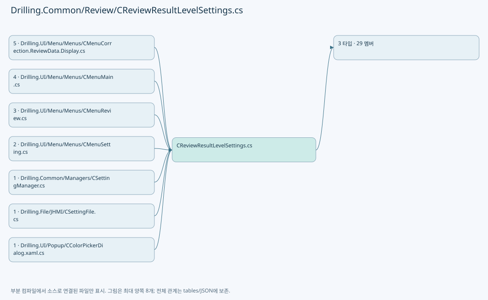
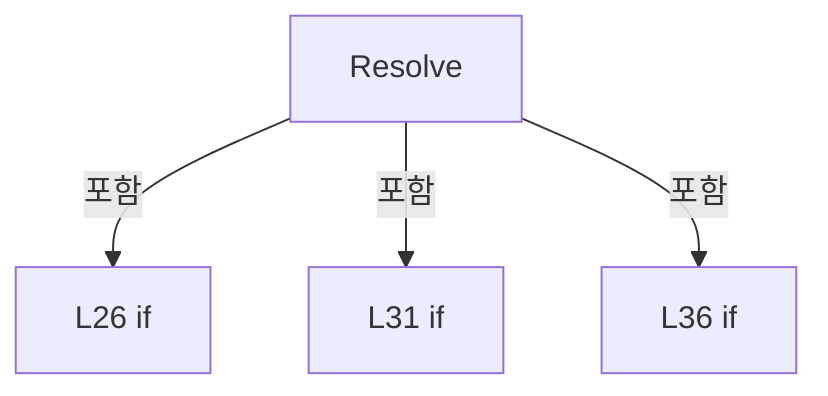
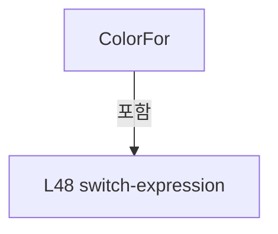
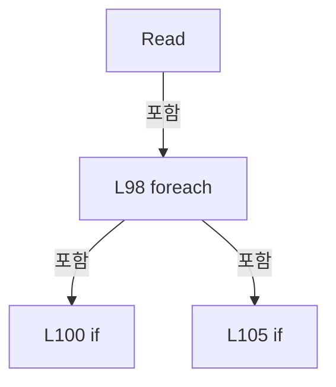
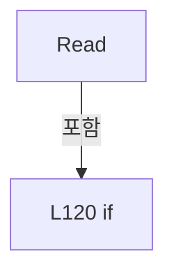
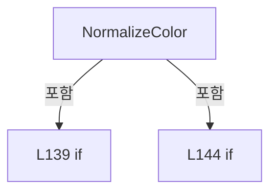
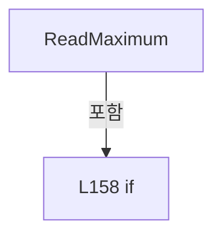

# Drilling.Common/Review/CReviewResultLevelSettings.cs

| 항목 | 내용 |
| --- | --- |
| 원본 저장소 | https://github.com/kjuws10-rgb/A3Drilling.git |
| 원본 Commit | 0219666f9053b907d96d7e0aa7d0c6c1be3a73d4 |
| 원본 SHA256 | 2e2d5efacbed39982d3eb49b8137ee70d1a18546f11dae358822584ee0e95c39 |
| 파일 분류 | code |
| 원본 크기/행 | 6,044 bytes / 175 physical lines |
| 인코딩 | utf-8-sig |
| 검토 범위 | 구문/부분 의미 분석에서 추출한 사실. 동작·물리 단위·실장비 합격을 보증하지 않습니다. |
| 원본 링크 | [고정 Commit 원본](https://github.com/kjuws10-rgb/A3Drilling/blob/0219666f9053b907d96d7e0aa7d0c6c1be3a73d4/Drilling.Common/Review/CReviewResultLevelSettings.cs) |

## 파일의 역할과 읽는 순서

리뷰 계획·측정·결과 해석 계층입니다. 물리 이동 좌표와 Vision 식별 패킷, 측정 저장의 역할을 별도로 확인합니다.

## 네임스페이스·타입·상속

| 타입 | 구분 | 원본 범위 | 선언/상속 |
| --- | --- | --- | --- |
| EN_REVIEW_RESULT_LEVEL | EnumDeclaration | 6–12 | EN_REVIEW_RESULT_LEVEL |
| ST_REVIEW_RESULT_LEVEL_SETTINGS | RecordDeclaration | 14–56 | ST_REVIEW_RESULT_LEVEL_SETTINGS |
| CReviewResultLevelSettings | ClassDeclaration | 58–175 | CReviewResultLevelSettings |

## 멤버 빠른 목록

| 이름 | 종류 | 범위 | 서명 |
| --- | --- | --- | --- |
| Level1 | EnumMemberDeclaration | L8–8 | Drilling.Common.Review.EN_REVIEW_RESULT_LEVEL.Level1 |
| Level2 | EnumMemberDeclaration | L9–9 | Drilling.Common.Review.EN_REVIEW_RESULT_LEVEL.Level2 |
| Level3 | EnumMemberDeclaration | L10–10 | Drilling.Common.Review.EN_REVIEW_RESULT_LEVEL.Level3 |
| Level4 | EnumMemberDeclaration | L11–11 | Drilling.Common.Review.EN_REVIEW_RESULT_LEVEL.Level4 |
| Resolve | MethodDeclaration | L23–44 | Drilling.Common.Review.EN_REVIEW_RESULT_LEVEL Drilling.Common.Review.ST_REVIEW_RESULT_LEVEL_SETTINGS.Resolve(double, double) |
| ColorFor | MethodDeclaration | L46–55 | string Drilling.Common.Review.ST_REVIEW_RESULT_LEVEL_SETTINGS.ColorFor(Drilling.Common.Review.EN_REVIEW_RESULT_LEVEL) |
| Level1MaximumKey | FieldDeclaration | L60–60 | string Drilling.Common.Review.CReviewResultLevelSettings.Level1MaximumKey |
| Level2MaximumKey | FieldDeclaration | L61–61 | string Drilling.Common.Review.CReviewResultLevelSettings.Level2MaximumKey |
| Level3MaximumKey | FieldDeclaration | L62–62 | string Drilling.Common.Review.CReviewResultLevelSettings.Level3MaximumKey |
| Level1ColorKey | FieldDeclaration | L63–63 | string Drilling.Common.Review.CReviewResultLevelSettings.Level1ColorKey |
| Level2ColorKey | FieldDeclaration | L64–64 | string Drilling.Common.Review.CReviewResultLevelSettings.Level2ColorKey |
| Level3ColorKey | FieldDeclaration | L65–65 | string Drilling.Common.Review.CReviewResultLevelSettings.Level3ColorKey |
| Level4ColorKey | FieldDeclaration | L66–66 | string Drilling.Common.Review.CReviewResultLevelSettings.Level4ColorKey |
| DefaultLevel1Maximum | FieldDeclaration | L68–68 | double Drilling.Common.Review.CReviewResultLevelSettings.DefaultLevel1Maximum |
| DefaultLevel2Maximum | FieldDeclaration | L69–69 | double Drilling.Common.Review.CReviewResultLevelSettings.DefaultLevel2Maximum |
| DefaultLevel3Maximum | FieldDeclaration | L70–70 | double Drilling.Common.Review.CReviewResultLevelSettings.DefaultLevel3Maximum |
| DefaultLevel1Color | FieldDeclaration | L71–71 | string Drilling.Common.Review.CReviewResultLevelSettings.DefaultLevel1Color |
| DefaultLevel2Color | FieldDeclaration | L72–72 | string Drilling.Common.Review.CReviewResultLevelSettings.DefaultLevel2Color |
| DefaultLevel3Color | FieldDeclaration | L73–73 | string Drilling.Common.Review.CReviewResultLevelSettings.DefaultLevel3Color |
| DefaultLevel4Color | FieldDeclaration | L74–74 | string Drilling.Common.Review.CReviewResultLevelSettings.DefaultLevel4Color |
| ColorKeys | FieldDeclaration | L76–78 | System.Collections.Generic.HashSet<string> Drilling.Common.Review.CReviewResultLevelSettings.ColorKeys |
| Default | PropertyDeclaration | L80–87 | Drilling.Common.Review.ST_REVIEW_RESULT_LEVEL_SETTINGS Drilling.Common.Review.CReviewResultLevelSettings.Default |
| get_Default | GetAccessorDeclaration | L80–80 | Drilling.Common.Review.ST_REVIEW_RESULT_LEVEL_SETTINGS Drilling.Common.Review.CReviewResultLevelSettings.Default.get |
| IsColorKey | MethodDeclaration | L89–92 | bool Drilling.Common.Review.CReviewResultLevelSettings.IsColorKey(string?) |
| Read | MethodDeclaration | L94–112 | Drilling.Common.Review.ST_REVIEW_RESULT_LEVEL_SETTINGS Drilling.Common.Review.CReviewResultLevelSettings.Read(System.Collections.Generic.IEnumerable<Drilling.Common.Managers.ST_SYSTEM_PARAMETER>) |
| Read | MethodDeclaration | L114–134 | Drilling.Common.Review.ST_REVIEW_RESULT_LEVEL_SETTINGS Drilling.Common.Review.CReviewResultLevelSettings.Read(System.Collections.Generic.IReadOnlyDictionary<string, string>) |
| NormalizeColor | MethodDeclaration | L136–150 | string Drilling.Common.Review.CReviewResultLevelSettings.NormalizeColor(string) |
| ReadMaximum | MethodDeclaration | L152–166 | double Drilling.Common.Review.CReviewResultLevelSettings.ReadMaximum(System.Collections.Generic.IReadOnlyDictionary<string, string>, string, double) |
| ReadColor | MethodDeclaration | L168–174 | string Drilling.Common.Review.CReviewResultLevelSettings.ReadColor(System.Collections.Generic.IReadOnlyDictionary<string, string>, string, string) |

## 멤버별 상세 계약·호출·처리 해설

### EnumMemberDeclaration `Level1` · L8–8

[Drilling.Common/Review/CReviewResultLevelSettings.cs:8–8](https://github.com/kjuws10-rgb/A3Drilling/blob/0219666f9053b907d96d7e0aa7d0c6c1be3a73d4/Drilling.Common/Review/CReviewResultLevelSettings.cs#L8-L8)

| 항목 | 실제 추출 값 |
| --- | --- |
| 서명 | Drilling.Common.Review.EN_REVIEW_RESULT_LEVEL.Level1 |
| 접근/수식자 | Public /  |
| 반환/값 타입 | Drilling.Common.Review.EN_REVIEW_RESULT_LEVEL |
| 소속 타입 | NamedType:Drilling.Common.Review.EN_REVIEW_RESULT_LEVEL |

현재 부분 분석에서 직접 연결된 호출자는 없습니다. XAML/이벤트/인터페이스·델리게이트·외부 진입을 추가 확인해야 하며, 미사용으로 판정한 것이 아닙니다.

변경 전 점검: 입력/반환 타입, 위 호출자, 예외/취소 경로, 공유 상태와 저장·전송 소비자를 함께 확인합니다. 값의 단위나 물리 방향을 이름만으로 확정하지 않습니다.

### EnumMemberDeclaration `Level2` · L9–9

[Drilling.Common/Review/CReviewResultLevelSettings.cs:9–9](https://github.com/kjuws10-rgb/A3Drilling/blob/0219666f9053b907d96d7e0aa7d0c6c1be3a73d4/Drilling.Common/Review/CReviewResultLevelSettings.cs#L9-L9)

| 항목 | 실제 추출 값 |
| --- | --- |
| 서명 | Drilling.Common.Review.EN_REVIEW_RESULT_LEVEL.Level2 |
| 접근/수식자 | Public /  |
| 반환/값 타입 | Drilling.Common.Review.EN_REVIEW_RESULT_LEVEL |
| 소속 타입 | NamedType:Drilling.Common.Review.EN_REVIEW_RESULT_LEVEL |

현재 부분 분석에서 직접 연결된 호출자는 없습니다. XAML/이벤트/인터페이스·델리게이트·외부 진입을 추가 확인해야 하며, 미사용으로 판정한 것이 아닙니다.

변경 전 점검: 입력/반환 타입, 위 호출자, 예외/취소 경로, 공유 상태와 저장·전송 소비자를 함께 확인합니다. 값의 단위나 물리 방향을 이름만으로 확정하지 않습니다.

### EnumMemberDeclaration `Level3` · L10–10

[Drilling.Common/Review/CReviewResultLevelSettings.cs:10–10](https://github.com/kjuws10-rgb/A3Drilling/blob/0219666f9053b907d96d7e0aa7d0c6c1be3a73d4/Drilling.Common/Review/CReviewResultLevelSettings.cs#L10-L10)

| 항목 | 실제 추출 값 |
| --- | --- |
| 서명 | Drilling.Common.Review.EN_REVIEW_RESULT_LEVEL.Level3 |
| 접근/수식자 | Public /  |
| 반환/값 타입 | Drilling.Common.Review.EN_REVIEW_RESULT_LEVEL |
| 소속 타입 | NamedType:Drilling.Common.Review.EN_REVIEW_RESULT_LEVEL |

현재 부분 분석에서 직접 연결된 호출자는 없습니다. XAML/이벤트/인터페이스·델리게이트·외부 진입을 추가 확인해야 하며, 미사용으로 판정한 것이 아닙니다.

변경 전 점검: 입력/반환 타입, 위 호출자, 예외/취소 경로, 공유 상태와 저장·전송 소비자를 함께 확인합니다. 값의 단위나 물리 방향을 이름만으로 확정하지 않습니다.

### EnumMemberDeclaration `Level4` · L11–11

[Drilling.Common/Review/CReviewResultLevelSettings.cs:11–11](https://github.com/kjuws10-rgb/A3Drilling/blob/0219666f9053b907d96d7e0aa7d0c6c1be3a73d4/Drilling.Common/Review/CReviewResultLevelSettings.cs#L11-L11)

| 항목 | 실제 추출 값 |
| --- | --- |
| 서명 | Drilling.Common.Review.EN_REVIEW_RESULT_LEVEL.Level4 |
| 접근/수식자 | Public /  |
| 반환/값 타입 | Drilling.Common.Review.EN_REVIEW_RESULT_LEVEL |
| 소속 타입 | NamedType:Drilling.Common.Review.EN_REVIEW_RESULT_LEVEL |

현재 부분 분석에서 직접 연결된 호출자는 없습니다. XAML/이벤트/인터페이스·델리게이트·외부 진입을 추가 확인해야 하며, 미사용으로 판정한 것이 아닙니다.

변경 전 점검: 입력/반환 타입, 위 호출자, 예외/취소 경로, 공유 상태와 저장·전송 소비자를 함께 확인합니다. 값의 단위나 물리 방향을 이름만으로 확정하지 않습니다.

### MethodDeclaration `Resolve` · L23–44

[Drilling.Common/Review/CReviewResultLevelSettings.cs:23–44](https://github.com/kjuws10-rgb/A3Drilling/blob/0219666f9053b907d96d7e0aa7d0c6c1be3a73d4/Drilling.Common/Review/CReviewResultLevelSettings.cs#L23-L44)

| 항목 | 실제 추출 값 |
| --- | --- |
| 서명 | Drilling.Common.Review.EN_REVIEW_RESULT_LEVEL Drilling.Common.Review.ST_REVIEW_RESULT_LEVEL_SETTINGS.Resolve(double, double) |
| 접근/수식자 | Public / public |
| 반환/값 타입 | Drilling.Common.Review.EN_REVIEW_RESULT_LEVEL |
| 소속 타입 | NamedType:Drilling.Common.Review.ST_REVIEW_RESULT_LEVEL_SETTINGS |

입력 계약:

| 이름 | 타입 | 전달 | 선택/기본값 |
| --- | --- | --- | --- |
| resultX | double | None | False /  |
| resultY | double | None | False /  |

정적 호출자로 확인된 위치:

| 호출 파일/행 | 호출 표현식 | 런타임 분기 가능 |
| --- | --- | --- |
| [Drilling.UI/Menu/Menus/CMenuCorrection.ReviewData.Display.cs:284–284](https://github.com/kjuws10-rgb/A3Drilling/blob/0219666f9053b907d96d7e0aa7d0c6c1be3a73d4/Drilling.UI/Menu/Menus/CMenuCorrection.ReviewData.Display.cs#L284-L284) | levelSettings.Resolve | False |
| [Drilling.UI/Menu/Menus/CMenuMain.cs:2436–2436](https://github.com/kjuws10-rgb/A3Drilling/blob/0219666f9053b907d96d7e0aa7d0c6c1be3a73d4/Drilling.UI/Menu/Menus/CMenuMain.cs#L2436-L2436) | settings.Resolve | False |
| [Drilling.UI/Menu/Menus/CMenuReview.cs:5007–5007](https://github.com/kjuws10-rgb/A3Drilling/blob/0219666f9053b907d96d7e0aa7d0c6c1be3a73d4/Drilling.UI/Menu/Menus/CMenuReview.cs#L5007-L5007) | _reviewLevelSettings.Resolve | False |

호출하는 대상과 해석 범위:

| 원본 행 | 표현식 | 분석 상태 | 대상/소스 위치 |
| --- | --- | --- | --- |
| 25 | Math.Max | resolved | double System.Math.Max(double, double) |
| 25 | Math.Abs | resolved | double System.Math.Abs(double) |
| 25 | Math.Abs | resolved | double System.Math.Abs(double) |
| 26 | double.IsFinite | resolved | bool double.IsFinite(double) |

본문의 실제 연산·분기·예외·반환 순서(원문 위치 순):

| 원본 행 | 종류 | 주석 해설 |
| --- | --- | --- |
| 25 | call | 함수·델리게이트 또는 객체 생성자를 호출합니다: Math.Max(Math.Abs(resultX), Math.Abs(resultY)) |
| 25 | call | 함수·델리게이트 또는 객체 생성자를 호출합니다: Math.Abs(resultX) |
| 25 | call | 함수·델리게이트 또는 객체 생성자를 호출합니다: Math.Abs(resultY) |
| 25 | local-declaration | 지역 변수를 선언합니다: var magnitude = Math.Max(Math.Abs(resultX), Math.Abs(resultY)); |
| 25 | variable-initializer | 변수의 초기값을 지정합니다: magnitude = Math.Max(Math.Abs(resultX), Math.Abs(resultY)) |
| 26 | call | 함수·델리게이트 또는 객체 생성자를 호출합니다: double.IsFinite(magnitude) |
| 26 | if | 조건에 따라 분기합니다: if (!double.IsFinite(magnitude)) |
| 28 | return | 호출자에게 값 또는 제어를 반환합니다: return EN_REVIEW_RESULT_LEVEL.Level4; |
| 31 | if | 조건에 따라 분기합니다: if (magnitude <= Level1Maximum) |
| 33 | return | 호출자에게 값 또는 제어를 반환합니다: return EN_REVIEW_RESULT_LEVEL.Level1; |
| 36 | if | 조건에 따라 분기합니다: if (magnitude <= Level2Maximum) |
| 38 | return | 호출자에게 값 또는 제어를 반환합니다: return EN_REVIEW_RESULT_LEVEL.Level2; |
| 41 | conditional-expression | 조건에 따라 결과식을 선택합니다: magnitude <= Level3Maximum ? EN_REVIEW_RESULT_LEVEL.Level3 : EN_REVIEW_RESULT_LEVEL.Level4 |
| 41 | return | 호출자에게 값 또는 제어를 반환합니다: return magnitude <= Level3Maximum ? EN_REVIEW_RESULT_LEVEL.Level3 : EN_REVIEW_RESULT_LEVEL.Level4; |

제어 구문의 포함 구조(실제 실행 순서/CFG가 아닌 구문 탐색 그림):

변경 전 점검: 입력/반환 타입, 위 호출자, 예외/취소 경로, 공유 상태와 저장·전송 소비자를 함께 확인합니다. 값의 단위나 물리 방향을 이름만으로 확정하지 않습니다.

### MethodDeclaration `ColorFor` · L46–55

[Drilling.Common/Review/CReviewResultLevelSettings.cs:46–55](https://github.com/kjuws10-rgb/A3Drilling/blob/0219666f9053b907d96d7e0aa7d0c6c1be3a73d4/Drilling.Common/Review/CReviewResultLevelSettings.cs#L46-L55)

| 항목 | 실제 추출 값 |
| --- | --- |
| 서명 | string Drilling.Common.Review.ST_REVIEW_RESULT_LEVEL_SETTINGS.ColorFor(Drilling.Common.Review.EN_REVIEW_RESULT_LEVEL) |
| 접근/수식자 | Public / public |
| 반환/값 타입 | string |
| 소속 타입 | NamedType:Drilling.Common.Review.ST_REVIEW_RESULT_LEVEL_SETTINGS |

입력 계약:

| 이름 | 타입 | 전달 | 선택/기본값 |
| --- | --- | --- | --- |
| level | Drilling.Common.Review.EN_REVIEW_RESULT_LEVEL | None | False /  |

정적 호출자로 확인된 위치:

| 호출 파일/행 | 호출 표현식 | 런타임 분기 가능 |
| --- | --- | --- |
| [Drilling.UI/Menu/Menus/CMenuCorrection.ReviewData.Display.cs:300–300](https://github.com/kjuws10-rgb/A3Drilling/blob/0219666f9053b907d96d7e0aa7d0c6c1be3a73d4/Drilling.UI/Menu/Menus/CMenuCorrection.ReviewData.Display.cs#L300-L300) | levelSettings.ColorFor | False |
| [Drilling.UI/Menu/Menus/CMenuCorrection.ReviewData.Display.cs:1083–1083](https://github.com/kjuws10-rgb/A3Drilling/blob/0219666f9053b907d96d7e0aa7d0c6c1be3a73d4/Drilling.UI/Menu/Menus/CMenuCorrection.ReviewData.Display.cs#L1083-L1083) | levelSettings!.ColorFor | False |
| [Drilling.UI/Menu/Menus/CMenuMain.cs:2437–2437](https://github.com/kjuws10-rgb/A3Drilling/blob/0219666f9053b907d96d7e0aa7d0c6c1be3a73d4/Drilling.UI/Menu/Menus/CMenuMain.cs#L2437-L2437) | settings.ColorFor | False |

본문의 실제 연산·분기·예외·반환 순서(원문 위치 순):

| 원본 행 | 종류 | 주석 해설 |
| --- | --- | --- |
| 48 | return | 호출자에게 값 또는 제어를 반환합니다: return level switch { EN_REVIEW_RESULT_LEVEL.Level1 => Level1Color, EN_REVIEW_RESULT_LEVEL.Level2 => Level2Color, EN_REVIEW_RESULT_LEVEL.Level3 => Level3Color, _ => Level4Color }; |
| 48 | switch-expression | 값별 결과식을 선택합니다: level switch { EN_REVIEW_RESULT_LEVEL.Level1 => Level1Color, EN_REVIEW_RESULT_LEVEL.Level2 => Level2Color, EN_REVIEW_RESULT_LEVEL.Level3 => Level3Color, _ => Level4Color } |

제어 구문의 포함 구조(실제 실행 순서/CFG가 아닌 구문 탐색 그림):

변경 전 점검: 입력/반환 타입, 위 호출자, 예외/취소 경로, 공유 상태와 저장·전송 소비자를 함께 확인합니다. 값의 단위나 물리 방향을 이름만으로 확정하지 않습니다.

### FieldDeclaration `Level1MaximumKey` · L60–60

[Drilling.Common/Review/CReviewResultLevelSettings.cs:60–60](https://github.com/kjuws10-rgb/A3Drilling/blob/0219666f9053b907d96d7e0aa7d0c6c1be3a73d4/Drilling.Common/Review/CReviewResultLevelSettings.cs#L60-L60)

| 항목 | 실제 추출 값 |
| --- | --- |
| 서명 | string Drilling.Common.Review.CReviewResultLevelSettings.Level1MaximumKey |
| 접근/수식자 | Public / public, const |
| 반환/값 타입 | string |
| 소속 타입 | NamedType:Drilling.Common.Review.CReviewResultLevelSettings |

현재 부분 분석에서 직접 연결된 호출자는 없습니다. XAML/이벤트/인터페이스·델리게이트·외부 진입을 추가 확인해야 하며, 미사용으로 판정한 것이 아닙니다.

본문의 실제 연산·분기·예외·반환 순서(원문 위치 순):

| 원본 행 | 종류 | 주석 해설 |
| --- | --- | --- |
| 60 | variable-initializer | 변수의 초기값을 지정합니다: Level1MaximumKey = "REVIEW_LEVEL1_MAX" |

변경 전 점검: 입력/반환 타입, 위 호출자, 예외/취소 경로, 공유 상태와 저장·전송 소비자를 함께 확인합니다. 값의 단위나 물리 방향을 이름만으로 확정하지 않습니다.

### FieldDeclaration `Level2MaximumKey` · L61–61

[Drilling.Common/Review/CReviewResultLevelSettings.cs:61–61](https://github.com/kjuws10-rgb/A3Drilling/blob/0219666f9053b907d96d7e0aa7d0c6c1be3a73d4/Drilling.Common/Review/CReviewResultLevelSettings.cs#L61-L61)

| 항목 | 실제 추출 값 |
| --- | --- |
| 서명 | string Drilling.Common.Review.CReviewResultLevelSettings.Level2MaximumKey |
| 접근/수식자 | Public / public, const |
| 반환/값 타입 | string |
| 소속 타입 | NamedType:Drilling.Common.Review.CReviewResultLevelSettings |

현재 부분 분석에서 직접 연결된 호출자는 없습니다. XAML/이벤트/인터페이스·델리게이트·외부 진입을 추가 확인해야 하며, 미사용으로 판정한 것이 아닙니다.

본문의 실제 연산·분기·예외·반환 순서(원문 위치 순):

| 원본 행 | 종류 | 주석 해설 |
| --- | --- | --- |
| 61 | variable-initializer | 변수의 초기값을 지정합니다: Level2MaximumKey = "REVIEW_LEVEL2_MAX" |

변경 전 점검: 입력/반환 타입, 위 호출자, 예외/취소 경로, 공유 상태와 저장·전송 소비자를 함께 확인합니다. 값의 단위나 물리 방향을 이름만으로 확정하지 않습니다.

### FieldDeclaration `Level3MaximumKey` · L62–62

[Drilling.Common/Review/CReviewResultLevelSettings.cs:62–62](https://github.com/kjuws10-rgb/A3Drilling/blob/0219666f9053b907d96d7e0aa7d0c6c1be3a73d4/Drilling.Common/Review/CReviewResultLevelSettings.cs#L62-L62)

| 항목 | 실제 추출 값 |
| --- | --- |
| 서명 | string Drilling.Common.Review.CReviewResultLevelSettings.Level3MaximumKey |
| 접근/수식자 | Public / public, const |
| 반환/값 타입 | string |
| 소속 타입 | NamedType:Drilling.Common.Review.CReviewResultLevelSettings |

현재 부분 분석에서 직접 연결된 호출자는 없습니다. XAML/이벤트/인터페이스·델리게이트·외부 진입을 추가 확인해야 하며, 미사용으로 판정한 것이 아닙니다.

본문의 실제 연산·분기·예외·반환 순서(원문 위치 순):

| 원본 행 | 종류 | 주석 해설 |
| --- | --- | --- |
| 62 | variable-initializer | 변수의 초기값을 지정합니다: Level3MaximumKey = "REVIEW_LEVEL3_MAX" |

변경 전 점검: 입력/반환 타입, 위 호출자, 예외/취소 경로, 공유 상태와 저장·전송 소비자를 함께 확인합니다. 값의 단위나 물리 방향을 이름만으로 확정하지 않습니다.

### FieldDeclaration `Level1ColorKey` · L63–63

[Drilling.Common/Review/CReviewResultLevelSettings.cs:63–63](https://github.com/kjuws10-rgb/A3Drilling/blob/0219666f9053b907d96d7e0aa7d0c6c1be3a73d4/Drilling.Common/Review/CReviewResultLevelSettings.cs#L63-L63)

| 항목 | 실제 추출 값 |
| --- | --- |
| 서명 | string Drilling.Common.Review.CReviewResultLevelSettings.Level1ColorKey |
| 접근/수식자 | Public / public, const |
| 반환/값 타입 | string |
| 소속 타입 | NamedType:Drilling.Common.Review.CReviewResultLevelSettings |

현재 부분 분석에서 직접 연결된 호출자는 없습니다. XAML/이벤트/인터페이스·델리게이트·외부 진입을 추가 확인해야 하며, 미사용으로 판정한 것이 아닙니다.

본문의 실제 연산·분기·예외·반환 순서(원문 위치 순):

| 원본 행 | 종류 | 주석 해설 |
| --- | --- | --- |
| 63 | variable-initializer | 변수의 초기값을 지정합니다: Level1ColorKey = "REVIEW_LEVEL1_COLOR" |

변경 전 점검: 입력/반환 타입, 위 호출자, 예외/취소 경로, 공유 상태와 저장·전송 소비자를 함께 확인합니다. 값의 단위나 물리 방향을 이름만으로 확정하지 않습니다.

### FieldDeclaration `Level2ColorKey` · L64–64

[Drilling.Common/Review/CReviewResultLevelSettings.cs:64–64](https://github.com/kjuws10-rgb/A3Drilling/blob/0219666f9053b907d96d7e0aa7d0c6c1be3a73d4/Drilling.Common/Review/CReviewResultLevelSettings.cs#L64-L64)

| 항목 | 실제 추출 값 |
| --- | --- |
| 서명 | string Drilling.Common.Review.CReviewResultLevelSettings.Level2ColorKey |
| 접근/수식자 | Public / public, const |
| 반환/값 타입 | string |
| 소속 타입 | NamedType:Drilling.Common.Review.CReviewResultLevelSettings |

현재 부분 분석에서 직접 연결된 호출자는 없습니다. XAML/이벤트/인터페이스·델리게이트·외부 진입을 추가 확인해야 하며, 미사용으로 판정한 것이 아닙니다.

본문의 실제 연산·분기·예외·반환 순서(원문 위치 순):

| 원본 행 | 종류 | 주석 해설 |
| --- | --- | --- |
| 64 | variable-initializer | 변수의 초기값을 지정합니다: Level2ColorKey = "REVIEW_LEVEL2_COLOR" |

변경 전 점검: 입력/반환 타입, 위 호출자, 예외/취소 경로, 공유 상태와 저장·전송 소비자를 함께 확인합니다. 값의 단위나 물리 방향을 이름만으로 확정하지 않습니다.

### FieldDeclaration `Level3ColorKey` · L65–65

[Drilling.Common/Review/CReviewResultLevelSettings.cs:65–65](https://github.com/kjuws10-rgb/A3Drilling/blob/0219666f9053b907d96d7e0aa7d0c6c1be3a73d4/Drilling.Common/Review/CReviewResultLevelSettings.cs#L65-L65)

| 항목 | 실제 추출 값 |
| --- | --- |
| 서명 | string Drilling.Common.Review.CReviewResultLevelSettings.Level3ColorKey |
| 접근/수식자 | Public / public, const |
| 반환/값 타입 | string |
| 소속 타입 | NamedType:Drilling.Common.Review.CReviewResultLevelSettings |

현재 부분 분석에서 직접 연결된 호출자는 없습니다. XAML/이벤트/인터페이스·델리게이트·외부 진입을 추가 확인해야 하며, 미사용으로 판정한 것이 아닙니다.

본문의 실제 연산·분기·예외·반환 순서(원문 위치 순):

| 원본 행 | 종류 | 주석 해설 |
| --- | --- | --- |
| 65 | variable-initializer | 변수의 초기값을 지정합니다: Level3ColorKey = "REVIEW_LEVEL3_COLOR" |

변경 전 점검: 입력/반환 타입, 위 호출자, 예외/취소 경로, 공유 상태와 저장·전송 소비자를 함께 확인합니다. 값의 단위나 물리 방향을 이름만으로 확정하지 않습니다.

### FieldDeclaration `Level4ColorKey` · L66–66

[Drilling.Common/Review/CReviewResultLevelSettings.cs:66–66](https://github.com/kjuws10-rgb/A3Drilling/blob/0219666f9053b907d96d7e0aa7d0c6c1be3a73d4/Drilling.Common/Review/CReviewResultLevelSettings.cs#L66-L66)

| 항목 | 실제 추출 값 |
| --- | --- |
| 서명 | string Drilling.Common.Review.CReviewResultLevelSettings.Level4ColorKey |
| 접근/수식자 | Public / public, const |
| 반환/값 타입 | string |
| 소속 타입 | NamedType:Drilling.Common.Review.CReviewResultLevelSettings |

현재 부분 분석에서 직접 연결된 호출자는 없습니다. XAML/이벤트/인터페이스·델리게이트·외부 진입을 추가 확인해야 하며, 미사용으로 판정한 것이 아닙니다.

본문의 실제 연산·분기·예외·반환 순서(원문 위치 순):

| 원본 행 | 종류 | 주석 해설 |
| --- | --- | --- |
| 66 | variable-initializer | 변수의 초기값을 지정합니다: Level4ColorKey = "REVIEW_LEVEL4_COLOR" |

변경 전 점검: 입력/반환 타입, 위 호출자, 예외/취소 경로, 공유 상태와 저장·전송 소비자를 함께 확인합니다. 값의 단위나 물리 방향을 이름만으로 확정하지 않습니다.

### FieldDeclaration `DefaultLevel1Maximum` · L68–68

[Drilling.Common/Review/CReviewResultLevelSettings.cs:68–68](https://github.com/kjuws10-rgb/A3Drilling/blob/0219666f9053b907d96d7e0aa7d0c6c1be3a73d4/Drilling.Common/Review/CReviewResultLevelSettings.cs#L68-L68)

| 항목 | 실제 추출 값 |
| --- | --- |
| 서명 | double Drilling.Common.Review.CReviewResultLevelSettings.DefaultLevel1Maximum |
| 접근/수식자 | Public / public, const |
| 반환/값 타입 | double |
| 소속 타입 | NamedType:Drilling.Common.Review.CReviewResultLevelSettings |

현재 부분 분석에서 직접 연결된 호출자는 없습니다. XAML/이벤트/인터페이스·델리게이트·외부 진입을 추가 확인해야 하며, 미사용으로 판정한 것이 아닙니다.

본문의 실제 연산·분기·예외·반환 순서(원문 위치 순):

| 원본 행 | 종류 | 주석 해설 |
| --- | --- | --- |
| 68 | variable-initializer | 변수의 초기값을 지정합니다: DefaultLevel1Maximum = 0.010 |

변경 전 점검: 입력/반환 타입, 위 호출자, 예외/취소 경로, 공유 상태와 저장·전송 소비자를 함께 확인합니다. 값의 단위나 물리 방향을 이름만으로 확정하지 않습니다.

### FieldDeclaration `DefaultLevel2Maximum` · L69–69

[Drilling.Common/Review/CReviewResultLevelSettings.cs:69–69](https://github.com/kjuws10-rgb/A3Drilling/blob/0219666f9053b907d96d7e0aa7d0c6c1be3a73d4/Drilling.Common/Review/CReviewResultLevelSettings.cs#L69-L69)

| 항목 | 실제 추출 값 |
| --- | --- |
| 서명 | double Drilling.Common.Review.CReviewResultLevelSettings.DefaultLevel2Maximum |
| 접근/수식자 | Public / public, const |
| 반환/값 타입 | double |
| 소속 타입 | NamedType:Drilling.Common.Review.CReviewResultLevelSettings |

현재 부분 분석에서 직접 연결된 호출자는 없습니다. XAML/이벤트/인터페이스·델리게이트·외부 진입을 추가 확인해야 하며, 미사용으로 판정한 것이 아닙니다.

본문의 실제 연산·분기·예외·반환 순서(원문 위치 순):

| 원본 행 | 종류 | 주석 해설 |
| --- | --- | --- |
| 69 | variable-initializer | 변수의 초기값을 지정합니다: DefaultLevel2Maximum = 0.020 |

변경 전 점검: 입력/반환 타입, 위 호출자, 예외/취소 경로, 공유 상태와 저장·전송 소비자를 함께 확인합니다. 값의 단위나 물리 방향을 이름만으로 확정하지 않습니다.

### FieldDeclaration `DefaultLevel3Maximum` · L70–70

[Drilling.Common/Review/CReviewResultLevelSettings.cs:70–70](https://github.com/kjuws10-rgb/A3Drilling/blob/0219666f9053b907d96d7e0aa7d0c6c1be3a73d4/Drilling.Common/Review/CReviewResultLevelSettings.cs#L70-L70)

| 항목 | 실제 추출 값 |
| --- | --- |
| 서명 | double Drilling.Common.Review.CReviewResultLevelSettings.DefaultLevel3Maximum |
| 접근/수식자 | Public / public, const |
| 반환/값 타입 | double |
| 소속 타입 | NamedType:Drilling.Common.Review.CReviewResultLevelSettings |

현재 부분 분석에서 직접 연결된 호출자는 없습니다. XAML/이벤트/인터페이스·델리게이트·외부 진입을 추가 확인해야 하며, 미사용으로 판정한 것이 아닙니다.

본문의 실제 연산·분기·예외·반환 순서(원문 위치 순):

| 원본 행 | 종류 | 주석 해설 |
| --- | --- | --- |
| 70 | variable-initializer | 변수의 초기값을 지정합니다: DefaultLevel3Maximum = 0.030 |

변경 전 점검: 입력/반환 타입, 위 호출자, 예외/취소 경로, 공유 상태와 저장·전송 소비자를 함께 확인합니다. 값의 단위나 물리 방향을 이름만으로 확정하지 않습니다.

### FieldDeclaration `DefaultLevel1Color` · L71–71

[Drilling.Common/Review/CReviewResultLevelSettings.cs:71–71](https://github.com/kjuws10-rgb/A3Drilling/blob/0219666f9053b907d96d7e0aa7d0c6c1be3a73d4/Drilling.Common/Review/CReviewResultLevelSettings.cs#L71-L71)

| 항목 | 실제 추출 값 |
| --- | --- |
| 서명 | string Drilling.Common.Review.CReviewResultLevelSettings.DefaultLevel1Color |
| 접근/수식자 | Public / public, const |
| 반환/값 타입 | string |
| 소속 타입 | NamedType:Drilling.Common.Review.CReviewResultLevelSettings |

현재 부분 분석에서 직접 연결된 호출자는 없습니다. XAML/이벤트/인터페이스·델리게이트·외부 진입을 추가 확인해야 하며, 미사용으로 판정한 것이 아닙니다.

본문의 실제 연산·분기·예외·반환 순서(원문 위치 순):

| 원본 행 | 종류 | 주석 해설 |
| --- | --- | --- |
| 71 | variable-initializer | 변수의 초기값을 지정합니다: DefaultLevel1Color = "#22C55E" |

변경 전 점검: 입력/반환 타입, 위 호출자, 예외/취소 경로, 공유 상태와 저장·전송 소비자를 함께 확인합니다. 값의 단위나 물리 방향을 이름만으로 확정하지 않습니다.

### FieldDeclaration `DefaultLevel2Color` · L72–72

[Drilling.Common/Review/CReviewResultLevelSettings.cs:72–72](https://github.com/kjuws10-rgb/A3Drilling/blob/0219666f9053b907d96d7e0aa7d0c6c1be3a73d4/Drilling.Common/Review/CReviewResultLevelSettings.cs#L72-L72)

| 항목 | 실제 추출 값 |
| --- | --- |
| 서명 | string Drilling.Common.Review.CReviewResultLevelSettings.DefaultLevel2Color |
| 접근/수식자 | Public / public, const |
| 반환/값 타입 | string |
| 소속 타입 | NamedType:Drilling.Common.Review.CReviewResultLevelSettings |

현재 부분 분석에서 직접 연결된 호출자는 없습니다. XAML/이벤트/인터페이스·델리게이트·외부 진입을 추가 확인해야 하며, 미사용으로 판정한 것이 아닙니다.

본문의 실제 연산·분기·예외·반환 순서(원문 위치 순):

| 원본 행 | 종류 | 주석 해설 |
| --- | --- | --- |
| 72 | variable-initializer | 변수의 초기값을 지정합니다: DefaultLevel2Color = "#84CC16" |

변경 전 점검: 입력/반환 타입, 위 호출자, 예외/취소 경로, 공유 상태와 저장·전송 소비자를 함께 확인합니다. 값의 단위나 물리 방향을 이름만으로 확정하지 않습니다.

### FieldDeclaration `DefaultLevel3Color` · L73–73

[Drilling.Common/Review/CReviewResultLevelSettings.cs:73–73](https://github.com/kjuws10-rgb/A3Drilling/blob/0219666f9053b907d96d7e0aa7d0c6c1be3a73d4/Drilling.Common/Review/CReviewResultLevelSettings.cs#L73-L73)

| 항목 | 실제 추출 값 |
| --- | --- |
| 서명 | string Drilling.Common.Review.CReviewResultLevelSettings.DefaultLevel3Color |
| 접근/수식자 | Public / public, const |
| 반환/값 타입 | string |
| 소속 타입 | NamedType:Drilling.Common.Review.CReviewResultLevelSettings |

현재 부분 분석에서 직접 연결된 호출자는 없습니다. XAML/이벤트/인터페이스·델리게이트·외부 진입을 추가 확인해야 하며, 미사용으로 판정한 것이 아닙니다.

본문의 실제 연산·분기·예외·반환 순서(원문 위치 순):

| 원본 행 | 종류 | 주석 해설 |
| --- | --- | --- |
| 73 | variable-initializer | 변수의 초기값을 지정합니다: DefaultLevel3Color = "#F59E0B" |

변경 전 점검: 입력/반환 타입, 위 호출자, 예외/취소 경로, 공유 상태와 저장·전송 소비자를 함께 확인합니다. 값의 단위나 물리 방향을 이름만으로 확정하지 않습니다.

### FieldDeclaration `DefaultLevel4Color` · L74–74

[Drilling.Common/Review/CReviewResultLevelSettings.cs:74–74](https://github.com/kjuws10-rgb/A3Drilling/blob/0219666f9053b907d96d7e0aa7d0c6c1be3a73d4/Drilling.Common/Review/CReviewResultLevelSettings.cs#L74-L74)

| 항목 | 실제 추출 값 |
| --- | --- |
| 서명 | string Drilling.Common.Review.CReviewResultLevelSettings.DefaultLevel4Color |
| 접근/수식자 | Public / public, const |
| 반환/값 타입 | string |
| 소속 타입 | NamedType:Drilling.Common.Review.CReviewResultLevelSettings |

현재 부분 분석에서 직접 연결된 호출자는 없습니다. XAML/이벤트/인터페이스·델리게이트·외부 진입을 추가 확인해야 하며, 미사용으로 판정한 것이 아닙니다.

본문의 실제 연산·분기·예외·반환 순서(원문 위치 순):

| 원본 행 | 종류 | 주석 해설 |
| --- | --- | --- |
| 74 | variable-initializer | 변수의 초기값을 지정합니다: DefaultLevel4Color = "#EF4444" |

변경 전 점검: 입력/반환 타입, 위 호출자, 예외/취소 경로, 공유 상태와 저장·전송 소비자를 함께 확인합니다. 값의 단위나 물리 방향을 이름만으로 확정하지 않습니다.

### FieldDeclaration `ColorKeys` · L76–78

[Drilling.Common/Review/CReviewResultLevelSettings.cs:76–78](https://github.com/kjuws10-rgb/A3Drilling/blob/0219666f9053b907d96d7e0aa7d0c6c1be3a73d4/Drilling.Common/Review/CReviewResultLevelSettings.cs#L76-L78)

| 항목 | 실제 추출 값 |
| --- | --- |
| 서명 | System.Collections.Generic.HashSet<string> Drilling.Common.Review.CReviewResultLevelSettings.ColorKeys |
| 접근/수식자 | Private / private, static, readonly |
| 반환/값 타입 | System.Collections.Generic.HashSet<string> |
| 소속 타입 | NamedType:Drilling.Common.Review.CReviewResultLevelSettings |

현재 부분 분석에서 직접 연결된 호출자는 없습니다. XAML/이벤트/인터페이스·델리게이트·외부 진입을 추가 확인해야 하며, 미사용으로 판정한 것이 아닙니다.

호출하는 대상과 해석 범위:

| 원본 행 | 표현식 | 분석 상태 | 대상/소스 위치 |
| --- | --- | --- | --- |
| 76 | new | resolved | System.Collections.Generic.HashSet<string>.HashSet(System.Collections.Generic.IEnumerable<string>, System.Collections.Generic.IEqualityComparer<string>?) |

본문의 실제 연산·분기·예외·반환 순서(원문 위치 순):

| 원본 행 | 종류 | 주석 해설 |
| --- | --- | --- |
| 76 | call | 함수·델리게이트 또는 객체 생성자를 호출합니다: new( [Level1ColorKey, Level2ColorKey, Level3ColorKey, Level4ColorKey], StringComparer.OrdinalIgnoreCase) |
| 76 | variable-initializer | 변수의 초기값을 지정합니다: ColorKeys = new( [Level1ColorKey, Level2ColorKey, Level3ColorKey, Level4ColorKey], StringComparer.OrdinalIgnoreCase) |

변경 전 점검: 입력/반환 타입, 위 호출자, 예외/취소 경로, 공유 상태와 저장·전송 소비자를 함께 확인합니다. 값의 단위나 물리 방향을 이름만으로 확정하지 않습니다.

### PropertyDeclaration `Default` · L80–87

[Drilling.Common/Review/CReviewResultLevelSettings.cs:80–87](https://github.com/kjuws10-rgb/A3Drilling/blob/0219666f9053b907d96d7e0aa7d0c6c1be3a73d4/Drilling.Common/Review/CReviewResultLevelSettings.cs#L80-L87)

| 항목 | 실제 추출 값 |
| --- | --- |
| 서명 | Drilling.Common.Review.ST_REVIEW_RESULT_LEVEL_SETTINGS Drilling.Common.Review.CReviewResultLevelSettings.Default |
| 접근/수식자 | Public / public, static |
| 반환/값 타입 | Drilling.Common.Review.ST_REVIEW_RESULT_LEVEL_SETTINGS |
| 소속 타입 | NamedType:Drilling.Common.Review.CReviewResultLevelSettings |

현재 부분 분석에서 직접 연결된 호출자는 없습니다. XAML/이벤트/인터페이스·델리게이트·외부 진입을 추가 확인해야 하며, 미사용으로 판정한 것이 아닙니다.

호출하는 대상과 해석 범위:

| 원본 행 | 표현식 | 분석 상태 | 대상/소스 위치 |
| --- | --- | --- | --- |
| 80 | new | resolved | Drilling.Common.Review.ST_REVIEW_RESULT_LEVEL_SETTINGS.ST_REVIEW_RESULT_LEVEL_SETTINGS(double, double, double, string, string, string, string) · Drilling.Common/Review/CReviewResultLevelSettings.cs:14 |

본문의 실제 연산·분기·예외·반환 순서(원문 위치 순):

| 원본 행 | 종류 | 주석 해설 |
| --- | --- | --- |
| 80 | call | 함수·델리게이트 또는 객체 생성자를 호출합니다: new( DefaultLevel1Maximum, DefaultLevel2Maximum, DefaultLevel3Maximum, DefaultLevel1Color, DefaultLevel2Color, DefaultLevel3Color, DefaultLevel4Color) |

변경 전 점검: 입력/반환 타입, 위 호출자, 예외/취소 경로, 공유 상태와 저장·전송 소비자를 함께 확인합니다. 값의 단위나 물리 방향을 이름만으로 확정하지 않습니다.

### GetAccessorDeclaration `get_Default` · L80–80

[Drilling.Common/Review/CReviewResultLevelSettings.cs:80–80](https://github.com/kjuws10-rgb/A3Drilling/blob/0219666f9053b907d96d7e0aa7d0c6c1be3a73d4/Drilling.Common/Review/CReviewResultLevelSettings.cs#L80-L80)

| 항목 | 실제 추출 값 |
| --- | --- |
| 서명 | Drilling.Common.Review.ST_REVIEW_RESULT_LEVEL_SETTINGS Drilling.Common.Review.CReviewResultLevelSettings.Default.get |
| 접근/수식자 | Public / get |
| 반환/값 타입 | Drilling.Common.Review.ST_REVIEW_RESULT_LEVEL_SETTINGS |
| 소속 타입 | NamedType:Drilling.Common.Review.CReviewResultLevelSettings |

현재 부분 분석에서 직접 연결된 호출자는 없습니다. XAML/이벤트/인터페이스·델리게이트·외부 진입을 추가 확인해야 하며, 미사용으로 판정한 것이 아닙니다.

변경 전 점검: 입력/반환 타입, 위 호출자, 예외/취소 경로, 공유 상태와 저장·전송 소비자를 함께 확인합니다. 값의 단위나 물리 방향을 이름만으로 확정하지 않습니다.

### MethodDeclaration `IsColorKey` · L89–92

[Drilling.Common/Review/CReviewResultLevelSettings.cs:89–92](https://github.com/kjuws10-rgb/A3Drilling/blob/0219666f9053b907d96d7e0aa7d0c6c1be3a73d4/Drilling.Common/Review/CReviewResultLevelSettings.cs#L89-L92)

| 항목 | 실제 추출 값 |
| --- | --- |
| 서명 | bool Drilling.Common.Review.CReviewResultLevelSettings.IsColorKey(string?) |
| 접근/수식자 | Public / public, static |
| 반환/값 타입 | bool |
| 소속 타입 | NamedType:Drilling.Common.Review.CReviewResultLevelSettings |

입력 계약:

| 이름 | 타입 | 전달 | 선택/기본값 |
| --- | --- | --- | --- |
| key | string? | None | False /  |

정적 호출자로 확인된 위치:

| 호출 파일/행 | 호출 표현식 | 런타임 분기 가능 |
| --- | --- | --- |
| [Drilling.UI/Menu/Menus/CMenuSetting.cs:1180–1180](https://github.com/kjuws10-rgb/A3Drilling/blob/0219666f9053b907d96d7e0aa7d0c6c1be3a73d4/Drilling.UI/Menu/Menus/CMenuSetting.cs#L1180-L1180) | CReviewResultLevelSettings.IsColorKey | False |

호출하는 대상과 해석 범위:

| 원본 행 | 표현식 | 분석 상태 | 대상/소스 위치 |
| --- | --- | --- | --- |
| 91 | string.IsNullOrWhiteSpace | resolved | bool string.IsNullOrWhiteSpace(string?) |
| 91 | ColorKeys.Contains | resolved | bool System.Collections.Generic.HashSet<string>.Contains(string) |

본문의 실제 연산·분기·예외·반환 순서(원문 위치 순):

| 원본 행 | 종류 | 주석 해설 |
| --- | --- | --- |
| 91 | call | 함수·델리게이트 또는 객체 생성자를 호출합니다: string.IsNullOrWhiteSpace(key) |
| 91 | call | 함수·델리게이트 또는 객체 생성자를 호출합니다: ColorKeys.Contains(key) |
| 91 | return | 호출자에게 값 또는 제어를 반환합니다: return !string.IsNullOrWhiteSpace(key) && ColorKeys.Contains(key); |

변경 전 점검: 입력/반환 타입, 위 호출자, 예외/취소 경로, 공유 상태와 저장·전송 소비자를 함께 확인합니다. 값의 단위나 물리 방향을 이름만으로 확정하지 않습니다.

### MethodDeclaration `Read` · L94–112

[Drilling.Common/Review/CReviewResultLevelSettings.cs:94–112](https://github.com/kjuws10-rgb/A3Drilling/blob/0219666f9053b907d96d7e0aa7d0c6c1be3a73d4/Drilling.Common/Review/CReviewResultLevelSettings.cs#L94-L112)

| 항목 | 실제 추출 값 |
| --- | --- |
| 서명 | Drilling.Common.Review.ST_REVIEW_RESULT_LEVEL_SETTINGS Drilling.Common.Review.CReviewResultLevelSettings.Read(System.Collections.Generic.IEnumerable<Drilling.Common.Managers.ST_SYSTEM_PARAMETER>) |
| 접근/수식자 | Public / public, static |
| 반환/값 타입 | Drilling.Common.Review.ST_REVIEW_RESULT_LEVEL_SETTINGS |
| 소속 타입 | NamedType:Drilling.Common.Review.CReviewResultLevelSettings |

입력 계약:

| 이름 | 타입 | 전달 | 선택/기본값 |
| --- | --- | --- | --- |
| parameters | System.Collections.Generic.IEnumerable<Drilling.Common.Managers.ST_SYSTEM_PARAMETER> | None | False /  |

정적 호출자로 확인된 위치:

| 호출 파일/행 | 호출 표현식 | 런타임 분기 가능 |
| --- | --- | --- |
| [Drilling.Common/Managers/CSettingManager.cs:143–143](https://github.com/kjuws10-rgb/A3Drilling/blob/0219666f9053b907d96d7e0aa7d0c6c1be3a73d4/Drilling.Common/Managers/CSettingManager.cs#L143-L143) | CReviewResultLevelSettings.Read | False |
| [Drilling.File/JHMI/CSettingFile.cs:450–450](https://github.com/kjuws10-rgb/A3Drilling/blob/0219666f9053b907d96d7e0aa7d0c6c1be3a73d4/Drilling.File/JHMI/CSettingFile.cs#L450-L450) | CReviewResultLevelSettings.Read | False |
| [Drilling.UI/Menu/Menus/CMenuMain.cs:2366–2366](https://github.com/kjuws10-rgb/A3Drilling/blob/0219666f9053b907d96d7e0aa7d0c6c1be3a73d4/Drilling.UI/Menu/Menus/CMenuMain.cs#L2366-L2366) | CReviewResultLevelSettings.Read | False |
| [Drilling.UI/Menu/Menus/CMenuReview.cs:4754–4754](https://github.com/kjuws10-rgb/A3Drilling/blob/0219666f9053b907d96d7e0aa7d0c6c1be3a73d4/Drilling.UI/Menu/Menus/CMenuReview.cs#L4754-L4754) | CReviewResultLevelSettings.Read | False |

호출하는 대상과 해석 범위:

| 원본 행 | 표현식 | 분석 상태 | 대상/소스 위치 |
| --- | --- | --- | --- |
| 96 | ArgumentNullException.ThrowIfNull | resolved | void System.ArgumentNullException.ThrowIfNull(object?, string?) |
| 97 | new Dictionary<string, string> | resolved | System.Collections.Generic.Dictionary<string, string>.Dictionary(System.Collections.Generic.IEqualityComparer<string>?) |
| 100 | string.IsNullOrWhiteSpace | resolved | bool string.IsNullOrWhiteSpace(string?) |
| 105 | string.IsNullOrWhiteSpace | resolved | bool string.IsNullOrWhiteSpace(string?) |
| 107 | values.TryAdd | resolved | bool System.Collections.Generic.Dictionary<string, string>.TryAdd(string, string) |
| 111 | Read | resolved | Drilling.Common.Review.ST_REVIEW_RESULT_LEVEL_SETTINGS Drilling.Common.Review.CReviewResultLevelSettings.Read(System.Collections.Generic.IReadOnlyDictionary<string, string>) · Drilling.Common/Review/CReviewResultLevelSettings.cs:114 |

본문의 실제 연산·분기·예외·반환 순서(원문 위치 순):

| 원본 행 | 종류 | 주석 해설 |
| --- | --- | --- |
| 96 | call | 함수·델리게이트 또는 객체 생성자를 호출합니다: ArgumentNullException.ThrowIfNull(parameters) |
| 97 | call | 함수·델리게이트 또는 객체 생성자를 호출합니다: new Dictionary<string, string>(StringComparer.OrdinalIgnoreCase) |
| 97 | local-declaration | 지역 변수를 선언합니다: var values = new Dictionary<string, string>(StringComparer.OrdinalIgnoreCase); |
| 97 | variable-initializer | 변수의 초기값을 지정합니다: values = new Dictionary<string, string>(StringComparer.OrdinalIgnoreCase) |
| 98 | foreach | 컬렉션 요소를 순회합니다: foreach (var parameter in parameters) |
| 100 | call | 함수·델리게이트 또는 객체 생성자를 호출합니다: string.IsNullOrWhiteSpace(parameter.Key) |
| 100 | if | 조건에 따라 분기합니다: if (!string.IsNullOrWhiteSpace(parameter.Key)) |
| 102 | assignment | 값을 대상에 대입합니다: values[parameter.Key] = parameter.Value |
| 105 | call | 함수·델리게이트 또는 객체 생성자를 호출합니다: string.IsNullOrWhiteSpace(parameter.Name) |
| 105 | if | 조건에 따라 분기합니다: if (!string.IsNullOrWhiteSpace(parameter.Name)) |
| 107 | call | 함수·델리게이트 또는 객체 생성자를 호출합니다: values.TryAdd(parameter.Name, parameter.Value) |
| 111 | call | 함수·델리게이트 또는 객체 생성자를 호출합니다: Read(values) |
| 111 | return | 호출자에게 값 또는 제어를 반환합니다: return Read(values); |

제어 구문의 포함 구조(실제 실행 순서/CFG가 아닌 구문 탐색 그림):

변경 전 점검: 입력/반환 타입, 위 호출자, 예외/취소 경로, 공유 상태와 저장·전송 소비자를 함께 확인합니다. 값의 단위나 물리 방향을 이름만으로 확정하지 않습니다.

### MethodDeclaration `Read` · L114–134

[Drilling.Common/Review/CReviewResultLevelSettings.cs:114–134](https://github.com/kjuws10-rgb/A3Drilling/blob/0219666f9053b907d96d7e0aa7d0c6c1be3a73d4/Drilling.Common/Review/CReviewResultLevelSettings.cs#L114-L134)

| 항목 | 실제 추출 값 |
| --- | --- |
| 서명 | Drilling.Common.Review.ST_REVIEW_RESULT_LEVEL_SETTINGS Drilling.Common.Review.CReviewResultLevelSettings.Read(System.Collections.Generic.IReadOnlyDictionary<string, string>) |
| 접근/수식자 | Public / public, static |
| 반환/값 타입 | Drilling.Common.Review.ST_REVIEW_RESULT_LEVEL_SETTINGS |
| 소속 타입 | NamedType:Drilling.Common.Review.CReviewResultLevelSettings |

입력 계약:

| 이름 | 타입 | 전달 | 선택/기본값 |
| --- | --- | --- | --- |
| values | System.Collections.Generic.IReadOnlyDictionary<string, string> | None | False /  |

정적 호출자로 확인된 위치:

| 호출 파일/행 | 호출 표현식 | 런타임 분기 가능 |
| --- | --- | --- |
| [Drilling.Common/Review/CReviewResultLevelSettings.cs:111–111](https://github.com/kjuws10-rgb/A3Drilling/blob/0219666f9053b907d96d7e0aa7d0c6c1be3a73d4/Drilling.Common/Review/CReviewResultLevelSettings.cs#L111-L111) | Read | False |
| [Drilling.UI/Menu/Menus/CMenuCorrection.ReviewData.Display.cs:252–252](https://github.com/kjuws10-rgb/A3Drilling/blob/0219666f9053b907d96d7e0aa7d0c6c1be3a73d4/Drilling.UI/Menu/Menus/CMenuCorrection.ReviewData.Display.cs#L252-L252) | CReviewResultLevelSettings.Read | False |

호출하는 대상과 해석 범위:

| 원본 행 | 표현식 | 분석 상태 | 대상/소스 위치 |
| --- | --- | --- | --- |
| 116 | ArgumentNullException.ThrowIfNull | resolved | void System.ArgumentNullException.ThrowIfNull(object?, string?) |
| 117 | ReadMaximum | resolved | double Drilling.Common.Review.CReviewResultLevelSettings.ReadMaximum(System.Collections.Generic.IReadOnlyDictionary<string, string>, string, double) · Drilling.Common/Review/CReviewResultLevelSettings.cs:152 |
| 118 | ReadMaximum | resolved | double Drilling.Common.Review.CReviewResultLevelSettings.ReadMaximum(System.Collections.Generic.IReadOnlyDictionary<string, string>, string, double) · Drilling.Common/Review/CReviewResultLevelSettings.cs:152 |
| 119 | ReadMaximum | resolved | double Drilling.Common.Review.CReviewResultLevelSettings.ReadMaximum(System.Collections.Generic.IReadOnlyDictionary<string, string>, string, double) · Drilling.Common/Review/CReviewResultLevelSettings.cs:152 |
| 122 | new InvalidDataException | resolved | System.IO.InvalidDataException.InvalidDataException(string?) |
| 126 | new ST_REVIEW_RESULT_LEVEL_SETTINGS | resolved | Drilling.Common.Review.ST_REVIEW_RESULT_LEVEL_SETTINGS.ST_REVIEW_RESULT_LEVEL_SETTINGS(double, double, double, string, string, string, string) · Drilling.Common/Review/CReviewResultLevelSettings.cs:14 |
| 130 | ReadColor | resolved | string Drilling.Common.Review.CReviewResultLevelSettings.ReadColor(System.Collections.Generic.IReadOnlyDictionary<string, string>, string, string) · Drilling.Common/Review/CReviewResultLevelSettings.cs:168 |
| 131 | ReadColor | resolved | string Drilling.Common.Review.CReviewResultLevelSettings.ReadColor(System.Collections.Generic.IReadOnlyDictionary<string, string>, string, string) · Drilling.Common/Review/CReviewResultLevelSettings.cs:168 |
| 132 | ReadColor | resolved | string Drilling.Common.Review.CReviewResultLevelSettings.ReadColor(System.Collections.Generic.IReadOnlyDictionary<string, string>, string, string) · Drilling.Common/Review/CReviewResultLevelSettings.cs:168 |
| 133 | ReadColor | resolved | string Drilling.Common.Review.CReviewResultLevelSettings.ReadColor(System.Collections.Generic.IReadOnlyDictionary<string, string>, string, string) · Drilling.Common/Review/CReviewResultLevelSettings.cs:168 |

본문의 실제 연산·분기·예외·반환 순서(원문 위치 순):

| 원본 행 | 종류 | 주석 해설 |
| --- | --- | --- |
| 116 | call | 함수·델리게이트 또는 객체 생성자를 호출합니다: ArgumentNullException.ThrowIfNull(values) |
| 117 | call | 함수·델리게이트 또는 객체 생성자를 호출합니다: ReadMaximum(values, Level1MaximumKey, DefaultLevel1Maximum) |
| 117 | local-declaration | 지역 변수를 선언합니다: var level1 = ReadMaximum(values, Level1MaximumKey, DefaultLevel1Maximum); |
| 117 | variable-initializer | 변수의 초기값을 지정합니다: level1 = ReadMaximum(values, Level1MaximumKey, DefaultLevel1Maximum) |
| 118 | call | 함수·델리게이트 또는 객체 생성자를 호출합니다: ReadMaximum(values, Level2MaximumKey, DefaultLevel2Maximum) |
| 118 | local-declaration | 지역 변수를 선언합니다: var level2 = ReadMaximum(values, Level2MaximumKey, DefaultLevel2Maximum); |
| 118 | variable-initializer | 변수의 초기값을 지정합니다: level2 = ReadMaximum(values, Level2MaximumKey, DefaultLevel2Maximum) |
| 119 | call | 함수·델리게이트 또는 객체 생성자를 호출합니다: ReadMaximum(values, Level3MaximumKey, DefaultLevel3Maximum) |
| 119 | local-declaration | 지역 변수를 선언합니다: var level3 = ReadMaximum(values, Level3MaximumKey, DefaultLevel3Maximum); |
| 119 | variable-initializer | 변수의 초기값을 지정합니다: level3 = ReadMaximum(values, Level3MaximumKey, DefaultLevel3Maximum) |
| 120 | if | 조건에 따라 분기합니다: if (!(level1 < level2 && level2 < level3)) |
| 122 | call | 함수·델리게이트 또는 객체 생성자를 호출합니다: new InvalidDataException( $"Review Level 범위는 Level 1 < Level 2 < Level 3 순서여야 합니다. 현재값: {level1:0.###}, {level2:0.###}, {level3:0.###} mm") |
| 122 | throw | 예외를 발생/전달합니다: throw new InvalidDataException( $"Review Level 범위는 Level 1 < Level 2 < Level 3 순서여야 합니다. 현재값: {level1:0.###}, {level2:0.###}, {level3:0.###} mm"); |
| 126 | call | 함수·델리게이트 또는 객체 생성자를 호출합니다: new ST_REVIEW_RESULT_LEVEL_SETTINGS( level1, level2, level3, ReadColor(values, Level1ColorKey, DefaultLevel1Color), ReadColor(values, Level2ColorKey, DefaultLevel2Color), ReadColor(values, Level3ColorKey, DefaultLevel3Co… |
| 126 | return | 호출자에게 값 또는 제어를 반환합니다: return new ST_REVIEW_RESULT_LEVEL_SETTINGS( level1, level2, level3, ReadColor(values, Level1ColorKey, DefaultLevel1Color), ReadColor(values, Level2ColorKey, DefaultLevel2Color), ReadColor(values, Level3ColorKey, DefaultLevel3Color |
| 130 | call | 함수·델리게이트 또는 객체 생성자를 호출합니다: ReadColor(values, Level1ColorKey, DefaultLevel1Color) |
| 131 | call | 함수·델리게이트 또는 객체 생성자를 호출합니다: ReadColor(values, Level2ColorKey, DefaultLevel2Color) |
| 132 | call | 함수·델리게이트 또는 객체 생성자를 호출합니다: ReadColor(values, Level3ColorKey, DefaultLevel3Color) |
| 133 | call | 함수·델리게이트 또는 객체 생성자를 호출합니다: ReadColor(values, Level4ColorKey, DefaultLevel4Color) |

제어 구문의 포함 구조(실제 실행 순서/CFG가 아닌 구문 탐색 그림):

변경 전 점검: 입력/반환 타입, 위 호출자, 예외/취소 경로, 공유 상태와 저장·전송 소비자를 함께 확인합니다. 값의 단위나 물리 방향을 이름만으로 확정하지 않습니다.

### MethodDeclaration `NormalizeColor` · L136–150

[Drilling.Common/Review/CReviewResultLevelSettings.cs:136–150](https://github.com/kjuws10-rgb/A3Drilling/blob/0219666f9053b907d96d7e0aa7d0c6c1be3a73d4/Drilling.Common/Review/CReviewResultLevelSettings.cs#L136-L150)

| 항목 | 실제 추출 값 |
| --- | --- |
| 서명 | string Drilling.Common.Review.CReviewResultLevelSettings.NormalizeColor(string) |
| 접근/수식자 | Public / public, static |
| 반환/값 타입 | string |
| 소속 타입 | NamedType:Drilling.Common.Review.CReviewResultLevelSettings |

입력 계약:

| 이름 | 타입 | 전달 | 선택/기본값 |
| --- | --- | --- | --- |
| value | string | None | False /  |

정적 호출자로 확인된 위치:

| 호출 파일/행 | 호출 표현식 | 런타임 분기 가능 |
| --- | --- | --- |
| [Drilling.Common/Review/CReviewResultLevelSettings.cs:173–173](https://github.com/kjuws10-rgb/A3Drilling/blob/0219666f9053b907d96d7e0aa7d0c6c1be3a73d4/Drilling.Common/Review/CReviewResultLevelSettings.cs#L173-L173) | NormalizeColor | False |
| [Drilling.UI/Menu/Menus/CMenuCorrection.ReviewData.Display.cs:936–936](https://github.com/kjuws10-rgb/A3Drilling/blob/0219666f9053b907d96d7e0aa7d0c6c1be3a73d4/Drilling.UI/Menu/Menus/CMenuCorrection.ReviewData.Display.cs#L936-L936) | CReviewResultLevelSettings.NormalizeColor | False |
| [Drilling.UI/Menu/Menus/CMenuMain.cs:2443–2443](https://github.com/kjuws10-rgb/A3Drilling/blob/0219666f9053b907d96d7e0aa7d0c6c1be3a73d4/Drilling.UI/Menu/Menus/CMenuMain.cs#L2443-L2443) | CReviewResultLevelSettings.NormalizeColor | False |
| [Drilling.UI/Menu/Menus/CMenuReview.cs:4782–4782](https://github.com/kjuws10-rgb/A3Drilling/blob/0219666f9053b907d96d7e0aa7d0c6c1be3a73d4/Drilling.UI/Menu/Menus/CMenuReview.cs#L4782-L4782) | CReviewResultLevelSettings.NormalizeColor | False |
| [Drilling.UI/Menu/Menus/CMenuSetting.cs:1193–1193](https://github.com/kjuws10-rgb/A3Drilling/blob/0219666f9053b907d96d7e0aa7d0c6c1be3a73d4/Drilling.UI/Menu/Menus/CMenuSetting.cs#L1193-L1193) | CReviewResultLevelSettings.NormalizeColor | False |
| [Drilling.UI/Popup/CColorPickerDialog.xaml.cs:15–15](https://github.com/kjuws10-rgb/A3Drilling/blob/0219666f9053b907d96d7e0aa7d0c6c1be3a73d4/Drilling.UI/Popup/CColorPickerDialog.xaml.cs#L15-L15) | CReviewResultLevelSettings.NormalizeColor | False |

호출하는 대상과 해석 범위:

| 원본 행 | 표현식 | 분석 상태 | 대상/소스 위치 |
| --- | --- | --- | --- |
| 138 | .Trim | resolved | string string.Trim() |
| 144 | text.AsSpan(1).ToString().All | resolved | bool System.Collections.Generic.IEnumerable<char>.All<char>(System.Func<char, bool>) |
| 144 | text.AsSpan(1).ToString | resolved · 동적 구현 선택 가능 | string System.ReadOnlySpan<char>.ToString() |
| 144 | text.AsSpan | resolved | System.ReadOnlySpan<char> string?.AsSpan(int) |
| 146 | new InvalidDataException | resolved | System.IO.InvalidDataException.InvalidDataException(string?) |
| 149 | text.ToUpperInvariant | resolved | string string.ToUpperInvariant() |

본문의 실제 연산·분기·예외·반환 순서(원문 위치 순):

| 원본 행 | 종류 | 주석 해설 |
| --- | --- | --- |
| 138 | call | 함수·델리게이트 또는 객체 생성자를 호출합니다: .Trim() |
| 138 | local-declaration | 지역 변수를 선언합니다: var text = value?.Trim() ?? ""; |
| 138 | variable-initializer | 변수의 초기값을 지정합니다: text = value?.Trim() ?? "" |
| 139 | if | 조건에 따라 분기합니다: if (text.Length == 6) |
| 141 | assignment | 값을 대상에 대입합니다: text = $"#{text}" |
| 144 | call | 함수·델리게이트 또는 객체 생성자를 호출합니다: text.AsSpan(1).ToString().All(Uri.IsHexDigit) |
| 144 | call | 함수·델리게이트 또는 객체 생성자를 호출합니다: text.AsSpan(1).ToString() |
| 144 | call | 함수·델리게이트 또는 객체 생성자를 호출합니다: text.AsSpan(1) |
| 144 | if | 조건에 따라 분기합니다: if (text.Length != 7 &#124;&#124; text[0] != '#' &#124;&#124; !text.AsSpan(1).ToString().All(Uri.IsHexDigit)) |
| 146 | call | 함수·델리게이트 또는 객체 생성자를 호출합니다: new InvalidDataException($"Review Level Color는 #RRGGBB 형식이어야 합니다. 현재값: '{value}'") |
| 146 | throw | 예외를 발생/전달합니다: throw new InvalidDataException($"Review Level Color는 #RRGGBB 형식이어야 합니다. 현재값: '{value}'"); |
| 149 | call | 함수·델리게이트 또는 객체 생성자를 호출합니다: text.ToUpperInvariant() |
| 149 | return | 호출자에게 값 또는 제어를 반환합니다: return text.ToUpperInvariant(); |

제어 구문의 포함 구조(실제 실행 순서/CFG가 아닌 구문 탐색 그림):

변경 전 점검: 입력/반환 타입, 위 호출자, 예외/취소 경로, 공유 상태와 저장·전송 소비자를 함께 확인합니다. 값의 단위나 물리 방향을 이름만으로 확정하지 않습니다.

### MethodDeclaration `ReadMaximum` · L152–166

[Drilling.Common/Review/CReviewResultLevelSettings.cs:152–166](https://github.com/kjuws10-rgb/A3Drilling/blob/0219666f9053b907d96d7e0aa7d0c6c1be3a73d4/Drilling.Common/Review/CReviewResultLevelSettings.cs#L152-L166)

| 항목 | 실제 추출 값 |
| --- | --- |
| 서명 | double Drilling.Common.Review.CReviewResultLevelSettings.ReadMaximum(System.Collections.Generic.IReadOnlyDictionary<string, string>, string, double) |
| 접근/수식자 | Private / private, static |
| 반환/값 타입 | double |
| 소속 타입 | NamedType:Drilling.Common.Review.CReviewResultLevelSettings |

입력 계약:

| 이름 | 타입 | 전달 | 선택/기본값 |
| --- | --- | --- | --- |
| values | System.Collections.Generic.IReadOnlyDictionary<string, string> | None | False /  |
| key | string | None | False /  |
| fallback | double | None | False /  |

정적 호출자로 확인된 위치:

| 호출 파일/행 | 호출 표현식 | 런타임 분기 가능 |
| --- | --- | --- |
| [Drilling.Common/Review/CReviewResultLevelSettings.cs:117–117](https://github.com/kjuws10-rgb/A3Drilling/blob/0219666f9053b907d96d7e0aa7d0c6c1be3a73d4/Drilling.Common/Review/CReviewResultLevelSettings.cs#L117-L117) | ReadMaximum | False |
| [Drilling.Common/Review/CReviewResultLevelSettings.cs:118–118](https://github.com/kjuws10-rgb/A3Drilling/blob/0219666f9053b907d96d7e0aa7d0c6c1be3a73d4/Drilling.Common/Review/CReviewResultLevelSettings.cs#L118-L118) | ReadMaximum | False |
| [Drilling.Common/Review/CReviewResultLevelSettings.cs:119–119](https://github.com/kjuws10-rgb/A3Drilling/blob/0219666f9053b907d96d7e0aa7d0c6c1be3a73d4/Drilling.Common/Review/CReviewResultLevelSettings.cs#L119-L119) | ReadMaximum | False |

호출하는 대상과 해석 범위:

| 원본 행 | 표현식 | 분석 상태 | 대상/소스 위치 |
| --- | --- | --- | --- |
| 157 | values.TryGetValue | resolved · 동적 구현 선택 가능 | bool System.Collections.Generic.IReadOnlyDictionary<string, string>.TryGetValue(string, out string) |
| 157 | fallback.ToString | resolved | string double.ToString(string?, System.IFormatProvider?) |
| 158 | double.TryParse | resolved | bool double.TryParse(string?, System.Globalization.NumberStyles, System.IFormatProvider?, out double) |
| 159 | double.IsFinite | resolved | bool double.IsFinite(double) |
| 162 | new InvalidDataException | resolved | System.IO.InvalidDataException.InvalidDataException(string?) |

본문의 실제 연산·분기·예외·반환 순서(원문 위치 순):

| 원본 행 | 종류 | 주석 해설 |
| --- | --- | --- |
| 157 | call | 함수·델리게이트 또는 객체 생성자를 호출합니다: values.TryGetValue(key, out var value) |
| 157 | call | 함수·델리게이트 또는 객체 생성자를 호출합니다: fallback.ToString("R", CultureInfo.InvariantCulture) |
| 157 | conditional-expression | 조건에 따라 결과식을 선택합니다: values.TryGetValue(key, out var value) ? value : fallback.ToString("R", CultureInfo.InvariantCulture) |
| 157 | local-declaration | 지역 변수를 선언합니다: var text = values.TryGetValue(key, out var value) ? value : fallback.ToString("R", CultureInfo.InvariantCulture); |
| 157 | variable-initializer | 변수의 초기값을 지정합니다: text = values.TryGetValue(key, out var value) ? value : fallback.ToString("R", CultureInfo.InvariantCulture) |
| 158 | call | 함수·델리게이트 또는 객체 생성자를 호출합니다: double.TryParse(text, NumberStyles.Float, CultureInfo.InvariantCulture, out var result) |
| 158 | if | 조건에 따라 분기합니다: if (!double.TryParse(text, NumberStyles.Float, CultureInfo.InvariantCulture, out var result) &#124;&#124; !double.IsFinite(result) &#124;&#124; result <= 0.0) |
| 159 | call | 함수·델리게이트 또는 객체 생성자를 호출합니다: double.IsFinite(result) |
| 162 | call | 함수·델리게이트 또는 객체 생성자를 호출합니다: new InvalidDataException($"{key}는 0보다 큰 유한한 mm 값이어야 합니다.") |
| 162 | throw | 예외를 발생/전달합니다: throw new InvalidDataException($"{key}는 0보다 큰 유한한 mm 값이어야 합니다."); |
| 165 | return | 호출자에게 값 또는 제어를 반환합니다: return result; |

제어 구문의 포함 구조(실제 실행 순서/CFG가 아닌 구문 탐색 그림):

변경 전 점검: 입력/반환 타입, 위 호출자, 예외/취소 경로, 공유 상태와 저장·전송 소비자를 함께 확인합니다. 값의 단위나 물리 방향을 이름만으로 확정하지 않습니다.

### MethodDeclaration `ReadColor` · L168–174

[Drilling.Common/Review/CReviewResultLevelSettings.cs:168–174](https://github.com/kjuws10-rgb/A3Drilling/blob/0219666f9053b907d96d7e0aa7d0c6c1be3a73d4/Drilling.Common/Review/CReviewResultLevelSettings.cs#L168-L174)

| 항목 | 실제 추출 값 |
| --- | --- |
| 서명 | string Drilling.Common.Review.CReviewResultLevelSettings.ReadColor(System.Collections.Generic.IReadOnlyDictionary<string, string>, string, string) |
| 접근/수식자 | Private / private, static |
| 반환/값 타입 | string |
| 소속 타입 | NamedType:Drilling.Common.Review.CReviewResultLevelSettings |

입력 계약:

| 이름 | 타입 | 전달 | 선택/기본값 |
| --- | --- | --- | --- |
| values | System.Collections.Generic.IReadOnlyDictionary<string, string> | None | False /  |
| key | string | None | False /  |
| fallback | string | None | False /  |

정적 호출자로 확인된 위치:

| 호출 파일/행 | 호출 표현식 | 런타임 분기 가능 |
| --- | --- | --- |
| [Drilling.Common/Review/CReviewResultLevelSettings.cs:130–130](https://github.com/kjuws10-rgb/A3Drilling/blob/0219666f9053b907d96d7e0aa7d0c6c1be3a73d4/Drilling.Common/Review/CReviewResultLevelSettings.cs#L130-L130) | ReadColor | False |
| [Drilling.Common/Review/CReviewResultLevelSettings.cs:131–131](https://github.com/kjuws10-rgb/A3Drilling/blob/0219666f9053b907d96d7e0aa7d0c6c1be3a73d4/Drilling.Common/Review/CReviewResultLevelSettings.cs#L131-L131) | ReadColor | False |
| [Drilling.Common/Review/CReviewResultLevelSettings.cs:132–132](https://github.com/kjuws10-rgb/A3Drilling/blob/0219666f9053b907d96d7e0aa7d0c6c1be3a73d4/Drilling.Common/Review/CReviewResultLevelSettings.cs#L132-L132) | ReadColor | False |
| [Drilling.Common/Review/CReviewResultLevelSettings.cs:133–133](https://github.com/kjuws10-rgb/A3Drilling/blob/0219666f9053b907d96d7e0aa7d0c6c1be3a73d4/Drilling.Common/Review/CReviewResultLevelSettings.cs#L133-L133) | ReadColor | False |

호출하는 대상과 해석 범위:

| 원본 행 | 표현식 | 분석 상태 | 대상/소스 위치 |
| --- | --- | --- | --- |
| 173 | NormalizeColor | resolved | string Drilling.Common.Review.CReviewResultLevelSettings.NormalizeColor(string) · Drilling.Common/Review/CReviewResultLevelSettings.cs:136 |
| 173 | values.TryGetValue | resolved · 동적 구현 선택 가능 | bool System.Collections.Generic.IReadOnlyDictionary<string, string>.TryGetValue(string, out string) |

본문의 실제 연산·분기·예외·반환 순서(원문 위치 순):

| 원본 행 | 종류 | 주석 해설 |
| --- | --- | --- |
| 173 | call | 함수·델리게이트 또는 객체 생성자를 호출합니다: NormalizeColor(values.TryGetValue(key, out var value) ? value : fallback) |
| 173 | call | 함수·델리게이트 또는 객체 생성자를 호출합니다: values.TryGetValue(key, out var value) |
| 173 | conditional-expression | 조건에 따라 결과식을 선택합니다: values.TryGetValue(key, out var value) ? value : fallback |
| 173 | return | 호출자에게 값 또는 제어를 반환합니다: return NormalizeColor(values.TryGetValue(key, out var value) ? value : fallback); |

변경 전 점검: 입력/반환 타입, 위 호출자, 예외/취소 경로, 공유 상태와 저장·전송 소비자를 함께 확인합니다. 값의 단위나 물리 방향을 이름만으로 확정하지 않습니다.

## 구문·바인딩 한계

전체 WPF/벤더 SDK/프로젝트별 빌드 조건을 로드한 정식 빌드가 아닙니다. `resolved`는 이 부분 컴파일에서의 심볼 연결이며 virtual/interface/delegate/이벤트/Reflection/XAML의 실제 런타임 구현을 확정하지 않습니다. `candidate`와 `unresolved`는 후속 확인 대상으로 남깁니다.

## 원문 전체 주석 해설본

[원본 모든 행과 행별 해설 보기](../../../annotated/Drilling.Common/Review/CReviewResultLevelSettings.cs.annotated.txt)

원본을 빠뜨리거나 임의로 줄이지 않았습니다. `L000001 |` 표시는 원본 행 번호, `// 해설`은 별도 설명입니다. 실행용 소스가 아닌 문서입니다.

## 수정·재검증 체크

- 원본 Commit과 현재 작업 파일 SHA가 같은지 먼저 확인합니다. 다르면 이 문서를 과거 버전 자료로 취급합니다.
- 선언·직접 호출·이벤트/인터페이스 경계·설정 소비를 함께 확인합니다. 정적 연결의 빈 곳을 정상 경로로 추정하지 않습니다.
- 저장 형식/단위/식별자·재시도·취소·예외·롤백에 영향을 주는 변경은 상세 해설장과 호출자를 다시 검토합니다.
- 도구의 구문 추출과 별도 정적 추적 해설, 실제 빌드·시뮬레이션·실장비 검증 결과를 분리합니다.
