# Drilling.Common/Review/CReviewRulePlanBuilder.cs

| 항목 | 내용 |
| --- | --- |
| 원본 저장소 | https://github.com/kjuws10-rgb/A3Drilling.git |
| 원본 Commit | 5aee8e58439c9b455cae7c9593c9be986c3e682e |
| 원본 SHA256 | fec50e7ea6890b4831eeed538aee7eff6c6570e4f1d7ea3f009368fa2bafb84b |
| 파일 분류 | code |
| 원본 크기/행 | 24,934 bytes / 537 physical lines |
| 인코딩 | utf-8-sig |
| 검토 범위 | 구문/부분 의미 분석에서 추출한 사실. 동작·물리 단위·실장비 합격을 보증하지 않습니다. |
| 원본 링크 | [고정 Commit 원본](https://github.com/kjuws10-rgb/A3Drilling/blob/5aee8e58439c9b455cae7c9593c9be986c3e682e/Drilling.Common/Review/CReviewRulePlanBuilder.cs) |

## 파일의 역할과 읽는 순서

리뷰 계획·측정·결과 해석 계층입니다. 물리 이동 좌표와 Vision 식별 패킷, 측정 저장의 역할을 별도로 확인합니다.

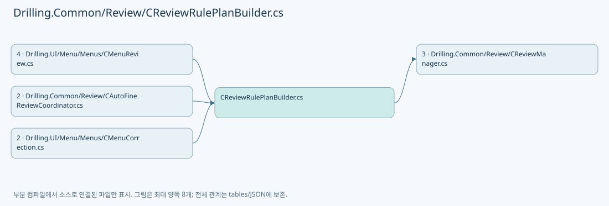

## 네임스페이스·타입·상속

| 타입 | 구분 | 원본 범위 | 선언/상속 |
| --- | --- | --- | --- |
| CReviewRulePlanBuilder | ClassDeclaration | 3–501 | CReviewRulePlanBuilder |
| FineCellRange | RecordStructDeclaration | 463–463 | FineCellRange |
| CellSlice | RecordStructDeclaration | 464–464 | CellSlice |
| EN_REVIEW_CORRECTION_RULE | EnumDeclaration | 503–509 | EN_REVIEW_CORRECTION_RULE |
| EN_REVIEW_CORRECTION_SCOPE | EnumDeclaration | 511–515 | EN_REVIEW_CORRECTION_SCOPE |
| EN_REVIEW_REFERENCE_LINE | EnumDeclaration | 517–522 | EN_REVIEW_REFERENCE_LINE |
| ST_REVIEW_RULE_CONFIGURATION | RecordDeclaration | 524–531 | ST_REVIEW_RULE_CONFIGURATION |
| ST_REVIEW_RULE_TARGET | RecordDeclaration | 532–532 | ST_REVIEW_RULE_TARGET |
| ST_REVIEW_RULE_PLAN | RecordDeclaration | 533–536 | ST_REVIEW_RULE_PLAN |

## 멤버 빠른 목록

| 이름 | 종류 | 범위 | 서명 |
| --- | --- | --- | --- |
| Build | MethodDeclaration | L5–17 | Drilling.Common.Review.ST_REVIEW_RULE_PLAN Drilling.Common.Review.CReviewRulePlanBuilder.Build(Drilling.Common.Review.ST_REVIEW_PLAN, Drilling.Common.Review.ST_REVIEW_RULE_CONFIGURATION) |
| BuildSimple | MethodDeclaration | L19–23 | System.Collections.Generic.IReadOnlyList<Drilling.Common.Review.ST_REVIEW_RULE_TARGET> Drilling.Common.Review.CReviewRulePlanBuilder.BuildSimple(Drilling.Common.Review.ST_REVIEW_PLAN, string) |
| BuildRough | MethodDeclaration | L25–67 | System.Collections.Generic.IReadOnlyList<Drilling.Common.Review.ST_REVIEW_RULE_TARGET> Drilling.Common.Review.CReviewRulePlanBuilder.BuildRough(Drilling.Common.Review.ST_REVIEW_PLAN, Drilling.Common.Review.EN_REVIEW_REFERENCE_LINE, Drilling.Common.Review.EN_REVIEW_CORRECTION_SCOPE) |
| BuildRoughByHeadCell | MethodDeclaration | L69–133 | System.Collections.Generic.IReadOnlyList<Drilling.Common.Review.ST_REVIEW_RULE_TARGET> Drilling.Common.Review.CReviewRulePlanBuilder.BuildRoughByHeadCell(Drilling.Common.Review.ST_REVIEW_PLAN, Drilling.Common.Review.EN_REVIEW_REFERENCE_LINE) |
| ResolveRoughCellSelectionY | MethodDeclaration | L135–166 | System.Collections.Generic.Dictionary<int, double> Drilling.Common.Review.CReviewRulePlanBuilder.ResolveRoughCellSelectionY(Drilling.Common.Review.ST_REVIEW_PLAN, System.Collections.Generic.IReadOnlyList<Drilling.Common.Review.CReviewRulePlanBuilder.CellSlice>, System.Collections.Generic.IReadOnlyDictionary<int, (double MinY, double MaxY)>, Drilling.Common.Review.EN_REVIEW_REFERENCE_LINE) |
| CellContainsHead | MethodDeclaration | L168–179 | bool Drilling.Common.Review.CReviewRulePlanBuilder.CellContainsHead(Drilling.Common.Review.ST_REVIEW_PLAN, Drilling.Common.Review.CReviewRulePlanBuilder.CellSlice, int) |
| PreferRoughCellSelectionY | MethodDeclaration | L181–184 | bool Drilling.Common.Review.CReviewRulePlanBuilder.PreferRoughCellSelectionY(double, double, Drilling.Common.Review.EN_REVIEW_REFERENCE_LINE) |
| TryGetCellYRange | MethodDeclaration | L186–211 | bool Drilling.Common.Review.CReviewRulePlanBuilder.TryGetCellYRange(Drilling.Common.Review.ST_REVIEW_PLAN, Drilling.Common.Review.CReviewRulePlanBuilder.CellSlice, out double, out double) |
| ResolveReferenceY | MethodDeclaration | L213–221 | double Drilling.Common.Review.CReviewRulePlanBuilder.ResolveReferenceY((double MinY, double MaxY), Drilling.Common.Review.EN_REVIEW_REFERENCE_LINE) |
| UpdateHeadRange | MethodDeclaration | L223–238 | void Drilling.Common.Review.CReviewRulePlanBuilder.UpdateHeadRange(Drilling.Common.Review.ST_REVIEW_PLAN_POINT, System.Collections.Generic.IDictionary<int, (double MinY, double MaxY)>) |
| FindNearestRow | MethodDeclaration | L240–254 | int Drilling.Common.Review.CReviewRulePlanBuilder.FindNearestRow(double, double, int, double) |
| IsEarlierRoughPoint | MethodDeclaration | L256–280 | bool Drilling.Common.Review.CReviewRulePlanBuilder.IsEarlierRoughPoint(Drilling.Common.Review.ST_REVIEW_PLAN_POINT, Drilling.Common.Review.ST_REVIEW_PLAN_POINT, double) |
| BuildFine | MethodDeclaration | L282–294 | System.Collections.Generic.IReadOnlyList<Drilling.Common.Review.ST_REVIEW_RULE_TARGET> Drilling.Common.Review.CReviewRulePlanBuilder.BuildFine(Drilling.Common.Review.ST_REVIEW_PLAN, int) |
| IsExecutableRoughPoint | MethodDeclaration | L296–296 | bool Drilling.Common.Review.CReviewRulePlanBuilder.IsExecutableRoughPoint(Drilling.Common.Review.ST_REVIEW_PLAN_POINT) |
| BuildEdge | MethodDeclaration | L297–319 | System.Collections.Generic.IReadOnlyList<Drilling.Common.Review.ST_REVIEW_RULE_TARGET> Drilling.Common.Review.CReviewRulePlanBuilder.BuildEdge(Drilling.Common.Review.ST_REVIEW_PLAN) |
| EnumerateCells | MethodDeclaration | L321–359 | System.Collections.Generic.IEnumerable<Drilling.Common.Review.CReviewRulePlanBuilder.CellSlice> Drilling.Common.Review.CReviewRulePlanBuilder.EnumerateCells(Drilling.Common.Review.ST_REVIEW_PLAN) |
| BuildFineFromCellSource | MethodDeclaration | L361–401 | System.Collections.Generic.IReadOnlyList<Drilling.Common.Review.ST_REVIEW_RULE_TARGET> Drilling.Common.Review.CReviewRulePlanBuilder.BuildFineFromCellSource(Drilling.Common.Review.ST_REVIEW_PLAN, int) |
| CreateFineCellRange | MethodDeclaration | L403–421 | Drilling.Common.Review.CReviewRulePlanBuilder.FineCellRange Drilling.Common.Review.CReviewRulePlanBuilder.CreateFineCellRange(Drilling.Common.Review.ST_REVIEW_PLAN, Drilling.Common.Review.CReviewRulePlanBuilder.CellSlice) |
| DistanceToRange | MethodDeclaration | L423–431 | double Drilling.Common.Review.CReviewRulePlanBuilder.DistanceToRange(double, double, double) |
| GetPoint | MethodDeclaration | L433–433 | Drilling.Common.Review.ST_REVIEW_PLAN_POINT Drilling.Common.Review.CReviewRulePlanBuilder.GetPoint(Drilling.Common.Review.ST_REVIEW_PLAN, Drilling.Common.Review.CReviewRulePlanBuilder.CellSlice, int, int) |
| FineCellRows | MethodDeclaration | L434–445 | System.Collections.Generic.IReadOnlyList<System.Linq.IGrouping<double, Drilling.Common.Review.ST_REVIEW_PLAN_POINT>> Drilling.Common.Review.CReviewRulePlanBuilder.FineCellRows(System.Collections.Generic.IReadOnlyList<System.Linq.IGrouping<double, Drilling.Common.Review.ST_REVIEW_PLAN_POINT>>, int, double, double) |
| CreateTarget | MethodDeclaration | L447–452 | Drilling.Common.Review.ST_REVIEW_RULE_TARGET Drilling.Common.Review.CReviewRulePlanBuilder.CreateTarget(Drilling.Common.Review.ST_REVIEW_PLAN_POINT, string) |
| TryGetPoint | MethodDeclaration | L454–460 | Drilling.Common.Review.ST_REVIEW_PLAN_POINT? Drilling.Common.Review.CReviewRulePlanBuilder.TryGetPoint(Drilling.Common.Review.ST_REVIEW_PLAN, string) |
| CoordinateKey | MethodDeclaration | L462–462 | double Drilling.Common.Review.CReviewRulePlanBuilder.CoordinateKey(double) |
| SelectEdgeShotKeys | MethodDeclaration | L466–474 | System.Collections.Generic.IReadOnlyCollection<string> Drilling.Common.Review.CReviewRulePlanBuilder.SelectEdgeShotKeys(Drilling.Common.Review.ST_REVIEW_PLAN) |
| SelectShotKey | LocalFunctionStatement | L468–471 | string SelectShotKey(Drilling.Common.Review.ST_REVIEW_PLAN_POINT) |
| SelectCenterShotKeys | MethodDeclaration | L476–484 | System.Collections.Generic.IReadOnlyCollection<string> Drilling.Common.Review.CReviewRulePlanBuilder.SelectCenterShotKeys(Drilling.Common.Review.ST_REVIEW_PLAN) |
| SelectShotKey | LocalFunctionStatement | L478–481 | string SelectShotKey(Drilling.Common.Review.ST_REVIEW_PLAN_POINT) |
| IsCellEdgeShot | MethodDeclaration | L486–494 | bool Drilling.Common.Review.CReviewRulePlanBuilder.IsCellEdgeShot(Drilling.Common.Review.ST_REVIEW_PLAN_POINT) |
| IsCellCenterShot | MethodDeclaration | L496–499 | bool Drilling.Common.Review.CReviewRulePlanBuilder.IsCellCenterShot(Drilling.Common.Review.ST_REVIEW_PLAN_POINT) |
| Simple | EnumMemberDeclaration | L505–505 | Drilling.Common.Review.EN_REVIEW_CORRECTION_RULE.Simple |
| Rough | EnumMemberDeclaration | L506–506 | Drilling.Common.Review.EN_REVIEW_CORRECTION_RULE.Rough |
| Fine | EnumMemberDeclaration | L507–507 | Drilling.Common.Review.EN_REVIEW_CORRECTION_RULE.Fine |
| Edge | EnumMemberDeclaration | L508–508 | Drilling.Common.Review.EN_REVIEW_CORRECTION_RULE.Edge |
| Head | EnumMemberDeclaration | L513–513 | Drilling.Common.Review.EN_REVIEW_CORRECTION_SCOPE.Head |
| HeadCell | EnumMemberDeclaration | L514–514 | Drilling.Common.Review.EN_REVIEW_CORRECTION_SCOPE.HeadCell |
| First | EnumMemberDeclaration | L519–519 | Drilling.Common.Review.EN_REVIEW_REFERENCE_LINE.First |
| Center | EnumMemberDeclaration | L520–520 | Drilling.Common.Review.EN_REVIEW_REFERENCE_LINE.Center |
| Last | EnumMemberDeclaration | L521–521 | Drilling.Common.Review.EN_REVIEW_REFERENCE_LINE.Last |
| ShotKeys | PropertyDeclaration | L535–535 | System.Collections.Generic.IReadOnlyCollection<string> Drilling.Common.Review.ST_REVIEW_RULE_PLAN.ShotKeys |
| get_ShotKeys | GetAccessorDeclaration | L535–535 | System.Collections.Generic.IReadOnlyCollection<string> Drilling.Common.Review.ST_REVIEW_RULE_PLAN.ShotKeys.get |

## 멤버별 상세 계약·호출·처리 해설

### MethodDeclaration `Build` · L5–17

[Drilling.Common/Review/CReviewRulePlanBuilder.cs:5–17](https://github.com/kjuws10-rgb/A3Drilling/blob/5aee8e58439c9b455cae7c9593c9be986c3e682e/Drilling.Common/Review/CReviewRulePlanBuilder.cs#L5-L17)

| 항목 | 실제 추출 값 |
| --- | --- |
| 서명 | Drilling.Common.Review.ST_REVIEW_RULE_PLAN Drilling.Common.Review.CReviewRulePlanBuilder.Build(Drilling.Common.Review.ST_REVIEW_PLAN, Drilling.Common.Review.ST_REVIEW_RULE_CONFIGURATION) |
| 접근/수식자 | Public / public, static |
| 반환/값 타입 | Drilling.Common.Review.ST_REVIEW_RULE_PLAN |
| 소속 타입 | NamedType:Drilling.Common.Review.CReviewRulePlanBuilder |

입력 계약:

| 이름 | 타입 | 전달 | 선택/기본값 |
| --- | --- | --- | --- |
| plan | Drilling.Common.Review.ST_REVIEW_PLAN | None | False /  |
| configuration | Drilling.Common.Review.ST_REVIEW_RULE_CONFIGURATION | None | False /  |

정적 호출자로 확인된 위치:

| 호출 파일/행 | 호출 표현식 | 런타임 분기 가능 |
| --- | --- | --- |
| [Drilling.Common/Review/CAutoFineReviewCoordinator.cs:256–256](https://github.com/kjuws10-rgb/A3Drilling/blob/5aee8e58439c9b455cae7c9593c9be986c3e682e/Drilling.Common/Review/CAutoFineReviewCoordinator.cs#L256-L256) | CReviewRulePlanBuilder.Build | False |
| [Drilling.UI/Menu/Menus/CMenuCorrection.cs:6083–6083](https://github.com/kjuws10-rgb/A3Drilling/blob/5aee8e58439c9b455cae7c9593c9be986c3e682e/Drilling.UI/Menu/Menus/CMenuCorrection.cs#L6083-L6083) | CReviewRulePlanBuilder.Build | False |
| [Drilling.UI/Menu/Menus/CMenuReview.cs:1882–1882](https://github.com/kjuws10-rgb/A3Drilling/blob/5aee8e58439c9b455cae7c9593c9be986c3e682e/Drilling.UI/Menu/Menus/CMenuReview.cs#L1882-L1882) | CReviewRulePlanBuilder.Build | False |

호출하는 대상과 해석 범위:

| 원본 행 | 표현식 | 분석 상태 | 대상/소스 위치 |
| --- | --- | --- | --- |
| 7 | ArgumentNullException.ThrowIfNull | resolved | void System.ArgumentNullException.ThrowIfNull(object?, string?) |
| 10 | BuildSimple | resolved | System.Collections.Generic.IReadOnlyList<Drilling.Common.Review.ST_REVIEW_RULE_TARGET> Drilling.Common.Review.CReviewRulePlanBuilder.BuildSimple(Drilling.Common.Review.ST_REVIEW_PLAN, string) · Drilling.Common/Review/CReviewRulePlanBuilder.cs:19 |
| 11 | BuildRough | resolved | System.Collections.Generic.IReadOnlyList<Drilling.Common.Review.ST_REVIEW_RULE_TARGET> Drilling.Common.Review.CReviewRulePlanBuilder.BuildRough(Drilling.Common.Review.ST_REVIEW_PLAN, Drilling.Common.Review.EN_REVIEW_REFERENCE_LINE, Drilling.Common.Review.EN_REVIEW_CORRECTION_SCOPE) · Drilling.Common/Review/CReviewRulePlanBuilder.cs:25 |
| 12 | BuildFine | resolved | System.Collections.Generic.IReadOnlyList<Drilling.Common.Review.ST_REVIEW_RULE_TARGET> Drilling.Common.Review.CReviewRulePlanBuilder.BuildFine(Drilling.Common.Review.ST_REVIEW_PLAN, int) · Drilling.Common/Review/CReviewRulePlanBuilder.cs:282 |
| 13 | BuildEdge | resolved | System.Collections.Generic.IReadOnlyList<Drilling.Common.Review.ST_REVIEW_RULE_TARGET> Drilling.Common.Review.CReviewRulePlanBuilder.BuildEdge(Drilling.Common.Review.ST_REVIEW_PLAN) · Drilling.Common/Review/CReviewRulePlanBuilder.cs:297 |
| 16 | new | resolved | Drilling.Common.Review.ST_REVIEW_RULE_PLAN.ST_REVIEW_RULE_PLAN(Drilling.Common.Review.ST_REVIEW_RULE_CONFIGURATION, System.Collections.Generic.IReadOnlyList<Drilling.Common.Review.ST_REVIEW_RULE_TARGET>) · Drilling.Common/Review/CReviewRulePlanBuilder.cs:533 |

본문의 실제 연산·분기·예외·반환 순서(원문 위치 순):

| 원본 행 | 종류 | 주석 해설 |
| --- | --- | --- |
| 7 | call | 함수·델리게이트 또는 객체 생성자를 호출합니다: ArgumentNullException.ThrowIfNull(plan) |
| 8 | local-declaration | 지역 변수를 선언합니다: var targets = configuration.Rule switch { EN_REVIEW_CORRECTION_RULE.Simple => BuildSimple(plan, configuration.ReferenceShotKey), EN_REVIEW_CORRECTION_RULE.Rough => BuildRough(plan, configuration.RoughReference, configuration.Scope |
| 8 | switch-expression | 값별 결과식을 선택합니다: configuration.Rule switch { EN_REVIEW_CORRECTION_RULE.Simple => BuildSimple(plan, configuration.ReferenceShotKey), EN_REVIEW_CORRECTION_RULE.Rough => BuildRough(plan, configuration.RoughReference, configuration.Scope), EN_REVIEW_C |
| 8 | variable-initializer | 변수의 초기값을 지정합니다: targets = configuration.Rule switch { EN_REVIEW_CORRECTION_RULE.Simple => BuildSimple(plan, configuration.ReferenceShotKey), EN_REVIEW_CORRECTION_RULE.Rough => BuildRough(plan, configuration.RoughReference, configuration.Scope), E |
| 10 | call | 함수·델리게이트 또는 객체 생성자를 호출합니다: BuildSimple(plan, configuration.ReferenceShotKey) |
| 11 | call | 함수·델리게이트 또는 객체 생성자를 호출합니다: BuildRough(plan, configuration.RoughReference, configuration.Scope) |
| 12 | call | 함수·델리게이트 또는 객체 생성자를 호출합니다: BuildFine(plan, configuration.FineLineCount) |
| 13 | call | 함수·델리게이트 또는 객체 생성자를 호출합니다: BuildEdge(plan) |
| 16 | call | 함수·델리게이트 또는 객체 생성자를 호출합니다: new(configuration, targets) |
| 16 | return | 호출자에게 값 또는 제어를 반환합니다: return new(configuration, targets); |

제어 구문의 포함 구조(실제 실행 순서/CFG가 아닌 구문 탐색 그림):

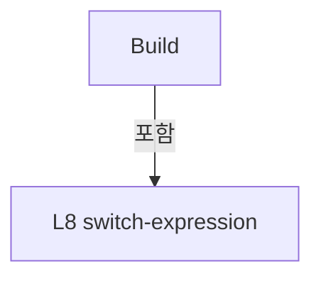

변경 전 점검: 입력/반환 타입, 위 호출자, 예외/취소 경로, 공유 상태와 저장·전송 소비자를 함께 확인합니다. 값의 단위나 물리 방향을 이름만으로 확정하지 않습니다.

### MethodDeclaration `BuildSimple` · L19–23

[Drilling.Common/Review/CReviewRulePlanBuilder.cs:19–23](https://github.com/kjuws10-rgb/A3Drilling/blob/5aee8e58439c9b455cae7c9593c9be986c3e682e/Drilling.Common/Review/CReviewRulePlanBuilder.cs#L19-L23)

| 항목 | 실제 추출 값 |
| --- | --- |
| 서명 | System.Collections.Generic.IReadOnlyList<Drilling.Common.Review.ST_REVIEW_RULE_TARGET> Drilling.Common.Review.CReviewRulePlanBuilder.BuildSimple(Drilling.Common.Review.ST_REVIEW_PLAN, string) |
| 접근/수식자 | Private / private, static |
| 반환/값 타입 | System.Collections.Generic.IReadOnlyList<Drilling.Common.Review.ST_REVIEW_RULE_TARGET> |
| 소속 타입 | NamedType:Drilling.Common.Review.CReviewRulePlanBuilder |

입력 계약:

| 이름 | 타입 | 전달 | 선택/기본값 |
| --- | --- | --- | --- |
| plan | Drilling.Common.Review.ST_REVIEW_PLAN | None | False /  |
| key | string | None | False /  |

정적 호출자로 확인된 위치:

| 호출 파일/행 | 호출 표현식 | 런타임 분기 가능 |
| --- | --- | --- |
| [Drilling.Common/Review/CReviewRulePlanBuilder.cs:10–10](https://github.com/kjuws10-rgb/A3Drilling/blob/5aee8e58439c9b455cae7c9593c9be986c3e682e/Drilling.Common/Review/CReviewRulePlanBuilder.cs#L10-L10) | BuildSimple | False |

호출하는 대상과 해석 범위:

| 원본 행 | 표현식 | 분석 상태 | 대상/소스 위치 |
| --- | --- | --- | --- |
| 21 | TryGetPoint | resolved | Drilling.Common.Review.ST_REVIEW_PLAN_POINT? Drilling.Common.Review.CReviewRulePlanBuilder.TryGetPoint(Drilling.Common.Review.ST_REVIEW_PLAN, string) · Drilling.Common/Review/CReviewRulePlanBuilder.cs:454 |
| 21 | CReviewManager.NormalizeShotKey | resolved | string Drilling.Common.Review.CReviewManager.NormalizeShotKey(string) · Drilling.Common/Review/CReviewManager.cs:1165 |
| 22 | CreateTarget | resolved | Drilling.Common.Review.ST_REVIEW_RULE_TARGET Drilling.Common.Review.CReviewRulePlanBuilder.CreateTarget(Drilling.Common.Review.ST_REVIEW_PLAN_POINT, string) · Drilling.Common/Review/CReviewRulePlanBuilder.cs:447 |

본문의 실제 연산·분기·예외·반환 순서(원문 위치 순):

| 원본 행 | 종류 | 주석 해설 |
| --- | --- | --- |
| 21 | call | 함수·델리게이트 또는 객체 생성자를 호출합니다: TryGetPoint(plan, CReviewManager.NormalizeShotKey(key)) |
| 21 | call | 함수·델리게이트 또는 객체 생성자를 호출합니다: CReviewManager.NormalizeShotKey(key) |
| 21 | local-declaration | 지역 변수를 선언합니다: var point = TryGetPoint(plan, CReviewManager.NormalizeShotKey(key)); |
| 21 | variable-initializer | 변수의 초기값을 지정합니다: point = TryGetPoint(plan, CReviewManager.NormalizeShotKey(key)) |
| 22 | call | 함수·델리게이트 또는 객체 생성자를 호출합니다: CreateTarget(point, "SIMPLE") |
| 22 | conditional-expression | 조건에 따라 결과식을 선택합니다: point is null &#124;&#124; point.HeadNo <= 0 ? [] : [CreateTarget(point, "SIMPLE")] |
| 22 | return | 호출자에게 값 또는 제어를 반환합니다: return point is null &#124;&#124; point.HeadNo <= 0 ? [] : [CreateTarget(point, "SIMPLE")]; |

변경 전 점검: 입력/반환 타입, 위 호출자, 예외/취소 경로, 공유 상태와 저장·전송 소비자를 함께 확인합니다. 값의 단위나 물리 방향을 이름만으로 확정하지 않습니다.

### MethodDeclaration `BuildRough` · L25–67

[Drilling.Common/Review/CReviewRulePlanBuilder.cs:25–67](https://github.com/kjuws10-rgb/A3Drilling/blob/5aee8e58439c9b455cae7c9593c9be986c3e682e/Drilling.Common/Review/CReviewRulePlanBuilder.cs#L25-L67)

| 항목 | 실제 추출 값 |
| --- | --- |
| 서명 | System.Collections.Generic.IReadOnlyList<Drilling.Common.Review.ST_REVIEW_RULE_TARGET> Drilling.Common.Review.CReviewRulePlanBuilder.BuildRough(Drilling.Common.Review.ST_REVIEW_PLAN, Drilling.Common.Review.EN_REVIEW_REFERENCE_LINE, Drilling.Common.Review.EN_REVIEW_CORRECTION_SCOPE) |
| 접근/수식자 | Private / private, static |
| 반환/값 타입 | System.Collections.Generic.IReadOnlyList<Drilling.Common.Review.ST_REVIEW_RULE_TARGET> |
| 소속 타입 | NamedType:Drilling.Common.Review.CReviewRulePlanBuilder |

입력 계약:

| 이름 | 타입 | 전달 | 선택/기본값 |
| --- | --- | --- | --- |
| plan | Drilling.Common.Review.ST_REVIEW_PLAN | None | False /  |
| reference | Drilling.Common.Review.EN_REVIEW_REFERENCE_LINE | None | False /  |
| scope | Drilling.Common.Review.EN_REVIEW_CORRECTION_SCOPE | None | False /  |

정적 호출자로 확인된 위치:

| 호출 파일/행 | 호출 표현식 | 런타임 분기 가능 |
| --- | --- | --- |
| [Drilling.Common/Review/CReviewRulePlanBuilder.cs:11–11](https://github.com/kjuws10-rgb/A3Drilling/blob/5aee8e58439c9b455cae7c9593c9be986c3e682e/Drilling.Common/Review/CReviewRulePlanBuilder.cs#L11-L11) | BuildRough | False |

호출하는 대상과 해석 범위:

| 원본 행 | 표현식 | 분석 상태 | 대상/소스 위치 |
| --- | --- | --- | --- |
| 29 | BuildRoughByHeadCell | resolved | System.Collections.Generic.IReadOnlyList<Drilling.Common.Review.ST_REVIEW_RULE_TARGET> Drilling.Common.Review.CReviewRulePlanBuilder.BuildRoughByHeadCell(Drilling.Common.Review.ST_REVIEW_PLAN, Drilling.Common.Review.EN_REVIEW_REFERENCE_LINE) · Drilling.Common/Review/CReviewRulePlanBuilder.cs:69 |
| 32 | EnumerateCells(plan).ToArray | resolved | Drilling.Common.Review.CReviewRulePlanBuilder.CellSlice[] System.Collections.Generic.IEnumerable<Drilling.Common.Review.CReviewRulePlanBuilder.CellSlice>.ToArray<Drilling.Common.Review.CReviewRulePlanBuilder.CellSlice>() |
| 32 | EnumerateCells | resolved | System.Collections.Generic.IEnumerable<Drilling.Common.Review.CReviewRulePlanBuilder.CellSlice> Drilling.Common.Review.CReviewRulePlanBuilder.EnumerateCells(Drilling.Common.Review.ST_REVIEW_PLAN) · Drilling.Common/Review/CReviewRulePlanBuilder.cs:321 |
| 33 | new Dictionary<int, (double MinY, double MaxY)> | resolved | System.Collections.Generic.Dictionary<int, (double MinY, double MaxY)>.Dictionary() |
| 38 | UpdateHeadRange | resolved | void Drilling.Common.Review.CReviewRulePlanBuilder.UpdateHeadRange(Drilling.Common.Review.ST_REVIEW_PLAN_POINT, System.Collections.Generic.IDictionary<int, (double MinY, double MaxY)>) · Drilling.Common/Review/CReviewRulePlanBuilder.cs:223 |
| 38 | GetPoint | resolved | Drilling.Common.Review.ST_REVIEW_PLAN_POINT Drilling.Common.Review.CReviewRulePlanBuilder.GetPoint(Drilling.Common.Review.ST_REVIEW_PLAN, Drilling.Common.Review.CReviewRulePlanBuilder.CellSlice, int, int) · Drilling.Common/Review/CReviewRulePlanBuilder.cs:433 |
| 41 | UpdateHeadRange | resolved | void Drilling.Common.Review.CReviewRulePlanBuilder.UpdateHeadRange(Drilling.Common.Review.ST_REVIEW_PLAN_POINT, System.Collections.Generic.IDictionary<int, (double MinY, double MaxY)>) · Drilling.Common/Review/CReviewRulePlanBuilder.cs:223 |
| 41 | GetPoint | resolved | Drilling.Common.Review.ST_REVIEW_PLAN_POINT Drilling.Common.Review.CReviewRulePlanBuilder.GetPoint(Drilling.Common.Review.ST_REVIEW_PLAN, Drilling.Common.Review.CReviewRulePlanBuilder.CellSlice, int, int) · Drilling.Common/Review/CReviewRulePlanBuilder.cs:433 |
| 46 | headRanges.ToDictionary | resolved | System.Collections.Generic.Dictionary<int, double> System.Collections.Generic.IEnumerable<System.Collections.Generic.KeyValuePair<int, (double MinY, double MaxY)>>.ToDictionary<System.Collections.Generic.KeyValuePair<int, (double MinY, double MaxY)>, int, double>(System.Func<System.Collections.Generic.KeyValuePair<int, (double MinY, double MaxY)>, int>, System.Func<System.Collections.Generic.KeyValuePair<int, (double MinY, double MaxY)>, double>) |
| 46 | ResolveReferenceY | resolved | double Drilling.Common.Review.CReviewRulePlanBuilder.ResolveReferenceY((double MinY, double MaxY), Drilling.Common.Review.EN_REVIEW_REFERENCE_LINE) · Drilling.Common/Review/CReviewRulePlanBuilder.cs:213 |
| 47 | new Dictionary<int, ST_REVIEW_PLAN_POINT> | resolved | System.Collections.Generic.Dictionary<int, Drilling.Common.Review.ST_REVIEW_PLAN_POINT>.Dictionary() |
| 53 | GetPoint | resolved | Drilling.Common.Review.ST_REVIEW_PLAN_POINT Drilling.Common.Review.CReviewRulePlanBuilder.GetPoint(Drilling.Common.Review.ST_REVIEW_PLAN, Drilling.Common.Review.CReviewRulePlanBuilder.CellSlice, int, int) · Drilling.Common/Review/CReviewRulePlanBuilder.cs:433 |
| 54 | IsExecutableRoughPoint | resolved | bool Drilling.Common.Review.CReviewRulePlanBuilder.IsExecutableRoughPoint(Drilling.Common.Review.ST_REVIEW_PLAN_POINT) · Drilling.Common/Review/CReviewRulePlanBuilder.cs:296 |
| 54 | targetYByHead.TryGetValue | resolved | bool System.Collections.Generic.Dictionary<int, double>.TryGetValue(int, out double) |
| 59 | selectedByHead.TryGetValue | resolved | bool System.Collections.Generic.Dictionary<int, Drilling.Common.Review.ST_REVIEW_PLAN_POINT>.TryGetValue(int, out Drilling.Common.Review.ST_REVIEW_PLAN_POINT) |
| 59 | IsEarlierRoughPoint | resolved | bool Drilling.Common.Review.CReviewRulePlanBuilder.IsEarlierRoughPoint(Drilling.Common.Review.ST_REVIEW_PLAN_POINT, Drilling.Common.Review.ST_REVIEW_PLAN_POINT, double) · Drilling.Common/Review/CReviewRulePlanBuilder.cs:256 |
| 66 | selectedByHead.OrderBy(item => item.Key).Select(item => CreateTarget(item.Value, reference.ToString().ToUpperInvariant())).ToArray | resolved | Drilling.Common.Review.ST_REVIEW_RULE_TARGET[] System.Collections.Generic.IEnumerable<Drilling.Common.Review.ST_REVIEW_RULE_TARGET>.ToArray<Drilling.Common.Review.ST_REVIEW_RULE_TARGET>() |
| 66 | selectedByHead.OrderBy(item => item.Key).Select | resolved | System.Collections.Generic.IEnumerable<Drilling.Common.Review.ST_REVIEW_RULE_TARGET> System.Collections.Generic.IEnumerable<System.Collections.Generic.KeyValuePair<int, Drilling.Common.Review.ST_REVIEW_PLAN_POINT>>.Select<System.Collections.Generic.KeyValuePair<int, Drilling.Common.Review.ST_REVIEW_PLAN_POINT>, Drilling.Common.Review.ST_REVIEW_RULE_TARGET>(System.Func<System.Collections.Generic.KeyValuePair<int, Drilling.Common.Review.ST_REVIEW_PLAN_POINT>, Drilling.Common.Review.ST_REVIEW_RULE_TARGET>) |
| 66 | selectedByHead.OrderBy | resolved | System.Linq.IOrderedEnumerable<System.Collections.Generic.KeyValuePair<int, Drilling.Common.Review.ST_REVIEW_PLAN_POINT>> System.Collections.Generic.IEnumerable<System.Collections.Generic.KeyValuePair<int, Drilling.Common.Review.ST_REVIEW_PLAN_POINT>>.OrderBy<System.Collections.Generic.KeyValuePair<int, Drilling.Common.Review.ST_REVIEW_PLAN_POINT>, int>(System.Func<System.Collections.Generic.KeyValuePair<int, Drilling.Common.Review.ST_REVIEW_PLAN_POINT>, int>) |
| 66 | CreateTarget | resolved | Drilling.Common.Review.ST_REVIEW_RULE_TARGET Drilling.Common.Review.CReviewRulePlanBuilder.CreateTarget(Drilling.Common.Review.ST_REVIEW_PLAN_POINT, string) · Drilling.Common/Review/CReviewRulePlanBuilder.cs:447 |
| 66 | reference.ToString().ToUpperInvariant | resolved | string string.ToUpperInvariant() |
| 66 | reference.ToString | resolved · 동적 구현 선택 가능 | string System.Enum.ToString() |

본문의 실제 연산·분기·예외·반환 순서(원문 위치 순):

| 원본 행 | 종류 | 주석 해설 |
| --- | --- | --- |
| 27 | if | 조건에 따라 분기합니다: if (scope == EN_REVIEW_CORRECTION_SCOPE.HeadCell) |
| 29 | call | 함수·델리게이트 또는 객체 생성자를 호출합니다: BuildRoughByHeadCell(plan, reference) |
| 29 | return | 호출자에게 값 또는 제어를 반환합니다: return BuildRoughByHeadCell(plan, reference); |
| 32 | call | 함수·델리게이트 또는 객체 생성자를 호출합니다: EnumerateCells(plan).ToArray() |
| 32 | call | 함수·델리게이트 또는 객체 생성자를 호출합니다: EnumerateCells(plan) |
| 32 | local-declaration | 지역 변수를 선언합니다: var cells = EnumerateCells(plan).ToArray(); |
| 32 | variable-initializer | 변수의 초기값을 지정합니다: cells = EnumerateCells(plan).ToArray() |
| 33 | call | 함수·델리게이트 또는 객체 생성자를 호출합니다: new Dictionary<int, (double MinY, double MaxY)>() |
| 33 | local-declaration | 지역 변수를 선언합니다: var headRanges = new Dictionary<int, (double MinY, double MaxY)>(); |
| 33 | variable-initializer | 변수의 초기값을 지정합니다: headRanges = new Dictionary<int, (double MinY, double MaxY)>() |
| 34 | foreach | 컬렉션 요소를 순회합니다: foreach (var cell in cells) |
| 36 | variable-initializer | 변수의 초기값을 지정합니다: column = 0 |
| 36 | for | 초기화·조건·증감이 있는 반복입니다: for (var column = 0; column < cell.Columns; column++) |
| 38 | call | 함수·델리게이트 또는 객체 생성자를 호출합니다: UpdateHeadRange(GetPoint(plan, cell, 0, column), headRanges) |
| 38 | call | 함수·델리게이트 또는 객체 생성자를 호출합니다: GetPoint(plan, cell, 0, column) |
| 39 | if | 조건에 따라 분기합니다: if (cell.Rows > 1) |
| 41 | call | 함수·델리게이트 또는 객체 생성자를 호출합니다: UpdateHeadRange(GetPoint(plan, cell, cell.Rows - 1, column), headRanges) |
| 41 | call | 함수·델리게이트 또는 객체 생성자를 호출합니다: GetPoint(plan, cell, cell.Rows - 1, column) |
| 46 | call | 함수·델리게이트 또는 객체 생성자를 호출합니다: headRanges.ToDictionary(item => item.Key, item => ResolveReferenceY(item.Value, reference)) |
| 46 | call | 함수·델리게이트 또는 객체 생성자를 호출합니다: ResolveReferenceY(item.Value, reference) |
| 46 | local-declaration | 지역 변수를 선언합니다: var targetYByHead = headRanges.ToDictionary(item => item.Key, item => ResolveReferenceY(item.Value, reference)); |
| 46 | variable-initializer | 변수의 초기값을 지정합니다: targetYByHead = headRanges.ToDictionary(item => item.Key, item => ResolveReferenceY(item.Value, reference)) |
| 47 | call | 함수·델리게이트 또는 객체 생성자를 호출합니다: new Dictionary<int, ST_REVIEW_PLAN_POINT>() |
| 47 | local-declaration | 지역 변수를 선언합니다: var selectedByHead = new Dictionary<int, ST_REVIEW_PLAN_POINT>(); |
| 47 | variable-initializer | 변수의 초기값을 지정합니다: selectedByHead = new Dictionary<int, ST_REVIEW_PLAN_POINT>() |
| 48 | foreach | 컬렉션 요소를 순회합니다: foreach (var cell in cells) |
| 50 | variable-initializer | 변수의 초기값을 지정합니다: row = 0 |
| 50 | for | 초기화·조건·증감이 있는 반복입니다: for (var row = 0; row < cell.Rows; row++) |
| 51 | variable-initializer | 변수의 초기값을 지정합니다: column = 0 |
| 51 | for | 초기화·조건·증감이 있는 반복입니다: for (var column = 0; column < cell.Columns; column++) |
| 53 | call | 함수·델리게이트 또는 객체 생성자를 호출합니다: GetPoint(plan, cell, row, column) |
| 53 | local-declaration | 지역 변수를 선언합니다: var point = GetPoint(plan, cell, row, column); |
| 53 | variable-initializer | 변수의 초기값을 지정합니다: point = GetPoint(plan, cell, row, column) |
| 54 | call | 함수·델리게이트 또는 객체 생성자를 호출합니다: IsExecutableRoughPoint(point) |
| 54 | call | 함수·델리게이트 또는 객체 생성자를 호출합니다: targetYByHead.TryGetValue(point.HeadNo, out var targetY) |
| 54 | if | 조건에 따라 분기합니다: if (!IsExecutableRoughPoint(point) &#124;&#124; !targetYByHead.TryGetValue(point.HeadNo, out var targetY)) |
| 56 | continue | 다음 반복으로 진행합니다: continue; |
| 59 | call | 함수·델리게이트 또는 객체 생성자를 호출합니다: selectedByHead.TryGetValue(point.HeadNo, out var selected) |
| 59 | call | 함수·델리게이트 또는 객체 생성자를 호출합니다: IsEarlierRoughPoint(point, selected, targetY) |
| 59 | if | 조건에 따라 분기합니다: if (!selectedByHead.TryGetValue(point.HeadNo, out var selected) &#124;&#124; IsEarlierRoughPoint(point, selected, targetY)) |
| 61 | assignment | 값을 대상에 대입합니다: selectedByHead[point.HeadNo] = point |
| 66 | call | 함수·델리게이트 또는 객체 생성자를 호출합니다: selectedByHead.OrderBy(item => item.Key).Select(item => CreateTarget(item.Value, reference.ToString().ToUpperInvariant())).ToArray() |
| 66 | call | 함수·델리게이트 또는 객체 생성자를 호출합니다: selectedByHead.OrderBy(item => item.Key).Select(item => CreateTarget(item.Value, reference.ToString().ToUpperInvariant())) |
| 66 | call | 함수·델리게이트 또는 객체 생성자를 호출합니다: selectedByHead.OrderBy(item => item.Key) |
| 66 | call | 함수·델리게이트 또는 객체 생성자를 호출합니다: CreateTarget(item.Value, reference.ToString().ToUpperInvariant()) |
| 66 | call | 함수·델리게이트 또는 객체 생성자를 호출합니다: reference.ToString().ToUpperInvariant() |
| 66 | call | 함수·델리게이트 또는 객체 생성자를 호출합니다: reference.ToString() |
| 66 | return | 호출자에게 값 또는 제어를 반환합니다: return selectedByHead.OrderBy(item => item.Key).Select(item => CreateTarget(item.Value, reference.ToString().ToUpperInvariant())).ToArray(); |

제어 구문의 포함 구조(실제 실행 순서/CFG가 아닌 구문 탐색 그림):

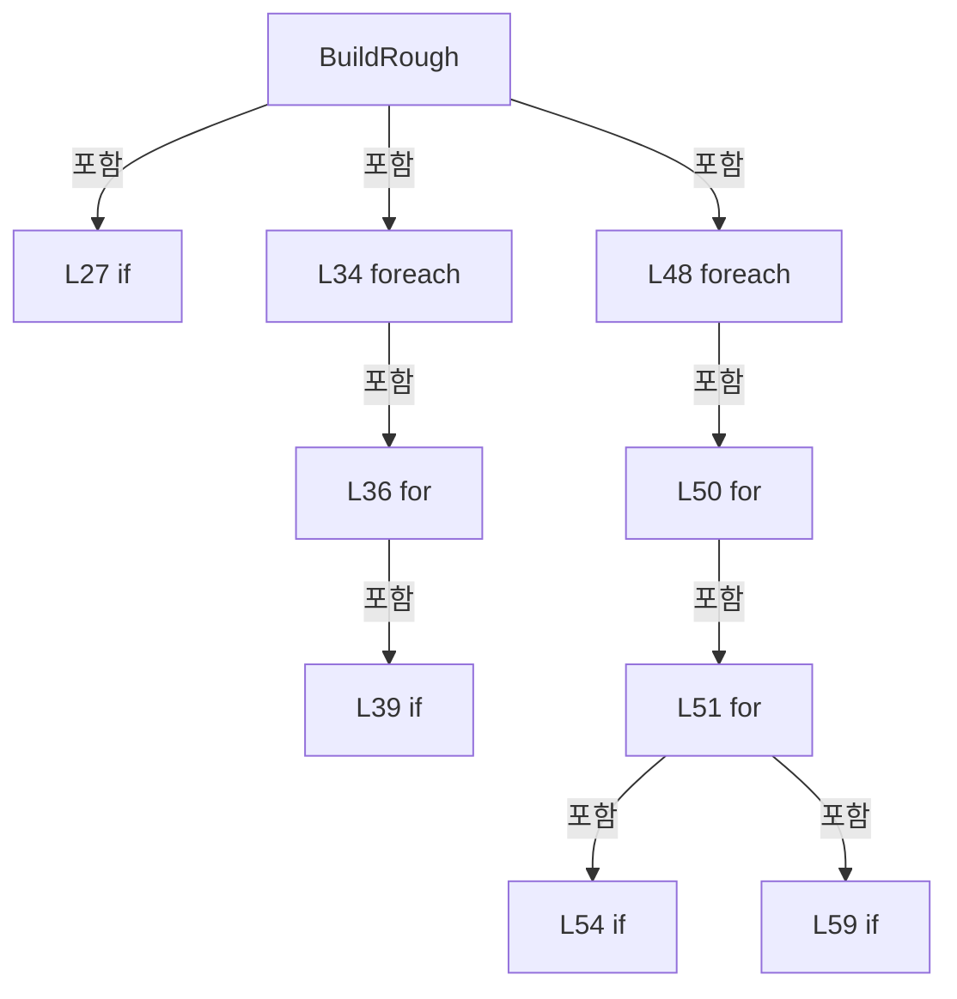

변경 전 점검: 입력/반환 타입, 위 호출자, 예외/취소 경로, 공유 상태와 저장·전송 소비자를 함께 확인합니다. 값의 단위나 물리 방향을 이름만으로 확정하지 않습니다.

### MethodDeclaration `BuildRoughByHeadCell` · L69–133

[Drilling.Common/Review/CReviewRulePlanBuilder.cs:69–133](https://github.com/kjuws10-rgb/A3Drilling/blob/5aee8e58439c9b455cae7c9593c9be986c3e682e/Drilling.Common/Review/CReviewRulePlanBuilder.cs#L69-L133)

| 항목 | 실제 추출 값 |
| --- | --- |
| 서명 | System.Collections.Generic.IReadOnlyList<Drilling.Common.Review.ST_REVIEW_RULE_TARGET> Drilling.Common.Review.CReviewRulePlanBuilder.BuildRoughByHeadCell(Drilling.Common.Review.ST_REVIEW_PLAN, Drilling.Common.Review.EN_REVIEW_REFERENCE_LINE) |
| 접근/수식자 | Private / private, static |
| 반환/값 타입 | System.Collections.Generic.IReadOnlyList<Drilling.Common.Review.ST_REVIEW_RULE_TARGET> |
| 소속 타입 | NamedType:Drilling.Common.Review.CReviewRulePlanBuilder |

입력 계약:

| 이름 | 타입 | 전달 | 선택/기본값 |
| --- | --- | --- | --- |
| plan | Drilling.Common.Review.ST_REVIEW_PLAN | None | False /  |
| reference | Drilling.Common.Review.EN_REVIEW_REFERENCE_LINE | None | False /  |

정적 호출자로 확인된 위치:

| 호출 파일/행 | 호출 표현식 | 런타임 분기 가능 |
| --- | --- | --- |
| [Drilling.Common/Review/CReviewRulePlanBuilder.cs:29–29](https://github.com/kjuws10-rgb/A3Drilling/blob/5aee8e58439c9b455cae7c9593c9be986c3e682e/Drilling.Common/Review/CReviewRulePlanBuilder.cs#L29-L29) | BuildRoughByHeadCell | False |

호출하는 대상과 해석 범위:

| 원본 행 | 표현식 | 분석 상태 | 대상/소스 위치 |
| --- | --- | --- | --- |
| 74 | EnumerateCells(plan).ToArray | resolved | Drilling.Common.Review.CReviewRulePlanBuilder.CellSlice[] System.Collections.Generic.IEnumerable<Drilling.Common.Review.CReviewRulePlanBuilder.CellSlice>.ToArray<Drilling.Common.Review.CReviewRulePlanBuilder.CellSlice>() |
| 74 | EnumerateCells | resolved | System.Collections.Generic.IEnumerable<Drilling.Common.Review.CReviewRulePlanBuilder.CellSlice> Drilling.Common.Review.CReviewRulePlanBuilder.EnumerateCells(Drilling.Common.Review.ST_REVIEW_PLAN) · Drilling.Common/Review/CReviewRulePlanBuilder.cs:321 |
| 80 | new Dictionary<int, (double MinY, double MaxY)> | resolved | System.Collections.Generic.Dictionary<int, (double MinY, double MaxY)>.Dictionary() |
| 85 | UpdateHeadRange | resolved | void Drilling.Common.Review.CReviewRulePlanBuilder.UpdateHeadRange(Drilling.Common.Review.ST_REVIEW_PLAN_POINT, System.Collections.Generic.IDictionary<int, (double MinY, double MaxY)>) · Drilling.Common/Review/CReviewRulePlanBuilder.cs:223 |
| 85 | GetPoint | resolved | Drilling.Common.Review.ST_REVIEW_PLAN_POINT Drilling.Common.Review.CReviewRulePlanBuilder.GetPoint(Drilling.Common.Review.ST_REVIEW_PLAN, Drilling.Common.Review.CReviewRulePlanBuilder.CellSlice, int, int) · Drilling.Common/Review/CReviewRulePlanBuilder.cs:433 |
| 88 | UpdateHeadRange | resolved | void Drilling.Common.Review.CReviewRulePlanBuilder.UpdateHeadRange(Drilling.Common.Review.ST_REVIEW_PLAN_POINT, System.Collections.Generic.IDictionary<int, (double MinY, double MaxY)>) · Drilling.Common/Review/CReviewRulePlanBuilder.cs:223 |
| 88 | GetPoint | resolved | Drilling.Common.Review.ST_REVIEW_PLAN_POINT Drilling.Common.Review.CReviewRulePlanBuilder.GetPoint(Drilling.Common.Review.ST_REVIEW_PLAN, Drilling.Common.Review.CReviewRulePlanBuilder.CellSlice, int, int) · Drilling.Common/Review/CReviewRulePlanBuilder.cs:433 |
| 98 | ResolveRoughCellSelectionY | resolved | System.Collections.Generic.Dictionary<int, double> Drilling.Common.Review.CReviewRulePlanBuilder.ResolveRoughCellSelectionY(Drilling.Common.Review.ST_REVIEW_PLAN, System.Collections.Generic.IReadOnlyList<Drilling.Common.Review.CReviewRulePlanBuilder.CellSlice>, System.Collections.Generic.IReadOnlyDictionary<int, (double MinY, double MaxY)>, Drilling.Common.Review.EN_REVIEW_REFERENCE_LINE) · Drilling.Common/Review/CReviewRulePlanBuilder.cs:135 |
| 99 | new Dictionary<(int HeadNo, int CellNo), ST_REVIEW_PLAN_POINT> | resolved | System.Collections.Generic.Dictionary<(int HeadNo, int CellNo), Drilling.Common.Review.ST_REVIEW_PLAN_POINT>.Dictionary() |
| 102 | TryGetCellYRange | resolved | bool Drilling.Common.Review.CReviewRulePlanBuilder.TryGetCellYRange(Drilling.Common.Review.ST_REVIEW_PLAN, Drilling.Common.Review.CReviewRulePlanBuilder.CellSlice, out double, out double) · Drilling.Common/Review/CReviewRulePlanBuilder.cs:186 |
| 109 | selectionYByHead.TryGetValue | resolved | bool System.Collections.Generic.Dictionary<int, double>.TryGetValue(int, out double) |
| 117 | GetPoint | resolved | Drilling.Common.Review.ST_REVIEW_PLAN_POINT Drilling.Common.Review.CReviewRulePlanBuilder.GetPoint(Drilling.Common.Review.ST_REVIEW_PLAN, Drilling.Common.Review.CReviewRulePlanBuilder.CellSlice, int, int) · Drilling.Common/Review/CReviewRulePlanBuilder.cs:433 |
| 118 | IsExecutableRoughPoint | resolved | bool Drilling.Common.Review.CReviewRulePlanBuilder.IsExecutableRoughPoint(Drilling.Common.Review.ST_REVIEW_PLAN_POINT) · Drilling.Common/Review/CReviewRulePlanBuilder.cs:296 |
| 124 | selectedByHeadCell.TryGetValue | resolved | bool System.Collections.Generic.Dictionary<(int HeadNo, int CellNo), Drilling.Common.Review.ST_REVIEW_PLAN_POINT>.TryGetValue((int HeadNo, int CellNo), out Drilling.Common.Review.ST_REVIEW_PLAN_POINT) |
| 124 | IsEarlierRoughPoint | resolved | bool Drilling.Common.Review.CReviewRulePlanBuilder.IsEarlierRoughPoint(Drilling.Common.Review.ST_REVIEW_PLAN_POINT, Drilling.Common.Review.ST_REVIEW_PLAN_POINT, double) · Drilling.Common/Review/CReviewRulePlanBuilder.cs:256 |
| 132 | selectedByHeadCell.Values.OrderBy(point => point.HeadNo).ThenBy(point => point.CellNo).Select(point => CreateTarget(point, $"{reference.ToString().ToUpperInvariant()} / HEAD + CELL")).ToArray | resolved | Drilling.Common.Review.ST_REVIEW_RULE_TARGET[] System.Collections.Generic.IEnumerable<Drilling.Common.Review.ST_REVIEW_RULE_TARGET>.ToArray<Drilling.Common.Review.ST_REVIEW_RULE_TARGET>() |
| 132 | selectedByHeadCell.Values.OrderBy(point => point.HeadNo).ThenBy(point => point.CellNo).Select | resolved | System.Collections.Generic.IEnumerable<Drilling.Common.Review.ST_REVIEW_RULE_TARGET> System.Collections.Generic.IEnumerable<Drilling.Common.Review.ST_REVIEW_PLAN_POINT>.Select<Drilling.Common.Review.ST_REVIEW_PLAN_POINT, Drilling.Common.Review.ST_REVIEW_RULE_TARGET>(System.Func<Drilling.Common.Review.ST_REVIEW_PLAN_POINT, Drilling.Common.Review.ST_REVIEW_RULE_TARGET>) |
| 132 | selectedByHeadCell.Values.OrderBy(point => point.HeadNo).ThenBy | resolved | System.Linq.IOrderedEnumerable<Drilling.Common.Review.ST_REVIEW_PLAN_POINT> System.Linq.IOrderedEnumerable<Drilling.Common.Review.ST_REVIEW_PLAN_POINT>.ThenBy<Drilling.Common.Review.ST_REVIEW_PLAN_POINT, int>(System.Func<Drilling.Common.Review.ST_REVIEW_PLAN_POINT, int>) |
| 132 | selectedByHeadCell.Values.OrderBy | resolved | System.Linq.IOrderedEnumerable<Drilling.Common.Review.ST_REVIEW_PLAN_POINT> System.Collections.Generic.IEnumerable<Drilling.Common.Review.ST_REVIEW_PLAN_POINT>.OrderBy<Drilling.Common.Review.ST_REVIEW_PLAN_POINT, int>(System.Func<Drilling.Common.Review.ST_REVIEW_PLAN_POINT, int>) |
| 132 | CreateTarget | resolved | Drilling.Common.Review.ST_REVIEW_RULE_TARGET Drilling.Common.Review.CReviewRulePlanBuilder.CreateTarget(Drilling.Common.Review.ST_REVIEW_PLAN_POINT, string) · Drilling.Common/Review/CReviewRulePlanBuilder.cs:447 |
| 132 | reference.ToString().ToUpperInvariant | resolved | string string.ToUpperInvariant() |
| 132 | reference.ToString | resolved · 동적 구현 선택 가능 | string System.Enum.ToString() |

본문의 실제 연산·분기·예외·반환 순서(원문 위치 순):

| 원본 행 | 종류 | 주석 해설 |
| --- | --- | --- |
| 74 | call | 함수·델리게이트 또는 객체 생성자를 호출합니다: EnumerateCells(plan).ToArray() |
| 74 | call | 함수·델리게이트 또는 객체 생성자를 호출합니다: EnumerateCells(plan) |
| 74 | local-declaration | 지역 변수를 선언합니다: var cells = EnumerateCells(plan).ToArray(); |
| 74 | variable-initializer | 변수의 초기값을 지정합니다: cells = EnumerateCells(plan).ToArray() |
| 75 | if | 조건에 따라 분기합니다: if (cells.Length == 0) |
| 77 | return | 호출자에게 값 또는 제어를 반환합니다: return[]; |
| 80 | call | 함수·델리게이트 또는 객체 생성자를 호출합니다: new Dictionary<int, (double MinY, double MaxY)>() |
| 80 | local-declaration | 지역 변수를 선언합니다: var headRanges = new Dictionary<int, (double MinY, double MaxY)>(); |
| 80 | variable-initializer | 변수의 초기값을 지정합니다: headRanges = new Dictionary<int, (double MinY, double MaxY)>() |
| 81 | foreach | 컬렉션 요소를 순회합니다: foreach (var cell in cells) |
| 83 | variable-initializer | 변수의 초기값을 지정합니다: column = 0 |
| 83 | for | 초기화·조건·증감이 있는 반복입니다: for (var column = 0; column < cell.Columns; column++) |
| 85 | call | 함수·델리게이트 또는 객체 생성자를 호출합니다: UpdateHeadRange(GetPoint(plan, cell, 0, column), headRanges) |
| 85 | call | 함수·델리게이트 또는 객체 생성자를 호출합니다: GetPoint(plan, cell, 0, column) |
| 86 | if | 조건에 따라 분기합니다: if (cell.Rows > 1) |
| 88 | call | 함수·델리게이트 또는 객체 생성자를 호출합니다: UpdateHeadRange(GetPoint(plan, cell, cell.Rows - 1, column), headRanges) |
| 88 | call | 함수·델리게이트 또는 객체 생성자를 호출합니다: GetPoint(plan, cell, cell.Rows - 1, column) |
| 93 | if | 조건에 따라 분기합니다: if (headRanges.Count == 0) |
| 95 | return | 호출자에게 값 또는 제어를 반환합니다: return[]; |
| 98 | call | 함수·델리게이트 또는 객체 생성자를 호출합니다: ResolveRoughCellSelectionY(plan, cells, headRanges, reference) |
| 98 | local-declaration | 지역 변수를 선언합니다: var selectionYByHead = ResolveRoughCellSelectionY(plan, cells, headRanges, reference); |
| 98 | variable-initializer | 변수의 초기값을 지정합니다: selectionYByHead = ResolveRoughCellSelectionY(plan, cells, headRanges, reference) |
| 99 | call | 함수·델리게이트 또는 객체 생성자를 호출합니다: new Dictionary<(int HeadNo, int CellNo), ST_REVIEW_PLAN_POINT>() |
| 99 | local-declaration | 지역 변수를 선언합니다: var selectedByHeadCell = new Dictionary<(int HeadNo, int CellNo), ST_REVIEW_PLAN_POINT>(); |
| 99 | variable-initializer | 변수의 초기값을 지정합니다: selectedByHeadCell = new Dictionary<(int HeadNo, int CellNo), ST_REVIEW_PLAN_POINT>() |
| 100 | foreach | 컬렉션 요소를 순회합니다: foreach (var cell in cells) |
| 102 | call | 함수·델리게이트 또는 객체 생성자를 호출합니다: TryGetCellYRange(plan, cell, out var minimumCellY, out var maximumCellY) |
| 102 | if | 조건에 따라 분기합니다: if (!TryGetCellYRange(plan, cell, out var minimumCellY, out var maximumCellY)) |
| 104 | continue | 다음 반복으로 진행합니다: continue; |
| 107 | foreach | 컬렉션 요소를 순회합니다: foreach (var headNo in headRanges.Keys) |
| 109 | call | 함수·델리게이트 또는 객체 생성자를 호출합니다: selectionYByHead.TryGetValue(headNo, out var selectionY) |
| 109 | if | 조건에 따라 분기합니다: if (!selectionYByHead.TryGetValue(headNo, out var selectionY) &#124;&#124; selectionY < minimumCellY - 0.000001 &#124;&#124; selectionY > maximumCellY + 0.000001) |
| 111 | continue | 다음 반복으로 진행합니다: continue; |
| 114 | variable-initializer | 변수의 초기값을 지정합니다: row = 0 |
| 114 | for | 초기화·조건·증감이 있는 반복입니다: for (var row = 0; row < cell.Rows; row++) |
| 115 | variable-initializer | 변수의 초기값을 지정합니다: column = 0 |
| 115 | for | 초기화·조건·증감이 있는 반복입니다: for (var column = 0; column < cell.Columns; column++) |
| 117 | call | 함수·델리게이트 또는 객체 생성자를 호출합니다: GetPoint(plan, cell, row, column) |
| 117 | local-declaration | 지역 변수를 선언합니다: var point = GetPoint(plan, cell, row, column); |
| 117 | variable-initializer | 변수의 초기값을 지정합니다: point = GetPoint(plan, cell, row, column) |
| 118 | call | 함수·델리게이트 또는 객체 생성자를 호출합니다: IsExecutableRoughPoint(point) |
| 118 | if | 조건에 따라 분기합니다: if (point.HeadNo != headNo &#124;&#124; !IsExecutableRoughPoint(point)) |
| 120 | continue | 다음 반복으로 진행합니다: continue; |
| 123 | local-declaration | 지역 변수를 선언합니다: var key = (headNo, point.CellNo); |
| 123 | variable-initializer | 변수의 초기값을 지정합니다: key = (headNo, point.CellNo) |
| 124 | call | 함수·델리게이트 또는 객체 생성자를 호출합니다: selectedByHeadCell.TryGetValue(key, out var selected) |
| 124 | call | 함수·델리게이트 또는 객체 생성자를 호출합니다: IsEarlierRoughPoint(point, selected, selectionY) |
| 124 | if | 조건에 따라 분기합니다: if (!selectedByHeadCell.TryGetValue(key, out var selected) &#124;&#124; IsEarlierRoughPoint(point, selected, selectionY)) |
| 126 | assignment | 값을 대상에 대입합니다: selectedByHeadCell[key] = point |
| 132 | call | 함수·델리게이트 또는 객체 생성자를 호출합니다: selectedByHeadCell.Values.OrderBy(point => point.HeadNo).ThenBy(point => point.CellNo).Select(point => CreateTarget(point, $"{reference.ToString().ToUpperInvariant()} / HEAD + CELL")).ToArray() |
| 132 | call | 함수·델리게이트 또는 객체 생성자를 호출합니다: selectedByHeadCell.Values.OrderBy(point => point.HeadNo).ThenBy(point => point.CellNo).Select(point => CreateTarget(point, $"{reference.ToString().ToUpperInvariant()} / HEAD + CELL")) |
| 132 | call | 함수·델리게이트 또는 객체 생성자를 호출합니다: selectedByHeadCell.Values.OrderBy(point => point.HeadNo).ThenBy(point => point.CellNo) |
| 132 | call | 함수·델리게이트 또는 객체 생성자를 호출합니다: selectedByHeadCell.Values.OrderBy(point => point.HeadNo) |
| 132 | call | 함수·델리게이트 또는 객체 생성자를 호출합니다: CreateTarget(point, $"{reference.ToString().ToUpperInvariant()} / HEAD + CELL") |
| 132 | call | 함수·델리게이트 또는 객체 생성자를 호출합니다: reference.ToString().ToUpperInvariant() |
| 132 | call | 함수·델리게이트 또는 객체 생성자를 호출합니다: reference.ToString() |
| 132 | return | 호출자에게 값 또는 제어를 반환합니다: return selectedByHeadCell.Values.OrderBy(point => point.HeadNo).ThenBy(point => point.CellNo).Select(point => CreateTarget(point, $"{reference.ToString().ToUpperInvariant()} / HEAD + CELL")).ToArray(); |

제어 구문의 포함 구조(실제 실행 순서/CFG가 아닌 구문 탐색 그림):

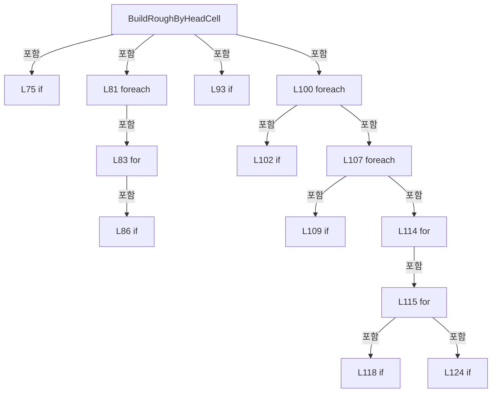

변경 전 점검: 입력/반환 타입, 위 호출자, 예외/취소 경로, 공유 상태와 저장·전송 소비자를 함께 확인합니다. 값의 단위나 물리 방향을 이름만으로 확정하지 않습니다.

### MethodDeclaration `ResolveRoughCellSelectionY` · L135–166

[Drilling.Common/Review/CReviewRulePlanBuilder.cs:135–166](https://github.com/kjuws10-rgb/A3Drilling/blob/5aee8e58439c9b455cae7c9593c9be986c3e682e/Drilling.Common/Review/CReviewRulePlanBuilder.cs#L135-L166)

| 항목 | 실제 추출 값 |
| --- | --- |
| 서명 | System.Collections.Generic.Dictionary<int, double> Drilling.Common.Review.CReviewRulePlanBuilder.ResolveRoughCellSelectionY(Drilling.Common.Review.ST_REVIEW_PLAN, System.Collections.Generic.IReadOnlyList<Drilling.Common.Review.CReviewRulePlanBuilder.CellSlice>, System.Collections.Generic.IReadOnlyDictionary<int, (double MinY, double MaxY)>, Drilling.Common.Review.EN_REVIEW_REFERENCE_LINE) |
| 접근/수식자 | Private / private, static |
| 반환/값 타입 | System.Collections.Generic.Dictionary<int, double> |
| 소속 타입 | NamedType:Drilling.Common.Review.CReviewRulePlanBuilder |

입력 계약:

| 이름 | 타입 | 전달 | 선택/기본값 |
| --- | --- | --- | --- |
| plan | Drilling.Common.Review.ST_REVIEW_PLAN | None | False /  |
| cells | System.Collections.Generic.IReadOnlyList<Drilling.Common.Review.CReviewRulePlanBuilder.CellSlice> | None | False /  |
| headRanges | System.Collections.Generic.IReadOnlyDictionary<int, (double MinY, double MaxY)> | None | False /  |
| reference | Drilling.Common.Review.EN_REVIEW_REFERENCE_LINE | None | False /  |

정적 호출자로 확인된 위치:

| 호출 파일/행 | 호출 표현식 | 런타임 분기 가능 |
| --- | --- | --- |
| [Drilling.Common/Review/CReviewRulePlanBuilder.cs:98–98](https://github.com/kjuws10-rgb/A3Drilling/blob/5aee8e58439c9b455cae7c9593c9be986c3e682e/Drilling.Common/Review/CReviewRulePlanBuilder.cs#L98-L98) | ResolveRoughCellSelectionY | False |

호출하는 대상과 해석 범위:

| 원본 행 | 표현식 | 분석 상태 | 대상/소스 위치 |
| --- | --- | --- | --- |
| 137 | new Dictionary<int, double> | resolved | System.Collections.Generic.Dictionary<int, double>.Dictionary() |
| 140 | ResolveReferenceY | resolved | double Drilling.Common.Review.CReviewRulePlanBuilder.ResolveReferenceY((double MinY, double MaxY), Drilling.Common.Review.EN_REVIEW_REFERENCE_LINE) · Drilling.Common/Review/CReviewRulePlanBuilder.cs:213 |
| 145 | TryGetCellYRange | resolved | bool Drilling.Common.Review.CReviewRulePlanBuilder.TryGetCellYRange(Drilling.Common.Review.ST_REVIEW_PLAN, Drilling.Common.Review.CReviewRulePlanBuilder.CellSlice, out double, out double) · Drilling.Common/Review/CReviewRulePlanBuilder.cs:186 |
| 145 | CellContainsHead | resolved | bool Drilling.Common.Review.CReviewRulePlanBuilder.CellContainsHead(Drilling.Common.Review.ST_REVIEW_PLAN, Drilling.Common.Review.CReviewRulePlanBuilder.CellSlice, int) · Drilling.Common/Review/CReviewRulePlanBuilder.cs:168 |
| 150 | DistanceToRange | resolved | double Drilling.Common.Review.CReviewRulePlanBuilder.DistanceToRange(double, double, double) · Drilling.Common/Review/CReviewRulePlanBuilder.cs:423 |
| 151 | Math.Clamp | resolved | double System.Math.Clamp(double, double, double) |
| 152 | Math.Abs | resolved | double System.Math.Abs(double) |
| 152 | PreferRoughCellSelectionY | resolved | bool Drilling.Common.Review.CReviewRulePlanBuilder.PreferRoughCellSelectionY(double, double, Drilling.Common.Review.EN_REVIEW_REFERENCE_LINE) · Drilling.Common/Review/CReviewRulePlanBuilder.cs:181 |

본문의 실제 연산·분기·예외·반환 순서(원문 위치 순):

| 원본 행 | 종류 | 주석 해설 |
| --- | --- | --- |
| 137 | call | 함수·델리게이트 또는 객체 생성자를 호출합니다: new Dictionary<int, double>() |
| 137 | local-declaration | 지역 변수를 선언합니다: var selectionYByHead = new Dictionary<int, double>(); |
| 137 | variable-initializer | 변수의 초기값을 지정합니다: selectionYByHead = new Dictionary<int, double>() |
| 138 | foreach | 컬렉션 요소를 순회합니다: foreach (var headRange in headRanges) |
| 140 | call | 함수·델리게이트 또는 객체 생성자를 호출합니다: ResolveReferenceY(headRange.Value, reference) |
| 140 | local-declaration | 지역 변수를 선언합니다: var targetY = ResolveReferenceY(headRange.Value, reference); |
| 140 | variable-initializer | 변수의 초기값을 지정합니다: targetY = ResolveReferenceY(headRange.Value, reference) |
| 141 | local-declaration | 지역 변수를 선언합니다: var bestDistance = double.MaxValue; |
| 141 | variable-initializer | 변수의 초기값을 지정합니다: bestDistance = double.MaxValue |
| 142 | local-declaration | 지역 변수를 선언합니다: var selectedY = targetY; |
| 142 | variable-initializer | 변수의 초기값을 지정합니다: selectedY = targetY |
| 143 | foreach | 컬렉션 요소를 순회합니다: foreach (var cell in cells) |
| 145 | call | 함수·델리게이트 또는 객체 생성자를 호출합니다: TryGetCellYRange(plan, cell, out var minimumCellY, out var maximumCellY) |
| 145 | call | 함수·델리게이트 또는 객체 생성자를 호출합니다: CellContainsHead(plan, cell, headRange.Key) |
| 145 | if | 조건에 따라 분기합니다: if (!TryGetCellYRange(plan, cell, out var minimumCellY, out var maximumCellY) &#124;&#124; !CellContainsHead(plan, cell, headRange.Key)) |
| 147 | continue | 다음 반복으로 진행합니다: continue; |
| 150 | call | 함수·델리게이트 또는 객체 생성자를 호출합니다: DistanceToRange(targetY, minimumCellY, maximumCellY) |
| 150 | local-declaration | 지역 변수를 선언합니다: var distance = DistanceToRange(targetY, minimumCellY, maximumCellY); |
| 150 | variable-initializer | 변수의 초기값을 지정합니다: distance = DistanceToRange(targetY, minimumCellY, maximumCellY) |
| 151 | call | 함수·델리게이트 또는 객체 생성자를 호출합니다: Math.Clamp(targetY, minimumCellY, maximumCellY) |
| 151 | local-declaration | 지역 변수를 선언합니다: var candidateY = Math.Clamp(targetY, minimumCellY, maximumCellY); |
| 151 | variable-initializer | 변수의 초기값을 지정합니다: candidateY = Math.Clamp(targetY, minimumCellY, maximumCellY) |
| 152 | call | 함수·델리게이트 또는 객체 생성자를 호출합니다: Math.Abs(distance - bestDistance) |
| 152 | call | 함수·델리게이트 또는 객체 생성자를 호출합니다: PreferRoughCellSelectionY(candidateY, selectedY, reference) |
| 152 | if | 조건에 따라 분기합니다: if (distance < bestDistance - 0.000001 &#124;&#124; Math.Abs(distance - bestDistance) <= 0.000001 && PreferRoughCellSelectionY(candidateY, selectedY, reference)) |
| 154 | assignment | 값을 대상에 대입합니다: bestDistance = distance |
| 155 | assignment | 값을 대상에 대입합니다: selectedY = candidateY |
| 159 | if | 조건에 따라 분기합니다: if (bestDistance < double.MaxValue) |
| 161 | assignment | 값을 대상에 대입합니다: selectionYByHead[headRange.Key] = selectedY |
| 165 | return | 호출자에게 값 또는 제어를 반환합니다: return selectionYByHead; |

제어 구문의 포함 구조(실제 실행 순서/CFG가 아닌 구문 탐색 그림):

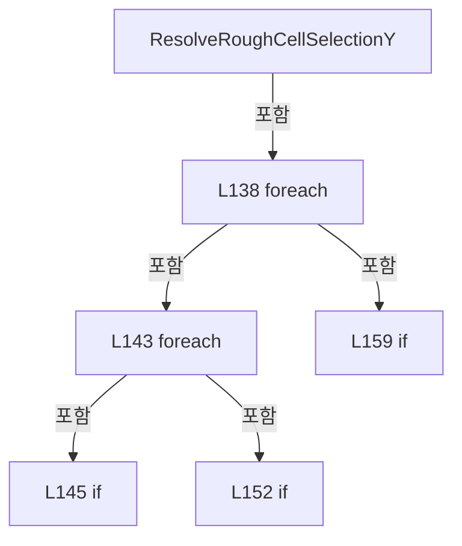

변경 전 점검: 입력/반환 타입, 위 호출자, 예외/취소 경로, 공유 상태와 저장·전송 소비자를 함께 확인합니다. 값의 단위나 물리 방향을 이름만으로 확정하지 않습니다.

### MethodDeclaration `CellContainsHead` · L168–179

[Drilling.Common/Review/CReviewRulePlanBuilder.cs:168–179](https://github.com/kjuws10-rgb/A3Drilling/blob/5aee8e58439c9b455cae7c9593c9be986c3e682e/Drilling.Common/Review/CReviewRulePlanBuilder.cs#L168-L179)

| 항목 | 실제 추출 값 |
| --- | --- |
| 서명 | bool Drilling.Common.Review.CReviewRulePlanBuilder.CellContainsHead(Drilling.Common.Review.ST_REVIEW_PLAN, Drilling.Common.Review.CReviewRulePlanBuilder.CellSlice, int) |
| 접근/수식자 | Private / private, static |
| 반환/값 타입 | bool |
| 소속 타입 | NamedType:Drilling.Common.Review.CReviewRulePlanBuilder |

입력 계약:

| 이름 | 타입 | 전달 | 선택/기본값 |
| --- | --- | --- | --- |
| plan | Drilling.Common.Review.ST_REVIEW_PLAN | None | False /  |
| cell | Drilling.Common.Review.CReviewRulePlanBuilder.CellSlice | None | False /  |
| headNo | int | None | False /  |

정적 호출자로 확인된 위치:

| 호출 파일/행 | 호출 표현식 | 런타임 분기 가능 |
| --- | --- | --- |
| [Drilling.Common/Review/CReviewRulePlanBuilder.cs:145–145](https://github.com/kjuws10-rgb/A3Drilling/blob/5aee8e58439c9b455cae7c9593c9be986c3e682e/Drilling.Common/Review/CReviewRulePlanBuilder.cs#L145-L145) | CellContainsHead | False |

호출하는 대상과 해석 범위:

| 원본 행 | 표현식 | 분석 상태 | 대상/소스 위치 |
| --- | --- | --- | --- |
| 172 | GetPoint | resolved | Drilling.Common.Review.ST_REVIEW_PLAN_POINT Drilling.Common.Review.CReviewRulePlanBuilder.GetPoint(Drilling.Common.Review.ST_REVIEW_PLAN, Drilling.Common.Review.CReviewRulePlanBuilder.CellSlice, int, int) · Drilling.Common/Review/CReviewRulePlanBuilder.cs:433 |
| 172 | GetPoint | resolved | Drilling.Common.Review.ST_REVIEW_PLAN_POINT Drilling.Common.Review.CReviewRulePlanBuilder.GetPoint(Drilling.Common.Review.ST_REVIEW_PLAN, Drilling.Common.Review.CReviewRulePlanBuilder.CellSlice, int, int) · Drilling.Common/Review/CReviewRulePlanBuilder.cs:433 |

본문의 실제 연산·분기·예외·반환 순서(원문 위치 순):

| 원본 행 | 종류 | 주석 해설 |
| --- | --- | --- |
| 170 | variable-initializer | 변수의 초기값을 지정합니다: column = 0 |
| 170 | for | 초기화·조건·증감이 있는 반복입니다: for (var column = 0; column < cell.Columns; column++) |
| 172 | call | 함수·델리게이트 또는 객체 생성자를 호출합니다: GetPoint(plan, cell, 0, column) |
| 172 | call | 함수·델리게이트 또는 객체 생성자를 호출합니다: GetPoint(plan, cell, cell.Rows - 1, column) |
| 172 | if | 조건에 따라 분기합니다: if (GetPoint(plan, cell, 0, column).HeadNo == headNo &#124;&#124; cell.Rows > 1 && GetPoint(plan, cell, cell.Rows - 1, column).HeadNo == headNo) |
| 174 | return | 호출자에게 값 또는 제어를 반환합니다: return true; |
| 178 | return | 호출자에게 값 또는 제어를 반환합니다: return false; |

제어 구문의 포함 구조(실제 실행 순서/CFG가 아닌 구문 탐색 그림):

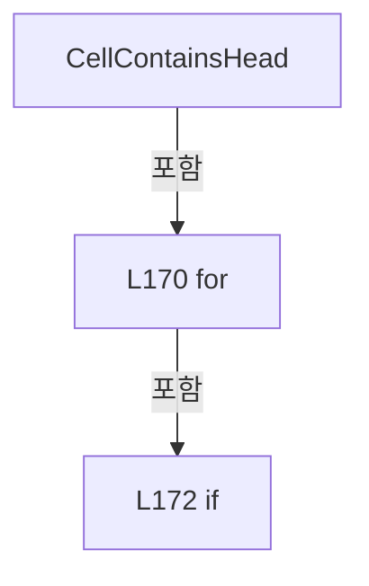

변경 전 점검: 입력/반환 타입, 위 호출자, 예외/취소 경로, 공유 상태와 저장·전송 소비자를 함께 확인합니다. 값의 단위나 물리 방향을 이름만으로 확정하지 않습니다.

### MethodDeclaration `PreferRoughCellSelectionY` · L181–184

[Drilling.Common/Review/CReviewRulePlanBuilder.cs:181–184](https://github.com/kjuws10-rgb/A3Drilling/blob/5aee8e58439c9b455cae7c9593c9be986c3e682e/Drilling.Common/Review/CReviewRulePlanBuilder.cs#L181-L184)

| 항목 | 실제 추출 값 |
| --- | --- |
| 서명 | bool Drilling.Common.Review.CReviewRulePlanBuilder.PreferRoughCellSelectionY(double, double, Drilling.Common.Review.EN_REVIEW_REFERENCE_LINE) |
| 접근/수식자 | Private / private, static |
| 반환/값 타입 | bool |
| 소속 타입 | NamedType:Drilling.Common.Review.CReviewRulePlanBuilder |

입력 계약:

| 이름 | 타입 | 전달 | 선택/기본값 |
| --- | --- | --- | --- |
| candidateY | double | None | False /  |
| selectedY | double | None | False /  |
| reference | Drilling.Common.Review.EN_REVIEW_REFERENCE_LINE | None | False /  |

정적 호출자로 확인된 위치:

| 호출 파일/행 | 호출 표현식 | 런타임 분기 가능 |
| --- | --- | --- |
| [Drilling.Common/Review/CReviewRulePlanBuilder.cs:152–152](https://github.com/kjuws10-rgb/A3Drilling/blob/5aee8e58439c9b455cae7c9593c9be986c3e682e/Drilling.Common/Review/CReviewRulePlanBuilder.cs#L152-L152) | PreferRoughCellSelectionY | False |

본문의 실제 연산·분기·예외·반환 순서(원문 위치 순):

| 원본 행 | 종류 | 주석 해설 |
| --- | --- | --- |
| 183 | conditional-expression | 조건에 따라 결과식을 선택합니다: reference == EN_REVIEW_REFERENCE_LINE.Last ? candidateY > selectedY : candidateY < selectedY |
| 183 | return | 호출자에게 값 또는 제어를 반환합니다: return reference == EN_REVIEW_REFERENCE_LINE.Last ? candidateY > selectedY : candidateY < selectedY; |

변경 전 점검: 입력/반환 타입, 위 호출자, 예외/취소 경로, 공유 상태와 저장·전송 소비자를 함께 확인합니다. 값의 단위나 물리 방향을 이름만으로 확정하지 않습니다.

### MethodDeclaration `TryGetCellYRange` · L186–211

[Drilling.Common/Review/CReviewRulePlanBuilder.cs:186–211](https://github.com/kjuws10-rgb/A3Drilling/blob/5aee8e58439c9b455cae7c9593c9be986c3e682e/Drilling.Common/Review/CReviewRulePlanBuilder.cs#L186-L211)

| 항목 | 실제 추출 값 |
| --- | --- |
| 서명 | bool Drilling.Common.Review.CReviewRulePlanBuilder.TryGetCellYRange(Drilling.Common.Review.ST_REVIEW_PLAN, Drilling.Common.Review.CReviewRulePlanBuilder.CellSlice, out double, out double) |
| 접근/수식자 | Private / private, static |
| 반환/값 타입 | bool |
| 소속 타입 | NamedType:Drilling.Common.Review.CReviewRulePlanBuilder |

입력 계약:

| 이름 | 타입 | 전달 | 선택/기본값 |
| --- | --- | --- | --- |
| plan | Drilling.Common.Review.ST_REVIEW_PLAN | None | False /  |
| cell | Drilling.Common.Review.CReviewRulePlanBuilder.CellSlice | None | False /  |
| minimumY | double | Out | False /  |
| maximumY | double | Out | False /  |

정적 호출자로 확인된 위치:

| 호출 파일/행 | 호출 표현식 | 런타임 분기 가능 |
| --- | --- | --- |
| [Drilling.Common/Review/CReviewRulePlanBuilder.cs:102–102](https://github.com/kjuws10-rgb/A3Drilling/blob/5aee8e58439c9b455cae7c9593c9be986c3e682e/Drilling.Common/Review/CReviewRulePlanBuilder.cs#L102-L102) | TryGetCellYRange | False |
| [Drilling.Common/Review/CReviewRulePlanBuilder.cs:145–145](https://github.com/kjuws10-rgb/A3Drilling/blob/5aee8e58439c9b455cae7c9593c9be986c3e682e/Drilling.Common/Review/CReviewRulePlanBuilder.cs#L145-L145) | TryGetCellYRange | False |

호출하는 대상과 해석 범위:

| 원본 행 | 표현식 | 분석 상태 | 대상/소스 위치 |
| --- | --- | --- | --- |
| 192 | GetPoint | resolved | Drilling.Common.Review.ST_REVIEW_PLAN_POINT Drilling.Common.Review.CReviewRulePlanBuilder.GetPoint(Drilling.Common.Review.ST_REVIEW_PLAN, Drilling.Common.Review.CReviewRulePlanBuilder.CellSlice, int, int) · Drilling.Common/Review/CReviewRulePlanBuilder.cs:433 |
| 193 | double.IsFinite | resolved | bool double.IsFinite(double) |
| 195 | Math.Min | resolved | double System.Math.Min(double, double) |
| 196 | Math.Max | resolved | double System.Math.Max(double, double) |
| 201 | GetPoint | resolved | Drilling.Common.Review.ST_REVIEW_PLAN_POINT Drilling.Common.Review.CReviewRulePlanBuilder.GetPoint(Drilling.Common.Review.ST_REVIEW_PLAN, Drilling.Common.Review.CReviewRulePlanBuilder.CellSlice, int, int) · Drilling.Common/Review/CReviewRulePlanBuilder.cs:433 |
| 202 | double.IsFinite | resolved | bool double.IsFinite(double) |
| 204 | Math.Min | resolved | double System.Math.Min(double, double) |
| 205 | Math.Max | resolved | double System.Math.Max(double, double) |

본문의 실제 연산·분기·예외·반환 순서(원문 위치 순):

| 원본 행 | 종류 | 주석 해설 |
| --- | --- | --- |
| 188 | assignment | 값을 대상에 대입합니다: minimumY = double.MaxValue |
| 189 | assignment | 값을 대상에 대입합니다: maximumY = double.MinValue |
| 190 | variable-initializer | 변수의 초기값을 지정합니다: column = 0 |
| 190 | for | 초기화·조건·증감이 있는 반복입니다: for (var column = 0; column < cell.Columns; column++) |
| 192 | call | 함수·델리게이트 또는 객체 생성자를 호출합니다: GetPoint(plan, cell, 0, column) |
| 192 | local-declaration | 지역 변수를 선언합니다: var firstPoint = GetPoint(plan, cell, 0, column); |
| 192 | variable-initializer | 변수의 초기값을 지정합니다: firstPoint = GetPoint(plan, cell, 0, column) |
| 193 | call | 함수·델리게이트 또는 객체 생성자를 호출합니다: double.IsFinite(firstPoint.DesignY) |
| 193 | if | 조건에 따라 분기합니다: if (double.IsFinite(firstPoint.DesignY)) |
| 195 | assignment | 값을 대상에 대입합니다: minimumY = Math.Min(minimumY, firstPoint.DesignY) |
| 195 | call | 함수·델리게이트 또는 객체 생성자를 호출합니다: Math.Min(minimumY, firstPoint.DesignY) |
| 196 | assignment | 값을 대상에 대입합니다: maximumY = Math.Max(maximumY, firstPoint.DesignY) |
| 196 | call | 함수·델리게이트 또는 객체 생성자를 호출합니다: Math.Max(maximumY, firstPoint.DesignY) |
| 199 | if | 조건에 따라 분기합니다: if (cell.Rows > 1) |
| 201 | call | 함수·델리게이트 또는 객체 생성자를 호출합니다: GetPoint(plan, cell, cell.Rows - 1, column) |
| 201 | local-declaration | 지역 변수를 선언합니다: var lastPoint = GetPoint(plan, cell, cell.Rows - 1, column); |
| 201 | variable-initializer | 변수의 초기값을 지정합니다: lastPoint = GetPoint(plan, cell, cell.Rows - 1, column) |
| 202 | call | 함수·델리게이트 또는 객체 생성자를 호출합니다: double.IsFinite(lastPoint.DesignY) |
| 202 | if | 조건에 따라 분기합니다: if (double.IsFinite(lastPoint.DesignY)) |
| 204 | assignment | 값을 대상에 대입합니다: minimumY = Math.Min(minimumY, lastPoint.DesignY) |
| 204 | call | 함수·델리게이트 또는 객체 생성자를 호출합니다: Math.Min(minimumY, lastPoint.DesignY) |
| 205 | assignment | 값을 대상에 대입합니다: maximumY = Math.Max(maximumY, lastPoint.DesignY) |
| 205 | call | 함수·델리게이트 또는 객체 생성자를 호출합니다: Math.Max(maximumY, lastPoint.DesignY) |
| 210 | return | 호출자에게 값 또는 제어를 반환합니다: return minimumY <= maximumY; |

제어 구문의 포함 구조(실제 실행 순서/CFG가 아닌 구문 탐색 그림):

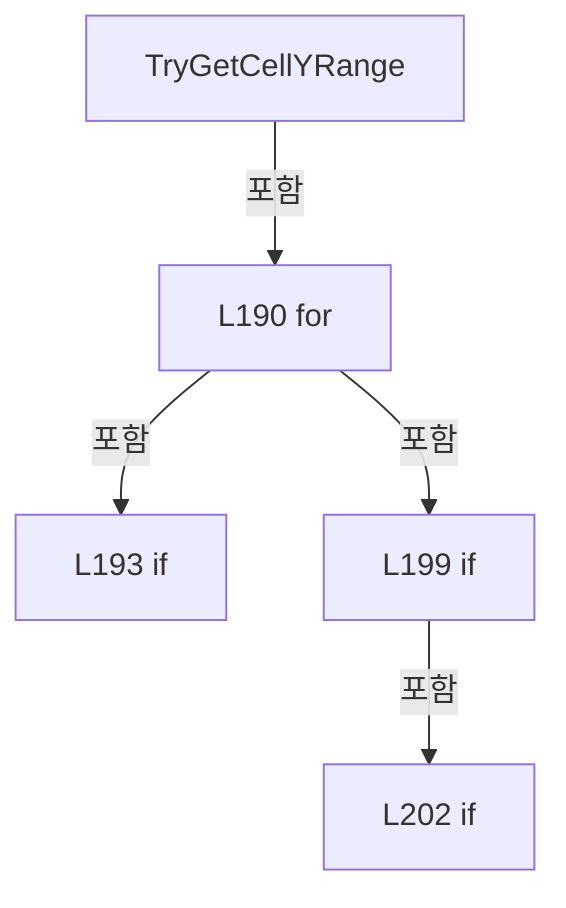

변경 전 점검: 입력/반환 타입, 위 호출자, 예외/취소 경로, 공유 상태와 저장·전송 소비자를 함께 확인합니다. 값의 단위나 물리 방향을 이름만으로 확정하지 않습니다.

### MethodDeclaration `ResolveReferenceY` · L213–221

[Drilling.Common/Review/CReviewRulePlanBuilder.cs:213–221](https://github.com/kjuws10-rgb/A3Drilling/blob/5aee8e58439c9b455cae7c9593c9be986c3e682e/Drilling.Common/Review/CReviewRulePlanBuilder.cs#L213-L221)

| 항목 | 실제 추출 값 |
| --- | --- |
| 서명 | double Drilling.Common.Review.CReviewRulePlanBuilder.ResolveReferenceY((double MinY, double MaxY), Drilling.Common.Review.EN_REVIEW_REFERENCE_LINE) |
| 접근/수식자 | Private / private, static |
| 반환/값 타입 | double |
| 소속 타입 | NamedType:Drilling.Common.Review.CReviewRulePlanBuilder |

입력 계약:

| 이름 | 타입 | 전달 | 선택/기본값 |
| --- | --- | --- | --- |
| range | (double MinY, double MaxY) | None | False /  |
| reference | Drilling.Common.Review.EN_REVIEW_REFERENCE_LINE | None | False /  |

정적 호출자로 확인된 위치:

| 호출 파일/행 | 호출 표현식 | 런타임 분기 가능 |
| --- | --- | --- |
| [Drilling.Common/Review/CReviewRulePlanBuilder.cs:46–46](https://github.com/kjuws10-rgb/A3Drilling/blob/5aee8e58439c9b455cae7c9593c9be986c3e682e/Drilling.Common/Review/CReviewRulePlanBuilder.cs#L46-L46) | ResolveReferenceY | False |
| [Drilling.Common/Review/CReviewRulePlanBuilder.cs:140–140](https://github.com/kjuws10-rgb/A3Drilling/blob/5aee8e58439c9b455cae7c9593c9be986c3e682e/Drilling.Common/Review/CReviewRulePlanBuilder.cs#L140-L140) | ResolveReferenceY | False |

본문의 실제 연산·분기·예외·반환 순서(원문 위치 순):

| 원본 행 | 종류 | 주석 해설 |
| --- | --- | --- |
| 215 | return | 호출자에게 값 또는 제어를 반환합니다: return reference switch { EN_REVIEW_REFERENCE_LINE.Last => range.MaxY, EN_REVIEW_REFERENCE_LINE.Center => (range.MinY + range.MaxY) / 2.0, _ => range.MinY }; |
| 215 | switch-expression | 값별 결과식을 선택합니다: reference switch { EN_REVIEW_REFERENCE_LINE.Last => range.MaxY, EN_REVIEW_REFERENCE_LINE.Center => (range.MinY + range.MaxY) / 2.0, _ => range.MinY } |

제어 구문의 포함 구조(실제 실행 순서/CFG가 아닌 구문 탐색 그림):

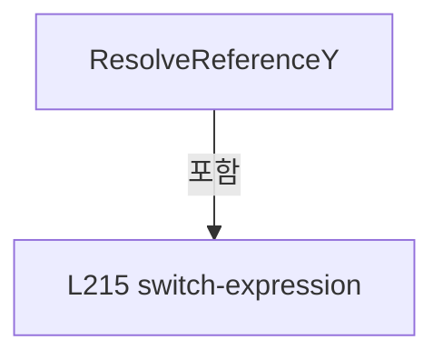

변경 전 점검: 입력/반환 타입, 위 호출자, 예외/취소 경로, 공유 상태와 저장·전송 소비자를 함께 확인합니다. 값의 단위나 물리 방향을 이름만으로 확정하지 않습니다.

### MethodDeclaration `UpdateHeadRange` · L223–238

[Drilling.Common/Review/CReviewRulePlanBuilder.cs:223–238](https://github.com/kjuws10-rgb/A3Drilling/blob/5aee8e58439c9b455cae7c9593c9be986c3e682e/Drilling.Common/Review/CReviewRulePlanBuilder.cs#L223-L238)

| 항목 | 실제 추출 값 |
| --- | --- |
| 서명 | void Drilling.Common.Review.CReviewRulePlanBuilder.UpdateHeadRange(Drilling.Common.Review.ST_REVIEW_PLAN_POINT, System.Collections.Generic.IDictionary<int, (double MinY, double MaxY)>) |
| 접근/수식자 | Private / private, static |
| 반환/값 타입 | void |
| 소속 타입 | NamedType:Drilling.Common.Review.CReviewRulePlanBuilder |

입력 계약:

| 이름 | 타입 | 전달 | 선택/기본값 |
| --- | --- | --- | --- |
| point | Drilling.Common.Review.ST_REVIEW_PLAN_POINT | None | False /  |
| headRanges | System.Collections.Generic.IDictionary<int, (double MinY, double MaxY)> | None | False /  |

정적 호출자로 확인된 위치:

| 호출 파일/행 | 호출 표현식 | 런타임 분기 가능 |
| --- | --- | --- |
| [Drilling.Common/Review/CReviewRulePlanBuilder.cs:38–38](https://github.com/kjuws10-rgb/A3Drilling/blob/5aee8e58439c9b455cae7c9593c9be986c3e682e/Drilling.Common/Review/CReviewRulePlanBuilder.cs#L38-L38) | UpdateHeadRange | False |
| [Drilling.Common/Review/CReviewRulePlanBuilder.cs:41–41](https://github.com/kjuws10-rgb/A3Drilling/blob/5aee8e58439c9b455cae7c9593c9be986c3e682e/Drilling.Common/Review/CReviewRulePlanBuilder.cs#L41-L41) | UpdateHeadRange | False |
| [Drilling.Common/Review/CReviewRulePlanBuilder.cs:85–85](https://github.com/kjuws10-rgb/A3Drilling/blob/5aee8e58439c9b455cae7c9593c9be986c3e682e/Drilling.Common/Review/CReviewRulePlanBuilder.cs#L85-L85) | UpdateHeadRange | False |
| [Drilling.Common/Review/CReviewRulePlanBuilder.cs:88–88](https://github.com/kjuws10-rgb/A3Drilling/blob/5aee8e58439c9b455cae7c9593c9be986c3e682e/Drilling.Common/Review/CReviewRulePlanBuilder.cs#L88-L88) | UpdateHeadRange | False |

호출하는 대상과 해석 범위:

| 원본 행 | 표현식 | 분석 상태 | 대상/소스 위치 |
| --- | --- | --- | --- |
| 225 | double.IsFinite | resolved | bool double.IsFinite(double) |
| 225 | double.IsFinite | resolved | bool double.IsFinite(double) |
| 230 | headRanges.TryGetValue | resolved · 동적 구현 선택 가능 | bool System.Collections.Generic.IDictionary<int, (double MinY, double MaxY)>.TryGetValue(int, out (double MinY, double MaxY)) |
| 232 | Math.Min | resolved | double System.Math.Min(double, double) |
| 232 | Math.Max | resolved | double System.Math.Max(double, double) |

본문의 실제 연산·분기·예외·반환 순서(원문 위치 순):

| 원본 행 | 종류 | 주석 해설 |
| --- | --- | --- |
| 225 | call | 함수·델리게이트 또는 객체 생성자를 호출합니다: double.IsFinite(point.DesignX) |
| 225 | call | 함수·델리게이트 또는 객체 생성자를 호출합니다: double.IsFinite(point.DesignY) |
| 225 | if | 조건에 따라 분기합니다: if (point.HeadNo <= 0 &#124;&#124; !double.IsFinite(point.DesignX) &#124;&#124; !double.IsFinite(point.DesignY)) |
| 227 | return | 호출자에게 값 또는 제어를 반환합니다: return; |
| 230 | call | 함수·델리게이트 또는 객체 생성자를 호출합니다: headRanges.TryGetValue(point.HeadNo, out var range) |
| 230 | if | 조건에 따라 분기합니다: if (headRanges.TryGetValue(point.HeadNo, out var range)) |
| 232 | assignment | 값을 대상에 대입합니다: headRanges[point.HeadNo] = (Math.Min(range.MinY, point.DesignY), Math.Max(range.MaxY, point.DesignY)) |
| 232 | call | 함수·델리게이트 또는 객체 생성자를 호출합니다: Math.Min(range.MinY, point.DesignY) |
| 232 | call | 함수·델리게이트 또는 객체 생성자를 호출합니다: Math.Max(range.MaxY, point.DesignY) |
| 234 | else | 앞 조건이 거짓인 경로입니다: else |
| 236 | assignment | 값을 대상에 대입합니다: headRanges[point.HeadNo] = (point.DesignY, point.DesignY) |

제어 구문의 포함 구조(실제 실행 순서/CFG가 아닌 구문 탐색 그림):

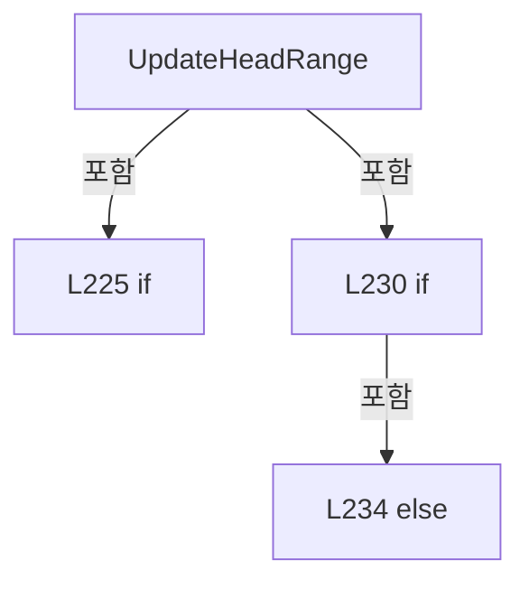

변경 전 점검: 입력/반환 타입, 위 호출자, 예외/취소 경로, 공유 상태와 저장·전송 소비자를 함께 확인합니다. 값의 단위나 물리 방향을 이름만으로 확정하지 않습니다.

### MethodDeclaration `FindNearestRow` · L240–254

[Drilling.Common/Review/CReviewRulePlanBuilder.cs:240–254](https://github.com/kjuws10-rgb/A3Drilling/blob/5aee8e58439c9b455cae7c9593c9be986c3e682e/Drilling.Common/Review/CReviewRulePlanBuilder.cs#L240-L254)

| 항목 | 실제 추출 값 |
| --- | --- |
| 서명 | int Drilling.Common.Review.CReviewRulePlanBuilder.FindNearestRow(double, double, int, double) |
| 접근/수식자 | Private / private, static |
| 반환/값 타입 | int |
| 소속 타입 | NamedType:Drilling.Common.Review.CReviewRulePlanBuilder |

입력 계약:

| 이름 | 타입 | 전달 | 선택/기본값 |
| --- | --- | --- | --- |
| firstY | double | None | False /  |
| lastY | double | None | False /  |
| rowCount | int | None | False /  |
| targetY | double | None | False /  |

정적 호출자로 확인된 위치:

| 호출 파일/행 | 호출 표현식 | 런타임 분기 가능 |
| --- | --- | --- |
| [Drilling.Common/Review/CReviewRulePlanBuilder.cs:384–384](https://github.com/kjuws10-rgb/A3Drilling/blob/5aee8e58439c9b455cae7c9593c9be986c3e682e/Drilling.Common/Review/CReviewRulePlanBuilder.cs#L384-L384) | FindNearestRow | False |

호출하는 대상과 해석 범위:

| 원본 행 | 표현식 | 분석 상태 | 대상/소스 위치 |
| --- | --- | --- | --- |
| 242 | double.IsFinite | resolved | bool double.IsFinite(double) |
| 242 | double.IsFinite | resolved | bool double.IsFinite(double) |
| 242 | double.IsFinite | resolved | bool double.IsFinite(double) |
| 248 | double.IsFinite | resolved | bool double.IsFinite(double) |
| 248 | Math.Abs | resolved | double System.Math.Abs(double) |
| 253 | Math.Clamp | resolved | int System.Math.Clamp(int, int, int) |
| 253 | Math.Round | resolved | double System.Math.Round(double, System.MidpointRounding) |

본문의 실제 연산·분기·예외·반환 순서(원문 위치 순):

| 원본 행 | 종류 | 주석 해설 |
| --- | --- | --- |
| 242 | call | 함수·델리게이트 또는 객체 생성자를 호출합니다: double.IsFinite(firstY) |
| 242 | call | 함수·델리게이트 또는 객체 생성자를 호출합니다: double.IsFinite(lastY) |
| 242 | call | 함수·델리게이트 또는 객체 생성자를 호출합니다: double.IsFinite(targetY) |
| 242 | if | 조건에 따라 분기합니다: if (rowCount <= 1 &#124;&#124; !double.IsFinite(firstY) &#124;&#124; !double.IsFinite(lastY) &#124;&#124; !double.IsFinite(targetY)) |
| 244 | return | 호출자에게 값 또는 제어를 반환합니다: return 0; |
| 247 | local-declaration | 지역 변수를 선언합니다: var rowStepY = (lastY - firstY) / (rowCount - 1); |
| 247 | variable-initializer | 변수의 초기값을 지정합니다: rowStepY = (lastY - firstY) / (rowCount - 1) |
| 248 | call | 함수·델리게이트 또는 객체 생성자를 호출합니다: double.IsFinite(rowStepY) |
| 248 | call | 함수·델리게이트 또는 객체 생성자를 호출합니다: Math.Abs(rowStepY) |
| 248 | if | 조건에 따라 분기합니다: if (!double.IsFinite(rowStepY) &#124;&#124; Math.Abs(rowStepY) <= double.Epsilon) |
| 250 | return | 호출자에게 값 또는 제어를 반환합니다: return 0; |
| 253 | call | 함수·델리게이트 또는 객체 생성자를 호출합니다: Math.Clamp((int)Math.Round((targetY - firstY) / rowStepY, MidpointRounding.AwayFromZero), 0, rowCount - 1) |
| 253 | call | 함수·델리게이트 또는 객체 생성자를 호출합니다: Math.Round((targetY - firstY) / rowStepY, MidpointRounding.AwayFromZero) |
| 253 | return | 호출자에게 값 또는 제어를 반환합니다: return Math.Clamp((int)Math.Round((targetY - firstY) / rowStepY, MidpointRounding.AwayFromZero), 0, rowCount - 1); |

제어 구문의 포함 구조(실제 실행 순서/CFG가 아닌 구문 탐색 그림):

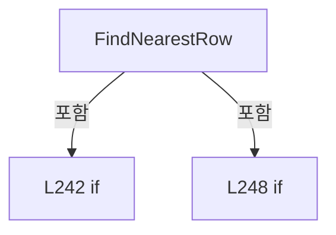

변경 전 점검: 입력/반환 타입, 위 호출자, 예외/취소 경로, 공유 상태와 저장·전송 소비자를 함께 확인합니다. 값의 단위나 물리 방향을 이름만으로 확정하지 않습니다.

### MethodDeclaration `IsEarlierRoughPoint` · L256–280

[Drilling.Common/Review/CReviewRulePlanBuilder.cs:256–280](https://github.com/kjuws10-rgb/A3Drilling/blob/5aee8e58439c9b455cae7c9593c9be986c3e682e/Drilling.Common/Review/CReviewRulePlanBuilder.cs#L256-L280)

| 항목 | 실제 추출 값 |
| --- | --- |
| 서명 | bool Drilling.Common.Review.CReviewRulePlanBuilder.IsEarlierRoughPoint(Drilling.Common.Review.ST_REVIEW_PLAN_POINT, Drilling.Common.Review.ST_REVIEW_PLAN_POINT, double) |
| 접근/수식자 | Private / private, static |
| 반환/값 타입 | bool |
| 소속 타입 | NamedType:Drilling.Common.Review.CReviewRulePlanBuilder |

입력 계약:

| 이름 | 타입 | 전달 | 선택/기본값 |
| --- | --- | --- | --- |
| candidate | Drilling.Common.Review.ST_REVIEW_PLAN_POINT | None | False /  |
| selected | Drilling.Common.Review.ST_REVIEW_PLAN_POINT | None | False /  |
| targetY | double | None | False /  |

정적 호출자로 확인된 위치:

| 호출 파일/행 | 호출 표현식 | 런타임 분기 가능 |
| --- | --- | --- |
| [Drilling.Common/Review/CReviewRulePlanBuilder.cs:59–59](https://github.com/kjuws10-rgb/A3Drilling/blob/5aee8e58439c9b455cae7c9593c9be986c3e682e/Drilling.Common/Review/CReviewRulePlanBuilder.cs#L59-L59) | IsEarlierRoughPoint | False |
| [Drilling.Common/Review/CReviewRulePlanBuilder.cs:124–124](https://github.com/kjuws10-rgb/A3Drilling/blob/5aee8e58439c9b455cae7c9593c9be986c3e682e/Drilling.Common/Review/CReviewRulePlanBuilder.cs#L124-L124) | IsEarlierRoughPoint | False |

호출하는 대상과 해석 범위:

| 원본 행 | 표현식 | 분석 상태 | 대상/소스 위치 |
| --- | --- | --- | --- |
| 258 | Math.Abs | resolved | double System.Math.Abs(double) |
| 259 | Math.Abs | resolved | double System.Math.Abs(double) |
| 260 | candidateDistance.CompareTo | resolved | int double.CompareTo(double) |
| 266 | candidate.DesignY.CompareTo | resolved | int double.CompareTo(double) |
| 272 | candidate.DesignX.CompareTo | resolved | int double.CompareTo(double) |
| 278 | candidate.CellNo.CompareTo | resolved | int int.CompareTo(int) |

본문의 실제 연산·분기·예외·반환 순서(원문 위치 순):

| 원본 행 | 종류 | 주석 해설 |
| --- | --- | --- |
| 258 | call | 함수·델리게이트 또는 객체 생성자를 호출합니다: Math.Abs(candidate.DesignY - targetY) |
| 258 | local-declaration | 지역 변수를 선언합니다: var candidateDistance = Math.Abs(candidate.DesignY - targetY); |
| 258 | variable-initializer | 변수의 초기값을 지정합니다: candidateDistance = Math.Abs(candidate.DesignY - targetY) |
| 259 | call | 함수·델리게이트 또는 객체 생성자를 호출합니다: Math.Abs(selected.DesignY - targetY) |
| 259 | local-declaration | 지역 변수를 선언합니다: var selectedDistance = Math.Abs(selected.DesignY - targetY); |
| 259 | variable-initializer | 변수의 초기값을 지정합니다: selectedDistance = Math.Abs(selected.DesignY - targetY) |
| 260 | call | 함수·델리게이트 또는 객체 생성자를 호출합니다: candidateDistance.CompareTo(selectedDistance) |
| 260 | local-declaration | 지역 변수를 선언합니다: var distanceComparison = candidateDistance.CompareTo(selectedDistance); |
| 260 | variable-initializer | 변수의 초기값을 지정합니다: distanceComparison = candidateDistance.CompareTo(selectedDistance) |
| 261 | if | 조건에 따라 분기합니다: if (distanceComparison != 0) |
| 263 | return | 호출자에게 값 또는 제어를 반환합니다: return distanceComparison < 0; |
| 266 | call | 함수·델리게이트 또는 객체 생성자를 호출합니다: candidate.DesignY.CompareTo(selected.DesignY) |
| 266 | local-declaration | 지역 변수를 선언합니다: var yComparison = candidate.DesignY.CompareTo(selected.DesignY); |
| 266 | variable-initializer | 변수의 초기값을 지정합니다: yComparison = candidate.DesignY.CompareTo(selected.DesignY) |
| 267 | if | 조건에 따라 분기합니다: if (yComparison != 0) |
| 269 | return | 호출자에게 값 또는 제어를 반환합니다: return yComparison < 0; |
| 272 | call | 함수·델리게이트 또는 객체 생성자를 호출합니다: candidate.DesignX.CompareTo(selected.DesignX) |
| 272 | local-declaration | 지역 변수를 선언합니다: var xComparison = candidate.DesignX.CompareTo(selected.DesignX); |
| 272 | variable-initializer | 변수의 초기값을 지정합니다: xComparison = candidate.DesignX.CompareTo(selected.DesignX) |
| 273 | if | 조건에 따라 분기합니다: if (xComparison != 0) |
| 275 | return | 호출자에게 값 또는 제어를 반환합니다: return xComparison < 0; |
| 278 | call | 함수·델리게이트 또는 객체 생성자를 호출합니다: candidate.CellNo.CompareTo(selected.CellNo) |
| 278 | local-declaration | 지역 변수를 선언합니다: var cellComparison = candidate.CellNo.CompareTo(selected.CellNo); |
| 278 | variable-initializer | 변수의 초기값을 지정합니다: cellComparison = candidate.CellNo.CompareTo(selected.CellNo) |
| 279 | conditional-expression | 조건에 따라 결과식을 선택합니다: cellComparison != 0 ? cellComparison < 0 : candidate.ShotNo < selected.ShotNo |
| 279 | return | 호출자에게 값 또는 제어를 반환합니다: return cellComparison != 0 ? cellComparison < 0 : candidate.ShotNo < selected.ShotNo; |

제어 구문의 포함 구조(실제 실행 순서/CFG가 아닌 구문 탐색 그림):

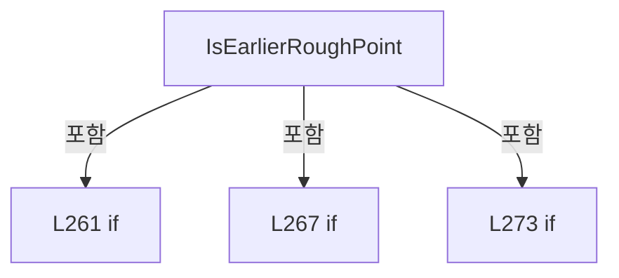

변경 전 점검: 입력/반환 타입, 위 호출자, 예외/취소 경로, 공유 상태와 저장·전송 소비자를 함께 확인합니다. 값의 단위나 물리 방향을 이름만으로 확정하지 않습니다.

### MethodDeclaration `BuildFine` · L282–294

[Drilling.Common/Review/CReviewRulePlanBuilder.cs:282–294](https://github.com/kjuws10-rgb/A3Drilling/blob/5aee8e58439c9b455cae7c9593c9be986c3e682e/Drilling.Common/Review/CReviewRulePlanBuilder.cs#L282-L294)

| 항목 | 실제 추출 값 |
| --- | --- |
| 서명 | System.Collections.Generic.IReadOnlyList<Drilling.Common.Review.ST_REVIEW_RULE_TARGET> Drilling.Common.Review.CReviewRulePlanBuilder.BuildFine(Drilling.Common.Review.ST_REVIEW_PLAN, int) |
| 접근/수식자 | Private / private, static |
| 반환/값 타입 | System.Collections.Generic.IReadOnlyList<Drilling.Common.Review.ST_REVIEW_RULE_TARGET> |
| 소속 타입 | NamedType:Drilling.Common.Review.CReviewRulePlanBuilder |

입력 계약:

| 이름 | 타입 | 전달 | 선택/기본값 |
| --- | --- | --- | --- |
| plan | Drilling.Common.Review.ST_REVIEW_PLAN | None | False /  |
| lineCount | int | None | False /  |

정적 호출자로 확인된 위치:

| 호출 파일/행 | 호출 표현식 | 런타임 분기 가능 |
| --- | --- | --- |
| [Drilling.Common/Review/CReviewRulePlanBuilder.cs:12–12](https://github.com/kjuws10-rgb/A3Drilling/blob/5aee8e58439c9b455cae7c9593c9be986c3e682e/Drilling.Common/Review/CReviewRulePlanBuilder.cs#L12-L12) | BuildFine | False |

호출하는 대상과 해석 범위:

| 원본 행 | 표현식 | 분석 상태 | 대상/소스 위치 |
| --- | --- | --- | --- |
| 286 | BuildFineFromCellSource | resolved | System.Collections.Generic.IReadOnlyList<Drilling.Common.Review.ST_REVIEW_RULE_TARGET> Drilling.Common.Review.CReviewRulePlanBuilder.BuildFineFromCellSource(Drilling.Common.Review.ST_REVIEW_PLAN, int) · Drilling.Common/Review/CReviewRulePlanBuilder.cs:361 |
| 289 | plan.Points.Where(point => point.CellNo > 0 && point.HeadNo > 0 && double.IsFinite(point.DesignY)).GroupBy(point => point.CellNo).OrderBy(cell => cell.Key).SelectMany(cell => { var rows = cell.GroupBy(point => CoordinateKey(point.DesignY)).OrderBy(row => row.Key).ToArray(); return FineCellRows(rows, lineCount, rows[0].Key, rows[^1].Key).SelectMany(… | resolved | Drilling.Common.Review.ST_REVIEW_RULE_TARGET[] System.Collections.Generic.IEnumerable<Drilling.Common.Review.ST_REVIEW_RULE_TARGET>.ToArray<Drilling.Common.Review.ST_REVIEW_RULE_TARGET>() |
| 289 | plan.Points.Where(point => point.CellNo > 0 && point.HeadNo > 0 && double.IsFinite(point.DesignY)).GroupBy(point => point.CellNo).OrderBy(cell => cell.Key).SelectMany | resolved | System.Collections.Generic.IEnumerable<Drilling.Common.Review.ST_REVIEW_RULE_TARGET> System.Collections.Generic.IEnumerable<System.Linq.IGrouping<int, Drilling.Common.Review.ST_REVIEW_PLAN_POINT>>.SelectMany<System.Linq.IGrouping<int, Drilling.Common.Review.ST_REVIEW_PLAN_POINT>, Drilling.Common.Review.ST_REVIEW_RULE_TARGET>(System.Func<System.Linq.IGrouping<int, Drilling.Common.Review.ST_REVIEW_PLAN_POINT>, System.Collections.Generic.IEnumerable<Drilling.Common.Review.ST_REVIEW_RULE_TARGET>>) |
| 289 | plan.Points.Where(point => point.CellNo > 0 && point.HeadNo > 0 && double.IsFinite(point.DesignY)).GroupBy(point => point.CellNo).OrderBy | resolved | System.Linq.IOrderedEnumerable<System.Linq.IGrouping<int, Drilling.Common.Review.ST_REVIEW_PLAN_POINT>> System.Collections.Generic.IEnumerable<System.Linq.IGrouping<int, Drilling.Common.Review.ST_REVIEW_PLAN_POINT>>.OrderBy<System.Linq.IGrouping<int, Drilling.Common.Review.ST_REVIEW_PLAN_POINT>, int>(System.Func<System.Linq.IGrouping<int, Drilling.Common.Review.ST_REVIEW_PLAN_POINT>, int>) |
| 289 | plan.Points.Where(point => point.CellNo > 0 && point.HeadNo > 0 && double.IsFinite(point.DesignY)).GroupBy | resolved | System.Collections.Generic.IEnumerable<System.Linq.IGrouping<int, Drilling.Common.Review.ST_REVIEW_PLAN_POINT>> System.Collections.Generic.IEnumerable<Drilling.Common.Review.ST_REVIEW_PLAN_POINT>.GroupBy<Drilling.Common.Review.ST_REVIEW_PLAN_POINT, int>(System.Func<Drilling.Common.Review.ST_REVIEW_PLAN_POINT, int>) |
| 289 | plan.Points.Where | resolved | System.Collections.Generic.IEnumerable<Drilling.Common.Review.ST_REVIEW_PLAN_POINT> System.Collections.Generic.IEnumerable<Drilling.Common.Review.ST_REVIEW_PLAN_POINT>.Where<Drilling.Common.Review.ST_REVIEW_PLAN_POINT>(System.Func<Drilling.Common.Review.ST_REVIEW_PLAN_POINT, bool>) |
| 289 | double.IsFinite | resolved | bool double.IsFinite(double) |
| 291 | cell.GroupBy(point => CoordinateKey(point.DesignY)).OrderBy(row => row.Key).ToArray | resolved | System.Linq.IGrouping<double, Drilling.Common.Review.ST_REVIEW_PLAN_POINT>[] System.Collections.Generic.IEnumerable<System.Linq.IGrouping<double, Drilling.Common.Review.ST_REVIEW_PLAN_POINT>>.ToArray<System.Linq.IGrouping<double, Drilling.Common.Review.ST_REVIEW_PLAN_POINT>>() |
| 291 | cell.GroupBy(point => CoordinateKey(point.DesignY)).OrderBy | resolved | System.Linq.IOrderedEnumerable<System.Linq.IGrouping<double, Drilling.Common.Review.ST_REVIEW_PLAN_POINT>> System.Collections.Generic.IEnumerable<System.Linq.IGrouping<double, Drilling.Common.Review.ST_REVIEW_PLAN_POINT>>.OrderBy<System.Linq.IGrouping<double, Drilling.Common.Review.ST_REVIEW_PLAN_POINT>, double>(System.Func<System.Linq.IGrouping<double, Drilling.Common.Review.ST_REVIEW_PLAN_POINT>, double>) |
| 291 | cell.GroupBy | resolved | System.Collections.Generic.IEnumerable<System.Linq.IGrouping<double, Drilling.Common.Review.ST_REVIEW_PLAN_POINT>> System.Collections.Generic.IEnumerable<Drilling.Common.Review.ST_REVIEW_PLAN_POINT>.GroupBy<Drilling.Common.Review.ST_REVIEW_PLAN_POINT, double>(System.Func<Drilling.Common.Review.ST_REVIEW_PLAN_POINT, double>) |
| 291 | CoordinateKey | resolved | double Drilling.Common.Review.CReviewRulePlanBuilder.CoordinateKey(double) · Drilling.Common/Review/CReviewRulePlanBuilder.cs:462 |
| 292 | FineCellRows(rows, lineCount, rows[0].Key, rows[^1].Key).SelectMany | resolved | System.Collections.Generic.IEnumerable<Drilling.Common.Review.ST_REVIEW_RULE_TARGET> System.Collections.Generic.IEnumerable<System.Linq.IGrouping<double, Drilling.Common.Review.ST_REVIEW_PLAN_POINT>>.SelectMany<System.Linq.IGrouping<double, Drilling.Common.Review.ST_REVIEW_PLAN_POINT>, Drilling.Common.Review.ST_REVIEW_RULE_TARGET>(System.Func<System.Linq.IGrouping<double, Drilling.Common.Review.ST_REVIEW_PLAN_POINT>, int, System.Collections.Generic.IEnumerable<Drilling.Common.Review.ST_REVIEW_RULE_TARGET>>) |
| 292 | FineCellRows | resolved | System.Collections.Generic.IReadOnlyList<System.Linq.IGrouping<double, Drilling.Common.Review.ST_REVIEW_PLAN_POINT>> Drilling.Common.Review.CReviewRulePlanBuilder.FineCellRows(System.Collections.Generic.IReadOnlyList<System.Linq.IGrouping<double, Drilling.Common.Review.ST_REVIEW_PLAN_POINT>>, int, double, double) · Drilling.Common/Review/CReviewRulePlanBuilder.cs:434 |
| 292 | row.OrderBy(point => point.DesignX).ThenBy(point => point.HeadNo).ThenBy(point => point.ShotNo).Select | resolved | System.Collections.Generic.IEnumerable<Drilling.Common.Review.ST_REVIEW_RULE_TARGET> System.Collections.Generic.IEnumerable<Drilling.Common.Review.ST_REVIEW_PLAN_POINT>.Select<Drilling.Common.Review.ST_REVIEW_PLAN_POINT, Drilling.Common.Review.ST_REVIEW_RULE_TARGET>(System.Func<Drilling.Common.Review.ST_REVIEW_PLAN_POINT, Drilling.Common.Review.ST_REVIEW_RULE_TARGET>) |
| 292 | row.OrderBy(point => point.DesignX).ThenBy(point => point.HeadNo).ThenBy | resolved | System.Linq.IOrderedEnumerable<Drilling.Common.Review.ST_REVIEW_PLAN_POINT> System.Linq.IOrderedEnumerable<Drilling.Common.Review.ST_REVIEW_PLAN_POINT>.ThenBy<Drilling.Common.Review.ST_REVIEW_PLAN_POINT, int>(System.Func<Drilling.Common.Review.ST_REVIEW_PLAN_POINT, int>) |
| 292 | row.OrderBy(point => point.DesignX).ThenBy | resolved | System.Linq.IOrderedEnumerable<Drilling.Common.Review.ST_REVIEW_PLAN_POINT> System.Linq.IOrderedEnumerable<Drilling.Common.Review.ST_REVIEW_PLAN_POINT>.ThenBy<Drilling.Common.Review.ST_REVIEW_PLAN_POINT, int>(System.Func<Drilling.Common.Review.ST_REVIEW_PLAN_POINT, int>) |
| 292 | row.OrderBy | resolved | System.Linq.IOrderedEnumerable<Drilling.Common.Review.ST_REVIEW_PLAN_POINT> System.Collections.Generic.IEnumerable<Drilling.Common.Review.ST_REVIEW_PLAN_POINT>.OrderBy<Drilling.Common.Review.ST_REVIEW_PLAN_POINT, double>(System.Func<Drilling.Common.Review.ST_REVIEW_PLAN_POINT, double>) |
| 292 | CreateTarget | resolved | Drilling.Common.Review.ST_REVIEW_RULE_TARGET Drilling.Common.Review.CReviewRulePlanBuilder.CreateTarget(Drilling.Common.Review.ST_REVIEW_PLAN_POINT, string) · Drilling.Common/Review/CReviewRulePlanBuilder.cs:447 |

본문의 실제 연산·분기·예외·반환 순서(원문 위치 순):

| 원본 행 | 종류 | 주석 해설 |
| --- | --- | --- |
| 284 | if | 조건에 따라 분기합니다: if (plan.Points is IReviewCellPointSource) |
| 286 | call | 함수·델리게이트 또는 객체 생성자를 호출합니다: BuildFineFromCellSource(plan, lineCount) |
| 286 | return | 호출자에게 값 또는 제어를 반환합니다: return BuildFineFromCellSource(plan, lineCount); |
| 289 | call | 함수·델리게이트 또는 객체 생성자를 호출합니다: plan.Points.Where(point => point.CellNo > 0 && point.HeadNo > 0 && double.IsFinite(point.DesignY)).GroupBy(point => point.CellNo).OrderBy(cell => cell.Key) |
| 289 | call | 함수·델리게이트 또는 객체 생성자를 호출합니다: plan.Points.Where(point => point.CellNo > 0 && point.HeadNo > 0 && double.IsFinite(point.DesignY)).GroupBy(point => point.CellNo) |
| 289 | call | 함수·델리게이트 또는 객체 생성자를 호출합니다: plan.Points.Where(point => point.CellNo > 0 && point.HeadNo > 0 && double.IsFinite(point.DesignY)) |
| 289 | call | 함수·델리게이트 또는 객체 생성자를 호출합니다: double.IsFinite(point.DesignY) |
| 289 | call | 함수·델리게이트 또는 객체 생성자를 호출합니다: plan.Points.Where(point => point.CellNo > 0 && point.HeadNo > 0 && double.IsFinite(point.DesignY)).GroupBy(point => point.CellNo).OrderBy(cell => cell.Key).SelectMany(cell => { var rows = cell.GroupBy(point => Coordinate… |
| 289 | call | 함수·델리게이트 또는 객체 생성자를 호출합니다: plan.Points.Where(point => point.CellNo > 0 && point.HeadNo > 0 && double.IsFinite(point.DesignY)).GroupBy(point => point.CellNo).OrderBy(cell => cell.Key).SelectMany(cell => { var rows = cell.GroupBy(point => Coordinate… |
| 289 | return | 호출자에게 값 또는 제어를 반환합니다: return plan.Points.Where(point => point.CellNo > 0 && point.HeadNo > 0 && double.IsFinite(point.DesignY)).GroupBy(point => point.CellNo).OrderBy(cell => cell.Key).SelectMany(cell => { var rows = cell.GroupBy(point => CoordinateKey |
| 291 | call | 함수·델리게이트 또는 객체 생성자를 호출합니다: cell.GroupBy(point => CoordinateKey(point.DesignY)).OrderBy(row => row.Key).ToArray() |
| 291 | call | 함수·델리게이트 또는 객체 생성자를 호출합니다: cell.GroupBy(point => CoordinateKey(point.DesignY)).OrderBy(row => row.Key) |
| 291 | call | 함수·델리게이트 또는 객체 생성자를 호출합니다: cell.GroupBy(point => CoordinateKey(point.DesignY)) |
| 291 | call | 함수·델리게이트 또는 객체 생성자를 호출합니다: CoordinateKey(point.DesignY) |
| 291 | local-declaration | 지역 변수를 선언합니다: var rows = cell.GroupBy(point => CoordinateKey(point.DesignY)).OrderBy(row => row.Key).ToArray(); |
| 291 | variable-initializer | 변수의 초기값을 지정합니다: rows = cell.GroupBy(point => CoordinateKey(point.DesignY)).OrderBy(row => row.Key).ToArray() |
| 292 | call | 함수·델리게이트 또는 객체 생성자를 호출합니다: FineCellRows(rows, lineCount, rows[0].Key, rows[^1].Key).SelectMany((row, lineIndex) => row.OrderBy(point => point.DesignX).ThenBy(point => point.HeadNo).ThenBy(point => point.ShotNo).Select(point => CreateTarget(point, … |
| 292 | call | 함수·델리게이트 또는 객체 생성자를 호출합니다: FineCellRows(rows, lineCount, rows[0].Key, rows[^1].Key) |
| 292 | call | 함수·델리게이트 또는 객체 생성자를 호출합니다: row.OrderBy(point => point.DesignX).ThenBy(point => point.HeadNo).ThenBy(point => point.ShotNo).Select(point => CreateTarget(point, $"CELL {cell.Key:00} LINE {lineIndex + 1}")) |
| 292 | call | 함수·델리게이트 또는 객체 생성자를 호출합니다: row.OrderBy(point => point.DesignX).ThenBy(point => point.HeadNo).ThenBy(point => point.ShotNo) |
| 292 | call | 함수·델리게이트 또는 객체 생성자를 호출합니다: row.OrderBy(point => point.DesignX).ThenBy(point => point.HeadNo) |
| 292 | call | 함수·델리게이트 또는 객체 생성자를 호출합니다: row.OrderBy(point => point.DesignX) |
| 292 | call | 함수·델리게이트 또는 객체 생성자를 호출합니다: CreateTarget(point, $"CELL {cell.Key:00} LINE {lineIndex + 1}") |
| 292 | return | 호출자에게 값 또는 제어를 반환합니다: return FineCellRows(rows, lineCount, rows[0].Key, rows[^1].Key).SelectMany((row, lineIndex) => row.OrderBy(point => point.DesignX).ThenBy(point => point.HeadNo).ThenBy(point => point.ShotNo).Select(point => CreateTarget(point, $"C |

제어 구문의 포함 구조(실제 실행 순서/CFG가 아닌 구문 탐색 그림):

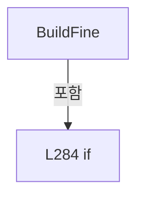

변경 전 점검: 입력/반환 타입, 위 호출자, 예외/취소 경로, 공유 상태와 저장·전송 소비자를 함께 확인합니다. 값의 단위나 물리 방향을 이름만으로 확정하지 않습니다.

### MethodDeclaration `IsExecutableRoughPoint` · L296–296

[Drilling.Common/Review/CReviewRulePlanBuilder.cs:296–296](https://github.com/kjuws10-rgb/A3Drilling/blob/5aee8e58439c9b455cae7c9593c9be986c3e682e/Drilling.Common/Review/CReviewRulePlanBuilder.cs#L296-L296)

| 항목 | 실제 추출 값 |
| --- | --- |
| 서명 | bool Drilling.Common.Review.CReviewRulePlanBuilder.IsExecutableRoughPoint(Drilling.Common.Review.ST_REVIEW_PLAN_POINT) |
| 접근/수식자 | Private / private, static |
| 반환/값 타입 | bool |
| 소속 타입 | NamedType:Drilling.Common.Review.CReviewRulePlanBuilder |

입력 계약:

| 이름 | 타입 | 전달 | 선택/기본값 |
| --- | --- | --- | --- |
| point | Drilling.Common.Review.ST_REVIEW_PLAN_POINT | None | False /  |

정적 호출자로 확인된 위치:

| 호출 파일/행 | 호출 표현식 | 런타임 분기 가능 |
| --- | --- | --- |
| [Drilling.Common/Review/CReviewRulePlanBuilder.cs:54–54](https://github.com/kjuws10-rgb/A3Drilling/blob/5aee8e58439c9b455cae7c9593c9be986c3e682e/Drilling.Common/Review/CReviewRulePlanBuilder.cs#L54-L54) | IsExecutableRoughPoint | False |
| [Drilling.Common/Review/CReviewRulePlanBuilder.cs:118–118](https://github.com/kjuws10-rgb/A3Drilling/blob/5aee8e58439c9b455cae7c9593c9be986c3e682e/Drilling.Common/Review/CReviewRulePlanBuilder.cs#L118-L118) | IsExecutableRoughPoint | False |

호출하는 대상과 해석 범위:

| 원본 행 | 표현식 | 분석 상태 | 대상/소스 위치 |
| --- | --- | --- | --- |
| 296 | string.IsNullOrWhiteSpace | resolved | bool string.IsNullOrWhiteSpace(string?) |
| 296 | double.IsFinite | resolved | bool double.IsFinite(double) |
| 296 | double.IsFinite | resolved | bool double.IsFinite(double) |

본문의 실제 연산·분기·예외·반환 순서(원문 위치 순):

| 원본 행 | 종류 | 주석 해설 |
| --- | --- | --- |
| 296 | call | 함수·델리게이트 또는 객체 생성자를 호출합니다: string.IsNullOrWhiteSpace(point.ExclusionReason) |
| 296 | call | 함수·델리게이트 또는 객체 생성자를 호출합니다: double.IsFinite(point.DesignX) |
| 296 | call | 함수·델리게이트 또는 객체 생성자를 호출합니다: double.IsFinite(point.DesignY) |

변경 전 점검: 입력/반환 타입, 위 호출자, 예외/취소 경로, 공유 상태와 저장·전송 소비자를 함께 확인합니다. 값의 단위나 물리 방향을 이름만으로 확정하지 않습니다.

### MethodDeclaration `BuildEdge` · L297–319

[Drilling.Common/Review/CReviewRulePlanBuilder.cs:297–319](https://github.com/kjuws10-rgb/A3Drilling/blob/5aee8e58439c9b455cae7c9593c9be986c3e682e/Drilling.Common/Review/CReviewRulePlanBuilder.cs#L297-L319)

| 항목 | 실제 추출 값 |
| --- | --- |
| 서명 | System.Collections.Generic.IReadOnlyList<Drilling.Common.Review.ST_REVIEW_RULE_TARGET> Drilling.Common.Review.CReviewRulePlanBuilder.BuildEdge(Drilling.Common.Review.ST_REVIEW_PLAN) |
| 접근/수식자 | Private / private, static |
| 반환/값 타입 | System.Collections.Generic.IReadOnlyList<Drilling.Common.Review.ST_REVIEW_RULE_TARGET> |
| 소속 타입 | NamedType:Drilling.Common.Review.CReviewRulePlanBuilder |

입력 계약:

| 이름 | 타입 | 전달 | 선택/기본값 |
| --- | --- | --- | --- |
| plan | Drilling.Common.Review.ST_REVIEW_PLAN | None | False /  |

정적 호출자로 확인된 위치:

| 호출 파일/행 | 호출 표현식 | 런타임 분기 가능 |
| --- | --- | --- |
| [Drilling.Common/Review/CReviewRulePlanBuilder.cs:13–13](https://github.com/kjuws10-rgb/A3Drilling/blob/5aee8e58439c9b455cae7c9593c9be986c3e682e/Drilling.Common/Review/CReviewRulePlanBuilder.cs#L13-L13) | BuildEdge | False |

호출하는 대상과 해석 범위:

| 원본 행 | 표현식 | 분석 상태 | 대상/소스 위치 |
| --- | --- | --- | --- |
| 299 | new List<ST_REVIEW_RULE_TARGET> | resolved | System.Collections.Generic.List<Drilling.Common.Review.ST_REVIEW_RULE_TARGET>.List() |
| 300 | EnumerateCells | resolved | System.Collections.Generic.IEnumerable<Drilling.Common.Review.CReviewRulePlanBuilder.CellSlice> Drilling.Common.Review.CReviewRulePlanBuilder.EnumerateCells(Drilling.Common.Review.ST_REVIEW_PLAN) · Drilling.Common/Review/CReviewRulePlanBuilder.cs:321 |
| 310 | GetPoint | resolved | Drilling.Common.Review.ST_REVIEW_PLAN_POINT Drilling.Common.Review.CReviewRulePlanBuilder.GetPoint(Drilling.Common.Review.ST_REVIEW_PLAN, Drilling.Common.Review.CReviewRulePlanBuilder.CellSlice, int, int) · Drilling.Common/Review/CReviewRulePlanBuilder.cs:433 |
| 313 | targets.Add | resolved | void System.Collections.Generic.List<Drilling.Common.Review.ST_REVIEW_RULE_TARGET>.Add(Drilling.Common.Review.ST_REVIEW_RULE_TARGET) |
| 313 | CreateTarget | resolved | Drilling.Common.Review.ST_REVIEW_RULE_TARGET Drilling.Common.Review.CReviewRulePlanBuilder.CreateTarget(Drilling.Common.Review.ST_REVIEW_PLAN_POINT, string) · Drilling.Common/Review/CReviewRulePlanBuilder.cs:447 |

본문의 실제 연산·분기·예외·반환 순서(원문 위치 순):

| 원본 행 | 종류 | 주석 해설 |
| --- | --- | --- |
| 299 | call | 함수·델리게이트 또는 객체 생성자를 호출합니다: new List<ST_REVIEW_RULE_TARGET>() |
| 299 | local-declaration | 지역 변수를 선언합니다: var targets = new List<ST_REVIEW_RULE_TARGET>(); |
| 299 | variable-initializer | 변수의 초기값을 지정합니다: targets = new List<ST_REVIEW_RULE_TARGET>() |
| 300 | call | 함수·델리게이트 또는 객체 생성자를 호출합니다: EnumerateCells(plan) |
| 300 | foreach | 컬렉션 요소를 순회합니다: foreach (var cell in EnumerateCells(plan)) |
| 302 | variable-initializer | 변수의 초기값을 지정합니다: row = 1 |
| 302 | for | 초기화·조건·증감이 있는 반복입니다: for (var row = 1; row <= cell.Rows; row++) |
| 303 | variable-initializer | 변수의 초기값을 지정합니다: column = 1 |
| 303 | for | 초기화·조건·증감이 있는 반복입니다: for (var column = 1; column <= cell.Columns; column++) |
| 305 | if | 조건에 따라 분기합니다: if (row != 1 && row != cell.Rows && column != 1 && column != cell.Columns) |
| 307 | continue | 다음 반복으로 진행합니다: continue; |
| 310 | call | 함수·델리게이트 또는 객체 생성자를 호출합니다: GetPoint(plan, cell, row - 1, column - 1) |
| 310 | local-declaration | 지역 변수를 선언합니다: var point = GetPoint(plan, cell, row - 1, column - 1); |
| 310 | variable-initializer | 변수의 초기값을 지정합니다: point = GetPoint(plan, cell, row - 1, column - 1) |
| 311 | if | 조건에 따라 분기합니다: if (point.HeadNo > 0) |
| 313 | call | 함수·델리게이트 또는 객체 생성자를 호출합니다: targets.Add(CreateTarget(point, "EDGE")) |
| 313 | call | 함수·델리게이트 또는 객체 생성자를 호출합니다: CreateTarget(point, "EDGE") |
| 318 | return | 호출자에게 값 또는 제어를 반환합니다: return targets; |

제어 구문의 포함 구조(실제 실행 순서/CFG가 아닌 구문 탐색 그림):

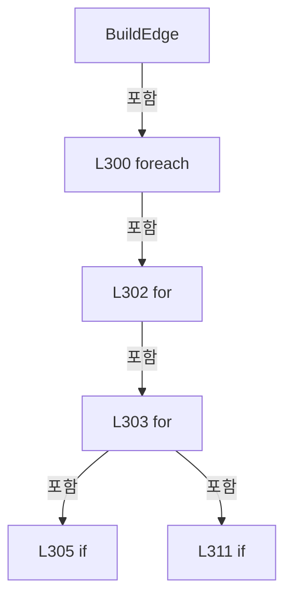

변경 전 점검: 입력/반환 타입, 위 호출자, 예외/취소 경로, 공유 상태와 저장·전송 소비자를 함께 확인합니다. 값의 단위나 물리 방향을 이름만으로 확정하지 않습니다.

### MethodDeclaration `EnumerateCells` · L321–359

[Drilling.Common/Review/CReviewRulePlanBuilder.cs:321–359](https://github.com/kjuws10-rgb/A3Drilling/blob/5aee8e58439c9b455cae7c9593c9be986c3e682e/Drilling.Common/Review/CReviewRulePlanBuilder.cs#L321-L359)

| 항목 | 실제 추출 값 |
| --- | --- |
| 서명 | System.Collections.Generic.IEnumerable<Drilling.Common.Review.CReviewRulePlanBuilder.CellSlice> Drilling.Common.Review.CReviewRulePlanBuilder.EnumerateCells(Drilling.Common.Review.ST_REVIEW_PLAN) |
| 접근/수식자 | Private / private, static |
| 반환/값 타입 | System.Collections.Generic.IEnumerable<Drilling.Common.Review.CReviewRulePlanBuilder.CellSlice> |
| 소속 타입 | NamedType:Drilling.Common.Review.CReviewRulePlanBuilder |

입력 계약:

| 이름 | 타입 | 전달 | 선택/기본값 |
| --- | --- | --- | --- |
| plan | Drilling.Common.Review.ST_REVIEW_PLAN | None | False /  |

정적 호출자로 확인된 위치:

| 호출 파일/행 | 호출 표현식 | 런타임 분기 가능 |
| --- | --- | --- |
| [Drilling.Common/Review/CReviewRulePlanBuilder.cs:32–32](https://github.com/kjuws10-rgb/A3Drilling/blob/5aee8e58439c9b455cae7c9593c9be986c3e682e/Drilling.Common/Review/CReviewRulePlanBuilder.cs#L32-L32) | EnumerateCells | False |
| [Drilling.Common/Review/CReviewRulePlanBuilder.cs:74–74](https://github.com/kjuws10-rgb/A3Drilling/blob/5aee8e58439c9b455cae7c9593c9be986c3e682e/Drilling.Common/Review/CReviewRulePlanBuilder.cs#L74-L74) | EnumerateCells | False |
| [Drilling.Common/Review/CReviewRulePlanBuilder.cs:300–300](https://github.com/kjuws10-rgb/A3Drilling/blob/5aee8e58439c9b455cae7c9593c9be986c3e682e/Drilling.Common/Review/CReviewRulePlanBuilder.cs#L300-L300) | EnumerateCells | False |
| [Drilling.Common/Review/CReviewRulePlanBuilder.cs:363–363](https://github.com/kjuws10-rgb/A3Drilling/blob/5aee8e58439c9b455cae7c9593c9be986c3e682e/Drilling.Common/Review/CReviewRulePlanBuilder.cs#L363-L363) | EnumerateCells | False |

호출하는 대상과 해석 범위:

| 원본 행 | 표현식 | 분석 상태 | 대상/소스 위치 |
| --- | --- | --- | --- |
| 327 | cellSource.GetCellRange | resolved · 동적 구현 선택 가능 | Drilling.Common.Review.ST_REVIEW_CELL_POINT_RANGE Drilling.Common.Review.IReviewCellPointSource.GetCellRange(int) · Drilling.Common/Review/CReviewManager.cs:3828 |
| 333 | new | resolved | Drilling.Common.Review.CReviewRulePlanBuilder.CellSlice.CellSlice(int, int, int, System.Collections.Generic.IReadOnlyList<Drilling.Common.Review.ST_REVIEW_PLAN_POINT>?) · Drilling.Common/Review/CReviewRulePlanBuilder.cs:464 |
| 333 | Math.Max | resolved | int System.Math.Max(int, int) |
| 333 | Math.Max | resolved | int System.Math.Max(int, int) |
| 339 | plan.Points.Where(point => point.CellNo > 0).GroupBy(point => point.CellNo).OrderBy(group => group.Key).Select | resolved | System.Collections.Generic.IEnumerable<Drilling.Common.Review.ST_REVIEW_PLAN_POINT[]> System.Collections.Generic.IEnumerable<System.Linq.IGrouping<int, Drilling.Common.Review.ST_REVIEW_PLAN_POINT>>.Select<System.Linq.IGrouping<int, Drilling.Common.Review.ST_REVIEW_PLAN_POINT>, Drilling.Common.Review.ST_REVIEW_PLAN_POINT[]>(System.Func<System.Linq.IGrouping<int, Drilling.Common.Review.ST_REVIEW_PLAN_POINT>, Drilling.Common.Review.ST_REVIEW_PLAN_POINT[]>) |
| 339 | plan.Points.Where(point => point.CellNo > 0).GroupBy(point => point.CellNo).OrderBy | resolved | System.Linq.IOrderedEnumerable<System.Linq.IGrouping<int, Drilling.Common.Review.ST_REVIEW_PLAN_POINT>> System.Collections.Generic.IEnumerable<System.Linq.IGrouping<int, Drilling.Common.Review.ST_REVIEW_PLAN_POINT>>.OrderBy<System.Linq.IGrouping<int, Drilling.Common.Review.ST_REVIEW_PLAN_POINT>, int>(System.Func<System.Linq.IGrouping<int, Drilling.Common.Review.ST_REVIEW_PLAN_POINT>, int>) |
| 339 | plan.Points.Where(point => point.CellNo > 0).GroupBy | resolved | System.Collections.Generic.IEnumerable<System.Linq.IGrouping<int, Drilling.Common.Review.ST_REVIEW_PLAN_POINT>> System.Collections.Generic.IEnumerable<Drilling.Common.Review.ST_REVIEW_PLAN_POINT>.GroupBy<Drilling.Common.Review.ST_REVIEW_PLAN_POINT, int>(System.Func<Drilling.Common.Review.ST_REVIEW_PLAN_POINT, int>) |
| 339 | plan.Points.Where | resolved | System.Collections.Generic.IEnumerable<Drilling.Common.Review.ST_REVIEW_PLAN_POINT> System.Collections.Generic.IEnumerable<Drilling.Common.Review.ST_REVIEW_PLAN_POINT>.Where<Drilling.Common.Review.ST_REVIEW_PLAN_POINT>(System.Func<Drilling.Common.Review.ST_REVIEW_PLAN_POINT, bool>) |
| 339 | group.OrderBy(point => point.ShotNo).ToArray | resolved | Drilling.Common.Review.ST_REVIEW_PLAN_POINT[] System.Collections.Generic.IEnumerable<Drilling.Common.Review.ST_REVIEW_PLAN_POINT>.ToArray<Drilling.Common.Review.ST_REVIEW_PLAN_POINT>() |
| 339 | group.OrderBy | resolved | System.Linq.IOrderedEnumerable<Drilling.Common.Review.ST_REVIEW_PLAN_POINT> System.Collections.Generic.IEnumerable<Drilling.Common.Review.ST_REVIEW_PLAN_POINT>.OrderBy<Drilling.Common.Review.ST_REVIEW_PLAN_POINT, int>(System.Func<Drilling.Common.Review.ST_REVIEW_PLAN_POINT, int>) |
| 347 | Math.Max | resolved | int System.Math.Max(int, int) |
| 348 | Math.Max | resolved | int System.Math.Max(int, int) |
| 348 | Math.Min | resolved | int System.Math.Min(int, int) |
| 349 | Math.Min | resolved | int System.Math.Min(int, int) |
| 357 | new CellSlice | resolved | Drilling.Common.Review.CReviewRulePlanBuilder.CellSlice.CellSlice(int, int, int, System.Collections.Generic.IReadOnlyList<Drilling.Common.Review.ST_REVIEW_PLAN_POINT>?) · Drilling.Common/Review/CReviewRulePlanBuilder.cs:464 |

본문의 실제 연산·분기·예외·반환 순서(원문 위치 순):

| 원본 행 | 종류 | 주석 해설 |
| --- | --- | --- |
| 323 | if | 조건에 따라 분기합니다: if (plan.Points is IReviewCellPointSource cellSource) |
| 325 | variable-initializer | 변수의 초기값을 지정합니다: cellIndex = 0 |
| 325 | for | 초기화·조건·증감이 있는 반복입니다: for (var cellIndex = 0; cellIndex < cellSource.PatternCellCount; cellIndex++) |
| 327 | call | 함수·델리게이트 또는 객체 생성자를 호출합니다: cellSource.GetCellRange(cellIndex) |
| 327 | local-declaration | 지역 변수를 선언합니다: var range = cellSource.GetCellRange(cellIndex); |
| 327 | variable-initializer | 변수의 초기값을 지정합니다: range = cellSource.GetCellRange(cellIndex) |
| 328 | if | 조건에 따라 분기합니다: if (range.PointCount <= 0) |
| 330 | continue | 다음 반복으로 진행합니다: continue; |
| 333 | call | 함수·델리게이트 또는 객체 생성자를 호출합니다: new(range.StartIndex, Math.Max(1, range.ColumnCount), Math.Max(1, range.RowCount)) |
| 333 | call | 함수·델리게이트 또는 객체 생성자를 호출합니다: Math.Max(1, range.ColumnCount) |
| 333 | call | 함수·델리게이트 또는 객체 생성자를 호출합니다: Math.Max(1, range.RowCount) |
| 333 | yield | 열거값/종료를 전달합니다: yield return new(range.StartIndex, Math.Max(1, range.ColumnCount), Math.Max(1, range.RowCount)); |
| 336 | yield | 열거값/종료를 전달합니다: yield break; |
| 339 | call | 함수·델리게이트 또는 객체 생성자를 호출합니다: plan.Points.Where(point => point.CellNo > 0).GroupBy(point => point.CellNo).OrderBy(group => group.Key).Select(group => group.OrderBy(point => point.ShotNo).ToArray()) |
| 339 | call | 함수·델리게이트 또는 객체 생성자를 호출합니다: plan.Points.Where(point => point.CellNo > 0).GroupBy(point => point.CellNo).OrderBy(group => group.Key) |
| 339 | call | 함수·델리게이트 또는 객체 생성자를 호출합니다: plan.Points.Where(point => point.CellNo > 0).GroupBy(point => point.CellNo) |
| 339 | call | 함수·델리게이트 또는 객체 생성자를 호출합니다: plan.Points.Where(point => point.CellNo > 0) |
| 339 | call | 함수·델리게이트 또는 객체 생성자를 호출합니다: group.OrderBy(point => point.ShotNo).ToArray() |
| 339 | call | 함수·델리게이트 또는 객체 생성자를 호출합니다: group.OrderBy(point => point.ShotNo) |
| 339 | foreach | 컬렉션 요소를 순회합니다: foreach (var cellPoints in plan.Points.Where(point => point.CellNo > 0).GroupBy(point => point.CellNo).OrderBy(group => group.Key).Select(group => group.OrderBy(point => point.ShotNo).ToArray())) |
| 341 | if | 조건에 따라 분기합니다: if (cellPoints.Length == 0) |
| 343 | continue | 다음 반복으로 진행합니다: continue; |
| 346 | local-declaration | 지역 변수를 선언합니다: var first = cellPoints[0]; |
| 346 | variable-initializer | 변수의 초기값을 지정합니다: first = cellPoints[0] |
| 347 | call | 함수·델리게이트 또는 객체 생성자를 호출합니다: Math.Max(1, first.PixelCountX) |
| 347 | local-declaration | 지역 변수를 선언합니다: var columns = Math.Max(1, first.PixelCountX); |
| 347 | variable-initializer | 변수의 초기값을 지정합니다: columns = Math.Max(1, first.PixelCountX) |
| 348 | call | 함수·델리게이트 또는 객체 생성자를 호출합니다: Math.Max(1, Math.Min(first.PixelCountY, cellPoints.Length / columns)) |
| 348 | call | 함수·델리게이트 또는 객체 생성자를 호출합니다: Math.Min(first.PixelCountY, cellPoints.Length / columns) |
| 348 | local-declaration | 지역 변수를 선언합니다: var rows = Math.Max(1, Math.Min(first.PixelCountY, cellPoints.Length / columns)); |
| 348 | variable-initializer | 변수의 초기값을 지정합니다: rows = Math.Max(1, Math.Min(first.PixelCountY, cellPoints.Length / columns)) |
| 349 | call | 함수·델리게이트 또는 객체 생성자를 호출합니다: Math.Min(cellPoints.Length, rows * columns) |
| 349 | local-declaration | 지역 변수를 선언합니다: var usableCount = Math.Min(cellPoints.Length, rows * columns); |
| 349 | variable-initializer | 변수의 초기값을 지정합니다: usableCount = Math.Min(cellPoints.Length, rows * columns) |
| 350 | if | 조건에 따라 분기합니다: if (usableCount <= 0) |
| 352 | continue | 다음 반복으로 진행합니다: continue; |
| 357 | call | 함수·델리게이트 또는 객체 생성자를 호출합니다: new CellSlice(0, columns, rows, cellPoints[..usableCount]) |
| 357 | yield | 열거값/종료를 전달합니다: yield return new CellSlice(0, columns, rows, cellPoints[..usableCount]); |

제어 구문의 포함 구조(실제 실행 순서/CFG가 아닌 구문 탐색 그림):

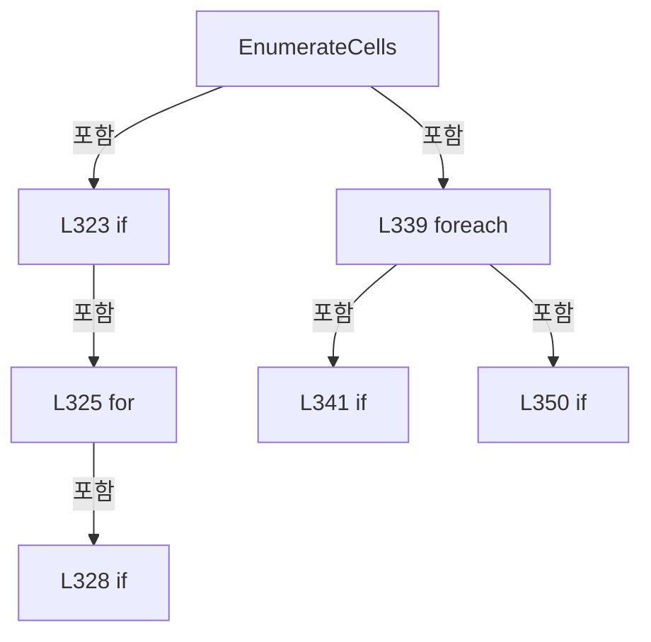

변경 전 점검: 입력/반환 타입, 위 호출자, 예외/취소 경로, 공유 상태와 저장·전송 소비자를 함께 확인합니다. 값의 단위나 물리 방향을 이름만으로 확정하지 않습니다.

### MethodDeclaration `BuildFineFromCellSource` · L361–401

[Drilling.Common/Review/CReviewRulePlanBuilder.cs:361–401](https://github.com/kjuws10-rgb/A3Drilling/blob/5aee8e58439c9b455cae7c9593c9be986c3e682e/Drilling.Common/Review/CReviewRulePlanBuilder.cs#L361-L401)

| 항목 | 실제 추출 값 |
| --- | --- |
| 서명 | System.Collections.Generic.IReadOnlyList<Drilling.Common.Review.ST_REVIEW_RULE_TARGET> Drilling.Common.Review.CReviewRulePlanBuilder.BuildFineFromCellSource(Drilling.Common.Review.ST_REVIEW_PLAN, int) |
| 접근/수식자 | Private / private, static |
| 반환/값 타입 | System.Collections.Generic.IReadOnlyList<Drilling.Common.Review.ST_REVIEW_RULE_TARGET> |
| 소속 타입 | NamedType:Drilling.Common.Review.CReviewRulePlanBuilder |

입력 계약:

| 이름 | 타입 | 전달 | 선택/기본값 |
| --- | --- | --- | --- |
| plan | Drilling.Common.Review.ST_REVIEW_PLAN | None | False /  |
| requestedCount | int | None | False /  |

정적 호출자로 확인된 위치:

| 호출 파일/행 | 호출 표현식 | 런타임 분기 가능 |
| --- | --- | --- |
| [Drilling.Common/Review/CReviewRulePlanBuilder.cs:286–286](https://github.com/kjuws10-rgb/A3Drilling/blob/5aee8e58439c9b455cae7c9593c9be986c3e682e/Drilling.Common/Review/CReviewRulePlanBuilder.cs#L286-L286) | BuildFineFromCellSource | False |

호출하는 대상과 해석 범위:

| 원본 행 | 표현식 | 분석 상태 | 대상/소스 위치 |
| --- | --- | --- | --- |
| 363 | EnumerateCells(plan).ToArray | resolved | Drilling.Common.Review.CReviewRulePlanBuilder.CellSlice[] System.Collections.Generic.IEnumerable<Drilling.Common.Review.CReviewRulePlanBuilder.CellSlice>.ToArray<Drilling.Common.Review.CReviewRulePlanBuilder.CellSlice>() |
| 363 | EnumerateCells | resolved | System.Collections.Generic.IEnumerable<Drilling.Common.Review.CReviewRulePlanBuilder.CellSlice> Drilling.Common.Review.CReviewRulePlanBuilder.EnumerateCells(Drilling.Common.Review.ST_REVIEW_PLAN) · Drilling.Common/Review/CReviewRulePlanBuilder.cs:321 |
| 364 | cells.Select(cell => CreateFineCellRange(plan, cell)).Where(range => range.HasAssignedPoint).ToArray | resolved | Drilling.Common.Review.CReviewRulePlanBuilder.FineCellRange[] System.Collections.Generic.IEnumerable<Drilling.Common.Review.CReviewRulePlanBuilder.FineCellRange>.ToArray<Drilling.Common.Review.CReviewRulePlanBuilder.FineCellRange>() |
| 364 | cells.Select(cell => CreateFineCellRange(plan, cell)).Where | resolved | System.Collections.Generic.IEnumerable<Drilling.Common.Review.CReviewRulePlanBuilder.FineCellRange> System.Collections.Generic.IEnumerable<Drilling.Common.Review.CReviewRulePlanBuilder.FineCellRange>.Where<Drilling.Common.Review.CReviewRulePlanBuilder.FineCellRange>(System.Func<Drilling.Common.Review.CReviewRulePlanBuilder.FineCellRange, bool>) |
| 364 | cells.Select | resolved | System.Collections.Generic.IEnumerable<Drilling.Common.Review.CReviewRulePlanBuilder.FineCellRange> System.Collections.Generic.IEnumerable<Drilling.Common.Review.CReviewRulePlanBuilder.CellSlice>.Select<Drilling.Common.Review.CReviewRulePlanBuilder.CellSlice, Drilling.Common.Review.CReviewRulePlanBuilder.FineCellRange>(System.Func<Drilling.Common.Review.CReviewRulePlanBuilder.CellSlice, Drilling.Common.Review.CReviewRulePlanBuilder.FineCellRange>) |
| 364 | CreateFineCellRange | resolved | Drilling.Common.Review.CReviewRulePlanBuilder.FineCellRange Drilling.Common.Review.CReviewRulePlanBuilder.CreateFineCellRange(Drilling.Common.Review.ST_REVIEW_PLAN, Drilling.Common.Review.CReviewRulePlanBuilder.CellSlice) · Drilling.Common/Review/CReviewRulePlanBuilder.cs:403 |
| 370 | new List<ST_REVIEW_RULE_TARGET> | resolved | System.Collections.Generic.List<Drilling.Common.Review.ST_REVIEW_RULE_TARGET>.List() |
| 374 | Math.Clamp | resolved | int System.Math.Clamp(int, int, int) |
| 374 | Math.Min | resolved | int System.Math.Min(int, int) |
| 380 | Enumerable.Range(0, count).Select(index => range.MinimumY + ((range.MaximumY - range.MinimumY) * index / (count - 1.0))).ToArray | resolved | double[] System.Collections.Generic.IEnumerable<double>.ToArray<double>() |
| 380 | Enumerable.Range(0, count).Select | resolved | System.Collections.Generic.IEnumerable<double> System.Collections.Generic.IEnumerable<int>.Select<int, double>(System.Func<int, double>) |
| 380 | Enumerable.Range | resolved | System.Collections.Generic.IEnumerable<int> System.Linq.Enumerable.Range(int, int) |
| 381 | new HashSet<int> | resolved | System.Collections.Generic.HashSet<int>.HashSet() |
| 384 | FindNearestRow | resolved | int Drilling.Common.Review.CReviewRulePlanBuilder.FindNearestRow(double, double, int, double) · Drilling.Common/Review/CReviewRulePlanBuilder.cs:240 |
| 386 | Enumerable.Range(Math.Max(0, nearestRow - 1), Math.Min(range.Cell.Rows - 1, nearestRow + 1) - Math.Max(0, nearestRow - 1) + 1).OrderBy(candidate => Math.Abs(range.FirstRowY + rowStep * candidate - targetRows[targetIndex])).ThenBy(candidate => range.FirstRowY + rowStep * candidate).First | resolved | int System.Collections.Generic.IEnumerable<int>.First<int>() |
| 386 | Enumerable.Range(Math.Max(0, nearestRow - 1), Math.Min(range.Cell.Rows - 1, nearestRow + 1) - Math.Max(0, nearestRow - 1) + 1).OrderBy(candidate => Math.Abs(range.FirstRowY + rowStep * candidate - targetRows[targetIndex])).ThenBy | resolved | System.Linq.IOrderedEnumerable<int> System.Linq.IOrderedEnumerable<int>.ThenBy<int, double>(System.Func<int, double>) |
| 386 | Enumerable.Range(Math.Max(0, nearestRow - 1), Math.Min(range.Cell.Rows - 1, nearestRow + 1) - Math.Max(0, nearestRow - 1) + 1).OrderBy | resolved | System.Linq.IOrderedEnumerable<int> System.Collections.Generic.IEnumerable<int>.OrderBy<int, double>(System.Func<int, double>) |
| 386 | Enumerable.Range | resolved | System.Collections.Generic.IEnumerable<int> System.Linq.Enumerable.Range(int, int) |
| 386 | Math.Max | resolved | int System.Math.Max(int, int) |
| 386 | Math.Min | resolved | int System.Math.Min(int, int) |
| 386 | Math.Max | resolved | int System.Math.Max(int, int) |
| 386 | Math.Abs | resolved | double System.Math.Abs(double) |
| 387 | selectedRows.Add | resolved | bool System.Collections.Generic.HashSet<int>.Add(int) |
| 391 | GetPoint | resolved | Drilling.Common.Review.ST_REVIEW_PLAN_POINT Drilling.Common.Review.CReviewRulePlanBuilder.GetPoint(Drilling.Common.Review.ST_REVIEW_PLAN, Drilling.Common.Review.CReviewRulePlanBuilder.CellSlice, int, int) · Drilling.Common/Review/CReviewRulePlanBuilder.cs:433 |
| 392 | double.IsFinite | resolved | bool double.IsFinite(double) |
| 392 | double.IsFinite | resolved | bool double.IsFinite(double) |
| 394 | selected.Add | resolved | void System.Collections.Generic.List<Drilling.Common.Review.ST_REVIEW_RULE_TARGET>.Add(Drilling.Common.Review.ST_REVIEW_RULE_TARGET) |
| 394 | CreateTarget | resolved | Drilling.Common.Review.ST_REVIEW_RULE_TARGET Drilling.Common.Review.CReviewRulePlanBuilder.CreateTarget(Drilling.Common.Review.ST_REVIEW_PLAN_POINT, string) · Drilling.Common/Review/CReviewRulePlanBuilder.cs:447 |
| 400 | selected.DistinctBy(item => item.ShotKey, StringComparer.OrdinalIgnoreCase).ToArray | resolved | Drilling.Common.Review.ST_REVIEW_RULE_TARGET[] System.Collections.Generic.IEnumerable<Drilling.Common.Review.ST_REVIEW_RULE_TARGET>.ToArray<Drilling.Common.Review.ST_REVIEW_RULE_TARGET>() |
| 400 | selected.DistinctBy | resolved | System.Collections.Generic.IEnumerable<Drilling.Common.Review.ST_REVIEW_RULE_TARGET> System.Collections.Generic.IEnumerable<Drilling.Common.Review.ST_REVIEW_RULE_TARGET>.DistinctBy<Drilling.Common.Review.ST_REVIEW_RULE_TARGET, string>(System.Func<Drilling.Common.Review.ST_REVIEW_RULE_TARGET, string>, System.Collections.Generic.IEqualityComparer<string>?) |

본문의 실제 연산·분기·예외·반환 순서(원문 위치 순):

| 원본 행 | 종류 | 주석 해설 |
| --- | --- | --- |
| 363 | call | 함수·델리게이트 또는 객체 생성자를 호출합니다: EnumerateCells(plan).ToArray() |
| 363 | call | 함수·델리게이트 또는 객체 생성자를 호출합니다: EnumerateCells(plan) |
| 363 | local-declaration | 지역 변수를 선언합니다: var cells = EnumerateCells(plan).ToArray(); |
| 363 | variable-initializer | 변수의 초기값을 지정합니다: cells = EnumerateCells(plan).ToArray() |
| 364 | call | 함수·델리게이트 또는 객체 생성자를 호출합니다: cells.Select(cell => CreateFineCellRange(plan, cell)).Where(range => range.HasAssignedPoint).ToArray() |
| 364 | call | 함수·델리게이트 또는 객체 생성자를 호출합니다: cells.Select(cell => CreateFineCellRange(plan, cell)).Where(range => range.HasAssignedPoint) |
| 364 | call | 함수·델리게이트 또는 객체 생성자를 호출합니다: cells.Select(cell => CreateFineCellRange(plan, cell)) |
| 364 | call | 함수·델리게이트 또는 객체 생성자를 호출합니다: CreateFineCellRange(plan, cell) |
| 364 | local-declaration | 지역 변수를 선언합니다: var cellRanges = cells.Select(cell => CreateFineCellRange(plan, cell)).Where(range => range.HasAssignedPoint).ToArray(); |
| 364 | variable-initializer | 변수의 초기값을 지정합니다: cellRanges = cells.Select(cell => CreateFineCellRange(plan, cell)).Where(range => range.HasAssignedPoint).ToArray() |
| 365 | if | 조건에 따라 분기합니다: if (cellRanges.Length == 0) |
| 367 | return | 호출자에게 값 또는 제어를 반환합니다: return[]; |
| 370 | call | 함수·델리게이트 또는 객체 생성자를 호출합니다: new List<ST_REVIEW_RULE_TARGET>() |
| 370 | local-declaration | 지역 변수를 선언합니다: var selected = new List<ST_REVIEW_RULE_TARGET>(); |
| 370 | variable-initializer | 변수의 초기값을 지정합니다: selected = new List<ST_REVIEW_RULE_TARGET>() |
| 371 | foreach | 컬렉션 요소를 순회합니다: foreach (var range in cellRanges) |
| 374 | call | 함수·델리게이트 또는 객체 생성자를 호출합니다: Math.Clamp(requestedCount, 1, Math.Min(7, range.Cell.Rows)) |
| 374 | call | 함수·델리게이트 또는 객체 생성자를 호출합니다: Math.Min(7, range.Cell.Rows) |
| 374 | local-declaration | 지역 변수를 선언합니다: var count = Math.Clamp(requestedCount, 1, Math.Min(7, range.Cell.Rows)); |
| 374 | variable-initializer | 변수의 초기값을 지정합니다: count = Math.Clamp(requestedCount, 1, Math.Min(7, range.Cell.Rows)) |
| 375 | conditional-expression | 조건에 따라 결과식을 선택합니다: count == 1 ? new[] { range.MinimumY + ((range.MaximumY - range.MinimumY) / 2.0) } : Enumerable.Range(0, count).Select(index => range.MinimumY + ((range.MaximumY - range.MinimumY) * index / (count - 1.0))).ToArray() |
| 375 | local-declaration | 지역 변수를 선언합니다: var targetRows = count == 1 ? new[] { range.MinimumY + ((range.MaximumY - range.MinimumY) / 2.0) } : Enumerable.Range(0, count).Select(index => range.MinimumY + ((range.MaximumY - range.MinimumY) * index / (count - 1.0))).ToArray( |
| 375 | variable-initializer | 변수의 초기값을 지정합니다: targetRows = count == 1 ? new[] { range.MinimumY + ((range.MaximumY - range.MinimumY) / 2.0) } : Enumerable.Range(0, count).Select(index => range.MinimumY + ((range.MaximumY - range.MinimumY) * index / (count - 1.0))).ToArray() |
| 380 | call | 함수·델리게이트 또는 객체 생성자를 호출합니다: Enumerable.Range(0, count).Select(index => range.MinimumY + ((range.MaximumY - range.MinimumY) * index / (count - 1.0))).ToArray() |
| 380 | call | 함수·델리게이트 또는 객체 생성자를 호출합니다: Enumerable.Range(0, count).Select(index => range.MinimumY + ((range.MaximumY - range.MinimumY) * index / (count - 1.0))) |
| 380 | call | 함수·델리게이트 또는 객체 생성자를 호출합니다: Enumerable.Range(0, count) |
| 381 | call | 함수·델리게이트 또는 객체 생성자를 호출합니다: new HashSet<int>() |
| 381 | local-declaration | 지역 변수를 선언합니다: var selectedRows = new HashSet<int>(); |
| 381 | variable-initializer | 변수의 초기값을 지정합니다: selectedRows = new HashSet<int>() |
| 382 | variable-initializer | 변수의 초기값을 지정합니다: targetIndex = 0 |
| 382 | for | 초기화·조건·증감이 있는 반복입니다: for (var targetIndex = 0; targetIndex < targetRows.Length; targetIndex++) |
| 384 | call | 함수·델리게이트 또는 객체 생성자를 호출합니다: FindNearestRow(range.FirstRowY, range.LastRowY, range.Cell.Rows, targetRows[targetIndex]) |
| 384 | local-declaration | 지역 변수를 선언합니다: var nearestRow = FindNearestRow(range.FirstRowY, range.LastRowY, range.Cell.Rows, targetRows[targetIndex]); |
| 384 | variable-initializer | 변수의 초기값을 지정합니다: nearestRow = FindNearestRow(range.FirstRowY, range.LastRowY, range.Cell.Rows, targetRows[targetIndex]) |
| 385 | conditional-expression | 조건에 따라 결과식을 선택합니다: range.Cell.Rows <= 1 ? 0 : (range.LastRowY - range.FirstRowY) / (range.Cell.Rows - 1) |
| 385 | local-declaration | 지역 변수를 선언합니다: var rowStep = range.Cell.Rows <= 1 ? 0 : (range.LastRowY - range.FirstRowY) / (range.Cell.Rows - 1); |
| 385 | variable-initializer | 변수의 초기값을 지정합니다: rowStep = range.Cell.Rows <= 1 ? 0 : (range.LastRowY - range.FirstRowY) / (range.Cell.Rows - 1) |
| 386 | call | 함수·델리게이트 또는 객체 생성자를 호출합니다: Enumerable.Range(Math.Max(0, nearestRow - 1), Math.Min(range.Cell.Rows - 1, nearestRow + 1) - Math.Max(0, nearestRow - 1) + 1).OrderBy(candidate => Math.Abs(range.FirstRowY + rowStep * candidate - targetRows[targetIndex]… |
| 386 | call | 함수·델리게이트 또는 객체 생성자를 호출합니다: Enumerable.Range(Math.Max(0, nearestRow - 1), Math.Min(range.Cell.Rows - 1, nearestRow + 1) - Math.Max(0, nearestRow - 1) + 1).OrderBy(candidate => Math.Abs(range.FirstRowY + rowStep * candidate - targetRows[targetIndex]… |
| 386 | call | 함수·델리게이트 또는 객체 생성자를 호출합니다: Enumerable.Range(Math.Max(0, nearestRow - 1), Math.Min(range.Cell.Rows - 1, nearestRow + 1) - Math.Max(0, nearestRow - 1) + 1).OrderBy(candidate => Math.Abs(range.FirstRowY + rowStep * candidate - targetRows[targetIndex]… |
| 386 | call | 함수·델리게이트 또는 객체 생성자를 호출합니다: Enumerable.Range(Math.Max(0, nearestRow - 1), Math.Min(range.Cell.Rows - 1, nearestRow + 1) - Math.Max(0, nearestRow - 1) + 1) |
| 386 | call | 함수·델리게이트 또는 객체 생성자를 호출합니다: Math.Max(0, nearestRow - 1) |
| 386 | call | 함수·델리게이트 또는 객체 생성자를 호출합니다: Math.Min(range.Cell.Rows - 1, nearestRow + 1) |
| 386 | call | 함수·델리게이트 또는 객체 생성자를 호출합니다: Math.Max(0, nearestRow - 1) |
| 386 | call | 함수·델리게이트 또는 객체 생성자를 호출합니다: Math.Abs(range.FirstRowY + rowStep * candidate - targetRows[targetIndex]) |
| 386 | local-declaration | 지역 변수를 선언합니다: var row = Enumerable.Range(Math.Max(0, nearestRow - 1), Math.Min(range.Cell.Rows - 1, nearestRow + 1) - Math.Max(0, nearestRow - 1) + 1).OrderBy(candidate => Math.Abs(range.FirstRowY + rowStep * candidate - targetRows[targetIndex] |
| 386 | variable-initializer | 변수의 초기값을 지정합니다: row = Enumerable.Range(Math.Max(0, nearestRow - 1), Math.Min(range.Cell.Rows - 1, nearestRow + 1) - Math.Max(0, nearestRow - 1) + 1).OrderBy(candidate => Math.Abs(range.FirstRowY + rowStep * candidate - targetRows[targetIndex])).T |
| 387 | call | 함수·델리게이트 또는 객체 생성자를 호출합니다: selectedRows.Add(row) |
| 387 | if | 조건에 따라 분기합니다: if (!selectedRows.Add(row)) |
| 388 | continue | 다음 반복으로 진행합니다: continue; |
| 389 | variable-initializer | 변수의 초기값을 지정합니다: column = 0 |
| 389 | for | 초기화·조건·증감이 있는 반복입니다: for (var column = 0; column < range.Cell.Columns; column++) |
| 391 | call | 함수·델리게이트 또는 객체 생성자를 호출합니다: GetPoint(plan, range.Cell, row, column) |
| 391 | local-declaration | 지역 변수를 선언합니다: var point = GetPoint(plan, range.Cell, row, column); |
| 391 | variable-initializer | 변수의 초기값을 지정합니다: point = GetPoint(plan, range.Cell, row, column) |
| 392 | call | 함수·델리게이트 또는 객체 생성자를 호출합니다: double.IsFinite(point.DesignX) |
| 392 | call | 함수·델리게이트 또는 객체 생성자를 호출합니다: double.IsFinite(point.DesignY) |
| 392 | if | 조건에 따라 분기합니다: if (point.HeadNo > 0 && double.IsFinite(point.DesignX) && double.IsFinite(point.DesignY)) |
| 394 | call | 함수·델리게이트 또는 객체 생성자를 호출합니다: selected.Add(CreateTarget(point, $"CELL {point.CellNo:00} LINE {targetIndex + 1}")) |
| 394 | call | 함수·델리게이트 또는 객체 생성자를 호출합니다: CreateTarget(point, $"CELL {point.CellNo:00} LINE {targetIndex + 1}") |
| 400 | call | 함수·델리게이트 또는 객체 생성자를 호출합니다: selected.DistinctBy(item => item.ShotKey, StringComparer.OrdinalIgnoreCase).ToArray() |
| 400 | call | 함수·델리게이트 또는 객체 생성자를 호출합니다: selected.DistinctBy(item => item.ShotKey, StringComparer.OrdinalIgnoreCase) |
| 400 | return | 호출자에게 값 또는 제어를 반환합니다: return selected.DistinctBy(item => item.ShotKey, StringComparer.OrdinalIgnoreCase).ToArray(); |

제어 구문의 포함 구조(실제 실행 순서/CFG가 아닌 구문 탐색 그림):

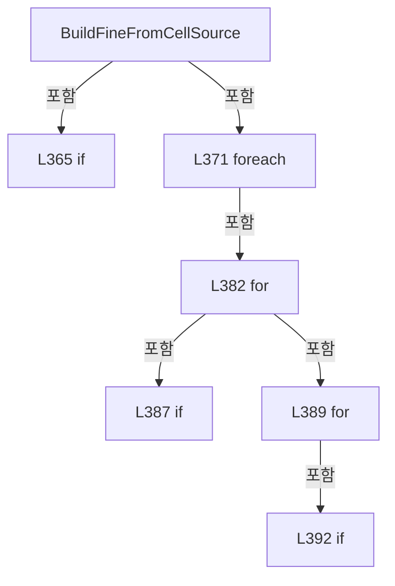

변경 전 점검: 입력/반환 타입, 위 호출자, 예외/취소 경로, 공유 상태와 저장·전송 소비자를 함께 확인합니다. 값의 단위나 물리 방향을 이름만으로 확정하지 않습니다.

### MethodDeclaration `CreateFineCellRange` · L403–421

[Drilling.Common/Review/CReviewRulePlanBuilder.cs:403–421](https://github.com/kjuws10-rgb/A3Drilling/blob/5aee8e58439c9b455cae7c9593c9be986c3e682e/Drilling.Common/Review/CReviewRulePlanBuilder.cs#L403-L421)

| 항목 | 실제 추출 값 |
| --- | --- |
| 서명 | Drilling.Common.Review.CReviewRulePlanBuilder.FineCellRange Drilling.Common.Review.CReviewRulePlanBuilder.CreateFineCellRange(Drilling.Common.Review.ST_REVIEW_PLAN, Drilling.Common.Review.CReviewRulePlanBuilder.CellSlice) |
| 접근/수식자 | Private / private, static |
| 반환/값 타입 | Drilling.Common.Review.CReviewRulePlanBuilder.FineCellRange |
| 소속 타입 | NamedType:Drilling.Common.Review.CReviewRulePlanBuilder |

입력 계약:

| 이름 | 타입 | 전달 | 선택/기본값 |
| --- | --- | --- | --- |
| plan | Drilling.Common.Review.ST_REVIEW_PLAN | None | False /  |
| cell | Drilling.Common.Review.CReviewRulePlanBuilder.CellSlice | None | False /  |

정적 호출자로 확인된 위치:

| 호출 파일/행 | 호출 표현식 | 런타임 분기 가능 |
| --- | --- | --- |
| [Drilling.Common/Review/CReviewRulePlanBuilder.cs:364–364](https://github.com/kjuws10-rgb/A3Drilling/blob/5aee8e58439c9b455cae7c9593c9be986c3e682e/Drilling.Common/Review/CReviewRulePlanBuilder.cs#L364-L364) | CreateFineCellRange | False |

호출하는 대상과 해석 범위:

| 원본 행 | 표현식 | 분석 상태 | 대상/소스 위치 |
| --- | --- | --- | --- |
| 407 | GetPoint | resolved | Drilling.Common.Review.ST_REVIEW_PLAN_POINT Drilling.Common.Review.CReviewRulePlanBuilder.GetPoint(Drilling.Common.Review.ST_REVIEW_PLAN, Drilling.Common.Review.CReviewRulePlanBuilder.CellSlice, int, int) · Drilling.Common/Review/CReviewRulePlanBuilder.cs:433 |
| 408 | GetPoint | resolved | Drilling.Common.Review.ST_REVIEW_PLAN_POINT Drilling.Common.Review.CReviewRulePlanBuilder.GetPoint(Drilling.Common.Review.ST_REVIEW_PLAN, Drilling.Common.Review.CReviewRulePlanBuilder.CellSlice, int, int) · Drilling.Common/Review/CReviewRulePlanBuilder.cs:433 |
| 409 | GetPoint | resolved | Drilling.Common.Review.ST_REVIEW_PLAN_POINT Drilling.Common.Review.CReviewRulePlanBuilder.GetPoint(Drilling.Common.Review.ST_REVIEW_PLAN, Drilling.Common.Review.CReviewRulePlanBuilder.CellSlice, int, int) · Drilling.Common/Review/CReviewRulePlanBuilder.cs:433 |
| 410 | GetPoint | resolved | Drilling.Common.Review.ST_REVIEW_PLAN_POINT Drilling.Common.Review.CReviewRulePlanBuilder.GetPoint(Drilling.Common.Review.ST_REVIEW_PLAN, Drilling.Common.Review.CReviewRulePlanBuilder.CellSlice, int, int) · Drilling.Common/Review/CReviewRulePlanBuilder.cs:433 |
| 412 | corners.Where(point => point.HeadNo > 0 && double.IsFinite(point.DesignY)).ToArray | resolved | Drilling.Common.Review.ST_REVIEW_PLAN_POINT[] System.Collections.Generic.IEnumerable<Drilling.Common.Review.ST_REVIEW_PLAN_POINT>.ToArray<Drilling.Common.Review.ST_REVIEW_PLAN_POINT>() |
| 412 | corners.Where | resolved | System.Collections.Generic.IEnumerable<Drilling.Common.Review.ST_REVIEW_PLAN_POINT> System.Collections.Generic.IEnumerable<Drilling.Common.Review.ST_REVIEW_PLAN_POINT>.Where<Drilling.Common.Review.ST_REVIEW_PLAN_POINT>(System.Func<Drilling.Common.Review.ST_REVIEW_PLAN_POINT, bool>) |
| 412 | double.IsFinite | resolved | bool double.IsFinite(double) |
| 415 | new FineCellRange | resolved | Drilling.Common.Review.CReviewRulePlanBuilder.FineCellRange.FineCellRange(Drilling.Common.Review.CReviewRulePlanBuilder.CellSlice, double, double, double, double, bool) · Drilling.Common/Review/CReviewRulePlanBuilder.cs:463 |
| 418 | corners.Take(2).Where(point => double.IsFinite(point.DesignY)).Average | resolved | double System.Collections.Generic.IEnumerable<Drilling.Common.Review.ST_REVIEW_PLAN_POINT>.Average<Drilling.Common.Review.ST_REVIEW_PLAN_POINT>(System.Func<Drilling.Common.Review.ST_REVIEW_PLAN_POINT, double>) |
| 418 | corners.Take(2).Where | resolved | System.Collections.Generic.IEnumerable<Drilling.Common.Review.ST_REVIEW_PLAN_POINT> System.Collections.Generic.IEnumerable<Drilling.Common.Review.ST_REVIEW_PLAN_POINT>.Where<Drilling.Common.Review.ST_REVIEW_PLAN_POINT>(System.Func<Drilling.Common.Review.ST_REVIEW_PLAN_POINT, bool>) |
| 418 | corners.Take | resolved | System.Collections.Generic.IEnumerable<Drilling.Common.Review.ST_REVIEW_PLAN_POINT> System.Collections.Generic.IEnumerable<Drilling.Common.Review.ST_REVIEW_PLAN_POINT>.Take<Drilling.Common.Review.ST_REVIEW_PLAN_POINT>(int) |
| 418 | double.IsFinite | resolved | bool double.IsFinite(double) |
| 419 | corners.Skip(2).Where(point => double.IsFinite(point.DesignY)).Average | resolved | double System.Collections.Generic.IEnumerable<Drilling.Common.Review.ST_REVIEW_PLAN_POINT>.Average<Drilling.Common.Review.ST_REVIEW_PLAN_POINT>(System.Func<Drilling.Common.Review.ST_REVIEW_PLAN_POINT, double>) |
| 419 | corners.Skip(2).Where | resolved | System.Collections.Generic.IEnumerable<Drilling.Common.Review.ST_REVIEW_PLAN_POINT> System.Collections.Generic.IEnumerable<Drilling.Common.Review.ST_REVIEW_PLAN_POINT>.Where<Drilling.Common.Review.ST_REVIEW_PLAN_POINT>(System.Func<Drilling.Common.Review.ST_REVIEW_PLAN_POINT, bool>) |
| 419 | corners.Skip | resolved | System.Collections.Generic.IEnumerable<Drilling.Common.Review.ST_REVIEW_PLAN_POINT> System.Collections.Generic.IEnumerable<Drilling.Common.Review.ST_REVIEW_PLAN_POINT>.Skip<Drilling.Common.Review.ST_REVIEW_PLAN_POINT>(int) |
| 419 | double.IsFinite | resolved | bool double.IsFinite(double) |
| 420 | new FineCellRange | resolved | Drilling.Common.Review.CReviewRulePlanBuilder.FineCellRange.FineCellRange(Drilling.Common.Review.CReviewRulePlanBuilder.CellSlice, double, double, double, double, bool) · Drilling.Common/Review/CReviewRulePlanBuilder.cs:463 |
| 420 | assignedCorners.Min | resolved | double System.Collections.Generic.IEnumerable<Drilling.Common.Review.ST_REVIEW_PLAN_POINT>.Min<Drilling.Common.Review.ST_REVIEW_PLAN_POINT>(System.Func<Drilling.Common.Review.ST_REVIEW_PLAN_POINT, double>) |
| 420 | assignedCorners.Max | resolved | double System.Collections.Generic.IEnumerable<Drilling.Common.Review.ST_REVIEW_PLAN_POINT>.Max<Drilling.Common.Review.ST_REVIEW_PLAN_POINT>(System.Func<Drilling.Common.Review.ST_REVIEW_PLAN_POINT, double>) |

본문의 실제 연산·분기·예외·반환 순서(원문 위치 순):

| 원본 행 | 종류 | 주석 해설 |
| --- | --- | --- |
| 405 | local-declaration | 지역 변수를 선언합니다: var corners = new[] { GetPoint(plan, cell, 0, 0), GetPoint(plan, cell, 0, cell.Columns - 1), GetPoint(plan, cell, cell.Rows - 1, 0), GetPoint(plan, cell, cell.Rows - 1, cell.Columns - 1) }; |
| 405 | variable-initializer | 변수의 초기값을 지정합니다: corners = new[] { GetPoint(plan, cell, 0, 0), GetPoint(plan, cell, 0, cell.Columns - 1), GetPoint(plan, cell, cell.Rows - 1, 0), GetPoint(plan, cell, cell.Rows - 1, cell.Columns - 1) } |
| 407 | call | 함수·델리게이트 또는 객체 생성자를 호출합니다: GetPoint(plan, cell, 0, 0) |
| 408 | call | 함수·델리게이트 또는 객체 생성자를 호출합니다: GetPoint(plan, cell, 0, cell.Columns - 1) |
| 409 | call | 함수·델리게이트 또는 객체 생성자를 호출합니다: GetPoint(plan, cell, cell.Rows - 1, 0) |
| 410 | call | 함수·델리게이트 또는 객체 생성자를 호출합니다: GetPoint(plan, cell, cell.Rows - 1, cell.Columns - 1) |
| 412 | call | 함수·델리게이트 또는 객체 생성자를 호출합니다: corners.Where(point => point.HeadNo > 0 && double.IsFinite(point.DesignY)).ToArray() |
| 412 | call | 함수·델리게이트 또는 객체 생성자를 호출합니다: corners.Where(point => point.HeadNo > 0 && double.IsFinite(point.DesignY)) |
| 412 | call | 함수·델리게이트 또는 객체 생성자를 호출합니다: double.IsFinite(point.DesignY) |
| 412 | local-declaration | 지역 변수를 선언합니다: var assignedCorners = corners.Where(point => point.HeadNo > 0 && double.IsFinite(point.DesignY)).ToArray(); |
| 412 | variable-initializer | 변수의 초기값을 지정합니다: assignedCorners = corners.Where(point => point.HeadNo > 0 && double.IsFinite(point.DesignY)).ToArray() |
| 413 | if | 조건에 따라 분기합니다: if (assignedCorners.Length == 0) |
| 415 | call | 함수·델리게이트 또는 객체 생성자를 호출합니다: new FineCellRange(cell, 0.0, 0.0, 0.0, 0.0, false) |
| 415 | return | 호출자에게 값 또는 제어를 반환합니다: return new FineCellRange(cell, 0.0, 0.0, 0.0, 0.0, false); |
| 418 | call | 함수·델리게이트 또는 객체 생성자를 호출합니다: corners.Take(2).Where(point => double.IsFinite(point.DesignY)).Average(point => point.DesignY) |
| 418 | call | 함수·델리게이트 또는 객체 생성자를 호출합니다: corners.Take(2).Where(point => double.IsFinite(point.DesignY)) |
| 418 | call | 함수·델리게이트 또는 객체 생성자를 호출합니다: corners.Take(2) |
| 418 | call | 함수·델리게이트 또는 객체 생성자를 호출합니다: double.IsFinite(point.DesignY) |
| 418 | local-declaration | 지역 변수를 선언합니다: var firstRowY = corners.Take(2).Where(point => double.IsFinite(point.DesignY)).Average(point => point.DesignY); |
| 418 | variable-initializer | 변수의 초기값을 지정합니다: firstRowY = corners.Take(2).Where(point => double.IsFinite(point.DesignY)).Average(point => point.DesignY) |
| 419 | call | 함수·델리게이트 또는 객체 생성자를 호출합니다: corners.Skip(2).Where(point => double.IsFinite(point.DesignY)).Average(point => point.DesignY) |
| 419 | call | 함수·델리게이트 또는 객체 생성자를 호출합니다: corners.Skip(2).Where(point => double.IsFinite(point.DesignY)) |
| 419 | call | 함수·델리게이트 또는 객체 생성자를 호출합니다: corners.Skip(2) |
| 419 | call | 함수·델리게이트 또는 객체 생성자를 호출합니다: double.IsFinite(point.DesignY) |
| 419 | local-declaration | 지역 변수를 선언합니다: var lastRowY = corners.Skip(2).Where(point => double.IsFinite(point.DesignY)).Average(point => point.DesignY); |
| 419 | variable-initializer | 변수의 초기값을 지정합니다: lastRowY = corners.Skip(2).Where(point => double.IsFinite(point.DesignY)).Average(point => point.DesignY) |
| 420 | call | 함수·델리게이트 또는 객체 생성자를 호출합니다: new FineCellRange(cell, assignedCorners.Min(point => point.DesignY), assignedCorners.Max(point => point.DesignY), firstRowY, lastRowY, true) |
| 420 | call | 함수·델리게이트 또는 객체 생성자를 호출합니다: assignedCorners.Min(point => point.DesignY) |
| 420 | call | 함수·델리게이트 또는 객체 생성자를 호출합니다: assignedCorners.Max(point => point.DesignY) |
| 420 | return | 호출자에게 값 또는 제어를 반환합니다: return new FineCellRange(cell, assignedCorners.Min(point => point.DesignY), assignedCorners.Max(point => point.DesignY), firstRowY, lastRowY, true); |

제어 구문의 포함 구조(실제 실행 순서/CFG가 아닌 구문 탐색 그림):

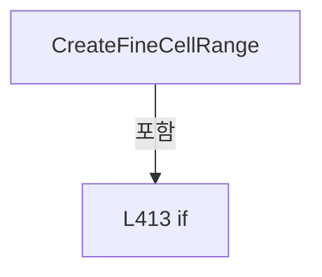

변경 전 점검: 입력/반환 타입, 위 호출자, 예외/취소 경로, 공유 상태와 저장·전송 소비자를 함께 확인합니다. 값의 단위나 물리 방향을 이름만으로 확정하지 않습니다.

### MethodDeclaration `DistanceToRange` · L423–431

[Drilling.Common/Review/CReviewRulePlanBuilder.cs:423–431](https://github.com/kjuws10-rgb/A3Drilling/blob/5aee8e58439c9b455cae7c9593c9be986c3e682e/Drilling.Common/Review/CReviewRulePlanBuilder.cs#L423-L431)

| 항목 | 실제 추출 값 |
| --- | --- |
| 서명 | double Drilling.Common.Review.CReviewRulePlanBuilder.DistanceToRange(double, double, double) |
| 접근/수식자 | Private / private, static |
| 반환/값 타입 | double |
| 소속 타입 | NamedType:Drilling.Common.Review.CReviewRulePlanBuilder |

입력 계약:

| 이름 | 타입 | 전달 | 선택/기본값 |
| --- | --- | --- | --- |
| value | double | None | False /  |
| minimum | double | None | False /  |
| maximum | double | None | False /  |

정적 호출자로 확인된 위치:

| 호출 파일/행 | 호출 표현식 | 런타임 분기 가능 |
| --- | --- | --- |
| [Drilling.Common/Review/CReviewRulePlanBuilder.cs:150–150](https://github.com/kjuws10-rgb/A3Drilling/blob/5aee8e58439c9b455cae7c9593c9be986c3e682e/Drilling.Common/Review/CReviewRulePlanBuilder.cs#L150-L150) | DistanceToRange | False |

본문의 실제 연산·분기·예외·반환 순서(원문 위치 순):

| 원본 행 | 종류 | 주석 해설 |
| --- | --- | --- |
| 425 | if | 조건에 따라 분기합니다: if (value < minimum) |
| 427 | return | 호출자에게 값 또는 제어를 반환합니다: return minimum - value; |
| 430 | conditional-expression | 조건에 따라 결과식을 선택합니다: value > maximum ? value - maximum : 0.0 |
| 430 | return | 호출자에게 값 또는 제어를 반환합니다: return value > maximum ? value - maximum : 0.0; |

제어 구문의 포함 구조(실제 실행 순서/CFG가 아닌 구문 탐색 그림):

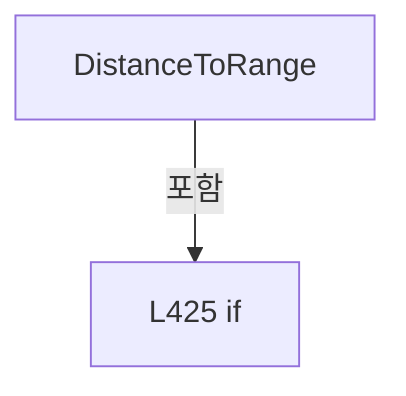

변경 전 점검: 입력/반환 타입, 위 호출자, 예외/취소 경로, 공유 상태와 저장·전송 소비자를 함께 확인합니다. 값의 단위나 물리 방향을 이름만으로 확정하지 않습니다.

### MethodDeclaration `GetPoint` · L433–433

[Drilling.Common/Review/CReviewRulePlanBuilder.cs:433–433](https://github.com/kjuws10-rgb/A3Drilling/blob/5aee8e58439c9b455cae7c9593c9be986c3e682e/Drilling.Common/Review/CReviewRulePlanBuilder.cs#L433-L433)

| 항목 | 실제 추출 값 |
| --- | --- |
| 서명 | Drilling.Common.Review.ST_REVIEW_PLAN_POINT Drilling.Common.Review.CReviewRulePlanBuilder.GetPoint(Drilling.Common.Review.ST_REVIEW_PLAN, Drilling.Common.Review.CReviewRulePlanBuilder.CellSlice, int, int) |
| 접근/수식자 | Private / private, static |
| 반환/값 타입 | Drilling.Common.Review.ST_REVIEW_PLAN_POINT |
| 소속 타입 | NamedType:Drilling.Common.Review.CReviewRulePlanBuilder |

입력 계약:

| 이름 | 타입 | 전달 | 선택/기본값 |
| --- | --- | --- | --- |
| plan | Drilling.Common.Review.ST_REVIEW_PLAN | None | False /  |
| cell | Drilling.Common.Review.CReviewRulePlanBuilder.CellSlice | None | False /  |
| row | int | None | False /  |
| column | int | None | False /  |

정적 호출자로 확인된 위치:

| 호출 파일/행 | 호출 표현식 | 런타임 분기 가능 |
| --- | --- | --- |
| [Drilling.Common/Review/CReviewRulePlanBuilder.cs:38–38](https://github.com/kjuws10-rgb/A3Drilling/blob/5aee8e58439c9b455cae7c9593c9be986c3e682e/Drilling.Common/Review/CReviewRulePlanBuilder.cs#L38-L38) | GetPoint | False |
| [Drilling.Common/Review/CReviewRulePlanBuilder.cs:41–41](https://github.com/kjuws10-rgb/A3Drilling/blob/5aee8e58439c9b455cae7c9593c9be986c3e682e/Drilling.Common/Review/CReviewRulePlanBuilder.cs#L41-L41) | GetPoint | False |
| [Drilling.Common/Review/CReviewRulePlanBuilder.cs:53–53](https://github.com/kjuws10-rgb/A3Drilling/blob/5aee8e58439c9b455cae7c9593c9be986c3e682e/Drilling.Common/Review/CReviewRulePlanBuilder.cs#L53-L53) | GetPoint | False |
| [Drilling.Common/Review/CReviewRulePlanBuilder.cs:85–85](https://github.com/kjuws10-rgb/A3Drilling/blob/5aee8e58439c9b455cae7c9593c9be986c3e682e/Drilling.Common/Review/CReviewRulePlanBuilder.cs#L85-L85) | GetPoint | False |
| [Drilling.Common/Review/CReviewRulePlanBuilder.cs:88–88](https://github.com/kjuws10-rgb/A3Drilling/blob/5aee8e58439c9b455cae7c9593c9be986c3e682e/Drilling.Common/Review/CReviewRulePlanBuilder.cs#L88-L88) | GetPoint | False |
| [Drilling.Common/Review/CReviewRulePlanBuilder.cs:117–117](https://github.com/kjuws10-rgb/A3Drilling/blob/5aee8e58439c9b455cae7c9593c9be986c3e682e/Drilling.Common/Review/CReviewRulePlanBuilder.cs#L117-L117) | GetPoint | False |
| [Drilling.Common/Review/CReviewRulePlanBuilder.cs:172–172](https://github.com/kjuws10-rgb/A3Drilling/blob/5aee8e58439c9b455cae7c9593c9be986c3e682e/Drilling.Common/Review/CReviewRulePlanBuilder.cs#L172-L172) | GetPoint | False |
| [Drilling.Common/Review/CReviewRulePlanBuilder.cs:172–172](https://github.com/kjuws10-rgb/A3Drilling/blob/5aee8e58439c9b455cae7c9593c9be986c3e682e/Drilling.Common/Review/CReviewRulePlanBuilder.cs#L172-L172) | GetPoint | False |
| [Drilling.Common/Review/CReviewRulePlanBuilder.cs:192–192](https://github.com/kjuws10-rgb/A3Drilling/blob/5aee8e58439c9b455cae7c9593c9be986c3e682e/Drilling.Common/Review/CReviewRulePlanBuilder.cs#L192-L192) | GetPoint | False |
| [Drilling.Common/Review/CReviewRulePlanBuilder.cs:201–201](https://github.com/kjuws10-rgb/A3Drilling/blob/5aee8e58439c9b455cae7c9593c9be986c3e682e/Drilling.Common/Review/CReviewRulePlanBuilder.cs#L201-L201) | GetPoint | False |
| [Drilling.Common/Review/CReviewRulePlanBuilder.cs:310–310](https://github.com/kjuws10-rgb/A3Drilling/blob/5aee8e58439c9b455cae7c9593c9be986c3e682e/Drilling.Common/Review/CReviewRulePlanBuilder.cs#L310-L310) | GetPoint | False |
| [Drilling.Common/Review/CReviewRulePlanBuilder.cs:391–391](https://github.com/kjuws10-rgb/A3Drilling/blob/5aee8e58439c9b455cae7c9593c9be986c3e682e/Drilling.Common/Review/CReviewRulePlanBuilder.cs#L391-L391) | GetPoint | False |
| [Drilling.Common/Review/CReviewRulePlanBuilder.cs:407–407](https://github.com/kjuws10-rgb/A3Drilling/blob/5aee8e58439c9b455cae7c9593c9be986c3e682e/Drilling.Common/Review/CReviewRulePlanBuilder.cs#L407-L407) | GetPoint | False |
| [Drilling.Common/Review/CReviewRulePlanBuilder.cs:408–408](https://github.com/kjuws10-rgb/A3Drilling/blob/5aee8e58439c9b455cae7c9593c9be986c3e682e/Drilling.Common/Review/CReviewRulePlanBuilder.cs#L408-L408) | GetPoint | False |
| [Drilling.Common/Review/CReviewRulePlanBuilder.cs:409–409](https://github.com/kjuws10-rgb/A3Drilling/blob/5aee8e58439c9b455cae7c9593c9be986c3e682e/Drilling.Common/Review/CReviewRulePlanBuilder.cs#L409-L409) | GetPoint | False |
| [Drilling.Common/Review/CReviewRulePlanBuilder.cs:410–410](https://github.com/kjuws10-rgb/A3Drilling/blob/5aee8e58439c9b455cae7c9593c9be986c3e682e/Drilling.Common/Review/CReviewRulePlanBuilder.cs#L410-L410) | GetPoint | False |

본문의 실제 연산·분기·예외·반환 순서(원문 위치 순):

| 원본 행 | 종류 | 주석 해설 |
| --- | --- | --- |
| 433 | conditional-expression | 조건에 따라 결과식을 선택합니다: cell.Points is null ? plan.Points[cell.Start + (row * cell.Columns) + column] : cell.Points[(row * cell.Columns) + column] |

변경 전 점검: 입력/반환 타입, 위 호출자, 예외/취소 경로, 공유 상태와 저장·전송 소비자를 함께 확인합니다. 값의 단위나 물리 방향을 이름만으로 확정하지 않습니다.

### MethodDeclaration `FineCellRows` · L434–445

[Drilling.Common/Review/CReviewRulePlanBuilder.cs:434–445](https://github.com/kjuws10-rgb/A3Drilling/blob/5aee8e58439c9b455cae7c9593c9be986c3e682e/Drilling.Common/Review/CReviewRulePlanBuilder.cs#L434-L445)

| 항목 | 실제 추출 값 |
| --- | --- |
| 서명 | System.Collections.Generic.IReadOnlyList<System.Linq.IGrouping<double, Drilling.Common.Review.ST_REVIEW_PLAN_POINT>> Drilling.Common.Review.CReviewRulePlanBuilder.FineCellRows(System.Collections.Generic.IReadOnlyList<System.Linq.IGrouping<double, Drilling.Common.Review.ST_REVIEW_PLAN_POINT>>, int, double, double) |
| 접근/수식자 | Private / private, static |
| 반환/값 타입 | System.Collections.Generic.IReadOnlyList<System.Linq.IGrouping<double, Drilling.Common.Review.ST_REVIEW_PLAN_POINT>> |
| 소속 타입 | NamedType:Drilling.Common.Review.CReviewRulePlanBuilder |

입력 계약:

| 이름 | 타입 | 전달 | 선택/기본값 |
| --- | --- | --- | --- |
| rows | System.Collections.Generic.IReadOnlyList<System.Linq.IGrouping<double, Drilling.Common.Review.ST_REVIEW_PLAN_POINT>> | None | False /  |
| requestedCount | int | None | False /  |
| minimumY | double | None | False /  |
| maximumY | double | None | False /  |

정적 호출자로 확인된 위치:

| 호출 파일/행 | 호출 표현식 | 런타임 분기 가능 |
| --- | --- | --- |
| [Drilling.Common/Review/CReviewRulePlanBuilder.cs:292–292](https://github.com/kjuws10-rgb/A3Drilling/blob/5aee8e58439c9b455cae7c9593c9be986c3e682e/Drilling.Common/Review/CReviewRulePlanBuilder.cs#L292-L292) | FineCellRows | False |

호출하는 대상과 해석 범위:

| 원본 행 | 표현식 | 분석 상태 | 대상/소스 위치 |
| --- | --- | --- | --- |
| 436 | Math.Clamp | resolved | int System.Math.Clamp(int, int, int) |
| 436 | Math.Min | resolved | int System.Math.Min(int, int) |
| 438 | Enumerable.Range(0, count).Select(index => minimumY + ((maximumY - minimumY) * index / (count - 1.0))).ToArray | resolved | double[] System.Collections.Generic.IEnumerable<double>.ToArray<double>() |
| 438 | Enumerable.Range(0, count).Select | resolved | System.Collections.Generic.IEnumerable<double> System.Collections.Generic.IEnumerable<int>.Select<int, double>(System.Func<int, double>) |
| 438 | Enumerable.Range | resolved | System.Collections.Generic.IEnumerable<int> System.Linq.Enumerable.Range(int, int) |
| 444 | targets.Select(target => rows.OrderBy(row => Math.Abs(row.Key - target)).ThenBy(row => row.Key).First()).DistinctBy(row => row.Key).OrderBy(row => row.Key).ToArray | resolved | System.Linq.IGrouping<double, Drilling.Common.Review.ST_REVIEW_PLAN_POINT>[] System.Collections.Generic.IEnumerable<System.Linq.IGrouping<double, Drilling.Common.Review.ST_REVIEW_PLAN_POINT>>.ToArray<System.Linq.IGrouping<double, Drilling.Common.Review.ST_REVIEW_PLAN_POINT>>() |
| 444 | targets.Select(target => rows.OrderBy(row => Math.Abs(row.Key - target)).ThenBy(row => row.Key).First()).DistinctBy(row => row.Key).OrderBy | resolved | System.Linq.IOrderedEnumerable<System.Linq.IGrouping<double, Drilling.Common.Review.ST_REVIEW_PLAN_POINT>> System.Collections.Generic.IEnumerable<System.Linq.IGrouping<double, Drilling.Common.Review.ST_REVIEW_PLAN_POINT>>.OrderBy<System.Linq.IGrouping<double, Drilling.Common.Review.ST_REVIEW_PLAN_POINT>, double>(System.Func<System.Linq.IGrouping<double, Drilling.Common.Review.ST_REVIEW_PLAN_POINT>, double>) |
| 444 | targets.Select(target => rows.OrderBy(row => Math.Abs(row.Key - target)).ThenBy(row => row.Key).First()).DistinctBy | resolved | System.Collections.Generic.IEnumerable<System.Linq.IGrouping<double, Drilling.Common.Review.ST_REVIEW_PLAN_POINT>> System.Collections.Generic.IEnumerable<System.Linq.IGrouping<double, Drilling.Common.Review.ST_REVIEW_PLAN_POINT>>.DistinctBy<System.Linq.IGrouping<double, Drilling.Common.Review.ST_REVIEW_PLAN_POINT>, double>(System.Func<System.Linq.IGrouping<double, Drilling.Common.Review.ST_REVIEW_PLAN_POINT>, double>) |
| 444 | targets.Select | resolved | System.Collections.Generic.IEnumerable<System.Linq.IGrouping<double, Drilling.Common.Review.ST_REVIEW_PLAN_POINT>> System.Collections.Generic.IEnumerable<double>.Select<double, System.Linq.IGrouping<double, Drilling.Common.Review.ST_REVIEW_PLAN_POINT>>(System.Func<double, System.Linq.IGrouping<double, Drilling.Common.Review.ST_REVIEW_PLAN_POINT>>) |
| 444 | rows.OrderBy(row => Math.Abs(row.Key - target)).ThenBy(row => row.Key).First | resolved | System.Linq.IGrouping<double, Drilling.Common.Review.ST_REVIEW_PLAN_POINT> System.Collections.Generic.IEnumerable<System.Linq.IGrouping<double, Drilling.Common.Review.ST_REVIEW_PLAN_POINT>>.First<System.Linq.IGrouping<double, Drilling.Common.Review.ST_REVIEW_PLAN_POINT>>() |
| 444 | rows.OrderBy(row => Math.Abs(row.Key - target)).ThenBy | resolved | System.Linq.IOrderedEnumerable<System.Linq.IGrouping<double, Drilling.Common.Review.ST_REVIEW_PLAN_POINT>> System.Linq.IOrderedEnumerable<System.Linq.IGrouping<double, Drilling.Common.Review.ST_REVIEW_PLAN_POINT>>.ThenBy<System.Linq.IGrouping<double, Drilling.Common.Review.ST_REVIEW_PLAN_POINT>, double>(System.Func<System.Linq.IGrouping<double, Drilling.Common.Review.ST_REVIEW_PLAN_POINT>, double>) |
| 444 | rows.OrderBy | resolved | System.Linq.IOrderedEnumerable<System.Linq.IGrouping<double, Drilling.Common.Review.ST_REVIEW_PLAN_POINT>> System.Collections.Generic.IEnumerable<System.Linq.IGrouping<double, Drilling.Common.Review.ST_REVIEW_PLAN_POINT>>.OrderBy<System.Linq.IGrouping<double, Drilling.Common.Review.ST_REVIEW_PLAN_POINT>, double>(System.Func<System.Linq.IGrouping<double, Drilling.Common.Review.ST_REVIEW_PLAN_POINT>, double>) |
| 444 | Math.Abs | resolved | double System.Math.Abs(double) |

본문의 실제 연산·분기·예외·반환 순서(원문 위치 순):

| 원본 행 | 종류 | 주석 해설 |
| --- | --- | --- |
| 436 | call | 함수·델리게이트 또는 객체 생성자를 호출합니다: Math.Clamp(requestedCount, 1, Math.Min(7, rows.Count)) |
| 436 | call | 함수·델리게이트 또는 객체 생성자를 호출합니다: Math.Min(7, rows.Count) |
| 436 | local-declaration | 지역 변수를 선언합니다: var count = Math.Clamp(requestedCount, 1, Math.Min(7, rows.Count)); |
| 436 | variable-initializer | 변수의 초기값을 지정합니다: count = Math.Clamp(requestedCount, 1, Math.Min(7, rows.Count)) |
| 437 | local-declaration | 지역 변수를 선언합니다: var centerY = minimumY + ((maximumY - minimumY) / 2.0); |
| 437 | variable-initializer | 변수의 초기값을 지정합니다: centerY = minimumY + ((maximumY - minimumY) / 2.0) |
| 438 | call | 함수·델리게이트 또는 객체 생성자를 호출합니다: Enumerable.Range(0, count).Select(index => minimumY + ((maximumY - minimumY) * index / (count - 1.0))).ToArray() |
| 438 | call | 함수·델리게이트 또는 객체 생성자를 호출합니다: Enumerable.Range(0, count).Select(index => minimumY + ((maximumY - minimumY) * index / (count - 1.0))) |
| 438 | call | 함수·델리게이트 또는 객체 생성자를 호출합니다: Enumerable.Range(0, count) |
| 438 | conditional-expression | 조건에 따라 결과식을 선택합니다: count == 1 ? [centerY] : Enumerable.Range(0, count).Select(index => minimumY + ((maximumY - minimumY) * index / (count - 1.0))).ToArray() |
| 438 | local-declaration | 지역 변수를 선언합니다: var targets = count == 1 ? [centerY] : Enumerable.Range(0, count).Select(index => minimumY + ((maximumY - minimumY) * index / (count - 1.0))).ToArray(); |
| 438 | variable-initializer | 변수의 초기값을 지정합니다: targets = count == 1 ? [centerY] : Enumerable.Range(0, count).Select(index => minimumY + ((maximumY - minimumY) * index / (count - 1.0))).ToArray() |
| 439 | if | 조건에 따라 분기합니다: if ((count & 1) == 1) |
| 441 | assignment | 값을 대상에 대입합니다: targets[count / 2] = centerY |
| 444 | call | 함수·델리게이트 또는 객체 생성자를 호출합니다: targets.Select(target => rows.OrderBy(row => Math.Abs(row.Key - target)).ThenBy(row => row.Key).First()).DistinctBy(row => row.Key).OrderBy(row => row.Key).ToArray() |
| 444 | call | 함수·델리게이트 또는 객체 생성자를 호출합니다: targets.Select(target => rows.OrderBy(row => Math.Abs(row.Key - target)).ThenBy(row => row.Key).First()).DistinctBy(row => row.Key).OrderBy(row => row.Key) |
| 444 | call | 함수·델리게이트 또는 객체 생성자를 호출합니다: targets.Select(target => rows.OrderBy(row => Math.Abs(row.Key - target)).ThenBy(row => row.Key).First()).DistinctBy(row => row.Key) |
| 444 | call | 함수·델리게이트 또는 객체 생성자를 호출합니다: targets.Select(target => rows.OrderBy(row => Math.Abs(row.Key - target)).ThenBy(row => row.Key).First()) |
| 444 | call | 함수·델리게이트 또는 객체 생성자를 호출합니다: rows.OrderBy(row => Math.Abs(row.Key - target)).ThenBy(row => row.Key).First() |
| 444 | call | 함수·델리게이트 또는 객체 생성자를 호출합니다: rows.OrderBy(row => Math.Abs(row.Key - target)).ThenBy(row => row.Key) |
| 444 | call | 함수·델리게이트 또는 객체 생성자를 호출합니다: rows.OrderBy(row => Math.Abs(row.Key - target)) |
| 444 | call | 함수·델리게이트 또는 객체 생성자를 호출합니다: Math.Abs(row.Key - target) |
| 444 | return | 호출자에게 값 또는 제어를 반환합니다: return targets.Select(target => rows.OrderBy(row => Math.Abs(row.Key - target)).ThenBy(row => row.Key).First()).DistinctBy(row => row.Key).OrderBy(row => row.Key).ToArray(); |

제어 구문의 포함 구조(실제 실행 순서/CFG가 아닌 구문 탐색 그림):

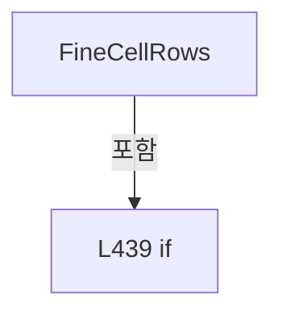

변경 전 점검: 입력/반환 타입, 위 호출자, 예외/취소 경로, 공유 상태와 저장·전송 소비자를 함께 확인합니다. 값의 단위나 물리 방향을 이름만으로 확정하지 않습니다.

### MethodDeclaration `CreateTarget` · L447–452

[Drilling.Common/Review/CReviewRulePlanBuilder.cs:447–452](https://github.com/kjuws10-rgb/A3Drilling/blob/5aee8e58439c9b455cae7c9593c9be986c3e682e/Drilling.Common/Review/CReviewRulePlanBuilder.cs#L447-L452)

| 항목 | 실제 추출 값 |
| --- | --- |
| 서명 | Drilling.Common.Review.ST_REVIEW_RULE_TARGET Drilling.Common.Review.CReviewRulePlanBuilder.CreateTarget(Drilling.Common.Review.ST_REVIEW_PLAN_POINT, string) |
| 접근/수식자 | Private / private, static |
| 반환/값 타입 | Drilling.Common.Review.ST_REVIEW_RULE_TARGET |
| 소속 타입 | NamedType:Drilling.Common.Review.CReviewRulePlanBuilder |

입력 계약:

| 이름 | 타입 | 전달 | 선택/기본값 |
| --- | --- | --- | --- |
| point | Drilling.Common.Review.ST_REVIEW_PLAN_POINT | None | False /  |
| role | string | None | False /  |

정적 호출자로 확인된 위치:

| 호출 파일/행 | 호출 표현식 | 런타임 분기 가능 |
| --- | --- | --- |
| [Drilling.Common/Review/CReviewRulePlanBuilder.cs:22–22](https://github.com/kjuws10-rgb/A3Drilling/blob/5aee8e58439c9b455cae7c9593c9be986c3e682e/Drilling.Common/Review/CReviewRulePlanBuilder.cs#L22-L22) | CreateTarget | False |
| [Drilling.Common/Review/CReviewRulePlanBuilder.cs:66–66](https://github.com/kjuws10-rgb/A3Drilling/blob/5aee8e58439c9b455cae7c9593c9be986c3e682e/Drilling.Common/Review/CReviewRulePlanBuilder.cs#L66-L66) | CreateTarget | False |
| [Drilling.Common/Review/CReviewRulePlanBuilder.cs:132–132](https://github.com/kjuws10-rgb/A3Drilling/blob/5aee8e58439c9b455cae7c9593c9be986c3e682e/Drilling.Common/Review/CReviewRulePlanBuilder.cs#L132-L132) | CreateTarget | False |
| [Drilling.Common/Review/CReviewRulePlanBuilder.cs:292–292](https://github.com/kjuws10-rgb/A3Drilling/blob/5aee8e58439c9b455cae7c9593c9be986c3e682e/Drilling.Common/Review/CReviewRulePlanBuilder.cs#L292-L292) | CreateTarget | False |
| [Drilling.Common/Review/CReviewRulePlanBuilder.cs:313–313](https://github.com/kjuws10-rgb/A3Drilling/blob/5aee8e58439c9b455cae7c9593c9be986c3e682e/Drilling.Common/Review/CReviewRulePlanBuilder.cs#L313-L313) | CreateTarget | False |
| [Drilling.Common/Review/CReviewRulePlanBuilder.cs:394–394](https://github.com/kjuws10-rgb/A3Drilling/blob/5aee8e58439c9b455cae7c9593c9be986c3e682e/Drilling.Common/Review/CReviewRulePlanBuilder.cs#L394-L394) | CreateTarget | False |

호출하는 대상과 해석 범위:

| 원본 행 | 표현식 | 분석 상태 | 대상/소스 위치 |
| --- | --- | --- | --- |
| 449 | Math.Max | resolved | int System.Math.Max(int, int) |
| 450 | Math.Max | resolved | int System.Math.Max(int, int) |
| 451 | new | resolved | Drilling.Common.Review.ST_REVIEW_RULE_TARGET.ST_REVIEW_RULE_TARGET(string, int, int, int, int, string) · Drilling.Common/Review/CReviewRulePlanBuilder.cs:532 |

본문의 실제 연산·분기·예외·반환 순서(원문 위치 순):

| 원본 행 | 종류 | 주석 해설 |
| --- | --- | --- |
| 449 | call | 함수·델리게이트 또는 객체 생성자를 호출합니다: Math.Max(1, point.PixelCountX) |
| 449 | local-declaration | 지역 변수를 선언합니다: var columns = Math.Max(1, point.PixelCountX); |
| 449 | variable-initializer | 변수의 초기값을 지정합니다: columns = Math.Max(1, point.PixelCountX) |
| 450 | call | 함수·델리게이트 또는 객체 생성자를 호출합니다: Math.Max(0, point.ShotNo - 1) |
| 450 | local-declaration | 지역 변수를 선언합니다: var index = Math.Max(0, point.ShotNo - 1); |
| 450 | variable-initializer | 변수의 초기값을 지정합니다: index = Math.Max(0, point.ShotNo - 1) |
| 451 | call | 함수·델리게이트 또는 객체 생성자를 호출합니다: new(point.ShotKey, point.HeadNo, point.CellNo, (index / columns) + 1, (index % columns) + 1, role) |
| 451 | return | 호출자에게 값 또는 제어를 반환합니다: return new(point.ShotKey, point.HeadNo, point.CellNo, (index / columns) + 1, (index % columns) + 1, role); |

변경 전 점검: 입력/반환 타입, 위 호출자, 예외/취소 경로, 공유 상태와 저장·전송 소비자를 함께 확인합니다. 값의 단위나 물리 방향을 이름만으로 확정하지 않습니다.

### MethodDeclaration `TryGetPoint` · L454–460

[Drilling.Common/Review/CReviewRulePlanBuilder.cs:454–460](https://github.com/kjuws10-rgb/A3Drilling/blob/5aee8e58439c9b455cae7c9593c9be986c3e682e/Drilling.Common/Review/CReviewRulePlanBuilder.cs#L454-L460)

| 항목 | 실제 추출 값 |
| --- | --- |
| 서명 | Drilling.Common.Review.ST_REVIEW_PLAN_POINT? Drilling.Common.Review.CReviewRulePlanBuilder.TryGetPoint(Drilling.Common.Review.ST_REVIEW_PLAN, string) |
| 접근/수식자 | Private / private, static |
| 반환/값 타입 | Drilling.Common.Review.ST_REVIEW_PLAN_POINT? |
| 소속 타입 | NamedType:Drilling.Common.Review.CReviewRulePlanBuilder |

입력 계약:

| 이름 | 타입 | 전달 | 선택/기본값 |
| --- | --- | --- | --- |
| plan | Drilling.Common.Review.ST_REVIEW_PLAN | None | False /  |
| key | string | None | False /  |

정적 호출자로 확인된 위치:

| 호출 파일/행 | 호출 표현식 | 런타임 분기 가능 |
| --- | --- | --- |
| [Drilling.Common/Review/CReviewRulePlanBuilder.cs:21–21](https://github.com/kjuws10-rgb/A3Drilling/blob/5aee8e58439c9b455cae7c9593c9be986c3e682e/Drilling.Common/Review/CReviewRulePlanBuilder.cs#L21-L21) | TryGetPoint | False |

호출하는 대상과 해석 범위:

| 원본 행 | 표현식 | 분석 상태 | 대상/소스 위치 |
| --- | --- | --- | --- |
| 456 | key.IndexOf | resolved | int string.IndexOf(string, System.StringComparison) |
| 457 | int.TryParse | resolved | bool int.TryParse(System.ReadOnlySpan<char>, out int) |
| 457 | key.AsSpan | resolved | System.ReadOnlySpan<char> string?.AsSpan(int, int) |
| 457 | int.TryParse | resolved | bool int.TryParse(System.ReadOnlySpan<char>, out int) |
| 457 | key.AsSpan | resolved | System.ReadOnlySpan<char> string?.AsSpan(int) |
| 459 | plan.FindPoint | resolved | Drilling.Common.Review.ST_REVIEW_PLAN_POINT? Drilling.Common.Review.ST_REVIEW_PLAN.FindPoint(int, int) · Drilling.Common/Review/CReviewManager.cs:3959 |

본문의 실제 연산·분기·예외·반환 순서(원문 위치 순):

| 원본 행 | 종류 | 주석 해설 |
| --- | --- | --- |
| 456 | call | 함수·델리게이트 또는 객체 생성자를 호출합니다: key.IndexOf("_SHOT", StringComparison.Ordinal) |
| 456 | local-declaration | 지역 변수를 선언합니다: var separator = key.IndexOf("_SHOT", StringComparison.Ordinal); |
| 456 | variable-initializer | 변수의 초기값을 지정합니다: separator = key.IndexOf("_SHOT", StringComparison.Ordinal) |
| 457 | call | 함수·델리게이트 또는 객체 생성자를 호출합니다: int.TryParse(key.AsSpan(4, separator - 4), out var cell) |
| 457 | call | 함수·델리게이트 또는 객체 생성자를 호출합니다: key.AsSpan(4, separator - 4) |
| 457 | call | 함수·델리게이트 또는 객체 생성자를 호출합니다: int.TryParse(key.AsSpan(separator + 5), out var shot) |
| 457 | call | 함수·델리게이트 또는 객체 생성자를 호출합니다: key.AsSpan(separator + 5) |
| 457 | if | 조건에 따라 분기합니다: if (separator <= 4 &#124;&#124; plan.CellCount <= 0 &#124;&#124; !int.TryParse(key.AsSpan(4, separator - 4), out var cell) &#124;&#124; !int.TryParse(key.AsSpan(separator + 5), out var shot)) |
| 458 | return | 호출자에게 값 또는 제어를 반환합니다: return null; |
| 459 | call | 함수·델리게이트 또는 객체 생성자를 호출합니다: plan.FindPoint(cell, shot) |
| 459 | conditional-expression | 조건에 따라 결과식을 선택합니다: cell >= 1 && cell <= plan.CellCount && shot >= 1 ? plan.FindPoint(cell, shot) : null |
| 459 | return | 호출자에게 값 또는 제어를 반환합니다: return cell >= 1 && cell <= plan.CellCount && shot >= 1 ? plan.FindPoint(cell, shot) : null; |

제어 구문의 포함 구조(실제 실행 순서/CFG가 아닌 구문 탐색 그림):

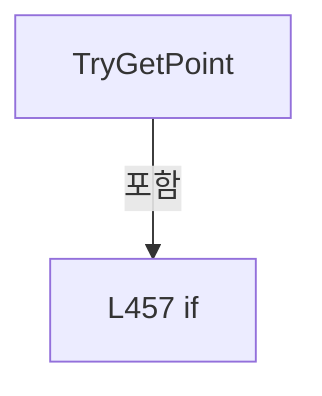

변경 전 점검: 입력/반환 타입, 위 호출자, 예외/취소 경로, 공유 상태와 저장·전송 소비자를 함께 확인합니다. 값의 단위나 물리 방향을 이름만으로 확정하지 않습니다.

### MethodDeclaration `CoordinateKey` · L462–462

[Drilling.Common/Review/CReviewRulePlanBuilder.cs:462–462](https://github.com/kjuws10-rgb/A3Drilling/blob/5aee8e58439c9b455cae7c9593c9be986c3e682e/Drilling.Common/Review/CReviewRulePlanBuilder.cs#L462-L462)

| 항목 | 실제 추출 값 |
| --- | --- |
| 서명 | double Drilling.Common.Review.CReviewRulePlanBuilder.CoordinateKey(double) |
| 접근/수식자 | Private / private, static |
| 반환/값 타입 | double |
| 소속 타입 | NamedType:Drilling.Common.Review.CReviewRulePlanBuilder |

입력 계약:

| 이름 | 타입 | 전달 | 선택/기본값 |
| --- | --- | --- | --- |
| value | double | None | False /  |

정적 호출자로 확인된 위치:

| 호출 파일/행 | 호출 표현식 | 런타임 분기 가능 |
| --- | --- | --- |
| [Drilling.Common/Review/CReviewRulePlanBuilder.cs:291–291](https://github.com/kjuws10-rgb/A3Drilling/blob/5aee8e58439c9b455cae7c9593c9be986c3e682e/Drilling.Common/Review/CReviewRulePlanBuilder.cs#L291-L291) | CoordinateKey | False |

호출하는 대상과 해석 범위:

| 원본 행 | 표현식 | 분석 상태 | 대상/소스 위치 |
| --- | --- | --- | --- |
| 462 | Math.Round | resolved | double System.Math.Round(double, int) |

본문의 실제 연산·분기·예외·반환 순서(원문 위치 순):

| 원본 행 | 종류 | 주석 해설 |
| --- | --- | --- |
| 462 | call | 함수·델리게이트 또는 객체 생성자를 호출합니다: Math.Round(value, 6) |

변경 전 점검: 입력/반환 타입, 위 호출자, 예외/취소 경로, 공유 상태와 저장·전송 소비자를 함께 확인합니다. 값의 단위나 물리 방향을 이름만으로 확정하지 않습니다.

### MethodDeclaration `SelectEdgeShotKeys` · L466–474

[Drilling.Common/Review/CReviewRulePlanBuilder.cs:466–474](https://github.com/kjuws10-rgb/A3Drilling/blob/5aee8e58439c9b455cae7c9593c9be986c3e682e/Drilling.Common/Review/CReviewRulePlanBuilder.cs#L466-L474)

| 항목 | 실제 추출 값 |
| --- | --- |
| 서명 | System.Collections.Generic.IReadOnlyCollection<string> Drilling.Common.Review.CReviewRulePlanBuilder.SelectEdgeShotKeys(Drilling.Common.Review.ST_REVIEW_PLAN) |
| 접근/수식자 | Public / public, static |
| 반환/값 타입 | System.Collections.Generic.IReadOnlyCollection<string> |
| 소속 타입 | NamedType:Drilling.Common.Review.CReviewRulePlanBuilder |

입력 계약:

| 이름 | 타입 | 전달 | 선택/기본값 |
| --- | --- | --- | --- |
| plan | Drilling.Common.Review.ST_REVIEW_PLAN | None | False /  |

정적 호출자로 확인된 위치:

| 호출 파일/행 | 호출 표현식 | 런타임 분기 가능 |
| --- | --- | --- |
| [Drilling.UI/Menu/Menus/CMenuReview.cs:1819–1819](https://github.com/kjuws10-rgb/A3Drilling/blob/5aee8e58439c9b455cae7c9593c9be986c3e682e/Drilling.UI/Menu/Menus/CMenuReview.cs#L1819-L1819) | CReviewRulePlanBuilder.SelectEdgeShotKeys | False |

호출하는 대상과 해석 범위:

| 원본 행 | 표현식 | 분석 상태 | 대상/소스 위치 |
| --- | --- | --- | --- |
| 473 | plan.Points.Where(IsCellEdgeShot).Select(SelectShotKey).Distinct(StringComparer.OrdinalIgnoreCase).ToArray | resolved | string[] System.Collections.Generic.IEnumerable<string>.ToArray<string>() |
| 473 | plan.Points.Where(IsCellEdgeShot).Select(SelectShotKey).Distinct | resolved | System.Collections.Generic.IEnumerable<string> System.Collections.Generic.IEnumerable<string>.Distinct<string>(System.Collections.Generic.IEqualityComparer<string>?) |
| 473 | plan.Points.Where(IsCellEdgeShot).Select | resolved | System.Collections.Generic.IEnumerable<string> System.Collections.Generic.IEnumerable<Drilling.Common.Review.ST_REVIEW_PLAN_POINT>.Select<Drilling.Common.Review.ST_REVIEW_PLAN_POINT, string>(System.Func<Drilling.Common.Review.ST_REVIEW_PLAN_POINT, string>) |
| 473 | plan.Points.Where | resolved | System.Collections.Generic.IEnumerable<Drilling.Common.Review.ST_REVIEW_PLAN_POINT> System.Collections.Generic.IEnumerable<Drilling.Common.Review.ST_REVIEW_PLAN_POINT>.Where<Drilling.Common.Review.ST_REVIEW_PLAN_POINT>(System.Func<Drilling.Common.Review.ST_REVIEW_PLAN_POINT, bool>) |

본문의 실제 연산·분기·예외·반환 순서(원문 위치 순):

| 원본 행 | 종류 | 주석 해설 |
| --- | --- | --- |
| 473 | call | 함수·델리게이트 또는 객체 생성자를 호출합니다: plan.Points.Where(IsCellEdgeShot).Select(SelectShotKey).Distinct(StringComparer.OrdinalIgnoreCase).ToArray() |
| 473 | call | 함수·델리게이트 또는 객체 생성자를 호출합니다: plan.Points.Where(IsCellEdgeShot).Select(SelectShotKey).Distinct(StringComparer.OrdinalIgnoreCase) |
| 473 | call | 함수·델리게이트 또는 객체 생성자를 호출합니다: plan.Points.Where(IsCellEdgeShot).Select(SelectShotKey) |
| 473 | call | 함수·델리게이트 또는 객체 생성자를 호출합니다: plan.Points.Where(IsCellEdgeShot) |
| 473 | return | 호출자에게 값 또는 제어를 반환합니다: return plan.Points.Where(IsCellEdgeShot).Select(SelectShotKey).Distinct(StringComparer.OrdinalIgnoreCase).ToArray(); |

변경 전 점검: 입력/반환 타입, 위 호출자, 예외/취소 경로, 공유 상태와 저장·전송 소비자를 함께 확인합니다. 값의 단위나 물리 방향을 이름만으로 확정하지 않습니다.

### LocalFunctionStatement `SelectShotKey` · L468–471

[Drilling.Common/Review/CReviewRulePlanBuilder.cs:468–471](https://github.com/kjuws10-rgb/A3Drilling/blob/5aee8e58439c9b455cae7c9593c9be986c3e682e/Drilling.Common/Review/CReviewRulePlanBuilder.cs#L468-L471)

| 항목 | 실제 추출 값 |
| --- | --- |
| 서명 | string SelectShotKey(Drilling.Common.Review.ST_REVIEW_PLAN_POINT) |
| 접근/수식자 | Private /  |
| 반환/값 타입 | string |
| 소속 타입 | NamedType:Drilling.Common.Review.CReviewRulePlanBuilder |

입력 계약:

| 이름 | 타입 | 전달 | 선택/기본값 |
| --- | --- | --- | --- |
| point | Drilling.Common.Review.ST_REVIEW_PLAN_POINT | None | False /  |

현재 부분 분석에서 직접 연결된 호출자는 없습니다. XAML/이벤트/인터페이스·델리게이트·외부 진입을 추가 확인해야 하며, 미사용으로 판정한 것이 아닙니다.

본문의 실제 연산·분기·예외·반환 순서(원문 위치 순):

| 원본 행 | 종류 | 주석 해설 |
| --- | --- | --- |
| 470 | return | 호출자에게 값 또는 제어를 반환합니다: return point.ShotKey; |

변경 전 점검: 입력/반환 타입, 위 호출자, 예외/취소 경로, 공유 상태와 저장·전송 소비자를 함께 확인합니다. 값의 단위나 물리 방향을 이름만으로 확정하지 않습니다.

### MethodDeclaration `SelectCenterShotKeys` · L476–484

[Drilling.Common/Review/CReviewRulePlanBuilder.cs:476–484](https://github.com/kjuws10-rgb/A3Drilling/blob/5aee8e58439c9b455cae7c9593c9be986c3e682e/Drilling.Common/Review/CReviewRulePlanBuilder.cs#L476-L484)

| 항목 | 실제 추출 값 |
| --- | --- |
| 서명 | System.Collections.Generic.IReadOnlyCollection<string> Drilling.Common.Review.CReviewRulePlanBuilder.SelectCenterShotKeys(Drilling.Common.Review.ST_REVIEW_PLAN) |
| 접근/수식자 | Public / public, static |
| 반환/값 타입 | System.Collections.Generic.IReadOnlyCollection<string> |
| 소속 타입 | NamedType:Drilling.Common.Review.CReviewRulePlanBuilder |

입력 계약:

| 이름 | 타입 | 전달 | 선택/기본값 |
| --- | --- | --- | --- |
| plan | Drilling.Common.Review.ST_REVIEW_PLAN | None | False /  |

정적 호출자로 확인된 위치:

| 호출 파일/행 | 호출 표현식 | 런타임 분기 가능 |
| --- | --- | --- |
| [Drilling.UI/Menu/Menus/CMenuReview.cs:1825–1825](https://github.com/kjuws10-rgb/A3Drilling/blob/5aee8e58439c9b455cae7c9593c9be986c3e682e/Drilling.UI/Menu/Menus/CMenuReview.cs#L1825-L1825) | CReviewRulePlanBuilder.SelectCenterShotKeys | False |

호출하는 대상과 해석 범위:

| 원본 행 | 표현식 | 분석 상태 | 대상/소스 위치 |
| --- | --- | --- | --- |
| 483 | plan.Points.Where(IsCellCenterShot).Select(SelectShotKey).Distinct(StringComparer.OrdinalIgnoreCase).ToArray | resolved | string[] System.Collections.Generic.IEnumerable<string>.ToArray<string>() |
| 483 | plan.Points.Where(IsCellCenterShot).Select(SelectShotKey).Distinct | resolved | System.Collections.Generic.IEnumerable<string> System.Collections.Generic.IEnumerable<string>.Distinct<string>(System.Collections.Generic.IEqualityComparer<string>?) |
| 483 | plan.Points.Where(IsCellCenterShot).Select | resolved | System.Collections.Generic.IEnumerable<string> System.Collections.Generic.IEnumerable<Drilling.Common.Review.ST_REVIEW_PLAN_POINT>.Select<Drilling.Common.Review.ST_REVIEW_PLAN_POINT, string>(System.Func<Drilling.Common.Review.ST_REVIEW_PLAN_POINT, string>) |
| 483 | plan.Points.Where | resolved | System.Collections.Generic.IEnumerable<Drilling.Common.Review.ST_REVIEW_PLAN_POINT> System.Collections.Generic.IEnumerable<Drilling.Common.Review.ST_REVIEW_PLAN_POINT>.Where<Drilling.Common.Review.ST_REVIEW_PLAN_POINT>(System.Func<Drilling.Common.Review.ST_REVIEW_PLAN_POINT, bool>) |

본문의 실제 연산·분기·예외·반환 순서(원문 위치 순):

| 원본 행 | 종류 | 주석 해설 |
| --- | --- | --- |
| 483 | call | 함수·델리게이트 또는 객체 생성자를 호출합니다: plan.Points.Where(IsCellCenterShot).Select(SelectShotKey).Distinct(StringComparer.OrdinalIgnoreCase).ToArray() |
| 483 | call | 함수·델리게이트 또는 객체 생성자를 호출합니다: plan.Points.Where(IsCellCenterShot).Select(SelectShotKey).Distinct(StringComparer.OrdinalIgnoreCase) |
| 483 | call | 함수·델리게이트 또는 객체 생성자를 호출합니다: plan.Points.Where(IsCellCenterShot).Select(SelectShotKey) |
| 483 | call | 함수·델리게이트 또는 객체 생성자를 호출합니다: plan.Points.Where(IsCellCenterShot) |
| 483 | return | 호출자에게 값 또는 제어를 반환합니다: return plan.Points.Where(IsCellCenterShot).Select(SelectShotKey).Distinct(StringComparer.OrdinalIgnoreCase).ToArray(); |

변경 전 점검: 입력/반환 타입, 위 호출자, 예외/취소 경로, 공유 상태와 저장·전송 소비자를 함께 확인합니다. 값의 단위나 물리 방향을 이름만으로 확정하지 않습니다.

### LocalFunctionStatement `SelectShotKey` · L478–481

[Drilling.Common/Review/CReviewRulePlanBuilder.cs:478–481](https://github.com/kjuws10-rgb/A3Drilling/blob/5aee8e58439c9b455cae7c9593c9be986c3e682e/Drilling.Common/Review/CReviewRulePlanBuilder.cs#L478-L481)

| 항목 | 실제 추출 값 |
| --- | --- |
| 서명 | string SelectShotKey(Drilling.Common.Review.ST_REVIEW_PLAN_POINT) |
| 접근/수식자 | Private /  |
| 반환/값 타입 | string |
| 소속 타입 | NamedType:Drilling.Common.Review.CReviewRulePlanBuilder |

입력 계약:

| 이름 | 타입 | 전달 | 선택/기본값 |
| --- | --- | --- | --- |
| point | Drilling.Common.Review.ST_REVIEW_PLAN_POINT | None | False /  |

현재 부분 분석에서 직접 연결된 호출자는 없습니다. XAML/이벤트/인터페이스·델리게이트·외부 진입을 추가 확인해야 하며, 미사용으로 판정한 것이 아닙니다.

본문의 실제 연산·분기·예외·반환 순서(원문 위치 순):

| 원본 행 | 종류 | 주석 해설 |
| --- | --- | --- |
| 480 | return | 호출자에게 값 또는 제어를 반환합니다: return point.ShotKey; |

변경 전 점검: 입력/반환 타입, 위 호출자, 예외/취소 경로, 공유 상태와 저장·전송 소비자를 함께 확인합니다. 값의 단위나 물리 방향을 이름만으로 확정하지 않습니다.

### MethodDeclaration `IsCellEdgeShot` · L486–494

[Drilling.Common/Review/CReviewRulePlanBuilder.cs:486–494](https://github.com/kjuws10-rgb/A3Drilling/blob/5aee8e58439c9b455cae7c9593c9be986c3e682e/Drilling.Common/Review/CReviewRulePlanBuilder.cs#L486-L494)

| 항목 | 실제 추출 값 |
| --- | --- |
| 서명 | bool Drilling.Common.Review.CReviewRulePlanBuilder.IsCellEdgeShot(Drilling.Common.Review.ST_REVIEW_PLAN_POINT) |
| 접근/수식자 | Private / private, static |
| 반환/값 타입 | bool |
| 소속 타입 | NamedType:Drilling.Common.Review.CReviewRulePlanBuilder |

입력 계약:

| 이름 | 타입 | 전달 | 선택/기본값 |
| --- | --- | --- | --- |
| point | Drilling.Common.Review.ST_REVIEW_PLAN_POINT | None | False /  |

정적 호출자로 확인된 위치:

| 호출 파일/행 | 호출 표현식 | 런타임 분기 가능 |
| --- | --- | --- |
| [Drilling.Common/Review/CReviewRulePlanBuilder.cs:498–498](https://github.com/kjuws10-rgb/A3Drilling/blob/5aee8e58439c9b455cae7c9593c9be986c3e682e/Drilling.Common/Review/CReviewRulePlanBuilder.cs#L498-L498) | IsCellEdgeShot | False |

호출하는 대상과 해석 범위:

| 원본 행 | 표현식 | 분석 상태 | 대상/소스 위치 |
| --- | --- | --- | --- |
| 488 | Math.Max | resolved | int System.Math.Max(int, int) |
| 489 | Math.Max | resolved | int System.Math.Max(int, int) |
| 490 | Math.Max | resolved | int System.Math.Max(int, int) |

본문의 실제 연산·분기·예외·반환 순서(원문 위치 순):

| 원본 행 | 종류 | 주석 해설 |
| --- | --- | --- |
| 488 | call | 함수·델리게이트 또는 객체 생성자를 호출합니다: Math.Max(1, point.PixelCountX) |
| 488 | local-declaration | 지역 변수를 선언합니다: var columnCount = Math.Max(1, point.PixelCountX); |
| 488 | variable-initializer | 변수의 초기값을 지정합니다: columnCount = Math.Max(1, point.PixelCountX) |
| 489 | call | 함수·델리게이트 또는 객체 생성자를 호출합니다: Math.Max(1, point.PixelCountY) |
| 489 | local-declaration | 지역 변수를 선언합니다: var rowCount = Math.Max(1, point.PixelCountY); |
| 489 | variable-initializer | 변수의 초기값을 지정합니다: rowCount = Math.Max(1, point.PixelCountY) |
| 490 | call | 함수·델리게이트 또는 객체 생성자를 호출합니다: Math.Max(0, point.ShotNo - 1) |
| 490 | local-declaration | 지역 변수를 선언합니다: var zeroBasedShotNo = Math.Max(0, point.ShotNo - 1); |
| 490 | variable-initializer | 변수의 초기값을 지정합니다: zeroBasedShotNo = Math.Max(0, point.ShotNo - 1) |
| 491 | local-declaration | 지역 변수를 선언합니다: var column = zeroBasedShotNo % columnCount; |
| 491 | variable-initializer | 변수의 초기값을 지정합니다: column = zeroBasedShotNo % columnCount |
| 492 | local-declaration | 지역 변수를 선언합니다: var row = zeroBasedShotNo / columnCount; |
| 492 | variable-initializer | 변수의 초기값을 지정합니다: row = zeroBasedShotNo / columnCount |
| 493 | return | 호출자에게 값 또는 제어를 반환합니다: return column == 0 &#124;&#124; column == columnCount - 1 &#124;&#124; row == 0 &#124;&#124; row == rowCount - 1; |

변경 전 점검: 입력/반환 타입, 위 호출자, 예외/취소 경로, 공유 상태와 저장·전송 소비자를 함께 확인합니다. 값의 단위나 물리 방향을 이름만으로 확정하지 않습니다.

### MethodDeclaration `IsCellCenterShot` · L496–499

[Drilling.Common/Review/CReviewRulePlanBuilder.cs:496–499](https://github.com/kjuws10-rgb/A3Drilling/blob/5aee8e58439c9b455cae7c9593c9be986c3e682e/Drilling.Common/Review/CReviewRulePlanBuilder.cs#L496-L499)

| 항목 | 실제 추출 값 |
| --- | --- |
| 서명 | bool Drilling.Common.Review.CReviewRulePlanBuilder.IsCellCenterShot(Drilling.Common.Review.ST_REVIEW_PLAN_POINT) |
| 접근/수식자 | Private / private, static |
| 반환/값 타입 | bool |
| 소속 타입 | NamedType:Drilling.Common.Review.CReviewRulePlanBuilder |

입력 계약:

| 이름 | 타입 | 전달 | 선택/기본값 |
| --- | --- | --- | --- |
| point | Drilling.Common.Review.ST_REVIEW_PLAN_POINT | None | False /  |

현재 부분 분석에서 직접 연결된 호출자는 없습니다. XAML/이벤트/인터페이스·델리게이트·외부 진입을 추가 확인해야 하며, 미사용으로 판정한 것이 아닙니다.

호출하는 대상과 해석 범위:

| 원본 행 | 표현식 | 분석 상태 | 대상/소스 위치 |
| --- | --- | --- | --- |
| 498 | IsCellEdgeShot | resolved | bool Drilling.Common.Review.CReviewRulePlanBuilder.IsCellEdgeShot(Drilling.Common.Review.ST_REVIEW_PLAN_POINT) · Drilling.Common/Review/CReviewRulePlanBuilder.cs:486 |

본문의 실제 연산·분기·예외·반환 순서(원문 위치 순):

| 원본 행 | 종류 | 주석 해설 |
| --- | --- | --- |
| 498 | call | 함수·델리게이트 또는 객체 생성자를 호출합니다: IsCellEdgeShot(point) |
| 498 | return | 호출자에게 값 또는 제어를 반환합니다: return !IsCellEdgeShot(point); |

변경 전 점검: 입력/반환 타입, 위 호출자, 예외/취소 경로, 공유 상태와 저장·전송 소비자를 함께 확인합니다. 값의 단위나 물리 방향을 이름만으로 확정하지 않습니다.

### EnumMemberDeclaration `Simple` · L505–505

[Drilling.Common/Review/CReviewRulePlanBuilder.cs:505–505](https://github.com/kjuws10-rgb/A3Drilling/blob/5aee8e58439c9b455cae7c9593c9be986c3e682e/Drilling.Common/Review/CReviewRulePlanBuilder.cs#L505-L505)

| 항목 | 실제 추출 값 |
| --- | --- |
| 서명 | Drilling.Common.Review.EN_REVIEW_CORRECTION_RULE.Simple |
| 접근/수식자 | Public /  |
| 반환/값 타입 | Drilling.Common.Review.EN_REVIEW_CORRECTION_RULE |
| 소속 타입 | NamedType:Drilling.Common.Review.EN_REVIEW_CORRECTION_RULE |

현재 부분 분석에서 직접 연결된 호출자는 없습니다. XAML/이벤트/인터페이스·델리게이트·외부 진입을 추가 확인해야 하며, 미사용으로 판정한 것이 아닙니다.

변경 전 점검: 입력/반환 타입, 위 호출자, 예외/취소 경로, 공유 상태와 저장·전송 소비자를 함께 확인합니다. 값의 단위나 물리 방향을 이름만으로 확정하지 않습니다.

### EnumMemberDeclaration `Rough` · L506–506

[Drilling.Common/Review/CReviewRulePlanBuilder.cs:506–506](https://github.com/kjuws10-rgb/A3Drilling/blob/5aee8e58439c9b455cae7c9593c9be986c3e682e/Drilling.Common/Review/CReviewRulePlanBuilder.cs#L506-L506)

| 항목 | 실제 추출 값 |
| --- | --- |
| 서명 | Drilling.Common.Review.EN_REVIEW_CORRECTION_RULE.Rough |
| 접근/수식자 | Public /  |
| 반환/값 타입 | Drilling.Common.Review.EN_REVIEW_CORRECTION_RULE |
| 소속 타입 | NamedType:Drilling.Common.Review.EN_REVIEW_CORRECTION_RULE |

현재 부분 분석에서 직접 연결된 호출자는 없습니다. XAML/이벤트/인터페이스·델리게이트·외부 진입을 추가 확인해야 하며, 미사용으로 판정한 것이 아닙니다.

변경 전 점검: 입력/반환 타입, 위 호출자, 예외/취소 경로, 공유 상태와 저장·전송 소비자를 함께 확인합니다. 값의 단위나 물리 방향을 이름만으로 확정하지 않습니다.

### EnumMemberDeclaration `Fine` · L507–507

[Drilling.Common/Review/CReviewRulePlanBuilder.cs:507–507](https://github.com/kjuws10-rgb/A3Drilling/blob/5aee8e58439c9b455cae7c9593c9be986c3e682e/Drilling.Common/Review/CReviewRulePlanBuilder.cs#L507-L507)

| 항목 | 실제 추출 값 |
| --- | --- |
| 서명 | Drilling.Common.Review.EN_REVIEW_CORRECTION_RULE.Fine |
| 접근/수식자 | Public /  |
| 반환/값 타입 | Drilling.Common.Review.EN_REVIEW_CORRECTION_RULE |
| 소속 타입 | NamedType:Drilling.Common.Review.EN_REVIEW_CORRECTION_RULE |

현재 부분 분석에서 직접 연결된 호출자는 없습니다. XAML/이벤트/인터페이스·델리게이트·외부 진입을 추가 확인해야 하며, 미사용으로 판정한 것이 아닙니다.

변경 전 점검: 입력/반환 타입, 위 호출자, 예외/취소 경로, 공유 상태와 저장·전송 소비자를 함께 확인합니다. 값의 단위나 물리 방향을 이름만으로 확정하지 않습니다.

### EnumMemberDeclaration `Edge` · L508–508

[Drilling.Common/Review/CReviewRulePlanBuilder.cs:508–508](https://github.com/kjuws10-rgb/A3Drilling/blob/5aee8e58439c9b455cae7c9593c9be986c3e682e/Drilling.Common/Review/CReviewRulePlanBuilder.cs#L508-L508)

| 항목 | 실제 추출 값 |
| --- | --- |
| 서명 | Drilling.Common.Review.EN_REVIEW_CORRECTION_RULE.Edge |
| 접근/수식자 | Public /  |
| 반환/값 타입 | Drilling.Common.Review.EN_REVIEW_CORRECTION_RULE |
| 소속 타입 | NamedType:Drilling.Common.Review.EN_REVIEW_CORRECTION_RULE |

현재 부분 분석에서 직접 연결된 호출자는 없습니다. XAML/이벤트/인터페이스·델리게이트·외부 진입을 추가 확인해야 하며, 미사용으로 판정한 것이 아닙니다.

변경 전 점검: 입력/반환 타입, 위 호출자, 예외/취소 경로, 공유 상태와 저장·전송 소비자를 함께 확인합니다. 값의 단위나 물리 방향을 이름만으로 확정하지 않습니다.

### EnumMemberDeclaration `Head` · L513–513

[Drilling.Common/Review/CReviewRulePlanBuilder.cs:513–513](https://github.com/kjuws10-rgb/A3Drilling/blob/5aee8e58439c9b455cae7c9593c9be986c3e682e/Drilling.Common/Review/CReviewRulePlanBuilder.cs#L513-L513)

| 항목 | 실제 추출 값 |
| --- | --- |
| 서명 | Drilling.Common.Review.EN_REVIEW_CORRECTION_SCOPE.Head |
| 접근/수식자 | Public /  |
| 반환/값 타입 | Drilling.Common.Review.EN_REVIEW_CORRECTION_SCOPE |
| 소속 타입 | NamedType:Drilling.Common.Review.EN_REVIEW_CORRECTION_SCOPE |

현재 부분 분석에서 직접 연결된 호출자는 없습니다. XAML/이벤트/인터페이스·델리게이트·외부 진입을 추가 확인해야 하며, 미사용으로 판정한 것이 아닙니다.

변경 전 점검: 입력/반환 타입, 위 호출자, 예외/취소 경로, 공유 상태와 저장·전송 소비자를 함께 확인합니다. 값의 단위나 물리 방향을 이름만으로 확정하지 않습니다.

### EnumMemberDeclaration `HeadCell` · L514–514

[Drilling.Common/Review/CReviewRulePlanBuilder.cs:514–514](https://github.com/kjuws10-rgb/A3Drilling/blob/5aee8e58439c9b455cae7c9593c9be986c3e682e/Drilling.Common/Review/CReviewRulePlanBuilder.cs#L514-L514)

| 항목 | 실제 추출 값 |
| --- | --- |
| 서명 | Drilling.Common.Review.EN_REVIEW_CORRECTION_SCOPE.HeadCell |
| 접근/수식자 | Public /  |
| 반환/값 타입 | Drilling.Common.Review.EN_REVIEW_CORRECTION_SCOPE |
| 소속 타입 | NamedType:Drilling.Common.Review.EN_REVIEW_CORRECTION_SCOPE |

현재 부분 분석에서 직접 연결된 호출자는 없습니다. XAML/이벤트/인터페이스·델리게이트·외부 진입을 추가 확인해야 하며, 미사용으로 판정한 것이 아닙니다.

변경 전 점검: 입력/반환 타입, 위 호출자, 예외/취소 경로, 공유 상태와 저장·전송 소비자를 함께 확인합니다. 값의 단위나 물리 방향을 이름만으로 확정하지 않습니다.

### EnumMemberDeclaration `First` · L519–519

[Drilling.Common/Review/CReviewRulePlanBuilder.cs:519–519](https://github.com/kjuws10-rgb/A3Drilling/blob/5aee8e58439c9b455cae7c9593c9be986c3e682e/Drilling.Common/Review/CReviewRulePlanBuilder.cs#L519-L519)

| 항목 | 실제 추출 값 |
| --- | --- |
| 서명 | Drilling.Common.Review.EN_REVIEW_REFERENCE_LINE.First |
| 접근/수식자 | Public /  |
| 반환/값 타입 | Drilling.Common.Review.EN_REVIEW_REFERENCE_LINE |
| 소속 타입 | NamedType:Drilling.Common.Review.EN_REVIEW_REFERENCE_LINE |

현재 부분 분석에서 직접 연결된 호출자는 없습니다. XAML/이벤트/인터페이스·델리게이트·외부 진입을 추가 확인해야 하며, 미사용으로 판정한 것이 아닙니다.

변경 전 점검: 입력/반환 타입, 위 호출자, 예외/취소 경로, 공유 상태와 저장·전송 소비자를 함께 확인합니다. 값의 단위나 물리 방향을 이름만으로 확정하지 않습니다.

### EnumMemberDeclaration `Center` · L520–520

[Drilling.Common/Review/CReviewRulePlanBuilder.cs:520–520](https://github.com/kjuws10-rgb/A3Drilling/blob/5aee8e58439c9b455cae7c9593c9be986c3e682e/Drilling.Common/Review/CReviewRulePlanBuilder.cs#L520-L520)

| 항목 | 실제 추출 값 |
| --- | --- |
| 서명 | Drilling.Common.Review.EN_REVIEW_REFERENCE_LINE.Center |
| 접근/수식자 | Public /  |
| 반환/값 타입 | Drilling.Common.Review.EN_REVIEW_REFERENCE_LINE |
| 소속 타입 | NamedType:Drilling.Common.Review.EN_REVIEW_REFERENCE_LINE |

현재 부분 분석에서 직접 연결된 호출자는 없습니다. XAML/이벤트/인터페이스·델리게이트·외부 진입을 추가 확인해야 하며, 미사용으로 판정한 것이 아닙니다.

변경 전 점검: 입력/반환 타입, 위 호출자, 예외/취소 경로, 공유 상태와 저장·전송 소비자를 함께 확인합니다. 값의 단위나 물리 방향을 이름만으로 확정하지 않습니다.

### EnumMemberDeclaration `Last` · L521–521

[Drilling.Common/Review/CReviewRulePlanBuilder.cs:521–521](https://github.com/kjuws10-rgb/A3Drilling/blob/5aee8e58439c9b455cae7c9593c9be986c3e682e/Drilling.Common/Review/CReviewRulePlanBuilder.cs#L521-L521)

| 항목 | 실제 추출 값 |
| --- | --- |
| 서명 | Drilling.Common.Review.EN_REVIEW_REFERENCE_LINE.Last |
| 접근/수식자 | Public /  |
| 반환/값 타입 | Drilling.Common.Review.EN_REVIEW_REFERENCE_LINE |
| 소속 타입 | NamedType:Drilling.Common.Review.EN_REVIEW_REFERENCE_LINE |

현재 부분 분석에서 직접 연결된 호출자는 없습니다. XAML/이벤트/인터페이스·델리게이트·외부 진입을 추가 확인해야 하며, 미사용으로 판정한 것이 아닙니다.

변경 전 점검: 입력/반환 타입, 위 호출자, 예외/취소 경로, 공유 상태와 저장·전송 소비자를 함께 확인합니다. 값의 단위나 물리 방향을 이름만으로 확정하지 않습니다.

### PropertyDeclaration `ShotKeys` · L535–535

[Drilling.Common/Review/CReviewRulePlanBuilder.cs:535–535](https://github.com/kjuws10-rgb/A3Drilling/blob/5aee8e58439c9b455cae7c9593c9be986c3e682e/Drilling.Common/Review/CReviewRulePlanBuilder.cs#L535-L535)

| 항목 | 실제 추출 값 |
| --- | --- |
| 서명 | System.Collections.Generic.IReadOnlyCollection<string> Drilling.Common.Review.ST_REVIEW_RULE_PLAN.ShotKeys |
| 접근/수식자 | Public / public |
| 반환/값 타입 | System.Collections.Generic.IReadOnlyCollection<string> |
| 소속 타입 | NamedType:Drilling.Common.Review.ST_REVIEW_RULE_PLAN |

현재 부분 분석에서 직접 연결된 호출자는 없습니다. XAML/이벤트/인터페이스·델리게이트·외부 진입을 추가 확인해야 하며, 미사용으로 판정한 것이 아닙니다.

호출하는 대상과 해석 범위:

| 원본 행 | 표현식 | 분석 상태 | 대상/소스 위치 |
| --- | --- | --- | --- |
| 535 | Targets.Select(target => target.ShotKey).Distinct(StringComparer.OrdinalIgnoreCase).ToArray | resolved | string[] System.Collections.Generic.IEnumerable<string>.ToArray<string>() |
| 535 | Targets.Select(target => target.ShotKey).Distinct | resolved | System.Collections.Generic.IEnumerable<string> System.Collections.Generic.IEnumerable<string>.Distinct<string>(System.Collections.Generic.IEqualityComparer<string>?) |
| 535 | Targets.Select | resolved | System.Collections.Generic.IEnumerable<string> System.Collections.Generic.IEnumerable<Drilling.Common.Review.ST_REVIEW_RULE_TARGET>.Select<Drilling.Common.Review.ST_REVIEW_RULE_TARGET, string>(System.Func<Drilling.Common.Review.ST_REVIEW_RULE_TARGET, string>) |

본문의 실제 연산·분기·예외·반환 순서(원문 위치 순):

| 원본 행 | 종류 | 주석 해설 |
| --- | --- | --- |
| 535 | call | 함수·델리게이트 또는 객체 생성자를 호출합니다: Targets.Select(target => target.ShotKey).Distinct(StringComparer.OrdinalIgnoreCase).ToArray() |
| 535 | call | 함수·델리게이트 또는 객체 생성자를 호출합니다: Targets.Select(target => target.ShotKey).Distinct(StringComparer.OrdinalIgnoreCase) |
| 535 | call | 함수·델리게이트 또는 객체 생성자를 호출합니다: Targets.Select(target => target.ShotKey) |

변경 전 점검: 입력/반환 타입, 위 호출자, 예외/취소 경로, 공유 상태와 저장·전송 소비자를 함께 확인합니다. 값의 단위나 물리 방향을 이름만으로 확정하지 않습니다.

### GetAccessorDeclaration `get_ShotKeys` · L535–535

[Drilling.Common/Review/CReviewRulePlanBuilder.cs:535–535](https://github.com/kjuws10-rgb/A3Drilling/blob/5aee8e58439c9b455cae7c9593c9be986c3e682e/Drilling.Common/Review/CReviewRulePlanBuilder.cs#L535-L535)

| 항목 | 실제 추출 값 |
| --- | --- |
| 서명 | System.Collections.Generic.IReadOnlyCollection<string> Drilling.Common.Review.ST_REVIEW_RULE_PLAN.ShotKeys.get |
| 접근/수식자 | Public / get |
| 반환/값 타입 | System.Collections.Generic.IReadOnlyCollection<string> |
| 소속 타입 | NamedType:Drilling.Common.Review.ST_REVIEW_RULE_PLAN |

현재 부분 분석에서 직접 연결된 호출자는 없습니다. XAML/이벤트/인터페이스·델리게이트·외부 진입을 추가 확인해야 하며, 미사용으로 판정한 것이 아닙니다.

변경 전 점검: 입력/반환 타입, 위 호출자, 예외/취소 경로, 공유 상태와 저장·전송 소비자를 함께 확인합니다. 값의 단위나 물리 방향을 이름만으로 확정하지 않습니다.

## 구문·바인딩 한계

전체 WPF/벤더 SDK/프로젝트별 빌드 조건을 로드한 정식 빌드가 아닙니다. `resolved`는 이 부분 컴파일에서의 심볼 연결이며 virtual/interface/delegate/이벤트/Reflection/XAML의 실제 런타임 구현을 확정하지 않습니다. `candidate`와 `unresolved`는 후속 확인 대상으로 남깁니다.

## 원문 전체 주석 해설본

[원본 모든 행과 행별 해설 보기](../../../annotated/Drilling.Common/Review/CReviewRulePlanBuilder.cs.annotated.txt)

원본을 빠뜨리거나 임의로 줄이지 않았습니다. `L000001 |` 표시는 원본 행 번호, `// 해설`은 별도 설명입니다. 실행용 소스가 아닌 문서입니다.

## 수정·재검증 체크

- 원본 Commit과 현재 작업 파일 SHA가 같은지 먼저 확인합니다. 다르면 이 문서를 과거 버전 자료로 취급합니다.
- 선언·직접 호출·이벤트/인터페이스 경계·설정 소비를 함께 확인합니다. 정적 연결의 빈 곳을 정상 경로로 추정하지 않습니다.
- 저장 형식/단위/식별자·재시도·취소·예외·롤백에 영향을 주는 변경은 상세 해설장과 호출자를 다시 검토합니다.
- 도구의 구문 추출과 별도 정적 추적 해설, 실제 빌드·시뮬레이션·실장비 검증 결과를 분리합니다.
