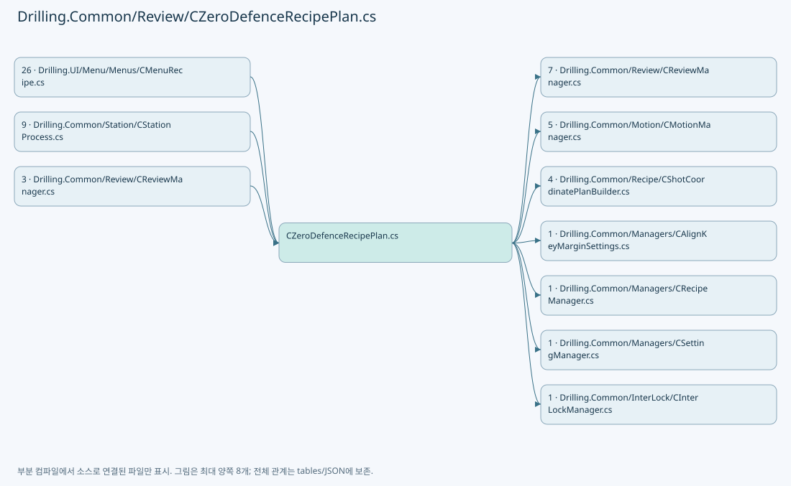
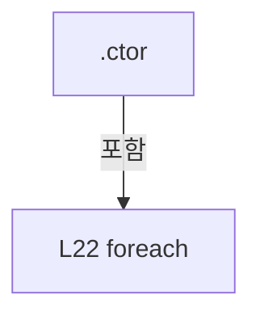
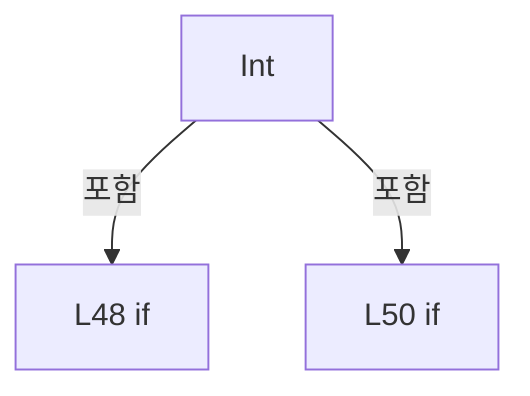
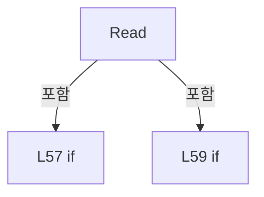
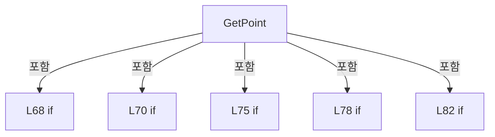
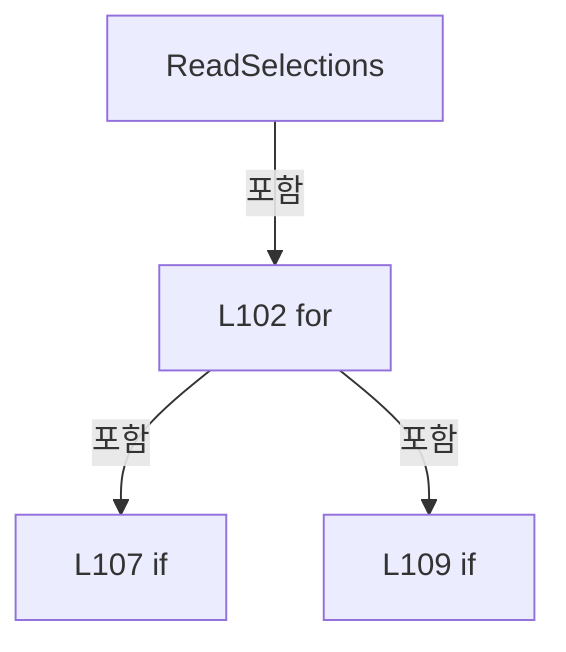
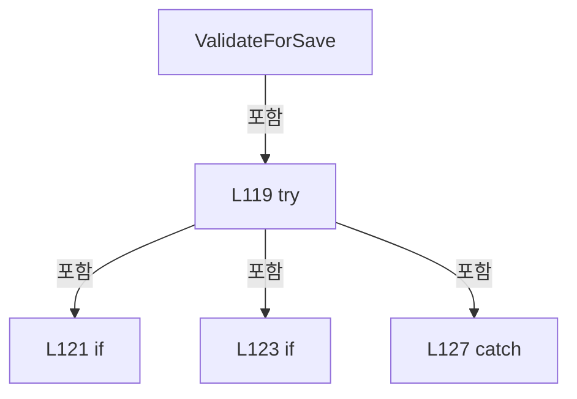
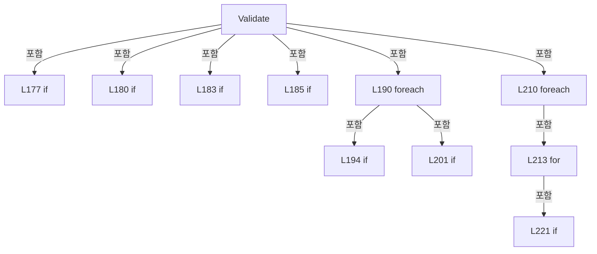
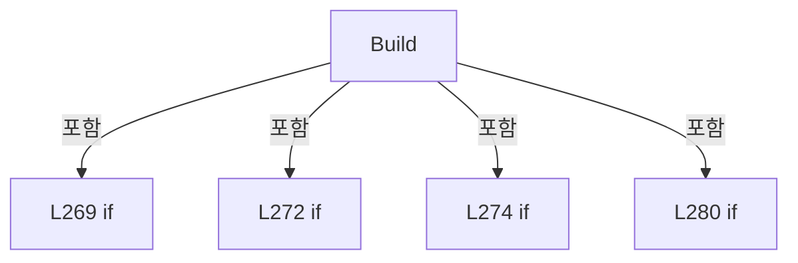
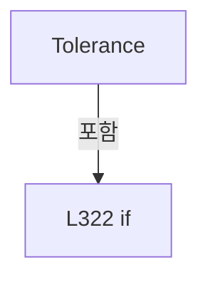

# Drilling.Common/Review/CZeroDefenceRecipePlan.cs

| 항목 | 내용 |
| --- | --- |
| 원본 저장소 | https://github.com/kjuws10-rgb/A3Drilling.git |
| 원본 Commit | 0219666f9053b907d96d7e0aa7d0c6c1be3a73d4 |
| 원본 SHA256 | 2e2845eaeefb78debf2e3eae3e71ae7a8dab3a2001a77c93678fa69dc5662008 |
| 파일 분류 | code |
| 원본 크기/행 | 19,683 bytes / 328 physical lines |
| 인코딩 | utf-8-sig |
| 검토 범위 | 구문/부분 의미 분석에서 추출한 사실. 동작·물리 단위·실장비 합격을 보증하지 않습니다. |
| 원본 링크 | [고정 Commit 원본](https://github.com/kjuws10-rgb/A3Drilling/blob/0219666f9053b907d96d7e0aa7d0c6c1be3a73d4/Drilling.Common/Review/CZeroDefenceRecipePlan.cs) |

## 파일의 역할과 읽는 순서

리뷰 계획·측정·결과 해석 계층입니다. 물리 이동 좌표와 Vision 식별 패킷, 측정 저장의 역할을 별도로 확인합니다.

## 네임스페이스·타입·상속

| 타입 | 구분 | 원본 범위 | 선언/상속 |
| --- | --- | --- | --- |
| CZeroDefenceRecipePlan | ClassDeclaration | 10–132 | CZeroDefenceRecipePlan |
| ST_ZERO_DEFENCE_TIMING_PROFILE | RecordDeclaration | 134–144 | ST_ZERO_DEFENCE_TIMING_PROFILE |
| ST_ZERO_DEFENCE_POINT | RecordDeclaration | 146–157 | ST_ZERO_DEFENCE_POINT |
| ST_ZERO_DEFENCE_TIMING_ISSUE | RecordDeclaration | 158–158 | ST_ZERO_DEFENCE_TIMING_ISSUE |
| ST_ZERO_DEFENCE_TRANSITION | RecordDeclaration | 159–162 | ST_ZERO_DEFENCE_TRANSITION |
| ST_ZERO_DEFENCE_TIMING_RESULT | RecordDeclaration | 164–168 | ST_ZERO_DEFENCE_TIMING_RESULT |
| CZeroDefenceTiming | ClassDeclaration | 171–235 | CZeroDefenceTiming |
| ST_ZERO_LINE_CYCLE_PLAN | RecordDeclaration | 237–247 | ST_ZERO_LINE_CYCLE_PLAN |
| ST_ZERO_LINE_POINT_RESULT | RecordDeclaration | 248–251 | ST_ZERO_LINE_POINT_RESULT |
| ST_ZERO_LINE_CYCLE_STATUS | RecordDeclaration | 253–260 | ST_ZERO_LINE_CYCLE_STATUS |
| ST_ZERO_LINE_RESULT_DATA | RecordDeclaration | 262–262 | ST_ZERO_LINE_RESULT_DATA |
| CZeroLineCyclePlan | ClassDeclaration | 264–327 | CZeroLineCyclePlan |

## 멤버 빠른 목록

| 이름 | 종류 | 범위 | 서명 |
| --- | --- | --- | --- |
| CountKey | FieldDeclaration | L12–12 | string Drilling.Common.Review.CZeroDefenceRecipePlan.CountKey |
| Key | MethodDeclaration | L13–13 | string Drilling.Common.Review.CZeroDefenceRecipePlan.Key(int, string) |
| _mask | FieldDeclaration | L14–14 | Drilling.Common.Recipe.CRecipeShotMaskingPlan Drilling.Common.Review.CZeroDefenceRecipePlan._mask |
| _shots | FieldDeclaration | L15–15 | System.Collections.Generic.Dictionary<(int Cell, int Shot), Drilling.Common.Recipe.ST_HEAD_SHOT_POINT> Drilling.Common.Review.CZeroDefenceRecipePlan._shots |
| _beamPosition | FieldDeclaration | L16–16 | System.Func<Drilling.Common.Review.ST_REVIEW_PLAN_POINT, int, Drilling.Common.Review.ST_REVIEW_BEAM_POSITION> Drilling.Common.Review.CZeroDefenceRecipePlan._beamPosition |
| _alignKeyMargins | FieldDeclaration | L17–17 | Drilling.Common.Managers.ST_ALIGN_KEY_MARGINS Drilling.Common.Review.CZeroDefenceRecipePlan._alignKeyMargins |
| .ctor | ConstructorDeclaration | L18–37 | Drilling.Common.Review.CZeroDefenceRecipePlan.CZeroDefenceRecipePlan(Drilling.Common.Managers.ST_RECIPE_DEFINITION, System.Collections.Generic.IReadOnlyList<Drilling.Common.Managers.ST_SYSTEM_PARAMETER>) |
| Recipe | PropertyDeclaration | L39–39 | Drilling.Common.Managers.ST_RECIPE_DEFINITION Drilling.Common.Review.CZeroDefenceRecipePlan.Recipe |
| get_Recipe | GetAccessorDeclaration | L39–39 | Drilling.Common.Managers.ST_RECIPE_DEFINITION Drilling.Common.Review.CZeroDefenceRecipePlan.Recipe.get |
| Parameters | PropertyDeclaration | L40–40 | System.Collections.Generic.IReadOnlyDictionary<string, string> Drilling.Common.Review.CZeroDefenceRecipePlan.Parameters |
| get_Parameters | GetAccessorDeclaration | L40–40 | System.Collections.Generic.IReadOnlyDictionary<string, string> Drilling.Common.Review.CZeroDefenceRecipePlan.Parameters.get |
| Plan | PropertyDeclaration | L41–41 | Drilling.Common.Recipe.ST_SHOT_COORDINATE_PLAN Drilling.Common.Review.CZeroDefenceRecipePlan.Plan |
| get_Plan | GetAccessorDeclaration | L41–41 | Drilling.Common.Recipe.ST_SHOT_COORDINATE_PLAN Drilling.Common.Review.CZeroDefenceRecipePlan.Plan.get |
| Profile | PropertyDeclaration | L42–42 | Drilling.Common.Review.ST_ZERO_DEFENCE_TIMING_PROFILE Drilling.Common.Review.CZeroDefenceRecipePlan.Profile |
| get_Profile | GetAccessorDeclaration | L42–42 | Drilling.Common.Review.ST_ZERO_DEFENCE_TIMING_PROFILE Drilling.Common.Review.CZeroDefenceRecipePlan.Profile.get |
| Count | PropertyDeclaration | L43–43 | int Drilling.Common.Review.CZeroDefenceRecipePlan.Count |
| HasSelections | PropertyDeclaration | L44–44 | bool Drilling.Common.Review.CZeroDefenceRecipePlan.HasSelections |
| Int | MethodDeclaration | L46–53 | int Drilling.Common.Review.CZeroDefenceRecipePlan.Int(string, int) |
| Read | MethodDeclaration | L55–62 | double Drilling.Common.Review.CZeroDefenceRecipePlan.Read(string, double) |
| CanProcess | MethodDeclaration | L64–64 | bool Drilling.Common.Review.CZeroDefenceRecipePlan.CanProcess(Drilling.Common.Recipe.ST_HEAD_SHOT_POINT) |
| Mask | MethodDeclaration | L65–65 | Drilling.Common.Recipe.ST_RECIPE_SHOT_MASKING_RESULT Drilling.Common.Review.CZeroDefenceRecipePlan.Mask(Drilling.Common.Recipe.ST_HEAD_SHOT_POINT) |
| GetPoint | MethodDeclaration | L66–97 | Drilling.Common.Review.ST_ZERO_DEFENCE_POINT Drilling.Common.Review.CZeroDefenceRecipePlan.GetPoint(int, int, int, int) |
| ReadSelections | MethodDeclaration | L99–115 | System.Collections.Generic.IReadOnlyList<Drilling.Common.Review.ST_ZERO_DEFENCE_POINT> Drilling.Common.Review.CZeroDefenceRecipePlan.ReadSelections(bool) |
| ValidateForSave | MethodDeclaration | L117–131 | string Drilling.Common.Review.CZeroDefenceRecipePlan.ValidateForSave() |
| StageStroke | PropertyDeclaration | L138–138 | double Drilling.Common.Review.ST_ZERO_DEFENCE_TIMING_PROFILE.StageStroke |
| get_StageStroke | GetAccessorDeclaration | L138–138 | double Drilling.Common.Review.ST_ZERO_DEFENCE_TIMING_PROFILE.StageStroke.get |
| set_StageStroke | InitAccessorDeclaration | L138–138 | void Drilling.Common.Review.ST_ZERO_DEFENCE_TIMING_PROFILE.StageStroke.init |
| StageAcceleration | PropertyDeclaration | L139–139 | double Drilling.Common.Review.ST_ZERO_DEFENCE_TIMING_PROFILE.StageAcceleration |
| get_StageAcceleration | GetAccessorDeclaration | L139–139 | double Drilling.Common.Review.ST_ZERO_DEFENCE_TIMING_PROFILE.StageAcceleration.get |
| set_StageAcceleration | InitAccessorDeclaration | L139–139 | void Drilling.Common.Review.ST_ZERO_DEFENCE_TIMING_PROFILE.StageAcceleration.init |
| SettleSeconds | PropertyDeclaration | L140–140 | double Drilling.Common.Review.ST_ZERO_DEFENCE_TIMING_PROFILE.SettleSeconds |
| get_SettleSeconds | GetAccessorDeclaration | L140–140 | double Drilling.Common.Review.ST_ZERO_DEFENCE_TIMING_PROFILE.SettleSeconds.get |
| set_SettleSeconds | InitAccessorDeclaration | L140–140 | void Drilling.Common.Review.ST_ZERO_DEFENCE_TIMING_PROFILE.SettleSeconds.init |
| ArrivalMarginSeconds | PropertyDeclaration | L141–141 | double Drilling.Common.Review.ST_ZERO_DEFENCE_TIMING_PROFILE.ArrivalMarginSeconds |
| get_ArrivalMarginSeconds | GetAccessorDeclaration | L141–141 | double Drilling.Common.Review.ST_ZERO_DEFENCE_TIMING_PROFILE.ArrivalMarginSeconds.get |
| set_ArrivalMarginSeconds | InitAccessorDeclaration | L141–141 | void Drilling.Common.Review.ST_ZERO_DEFENCE_TIMING_PROFILE.ArrivalMarginSeconds.init |
| FramesPerSecond | PropertyDeclaration | L142–142 | double Drilling.Common.Review.ST_ZERO_DEFENCE_TIMING_PROFILE.FramesPerSecond |
| get_FramesPerSecond | GetAccessorDeclaration | L142–142 | double Drilling.Common.Review.ST_ZERO_DEFENCE_TIMING_PROFILE.FramesPerSecond.get |
| set_FramesPerSecond | InitAccessorDeclaration | L142–142 | void Drilling.Common.Review.ST_ZERO_DEFENCE_TIMING_PROFILE.FramesPerSecond.init |
| ExposureSeconds | PropertyDeclaration | L143–143 | double Drilling.Common.Review.ST_ZERO_DEFENCE_TIMING_PROFILE.ExposureSeconds |
| get_ExposureSeconds | GetAccessorDeclaration | L143–143 | double Drilling.Common.Review.ST_ZERO_DEFENCE_TIMING_PROFILE.ExposureSeconds.get |
| set_ExposureSeconds | InitAccessorDeclaration | L143–143 | void Drilling.Common.Review.ST_ZERO_DEFENCE_TIMING_PROFILE.ExposureSeconds.init |
| MarginSeconds | PropertyDeclaration | L161–161 | double Drilling.Common.Review.ST_ZERO_DEFENCE_TRANSITION.MarginSeconds |
| IsValid | PropertyDeclaration | L166–166 | bool Drilling.Common.Review.ST_ZERO_DEFENCE_TIMING_RESULT.IsValid |
| Message | PropertyDeclaration | L167–167 | string Drilling.Common.Review.ST_ZERO_DEFENCE_TIMING_RESULT.Message |
| Validate | MethodDeclaration | L173–234 | Drilling.Common.Review.ST_ZERO_DEFENCE_TIMING_RESULT Drilling.Common.Review.CZeroDefenceTiming.Validate(int, System.Collections.Generic.IEnumerable<Drilling.Common.Review.ST_ZERO_DEFENCE_POINT>, Drilling.Common.Review.ST_ZERO_DEFENCE_TIMING_PROFILE) |
| Positive | LocalFunctionStatement | L182–182 | bool Positive(double) |
| IsNg | PropertyDeclaration | L250–250 | bool Drilling.Common.Review.ST_ZERO_LINE_POINT_RESULT.IsNg |
| Plan | PropertyDeclaration | L255–255 | Drilling.Common.Review.ST_ZERO_LINE_CYCLE_PLAN? Drilling.Common.Review.ST_ZERO_LINE_CYCLE_STATUS.Plan |
| get_Plan | GetAccessorDeclaration | L255–255 | Drilling.Common.Review.ST_ZERO_LINE_CYCLE_PLAN? Drilling.Common.Review.ST_ZERO_LINE_CYCLE_STATUS.Plan.get |
| set_Plan | InitAccessorDeclaration | L255–255 | void Drilling.Common.Review.ST_ZERO_LINE_CYCLE_STATUS.Plan.init |
| ResultSavedAt | PropertyDeclaration | L256–256 | System.DateTimeOffset? Drilling.Common.Review.ST_ZERO_LINE_CYCLE_STATUS.ResultSavedAt |
| get_ResultSavedAt | GetAccessorDeclaration | L256–256 | System.DateTimeOffset? Drilling.Common.Review.ST_ZERO_LINE_CYCLE_STATUS.ResultSavedAt.get |
| set_ResultSavedAt | InitAccessorDeclaration | L256–256 | void Drilling.Common.Review.ST_ZERO_LINE_CYCLE_STATUS.ResultSavedAt.init |
| FollowUpRequested | PropertyDeclaration | L257–257 | bool Drilling.Common.Review.ST_ZERO_LINE_CYCLE_STATUS.FollowUpRequested |
| get_FollowUpRequested | GetAccessorDeclaration | L257–257 | bool Drilling.Common.Review.ST_ZERO_LINE_CYCLE_STATUS.FollowUpRequested.get |
| set_FollowUpRequested | InitAccessorDeclaration | L257–257 | void Drilling.Common.Review.ST_ZERO_LINE_CYCLE_STATUS.FollowUpRequested.init |
| FollowUpCompleted | PropertyDeclaration | L258–258 | bool Drilling.Common.Review.ST_ZERO_LINE_CYCLE_STATUS.FollowUpCompleted |
| get_FollowUpCompleted | GetAccessorDeclaration | L258–258 | bool Drilling.Common.Review.ST_ZERO_LINE_CYCLE_STATUS.FollowUpCompleted.get |
| set_FollowUpCompleted | InitAccessorDeclaration | L258–258 | void Drilling.Common.Review.ST_ZERO_LINE_CYCLE_STATUS.FollowUpCompleted.init |
| Judge | PropertyDeclaration | L259–259 | string Drilling.Common.Review.ST_ZERO_LINE_CYCLE_STATUS.Judge |
| Build | MethodDeclaration | L266–326 | Drilling.Common.Review.ST_ZERO_LINE_CYCLE_PLAN? Drilling.Common.Review.CZeroLineCyclePlan.Build(Drilling.Common.Managers.ST_RECIPE_DEFINITION, string, System.Collections.Generic.IReadOnlyList<Drilling.Common.Managers.ST_SYSTEM_PARAMETER>) |
| Tolerance | LocalFunctionStatement | L319–325 | double Tolerance(string) |

## 멤버별 상세 계약·호출·처리 해설

### FieldDeclaration `CountKey` · L12–12

[Drilling.Common/Review/CZeroDefenceRecipePlan.cs:12–12](https://github.com/kjuws10-rgb/A3Drilling/blob/0219666f9053b907d96d7e0aa7d0c6c1be3a73d4/Drilling.Common/Review/CZeroDefenceRecipePlan.cs#L12-L12)

| 항목 | 실제 추출 값 |
| --- | --- |
| 서명 | string Drilling.Common.Review.CZeroDefenceRecipePlan.CountKey |
| 접근/수식자 | Public / public, const |
| 반환/값 타입 | string |
| 소속 타입 | NamedType:Drilling.Common.Review.CZeroDefenceRecipePlan |

현재 부분 분석에서 직접 연결된 호출자는 없습니다. XAML/이벤트/인터페이스·델리게이트·외부 진입을 추가 확인해야 하며, 미사용으로 판정한 것이 아닙니다.

본문의 실제 연산·분기·예외·반환 순서(원문 위치 순):

| 원본 행 | 종류 | 주석 해설 |
| --- | --- | --- |
| 12 | variable-initializer | 변수의 초기값을 지정합니다: CountKey = "ZERO_DEFENCE_POINT_COUNT" |

변경 전 점검: 입력/반환 타입, 위 호출자, 예외/취소 경로, 공유 상태와 저장·전송 소비자를 함께 확인합니다. 값의 단위나 물리 방향을 이름만으로 확정하지 않습니다.

### MethodDeclaration `Key` · L13–13

[Drilling.Common/Review/CZeroDefenceRecipePlan.cs:13–13](https://github.com/kjuws10-rgb/A3Drilling/blob/0219666f9053b907d96d7e0aa7d0c6c1be3a73d4/Drilling.Common/Review/CZeroDefenceRecipePlan.cs#L13-L13)

| 항목 | 실제 추출 값 |
| --- | --- |
| 서명 | string Drilling.Common.Review.CZeroDefenceRecipePlan.Key(int, string) |
| 접근/수식자 | Public / public, static |
| 반환/값 타입 | string |
| 소속 타입 | NamedType:Drilling.Common.Review.CZeroDefenceRecipePlan |

입력 계약:

| 이름 | 타입 | 전달 | 선택/기본값 |
| --- | --- | --- | --- |
| head | int | None | False /  |
| field | string | None | False /  |

정적 호출자로 확인된 위치:

| 호출 파일/행 | 호출 표현식 | 런타임 분기 가능 |
| --- | --- | --- |
| [Drilling.Common/Review/CZeroDefenceRecipePlan.cs:44–44](https://github.com/kjuws10-rgb/A3Drilling/blob/0219666f9053b907d96d7e0aa7d0c6c1be3a73d4/Drilling.Common/Review/CZeroDefenceRecipePlan.cs#L44-L44) | Key | False |
| [Drilling.Common/Review/CZeroDefenceRecipePlan.cs:104–104](https://github.com/kjuws10-rgb/A3Drilling/blob/0219666f9053b907d96d7e0aa7d0c6c1be3a73d4/Drilling.Common/Review/CZeroDefenceRecipePlan.cs#L104-L104) | Key | False |
| [Drilling.Common/Review/CZeroDefenceRecipePlan.cs:105–105](https://github.com/kjuws10-rgb/A3Drilling/blob/0219666f9053b907d96d7e0aa7d0c6c1be3a73d4/Drilling.Common/Review/CZeroDefenceRecipePlan.cs#L105-L105) | Key | False |
| [Drilling.Common/Review/CZeroDefenceRecipePlan.cs:106–106](https://github.com/kjuws10-rgb/A3Drilling/blob/0219666f9053b907d96d7e0aa7d0c6c1be3a73d4/Drilling.Common/Review/CZeroDefenceRecipePlan.cs#L106-L106) | Key | False |
| [Drilling.Common/Station/CStationProcess.cs:6276–6276](https://github.com/kjuws10-rgb/A3Drilling/blob/0219666f9053b907d96d7e0aa7d0c6c1be3a73d4/Drilling.Common/Station/CStationProcess.cs#L6276-L6276) | CZeroDefenceRecipePlan.Key | False |
| [Drilling.Common/Station/CStationProcess.cs:6276–6276](https://github.com/kjuws10-rgb/A3Drilling/blob/0219666f9053b907d96d7e0aa7d0c6c1be3a73d4/Drilling.Common/Station/CStationProcess.cs#L6276-L6276) | CZeroDefenceRecipePlan.Key | False |
| [Drilling.Common/Station/CStationProcess.cs:6276–6276](https://github.com/kjuws10-rgb/A3Drilling/blob/0219666f9053b907d96d7e0aa7d0c6c1be3a73d4/Drilling.Common/Station/CStationProcess.cs#L6276-L6276) | CZeroDefenceRecipePlan.Key | False |
| [Drilling.UI/Menu/Menus/CMenuRecipe.cs:4359–4359](https://github.com/kjuws10-rgb/A3Drilling/blob/0219666f9053b907d96d7e0aa7d0c6c1be3a73d4/Drilling.UI/Menu/Menus/CMenuRecipe.cs#L4359-L4359) | CZeroDefenceRecipePlan.Key | False |
| [Drilling.UI/Menu/Menus/CMenuRecipe.cs:4360–4360](https://github.com/kjuws10-rgb/A3Drilling/blob/0219666f9053b907d96d7e0aa7d0c6c1be3a73d4/Drilling.UI/Menu/Menus/CMenuRecipe.cs#L4360-L4360) | CZeroDefenceRecipePlan.Key | False |
| [Drilling.UI/Menu/Menus/CMenuRecipe.cs:4361–4361](https://github.com/kjuws10-rgb/A3Drilling/blob/0219666f9053b907d96d7e0aa7d0c6c1be3a73d4/Drilling.UI/Menu/Menus/CMenuRecipe.cs#L4361-L4361) | CZeroDefenceRecipePlan.Key | False |
| [Drilling.UI/Menu/Menus/CMenuRecipe.cs:4470–4470](https://github.com/kjuws10-rgb/A3Drilling/blob/0219666f9053b907d96d7e0aa7d0c6c1be3a73d4/Drilling.UI/Menu/Menus/CMenuRecipe.cs#L4470-L4470) | CZeroDefenceRecipePlan.Key | False |
| [Drilling.UI/Menu/Menus/CMenuRecipe.cs:4470–4470](https://github.com/kjuws10-rgb/A3Drilling/blob/0219666f9053b907d96d7e0aa7d0c6c1be3a73d4/Drilling.UI/Menu/Menus/CMenuRecipe.cs#L4470-L4470) | CZeroDefenceRecipePlan.Key | False |
| [Drilling.UI/Menu/Menus/CMenuRecipe.cs:4470–4470](https://github.com/kjuws10-rgb/A3Drilling/blob/0219666f9053b907d96d7e0aa7d0c6c1be3a73d4/Drilling.UI/Menu/Menus/CMenuRecipe.cs#L4470-L4470) | CZeroDefenceRecipePlan.Key | False |
| [Drilling.UI/Menu/Menus/CMenuRecipe.cs:4556–4556](https://github.com/kjuws10-rgb/A3Drilling/blob/0219666f9053b907d96d7e0aa7d0c6c1be3a73d4/Drilling.UI/Menu/Menus/CMenuRecipe.cs#L4556-L4556) | CZeroDefenceRecipePlan.Key | False |

변경 전 점검: 입력/반환 타입, 위 호출자, 예외/취소 경로, 공유 상태와 저장·전송 소비자를 함께 확인합니다. 값의 단위나 물리 방향을 이름만으로 확정하지 않습니다.

### FieldDeclaration `_mask` · L14–14

[Drilling.Common/Review/CZeroDefenceRecipePlan.cs:14–14](https://github.com/kjuws10-rgb/A3Drilling/blob/0219666f9053b907d96d7e0aa7d0c6c1be3a73d4/Drilling.Common/Review/CZeroDefenceRecipePlan.cs#L14-L14)

| 항목 | 실제 추출 값 |
| --- | --- |
| 서명 | Drilling.Common.Recipe.CRecipeShotMaskingPlan Drilling.Common.Review.CZeroDefenceRecipePlan._mask |
| 접근/수식자 | Private / private, readonly |
| 반환/값 타입 | Drilling.Common.Recipe.CRecipeShotMaskingPlan |
| 소속 타입 | NamedType:Drilling.Common.Review.CZeroDefenceRecipePlan |

현재 부분 분석에서 직접 연결된 호출자는 없습니다. XAML/이벤트/인터페이스·델리게이트·외부 진입을 추가 확인해야 하며, 미사용으로 판정한 것이 아닙니다.

변경 전 점검: 입력/반환 타입, 위 호출자, 예외/취소 경로, 공유 상태와 저장·전송 소비자를 함께 확인합니다. 값의 단위나 물리 방향을 이름만으로 확정하지 않습니다.

### FieldDeclaration `_shots` · L15–15

[Drilling.Common/Review/CZeroDefenceRecipePlan.cs:15–15](https://github.com/kjuws10-rgb/A3Drilling/blob/0219666f9053b907d96d7e0aa7d0c6c1be3a73d4/Drilling.Common/Review/CZeroDefenceRecipePlan.cs#L15-L15)

| 항목 | 실제 추출 값 |
| --- | --- |
| 서명 | System.Collections.Generic.Dictionary<(int Cell, int Shot), Drilling.Common.Recipe.ST_HEAD_SHOT_POINT> Drilling.Common.Review.CZeroDefenceRecipePlan._shots |
| 접근/수식자 | Private / private, readonly |
| 반환/값 타입 | System.Collections.Generic.Dictionary<(int Cell, int Shot), Drilling.Common.Recipe.ST_HEAD_SHOT_POINT> |
| 소속 타입 | NamedType:Drilling.Common.Review.CZeroDefenceRecipePlan |

현재 부분 분석에서 직접 연결된 호출자는 없습니다. XAML/이벤트/인터페이스·델리게이트·외부 진입을 추가 확인해야 하며, 미사용으로 판정한 것이 아닙니다.

변경 전 점검: 입력/반환 타입, 위 호출자, 예외/취소 경로, 공유 상태와 저장·전송 소비자를 함께 확인합니다. 값의 단위나 물리 방향을 이름만으로 확정하지 않습니다.

### FieldDeclaration `_beamPosition` · L16–16

[Drilling.Common/Review/CZeroDefenceRecipePlan.cs:16–16](https://github.com/kjuws10-rgb/A3Drilling/blob/0219666f9053b907d96d7e0aa7d0c6c1be3a73d4/Drilling.Common/Review/CZeroDefenceRecipePlan.cs#L16-L16)

| 항목 | 실제 추출 값 |
| --- | --- |
| 서명 | System.Func<Drilling.Common.Review.ST_REVIEW_PLAN_POINT, int, Drilling.Common.Review.ST_REVIEW_BEAM_POSITION> Drilling.Common.Review.CZeroDefenceRecipePlan._beamPosition |
| 접근/수식자 | Private / private, readonly |
| 반환/값 타입 | System.Func<Drilling.Common.Review.ST_REVIEW_PLAN_POINT, int, Drilling.Common.Review.ST_REVIEW_BEAM_POSITION> |
| 소속 타입 | NamedType:Drilling.Common.Review.CZeroDefenceRecipePlan |

현재 부분 분석에서 직접 연결된 호출자는 없습니다. XAML/이벤트/인터페이스·델리게이트·외부 진입을 추가 확인해야 하며, 미사용으로 판정한 것이 아닙니다.

변경 전 점검: 입력/반환 타입, 위 호출자, 예외/취소 경로, 공유 상태와 저장·전송 소비자를 함께 확인합니다. 값의 단위나 물리 방향을 이름만으로 확정하지 않습니다.

### FieldDeclaration `_alignKeyMargins` · L17–17

[Drilling.Common/Review/CZeroDefenceRecipePlan.cs:17–17](https://github.com/kjuws10-rgb/A3Drilling/blob/0219666f9053b907d96d7e0aa7d0c6c1be3a73d4/Drilling.Common/Review/CZeroDefenceRecipePlan.cs#L17-L17)

| 항목 | 실제 추출 값 |
| --- | --- |
| 서명 | Drilling.Common.Managers.ST_ALIGN_KEY_MARGINS Drilling.Common.Review.CZeroDefenceRecipePlan._alignKeyMargins |
| 접근/수식자 | Private / private, readonly |
| 반환/값 타입 | Drilling.Common.Managers.ST_ALIGN_KEY_MARGINS |
| 소속 타입 | NamedType:Drilling.Common.Review.CZeroDefenceRecipePlan |

현재 부분 분석에서 직접 연결된 호출자는 없습니다. XAML/이벤트/인터페이스·델리게이트·외부 진입을 추가 확인해야 하며, 미사용으로 판정한 것이 아닙니다.

변경 전 점검: 입력/반환 타입, 위 호출자, 예외/취소 경로, 공유 상태와 저장·전송 소비자를 함께 확인합니다. 값의 단위나 물리 방향을 이름만으로 확정하지 않습니다.

### ConstructorDeclaration `.ctor` · L18–37

[Drilling.Common/Review/CZeroDefenceRecipePlan.cs:18–37](https://github.com/kjuws10-rgb/A3Drilling/blob/0219666f9053b907d96d7e0aa7d0c6c1be3a73d4/Drilling.Common/Review/CZeroDefenceRecipePlan.cs#L18-L37)

| 항목 | 실제 추출 값 |
| --- | --- |
| 서명 | Drilling.Common.Review.CZeroDefenceRecipePlan.CZeroDefenceRecipePlan(Drilling.Common.Managers.ST_RECIPE_DEFINITION, System.Collections.Generic.IReadOnlyList<Drilling.Common.Managers.ST_SYSTEM_PARAMETER>) |
| 접근/수식자 | Public / public |
| 반환/값 타입 | void |
| 소속 타입 | NamedType:Drilling.Common.Review.CZeroDefenceRecipePlan |

입력 계약:

| 이름 | 타입 | 전달 | 선택/기본값 |
| --- | --- | --- | --- |
| recipe | Drilling.Common.Managers.ST_RECIPE_DEFINITION | None | False /  |
| settings | System.Collections.Generic.IReadOnlyList<Drilling.Common.Managers.ST_SYSTEM_PARAMETER> | None | False /  |

정적 호출자로 확인된 위치:

| 호출 파일/행 | 호출 표현식 | 런타임 분기 가능 |
| --- | --- | --- |
| [Drilling.Common/Review/CZeroDefenceRecipePlan.cs:271–271](https://github.com/kjuws10-rgb/A3Drilling/blob/0219666f9053b907d96d7e0aa7d0c6c1be3a73d4/Drilling.Common/Review/CZeroDefenceRecipePlan.cs#L271-L271) | new CZeroDefenceRecipePlan | False |
| [Drilling.Common/Station/CStationProcess.cs:6264–6264](https://github.com/kjuws10-rgb/A3Drilling/blob/0219666f9053b907d96d7e0aa7d0c6c1be3a73d4/Drilling.Common/Station/CStationProcess.cs#L6264-L6264) | new CZeroDefenceRecipePlan | False |
| [Drilling.UI/Menu/Menus/CMenuRecipe.cs:3109–3109](https://github.com/kjuws10-rgb/A3Drilling/blob/0219666f9053b907d96d7e0aa7d0c6c1be3a73d4/Drilling.UI/Menu/Menus/CMenuRecipe.cs#L3109-L3109) | new CZeroDefenceRecipePlan | False |
| [Drilling.UI/Menu/Menus/CMenuRecipe.cs:4345–4345](https://github.com/kjuws10-rgb/A3Drilling/blob/0219666f9053b907d96d7e0aa7d0c6c1be3a73d4/Drilling.UI/Menu/Menus/CMenuRecipe.cs#L4345-L4345) | new | False |

호출하는 대상과 해석 범위:

| 원본 행 | 표현식 | 분석 상태 | 대상/소스 위치 |
| --- | --- | --- | --- |
| 21 | recipe.Parameters.Where(p => p.Key.Length > 0).GroupBy(p => p.Key, StringComparer.OrdinalIgnoreCase).ToDictionary | resolved | System.Collections.Generic.Dictionary<string, string> System.Collections.Generic.IEnumerable<System.Linq.IGrouping<string, Drilling.Common.Managers.ST_RECIPE_PARAMETER>>.ToDictionary<System.Linq.IGrouping<string, Drilling.Common.Managers.ST_RECIPE_PARAMETER>, string, string>(System.Func<System.Linq.IGrouping<string, Drilling.Common.Managers.ST_RECIPE_PARAMETER>, string>, System.Func<System.Linq.IGrouping<string, Drilling.Common.Managers.ST_RECIPE_PARAMETER>, string>, System.Collections.Generic.IEqualityComparer<string>?) |
| 21 | recipe.Parameters.Where(p => p.Key.Length > 0).GroupBy | resolved | System.Collections.Generic.IEnumerable<System.Linq.IGrouping<string, Drilling.Common.Managers.ST_RECIPE_PARAMETER>> System.Collections.Generic.IEnumerable<Drilling.Common.Managers.ST_RECIPE_PARAMETER>.GroupBy<Drilling.Common.Managers.ST_RECIPE_PARAMETER, string>(System.Func<Drilling.Common.Managers.ST_RECIPE_PARAMETER, string>, System.Collections.Generic.IEqualityComparer<string>?) |
| 21 | recipe.Parameters.Where | resolved | System.Collections.Generic.IEnumerable<Drilling.Common.Managers.ST_RECIPE_PARAMETER> System.Collections.Generic.IEnumerable<Drilling.Common.Managers.ST_RECIPE_PARAMETER>.Where<Drilling.Common.Managers.ST_RECIPE_PARAMETER>(System.Func<Drilling.Common.Managers.ST_RECIPE_PARAMETER, bool>) |
| 21 | g.Last | resolved | Drilling.Common.Managers.ST_RECIPE_PARAMETER System.Collections.Generic.IEnumerable<Drilling.Common.Managers.ST_RECIPE_PARAMETER>.Last<Drilling.Common.Managers.ST_RECIPE_PARAMETER>() |
| 22 | settings.Where | resolved | System.Collections.Generic.IEnumerable<Drilling.Common.Managers.ST_SYSTEM_PARAMETER> System.Collections.Generic.IEnumerable<Drilling.Common.Managers.ST_SYSTEM_PARAMETER>.Where<Drilling.Common.Managers.ST_SYSTEM_PARAMETER>(System.Func<Drilling.Common.Managers.ST_SYSTEM_PARAMETER, bool>) |
| 26 | CShotCoordinatePlanBuilder.Build | resolved | Drilling.Common.Recipe.ST_SHOT_COORDINATE_PLAN Drilling.Common.Recipe.CShotCoordinatePlanBuilder.Build(System.Collections.Generic.IReadOnlyDictionary<string, string>) · Drilling.Common/Recipe/CShotCoordinatePlanBuilder.cs:11 |
| 27 | Plan.Shots.ToDictionary | resolved | System.Collections.Generic.Dictionary<(int CellNo, int CellShotNo), Drilling.Common.Recipe.ST_HEAD_SHOT_POINT> System.Collections.Generic.IEnumerable<Drilling.Common.Recipe.ST_HEAD_SHOT_POINT>.ToDictionary<Drilling.Common.Recipe.ST_HEAD_SHOT_POINT, (int CellNo, int CellShotNo)>(System.Func<Drilling.Common.Recipe.ST_HEAD_SHOT_POINT, (int CellNo, int CellShotNo)>) |
| 28 | CRecipeShotMaskingPlan.Build | resolved | Drilling.Common.Recipe.CRecipeShotMaskingPlan Drilling.Common.Recipe.CRecipeShotMaskingPlan.Build(System.Collections.Generic.IReadOnlyDictionary<string, string>) · Drilling.Common/Recipe/CShotCoordinatePlanBuilder.cs:836 |
| 29 | ST_REVIEW_MOTION_PARAMETERS.Read | resolved | Drilling.Common.Review.ST_REVIEW_MOTION_PARAMETERS Drilling.Common.Review.ST_REVIEW_MOTION_PARAMETERS.Read(System.Collections.Generic.IEnumerable<Drilling.Common.Managers.ST_SYSTEM_PARAMETER>) · Drilling.Common/Review/CReviewManager.cs:4522 |
| 30 | CAlignKeyMarginSettings.Read | resolved | Drilling.Common.Managers.ST_ALIGN_KEY_MARGINS Drilling.Common.Managers.CAlignKeyMarginSettings.Read(System.Collections.Generic.IReadOnlyList<Drilling.Common.Managers.ST_SYSTEM_PARAMETER>) · Drilling.Common/Managers/CAlignKeyMarginSettings.cs:15 |
| 31 | new | resolved | Drilling.Common.Review.ST_ZERO_DEFENCE_TIMING_PROFILE.ST_ZERO_DEFENCE_TIMING_PROFILE(double, double, double, double, double) · Drilling.Common/Review/CZeroDefenceRecipePlan.cs:134 |
| 31 | Read | resolved | double Drilling.Common.Review.CZeroDefenceRecipePlan.Read(string, double) · Drilling.Common/Review/CZeroDefenceRecipePlan.cs:55 |
| 31 | Read | resolved | double Drilling.Common.Review.CZeroDefenceRecipePlan.Read(string, double) · Drilling.Common/Review/CZeroDefenceRecipePlan.cs:55 |
| 31 | Read | resolved | double Drilling.Common.Review.CZeroDefenceRecipePlan.Read(string, double) · Drilling.Common/Review/CZeroDefenceRecipePlan.cs:55 |
| 34 | parameters.Select(p => new ST_RECIPE_PARAMETER(p.Key, p.Value, "", "", "", Key: p.Key)).ToArray | resolved | Drilling.Common.Managers.ST_RECIPE_PARAMETER[] System.Collections.Generic.IEnumerable<Drilling.Common.Managers.ST_RECIPE_PARAMETER>.ToArray<Drilling.Common.Managers.ST_RECIPE_PARAMETER>() |
| 34 | parameters.Select | resolved | System.Collections.Generic.IEnumerable<Drilling.Common.Managers.ST_RECIPE_PARAMETER> System.Collections.Generic.IEnumerable<System.Collections.Generic.KeyValuePair<string, string>>.Select<System.Collections.Generic.KeyValuePair<string, string>, Drilling.Common.Managers.ST_RECIPE_PARAMETER>(System.Func<System.Collections.Generic.KeyValuePair<string, string>, Drilling.Common.Managers.ST_RECIPE_PARAMETER>) |
| 34 | new ST_RECIPE_PARAMETER | resolved | Drilling.Common.Managers.ST_RECIPE_PARAMETER.ST_RECIPE_PARAMETER(string, string, string, string, string, string, string, string, string, bool, bool, int, Drilling.Common.Managers.EN_RECIPE_DATA_TYPE, double, double, double, System.Collections.Generic.IReadOnlyDictionary<string, string>?) · Drilling.Common/Managers/CRecipeManager.cs:357 |
| 36 | CReviewManager.CreateShotBeamPositionCalculator | resolved | System.Func<Drilling.Common.Review.ST_REVIEW_PLAN_POINT, int, Drilling.Common.Review.ST_REVIEW_BEAM_POSITION> Drilling.Common.Review.CReviewManager.CreateShotBeamPositionCalculator(Drilling.Common.Managers.ST_RECIPE_DEFINITION, Drilling.Common.Managers.ST_ALIGN_KEY_MARGINS, double, double, double) · Drilling.Common/Review/CReviewManager.cs:153 |

본문의 실제 연산·분기·예외·반환 순서(원문 위치 순):

| 원본 행 | 종류 | 주석 해설 |
| --- | --- | --- |
| 20 | assignment | 값을 대상에 대입합니다: Recipe = recipe |
| 21 | call | 함수·델리게이트 또는 객체 생성자를 호출합니다: recipe.Parameters.Where(p => p.Key.Length > 0).GroupBy(p => p.Key, StringComparer.OrdinalIgnoreCase).ToDictionary(g => g.Key, g => g.Last().Value, StringComparer.OrdinalIgnoreCase) |
| 21 | call | 함수·델리게이트 또는 객체 생성자를 호출합니다: recipe.Parameters.Where(p => p.Key.Length > 0).GroupBy(p => p.Key, StringComparer.OrdinalIgnoreCase) |
| 21 | call | 함수·델리게이트 또는 객체 생성자를 호출합니다: recipe.Parameters.Where(p => p.Key.Length > 0) |
| 21 | call | 함수·델리게이트 또는 객체 생성자를 호출합니다: g.Last() |
| 21 | local-declaration | 지역 변수를 선언합니다: var parameters = recipe.Parameters.Where(p => p.Key.Length > 0).GroupBy(p => p.Key, StringComparer.OrdinalIgnoreCase).ToDictionary(g => g.Key, g => g.Last().Value, StringComparer.OrdinalIgnoreCase); |
| 21 | variable-initializer | 변수의 초기값을 지정합니다: parameters = recipe.Parameters.Where(p => p.Key.Length > 0).GroupBy(p => p.Key, StringComparer.OrdinalIgnoreCase).ToDictionary(g => g.Key, g => g.Last().Value, StringComparer.OrdinalIgnoreCase) |
| 22 | call | 함수·델리게이트 또는 객체 생성자를 호출합니다: settings.Where(s => s.Key.Length > 0) |
| 22 | foreach | 컬렉션 요소를 순회합니다: foreach (var setting in settings.Where(s => s.Key.Length > 0)) |
| 23 | assignment | 값을 대상에 대입합니다: parameters[setting.Key] = setting.Value |
| 24 | assignment | 값을 대상에 대입합니다: parameters["HEAD_COUNT"] = "8" |
| 25 | assignment | 값을 대상에 대입합니다: Parameters = parameters |
| 26 | assignment | 값을 대상에 대입합니다: Plan = CShotCoordinatePlanBuilder.Build(parameters) |
| 26 | call | 함수·델리게이트 또는 객체 생성자를 호출합니다: CShotCoordinatePlanBuilder.Build(parameters) |
| 27 | assignment | 값을 대상에 대입합니다: _shots = Plan.Shots.ToDictionary(p => (p.CellNo, p.CellShotNo)) |
| 27 | call | 함수·델리게이트 또는 객체 생성자를 호출합니다: Plan.Shots.ToDictionary(p => (p.CellNo, p.CellShotNo)) |
| 28 | assignment | 값을 대상에 대입합니다: _mask = CRecipeShotMaskingPlan.Build(parameters) |
| 28 | call | 함수·델리게이트 또는 객체 생성자를 호출합니다: CRecipeShotMaskingPlan.Build(parameters) |
| 29 | call | 함수·델리게이트 또는 객체 생성자를 호출합니다: ST_REVIEW_MOTION_PARAMETERS.Read(settings) |
| 29 | local-declaration | 지역 변수를 선언합니다: var motion = ST_REVIEW_MOTION_PARAMETERS.Read(settings); |
| 29 | variable-initializer | 변수의 초기값을 지정합니다: motion = ST_REVIEW_MOTION_PARAMETERS.Read(settings) |
| 30 | assignment | 값을 대상에 대입합니다: _alignKeyMargins = CAlignKeyMarginSettings.Read(settings) |
| 30 | call | 함수·델리게이트 또는 객체 생성자를 호출합니다: CAlignKeyMarginSettings.Read(settings) |
| 31 | assignment | 값을 대상에 대입합니다: Profile = new(Read("STAGE_START_POS_Y", 3960), Read("STAGE_SCAN_DIRECTION_Y", -1), Read("STAGE_SPEED", 80), motion.Speed, motion.Acceleration) |
| 31 | call | 함수·델리게이트 또는 객체 생성자를 호출합니다: new(Read("STAGE_START_POS_Y", 3960), Read("STAGE_SCAN_DIRECTION_Y", -1), Read("STAGE_SPEED", 80), motion.Speed, motion.Acceleration) |
| 31 | call | 함수·델리게이트 또는 객체 생성자를 호출합니다: Read("STAGE_START_POS_Y", 3960) |
| 31 | call | 함수·델리게이트 또는 객체 생성자를 호출합니다: Read("STAGE_SCAN_DIRECTION_Y", -1) |
| 31 | call | 함수·델리게이트 또는 객체 생성자를 호출합니다: Read("STAGE_SPEED", 80) |
| 32 | local-declaration | 지역 변수를 선언합니다: var geometryRecipe = recipe with { Parameters = parameters.Select(p => new ST_RECIPE_PARAMETER(p.Key, p.Value, "", "", "", Key: p.Key)).ToArray() }; |
| 32 | variable-initializer | 변수의 초기값을 지정합니다: geometryRecipe = recipe with { Parameters = parameters.Select(p => new ST_RECIPE_PARAMETER(p.Key, p.Value, "", "", "", Key: p.Key)).ToArray() } |
| 34 | assignment | 값을 대상에 대입합니다: Parameters = parameters.Select(p => new ST_RECIPE_PARAMETER(p.Key, p.Value, "", "", "", Key: p.Key)).ToArray() |
| 34 | call | 함수·델리게이트 또는 객체 생성자를 호출합니다: parameters.Select(p => new ST_RECIPE_PARAMETER(p.Key, p.Value, "", "", "", Key: p.Key)).ToArray() |
| 34 | call | 함수·델리게이트 또는 객체 생성자를 호출합니다: parameters.Select(p => new ST_RECIPE_PARAMETER(p.Key, p.Value, "", "", "", Key: p.Key)) |
| 34 | call | 함수·델리게이트 또는 객체 생성자를 호출합니다: new ST_RECIPE_PARAMETER(p.Key, p.Value, "", "", "", Key: p.Key) |
| 36 | assignment | 값을 대상에 대입합니다: _beamPosition = CReviewManager.CreateShotBeamPositionCalculator(geometryRecipe, _alignKeyMargins, Profile.StageDirection) |
| 36 | call | 함수·델리게이트 또는 객체 생성자를 호출합니다: CReviewManager.CreateShotBeamPositionCalculator(geometryRecipe, _alignKeyMargins, Profile.StageDirection) |

제어 구문의 포함 구조(실제 실행 순서/CFG가 아닌 구문 탐색 그림):

변경 전 점검: 입력/반환 타입, 위 호출자, 예외/취소 경로, 공유 상태와 저장·전송 소비자를 함께 확인합니다. 값의 단위나 물리 방향을 이름만으로 확정하지 않습니다.

### PropertyDeclaration `Recipe` · L39–39

[Drilling.Common/Review/CZeroDefenceRecipePlan.cs:39–39](https://github.com/kjuws10-rgb/A3Drilling/blob/0219666f9053b907d96d7e0aa7d0c6c1be3a73d4/Drilling.Common/Review/CZeroDefenceRecipePlan.cs#L39-L39)

| 항목 | 실제 추출 값 |
| --- | --- |
| 서명 | Drilling.Common.Managers.ST_RECIPE_DEFINITION Drilling.Common.Review.CZeroDefenceRecipePlan.Recipe |
| 접근/수식자 | Public / public |
| 반환/값 타입 | Drilling.Common.Managers.ST_RECIPE_DEFINITION |
| 소속 타입 | NamedType:Drilling.Common.Review.CZeroDefenceRecipePlan |

현재 부분 분석에서 직접 연결된 호출자는 없습니다. XAML/이벤트/인터페이스·델리게이트·외부 진입을 추가 확인해야 하며, 미사용으로 판정한 것이 아닙니다.

변경 전 점검: 입력/반환 타입, 위 호출자, 예외/취소 경로, 공유 상태와 저장·전송 소비자를 함께 확인합니다. 값의 단위나 물리 방향을 이름만으로 확정하지 않습니다.

### GetAccessorDeclaration `get_Recipe` · L39–39

[Drilling.Common/Review/CZeroDefenceRecipePlan.cs:39–39](https://github.com/kjuws10-rgb/A3Drilling/blob/0219666f9053b907d96d7e0aa7d0c6c1be3a73d4/Drilling.Common/Review/CZeroDefenceRecipePlan.cs#L39-L39)

| 항목 | 실제 추출 값 |
| --- | --- |
| 서명 | Drilling.Common.Managers.ST_RECIPE_DEFINITION Drilling.Common.Review.CZeroDefenceRecipePlan.Recipe.get |
| 접근/수식자 | Public / get |
| 반환/값 타입 | Drilling.Common.Managers.ST_RECIPE_DEFINITION |
| 소속 타입 | NamedType:Drilling.Common.Review.CZeroDefenceRecipePlan |

현재 부분 분석에서 직접 연결된 호출자는 없습니다. XAML/이벤트/인터페이스·델리게이트·외부 진입을 추가 확인해야 하며, 미사용으로 판정한 것이 아닙니다.

변경 전 점검: 입력/반환 타입, 위 호출자, 예외/취소 경로, 공유 상태와 저장·전송 소비자를 함께 확인합니다. 값의 단위나 물리 방향을 이름만으로 확정하지 않습니다.

### PropertyDeclaration `Parameters` · L40–40

[Drilling.Common/Review/CZeroDefenceRecipePlan.cs:40–40](https://github.com/kjuws10-rgb/A3Drilling/blob/0219666f9053b907d96d7e0aa7d0c6c1be3a73d4/Drilling.Common/Review/CZeroDefenceRecipePlan.cs#L40-L40)

| 항목 | 실제 추출 값 |
| --- | --- |
| 서명 | System.Collections.Generic.IReadOnlyDictionary<string, string> Drilling.Common.Review.CZeroDefenceRecipePlan.Parameters |
| 접근/수식자 | Public / public |
| 반환/값 타입 | System.Collections.Generic.IReadOnlyDictionary<string, string> |
| 소속 타입 | NamedType:Drilling.Common.Review.CZeroDefenceRecipePlan |

현재 부분 분석에서 직접 연결된 호출자는 없습니다. XAML/이벤트/인터페이스·델리게이트·외부 진입을 추가 확인해야 하며, 미사용으로 판정한 것이 아닙니다.

변경 전 점검: 입력/반환 타입, 위 호출자, 예외/취소 경로, 공유 상태와 저장·전송 소비자를 함께 확인합니다. 값의 단위나 물리 방향을 이름만으로 확정하지 않습니다.

### GetAccessorDeclaration `get_Parameters` · L40–40

[Drilling.Common/Review/CZeroDefenceRecipePlan.cs:40–40](https://github.com/kjuws10-rgb/A3Drilling/blob/0219666f9053b907d96d7e0aa7d0c6c1be3a73d4/Drilling.Common/Review/CZeroDefenceRecipePlan.cs#L40-L40)

| 항목 | 실제 추출 값 |
| --- | --- |
| 서명 | System.Collections.Generic.IReadOnlyDictionary<string, string> Drilling.Common.Review.CZeroDefenceRecipePlan.Parameters.get |
| 접근/수식자 | Public / get |
| 반환/값 타입 | System.Collections.Generic.IReadOnlyDictionary<string, string> |
| 소속 타입 | NamedType:Drilling.Common.Review.CZeroDefenceRecipePlan |

현재 부분 분석에서 직접 연결된 호출자는 없습니다. XAML/이벤트/인터페이스·델리게이트·외부 진입을 추가 확인해야 하며, 미사용으로 판정한 것이 아닙니다.

변경 전 점검: 입력/반환 타입, 위 호출자, 예외/취소 경로, 공유 상태와 저장·전송 소비자를 함께 확인합니다. 값의 단위나 물리 방향을 이름만으로 확정하지 않습니다.

### PropertyDeclaration `Plan` · L41–41

[Drilling.Common/Review/CZeroDefenceRecipePlan.cs:41–41](https://github.com/kjuws10-rgb/A3Drilling/blob/0219666f9053b907d96d7e0aa7d0c6c1be3a73d4/Drilling.Common/Review/CZeroDefenceRecipePlan.cs#L41-L41)

| 항목 | 실제 추출 값 |
| --- | --- |
| 서명 | Drilling.Common.Recipe.ST_SHOT_COORDINATE_PLAN Drilling.Common.Review.CZeroDefenceRecipePlan.Plan |
| 접근/수식자 | Public / public |
| 반환/값 타입 | Drilling.Common.Recipe.ST_SHOT_COORDINATE_PLAN |
| 소속 타입 | NamedType:Drilling.Common.Review.CZeroDefenceRecipePlan |

현재 부분 분석에서 직접 연결된 호출자는 없습니다. XAML/이벤트/인터페이스·델리게이트·외부 진입을 추가 확인해야 하며, 미사용으로 판정한 것이 아닙니다.

변경 전 점검: 입력/반환 타입, 위 호출자, 예외/취소 경로, 공유 상태와 저장·전송 소비자를 함께 확인합니다. 값의 단위나 물리 방향을 이름만으로 확정하지 않습니다.

### GetAccessorDeclaration `get_Plan` · L41–41

[Drilling.Common/Review/CZeroDefenceRecipePlan.cs:41–41](https://github.com/kjuws10-rgb/A3Drilling/blob/0219666f9053b907d96d7e0aa7d0c6c1be3a73d4/Drilling.Common/Review/CZeroDefenceRecipePlan.cs#L41-L41)

| 항목 | 실제 추출 값 |
| --- | --- |
| 서명 | Drilling.Common.Recipe.ST_SHOT_COORDINATE_PLAN Drilling.Common.Review.CZeroDefenceRecipePlan.Plan.get |
| 접근/수식자 | Public / get |
| 반환/값 타입 | Drilling.Common.Recipe.ST_SHOT_COORDINATE_PLAN |
| 소속 타입 | NamedType:Drilling.Common.Review.CZeroDefenceRecipePlan |

현재 부분 분석에서 직접 연결된 호출자는 없습니다. XAML/이벤트/인터페이스·델리게이트·외부 진입을 추가 확인해야 하며, 미사용으로 판정한 것이 아닙니다.

변경 전 점검: 입력/반환 타입, 위 호출자, 예외/취소 경로, 공유 상태와 저장·전송 소비자를 함께 확인합니다. 값의 단위나 물리 방향을 이름만으로 확정하지 않습니다.

### PropertyDeclaration `Profile` · L42–42

[Drilling.Common/Review/CZeroDefenceRecipePlan.cs:42–42](https://github.com/kjuws10-rgb/A3Drilling/blob/0219666f9053b907d96d7e0aa7d0c6c1be3a73d4/Drilling.Common/Review/CZeroDefenceRecipePlan.cs#L42-L42)

| 항목 | 실제 추출 값 |
| --- | --- |
| 서명 | Drilling.Common.Review.ST_ZERO_DEFENCE_TIMING_PROFILE Drilling.Common.Review.CZeroDefenceRecipePlan.Profile |
| 접근/수식자 | Public / public |
| 반환/값 타입 | Drilling.Common.Review.ST_ZERO_DEFENCE_TIMING_PROFILE |
| 소속 타입 | NamedType:Drilling.Common.Review.CZeroDefenceRecipePlan |

현재 부분 분석에서 직접 연결된 호출자는 없습니다. XAML/이벤트/인터페이스·델리게이트·외부 진입을 추가 확인해야 하며, 미사용으로 판정한 것이 아닙니다.

변경 전 점검: 입력/반환 타입, 위 호출자, 예외/취소 경로, 공유 상태와 저장·전송 소비자를 함께 확인합니다. 값의 단위나 물리 방향을 이름만으로 확정하지 않습니다.

### GetAccessorDeclaration `get_Profile` · L42–42

[Drilling.Common/Review/CZeroDefenceRecipePlan.cs:42–42](https://github.com/kjuws10-rgb/A3Drilling/blob/0219666f9053b907d96d7e0aa7d0c6c1be3a73d4/Drilling.Common/Review/CZeroDefenceRecipePlan.cs#L42-L42)

| 항목 | 실제 추출 값 |
| --- | --- |
| 서명 | Drilling.Common.Review.ST_ZERO_DEFENCE_TIMING_PROFILE Drilling.Common.Review.CZeroDefenceRecipePlan.Profile.get |
| 접근/수식자 | Public / get |
| 반환/값 타입 | Drilling.Common.Review.ST_ZERO_DEFENCE_TIMING_PROFILE |
| 소속 타입 | NamedType:Drilling.Common.Review.CZeroDefenceRecipePlan |

현재 부분 분석에서 직접 연결된 호출자는 없습니다. XAML/이벤트/인터페이스·델리게이트·외부 진입을 추가 확인해야 하며, 미사용으로 판정한 것이 아닙니다.

변경 전 점검: 입력/반환 타입, 위 호출자, 예외/취소 경로, 공유 상태와 저장·전송 소비자를 함께 확인합니다. 값의 단위나 물리 방향을 이름만으로 확정하지 않습니다.

### PropertyDeclaration `Count` · L43–43

[Drilling.Common/Review/CZeroDefenceRecipePlan.cs:43–43](https://github.com/kjuws10-rgb/A3Drilling/blob/0219666f9053b907d96d7e0aa7d0c6c1be3a73d4/Drilling.Common/Review/CZeroDefenceRecipePlan.cs#L43-L43)

| 항목 | 실제 추출 값 |
| --- | --- |
| 서명 | int Drilling.Common.Review.CZeroDefenceRecipePlan.Count |
| 접근/수식자 | Public / public |
| 반환/값 타입 | int |
| 소속 타입 | NamedType:Drilling.Common.Review.CZeroDefenceRecipePlan |

현재 부분 분석에서 직접 연결된 호출자는 없습니다. XAML/이벤트/인터페이스·델리게이트·외부 진입을 추가 확인해야 하며, 미사용으로 판정한 것이 아닙니다.

호출하는 대상과 해석 범위:

| 원본 행 | 표현식 | 분석 상태 | 대상/소스 위치 |
| --- | --- | --- | --- |
| 43 | Int | resolved | int Drilling.Common.Review.CZeroDefenceRecipePlan.Int(string, int) · Drilling.Common/Review/CZeroDefenceRecipePlan.cs:46 |

본문의 실제 연산·분기·예외·반환 순서(원문 위치 순):

| 원본 행 | 종류 | 주석 해설 |
| --- | --- | --- |
| 43 | call | 함수·델리게이트 또는 객체 생성자를 호출합니다: Int(CountKey, 2) |

변경 전 점검: 입력/반환 타입, 위 호출자, 예외/취소 경로, 공유 상태와 저장·전송 소비자를 함께 확인합니다. 값의 단위나 물리 방향을 이름만으로 확정하지 않습니다.

### PropertyDeclaration `HasSelections` · L44–44

[Drilling.Common/Review/CZeroDefenceRecipePlan.cs:44–44](https://github.com/kjuws10-rgb/A3Drilling/blob/0219666f9053b907d96d7e0aa7d0c6c1be3a73d4/Drilling.Common/Review/CZeroDefenceRecipePlan.cs#L44-L44)

| 항목 | 실제 추출 값 |
| --- | --- |
| 서명 | bool Drilling.Common.Review.CZeroDefenceRecipePlan.HasSelections |
| 접근/수식자 | Public / public |
| 반환/값 타입 | bool |
| 소속 타입 | NamedType:Drilling.Common.Review.CZeroDefenceRecipePlan |

현재 부분 분석에서 직접 연결된 호출자는 없습니다. XAML/이벤트/인터페이스·델리게이트·외부 진입을 추가 확인해야 하며, 미사용으로 판정한 것이 아닙니다.

호출하는 대상과 해석 범위:

| 원본 행 | 표현식 | 분석 상태 | 대상/소스 위치 |
| --- | --- | --- | --- |
| 44 | Enumerable.Range(1, 8).Any | resolved | bool System.Collections.Generic.IEnumerable<int>.Any<int>(System.Func<int, bool>) |
| 44 | Enumerable.Range | resolved | System.Collections.Generic.IEnumerable<int> System.Linq.Enumerable.Range(int, int) |
| 44 | new[] { "CELL", "SHOT", "BEAM" }.Any | resolved | bool System.Collections.Generic.IEnumerable<string>.Any<string>(System.Func<string, bool>) |
| 44 | Int | resolved | int Drilling.Common.Review.CZeroDefenceRecipePlan.Int(string, int) · Drilling.Common/Review/CZeroDefenceRecipePlan.cs:46 |
| 44 | Key | resolved | string Drilling.Common.Review.CZeroDefenceRecipePlan.Key(int, string) · Drilling.Common/Review/CZeroDefenceRecipePlan.cs:13 |

본문의 실제 연산·분기·예외·반환 순서(원문 위치 순):

| 원본 행 | 종류 | 주석 해설 |
| --- | --- | --- |
| 44 | call | 함수·델리게이트 또는 객체 생성자를 호출합니다: Enumerable.Range(1, 8).Any(h => new[] { "CELL", "SHOT", "BEAM" }.Any(f => Int(Key(h, f)) != 0)) |
| 44 | call | 함수·델리게이트 또는 객체 생성자를 호출합니다: Enumerable.Range(1, 8) |
| 44 | call | 함수·델리게이트 또는 객체 생성자를 호출합니다: new[] { "CELL", "SHOT", "BEAM" }.Any(f => Int(Key(h, f)) != 0) |
| 44 | call | 함수·델리게이트 또는 객체 생성자를 호출합니다: Int(Key(h, f)) |
| 44 | call | 함수·델리게이트 또는 객체 생성자를 호출합니다: Key(h, f) |

변경 전 점검: 입력/반환 타입, 위 호출자, 예외/취소 경로, 공유 상태와 저장·전송 소비자를 함께 확인합니다. 값의 단위나 물리 방향을 이름만으로 확정하지 않습니다.

### MethodDeclaration `Int` · L46–53

[Drilling.Common/Review/CZeroDefenceRecipePlan.cs:46–53](https://github.com/kjuws10-rgb/A3Drilling/blob/0219666f9053b907d96d7e0aa7d0c6c1be3a73d4/Drilling.Common/Review/CZeroDefenceRecipePlan.cs#L46-L53)

| 항목 | 실제 추출 값 |
| --- | --- |
| 서명 | int Drilling.Common.Review.CZeroDefenceRecipePlan.Int(string, int) |
| 접근/수식자 | Public / public |
| 반환/값 타입 | int |
| 소속 타입 | NamedType:Drilling.Common.Review.CZeroDefenceRecipePlan |

입력 계약:

| 이름 | 타입 | 전달 | 선택/기본값 |
| --- | --- | --- | --- |
| key | string | None | False /  |
| fallback | int | None | True / 0 |

정적 호출자로 확인된 위치:

| 호출 파일/행 | 호출 표현식 | 런타임 분기 가능 |
| --- | --- | --- |
| [Drilling.Common/Review/CZeroDefenceRecipePlan.cs:43–43](https://github.com/kjuws10-rgb/A3Drilling/blob/0219666f9053b907d96d7e0aa7d0c6c1be3a73d4/Drilling.Common/Review/CZeroDefenceRecipePlan.cs#L43-L43) | Int | False |
| [Drilling.Common/Review/CZeroDefenceRecipePlan.cs:44–44](https://github.com/kjuws10-rgb/A3Drilling/blob/0219666f9053b907d96d7e0aa7d0c6c1be3a73d4/Drilling.Common/Review/CZeroDefenceRecipePlan.cs#L44-L44) | Int | False |
| [Drilling.Common/Review/CZeroDefenceRecipePlan.cs:104–104](https://github.com/kjuws10-rgb/A3Drilling/blob/0219666f9053b907d96d7e0aa7d0c6c1be3a73d4/Drilling.Common/Review/CZeroDefenceRecipePlan.cs#L104-L104) | Int | False |
| [Drilling.Common/Review/CZeroDefenceRecipePlan.cs:105–105](https://github.com/kjuws10-rgb/A3Drilling/blob/0219666f9053b907d96d7e0aa7d0c6c1be3a73d4/Drilling.Common/Review/CZeroDefenceRecipePlan.cs#L105-L105) | Int | False |
| [Drilling.Common/Review/CZeroDefenceRecipePlan.cs:106–106](https://github.com/kjuws10-rgb/A3Drilling/blob/0219666f9053b907d96d7e0aa7d0c6c1be3a73d4/Drilling.Common/Review/CZeroDefenceRecipePlan.cs#L106-L106) | Int | False |
| [Drilling.UI/Menu/Menus/CMenuRecipe.cs:4359–4359](https://github.com/kjuws10-rgb/A3Drilling/blob/0219666f9053b907d96d7e0aa7d0c6c1be3a73d4/Drilling.UI/Menu/Menus/CMenuRecipe.cs#L4359-L4359) | _plan.Int | False |
| [Drilling.UI/Menu/Menus/CMenuRecipe.cs:4360–4360](https://github.com/kjuws10-rgb/A3Drilling/blob/0219666f9053b907d96d7e0aa7d0c6c1be3a73d4/Drilling.UI/Menu/Menus/CMenuRecipe.cs#L4360-L4360) | _plan.Int | False |
| [Drilling.UI/Menu/Menus/CMenuRecipe.cs:4361–4361](https://github.com/kjuws10-rgb/A3Drilling/blob/0219666f9053b907d96d7e0aa7d0c6c1be3a73d4/Drilling.UI/Menu/Menus/CMenuRecipe.cs#L4361-L4361) | _plan.Int | False |

호출하는 대상과 해석 범위:

| 원본 행 | 표현식 | 분석 상태 | 대상/소스 위치 |
| --- | --- | --- | --- |
| 48 | Parameters.TryGetValue | resolved · 동적 구현 선택 가능 | bool System.Collections.Generic.IReadOnlyDictionary<string, string>.TryGetValue(string, out string) |
| 50 | int.TryParse | resolved | bool int.TryParse(string?, System.Globalization.NumberStyles, System.IFormatProvider?, out int) |
| 51 | new InvalidOperationException | resolved | System.InvalidOperationException.InvalidOperationException(string?) |

본문의 실제 연산·분기·예외·반환 순서(원문 위치 순):

| 원본 행 | 종류 | 주석 해설 |
| --- | --- | --- |
| 48 | call | 함수·델리게이트 또는 객체 생성자를 호출합니다: Parameters.TryGetValue(key, out var value) |
| 48 | if | 조건에 따라 분기합니다: if (!Parameters.TryGetValue(key, out var value)) |
| 49 | return | 호출자에게 값 또는 제어를 반환합니다: return fallback; |
| 50 | call | 함수·델리게이트 또는 객체 생성자를 호출합니다: int.TryParse(value, NumberStyles.Integer, CultureInfo.InvariantCulture, out var number) |
| 50 | if | 조건에 따라 분기합니다: if (!int.TryParse(value, NumberStyles.Integer, CultureInfo.InvariantCulture, out var number)) |
| 51 | call | 함수·델리게이트 또는 객체 생성자를 호출합니다: new InvalidOperationException($"{key}: 정수 값이 아닙니다.") |
| 51 | throw | 예외를 발생/전달합니다: throw new InvalidOperationException($"{key}: 정수 값이 아닙니다."); |
| 52 | return | 호출자에게 값 또는 제어를 반환합니다: return number; |

제어 구문의 포함 구조(실제 실행 순서/CFG가 아닌 구문 탐색 그림):

변경 전 점검: 입력/반환 타입, 위 호출자, 예외/취소 경로, 공유 상태와 저장·전송 소비자를 함께 확인합니다. 값의 단위나 물리 방향을 이름만으로 확정하지 않습니다.

### MethodDeclaration `Read` · L55–62

[Drilling.Common/Review/CZeroDefenceRecipePlan.cs:55–62](https://github.com/kjuws10-rgb/A3Drilling/blob/0219666f9053b907d96d7e0aa7d0c6c1be3a73d4/Drilling.Common/Review/CZeroDefenceRecipePlan.cs#L55-L62)

| 항목 | 실제 추출 값 |
| --- | --- |
| 서명 | double Drilling.Common.Review.CZeroDefenceRecipePlan.Read(string, double) |
| 접근/수식자 | Private / private |
| 반환/값 타입 | double |
| 소속 타입 | NamedType:Drilling.Common.Review.CZeroDefenceRecipePlan |

입력 계약:

| 이름 | 타입 | 전달 | 선택/기본값 |
| --- | --- | --- | --- |
| key | string | None | False /  |
| fallback | double | None | False /  |

정적 호출자로 확인된 위치:

| 호출 파일/행 | 호출 표현식 | 런타임 분기 가능 |
| --- | --- | --- |
| [Drilling.Common/Review/CZeroDefenceRecipePlan.cs:31–31](https://github.com/kjuws10-rgb/A3Drilling/blob/0219666f9053b907d96d7e0aa7d0c6c1be3a73d4/Drilling.Common/Review/CZeroDefenceRecipePlan.cs#L31-L31) | Read | False |
| [Drilling.Common/Review/CZeroDefenceRecipePlan.cs:31–31](https://github.com/kjuws10-rgb/A3Drilling/blob/0219666f9053b907d96d7e0aa7d0c6c1be3a73d4/Drilling.Common/Review/CZeroDefenceRecipePlan.cs#L31-L31) | Read | False |
| [Drilling.Common/Review/CZeroDefenceRecipePlan.cs:31–31](https://github.com/kjuws10-rgb/A3Drilling/blob/0219666f9053b907d96d7e0aa7d0c6c1be3a73d4/Drilling.Common/Review/CZeroDefenceRecipePlan.cs#L31-L31) | Read | False |
| [Drilling.Common/Review/CZeroDefenceRecipePlan.cs:73–73](https://github.com/kjuws10-rgb/A3Drilling/blob/0219666f9053b907d96d7e0aa7d0c6c1be3a73d4/Drilling.Common/Review/CZeroDefenceRecipePlan.cs#L73-L73) | Read | False |
| [Drilling.Common/Review/CZeroDefenceRecipePlan.cs:74–74](https://github.com/kjuws10-rgb/A3Drilling/blob/0219666f9053b907d96d7e0aa7d0c6c1be3a73d4/Drilling.Common/Review/CZeroDefenceRecipePlan.cs#L74-L74) | Read | False |
| [Drilling.Common/Review/CZeroDefenceRecipePlan.cs:77–77](https://github.com/kjuws10-rgb/A3Drilling/blob/0219666f9053b907d96d7e0aa7d0c6c1be3a73d4/Drilling.Common/Review/CZeroDefenceRecipePlan.cs#L77-L77) | Read | False |
| [Drilling.Common/Review/CZeroDefenceRecipePlan.cs:77–77](https://github.com/kjuws10-rgb/A3Drilling/blob/0219666f9053b907d96d7e0aa7d0c6c1be3a73d4/Drilling.Common/Review/CZeroDefenceRecipePlan.cs#L77-L77) | Read | False |
| [Drilling.Common/Review/CZeroDefenceRecipePlan.cs:80–80](https://github.com/kjuws10-rgb/A3Drilling/blob/0219666f9053b907d96d7e0aa7d0c6c1be3a73d4/Drilling.Common/Review/CZeroDefenceRecipePlan.cs#L80-L80) | Read | False |
| [Drilling.Common/Review/CZeroDefenceRecipePlan.cs:81–81](https://github.com/kjuws10-rgb/A3Drilling/blob/0219666f9053b907d96d7e0aa7d0c6c1be3a73d4/Drilling.Common/Review/CZeroDefenceRecipePlan.cs#L81-L81) | Read | False |
| [Drilling.Common/Review/CZeroDefenceRecipePlan.cs:84–84](https://github.com/kjuws10-rgb/A3Drilling/blob/0219666f9053b907d96d7e0aa7d0c6c1be3a73d4/Drilling.Common/Review/CZeroDefenceRecipePlan.cs#L84-L84) | Read | False |
| [Drilling.Common/Review/CZeroDefenceRecipePlan.cs:84–84](https://github.com/kjuws10-rgb/A3Drilling/blob/0219666f9053b907d96d7e0aa7d0c6c1be3a73d4/Drilling.Common/Review/CZeroDefenceRecipePlan.cs#L84-L84) | Read | False |

호출하는 대상과 해석 범위:

| 원본 행 | 표현식 | 분석 상태 | 대상/소스 위치 |
| --- | --- | --- | --- |
| 57 | Parameters.TryGetValue | resolved · 동적 구현 선택 가능 | bool System.Collections.Generic.IReadOnlyDictionary<string, string>.TryGetValue(string, out string) |
| 59 | double.TryParse | resolved | bool double.TryParse(string?, System.Globalization.NumberStyles, System.IFormatProvider?, out double) |
| 59 | double.IsFinite | resolved | bool double.IsFinite(double) |
| 60 | new InvalidOperationException | resolved | System.InvalidOperationException.InvalidOperationException(string?) |

본문의 실제 연산·분기·예외·반환 순서(원문 위치 순):

| 원본 행 | 종류 | 주석 해설 |
| --- | --- | --- |
| 57 | call | 함수·델리게이트 또는 객체 생성자를 호출합니다: Parameters.TryGetValue(key, out var text) |
| 57 | if | 조건에 따라 분기합니다: if (!Parameters.TryGetValue(key, out var text)) |
| 58 | return | 호출자에게 값 또는 제어를 반환합니다: return fallback; |
| 59 | call | 함수·델리게이트 또는 객체 생성자를 호출합니다: double.TryParse(text, NumberStyles.Float, CultureInfo.InvariantCulture, out var value) |
| 59 | call | 함수·델리게이트 또는 객체 생성자를 호출합니다: double.IsFinite(value) |
| 59 | if | 조건에 따라 분기합니다: if (!double.TryParse(text, NumberStyles.Float, CultureInfo.InvariantCulture, out var value) &#124;&#124; !double.IsFinite(value)) |
| 60 | call | 함수·델리게이트 또는 객체 생성자를 호출합니다: new InvalidOperationException($"{key}: 유한한 숫자가 아닙니다.") |
| 60 | throw | 예외를 발생/전달합니다: throw new InvalidOperationException($"{key}: 유한한 숫자가 아닙니다."); |
| 61 | return | 호출자에게 값 또는 제어를 반환합니다: return value; |

제어 구문의 포함 구조(실제 실행 순서/CFG가 아닌 구문 탐색 그림):

변경 전 점검: 입력/반환 타입, 위 호출자, 예외/취소 경로, 공유 상태와 저장·전송 소비자를 함께 확인합니다. 값의 단위나 물리 방향을 이름만으로 확정하지 않습니다.

### MethodDeclaration `CanProcess` · L64–64

[Drilling.Common/Review/CZeroDefenceRecipePlan.cs:64–64](https://github.com/kjuws10-rgb/A3Drilling/blob/0219666f9053b907d96d7e0aa7d0c6c1be3a73d4/Drilling.Common/Review/CZeroDefenceRecipePlan.cs#L64-L64)

| 항목 | 실제 추출 값 |
| --- | --- |
| 서명 | bool Drilling.Common.Review.CZeroDefenceRecipePlan.CanProcess(Drilling.Common.Recipe.ST_HEAD_SHOT_POINT) |
| 접근/수식자 | Public / public |
| 반환/값 타입 | bool |
| 소속 타입 | NamedType:Drilling.Common.Review.CZeroDefenceRecipePlan |

입력 계약:

| 이름 | 타입 | 전달 | 선택/기본값 |
| --- | --- | --- | --- |
| point | Drilling.Common.Recipe.ST_HEAD_SHOT_POINT | None | False /  |

정적 호출자로 확인된 위치:

| 호출 파일/행 | 호출 표현식 | 런타임 분기 가능 |
| --- | --- | --- |
| [Drilling.Common/Review/CZeroDefenceRecipePlan.cs:70–70](https://github.com/kjuws10-rgb/A3Drilling/blob/0219666f9053b907d96d7e0aa7d0c6c1be3a73d4/Drilling.Common/Review/CZeroDefenceRecipePlan.cs#L70-L70) | CanProcess | False |
| [Drilling.UI/Menu/Menus/CMenuRecipe.cs:4440–4440](https://github.com/kjuws10-rgb/A3Drilling/blob/0219666f9053b907d96d7e0aa7d0c6c1be3a73d4/Drilling.UI/Menu/Menus/CMenuRecipe.cs#L4440-L4440) | _plan!.CanProcess | False |

호출하는 대상과 해석 범위:

| 원본 행 | 표현식 | 분석 상태 | 대상/소스 위치 |
| --- | --- | --- | --- |
| 64 | _mask.EvaluateShot | resolved | Drilling.Common.Recipe.ST_RECIPE_SHOT_MASKING_RESULT Drilling.Common.Recipe.CRecipeShotMaskingPlan.EvaluateShot(Drilling.Common.Recipe.ST_HEAD_SHOT_POINT) · Drilling.Common/Recipe/CShotCoordinatePlanBuilder.cs:876 |

본문의 실제 연산·분기·예외·반환 순서(원문 위치 순):

| 원본 행 | 종류 | 주석 해설 |
| --- | --- | --- |
| 64 | call | 함수·델리게이트 또는 객체 생성자를 호출합니다: _mask.EvaluateShot(point) |

변경 전 점검: 입력/반환 타입, 위 호출자, 예외/취소 경로, 공유 상태와 저장·전송 소비자를 함께 확인합니다. 값의 단위나 물리 방향을 이름만으로 확정하지 않습니다.

### MethodDeclaration `Mask` · L65–65

[Drilling.Common/Review/CZeroDefenceRecipePlan.cs:65–65](https://github.com/kjuws10-rgb/A3Drilling/blob/0219666f9053b907d96d7e0aa7d0c6c1be3a73d4/Drilling.Common/Review/CZeroDefenceRecipePlan.cs#L65-L65)

| 항목 | 실제 추출 값 |
| --- | --- |
| 서명 | Drilling.Common.Recipe.ST_RECIPE_SHOT_MASKING_RESULT Drilling.Common.Review.CZeroDefenceRecipePlan.Mask(Drilling.Common.Recipe.ST_HEAD_SHOT_POINT) |
| 접근/수식자 | Public / public |
| 반환/값 타입 | Drilling.Common.Recipe.ST_RECIPE_SHOT_MASKING_RESULT |
| 소속 타입 | NamedType:Drilling.Common.Review.CZeroDefenceRecipePlan |

입력 계약:

| 이름 | 타입 | 전달 | 선택/기본값 |
| --- | --- | --- | --- |
| point | Drilling.Common.Recipe.ST_HEAD_SHOT_POINT | None | False /  |

정적 호출자로 확인된 위치:

| 호출 파일/행 | 호출 표현식 | 런타임 분기 가능 |
| --- | --- | --- |
| [Drilling.UI/Menu/Menus/CMenuRecipe.cs:4511–4511](https://github.com/kjuws10-rgb/A3Drilling/blob/0219666f9053b907d96d7e0aa7d0c6c1be3a73d4/Drilling.UI/Menu/Menus/CMenuRecipe.cs#L4511-L4511) | _plan.Mask | False |
| [Drilling.UI/Menu/Menus/CMenuRecipe.cs:4639–4639](https://github.com/kjuws10-rgb/A3Drilling/blob/0219666f9053b907d96d7e0aa7d0c6c1be3a73d4/Drilling.UI/Menu/Menus/CMenuRecipe.cs#L4639-L4639) | _plan.Mask | False |

호출하는 대상과 해석 범위:

| 원본 행 | 표현식 | 분석 상태 | 대상/소스 위치 |
| --- | --- | --- | --- |
| 65 | _mask.EvaluateShot | resolved | Drilling.Common.Recipe.ST_RECIPE_SHOT_MASKING_RESULT Drilling.Common.Recipe.CRecipeShotMaskingPlan.EvaluateShot(Drilling.Common.Recipe.ST_HEAD_SHOT_POINT) · Drilling.Common/Recipe/CShotCoordinatePlanBuilder.cs:876 |

본문의 실제 연산·분기·예외·반환 순서(원문 위치 순):

| 원본 행 | 종류 | 주석 해설 |
| --- | --- | --- |
| 65 | call | 함수·델리게이트 또는 객체 생성자를 호출합니다: _mask.EvaluateShot(point) |

변경 전 점검: 입력/반환 타입, 위 호출자, 예외/취소 경로, 공유 상태와 저장·전송 소비자를 함께 확인합니다. 값의 단위나 물리 방향을 이름만으로 확정하지 않습니다.

### MethodDeclaration `GetPoint` · L66–97

[Drilling.Common/Review/CZeroDefenceRecipePlan.cs:66–97](https://github.com/kjuws10-rgb/A3Drilling/blob/0219666f9053b907d96d7e0aa7d0c6c1be3a73d4/Drilling.Common/Review/CZeroDefenceRecipePlan.cs#L66-L97)

| 항목 | 실제 추출 값 |
| --- | --- |
| 서명 | Drilling.Common.Review.ST_ZERO_DEFENCE_POINT Drilling.Common.Review.CZeroDefenceRecipePlan.GetPoint(int, int, int, int) |
| 접근/수식자 | Public / public |
| 반환/값 타입 | Drilling.Common.Review.ST_ZERO_DEFENCE_POINT |
| 소속 타입 | NamedType:Drilling.Common.Review.CZeroDefenceRecipePlan |

입력 계약:

| 이름 | 타입 | 전달 | 선택/기본값 |
| --- | --- | --- | --- |
| head | int | None | False /  |
| cell | int | None | False /  |
| shot | int | None | False /  |
| beam | int | None | False /  |

정적 호출자로 확인된 위치:

| 호출 파일/행 | 호출 표현식 | 런타임 분기 가능 |
| --- | --- | --- |
| [Drilling.Common/Review/CZeroDefenceRecipePlan.cs:111–111](https://github.com/kjuws10-rgb/A3Drilling/blob/0219666f9053b907d96d7e0aa7d0c6c1be3a73d4/Drilling.Common/Review/CZeroDefenceRecipePlan.cs#L111-L111) | GetPoint | False |
| [Drilling.UI/Menu/Menus/CMenuRecipe.cs:4366–4366](https://github.com/kjuws10-rgb/A3Drilling/blob/0219666f9053b907d96d7e0aa7d0c6c1be3a73d4/Drilling.UI/Menu/Menus/CMenuRecipe.cs#L4366-L4366) | _plan.GetPoint | False |
| [Drilling.UI/Menu/Menus/CMenuRecipe.cs:4462–4462](https://github.com/kjuws10-rgb/A3Drilling/blob/0219666f9053b907d96d7e0aa7d0c6c1be3a73d4/Drilling.UI/Menu/Menus/CMenuRecipe.cs#L4462-L4462) | _plan.GetPoint | False |
| [Drilling.UI/Menu/Menus/CMenuRecipe.cs:4524–4524](https://github.com/kjuws10-rgb/A3Drilling/blob/0219666f9053b907d96d7e0aa7d0c6c1be3a73d4/Drilling.UI/Menu/Menus/CMenuRecipe.cs#L4524-L4524) | _plan.GetPoint | False |
| [Drilling.UI/Menu/Menus/CMenuRecipe.cs:4669–4669](https://github.com/kjuws10-rgb/A3Drilling/blob/0219666f9053b907d96d7e0aa7d0c6c1be3a73d4/Drilling.UI/Menu/Menus/CMenuRecipe.cs#L4669-L4669) | _plan.GetPoint | False |

호출하는 대상과 해석 범위:

| 원본 행 | 표현식 | 분석 상태 | 대상/소스 위치 |
| --- | --- | --- | --- |
| 68 | _shots.TryGetValue | resolved | bool System.Collections.Generic.Dictionary<(int Cell, int Shot), Drilling.Common.Recipe.ST_HEAD_SHOT_POINT>.TryGetValue((int Cell, int Shot), out Drilling.Common.Recipe.ST_HEAD_SHOT_POINT) |
| 69 | new InvalidOperationException | resolved | System.InvalidOperationException.InvalidOperationException(string?) |
| 70 | CanProcess | resolved | bool Drilling.Common.Review.CZeroDefenceRecipePlan.CanProcess(Drilling.Common.Recipe.ST_HEAD_SHOT_POINT) · Drilling.Common/Review/CZeroDefenceRecipePlan.cs:64 |
| 71 | new InvalidOperationException | resolved | System.InvalidOperationException.InvalidOperationException(string?) |
| 72 | _beamPosition | resolved · 동적 구현 선택 가능 | Drilling.Common.Review.ST_REVIEW_BEAM_POSITION System.Func<Drilling.Common.Review.ST_REVIEW_PLAN_POINT, int, Drilling.Common.Review.ST_REVIEW_BEAM_POSITION>.Invoke(Drilling.Common.Review.ST_REVIEW_PLAN_POINT, int) |
| 72 | new | resolved | Drilling.Common.Review.ST_REVIEW_PLAN_POINT.ST_REVIEW_PLAN_POINT(int, string, int, int, int, int, int, bool, double, double, double, double, double, double, Drilling.Common.Review.EN_REVIEW_POINT_STATE, string) · Drilling.Common/Review/CReviewManager.cs:4067 |
| 73 | Read | resolved | double Drilling.Common.Review.CZeroDefenceRecipePlan.Read(string, double) · Drilling.Common/Review/CZeroDefenceRecipePlan.cs:55 |
| 74 | Read | resolved | double Drilling.Common.Review.CZeroDefenceRecipePlan.Read(string, double) · Drilling.Common/Review/CZeroDefenceRecipePlan.cs:55 |
| 75 | double.IsFinite | resolved | bool double.IsFinite(double) |
| 75 | double.IsFinite | resolved | bool double.IsFinite(double) |
| 76 | new InvalidOperationException | resolved | System.InvalidOperationException.InvalidOperationException(string?) |
| 77 | Math.Abs | resolved | double System.Math.Abs(double) |
| 77 | Read | resolved | double Drilling.Common.Review.CZeroDefenceRecipePlan.Read(string, double) · Drilling.Common/Review/CZeroDefenceRecipePlan.cs:55 |
| 77 | Read | resolved | double Drilling.Common.Review.CZeroDefenceRecipePlan.Read(string, double) · Drilling.Common/Review/CZeroDefenceRecipePlan.cs:55 |
| 79 | new InvalidOperationException | resolved | System.InvalidOperationException.InvalidOperationException(string?) |
| 80 | Read | resolved | double Drilling.Common.Review.CZeroDefenceRecipePlan.Read(string, double) · Drilling.Common/Review/CZeroDefenceRecipePlan.cs:55 |
| 81 | Read | resolved | double Drilling.Common.Review.CZeroDefenceRecipePlan.Read(string, double) · Drilling.Common/Review/CZeroDefenceRecipePlan.cs:55 |
| 83 | new InvalidOperationException | resolved | System.InvalidOperationException.InvalidOperationException(string?) |
| 84 | Math.Max | resolved | double System.Math.Max(double, double) |
| 84 | Read | resolved | double Drilling.Common.Review.CZeroDefenceRecipePlan.Read(string, double) · Drilling.Common/Review/CZeroDefenceRecipePlan.cs:55 |
| 84 | Math.Max | resolved | double System.Math.Max(double, double) |
| 84 | Read | resolved | double Drilling.Common.Review.CZeroDefenceRecipePlan.Read(string, double) · Drilling.Common/Review/CZeroDefenceRecipePlan.cs:55 |
| 85 | new | resolved | Drilling.Common.Review.ST_ZERO_DEFENCE_POINT.ST_ZERO_DEFENCE_POINT(int, int, int, int, string, string, double, double, double, double) · Drilling.Common/Review/CZeroDefenceRecipePlan.cs:146 |
| 91 | CReviewShotNameFormatter.ToMatrixName | resolved | string Drilling.Common.Review.CReviewShotNameFormatter.ToMatrixName(int, int) · Drilling.Common/Review/CReviewManager.cs:4141 |

본문의 실제 연산·분기·예외·반환 순서(원문 위치 순):

| 원본 행 | 종류 | 주석 해설 |
| --- | --- | --- |
| 68 | call | 함수·델리게이트 또는 객체 생성자를 호출합니다: _shots.TryGetValue((cell, shot), out var point) |
| 68 | if | 조건에 따라 분기합니다: if (!_shots.TryGetValue((cell, shot), out var point) &#124;&#124; point.HeadNo != head) |
| 69 | call | 함수·델리게이트 또는 객체 생성자를 호출합니다: new InvalidOperationException($"H{head:00}: 해당 Head가 담당하는 Shot이 아닙니다.") |
| 69 | throw | 예외를 발생/전달합니다: throw new InvalidOperationException($"H{head:00}: 해당 Head가 담당하는 Shot이 아닙니다."); |
| 70 | call | 함수·델리게이트 또는 객체 생성자를 호출합니다: CanProcess(point) |
| 70 | if | 조건에 따라 분기합니다: if (!CanProcess(point)) |
| 71 | call | 함수·델리게이트 또는 객체 생성자를 호출합니다: new InvalidOperationException($"H{head:00}: Masking 또는 Chess로 제외된 Shot입니다.") |
| 71 | throw | 예외를 발생/전달합니다: throw new InvalidOperationException($"H{head:00}: Masking 또는 Chess로 제외된 Shot입니다."); |
| 72 | call | 함수·델리게이트 또는 객체 생성자를 호출합니다: _beamPosition(new(point.SequenceNo, point.ShotKey, head, cell, shot, 0, 0, true, point.DesignX, point.DesignY, 0, 0, 0, 0, EN_REVIEW_POINT_STATE.Ready, "WAIT"), beam) |
| 72 | call | 함수·델리게이트 또는 객체 생성자를 호출합니다: new(point.SequenceNo, point.ShotKey, head, cell, shot, 0, 0, true, point.DesignX, point.DesignY, 0, 0, 0, 0, EN_REVIEW_POINT_STATE.Ready, "WAIT") |
| 72 | local-declaration | 지역 변수를 선언합니다: var target = _beamPosition(new(point.SequenceNo, point.ShotKey, head, cell, shot, 0, 0, true, point.DesignX, point.DesignY, 0, 0, 0, 0, EN_REVIEW_POINT_STATE.Ready, "WAIT"), beam); |
| 72 | variable-initializer | 변수의 초기값을 지정합니다: target = _beamPosition(new(point.SequenceNo, point.ShotKey, head, cell, shot, 0, 0, true, point.DesignX, point.DesignY, 0, 0, 0, 0, EN_REVIEW_POINT_STATE.Ready, "WAIT"), beam) |
| 73 | call | 함수·델리게이트 또는 객체 생성자를 호출합니다: Read("REVIEW_CAMERA_ALIGN_KEY_POS_X", 0) |
| 73 | local-declaration | 지역 변수를 선언합니다: var beamDesignX = target.ReviewX - Read("REVIEW_CAMERA_ALIGN_KEY_POS_X", 0) + _alignKeyMargins.X; |
| 73 | variable-initializer | 변수의 초기값을 지정합니다: beamDesignX = target.ReviewX - Read("REVIEW_CAMERA_ALIGN_KEY_POS_X", 0) + _alignKeyMargins.X |
| 74 | call | 함수·델리게이트 또는 객체 생성자를 호출합니다: Read("REVIEW_CAMERA_ALIGN_KEY_POS_Y", 0) |
| 74 | local-declaration | 지역 변수를 선언합니다: var beamDesignY = (target.StageY - Read("REVIEW_CAMERA_ALIGN_KEY_POS_Y", 0)) / Profile.StageDirection + _alignKeyMargins.Y; |
| 74 | variable-initializer | 변수의 초기값을 지정합니다: beamDesignY = (target.StageY - Read("REVIEW_CAMERA_ALIGN_KEY_POS_Y", 0)) / Profile.StageDirection + _alignKeyMargins.Y |
| 75 | call | 함수·델리게이트 또는 객체 생성자를 호출합니다: double.IsFinite(beamDesignX) |
| 75 | call | 함수·델리게이트 또는 객체 생성자를 호출합니다: double.IsFinite(beamDesignY) |
| 75 | if | 조건에 따라 분기합니다: if (!double.IsFinite(beamDesignX) &#124;&#124; !double.IsFinite(beamDesignY) &#124;&#124; beamDesignX < -1e-8 &#124;&#124; beamDesignX > Plan.GlassSizeX + 1e-8 &#124;&#124; beamDesignY < -1e-8 &#124;&#124; beamDesignY > Plan.GlassSizeY + 1e-8) |
| 76 | call | 함수·델리게이트 또는 객체 생성자를 호출합니다: new InvalidOperationException($"H{head:00}: 선택한 Beam이 Glass 영역 밖입니다.") |
| 76 | throw | 예외를 발생/전달합니다: throw new InvalidOperationException($"H{head:00}: 선택한 Beam이 Glass 영역 밖입니다."); |
| 77 | call | 함수·델리게이트 또는 객체 생성자를 호출합니다: Math.Abs(Read($"H{head:00}_ENCODER_SCALE", Read("SCAN_ENCODER_SCALE", 16000))) |
| 77 | call | 함수·델리게이트 또는 객체 생성자를 호출합니다: Read($"H{head:00}_ENCODER_SCALE", Read("SCAN_ENCODER_SCALE", 16000)) |
| 77 | call | 함수·델리게이트 또는 객체 생성자를 호출합니다: Read("SCAN_ENCODER_SCALE", 16000) |
| 77 | local-declaration | 지역 변수를 선언합니다: var scale = Math.Abs(Read($"H{head:00}_ENCODER_SCALE", Read("SCAN_ENCODER_SCALE", 16000))); |
| 77 | variable-initializer | 변수의 초기값을 지정합니다: scale = Math.Abs(Read($"H{head:00}_ENCODER_SCALE", Read("SCAN_ENCODER_SCALE", 16000))) |
| 78 | if | 조건에 따라 분기합니다: if (scale <= 0) |
| 79 | call | 함수·델리게이트 또는 객체 생성자를 호출합니다: new InvalidOperationException($"H{head:00}: Encoder Scale을 확인해 주세요.") |
| 79 | throw | 예외를 발생/전달합니다: throw new InvalidOperationException($"H{head:00}: Encoder Scale을 확인해 주세요."); |
| 80 | call | 함수·델리게이트 또는 객체 생성자를 호출합니다: Read($"H{head:00}_LASER_FREQUENCY", 100) |
| 80 | local-declaration | 지역 변수를 선언합니다: var frequency = Read($"H{head:00}_LASER_FREQUENCY", 100) * 1000; |
| 80 | variable-initializer | 변수의 초기값을 지정합니다: frequency = Read($"H{head:00}_LASER_FREQUENCY", 100) * 1000 |
| 81 | call | 함수·델리게이트 또는 객체 생성자를 호출합니다: Read($"H{head:00}_SHOT_COUNT", 1) |
| 81 | local-declaration | 지역 변수를 선언합니다: var shotCount = Read($"H{head:00}_SHOT_COUNT", 1); |
| 81 | variable-initializer | 변수의 초기값을 지정합니다: shotCount = Read($"H{head:00}_SHOT_COUNT", 1) |
| 82 | if | 조건에 따라 분기합니다: if (frequency <= 0 &#124;&#124; shotCount < 0) |
| 83 | call | 함수·델리게이트 또는 객체 생성자를 호출합니다: new InvalidOperationException($"H{head:00}: 주파수·Shot Count를 확인해 주세요.") |
| 83 | throw | 예외를 발생/전달합니다: throw new InvalidOperationException($"H{head:00}: 주파수·Shot Count를 확인해 주세요."); |
| 84 | call | 함수·델리게이트 또는 객체 생성자를 호출합니다: Math.Max(0, Read($"H{head:00}_LASER_ON_DELAY", 0)) |
| 84 | call | 함수·델리게이트 또는 객체 생성자를 호출합니다: Read($"H{head:00}_LASER_ON_DELAY", 0) |
| 84 | call | 함수·델리게이트 또는 객체 생성자를 호출합니다: Math.Max(0, Read($"H{head:00}_LASER_OFF_DELAY", 0)) |
| 84 | call | 함수·델리게이트 또는 객체 생성자를 호출합니다: Read($"H{head:00}_LASER_OFF_DELAY", 0) |
| 84 | local-declaration | 지역 변수를 선언합니다: var machiningSeconds = shotCount / frequency + (Math.Max(0, Read($"H{head:00}_LASER_ON_DELAY", 0)) + Math.Max(0, Read($"H{head:00}_LASER_OFF_DELAY", 0))) / 1000; |
| 84 | variable-initializer | 변수의 초기값을 지정합니다: machiningSeconds = shotCount / frequency + (Math.Max(0, Read($"H{head:00}_LASER_ON_DELAY", 0)) + Math.Max(0, Read($"H{head:00}_LASER_OFF_DELAY", 0))) / 1000 |
| 85 | call | 함수·델리게이트 또는 객체 생성자를 호출합니다: new( head, cell, shot, beam, point.ShotKey, CReviewShotNameFormatter.ToMatrixName(shot, point.GroupCountX), target.ReviewX, target.StageY, point.EncoderWaitPosition / (scale * Profile.StageDirection), machiningSeconds ) |
| 85 | return | 호출자에게 값 또는 제어를 반환합니다: return new( head, cell, shot, beam, point.ShotKey, CReviewShotNameFormatter.ToMatrixName(shot, point.GroupCountX), target.ReviewX, target.StageY, point.EncoderWaitPosition / (scale * Profile.StageDirection), machiningSeconds ); |
| 91 | call | 함수·델리게이트 또는 객체 생성자를 호출합니다: CReviewShotNameFormatter.ToMatrixName(shot, point.GroupCountX) |

제어 구문의 포함 구조(실제 실행 순서/CFG가 아닌 구문 탐색 그림):

변경 전 점검: 입력/반환 타입, 위 호출자, 예외/취소 경로, 공유 상태와 저장·전송 소비자를 함께 확인합니다. 값의 단위나 물리 방향을 이름만으로 확정하지 않습니다.

### MethodDeclaration `ReadSelections` · L99–115

[Drilling.Common/Review/CZeroDefenceRecipePlan.cs:99–115](https://github.com/kjuws10-rgb/A3Drilling/blob/0219666f9053b907d96d7e0aa7d0c6c1be3a73d4/Drilling.Common/Review/CZeroDefenceRecipePlan.cs#L99-L115)

| 항목 | 실제 추출 값 |
| --- | --- |
| 서명 | System.Collections.Generic.IReadOnlyList<Drilling.Common.Review.ST_ZERO_DEFENCE_POINT> Drilling.Common.Review.CZeroDefenceRecipePlan.ReadSelections(bool) |
| 접근/수식자 | Public / public |
| 반환/값 타입 | System.Collections.Generic.IReadOnlyList<Drilling.Common.Review.ST_ZERO_DEFENCE_POINT> |
| 소속 타입 | NamedType:Drilling.Common.Review.CZeroDefenceRecipePlan |

입력 계약:

| 이름 | 타입 | 전달 | 선택/기본값 |
| --- | --- | --- | --- |
| requireComplete | bool | None | False /  |

정적 호출자로 확인된 위치:

| 호출 파일/행 | 호출 표현식 | 런타임 분기 가능 |
| --- | --- | --- |
| [Drilling.Common/Review/CZeroDefenceRecipePlan.cs:125–125](https://github.com/kjuws10-rgb/A3Drilling/blob/0219666f9053b907d96d7e0aa7d0c6c1be3a73d4/Drilling.Common/Review/CZeroDefenceRecipePlan.cs#L125-L125) | ReadSelections | False |
| [Drilling.Common/Review/CZeroDefenceRecipePlan.cs:278–278](https://github.com/kjuws10-rgb/A3Drilling/blob/0219666f9053b907d96d7e0aa7d0c6c1be3a73d4/Drilling.Common/Review/CZeroDefenceRecipePlan.cs#L278-L278) | source.ReadSelections | False |
| [Drilling.Common/Station/CStationProcess.cs:6267–6267](https://github.com/kjuws10-rgb/A3Drilling/blob/0219666f9053b907d96d7e0aa7d0c6c1be3a73d4/Drilling.Common/Station/CStationProcess.cs#L6267-L6267) | checkedPlan.ReadSelections | False |

호출하는 대상과 해석 범위:

| 원본 행 | 표현식 | 분석 상태 | 대상/소스 위치 |
| --- | --- | --- | --- |
| 101 | new List<ST_ZERO_DEFENCE_POINT> | resolved | System.Collections.Generic.List<Drilling.Common.Review.ST_ZERO_DEFENCE_POINT>.List() |
| 104 | Int | resolved | int Drilling.Common.Review.CZeroDefenceRecipePlan.Int(string, int) · Drilling.Common/Review/CZeroDefenceRecipePlan.cs:46 |
| 104 | Key | resolved | string Drilling.Common.Review.CZeroDefenceRecipePlan.Key(int, string) · Drilling.Common/Review/CZeroDefenceRecipePlan.cs:13 |
| 105 | Int | resolved | int Drilling.Common.Review.CZeroDefenceRecipePlan.Int(string, int) · Drilling.Common/Review/CZeroDefenceRecipePlan.cs:46 |
| 105 | Key | resolved | string Drilling.Common.Review.CZeroDefenceRecipePlan.Key(int, string) · Drilling.Common/Review/CZeroDefenceRecipePlan.cs:13 |
| 106 | Int | resolved | int Drilling.Common.Review.CZeroDefenceRecipePlan.Int(string, int) · Drilling.Common/Review/CZeroDefenceRecipePlan.cs:46 |
| 106 | Key | resolved | string Drilling.Common.Review.CZeroDefenceRecipePlan.Key(int, string) · Drilling.Common/Review/CZeroDefenceRecipePlan.cs:13 |
| 110 | new InvalidOperationException | resolved | System.InvalidOperationException.InvalidOperationException(string?) |
| 111 | result.Add | resolved | void System.Collections.Generic.List<Drilling.Common.Review.ST_ZERO_DEFENCE_POINT>.Add(Drilling.Common.Review.ST_ZERO_DEFENCE_POINT) |
| 111 | GetPoint | resolved | Drilling.Common.Review.ST_ZERO_DEFENCE_POINT Drilling.Common.Review.CZeroDefenceRecipePlan.GetPoint(int, int, int, int) · Drilling.Common/Review/CZeroDefenceRecipePlan.cs:66 |

본문의 실제 연산·분기·예외·반환 순서(원문 위치 순):

| 원본 행 | 종류 | 주석 해설 |
| --- | --- | --- |
| 101 | call | 함수·델리게이트 또는 객체 생성자를 호출합니다: new List<ST_ZERO_DEFENCE_POINT>() |
| 101 | local-declaration | 지역 변수를 선언합니다: var result = new List<ST_ZERO_DEFENCE_POINT>(); |
| 101 | variable-initializer | 변수의 초기값을 지정합니다: result = new List<ST_ZERO_DEFENCE_POINT>() |
| 102 | variable-initializer | 변수의 초기값을 지정합니다: head = 1 |
| 102 | for | 초기화·조건·증감이 있는 반복입니다: for (var head = 1; head <= 8; head++) |
| 104 | call | 함수·델리게이트 또는 객체 생성자를 호출합니다: Int(Key(head, "CELL")) |
| 104 | call | 함수·델리게이트 또는 객체 생성자를 호출합니다: Key(head, "CELL") |
| 104 | local-declaration | 지역 변수를 선언합니다: var cell = Int(Key(head, "CELL")); |
| 104 | variable-initializer | 변수의 초기값을 지정합니다: cell = Int(Key(head, "CELL")) |
| 105 | call | 함수·델리게이트 또는 객체 생성자를 호출합니다: Int(Key(head, "SHOT")) |
| 105 | call | 함수·델리게이트 또는 객체 생성자를 호출합니다: Key(head, "SHOT") |
| 105 | local-declaration | 지역 변수를 선언합니다: var shot = Int(Key(head, "SHOT")); |
| 105 | variable-initializer | 변수의 초기값을 지정합니다: shot = Int(Key(head, "SHOT")) |
| 106 | call | 함수·델리게이트 또는 객체 생성자를 호출합니다: Int(Key(head, "BEAM")) |
| 106 | call | 함수·델리게이트 또는 객체 생성자를 호출합니다: Key(head, "BEAM") |
| 106 | local-declaration | 지역 변수를 선언합니다: var beam = Int(Key(head, "BEAM")); |
| 106 | variable-initializer | 변수의 초기값을 지정합니다: beam = Int(Key(head, "BEAM")) |
| 107 | if | 조건에 따라 분기합니다: if (cell == 0 && shot == 0 && beam == 0 && !requireComplete) |
| 108 | continue | 다음 반복으로 진행합니다: continue; |
| 109 | if | 조건에 따라 분기합니다: if (cell <= 0 &#124;&#124; shot <= 0 &#124;&#124; beam <= 0) |
| 110 | call | 함수·델리게이트 또는 객체 생성자를 호출합니다: new InvalidOperationException($"H{head:00}: Cell·Shot·Beam을 모두 지정해 주세요.") |
| 110 | throw | 예외를 발생/전달합니다: throw new InvalidOperationException($"H{head:00}: Cell·Shot·Beam을 모두 지정해 주세요."); |
| 111 | call | 함수·델리게이트 또는 객체 생성자를 호출합니다: result.Add(GetPoint(head, cell, shot, beam)) |
| 111 | call | 함수·델리게이트 또는 객체 생성자를 호출합니다: GetPoint(head, cell, shot, beam) |
| 114 | return | 호출자에게 값 또는 제어를 반환합니다: return result; |

제어 구문의 포함 구조(실제 실행 순서/CFG가 아닌 구문 탐색 그림):

변경 전 점검: 입력/반환 타입, 위 호출자, 예외/취소 경로, 공유 상태와 저장·전송 소비자를 함께 확인합니다. 값의 단위나 물리 방향을 이름만으로 확정하지 않습니다.

### MethodDeclaration `ValidateForSave` · L117–131

[Drilling.Common/Review/CZeroDefenceRecipePlan.cs:117–131](https://github.com/kjuws10-rgb/A3Drilling/blob/0219666f9053b907d96d7e0aa7d0c6c1be3a73d4/Drilling.Common/Review/CZeroDefenceRecipePlan.cs#L117-L131)

| 항목 | 실제 추출 값 |
| --- | --- |
| 서명 | string Drilling.Common.Review.CZeroDefenceRecipePlan.ValidateForSave() |
| 접근/수식자 | Public / public |
| 반환/값 타입 | string |
| 소속 타입 | NamedType:Drilling.Common.Review.CZeroDefenceRecipePlan |

정적 호출자로 확인된 위치:

| 호출 파일/행 | 호출 표현식 | 런타임 분기 가능 |
| --- | --- | --- |
| [Drilling.UI/Menu/Menus/CMenuRecipe.cs:3109–3109](https://github.com/kjuws10-rgb/A3Drilling/blob/0219666f9053b907d96d7e0aa7d0c6c1be3a73d4/Drilling.UI/Menu/Menus/CMenuRecipe.cs#L3109-L3109) | new CZeroDefenceRecipePlan(new("DRAFT", "DRAFT", parameters, []), settings).ValidateForSave | False |

호출하는 대상과 해석 범위:

| 원본 행 | 표현식 | 분석 상태 | 대상/소스 위치 |
| --- | --- | --- | --- |
| 125 | CZeroDefenceTiming.Validate | resolved | Drilling.Common.Review.ST_ZERO_DEFENCE_TIMING_RESULT Drilling.Common.Review.CZeroDefenceTiming.Validate(int, System.Collections.Generic.IEnumerable<Drilling.Common.Review.ST_ZERO_DEFENCE_POINT>, Drilling.Common.Review.ST_ZERO_DEFENCE_TIMING_PROFILE) · Drilling.Common/Review/CZeroDefenceRecipePlan.cs:173 |
| 125 | ReadSelections | resolved | System.Collections.Generic.IReadOnlyList<Drilling.Common.Review.ST_ZERO_DEFENCE_POINT> Drilling.Common.Review.CZeroDefenceRecipePlan.ReadSelections(bool) · Drilling.Common/Review/CZeroDefenceRecipePlan.cs:99 |

본문의 실제 연산·분기·예외·반환 순서(원문 위치 순):

| 원본 행 | 종류 | 주석 해설 |
| --- | --- | --- |
| 119 | try | 예외 처리 범위입니다: try |
| 121 | if | 조건에 따라 분기합니다: if (Count is not (2 or 4)) |
| 122 | return | 호출자에게 값 또는 제어를 반환합니다: return "0선방어 검사 개수는 2 또는 4만 가능합니다."; |
| 123 | if | 조건에 따라 분기합니다: if (!HasSelections) |
| 124 | return | 호출자에게 값 또는 제어를 반환합니다: return ""; |
| 125 | call | 함수·델리게이트 또는 객체 생성자를 호출합니다: CZeroDefenceTiming.Validate(Count, ReadSelections(requireComplete: true), Profile) |
| 125 | call | 함수·델리게이트 또는 객체 생성자를 호출합니다: ReadSelections(requireComplete: true) |
| 125 | return | 호출자에게 값 또는 제어를 반환합니다: return CZeroDefenceTiming.Validate(Count, ReadSelections(requireComplete: true), Profile).Message; |
| 127 | catch | 지정 예외를 처리합니다: catch (Exception error) when (error is InvalidOperationException or ArgumentException) |
| 129 | return | 호출자에게 값 또는 제어를 반환합니다: return error.Message; |

제어 구문의 포함 구조(실제 실행 순서/CFG가 아닌 구문 탐색 그림):

변경 전 점검: 입력/반환 타입, 위 호출자, 예외/취소 경로, 공유 상태와 저장·전송 소비자를 함께 확인합니다. 값의 단위나 물리 방향을 이름만으로 확정하지 않습니다.

### PropertyDeclaration `StageStroke` · L138–138

[Drilling.Common/Review/CZeroDefenceRecipePlan.cs:138–138](https://github.com/kjuws10-rgb/A3Drilling/blob/0219666f9053b907d96d7e0aa7d0c6c1be3a73d4/Drilling.Common/Review/CZeroDefenceRecipePlan.cs#L138-L138)

| 항목 | 실제 추출 값 |
| --- | --- |
| 서명 | double Drilling.Common.Review.ST_ZERO_DEFENCE_TIMING_PROFILE.StageStroke |
| 접근/수식자 | Public / public |
| 반환/값 타입 | double |
| 소속 타입 | NamedType:Drilling.Common.Review.ST_ZERO_DEFENCE_TIMING_PROFILE |

현재 부분 분석에서 직접 연결된 호출자는 없습니다. XAML/이벤트/인터페이스·델리게이트·외부 진입을 추가 확인해야 하며, 미사용으로 판정한 것이 아닙니다.

변경 전 점검: 입력/반환 타입, 위 호출자, 예외/취소 경로, 공유 상태와 저장·전송 소비자를 함께 확인합니다. 값의 단위나 물리 방향을 이름만으로 확정하지 않습니다.

### GetAccessorDeclaration `get_StageStroke` · L138–138

[Drilling.Common/Review/CZeroDefenceRecipePlan.cs:138–138](https://github.com/kjuws10-rgb/A3Drilling/blob/0219666f9053b907d96d7e0aa7d0c6c1be3a73d4/Drilling.Common/Review/CZeroDefenceRecipePlan.cs#L138-L138)

| 항목 | 실제 추출 값 |
| --- | --- |
| 서명 | double Drilling.Common.Review.ST_ZERO_DEFENCE_TIMING_PROFILE.StageStroke.get |
| 접근/수식자 | Public / get |
| 반환/값 타입 | double |
| 소속 타입 | NamedType:Drilling.Common.Review.ST_ZERO_DEFENCE_TIMING_PROFILE |

현재 부분 분석에서 직접 연결된 호출자는 없습니다. XAML/이벤트/인터페이스·델리게이트·외부 진입을 추가 확인해야 하며, 미사용으로 판정한 것이 아닙니다.

변경 전 점검: 입력/반환 타입, 위 호출자, 예외/취소 경로, 공유 상태와 저장·전송 소비자를 함께 확인합니다. 값의 단위나 물리 방향을 이름만으로 확정하지 않습니다.

### InitAccessorDeclaration `set_StageStroke` · L138–138

[Drilling.Common/Review/CZeroDefenceRecipePlan.cs:138–138](https://github.com/kjuws10-rgb/A3Drilling/blob/0219666f9053b907d96d7e0aa7d0c6c1be3a73d4/Drilling.Common/Review/CZeroDefenceRecipePlan.cs#L138-L138)

| 항목 | 실제 추출 값 |
| --- | --- |
| 서명 | void Drilling.Common.Review.ST_ZERO_DEFENCE_TIMING_PROFILE.StageStroke.init |
| 접근/수식자 | Public / init |
| 반환/값 타입 | void |
| 소속 타입 | NamedType:Drilling.Common.Review.ST_ZERO_DEFENCE_TIMING_PROFILE |

입력 계약:

| 이름 | 타입 | 전달 | 선택/기본값 |
| --- | --- | --- | --- |
| value | double | None | False /  |

현재 부분 분석에서 직접 연결된 호출자는 없습니다. XAML/이벤트/인터페이스·델리게이트·외부 진입을 추가 확인해야 하며, 미사용으로 판정한 것이 아닙니다.

변경 전 점검: 입력/반환 타입, 위 호출자, 예외/취소 경로, 공유 상태와 저장·전송 소비자를 함께 확인합니다. 값의 단위나 물리 방향을 이름만으로 확정하지 않습니다.

### PropertyDeclaration `StageAcceleration` · L139–139

[Drilling.Common/Review/CZeroDefenceRecipePlan.cs:139–139](https://github.com/kjuws10-rgb/A3Drilling/blob/0219666f9053b907d96d7e0aa7d0c6c1be3a73d4/Drilling.Common/Review/CZeroDefenceRecipePlan.cs#L139-L139)

| 항목 | 실제 추출 값 |
| --- | --- |
| 서명 | double Drilling.Common.Review.ST_ZERO_DEFENCE_TIMING_PROFILE.StageAcceleration |
| 접근/수식자 | Public / public |
| 반환/값 타입 | double |
| 소속 타입 | NamedType:Drilling.Common.Review.ST_ZERO_DEFENCE_TIMING_PROFILE |

현재 부분 분석에서 직접 연결된 호출자는 없습니다. XAML/이벤트/인터페이스·델리게이트·외부 진입을 추가 확인해야 하며, 미사용으로 판정한 것이 아닙니다.

변경 전 점검: 입력/반환 타입, 위 호출자, 예외/취소 경로, 공유 상태와 저장·전송 소비자를 함께 확인합니다. 값의 단위나 물리 방향을 이름만으로 확정하지 않습니다.

### GetAccessorDeclaration `get_StageAcceleration` · L139–139

[Drilling.Common/Review/CZeroDefenceRecipePlan.cs:139–139](https://github.com/kjuws10-rgb/A3Drilling/blob/0219666f9053b907d96d7e0aa7d0c6c1be3a73d4/Drilling.Common/Review/CZeroDefenceRecipePlan.cs#L139-L139)

| 항목 | 실제 추출 값 |
| --- | --- |
| 서명 | double Drilling.Common.Review.ST_ZERO_DEFENCE_TIMING_PROFILE.StageAcceleration.get |
| 접근/수식자 | Public / get |
| 반환/값 타입 | double |
| 소속 타입 | NamedType:Drilling.Common.Review.ST_ZERO_DEFENCE_TIMING_PROFILE |

현재 부분 분석에서 직접 연결된 호출자는 없습니다. XAML/이벤트/인터페이스·델리게이트·외부 진입을 추가 확인해야 하며, 미사용으로 판정한 것이 아닙니다.

변경 전 점검: 입력/반환 타입, 위 호출자, 예외/취소 경로, 공유 상태와 저장·전송 소비자를 함께 확인합니다. 값의 단위나 물리 방향을 이름만으로 확정하지 않습니다.

### InitAccessorDeclaration `set_StageAcceleration` · L139–139

[Drilling.Common/Review/CZeroDefenceRecipePlan.cs:139–139](https://github.com/kjuws10-rgb/A3Drilling/blob/0219666f9053b907d96d7e0aa7d0c6c1be3a73d4/Drilling.Common/Review/CZeroDefenceRecipePlan.cs#L139-L139)

| 항목 | 실제 추출 값 |
| --- | --- |
| 서명 | void Drilling.Common.Review.ST_ZERO_DEFENCE_TIMING_PROFILE.StageAcceleration.init |
| 접근/수식자 | Public / init |
| 반환/값 타입 | void |
| 소속 타입 | NamedType:Drilling.Common.Review.ST_ZERO_DEFENCE_TIMING_PROFILE |

입력 계약:

| 이름 | 타입 | 전달 | 선택/기본값 |
| --- | --- | --- | --- |
| value | double | None | False /  |

현재 부분 분석에서 직접 연결된 호출자는 없습니다. XAML/이벤트/인터페이스·델리게이트·외부 진입을 추가 확인해야 하며, 미사용으로 판정한 것이 아닙니다.

변경 전 점검: 입력/반환 타입, 위 호출자, 예외/취소 경로, 공유 상태와 저장·전송 소비자를 함께 확인합니다. 값의 단위나 물리 방향을 이름만으로 확정하지 않습니다.

### PropertyDeclaration `SettleSeconds` · L140–140

[Drilling.Common/Review/CZeroDefenceRecipePlan.cs:140–140](https://github.com/kjuws10-rgb/A3Drilling/blob/0219666f9053b907d96d7e0aa7d0c6c1be3a73d4/Drilling.Common/Review/CZeroDefenceRecipePlan.cs#L140-L140)

| 항목 | 실제 추출 값 |
| --- | --- |
| 서명 | double Drilling.Common.Review.ST_ZERO_DEFENCE_TIMING_PROFILE.SettleSeconds |
| 접근/수식자 | Public / public |
| 반환/값 타입 | double |
| 소속 타입 | NamedType:Drilling.Common.Review.ST_ZERO_DEFENCE_TIMING_PROFILE |

현재 부분 분석에서 직접 연결된 호출자는 없습니다. XAML/이벤트/인터페이스·델리게이트·외부 진입을 추가 확인해야 하며, 미사용으로 판정한 것이 아닙니다.

변경 전 점검: 입력/반환 타입, 위 호출자, 예외/취소 경로, 공유 상태와 저장·전송 소비자를 함께 확인합니다. 값의 단위나 물리 방향을 이름만으로 확정하지 않습니다.

### GetAccessorDeclaration `get_SettleSeconds` · L140–140

[Drilling.Common/Review/CZeroDefenceRecipePlan.cs:140–140](https://github.com/kjuws10-rgb/A3Drilling/blob/0219666f9053b907d96d7e0aa7d0c6c1be3a73d4/Drilling.Common/Review/CZeroDefenceRecipePlan.cs#L140-L140)

| 항목 | 실제 추출 값 |
| --- | --- |
| 서명 | double Drilling.Common.Review.ST_ZERO_DEFENCE_TIMING_PROFILE.SettleSeconds.get |
| 접근/수식자 | Public / get |
| 반환/값 타입 | double |
| 소속 타입 | NamedType:Drilling.Common.Review.ST_ZERO_DEFENCE_TIMING_PROFILE |

현재 부분 분석에서 직접 연결된 호출자는 없습니다. XAML/이벤트/인터페이스·델리게이트·외부 진입을 추가 확인해야 하며, 미사용으로 판정한 것이 아닙니다.

변경 전 점검: 입력/반환 타입, 위 호출자, 예외/취소 경로, 공유 상태와 저장·전송 소비자를 함께 확인합니다. 값의 단위나 물리 방향을 이름만으로 확정하지 않습니다.

### InitAccessorDeclaration `set_SettleSeconds` · L140–140

[Drilling.Common/Review/CZeroDefenceRecipePlan.cs:140–140](https://github.com/kjuws10-rgb/A3Drilling/blob/0219666f9053b907d96d7e0aa7d0c6c1be3a73d4/Drilling.Common/Review/CZeroDefenceRecipePlan.cs#L140-L140)

| 항목 | 실제 추출 값 |
| --- | --- |
| 서명 | void Drilling.Common.Review.ST_ZERO_DEFENCE_TIMING_PROFILE.SettleSeconds.init |
| 접근/수식자 | Public / init |
| 반환/값 타입 | void |
| 소속 타입 | NamedType:Drilling.Common.Review.ST_ZERO_DEFENCE_TIMING_PROFILE |

입력 계약:

| 이름 | 타입 | 전달 | 선택/기본값 |
| --- | --- | --- | --- |
| value | double | None | False /  |

현재 부분 분석에서 직접 연결된 호출자는 없습니다. XAML/이벤트/인터페이스·델리게이트·외부 진입을 추가 확인해야 하며, 미사용으로 판정한 것이 아닙니다.

변경 전 점검: 입력/반환 타입, 위 호출자, 예외/취소 경로, 공유 상태와 저장·전송 소비자를 함께 확인합니다. 값의 단위나 물리 방향을 이름만으로 확정하지 않습니다.

### PropertyDeclaration `ArrivalMarginSeconds` · L141–141

[Drilling.Common/Review/CZeroDefenceRecipePlan.cs:141–141](https://github.com/kjuws10-rgb/A3Drilling/blob/0219666f9053b907d96d7e0aa7d0c6c1be3a73d4/Drilling.Common/Review/CZeroDefenceRecipePlan.cs#L141-L141)

| 항목 | 실제 추출 값 |
| --- | --- |
| 서명 | double Drilling.Common.Review.ST_ZERO_DEFENCE_TIMING_PROFILE.ArrivalMarginSeconds |
| 접근/수식자 | Public / public |
| 반환/값 타입 | double |
| 소속 타입 | NamedType:Drilling.Common.Review.ST_ZERO_DEFENCE_TIMING_PROFILE |

현재 부분 분석에서 직접 연결된 호출자는 없습니다. XAML/이벤트/인터페이스·델리게이트·외부 진입을 추가 확인해야 하며, 미사용으로 판정한 것이 아닙니다.

변경 전 점검: 입력/반환 타입, 위 호출자, 예외/취소 경로, 공유 상태와 저장·전송 소비자를 함께 확인합니다. 값의 단위나 물리 방향을 이름만으로 확정하지 않습니다.

### GetAccessorDeclaration `get_ArrivalMarginSeconds` · L141–141

[Drilling.Common/Review/CZeroDefenceRecipePlan.cs:141–141](https://github.com/kjuws10-rgb/A3Drilling/blob/0219666f9053b907d96d7e0aa7d0c6c1be3a73d4/Drilling.Common/Review/CZeroDefenceRecipePlan.cs#L141-L141)

| 항목 | 실제 추출 값 |
| --- | --- |
| 서명 | double Drilling.Common.Review.ST_ZERO_DEFENCE_TIMING_PROFILE.ArrivalMarginSeconds.get |
| 접근/수식자 | Public / get |
| 반환/값 타입 | double |
| 소속 타입 | NamedType:Drilling.Common.Review.ST_ZERO_DEFENCE_TIMING_PROFILE |

현재 부분 분석에서 직접 연결된 호출자는 없습니다. XAML/이벤트/인터페이스·델리게이트·외부 진입을 추가 확인해야 하며, 미사용으로 판정한 것이 아닙니다.

변경 전 점검: 입력/반환 타입, 위 호출자, 예외/취소 경로, 공유 상태와 저장·전송 소비자를 함께 확인합니다. 값의 단위나 물리 방향을 이름만으로 확정하지 않습니다.

### InitAccessorDeclaration `set_ArrivalMarginSeconds` · L141–141

[Drilling.Common/Review/CZeroDefenceRecipePlan.cs:141–141](https://github.com/kjuws10-rgb/A3Drilling/blob/0219666f9053b907d96d7e0aa7d0c6c1be3a73d4/Drilling.Common/Review/CZeroDefenceRecipePlan.cs#L141-L141)

| 항목 | 실제 추출 값 |
| --- | --- |
| 서명 | void Drilling.Common.Review.ST_ZERO_DEFENCE_TIMING_PROFILE.ArrivalMarginSeconds.init |
| 접근/수식자 | Public / init |
| 반환/값 타입 | void |
| 소속 타입 | NamedType:Drilling.Common.Review.ST_ZERO_DEFENCE_TIMING_PROFILE |

입력 계약:

| 이름 | 타입 | 전달 | 선택/기본값 |
| --- | --- | --- | --- |
| value | double | None | False /  |

현재 부분 분석에서 직접 연결된 호출자는 없습니다. XAML/이벤트/인터페이스·델리게이트·외부 진입을 추가 확인해야 하며, 미사용으로 판정한 것이 아닙니다.

변경 전 점검: 입력/반환 타입, 위 호출자, 예외/취소 경로, 공유 상태와 저장·전송 소비자를 함께 확인합니다. 값의 단위나 물리 방향을 이름만으로 확정하지 않습니다.

### PropertyDeclaration `FramesPerSecond` · L142–142

[Drilling.Common/Review/CZeroDefenceRecipePlan.cs:142–142](https://github.com/kjuws10-rgb/A3Drilling/blob/0219666f9053b907d96d7e0aa7d0c6c1be3a73d4/Drilling.Common/Review/CZeroDefenceRecipePlan.cs#L142-L142)

| 항목 | 실제 추출 값 |
| --- | --- |
| 서명 | double Drilling.Common.Review.ST_ZERO_DEFENCE_TIMING_PROFILE.FramesPerSecond |
| 접근/수식자 | Public / public |
| 반환/값 타입 | double |
| 소속 타입 | NamedType:Drilling.Common.Review.ST_ZERO_DEFENCE_TIMING_PROFILE |

현재 부분 분석에서 직접 연결된 호출자는 없습니다. XAML/이벤트/인터페이스·델리게이트·외부 진입을 추가 확인해야 하며, 미사용으로 판정한 것이 아닙니다.

변경 전 점검: 입력/반환 타입, 위 호출자, 예외/취소 경로, 공유 상태와 저장·전송 소비자를 함께 확인합니다. 값의 단위나 물리 방향을 이름만으로 확정하지 않습니다.

### GetAccessorDeclaration `get_FramesPerSecond` · L142–142

[Drilling.Common/Review/CZeroDefenceRecipePlan.cs:142–142](https://github.com/kjuws10-rgb/A3Drilling/blob/0219666f9053b907d96d7e0aa7d0c6c1be3a73d4/Drilling.Common/Review/CZeroDefenceRecipePlan.cs#L142-L142)

| 항목 | 실제 추출 값 |
| --- | --- |
| 서명 | double Drilling.Common.Review.ST_ZERO_DEFENCE_TIMING_PROFILE.FramesPerSecond.get |
| 접근/수식자 | Public / get |
| 반환/값 타입 | double |
| 소속 타입 | NamedType:Drilling.Common.Review.ST_ZERO_DEFENCE_TIMING_PROFILE |

현재 부분 분석에서 직접 연결된 호출자는 없습니다. XAML/이벤트/인터페이스·델리게이트·외부 진입을 추가 확인해야 하며, 미사용으로 판정한 것이 아닙니다.

변경 전 점검: 입력/반환 타입, 위 호출자, 예외/취소 경로, 공유 상태와 저장·전송 소비자를 함께 확인합니다. 값의 단위나 물리 방향을 이름만으로 확정하지 않습니다.

### InitAccessorDeclaration `set_FramesPerSecond` · L142–142

[Drilling.Common/Review/CZeroDefenceRecipePlan.cs:142–142](https://github.com/kjuws10-rgb/A3Drilling/blob/0219666f9053b907d96d7e0aa7d0c6c1be3a73d4/Drilling.Common/Review/CZeroDefenceRecipePlan.cs#L142-L142)

| 항목 | 실제 추출 값 |
| --- | --- |
| 서명 | void Drilling.Common.Review.ST_ZERO_DEFENCE_TIMING_PROFILE.FramesPerSecond.init |
| 접근/수식자 | Public / init |
| 반환/값 타입 | void |
| 소속 타입 | NamedType:Drilling.Common.Review.ST_ZERO_DEFENCE_TIMING_PROFILE |

입력 계약:

| 이름 | 타입 | 전달 | 선택/기본값 |
| --- | --- | --- | --- |
| value | double | None | False /  |

현재 부분 분석에서 직접 연결된 호출자는 없습니다. XAML/이벤트/인터페이스·델리게이트·외부 진입을 추가 확인해야 하며, 미사용으로 판정한 것이 아닙니다.

변경 전 점검: 입력/반환 타입, 위 호출자, 예외/취소 경로, 공유 상태와 저장·전송 소비자를 함께 확인합니다. 값의 단위나 물리 방향을 이름만으로 확정하지 않습니다.

### PropertyDeclaration `ExposureSeconds` · L143–143

[Drilling.Common/Review/CZeroDefenceRecipePlan.cs:143–143](https://github.com/kjuws10-rgb/A3Drilling/blob/0219666f9053b907d96d7e0aa7d0c6c1be3a73d4/Drilling.Common/Review/CZeroDefenceRecipePlan.cs#L143-L143)

| 항목 | 실제 추출 값 |
| --- | --- |
| 서명 | double Drilling.Common.Review.ST_ZERO_DEFENCE_TIMING_PROFILE.ExposureSeconds |
| 접근/수식자 | Public / public |
| 반환/값 타입 | double |
| 소속 타입 | NamedType:Drilling.Common.Review.ST_ZERO_DEFENCE_TIMING_PROFILE |

현재 부분 분석에서 직접 연결된 호출자는 없습니다. XAML/이벤트/인터페이스·델리게이트·외부 진입을 추가 확인해야 하며, 미사용으로 판정한 것이 아닙니다.

변경 전 점검: 입력/반환 타입, 위 호출자, 예외/취소 경로, 공유 상태와 저장·전송 소비자를 함께 확인합니다. 값의 단위나 물리 방향을 이름만으로 확정하지 않습니다.

### GetAccessorDeclaration `get_ExposureSeconds` · L143–143

[Drilling.Common/Review/CZeroDefenceRecipePlan.cs:143–143](https://github.com/kjuws10-rgb/A3Drilling/blob/0219666f9053b907d96d7e0aa7d0c6c1be3a73d4/Drilling.Common/Review/CZeroDefenceRecipePlan.cs#L143-L143)

| 항목 | 실제 추출 값 |
| --- | --- |
| 서명 | double Drilling.Common.Review.ST_ZERO_DEFENCE_TIMING_PROFILE.ExposureSeconds.get |
| 접근/수식자 | Public / get |
| 반환/값 타입 | double |
| 소속 타입 | NamedType:Drilling.Common.Review.ST_ZERO_DEFENCE_TIMING_PROFILE |

현재 부분 분석에서 직접 연결된 호출자는 없습니다. XAML/이벤트/인터페이스·델리게이트·외부 진입을 추가 확인해야 하며, 미사용으로 판정한 것이 아닙니다.

변경 전 점검: 입력/반환 타입, 위 호출자, 예외/취소 경로, 공유 상태와 저장·전송 소비자를 함께 확인합니다. 값의 단위나 물리 방향을 이름만으로 확정하지 않습니다.

### InitAccessorDeclaration `set_ExposureSeconds` · L143–143

[Drilling.Common/Review/CZeroDefenceRecipePlan.cs:143–143](https://github.com/kjuws10-rgb/A3Drilling/blob/0219666f9053b907d96d7e0aa7d0c6c1be3a73d4/Drilling.Common/Review/CZeroDefenceRecipePlan.cs#L143-L143)

| 항목 | 실제 추출 값 |
| --- | --- |
| 서명 | void Drilling.Common.Review.ST_ZERO_DEFENCE_TIMING_PROFILE.ExposureSeconds.init |
| 접근/수식자 | Public / init |
| 반환/값 타입 | void |
| 소속 타입 | NamedType:Drilling.Common.Review.ST_ZERO_DEFENCE_TIMING_PROFILE |

입력 계약:

| 이름 | 타입 | 전달 | 선택/기본값 |
| --- | --- | --- | --- |
| value | double | None | False /  |

현재 부분 분석에서 직접 연결된 호출자는 없습니다. XAML/이벤트/인터페이스·델리게이트·외부 진입을 추가 확인해야 하며, 미사용으로 판정한 것이 아닙니다.

변경 전 점검: 입력/반환 타입, 위 호출자, 예외/취소 경로, 공유 상태와 저장·전송 소비자를 함께 확인합니다. 값의 단위나 물리 방향을 이름만으로 확정하지 않습니다.

### PropertyDeclaration `MarginSeconds` · L161–161

[Drilling.Common/Review/CZeroDefenceRecipePlan.cs:161–161](https://github.com/kjuws10-rgb/A3Drilling/blob/0219666f9053b907d96d7e0aa7d0c6c1be3a73d4/Drilling.Common/Review/CZeroDefenceRecipePlan.cs#L161-L161)

| 항목 | 실제 추출 값 |
| --- | --- |
| 서명 | double Drilling.Common.Review.ST_ZERO_DEFENCE_TRANSITION.MarginSeconds |
| 접근/수식자 | Public / public |
| 반환/값 타입 | double |
| 소속 타입 | NamedType:Drilling.Common.Review.ST_ZERO_DEFENCE_TRANSITION |

현재 부분 분석에서 직접 연결된 호출자는 없습니다. XAML/이벤트/인터페이스·델리게이트·외부 진입을 추가 확인해야 하며, 미사용으로 판정한 것이 아닙니다.

변경 전 점검: 입력/반환 타입, 위 호출자, 예외/취소 경로, 공유 상태와 저장·전송 소비자를 함께 확인합니다. 값의 단위나 물리 방향을 이름만으로 확정하지 않습니다.

### PropertyDeclaration `IsValid` · L166–166

[Drilling.Common/Review/CZeroDefenceRecipePlan.cs:166–166](https://github.com/kjuws10-rgb/A3Drilling/blob/0219666f9053b907d96d7e0aa7d0c6c1be3a73d4/Drilling.Common/Review/CZeroDefenceRecipePlan.cs#L166-L166)

| 항목 | 실제 추출 값 |
| --- | --- |
| 서명 | bool Drilling.Common.Review.ST_ZERO_DEFENCE_TIMING_RESULT.IsValid |
| 접근/수식자 | Public / public |
| 반환/값 타입 | bool |
| 소속 타입 | NamedType:Drilling.Common.Review.ST_ZERO_DEFENCE_TIMING_RESULT |

현재 부분 분석에서 직접 연결된 호출자는 없습니다. XAML/이벤트/인터페이스·델리게이트·외부 진입을 추가 확인해야 하며, 미사용으로 판정한 것이 아닙니다.

변경 전 점검: 입력/반환 타입, 위 호출자, 예외/취소 경로, 공유 상태와 저장·전송 소비자를 함께 확인합니다. 값의 단위나 물리 방향을 이름만으로 확정하지 않습니다.

### PropertyDeclaration `Message` · L167–167

[Drilling.Common/Review/CZeroDefenceRecipePlan.cs:167–167](https://github.com/kjuws10-rgb/A3Drilling/blob/0219666f9053b907d96d7e0aa7d0c6c1be3a73d4/Drilling.Common/Review/CZeroDefenceRecipePlan.cs#L167-L167)

| 항목 | 실제 추출 값 |
| --- | --- |
| 서명 | string Drilling.Common.Review.ST_ZERO_DEFENCE_TIMING_RESULT.Message |
| 접근/수식자 | Public / public |
| 반환/값 타입 | string |
| 소속 타입 | NamedType:Drilling.Common.Review.ST_ZERO_DEFENCE_TIMING_RESULT |

현재 부분 분석에서 직접 연결된 호출자는 없습니다. XAML/이벤트/인터페이스·델리게이트·외부 진입을 추가 확인해야 하며, 미사용으로 판정한 것이 아닙니다.

호출하는 대상과 해석 범위:

| 원본 행 | 표현식 | 분석 상태 | 대상/소스 위치 |
| --- | --- | --- | --- |
| 167 | string.Join | resolved | string string.Join(string?, System.Collections.Generic.IEnumerable<string?>) |
| 167 | Issues.Select | resolved | System.Collections.Generic.IEnumerable<string> System.Collections.Generic.IEnumerable<Drilling.Common.Review.ST_ZERO_DEFENCE_TIMING_ISSUE>.Select<Drilling.Common.Review.ST_ZERO_DEFENCE_TIMING_ISSUE, string>(System.Func<Drilling.Common.Review.ST_ZERO_DEFENCE_TIMING_ISSUE, string>) |

본문의 실제 연산·분기·예외·반환 순서(원문 위치 순):

| 원본 행 | 종류 | 주석 해설 |
| --- | --- | --- |
| 167 | call | 함수·델리게이트 또는 객체 생성자를 호출합니다: string.Join("\n", Issues.Select(i => i.Reason)) |
| 167 | call | 함수·델리게이트 또는 객체 생성자를 호출합니다: Issues.Select(i => i.Reason) |

변경 전 점검: 입력/반환 타입, 위 호출자, 예외/취소 경로, 공유 상태와 저장·전송 소비자를 함께 확인합니다. 값의 단위나 물리 방향을 이름만으로 확정하지 않습니다.

### MethodDeclaration `Validate` · L173–234

[Drilling.Common/Review/CZeroDefenceRecipePlan.cs:173–234](https://github.com/kjuws10-rgb/A3Drilling/blob/0219666f9053b907d96d7e0aa7d0c6c1be3a73d4/Drilling.Common/Review/CZeroDefenceRecipePlan.cs#L173-L234)

| 항목 | 실제 추출 값 |
| --- | --- |
| 서명 | Drilling.Common.Review.ST_ZERO_DEFENCE_TIMING_RESULT Drilling.Common.Review.CZeroDefenceTiming.Validate(int, System.Collections.Generic.IEnumerable<Drilling.Common.Review.ST_ZERO_DEFENCE_POINT>, Drilling.Common.Review.ST_ZERO_DEFENCE_TIMING_PROFILE) |
| 접근/수식자 | Public / public, static |
| 반환/값 타입 | Drilling.Common.Review.ST_ZERO_DEFENCE_TIMING_RESULT |
| 소속 타입 | NamedType:Drilling.Common.Review.CZeroDefenceTiming |

입력 계약:

| 이름 | 타입 | 전달 | 선택/기본값 |
| --- | --- | --- | --- |
| count | int | None | False /  |
| selections | System.Collections.Generic.IEnumerable<Drilling.Common.Review.ST_ZERO_DEFENCE_POINT> | None | False /  |
| profile | Drilling.Common.Review.ST_ZERO_DEFENCE_TIMING_PROFILE | None | False /  |

정적 호출자로 확인된 위치:

| 호출 파일/행 | 호출 표현식 | 런타임 분기 가능 |
| --- | --- | --- |
| [Drilling.Common/Review/CZeroDefenceRecipePlan.cs:125–125](https://github.com/kjuws10-rgb/A3Drilling/blob/0219666f9053b907d96d7e0aa7d0c6c1be3a73d4/Drilling.Common/Review/CZeroDefenceRecipePlan.cs#L125-L125) | CZeroDefenceTiming.Validate | False |
| [Drilling.Common/Review/CZeroDefenceRecipePlan.cs:279–279](https://github.com/kjuws10-rgb/A3Drilling/blob/0219666f9053b907d96d7e0aa7d0c6c1be3a73d4/Drilling.Common/Review/CZeroDefenceRecipePlan.cs#L279-L279) | CZeroDefenceTiming.Validate | False |
| [Drilling.Common/Station/CStationProcess.cs:6268–6268](https://github.com/kjuws10-rgb/A3Drilling/blob/0219666f9053b907d96d7e0aa7d0c6c1be3a73d4/Drilling.Common/Station/CStationProcess.cs#L6268-L6268) | CZeroDefenceTiming.Validate | False |
| [Drilling.UI/Menu/Menus/CMenuRecipe.cs:4393–4393](https://github.com/kjuws10-rgb/A3Drilling/blob/0219666f9053b907d96d7e0aa7d0c6c1be3a73d4/Drilling.UI/Menu/Menus/CMenuRecipe.cs#L4393-L4393) | CZeroDefenceTiming.Validate | False |
| [Drilling.UI/Menu/Menus/CMenuRecipe.cs:4485–4485](https://github.com/kjuws10-rgb/A3Drilling/blob/0219666f9053b907d96d7e0aa7d0c6c1be3a73d4/Drilling.UI/Menu/Menus/CMenuRecipe.cs#L4485-L4485) | CZeroDefenceTiming.Validate | False |
| [Drilling.UI/Menu/Menus/CMenuRecipe.cs:4578–4578](https://github.com/kjuws10-rgb/A3Drilling/blob/0219666f9053b907d96d7e0aa7d0c6c1be3a73d4/Drilling.UI/Menu/Menus/CMenuRecipe.cs#L4578-L4578) | CZeroDefenceTiming.Validate | False |
| [Drilling.UI/Menu/Menus/CMenuRecipe.cs:4594–4594](https://github.com/kjuws10-rgb/A3Drilling/blob/0219666f9053b907d96d7e0aa7d0c6c1be3a73d4/Drilling.UI/Menu/Menus/CMenuRecipe.cs#L4594-L4594) | CZeroDefenceTiming.Validate | False |

호출하는 대상과 해석 범위:

| 원본 행 | 표현식 | 분석 상태 | 대상/소스 위치 |
| --- | --- | --- | --- |
| 175 | new List<ST_ZERO_DEFENCE_TIMING_ISSUE> | resolved | System.Collections.Generic.List<Drilling.Common.Review.ST_ZERO_DEFENCE_TIMING_ISSUE>.List() |
| 176 | new List<ST_ZERO_DEFENCE_TRANSITION> | resolved | System.Collections.Generic.List<Drilling.Common.Review.ST_ZERO_DEFENCE_TRANSITION>.List() |
| 178 | new | resolved | Drilling.Common.Review.ST_ZERO_DEFENCE_TIMING_RESULT.ST_ZERO_DEFENCE_TIMING_RESULT(System.Collections.Generic.IReadOnlyList<Drilling.Common.Review.ST_ZERO_DEFENCE_TIMING_ISSUE>, System.Collections.Generic.IReadOnlyList<Drilling.Common.Review.ST_ZERO_DEFENCE_TRANSITION>) · Drilling.Common/Review/CZeroDefenceRecipePlan.cs:164 |
| 178 | new | resolved | Drilling.Common.Review.ST_ZERO_DEFENCE_TIMING_ISSUE.ST_ZERO_DEFENCE_TIMING_ISSUE(int, int, int, string, double, double) · Drilling.Common/Review/CZeroDefenceRecipePlan.cs:158 |
| 179 | selections.ToArray | resolved | Drilling.Common.Review.ST_ZERO_DEFENCE_POINT[] System.Collections.Generic.IEnumerable<Drilling.Common.Review.ST_ZERO_DEFENCE_POINT>.ToArray<Drilling.Common.Review.ST_ZERO_DEFENCE_POINT>() |
| 180 | points.Any | resolved | bool System.Collections.Generic.IEnumerable<Drilling.Common.Review.ST_ZERO_DEFENCE_POINT>.Any<Drilling.Common.Review.ST_ZERO_DEFENCE_POINT>(System.Func<Drilling.Common.Review.ST_ZERO_DEFENCE_POINT, bool>) |
| 180 | points.GroupBy(p => p.HeadNo).Any | resolved | bool System.Collections.Generic.IEnumerable<System.Linq.IGrouping<int, Drilling.Common.Review.ST_ZERO_DEFENCE_POINT>>.Any<System.Linq.IGrouping<int, Drilling.Common.Review.ST_ZERO_DEFENCE_POINT>>(System.Func<System.Linq.IGrouping<int, Drilling.Common.Review.ST_ZERO_DEFENCE_POINT>, bool>) |
| 180 | points.GroupBy | resolved | System.Collections.Generic.IEnumerable<System.Linq.IGrouping<int, Drilling.Common.Review.ST_ZERO_DEFENCE_POINT>> System.Collections.Generic.IEnumerable<Drilling.Common.Review.ST_ZERO_DEFENCE_POINT>.GroupBy<Drilling.Common.Review.ST_ZERO_DEFENCE_POINT, int>(System.Func<Drilling.Common.Review.ST_ZERO_DEFENCE_POINT, int>) |
| 180 | g.Count | resolved | int System.Collections.Generic.IEnumerable<Drilling.Common.Review.ST_ZERO_DEFENCE_POINT>.Count<Drilling.Common.Review.ST_ZERO_DEFENCE_POINT>() |
| 181 | new | resolved | Drilling.Common.Review.ST_ZERO_DEFENCE_TIMING_RESULT.ST_ZERO_DEFENCE_TIMING_RESULT(System.Collections.Generic.IReadOnlyList<Drilling.Common.Review.ST_ZERO_DEFENCE_TIMING_ISSUE>, System.Collections.Generic.IReadOnlyList<Drilling.Common.Review.ST_ZERO_DEFENCE_TRANSITION>) · Drilling.Common/Review/CZeroDefenceRecipePlan.cs:164 |
| 181 | new | resolved | Drilling.Common.Review.ST_ZERO_DEFENCE_TIMING_ISSUE.ST_ZERO_DEFENCE_TIMING_ISSUE(int, int, int, string, double, double) · Drilling.Common/Review/CZeroDefenceRecipePlan.cs:158 |
| 183 | Positive | resolved | bool Positive(double) · Drilling.Common/Review/CZeroDefenceRecipePlan.cs:182 |
| 183 | Positive | resolved | bool Positive(double) · Drilling.Common/Review/CZeroDefenceRecipePlan.cs:182 |
| 183 | Positive | resolved | bool Positive(double) · Drilling.Common/Review/CZeroDefenceRecipePlan.cs:182 |
| 183 | Positive | resolved | bool Positive(double) · Drilling.Common/Review/CZeroDefenceRecipePlan.cs:182 |
| 183 | Positive | resolved | bool Positive(double) · Drilling.Common/Review/CZeroDefenceRecipePlan.cs:182 |
| 184 | new | resolved | Drilling.Common.Review.ST_ZERO_DEFENCE_TIMING_RESULT.ST_ZERO_DEFENCE_TIMING_RESULT(System.Collections.Generic.IReadOnlyList<Drilling.Common.Review.ST_ZERO_DEFENCE_TIMING_ISSUE>, System.Collections.Generic.IReadOnlyList<Drilling.Common.Review.ST_ZERO_DEFENCE_TRANSITION>) · Drilling.Common/Review/CZeroDefenceRecipePlan.cs:164 |
| 184 | new | resolved | Drilling.Common.Review.ST_ZERO_DEFENCE_TIMING_ISSUE.ST_ZERO_DEFENCE_TIMING_ISSUE(int, int, int, string, double, double) · Drilling.Common/Review/CZeroDefenceRecipePlan.cs:158 |
| 185 | double.IsFinite | resolved | bool double.IsFinite(double) |
| 185 | double.IsFinite | resolved | bool double.IsFinite(double) |
| 185 | double.IsFinite | resolved | bool double.IsFinite(double) |
| 185 | double.IsFinite | resolved | bool double.IsFinite(double) |
| 185 | double.IsFinite | resolved | bool double.IsFinite(double) |
| 186 | new | resolved | Drilling.Common.Review.ST_ZERO_DEFENCE_TIMING_RESULT.ST_ZERO_DEFENCE_TIMING_RESULT(System.Collections.Generic.IReadOnlyList<Drilling.Common.Review.ST_ZERO_DEFENCE_TIMING_ISSUE>, System.Collections.Generic.IReadOnlyList<Drilling.Common.Review.ST_ZERO_DEFENCE_TRANSITION>) · Drilling.Common/Review/CZeroDefenceRecipePlan.cs:164 |
| 186 | new | resolved | Drilling.Common.Review.ST_ZERO_DEFENCE_TIMING_ISSUE.ST_ZERO_DEFENCE_TIMING_ISSUE(int, int, int, string, double, double) · Drilling.Common/Review/CZeroDefenceRecipePlan.cs:158 |
| 187 | new CTrapezoidalMotion | resolved | Drilling.Common.Motion.CTrapezoidalMotion.CTrapezoidalMotion(double, double, double, double?) · Drilling.Common/Motion/CMotionManager.cs:1752 |
| 188 | new CTrapezoidalMotion | resolved | Drilling.Common.Motion.CTrapezoidalMotion.CTrapezoidalMotion(double, double, double, double?) · Drilling.Common/Motion/CMotionManager.cs:1752 |
| 189 | new List<(ST_ZERO_DEFENCE_POINT Point, double Time)> | resolved | System.Collections.Generic.List<(Drilling.Common.Review.ST_ZERO_DEFENCE_POINT Point, double Time)>.List() |
| 194 | double.IsFinite | resolved | bool double.IsFinite(double) |
| 194 | double.IsFinite | resolved | bool double.IsFinite(double) |
| 196 | issues.Add | resolved | void System.Collections.Generic.List<Drilling.Common.Review.ST_ZERO_DEFENCE_TIMING_ISSUE>.Add(Drilling.Common.Review.ST_ZERO_DEFENCE_TIMING_ISSUE) |
| 196 | new | resolved | Drilling.Common.Review.ST_ZERO_DEFENCE_TIMING_ISSUE.ST_ZERO_DEFENCE_TIMING_ISSUE(int, int, int, string, double, double) · Drilling.Common/Review/CZeroDefenceRecipePlan.cs:158 |
| 200 | stage.TimeAt | resolved | double Drilling.Common.Motion.CTrapezoidalMotion.TimeAt(double) · Drilling.Common/Motion/CMotionManager.cs:1780 |
| 201 | double.IsFinite | resolved | bool double.IsFinite(double) |
| 201 | double.IsFinite | resolved | bool double.IsFinite(double) |
| 201 | stage.TimeAt | resolved | double Drilling.Common.Motion.CTrapezoidalMotion.TimeAt(double) · Drilling.Common/Motion/CMotionManager.cs:1780 |
| 203 | issues.Add | resolved | void System.Collections.Generic.List<Drilling.Common.Review.ST_ZERO_DEFENCE_TIMING_ISSUE>.Add(Drilling.Common.Review.ST_ZERO_DEFENCE_TIMING_ISSUE) |
| 203 | new | resolved | Drilling.Common.Review.ST_ZERO_DEFENCE_TIMING_ISSUE.ST_ZERO_DEFENCE_TIMING_ISSUE(int, int, int, string, double, double) · Drilling.Common/Review/CZeroDefenceRecipePlan.cs:158 |
| 207 | samples.Add | resolved | void System.Collections.Generic.List<(Drilling.Common.Review.ST_ZERO_DEFENCE_POINT Point, double Time)>.Add((Drilling.Common.Review.ST_ZERO_DEFENCE_POINT Point, double Time)) |
| 210 | samples.GroupBy | resolved | System.Collections.Generic.IEnumerable<System.Linq.IGrouping<int, (Drilling.Common.Review.ST_ZERO_DEFENCE_POINT Point, double Time)>> System.Collections.Generic.IEnumerable<(Drilling.Common.Review.ST_ZERO_DEFENCE_POINT Point, double Time)>.GroupBy<(Drilling.Common.Review.ST_ZERO_DEFENCE_POINT Point, double Time), int>(System.Func<(Drilling.Common.Review.ST_ZERO_DEFENCE_POINT Point, double Time), int>) |
| 212 | group.OrderBy(s => s.Time).ThenBy(s => s.Point.HeadNo).ToArray | resolved | (Drilling.Common.Review.ST_ZERO_DEFENCE_POINT Point, double Time)[] System.Collections.Generic.IEnumerable<(Drilling.Common.Review.ST_ZERO_DEFENCE_POINT Point, double Time)>.ToArray<(Drilling.Common.Review.ST_ZERO_DEFENCE_POINT Point, double Time)>() |
| 212 | group.OrderBy(s => s.Time).ThenBy | resolved | System.Linq.IOrderedEnumerable<(Drilling.Common.Review.ST_ZERO_DEFENCE_POINT Point, double Time)> System.Linq.IOrderedEnumerable<(Drilling.Common.Review.ST_ZERO_DEFENCE_POINT Point, double Time)>.ThenBy<(Drilling.Common.Review.ST_ZERO_DEFENCE_POINT Point, double Time), int>(System.Func<(Drilling.Common.Review.ST_ZERO_DEFENCE_POINT Point, double Time), int>) |
| 212 | group.OrderBy | resolved | System.Linq.IOrderedEnumerable<(Drilling.Common.Review.ST_ZERO_DEFENCE_POINT Point, double Time)> System.Collections.Generic.IEnumerable<(Drilling.Common.Review.ST_ZERO_DEFENCE_POINT Point, double Time)>.OrderBy<(Drilling.Common.Review.ST_ZERO_DEFENCE_POINT Point, double Time), double>(System.Func<(Drilling.Common.Review.ST_ZERO_DEFENCE_POINT Point, double Time), double>) |
| 217 | new CTrapezoidalMotion | resolved | Drilling.Common.Motion.CTrapezoidalMotion.CTrapezoidalMotion(double, double, double, double?) · Drilling.Common/Motion/CMotionManager.cs:1752 |
| 217 | Math.Abs | resolved | double System.Math.Abs(double) |
| 219 | Math.Max | resolved | double System.Math.Max(double, double) |
| 220 | transitions.Add | resolved | void System.Collections.Generic.List<Drilling.Common.Review.ST_ZERO_DEFENCE_TRANSITION>.Add(Drilling.Common.Review.ST_ZERO_DEFENCE_TRANSITION) |
| 220 | new | resolved | Drilling.Common.Review.ST_ZERO_DEFENCE_TRANSITION.ST_ZERO_DEFENCE_TRANSITION(int, int, int, double, double) · Drilling.Common/Review/CZeroDefenceRecipePlan.cs:159 |
| 222 | issues.Add | resolved | void System.Collections.Generic.List<Drilling.Common.Review.ST_ZERO_DEFENCE_TIMING_ISSUE>.Add(Drilling.Common.Review.ST_ZERO_DEFENCE_TIMING_ISSUE) |
| 222 | new | resolved | Drilling.Common.Review.ST_ZERO_DEFENCE_TIMING_ISSUE.ST_ZERO_DEFENCE_TIMING_ISSUE(int, int, int, string, double, double) · Drilling.Common/Review/CZeroDefenceRecipePlan.cs:158 |
| 233 | new | resolved | Drilling.Common.Review.ST_ZERO_DEFENCE_TIMING_RESULT.ST_ZERO_DEFENCE_TIMING_RESULT(System.Collections.Generic.IReadOnlyList<Drilling.Common.Review.ST_ZERO_DEFENCE_TIMING_ISSUE>, System.Collections.Generic.IReadOnlyList<Drilling.Common.Review.ST_ZERO_DEFENCE_TRANSITION>) · Drilling.Common/Review/CZeroDefenceRecipePlan.cs:164 |

본문의 실제 연산·분기·예외·반환 순서(원문 위치 순):

| 원본 행 | 종류 | 주석 해설 |
| --- | --- | --- |
| 175 | call | 함수·델리게이트 또는 객체 생성자를 호출합니다: new List<ST_ZERO_DEFENCE_TIMING_ISSUE>() |
| 175 | local-declaration | 지역 변수를 선언합니다: var issues = new List<ST_ZERO_DEFENCE_TIMING_ISSUE>(); |
| 175 | variable-initializer | 변수의 초기값을 지정합니다: issues = new List<ST_ZERO_DEFENCE_TIMING_ISSUE>() |
| 176 | call | 함수·델리게이트 또는 객체 생성자를 호출합니다: new List<ST_ZERO_DEFENCE_TRANSITION>() |
| 176 | local-declaration | 지역 변수를 선언합니다: var transitions = new List<ST_ZERO_DEFENCE_TRANSITION>(); |
| 176 | variable-initializer | 변수의 초기값을 지정합니다: transitions = new List<ST_ZERO_DEFENCE_TRANSITION>() |
| 177 | if | 조건에 따라 분기합니다: if (count is not (2 or 4)) |
| 178 | call | 함수·델리게이트 또는 객체 생성자를 호출합니다: new([new(0, 0, 0, "검사 개수는 2 또는 4만 가능합니다.")], []) |
| 178 | call | 함수·델리게이트 또는 객체 생성자를 호출합니다: new(0, 0, 0, "검사 개수는 2 또는 4만 가능합니다.") |
| 178 | return | 호출자에게 값 또는 제어를 반환합니다: return new([new(0, 0, 0, "검사 개수는 2 또는 4만 가능합니다.")], []); |
| 179 | call | 함수·델리게이트 또는 객체 생성자를 호출합니다: selections.ToArray() |
| 179 | local-declaration | 지역 변수를 선언합니다: var points = selections.ToArray(); |
| 179 | variable-initializer | 변수의 초기값을 지정합니다: points = selections.ToArray() |
| 180 | call | 함수·델리게이트 또는 객체 생성자를 호출합니다: points.Any(p => p.HeadNo is < 1 or > 8) |
| 180 | call | 함수·델리게이트 또는 객체 생성자를 호출합니다: points.GroupBy(p => p.HeadNo).Any(g => g.Count() != 1) |
| 180 | call | 함수·델리게이트 또는 객체 생성자를 호출합니다: points.GroupBy(p => p.HeadNo) |
| 180 | call | 함수·델리게이트 또는 객체 생성자를 호출합니다: g.Count() |
| 180 | if | 조건에 따라 분기합니다: if (points.Any(p => p.HeadNo is < 1 or > 8) &#124;&#124; points.GroupBy(p => p.HeadNo).Any(g => g.Count() != 1)) |
| 181 | call | 함수·델리게이트 또는 객체 생성자를 호출합니다: new([new(0, 0, 0, "Head별로 검사점 하나만 지정할 수 있습니다.")], []) |
| 181 | call | 함수·델리게이트 또는 객체 생성자를 호출합니다: new(0, 0, 0, "Head별로 검사점 하나만 지정할 수 있습니다.") |
| 181 | return | 호출자에게 값 또는 제어를 반환합니다: return new([new(0, 0, 0, "Head별로 검사점 하나만 지정할 수 있습니다.")], []); |
| 183 | call | 함수·델리게이트 또는 객체 생성자를 호출합니다: Positive(profile.StageStroke) |
| 183 | call | 함수·델리게이트 또는 객체 생성자를 호출합니다: Positive(profile.StageSpeed) |
| 183 | call | 함수·델리게이트 또는 객체 생성자를 호출합니다: Positive(profile.StageAcceleration) |
| 183 | call | 함수·델리게이트 또는 객체 생성자를 호출합니다: Positive(profile.ReviewSpeed) |
| 183 | call | 함수·델리게이트 또는 객체 생성자를 호출합니다: Positive(profile.ReviewAcceleration) |
| 183 | if | 조건에 따라 분기합니다: if (!Positive(profile.StageStroke) &#124;&#124; !Positive(profile.StageSpeed) &#124;&#124; !Positive(profile.StageAcceleration) &#124;&#124; !Positive(profile.ReviewSpeed) &#124;&#124; !Positive(profile.ReviewAcceleration)) |
| 184 | call | 함수·델리게이트 또는 객체 생성자를 호출합니다: new([new(0, 0, 0, "Stage 스트로크·속도·가속도와 Review 속도·가속도는 0보다 큰 유한한 값이어야 합니다.")], []) |
| 184 | call | 함수·델리게이트 또는 객체 생성자를 호출합니다: new(0, 0, 0, "Stage 스트로크·속도·가속도와 Review 속도·가속도는 0보다 큰 유한한 값이어야 합니다.") |
| 184 | return | 호출자에게 값 또는 제어를 반환합니다: return new([new(0, 0, 0, "Stage 스트로크·속도·가속도와 Review 속도·가속도는 0보다 큰 유한한 값이어야 합니다.")], []); |
| 185 | call | 함수·델리게이트 또는 객체 생성자를 호출합니다: double.IsFinite(profile.StageStartY) |
| 185 | call | 함수·델리게이트 또는 객체 생성자를 호출합니다: double.IsFinite(profile.SettleSeconds) |
| 185 | call | 함수·델리게이트 또는 객체 생성자를 호출합니다: double.IsFinite(profile.ArrivalMarginSeconds) |
| 185 | call | 함수·델리게이트 또는 객체 생성자를 호출합니다: double.IsFinite(profile.FramesPerSecond) |
| 185 | call | 함수·델리게이트 또는 객체 생성자를 호출합니다: double.IsFinite(profile.ExposureSeconds) |
| 185 | if | 조건에 따라 분기합니다: if (profile.StageDirection is not (-1 or 1) &#124;&#124; !double.IsFinite(profile.StageStartY) &#124;&#124; !double.IsFinite(profile.SettleSeconds) &#124;&#124; profile.SettleSeconds < 0 &#124;&#124; !double.IsFinite(profile.ArrivalMarginSeconds) &#124;&#124; profile.Arriva…) |
| 186 | call | 함수·델리게이트 또는 객체 생성자를 호출합니다: new([new(0, 0, 0, "0선방어 이동·카메라 조건이 올바르지 않습니다.")], []) |
| 186 | call | 함수·델리게이트 또는 객체 생성자를 호출합니다: new(0, 0, 0, "0선방어 이동·카메라 조건이 올바르지 않습니다.") |
| 186 | return | 호출자에게 값 또는 제어를 반환합니다: return new([new(0, 0, 0, "0선방어 이동·카메라 조건이 올바르지 않습니다.")], []); |
| 187 | call | 함수·델리게이트 또는 객체 생성자를 호출합니다: new CTrapezoidalMotion(profile.StageStroke, profile.StageSpeed, profile.StageAcceleration) |
| 187 | local-declaration | 지역 변수를 선언합니다: var stage = new CTrapezoidalMotion(profile.StageStroke, profile.StageSpeed, profile.StageAcceleration); |
| 187 | variable-initializer | 변수의 초기값을 지정합니다: stage = new CTrapezoidalMotion(profile.StageStroke, profile.StageSpeed, profile.StageAcceleration) |
| 188 | assignment | 값을 대상에 대입합니다: _ = new CTrapezoidalMotion(0, profile.ReviewSpeed, profile.ReviewAcceleration) |
| 188 | call | 함수·델리게이트 또는 객체 생성자를 호출합니다: new CTrapezoidalMotion(0, profile.ReviewSpeed, profile.ReviewAcceleration) |
| 189 | call | 함수·델리게이트 또는 객체 생성자를 호출합니다: new List<(ST_ZERO_DEFENCE_POINT Point, double Time)>() |
| 189 | local-declaration | 지역 변수를 선언합니다: var samples = new List<(ST_ZERO_DEFENCE_POINT Point, double Time)>(); |
| 189 | variable-initializer | 변수의 초기값을 지정합니다: samples = new List<(ST_ZERO_DEFENCE_POINT Point, double Time)>() |
| 190 | foreach | 컬렉션 요소를 순회합니다: foreach (var p in points) |
| 192 | local-declaration | 지역 변수를 선언합니다: var group = (p.HeadNo - 1) / count + 1; |
| 192 | variable-initializer | 변수의 초기값을 지정합니다: group = (p.HeadNo - 1) / count + 1 |
| 193 | local-declaration | 지역 변수를 선언합니다: var travel = (p.StageY - profile.StageStartY) * profile.StageDirection; |
| 193 | variable-initializer | 변수의 초기값을 지정합니다: travel = (p.StageY - profile.StageStartY) * profile.StageDirection |
| 194 | call | 함수·델리게이트 또는 객체 생성자를 호출합니다: double.IsFinite(p.ReviewX) |
| 194 | call | 함수·델리게이트 또는 객체 생성자를 호출합니다: double.IsFinite(travel) |
| 194 | if | 조건에 따라 분기합니다: if (!double.IsFinite(p.ReviewX) &#124;&#124; !double.IsFinite(travel) &#124;&#124; travel < stage.AccelerationDistance - 1e-8 &#124;&#124; travel + profile.StageSpeed * profile.ExposureSeconds > profile.StageStroke - stage.DecelerationDistance + 1e-8) |
| 196 | call | 함수·델리게이트 또는 객체 생성자를 호출합니다: issues.Add(new(group, p.HeadNo, p.HeadNo, $"H{p.HeadNo:00} {p.ShotName}: 촬영 위치가 MCC 등속 가공 구간 밖입니다. 카메라 AK Y 티칭·Stage 시작 위치를 확인해 주세요.")) |
| 196 | call | 함수·델리게이트 또는 객체 생성자를 호출합니다: new(group, p.HeadNo, p.HeadNo, $"H{p.HeadNo:00} {p.ShotName}: 촬영 위치가 MCC 등속 가공 구간 밖입니다. 카메라 AK Y 티칭·Stage 시작 위치를 확인해 주세요.") |
| 197 | continue | 다음 반복으로 진행합니다: continue; |
| 200 | call | 함수·델리게이트 또는 객체 생성자를 호출합니다: stage.TimeAt(travel) |
| 200 | local-declaration | 지역 변수를 선언합니다: var time = stage.TimeAt(travel); |
| 200 | variable-initializer | 변수의 초기값을 지정합니다: time = stage.TimeAt(travel) |
| 201 | call | 함수·델리게이트 또는 객체 생성자를 호출합니다: double.IsFinite(p.MachiningDistance) |
| 201 | call | 함수·델리게이트 또는 객체 생성자를 호출합니다: double.IsFinite(p.MachiningSeconds) |
| 201 | call | 함수·델리게이트 또는 객체 생성자를 호출합니다: stage.TimeAt(p.MachiningDistance) |
| 201 | if | 조건에 따라 분기합니다: if (!double.IsFinite(p.MachiningDistance) &#124;&#124; p.MachiningDistance < 0 &#124;&#124; p.MachiningDistance > profile.StageStroke &#124;&#124; !double.IsFinite(p.MachiningSeconds) &#124;&#124; p.MachiningSeconds < 0 &#124;&#124; time + 1e-8 < stage.TimeAt(p.MachiningDis…) |
| 203 | call | 함수·델리게이트 또는 객체 생성자를 호출합니다: issues.Add(new(group, p.HeadNo, p.HeadNo, $"H{p.HeadNo:00} {p.ShotName}: 해당 Shot의 가공이 끝나기 전에 카메라 위치를 통과합니다.")) |
| 203 | call | 함수·델리게이트 또는 객체 생성자를 호출합니다: new(group, p.HeadNo, p.HeadNo, $"H{p.HeadNo:00} {p.ShotName}: 해당 Shot의 가공이 끝나기 전에 카메라 위치를 통과합니다.") |
| 204 | continue | 다음 반복으로 진행합니다: continue; |
| 207 | call | 함수·델리게이트 또는 객체 생성자를 호출합니다: samples.Add((p, time)) |
| 210 | call | 함수·델리게이트 또는 객체 생성자를 호출합니다: samples.GroupBy(s => (s.Point.HeadNo - 1) / count + 1) |
| 210 | foreach | 컬렉션 요소를 순회합니다: foreach (var group in samples.GroupBy(s => (s.Point.HeadNo - 1) / count + 1)) |
| 212 | call | 함수·델리게이트 또는 객체 생성자를 호출합니다: group.OrderBy(s => s.Time).ThenBy(s => s.Point.HeadNo).ToArray() |
| 212 | call | 함수·델리게이트 또는 객체 생성자를 호출합니다: group.OrderBy(s => s.Time).ThenBy(s => s.Point.HeadNo) |
| 212 | call | 함수·델리게이트 또는 객체 생성자를 호출합니다: group.OrderBy(s => s.Time) |
| 212 | local-declaration | 지역 변수를 선언합니다: var ordered = group.OrderBy(s => s.Time).ThenBy(s => s.Point.HeadNo).ToArray(); |
| 212 | variable-initializer | 변수의 초기값을 지정합니다: ordered = group.OrderBy(s => s.Time).ThenBy(s => s.Point.HeadNo).ToArray() |
| 213 | variable-initializer | 변수의 초기값을 지정합니다: i = 1 |
| 213 | for | 초기화·조건·증감이 있는 반복입니다: for (var i = 1; i < ordered.Length; i++) |
| 215 | local-declaration | 지역 변수를 선언합니다: var previous = ordered[i - 1]; |
| 215 | variable-initializer | 변수의 초기값을 지정합니다: previous = ordered[i - 1] |
| 216 | local-declaration | 지역 변수를 선언합니다: var next = ordered[i]; |
| 216 | variable-initializer | 변수의 초기값을 지정합니다: next = ordered[i] |
| 217 | call | 함수·델리게이트 또는 객체 생성자를 호출합니다: new CTrapezoidalMotion(Math.Abs(next.Point.ReviewX - previous.Point.ReviewX), profile.ReviewSpeed, profile.ReviewAcceleration) |
| 217 | call | 함수·델리게이트 또는 객체 생성자를 호출합니다: Math.Abs(next.Point.ReviewX - previous.Point.ReviewX) |
| 217 | local-declaration | 지역 변수를 선언합니다: var move = new CTrapezoidalMotion(Math.Abs(next.Point.ReviewX - previous.Point.ReviewX), profile.ReviewSpeed, profile.ReviewAcceleration); |
| 217 | variable-initializer | 변수의 초기값을 지정합니다: move = new CTrapezoidalMotion(Math.Abs(next.Point.ReviewX - previous.Point.ReviewX), profile.ReviewSpeed, profile.ReviewAcceleration) |
| 218 | local-declaration | 지역 변수를 선언합니다: var available = next.Time - previous.Time; |
| 218 | variable-initializer | 변수의 초기값을 지정합니다: available = next.Time - previous.Time |
| 219 | call | 함수·델리게이트 또는 객체 생성자를 호출합니다: Math.Max(1 / profile.FramesPerSecond, profile.ExposureSeconds + move.Duration + profile.SettleSeconds + profile.ArrivalMarginSeconds) |
| 219 | local-declaration | 지역 변수를 선언합니다: var required = Math.Max(1 / profile.FramesPerSecond, profile.ExposureSeconds + move.Duration + profile.SettleSeconds + profile.ArrivalMarginSeconds); |
| 219 | variable-initializer | 변수의 초기값을 지정합니다: required = Math.Max(1 / profile.FramesPerSecond, profile.ExposureSeconds + move.Duration + profile.SettleSeconds + profile.ArrivalMarginSeconds) |
| 220 | call | 함수·델리게이트 또는 객체 생성자를 호출합니다: transitions.Add(new(group.Key, previous.Point.HeadNo, next.Point.HeadNo, available, required)) |
| 220 | call | 함수·델리게이트 또는 객체 생성자를 호출합니다: new(group.Key, previous.Point.HeadNo, next.Point.HeadNo, available, required) |
| 221 | if | 조건에 따라 분기합니다: if (available + 1e-8 < required) |
| 222 | call | 함수·델리게이트 또는 객체 생성자를 호출합니다: issues.Add(new( group.Key, previous.Point.HeadNo, next.Point.HeadNo, $"그룹 {group.Key} · H{previous.Point.HeadNo:00} → H{next.Point.HeadNo:00}: " + $"검사 간격 {available * 1000:0.0} ms / 필요 {required * 1000:0.0} ms " + $"(X … |
| 222 | call | 함수·델리게이트 또는 객체 생성자를 호출합니다: new( group.Key, previous.Point.HeadNo, next.Point.HeadNo, $"그룹 {group.Key} · H{previous.Point.HeadNo:00} → H{next.Point.HeadNo:00}: " + $"검사 간격 {available * 1000:0.0} ms / 필요 {required * 1000:0.0} ms " + $"(X 이동 {move.Du… |
| 233 | call | 함수·델리게이트 또는 객체 생성자를 호출합니다: new(issues, transitions) |
| 233 | return | 호출자에게 값 또는 제어를 반환합니다: return new(issues, transitions); |

제어 구문의 포함 구조(실제 실행 순서/CFG가 아닌 구문 탐색 그림):

변경 전 점검: 입력/반환 타입, 위 호출자, 예외/취소 경로, 공유 상태와 저장·전송 소비자를 함께 확인합니다. 값의 단위나 물리 방향을 이름만으로 확정하지 않습니다.

### LocalFunctionStatement `Positive` · L182–182

[Drilling.Common/Review/CZeroDefenceRecipePlan.cs:182–182](https://github.com/kjuws10-rgb/A3Drilling/blob/0219666f9053b907d96d7e0aa7d0c6c1be3a73d4/Drilling.Common/Review/CZeroDefenceRecipePlan.cs#L182-L182)

| 항목 | 실제 추출 값 |
| --- | --- |
| 서명 | bool Positive(double) |
| 접근/수식자 | Private / static |
| 반환/값 타입 | bool |
| 소속 타입 | NamedType:Drilling.Common.Review.CZeroDefenceTiming |

입력 계약:

| 이름 | 타입 | 전달 | 선택/기본값 |
| --- | --- | --- | --- |
| value | double | None | False /  |

정적 호출자로 확인된 위치:

| 호출 파일/행 | 호출 표현식 | 런타임 분기 가능 |
| --- | --- | --- |
| [Drilling.Common/Review/CZeroDefenceRecipePlan.cs:183–183](https://github.com/kjuws10-rgb/A3Drilling/blob/0219666f9053b907d96d7e0aa7d0c6c1be3a73d4/Drilling.Common/Review/CZeroDefenceRecipePlan.cs#L183-L183) | Positive | False |
| [Drilling.Common/Review/CZeroDefenceRecipePlan.cs:183–183](https://github.com/kjuws10-rgb/A3Drilling/blob/0219666f9053b907d96d7e0aa7d0c6c1be3a73d4/Drilling.Common/Review/CZeroDefenceRecipePlan.cs#L183-L183) | Positive | False |
| [Drilling.Common/Review/CZeroDefenceRecipePlan.cs:183–183](https://github.com/kjuws10-rgb/A3Drilling/blob/0219666f9053b907d96d7e0aa7d0c6c1be3a73d4/Drilling.Common/Review/CZeroDefenceRecipePlan.cs#L183-L183) | Positive | False |
| [Drilling.Common/Review/CZeroDefenceRecipePlan.cs:183–183](https://github.com/kjuws10-rgb/A3Drilling/blob/0219666f9053b907d96d7e0aa7d0c6c1be3a73d4/Drilling.Common/Review/CZeroDefenceRecipePlan.cs#L183-L183) | Positive | False |
| [Drilling.Common/Review/CZeroDefenceRecipePlan.cs:183–183](https://github.com/kjuws10-rgb/A3Drilling/blob/0219666f9053b907d96d7e0aa7d0c6c1be3a73d4/Drilling.Common/Review/CZeroDefenceRecipePlan.cs#L183-L183) | Positive | False |

호출하는 대상과 해석 범위:

| 원본 행 | 표현식 | 분석 상태 | 대상/소스 위치 |
| --- | --- | --- | --- |
| 182 | double.IsFinite | resolved | bool double.IsFinite(double) |

본문의 실제 연산·분기·예외·반환 순서(원문 위치 순):

| 원본 행 | 종류 | 주석 해설 |
| --- | --- | --- |
| 182 | call | 함수·델리게이트 또는 객체 생성자를 호출합니다: double.IsFinite(value) |

변경 전 점검: 입력/반환 타입, 위 호출자, 예외/취소 경로, 공유 상태와 저장·전송 소비자를 함께 확인합니다. 값의 단위나 물리 방향을 이름만으로 확정하지 않습니다.

### PropertyDeclaration `IsNg` · L250–250

[Drilling.Common/Review/CZeroDefenceRecipePlan.cs:250–250](https://github.com/kjuws10-rgb/A3Drilling/blob/0219666f9053b907d96d7e0aa7d0c6c1be3a73d4/Drilling.Common/Review/CZeroDefenceRecipePlan.cs#L250-L250)

| 항목 | 실제 추출 값 |
| --- | --- |
| 서명 | bool Drilling.Common.Review.ST_ZERO_LINE_POINT_RESULT.IsNg |
| 접근/수식자 | Public / public |
| 반환/값 타입 | bool |
| 소속 타입 | NamedType:Drilling.Common.Review.ST_ZERO_LINE_POINT_RESULT |

현재 부분 분석에서 직접 연결된 호출자는 없습니다. XAML/이벤트/인터페이스·델리게이트·외부 진입을 추가 확인해야 하며, 미사용으로 판정한 것이 아닙니다.

변경 전 점검: 입력/반환 타입, 위 호출자, 예외/취소 경로, 공유 상태와 저장·전송 소비자를 함께 확인합니다. 값의 단위나 물리 방향을 이름만으로 확정하지 않습니다.

### PropertyDeclaration `Plan` · L255–255

[Drilling.Common/Review/CZeroDefenceRecipePlan.cs:255–255](https://github.com/kjuws10-rgb/A3Drilling/blob/0219666f9053b907d96d7e0aa7d0c6c1be3a73d4/Drilling.Common/Review/CZeroDefenceRecipePlan.cs#L255-L255)

| 항목 | 실제 추출 값 |
| --- | --- |
| 서명 | Drilling.Common.Review.ST_ZERO_LINE_CYCLE_PLAN? Drilling.Common.Review.ST_ZERO_LINE_CYCLE_STATUS.Plan |
| 접근/수식자 | Public / public |
| 반환/값 타입 | Drilling.Common.Review.ST_ZERO_LINE_CYCLE_PLAN? |
| 소속 타입 | NamedType:Drilling.Common.Review.ST_ZERO_LINE_CYCLE_STATUS |

현재 부분 분석에서 직접 연결된 호출자는 없습니다. XAML/이벤트/인터페이스·델리게이트·외부 진입을 추가 확인해야 하며, 미사용으로 판정한 것이 아닙니다.

변경 전 점검: 입력/반환 타입, 위 호출자, 예외/취소 경로, 공유 상태와 저장·전송 소비자를 함께 확인합니다. 값의 단위나 물리 방향을 이름만으로 확정하지 않습니다.

### GetAccessorDeclaration `get_Plan` · L255–255

[Drilling.Common/Review/CZeroDefenceRecipePlan.cs:255–255](https://github.com/kjuws10-rgb/A3Drilling/blob/0219666f9053b907d96d7e0aa7d0c6c1be3a73d4/Drilling.Common/Review/CZeroDefenceRecipePlan.cs#L255-L255)

| 항목 | 실제 추출 값 |
| --- | --- |
| 서명 | Drilling.Common.Review.ST_ZERO_LINE_CYCLE_PLAN? Drilling.Common.Review.ST_ZERO_LINE_CYCLE_STATUS.Plan.get |
| 접근/수식자 | Public / get |
| 반환/값 타입 | Drilling.Common.Review.ST_ZERO_LINE_CYCLE_PLAN? |
| 소속 타입 | NamedType:Drilling.Common.Review.ST_ZERO_LINE_CYCLE_STATUS |

현재 부분 분석에서 직접 연결된 호출자는 없습니다. XAML/이벤트/인터페이스·델리게이트·외부 진입을 추가 확인해야 하며, 미사용으로 판정한 것이 아닙니다.

변경 전 점검: 입력/반환 타입, 위 호출자, 예외/취소 경로, 공유 상태와 저장·전송 소비자를 함께 확인합니다. 값의 단위나 물리 방향을 이름만으로 확정하지 않습니다.

### InitAccessorDeclaration `set_Plan` · L255–255

[Drilling.Common/Review/CZeroDefenceRecipePlan.cs:255–255](https://github.com/kjuws10-rgb/A3Drilling/blob/0219666f9053b907d96d7e0aa7d0c6c1be3a73d4/Drilling.Common/Review/CZeroDefenceRecipePlan.cs#L255-L255)

| 항목 | 실제 추출 값 |
| --- | --- |
| 서명 | void Drilling.Common.Review.ST_ZERO_LINE_CYCLE_STATUS.Plan.init |
| 접근/수식자 | Public / init |
| 반환/값 타입 | void |
| 소속 타입 | NamedType:Drilling.Common.Review.ST_ZERO_LINE_CYCLE_STATUS |

입력 계약:

| 이름 | 타입 | 전달 | 선택/기본값 |
| --- | --- | --- | --- |
| value | Drilling.Common.Review.ST_ZERO_LINE_CYCLE_PLAN? | None | False /  |

현재 부분 분석에서 직접 연결된 호출자는 없습니다. XAML/이벤트/인터페이스·델리게이트·외부 진입을 추가 확인해야 하며, 미사용으로 판정한 것이 아닙니다.

변경 전 점검: 입력/반환 타입, 위 호출자, 예외/취소 경로, 공유 상태와 저장·전송 소비자를 함께 확인합니다. 값의 단위나 물리 방향을 이름만으로 확정하지 않습니다.

### PropertyDeclaration `ResultSavedAt` · L256–256

[Drilling.Common/Review/CZeroDefenceRecipePlan.cs:256–256](https://github.com/kjuws10-rgb/A3Drilling/blob/0219666f9053b907d96d7e0aa7d0c6c1be3a73d4/Drilling.Common/Review/CZeroDefenceRecipePlan.cs#L256-L256)

| 항목 | 실제 추출 값 |
| --- | --- |
| 서명 | System.DateTimeOffset? Drilling.Common.Review.ST_ZERO_LINE_CYCLE_STATUS.ResultSavedAt |
| 접근/수식자 | Public / public |
| 반환/값 타입 | System.DateTimeOffset? |
| 소속 타입 | NamedType:Drilling.Common.Review.ST_ZERO_LINE_CYCLE_STATUS |

현재 부분 분석에서 직접 연결된 호출자는 없습니다. XAML/이벤트/인터페이스·델리게이트·외부 진입을 추가 확인해야 하며, 미사용으로 판정한 것이 아닙니다.

변경 전 점검: 입력/반환 타입, 위 호출자, 예외/취소 경로, 공유 상태와 저장·전송 소비자를 함께 확인합니다. 값의 단위나 물리 방향을 이름만으로 확정하지 않습니다.

### GetAccessorDeclaration `get_ResultSavedAt` · L256–256

[Drilling.Common/Review/CZeroDefenceRecipePlan.cs:256–256](https://github.com/kjuws10-rgb/A3Drilling/blob/0219666f9053b907d96d7e0aa7d0c6c1be3a73d4/Drilling.Common/Review/CZeroDefenceRecipePlan.cs#L256-L256)

| 항목 | 실제 추출 값 |
| --- | --- |
| 서명 | System.DateTimeOffset? Drilling.Common.Review.ST_ZERO_LINE_CYCLE_STATUS.ResultSavedAt.get |
| 접근/수식자 | Public / get |
| 반환/값 타입 | System.DateTimeOffset? |
| 소속 타입 | NamedType:Drilling.Common.Review.ST_ZERO_LINE_CYCLE_STATUS |

현재 부분 분석에서 직접 연결된 호출자는 없습니다. XAML/이벤트/인터페이스·델리게이트·외부 진입을 추가 확인해야 하며, 미사용으로 판정한 것이 아닙니다.

변경 전 점검: 입력/반환 타입, 위 호출자, 예외/취소 경로, 공유 상태와 저장·전송 소비자를 함께 확인합니다. 값의 단위나 물리 방향을 이름만으로 확정하지 않습니다.

### InitAccessorDeclaration `set_ResultSavedAt` · L256–256

[Drilling.Common/Review/CZeroDefenceRecipePlan.cs:256–256](https://github.com/kjuws10-rgb/A3Drilling/blob/0219666f9053b907d96d7e0aa7d0c6c1be3a73d4/Drilling.Common/Review/CZeroDefenceRecipePlan.cs#L256-L256)

| 항목 | 실제 추출 값 |
| --- | --- |
| 서명 | void Drilling.Common.Review.ST_ZERO_LINE_CYCLE_STATUS.ResultSavedAt.init |
| 접근/수식자 | Public / init |
| 반환/값 타입 | void |
| 소속 타입 | NamedType:Drilling.Common.Review.ST_ZERO_LINE_CYCLE_STATUS |

입력 계약:

| 이름 | 타입 | 전달 | 선택/기본값 |
| --- | --- | --- | --- |
| value | System.DateTimeOffset? | None | False /  |

현재 부분 분석에서 직접 연결된 호출자는 없습니다. XAML/이벤트/인터페이스·델리게이트·외부 진입을 추가 확인해야 하며, 미사용으로 판정한 것이 아닙니다.

변경 전 점검: 입력/반환 타입, 위 호출자, 예외/취소 경로, 공유 상태와 저장·전송 소비자를 함께 확인합니다. 값의 단위나 물리 방향을 이름만으로 확정하지 않습니다.

### PropertyDeclaration `FollowUpRequested` · L257–257

[Drilling.Common/Review/CZeroDefenceRecipePlan.cs:257–257](https://github.com/kjuws10-rgb/A3Drilling/blob/0219666f9053b907d96d7e0aa7d0c6c1be3a73d4/Drilling.Common/Review/CZeroDefenceRecipePlan.cs#L257-L257)

| 항목 | 실제 추출 값 |
| --- | --- |
| 서명 | bool Drilling.Common.Review.ST_ZERO_LINE_CYCLE_STATUS.FollowUpRequested |
| 접근/수식자 | Public / public |
| 반환/값 타입 | bool |
| 소속 타입 | NamedType:Drilling.Common.Review.ST_ZERO_LINE_CYCLE_STATUS |

현재 부분 분석에서 직접 연결된 호출자는 없습니다. XAML/이벤트/인터페이스·델리게이트·외부 진입을 추가 확인해야 하며, 미사용으로 판정한 것이 아닙니다.

변경 전 점검: 입력/반환 타입, 위 호출자, 예외/취소 경로, 공유 상태와 저장·전송 소비자를 함께 확인합니다. 값의 단위나 물리 방향을 이름만으로 확정하지 않습니다.

### GetAccessorDeclaration `get_FollowUpRequested` · L257–257

[Drilling.Common/Review/CZeroDefenceRecipePlan.cs:257–257](https://github.com/kjuws10-rgb/A3Drilling/blob/0219666f9053b907d96d7e0aa7d0c6c1be3a73d4/Drilling.Common/Review/CZeroDefenceRecipePlan.cs#L257-L257)

| 항목 | 실제 추출 값 |
| --- | --- |
| 서명 | bool Drilling.Common.Review.ST_ZERO_LINE_CYCLE_STATUS.FollowUpRequested.get |
| 접근/수식자 | Public / get |
| 반환/값 타입 | bool |
| 소속 타입 | NamedType:Drilling.Common.Review.ST_ZERO_LINE_CYCLE_STATUS |

현재 부분 분석에서 직접 연결된 호출자는 없습니다. XAML/이벤트/인터페이스·델리게이트·외부 진입을 추가 확인해야 하며, 미사용으로 판정한 것이 아닙니다.

변경 전 점검: 입력/반환 타입, 위 호출자, 예외/취소 경로, 공유 상태와 저장·전송 소비자를 함께 확인합니다. 값의 단위나 물리 방향을 이름만으로 확정하지 않습니다.

### InitAccessorDeclaration `set_FollowUpRequested` · L257–257

[Drilling.Common/Review/CZeroDefenceRecipePlan.cs:257–257](https://github.com/kjuws10-rgb/A3Drilling/blob/0219666f9053b907d96d7e0aa7d0c6c1be3a73d4/Drilling.Common/Review/CZeroDefenceRecipePlan.cs#L257-L257)

| 항목 | 실제 추출 값 |
| --- | --- |
| 서명 | void Drilling.Common.Review.ST_ZERO_LINE_CYCLE_STATUS.FollowUpRequested.init |
| 접근/수식자 | Public / init |
| 반환/값 타입 | void |
| 소속 타입 | NamedType:Drilling.Common.Review.ST_ZERO_LINE_CYCLE_STATUS |

입력 계약:

| 이름 | 타입 | 전달 | 선택/기본값 |
| --- | --- | --- | --- |
| value | bool | None | False /  |

현재 부분 분석에서 직접 연결된 호출자는 없습니다. XAML/이벤트/인터페이스·델리게이트·외부 진입을 추가 확인해야 하며, 미사용으로 판정한 것이 아닙니다.

변경 전 점검: 입력/반환 타입, 위 호출자, 예외/취소 경로, 공유 상태와 저장·전송 소비자를 함께 확인합니다. 값의 단위나 물리 방향을 이름만으로 확정하지 않습니다.

### PropertyDeclaration `FollowUpCompleted` · L258–258

[Drilling.Common/Review/CZeroDefenceRecipePlan.cs:258–258](https://github.com/kjuws10-rgb/A3Drilling/blob/0219666f9053b907d96d7e0aa7d0c6c1be3a73d4/Drilling.Common/Review/CZeroDefenceRecipePlan.cs#L258-L258)

| 항목 | 실제 추출 값 |
| --- | --- |
| 서명 | bool Drilling.Common.Review.ST_ZERO_LINE_CYCLE_STATUS.FollowUpCompleted |
| 접근/수식자 | Public / public |
| 반환/값 타입 | bool |
| 소속 타입 | NamedType:Drilling.Common.Review.ST_ZERO_LINE_CYCLE_STATUS |

현재 부분 분석에서 직접 연결된 호출자는 없습니다. XAML/이벤트/인터페이스·델리게이트·외부 진입을 추가 확인해야 하며, 미사용으로 판정한 것이 아닙니다.

변경 전 점검: 입력/반환 타입, 위 호출자, 예외/취소 경로, 공유 상태와 저장·전송 소비자를 함께 확인합니다. 값의 단위나 물리 방향을 이름만으로 확정하지 않습니다.

### GetAccessorDeclaration `get_FollowUpCompleted` · L258–258

[Drilling.Common/Review/CZeroDefenceRecipePlan.cs:258–258](https://github.com/kjuws10-rgb/A3Drilling/blob/0219666f9053b907d96d7e0aa7d0c6c1be3a73d4/Drilling.Common/Review/CZeroDefenceRecipePlan.cs#L258-L258)

| 항목 | 실제 추출 값 |
| --- | --- |
| 서명 | bool Drilling.Common.Review.ST_ZERO_LINE_CYCLE_STATUS.FollowUpCompleted.get |
| 접근/수식자 | Public / get |
| 반환/값 타입 | bool |
| 소속 타입 | NamedType:Drilling.Common.Review.ST_ZERO_LINE_CYCLE_STATUS |

현재 부분 분석에서 직접 연결된 호출자는 없습니다. XAML/이벤트/인터페이스·델리게이트·외부 진입을 추가 확인해야 하며, 미사용으로 판정한 것이 아닙니다.

변경 전 점검: 입력/반환 타입, 위 호출자, 예외/취소 경로, 공유 상태와 저장·전송 소비자를 함께 확인합니다. 값의 단위나 물리 방향을 이름만으로 확정하지 않습니다.

### InitAccessorDeclaration `set_FollowUpCompleted` · L258–258

[Drilling.Common/Review/CZeroDefenceRecipePlan.cs:258–258](https://github.com/kjuws10-rgb/A3Drilling/blob/0219666f9053b907d96d7e0aa7d0c6c1be3a73d4/Drilling.Common/Review/CZeroDefenceRecipePlan.cs#L258-L258)

| 항목 | 실제 추출 값 |
| --- | --- |
| 서명 | void Drilling.Common.Review.ST_ZERO_LINE_CYCLE_STATUS.FollowUpCompleted.init |
| 접근/수식자 | Public / init |
| 반환/값 타입 | void |
| 소속 타입 | NamedType:Drilling.Common.Review.ST_ZERO_LINE_CYCLE_STATUS |

입력 계약:

| 이름 | 타입 | 전달 | 선택/기본값 |
| --- | --- | --- | --- |
| value | bool | None | False /  |

현재 부분 분석에서 직접 연결된 호출자는 없습니다. XAML/이벤트/인터페이스·델리게이트·외부 진입을 추가 확인해야 하며, 미사용으로 판정한 것이 아닙니다.

변경 전 점검: 입력/반환 타입, 위 호출자, 예외/취소 경로, 공유 상태와 저장·전송 소비자를 함께 확인합니다. 값의 단위나 물리 방향을 이름만으로 확정하지 않습니다.

### PropertyDeclaration `Judge` · L259–259

[Drilling.Common/Review/CZeroDefenceRecipePlan.cs:259–259](https://github.com/kjuws10-rgb/A3Drilling/blob/0219666f9053b907d96d7e0aa7d0c6c1be3a73d4/Drilling.Common/Review/CZeroDefenceRecipePlan.cs#L259-L259)

| 항목 | 실제 추출 값 |
| --- | --- |
| 서명 | string Drilling.Common.Review.ST_ZERO_LINE_CYCLE_STATUS.Judge |
| 접근/수식자 | Public / public |
| 반환/값 타입 | string |
| 소속 타입 | NamedType:Drilling.Common.Review.ST_ZERO_LINE_CYCLE_STATUS |

현재 부분 분석에서 직접 연결된 호출자는 없습니다. XAML/이벤트/인터페이스·델리게이트·외부 진입을 추가 확인해야 하며, 미사용으로 판정한 것이 아닙니다.

호출하는 대상과 해석 범위:

| 원본 행 | 표현식 | 분석 상태 | 대상/소스 위치 |
| --- | --- | --- | --- |
| 259 | .Any | resolved | bool System.Collections.Generic.IEnumerable<Drilling.Common.Review.ST_ZERO_LINE_POINT_RESULT>.Any<Drilling.Common.Review.ST_ZERO_LINE_POINT_RESULT>(System.Func<Drilling.Common.Review.ST_ZERO_LINE_POINT_RESULT, bool>) |

본문의 실제 연산·분기·예외·반환 순서(원문 위치 순):

| 원본 행 | 종류 | 주석 해설 |
| --- | --- | --- |
| 259 | call | 함수·델리게이트 또는 객체 생성자를 호출합니다: .Any(result => result.IsNg) |
| 259 | conditional-expression | 조건에 따라 결과식을 선택합니다: State != "DONE" ? "미완료" : Results?.Any(result => result.IsNg) == true ? "NG" : "OK" |
| 259 | conditional-expression | 조건에 따라 결과식을 선택합니다: Results?.Any(result => result.IsNg) == true ? "NG" : "OK" |

변경 전 점검: 입력/반환 타입, 위 호출자, 예외/취소 경로, 공유 상태와 저장·전송 소비자를 함께 확인합니다. 값의 단위나 물리 방향을 이름만으로 확정하지 않습니다.

### MethodDeclaration `Build` · L266–326

[Drilling.Common/Review/CZeroDefenceRecipePlan.cs:266–326](https://github.com/kjuws10-rgb/A3Drilling/blob/0219666f9053b907d96d7e0aa7d0c6c1be3a73d4/Drilling.Common/Review/CZeroDefenceRecipePlan.cs#L266-L326)

| 항목 | 실제 추출 값 |
| --- | --- |
| 서명 | Drilling.Common.Review.ST_ZERO_LINE_CYCLE_PLAN? Drilling.Common.Review.CZeroLineCyclePlan.Build(Drilling.Common.Managers.ST_RECIPE_DEFINITION, string, System.Collections.Generic.IReadOnlyList<Drilling.Common.Managers.ST_SYSTEM_PARAMETER>) |
| 접근/수식자 | Public / public, static |
| 반환/값 타입 | Drilling.Common.Review.ST_ZERO_LINE_CYCLE_PLAN? |
| 소속 타입 | NamedType:Drilling.Common.Review.CZeroLineCyclePlan |

입력 계약:

| 이름 | 타입 | 전달 | 선택/기본값 |
| --- | --- | --- | --- |
| recipe | Drilling.Common.Managers.ST_RECIPE_DEFINITION | None | False /  |
| glassId | string | None | False /  |
| settings | System.Collections.Generic.IReadOnlyList<Drilling.Common.Managers.ST_SYSTEM_PARAMETER> | None | False /  |

정적 호출자로 확인된 위치:

| 호출 파일/행 | 호출 표현식 | 런타임 분기 가능 |
| --- | --- | --- |
| [Drilling.Common/Station/CStationProcess.cs:4294–4294](https://github.com/kjuws10-rgb/A3Drilling/blob/0219666f9053b907d96d7e0aa7d0c6c1be3a73d4/Drilling.Common/Station/CStationProcess.cs#L4294-L4294) | CZeroLineCyclePlan.Build | False |

호출하는 대상과 해석 범위:

| 원본 행 | 표현식 | 분석 상태 | 대상/소스 위치 |
| --- | --- | --- | --- |
| 268 | CRunOptionSettings.Read | resolved | Drilling.Common.Managers.ST_RUN_OPTION_SETTINGS Drilling.Common.Managers.CRunOptionSettings.Read(System.Collections.Generic.IReadOnlyList<Drilling.Common.Managers.ST_SYSTEM_PARAMETER>) · Drilling.Common/Managers/CSettingManager.cs:206 |
| 271 | new CZeroDefenceRecipePlan | resolved | Drilling.Common.Review.CZeroDefenceRecipePlan.CZeroDefenceRecipePlan(Drilling.Common.Managers.ST_RECIPE_DEFINITION, System.Collections.Generic.IReadOnlyList<Drilling.Common.Managers.ST_SYSTEM_PARAMETER>) · Drilling.Common/Review/CZeroDefenceRecipePlan.cs:18 |
| 272 | CInterLockManager.EvaluateHeadUse(source.Parameters).Any | resolved | bool System.Collections.Generic.IEnumerable<Drilling.Common.InterLock.ST_INTERLOCK_ITEM>.Any<Drilling.Common.InterLock.ST_INTERLOCK_ITEM>(System.Func<Drilling.Common.InterLock.ST_INTERLOCK_ITEM, bool>) |
| 272 | CInterLockManager.EvaluateHeadUse | resolved | System.Collections.Generic.IReadOnlyList<Drilling.Common.InterLock.ST_INTERLOCK_ITEM> Drilling.Common.InterLock.CInterLockManager.EvaluateHeadUse(System.Collections.Generic.IReadOnlyDictionary<string, string>?) · Drilling.Common/InterLock/CInterLockManager.cs:110 |
| 273 | new InvalidOperationException | resolved | System.InvalidOperationException.InvalidOperationException(string?) |
| 275 | new InvalidOperationException | resolved | System.InvalidOperationException.InvalidOperationException(string?) |
| 277 | Math.Clamp | resolved | int System.Math.Clamp(int, int, int) |
| 278 | source.ReadSelections | resolved | System.Collections.Generic.IReadOnlyList<Drilling.Common.Review.ST_ZERO_DEFENCE_POINT> Drilling.Common.Review.CZeroDefenceRecipePlan.ReadSelections(bool) · Drilling.Common/Review/CZeroDefenceRecipePlan.cs:99 |
| 279 | CZeroDefenceTiming.Validate | resolved | Drilling.Common.Review.ST_ZERO_DEFENCE_TIMING_RESULT Drilling.Common.Review.CZeroDefenceTiming.Validate(int, System.Collections.Generic.IEnumerable<Drilling.Common.Review.ST_ZERO_DEFENCE_POINT>, Drilling.Common.Review.ST_ZERO_DEFENCE_TIMING_PROFILE) · Drilling.Common/Review/CZeroDefenceRecipePlan.cs:173 |
| 281 | new InvalidOperationException | resolved | System.InvalidOperationException.InvalidOperationException(string?) |
| 282 | selected.Where(point => (point.HeadNo - 1) / source.Count + 1 == group).OrderBy(point => point.StageY * source.Profile.StageDirection).ThenBy(point => point.HeadNo).ToArray | resolved | Drilling.Common.Review.ST_ZERO_DEFENCE_POINT[] System.Collections.Generic.IEnumerable<Drilling.Common.Review.ST_ZERO_DEFENCE_POINT>.ToArray<Drilling.Common.Review.ST_ZERO_DEFENCE_POINT>() |
| 282 | selected.Where(point => (point.HeadNo - 1) / source.Count + 1 == group).OrderBy(point => point.StageY * source.Profile.StageDirection).ThenBy | resolved | System.Linq.IOrderedEnumerable<Drilling.Common.Review.ST_ZERO_DEFENCE_POINT> System.Linq.IOrderedEnumerable<Drilling.Common.Review.ST_ZERO_DEFENCE_POINT>.ThenBy<Drilling.Common.Review.ST_ZERO_DEFENCE_POINT, int>(System.Func<Drilling.Common.Review.ST_ZERO_DEFENCE_POINT, int>) |
| 282 | selected.Where(point => (point.HeadNo - 1) / source.Count + 1 == group).OrderBy | resolved | System.Linq.IOrderedEnumerable<Drilling.Common.Review.ST_ZERO_DEFENCE_POINT> System.Collections.Generic.IEnumerable<Drilling.Common.Review.ST_ZERO_DEFENCE_POINT>.OrderBy<Drilling.Common.Review.ST_ZERO_DEFENCE_POINT, double>(System.Func<Drilling.Common.Review.ST_ZERO_DEFENCE_POINT, double>) |
| 282 | selected.Where | resolved | System.Collections.Generic.IEnumerable<Drilling.Common.Review.ST_ZERO_DEFENCE_POINT> System.Collections.Generic.IEnumerable<Drilling.Common.Review.ST_ZERO_DEFENCE_POINT>.Where<Drilling.Common.Review.ST_ZERO_DEFENCE_POINT>(System.Func<Drilling.Common.Review.ST_ZERO_DEFENCE_POINT, bool>) |
| 283 | source.Plan.Shots.ToDictionary | resolved | System.Collections.Generic.Dictionary<(int CellNo, int CellShotNo), Drilling.Common.Recipe.ST_HEAD_SHOT_POINT> System.Collections.Generic.IEnumerable<Drilling.Common.Recipe.ST_HEAD_SHOT_POINT>.ToDictionary<Drilling.Common.Recipe.ST_HEAD_SHOT_POINT, (int CellNo, int CellShotNo)>(System.Func<Drilling.Common.Recipe.ST_HEAD_SHOT_POINT, (int CellNo, int CellShotNo)>) |
| 284 | points.Select((point, index) => { var shot = shots[(point.CellNo, point.ShotNo)]; return new ST_REVIEW_PLAN_POINT( index + 1, point.ShotKey, point.HeadNo, point.CellNo, point.ShotNo, shot.GroupCountX, shot.GroupCountY, true, shot.DesignX, shot.DesignY, point.ReviewX, point.StageY, 0, 0, EN_REVIEW_POINT_STATE.Ready, "WAIT" ) { BeamNo = point.BeamNo … | resolved | Drilling.Common.Review.ST_REVIEW_PLAN_POINT[] System.Collections.Generic.IEnumerable<Drilling.Common.Review.ST_REVIEW_PLAN_POINT>.ToArray<Drilling.Common.Review.ST_REVIEW_PLAN_POINT>() |
| 284 | points.Select | resolved | System.Collections.Generic.IEnumerable<Drilling.Common.Review.ST_REVIEW_PLAN_POINT> System.Collections.Generic.IEnumerable<Drilling.Common.Review.ST_ZERO_DEFENCE_POINT>.Select<Drilling.Common.Review.ST_ZERO_DEFENCE_POINT, Drilling.Common.Review.ST_REVIEW_PLAN_POINT>(System.Func<Drilling.Common.Review.ST_ZERO_DEFENCE_POINT, int, Drilling.Common.Review.ST_REVIEW_PLAN_POINT>) |
| 287 | new ST_REVIEW_PLAN_POINT | resolved | Drilling.Common.Review.ST_REVIEW_PLAN_POINT.ST_REVIEW_PLAN_POINT(int, string, int, int, int, int, int, bool, double, double, double, double, double, double, Drilling.Common.Review.EN_REVIEW_POINT_STATE, string) · Drilling.Common/Review/CReviewManager.cs:4067 |
| 309 | new ST_REVIEW_PLAN | resolved | Drilling.Common.Review.ST_REVIEW_PLAN.ST_REVIEW_PLAN(string, int, double, double, Drilling.Common.Review.EN_VISION_FLIP_TYPE, System.DateTimeOffset, System.Collections.Generic.IReadOnlyList<Drilling.Common.Review.ST_REVIEW_PLAN_POINT>) · Drilling.Common/Review/CReviewManager.cs:4165 |
| 311 | targets.Select(p => p.CellNo).Distinct().Count | resolved | int System.Collections.Generic.IEnumerable<int>.Count<int>() |
| 311 | targets.Select(p => p.CellNo).Distinct | resolved | System.Collections.Generic.IEnumerable<int> System.Collections.Generic.IEnumerable<int>.Distinct<int>() |
| 311 | targets.Select | resolved | System.Collections.Generic.IEnumerable<int> System.Collections.Generic.IEnumerable<Drilling.Common.Review.ST_REVIEW_PLAN_POINT>.Select<Drilling.Common.Review.ST_REVIEW_PLAN_POINT, int>(System.Func<Drilling.Common.Review.ST_REVIEW_PLAN_POINT, int>) |
| 312 | Tolerance | resolved | double Tolerance(string) · Drilling.Common/Review/CZeroDefenceRecipePlan.cs:319 |
| 313 | Tolerance | resolved | double Tolerance(string) · Drilling.Common/Review/CZeroDefenceRecipePlan.cs:319 |
| 314 | CReviewManager.ParseVisionFlipType | resolved | Drilling.Common.Review.EN_VISION_FLIP_TYPE Drilling.Common.Review.CReviewManager.ParseVisionFlipType(string?, string?, string?) · Drilling.Common/Review/CReviewManager.cs:3746 |
| 314 | source.Parameters.GetValueOrDefault | resolved | string? System.Collections.Generic.IReadOnlyDictionary<string, string>.GetValueOrDefault<string, string>(string) |
| 314 | source.Parameters.GetValueOrDefault | resolved | string? System.Collections.Generic.IReadOnlyDictionary<string, string>.GetValueOrDefault<string, string>(string) |
| 314 | source.Parameters.GetValueOrDefault | resolved | string? System.Collections.Generic.IReadOnlyDictionary<string, string>.GetValueOrDefault<string, string>(string) |
| 316 | Array.AsReadOnly | resolved | System.Collections.ObjectModel.ReadOnlyCollection<Drilling.Common.Review.ST_REVIEW_PLAN_POINT> System.Array.AsReadOnly<Drilling.Common.Review.ST_REVIEW_PLAN_POINT>(Drilling.Common.Review.ST_REVIEW_PLAN_POINT[]) |
| 318 | new | resolved | Drilling.Common.Review.ST_ZERO_LINE_CYCLE_PLAN.ST_ZERO_LINE_CYCLE_PLAN(System.Guid, string, string, int, int, bool, System.Collections.Generic.IReadOnlyList<Drilling.Common.Review.ST_ZERO_DEFENCE_POINT>, Drilling.Common.Review.ST_REVIEW_PLAN, Drilling.Common.Review.ST_ZERO_DEFENCE_TIMING_PROFILE) · Drilling.Common/Review/CZeroDefenceRecipePlan.cs:237 |
| 318 | Guid.NewGuid | resolved | System.Guid System.Guid.NewGuid() |
| 318 | Array.AsReadOnly | resolved | System.Collections.ObjectModel.ReadOnlyCollection<Drilling.Common.Review.ST_ZERO_DEFENCE_POINT> System.Array.AsReadOnly<Drilling.Common.Review.ST_ZERO_DEFENCE_POINT>(Drilling.Common.Review.ST_ZERO_DEFENCE_POINT[]) |

본문의 실제 연산·분기·예외·반환 순서(원문 위치 순):

| 원본 행 | 종류 | 주석 해설 |
| --- | --- | --- |
| 268 | call | 함수·델리게이트 또는 객체 생성자를 호출합니다: CRunOptionSettings.Read(settings) |
| 268 | local-declaration | 지역 변수를 선언합니다: var options = CRunOptionSettings.Read(settings); |
| 268 | variable-initializer | 변수의 초기값을 지정합니다: options = CRunOptionSettings.Read(settings) |
| 269 | if | 조건에 따라 분기합니다: if (!options.ZeroDefence) |
| 270 | return | 호출자에게 값 또는 제어를 반환합니다: return null; |
| 271 | call | 함수·델리게이트 또는 객체 생성자를 호출합니다: new CZeroDefenceRecipePlan(recipe, settings) |
| 271 | local-declaration | 지역 변수를 선언합니다: var source = new CZeroDefenceRecipePlan(recipe, settings); |
| 271 | variable-initializer | 변수의 초기값을 지정합니다: source = new CZeroDefenceRecipePlan(recipe, settings) |
| 272 | call | 함수·델리게이트 또는 객체 생성자를 호출합니다: CInterLockManager.EvaluateHeadUse(source.Parameters).Any(item => item.BlocksAutoRun) |
| 272 | call | 함수·델리게이트 또는 객체 생성자를 호출합니다: CInterLockManager.EvaluateHeadUse(source.Parameters) |
| 272 | if | 조건에 따라 분기합니다: if (CInterLockManager.EvaluateHeadUse(source.Parameters).Any(item => item.BlocksAutoRun)) |
| 273 | call | 함수·델리게이트 또는 객체 생성자를 호출합니다: new InvalidOperationException("AUTO는 HEAD 1~8이 모두 USE여야 합니다. Interlock/Safety를 확인해 주세요.") |
| 273 | throw | 예외를 발생/전달합니다: throw new InvalidOperationException("AUTO는 HEAD 1~8이 모두 USE여야 합니다. Interlock/Safety를 확인해 주세요."); |
| 274 | if | 조건에 따라 분기합니다: if (source.Count is not (2 or 4)) |
| 275 | call | 함수·델리게이트 또는 객체 생성자를 호출합니다: new InvalidOperationException("0선방어 검사 개수/현재 그룹을 확인해 주세요.") |
| 275 | throw | 예외를 발생/전달합니다: throw new InvalidOperationException("0선방어 검사 개수/현재 그룹을 확인해 주세요."); |
| 276 | local-declaration | 지역 변수를 선언합니다: var totalGroups = 8 / source.Count; |
| 276 | variable-initializer | 변수의 초기값을 지정합니다: totalGroups = 8 / source.Count |
| 277 | call | 함수·델리게이트 또는 객체 생성자를 호출합니다: Math.Clamp(options.CurrentGroup, 1, totalGroups) |
| 277 | local-declaration | 지역 변수를 선언합니다: var group = Math.Clamp(options.CurrentGroup, 1, totalGroups); |
| 277 | variable-initializer | 변수의 초기값을 지정합니다: group = Math.Clamp(options.CurrentGroup, 1, totalGroups) |
| 278 | call | 함수·델리게이트 또는 객체 생성자를 호출합니다: source.ReadSelections(requireComplete: true) |
| 278 | local-declaration | 지역 변수를 선언합니다: var selected = source.ReadSelections(requireComplete: true); |
| 278 | variable-initializer | 변수의 초기값을 지정합니다: selected = source.ReadSelections(requireComplete: true) |
| 279 | call | 함수·델리게이트 또는 객체 생성자를 호출합니다: CZeroDefenceTiming.Validate(source.Count, selected, source.Profile) |
| 279 | local-declaration | 지역 변수를 선언합니다: var timing = CZeroDefenceTiming.Validate(source.Count, selected, source.Profile); |
| 279 | variable-initializer | 변수의 초기값을 지정합니다: timing = CZeroDefenceTiming.Validate(source.Count, selected, source.Profile) |
| 280 | if | 조건에 따라 분기합니다: if (!timing.IsValid) |
| 281 | call | 함수·델리게이트 또는 객체 생성자를 호출합니다: new InvalidOperationException(timing.Message) |
| 281 | throw | 예외를 발생/전달합니다: throw new InvalidOperationException(timing.Message); |
| 282 | call | 함수·델리게이트 또는 객체 생성자를 호출합니다: selected.Where(point => (point.HeadNo - 1) / source.Count + 1 == group).OrderBy(point => point.StageY * source.Profile.StageDirection).ThenBy(point => point.HeadNo).ToArray() |
| 282 | call | 함수·델리게이트 또는 객체 생성자를 호출합니다: selected.Where(point => (point.HeadNo - 1) / source.Count + 1 == group).OrderBy(point => point.StageY * source.Profile.StageDirection).ThenBy(point => point.HeadNo) |
| 282 | call | 함수·델리게이트 또는 객체 생성자를 호출합니다: selected.Where(point => (point.HeadNo - 1) / source.Count + 1 == group).OrderBy(point => point.StageY * source.Profile.StageDirection) |
| 282 | call | 함수·델리게이트 또는 객체 생성자를 호출합니다: selected.Where(point => (point.HeadNo - 1) / source.Count + 1 == group) |
| 282 | local-declaration | 지역 변수를 선언합니다: var points = selected.Where(point => (point.HeadNo - 1) / source.Count + 1 == group).OrderBy(point => point.StageY * source.Profile.StageDirection).ThenBy(point => point.HeadNo).ToArray(); |
| 282 | variable-initializer | 변수의 초기값을 지정합니다: points = selected.Where(point => (point.HeadNo - 1) / source.Count + 1 == group).OrderBy(point => point.StageY * source.Profile.StageDirection).ThenBy(point => point.HeadNo).ToArray() |
| 283 | call | 함수·델리게이트 또는 객체 생성자를 호출합니다: source.Plan.Shots.ToDictionary(point => (point.CellNo, point.CellShotNo)) |
| 283 | local-declaration | 지역 변수를 선언합니다: var shots = source.Plan.Shots.ToDictionary(point => (point.CellNo, point.CellShotNo)); |
| 283 | variable-initializer | 변수의 초기값을 지정합니다: shots = source.Plan.Shots.ToDictionary(point => (point.CellNo, point.CellShotNo)) |
| 284 | call | 함수·델리게이트 또는 객체 생성자를 호출합니다: points.Select((point, index) => { var shot = shots[(point.CellNo, point.ShotNo)]; return new ST_REVIEW_PLAN_POINT( index + 1, point.ShotKey, point.HeadNo, point.CellNo, point.ShotNo, shot.GroupCountX, shot.GroupCountY, t… |
| 284 | call | 함수·델리게이트 또는 객체 생성자를 호출합니다: points.Select((point, index) => { var shot = shots[(point.CellNo, point.ShotNo)]; return new ST_REVIEW_PLAN_POINT( index + 1, point.ShotKey, point.HeadNo, point.CellNo, point.ShotNo, shot.GroupCountX, shot.GroupCountY, t… |
| 284 | local-declaration | 지역 변수를 선언합니다: var targets = points.Select((point, index) => { var shot = shots[(point.CellNo, point.ShotNo)]; return new ST_REVIEW_PLAN_POINT( index + 1, point.ShotKey, point.HeadNo, point.CellNo, point.ShotNo, shot.GroupCountX, shot.GroupCount |
| 284 | variable-initializer | 변수의 초기값을 지정합니다: targets = points.Select((point, index) => { var shot = shots[(point.CellNo, point.ShotNo)]; return new ST_REVIEW_PLAN_POINT( index + 1, point.ShotKey, point.HeadNo, point.CellNo, point.ShotNo, shot.GroupCountX, shot.GroupCountY, t |
| 286 | local-declaration | 지역 변수를 선언합니다: var shot = shots[(point.CellNo, point.ShotNo)]; |
| 286 | variable-initializer | 변수의 초기값을 지정합니다: shot = shots[(point.CellNo, point.ShotNo)] |
| 287 | call | 함수·델리게이트 또는 객체 생성자를 호출합니다: new ST_REVIEW_PLAN_POINT( index + 1, point.ShotKey, point.HeadNo, point.CellNo, point.ShotNo, shot.GroupCountX, shot.GroupCountY, true, shot.DesignX, shot.DesignY, point.ReviewX, point.StageY, 0, 0, EN_REVIEW_POINT_STATE… |
| 287 | return | 호출자에게 값 또는 제어를 반환합니다: return new ST_REVIEW_PLAN_POINT( index + 1, point.ShotKey, point.HeadNo, point.CellNo, point.ShotNo, shot.GroupCountX, shot.GroupCountY, true, shot.DesignX, shot.DesignY, point.ReviewX, point.StageY, 0, 0, EN_REVIEW_POINT_STATE.Re |
| 306 | assignment | 값을 대상에 대입합니다: BeamNo = point.BeamNo |
| 309 | call | 함수·델리게이트 또는 객체 생성자를 호출합니다: new ST_REVIEW_PLAN( recipe.Id, targets.Select(p => p.CellNo).Distinct().Count(), Tolerance("REVIEW_TOLERANCE_X"), Tolerance("REVIEW_TOLERANCE_Y"), CReviewManager.ParseVisionFlipType(source.Parameters.GetValueOrDefault("V… |
| 309 | local-declaration | 지역 변수를 선언합니다: var vision = new ST_REVIEW_PLAN( recipe.Id, targets.Select(p => p.CellNo).Distinct().Count(), Tolerance("REVIEW_TOLERANCE_X"), Tolerance("REVIEW_TOLERANCE_Y"), CReviewManager.ParseVisionFlipType(source.Parameters.GetValueOrDefault |
| 309 | variable-initializer | 변수의 초기값을 지정합니다: vision = new ST_REVIEW_PLAN( recipe.Id, targets.Select(p => p.CellNo).Distinct().Count(), Tolerance("REVIEW_TOLERANCE_X"), Tolerance("REVIEW_TOLERANCE_Y"), CReviewManager.ParseVisionFlipType(source.Parameters.GetValueOrDefault("Vi |
| 311 | call | 함수·델리게이트 또는 객체 생성자를 호출합니다: targets.Select(p => p.CellNo).Distinct().Count() |
| 311 | call | 함수·델리게이트 또는 객체 생성자를 호출합니다: targets.Select(p => p.CellNo).Distinct() |
| 311 | call | 함수·델리게이트 또는 객체 생성자를 호출합니다: targets.Select(p => p.CellNo) |
| 312 | call | 함수·델리게이트 또는 객체 생성자를 호출합니다: Tolerance("REVIEW_TOLERANCE_X") |
| 313 | call | 함수·델리게이트 또는 객체 생성자를 호출합니다: Tolerance("REVIEW_TOLERANCE_Y") |
| 314 | call | 함수·델리게이트 또는 객체 생성자를 호출합니다: CReviewManager.ParseVisionFlipType(source.Parameters.GetValueOrDefault("VisionXFlip"), source.Parameters.GetValueOrDefault("VisionYFlip"), source.Parameters.GetValueOrDefault("VisionXyFlip")) |
| 314 | call | 함수·델리게이트 또는 객체 생성자를 호출합니다: source.Parameters.GetValueOrDefault("VisionXFlip") |
| 314 | call | 함수·델리게이트 또는 객체 생성자를 호출합니다: source.Parameters.GetValueOrDefault("VisionYFlip") |
| 314 | call | 함수·델리게이트 또는 객체 생성자를 호출합니다: source.Parameters.GetValueOrDefault("VisionXyFlip") |
| 316 | call | 함수·델리게이트 또는 객체 생성자를 호출합니다: Array.AsReadOnly(targets) |
| 318 | call | 함수·델리게이트 또는 객체 생성자를 호출합니다: new(Guid.NewGuid(), recipe.Id, glassId, group, totalGroups, options.FollowUp, Array.AsReadOnly(points), vision, source.Profile) |
| 318 | call | 함수·델리게이트 또는 객체 생성자를 호출합니다: Guid.NewGuid() |
| 318 | call | 함수·델리게이트 또는 객체 생성자를 호출합니다: Array.AsReadOnly(points) |
| 318 | return | 호출자에게 값 또는 제어를 반환합니다: return new(Guid.NewGuid(), recipe.Id, glassId, group, totalGroups, options.FollowUp, Array.AsReadOnly(points), vision, source.Profile); |

제어 구문의 포함 구조(실제 실행 순서/CFG가 아닌 구문 탐색 그림):

변경 전 점검: 입력/반환 타입, 위 호출자, 예외/취소 경로, 공유 상태와 저장·전송 소비자를 함께 확인합니다. 값의 단위나 물리 방향을 이름만으로 확정하지 않습니다.

### LocalFunctionStatement `Tolerance` · L319–325

[Drilling.Common/Review/CZeroDefenceRecipePlan.cs:319–325](https://github.com/kjuws10-rgb/A3Drilling/blob/0219666f9053b907d96d7e0aa7d0c6c1be3a73d4/Drilling.Common/Review/CZeroDefenceRecipePlan.cs#L319-L325)

| 항목 | 실제 추출 값 |
| --- | --- |
| 서명 | double Tolerance(string) |
| 접근/수식자 | Private /  |
| 반환/값 타입 | double |
| 소속 타입 | NamedType:Drilling.Common.Review.CZeroLineCyclePlan |

입력 계약:

| 이름 | 타입 | 전달 | 선택/기본값 |
| --- | --- | --- | --- |
| key | string | None | False /  |

정적 호출자로 확인된 위치:

| 호출 파일/행 | 호출 표현식 | 런타임 분기 가능 |
| --- | --- | --- |
| [Drilling.Common/Review/CZeroDefenceRecipePlan.cs:312–312](https://github.com/kjuws10-rgb/A3Drilling/blob/0219666f9053b907d96d7e0aa7d0c6c1be3a73d4/Drilling.Common/Review/CZeroDefenceRecipePlan.cs#L312-L312) | Tolerance | False |
| [Drilling.Common/Review/CZeroDefenceRecipePlan.cs:313–313](https://github.com/kjuws10-rgb/A3Drilling/blob/0219666f9053b907d96d7e0aa7d0c6c1be3a73d4/Drilling.Common/Review/CZeroDefenceRecipePlan.cs#L313-L313) | Tolerance | False |

호출하는 대상과 해석 범위:

| 원본 행 | 표현식 | 분석 상태 | 대상/소스 위치 |
| --- | --- | --- | --- |
| 321 | source.Parameters.GetValueOrDefault | resolved | string System.Collections.Generic.IReadOnlyDictionary<string, string>.GetValueOrDefault<string, string>(string, string) |
| 322 | double.TryParse | resolved | bool double.TryParse(string?, System.Globalization.NumberStyles, System.IFormatProvider?, out double) |
| 322 | double.IsFinite | resolved | bool double.IsFinite(double) |
| 323 | new InvalidOperationException | resolved | System.InvalidOperationException.InvalidOperationException(string?) |

본문의 실제 연산·분기·예외·반환 순서(원문 위치 순):

| 원본 행 | 종류 | 주석 해설 |
| --- | --- | --- |
| 321 | call | 함수·델리게이트 또는 객체 생성자를 호출합니다: source.Parameters.GetValueOrDefault(key, "0.03") |
| 321 | local-declaration | 지역 변수를 선언합니다: var text = source.Parameters.GetValueOrDefault(key, "0.03"); |
| 321 | variable-initializer | 변수의 초기값을 지정합니다: text = source.Parameters.GetValueOrDefault(key, "0.03") |
| 322 | call | 함수·델리게이트 또는 객체 생성자를 호출합니다: double.TryParse(text, NumberStyles.Float, CultureInfo.InvariantCulture, out var value) |
| 322 | call | 함수·델리게이트 또는 객체 생성자를 호출합니다: double.IsFinite(value) |
| 322 | if | 조건에 따라 분기합니다: if (!double.TryParse(text, NumberStyles.Float, CultureInfo.InvariantCulture, out var value) &#124;&#124; !double.IsFinite(value) &#124;&#124; value < 0) |
| 323 | call | 함수·델리게이트 또는 객체 생성자를 호출합니다: new InvalidOperationException($"{key}: 0 이상의 유한한 허용오차가 필요합니다.") |
| 323 | throw | 예외를 발생/전달합니다: throw new InvalidOperationException($"{key}: 0 이상의 유한한 허용오차가 필요합니다."); |
| 324 | return | 호출자에게 값 또는 제어를 반환합니다: return value; |

제어 구문의 포함 구조(실제 실행 순서/CFG가 아닌 구문 탐색 그림):

변경 전 점검: 입력/반환 타입, 위 호출자, 예외/취소 경로, 공유 상태와 저장·전송 소비자를 함께 확인합니다. 값의 단위나 물리 방향을 이름만으로 확정하지 않습니다.

## 구문·바인딩 한계

전체 WPF/벤더 SDK/프로젝트별 빌드 조건을 로드한 정식 빌드가 아닙니다. `resolved`는 이 부분 컴파일에서의 심볼 연결이며 virtual/interface/delegate/이벤트/Reflection/XAML의 실제 런타임 구현을 확정하지 않습니다. `candidate`와 `unresolved`는 후속 확인 대상으로 남깁니다.

## 원문 전체 주석 해설본

[원본 모든 행과 행별 해설 보기](../../../annotated/Drilling.Common/Review/CZeroDefenceRecipePlan.cs.annotated.txt)

원본을 빠뜨리거나 임의로 줄이지 않았습니다. `L000001 |` 표시는 원본 행 번호, `// 해설`은 별도 설명입니다. 실행용 소스가 아닌 문서입니다.

## 수정·재검증 체크

- 원본 Commit과 현재 작업 파일 SHA가 같은지 먼저 확인합니다. 다르면 이 문서를 과거 버전 자료로 취급합니다.
- 선언·직접 호출·이벤트/인터페이스 경계·설정 소비를 함께 확인합니다. 정적 연결의 빈 곳을 정상 경로로 추정하지 않습니다.
- 저장 형식/단위/식별자·재시도·취소·예외·롤백에 영향을 주는 변경은 상세 해설장과 호출자를 다시 검토합니다.
- 도구의 구문 추출과 별도 정적 추적 해설, 실제 빌드·시뮬레이션·실장비 검증 결과를 분리합니다.
