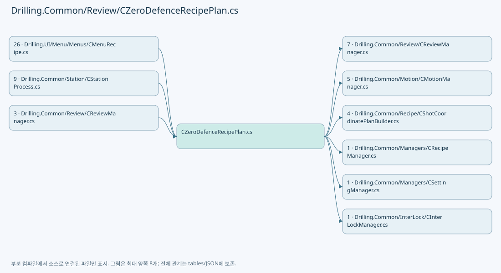
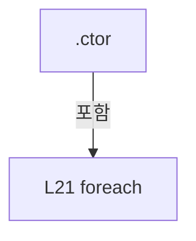
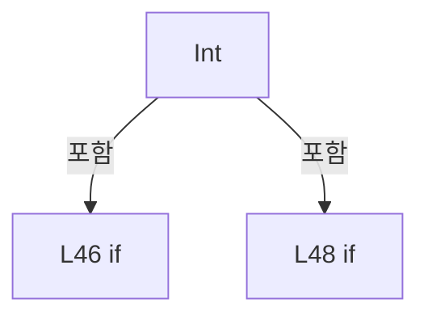
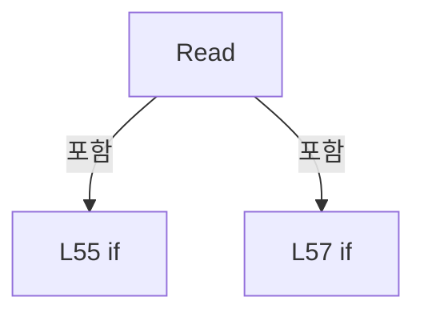
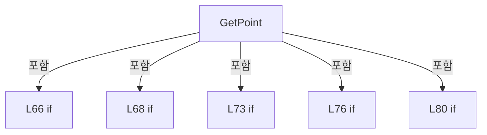
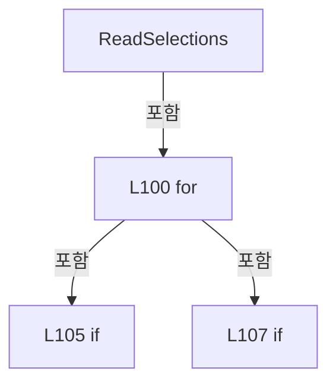
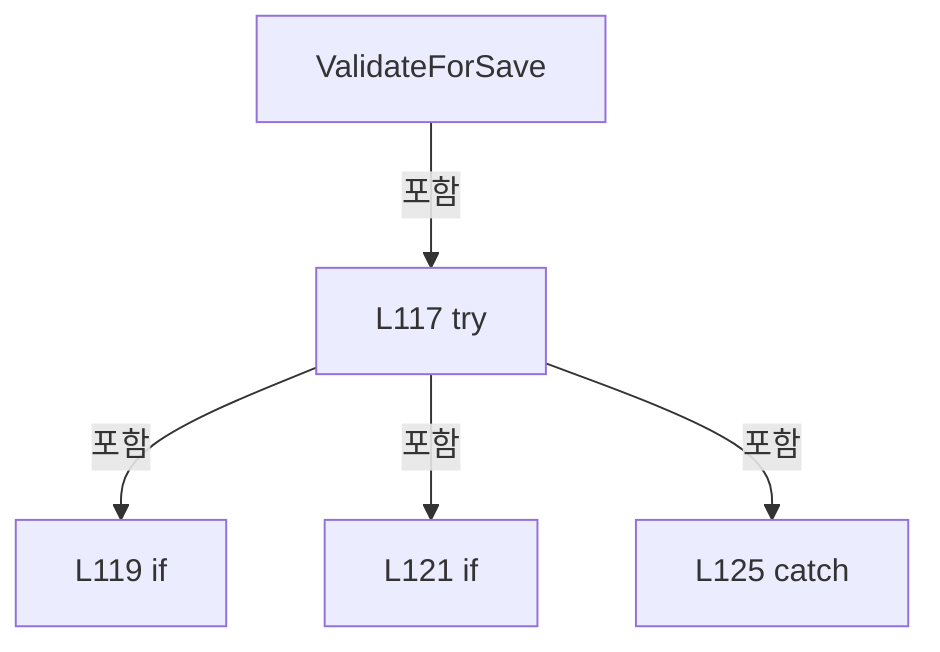
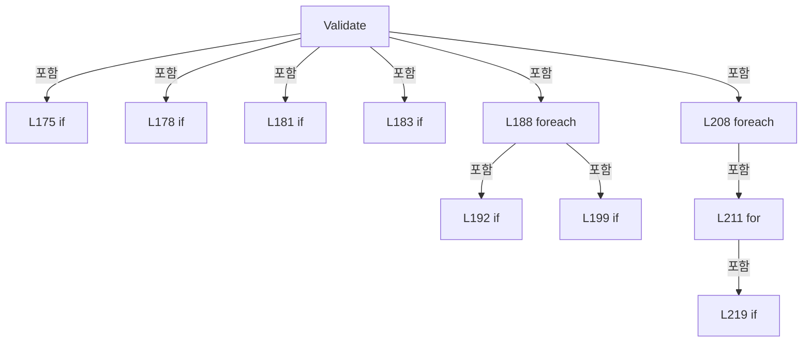
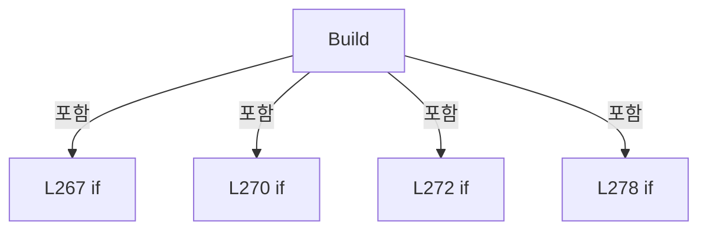
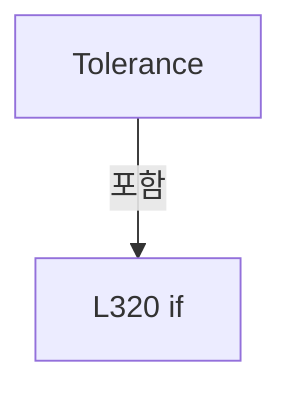

# Drilling.Common/Review/CZeroDefenceRecipePlan.cs

| 항목 | 내용 |
| --- | --- |
| 원본 저장소 | https://github.com/kjuws10-rgb/A3Drilling.git |
| 원본 Commit | 5aee8e58439c9b455cae7c9593c9be986c3e682e |
| 원본 SHA256 | e889827c9bd37e5d560c6da9fba8374bb4813e486403abc91893fb2bbe115afa |
| 파일 분류 | code |
| 원본 크기/행 | 19,538 bytes / 326 physical lines |
| 인코딩 | utf-8-sig |
| 검토 범위 | 구문/부분 의미 분석에서 추출한 사실. 동작·물리 단위·실장비 합격을 보증하지 않습니다. |
| 원본 링크 | [고정 Commit 원본](https://github.com/kjuws10-rgb/A3Drilling/blob/5aee8e58439c9b455cae7c9593c9be986c3e682e/Drilling.Common/Review/CZeroDefenceRecipePlan.cs) |

## 파일의 역할과 읽는 순서

리뷰 계획·측정·결과 해석 계층입니다. 물리 이동 좌표와 Vision 식별 패킷, 측정 저장의 역할을 별도로 확인합니다.

## 네임스페이스·타입·상속

| 타입 | 구분 | 원본 범위 | 선언/상속 |
| --- | --- | --- | --- |
| CZeroDefenceRecipePlan | ClassDeclaration | 10–130 | CZeroDefenceRecipePlan |
| ST_ZERO_DEFENCE_TIMING_PROFILE | RecordDeclaration | 132–142 | ST_ZERO_DEFENCE_TIMING_PROFILE |
| ST_ZERO_DEFENCE_POINT | RecordDeclaration | 144–155 | ST_ZERO_DEFENCE_POINT |
| ST_ZERO_DEFENCE_TIMING_ISSUE | RecordDeclaration | 156–156 | ST_ZERO_DEFENCE_TIMING_ISSUE |
| ST_ZERO_DEFENCE_TRANSITION | RecordDeclaration | 157–160 | ST_ZERO_DEFENCE_TRANSITION |
| ST_ZERO_DEFENCE_TIMING_RESULT | RecordDeclaration | 162–166 | ST_ZERO_DEFENCE_TIMING_RESULT |
| CZeroDefenceTiming | ClassDeclaration | 169–233 | CZeroDefenceTiming |
| ST_ZERO_LINE_CYCLE_PLAN | RecordDeclaration | 235–245 | ST_ZERO_LINE_CYCLE_PLAN |
| ST_ZERO_LINE_POINT_RESULT | RecordDeclaration | 246–249 | ST_ZERO_LINE_POINT_RESULT |
| ST_ZERO_LINE_CYCLE_STATUS | RecordDeclaration | 251–258 | ST_ZERO_LINE_CYCLE_STATUS |
| ST_ZERO_LINE_RESULT_DATA | RecordDeclaration | 260–260 | ST_ZERO_LINE_RESULT_DATA |
| CZeroLineCyclePlan | ClassDeclaration | 262–325 | CZeroLineCyclePlan |

## 멤버 빠른 목록

| 이름 | 종류 | 범위 | 서명 |
| --- | --- | --- | --- |
| CountKey | FieldDeclaration | L12–12 | string Drilling.Common.Review.CZeroDefenceRecipePlan.CountKey |
| Key | MethodDeclaration | L13–13 | string Drilling.Common.Review.CZeroDefenceRecipePlan.Key(int, string) |
| _mask | FieldDeclaration | L14–14 | Drilling.Common.Recipe.CRecipeShotMaskingPlan Drilling.Common.Review.CZeroDefenceRecipePlan._mask |
| _shots | FieldDeclaration | L15–15 | System.Collections.Generic.Dictionary<(int Cell, int Shot), Drilling.Common.Recipe.ST_HEAD_SHOT_POINT> Drilling.Common.Review.CZeroDefenceRecipePlan._shots |
| _beamPosition | FieldDeclaration | L16–16 | System.Func<Drilling.Common.Review.ST_REVIEW_PLAN_POINT, int, Drilling.Common.Review.ST_REVIEW_BEAM_POSITION> Drilling.Common.Review.CZeroDefenceRecipePlan._beamPosition |
| .ctor | ConstructorDeclaration | L17–35 | Drilling.Common.Review.CZeroDefenceRecipePlan.CZeroDefenceRecipePlan(Drilling.Common.Managers.ST_RECIPE_DEFINITION, System.Collections.Generic.IReadOnlyList<Drilling.Common.Managers.ST_SYSTEM_PARAMETER>) |
| Recipe | PropertyDeclaration | L37–37 | Drilling.Common.Managers.ST_RECIPE_DEFINITION Drilling.Common.Review.CZeroDefenceRecipePlan.Recipe |
| get_Recipe | GetAccessorDeclaration | L37–37 | Drilling.Common.Managers.ST_RECIPE_DEFINITION Drilling.Common.Review.CZeroDefenceRecipePlan.Recipe.get |
| Parameters | PropertyDeclaration | L38–38 | System.Collections.Generic.IReadOnlyDictionary<string, string> Drilling.Common.Review.CZeroDefenceRecipePlan.Parameters |
| get_Parameters | GetAccessorDeclaration | L38–38 | System.Collections.Generic.IReadOnlyDictionary<string, string> Drilling.Common.Review.CZeroDefenceRecipePlan.Parameters.get |
| Plan | PropertyDeclaration | L39–39 | Drilling.Common.Recipe.ST_SHOT_COORDINATE_PLAN Drilling.Common.Review.CZeroDefenceRecipePlan.Plan |
| get_Plan | GetAccessorDeclaration | L39–39 | Drilling.Common.Recipe.ST_SHOT_COORDINATE_PLAN Drilling.Common.Review.CZeroDefenceRecipePlan.Plan.get |
| Profile | PropertyDeclaration | L40–40 | Drilling.Common.Review.ST_ZERO_DEFENCE_TIMING_PROFILE Drilling.Common.Review.CZeroDefenceRecipePlan.Profile |
| get_Profile | GetAccessorDeclaration | L40–40 | Drilling.Common.Review.ST_ZERO_DEFENCE_TIMING_PROFILE Drilling.Common.Review.CZeroDefenceRecipePlan.Profile.get |
| Count | PropertyDeclaration | L41–41 | int Drilling.Common.Review.CZeroDefenceRecipePlan.Count |
| HasSelections | PropertyDeclaration | L42–42 | bool Drilling.Common.Review.CZeroDefenceRecipePlan.HasSelections |
| Int | MethodDeclaration | L44–51 | int Drilling.Common.Review.CZeroDefenceRecipePlan.Int(string, int) |
| Read | MethodDeclaration | L53–60 | double Drilling.Common.Review.CZeroDefenceRecipePlan.Read(string, double) |
| CanProcess | MethodDeclaration | L62–62 | bool Drilling.Common.Review.CZeroDefenceRecipePlan.CanProcess(Drilling.Common.Recipe.ST_HEAD_SHOT_POINT) |
| Mask | MethodDeclaration | L63–63 | Drilling.Common.Recipe.ST_RECIPE_SHOT_MASKING_RESULT Drilling.Common.Review.CZeroDefenceRecipePlan.Mask(Drilling.Common.Recipe.ST_HEAD_SHOT_POINT) |
| GetPoint | MethodDeclaration | L64–95 | Drilling.Common.Review.ST_ZERO_DEFENCE_POINT Drilling.Common.Review.CZeroDefenceRecipePlan.GetPoint(int, int, int, int) |
| ReadSelections | MethodDeclaration | L97–113 | System.Collections.Generic.IReadOnlyList<Drilling.Common.Review.ST_ZERO_DEFENCE_POINT> Drilling.Common.Review.CZeroDefenceRecipePlan.ReadSelections(bool) |
| ValidateForSave | MethodDeclaration | L115–129 | string Drilling.Common.Review.CZeroDefenceRecipePlan.ValidateForSave() |
| StageStroke | PropertyDeclaration | L136–136 | double Drilling.Common.Review.ST_ZERO_DEFENCE_TIMING_PROFILE.StageStroke |
| get_StageStroke | GetAccessorDeclaration | L136–136 | double Drilling.Common.Review.ST_ZERO_DEFENCE_TIMING_PROFILE.StageStroke.get |
| set_StageStroke | InitAccessorDeclaration | L136–136 | void Drilling.Common.Review.ST_ZERO_DEFENCE_TIMING_PROFILE.StageStroke.init |
| StageAcceleration | PropertyDeclaration | L137–137 | double Drilling.Common.Review.ST_ZERO_DEFENCE_TIMING_PROFILE.StageAcceleration |
| get_StageAcceleration | GetAccessorDeclaration | L137–137 | double Drilling.Common.Review.ST_ZERO_DEFENCE_TIMING_PROFILE.StageAcceleration.get |
| set_StageAcceleration | InitAccessorDeclaration | L137–137 | void Drilling.Common.Review.ST_ZERO_DEFENCE_TIMING_PROFILE.StageAcceleration.init |
| SettleSeconds | PropertyDeclaration | L138–138 | double Drilling.Common.Review.ST_ZERO_DEFENCE_TIMING_PROFILE.SettleSeconds |
| get_SettleSeconds | GetAccessorDeclaration | L138–138 | double Drilling.Common.Review.ST_ZERO_DEFENCE_TIMING_PROFILE.SettleSeconds.get |
| set_SettleSeconds | InitAccessorDeclaration | L138–138 | void Drilling.Common.Review.ST_ZERO_DEFENCE_TIMING_PROFILE.SettleSeconds.init |
| ArrivalMarginSeconds | PropertyDeclaration | L139–139 | double Drilling.Common.Review.ST_ZERO_DEFENCE_TIMING_PROFILE.ArrivalMarginSeconds |
| get_ArrivalMarginSeconds | GetAccessorDeclaration | L139–139 | double Drilling.Common.Review.ST_ZERO_DEFENCE_TIMING_PROFILE.ArrivalMarginSeconds.get |
| set_ArrivalMarginSeconds | InitAccessorDeclaration | L139–139 | void Drilling.Common.Review.ST_ZERO_DEFENCE_TIMING_PROFILE.ArrivalMarginSeconds.init |
| FramesPerSecond | PropertyDeclaration | L140–140 | double Drilling.Common.Review.ST_ZERO_DEFENCE_TIMING_PROFILE.FramesPerSecond |
| get_FramesPerSecond | GetAccessorDeclaration | L140–140 | double Drilling.Common.Review.ST_ZERO_DEFENCE_TIMING_PROFILE.FramesPerSecond.get |
| set_FramesPerSecond | InitAccessorDeclaration | L140–140 | void Drilling.Common.Review.ST_ZERO_DEFENCE_TIMING_PROFILE.FramesPerSecond.init |
| ExposureSeconds | PropertyDeclaration | L141–141 | double Drilling.Common.Review.ST_ZERO_DEFENCE_TIMING_PROFILE.ExposureSeconds |
| get_ExposureSeconds | GetAccessorDeclaration | L141–141 | double Drilling.Common.Review.ST_ZERO_DEFENCE_TIMING_PROFILE.ExposureSeconds.get |
| set_ExposureSeconds | InitAccessorDeclaration | L141–141 | void Drilling.Common.Review.ST_ZERO_DEFENCE_TIMING_PROFILE.ExposureSeconds.init |
| MarginSeconds | PropertyDeclaration | L159–159 | double Drilling.Common.Review.ST_ZERO_DEFENCE_TRANSITION.MarginSeconds |
| IsValid | PropertyDeclaration | L164–164 | bool Drilling.Common.Review.ST_ZERO_DEFENCE_TIMING_RESULT.IsValid |
| Message | PropertyDeclaration | L165–165 | string Drilling.Common.Review.ST_ZERO_DEFENCE_TIMING_RESULT.Message |
| Validate | MethodDeclaration | L171–232 | Drilling.Common.Review.ST_ZERO_DEFENCE_TIMING_RESULT Drilling.Common.Review.CZeroDefenceTiming.Validate(int, System.Collections.Generic.IEnumerable<Drilling.Common.Review.ST_ZERO_DEFENCE_POINT>, Drilling.Common.Review.ST_ZERO_DEFENCE_TIMING_PROFILE) |
| Positive | LocalFunctionStatement | L180–180 | bool Positive(double) |
| IsNg | PropertyDeclaration | L248–248 | bool Drilling.Common.Review.ST_ZERO_LINE_POINT_RESULT.IsNg |
| Plan | PropertyDeclaration | L253–253 | Drilling.Common.Review.ST_ZERO_LINE_CYCLE_PLAN? Drilling.Common.Review.ST_ZERO_LINE_CYCLE_STATUS.Plan |
| get_Plan | GetAccessorDeclaration | L253–253 | Drilling.Common.Review.ST_ZERO_LINE_CYCLE_PLAN? Drilling.Common.Review.ST_ZERO_LINE_CYCLE_STATUS.Plan.get |
| set_Plan | InitAccessorDeclaration | L253–253 | void Drilling.Common.Review.ST_ZERO_LINE_CYCLE_STATUS.Plan.init |
| ResultSavedAt | PropertyDeclaration | L254–254 | System.DateTimeOffset? Drilling.Common.Review.ST_ZERO_LINE_CYCLE_STATUS.ResultSavedAt |
| get_ResultSavedAt | GetAccessorDeclaration | L254–254 | System.DateTimeOffset? Drilling.Common.Review.ST_ZERO_LINE_CYCLE_STATUS.ResultSavedAt.get |
| set_ResultSavedAt | InitAccessorDeclaration | L254–254 | void Drilling.Common.Review.ST_ZERO_LINE_CYCLE_STATUS.ResultSavedAt.init |
| FollowUpRequested | PropertyDeclaration | L255–255 | bool Drilling.Common.Review.ST_ZERO_LINE_CYCLE_STATUS.FollowUpRequested |
| get_FollowUpRequested | GetAccessorDeclaration | L255–255 | bool Drilling.Common.Review.ST_ZERO_LINE_CYCLE_STATUS.FollowUpRequested.get |
| set_FollowUpRequested | InitAccessorDeclaration | L255–255 | void Drilling.Common.Review.ST_ZERO_LINE_CYCLE_STATUS.FollowUpRequested.init |
| FollowUpCompleted | PropertyDeclaration | L256–256 | bool Drilling.Common.Review.ST_ZERO_LINE_CYCLE_STATUS.FollowUpCompleted |
| get_FollowUpCompleted | GetAccessorDeclaration | L256–256 | bool Drilling.Common.Review.ST_ZERO_LINE_CYCLE_STATUS.FollowUpCompleted.get |
| set_FollowUpCompleted | InitAccessorDeclaration | L256–256 | void Drilling.Common.Review.ST_ZERO_LINE_CYCLE_STATUS.FollowUpCompleted.init |
| Judge | PropertyDeclaration | L257–257 | string Drilling.Common.Review.ST_ZERO_LINE_CYCLE_STATUS.Judge |
| Build | MethodDeclaration | L264–324 | Drilling.Common.Review.ST_ZERO_LINE_CYCLE_PLAN? Drilling.Common.Review.CZeroLineCyclePlan.Build(Drilling.Common.Managers.ST_RECIPE_DEFINITION, string, System.Collections.Generic.IReadOnlyList<Drilling.Common.Managers.ST_SYSTEM_PARAMETER>) |
| Tolerance | LocalFunctionStatement | L317–323 | double Tolerance(string) |

## 멤버별 상세 계약·호출·처리 해설

### FieldDeclaration `CountKey` · L12–12

[Drilling.Common/Review/CZeroDefenceRecipePlan.cs:12–12](https://github.com/kjuws10-rgb/A3Drilling/blob/5aee8e58439c9b455cae7c9593c9be986c3e682e/Drilling.Common/Review/CZeroDefenceRecipePlan.cs#L12-L12)

| 항목 | 실제 추출 값 |
| --- | --- |
| 서명 | string Drilling.Common.Review.CZeroDefenceRecipePlan.CountKey |
| 접근/수식자 | Public / public, const |
| 반환/값 타입 | string |
| 소속 타입 | NamedType:Drilling.Common.Review.CZeroDefenceRecipePlan |

현재 부분 분석에서 직접 연결된 호출자는 없습니다. XAML/이벤트/인터페이스·델리게이트·외부 진입을 추가 확인해야 하며, 미사용으로 판정한 것이 아닙니다.

본문의 실제 연산·분기·예외·반환 순서(원문 위치 순):

| 원본 행 | 종류 | 주석 해설 |
| --- | --- | --- |
| 12 | variable-initializer | 변수의 초기값을 지정합니다: CountKey = "ZERO_DEFENCE_POINT_COUNT" |

변경 전 점검: 입력/반환 타입, 위 호출자, 예외/취소 경로, 공유 상태와 저장·전송 소비자를 함께 확인합니다. 값의 단위나 물리 방향을 이름만으로 확정하지 않습니다.

### MethodDeclaration `Key` · L13–13

[Drilling.Common/Review/CZeroDefenceRecipePlan.cs:13–13](https://github.com/kjuws10-rgb/A3Drilling/blob/5aee8e58439c9b455cae7c9593c9be986c3e682e/Drilling.Common/Review/CZeroDefenceRecipePlan.cs#L13-L13)

| 항목 | 실제 추출 값 |
| --- | --- |
| 서명 | string Drilling.Common.Review.CZeroDefenceRecipePlan.Key(int, string) |
| 접근/수식자 | Public / public, static |
| 반환/값 타입 | string |
| 소속 타입 | NamedType:Drilling.Common.Review.CZeroDefenceRecipePlan |

입력 계약:

| 이름 | 타입 | 전달 | 선택/기본값 |
| --- | --- | --- | --- |
| head | int | None | False /  |
| field | string | None | False /  |

정적 호출자로 확인된 위치:

| 호출 파일/행 | 호출 표현식 | 런타임 분기 가능 |
| --- | --- | --- |
| [Drilling.Common/Review/CZeroDefenceRecipePlan.cs:42–42](https://github.com/kjuws10-rgb/A3Drilling/blob/5aee8e58439c9b455cae7c9593c9be986c3e682e/Drilling.Common/Review/CZeroDefenceRecipePlan.cs#L42-L42) | Key | False |
| [Drilling.Common/Review/CZeroDefenceRecipePlan.cs:102–102](https://github.com/kjuws10-rgb/A3Drilling/blob/5aee8e58439c9b455cae7c9593c9be986c3e682e/Drilling.Common/Review/CZeroDefenceRecipePlan.cs#L102-L102) | Key | False |
| [Drilling.Common/Review/CZeroDefenceRecipePlan.cs:103–103](https://github.com/kjuws10-rgb/A3Drilling/blob/5aee8e58439c9b455cae7c9593c9be986c3e682e/Drilling.Common/Review/CZeroDefenceRecipePlan.cs#L103-L103) | Key | False |
| [Drilling.Common/Review/CZeroDefenceRecipePlan.cs:104–104](https://github.com/kjuws10-rgb/A3Drilling/blob/5aee8e58439c9b455cae7c9593c9be986c3e682e/Drilling.Common/Review/CZeroDefenceRecipePlan.cs#L104-L104) | Key | False |
| [Drilling.Common/Station/CStationProcess.cs:6119–6119](https://github.com/kjuws10-rgb/A3Drilling/blob/5aee8e58439c9b455cae7c9593c9be986c3e682e/Drilling.Common/Station/CStationProcess.cs#L6119-L6119) | CZeroDefenceRecipePlan.Key | False |
| [Drilling.Common/Station/CStationProcess.cs:6119–6119](https://github.com/kjuws10-rgb/A3Drilling/blob/5aee8e58439c9b455cae7c9593c9be986c3e682e/Drilling.Common/Station/CStationProcess.cs#L6119-L6119) | CZeroDefenceRecipePlan.Key | False |
| [Drilling.Common/Station/CStationProcess.cs:6119–6119](https://github.com/kjuws10-rgb/A3Drilling/blob/5aee8e58439c9b455cae7c9593c9be986c3e682e/Drilling.Common/Station/CStationProcess.cs#L6119-L6119) | CZeroDefenceRecipePlan.Key | False |
| [Drilling.UI/Menu/Menus/CMenuRecipe.cs:4342–4342](https://github.com/kjuws10-rgb/A3Drilling/blob/5aee8e58439c9b455cae7c9593c9be986c3e682e/Drilling.UI/Menu/Menus/CMenuRecipe.cs#L4342-L4342) | CZeroDefenceRecipePlan.Key | False |
| [Drilling.UI/Menu/Menus/CMenuRecipe.cs:4343–4343](https://github.com/kjuws10-rgb/A3Drilling/blob/5aee8e58439c9b455cae7c9593c9be986c3e682e/Drilling.UI/Menu/Menus/CMenuRecipe.cs#L4343-L4343) | CZeroDefenceRecipePlan.Key | False |
| [Drilling.UI/Menu/Menus/CMenuRecipe.cs:4344–4344](https://github.com/kjuws10-rgb/A3Drilling/blob/5aee8e58439c9b455cae7c9593c9be986c3e682e/Drilling.UI/Menu/Menus/CMenuRecipe.cs#L4344-L4344) | CZeroDefenceRecipePlan.Key | False |
| [Drilling.UI/Menu/Menus/CMenuRecipe.cs:4453–4453](https://github.com/kjuws10-rgb/A3Drilling/blob/5aee8e58439c9b455cae7c9593c9be986c3e682e/Drilling.UI/Menu/Menus/CMenuRecipe.cs#L4453-L4453) | CZeroDefenceRecipePlan.Key | False |
| [Drilling.UI/Menu/Menus/CMenuRecipe.cs:4453–4453](https://github.com/kjuws10-rgb/A3Drilling/blob/5aee8e58439c9b455cae7c9593c9be986c3e682e/Drilling.UI/Menu/Menus/CMenuRecipe.cs#L4453-L4453) | CZeroDefenceRecipePlan.Key | False |
| [Drilling.UI/Menu/Menus/CMenuRecipe.cs:4453–4453](https://github.com/kjuws10-rgb/A3Drilling/blob/5aee8e58439c9b455cae7c9593c9be986c3e682e/Drilling.UI/Menu/Menus/CMenuRecipe.cs#L4453-L4453) | CZeroDefenceRecipePlan.Key | False |
| [Drilling.UI/Menu/Menus/CMenuRecipe.cs:4539–4539](https://github.com/kjuws10-rgb/A3Drilling/blob/5aee8e58439c9b455cae7c9593c9be986c3e682e/Drilling.UI/Menu/Menus/CMenuRecipe.cs#L4539-L4539) | CZeroDefenceRecipePlan.Key | False |

변경 전 점검: 입력/반환 타입, 위 호출자, 예외/취소 경로, 공유 상태와 저장·전송 소비자를 함께 확인합니다. 값의 단위나 물리 방향을 이름만으로 확정하지 않습니다.

### FieldDeclaration `_mask` · L14–14

[Drilling.Common/Review/CZeroDefenceRecipePlan.cs:14–14](https://github.com/kjuws10-rgb/A3Drilling/blob/5aee8e58439c9b455cae7c9593c9be986c3e682e/Drilling.Common/Review/CZeroDefenceRecipePlan.cs#L14-L14)

| 항목 | 실제 추출 값 |
| --- | --- |
| 서명 | Drilling.Common.Recipe.CRecipeShotMaskingPlan Drilling.Common.Review.CZeroDefenceRecipePlan._mask |
| 접근/수식자 | Private / private, readonly |
| 반환/값 타입 | Drilling.Common.Recipe.CRecipeShotMaskingPlan |
| 소속 타입 | NamedType:Drilling.Common.Review.CZeroDefenceRecipePlan |

현재 부분 분석에서 직접 연결된 호출자는 없습니다. XAML/이벤트/인터페이스·델리게이트·외부 진입을 추가 확인해야 하며, 미사용으로 판정한 것이 아닙니다.

변경 전 점검: 입력/반환 타입, 위 호출자, 예외/취소 경로, 공유 상태와 저장·전송 소비자를 함께 확인합니다. 값의 단위나 물리 방향을 이름만으로 확정하지 않습니다.

### FieldDeclaration `_shots` · L15–15

[Drilling.Common/Review/CZeroDefenceRecipePlan.cs:15–15](https://github.com/kjuws10-rgb/A3Drilling/blob/5aee8e58439c9b455cae7c9593c9be986c3e682e/Drilling.Common/Review/CZeroDefenceRecipePlan.cs#L15-L15)

| 항목 | 실제 추출 값 |
| --- | --- |
| 서명 | System.Collections.Generic.Dictionary<(int Cell, int Shot), Drilling.Common.Recipe.ST_HEAD_SHOT_POINT> Drilling.Common.Review.CZeroDefenceRecipePlan._shots |
| 접근/수식자 | Private / private, readonly |
| 반환/값 타입 | System.Collections.Generic.Dictionary<(int Cell, int Shot), Drilling.Common.Recipe.ST_HEAD_SHOT_POINT> |
| 소속 타입 | NamedType:Drilling.Common.Review.CZeroDefenceRecipePlan |

현재 부분 분석에서 직접 연결된 호출자는 없습니다. XAML/이벤트/인터페이스·델리게이트·외부 진입을 추가 확인해야 하며, 미사용으로 판정한 것이 아닙니다.

변경 전 점검: 입력/반환 타입, 위 호출자, 예외/취소 경로, 공유 상태와 저장·전송 소비자를 함께 확인합니다. 값의 단위나 물리 방향을 이름만으로 확정하지 않습니다.

### FieldDeclaration `_beamPosition` · L16–16

[Drilling.Common/Review/CZeroDefenceRecipePlan.cs:16–16](https://github.com/kjuws10-rgb/A3Drilling/blob/5aee8e58439c9b455cae7c9593c9be986c3e682e/Drilling.Common/Review/CZeroDefenceRecipePlan.cs#L16-L16)

| 항목 | 실제 추출 값 |
| --- | --- |
| 서명 | System.Func<Drilling.Common.Review.ST_REVIEW_PLAN_POINT, int, Drilling.Common.Review.ST_REVIEW_BEAM_POSITION> Drilling.Common.Review.CZeroDefenceRecipePlan._beamPosition |
| 접근/수식자 | Private / private, readonly |
| 반환/값 타입 | System.Func<Drilling.Common.Review.ST_REVIEW_PLAN_POINT, int, Drilling.Common.Review.ST_REVIEW_BEAM_POSITION> |
| 소속 타입 | NamedType:Drilling.Common.Review.CZeroDefenceRecipePlan |

현재 부분 분석에서 직접 연결된 호출자는 없습니다. XAML/이벤트/인터페이스·델리게이트·외부 진입을 추가 확인해야 하며, 미사용으로 판정한 것이 아닙니다.

변경 전 점검: 입력/반환 타입, 위 호출자, 예외/취소 경로, 공유 상태와 저장·전송 소비자를 함께 확인합니다. 값의 단위나 물리 방향을 이름만으로 확정하지 않습니다.

### ConstructorDeclaration `.ctor` · L17–35

[Drilling.Common/Review/CZeroDefenceRecipePlan.cs:17–35](https://github.com/kjuws10-rgb/A3Drilling/blob/5aee8e58439c9b455cae7c9593c9be986c3e682e/Drilling.Common/Review/CZeroDefenceRecipePlan.cs#L17-L35)

| 항목 | 실제 추출 값 |
| --- | --- |
| 서명 | Drilling.Common.Review.CZeroDefenceRecipePlan.CZeroDefenceRecipePlan(Drilling.Common.Managers.ST_RECIPE_DEFINITION, System.Collections.Generic.IReadOnlyList<Drilling.Common.Managers.ST_SYSTEM_PARAMETER>) |
| 접근/수식자 | Public / public |
| 반환/값 타입 | void |
| 소속 타입 | NamedType:Drilling.Common.Review.CZeroDefenceRecipePlan |

입력 계약:

| 이름 | 타입 | 전달 | 선택/기본값 |
| --- | --- | --- | --- |
| recipe | Drilling.Common.Managers.ST_RECIPE_DEFINITION | None | False /  |
| settings | System.Collections.Generic.IReadOnlyList<Drilling.Common.Managers.ST_SYSTEM_PARAMETER> | None | False /  |

정적 호출자로 확인된 위치:

| 호출 파일/행 | 호출 표현식 | 런타임 분기 가능 |
| --- | --- | --- |
| [Drilling.Common/Review/CZeroDefenceRecipePlan.cs:269–269](https://github.com/kjuws10-rgb/A3Drilling/blob/5aee8e58439c9b455cae7c9593c9be986c3e682e/Drilling.Common/Review/CZeroDefenceRecipePlan.cs#L269-L269) | new CZeroDefenceRecipePlan | False |
| [Drilling.Common/Station/CStationProcess.cs:6107–6107](https://github.com/kjuws10-rgb/A3Drilling/blob/5aee8e58439c9b455cae7c9593c9be986c3e682e/Drilling.Common/Station/CStationProcess.cs#L6107-L6107) | new CZeroDefenceRecipePlan | False |
| [Drilling.UI/Menu/Menus/CMenuRecipe.cs:3092–3092](https://github.com/kjuws10-rgb/A3Drilling/blob/5aee8e58439c9b455cae7c9593c9be986c3e682e/Drilling.UI/Menu/Menus/CMenuRecipe.cs#L3092-L3092) | new CZeroDefenceRecipePlan | False |
| [Drilling.UI/Menu/Menus/CMenuRecipe.cs:4328–4328](https://github.com/kjuws10-rgb/A3Drilling/blob/5aee8e58439c9b455cae7c9593c9be986c3e682e/Drilling.UI/Menu/Menus/CMenuRecipe.cs#L4328-L4328) | new | False |

호출하는 대상과 해석 범위:

| 원본 행 | 표현식 | 분석 상태 | 대상/소스 위치 |
| --- | --- | --- | --- |
| 20 | recipe.Parameters.Where(p => p.Key.Length > 0).GroupBy(p => p.Key, StringComparer.OrdinalIgnoreCase).ToDictionary | resolved | System.Collections.Generic.Dictionary<string, string> System.Collections.Generic.IEnumerable<System.Linq.IGrouping<string, Drilling.Common.Managers.ST_RECIPE_PARAMETER>>.ToDictionary<System.Linq.IGrouping<string, Drilling.Common.Managers.ST_RECIPE_PARAMETER>, string, string>(System.Func<System.Linq.IGrouping<string, Drilling.Common.Managers.ST_RECIPE_PARAMETER>, string>, System.Func<System.Linq.IGrouping<string, Drilling.Common.Managers.ST_RECIPE_PARAMETER>, string>, System.Collections.Generic.IEqualityComparer<string>?) |
| 20 | recipe.Parameters.Where(p => p.Key.Length > 0).GroupBy | resolved | System.Collections.Generic.IEnumerable<System.Linq.IGrouping<string, Drilling.Common.Managers.ST_RECIPE_PARAMETER>> System.Collections.Generic.IEnumerable<Drilling.Common.Managers.ST_RECIPE_PARAMETER>.GroupBy<Drilling.Common.Managers.ST_RECIPE_PARAMETER, string>(System.Func<Drilling.Common.Managers.ST_RECIPE_PARAMETER, string>, System.Collections.Generic.IEqualityComparer<string>?) |
| 20 | recipe.Parameters.Where | resolved | System.Collections.Generic.IEnumerable<Drilling.Common.Managers.ST_RECIPE_PARAMETER> System.Collections.Generic.IEnumerable<Drilling.Common.Managers.ST_RECIPE_PARAMETER>.Where<Drilling.Common.Managers.ST_RECIPE_PARAMETER>(System.Func<Drilling.Common.Managers.ST_RECIPE_PARAMETER, bool>) |
| 20 | g.Last | resolved | Drilling.Common.Managers.ST_RECIPE_PARAMETER System.Collections.Generic.IEnumerable<Drilling.Common.Managers.ST_RECIPE_PARAMETER>.Last<Drilling.Common.Managers.ST_RECIPE_PARAMETER>() |
| 21 | settings.Where | resolved | System.Collections.Generic.IEnumerable<Drilling.Common.Managers.ST_SYSTEM_PARAMETER> System.Collections.Generic.IEnumerable<Drilling.Common.Managers.ST_SYSTEM_PARAMETER>.Where<Drilling.Common.Managers.ST_SYSTEM_PARAMETER>(System.Func<Drilling.Common.Managers.ST_SYSTEM_PARAMETER, bool>) |
| 25 | CShotCoordinatePlanBuilder.Build | resolved | Drilling.Common.Recipe.ST_SHOT_COORDINATE_PLAN Drilling.Common.Recipe.CShotCoordinatePlanBuilder.Build(System.Collections.Generic.IReadOnlyDictionary<string, string>) · Drilling.Common/Recipe/CShotCoordinatePlanBuilder.cs:11 |
| 26 | Plan.Shots.ToDictionary | resolved | System.Collections.Generic.Dictionary<(int CellNo, int CellShotNo), Drilling.Common.Recipe.ST_HEAD_SHOT_POINT> System.Collections.Generic.IEnumerable<Drilling.Common.Recipe.ST_HEAD_SHOT_POINT>.ToDictionary<Drilling.Common.Recipe.ST_HEAD_SHOT_POINT, (int CellNo, int CellShotNo)>(System.Func<Drilling.Common.Recipe.ST_HEAD_SHOT_POINT, (int CellNo, int CellShotNo)>) |
| 27 | CRecipeShotMaskingPlan.Build | resolved | Drilling.Common.Recipe.CRecipeShotMaskingPlan Drilling.Common.Recipe.CRecipeShotMaskingPlan.Build(System.Collections.Generic.IReadOnlyDictionary<string, string>) · Drilling.Common/Recipe/CShotCoordinatePlanBuilder.cs:813 |
| 28 | ST_REVIEW_MOTION_PARAMETERS.Read | resolved | Drilling.Common.Review.ST_REVIEW_MOTION_PARAMETERS Drilling.Common.Review.ST_REVIEW_MOTION_PARAMETERS.Read(System.Collections.Generic.IEnumerable<Drilling.Common.Managers.ST_SYSTEM_PARAMETER>) · Drilling.Common/Review/CReviewManager.cs:4264 |
| 29 | new | resolved | Drilling.Common.Review.ST_ZERO_DEFENCE_TIMING_PROFILE.ST_ZERO_DEFENCE_TIMING_PROFILE(double, double, double, double, double) · Drilling.Common/Review/CZeroDefenceRecipePlan.cs:132 |
| 29 | Read | resolved | double Drilling.Common.Review.CZeroDefenceRecipePlan.Read(string, double) · Drilling.Common/Review/CZeroDefenceRecipePlan.cs:53 |
| 29 | Read | resolved | double Drilling.Common.Review.CZeroDefenceRecipePlan.Read(string, double) · Drilling.Common/Review/CZeroDefenceRecipePlan.cs:53 |
| 29 | Read | resolved | double Drilling.Common.Review.CZeroDefenceRecipePlan.Read(string, double) · Drilling.Common/Review/CZeroDefenceRecipePlan.cs:53 |
| 32 | parameters.Select(p => new ST_RECIPE_PARAMETER(p.Key, p.Value, "", "", "", Key: p.Key)).ToArray | resolved | Drilling.Common.Managers.ST_RECIPE_PARAMETER[] System.Collections.Generic.IEnumerable<Drilling.Common.Managers.ST_RECIPE_PARAMETER>.ToArray<Drilling.Common.Managers.ST_RECIPE_PARAMETER>() |
| 32 | parameters.Select | resolved | System.Collections.Generic.IEnumerable<Drilling.Common.Managers.ST_RECIPE_PARAMETER> System.Collections.Generic.IEnumerable<System.Collections.Generic.KeyValuePair<string, string>>.Select<System.Collections.Generic.KeyValuePair<string, string>, Drilling.Common.Managers.ST_RECIPE_PARAMETER>(System.Func<System.Collections.Generic.KeyValuePair<string, string>, Drilling.Common.Managers.ST_RECIPE_PARAMETER>) |
| 32 | new ST_RECIPE_PARAMETER | resolved | Drilling.Common.Managers.ST_RECIPE_PARAMETER.ST_RECIPE_PARAMETER(string, string, string, string, string, string, string, string, string, bool, bool, int, Drilling.Common.Managers.EN_RECIPE_DATA_TYPE, double, double, double, System.Collections.Generic.IReadOnlyDictionary<string, string>?) · Drilling.Common/Managers/CRecipeManager.cs:355 |
| 34 | CReviewManager.CreateShotBeamPositionCalculator | resolved | System.Func<Drilling.Common.Review.ST_REVIEW_PLAN_POINT, int, Drilling.Common.Review.ST_REVIEW_BEAM_POSITION> Drilling.Common.Review.CReviewManager.CreateShotBeamPositionCalculator(Drilling.Common.Managers.ST_RECIPE_DEFINITION, double, double, double) · Drilling.Common/Review/CReviewManager.cs:151 |

본문의 실제 연산·분기·예외·반환 순서(원문 위치 순):

| 원본 행 | 종류 | 주석 해설 |
| --- | --- | --- |
| 19 | assignment | 값을 대상에 대입합니다: Recipe = recipe |
| 20 | call | 함수·델리게이트 또는 객체 생성자를 호출합니다: recipe.Parameters.Where(p => p.Key.Length > 0).GroupBy(p => p.Key, StringComparer.OrdinalIgnoreCase).ToDictionary(g => g.Key, g => g.Last().Value, StringComparer.OrdinalIgnoreCase) |
| 20 | call | 함수·델리게이트 또는 객체 생성자를 호출합니다: recipe.Parameters.Where(p => p.Key.Length > 0).GroupBy(p => p.Key, StringComparer.OrdinalIgnoreCase) |
| 20 | call | 함수·델리게이트 또는 객체 생성자를 호출합니다: recipe.Parameters.Where(p => p.Key.Length > 0) |
| 20 | call | 함수·델리게이트 또는 객체 생성자를 호출합니다: g.Last() |
| 20 | local-declaration | 지역 변수를 선언합니다: var parameters = recipe.Parameters.Where(p => p.Key.Length > 0).GroupBy(p => p.Key, StringComparer.OrdinalIgnoreCase).ToDictionary(g => g.Key, g => g.Last().Value, StringComparer.OrdinalIgnoreCase); |
| 20 | variable-initializer | 변수의 초기값을 지정합니다: parameters = recipe.Parameters.Where(p => p.Key.Length > 0).GroupBy(p => p.Key, StringComparer.OrdinalIgnoreCase).ToDictionary(g => g.Key, g => g.Last().Value, StringComparer.OrdinalIgnoreCase) |
| 21 | call | 함수·델리게이트 또는 객체 생성자를 호출합니다: settings.Where(s => s.Key.Length > 0) |
| 21 | foreach | 컬렉션 요소를 순회합니다: foreach (var setting in settings.Where(s => s.Key.Length > 0)) |
| 22 | assignment | 값을 대상에 대입합니다: parameters[setting.Key] = setting.Value |
| 23 | assignment | 값을 대상에 대입합니다: parameters["HEAD_COUNT"] = "8" |
| 24 | assignment | 값을 대상에 대입합니다: Parameters = parameters |
| 25 | assignment | 값을 대상에 대입합니다: Plan = CShotCoordinatePlanBuilder.Build(parameters) |
| 25 | call | 함수·델리게이트 또는 객체 생성자를 호출합니다: CShotCoordinatePlanBuilder.Build(parameters) |
| 26 | assignment | 값을 대상에 대입합니다: _shots = Plan.Shots.ToDictionary(p => (p.CellNo, p.CellShotNo)) |
| 26 | call | 함수·델리게이트 또는 객체 생성자를 호출합니다: Plan.Shots.ToDictionary(p => (p.CellNo, p.CellShotNo)) |
| 27 | assignment | 값을 대상에 대입합니다: _mask = CRecipeShotMaskingPlan.Build(parameters) |
| 27 | call | 함수·델리게이트 또는 객체 생성자를 호출합니다: CRecipeShotMaskingPlan.Build(parameters) |
| 28 | call | 함수·델리게이트 또는 객체 생성자를 호출합니다: ST_REVIEW_MOTION_PARAMETERS.Read(settings) |
| 28 | local-declaration | 지역 변수를 선언합니다: var motion = ST_REVIEW_MOTION_PARAMETERS.Read(settings); |
| 28 | variable-initializer | 변수의 초기값을 지정합니다: motion = ST_REVIEW_MOTION_PARAMETERS.Read(settings) |
| 29 | assignment | 값을 대상에 대입합니다: Profile = new(Read("STAGE_START_POS_Y", 3960), Read("STAGE_SCAN_DIRECTION_Y", -1), Read("STAGE_SPEED", 80), motion.Speed, motion.Acceleration) |
| 29 | call | 함수·델리게이트 또는 객체 생성자를 호출합니다: new(Read("STAGE_START_POS_Y", 3960), Read("STAGE_SCAN_DIRECTION_Y", -1), Read("STAGE_SPEED", 80), motion.Speed, motion.Acceleration) |
| 29 | call | 함수·델리게이트 또는 객체 생성자를 호출합니다: Read("STAGE_START_POS_Y", 3960) |
| 29 | call | 함수·델리게이트 또는 객체 생성자를 호출합니다: Read("STAGE_SCAN_DIRECTION_Y", -1) |
| 29 | call | 함수·델리게이트 또는 객체 생성자를 호출합니다: Read("STAGE_SPEED", 80) |
| 30 | local-declaration | 지역 변수를 선언합니다: var geometryRecipe = recipe with { Parameters = parameters.Select(p => new ST_RECIPE_PARAMETER(p.Key, p.Value, "", "", "", Key: p.Key)).ToArray() }; |
| 30 | variable-initializer | 변수의 초기값을 지정합니다: geometryRecipe = recipe with { Parameters = parameters.Select(p => new ST_RECIPE_PARAMETER(p.Key, p.Value, "", "", "", Key: p.Key)).ToArray() } |
| 32 | assignment | 값을 대상에 대입합니다: Parameters = parameters.Select(p => new ST_RECIPE_PARAMETER(p.Key, p.Value, "", "", "", Key: p.Key)).ToArray() |
| 32 | call | 함수·델리게이트 또는 객체 생성자를 호출합니다: parameters.Select(p => new ST_RECIPE_PARAMETER(p.Key, p.Value, "", "", "", Key: p.Key)).ToArray() |
| 32 | call | 함수·델리게이트 또는 객체 생성자를 호출합니다: parameters.Select(p => new ST_RECIPE_PARAMETER(p.Key, p.Value, "", "", "", Key: p.Key)) |
| 32 | call | 함수·델리게이트 또는 객체 생성자를 호출합니다: new ST_RECIPE_PARAMETER(p.Key, p.Value, "", "", "", Key: p.Key) |
| 34 | assignment | 값을 대상에 대입합니다: _beamPosition = CReviewManager.CreateShotBeamPositionCalculator(geometryRecipe, Profile.StageDirection) |
| 34 | call | 함수·델리게이트 또는 객체 생성자를 호출합니다: CReviewManager.CreateShotBeamPositionCalculator(geometryRecipe, Profile.StageDirection) |

제어 구문의 포함 구조(실제 실행 순서/CFG가 아닌 구문 탐색 그림):

변경 전 점검: 입력/반환 타입, 위 호출자, 예외/취소 경로, 공유 상태와 저장·전송 소비자를 함께 확인합니다. 값의 단위나 물리 방향을 이름만으로 확정하지 않습니다.

### PropertyDeclaration `Recipe` · L37–37

[Drilling.Common/Review/CZeroDefenceRecipePlan.cs:37–37](https://github.com/kjuws10-rgb/A3Drilling/blob/5aee8e58439c9b455cae7c9593c9be986c3e682e/Drilling.Common/Review/CZeroDefenceRecipePlan.cs#L37-L37)

| 항목 | 실제 추출 값 |
| --- | --- |
| 서명 | Drilling.Common.Managers.ST_RECIPE_DEFINITION Drilling.Common.Review.CZeroDefenceRecipePlan.Recipe |
| 접근/수식자 | Public / public |
| 반환/값 타입 | Drilling.Common.Managers.ST_RECIPE_DEFINITION |
| 소속 타입 | NamedType:Drilling.Common.Review.CZeroDefenceRecipePlan |

현재 부분 분석에서 직접 연결된 호출자는 없습니다. XAML/이벤트/인터페이스·델리게이트·외부 진입을 추가 확인해야 하며, 미사용으로 판정한 것이 아닙니다.

변경 전 점검: 입력/반환 타입, 위 호출자, 예외/취소 경로, 공유 상태와 저장·전송 소비자를 함께 확인합니다. 값의 단위나 물리 방향을 이름만으로 확정하지 않습니다.

### GetAccessorDeclaration `get_Recipe` · L37–37

[Drilling.Common/Review/CZeroDefenceRecipePlan.cs:37–37](https://github.com/kjuws10-rgb/A3Drilling/blob/5aee8e58439c9b455cae7c9593c9be986c3e682e/Drilling.Common/Review/CZeroDefenceRecipePlan.cs#L37-L37)

| 항목 | 실제 추출 값 |
| --- | --- |
| 서명 | Drilling.Common.Managers.ST_RECIPE_DEFINITION Drilling.Common.Review.CZeroDefenceRecipePlan.Recipe.get |
| 접근/수식자 | Public / get |
| 반환/값 타입 | Drilling.Common.Managers.ST_RECIPE_DEFINITION |
| 소속 타입 | NamedType:Drilling.Common.Review.CZeroDefenceRecipePlan |

현재 부분 분석에서 직접 연결된 호출자는 없습니다. XAML/이벤트/인터페이스·델리게이트·외부 진입을 추가 확인해야 하며, 미사용으로 판정한 것이 아닙니다.

변경 전 점검: 입력/반환 타입, 위 호출자, 예외/취소 경로, 공유 상태와 저장·전송 소비자를 함께 확인합니다. 값의 단위나 물리 방향을 이름만으로 확정하지 않습니다.

### PropertyDeclaration `Parameters` · L38–38

[Drilling.Common/Review/CZeroDefenceRecipePlan.cs:38–38](https://github.com/kjuws10-rgb/A3Drilling/blob/5aee8e58439c9b455cae7c9593c9be986c3e682e/Drilling.Common/Review/CZeroDefenceRecipePlan.cs#L38-L38)

| 항목 | 실제 추출 값 |
| --- | --- |
| 서명 | System.Collections.Generic.IReadOnlyDictionary<string, string> Drilling.Common.Review.CZeroDefenceRecipePlan.Parameters |
| 접근/수식자 | Public / public |
| 반환/값 타입 | System.Collections.Generic.IReadOnlyDictionary<string, string> |
| 소속 타입 | NamedType:Drilling.Common.Review.CZeroDefenceRecipePlan |

현재 부분 분석에서 직접 연결된 호출자는 없습니다. XAML/이벤트/인터페이스·델리게이트·외부 진입을 추가 확인해야 하며, 미사용으로 판정한 것이 아닙니다.

변경 전 점검: 입력/반환 타입, 위 호출자, 예외/취소 경로, 공유 상태와 저장·전송 소비자를 함께 확인합니다. 값의 단위나 물리 방향을 이름만으로 확정하지 않습니다.

### GetAccessorDeclaration `get_Parameters` · L38–38

[Drilling.Common/Review/CZeroDefenceRecipePlan.cs:38–38](https://github.com/kjuws10-rgb/A3Drilling/blob/5aee8e58439c9b455cae7c9593c9be986c3e682e/Drilling.Common/Review/CZeroDefenceRecipePlan.cs#L38-L38)

| 항목 | 실제 추출 값 |
| --- | --- |
| 서명 | System.Collections.Generic.IReadOnlyDictionary<string, string> Drilling.Common.Review.CZeroDefenceRecipePlan.Parameters.get |
| 접근/수식자 | Public / get |
| 반환/값 타입 | System.Collections.Generic.IReadOnlyDictionary<string, string> |
| 소속 타입 | NamedType:Drilling.Common.Review.CZeroDefenceRecipePlan |

현재 부분 분석에서 직접 연결된 호출자는 없습니다. XAML/이벤트/인터페이스·델리게이트·외부 진입을 추가 확인해야 하며, 미사용으로 판정한 것이 아닙니다.

변경 전 점검: 입력/반환 타입, 위 호출자, 예외/취소 경로, 공유 상태와 저장·전송 소비자를 함께 확인합니다. 값의 단위나 물리 방향을 이름만으로 확정하지 않습니다.

### PropertyDeclaration `Plan` · L39–39

[Drilling.Common/Review/CZeroDefenceRecipePlan.cs:39–39](https://github.com/kjuws10-rgb/A3Drilling/blob/5aee8e58439c9b455cae7c9593c9be986c3e682e/Drilling.Common/Review/CZeroDefenceRecipePlan.cs#L39-L39)

| 항목 | 실제 추출 값 |
| --- | --- |
| 서명 | Drilling.Common.Recipe.ST_SHOT_COORDINATE_PLAN Drilling.Common.Review.CZeroDefenceRecipePlan.Plan |
| 접근/수식자 | Public / public |
| 반환/값 타입 | Drilling.Common.Recipe.ST_SHOT_COORDINATE_PLAN |
| 소속 타입 | NamedType:Drilling.Common.Review.CZeroDefenceRecipePlan |

현재 부분 분석에서 직접 연결된 호출자는 없습니다. XAML/이벤트/인터페이스·델리게이트·외부 진입을 추가 확인해야 하며, 미사용으로 판정한 것이 아닙니다.

변경 전 점검: 입력/반환 타입, 위 호출자, 예외/취소 경로, 공유 상태와 저장·전송 소비자를 함께 확인합니다. 값의 단위나 물리 방향을 이름만으로 확정하지 않습니다.

### GetAccessorDeclaration `get_Plan` · L39–39

[Drilling.Common/Review/CZeroDefenceRecipePlan.cs:39–39](https://github.com/kjuws10-rgb/A3Drilling/blob/5aee8e58439c9b455cae7c9593c9be986c3e682e/Drilling.Common/Review/CZeroDefenceRecipePlan.cs#L39-L39)

| 항목 | 실제 추출 값 |
| --- | --- |
| 서명 | Drilling.Common.Recipe.ST_SHOT_COORDINATE_PLAN Drilling.Common.Review.CZeroDefenceRecipePlan.Plan.get |
| 접근/수식자 | Public / get |
| 반환/값 타입 | Drilling.Common.Recipe.ST_SHOT_COORDINATE_PLAN |
| 소속 타입 | NamedType:Drilling.Common.Review.CZeroDefenceRecipePlan |

현재 부분 분석에서 직접 연결된 호출자는 없습니다. XAML/이벤트/인터페이스·델리게이트·외부 진입을 추가 확인해야 하며, 미사용으로 판정한 것이 아닙니다.

변경 전 점검: 입력/반환 타입, 위 호출자, 예외/취소 경로, 공유 상태와 저장·전송 소비자를 함께 확인합니다. 값의 단위나 물리 방향을 이름만으로 확정하지 않습니다.

### PropertyDeclaration `Profile` · L40–40

[Drilling.Common/Review/CZeroDefenceRecipePlan.cs:40–40](https://github.com/kjuws10-rgb/A3Drilling/blob/5aee8e58439c9b455cae7c9593c9be986c3e682e/Drilling.Common/Review/CZeroDefenceRecipePlan.cs#L40-L40)

| 항목 | 실제 추출 값 |
| --- | --- |
| 서명 | Drilling.Common.Review.ST_ZERO_DEFENCE_TIMING_PROFILE Drilling.Common.Review.CZeroDefenceRecipePlan.Profile |
| 접근/수식자 | Public / public |
| 반환/값 타입 | Drilling.Common.Review.ST_ZERO_DEFENCE_TIMING_PROFILE |
| 소속 타입 | NamedType:Drilling.Common.Review.CZeroDefenceRecipePlan |

현재 부분 분석에서 직접 연결된 호출자는 없습니다. XAML/이벤트/인터페이스·델리게이트·외부 진입을 추가 확인해야 하며, 미사용으로 판정한 것이 아닙니다.

변경 전 점검: 입력/반환 타입, 위 호출자, 예외/취소 경로, 공유 상태와 저장·전송 소비자를 함께 확인합니다. 값의 단위나 물리 방향을 이름만으로 확정하지 않습니다.

### GetAccessorDeclaration `get_Profile` · L40–40

[Drilling.Common/Review/CZeroDefenceRecipePlan.cs:40–40](https://github.com/kjuws10-rgb/A3Drilling/blob/5aee8e58439c9b455cae7c9593c9be986c3e682e/Drilling.Common/Review/CZeroDefenceRecipePlan.cs#L40-L40)

| 항목 | 실제 추출 값 |
| --- | --- |
| 서명 | Drilling.Common.Review.ST_ZERO_DEFENCE_TIMING_PROFILE Drilling.Common.Review.CZeroDefenceRecipePlan.Profile.get |
| 접근/수식자 | Public / get |
| 반환/값 타입 | Drilling.Common.Review.ST_ZERO_DEFENCE_TIMING_PROFILE |
| 소속 타입 | NamedType:Drilling.Common.Review.CZeroDefenceRecipePlan |

현재 부분 분석에서 직접 연결된 호출자는 없습니다. XAML/이벤트/인터페이스·델리게이트·외부 진입을 추가 확인해야 하며, 미사용으로 판정한 것이 아닙니다.

변경 전 점검: 입력/반환 타입, 위 호출자, 예외/취소 경로, 공유 상태와 저장·전송 소비자를 함께 확인합니다. 값의 단위나 물리 방향을 이름만으로 확정하지 않습니다.

### PropertyDeclaration `Count` · L41–41

[Drilling.Common/Review/CZeroDefenceRecipePlan.cs:41–41](https://github.com/kjuws10-rgb/A3Drilling/blob/5aee8e58439c9b455cae7c9593c9be986c3e682e/Drilling.Common/Review/CZeroDefenceRecipePlan.cs#L41-L41)

| 항목 | 실제 추출 값 |
| --- | --- |
| 서명 | int Drilling.Common.Review.CZeroDefenceRecipePlan.Count |
| 접근/수식자 | Public / public |
| 반환/값 타입 | int |
| 소속 타입 | NamedType:Drilling.Common.Review.CZeroDefenceRecipePlan |

현재 부분 분석에서 직접 연결된 호출자는 없습니다. XAML/이벤트/인터페이스·델리게이트·외부 진입을 추가 확인해야 하며, 미사용으로 판정한 것이 아닙니다.

호출하는 대상과 해석 범위:

| 원본 행 | 표현식 | 분석 상태 | 대상/소스 위치 |
| --- | --- | --- | --- |
| 41 | Int | resolved | int Drilling.Common.Review.CZeroDefenceRecipePlan.Int(string, int) · Drilling.Common/Review/CZeroDefenceRecipePlan.cs:44 |

본문의 실제 연산·분기·예외·반환 순서(원문 위치 순):

| 원본 행 | 종류 | 주석 해설 |
| --- | --- | --- |
| 41 | call | 함수·델리게이트 또는 객체 생성자를 호출합니다: Int(CountKey, 2) |

변경 전 점검: 입력/반환 타입, 위 호출자, 예외/취소 경로, 공유 상태와 저장·전송 소비자를 함께 확인합니다. 값의 단위나 물리 방향을 이름만으로 확정하지 않습니다.

### PropertyDeclaration `HasSelections` · L42–42

[Drilling.Common/Review/CZeroDefenceRecipePlan.cs:42–42](https://github.com/kjuws10-rgb/A3Drilling/blob/5aee8e58439c9b455cae7c9593c9be986c3e682e/Drilling.Common/Review/CZeroDefenceRecipePlan.cs#L42-L42)

| 항목 | 실제 추출 값 |
| --- | --- |
| 서명 | bool Drilling.Common.Review.CZeroDefenceRecipePlan.HasSelections |
| 접근/수식자 | Public / public |
| 반환/값 타입 | bool |
| 소속 타입 | NamedType:Drilling.Common.Review.CZeroDefenceRecipePlan |

현재 부분 분석에서 직접 연결된 호출자는 없습니다. XAML/이벤트/인터페이스·델리게이트·외부 진입을 추가 확인해야 하며, 미사용으로 판정한 것이 아닙니다.

호출하는 대상과 해석 범위:

| 원본 행 | 표현식 | 분석 상태 | 대상/소스 위치 |
| --- | --- | --- | --- |
| 42 | Enumerable.Range(1, 8).Any | resolved | bool System.Collections.Generic.IEnumerable<int>.Any<int>(System.Func<int, bool>) |
| 42 | Enumerable.Range | resolved | System.Collections.Generic.IEnumerable<int> System.Linq.Enumerable.Range(int, int) |
| 42 | new[] { "CELL", "SHOT", "BEAM" }.Any | resolved | bool System.Collections.Generic.IEnumerable<string>.Any<string>(System.Func<string, bool>) |
| 42 | Int | resolved | int Drilling.Common.Review.CZeroDefenceRecipePlan.Int(string, int) · Drilling.Common/Review/CZeroDefenceRecipePlan.cs:44 |
| 42 | Key | resolved | string Drilling.Common.Review.CZeroDefenceRecipePlan.Key(int, string) · Drilling.Common/Review/CZeroDefenceRecipePlan.cs:13 |

본문의 실제 연산·분기·예외·반환 순서(원문 위치 순):

| 원본 행 | 종류 | 주석 해설 |
| --- | --- | --- |
| 42 | call | 함수·델리게이트 또는 객체 생성자를 호출합니다: Enumerable.Range(1, 8).Any(h => new[] { "CELL", "SHOT", "BEAM" }.Any(f => Int(Key(h, f)) != 0)) |
| 42 | call | 함수·델리게이트 또는 객체 생성자를 호출합니다: Enumerable.Range(1, 8) |
| 42 | call | 함수·델리게이트 또는 객체 생성자를 호출합니다: new[] { "CELL", "SHOT", "BEAM" }.Any(f => Int(Key(h, f)) != 0) |
| 42 | call | 함수·델리게이트 또는 객체 생성자를 호출합니다: Int(Key(h, f)) |
| 42 | call | 함수·델리게이트 또는 객체 생성자를 호출합니다: Key(h, f) |

변경 전 점검: 입력/반환 타입, 위 호출자, 예외/취소 경로, 공유 상태와 저장·전송 소비자를 함께 확인합니다. 값의 단위나 물리 방향을 이름만으로 확정하지 않습니다.

### MethodDeclaration `Int` · L44–51

[Drilling.Common/Review/CZeroDefenceRecipePlan.cs:44–51](https://github.com/kjuws10-rgb/A3Drilling/blob/5aee8e58439c9b455cae7c9593c9be986c3e682e/Drilling.Common/Review/CZeroDefenceRecipePlan.cs#L44-L51)

| 항목 | 실제 추출 값 |
| --- | --- |
| 서명 | int Drilling.Common.Review.CZeroDefenceRecipePlan.Int(string, int) |
| 접근/수식자 | Public / public |
| 반환/값 타입 | int |
| 소속 타입 | NamedType:Drilling.Common.Review.CZeroDefenceRecipePlan |

입력 계약:

| 이름 | 타입 | 전달 | 선택/기본값 |
| --- | --- | --- | --- |
| key | string | None | False /  |
| fallback | int | None | True / 0 |

정적 호출자로 확인된 위치:

| 호출 파일/행 | 호출 표현식 | 런타임 분기 가능 |
| --- | --- | --- |
| [Drilling.Common/Review/CZeroDefenceRecipePlan.cs:41–41](https://github.com/kjuws10-rgb/A3Drilling/blob/5aee8e58439c9b455cae7c9593c9be986c3e682e/Drilling.Common/Review/CZeroDefenceRecipePlan.cs#L41-L41) | Int | False |
| [Drilling.Common/Review/CZeroDefenceRecipePlan.cs:42–42](https://github.com/kjuws10-rgb/A3Drilling/blob/5aee8e58439c9b455cae7c9593c9be986c3e682e/Drilling.Common/Review/CZeroDefenceRecipePlan.cs#L42-L42) | Int | False |
| [Drilling.Common/Review/CZeroDefenceRecipePlan.cs:102–102](https://github.com/kjuws10-rgb/A3Drilling/blob/5aee8e58439c9b455cae7c9593c9be986c3e682e/Drilling.Common/Review/CZeroDefenceRecipePlan.cs#L102-L102) | Int | False |
| [Drilling.Common/Review/CZeroDefenceRecipePlan.cs:103–103](https://github.com/kjuws10-rgb/A3Drilling/blob/5aee8e58439c9b455cae7c9593c9be986c3e682e/Drilling.Common/Review/CZeroDefenceRecipePlan.cs#L103-L103) | Int | False |
| [Drilling.Common/Review/CZeroDefenceRecipePlan.cs:104–104](https://github.com/kjuws10-rgb/A3Drilling/blob/5aee8e58439c9b455cae7c9593c9be986c3e682e/Drilling.Common/Review/CZeroDefenceRecipePlan.cs#L104-L104) | Int | False |
| [Drilling.UI/Menu/Menus/CMenuRecipe.cs:4342–4342](https://github.com/kjuws10-rgb/A3Drilling/blob/5aee8e58439c9b455cae7c9593c9be986c3e682e/Drilling.UI/Menu/Menus/CMenuRecipe.cs#L4342-L4342) | _plan.Int | False |
| [Drilling.UI/Menu/Menus/CMenuRecipe.cs:4343–4343](https://github.com/kjuws10-rgb/A3Drilling/blob/5aee8e58439c9b455cae7c9593c9be986c3e682e/Drilling.UI/Menu/Menus/CMenuRecipe.cs#L4343-L4343) | _plan.Int | False |
| [Drilling.UI/Menu/Menus/CMenuRecipe.cs:4344–4344](https://github.com/kjuws10-rgb/A3Drilling/blob/5aee8e58439c9b455cae7c9593c9be986c3e682e/Drilling.UI/Menu/Menus/CMenuRecipe.cs#L4344-L4344) | _plan.Int | False |

호출하는 대상과 해석 범위:

| 원본 행 | 표현식 | 분석 상태 | 대상/소스 위치 |
| --- | --- | --- | --- |
| 46 | Parameters.TryGetValue | resolved · 동적 구현 선택 가능 | bool System.Collections.Generic.IReadOnlyDictionary<string, string>.TryGetValue(string, out string) |
| 48 | int.TryParse | resolved | bool int.TryParse(string?, System.Globalization.NumberStyles, System.IFormatProvider?, out int) |
| 49 | new InvalidOperationException | resolved | System.InvalidOperationException.InvalidOperationException(string?) |

본문의 실제 연산·분기·예외·반환 순서(원문 위치 순):

| 원본 행 | 종류 | 주석 해설 |
| --- | --- | --- |
| 46 | call | 함수·델리게이트 또는 객체 생성자를 호출합니다: Parameters.TryGetValue(key, out var value) |
| 46 | if | 조건에 따라 분기합니다: if (!Parameters.TryGetValue(key, out var value)) |
| 47 | return | 호출자에게 값 또는 제어를 반환합니다: return fallback; |
| 48 | call | 함수·델리게이트 또는 객체 생성자를 호출합니다: int.TryParse(value, NumberStyles.Integer, CultureInfo.InvariantCulture, out var number) |
| 48 | if | 조건에 따라 분기합니다: if (!int.TryParse(value, NumberStyles.Integer, CultureInfo.InvariantCulture, out var number)) |
| 49 | call | 함수·델리게이트 또는 객체 생성자를 호출합니다: new InvalidOperationException($"{key}: 정수 값이 아닙니다.") |
| 49 | throw | 예외를 발생/전달합니다: throw new InvalidOperationException($"{key}: 정수 값이 아닙니다."); |
| 50 | return | 호출자에게 값 또는 제어를 반환합니다: return number; |

제어 구문의 포함 구조(실제 실행 순서/CFG가 아닌 구문 탐색 그림):

변경 전 점검: 입력/반환 타입, 위 호출자, 예외/취소 경로, 공유 상태와 저장·전송 소비자를 함께 확인합니다. 값의 단위나 물리 방향을 이름만으로 확정하지 않습니다.

### MethodDeclaration `Read` · L53–60

[Drilling.Common/Review/CZeroDefenceRecipePlan.cs:53–60](https://github.com/kjuws10-rgb/A3Drilling/blob/5aee8e58439c9b455cae7c9593c9be986c3e682e/Drilling.Common/Review/CZeroDefenceRecipePlan.cs#L53-L60)

| 항목 | 실제 추출 값 |
| --- | --- |
| 서명 | double Drilling.Common.Review.CZeroDefenceRecipePlan.Read(string, double) |
| 접근/수식자 | Private / private |
| 반환/값 타입 | double |
| 소속 타입 | NamedType:Drilling.Common.Review.CZeroDefenceRecipePlan |

입력 계약:

| 이름 | 타입 | 전달 | 선택/기본값 |
| --- | --- | --- | --- |
| key | string | None | False /  |
| fallback | double | None | False /  |

정적 호출자로 확인된 위치:

| 호출 파일/행 | 호출 표현식 | 런타임 분기 가능 |
| --- | --- | --- |
| [Drilling.Common/Review/CZeroDefenceRecipePlan.cs:29–29](https://github.com/kjuws10-rgb/A3Drilling/blob/5aee8e58439c9b455cae7c9593c9be986c3e682e/Drilling.Common/Review/CZeroDefenceRecipePlan.cs#L29-L29) | Read | False |
| [Drilling.Common/Review/CZeroDefenceRecipePlan.cs:29–29](https://github.com/kjuws10-rgb/A3Drilling/blob/5aee8e58439c9b455cae7c9593c9be986c3e682e/Drilling.Common/Review/CZeroDefenceRecipePlan.cs#L29-L29) | Read | False |
| [Drilling.Common/Review/CZeroDefenceRecipePlan.cs:29–29](https://github.com/kjuws10-rgb/A3Drilling/blob/5aee8e58439c9b455cae7c9593c9be986c3e682e/Drilling.Common/Review/CZeroDefenceRecipePlan.cs#L29-L29) | Read | False |
| [Drilling.Common/Review/CZeroDefenceRecipePlan.cs:71–71](https://github.com/kjuws10-rgb/A3Drilling/blob/5aee8e58439c9b455cae7c9593c9be986c3e682e/Drilling.Common/Review/CZeroDefenceRecipePlan.cs#L71-L71) | Read | False |
| [Drilling.Common/Review/CZeroDefenceRecipePlan.cs:71–71](https://github.com/kjuws10-rgb/A3Drilling/blob/5aee8e58439c9b455cae7c9593c9be986c3e682e/Drilling.Common/Review/CZeroDefenceRecipePlan.cs#L71-L71) | Read | False |
| [Drilling.Common/Review/CZeroDefenceRecipePlan.cs:72–72](https://github.com/kjuws10-rgb/A3Drilling/blob/5aee8e58439c9b455cae7c9593c9be986c3e682e/Drilling.Common/Review/CZeroDefenceRecipePlan.cs#L72-L72) | Read | False |
| [Drilling.Common/Review/CZeroDefenceRecipePlan.cs:72–72](https://github.com/kjuws10-rgb/A3Drilling/blob/5aee8e58439c9b455cae7c9593c9be986c3e682e/Drilling.Common/Review/CZeroDefenceRecipePlan.cs#L72-L72) | Read | False |
| [Drilling.Common/Review/CZeroDefenceRecipePlan.cs:75–75](https://github.com/kjuws10-rgb/A3Drilling/blob/5aee8e58439c9b455cae7c9593c9be986c3e682e/Drilling.Common/Review/CZeroDefenceRecipePlan.cs#L75-L75) | Read | False |
| [Drilling.Common/Review/CZeroDefenceRecipePlan.cs:75–75](https://github.com/kjuws10-rgb/A3Drilling/blob/5aee8e58439c9b455cae7c9593c9be986c3e682e/Drilling.Common/Review/CZeroDefenceRecipePlan.cs#L75-L75) | Read | False |
| [Drilling.Common/Review/CZeroDefenceRecipePlan.cs:78–78](https://github.com/kjuws10-rgb/A3Drilling/blob/5aee8e58439c9b455cae7c9593c9be986c3e682e/Drilling.Common/Review/CZeroDefenceRecipePlan.cs#L78-L78) | Read | False |
| [Drilling.Common/Review/CZeroDefenceRecipePlan.cs:79–79](https://github.com/kjuws10-rgb/A3Drilling/blob/5aee8e58439c9b455cae7c9593c9be986c3e682e/Drilling.Common/Review/CZeroDefenceRecipePlan.cs#L79-L79) | Read | False |
| [Drilling.Common/Review/CZeroDefenceRecipePlan.cs:82–82](https://github.com/kjuws10-rgb/A3Drilling/blob/5aee8e58439c9b455cae7c9593c9be986c3e682e/Drilling.Common/Review/CZeroDefenceRecipePlan.cs#L82-L82) | Read | False |
| [Drilling.Common/Review/CZeroDefenceRecipePlan.cs:82–82](https://github.com/kjuws10-rgb/A3Drilling/blob/5aee8e58439c9b455cae7c9593c9be986c3e682e/Drilling.Common/Review/CZeroDefenceRecipePlan.cs#L82-L82) | Read | False |

호출하는 대상과 해석 범위:

| 원본 행 | 표현식 | 분석 상태 | 대상/소스 위치 |
| --- | --- | --- | --- |
| 55 | Parameters.TryGetValue | resolved · 동적 구현 선택 가능 | bool System.Collections.Generic.IReadOnlyDictionary<string, string>.TryGetValue(string, out string) |
| 57 | double.TryParse | resolved | bool double.TryParse(string?, System.Globalization.NumberStyles, System.IFormatProvider?, out double) |
| 57 | double.IsFinite | resolved | bool double.IsFinite(double) |
| 58 | new InvalidOperationException | resolved | System.InvalidOperationException.InvalidOperationException(string?) |

본문의 실제 연산·분기·예외·반환 순서(원문 위치 순):

| 원본 행 | 종류 | 주석 해설 |
| --- | --- | --- |
| 55 | call | 함수·델리게이트 또는 객체 생성자를 호출합니다: Parameters.TryGetValue(key, out var text) |
| 55 | if | 조건에 따라 분기합니다: if (!Parameters.TryGetValue(key, out var text)) |
| 56 | return | 호출자에게 값 또는 제어를 반환합니다: return fallback; |
| 57 | call | 함수·델리게이트 또는 객체 생성자를 호출합니다: double.TryParse(text, NumberStyles.Float, CultureInfo.InvariantCulture, out var value) |
| 57 | call | 함수·델리게이트 또는 객체 생성자를 호출합니다: double.IsFinite(value) |
| 57 | if | 조건에 따라 분기합니다: if (!double.TryParse(text, NumberStyles.Float, CultureInfo.InvariantCulture, out var value) &#124;&#124; !double.IsFinite(value)) |
| 58 | call | 함수·델리게이트 또는 객체 생성자를 호출합니다: new InvalidOperationException($"{key}: 유한한 숫자가 아닙니다.") |
| 58 | throw | 예외를 발생/전달합니다: throw new InvalidOperationException($"{key}: 유한한 숫자가 아닙니다."); |
| 59 | return | 호출자에게 값 또는 제어를 반환합니다: return value; |

제어 구문의 포함 구조(실제 실행 순서/CFG가 아닌 구문 탐색 그림):

변경 전 점검: 입력/반환 타입, 위 호출자, 예외/취소 경로, 공유 상태와 저장·전송 소비자를 함께 확인합니다. 값의 단위나 물리 방향을 이름만으로 확정하지 않습니다.

### MethodDeclaration `CanProcess` · L62–62

[Drilling.Common/Review/CZeroDefenceRecipePlan.cs:62–62](https://github.com/kjuws10-rgb/A3Drilling/blob/5aee8e58439c9b455cae7c9593c9be986c3e682e/Drilling.Common/Review/CZeroDefenceRecipePlan.cs#L62-L62)

| 항목 | 실제 추출 값 |
| --- | --- |
| 서명 | bool Drilling.Common.Review.CZeroDefenceRecipePlan.CanProcess(Drilling.Common.Recipe.ST_HEAD_SHOT_POINT) |
| 접근/수식자 | Public / public |
| 반환/값 타입 | bool |
| 소속 타입 | NamedType:Drilling.Common.Review.CZeroDefenceRecipePlan |

입력 계약:

| 이름 | 타입 | 전달 | 선택/기본값 |
| --- | --- | --- | --- |
| point | Drilling.Common.Recipe.ST_HEAD_SHOT_POINT | None | False /  |

정적 호출자로 확인된 위치:

| 호출 파일/행 | 호출 표현식 | 런타임 분기 가능 |
| --- | --- | --- |
| [Drilling.Common/Review/CZeroDefenceRecipePlan.cs:68–68](https://github.com/kjuws10-rgb/A3Drilling/blob/5aee8e58439c9b455cae7c9593c9be986c3e682e/Drilling.Common/Review/CZeroDefenceRecipePlan.cs#L68-L68) | CanProcess | False |
| [Drilling.UI/Menu/Menus/CMenuRecipe.cs:4423–4423](https://github.com/kjuws10-rgb/A3Drilling/blob/5aee8e58439c9b455cae7c9593c9be986c3e682e/Drilling.UI/Menu/Menus/CMenuRecipe.cs#L4423-L4423) | _plan!.CanProcess | False |

호출하는 대상과 해석 범위:

| 원본 행 | 표현식 | 분석 상태 | 대상/소스 위치 |
| --- | --- | --- | --- |
| 62 | _mask.EvaluateShot | resolved | Drilling.Common.Recipe.ST_RECIPE_SHOT_MASKING_RESULT Drilling.Common.Recipe.CRecipeShotMaskingPlan.EvaluateShot(Drilling.Common.Recipe.ST_HEAD_SHOT_POINT) · Drilling.Common/Recipe/CShotCoordinatePlanBuilder.cs:853 |

본문의 실제 연산·분기·예외·반환 순서(원문 위치 순):

| 원본 행 | 종류 | 주석 해설 |
| --- | --- | --- |
| 62 | call | 함수·델리게이트 또는 객체 생성자를 호출합니다: _mask.EvaluateShot(point) |

변경 전 점검: 입력/반환 타입, 위 호출자, 예외/취소 경로, 공유 상태와 저장·전송 소비자를 함께 확인합니다. 값의 단위나 물리 방향을 이름만으로 확정하지 않습니다.

### MethodDeclaration `Mask` · L63–63

[Drilling.Common/Review/CZeroDefenceRecipePlan.cs:63–63](https://github.com/kjuws10-rgb/A3Drilling/blob/5aee8e58439c9b455cae7c9593c9be986c3e682e/Drilling.Common/Review/CZeroDefenceRecipePlan.cs#L63-L63)

| 항목 | 실제 추출 값 |
| --- | --- |
| 서명 | Drilling.Common.Recipe.ST_RECIPE_SHOT_MASKING_RESULT Drilling.Common.Review.CZeroDefenceRecipePlan.Mask(Drilling.Common.Recipe.ST_HEAD_SHOT_POINT) |
| 접근/수식자 | Public / public |
| 반환/값 타입 | Drilling.Common.Recipe.ST_RECIPE_SHOT_MASKING_RESULT |
| 소속 타입 | NamedType:Drilling.Common.Review.CZeroDefenceRecipePlan |

입력 계약:

| 이름 | 타입 | 전달 | 선택/기본값 |
| --- | --- | --- | --- |
| point | Drilling.Common.Recipe.ST_HEAD_SHOT_POINT | None | False /  |

정적 호출자로 확인된 위치:

| 호출 파일/행 | 호출 표현식 | 런타임 분기 가능 |
| --- | --- | --- |
| [Drilling.UI/Menu/Menus/CMenuRecipe.cs:4494–4494](https://github.com/kjuws10-rgb/A3Drilling/blob/5aee8e58439c9b455cae7c9593c9be986c3e682e/Drilling.UI/Menu/Menus/CMenuRecipe.cs#L4494-L4494) | _plan.Mask | False |
| [Drilling.UI/Menu/Menus/CMenuRecipe.cs:4622–4622](https://github.com/kjuws10-rgb/A3Drilling/blob/5aee8e58439c9b455cae7c9593c9be986c3e682e/Drilling.UI/Menu/Menus/CMenuRecipe.cs#L4622-L4622) | _plan.Mask | False |

호출하는 대상과 해석 범위:

| 원본 행 | 표현식 | 분석 상태 | 대상/소스 위치 |
| --- | --- | --- | --- |
| 63 | _mask.EvaluateShot | resolved | Drilling.Common.Recipe.ST_RECIPE_SHOT_MASKING_RESULT Drilling.Common.Recipe.CRecipeShotMaskingPlan.EvaluateShot(Drilling.Common.Recipe.ST_HEAD_SHOT_POINT) · Drilling.Common/Recipe/CShotCoordinatePlanBuilder.cs:853 |

본문의 실제 연산·분기·예외·반환 순서(원문 위치 순):

| 원본 행 | 종류 | 주석 해설 |
| --- | --- | --- |
| 63 | call | 함수·델리게이트 또는 객체 생성자를 호출합니다: _mask.EvaluateShot(point) |

변경 전 점검: 입력/반환 타입, 위 호출자, 예외/취소 경로, 공유 상태와 저장·전송 소비자를 함께 확인합니다. 값의 단위나 물리 방향을 이름만으로 확정하지 않습니다.

### MethodDeclaration `GetPoint` · L64–95

[Drilling.Common/Review/CZeroDefenceRecipePlan.cs:64–95](https://github.com/kjuws10-rgb/A3Drilling/blob/5aee8e58439c9b455cae7c9593c9be986c3e682e/Drilling.Common/Review/CZeroDefenceRecipePlan.cs#L64-L95)

| 항목 | 실제 추출 값 |
| --- | --- |
| 서명 | Drilling.Common.Review.ST_ZERO_DEFENCE_POINT Drilling.Common.Review.CZeroDefenceRecipePlan.GetPoint(int, int, int, int) |
| 접근/수식자 | Public / public |
| 반환/값 타입 | Drilling.Common.Review.ST_ZERO_DEFENCE_POINT |
| 소속 타입 | NamedType:Drilling.Common.Review.CZeroDefenceRecipePlan |

입력 계약:

| 이름 | 타입 | 전달 | 선택/기본값 |
| --- | --- | --- | --- |
| head | int | None | False /  |
| cell | int | None | False /  |
| shot | int | None | False /  |
| beam | int | None | False /  |

정적 호출자로 확인된 위치:

| 호출 파일/행 | 호출 표현식 | 런타임 분기 가능 |
| --- | --- | --- |
| [Drilling.Common/Review/CZeroDefenceRecipePlan.cs:109–109](https://github.com/kjuws10-rgb/A3Drilling/blob/5aee8e58439c9b455cae7c9593c9be986c3e682e/Drilling.Common/Review/CZeroDefenceRecipePlan.cs#L109-L109) | GetPoint | False |
| [Drilling.UI/Menu/Menus/CMenuRecipe.cs:4349–4349](https://github.com/kjuws10-rgb/A3Drilling/blob/5aee8e58439c9b455cae7c9593c9be986c3e682e/Drilling.UI/Menu/Menus/CMenuRecipe.cs#L4349-L4349) | _plan.GetPoint | False |
| [Drilling.UI/Menu/Menus/CMenuRecipe.cs:4445–4445](https://github.com/kjuws10-rgb/A3Drilling/blob/5aee8e58439c9b455cae7c9593c9be986c3e682e/Drilling.UI/Menu/Menus/CMenuRecipe.cs#L4445-L4445) | _plan.GetPoint | False |
| [Drilling.UI/Menu/Menus/CMenuRecipe.cs:4507–4507](https://github.com/kjuws10-rgb/A3Drilling/blob/5aee8e58439c9b455cae7c9593c9be986c3e682e/Drilling.UI/Menu/Menus/CMenuRecipe.cs#L4507-L4507) | _plan.GetPoint | False |
| [Drilling.UI/Menu/Menus/CMenuRecipe.cs:4652–4652](https://github.com/kjuws10-rgb/A3Drilling/blob/5aee8e58439c9b455cae7c9593c9be986c3e682e/Drilling.UI/Menu/Menus/CMenuRecipe.cs#L4652-L4652) | _plan.GetPoint | False |

호출하는 대상과 해석 범위:

| 원본 행 | 표현식 | 분석 상태 | 대상/소스 위치 |
| --- | --- | --- | --- |
| 66 | _shots.TryGetValue | resolved | bool System.Collections.Generic.Dictionary<(int Cell, int Shot), Drilling.Common.Recipe.ST_HEAD_SHOT_POINT>.TryGetValue((int Cell, int Shot), out Drilling.Common.Recipe.ST_HEAD_SHOT_POINT) |
| 67 | new InvalidOperationException | resolved | System.InvalidOperationException.InvalidOperationException(string?) |
| 68 | CanProcess | resolved | bool Drilling.Common.Review.CZeroDefenceRecipePlan.CanProcess(Drilling.Common.Recipe.ST_HEAD_SHOT_POINT) · Drilling.Common/Review/CZeroDefenceRecipePlan.cs:62 |
| 69 | new InvalidOperationException | resolved | System.InvalidOperationException.InvalidOperationException(string?) |
| 70 | _beamPosition | resolved · 동적 구현 선택 가능 | Drilling.Common.Review.ST_REVIEW_BEAM_POSITION System.Func<Drilling.Common.Review.ST_REVIEW_PLAN_POINT, int, Drilling.Common.Review.ST_REVIEW_BEAM_POSITION>.Invoke(Drilling.Common.Review.ST_REVIEW_PLAN_POINT, int) |
| 70 | new | resolved | Drilling.Common.Review.ST_REVIEW_PLAN_POINT.ST_REVIEW_PLAN_POINT(int, string, int, int, int, int, int, bool, double, double, double, double, double, double, Drilling.Common.Review.EN_REVIEW_POINT_STATE, string) · Drilling.Common/Review/CReviewManager.cs:3862 |
| 71 | Read | resolved | double Drilling.Common.Review.CZeroDefenceRecipePlan.Read(string, double) · Drilling.Common/Review/CZeroDefenceRecipePlan.cs:53 |
| 71 | Read | resolved | double Drilling.Common.Review.CZeroDefenceRecipePlan.Read(string, double) · Drilling.Common/Review/CZeroDefenceRecipePlan.cs:53 |
| 72 | Read | resolved | double Drilling.Common.Review.CZeroDefenceRecipePlan.Read(string, double) · Drilling.Common/Review/CZeroDefenceRecipePlan.cs:53 |
| 72 | Read | resolved | double Drilling.Common.Review.CZeroDefenceRecipePlan.Read(string, double) · Drilling.Common/Review/CZeroDefenceRecipePlan.cs:53 |
| 73 | double.IsFinite | resolved | bool double.IsFinite(double) |
| 73 | double.IsFinite | resolved | bool double.IsFinite(double) |
| 74 | new InvalidOperationException | resolved | System.InvalidOperationException.InvalidOperationException(string?) |
| 75 | Math.Abs | resolved | double System.Math.Abs(double) |
| 75 | Read | resolved | double Drilling.Common.Review.CZeroDefenceRecipePlan.Read(string, double) · Drilling.Common/Review/CZeroDefenceRecipePlan.cs:53 |
| 75 | Read | resolved | double Drilling.Common.Review.CZeroDefenceRecipePlan.Read(string, double) · Drilling.Common/Review/CZeroDefenceRecipePlan.cs:53 |
| 77 | new InvalidOperationException | resolved | System.InvalidOperationException.InvalidOperationException(string?) |
| 78 | Read | resolved | double Drilling.Common.Review.CZeroDefenceRecipePlan.Read(string, double) · Drilling.Common/Review/CZeroDefenceRecipePlan.cs:53 |
| 79 | Read | resolved | double Drilling.Common.Review.CZeroDefenceRecipePlan.Read(string, double) · Drilling.Common/Review/CZeroDefenceRecipePlan.cs:53 |
| 81 | new InvalidOperationException | resolved | System.InvalidOperationException.InvalidOperationException(string?) |
| 82 | Math.Max | resolved | double System.Math.Max(double, double) |
| 82 | Read | resolved | double Drilling.Common.Review.CZeroDefenceRecipePlan.Read(string, double) · Drilling.Common/Review/CZeroDefenceRecipePlan.cs:53 |
| 82 | Math.Max | resolved | double System.Math.Max(double, double) |
| 82 | Read | resolved | double Drilling.Common.Review.CZeroDefenceRecipePlan.Read(string, double) · Drilling.Common/Review/CZeroDefenceRecipePlan.cs:53 |
| 83 | new | resolved | Drilling.Common.Review.ST_ZERO_DEFENCE_POINT.ST_ZERO_DEFENCE_POINT(int, int, int, int, string, string, double, double, double, double) · Drilling.Common/Review/CZeroDefenceRecipePlan.cs:144 |
| 89 | CReviewShotNameFormatter.ToMatrixName | resolved | string Drilling.Common.Review.CReviewShotNameFormatter.ToMatrixName(int, int) · Drilling.Common/Review/CReviewManager.cs:3897 |

본문의 실제 연산·분기·예외·반환 순서(원문 위치 순):

| 원본 행 | 종류 | 주석 해설 |
| --- | --- | --- |
| 66 | call | 함수·델리게이트 또는 객체 생성자를 호출합니다: _shots.TryGetValue((cell, shot), out var point) |
| 66 | if | 조건에 따라 분기합니다: if (!_shots.TryGetValue((cell, shot), out var point) &#124;&#124; point.HeadNo != head) |
| 67 | call | 함수·델리게이트 또는 객체 생성자를 호출합니다: new InvalidOperationException($"H{head:00}: 해당 Head가 담당하는 Shot이 아닙니다.") |
| 67 | throw | 예외를 발생/전달합니다: throw new InvalidOperationException($"H{head:00}: 해당 Head가 담당하는 Shot이 아닙니다."); |
| 68 | call | 함수·델리게이트 또는 객체 생성자를 호출합니다: CanProcess(point) |
| 68 | if | 조건에 따라 분기합니다: if (!CanProcess(point)) |
| 69 | call | 함수·델리게이트 또는 객체 생성자를 호출합니다: new InvalidOperationException($"H{head:00}: Masking 또는 Chess로 제외된 Shot입니다.") |
| 69 | throw | 예외를 발생/전달합니다: throw new InvalidOperationException($"H{head:00}: Masking 또는 Chess로 제외된 Shot입니다."); |
| 70 | call | 함수·델리게이트 또는 객체 생성자를 호출합니다: _beamPosition(new(point.SequenceNo, point.ShotKey, head, cell, shot, 0, 0, true, point.DesignX, point.DesignY, 0, 0, 0, 0, EN_REVIEW_POINT_STATE.Ready, "WAIT"), beam) |
| 70 | call | 함수·델리게이트 또는 객체 생성자를 호출합니다: new(point.SequenceNo, point.ShotKey, head, cell, shot, 0, 0, true, point.DesignX, point.DesignY, 0, 0, 0, 0, EN_REVIEW_POINT_STATE.Ready, "WAIT") |
| 70 | local-declaration | 지역 변수를 선언합니다: var target = _beamPosition(new(point.SequenceNo, point.ShotKey, head, cell, shot, 0, 0, true, point.DesignX, point.DesignY, 0, 0, 0, 0, EN_REVIEW_POINT_STATE.Ready, "WAIT"), beam); |
| 70 | variable-initializer | 변수의 초기값을 지정합니다: target = _beamPosition(new(point.SequenceNo, point.ShotKey, head, cell, shot, 0, 0, true, point.DesignX, point.DesignY, 0, 0, 0, 0, EN_REVIEW_POINT_STATE.Ready, "WAIT"), beam) |
| 71 | call | 함수·델리게이트 또는 객체 생성자를 호출합니다: Read("REVIEW_CAMERA_ALIGN_KEY_POS_X", 0) |
| 71 | call | 함수·델리게이트 또는 객체 생성자를 호출합니다: Read("AK_MARGIN_X", 55) |
| 71 | local-declaration | 지역 변수를 선언합니다: var beamDesignX = target.ReviewX - Read("REVIEW_CAMERA_ALIGN_KEY_POS_X", 0) + Read("AK_MARGIN_X", 55); |
| 71 | variable-initializer | 변수의 초기값을 지정합니다: beamDesignX = target.ReviewX - Read("REVIEW_CAMERA_ALIGN_KEY_POS_X", 0) + Read("AK_MARGIN_X", 55) |
| 72 | call | 함수·델리게이트 또는 객체 생성자를 호출합니다: Read("REVIEW_CAMERA_ALIGN_KEY_POS_Y", 0) |
| 72 | call | 함수·델리게이트 또는 객체 생성자를 호출합니다: Read("AK_MARGIN_Y", 45) |
| 72 | local-declaration | 지역 변수를 선언합니다: var beamDesignY = (target.StageY - Read("REVIEW_CAMERA_ALIGN_KEY_POS_Y", 0)) / Profile.StageDirection + Read("AK_MARGIN_Y", 45); |
| 72 | variable-initializer | 변수의 초기값을 지정합니다: beamDesignY = (target.StageY - Read("REVIEW_CAMERA_ALIGN_KEY_POS_Y", 0)) / Profile.StageDirection + Read("AK_MARGIN_Y", 45) |
| 73 | call | 함수·델리게이트 또는 객체 생성자를 호출합니다: double.IsFinite(beamDesignX) |
| 73 | call | 함수·델리게이트 또는 객체 생성자를 호출합니다: double.IsFinite(beamDesignY) |
| 73 | if | 조건에 따라 분기합니다: if (!double.IsFinite(beamDesignX) &#124;&#124; !double.IsFinite(beamDesignY) &#124;&#124; beamDesignX < -1e-8 &#124;&#124; beamDesignX > Plan.GlassSizeX + 1e-8 &#124;&#124; beamDesignY < -1e-8 &#124;&#124; beamDesignY > Plan.GlassSizeY + 1e-8) |
| 74 | call | 함수·델리게이트 또는 객체 생성자를 호출합니다: new InvalidOperationException($"H{head:00}: 선택한 Beam이 Glass 영역 밖입니다.") |
| 74 | throw | 예외를 발생/전달합니다: throw new InvalidOperationException($"H{head:00}: 선택한 Beam이 Glass 영역 밖입니다."); |
| 75 | call | 함수·델리게이트 또는 객체 생성자를 호출합니다: Math.Abs(Read($"H{head:00}_ENCODER_SCALE", Read("SCAN_ENCODER_SCALE", 16000))) |
| 75 | call | 함수·델리게이트 또는 객체 생성자를 호출합니다: Read($"H{head:00}_ENCODER_SCALE", Read("SCAN_ENCODER_SCALE", 16000)) |
| 75 | call | 함수·델리게이트 또는 객체 생성자를 호출합니다: Read("SCAN_ENCODER_SCALE", 16000) |
| 75 | local-declaration | 지역 변수를 선언합니다: var scale = Math.Abs(Read($"H{head:00}_ENCODER_SCALE", Read("SCAN_ENCODER_SCALE", 16000))); |
| 75 | variable-initializer | 변수의 초기값을 지정합니다: scale = Math.Abs(Read($"H{head:00}_ENCODER_SCALE", Read("SCAN_ENCODER_SCALE", 16000))) |
| 76 | if | 조건에 따라 분기합니다: if (scale <= 0) |
| 77 | call | 함수·델리게이트 또는 객체 생성자를 호출합니다: new InvalidOperationException($"H{head:00}: Encoder Scale을 확인해 주세요.") |
| 77 | throw | 예외를 발생/전달합니다: throw new InvalidOperationException($"H{head:00}: Encoder Scale을 확인해 주세요."); |
| 78 | call | 함수·델리게이트 또는 객체 생성자를 호출합니다: Read($"H{head:00}_LASER_FREQUENCY", 100) |
| 78 | local-declaration | 지역 변수를 선언합니다: var frequency = Read($"H{head:00}_LASER_FREQUENCY", 100) * 1000; |
| 78 | variable-initializer | 변수의 초기값을 지정합니다: frequency = Read($"H{head:00}_LASER_FREQUENCY", 100) * 1000 |
| 79 | call | 함수·델리게이트 또는 객체 생성자를 호출합니다: Read($"H{head:00}_SHOT_COUNT", 1) |
| 79 | local-declaration | 지역 변수를 선언합니다: var shotCount = Read($"H{head:00}_SHOT_COUNT", 1); |
| 79 | variable-initializer | 변수의 초기값을 지정합니다: shotCount = Read($"H{head:00}_SHOT_COUNT", 1) |
| 80 | if | 조건에 따라 분기합니다: if (frequency <= 0 &#124;&#124; shotCount < 0) |
| 81 | call | 함수·델리게이트 또는 객체 생성자를 호출합니다: new InvalidOperationException($"H{head:00}: 주파수·Shot Count를 확인해 주세요.") |
| 81 | throw | 예외를 발생/전달합니다: throw new InvalidOperationException($"H{head:00}: 주파수·Shot Count를 확인해 주세요."); |
| 82 | call | 함수·델리게이트 또는 객체 생성자를 호출합니다: Math.Max(0, Read($"H{head:00}_LASER_ON_DELAY", 0)) |
| 82 | call | 함수·델리게이트 또는 객체 생성자를 호출합니다: Read($"H{head:00}_LASER_ON_DELAY", 0) |
| 82 | call | 함수·델리게이트 또는 객체 생성자를 호출합니다: Math.Max(0, Read($"H{head:00}_LASER_OFF_DELAY", 0)) |
| 82 | call | 함수·델리게이트 또는 객체 생성자를 호출합니다: Read($"H{head:00}_LASER_OFF_DELAY", 0) |
| 82 | local-declaration | 지역 변수를 선언합니다: var machiningSeconds = shotCount / frequency + (Math.Max(0, Read($"H{head:00}_LASER_ON_DELAY", 0)) + Math.Max(0, Read($"H{head:00}_LASER_OFF_DELAY", 0))) / 1000; |
| 82 | variable-initializer | 변수의 초기값을 지정합니다: machiningSeconds = shotCount / frequency + (Math.Max(0, Read($"H{head:00}_LASER_ON_DELAY", 0)) + Math.Max(0, Read($"H{head:00}_LASER_OFF_DELAY", 0))) / 1000 |
| 83 | call | 함수·델리게이트 또는 객체 생성자를 호출합니다: new( head, cell, shot, beam, point.ShotKey, CReviewShotNameFormatter.ToMatrixName(shot, point.GroupCountX), target.ReviewX, target.StageY, point.EncoderWaitPosition / (scale * Profile.StageDirection), machiningSeconds ) |
| 83 | return | 호출자에게 값 또는 제어를 반환합니다: return new( head, cell, shot, beam, point.ShotKey, CReviewShotNameFormatter.ToMatrixName(shot, point.GroupCountX), target.ReviewX, target.StageY, point.EncoderWaitPosition / (scale * Profile.StageDirection), machiningSeconds ); |
| 89 | call | 함수·델리게이트 또는 객체 생성자를 호출합니다: CReviewShotNameFormatter.ToMatrixName(shot, point.GroupCountX) |

제어 구문의 포함 구조(실제 실행 순서/CFG가 아닌 구문 탐색 그림):

변경 전 점검: 입력/반환 타입, 위 호출자, 예외/취소 경로, 공유 상태와 저장·전송 소비자를 함께 확인합니다. 값의 단위나 물리 방향을 이름만으로 확정하지 않습니다.

### MethodDeclaration `ReadSelections` · L97–113

[Drilling.Common/Review/CZeroDefenceRecipePlan.cs:97–113](https://github.com/kjuws10-rgb/A3Drilling/blob/5aee8e58439c9b455cae7c9593c9be986c3e682e/Drilling.Common/Review/CZeroDefenceRecipePlan.cs#L97-L113)

| 항목 | 실제 추출 값 |
| --- | --- |
| 서명 | System.Collections.Generic.IReadOnlyList<Drilling.Common.Review.ST_ZERO_DEFENCE_POINT> Drilling.Common.Review.CZeroDefenceRecipePlan.ReadSelections(bool) |
| 접근/수식자 | Public / public |
| 반환/값 타입 | System.Collections.Generic.IReadOnlyList<Drilling.Common.Review.ST_ZERO_DEFENCE_POINT> |
| 소속 타입 | NamedType:Drilling.Common.Review.CZeroDefenceRecipePlan |

입력 계약:

| 이름 | 타입 | 전달 | 선택/기본값 |
| --- | --- | --- | --- |
| requireComplete | bool | None | False /  |

정적 호출자로 확인된 위치:

| 호출 파일/행 | 호출 표현식 | 런타임 분기 가능 |
| --- | --- | --- |
| [Drilling.Common/Review/CZeroDefenceRecipePlan.cs:123–123](https://github.com/kjuws10-rgb/A3Drilling/blob/5aee8e58439c9b455cae7c9593c9be986c3e682e/Drilling.Common/Review/CZeroDefenceRecipePlan.cs#L123-L123) | ReadSelections | False |
| [Drilling.Common/Review/CZeroDefenceRecipePlan.cs:276–276](https://github.com/kjuws10-rgb/A3Drilling/blob/5aee8e58439c9b455cae7c9593c9be986c3e682e/Drilling.Common/Review/CZeroDefenceRecipePlan.cs#L276-L276) | source.ReadSelections | False |
| [Drilling.Common/Station/CStationProcess.cs:6110–6110](https://github.com/kjuws10-rgb/A3Drilling/blob/5aee8e58439c9b455cae7c9593c9be986c3e682e/Drilling.Common/Station/CStationProcess.cs#L6110-L6110) | checkedPlan.ReadSelections | False |

호출하는 대상과 해석 범위:

| 원본 행 | 표현식 | 분석 상태 | 대상/소스 위치 |
| --- | --- | --- | --- |
| 99 | new List<ST_ZERO_DEFENCE_POINT> | resolved | System.Collections.Generic.List<Drilling.Common.Review.ST_ZERO_DEFENCE_POINT>.List() |
| 102 | Int | resolved | int Drilling.Common.Review.CZeroDefenceRecipePlan.Int(string, int) · Drilling.Common/Review/CZeroDefenceRecipePlan.cs:44 |
| 102 | Key | resolved | string Drilling.Common.Review.CZeroDefenceRecipePlan.Key(int, string) · Drilling.Common/Review/CZeroDefenceRecipePlan.cs:13 |
| 103 | Int | resolved | int Drilling.Common.Review.CZeroDefenceRecipePlan.Int(string, int) · Drilling.Common/Review/CZeroDefenceRecipePlan.cs:44 |
| 103 | Key | resolved | string Drilling.Common.Review.CZeroDefenceRecipePlan.Key(int, string) · Drilling.Common/Review/CZeroDefenceRecipePlan.cs:13 |
| 104 | Int | resolved | int Drilling.Common.Review.CZeroDefenceRecipePlan.Int(string, int) · Drilling.Common/Review/CZeroDefenceRecipePlan.cs:44 |
| 104 | Key | resolved | string Drilling.Common.Review.CZeroDefenceRecipePlan.Key(int, string) · Drilling.Common/Review/CZeroDefenceRecipePlan.cs:13 |
| 108 | new InvalidOperationException | resolved | System.InvalidOperationException.InvalidOperationException(string?) |
| 109 | result.Add | resolved | void System.Collections.Generic.List<Drilling.Common.Review.ST_ZERO_DEFENCE_POINT>.Add(Drilling.Common.Review.ST_ZERO_DEFENCE_POINT) |
| 109 | GetPoint | resolved | Drilling.Common.Review.ST_ZERO_DEFENCE_POINT Drilling.Common.Review.CZeroDefenceRecipePlan.GetPoint(int, int, int, int) · Drilling.Common/Review/CZeroDefenceRecipePlan.cs:64 |

본문의 실제 연산·분기·예외·반환 순서(원문 위치 순):

| 원본 행 | 종류 | 주석 해설 |
| --- | --- | --- |
| 99 | call | 함수·델리게이트 또는 객체 생성자를 호출합니다: new List<ST_ZERO_DEFENCE_POINT>() |
| 99 | local-declaration | 지역 변수를 선언합니다: var result = new List<ST_ZERO_DEFENCE_POINT>(); |
| 99 | variable-initializer | 변수의 초기값을 지정합니다: result = new List<ST_ZERO_DEFENCE_POINT>() |
| 100 | variable-initializer | 변수의 초기값을 지정합니다: head = 1 |
| 100 | for | 초기화·조건·증감이 있는 반복입니다: for (var head = 1; head <= 8; head++) |
| 102 | call | 함수·델리게이트 또는 객체 생성자를 호출합니다: Int(Key(head, "CELL")) |
| 102 | call | 함수·델리게이트 또는 객체 생성자를 호출합니다: Key(head, "CELL") |
| 102 | local-declaration | 지역 변수를 선언합니다: var cell = Int(Key(head, "CELL")); |
| 102 | variable-initializer | 변수의 초기값을 지정합니다: cell = Int(Key(head, "CELL")) |
| 103 | call | 함수·델리게이트 또는 객체 생성자를 호출합니다: Int(Key(head, "SHOT")) |
| 103 | call | 함수·델리게이트 또는 객체 생성자를 호출합니다: Key(head, "SHOT") |
| 103 | local-declaration | 지역 변수를 선언합니다: var shot = Int(Key(head, "SHOT")); |
| 103 | variable-initializer | 변수의 초기값을 지정합니다: shot = Int(Key(head, "SHOT")) |
| 104 | call | 함수·델리게이트 또는 객체 생성자를 호출합니다: Int(Key(head, "BEAM")) |
| 104 | call | 함수·델리게이트 또는 객체 생성자를 호출합니다: Key(head, "BEAM") |
| 104 | local-declaration | 지역 변수를 선언합니다: var beam = Int(Key(head, "BEAM")); |
| 104 | variable-initializer | 변수의 초기값을 지정합니다: beam = Int(Key(head, "BEAM")) |
| 105 | if | 조건에 따라 분기합니다: if (cell == 0 && shot == 0 && beam == 0 && !requireComplete) |
| 106 | continue | 다음 반복으로 진행합니다: continue; |
| 107 | if | 조건에 따라 분기합니다: if (cell <= 0 &#124;&#124; shot <= 0 &#124;&#124; beam <= 0) |
| 108 | call | 함수·델리게이트 또는 객체 생성자를 호출합니다: new InvalidOperationException($"H{head:00}: Cell·Shot·Beam을 모두 지정해 주세요.") |
| 108 | throw | 예외를 발생/전달합니다: throw new InvalidOperationException($"H{head:00}: Cell·Shot·Beam을 모두 지정해 주세요."); |
| 109 | call | 함수·델리게이트 또는 객체 생성자를 호출합니다: result.Add(GetPoint(head, cell, shot, beam)) |
| 109 | call | 함수·델리게이트 또는 객체 생성자를 호출합니다: GetPoint(head, cell, shot, beam) |
| 112 | return | 호출자에게 값 또는 제어를 반환합니다: return result; |

제어 구문의 포함 구조(실제 실행 순서/CFG가 아닌 구문 탐색 그림):

변경 전 점검: 입력/반환 타입, 위 호출자, 예외/취소 경로, 공유 상태와 저장·전송 소비자를 함께 확인합니다. 값의 단위나 물리 방향을 이름만으로 확정하지 않습니다.

### MethodDeclaration `ValidateForSave` · L115–129

[Drilling.Common/Review/CZeroDefenceRecipePlan.cs:115–129](https://github.com/kjuws10-rgb/A3Drilling/blob/5aee8e58439c9b455cae7c9593c9be986c3e682e/Drilling.Common/Review/CZeroDefenceRecipePlan.cs#L115-L129)

| 항목 | 실제 추출 값 |
| --- | --- |
| 서명 | string Drilling.Common.Review.CZeroDefenceRecipePlan.ValidateForSave() |
| 접근/수식자 | Public / public |
| 반환/값 타입 | string |
| 소속 타입 | NamedType:Drilling.Common.Review.CZeroDefenceRecipePlan |

정적 호출자로 확인된 위치:

| 호출 파일/행 | 호출 표현식 | 런타임 분기 가능 |
| --- | --- | --- |
| [Drilling.UI/Menu/Menus/CMenuRecipe.cs:3092–3092](https://github.com/kjuws10-rgb/A3Drilling/blob/5aee8e58439c9b455cae7c9593c9be986c3e682e/Drilling.UI/Menu/Menus/CMenuRecipe.cs#L3092-L3092) | new CZeroDefenceRecipePlan(new("DRAFT", "DRAFT", parameters, []), settings).ValidateForSave | False |

호출하는 대상과 해석 범위:

| 원본 행 | 표현식 | 분석 상태 | 대상/소스 위치 |
| --- | --- | --- | --- |
| 123 | CZeroDefenceTiming.Validate | resolved | Drilling.Common.Review.ST_ZERO_DEFENCE_TIMING_RESULT Drilling.Common.Review.CZeroDefenceTiming.Validate(int, System.Collections.Generic.IEnumerable<Drilling.Common.Review.ST_ZERO_DEFENCE_POINT>, Drilling.Common.Review.ST_ZERO_DEFENCE_TIMING_PROFILE) · Drilling.Common/Review/CZeroDefenceRecipePlan.cs:171 |
| 123 | ReadSelections | resolved | System.Collections.Generic.IReadOnlyList<Drilling.Common.Review.ST_ZERO_DEFENCE_POINT> Drilling.Common.Review.CZeroDefenceRecipePlan.ReadSelections(bool) · Drilling.Common/Review/CZeroDefenceRecipePlan.cs:97 |

본문의 실제 연산·분기·예외·반환 순서(원문 위치 순):

| 원본 행 | 종류 | 주석 해설 |
| --- | --- | --- |
| 117 | try | 예외 처리 범위입니다: try |
| 119 | if | 조건에 따라 분기합니다: if (Count is not (2 or 4)) |
| 120 | return | 호출자에게 값 또는 제어를 반환합니다: return "0선방어 검사 개수는 2 또는 4만 가능합니다."; |
| 121 | if | 조건에 따라 분기합니다: if (!HasSelections) |
| 122 | return | 호출자에게 값 또는 제어를 반환합니다: return ""; |
| 123 | call | 함수·델리게이트 또는 객체 생성자를 호출합니다: CZeroDefenceTiming.Validate(Count, ReadSelections(requireComplete: true), Profile) |
| 123 | call | 함수·델리게이트 또는 객체 생성자를 호출합니다: ReadSelections(requireComplete: true) |
| 123 | return | 호출자에게 값 또는 제어를 반환합니다: return CZeroDefenceTiming.Validate(Count, ReadSelections(requireComplete: true), Profile).Message; |
| 125 | catch | 지정 예외를 처리합니다: catch (Exception error) when (error is InvalidOperationException or ArgumentException) |
| 127 | return | 호출자에게 값 또는 제어를 반환합니다: return error.Message; |

제어 구문의 포함 구조(실제 실행 순서/CFG가 아닌 구문 탐색 그림):

변경 전 점검: 입력/반환 타입, 위 호출자, 예외/취소 경로, 공유 상태와 저장·전송 소비자를 함께 확인합니다. 값의 단위나 물리 방향을 이름만으로 확정하지 않습니다.

### PropertyDeclaration `StageStroke` · L136–136

[Drilling.Common/Review/CZeroDefenceRecipePlan.cs:136–136](https://github.com/kjuws10-rgb/A3Drilling/blob/5aee8e58439c9b455cae7c9593c9be986c3e682e/Drilling.Common/Review/CZeroDefenceRecipePlan.cs#L136-L136)

| 항목 | 실제 추출 값 |
| --- | --- |
| 서명 | double Drilling.Common.Review.ST_ZERO_DEFENCE_TIMING_PROFILE.StageStroke |
| 접근/수식자 | Public / public |
| 반환/값 타입 | double |
| 소속 타입 | NamedType:Drilling.Common.Review.ST_ZERO_DEFENCE_TIMING_PROFILE |

현재 부분 분석에서 직접 연결된 호출자는 없습니다. XAML/이벤트/인터페이스·델리게이트·외부 진입을 추가 확인해야 하며, 미사용으로 판정한 것이 아닙니다.

변경 전 점검: 입력/반환 타입, 위 호출자, 예외/취소 경로, 공유 상태와 저장·전송 소비자를 함께 확인합니다. 값의 단위나 물리 방향을 이름만으로 확정하지 않습니다.

### GetAccessorDeclaration `get_StageStroke` · L136–136

[Drilling.Common/Review/CZeroDefenceRecipePlan.cs:136–136](https://github.com/kjuws10-rgb/A3Drilling/blob/5aee8e58439c9b455cae7c9593c9be986c3e682e/Drilling.Common/Review/CZeroDefenceRecipePlan.cs#L136-L136)

| 항목 | 실제 추출 값 |
| --- | --- |
| 서명 | double Drilling.Common.Review.ST_ZERO_DEFENCE_TIMING_PROFILE.StageStroke.get |
| 접근/수식자 | Public / get |
| 반환/값 타입 | double |
| 소속 타입 | NamedType:Drilling.Common.Review.ST_ZERO_DEFENCE_TIMING_PROFILE |

현재 부분 분석에서 직접 연결된 호출자는 없습니다. XAML/이벤트/인터페이스·델리게이트·외부 진입을 추가 확인해야 하며, 미사용으로 판정한 것이 아닙니다.

변경 전 점검: 입력/반환 타입, 위 호출자, 예외/취소 경로, 공유 상태와 저장·전송 소비자를 함께 확인합니다. 값의 단위나 물리 방향을 이름만으로 확정하지 않습니다.

### InitAccessorDeclaration `set_StageStroke` · L136–136

[Drilling.Common/Review/CZeroDefenceRecipePlan.cs:136–136](https://github.com/kjuws10-rgb/A3Drilling/blob/5aee8e58439c9b455cae7c9593c9be986c3e682e/Drilling.Common/Review/CZeroDefenceRecipePlan.cs#L136-L136)

| 항목 | 실제 추출 값 |
| --- | --- |
| 서명 | void Drilling.Common.Review.ST_ZERO_DEFENCE_TIMING_PROFILE.StageStroke.init |
| 접근/수식자 | Public / init |
| 반환/값 타입 | void |
| 소속 타입 | NamedType:Drilling.Common.Review.ST_ZERO_DEFENCE_TIMING_PROFILE |

입력 계약:

| 이름 | 타입 | 전달 | 선택/기본값 |
| --- | --- | --- | --- |
| value | double | None | False /  |

현재 부분 분석에서 직접 연결된 호출자는 없습니다. XAML/이벤트/인터페이스·델리게이트·외부 진입을 추가 확인해야 하며, 미사용으로 판정한 것이 아닙니다.

변경 전 점검: 입력/반환 타입, 위 호출자, 예외/취소 경로, 공유 상태와 저장·전송 소비자를 함께 확인합니다. 값의 단위나 물리 방향을 이름만으로 확정하지 않습니다.

### PropertyDeclaration `StageAcceleration` · L137–137

[Drilling.Common/Review/CZeroDefenceRecipePlan.cs:137–137](https://github.com/kjuws10-rgb/A3Drilling/blob/5aee8e58439c9b455cae7c9593c9be986c3e682e/Drilling.Common/Review/CZeroDefenceRecipePlan.cs#L137-L137)

| 항목 | 실제 추출 값 |
| --- | --- |
| 서명 | double Drilling.Common.Review.ST_ZERO_DEFENCE_TIMING_PROFILE.StageAcceleration |
| 접근/수식자 | Public / public |
| 반환/값 타입 | double |
| 소속 타입 | NamedType:Drilling.Common.Review.ST_ZERO_DEFENCE_TIMING_PROFILE |

현재 부분 분석에서 직접 연결된 호출자는 없습니다. XAML/이벤트/인터페이스·델리게이트·외부 진입을 추가 확인해야 하며, 미사용으로 판정한 것이 아닙니다.

변경 전 점검: 입력/반환 타입, 위 호출자, 예외/취소 경로, 공유 상태와 저장·전송 소비자를 함께 확인합니다. 값의 단위나 물리 방향을 이름만으로 확정하지 않습니다.

### GetAccessorDeclaration `get_StageAcceleration` · L137–137

[Drilling.Common/Review/CZeroDefenceRecipePlan.cs:137–137](https://github.com/kjuws10-rgb/A3Drilling/blob/5aee8e58439c9b455cae7c9593c9be986c3e682e/Drilling.Common/Review/CZeroDefenceRecipePlan.cs#L137-L137)

| 항목 | 실제 추출 값 |
| --- | --- |
| 서명 | double Drilling.Common.Review.ST_ZERO_DEFENCE_TIMING_PROFILE.StageAcceleration.get |
| 접근/수식자 | Public / get |
| 반환/값 타입 | double |
| 소속 타입 | NamedType:Drilling.Common.Review.ST_ZERO_DEFENCE_TIMING_PROFILE |

현재 부분 분석에서 직접 연결된 호출자는 없습니다. XAML/이벤트/인터페이스·델리게이트·외부 진입을 추가 확인해야 하며, 미사용으로 판정한 것이 아닙니다.

변경 전 점검: 입력/반환 타입, 위 호출자, 예외/취소 경로, 공유 상태와 저장·전송 소비자를 함께 확인합니다. 값의 단위나 물리 방향을 이름만으로 확정하지 않습니다.

### InitAccessorDeclaration `set_StageAcceleration` · L137–137

[Drilling.Common/Review/CZeroDefenceRecipePlan.cs:137–137](https://github.com/kjuws10-rgb/A3Drilling/blob/5aee8e58439c9b455cae7c9593c9be986c3e682e/Drilling.Common/Review/CZeroDefenceRecipePlan.cs#L137-L137)

| 항목 | 실제 추출 값 |
| --- | --- |
| 서명 | void Drilling.Common.Review.ST_ZERO_DEFENCE_TIMING_PROFILE.StageAcceleration.init |
| 접근/수식자 | Public / init |
| 반환/값 타입 | void |
| 소속 타입 | NamedType:Drilling.Common.Review.ST_ZERO_DEFENCE_TIMING_PROFILE |

입력 계약:

| 이름 | 타입 | 전달 | 선택/기본값 |
| --- | --- | --- | --- |
| value | double | None | False /  |

현재 부분 분석에서 직접 연결된 호출자는 없습니다. XAML/이벤트/인터페이스·델리게이트·외부 진입을 추가 확인해야 하며, 미사용으로 판정한 것이 아닙니다.

변경 전 점검: 입력/반환 타입, 위 호출자, 예외/취소 경로, 공유 상태와 저장·전송 소비자를 함께 확인합니다. 값의 단위나 물리 방향을 이름만으로 확정하지 않습니다.

### PropertyDeclaration `SettleSeconds` · L138–138

[Drilling.Common/Review/CZeroDefenceRecipePlan.cs:138–138](https://github.com/kjuws10-rgb/A3Drilling/blob/5aee8e58439c9b455cae7c9593c9be986c3e682e/Drilling.Common/Review/CZeroDefenceRecipePlan.cs#L138-L138)

| 항목 | 실제 추출 값 |
| --- | --- |
| 서명 | double Drilling.Common.Review.ST_ZERO_DEFENCE_TIMING_PROFILE.SettleSeconds |
| 접근/수식자 | Public / public |
| 반환/값 타입 | double |
| 소속 타입 | NamedType:Drilling.Common.Review.ST_ZERO_DEFENCE_TIMING_PROFILE |

현재 부분 분석에서 직접 연결된 호출자는 없습니다. XAML/이벤트/인터페이스·델리게이트·외부 진입을 추가 확인해야 하며, 미사용으로 판정한 것이 아닙니다.

변경 전 점검: 입력/반환 타입, 위 호출자, 예외/취소 경로, 공유 상태와 저장·전송 소비자를 함께 확인합니다. 값의 단위나 물리 방향을 이름만으로 확정하지 않습니다.

### GetAccessorDeclaration `get_SettleSeconds` · L138–138

[Drilling.Common/Review/CZeroDefenceRecipePlan.cs:138–138](https://github.com/kjuws10-rgb/A3Drilling/blob/5aee8e58439c9b455cae7c9593c9be986c3e682e/Drilling.Common/Review/CZeroDefenceRecipePlan.cs#L138-L138)

| 항목 | 실제 추출 값 |
| --- | --- |
| 서명 | double Drilling.Common.Review.ST_ZERO_DEFENCE_TIMING_PROFILE.SettleSeconds.get |
| 접근/수식자 | Public / get |
| 반환/값 타입 | double |
| 소속 타입 | NamedType:Drilling.Common.Review.ST_ZERO_DEFENCE_TIMING_PROFILE |

현재 부분 분석에서 직접 연결된 호출자는 없습니다. XAML/이벤트/인터페이스·델리게이트·외부 진입을 추가 확인해야 하며, 미사용으로 판정한 것이 아닙니다.

변경 전 점검: 입력/반환 타입, 위 호출자, 예외/취소 경로, 공유 상태와 저장·전송 소비자를 함께 확인합니다. 값의 단위나 물리 방향을 이름만으로 확정하지 않습니다.

### InitAccessorDeclaration `set_SettleSeconds` · L138–138

[Drilling.Common/Review/CZeroDefenceRecipePlan.cs:138–138](https://github.com/kjuws10-rgb/A3Drilling/blob/5aee8e58439c9b455cae7c9593c9be986c3e682e/Drilling.Common/Review/CZeroDefenceRecipePlan.cs#L138-L138)

| 항목 | 실제 추출 값 |
| --- | --- |
| 서명 | void Drilling.Common.Review.ST_ZERO_DEFENCE_TIMING_PROFILE.SettleSeconds.init |
| 접근/수식자 | Public / init |
| 반환/값 타입 | void |
| 소속 타입 | NamedType:Drilling.Common.Review.ST_ZERO_DEFENCE_TIMING_PROFILE |

입력 계약:

| 이름 | 타입 | 전달 | 선택/기본값 |
| --- | --- | --- | --- |
| value | double | None | False /  |

현재 부분 분석에서 직접 연결된 호출자는 없습니다. XAML/이벤트/인터페이스·델리게이트·외부 진입을 추가 확인해야 하며, 미사용으로 판정한 것이 아닙니다.

변경 전 점검: 입력/반환 타입, 위 호출자, 예외/취소 경로, 공유 상태와 저장·전송 소비자를 함께 확인합니다. 값의 단위나 물리 방향을 이름만으로 확정하지 않습니다.

### PropertyDeclaration `ArrivalMarginSeconds` · L139–139

[Drilling.Common/Review/CZeroDefenceRecipePlan.cs:139–139](https://github.com/kjuws10-rgb/A3Drilling/blob/5aee8e58439c9b455cae7c9593c9be986c3e682e/Drilling.Common/Review/CZeroDefenceRecipePlan.cs#L139-L139)

| 항목 | 실제 추출 값 |
| --- | --- |
| 서명 | double Drilling.Common.Review.ST_ZERO_DEFENCE_TIMING_PROFILE.ArrivalMarginSeconds |
| 접근/수식자 | Public / public |
| 반환/값 타입 | double |
| 소속 타입 | NamedType:Drilling.Common.Review.ST_ZERO_DEFENCE_TIMING_PROFILE |

현재 부분 분석에서 직접 연결된 호출자는 없습니다. XAML/이벤트/인터페이스·델리게이트·외부 진입을 추가 확인해야 하며, 미사용으로 판정한 것이 아닙니다.

변경 전 점검: 입력/반환 타입, 위 호출자, 예외/취소 경로, 공유 상태와 저장·전송 소비자를 함께 확인합니다. 값의 단위나 물리 방향을 이름만으로 확정하지 않습니다.

### GetAccessorDeclaration `get_ArrivalMarginSeconds` · L139–139

[Drilling.Common/Review/CZeroDefenceRecipePlan.cs:139–139](https://github.com/kjuws10-rgb/A3Drilling/blob/5aee8e58439c9b455cae7c9593c9be986c3e682e/Drilling.Common/Review/CZeroDefenceRecipePlan.cs#L139-L139)

| 항목 | 실제 추출 값 |
| --- | --- |
| 서명 | double Drilling.Common.Review.ST_ZERO_DEFENCE_TIMING_PROFILE.ArrivalMarginSeconds.get |
| 접근/수식자 | Public / get |
| 반환/값 타입 | double |
| 소속 타입 | NamedType:Drilling.Common.Review.ST_ZERO_DEFENCE_TIMING_PROFILE |

현재 부분 분석에서 직접 연결된 호출자는 없습니다. XAML/이벤트/인터페이스·델리게이트·외부 진입을 추가 확인해야 하며, 미사용으로 판정한 것이 아닙니다.

변경 전 점검: 입력/반환 타입, 위 호출자, 예외/취소 경로, 공유 상태와 저장·전송 소비자를 함께 확인합니다. 값의 단위나 물리 방향을 이름만으로 확정하지 않습니다.

### InitAccessorDeclaration `set_ArrivalMarginSeconds` · L139–139

[Drilling.Common/Review/CZeroDefenceRecipePlan.cs:139–139](https://github.com/kjuws10-rgb/A3Drilling/blob/5aee8e58439c9b455cae7c9593c9be986c3e682e/Drilling.Common/Review/CZeroDefenceRecipePlan.cs#L139-L139)

| 항목 | 실제 추출 값 |
| --- | --- |
| 서명 | void Drilling.Common.Review.ST_ZERO_DEFENCE_TIMING_PROFILE.ArrivalMarginSeconds.init |
| 접근/수식자 | Public / init |
| 반환/값 타입 | void |
| 소속 타입 | NamedType:Drilling.Common.Review.ST_ZERO_DEFENCE_TIMING_PROFILE |

입력 계약:

| 이름 | 타입 | 전달 | 선택/기본값 |
| --- | --- | --- | --- |
| value | double | None | False /  |

현재 부분 분석에서 직접 연결된 호출자는 없습니다. XAML/이벤트/인터페이스·델리게이트·외부 진입을 추가 확인해야 하며, 미사용으로 판정한 것이 아닙니다.

변경 전 점검: 입력/반환 타입, 위 호출자, 예외/취소 경로, 공유 상태와 저장·전송 소비자를 함께 확인합니다. 값의 단위나 물리 방향을 이름만으로 확정하지 않습니다.

### PropertyDeclaration `FramesPerSecond` · L140–140

[Drilling.Common/Review/CZeroDefenceRecipePlan.cs:140–140](https://github.com/kjuws10-rgb/A3Drilling/blob/5aee8e58439c9b455cae7c9593c9be986c3e682e/Drilling.Common/Review/CZeroDefenceRecipePlan.cs#L140-L140)

| 항목 | 실제 추출 값 |
| --- | --- |
| 서명 | double Drilling.Common.Review.ST_ZERO_DEFENCE_TIMING_PROFILE.FramesPerSecond |
| 접근/수식자 | Public / public |
| 반환/값 타입 | double |
| 소속 타입 | NamedType:Drilling.Common.Review.ST_ZERO_DEFENCE_TIMING_PROFILE |

현재 부분 분석에서 직접 연결된 호출자는 없습니다. XAML/이벤트/인터페이스·델리게이트·외부 진입을 추가 확인해야 하며, 미사용으로 판정한 것이 아닙니다.

변경 전 점검: 입력/반환 타입, 위 호출자, 예외/취소 경로, 공유 상태와 저장·전송 소비자를 함께 확인합니다. 값의 단위나 물리 방향을 이름만으로 확정하지 않습니다.

### GetAccessorDeclaration `get_FramesPerSecond` · L140–140

[Drilling.Common/Review/CZeroDefenceRecipePlan.cs:140–140](https://github.com/kjuws10-rgb/A3Drilling/blob/5aee8e58439c9b455cae7c9593c9be986c3e682e/Drilling.Common/Review/CZeroDefenceRecipePlan.cs#L140-L140)

| 항목 | 실제 추출 값 |
| --- | --- |
| 서명 | double Drilling.Common.Review.ST_ZERO_DEFENCE_TIMING_PROFILE.FramesPerSecond.get |
| 접근/수식자 | Public / get |
| 반환/값 타입 | double |
| 소속 타입 | NamedType:Drilling.Common.Review.ST_ZERO_DEFENCE_TIMING_PROFILE |

현재 부분 분석에서 직접 연결된 호출자는 없습니다. XAML/이벤트/인터페이스·델리게이트·외부 진입을 추가 확인해야 하며, 미사용으로 판정한 것이 아닙니다.

변경 전 점검: 입력/반환 타입, 위 호출자, 예외/취소 경로, 공유 상태와 저장·전송 소비자를 함께 확인합니다. 값의 단위나 물리 방향을 이름만으로 확정하지 않습니다.

### InitAccessorDeclaration `set_FramesPerSecond` · L140–140

[Drilling.Common/Review/CZeroDefenceRecipePlan.cs:140–140](https://github.com/kjuws10-rgb/A3Drilling/blob/5aee8e58439c9b455cae7c9593c9be986c3e682e/Drilling.Common/Review/CZeroDefenceRecipePlan.cs#L140-L140)

| 항목 | 실제 추출 값 |
| --- | --- |
| 서명 | void Drilling.Common.Review.ST_ZERO_DEFENCE_TIMING_PROFILE.FramesPerSecond.init |
| 접근/수식자 | Public / init |
| 반환/값 타입 | void |
| 소속 타입 | NamedType:Drilling.Common.Review.ST_ZERO_DEFENCE_TIMING_PROFILE |

입력 계약:

| 이름 | 타입 | 전달 | 선택/기본값 |
| --- | --- | --- | --- |
| value | double | None | False /  |

현재 부분 분석에서 직접 연결된 호출자는 없습니다. XAML/이벤트/인터페이스·델리게이트·외부 진입을 추가 확인해야 하며, 미사용으로 판정한 것이 아닙니다.

변경 전 점검: 입력/반환 타입, 위 호출자, 예외/취소 경로, 공유 상태와 저장·전송 소비자를 함께 확인합니다. 값의 단위나 물리 방향을 이름만으로 확정하지 않습니다.

### PropertyDeclaration `ExposureSeconds` · L141–141

[Drilling.Common/Review/CZeroDefenceRecipePlan.cs:141–141](https://github.com/kjuws10-rgb/A3Drilling/blob/5aee8e58439c9b455cae7c9593c9be986c3e682e/Drilling.Common/Review/CZeroDefenceRecipePlan.cs#L141-L141)

| 항목 | 실제 추출 값 |
| --- | --- |
| 서명 | double Drilling.Common.Review.ST_ZERO_DEFENCE_TIMING_PROFILE.ExposureSeconds |
| 접근/수식자 | Public / public |
| 반환/값 타입 | double |
| 소속 타입 | NamedType:Drilling.Common.Review.ST_ZERO_DEFENCE_TIMING_PROFILE |

현재 부분 분석에서 직접 연결된 호출자는 없습니다. XAML/이벤트/인터페이스·델리게이트·외부 진입을 추가 확인해야 하며, 미사용으로 판정한 것이 아닙니다.

변경 전 점검: 입력/반환 타입, 위 호출자, 예외/취소 경로, 공유 상태와 저장·전송 소비자를 함께 확인합니다. 값의 단위나 물리 방향을 이름만으로 확정하지 않습니다.

### GetAccessorDeclaration `get_ExposureSeconds` · L141–141

[Drilling.Common/Review/CZeroDefenceRecipePlan.cs:141–141](https://github.com/kjuws10-rgb/A3Drilling/blob/5aee8e58439c9b455cae7c9593c9be986c3e682e/Drilling.Common/Review/CZeroDefenceRecipePlan.cs#L141-L141)

| 항목 | 실제 추출 값 |
| --- | --- |
| 서명 | double Drilling.Common.Review.ST_ZERO_DEFENCE_TIMING_PROFILE.ExposureSeconds.get |
| 접근/수식자 | Public / get |
| 반환/값 타입 | double |
| 소속 타입 | NamedType:Drilling.Common.Review.ST_ZERO_DEFENCE_TIMING_PROFILE |

현재 부분 분석에서 직접 연결된 호출자는 없습니다. XAML/이벤트/인터페이스·델리게이트·외부 진입을 추가 확인해야 하며, 미사용으로 판정한 것이 아닙니다.

변경 전 점검: 입력/반환 타입, 위 호출자, 예외/취소 경로, 공유 상태와 저장·전송 소비자를 함께 확인합니다. 값의 단위나 물리 방향을 이름만으로 확정하지 않습니다.

### InitAccessorDeclaration `set_ExposureSeconds` · L141–141

[Drilling.Common/Review/CZeroDefenceRecipePlan.cs:141–141](https://github.com/kjuws10-rgb/A3Drilling/blob/5aee8e58439c9b455cae7c9593c9be986c3e682e/Drilling.Common/Review/CZeroDefenceRecipePlan.cs#L141-L141)

| 항목 | 실제 추출 값 |
| --- | --- |
| 서명 | void Drilling.Common.Review.ST_ZERO_DEFENCE_TIMING_PROFILE.ExposureSeconds.init |
| 접근/수식자 | Public / init |
| 반환/값 타입 | void |
| 소속 타입 | NamedType:Drilling.Common.Review.ST_ZERO_DEFENCE_TIMING_PROFILE |

입력 계약:

| 이름 | 타입 | 전달 | 선택/기본값 |
| --- | --- | --- | --- |
| value | double | None | False /  |

현재 부분 분석에서 직접 연결된 호출자는 없습니다. XAML/이벤트/인터페이스·델리게이트·외부 진입을 추가 확인해야 하며, 미사용으로 판정한 것이 아닙니다.

변경 전 점검: 입력/반환 타입, 위 호출자, 예외/취소 경로, 공유 상태와 저장·전송 소비자를 함께 확인합니다. 값의 단위나 물리 방향을 이름만으로 확정하지 않습니다.

### PropertyDeclaration `MarginSeconds` · L159–159

[Drilling.Common/Review/CZeroDefenceRecipePlan.cs:159–159](https://github.com/kjuws10-rgb/A3Drilling/blob/5aee8e58439c9b455cae7c9593c9be986c3e682e/Drilling.Common/Review/CZeroDefenceRecipePlan.cs#L159-L159)

| 항목 | 실제 추출 값 |
| --- | --- |
| 서명 | double Drilling.Common.Review.ST_ZERO_DEFENCE_TRANSITION.MarginSeconds |
| 접근/수식자 | Public / public |
| 반환/값 타입 | double |
| 소속 타입 | NamedType:Drilling.Common.Review.ST_ZERO_DEFENCE_TRANSITION |

현재 부분 분석에서 직접 연결된 호출자는 없습니다. XAML/이벤트/인터페이스·델리게이트·외부 진입을 추가 확인해야 하며, 미사용으로 판정한 것이 아닙니다.

변경 전 점검: 입력/반환 타입, 위 호출자, 예외/취소 경로, 공유 상태와 저장·전송 소비자를 함께 확인합니다. 값의 단위나 물리 방향을 이름만으로 확정하지 않습니다.

### PropertyDeclaration `IsValid` · L164–164

[Drilling.Common/Review/CZeroDefenceRecipePlan.cs:164–164](https://github.com/kjuws10-rgb/A3Drilling/blob/5aee8e58439c9b455cae7c9593c9be986c3e682e/Drilling.Common/Review/CZeroDefenceRecipePlan.cs#L164-L164)

| 항목 | 실제 추출 값 |
| --- | --- |
| 서명 | bool Drilling.Common.Review.ST_ZERO_DEFENCE_TIMING_RESULT.IsValid |
| 접근/수식자 | Public / public |
| 반환/값 타입 | bool |
| 소속 타입 | NamedType:Drilling.Common.Review.ST_ZERO_DEFENCE_TIMING_RESULT |

현재 부분 분석에서 직접 연결된 호출자는 없습니다. XAML/이벤트/인터페이스·델리게이트·외부 진입을 추가 확인해야 하며, 미사용으로 판정한 것이 아닙니다.

변경 전 점검: 입력/반환 타입, 위 호출자, 예외/취소 경로, 공유 상태와 저장·전송 소비자를 함께 확인합니다. 값의 단위나 물리 방향을 이름만으로 확정하지 않습니다.

### PropertyDeclaration `Message` · L165–165

[Drilling.Common/Review/CZeroDefenceRecipePlan.cs:165–165](https://github.com/kjuws10-rgb/A3Drilling/blob/5aee8e58439c9b455cae7c9593c9be986c3e682e/Drilling.Common/Review/CZeroDefenceRecipePlan.cs#L165-L165)

| 항목 | 실제 추출 값 |
| --- | --- |
| 서명 | string Drilling.Common.Review.ST_ZERO_DEFENCE_TIMING_RESULT.Message |
| 접근/수식자 | Public / public |
| 반환/값 타입 | string |
| 소속 타입 | NamedType:Drilling.Common.Review.ST_ZERO_DEFENCE_TIMING_RESULT |

현재 부분 분석에서 직접 연결된 호출자는 없습니다. XAML/이벤트/인터페이스·델리게이트·외부 진입을 추가 확인해야 하며, 미사용으로 판정한 것이 아닙니다.

호출하는 대상과 해석 범위:

| 원본 행 | 표현식 | 분석 상태 | 대상/소스 위치 |
| --- | --- | --- | --- |
| 165 | string.Join | resolved | string string.Join(string?, System.Collections.Generic.IEnumerable<string?>) |
| 165 | Issues.Select | resolved | System.Collections.Generic.IEnumerable<string> System.Collections.Generic.IEnumerable<Drilling.Common.Review.ST_ZERO_DEFENCE_TIMING_ISSUE>.Select<Drilling.Common.Review.ST_ZERO_DEFENCE_TIMING_ISSUE, string>(System.Func<Drilling.Common.Review.ST_ZERO_DEFENCE_TIMING_ISSUE, string>) |

본문의 실제 연산·분기·예외·반환 순서(원문 위치 순):

| 원본 행 | 종류 | 주석 해설 |
| --- | --- | --- |
| 165 | call | 함수·델리게이트 또는 객체 생성자를 호출합니다: string.Join("\n", Issues.Select(i => i.Reason)) |
| 165 | call | 함수·델리게이트 또는 객체 생성자를 호출합니다: Issues.Select(i => i.Reason) |

변경 전 점검: 입력/반환 타입, 위 호출자, 예외/취소 경로, 공유 상태와 저장·전송 소비자를 함께 확인합니다. 값의 단위나 물리 방향을 이름만으로 확정하지 않습니다.

### MethodDeclaration `Validate` · L171–232

[Drilling.Common/Review/CZeroDefenceRecipePlan.cs:171–232](https://github.com/kjuws10-rgb/A3Drilling/blob/5aee8e58439c9b455cae7c9593c9be986c3e682e/Drilling.Common/Review/CZeroDefenceRecipePlan.cs#L171-L232)

| 항목 | 실제 추출 값 |
| --- | --- |
| 서명 | Drilling.Common.Review.ST_ZERO_DEFENCE_TIMING_RESULT Drilling.Common.Review.CZeroDefenceTiming.Validate(int, System.Collections.Generic.IEnumerable<Drilling.Common.Review.ST_ZERO_DEFENCE_POINT>, Drilling.Common.Review.ST_ZERO_DEFENCE_TIMING_PROFILE) |
| 접근/수식자 | Public / public, static |
| 반환/값 타입 | Drilling.Common.Review.ST_ZERO_DEFENCE_TIMING_RESULT |
| 소속 타입 | NamedType:Drilling.Common.Review.CZeroDefenceTiming |

입력 계약:

| 이름 | 타입 | 전달 | 선택/기본값 |
| --- | --- | --- | --- |
| count | int | None | False /  |
| selections | System.Collections.Generic.IEnumerable<Drilling.Common.Review.ST_ZERO_DEFENCE_POINT> | None | False /  |
| profile | Drilling.Common.Review.ST_ZERO_DEFENCE_TIMING_PROFILE | None | False /  |

정적 호출자로 확인된 위치:

| 호출 파일/행 | 호출 표현식 | 런타임 분기 가능 |
| --- | --- | --- |
| [Drilling.Common/Review/CZeroDefenceRecipePlan.cs:123–123](https://github.com/kjuws10-rgb/A3Drilling/blob/5aee8e58439c9b455cae7c9593c9be986c3e682e/Drilling.Common/Review/CZeroDefenceRecipePlan.cs#L123-L123) | CZeroDefenceTiming.Validate | False |
| [Drilling.Common/Review/CZeroDefenceRecipePlan.cs:277–277](https://github.com/kjuws10-rgb/A3Drilling/blob/5aee8e58439c9b455cae7c9593c9be986c3e682e/Drilling.Common/Review/CZeroDefenceRecipePlan.cs#L277-L277) | CZeroDefenceTiming.Validate | False |
| [Drilling.Common/Station/CStationProcess.cs:6111–6111](https://github.com/kjuws10-rgb/A3Drilling/blob/5aee8e58439c9b455cae7c9593c9be986c3e682e/Drilling.Common/Station/CStationProcess.cs#L6111-L6111) | CZeroDefenceTiming.Validate | False |
| [Drilling.UI/Menu/Menus/CMenuRecipe.cs:4376–4376](https://github.com/kjuws10-rgb/A3Drilling/blob/5aee8e58439c9b455cae7c9593c9be986c3e682e/Drilling.UI/Menu/Menus/CMenuRecipe.cs#L4376-L4376) | CZeroDefenceTiming.Validate | False |
| [Drilling.UI/Menu/Menus/CMenuRecipe.cs:4468–4468](https://github.com/kjuws10-rgb/A3Drilling/blob/5aee8e58439c9b455cae7c9593c9be986c3e682e/Drilling.UI/Menu/Menus/CMenuRecipe.cs#L4468-L4468) | CZeroDefenceTiming.Validate | False |
| [Drilling.UI/Menu/Menus/CMenuRecipe.cs:4561–4561](https://github.com/kjuws10-rgb/A3Drilling/blob/5aee8e58439c9b455cae7c9593c9be986c3e682e/Drilling.UI/Menu/Menus/CMenuRecipe.cs#L4561-L4561) | CZeroDefenceTiming.Validate | False |
| [Drilling.UI/Menu/Menus/CMenuRecipe.cs:4577–4577](https://github.com/kjuws10-rgb/A3Drilling/blob/5aee8e58439c9b455cae7c9593c9be986c3e682e/Drilling.UI/Menu/Menus/CMenuRecipe.cs#L4577-L4577) | CZeroDefenceTiming.Validate | False |

호출하는 대상과 해석 범위:

| 원본 행 | 표현식 | 분석 상태 | 대상/소스 위치 |
| --- | --- | --- | --- |
| 173 | new List<ST_ZERO_DEFENCE_TIMING_ISSUE> | resolved | System.Collections.Generic.List<Drilling.Common.Review.ST_ZERO_DEFENCE_TIMING_ISSUE>.List() |
| 174 | new List<ST_ZERO_DEFENCE_TRANSITION> | resolved | System.Collections.Generic.List<Drilling.Common.Review.ST_ZERO_DEFENCE_TRANSITION>.List() |
| 176 | new | resolved | Drilling.Common.Review.ST_ZERO_DEFENCE_TIMING_RESULT.ST_ZERO_DEFENCE_TIMING_RESULT(System.Collections.Generic.IReadOnlyList<Drilling.Common.Review.ST_ZERO_DEFENCE_TIMING_ISSUE>, System.Collections.Generic.IReadOnlyList<Drilling.Common.Review.ST_ZERO_DEFENCE_TRANSITION>) · Drilling.Common/Review/CZeroDefenceRecipePlan.cs:162 |
| 176 | new | resolved | Drilling.Common.Review.ST_ZERO_DEFENCE_TIMING_ISSUE.ST_ZERO_DEFENCE_TIMING_ISSUE(int, int, int, string, double, double) · Drilling.Common/Review/CZeroDefenceRecipePlan.cs:156 |
| 177 | selections.ToArray | resolved | Drilling.Common.Review.ST_ZERO_DEFENCE_POINT[] System.Collections.Generic.IEnumerable<Drilling.Common.Review.ST_ZERO_DEFENCE_POINT>.ToArray<Drilling.Common.Review.ST_ZERO_DEFENCE_POINT>() |
| 178 | points.Any | resolved | bool System.Collections.Generic.IEnumerable<Drilling.Common.Review.ST_ZERO_DEFENCE_POINT>.Any<Drilling.Common.Review.ST_ZERO_DEFENCE_POINT>(System.Func<Drilling.Common.Review.ST_ZERO_DEFENCE_POINT, bool>) |
| 178 | points.GroupBy(p => p.HeadNo).Any | resolved | bool System.Collections.Generic.IEnumerable<System.Linq.IGrouping<int, Drilling.Common.Review.ST_ZERO_DEFENCE_POINT>>.Any<System.Linq.IGrouping<int, Drilling.Common.Review.ST_ZERO_DEFENCE_POINT>>(System.Func<System.Linq.IGrouping<int, Drilling.Common.Review.ST_ZERO_DEFENCE_POINT>, bool>) |
| 178 | points.GroupBy | resolved | System.Collections.Generic.IEnumerable<System.Linq.IGrouping<int, Drilling.Common.Review.ST_ZERO_DEFENCE_POINT>> System.Collections.Generic.IEnumerable<Drilling.Common.Review.ST_ZERO_DEFENCE_POINT>.GroupBy<Drilling.Common.Review.ST_ZERO_DEFENCE_POINT, int>(System.Func<Drilling.Common.Review.ST_ZERO_DEFENCE_POINT, int>) |
| 178 | g.Count | resolved | int System.Collections.Generic.IEnumerable<Drilling.Common.Review.ST_ZERO_DEFENCE_POINT>.Count<Drilling.Common.Review.ST_ZERO_DEFENCE_POINT>() |
| 179 | new | resolved | Drilling.Common.Review.ST_ZERO_DEFENCE_TIMING_RESULT.ST_ZERO_DEFENCE_TIMING_RESULT(System.Collections.Generic.IReadOnlyList<Drilling.Common.Review.ST_ZERO_DEFENCE_TIMING_ISSUE>, System.Collections.Generic.IReadOnlyList<Drilling.Common.Review.ST_ZERO_DEFENCE_TRANSITION>) · Drilling.Common/Review/CZeroDefenceRecipePlan.cs:162 |
| 179 | new | resolved | Drilling.Common.Review.ST_ZERO_DEFENCE_TIMING_ISSUE.ST_ZERO_DEFENCE_TIMING_ISSUE(int, int, int, string, double, double) · Drilling.Common/Review/CZeroDefenceRecipePlan.cs:156 |
| 181 | Positive | resolved | bool Positive(double) · Drilling.Common/Review/CZeroDefenceRecipePlan.cs:180 |
| 181 | Positive | resolved | bool Positive(double) · Drilling.Common/Review/CZeroDefenceRecipePlan.cs:180 |
| 181 | Positive | resolved | bool Positive(double) · Drilling.Common/Review/CZeroDefenceRecipePlan.cs:180 |
| 181 | Positive | resolved | bool Positive(double) · Drilling.Common/Review/CZeroDefenceRecipePlan.cs:180 |
| 181 | Positive | resolved | bool Positive(double) · Drilling.Common/Review/CZeroDefenceRecipePlan.cs:180 |
| 182 | new | resolved | Drilling.Common.Review.ST_ZERO_DEFENCE_TIMING_RESULT.ST_ZERO_DEFENCE_TIMING_RESULT(System.Collections.Generic.IReadOnlyList<Drilling.Common.Review.ST_ZERO_DEFENCE_TIMING_ISSUE>, System.Collections.Generic.IReadOnlyList<Drilling.Common.Review.ST_ZERO_DEFENCE_TRANSITION>) · Drilling.Common/Review/CZeroDefenceRecipePlan.cs:162 |
| 182 | new | resolved | Drilling.Common.Review.ST_ZERO_DEFENCE_TIMING_ISSUE.ST_ZERO_DEFENCE_TIMING_ISSUE(int, int, int, string, double, double) · Drilling.Common/Review/CZeroDefenceRecipePlan.cs:156 |
| 183 | double.IsFinite | resolved | bool double.IsFinite(double) |
| 183 | double.IsFinite | resolved | bool double.IsFinite(double) |
| 183 | double.IsFinite | resolved | bool double.IsFinite(double) |
| 183 | double.IsFinite | resolved | bool double.IsFinite(double) |
| 183 | double.IsFinite | resolved | bool double.IsFinite(double) |
| 184 | new | resolved | Drilling.Common.Review.ST_ZERO_DEFENCE_TIMING_RESULT.ST_ZERO_DEFENCE_TIMING_RESULT(System.Collections.Generic.IReadOnlyList<Drilling.Common.Review.ST_ZERO_DEFENCE_TIMING_ISSUE>, System.Collections.Generic.IReadOnlyList<Drilling.Common.Review.ST_ZERO_DEFENCE_TRANSITION>) · Drilling.Common/Review/CZeroDefenceRecipePlan.cs:162 |
| 184 | new | resolved | Drilling.Common.Review.ST_ZERO_DEFENCE_TIMING_ISSUE.ST_ZERO_DEFENCE_TIMING_ISSUE(int, int, int, string, double, double) · Drilling.Common/Review/CZeroDefenceRecipePlan.cs:156 |
| 185 | new CTrapezoidalMotion | resolved | Drilling.Common.Motion.CTrapezoidalMotion.CTrapezoidalMotion(double, double, double, double?) · Drilling.Common/Motion/CMotionManager.cs:1752 |
| 186 | new CTrapezoidalMotion | resolved | Drilling.Common.Motion.CTrapezoidalMotion.CTrapezoidalMotion(double, double, double, double?) · Drilling.Common/Motion/CMotionManager.cs:1752 |
| 187 | new List<(ST_ZERO_DEFENCE_POINT Point, double Time)> | resolved | System.Collections.Generic.List<(Drilling.Common.Review.ST_ZERO_DEFENCE_POINT Point, double Time)>.List() |
| 192 | double.IsFinite | resolved | bool double.IsFinite(double) |
| 192 | double.IsFinite | resolved | bool double.IsFinite(double) |
| 194 | issues.Add | resolved | void System.Collections.Generic.List<Drilling.Common.Review.ST_ZERO_DEFENCE_TIMING_ISSUE>.Add(Drilling.Common.Review.ST_ZERO_DEFENCE_TIMING_ISSUE) |
| 194 | new | resolved | Drilling.Common.Review.ST_ZERO_DEFENCE_TIMING_ISSUE.ST_ZERO_DEFENCE_TIMING_ISSUE(int, int, int, string, double, double) · Drilling.Common/Review/CZeroDefenceRecipePlan.cs:156 |
| 198 | stage.TimeAt | resolved | double Drilling.Common.Motion.CTrapezoidalMotion.TimeAt(double) · Drilling.Common/Motion/CMotionManager.cs:1780 |
| 199 | double.IsFinite | resolved | bool double.IsFinite(double) |
| 199 | double.IsFinite | resolved | bool double.IsFinite(double) |
| 199 | stage.TimeAt | resolved | double Drilling.Common.Motion.CTrapezoidalMotion.TimeAt(double) · Drilling.Common/Motion/CMotionManager.cs:1780 |
| 201 | issues.Add | resolved | void System.Collections.Generic.List<Drilling.Common.Review.ST_ZERO_DEFENCE_TIMING_ISSUE>.Add(Drilling.Common.Review.ST_ZERO_DEFENCE_TIMING_ISSUE) |
| 201 | new | resolved | Drilling.Common.Review.ST_ZERO_DEFENCE_TIMING_ISSUE.ST_ZERO_DEFENCE_TIMING_ISSUE(int, int, int, string, double, double) · Drilling.Common/Review/CZeroDefenceRecipePlan.cs:156 |
| 205 | samples.Add | resolved | void System.Collections.Generic.List<(Drilling.Common.Review.ST_ZERO_DEFENCE_POINT Point, double Time)>.Add((Drilling.Common.Review.ST_ZERO_DEFENCE_POINT Point, double Time)) |
| 208 | samples.GroupBy | resolved | System.Collections.Generic.IEnumerable<System.Linq.IGrouping<int, (Drilling.Common.Review.ST_ZERO_DEFENCE_POINT Point, double Time)>> System.Collections.Generic.IEnumerable<(Drilling.Common.Review.ST_ZERO_DEFENCE_POINT Point, double Time)>.GroupBy<(Drilling.Common.Review.ST_ZERO_DEFENCE_POINT Point, double Time), int>(System.Func<(Drilling.Common.Review.ST_ZERO_DEFENCE_POINT Point, double Time), int>) |
| 210 | group.OrderBy(s => s.Time).ThenBy(s => s.Point.HeadNo).ToArray | resolved | (Drilling.Common.Review.ST_ZERO_DEFENCE_POINT Point, double Time)[] System.Collections.Generic.IEnumerable<(Drilling.Common.Review.ST_ZERO_DEFENCE_POINT Point, double Time)>.ToArray<(Drilling.Common.Review.ST_ZERO_DEFENCE_POINT Point, double Time)>() |
| 210 | group.OrderBy(s => s.Time).ThenBy | resolved | System.Linq.IOrderedEnumerable<(Drilling.Common.Review.ST_ZERO_DEFENCE_POINT Point, double Time)> System.Linq.IOrderedEnumerable<(Drilling.Common.Review.ST_ZERO_DEFENCE_POINT Point, double Time)>.ThenBy<(Drilling.Common.Review.ST_ZERO_DEFENCE_POINT Point, double Time), int>(System.Func<(Drilling.Common.Review.ST_ZERO_DEFENCE_POINT Point, double Time), int>) |
| 210 | group.OrderBy | resolved | System.Linq.IOrderedEnumerable<(Drilling.Common.Review.ST_ZERO_DEFENCE_POINT Point, double Time)> System.Collections.Generic.IEnumerable<(Drilling.Common.Review.ST_ZERO_DEFENCE_POINT Point, double Time)>.OrderBy<(Drilling.Common.Review.ST_ZERO_DEFENCE_POINT Point, double Time), double>(System.Func<(Drilling.Common.Review.ST_ZERO_DEFENCE_POINT Point, double Time), double>) |
| 215 | new CTrapezoidalMotion | resolved | Drilling.Common.Motion.CTrapezoidalMotion.CTrapezoidalMotion(double, double, double, double?) · Drilling.Common/Motion/CMotionManager.cs:1752 |
| 215 | Math.Abs | resolved | double System.Math.Abs(double) |
| 217 | Math.Max | resolved | double System.Math.Max(double, double) |
| 218 | transitions.Add | resolved | void System.Collections.Generic.List<Drilling.Common.Review.ST_ZERO_DEFENCE_TRANSITION>.Add(Drilling.Common.Review.ST_ZERO_DEFENCE_TRANSITION) |
| 218 | new | resolved | Drilling.Common.Review.ST_ZERO_DEFENCE_TRANSITION.ST_ZERO_DEFENCE_TRANSITION(int, int, int, double, double) · Drilling.Common/Review/CZeroDefenceRecipePlan.cs:157 |
| 220 | issues.Add | resolved | void System.Collections.Generic.List<Drilling.Common.Review.ST_ZERO_DEFENCE_TIMING_ISSUE>.Add(Drilling.Common.Review.ST_ZERO_DEFENCE_TIMING_ISSUE) |
| 220 | new | resolved | Drilling.Common.Review.ST_ZERO_DEFENCE_TIMING_ISSUE.ST_ZERO_DEFENCE_TIMING_ISSUE(int, int, int, string, double, double) · Drilling.Common/Review/CZeroDefenceRecipePlan.cs:156 |
| 231 | new | resolved | Drilling.Common.Review.ST_ZERO_DEFENCE_TIMING_RESULT.ST_ZERO_DEFENCE_TIMING_RESULT(System.Collections.Generic.IReadOnlyList<Drilling.Common.Review.ST_ZERO_DEFENCE_TIMING_ISSUE>, System.Collections.Generic.IReadOnlyList<Drilling.Common.Review.ST_ZERO_DEFENCE_TRANSITION>) · Drilling.Common/Review/CZeroDefenceRecipePlan.cs:162 |

본문의 실제 연산·분기·예외·반환 순서(원문 위치 순):

| 원본 행 | 종류 | 주석 해설 |
| --- | --- | --- |
| 173 | call | 함수·델리게이트 또는 객체 생성자를 호출합니다: new List<ST_ZERO_DEFENCE_TIMING_ISSUE>() |
| 173 | local-declaration | 지역 변수를 선언합니다: var issues = new List<ST_ZERO_DEFENCE_TIMING_ISSUE>(); |
| 173 | variable-initializer | 변수의 초기값을 지정합니다: issues = new List<ST_ZERO_DEFENCE_TIMING_ISSUE>() |
| 174 | call | 함수·델리게이트 또는 객체 생성자를 호출합니다: new List<ST_ZERO_DEFENCE_TRANSITION>() |
| 174 | local-declaration | 지역 변수를 선언합니다: var transitions = new List<ST_ZERO_DEFENCE_TRANSITION>(); |
| 174 | variable-initializer | 변수의 초기값을 지정합니다: transitions = new List<ST_ZERO_DEFENCE_TRANSITION>() |
| 175 | if | 조건에 따라 분기합니다: if (count is not (2 or 4)) |
| 176 | call | 함수·델리게이트 또는 객체 생성자를 호출합니다: new([new(0, 0, 0, "검사 개수는 2 또는 4만 가능합니다.")], []) |
| 176 | call | 함수·델리게이트 또는 객체 생성자를 호출합니다: new(0, 0, 0, "검사 개수는 2 또는 4만 가능합니다.") |
| 176 | return | 호출자에게 값 또는 제어를 반환합니다: return new([new(0, 0, 0, "검사 개수는 2 또는 4만 가능합니다.")], []); |
| 177 | call | 함수·델리게이트 또는 객체 생성자를 호출합니다: selections.ToArray() |
| 177 | local-declaration | 지역 변수를 선언합니다: var points = selections.ToArray(); |
| 177 | variable-initializer | 변수의 초기값을 지정합니다: points = selections.ToArray() |
| 178 | call | 함수·델리게이트 또는 객체 생성자를 호출합니다: points.Any(p => p.HeadNo is < 1 or > 8) |
| 178 | call | 함수·델리게이트 또는 객체 생성자를 호출합니다: points.GroupBy(p => p.HeadNo).Any(g => g.Count() != 1) |
| 178 | call | 함수·델리게이트 또는 객체 생성자를 호출합니다: points.GroupBy(p => p.HeadNo) |
| 178 | call | 함수·델리게이트 또는 객체 생성자를 호출합니다: g.Count() |
| 178 | if | 조건에 따라 분기합니다: if (points.Any(p => p.HeadNo is < 1 or > 8) &#124;&#124; points.GroupBy(p => p.HeadNo).Any(g => g.Count() != 1)) |
| 179 | call | 함수·델리게이트 또는 객체 생성자를 호출합니다: new([new(0, 0, 0, "Head별로 검사점 하나만 지정할 수 있습니다.")], []) |
| 179 | call | 함수·델리게이트 또는 객체 생성자를 호출합니다: new(0, 0, 0, "Head별로 검사점 하나만 지정할 수 있습니다.") |
| 179 | return | 호출자에게 값 또는 제어를 반환합니다: return new([new(0, 0, 0, "Head별로 검사점 하나만 지정할 수 있습니다.")], []); |
| 181 | call | 함수·델리게이트 또는 객체 생성자를 호출합니다: Positive(profile.StageStroke) |
| 181 | call | 함수·델리게이트 또는 객체 생성자를 호출합니다: Positive(profile.StageSpeed) |
| 181 | call | 함수·델리게이트 또는 객체 생성자를 호출합니다: Positive(profile.StageAcceleration) |
| 181 | call | 함수·델리게이트 또는 객체 생성자를 호출합니다: Positive(profile.ReviewSpeed) |
| 181 | call | 함수·델리게이트 또는 객체 생성자를 호출합니다: Positive(profile.ReviewAcceleration) |
| 181 | if | 조건에 따라 분기합니다: if (!Positive(profile.StageStroke) &#124;&#124; !Positive(profile.StageSpeed) &#124;&#124; !Positive(profile.StageAcceleration) &#124;&#124; !Positive(profile.ReviewSpeed) &#124;&#124; !Positive(profile.ReviewAcceleration)) |
| 182 | call | 함수·델리게이트 또는 객체 생성자를 호출합니다: new([new(0, 0, 0, "Stage 스트로크·속도·가속도와 Review 속도·가속도는 0보다 큰 유한한 값이어야 합니다.")], []) |
| 182 | call | 함수·델리게이트 또는 객체 생성자를 호출합니다: new(0, 0, 0, "Stage 스트로크·속도·가속도와 Review 속도·가속도는 0보다 큰 유한한 값이어야 합니다.") |
| 182 | return | 호출자에게 값 또는 제어를 반환합니다: return new([new(0, 0, 0, "Stage 스트로크·속도·가속도와 Review 속도·가속도는 0보다 큰 유한한 값이어야 합니다.")], []); |
| 183 | call | 함수·델리게이트 또는 객체 생성자를 호출합니다: double.IsFinite(profile.StageStartY) |
| 183 | call | 함수·델리게이트 또는 객체 생성자를 호출합니다: double.IsFinite(profile.SettleSeconds) |
| 183 | call | 함수·델리게이트 또는 객체 생성자를 호출합니다: double.IsFinite(profile.ArrivalMarginSeconds) |
| 183 | call | 함수·델리게이트 또는 객체 생성자를 호출합니다: double.IsFinite(profile.FramesPerSecond) |
| 183 | call | 함수·델리게이트 또는 객체 생성자를 호출합니다: double.IsFinite(profile.ExposureSeconds) |
| 183 | if | 조건에 따라 분기합니다: if (profile.StageDirection is not (-1 or 1) &#124;&#124; !double.IsFinite(profile.StageStartY) &#124;&#124; !double.IsFinite(profile.SettleSeconds) &#124;&#124; profile.SettleSeconds < 0 &#124;&#124; !double.IsFinite(profile.ArrivalMarginSeconds) &#124;&#124; profile.Arriva…) |
| 184 | call | 함수·델리게이트 또는 객체 생성자를 호출합니다: new([new(0, 0, 0, "0선방어 이동·카메라 조건이 올바르지 않습니다.")], []) |
| 184 | call | 함수·델리게이트 또는 객체 생성자를 호출합니다: new(0, 0, 0, "0선방어 이동·카메라 조건이 올바르지 않습니다.") |
| 184 | return | 호출자에게 값 또는 제어를 반환합니다: return new([new(0, 0, 0, "0선방어 이동·카메라 조건이 올바르지 않습니다.")], []); |
| 185 | call | 함수·델리게이트 또는 객체 생성자를 호출합니다: new CTrapezoidalMotion(profile.StageStroke, profile.StageSpeed, profile.StageAcceleration) |
| 185 | local-declaration | 지역 변수를 선언합니다: var stage = new CTrapezoidalMotion(profile.StageStroke, profile.StageSpeed, profile.StageAcceleration); |
| 185 | variable-initializer | 변수의 초기값을 지정합니다: stage = new CTrapezoidalMotion(profile.StageStroke, profile.StageSpeed, profile.StageAcceleration) |
| 186 | assignment | 값을 대상에 대입합니다: _ = new CTrapezoidalMotion(0, profile.ReviewSpeed, profile.ReviewAcceleration) |
| 186 | call | 함수·델리게이트 또는 객체 생성자를 호출합니다: new CTrapezoidalMotion(0, profile.ReviewSpeed, profile.ReviewAcceleration) |
| 187 | call | 함수·델리게이트 또는 객체 생성자를 호출합니다: new List<(ST_ZERO_DEFENCE_POINT Point, double Time)>() |
| 187 | local-declaration | 지역 변수를 선언합니다: var samples = new List<(ST_ZERO_DEFENCE_POINT Point, double Time)>(); |
| 187 | variable-initializer | 변수의 초기값을 지정합니다: samples = new List<(ST_ZERO_DEFENCE_POINT Point, double Time)>() |
| 188 | foreach | 컬렉션 요소를 순회합니다: foreach (var p in points) |
| 190 | local-declaration | 지역 변수를 선언합니다: var group = (p.HeadNo - 1) / count + 1; |
| 190 | variable-initializer | 변수의 초기값을 지정합니다: group = (p.HeadNo - 1) / count + 1 |
| 191 | local-declaration | 지역 변수를 선언합니다: var travel = (p.StageY - profile.StageStartY) * profile.StageDirection; |
| 191 | variable-initializer | 변수의 초기값을 지정합니다: travel = (p.StageY - profile.StageStartY) * profile.StageDirection |
| 192 | call | 함수·델리게이트 또는 객체 생성자를 호출합니다: double.IsFinite(p.ReviewX) |
| 192 | call | 함수·델리게이트 또는 객체 생성자를 호출합니다: double.IsFinite(travel) |
| 192 | if | 조건에 따라 분기합니다: if (!double.IsFinite(p.ReviewX) &#124;&#124; !double.IsFinite(travel) &#124;&#124; travel < stage.AccelerationDistance - 1e-8 &#124;&#124; travel + profile.StageSpeed * profile.ExposureSeconds > profile.StageStroke - stage.DecelerationDistance + 1e-8) |
| 194 | call | 함수·델리게이트 또는 객체 생성자를 호출합니다: issues.Add(new(group, p.HeadNo, p.HeadNo, $"H{p.HeadNo:00} {p.ShotName}: 촬영 위치가 MCC 등속 가공 구간 밖입니다. 카메라 AK Y 티칭·Stage 시작 위치를 확인해 주세요.")) |
| 194 | call | 함수·델리게이트 또는 객체 생성자를 호출합니다: new(group, p.HeadNo, p.HeadNo, $"H{p.HeadNo:00} {p.ShotName}: 촬영 위치가 MCC 등속 가공 구간 밖입니다. 카메라 AK Y 티칭·Stage 시작 위치를 확인해 주세요.") |
| 195 | continue | 다음 반복으로 진행합니다: continue; |
| 198 | call | 함수·델리게이트 또는 객체 생성자를 호출합니다: stage.TimeAt(travel) |
| 198 | local-declaration | 지역 변수를 선언합니다: var time = stage.TimeAt(travel); |
| 198 | variable-initializer | 변수의 초기값을 지정합니다: time = stage.TimeAt(travel) |
| 199 | call | 함수·델리게이트 또는 객체 생성자를 호출합니다: double.IsFinite(p.MachiningDistance) |
| 199 | call | 함수·델리게이트 또는 객체 생성자를 호출합니다: double.IsFinite(p.MachiningSeconds) |
| 199 | call | 함수·델리게이트 또는 객체 생성자를 호출합니다: stage.TimeAt(p.MachiningDistance) |
| 199 | if | 조건에 따라 분기합니다: if (!double.IsFinite(p.MachiningDistance) &#124;&#124; p.MachiningDistance < 0 &#124;&#124; p.MachiningDistance > profile.StageStroke &#124;&#124; !double.IsFinite(p.MachiningSeconds) &#124;&#124; p.MachiningSeconds < 0 &#124;&#124; time + 1e-8 < stage.TimeAt(p.MachiningDis…) |
| 201 | call | 함수·델리게이트 또는 객체 생성자를 호출합니다: issues.Add(new(group, p.HeadNo, p.HeadNo, $"H{p.HeadNo:00} {p.ShotName}: 해당 Shot의 가공이 끝나기 전에 카메라 위치를 통과합니다.")) |
| 201 | call | 함수·델리게이트 또는 객체 생성자를 호출합니다: new(group, p.HeadNo, p.HeadNo, $"H{p.HeadNo:00} {p.ShotName}: 해당 Shot의 가공이 끝나기 전에 카메라 위치를 통과합니다.") |
| 202 | continue | 다음 반복으로 진행합니다: continue; |
| 205 | call | 함수·델리게이트 또는 객체 생성자를 호출합니다: samples.Add((p, time)) |
| 208 | call | 함수·델리게이트 또는 객체 생성자를 호출합니다: samples.GroupBy(s => (s.Point.HeadNo - 1) / count + 1) |
| 208 | foreach | 컬렉션 요소를 순회합니다: foreach (var group in samples.GroupBy(s => (s.Point.HeadNo - 1) / count + 1)) |
| 210 | call | 함수·델리게이트 또는 객체 생성자를 호출합니다: group.OrderBy(s => s.Time).ThenBy(s => s.Point.HeadNo).ToArray() |
| 210 | call | 함수·델리게이트 또는 객체 생성자를 호출합니다: group.OrderBy(s => s.Time).ThenBy(s => s.Point.HeadNo) |
| 210 | call | 함수·델리게이트 또는 객체 생성자를 호출합니다: group.OrderBy(s => s.Time) |
| 210 | local-declaration | 지역 변수를 선언합니다: var ordered = group.OrderBy(s => s.Time).ThenBy(s => s.Point.HeadNo).ToArray(); |
| 210 | variable-initializer | 변수의 초기값을 지정합니다: ordered = group.OrderBy(s => s.Time).ThenBy(s => s.Point.HeadNo).ToArray() |
| 211 | variable-initializer | 변수의 초기값을 지정합니다: i = 1 |
| 211 | for | 초기화·조건·증감이 있는 반복입니다: for (var i = 1; i < ordered.Length; i++) |
| 213 | local-declaration | 지역 변수를 선언합니다: var previous = ordered[i - 1]; |
| 213 | variable-initializer | 변수의 초기값을 지정합니다: previous = ordered[i - 1] |
| 214 | local-declaration | 지역 변수를 선언합니다: var next = ordered[i]; |
| 214 | variable-initializer | 변수의 초기값을 지정합니다: next = ordered[i] |
| 215 | call | 함수·델리게이트 또는 객체 생성자를 호출합니다: new CTrapezoidalMotion(Math.Abs(next.Point.ReviewX - previous.Point.ReviewX), profile.ReviewSpeed, profile.ReviewAcceleration) |
| 215 | call | 함수·델리게이트 또는 객체 생성자를 호출합니다: Math.Abs(next.Point.ReviewX - previous.Point.ReviewX) |
| 215 | local-declaration | 지역 변수를 선언합니다: var move = new CTrapezoidalMotion(Math.Abs(next.Point.ReviewX - previous.Point.ReviewX), profile.ReviewSpeed, profile.ReviewAcceleration); |
| 215 | variable-initializer | 변수의 초기값을 지정합니다: move = new CTrapezoidalMotion(Math.Abs(next.Point.ReviewX - previous.Point.ReviewX), profile.ReviewSpeed, profile.ReviewAcceleration) |
| 216 | local-declaration | 지역 변수를 선언합니다: var available = next.Time - previous.Time; |
| 216 | variable-initializer | 변수의 초기값을 지정합니다: available = next.Time - previous.Time |
| 217 | call | 함수·델리게이트 또는 객체 생성자를 호출합니다: Math.Max(1 / profile.FramesPerSecond, profile.ExposureSeconds + move.Duration + profile.SettleSeconds + profile.ArrivalMarginSeconds) |
| 217 | local-declaration | 지역 변수를 선언합니다: var required = Math.Max(1 / profile.FramesPerSecond, profile.ExposureSeconds + move.Duration + profile.SettleSeconds + profile.ArrivalMarginSeconds); |
| 217 | variable-initializer | 변수의 초기값을 지정합니다: required = Math.Max(1 / profile.FramesPerSecond, profile.ExposureSeconds + move.Duration + profile.SettleSeconds + profile.ArrivalMarginSeconds) |
| 218 | call | 함수·델리게이트 또는 객체 생성자를 호출합니다: transitions.Add(new(group.Key, previous.Point.HeadNo, next.Point.HeadNo, available, required)) |
| 218 | call | 함수·델리게이트 또는 객체 생성자를 호출합니다: new(group.Key, previous.Point.HeadNo, next.Point.HeadNo, available, required) |
| 219 | if | 조건에 따라 분기합니다: if (available + 1e-8 < required) |
| 220 | call | 함수·델리게이트 또는 객체 생성자를 호출합니다: issues.Add(new( group.Key, previous.Point.HeadNo, next.Point.HeadNo, $"그룹 {group.Key} · H{previous.Point.HeadNo:00} → H{next.Point.HeadNo:00}: " + $"검사 간격 {available * 1000:0.0} ms / 필요 {required * 1000:0.0} ms " + $"(X … |
| 220 | call | 함수·델리게이트 또는 객체 생성자를 호출합니다: new( group.Key, previous.Point.HeadNo, next.Point.HeadNo, $"그룹 {group.Key} · H{previous.Point.HeadNo:00} → H{next.Point.HeadNo:00}: " + $"검사 간격 {available * 1000:0.0} ms / 필요 {required * 1000:0.0} ms " + $"(X 이동 {move.Du… |
| 231 | call | 함수·델리게이트 또는 객체 생성자를 호출합니다: new(issues, transitions) |
| 231 | return | 호출자에게 값 또는 제어를 반환합니다: return new(issues, transitions); |

제어 구문의 포함 구조(실제 실행 순서/CFG가 아닌 구문 탐색 그림):

변경 전 점검: 입력/반환 타입, 위 호출자, 예외/취소 경로, 공유 상태와 저장·전송 소비자를 함께 확인합니다. 값의 단위나 물리 방향을 이름만으로 확정하지 않습니다.

### LocalFunctionStatement `Positive` · L180–180

[Drilling.Common/Review/CZeroDefenceRecipePlan.cs:180–180](https://github.com/kjuws10-rgb/A3Drilling/blob/5aee8e58439c9b455cae7c9593c9be986c3e682e/Drilling.Common/Review/CZeroDefenceRecipePlan.cs#L180-L180)

| 항목 | 실제 추출 값 |
| --- | --- |
| 서명 | bool Positive(double) |
| 접근/수식자 | Private / static |
| 반환/값 타입 | bool |
| 소속 타입 | NamedType:Drilling.Common.Review.CZeroDefenceTiming |

입력 계약:

| 이름 | 타입 | 전달 | 선택/기본값 |
| --- | --- | --- | --- |
| value | double | None | False /  |

정적 호출자로 확인된 위치:

| 호출 파일/행 | 호출 표현식 | 런타임 분기 가능 |
| --- | --- | --- |
| [Drilling.Common/Review/CZeroDefenceRecipePlan.cs:181–181](https://github.com/kjuws10-rgb/A3Drilling/blob/5aee8e58439c9b455cae7c9593c9be986c3e682e/Drilling.Common/Review/CZeroDefenceRecipePlan.cs#L181-L181) | Positive | False |
| [Drilling.Common/Review/CZeroDefenceRecipePlan.cs:181–181](https://github.com/kjuws10-rgb/A3Drilling/blob/5aee8e58439c9b455cae7c9593c9be986c3e682e/Drilling.Common/Review/CZeroDefenceRecipePlan.cs#L181-L181) | Positive | False |
| [Drilling.Common/Review/CZeroDefenceRecipePlan.cs:181–181](https://github.com/kjuws10-rgb/A3Drilling/blob/5aee8e58439c9b455cae7c9593c9be986c3e682e/Drilling.Common/Review/CZeroDefenceRecipePlan.cs#L181-L181) | Positive | False |
| [Drilling.Common/Review/CZeroDefenceRecipePlan.cs:181–181](https://github.com/kjuws10-rgb/A3Drilling/blob/5aee8e58439c9b455cae7c9593c9be986c3e682e/Drilling.Common/Review/CZeroDefenceRecipePlan.cs#L181-L181) | Positive | False |
| [Drilling.Common/Review/CZeroDefenceRecipePlan.cs:181–181](https://github.com/kjuws10-rgb/A3Drilling/blob/5aee8e58439c9b455cae7c9593c9be986c3e682e/Drilling.Common/Review/CZeroDefenceRecipePlan.cs#L181-L181) | Positive | False |

호출하는 대상과 해석 범위:

| 원본 행 | 표현식 | 분석 상태 | 대상/소스 위치 |
| --- | --- | --- | --- |
| 180 | double.IsFinite | resolved | bool double.IsFinite(double) |

본문의 실제 연산·분기·예외·반환 순서(원문 위치 순):

| 원본 행 | 종류 | 주석 해설 |
| --- | --- | --- |
| 180 | call | 함수·델리게이트 또는 객체 생성자를 호출합니다: double.IsFinite(value) |

변경 전 점검: 입력/반환 타입, 위 호출자, 예외/취소 경로, 공유 상태와 저장·전송 소비자를 함께 확인합니다. 값의 단위나 물리 방향을 이름만으로 확정하지 않습니다.

### PropertyDeclaration `IsNg` · L248–248

[Drilling.Common/Review/CZeroDefenceRecipePlan.cs:248–248](https://github.com/kjuws10-rgb/A3Drilling/blob/5aee8e58439c9b455cae7c9593c9be986c3e682e/Drilling.Common/Review/CZeroDefenceRecipePlan.cs#L248-L248)

| 항목 | 실제 추출 값 |
| --- | --- |
| 서명 | bool Drilling.Common.Review.ST_ZERO_LINE_POINT_RESULT.IsNg |
| 접근/수식자 | Public / public |
| 반환/값 타입 | bool |
| 소속 타입 | NamedType:Drilling.Common.Review.ST_ZERO_LINE_POINT_RESULT |

현재 부분 분석에서 직접 연결된 호출자는 없습니다. XAML/이벤트/인터페이스·델리게이트·외부 진입을 추가 확인해야 하며, 미사용으로 판정한 것이 아닙니다.

변경 전 점검: 입력/반환 타입, 위 호출자, 예외/취소 경로, 공유 상태와 저장·전송 소비자를 함께 확인합니다. 값의 단위나 물리 방향을 이름만으로 확정하지 않습니다.

### PropertyDeclaration `Plan` · L253–253

[Drilling.Common/Review/CZeroDefenceRecipePlan.cs:253–253](https://github.com/kjuws10-rgb/A3Drilling/blob/5aee8e58439c9b455cae7c9593c9be986c3e682e/Drilling.Common/Review/CZeroDefenceRecipePlan.cs#L253-L253)

| 항목 | 실제 추출 값 |
| --- | --- |
| 서명 | Drilling.Common.Review.ST_ZERO_LINE_CYCLE_PLAN? Drilling.Common.Review.ST_ZERO_LINE_CYCLE_STATUS.Plan |
| 접근/수식자 | Public / public |
| 반환/값 타입 | Drilling.Common.Review.ST_ZERO_LINE_CYCLE_PLAN? |
| 소속 타입 | NamedType:Drilling.Common.Review.ST_ZERO_LINE_CYCLE_STATUS |

현재 부분 분석에서 직접 연결된 호출자는 없습니다. XAML/이벤트/인터페이스·델리게이트·외부 진입을 추가 확인해야 하며, 미사용으로 판정한 것이 아닙니다.

변경 전 점검: 입력/반환 타입, 위 호출자, 예외/취소 경로, 공유 상태와 저장·전송 소비자를 함께 확인합니다. 값의 단위나 물리 방향을 이름만으로 확정하지 않습니다.

### GetAccessorDeclaration `get_Plan` · L253–253

[Drilling.Common/Review/CZeroDefenceRecipePlan.cs:253–253](https://github.com/kjuws10-rgb/A3Drilling/blob/5aee8e58439c9b455cae7c9593c9be986c3e682e/Drilling.Common/Review/CZeroDefenceRecipePlan.cs#L253-L253)

| 항목 | 실제 추출 값 |
| --- | --- |
| 서명 | Drilling.Common.Review.ST_ZERO_LINE_CYCLE_PLAN? Drilling.Common.Review.ST_ZERO_LINE_CYCLE_STATUS.Plan.get |
| 접근/수식자 | Public / get |
| 반환/값 타입 | Drilling.Common.Review.ST_ZERO_LINE_CYCLE_PLAN? |
| 소속 타입 | NamedType:Drilling.Common.Review.ST_ZERO_LINE_CYCLE_STATUS |

현재 부분 분석에서 직접 연결된 호출자는 없습니다. XAML/이벤트/인터페이스·델리게이트·외부 진입을 추가 확인해야 하며, 미사용으로 판정한 것이 아닙니다.

변경 전 점검: 입력/반환 타입, 위 호출자, 예외/취소 경로, 공유 상태와 저장·전송 소비자를 함께 확인합니다. 값의 단위나 물리 방향을 이름만으로 확정하지 않습니다.

### InitAccessorDeclaration `set_Plan` · L253–253

[Drilling.Common/Review/CZeroDefenceRecipePlan.cs:253–253](https://github.com/kjuws10-rgb/A3Drilling/blob/5aee8e58439c9b455cae7c9593c9be986c3e682e/Drilling.Common/Review/CZeroDefenceRecipePlan.cs#L253-L253)

| 항목 | 실제 추출 값 |
| --- | --- |
| 서명 | void Drilling.Common.Review.ST_ZERO_LINE_CYCLE_STATUS.Plan.init |
| 접근/수식자 | Public / init |
| 반환/값 타입 | void |
| 소속 타입 | NamedType:Drilling.Common.Review.ST_ZERO_LINE_CYCLE_STATUS |

입력 계약:

| 이름 | 타입 | 전달 | 선택/기본값 |
| --- | --- | --- | --- |
| value | Drilling.Common.Review.ST_ZERO_LINE_CYCLE_PLAN? | None | False /  |

현재 부분 분석에서 직접 연결된 호출자는 없습니다. XAML/이벤트/인터페이스·델리게이트·외부 진입을 추가 확인해야 하며, 미사용으로 판정한 것이 아닙니다.

변경 전 점검: 입력/반환 타입, 위 호출자, 예외/취소 경로, 공유 상태와 저장·전송 소비자를 함께 확인합니다. 값의 단위나 물리 방향을 이름만으로 확정하지 않습니다.

### PropertyDeclaration `ResultSavedAt` · L254–254

[Drilling.Common/Review/CZeroDefenceRecipePlan.cs:254–254](https://github.com/kjuws10-rgb/A3Drilling/blob/5aee8e58439c9b455cae7c9593c9be986c3e682e/Drilling.Common/Review/CZeroDefenceRecipePlan.cs#L254-L254)

| 항목 | 실제 추출 값 |
| --- | --- |
| 서명 | System.DateTimeOffset? Drilling.Common.Review.ST_ZERO_LINE_CYCLE_STATUS.ResultSavedAt |
| 접근/수식자 | Public / public |
| 반환/값 타입 | System.DateTimeOffset? |
| 소속 타입 | NamedType:Drilling.Common.Review.ST_ZERO_LINE_CYCLE_STATUS |

현재 부분 분석에서 직접 연결된 호출자는 없습니다. XAML/이벤트/인터페이스·델리게이트·외부 진입을 추가 확인해야 하며, 미사용으로 판정한 것이 아닙니다.

변경 전 점검: 입력/반환 타입, 위 호출자, 예외/취소 경로, 공유 상태와 저장·전송 소비자를 함께 확인합니다. 값의 단위나 물리 방향을 이름만으로 확정하지 않습니다.

### GetAccessorDeclaration `get_ResultSavedAt` · L254–254

[Drilling.Common/Review/CZeroDefenceRecipePlan.cs:254–254](https://github.com/kjuws10-rgb/A3Drilling/blob/5aee8e58439c9b455cae7c9593c9be986c3e682e/Drilling.Common/Review/CZeroDefenceRecipePlan.cs#L254-L254)

| 항목 | 실제 추출 값 |
| --- | --- |
| 서명 | System.DateTimeOffset? Drilling.Common.Review.ST_ZERO_LINE_CYCLE_STATUS.ResultSavedAt.get |
| 접근/수식자 | Public / get |
| 반환/값 타입 | System.DateTimeOffset? |
| 소속 타입 | NamedType:Drilling.Common.Review.ST_ZERO_LINE_CYCLE_STATUS |

현재 부분 분석에서 직접 연결된 호출자는 없습니다. XAML/이벤트/인터페이스·델리게이트·외부 진입을 추가 확인해야 하며, 미사용으로 판정한 것이 아닙니다.

변경 전 점검: 입력/반환 타입, 위 호출자, 예외/취소 경로, 공유 상태와 저장·전송 소비자를 함께 확인합니다. 값의 단위나 물리 방향을 이름만으로 확정하지 않습니다.

### InitAccessorDeclaration `set_ResultSavedAt` · L254–254

[Drilling.Common/Review/CZeroDefenceRecipePlan.cs:254–254](https://github.com/kjuws10-rgb/A3Drilling/blob/5aee8e58439c9b455cae7c9593c9be986c3e682e/Drilling.Common/Review/CZeroDefenceRecipePlan.cs#L254-L254)

| 항목 | 실제 추출 값 |
| --- | --- |
| 서명 | void Drilling.Common.Review.ST_ZERO_LINE_CYCLE_STATUS.ResultSavedAt.init |
| 접근/수식자 | Public / init |
| 반환/값 타입 | void |
| 소속 타입 | NamedType:Drilling.Common.Review.ST_ZERO_LINE_CYCLE_STATUS |

입력 계약:

| 이름 | 타입 | 전달 | 선택/기본값 |
| --- | --- | --- | --- |
| value | System.DateTimeOffset? | None | False /  |

현재 부분 분석에서 직접 연결된 호출자는 없습니다. XAML/이벤트/인터페이스·델리게이트·외부 진입을 추가 확인해야 하며, 미사용으로 판정한 것이 아닙니다.

변경 전 점검: 입력/반환 타입, 위 호출자, 예외/취소 경로, 공유 상태와 저장·전송 소비자를 함께 확인합니다. 값의 단위나 물리 방향을 이름만으로 확정하지 않습니다.

### PropertyDeclaration `FollowUpRequested` · L255–255

[Drilling.Common/Review/CZeroDefenceRecipePlan.cs:255–255](https://github.com/kjuws10-rgb/A3Drilling/blob/5aee8e58439c9b455cae7c9593c9be986c3e682e/Drilling.Common/Review/CZeroDefenceRecipePlan.cs#L255-L255)

| 항목 | 실제 추출 값 |
| --- | --- |
| 서명 | bool Drilling.Common.Review.ST_ZERO_LINE_CYCLE_STATUS.FollowUpRequested |
| 접근/수식자 | Public / public |
| 반환/값 타입 | bool |
| 소속 타입 | NamedType:Drilling.Common.Review.ST_ZERO_LINE_CYCLE_STATUS |

현재 부분 분석에서 직접 연결된 호출자는 없습니다. XAML/이벤트/인터페이스·델리게이트·외부 진입을 추가 확인해야 하며, 미사용으로 판정한 것이 아닙니다.

변경 전 점검: 입력/반환 타입, 위 호출자, 예외/취소 경로, 공유 상태와 저장·전송 소비자를 함께 확인합니다. 값의 단위나 물리 방향을 이름만으로 확정하지 않습니다.

### GetAccessorDeclaration `get_FollowUpRequested` · L255–255

[Drilling.Common/Review/CZeroDefenceRecipePlan.cs:255–255](https://github.com/kjuws10-rgb/A3Drilling/blob/5aee8e58439c9b455cae7c9593c9be986c3e682e/Drilling.Common/Review/CZeroDefenceRecipePlan.cs#L255-L255)

| 항목 | 실제 추출 값 |
| --- | --- |
| 서명 | bool Drilling.Common.Review.ST_ZERO_LINE_CYCLE_STATUS.FollowUpRequested.get |
| 접근/수식자 | Public / get |
| 반환/값 타입 | bool |
| 소속 타입 | NamedType:Drilling.Common.Review.ST_ZERO_LINE_CYCLE_STATUS |

현재 부분 분석에서 직접 연결된 호출자는 없습니다. XAML/이벤트/인터페이스·델리게이트·외부 진입을 추가 확인해야 하며, 미사용으로 판정한 것이 아닙니다.

변경 전 점검: 입력/반환 타입, 위 호출자, 예외/취소 경로, 공유 상태와 저장·전송 소비자를 함께 확인합니다. 값의 단위나 물리 방향을 이름만으로 확정하지 않습니다.

### InitAccessorDeclaration `set_FollowUpRequested` · L255–255

[Drilling.Common/Review/CZeroDefenceRecipePlan.cs:255–255](https://github.com/kjuws10-rgb/A3Drilling/blob/5aee8e58439c9b455cae7c9593c9be986c3e682e/Drilling.Common/Review/CZeroDefenceRecipePlan.cs#L255-L255)

| 항목 | 실제 추출 값 |
| --- | --- |
| 서명 | void Drilling.Common.Review.ST_ZERO_LINE_CYCLE_STATUS.FollowUpRequested.init |
| 접근/수식자 | Public / init |
| 반환/값 타입 | void |
| 소속 타입 | NamedType:Drilling.Common.Review.ST_ZERO_LINE_CYCLE_STATUS |

입력 계약:

| 이름 | 타입 | 전달 | 선택/기본값 |
| --- | --- | --- | --- |
| value | bool | None | False /  |

현재 부분 분석에서 직접 연결된 호출자는 없습니다. XAML/이벤트/인터페이스·델리게이트·외부 진입을 추가 확인해야 하며, 미사용으로 판정한 것이 아닙니다.

변경 전 점검: 입력/반환 타입, 위 호출자, 예외/취소 경로, 공유 상태와 저장·전송 소비자를 함께 확인합니다. 값의 단위나 물리 방향을 이름만으로 확정하지 않습니다.

### PropertyDeclaration `FollowUpCompleted` · L256–256

[Drilling.Common/Review/CZeroDefenceRecipePlan.cs:256–256](https://github.com/kjuws10-rgb/A3Drilling/blob/5aee8e58439c9b455cae7c9593c9be986c3e682e/Drilling.Common/Review/CZeroDefenceRecipePlan.cs#L256-L256)

| 항목 | 실제 추출 값 |
| --- | --- |
| 서명 | bool Drilling.Common.Review.ST_ZERO_LINE_CYCLE_STATUS.FollowUpCompleted |
| 접근/수식자 | Public / public |
| 반환/값 타입 | bool |
| 소속 타입 | NamedType:Drilling.Common.Review.ST_ZERO_LINE_CYCLE_STATUS |

현재 부분 분석에서 직접 연결된 호출자는 없습니다. XAML/이벤트/인터페이스·델리게이트·외부 진입을 추가 확인해야 하며, 미사용으로 판정한 것이 아닙니다.

변경 전 점검: 입력/반환 타입, 위 호출자, 예외/취소 경로, 공유 상태와 저장·전송 소비자를 함께 확인합니다. 값의 단위나 물리 방향을 이름만으로 확정하지 않습니다.

### GetAccessorDeclaration `get_FollowUpCompleted` · L256–256

[Drilling.Common/Review/CZeroDefenceRecipePlan.cs:256–256](https://github.com/kjuws10-rgb/A3Drilling/blob/5aee8e58439c9b455cae7c9593c9be986c3e682e/Drilling.Common/Review/CZeroDefenceRecipePlan.cs#L256-L256)

| 항목 | 실제 추출 값 |
| --- | --- |
| 서명 | bool Drilling.Common.Review.ST_ZERO_LINE_CYCLE_STATUS.FollowUpCompleted.get |
| 접근/수식자 | Public / get |
| 반환/값 타입 | bool |
| 소속 타입 | NamedType:Drilling.Common.Review.ST_ZERO_LINE_CYCLE_STATUS |

현재 부분 분석에서 직접 연결된 호출자는 없습니다. XAML/이벤트/인터페이스·델리게이트·외부 진입을 추가 확인해야 하며, 미사용으로 판정한 것이 아닙니다.

변경 전 점검: 입력/반환 타입, 위 호출자, 예외/취소 경로, 공유 상태와 저장·전송 소비자를 함께 확인합니다. 값의 단위나 물리 방향을 이름만으로 확정하지 않습니다.

### InitAccessorDeclaration `set_FollowUpCompleted` · L256–256

[Drilling.Common/Review/CZeroDefenceRecipePlan.cs:256–256](https://github.com/kjuws10-rgb/A3Drilling/blob/5aee8e58439c9b455cae7c9593c9be986c3e682e/Drilling.Common/Review/CZeroDefenceRecipePlan.cs#L256-L256)

| 항목 | 실제 추출 값 |
| --- | --- |
| 서명 | void Drilling.Common.Review.ST_ZERO_LINE_CYCLE_STATUS.FollowUpCompleted.init |
| 접근/수식자 | Public / init |
| 반환/값 타입 | void |
| 소속 타입 | NamedType:Drilling.Common.Review.ST_ZERO_LINE_CYCLE_STATUS |

입력 계약:

| 이름 | 타입 | 전달 | 선택/기본값 |
| --- | --- | --- | --- |
| value | bool | None | False /  |

현재 부분 분석에서 직접 연결된 호출자는 없습니다. XAML/이벤트/인터페이스·델리게이트·외부 진입을 추가 확인해야 하며, 미사용으로 판정한 것이 아닙니다.

변경 전 점검: 입력/반환 타입, 위 호출자, 예외/취소 경로, 공유 상태와 저장·전송 소비자를 함께 확인합니다. 값의 단위나 물리 방향을 이름만으로 확정하지 않습니다.

### PropertyDeclaration `Judge` · L257–257

[Drilling.Common/Review/CZeroDefenceRecipePlan.cs:257–257](https://github.com/kjuws10-rgb/A3Drilling/blob/5aee8e58439c9b455cae7c9593c9be986c3e682e/Drilling.Common/Review/CZeroDefenceRecipePlan.cs#L257-L257)

| 항목 | 실제 추출 값 |
| --- | --- |
| 서명 | string Drilling.Common.Review.ST_ZERO_LINE_CYCLE_STATUS.Judge |
| 접근/수식자 | Public / public |
| 반환/값 타입 | string |
| 소속 타입 | NamedType:Drilling.Common.Review.ST_ZERO_LINE_CYCLE_STATUS |

현재 부분 분석에서 직접 연결된 호출자는 없습니다. XAML/이벤트/인터페이스·델리게이트·외부 진입을 추가 확인해야 하며, 미사용으로 판정한 것이 아닙니다.

호출하는 대상과 해석 범위:

| 원본 행 | 표현식 | 분석 상태 | 대상/소스 위치 |
| --- | --- | --- | --- |
| 257 | .Any | resolved | bool System.Collections.Generic.IEnumerable<Drilling.Common.Review.ST_ZERO_LINE_POINT_RESULT>.Any<Drilling.Common.Review.ST_ZERO_LINE_POINT_RESULT>(System.Func<Drilling.Common.Review.ST_ZERO_LINE_POINT_RESULT, bool>) |

본문의 실제 연산·분기·예외·반환 순서(원문 위치 순):

| 원본 행 | 종류 | 주석 해설 |
| --- | --- | --- |
| 257 | call | 함수·델리게이트 또는 객체 생성자를 호출합니다: .Any(result => result.IsNg) |
| 257 | conditional-expression | 조건에 따라 결과식을 선택합니다: State != "DONE" ? "미완료" : Results?.Any(result => result.IsNg) == true ? "NG" : "OK" |
| 257 | conditional-expression | 조건에 따라 결과식을 선택합니다: Results?.Any(result => result.IsNg) == true ? "NG" : "OK" |

변경 전 점검: 입력/반환 타입, 위 호출자, 예외/취소 경로, 공유 상태와 저장·전송 소비자를 함께 확인합니다. 값의 단위나 물리 방향을 이름만으로 확정하지 않습니다.

### MethodDeclaration `Build` · L264–324

[Drilling.Common/Review/CZeroDefenceRecipePlan.cs:264–324](https://github.com/kjuws10-rgb/A3Drilling/blob/5aee8e58439c9b455cae7c9593c9be986c3e682e/Drilling.Common/Review/CZeroDefenceRecipePlan.cs#L264-L324)

| 항목 | 실제 추출 값 |
| --- | --- |
| 서명 | Drilling.Common.Review.ST_ZERO_LINE_CYCLE_PLAN? Drilling.Common.Review.CZeroLineCyclePlan.Build(Drilling.Common.Managers.ST_RECIPE_DEFINITION, string, System.Collections.Generic.IReadOnlyList<Drilling.Common.Managers.ST_SYSTEM_PARAMETER>) |
| 접근/수식자 | Public / public, static |
| 반환/값 타입 | Drilling.Common.Review.ST_ZERO_LINE_CYCLE_PLAN? |
| 소속 타입 | NamedType:Drilling.Common.Review.CZeroLineCyclePlan |

입력 계약:

| 이름 | 타입 | 전달 | 선택/기본값 |
| --- | --- | --- | --- |
| recipe | Drilling.Common.Managers.ST_RECIPE_DEFINITION | None | False /  |
| glassId | string | None | False /  |
| settings | System.Collections.Generic.IReadOnlyList<Drilling.Common.Managers.ST_SYSTEM_PARAMETER> | None | False /  |

정적 호출자로 확인된 위치:

| 호출 파일/행 | 호출 표현식 | 런타임 분기 가능 |
| --- | --- | --- |
| [Drilling.Common/Station/CStationProcess.cs:4238–4238](https://github.com/kjuws10-rgb/A3Drilling/blob/5aee8e58439c9b455cae7c9593c9be986c3e682e/Drilling.Common/Station/CStationProcess.cs#L4238-L4238) | CZeroLineCyclePlan.Build | False |

호출하는 대상과 해석 범위:

| 원본 행 | 표현식 | 분석 상태 | 대상/소스 위치 |
| --- | --- | --- | --- |
| 266 | CRunOptionSettings.Read | resolved | Drilling.Common.Managers.ST_RUN_OPTION_SETTINGS Drilling.Common.Managers.CRunOptionSettings.Read(System.Collections.Generic.IReadOnlyList<Drilling.Common.Managers.ST_SYSTEM_PARAMETER>) · Drilling.Common/Managers/CSettingManager.cs:198 |
| 269 | new CZeroDefenceRecipePlan | resolved | Drilling.Common.Review.CZeroDefenceRecipePlan.CZeroDefenceRecipePlan(Drilling.Common.Managers.ST_RECIPE_DEFINITION, System.Collections.Generic.IReadOnlyList<Drilling.Common.Managers.ST_SYSTEM_PARAMETER>) · Drilling.Common/Review/CZeroDefenceRecipePlan.cs:17 |
| 270 | CInterLockManager.EvaluateHeadUse(source.Parameters).Any | resolved | bool System.Collections.Generic.IEnumerable<Drilling.Common.InterLock.ST_INTERLOCK_ITEM>.Any<Drilling.Common.InterLock.ST_INTERLOCK_ITEM>(System.Func<Drilling.Common.InterLock.ST_INTERLOCK_ITEM, bool>) |
| 270 | CInterLockManager.EvaluateHeadUse | resolved | System.Collections.Generic.IReadOnlyList<Drilling.Common.InterLock.ST_INTERLOCK_ITEM> Drilling.Common.InterLock.CInterLockManager.EvaluateHeadUse(System.Collections.Generic.IReadOnlyDictionary<string, string>?) · Drilling.Common/InterLock/CInterLockManager.cs:110 |
| 271 | new InvalidOperationException | resolved | System.InvalidOperationException.InvalidOperationException(string?) |
| 273 | new InvalidOperationException | resolved | System.InvalidOperationException.InvalidOperationException(string?) |
| 275 | Math.Clamp | resolved | int System.Math.Clamp(int, int, int) |
| 276 | source.ReadSelections | resolved | System.Collections.Generic.IReadOnlyList<Drilling.Common.Review.ST_ZERO_DEFENCE_POINT> Drilling.Common.Review.CZeroDefenceRecipePlan.ReadSelections(bool) · Drilling.Common/Review/CZeroDefenceRecipePlan.cs:97 |
| 277 | CZeroDefenceTiming.Validate | resolved | Drilling.Common.Review.ST_ZERO_DEFENCE_TIMING_RESULT Drilling.Common.Review.CZeroDefenceTiming.Validate(int, System.Collections.Generic.IEnumerable<Drilling.Common.Review.ST_ZERO_DEFENCE_POINT>, Drilling.Common.Review.ST_ZERO_DEFENCE_TIMING_PROFILE) · Drilling.Common/Review/CZeroDefenceRecipePlan.cs:171 |
| 279 | new InvalidOperationException | resolved | System.InvalidOperationException.InvalidOperationException(string?) |
| 280 | selected.Where(point => (point.HeadNo - 1) / source.Count + 1 == group).OrderBy(point => point.StageY * source.Profile.StageDirection).ThenBy(point => point.HeadNo).ToArray | resolved | Drilling.Common.Review.ST_ZERO_DEFENCE_POINT[] System.Collections.Generic.IEnumerable<Drilling.Common.Review.ST_ZERO_DEFENCE_POINT>.ToArray<Drilling.Common.Review.ST_ZERO_DEFENCE_POINT>() |
| 280 | selected.Where(point => (point.HeadNo - 1) / source.Count + 1 == group).OrderBy(point => point.StageY * source.Profile.StageDirection).ThenBy | resolved | System.Linq.IOrderedEnumerable<Drilling.Common.Review.ST_ZERO_DEFENCE_POINT> System.Linq.IOrderedEnumerable<Drilling.Common.Review.ST_ZERO_DEFENCE_POINT>.ThenBy<Drilling.Common.Review.ST_ZERO_DEFENCE_POINT, int>(System.Func<Drilling.Common.Review.ST_ZERO_DEFENCE_POINT, int>) |
| 280 | selected.Where(point => (point.HeadNo - 1) / source.Count + 1 == group).OrderBy | resolved | System.Linq.IOrderedEnumerable<Drilling.Common.Review.ST_ZERO_DEFENCE_POINT> System.Collections.Generic.IEnumerable<Drilling.Common.Review.ST_ZERO_DEFENCE_POINT>.OrderBy<Drilling.Common.Review.ST_ZERO_DEFENCE_POINT, double>(System.Func<Drilling.Common.Review.ST_ZERO_DEFENCE_POINT, double>) |
| 280 | selected.Where | resolved | System.Collections.Generic.IEnumerable<Drilling.Common.Review.ST_ZERO_DEFENCE_POINT> System.Collections.Generic.IEnumerable<Drilling.Common.Review.ST_ZERO_DEFENCE_POINT>.Where<Drilling.Common.Review.ST_ZERO_DEFENCE_POINT>(System.Func<Drilling.Common.Review.ST_ZERO_DEFENCE_POINT, bool>) |
| 281 | source.Plan.Shots.ToDictionary | resolved | System.Collections.Generic.Dictionary<(int CellNo, int CellShotNo), Drilling.Common.Recipe.ST_HEAD_SHOT_POINT> System.Collections.Generic.IEnumerable<Drilling.Common.Recipe.ST_HEAD_SHOT_POINT>.ToDictionary<Drilling.Common.Recipe.ST_HEAD_SHOT_POINT, (int CellNo, int CellShotNo)>(System.Func<Drilling.Common.Recipe.ST_HEAD_SHOT_POINT, (int CellNo, int CellShotNo)>) |
| 282 | points.Select((point, index) => { var shot = shots[(point.CellNo, point.ShotNo)]; return new ST_REVIEW_PLAN_POINT( index + 1, point.ShotKey, point.HeadNo, point.CellNo, point.ShotNo, shot.GroupCountX, shot.GroupCountY, true, shot.DesignX, shot.DesignY, point.ReviewX, point.StageY, 0, 0, EN_REVIEW_POINT_STATE.Ready, "WAIT" ) { BeamNo = point.BeamNo … | resolved | Drilling.Common.Review.ST_REVIEW_PLAN_POINT[] System.Collections.Generic.IEnumerable<Drilling.Common.Review.ST_REVIEW_PLAN_POINT>.ToArray<Drilling.Common.Review.ST_REVIEW_PLAN_POINT>() |
| 282 | points.Select | resolved | System.Collections.Generic.IEnumerable<Drilling.Common.Review.ST_REVIEW_PLAN_POINT> System.Collections.Generic.IEnumerable<Drilling.Common.Review.ST_ZERO_DEFENCE_POINT>.Select<Drilling.Common.Review.ST_ZERO_DEFENCE_POINT, Drilling.Common.Review.ST_REVIEW_PLAN_POINT>(System.Func<Drilling.Common.Review.ST_ZERO_DEFENCE_POINT, int, Drilling.Common.Review.ST_REVIEW_PLAN_POINT>) |
| 285 | new ST_REVIEW_PLAN_POINT | resolved | Drilling.Common.Review.ST_REVIEW_PLAN_POINT.ST_REVIEW_PLAN_POINT(int, string, int, int, int, int, int, bool, double, double, double, double, double, double, Drilling.Common.Review.EN_REVIEW_POINT_STATE, string) · Drilling.Common/Review/CReviewManager.cs:3862 |
| 307 | new ST_REVIEW_PLAN | resolved | Drilling.Common.Review.ST_REVIEW_PLAN.ST_REVIEW_PLAN(string, int, double, double, Drilling.Common.Review.EN_VISION_FLIP_TYPE, System.DateTimeOffset, System.Collections.Generic.IReadOnlyList<Drilling.Common.Review.ST_REVIEW_PLAN_POINT>) · Drilling.Common/Review/CReviewManager.cs:3921 |
| 309 | targets.Select(p => p.CellNo).Distinct().Count | resolved | int System.Collections.Generic.IEnumerable<int>.Count<int>() |
| 309 | targets.Select(p => p.CellNo).Distinct | resolved | System.Collections.Generic.IEnumerable<int> System.Collections.Generic.IEnumerable<int>.Distinct<int>() |
| 309 | targets.Select | resolved | System.Collections.Generic.IEnumerable<int> System.Collections.Generic.IEnumerable<Drilling.Common.Review.ST_REVIEW_PLAN_POINT>.Select<Drilling.Common.Review.ST_REVIEW_PLAN_POINT, int>(System.Func<Drilling.Common.Review.ST_REVIEW_PLAN_POINT, int>) |
| 310 | Tolerance | resolved | double Tolerance(string) · Drilling.Common/Review/CZeroDefenceRecipePlan.cs:317 |
| 311 | Tolerance | resolved | double Tolerance(string) · Drilling.Common/Review/CZeroDefenceRecipePlan.cs:317 |
| 312 | CReviewManager.ParseVisionFlipType | resolved | Drilling.Common.Review.EN_VISION_FLIP_TYPE Drilling.Common.Review.CReviewManager.ParseVisionFlipType(string?, string?, string?) · Drilling.Common/Review/CReviewManager.cs:3543 |
| 312 | source.Parameters.GetValueOrDefault | resolved | string? System.Collections.Generic.IReadOnlyDictionary<string, string>.GetValueOrDefault<string, string>(string) |
| 312 | source.Parameters.GetValueOrDefault | resolved | string? System.Collections.Generic.IReadOnlyDictionary<string, string>.GetValueOrDefault<string, string>(string) |
| 312 | source.Parameters.GetValueOrDefault | resolved | string? System.Collections.Generic.IReadOnlyDictionary<string, string>.GetValueOrDefault<string, string>(string) |
| 314 | Array.AsReadOnly | resolved | System.Collections.ObjectModel.ReadOnlyCollection<Drilling.Common.Review.ST_REVIEW_PLAN_POINT> System.Array.AsReadOnly<Drilling.Common.Review.ST_REVIEW_PLAN_POINT>(Drilling.Common.Review.ST_REVIEW_PLAN_POINT[]) |
| 316 | new | resolved | Drilling.Common.Review.ST_ZERO_LINE_CYCLE_PLAN.ST_ZERO_LINE_CYCLE_PLAN(System.Guid, string, string, int, int, bool, System.Collections.Generic.IReadOnlyList<Drilling.Common.Review.ST_ZERO_DEFENCE_POINT>, Drilling.Common.Review.ST_REVIEW_PLAN, Drilling.Common.Review.ST_ZERO_DEFENCE_TIMING_PROFILE) · Drilling.Common/Review/CZeroDefenceRecipePlan.cs:235 |
| 316 | Guid.NewGuid | resolved | System.Guid System.Guid.NewGuid() |
| 316 | Array.AsReadOnly | resolved | System.Collections.ObjectModel.ReadOnlyCollection<Drilling.Common.Review.ST_ZERO_DEFENCE_POINT> System.Array.AsReadOnly<Drilling.Common.Review.ST_ZERO_DEFENCE_POINT>(Drilling.Common.Review.ST_ZERO_DEFENCE_POINT[]) |

본문의 실제 연산·분기·예외·반환 순서(원문 위치 순):

| 원본 행 | 종류 | 주석 해설 |
| --- | --- | --- |
| 266 | call | 함수·델리게이트 또는 객체 생성자를 호출합니다: CRunOptionSettings.Read(settings) |
| 266 | local-declaration | 지역 변수를 선언합니다: var options = CRunOptionSettings.Read(settings); |
| 266 | variable-initializer | 변수의 초기값을 지정합니다: options = CRunOptionSettings.Read(settings) |
| 267 | if | 조건에 따라 분기합니다: if (!options.ZeroDefence) |
| 268 | return | 호출자에게 값 또는 제어를 반환합니다: return null; |
| 269 | call | 함수·델리게이트 또는 객체 생성자를 호출합니다: new CZeroDefenceRecipePlan(recipe, settings) |
| 269 | local-declaration | 지역 변수를 선언합니다: var source = new CZeroDefenceRecipePlan(recipe, settings); |
| 269 | variable-initializer | 변수의 초기값을 지정합니다: source = new CZeroDefenceRecipePlan(recipe, settings) |
| 270 | call | 함수·델리게이트 또는 객체 생성자를 호출합니다: CInterLockManager.EvaluateHeadUse(source.Parameters).Any(item => item.BlocksAutoRun) |
| 270 | call | 함수·델리게이트 또는 객체 생성자를 호출합니다: CInterLockManager.EvaluateHeadUse(source.Parameters) |
| 270 | if | 조건에 따라 분기합니다: if (CInterLockManager.EvaluateHeadUse(source.Parameters).Any(item => item.BlocksAutoRun)) |
| 271 | call | 함수·델리게이트 또는 객체 생성자를 호출합니다: new InvalidOperationException("AUTO는 HEAD 1~8이 모두 USE여야 합니다. Interlock/Safety를 확인해 주세요.") |
| 271 | throw | 예외를 발생/전달합니다: throw new InvalidOperationException("AUTO는 HEAD 1~8이 모두 USE여야 합니다. Interlock/Safety를 확인해 주세요."); |
| 272 | if | 조건에 따라 분기합니다: if (source.Count is not (2 or 4)) |
| 273 | call | 함수·델리게이트 또는 객체 생성자를 호출합니다: new InvalidOperationException("0선방어 검사 개수/현재 그룹을 확인해 주세요.") |
| 273 | throw | 예외를 발생/전달합니다: throw new InvalidOperationException("0선방어 검사 개수/현재 그룹을 확인해 주세요."); |
| 274 | local-declaration | 지역 변수를 선언합니다: var totalGroups = 8 / source.Count; |
| 274 | variable-initializer | 변수의 초기값을 지정합니다: totalGroups = 8 / source.Count |
| 275 | call | 함수·델리게이트 또는 객체 생성자를 호출합니다: Math.Clamp(options.CurrentGroup, 1, totalGroups) |
| 275 | local-declaration | 지역 변수를 선언합니다: var group = Math.Clamp(options.CurrentGroup, 1, totalGroups); |
| 275 | variable-initializer | 변수의 초기값을 지정합니다: group = Math.Clamp(options.CurrentGroup, 1, totalGroups) |
| 276 | call | 함수·델리게이트 또는 객체 생성자를 호출합니다: source.ReadSelections(requireComplete: true) |
| 276 | local-declaration | 지역 변수를 선언합니다: var selected = source.ReadSelections(requireComplete: true); |
| 276 | variable-initializer | 변수의 초기값을 지정합니다: selected = source.ReadSelections(requireComplete: true) |
| 277 | call | 함수·델리게이트 또는 객체 생성자를 호출합니다: CZeroDefenceTiming.Validate(source.Count, selected, source.Profile) |
| 277 | local-declaration | 지역 변수를 선언합니다: var timing = CZeroDefenceTiming.Validate(source.Count, selected, source.Profile); |
| 277 | variable-initializer | 변수의 초기값을 지정합니다: timing = CZeroDefenceTiming.Validate(source.Count, selected, source.Profile) |
| 278 | if | 조건에 따라 분기합니다: if (!timing.IsValid) |
| 279 | call | 함수·델리게이트 또는 객체 생성자를 호출합니다: new InvalidOperationException(timing.Message) |
| 279 | throw | 예외를 발생/전달합니다: throw new InvalidOperationException(timing.Message); |
| 280 | call | 함수·델리게이트 또는 객체 생성자를 호출합니다: selected.Where(point => (point.HeadNo - 1) / source.Count + 1 == group).OrderBy(point => point.StageY * source.Profile.StageDirection).ThenBy(point => point.HeadNo).ToArray() |
| 280 | call | 함수·델리게이트 또는 객체 생성자를 호출합니다: selected.Where(point => (point.HeadNo - 1) / source.Count + 1 == group).OrderBy(point => point.StageY * source.Profile.StageDirection).ThenBy(point => point.HeadNo) |
| 280 | call | 함수·델리게이트 또는 객체 생성자를 호출합니다: selected.Where(point => (point.HeadNo - 1) / source.Count + 1 == group).OrderBy(point => point.StageY * source.Profile.StageDirection) |
| 280 | call | 함수·델리게이트 또는 객체 생성자를 호출합니다: selected.Where(point => (point.HeadNo - 1) / source.Count + 1 == group) |
| 280 | local-declaration | 지역 변수를 선언합니다: var points = selected.Where(point => (point.HeadNo - 1) / source.Count + 1 == group).OrderBy(point => point.StageY * source.Profile.StageDirection).ThenBy(point => point.HeadNo).ToArray(); |
| 280 | variable-initializer | 변수의 초기값을 지정합니다: points = selected.Where(point => (point.HeadNo - 1) / source.Count + 1 == group).OrderBy(point => point.StageY * source.Profile.StageDirection).ThenBy(point => point.HeadNo).ToArray() |
| 281 | call | 함수·델리게이트 또는 객체 생성자를 호출합니다: source.Plan.Shots.ToDictionary(point => (point.CellNo, point.CellShotNo)) |
| 281 | local-declaration | 지역 변수를 선언합니다: var shots = source.Plan.Shots.ToDictionary(point => (point.CellNo, point.CellShotNo)); |
| 281 | variable-initializer | 변수의 초기값을 지정합니다: shots = source.Plan.Shots.ToDictionary(point => (point.CellNo, point.CellShotNo)) |
| 282 | call | 함수·델리게이트 또는 객체 생성자를 호출합니다: points.Select((point, index) => { var shot = shots[(point.CellNo, point.ShotNo)]; return new ST_REVIEW_PLAN_POINT( index + 1, point.ShotKey, point.HeadNo, point.CellNo, point.ShotNo, shot.GroupCountX, shot.GroupCountY, t… |
| 282 | call | 함수·델리게이트 또는 객체 생성자를 호출합니다: points.Select((point, index) => { var shot = shots[(point.CellNo, point.ShotNo)]; return new ST_REVIEW_PLAN_POINT( index + 1, point.ShotKey, point.HeadNo, point.CellNo, point.ShotNo, shot.GroupCountX, shot.GroupCountY, t… |
| 282 | local-declaration | 지역 변수를 선언합니다: var targets = points.Select((point, index) => { var shot = shots[(point.CellNo, point.ShotNo)]; return new ST_REVIEW_PLAN_POINT( index + 1, point.ShotKey, point.HeadNo, point.CellNo, point.ShotNo, shot.GroupCountX, shot.GroupCount |
| 282 | variable-initializer | 변수의 초기값을 지정합니다: targets = points.Select((point, index) => { var shot = shots[(point.CellNo, point.ShotNo)]; return new ST_REVIEW_PLAN_POINT( index + 1, point.ShotKey, point.HeadNo, point.CellNo, point.ShotNo, shot.GroupCountX, shot.GroupCountY, t |
| 284 | local-declaration | 지역 변수를 선언합니다: var shot = shots[(point.CellNo, point.ShotNo)]; |
| 284 | variable-initializer | 변수의 초기값을 지정합니다: shot = shots[(point.CellNo, point.ShotNo)] |
| 285 | call | 함수·델리게이트 또는 객체 생성자를 호출합니다: new ST_REVIEW_PLAN_POINT( index + 1, point.ShotKey, point.HeadNo, point.CellNo, point.ShotNo, shot.GroupCountX, shot.GroupCountY, true, shot.DesignX, shot.DesignY, point.ReviewX, point.StageY, 0, 0, EN_REVIEW_POINT_STATE… |
| 285 | return | 호출자에게 값 또는 제어를 반환합니다: return new ST_REVIEW_PLAN_POINT( index + 1, point.ShotKey, point.HeadNo, point.CellNo, point.ShotNo, shot.GroupCountX, shot.GroupCountY, true, shot.DesignX, shot.DesignY, point.ReviewX, point.StageY, 0, 0, EN_REVIEW_POINT_STATE.Re |
| 304 | assignment | 값을 대상에 대입합니다: BeamNo = point.BeamNo |
| 307 | call | 함수·델리게이트 또는 객체 생성자를 호출합니다: new ST_REVIEW_PLAN( recipe.Id, targets.Select(p => p.CellNo).Distinct().Count(), Tolerance("REVIEW_TOLERANCE_X"), Tolerance("REVIEW_TOLERANCE_Y"), CReviewManager.ParseVisionFlipType(source.Parameters.GetValueOrDefault("V… |
| 307 | local-declaration | 지역 변수를 선언합니다: var vision = new ST_REVIEW_PLAN( recipe.Id, targets.Select(p => p.CellNo).Distinct().Count(), Tolerance("REVIEW_TOLERANCE_X"), Tolerance("REVIEW_TOLERANCE_Y"), CReviewManager.ParseVisionFlipType(source.Parameters.GetValueOrDefault |
| 307 | variable-initializer | 변수의 초기값을 지정합니다: vision = new ST_REVIEW_PLAN( recipe.Id, targets.Select(p => p.CellNo).Distinct().Count(), Tolerance("REVIEW_TOLERANCE_X"), Tolerance("REVIEW_TOLERANCE_Y"), CReviewManager.ParseVisionFlipType(source.Parameters.GetValueOrDefault("Vi |
| 309 | call | 함수·델리게이트 또는 객체 생성자를 호출합니다: targets.Select(p => p.CellNo).Distinct().Count() |
| 309 | call | 함수·델리게이트 또는 객체 생성자를 호출합니다: targets.Select(p => p.CellNo).Distinct() |
| 309 | call | 함수·델리게이트 또는 객체 생성자를 호출합니다: targets.Select(p => p.CellNo) |
| 310 | call | 함수·델리게이트 또는 객체 생성자를 호출합니다: Tolerance("REVIEW_TOLERANCE_X") |
| 311 | call | 함수·델리게이트 또는 객체 생성자를 호출합니다: Tolerance("REVIEW_TOLERANCE_Y") |
| 312 | call | 함수·델리게이트 또는 객체 생성자를 호출합니다: CReviewManager.ParseVisionFlipType(source.Parameters.GetValueOrDefault("VisionXFlip"), source.Parameters.GetValueOrDefault("VisionYFlip"), source.Parameters.GetValueOrDefault("VisionXyFlip")) |
| 312 | call | 함수·델리게이트 또는 객체 생성자를 호출합니다: source.Parameters.GetValueOrDefault("VisionXFlip") |
| 312 | call | 함수·델리게이트 또는 객체 생성자를 호출합니다: source.Parameters.GetValueOrDefault("VisionYFlip") |
| 312 | call | 함수·델리게이트 또는 객체 생성자를 호출합니다: source.Parameters.GetValueOrDefault("VisionXyFlip") |
| 314 | call | 함수·델리게이트 또는 객체 생성자를 호출합니다: Array.AsReadOnly(targets) |
| 316 | call | 함수·델리게이트 또는 객체 생성자를 호출합니다: new(Guid.NewGuid(), recipe.Id, glassId, group, totalGroups, options.FollowUp, Array.AsReadOnly(points), vision, source.Profile) |
| 316 | call | 함수·델리게이트 또는 객체 생성자를 호출합니다: Guid.NewGuid() |
| 316 | call | 함수·델리게이트 또는 객체 생성자를 호출합니다: Array.AsReadOnly(points) |
| 316 | return | 호출자에게 값 또는 제어를 반환합니다: return new(Guid.NewGuid(), recipe.Id, glassId, group, totalGroups, options.FollowUp, Array.AsReadOnly(points), vision, source.Profile); |

제어 구문의 포함 구조(실제 실행 순서/CFG가 아닌 구문 탐색 그림):

변경 전 점검: 입력/반환 타입, 위 호출자, 예외/취소 경로, 공유 상태와 저장·전송 소비자를 함께 확인합니다. 값의 단위나 물리 방향을 이름만으로 확정하지 않습니다.

### LocalFunctionStatement `Tolerance` · L317–323

[Drilling.Common/Review/CZeroDefenceRecipePlan.cs:317–323](https://github.com/kjuws10-rgb/A3Drilling/blob/5aee8e58439c9b455cae7c9593c9be986c3e682e/Drilling.Common/Review/CZeroDefenceRecipePlan.cs#L317-L323)

| 항목 | 실제 추출 값 |
| --- | --- |
| 서명 | double Tolerance(string) |
| 접근/수식자 | Private /  |
| 반환/값 타입 | double |
| 소속 타입 | NamedType:Drilling.Common.Review.CZeroLineCyclePlan |

입력 계약:

| 이름 | 타입 | 전달 | 선택/기본값 |
| --- | --- | --- | --- |
| key | string | None | False /  |

정적 호출자로 확인된 위치:

| 호출 파일/행 | 호출 표현식 | 런타임 분기 가능 |
| --- | --- | --- |
| [Drilling.Common/Review/CZeroDefenceRecipePlan.cs:310–310](https://github.com/kjuws10-rgb/A3Drilling/blob/5aee8e58439c9b455cae7c9593c9be986c3e682e/Drilling.Common/Review/CZeroDefenceRecipePlan.cs#L310-L310) | Tolerance | False |
| [Drilling.Common/Review/CZeroDefenceRecipePlan.cs:311–311](https://github.com/kjuws10-rgb/A3Drilling/blob/5aee8e58439c9b455cae7c9593c9be986c3e682e/Drilling.Common/Review/CZeroDefenceRecipePlan.cs#L311-L311) | Tolerance | False |

호출하는 대상과 해석 범위:

| 원본 행 | 표현식 | 분석 상태 | 대상/소스 위치 |
| --- | --- | --- | --- |
| 319 | source.Parameters.GetValueOrDefault | resolved | string System.Collections.Generic.IReadOnlyDictionary<string, string>.GetValueOrDefault<string, string>(string, string) |
| 320 | double.TryParse | resolved | bool double.TryParse(string?, System.Globalization.NumberStyles, System.IFormatProvider?, out double) |
| 320 | double.IsFinite | resolved | bool double.IsFinite(double) |
| 321 | new InvalidOperationException | resolved | System.InvalidOperationException.InvalidOperationException(string?) |

본문의 실제 연산·분기·예외·반환 순서(원문 위치 순):

| 원본 행 | 종류 | 주석 해설 |
| --- | --- | --- |
| 319 | call | 함수·델리게이트 또는 객체 생성자를 호출합니다: source.Parameters.GetValueOrDefault(key, "0.03") |
| 319 | local-declaration | 지역 변수를 선언합니다: var text = source.Parameters.GetValueOrDefault(key, "0.03"); |
| 319 | variable-initializer | 변수의 초기값을 지정합니다: text = source.Parameters.GetValueOrDefault(key, "0.03") |
| 320 | call | 함수·델리게이트 또는 객체 생성자를 호출합니다: double.TryParse(text, NumberStyles.Float, CultureInfo.InvariantCulture, out var value) |
| 320 | call | 함수·델리게이트 또는 객체 생성자를 호출합니다: double.IsFinite(value) |
| 320 | if | 조건에 따라 분기합니다: if (!double.TryParse(text, NumberStyles.Float, CultureInfo.InvariantCulture, out var value) &#124;&#124; !double.IsFinite(value) &#124;&#124; value < 0) |
| 321 | call | 함수·델리게이트 또는 객체 생성자를 호출합니다: new InvalidOperationException($"{key}: 0 이상의 유한한 허용오차가 필요합니다.") |
| 321 | throw | 예외를 발생/전달합니다: throw new InvalidOperationException($"{key}: 0 이상의 유한한 허용오차가 필요합니다."); |
| 322 | return | 호출자에게 값 또는 제어를 반환합니다: return value; |

제어 구문의 포함 구조(실제 실행 순서/CFG가 아닌 구문 탐색 그림):

변경 전 점검: 입력/반환 타입, 위 호출자, 예외/취소 경로, 공유 상태와 저장·전송 소비자를 함께 확인합니다. 값의 단위나 물리 방향을 이름만으로 확정하지 않습니다.

## 구문·바인딩 한계

전체 WPF/벤더 SDK/프로젝트별 빌드 조건을 로드한 정식 빌드가 아닙니다. `resolved`는 이 부분 컴파일에서의 심볼 연결이며 virtual/interface/delegate/이벤트/Reflection/XAML의 실제 런타임 구현을 확정하지 않습니다. `candidate`와 `unresolved`는 후속 확인 대상으로 남깁니다.

## 원문 전체 주석 해설본

[원본 모든 행과 행별 해설 보기](../../../annotated/Drilling.Common/Review/CZeroDefenceRecipePlan.cs.annotated.txt)

원본을 빠뜨리거나 임의로 줄이지 않았습니다. `L000001 |` 표시는 원본 행 번호, `// 해설`은 별도 설명입니다. 실행용 소스가 아닌 문서입니다.

## 수정·재검증 체크

- 원본 Commit과 현재 작업 파일 SHA가 같은지 먼저 확인합니다. 다르면 이 문서를 과거 버전 자료로 취급합니다.
- 선언·직접 호출·이벤트/인터페이스 경계·설정 소비를 함께 확인합니다. 정적 연결의 빈 곳을 정상 경로로 추정하지 않습니다.
- 저장 형식/단위/식별자·재시도·취소·예외·롤백에 영향을 주는 변경은 상세 해설장과 호출자를 다시 검토합니다.
- 도구의 구문 추출과 별도 정적 추적 해설, 실제 빌드·시뮬레이션·실장비 검증 결과를 분리합니다.
