# Drilling.Common/Station/CStageReviewSequences.cs

| 항목 | 내용 |
| --- | --- |
| 원본 저장소 | https://github.com/kjuws10-rgb/A3Drilling.git |
| 원본 Commit | 5aee8e58439c9b455cae7c9593c9be986c3e682e |
| 원본 SHA256 | a0def46bc2becd08154a2478e307414f0499955a68bf878ab496bf79ef544e6a |
| 파일 분류 | code |
| 원본 크기/행 | 58,195 bytes / 947 physical lines |
| 인코딩 | utf-8-sig |
| 검토 범위 | 구문/부분 의미 분석에서 추출한 사실. 동작·물리 단위·실장비 합격을 보증하지 않습니다. |
| 원본 링크 | [고정 Commit 원본](https://github.com/kjuws10-rgb/A3Drilling/blob/5aee8e58439c9b455cae7c9593c9be986c3e682e/Drilling.Common/Station/CStageReviewSequences.cs) |

## 파일의 역할과 읽는 순서

설비·가공·Stage 시퀀스와 단계 상태를 연결하는 계층입니다. 실제 호출 순서는 본문·상태 조건과 수동 해설장을 함께 확인합니다.

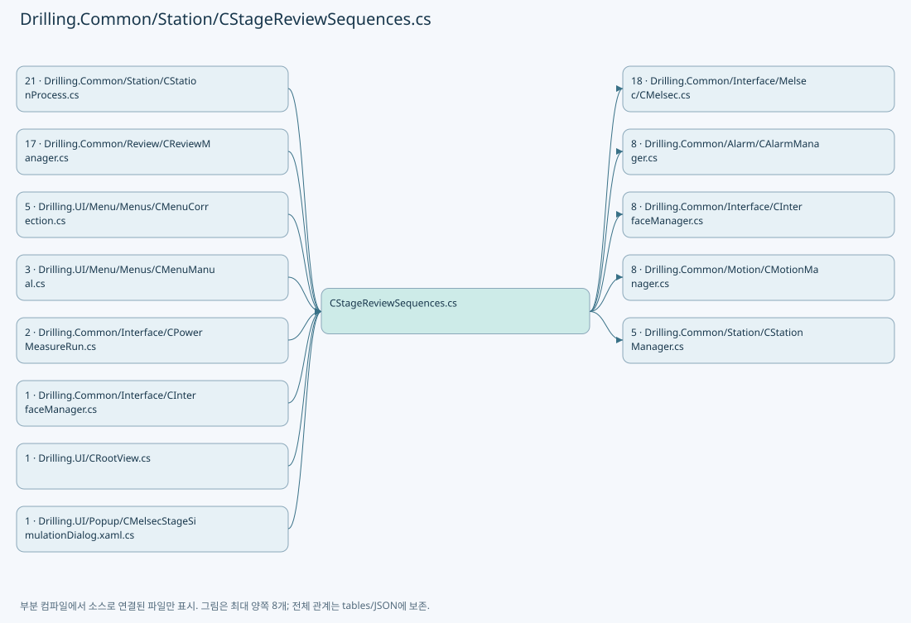

## 네임스페이스·타입·상속

| 타입 | 구분 | 원본 범위 | 선언/상속 |
| --- | --- | --- | --- |
| CStageReviewSequences | ClassDeclaration | 11–932 | CStageReviewSequences |
| Session | ClassDeclaration | 218–931 | Session: IDisposable |
| EN_STAGE_MOVE_MODE | EnumDeclaration | 934–939 | EN_STAGE_MOVE_MODE |
| ST_STAGE_MOVE_TARGET | RecordDeclaration | 941–941 | ST_STAGE_MOVE_TARGET |
| ST_STAGE_IOF_POINT | RecordDeclaration | 942–942 | ST_STAGE_IOF_POINT |
| ST_STAGE_IOF_PLAN | RecordDeclaration | 943–943 | ST_STAGE_IOF_PLAN |
| ST_STAGE_FLOW_EVENT | RecordDeclaration | 944–947 | ST_STAGE_FLOW_EVENT |

## 멤버 빠른 목록

| 이름 | 종류 | 범위 | 서명 |
| --- | --- | --- | --- |
| MoveAble | FieldDeclaration | L13–13 | string Drilling.Common.Station.CStageReviewSequences.MoveAble |
| MoveComplete | FieldDeclaration | L13–13 | string Drilling.Common.Station.CStageReviewSequences.MoveComplete |
| MoveStart | FieldDeclaration | L14–14 | string Drilling.Common.Station.CStageReviewSequences.MoveStart |
| MoveAck | FieldDeclaration | L14–14 | string Drilling.Common.Station.CStageReviewSequences.MoveAck |
| MoveStop | FieldDeclaration | L15–15 | string Drilling.Common.Station.CStageReviewSequences.MoveStop |
| PermitX | FieldDeclaration | L16–16 | string Drilling.Common.Station.CStageReviewSequences.PermitX |
| PermitY | FieldDeclaration | L16–16 | string Drilling.Common.Station.CStageReviewSequences.PermitY |
| IofStart | FieldDeclaration | L17–17 | string Drilling.Common.Station.CStageReviewSequences.IofStart |
| IofComplete | FieldDeclaration | L17–17 | string Drilling.Common.Station.CStageReviewSequences.IofComplete |
| IofAck | FieldDeclaration | L18–18 | string Drilling.Common.Station.CStageReviewSequences.IofAck |
| IofRead | FieldDeclaration | L18–18 | string Drilling.Common.Station.CStageReviewSequences.IofRead |
| IofRun | FieldDeclaration | L18–18 | string Drilling.Common.Station.CStageReviewSequences.IofRun |
| MoveActions | FieldDeclaration | L19–19 | string[] Drilling.Common.Station.CStageReviewSequences.MoveActions |
| IofActions | FieldDeclaration | L20–20 | string[] Drilling.Common.Station.CStageReviewSequences.IofActions |
| Actions | PropertyDeclaration | L21–21 | Drilling.Common.Station.CSequenceActionStatusStore Drilling.Common.Station.CStageReviewSequences.Actions |
| get_Actions | GetAccessorDeclaration | L21–21 | Drilling.Common.Station.CSequenceActionStatusStore Drilling.Common.Station.CStageReviewSequences.Actions.get |
| Failed | EventFieldDeclaration | L22–22 | System.Action<Drilling.Common.Alarm.CSequenceFailureException>? Drilling.Common.Station.CStageReviewSequences.Failed |
| ReportFailure | MethodDeclaration | L23–23 | void Drilling.Common.Station.CStageReviewSequences.ReportFailure(Drilling.Common.Alarm.CSequenceFailureException) |
| _owners | FieldDeclaration | L25–25 | System.Collections.Concurrent.ConcurrentDictionary<int, byte> Drilling.Common.Station.CStageReviewSequences._owners |
| _cleanupFailures | FieldDeclaration | L26–26 | System.Collections.Concurrent.ConcurrentDictionary<int, byte> Drilling.Common.Station.CStageReviewSequences._cleanupFailures |
| _failedSessions | FieldDeclaration | L27–27 | System.Collections.Concurrent.ConcurrentDictionary<int, Drilling.Common.Station.CStageReviewSequences.Session> Drilling.Common.Station.CStageReviewSequences._failedSessions |
| _recovery | FieldDeclaration | L28–28 | System.Threading.SemaphoreSlim Drilling.Common.Station.CStageReviewSequences._recovery |
| _moveStops | FieldDeclaration | L29–29 | System.Collections.Concurrent.ConcurrentDictionary<int, System.Threading.CancellationTokenSource> Drilling.Common.Station.CStageReviewSequences._moveStops |
| _automaticReplies | FieldDeclaration | L30–30 | int Drilling.Common.Station.CStageReviewSequences._automaticReplies |
| _event | FieldDeclaration | L31–31 | long Drilling.Common.Station.CStageReviewSequences._event |
| _lastPlan | FieldDeclaration | L32–32 | Drilling.Common.Station.ST_STAGE_IOF_PLAN? Drilling.Common.Station.CStageReviewSequences._lastPlan |
| _zeroSegments | FieldDeclaration | L33–33 | int Drilling.Common.Station.CStageReviewSequences._zeroSegments |
| SimulatedZeroLineCompletedSegments | PropertyDeclaration | L34–34 | int Drilling.Common.Station.CStageReviewSequences.SimulatedZeroLineCompletedSegments |
| SetSimulatedZeroLineCompletedSegments | MethodDeclaration | L36–47 | void Drilling.Common.Station.CStageReviewSequences.SetSimulatedZeroLineCompletedSegments(int) |
| ClearZeroLineSimulation | MethodDeclaration | L49–56 | void Drilling.Common.Station.CStageReviewSequences.ClearZeroLineSimulation() |
| Trace | EventFieldDeclaration | L58–58 | System.Action<Drilling.Common.Station.ST_STAGE_FLOW_EVENT>? Drilling.Common.Station.CStageReviewSequences.Trace |
| IsActive | PropertyDeclaration | L59–59 | bool Drilling.Common.Station.CStageReviewSequences.IsActive |
| HasActiveMove | MethodDeclaration | L60–60 | bool Drilling.Common.Station.CStageReviewSequences.HasActiveMove(int) |
| HasRunningSession | PropertyDeclaration | L61–61 | bool Drilling.Common.Station.CStageReviewSequences.HasRunningSession |
| RecoverIdleCleanup | MethodDeclaration | L64–94 | System.Threading.Tasks.Task Drilling.Common.Station.CStageReviewSequences.RecoverIdleCleanup(System.Threading.CancellationToken) |
| RequestMoveStop | MethodDeclaration | L97–102 | void Drilling.Common.Station.CStageReviewSequences.RequestMoveStop(int) |
| AutomaticSimulationReplies | PropertyDeclaration | L104–113 | bool Drilling.Common.Station.CStageReviewSequences.AutomaticSimulationReplies |
| get_AutomaticSimulationReplies | GetAccessorDeclaration | L106–106 | bool Drilling.Common.Station.CStageReviewSequences.AutomaticSimulationReplies.get |
| set_AutomaticSimulationReplies | SetAccessorDeclaration | L107–112 | void Drilling.Common.Station.CStageReviewSequences.AutomaticSimulationReplies.set |
| LastIofPlan | PropertyDeclaration | L115–115 | Drilling.Common.Station.ST_STAGE_IOF_PLAN? Drilling.Common.Station.CStageReviewSequences.LastIofPlan |
| _signalTimeout | FieldDeclaration | L117–117 | System.TimeSpan Drilling.Common.Station.CStageReviewSequences._signalTimeout |
| ValidateMoveReadiness | MethodDeclaration | L118–141 | void Drilling.Common.Station.CStageReviewSequences.ValidateMoveReadiness(int) |
| ValidateIofReadiness | MethodDeclaration | L143–165 | void Drilling.Common.Station.CStageReviewSequences.ValidateIofReadiness(int, int) |
| MoveManualAxis | MethodDeclaration | L168–175 | System.Threading.Tasks.Task Drilling.Common.Station.CStageReviewSequences.MoveManualAxis(int, Drilling.Common.Motion.EN_MANUAL_STAGE_AXIS, double, bool, double, System.Threading.CancellationToken) |
| Open | MethodDeclaration | L177–193 | Drilling.Common.Station.CStageReviewSequences.Session Drilling.Common.Station.CStageReviewSequences.Open(int, System.Func<bool>?, bool, bool) |
| Publish | MethodDeclaration | L195–216 | void Drilling.Common.Station.CStageReviewSequences.Publish(int, string, double?, string) |
| _owner | FieldDeclaration | L220–220 | Drilling.Common.Station.CStageReviewSequences Drilling.Common.Station.CStageReviewSequences.Session._owner |
| _interfaces | FieldDeclaration | L221–221 | Drilling.Common.Interface.CInterfaceManager Drilling.Common.Station.CStageReviewSequences.Session._interfaces |
| _device | FieldDeclaration | L222–222 | int Drilling.Common.Station.CStageReviewSequences.Session._device |
| _stopRequested | FieldDeclaration | L223–223 | System.Func<bool> Drilling.Common.Station.CStageReviewSequences.Session._stopRequested |
| _simulation | FieldDeclaration | L224–224 | bool Drilling.Common.Station.CStageReviewSequences.Session._simulation |
| _automatic | FieldDeclaration | L224–224 | bool Drilling.Common.Station.CStageReviewSequences.Session._automatic |
| _reviewXOnly | FieldDeclaration | L224–224 | bool Drilling.Common.Station.CStageReviewSequences.Session._reviewXOnly |
| _stageBufferOwner | FieldDeclaration | L224–224 | bool Drilling.Common.Station.CStageReviewSequences.Session._stageBufferOwner |
| _motion | FieldDeclaration | L225–225 | Drilling.Common.Motion.CManualStageMotionSimulation? Drilling.Common.Station.CStageReviewSequences.Session._motion |
| _lease | FieldDeclaration | L226–226 | Drilling.Common.Motion.CManualStageMotionSimulation.MotionLease? Drilling.Common.Station.CStageReviewSequences.Session._lease |
| _operation | FieldDeclaration | L227–227 | System.Threading.SemaphoreSlim Drilling.Common.Station.CStageReviewSequences.Session._operation |
| _disposed | FieldDeclaration | L228–228 | bool Drilling.Common.Station.CStageReviewSequences.Session._disposed |
| _moveOwned | FieldDeclaration | L229–229 | bool Drilling.Common.Station.CStageReviewSequences.Session._moveOwned |
| _iofOwned | FieldDeclaration | L229–229 | bool Drilling.Common.Station.CStageReviewSequences.Session._iofOwned |
| _moveMode | FieldDeclaration | L230–230 | Drilling.Common.Station.EN_STAGE_MOVE_MODE Drilling.Common.Station.CStageReviewSequences.Session._moveMode |
| IsDisposed | PropertyDeclaration | L231–231 | bool Drilling.Common.Station.CStageReviewSequences.Session.IsDisposed |
| _iofPlanId | FieldDeclaration | L232–232 | System.Guid Drilling.Common.Station.CStageReviewSequences.Session._iofPlanId |
| _iofStartConfirmed | FieldDeclaration | L233–233 | bool Drilling.Common.Station.CStageReviewSequences.Session._iofStartConfirmed |
| _iofAckConfirmed | FieldDeclaration | L233–233 | bool Drilling.Common.Station.CStageReviewSequences.Session._iofAckConfirmed |
| _scenario | FieldDeclaration | L234–234 | string Drilling.Common.Station.CStageReviewSequences.Session._scenario |
| _traceSession | FieldDeclaration | L235–235 | string Drilling.Common.Station.CStageReviewSequences.Session._traceSession |
| Record | MethodDeclaration | L236–236 | void Drilling.Common.Station.CStageReviewSequences.Session.Record(string, string, double?) |
| IsSimulation | PropertyDeclaration | L237–237 | bool Drilling.Common.Station.CStageReviewSequences.Session.IsSimulation |
| CurrentX | PropertyDeclaration | L238–238 | double Drilling.Common.Station.CStageReviewSequences.Session.CurrentX |
| CurrentY | PropertyDeclaration | L239–239 | double Drilling.Common.Station.CStageReviewSequences.Session.CurrentY |
| .ctor | ConstructorDeclaration | L241–259 | Drilling.Common.Station.CStageReviewSequences.Session.Session(Drilling.Common.Station.CStageReviewSequences, Drilling.Common.Interface.CInterfaceManager, int, System.Func<bool>, bool, bool, bool) |
| Check | MethodDeclaration | L261–270 | void Drilling.Common.Station.CStageReviewSequences.Session.Check(System.Threading.CancellationToken, bool) |
| Route | MethodDeclaration | L272–278 | Drilling.Common.Interface.ST_MELSEC_MAP_DATA Drilling.Common.Station.CStageReviewSequences.Session.Route(string) |
| Value | MethodDeclaration | L280–290 | double Drilling.Common.Station.CStageReviewSequences.Session.Value(string) |
| Feedback | MethodDeclaration | L292–292 | double Drilling.Common.Station.CStageReviewSequences.Session.Feedback(string) |
| Describe | MethodDeclaration | L294–299 | string Drilling.Common.Station.CStageReviewSequences.Session.Describe(string) |
| RefreshInputs | MethodDeclaration | L301–326 | System.Threading.Tasks.Task Drilling.Common.Station.CStageReviewSequences.Session.RefreshInputs(System.Collections.Generic.IEnumerable<string>, System.Threading.CancellationToken, bool) |
| Write | MethodDeclaration | L327–366 | System.Threading.Tasks.Task Drilling.Common.Station.CStageReviewSequences.Session.Write(string, double, System.Threading.CancellationToken, bool) |
| Stage | MethodDeclaration | L368–376 | System.Threading.Tasks.Task Drilling.Common.Station.CStageReviewSequences.Session.Stage(string, int, System.Threading.CancellationToken) |
| RecordIofSnapshot | MethodDeclaration | L379–402 | void Drilling.Common.Station.CStageReviewSequences.Session.RecordIofSnapshot(string, string) |
| Wait | MethodDeclaration | L404–453 | System.Threading.Tasks.Task Drilling.Common.Station.CStageReviewSequences.Session.Wait(string, int, System.Threading.CancellationToken, System.TimeSpan?, string?) |
| Step | MethodDeclaration | L455–472 | System.Threading.Tasks.Task Drilling.Common.Station.CStageReviewSequences.Session.Step(string, System.Func<System.Threading.Tasks.Task>) |
| InitialRead | MethodDeclaration | L474–491 | System.Threading.Tasks.Task Drilling.Common.Station.CStageReviewSequences.Session.InitialRead(System.Collections.Generic.IEnumerable<string>, System.Threading.CancellationToken) |
| Stop | MethodDeclaration | L493–498 | void Drilling.Common.Station.CStageReviewSequences.Session.Stop() |
| Dispose | MethodDeclaration | L500–509 | void Drilling.Common.Station.CStageReviewSequences.Session.Dispose() |
| MoveAxis | MethodDeclaration | L511–524 | System.Threading.Tasks.Task Drilling.Common.Station.CStageReviewSequences.Session.MoveAxis(Drilling.Common.Motion.EN_MANUAL_STAGE_AXIS, double, bool, double, System.Threading.CancellationToken) |
| ReadStationaryPosition | MethodDeclaration | L526–536 | System.Threading.Tasks.Task<double> Drilling.Common.Station.CStageReviewSequences.Session.ReadStationaryPosition(Drilling.Common.Motion.EN_MANUAL_STAGE_AXIS, System.Threading.CancellationToken) |
| Move | MethodDeclaration | L538–631 | System.Threading.Tasks.Task Drilling.Common.Station.CStageReviewSequences.Session.Move(Drilling.Common.Station.ST_STAGE_MOVE_TARGET, System.Threading.CancellationToken) |
| FeedbackIds | MethodDeclaration | L633–635 | string[] Drilling.Common.Station.CStageReviewSequences.Session.FeedbackIds(Drilling.Common.Station.EN_STAGE_MOVE_MODE, bool) |
| WaitStopped | MethodDeclaration | L637–654 | System.Threading.Tasks.Task Drilling.Common.Station.CStageReviewSequences.Session.WaitStopped(System.Threading.CancellationToken, Drilling.Common.Station.EN_STAGE_MOVE_MODE, bool) |
| VerifyArrival | MethodDeclaration | L656–656 | System.Threading.Tasks.Task Drilling.Common.Station.CStageReviewSequences.Session.VerifyArrival(Drilling.Common.Station.ST_STAGE_MOVE_TARGET, System.Threading.CancellationToken) |
| WaitArrival | MethodDeclaration | L658–680 | System.Threading.Tasks.Task Drilling.Common.Station.CStageReviewSequences.Session.WaitArrival(Drilling.Common.Station.ST_STAGE_MOVE_TARGET, System.Threading.CancellationToken) |
| Abort | MethodDeclaration | L682–719 | System.Threading.Tasks.Task Drilling.Common.Station.CStageReviewSequences.Session.Abort(bool) |
| RecoverStoppedOutputs | MethodDeclaration | L721–732 | System.Threading.Tasks.Task Drilling.Common.Station.CStageReviewSequences.Session.RecoverStoppedOutputs(System.Threading.CancellationToken) |
| RecoverRetainedStop | MethodDeclaration | L734–740 | System.Threading.Tasks.Task Drilling.Common.Station.CStageReviewSequences.Session.RecoverRetainedStop(System.Threading.CancellationToken) |
| PrepareIof | MethodDeclaration | L742–829 | System.Threading.Tasks.Task<Drilling.Common.Station.ST_STAGE_IOF_PLAN> Drilling.Common.Station.CStageReviewSequences.Session.PrepareIof(System.Collections.Generic.IReadOnlyList<Drilling.Common.Station.ST_STAGE_IOF_POINT>, bool, System.Threading.CancellationToken) |
| InitializeZeroLineReadyY | MethodDeclaration | L831–836 | void Drilling.Common.Station.CStageReviewSequences.Session.InitializeZeroLineReadyY(double) |
| BeginZeroLineSimulation | MethodDeclaration | L843–855 | void Drilling.Common.Station.CStageReviewSequences.Session.BeginZeroLineSimulation(Drilling.Common.Review.ST_ZERO_LINE_CYCLE_PLAN, System.Threading.CancellationToken) |
| WaitZeroLineEndPosition | MethodDeclaration | L858–913 | System.Threading.Tasks.Task Drilling.Common.Station.CStageReviewSequences.Session.WaitZeroLineEndPosition(Drilling.Common.Review.ST_ZERO_LINE_CYCLE_PLAN, System.Threading.CancellationToken) |
| Evidence | LocalFunctionStatement | L872–877 | string Evidence() |
| ZeroLineFeedback | MethodDeclaration | L915–929 | double Drilling.Common.Station.CStageReviewSequences.Session.ZeroLineFeedback(string, System.Collections.Generic.IReadOnlyDictionary<string, Drilling.Common.Interface.ST_MELSEC_CACHED_VALUE>?) |
| XY | EnumMemberDeclaration | L936–936 | Drilling.Common.Station.EN_STAGE_MOVE_MODE.XY |
| ReviewX | EnumMemberDeclaration | L937–937 | Drilling.Common.Station.EN_STAGE_MOVE_MODE.ReviewX |
| StageY | EnumMemberDeclaration | L938–938 | Drilling.Common.Station.EN_STAGE_MOVE_MODE.StageY |
| Detail | PropertyDeclaration | L946–946 | string Drilling.Common.Station.ST_STAGE_FLOW_EVENT.Detail |
| get_Detail | GetAccessorDeclaration | L946–946 | string Drilling.Common.Station.ST_STAGE_FLOW_EVENT.Detail.get |
| set_Detail | InitAccessorDeclaration | L946–946 | void Drilling.Common.Station.ST_STAGE_FLOW_EVENT.Detail.init |

## 멤버별 상세 계약·호출·처리 해설

### FieldDeclaration `MoveAble` · L13–13

[Drilling.Common/Station/CStageReviewSequences.cs:13–13](https://github.com/kjuws10-rgb/A3Drilling/blob/5aee8e58439c9b455cae7c9593c9be986c3e682e/Drilling.Common/Station/CStageReviewSequences.cs#L13-L13)

| 항목 | 실제 추출 값 |
| --- | --- |
| 서명 | string Drilling.Common.Station.CStageReviewSequences.MoveAble |
| 접근/수식자 | Public / public, const |
| 반환/값 타입 | string |
| 소속 타입 | NamedType:Drilling.Common.Station.CStageReviewSequences |

현재 부분 분석에서 직접 연결된 호출자는 없습니다. XAML/이벤트/인터페이스·델리게이트·외부 진입을 추가 확인해야 하며, 미사용으로 판정한 것이 아닙니다.

본문의 실제 연산·분기·예외·반환 순서(원문 위치 순):

| 원본 행 | 종류 | 주석 해설 |
| --- | --- | --- |
| 13 | variable-initializer | 변수의 초기값을 지정합니다: MoveAble = "HANDSHAKE_STG_REVIEW_ABLE_SDC" |
| 13 | variable-initializer | 변수의 초기값을 지정합니다: MoveComplete = "HANDSHAKE_STG_REVIEW_COMPLETE_SDC" |

변경 전 점검: 입력/반환 타입, 위 호출자, 예외/취소 경로, 공유 상태와 저장·전송 소비자를 함께 확인합니다. 값의 단위나 물리 방향을 이름만으로 확정하지 않습니다.

### FieldDeclaration `MoveComplete` · L13–13

[Drilling.Common/Station/CStageReviewSequences.cs:13–13](https://github.com/kjuws10-rgb/A3Drilling/blob/5aee8e58439c9b455cae7c9593c9be986c3e682e/Drilling.Common/Station/CStageReviewSequences.cs#L13-L13)

| 항목 | 실제 추출 값 |
| --- | --- |
| 서명 | string Drilling.Common.Station.CStageReviewSequences.MoveComplete |
| 접근/수식자 | Public / public, const |
| 반환/값 타입 | string |
| 소속 타입 | NamedType:Drilling.Common.Station.CStageReviewSequences |

현재 부분 분석에서 직접 연결된 호출자는 없습니다. XAML/이벤트/인터페이스·델리게이트·외부 진입을 추가 확인해야 하며, 미사용으로 판정한 것이 아닙니다.

변경 전 점검: 입력/반환 타입, 위 호출자, 예외/취소 경로, 공유 상태와 저장·전송 소비자를 함께 확인합니다. 값의 단위나 물리 방향을 이름만으로 확정하지 않습니다.

### FieldDeclaration `MoveStart` · L14–14

[Drilling.Common/Station/CStageReviewSequences.cs:14–14](https://github.com/kjuws10-rgb/A3Drilling/blob/5aee8e58439c9b455cae7c9593c9be986c3e682e/Drilling.Common/Station/CStageReviewSequences.cs#L14-L14)

| 항목 | 실제 추출 값 |
| --- | --- |
| 서명 | string Drilling.Common.Station.CStageReviewSequences.MoveStart |
| 접근/수식자 | Public / public, const |
| 반환/값 타입 | string |
| 소속 타입 | NamedType:Drilling.Common.Station.CStageReviewSequences |

현재 부분 분석에서 직접 연결된 호출자는 없습니다. XAML/이벤트/인터페이스·델리게이트·외부 진입을 추가 확인해야 하며, 미사용으로 판정한 것이 아닙니다.

본문의 실제 연산·분기·예외·반환 순서(원문 위치 순):

| 원본 행 | 종류 | 주석 해설 |
| --- | --- | --- |
| 14 | variable-initializer | 변수의 초기값을 지정합니다: MoveStart = "HANDSHAKE_PRC_REVIEW_MOVE_START" |
| 14 | variable-initializer | 변수의 초기값을 지정합니다: MoveAck = "HANDSHAKE_PRC_REVIEW_GENERAL_RUNNING" |

변경 전 점검: 입력/반환 타입, 위 호출자, 예외/취소 경로, 공유 상태와 저장·전송 소비자를 함께 확인합니다. 값의 단위나 물리 방향을 이름만으로 확정하지 않습니다.

### FieldDeclaration `MoveAck` · L14–14

[Drilling.Common/Station/CStageReviewSequences.cs:14–14](https://github.com/kjuws10-rgb/A3Drilling/blob/5aee8e58439c9b455cae7c9593c9be986c3e682e/Drilling.Common/Station/CStageReviewSequences.cs#L14-L14)

| 항목 | 실제 추출 값 |
| --- | --- |
| 서명 | string Drilling.Common.Station.CStageReviewSequences.MoveAck |
| 접근/수식자 | Public / public, const |
| 반환/값 타입 | string |
| 소속 타입 | NamedType:Drilling.Common.Station.CStageReviewSequences |

현재 부분 분석에서 직접 연결된 호출자는 없습니다. XAML/이벤트/인터페이스·델리게이트·외부 진입을 추가 확인해야 하며, 미사용으로 판정한 것이 아닙니다.

변경 전 점검: 입력/반환 타입, 위 호출자, 예외/취소 경로, 공유 상태와 저장·전송 소비자를 함께 확인합니다. 값의 단위나 물리 방향을 이름만으로 확정하지 않습니다.

### FieldDeclaration `MoveStop` · L15–15

[Drilling.Common/Station/CStageReviewSequences.cs:15–15](https://github.com/kjuws10-rgb/A3Drilling/blob/5aee8e58439c9b455cae7c9593c9be986c3e682e/Drilling.Common/Station/CStageReviewSequences.cs#L15-L15)

| 항목 | 실제 추출 값 |
| --- | --- |
| 서명 | string Drilling.Common.Station.CStageReviewSequences.MoveStop |
| 접근/수식자 | Public / public, const |
| 반환/값 타입 | string |
| 소속 타입 | NamedType:Drilling.Common.Station.CStageReviewSequences |

현재 부분 분석에서 직접 연결된 호출자는 없습니다. XAML/이벤트/인터페이스·델리게이트·외부 진입을 추가 확인해야 하며, 미사용으로 판정한 것이 아닙니다.

본문의 실제 연산·분기·예외·반환 순서(원문 위치 순):

| 원본 행 | 종류 | 주석 해설 |
| --- | --- | --- |
| 15 | variable-initializer | 변수의 초기값을 지정합니다: MoveStop = "PROCESS_REVIEW_STOP_SIGNAL" |

변경 전 점검: 입력/반환 타입, 위 호출자, 예외/취소 경로, 공유 상태와 저장·전송 소비자를 함께 확인합니다. 값의 단위나 물리 방향을 이름만으로 확정하지 않습니다.

### FieldDeclaration `PermitX` · L16–16

[Drilling.Common/Station/CStageReviewSequences.cs:16–16](https://github.com/kjuws10-rgb/A3Drilling/blob/5aee8e58439c9b455cae7c9593c9be986c3e682e/Drilling.Common/Station/CStageReviewSequences.cs#L16-L16)

| 항목 | 실제 추출 값 |
| --- | --- |
| 서명 | string Drilling.Common.Station.CStageReviewSequences.PermitX |
| 접근/수식자 | Public / public, const |
| 반환/값 타입 | string |
| 소속 타입 | NamedType:Drilling.Common.Station.CStageReviewSequences |

현재 부분 분석에서 직접 연결된 호출자는 없습니다. XAML/이벤트/인터페이스·델리게이트·외부 진입을 추가 확인해야 하며, 미사용으로 판정한 것이 아닙니다.

본문의 실제 연산·분기·예외·반환 순서(원문 위치 순):

| 원본 행 | 종류 | 주석 해설 |
| --- | --- | --- |
| 16 | variable-initializer | 변수의 초기값을 지정합니다: PermitX = "IPS_REVIEW_CONTROL_MODE_X" |
| 16 | variable-initializer | 변수의 초기값을 지정합니다: PermitY = "IPS_REVIEW_CONTROL_MODE_Y" |

변경 전 점검: 입력/반환 타입, 위 호출자, 예외/취소 경로, 공유 상태와 저장·전송 소비자를 함께 확인합니다. 값의 단위나 물리 방향을 이름만으로 확정하지 않습니다.

### FieldDeclaration `PermitY` · L16–16

[Drilling.Common/Station/CStageReviewSequences.cs:16–16](https://github.com/kjuws10-rgb/A3Drilling/blob/5aee8e58439c9b455cae7c9593c9be986c3e682e/Drilling.Common/Station/CStageReviewSequences.cs#L16-L16)

| 항목 | 실제 추출 값 |
| --- | --- |
| 서명 | string Drilling.Common.Station.CStageReviewSequences.PermitY |
| 접근/수식자 | Public / public, const |
| 반환/값 타입 | string |
| 소속 타입 | NamedType:Drilling.Common.Station.CStageReviewSequences |

현재 부분 분석에서 직접 연결된 호출자는 없습니다. XAML/이벤트/인터페이스·델리게이트·외부 진입을 추가 확인해야 하며, 미사용으로 판정한 것이 아닙니다.

변경 전 점검: 입력/반환 타입, 위 호출자, 예외/취소 경로, 공유 상태와 저장·전송 소비자를 함께 확인합니다. 값의 단위나 물리 방향을 이름만으로 확정하지 않습니다.

### FieldDeclaration `IofStart` · L17–17

[Drilling.Common/Station/CStageReviewSequences.cs:17–17](https://github.com/kjuws10-rgb/A3Drilling/blob/5aee8e58439c9b455cae7c9593c9be986c3e682e/Drilling.Common/Station/CStageReviewSequences.cs#L17-L17)

| 항목 | 실제 추출 값 |
| --- | --- |
| 서명 | string Drilling.Common.Station.CStageReviewSequences.IofStart |
| 접근/수식자 | Public / public, const |
| 반환/값 타입 | string |
| 소속 타입 | NamedType:Drilling.Common.Station.CStageReviewSequences |

현재 부분 분석에서 직접 연결된 호출자는 없습니다. XAML/이벤트/인터페이스·델리게이트·외부 진입을 추가 확인해야 하며, 미사용으로 판정한 것이 아닙니다.

본문의 실제 연산·분기·예외·반환 순서(원문 위치 순):

| 원본 행 | 종류 | 주석 해설 |
| --- | --- | --- |
| 17 | variable-initializer | 변수의 초기값을 지정합니다: IofStart = "HANDSHAKE_PRC_IOF_START_REQUEST" |
| 17 | variable-initializer | 변수의 초기값을 지정합니다: IofComplete = "HANDSHAKE_STG_IOF_COMPLETE" |

변경 전 점검: 입력/반환 타입, 위 호출자, 예외/취소 경로, 공유 상태와 저장·전송 소비자를 함께 확인합니다. 값의 단위나 물리 방향을 이름만으로 확정하지 않습니다.

### FieldDeclaration `IofComplete` · L17–17

[Drilling.Common/Station/CStageReviewSequences.cs:17–17](https://github.com/kjuws10-rgb/A3Drilling/blob/5aee8e58439c9b455cae7c9593c9be986c3e682e/Drilling.Common/Station/CStageReviewSequences.cs#L17-L17)

| 항목 | 실제 추출 값 |
| --- | --- |
| 서명 | string Drilling.Common.Station.CStageReviewSequences.IofComplete |
| 접근/수식자 | Public / public, const |
| 반환/값 타입 | string |
| 소속 타입 | NamedType:Drilling.Common.Station.CStageReviewSequences |

현재 부분 분석에서 직접 연결된 호출자는 없습니다. XAML/이벤트/인터페이스·델리게이트·외부 진입을 추가 확인해야 하며, 미사용으로 판정한 것이 아닙니다.

변경 전 점검: 입력/반환 타입, 위 호출자, 예외/취소 경로, 공유 상태와 저장·전송 소비자를 함께 확인합니다. 값의 단위나 물리 방향을 이름만으로 확정하지 않습니다.

### FieldDeclaration `IofAck` · L18–18

[Drilling.Common/Station/CStageReviewSequences.cs:18–18](https://github.com/kjuws10-rgb/A3Drilling/blob/5aee8e58439c9b455cae7c9593c9be986c3e682e/Drilling.Common/Station/CStageReviewSequences.cs#L18-L18)

| 항목 | 실제 추출 값 |
| --- | --- |
| 서명 | string Drilling.Common.Station.CStageReviewSequences.IofAck |
| 접근/수식자 | Public / public, const |
| 반환/값 타입 | string |
| 소속 타입 | NamedType:Drilling.Common.Station.CStageReviewSequences |

현재 부분 분석에서 직접 연결된 호출자는 없습니다. XAML/이벤트/인터페이스·델리게이트·외부 진입을 추가 확인해야 하며, 미사용으로 판정한 것이 아닙니다.

본문의 실제 연산·분기·예외·반환 순서(원문 위치 순):

| 원본 행 | 종류 | 주석 해설 |
| --- | --- | --- |
| 18 | variable-initializer | 변수의 초기값을 지정합니다: IofAck = "HANDSHAKE_PRC_IOF_COMPLETE_RESPONSE" |
| 18 | variable-initializer | 변수의 초기값을 지정합니다: IofRead = "IPS_IOF_READ_COMPLETE" |
| 18 | variable-initializer | 변수의 초기값을 지정합니다: IofRun = "IPS_IOF_BUFFER_RUN_COMPLETE" |

변경 전 점검: 입력/반환 타입, 위 호출자, 예외/취소 경로, 공유 상태와 저장·전송 소비자를 함께 확인합니다. 값의 단위나 물리 방향을 이름만으로 확정하지 않습니다.

### FieldDeclaration `IofRead` · L18–18

[Drilling.Common/Station/CStageReviewSequences.cs:18–18](https://github.com/kjuws10-rgb/A3Drilling/blob/5aee8e58439c9b455cae7c9593c9be986c3e682e/Drilling.Common/Station/CStageReviewSequences.cs#L18-L18)

| 항목 | 실제 추출 값 |
| --- | --- |
| 서명 | string Drilling.Common.Station.CStageReviewSequences.IofRead |
| 접근/수식자 | Public / public, const |
| 반환/값 타입 | string |
| 소속 타입 | NamedType:Drilling.Common.Station.CStageReviewSequences |

현재 부분 분석에서 직접 연결된 호출자는 없습니다. XAML/이벤트/인터페이스·델리게이트·외부 진입을 추가 확인해야 하며, 미사용으로 판정한 것이 아닙니다.

변경 전 점검: 입력/반환 타입, 위 호출자, 예외/취소 경로, 공유 상태와 저장·전송 소비자를 함께 확인합니다. 값의 단위나 물리 방향을 이름만으로 확정하지 않습니다.

### FieldDeclaration `IofRun` · L18–18

[Drilling.Common/Station/CStageReviewSequences.cs:18–18](https://github.com/kjuws10-rgb/A3Drilling/blob/5aee8e58439c9b455cae7c9593c9be986c3e682e/Drilling.Common/Station/CStageReviewSequences.cs#L18-L18)

| 항목 | 실제 추출 값 |
| --- | --- |
| 서명 | string Drilling.Common.Station.CStageReviewSequences.IofRun |
| 접근/수식자 | Public / public, const |
| 반환/값 타입 | string |
| 소속 타입 | NamedType:Drilling.Common.Station.CStageReviewSequences |

현재 부분 분석에서 직접 연결된 호출자는 없습니다. XAML/이벤트/인터페이스·델리게이트·외부 진입을 추가 확인해야 하며, 미사용으로 판정한 것이 아닙니다.

변경 전 점검: 입력/반환 타입, 위 호출자, 예외/취소 경로, 공유 상태와 저장·전송 소비자를 함께 확인합니다. 값의 단위나 물리 방향을 이름만으로 확정하지 않습니다.

### FieldDeclaration `MoveActions` · L19–19

[Drilling.Common/Station/CStageReviewSequences.cs:19–19](https://github.com/kjuws10-rgb/A3Drilling/blob/5aee8e58439c9b455cae7c9593c9be986c3e682e/Drilling.Common/Station/CStageReviewSequences.cs#L19-L19)

| 항목 | 실제 추출 값 |
| --- | --- |
| 서명 | string[] Drilling.Common.Station.CStageReviewSequences.MoveActions |
| 접근/수식자 | Public / public, static, readonly |
| 반환/값 타입 | string[] |
| 소속 타입 | NamedType:Drilling.Common.Station.CStageReviewSequences |

현재 부분 분석에서 직접 연결된 호출자는 없습니다. XAML/이벤트/인터페이스·델리게이트·외부 진입을 추가 확인해야 하며, 미사용으로 판정한 것이 아닙니다.

본문의 실제 연산·분기·예외·반환 순서(원문 위치 순):

| 원본 행 | 종류 | 주석 해설 |
| --- | --- | --- |
| 19 | variable-initializer | 변수의 초기값을 지정합니다: MoveActions = ["MOVE_TARGETS", "MOVE_SETTLE", "MOVE_RELEASE", "MOVE_XREADY"] |

변경 전 점검: 입력/반환 타입, 위 호출자, 예외/취소 경로, 공유 상태와 저장·전송 소비자를 함께 확인합니다. 값의 단위나 물리 방향을 이름만으로 확정하지 않습니다.

### FieldDeclaration `IofActions` · L20–20

[Drilling.Common/Station/CStageReviewSequences.cs:20–20](https://github.com/kjuws10-rgb/A3Drilling/blob/5aee8e58439c9b455cae7c9593c9be986c3e682e/Drilling.Common/Station/CStageReviewSequences.cs#L20-L20)

| 항목 | 실제 추출 값 |
| --- | --- |
| 서명 | string[] Drilling.Common.Station.CStageReviewSequences.IofActions |
| 접근/수식자 | Public / public, static, readonly |
| 반환/값 타입 | string[] |
| 소속 타입 | NamedType:Drilling.Common.Station.CStageReviewSequences |

현재 부분 분석에서 직접 연결된 호출자는 없습니다. XAML/이벤트/인터페이스·델리게이트·외부 진입을 추가 확인해야 하며, 미사용으로 판정한 것이 아닙니다.

본문의 실제 연산·분기·예외·반환 순서(원문 위치 순):

| 원본 행 | 종류 | 주석 해설 |
| --- | --- | --- |
| 20 | variable-initializer | 변수의 초기값을 지정합니다: IofActions = ["IOF_PLAN", "IOF_SIGNALS_CLEAR"] |

변경 전 점검: 입력/반환 타입, 위 호출자, 예외/취소 경로, 공유 상태와 저장·전송 소비자를 함께 확인합니다. 값의 단위나 물리 방향을 이름만으로 확정하지 않습니다.

### PropertyDeclaration `Actions` · L21–21

[Drilling.Common/Station/CStageReviewSequences.cs:21–21](https://github.com/kjuws10-rgb/A3Drilling/blob/5aee8e58439c9b455cae7c9593c9be986c3e682e/Drilling.Common/Station/CStageReviewSequences.cs#L21-L21)

| 항목 | 실제 추출 값 |
| --- | --- |
| 서명 | Drilling.Common.Station.CSequenceActionStatusStore Drilling.Common.Station.CStageReviewSequences.Actions |
| 접근/수식자 | Public / public |
| 반환/값 타입 | Drilling.Common.Station.CSequenceActionStatusStore |
| 소속 타입 | NamedType:Drilling.Common.Station.CStageReviewSequences |

현재 부분 분석에서 직접 연결된 호출자는 없습니다. XAML/이벤트/인터페이스·델리게이트·외부 진입을 추가 확인해야 하며, 미사용으로 판정한 것이 아닙니다.

호출하는 대상과 해석 범위:

| 원본 행 | 표현식 | 분석 상태 | 대상/소스 위치 |
| --- | --- | --- | --- |
| 21 | new | resolved | Drilling.Common.Station.CSequenceActionStatusStore.CSequenceActionStatusStore() · Drilling.Common/Station/CStationManager.cs:158 |

본문의 실제 연산·분기·예외·반환 순서(원문 위치 순):

| 원본 행 | 종류 | 주석 해설 |
| --- | --- | --- |
| 21 | call | 함수·델리게이트 또는 객체 생성자를 호출합니다: new() |

변경 전 점검: 입력/반환 타입, 위 호출자, 예외/취소 경로, 공유 상태와 저장·전송 소비자를 함께 확인합니다. 값의 단위나 물리 방향을 이름만으로 확정하지 않습니다.

### GetAccessorDeclaration `get_Actions` · L21–21

[Drilling.Common/Station/CStageReviewSequences.cs:21–21](https://github.com/kjuws10-rgb/A3Drilling/blob/5aee8e58439c9b455cae7c9593c9be986c3e682e/Drilling.Common/Station/CStageReviewSequences.cs#L21-L21)

| 항목 | 실제 추출 값 |
| --- | --- |
| 서명 | Drilling.Common.Station.CSequenceActionStatusStore Drilling.Common.Station.CStageReviewSequences.Actions.get |
| 접근/수식자 | Public / get |
| 반환/값 타입 | Drilling.Common.Station.CSequenceActionStatusStore |
| 소속 타입 | NamedType:Drilling.Common.Station.CStageReviewSequences |

현재 부분 분석에서 직접 연결된 호출자는 없습니다. XAML/이벤트/인터페이스·델리게이트·외부 진입을 추가 확인해야 하며, 미사용으로 판정한 것이 아닙니다.

변경 전 점검: 입력/반환 타입, 위 호출자, 예외/취소 경로, 공유 상태와 저장·전송 소비자를 함께 확인합니다. 값의 단위나 물리 방향을 이름만으로 확정하지 않습니다.

### EventFieldDeclaration `Failed` · L22–22

[Drilling.Common/Station/CStageReviewSequences.cs:22–22](https://github.com/kjuws10-rgb/A3Drilling/blob/5aee8e58439c9b455cae7c9593c9be986c3e682e/Drilling.Common/Station/CStageReviewSequences.cs#L22-L22)

| 항목 | 실제 추출 값 |
| --- | --- |
| 서명 | System.Action<Drilling.Common.Alarm.CSequenceFailureException>? Drilling.Common.Station.CStageReviewSequences.Failed |
| 접근/수식자 | Public / public, event |
| 반환/값 타입 | System.Action<Drilling.Common.Alarm.CSequenceFailureException>? |
| 소속 타입 | NamedType:Drilling.Common.Station.CStageReviewSequences |

현재 부분 분석에서 직접 연결된 호출자는 없습니다. XAML/이벤트/인터페이스·델리게이트·외부 진입을 추가 확인해야 하며, 미사용으로 판정한 것이 아닙니다.

변경 전 점검: 입력/반환 타입, 위 호출자, 예외/취소 경로, 공유 상태와 저장·전송 소비자를 함께 확인합니다. 값의 단위나 물리 방향을 이름만으로 확정하지 않습니다.

### MethodDeclaration `ReportFailure` · L23–23

[Drilling.Common/Station/CStageReviewSequences.cs:23–23](https://github.com/kjuws10-rgb/A3Drilling/blob/5aee8e58439c9b455cae7c9593c9be986c3e682e/Drilling.Common/Station/CStageReviewSequences.cs#L23-L23)

| 항목 | 실제 추출 값 |
| --- | --- |
| 서명 | void Drilling.Common.Station.CStageReviewSequences.ReportFailure(Drilling.Common.Alarm.CSequenceFailureException) |
| 접근/수식자 | Internal / internal |
| 반환/값 타입 | void |
| 소속 타입 | NamedType:Drilling.Common.Station.CStageReviewSequences |

입력 계약:

| 이름 | 타입 | 전달 | 선택/기본값 |
| --- | --- | --- | --- |
| failure | Drilling.Common.Alarm.CSequenceFailureException | None | False /  |

정적 호출자로 확인된 위치:

| 호출 파일/행 | 호출 표현식 | 런타임 분기 가능 |
| --- | --- | --- |
| [Drilling.Common/Station/CStageReviewSequences.cs:469–469](https://github.com/kjuws10-rgb/A3Drilling/blob/5aee8e58439c9b455cae7c9593c9be986c3e682e/Drilling.Common/Station/CStageReviewSequences.cs#L469-L469) | _owner.ReportFailure | False |
| [Drilling.Common/Station/CStageReviewSequences.cs:623–623](https://github.com/kjuws10-rgb/A3Drilling/blob/5aee8e58439c9b455cae7c9593c9be986c3e682e/Drilling.Common/Station/CStageReviewSequences.cs#L623-L623) | _owner.ReportFailure | False |
| [Drilling.Common/Station/CStageReviewSequences.cs:715–715](https://github.com/kjuws10-rgb/A3Drilling/blob/5aee8e58439c9b455cae7c9593c9be986c3e682e/Drilling.Common/Station/CStageReviewSequences.cs#L715-L715) | _owner.ReportFailure | False |
| [Drilling.Common/Station/CStageReviewSequences.cs:822–822](https://github.com/kjuws10-rgb/A3Drilling/blob/5aee8e58439c9b455cae7c9593c9be986c3e682e/Drilling.Common/Station/CStageReviewSequences.cs#L822-L822) | _owner.ReportFailure | False |
| [Drilling.Common/Station/CStationProcess.cs:6221–6221](https://github.com/kjuws10-rgb/A3Drilling/blob/5aee8e58439c9b455cae7c9593c9be986c3e682e/Drilling.Common/Station/CStationProcess.cs#L6221-L6221) | interfaces.StageReviewSequences.ReportFailure | False |

호출하는 대상과 해석 범위:

| 원본 행 | 표현식 | 분석 상태 | 대상/소스 위치 |
| --- | --- | --- | --- |
| 23 | failure.Publish | resolved | void Drilling.Common.Alarm.CSequenceFailureException.Publish(System.Action<Drilling.Common.Alarm.CSequenceFailureException>?) · Drilling.Common/Alarm/CAlarmManager.cs:648 |

본문의 실제 연산·분기·예외·반환 순서(원문 위치 순):

| 원본 행 | 종류 | 주석 해설 |
| --- | --- | --- |
| 23 | call | 함수·델리게이트 또는 객체 생성자를 호출합니다: failure.Publish(Failed) |

변경 전 점검: 입력/반환 타입, 위 호출자, 예외/취소 경로, 공유 상태와 저장·전송 소비자를 함께 확인합니다. 값의 단위나 물리 방향을 이름만으로 확정하지 않습니다.

### FieldDeclaration `_owners` · L25–25

[Drilling.Common/Station/CStageReviewSequences.cs:25–25](https://github.com/kjuws10-rgb/A3Drilling/blob/5aee8e58439c9b455cae7c9593c9be986c3e682e/Drilling.Common/Station/CStageReviewSequences.cs#L25-L25)

| 항목 | 실제 추출 값 |
| --- | --- |
| 서명 | System.Collections.Concurrent.ConcurrentDictionary<int, byte> Drilling.Common.Station.CStageReviewSequences._owners |
| 접근/수식자 | Private / private, readonly |
| 반환/값 타입 | System.Collections.Concurrent.ConcurrentDictionary<int, byte> |
| 소속 타입 | NamedType:Drilling.Common.Station.CStageReviewSequences |

현재 부분 분석에서 직접 연결된 호출자는 없습니다. XAML/이벤트/인터페이스·델리게이트·외부 진입을 추가 확인해야 하며, 미사용으로 판정한 것이 아닙니다.

호출하는 대상과 해석 범위:

| 원본 행 | 표현식 | 분석 상태 | 대상/소스 위치 |
| --- | --- | --- | --- |
| 25 | new | resolved | System.Collections.Concurrent.ConcurrentDictionary<int, byte>.ConcurrentDictionary() |

본문의 실제 연산·분기·예외·반환 순서(원문 위치 순):

| 원본 행 | 종류 | 주석 해설 |
| --- | --- | --- |
| 25 | call | 함수·델리게이트 또는 객체 생성자를 호출합니다: new() |
| 25 | variable-initializer | 변수의 초기값을 지정합니다: _owners = new() |

변경 전 점검: 입력/반환 타입, 위 호출자, 예외/취소 경로, 공유 상태와 저장·전송 소비자를 함께 확인합니다. 값의 단위나 물리 방향을 이름만으로 확정하지 않습니다.

### FieldDeclaration `_cleanupFailures` · L26–26

[Drilling.Common/Station/CStageReviewSequences.cs:26–26](https://github.com/kjuws10-rgb/A3Drilling/blob/5aee8e58439c9b455cae7c9593c9be986c3e682e/Drilling.Common/Station/CStageReviewSequences.cs#L26-L26)

| 항목 | 실제 추출 값 |
| --- | --- |
| 서명 | System.Collections.Concurrent.ConcurrentDictionary<int, byte> Drilling.Common.Station.CStageReviewSequences._cleanupFailures |
| 접근/수식자 | Private / private, readonly |
| 반환/값 타입 | System.Collections.Concurrent.ConcurrentDictionary<int, byte> |
| 소속 타입 | NamedType:Drilling.Common.Station.CStageReviewSequences |

현재 부분 분석에서 직접 연결된 호출자는 없습니다. XAML/이벤트/인터페이스·델리게이트·외부 진입을 추가 확인해야 하며, 미사용으로 판정한 것이 아닙니다.

호출하는 대상과 해석 범위:

| 원본 행 | 표현식 | 분석 상태 | 대상/소스 위치 |
| --- | --- | --- | --- |
| 26 | new | resolved | System.Collections.Concurrent.ConcurrentDictionary<int, byte>.ConcurrentDictionary() |

본문의 실제 연산·분기·예외·반환 순서(원문 위치 순):

| 원본 행 | 종류 | 주석 해설 |
| --- | --- | --- |
| 26 | call | 함수·델리게이트 또는 객체 생성자를 호출합니다: new() |
| 26 | variable-initializer | 변수의 초기값을 지정합니다: _cleanupFailures = new() |

변경 전 점검: 입력/반환 타입, 위 호출자, 예외/취소 경로, 공유 상태와 저장·전송 소비자를 함께 확인합니다. 값의 단위나 물리 방향을 이름만으로 확정하지 않습니다.

### FieldDeclaration `_failedSessions` · L27–27

[Drilling.Common/Station/CStageReviewSequences.cs:27–27](https://github.com/kjuws10-rgb/A3Drilling/blob/5aee8e58439c9b455cae7c9593c9be986c3e682e/Drilling.Common/Station/CStageReviewSequences.cs#L27-L27)

| 항목 | 실제 추출 값 |
| --- | --- |
| 서명 | System.Collections.Concurrent.ConcurrentDictionary<int, Drilling.Common.Station.CStageReviewSequences.Session> Drilling.Common.Station.CStageReviewSequences._failedSessions |
| 접근/수식자 | Private / private, readonly |
| 반환/값 타입 | System.Collections.Concurrent.ConcurrentDictionary<int, Drilling.Common.Station.CStageReviewSequences.Session> |
| 소속 타입 | NamedType:Drilling.Common.Station.CStageReviewSequences |

현재 부분 분석에서 직접 연결된 호출자는 없습니다. XAML/이벤트/인터페이스·델리게이트·외부 진입을 추가 확인해야 하며, 미사용으로 판정한 것이 아닙니다.

호출하는 대상과 해석 범위:

| 원본 행 | 표현식 | 분석 상태 | 대상/소스 위치 |
| --- | --- | --- | --- |
| 27 | new | resolved | System.Collections.Concurrent.ConcurrentDictionary<int, Drilling.Common.Station.CStageReviewSequences.Session>.ConcurrentDictionary() |

본문의 실제 연산·분기·예외·반환 순서(원문 위치 순):

| 원본 행 | 종류 | 주석 해설 |
| --- | --- | --- |
| 27 | call | 함수·델리게이트 또는 객체 생성자를 호출합니다: new() |
| 27 | variable-initializer | 변수의 초기값을 지정합니다: _failedSessions = new() |

변경 전 점검: 입력/반환 타입, 위 호출자, 예외/취소 경로, 공유 상태와 저장·전송 소비자를 함께 확인합니다. 값의 단위나 물리 방향을 이름만으로 확정하지 않습니다.

### FieldDeclaration `_recovery` · L28–28

[Drilling.Common/Station/CStageReviewSequences.cs:28–28](https://github.com/kjuws10-rgb/A3Drilling/blob/5aee8e58439c9b455cae7c9593c9be986c3e682e/Drilling.Common/Station/CStageReviewSequences.cs#L28-L28)

| 항목 | 실제 추출 값 |
| --- | --- |
| 서명 | System.Threading.SemaphoreSlim Drilling.Common.Station.CStageReviewSequences._recovery |
| 접근/수식자 | Private / private, readonly |
| 반환/값 타입 | System.Threading.SemaphoreSlim |
| 소속 타입 | NamedType:Drilling.Common.Station.CStageReviewSequences |

현재 부분 분석에서 직접 연결된 호출자는 없습니다. XAML/이벤트/인터페이스·델리게이트·외부 진입을 추가 확인해야 하며, 미사용으로 판정한 것이 아닙니다.

호출하는 대상과 해석 범위:

| 원본 행 | 표현식 | 분석 상태 | 대상/소스 위치 |
| --- | --- | --- | --- |
| 28 | new | resolved | System.Threading.SemaphoreSlim.SemaphoreSlim(int, int) |

본문의 실제 연산·분기·예외·반환 순서(원문 위치 순):

| 원본 행 | 종류 | 주석 해설 |
| --- | --- | --- |
| 28 | call | 함수·델리게이트 또는 객체 생성자를 호출합니다: new(1, 1) |
| 28 | variable-initializer | 변수의 초기값을 지정합니다: _recovery = new(1, 1) |

변경 전 점검: 입력/반환 타입, 위 호출자, 예외/취소 경로, 공유 상태와 저장·전송 소비자를 함께 확인합니다. 값의 단위나 물리 방향을 이름만으로 확정하지 않습니다.

### FieldDeclaration `_moveStops` · L29–29

[Drilling.Common/Station/CStageReviewSequences.cs:29–29](https://github.com/kjuws10-rgb/A3Drilling/blob/5aee8e58439c9b455cae7c9593c9be986c3e682e/Drilling.Common/Station/CStageReviewSequences.cs#L29-L29)

| 항목 | 실제 추출 값 |
| --- | --- |
| 서명 | System.Collections.Concurrent.ConcurrentDictionary<int, System.Threading.CancellationTokenSource> Drilling.Common.Station.CStageReviewSequences._moveStops |
| 접근/수식자 | Private / private, readonly |
| 반환/값 타입 | System.Collections.Concurrent.ConcurrentDictionary<int, System.Threading.CancellationTokenSource> |
| 소속 타입 | NamedType:Drilling.Common.Station.CStageReviewSequences |

현재 부분 분석에서 직접 연결된 호출자는 없습니다. XAML/이벤트/인터페이스·델리게이트·외부 진입을 추가 확인해야 하며, 미사용으로 판정한 것이 아닙니다.

호출하는 대상과 해석 범위:

| 원본 행 | 표현식 | 분석 상태 | 대상/소스 위치 |
| --- | --- | --- | --- |
| 29 | new | resolved | System.Collections.Concurrent.ConcurrentDictionary<int, System.Threading.CancellationTokenSource>.ConcurrentDictionary() |

본문의 실제 연산·분기·예외·반환 순서(원문 위치 순):

| 원본 행 | 종류 | 주석 해설 |
| --- | --- | --- |
| 29 | call | 함수·델리게이트 또는 객체 생성자를 호출합니다: new() |
| 29 | variable-initializer | 변수의 초기값을 지정합니다: _moveStops = new() |

변경 전 점검: 입력/반환 타입, 위 호출자, 예외/취소 경로, 공유 상태와 저장·전송 소비자를 함께 확인합니다. 값의 단위나 물리 방향을 이름만으로 확정하지 않습니다.

### FieldDeclaration `_automaticReplies` · L30–30

[Drilling.Common/Station/CStageReviewSequences.cs:30–30](https://github.com/kjuws10-rgb/A3Drilling/blob/5aee8e58439c9b455cae7c9593c9be986c3e682e/Drilling.Common/Station/CStageReviewSequences.cs#L30-L30)

| 항목 | 실제 추출 값 |
| --- | --- |
| 서명 | int Drilling.Common.Station.CStageReviewSequences._automaticReplies |
| 접근/수식자 | Private / private |
| 반환/값 타입 | int |
| 소속 타입 | NamedType:Drilling.Common.Station.CStageReviewSequences |

현재 부분 분석에서 직접 연결된 호출자는 없습니다. XAML/이벤트/인터페이스·델리게이트·외부 진입을 추가 확인해야 하며, 미사용으로 판정한 것이 아닙니다.

본문의 실제 연산·분기·예외·반환 순서(원문 위치 순):

| 원본 행 | 종류 | 주석 해설 |
| --- | --- | --- |
| 30 | variable-initializer | 변수의 초기값을 지정합니다: _automaticReplies = 1 |

변경 전 점검: 입력/반환 타입, 위 호출자, 예외/취소 경로, 공유 상태와 저장·전송 소비자를 함께 확인합니다. 값의 단위나 물리 방향을 이름만으로 확정하지 않습니다.

### FieldDeclaration `_event` · L31–31

[Drilling.Common/Station/CStageReviewSequences.cs:31–31](https://github.com/kjuws10-rgb/A3Drilling/blob/5aee8e58439c9b455cae7c9593c9be986c3e682e/Drilling.Common/Station/CStageReviewSequences.cs#L31-L31)

| 항목 | 실제 추출 값 |
| --- | --- |
| 서명 | long Drilling.Common.Station.CStageReviewSequences._event |
| 접근/수식자 | Private / private |
| 반환/값 타입 | long |
| 소속 타입 | NamedType:Drilling.Common.Station.CStageReviewSequences |

현재 부분 분석에서 직접 연결된 호출자는 없습니다. XAML/이벤트/인터페이스·델리게이트·외부 진입을 추가 확인해야 하며, 미사용으로 판정한 것이 아닙니다.

변경 전 점검: 입력/반환 타입, 위 호출자, 예외/취소 경로, 공유 상태와 저장·전송 소비자를 함께 확인합니다. 값의 단위나 물리 방향을 이름만으로 확정하지 않습니다.

### FieldDeclaration `_lastPlan` · L32–32

[Drilling.Common/Station/CStageReviewSequences.cs:32–32](https://github.com/kjuws10-rgb/A3Drilling/blob/5aee8e58439c9b455cae7c9593c9be986c3e682e/Drilling.Common/Station/CStageReviewSequences.cs#L32-L32)

| 항목 | 실제 추출 값 |
| --- | --- |
| 서명 | Drilling.Common.Station.ST_STAGE_IOF_PLAN? Drilling.Common.Station.CStageReviewSequences._lastPlan |
| 접근/수식자 | Private / private |
| 반환/값 타입 | Drilling.Common.Station.ST_STAGE_IOF_PLAN? |
| 소속 타입 | NamedType:Drilling.Common.Station.CStageReviewSequences |

현재 부분 분석에서 직접 연결된 호출자는 없습니다. XAML/이벤트/인터페이스·델리게이트·외부 진입을 추가 확인해야 하며, 미사용으로 판정한 것이 아닙니다.

변경 전 점검: 입력/반환 타입, 위 호출자, 예외/취소 경로, 공유 상태와 저장·전송 소비자를 함께 확인합니다. 값의 단위나 물리 방향을 이름만으로 확정하지 않습니다.

### FieldDeclaration `_zeroSegments` · L33–33

[Drilling.Common/Station/CStageReviewSequences.cs:33–33](https://github.com/kjuws10-rgb/A3Drilling/blob/5aee8e58439c9b455cae7c9593c9be986c3e682e/Drilling.Common/Station/CStageReviewSequences.cs#L33-L33)

| 항목 | 실제 추출 값 |
| --- | --- |
| 서명 | int Drilling.Common.Station.CStageReviewSequences._zeroSegments |
| 접근/수식자 | Private / private |
| 반환/값 타입 | int |
| 소속 타입 | NamedType:Drilling.Common.Station.CStageReviewSequences |

현재 부분 분석에서 직접 연결된 호출자는 없습니다. XAML/이벤트/인터페이스·델리게이트·외부 진입을 추가 확인해야 하며, 미사용으로 판정한 것이 아닙니다.

변경 전 점검: 입력/반환 타입, 위 호출자, 예외/취소 경로, 공유 상태와 저장·전송 소비자를 함께 확인합니다. 값의 단위나 물리 방향을 이름만으로 확정하지 않습니다.

### PropertyDeclaration `SimulatedZeroLineCompletedSegments` · L34–34

[Drilling.Common/Station/CStageReviewSequences.cs:34–34](https://github.com/kjuws10-rgb/A3Drilling/blob/5aee8e58439c9b455cae7c9593c9be986c3e682e/Drilling.Common/Station/CStageReviewSequences.cs#L34-L34)

| 항목 | 실제 추출 값 |
| --- | --- |
| 서명 | int Drilling.Common.Station.CStageReviewSequences.SimulatedZeroLineCompletedSegments |
| 접근/수식자 | Public / public |
| 반환/값 타입 | int |
| 소속 타입 | NamedType:Drilling.Common.Station.CStageReviewSequences |

현재 부분 분석에서 직접 연결된 호출자는 없습니다. XAML/이벤트/인터페이스·델리게이트·외부 진입을 추가 확인해야 하며, 미사용으로 판정한 것이 아닙니다.

호출하는 대상과 해석 범위:

| 원본 행 | 표현식 | 분석 상태 | 대상/소스 위치 |
| --- | --- | --- | --- |
| 34 | Volatile.Read | resolved | int System.Threading.Volatile.Read(ref readonly int) |

본문의 실제 연산·분기·예외·반환 순서(원문 위치 순):

| 원본 행 | 종류 | 주석 해설 |
| --- | --- | --- |
| 34 | call | 함수·델리게이트 또는 객체 생성자를 호출합니다: Volatile.Read(ref _zeroSegments) |

변경 전 점검: 입력/반환 타입, 위 호출자, 예외/취소 경로, 공유 상태와 저장·전송 소비자를 함께 확인합니다. 값의 단위나 물리 방향을 이름만으로 확정하지 않습니다.

### MethodDeclaration `SetSimulatedZeroLineCompletedSegments` · L36–47

[Drilling.Common/Station/CStageReviewSequences.cs:36–47](https://github.com/kjuws10-rgb/A3Drilling/blob/5aee8e58439c9b455cae7c9593c9be986c3e682e/Drilling.Common/Station/CStageReviewSequences.cs#L36-L47)

| 항목 | 실제 추출 값 |
| --- | --- |
| 서명 | void Drilling.Common.Station.CStageReviewSequences.SetSimulatedZeroLineCompletedSegments(int) |
| 접근/수식자 | Public / public |
| 반환/값 타입 | void |
| 소속 타입 | NamedType:Drilling.Common.Station.CStageReviewSequences |

입력 계약:

| 이름 | 타입 | 전달 | 선택/기본값 |
| --- | --- | --- | --- |
| count | int | None | False /  |

정적 호출자로 확인된 위치:

| 호출 파일/행 | 호출 표현식 | 런타임 분기 가능 |
| --- | --- | --- |
| [Drilling.UI/Popup/CMelsecStageSimulationDialog.xaml.cs:109–109](https://github.com/kjuws10-rgb/A3Drilling/blob/5aee8e58439c9b455cae7c9593c9be986c3e682e/Drilling.UI/Popup/CMelsecStageSimulationDialog.xaml.cs#L109-L109) | interfaces.StageReviewSequences.SetSimulatedZeroLineCompletedSegments | False |

호출하는 대상과 해석 범위:

| 원본 행 | 표현식 | 분석 상태 | 대상/소스 위치 |
| --- | --- | --- | --- |
| 40 | new InvalidOperationException | resolved | System.InvalidOperationException.InvalidOperationException(string?) |
| 41 | interfaces.Melsec.Map.Single | resolved | Drilling.Common.Interface.ST_MELSEC_MAP_DATA System.Collections.Generic.IEnumerable<Drilling.Common.Interface.ST_MELSEC_MAP_DATA>.Single<Drilling.Common.Interface.ST_MELSEC_MAP_DATA>(System.Func<Drilling.Common.Interface.ST_MELSEC_MAP_DATA, bool>) |
| 42 | interfaces.IsSimul | resolved | bool Drilling.Common.Interface.CInterfaceManager.IsSimul(Drilling.Common.Interface.EN_EQP_MODULE, int) · Drilling.Common/Interface/CInterfaceManager.cs:343 |
| 43 | new InvalidOperationException | resolved | System.InvalidOperationException.InvalidOperationException(string?) |
| 45 | new InvalidOperationException | resolved | System.InvalidOperationException.InvalidOperationException(string?) |
| 46 | Volatile.Write | resolved | void System.Threading.Volatile.Write(ref int, int) |

본문의 실제 연산·분기·예외·반환 순서(원문 위치 순):

| 원본 행 | 종류 | 주석 해설 |
| --- | --- | --- |
| 38 | local-declaration | 지역 변수를 선언합니다: var plan = LastIofPlan; |
| 38 | variable-initializer | 변수의 초기값을 지정합니다: plan = LastIofPlan |
| 39 | if | 조건에 따라 분기합니다: if (plan is not { ZeroLine: true } &#124;&#124; count < 0 &#124;&#124; count > plan.Points.Count) |
| 40 | call | 함수·델리게이트 또는 객체 생성자를 호출합니다: new InvalidOperationException("준비된 0선 계획의 0~N 범위만 입력할 수 있습니다.") |
| 40 | throw | 예외를 발생/전달합니다: throw new InvalidOperationException("준비된 0선 계획의 0~N 범위만 입력할 수 있습니다."); |
| 41 | call | 함수·델리게이트 또는 객체 생성자를 호출합니다: interfaces.Melsec.Map.Single(item => item.Id == "IOF_SETTING") |
| 41 | local-declaration | 지역 변수를 선언합니다: var row = interfaces.Melsec.Map.Single(item => item.Id == "IOF_SETTING"); |
| 41 | variable-initializer | 변수의 초기값을 지정합니다: row = interfaces.Melsec.Map.Single(item => item.Id == "IOF_SETTING") |
| 42 | call | 함수·델리게이트 또는 객체 생성자를 호출합니다: interfaces.IsSimul(EN_EQP_MODULE.Melsec, row.DeviceNo) |
| 42 | if | 조건에 따라 분기합니다: if (!interfaces.IsSimul(EN_EQP_MODULE.Melsec, row.DeviceNo)) |
| 43 | call | 함수·델리게이트 또는 객체 생성자를 호출합니다: new InvalidOperationException("MELSEC 시뮬레이션에서만 변경할 수 있습니다.") |
| 43 | throw | 예외를 발생/전달합니다: throw new InvalidOperationException("MELSEC 시뮬레이션에서만 변경할 수 있습니다."); |
| 44 | if | 조건에 따라 분기합니다: if (count < SimulatedZeroLineCompletedSegments) |
| 45 | call | 함수·델리게이트 또는 객체 생성자를 호출합니다: new InvalidOperationException("완료 구간 수는 같은 실행 중 줄일 수 없습니다.") |
| 45 | throw | 예외를 발생/전달합니다: throw new InvalidOperationException("완료 구간 수는 같은 실행 중 줄일 수 없습니다."); |
| 46 | call | 함수·델리게이트 또는 객체 생성자를 호출합니다: Volatile.Write(ref _zeroSegments, count) |

제어 구문의 포함 구조(실제 실행 순서/CFG가 아닌 구문 탐색 그림):

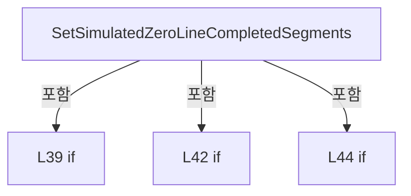

변경 전 점검: 입력/반환 타입, 위 호출자, 예외/취소 경로, 공유 상태와 저장·전송 소비자를 함께 확인합니다. 값의 단위나 물리 방향을 이름만으로 확정하지 않습니다.

### MethodDeclaration `ClearZeroLineSimulation` · L49–56

[Drilling.Common/Station/CStageReviewSequences.cs:49–56](https://github.com/kjuws10-rgb/A3Drilling/blob/5aee8e58439c9b455cae7c9593c9be986c3e682e/Drilling.Common/Station/CStageReviewSequences.cs#L49-L56)

| 항목 | 실제 추출 값 |
| --- | --- |
| 서명 | void Drilling.Common.Station.CStageReviewSequences.ClearZeroLineSimulation() |
| 접근/수식자 | Public / public |
| 반환/값 타입 | void |
| 소속 타입 | NamedType:Drilling.Common.Station.CStageReviewSequences |

정적 호출자로 확인된 위치:

| 호출 파일/행 | 호출 표현식 | 런타임 분기 가능 |
| --- | --- | --- |
| [Drilling.Common/Station/CStationProcess.cs:4243–4243](https://github.com/kjuws10-rgb/A3Drilling/blob/5aee8e58439c9b455cae7c9593c9be986c3e682e/Drilling.Common/Station/CStationProcess.cs#L4243-L4243) | _interfaceManager.StageReviewSequences.ClearZeroLineSimulation | False |

호출하는 대상과 해석 범위:

| 원본 행 | 표현식 | 분석 상태 | 대상/소스 위치 |
| --- | --- | --- | --- |
| 52 | new InvalidOperationException | resolved | System.InvalidOperationException.InvalidOperationException(string?) |
| 54 | Volatile.Write | resolved | void System.Threading.Volatile.Write<Drilling.Common.Station.ST_STAGE_IOF_PLAN?>(ref Drilling.Common.Station.ST_STAGE_IOF_PLAN?, Drilling.Common.Station.ST_STAGE_IOF_PLAN?) |
| 55 | Volatile.Write | resolved | void System.Threading.Volatile.Write(ref int, int) |

본문의 실제 연산·분기·예외·반환 순서(원문 위치 순):

| 원본 행 | 종류 | 주석 해설 |
| --- | --- | --- |
| 51 | if | 조건에 따라 분기합니다: if (IsActive) |
| 52 | call | 함수·델리게이트 또는 객체 생성자를 호출합니다: new InvalidOperationException("Stage Buffer 사용 중에는 초기화할 수 없습니다.") |
| 52 | throw | 예외를 발생/전달합니다: throw new InvalidOperationException("Stage Buffer 사용 중에는 초기화할 수 없습니다."); |
| 53 | if | 조건에 따라 분기합니다: if (LastIofPlan is { ZeroLine: true }) |
| 54 | call | 함수·델리게이트 또는 객체 생성자를 호출합니다: Volatile.Write(ref _lastPlan, null) |
| 55 | call | 함수·델리게이트 또는 객체 생성자를 호출합니다: Volatile.Write(ref _zeroSegments, 0) |

제어 구문의 포함 구조(실제 실행 순서/CFG가 아닌 구문 탐색 그림):

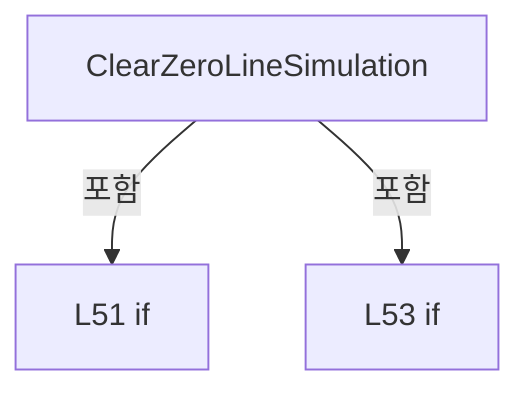

변경 전 점검: 입력/반환 타입, 위 호출자, 예외/취소 경로, 공유 상태와 저장·전송 소비자를 함께 확인합니다. 값의 단위나 물리 방향을 이름만으로 확정하지 않습니다.

### EventFieldDeclaration `Trace` · L58–58

[Drilling.Common/Station/CStageReviewSequences.cs:58–58](https://github.com/kjuws10-rgb/A3Drilling/blob/5aee8e58439c9b455cae7c9593c9be986c3e682e/Drilling.Common/Station/CStageReviewSequences.cs#L58-L58)

| 항목 | 실제 추출 값 |
| --- | --- |
| 서명 | System.Action<Drilling.Common.Station.ST_STAGE_FLOW_EVENT>? Drilling.Common.Station.CStageReviewSequences.Trace |
| 접근/수식자 | Public / public, event |
| 반환/값 타입 | System.Action<Drilling.Common.Station.ST_STAGE_FLOW_EVENT>? |
| 소속 타입 | NamedType:Drilling.Common.Station.CStageReviewSequences |

현재 부분 분석에서 직접 연결된 호출자는 없습니다. XAML/이벤트/인터페이스·델리게이트·외부 진입을 추가 확인해야 하며, 미사용으로 판정한 것이 아닙니다.

변경 전 점검: 입력/반환 타입, 위 호출자, 예외/취소 경로, 공유 상태와 저장·전송 소비자를 함께 확인합니다. 값의 단위나 물리 방향을 이름만으로 확정하지 않습니다.

### PropertyDeclaration `IsActive` · L59–59

[Drilling.Common/Station/CStageReviewSequences.cs:59–59](https://github.com/kjuws10-rgb/A3Drilling/blob/5aee8e58439c9b455cae7c9593c9be986c3e682e/Drilling.Common/Station/CStageReviewSequences.cs#L59-L59)

| 항목 | 실제 추출 값 |
| --- | --- |
| 서명 | bool Drilling.Common.Station.CStageReviewSequences.IsActive |
| 접근/수식자 | Public / public |
| 반환/값 타입 | bool |
| 소속 타입 | NamedType:Drilling.Common.Station.CStageReviewSequences |

현재 부분 분석에서 직접 연결된 호출자는 없습니다. XAML/이벤트/인터페이스·델리게이트·외부 진입을 추가 확인해야 하며, 미사용으로 판정한 것이 아닙니다.

변경 전 점검: 입력/반환 타입, 위 호출자, 예외/취소 경로, 공유 상태와 저장·전송 소비자를 함께 확인합니다. 값의 단위나 물리 방향을 이름만으로 확정하지 않습니다.

### MethodDeclaration `HasActiveMove` · L60–60

[Drilling.Common/Station/CStageReviewSequences.cs:60–60](https://github.com/kjuws10-rgb/A3Drilling/blob/5aee8e58439c9b455cae7c9593c9be986c3e682e/Drilling.Common/Station/CStageReviewSequences.cs#L60-L60)

| 항목 | 실제 추출 값 |
| --- | --- |
| 서명 | bool Drilling.Common.Station.CStageReviewSequences.HasActiveMove(int) |
| 접근/수식자 | Public / public |
| 반환/값 타입 | bool |
| 소속 타입 | NamedType:Drilling.Common.Station.CStageReviewSequences |

입력 계약:

| 이름 | 타입 | 전달 | 선택/기본값 |
| --- | --- | --- | --- |
| deviceNo | int | None | False /  |

정적 호출자로 확인된 위치:

| 호출 파일/행 | 호출 표현식 | 런타임 분기 가능 |
| --- | --- | --- |
| [Drilling.Common/Station/CStageReviewSequences.cs:71–71](https://github.com/kjuws10-rgb/A3Drilling/blob/5aee8e58439c9b455cae7c9593c9be986c3e682e/Drilling.Common/Station/CStageReviewSequences.cs#L71-L71) | HasActiveMove | False |
| [Drilling.UI/Menu/Menus/CMenuManual.cs:3283–3283](https://github.com/kjuws10-rgb/A3Drilling/blob/5aee8e58439c9b455cae7c9593c9be986c3e682e/Drilling.UI/Menu/Menus/CMenuManual.cs#L3283-L3283) | _manager.Interface().StageReviewSequences.HasActiveMove | False |

호출하는 대상과 해석 범위:

| 원본 행 | 표현식 | 분석 상태 | 대상/소스 위치 |
| --- | --- | --- | --- |
| 60 | _moveStops.ContainsKey | resolved | bool System.Collections.Concurrent.ConcurrentDictionary<int, System.Threading.CancellationTokenSource>.ContainsKey(int) |

본문의 실제 연산·분기·예외·반환 순서(원문 위치 순):

| 원본 행 | 종류 | 주석 해설 |
| --- | --- | --- |
| 60 | call | 함수·델리게이트 또는 객체 생성자를 호출합니다: _moveStops.ContainsKey(deviceNo) |

변경 전 점검: 입력/반환 타입, 위 호출자, 예외/취소 경로, 공유 상태와 저장·전송 소비자를 함께 확인합니다. 값의 단위나 물리 방향을 이름만으로 확정하지 않습니다.

### PropertyDeclaration `HasRunningSession` · L61–61

[Drilling.Common/Station/CStageReviewSequences.cs:61–61](https://github.com/kjuws10-rgb/A3Drilling/blob/5aee8e58439c9b455cae7c9593c9be986c3e682e/Drilling.Common/Station/CStageReviewSequences.cs#L61-L61)

| 항목 | 실제 추출 값 |
| --- | --- |
| 서명 | bool Drilling.Common.Station.CStageReviewSequences.HasRunningSession |
| 접근/수식자 | Public / public |
| 반환/값 타입 | bool |
| 소속 타입 | NamedType:Drilling.Common.Station.CStageReviewSequences |

현재 부분 분석에서 직접 연결된 호출자는 없습니다. XAML/이벤트/인터페이스·델리게이트·외부 진입을 추가 확인해야 하며, 미사용으로 판정한 것이 아닙니다.

호출하는 대상과 해석 범위:

| 원본 행 | 표현식 | 분석 상태 | 대상/소스 위치 |
| --- | --- | --- | --- |
| 61 | _owners.Keys.Any | resolved | bool System.Collections.Generic.IEnumerable<int>.Any<int>(System.Func<int, bool>) |
| 61 | _failedSessions.TryGetValue | resolved | bool System.Collections.Concurrent.ConcurrentDictionary<int, Drilling.Common.Station.CStageReviewSequences.Session>.TryGetValue(int, out Drilling.Common.Station.CStageReviewSequences.Session) |

본문의 실제 연산·분기·예외·반환 순서(원문 위치 순):

| 원본 행 | 종류 | 주석 해설 |
| --- | --- | --- |
| 61 | call | 함수·델리게이트 또는 객체 생성자를 호출합니다: _owners.Keys.Any(device => !_failedSessions.TryGetValue(device, out var session) &#124;&#124; !session.IsDisposed) |
| 61 | call | 함수·델리게이트 또는 객체 생성자를 호출합니다: _failedSessions.TryGetValue(device, out var session) |

변경 전 점검: 입력/반환 타입, 위 호출자, 예외/취소 경로, 공유 상태와 저장·전송 소비자를 함께 확인합니다. 값의 단위나 물리 방향을 이름만으로 확정하지 않습니다.

### MethodDeclaration `RecoverIdleCleanup` · L64–94

[Drilling.Common/Station/CStageReviewSequences.cs:64–94](https://github.com/kjuws10-rgb/A3Drilling/blob/5aee8e58439c9b455cae7c9593c9be986c3e682e/Drilling.Common/Station/CStageReviewSequences.cs#L64-L94)

| 항목 | 실제 추출 값 |
| --- | --- |
| 서명 | System.Threading.Tasks.Task Drilling.Common.Station.CStageReviewSequences.RecoverIdleCleanup(System.Threading.CancellationToken) |
| 접근/수식자 | Public / public, async |
| 반환/값 타입 | System.Threading.Tasks.Task |
| 소속 타입 | NamedType:Drilling.Common.Station.CStageReviewSequences |

원본 XML 주석:

````xml
/// <summary>Retry failed cleanup only after its original worker has disposed its session.</summary>
````

입력 계약:

| 이름 | 타입 | 전달 | 선택/기본값 |
| --- | --- | --- | --- |
| token | System.Threading.CancellationToken | None | True / null |

정적 호출자로 확인된 위치:

| 호출 파일/행 | 호출 표현식 | 런타임 분기 가능 |
| --- | --- | --- |
| [Drilling.UI/CRootView.cs:2694–2694](https://github.com/kjuws10-rgb/A3Drilling/blob/5aee8e58439c9b455cae7c9593c9be986c3e682e/Drilling.UI/CRootView.cs#L2694-L2694) | _interfaceManager.StageReviewSequences.RecoverIdleCleanup | False |

호출하는 대상과 해석 범위:

| 원본 행 | 표현식 | 분석 상태 | 대상/소스 위치 |
| --- | --- | --- | --- |
| 66 | _recovery.WaitAsync(token).ConfigureAwait | resolved | System.Runtime.CompilerServices.ConfiguredTaskAwaitable System.Threading.Tasks.Task.ConfigureAwait(bool) |
| 66 | _recovery.WaitAsync | resolved | System.Threading.Tasks.Task System.Threading.SemaphoreSlim.WaitAsync(System.Threading.CancellationToken) |
| 69 | _failedSessions.ToArray | resolved | System.Collections.Generic.KeyValuePair<int, Drilling.Common.Station.CStageReviewSequences.Session>[] System.Collections.Concurrent.ConcurrentDictionary<int, Drilling.Common.Station.CStageReviewSequences.Session>.ToArray() |
| 71 | HasActiveMove | resolved | bool Drilling.Common.Station.CStageReviewSequences.HasActiveMove(int) · Drilling.Common/Station/CStageReviewSequences.cs:60 |
| 72 | new InvalidOperationException | resolved | System.InvalidOperationException.InvalidOperationException(string?) |
| 73 | new Session | resolved | Drilling.Common.Station.CStageReviewSequences.Session.Session(Drilling.Common.Station.CStageReviewSequences, Drilling.Common.Interface.CInterfaceManager, int, System.Func<bool>, bool, bool, bool) · Drilling.Common/Station/CStageReviewSequences.cs:241 |
| 74 | session.RecoverStoppedOutputs(token).ConfigureAwait | resolved | System.Runtime.CompilerServices.ConfiguredTaskAwaitable System.Threading.Tasks.Task.ConfigureAwait(bool) |
| 74 | session.RecoverStoppedOutputs | resolved | System.Threading.Tasks.Task Drilling.Common.Station.CStageReviewSequences.Session.RecoverStoppedOutputs(System.Threading.CancellationToken) · Drilling.Common/Station/CStageReviewSequences.cs:721 |
| 75 | session.Dispose | resolved | void Drilling.Common.Station.CStageReviewSequences.Session.Dispose() · Drilling.Common/Station/CStageReviewSequences.cs:500 |
| 76 | _failedSessions.TryRemove | resolved | bool System.Collections.Concurrent.ConcurrentDictionary<int, Drilling.Common.Station.CStageReviewSequences.Session>.TryRemove(int, out Drilling.Common.Station.CStageReviewSequences.Session) |
| 77 | _cleanupFailures.TryRemove | resolved | bool System.Collections.Concurrent.ConcurrentDictionary<int, byte>.TryRemove(int, out byte) |
| 78 | _owners.TryRemove | resolved | bool System.Collections.Concurrent.ConcurrentDictionary<int, byte>.TryRemove(int, out byte) |
| 81 | interfaces.Melsec.Map.Where(row => row.Use && row.Id == MoveStop).Select(row => row.DeviceNo).Distinct | resolved | System.Collections.Generic.IEnumerable<int> System.Collections.Generic.IEnumerable<int>.Distinct<int>() |
| 81 | interfaces.Melsec.Map.Where(row => row.Use && row.Id == MoveStop).Select | resolved | System.Collections.Generic.IEnumerable<int> System.Collections.Generic.IEnumerable<Drilling.Common.Interface.ST_MELSEC_MAP_DATA>.Select<Drilling.Common.Interface.ST_MELSEC_MAP_DATA, int>(System.Func<Drilling.Common.Interface.ST_MELSEC_MAP_DATA, int>) |
| 81 | interfaces.Melsec.Map.Where | resolved | System.Collections.Generic.IEnumerable<Drilling.Common.Interface.ST_MELSEC_MAP_DATA> System.Collections.Generic.IEnumerable<Drilling.Common.Interface.ST_MELSEC_MAP_DATA>.Where<Drilling.Common.Interface.ST_MELSEC_MAP_DATA>(System.Func<Drilling.Common.Interface.ST_MELSEC_MAP_DATA, bool>) |
| 83 | Open | resolved | Drilling.Common.Station.CStageReviewSequences.Session Drilling.Common.Station.CStageReviewSequences.Open(int, System.Func<bool>?, bool, bool) · Drilling.Common/Station/CStageReviewSequences.cs:177 |
| 84 | session.RecoverRetainedStop(token).ConfigureAwait | resolved | System.Runtime.CompilerServices.ConfiguredTaskAwaitable System.Threading.Tasks.Task.ConfigureAwait(bool) |
| 84 | session.RecoverRetainedStop | resolved | System.Threading.Tasks.Task Drilling.Common.Station.CStageReviewSequences.Session.RecoverRetainedStop(System.Threading.CancellationToken) · Drilling.Common/Station/CStageReviewSequences.cs:734 |
| 93 | _recovery.Release | resolved | int System.Threading.SemaphoreSlim.Release() |

본문의 실제 연산·분기·예외·반환 순서(원문 위치 순):

| 원본 행 | 종류 | 주석 해설 |
| --- | --- | --- |
| 66 | await | 비동기 완료를 기다립니다: await _recovery.WaitAsync(token).ConfigureAwait(false) |
| 66 | call | 함수·델리게이트 또는 객체 생성자를 호출합니다: _recovery.WaitAsync(token).ConfigureAwait(false) |
| 66 | call | 함수·델리게이트 또는 객체 생성자를 호출합니다: _recovery.WaitAsync(token) |
| 67 | try | 예외 처리 범위입니다: try |
| 69 | call | 함수·델리게이트 또는 객체 생성자를 호출합니다: _failedSessions.ToArray() |
| 69 | foreach | 컬렉션 요소를 순회합니다: foreach (var (device, failed) in _failedSessions.ToArray()) { if (!failed.IsDisposed &#124;&#124; HasActiveMove(device)) throw new InvalidOperationException("Stage 정리 작업이 아직 실행 중입니다."); var session = new Session(this, interfaces, device, () |
| 71 | call | 함수·델리게이트 또는 객체 생성자를 호출합니다: HasActiveMove(device) |
| 71 | if | 조건에 따라 분기합니다: if (!failed.IsDisposed &#124;&#124; HasActiveMove(device)) |
| 72 | call | 함수·델리게이트 또는 객체 생성자를 호출합니다: new InvalidOperationException("Stage 정리 작업이 아직 실행 중입니다.") |
| 72 | throw | 예외를 발생/전달합니다: throw new InvalidOperationException("Stage 정리 작업이 아직 실행 중입니다."); |
| 73 | call | 함수·델리게이트 또는 객체 생성자를 호출합니다: new Session(this, interfaces, device, () => false, AutomaticSimulationReplies, false, false) |
| 73 | local-declaration | 지역 변수를 선언합니다: var session = new Session(this, interfaces, device, () => false, AutomaticSimulationReplies, false, false); |
| 73 | variable-initializer | 변수의 초기값을 지정합니다: session = new Session(this, interfaces, device, () => false, AutomaticSimulationReplies, false, false) |
| 74 | await | 비동기 완료를 기다립니다: await session.RecoverStoppedOutputs(token).ConfigureAwait(false) |
| 74 | call | 함수·델리게이트 또는 객체 생성자를 호출합니다: session.RecoverStoppedOutputs(token).ConfigureAwait(false) |
| 74 | call | 함수·델리게이트 또는 객체 생성자를 호출합니다: session.RecoverStoppedOutputs(token) |
| 74 | try | 예외 처리 범위입니다: try |
| 75 | call | 함수·델리게이트 또는 객체 생성자를 호출합니다: session.Dispose() |
| 75 | finally | 종료 정리 구간입니다: finally |
| 76 | call | 함수·델리게이트 또는 객체 생성자를 호출합니다: _failedSessions.TryRemove(device, out _) |
| 77 | call | 함수·델리게이트 또는 객체 생성자를 호출합니다: _cleanupFailures.TryRemove(device, out _) |
| 78 | call | 함수·델리게이트 또는 객체 생성자를 호출합니다: _owners.TryRemove(device, out _) |
| 81 | call | 함수·델리게이트 또는 객체 생성자를 호출합니다: interfaces.Melsec.Map.Where(row => row.Use && row.Id == MoveStop).Select(row => row.DeviceNo).Distinct() |
| 81 | call | 함수·델리게이트 또는 객체 생성자를 호출합니다: interfaces.Melsec.Map.Where(row => row.Use && row.Id == MoveStop).Select(row => row.DeviceNo) |
| 81 | call | 함수·델리게이트 또는 객체 생성자를 호출합니다: interfaces.Melsec.Map.Where(row => row.Use && row.Id == MoveStop) |
| 81 | foreach | 컬렉션 요소를 순회합니다: foreach (var device in interfaces.Melsec.Map.Where(row => row.Use && row.Id == MoveStop).Select(row => row.DeviceNo).Distinct()) |
| 83 | call | 함수·델리게이트 또는 객체 생성자를 호출합니다: Open(device) |
| 83 | using-declaration | 정리할 자원을 선언합니다: using var session = Open(device); |
| 83 | variable-initializer | 변수의 초기값을 지정합니다: session = Open(device) |
| 84 | await | 비동기 완료를 기다립니다: await session.RecoverRetainedStop(token).ConfigureAwait(false) |
| 84 | call | 함수·델리게이트 또는 객체 생성자를 호출합니다: session.RecoverRetainedStop(token).ConfigureAwait(false) |
| 84 | call | 함수·델리게이트 또는 객체 생성자를 호출합니다: session.RecoverRetainedStop(token) |
| 84 | try | 예외 처리 범위입니다: try |
| 85 | catch | 지정 예외를 처리합니다: catch  |
| 87 | assignment | 값을 대상에 대입합니다: _cleanupFailures[device] = 0 |
| 88 | assignment | 값을 대상에 대입합니다: _failedSessions[device] = session |
| 89 | throw | 예외를 발생/전달합니다: throw; |
| 93 | call | 함수·델리게이트 또는 객체 생성자를 호출합니다: _recovery.Release() |
| 93 | finally | 종료 정리 구간입니다: finally |

제어 구문의 포함 구조(실제 실행 순서/CFG가 아닌 구문 탐색 그림):

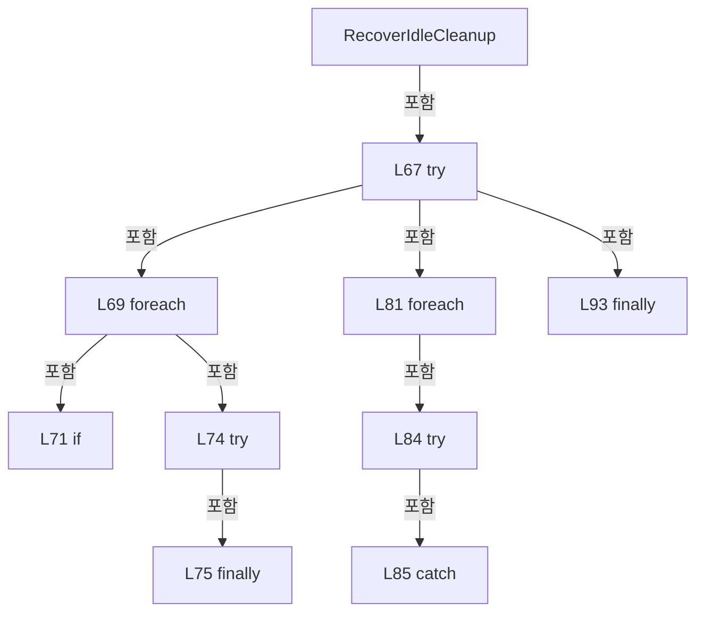

변경 전 점검: 입력/반환 타입, 위 호출자, 예외/취소 경로, 공유 상태와 저장·전송 소비자를 함께 확인합니다. 값의 단위나 물리 방향을 이름만으로 확정하지 않습니다.

### MethodDeclaration `RequestMoveStop` · L97–102

[Drilling.Common/Station/CStageReviewSequences.cs:97–102](https://github.com/kjuws10-rgb/A3Drilling/blob/5aee8e58439c9b455cae7c9593c9be986c3e682e/Drilling.Common/Station/CStageReviewSequences.cs#L97-L102)

| 항목 | 실제 추출 값 |
| --- | --- |
| 서명 | void Drilling.Common.Station.CStageReviewSequences.RequestMoveStop(int) |
| 접근/수식자 | Public / public |
| 반환/값 타입 | void |
| 소속 타입 | NamedType:Drilling.Common.Station.CStageReviewSequences |

원본 XML 주석:

````xml
/// <summary>Operator Stage STOP cancels the owned move and its normal STOP/IO cleanup.</summary>
````

입력 계약:

| 이름 | 타입 | 전달 | 선택/기본값 |
| --- | --- | --- | --- |
| deviceNo | int | None | False /  |

정적 호출자로 확인된 위치:

| 호출 파일/행 | 호출 표현식 | 런타임 분기 가능 |
| --- | --- | --- |
| [Drilling.UI/Menu/Menus/CMenuManual.cs:3282–3282](https://github.com/kjuws10-rgb/A3Drilling/blob/5aee8e58439c9b455cae7c9593c9be986c3e682e/Drilling.UI/Menu/Menus/CMenuManual.cs#L3282-L3282) | _manager.Interface().StageReviewSequences.RequestMoveStop | False |

호출하는 대상과 해석 범위:

| 원본 행 | 표현식 | 분석 상태 | 대상/소스 위치 |
| --- | --- | --- | --- |
| 99 | _moveStops.TryGetValue | resolved | bool System.Collections.Concurrent.ConcurrentDictionary<int, System.Threading.CancellationTokenSource>.TryGetValue(int, out System.Threading.CancellationTokenSource) |
| 100 | stop.Cancel | resolved | void System.Threading.CancellationTokenSource.Cancel() |

본문의 실제 연산·분기·예외·반환 순서(원문 위치 순):

| 원본 행 | 종류 | 주석 해설 |
| --- | --- | --- |
| 99 | call | 함수·델리게이트 또는 객체 생성자를 호출합니다: _moveStops.TryGetValue(deviceNo, out var stop) |
| 99 | if | 조건에 따라 분기합니다: if (_moveStops.TryGetValue(deviceNo, out var stop)) |
| 100 | call | 함수·델리게이트 또는 객체 생성자를 호출합니다: stop.Cancel() |
| 100 | try | 예외 처리 범위입니다: try |
| 101 | catch | 지정 예외를 처리합니다: catch (ObjectDisposedException) |

제어 구문의 포함 구조(실제 실행 순서/CFG가 아닌 구문 탐색 그림):

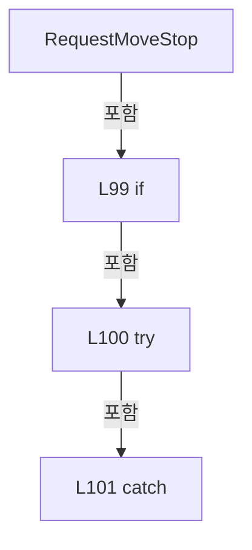

변경 전 점검: 입력/반환 타입, 위 호출자, 예외/취소 경로, 공유 상태와 저장·전송 소비자를 함께 확인합니다. 값의 단위나 물리 방향을 이름만으로 확정하지 않습니다.

### PropertyDeclaration `AutomaticSimulationReplies` · L104–113

[Drilling.Common/Station/CStageReviewSequences.cs:104–113](https://github.com/kjuws10-rgb/A3Drilling/blob/5aee8e58439c9b455cae7c9593c9be986c3e682e/Drilling.Common/Station/CStageReviewSequences.cs#L104-L113)

| 항목 | 실제 추출 값 |
| --- | --- |
| 서명 | bool Drilling.Common.Station.CStageReviewSequences.AutomaticSimulationReplies |
| 접근/수식자 | Public / public |
| 반환/값 타입 | bool |
| 소속 타입 | NamedType:Drilling.Common.Station.CStageReviewSequences |

현재 부분 분석에서 직접 연결된 호출자는 없습니다. XAML/이벤트/인터페이스·델리게이트·외부 진입을 추가 확인해야 하며, 미사용으로 판정한 것이 아닙니다.

변경 전 점검: 입력/반환 타입, 위 호출자, 예외/취소 경로, 공유 상태와 저장·전송 소비자를 함께 확인합니다. 값의 단위나 물리 방향을 이름만으로 확정하지 않습니다.

### GetAccessorDeclaration `get_AutomaticSimulationReplies` · L106–106

[Drilling.Common/Station/CStageReviewSequences.cs:106–106](https://github.com/kjuws10-rgb/A3Drilling/blob/5aee8e58439c9b455cae7c9593c9be986c3e682e/Drilling.Common/Station/CStageReviewSequences.cs#L106-L106)

| 항목 | 실제 추출 값 |
| --- | --- |
| 서명 | bool Drilling.Common.Station.CStageReviewSequences.AutomaticSimulationReplies.get |
| 접근/수식자 | Public / get |
| 반환/값 타입 | bool |
| 소속 타입 | NamedType:Drilling.Common.Station.CStageReviewSequences |

현재 부분 분석에서 직접 연결된 호출자는 없습니다. XAML/이벤트/인터페이스·델리게이트·외부 진입을 추가 확인해야 하며, 미사용으로 판정한 것이 아닙니다.

호출하는 대상과 해석 범위:

| 원본 행 | 표현식 | 분석 상태 | 대상/소스 위치 |
| --- | --- | --- | --- |
| 106 | Volatile.Read | resolved | int System.Threading.Volatile.Read(ref readonly int) |

본문의 실제 연산·분기·예외·반환 순서(원문 위치 순):

| 원본 행 | 종류 | 주석 해설 |
| --- | --- | --- |
| 106 | call | 함수·델리게이트 또는 객체 생성자를 호출합니다: Volatile.Read(ref _automaticReplies) |

변경 전 점검: 입력/반환 타입, 위 호출자, 예외/취소 경로, 공유 상태와 저장·전송 소비자를 함께 확인합니다. 값의 단위나 물리 방향을 이름만으로 확정하지 않습니다.

### SetAccessorDeclaration `set_AutomaticSimulationReplies` · L107–112

[Drilling.Common/Station/CStageReviewSequences.cs:107–112](https://github.com/kjuws10-rgb/A3Drilling/blob/5aee8e58439c9b455cae7c9593c9be986c3e682e/Drilling.Common/Station/CStageReviewSequences.cs#L107-L112)

| 항목 | 실제 추출 값 |
| --- | --- |
| 서명 | void Drilling.Common.Station.CStageReviewSequences.AutomaticSimulationReplies.set |
| 접근/수식자 | Public / set |
| 반환/값 타입 | void |
| 소속 타입 | NamedType:Drilling.Common.Station.CStageReviewSequences |

입력 계약:

| 이름 | 타입 | 전달 | 선택/기본값 |
| --- | --- | --- | --- |
| value | bool | None | False /  |

현재 부분 분석에서 직접 연결된 호출자는 없습니다. XAML/이벤트/인터페이스·델리게이트·외부 진입을 추가 확인해야 하며, 미사용으로 판정한 것이 아닙니다.

호출하는 대상과 해석 범위:

| 원본 행 | 표현식 | 분석 상태 | 대상/소스 위치 |
| --- | --- | --- | --- |
| 110 | new InvalidOperationException | resolved | System.InvalidOperationException.InvalidOperationException(string?) |
| 111 | Volatile.Write | resolved | void System.Threading.Volatile.Write(ref int, int) |

본문의 실제 연산·분기·예외·반환 순서(원문 위치 순):

| 원본 행 | 종류 | 주석 해설 |
| --- | --- | --- |
| 109 | if | 조건에 따라 분기합니다: if (IsActive) |
| 110 | call | 함수·델리게이트 또는 객체 생성자를 호출합니다: new InvalidOperationException("Process Move / IOF 동작을 정지한 뒤 자동 응답을 변경해 주세요.") |
| 110 | throw | 예외를 발생/전달합니다: throw new InvalidOperationException("Process Move / IOF 동작을 정지한 뒤 자동 응답을 변경해 주세요."); |
| 111 | call | 함수·델리게이트 또는 객체 생성자를 호출합니다: Volatile.Write(ref _automaticReplies, value ? 1 : 0) |
| 111 | conditional-expression | 조건에 따라 결과식을 선택합니다: value ? 1 : 0 |

제어 구문의 포함 구조(실제 실행 순서/CFG가 아닌 구문 탐색 그림):

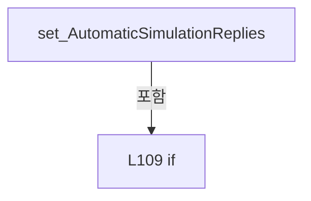

변경 전 점검: 입력/반환 타입, 위 호출자, 예외/취소 경로, 공유 상태와 저장·전송 소비자를 함께 확인합니다. 값의 단위나 물리 방향을 이름만으로 확정하지 않습니다.

### PropertyDeclaration `LastIofPlan` · L115–115

[Drilling.Common/Station/CStageReviewSequences.cs:115–115](https://github.com/kjuws10-rgb/A3Drilling/blob/5aee8e58439c9b455cae7c9593c9be986c3e682e/Drilling.Common/Station/CStageReviewSequences.cs#L115-L115)

| 항목 | 실제 추출 값 |
| --- | --- |
| 서명 | Drilling.Common.Station.ST_STAGE_IOF_PLAN? Drilling.Common.Station.CStageReviewSequences.LastIofPlan |
| 접근/수식자 | Public / public |
| 반환/값 타입 | Drilling.Common.Station.ST_STAGE_IOF_PLAN? |
| 소속 타입 | NamedType:Drilling.Common.Station.CStageReviewSequences |

현재 부분 분석에서 직접 연결된 호출자는 없습니다. XAML/이벤트/인터페이스·델리게이트·외부 진입을 추가 확인해야 하며, 미사용으로 판정한 것이 아닙니다.

호출하는 대상과 해석 범위:

| 원본 행 | 표현식 | 분석 상태 | 대상/소스 위치 |
| --- | --- | --- | --- |
| 115 | Volatile.Read | resolved | Drilling.Common.Station.ST_STAGE_IOF_PLAN? System.Threading.Volatile.Read<Drilling.Common.Station.ST_STAGE_IOF_PLAN?>(ref readonly Drilling.Common.Station.ST_STAGE_IOF_PLAN?) |

본문의 실제 연산·분기·예외·반환 순서(원문 위치 순):

| 원본 행 | 종류 | 주석 해설 |
| --- | --- | --- |
| 115 | call | 함수·델리게이트 또는 객체 생성자를 호출합니다: Volatile.Read(ref _lastPlan) |

변경 전 점검: 입력/반환 타입, 위 호출자, 예외/취소 경로, 공유 상태와 저장·전송 소비자를 함께 확인합니다. 값의 단위나 물리 방향을 이름만으로 확정하지 않습니다.

### FieldDeclaration `_signalTimeout` · L117–117

[Drilling.Common/Station/CStageReviewSequences.cs:117–117](https://github.com/kjuws10-rgb/A3Drilling/blob/5aee8e58439c9b455cae7c9593c9be986c3e682e/Drilling.Common/Station/CStageReviewSequences.cs#L117-L117)

| 항목 | 실제 추출 값 |
| --- | --- |
| 서명 | System.TimeSpan Drilling.Common.Station.CStageReviewSequences._signalTimeout |
| 접근/수식자 | Private / private, readonly |
| 반환/값 타입 | System.TimeSpan |
| 소속 타입 | NamedType:Drilling.Common.Station.CStageReviewSequences |

현재 부분 분석에서 직접 연결된 호출자는 없습니다. XAML/이벤트/인터페이스·델리게이트·외부 진입을 추가 확인해야 하며, 미사용으로 판정한 것이 아닙니다.

호출하는 대상과 해석 범위:

| 원본 행 | 표현식 | 분석 상태 | 대상/소스 위치 |
| --- | --- | --- | --- |
| 117 | TimeSpan.FromSeconds | resolved | System.TimeSpan System.TimeSpan.FromSeconds(long) |

본문의 실제 연산·분기·예외·반환 순서(원문 위치 순):

| 원본 행 | 종류 | 주석 해설 |
| --- | --- | --- |
| 117 | call | 함수·델리게이트 또는 객체 생성자를 호출합니다: TimeSpan.FromSeconds(30) |
| 117 | variable-initializer | 변수의 초기값을 지정합니다: _signalTimeout = signalTimeout ?? TimeSpan.FromSeconds(30) |

변경 전 점검: 입력/반환 타입, 위 호출자, 예외/취소 경로, 공유 상태와 저장·전송 소비자를 함께 확인합니다. 값의 단위나 물리 방향을 이름만으로 확정하지 않습니다.

### MethodDeclaration `ValidateMoveReadiness` · L118–141

[Drilling.Common/Station/CStageReviewSequences.cs:118–141](https://github.com/kjuws10-rgb/A3Drilling/blob/5aee8e58439c9b455cae7c9593c9be986c3e682e/Drilling.Common/Station/CStageReviewSequences.cs#L118-L141)

| 항목 | 실제 추출 값 |
| --- | --- |
| 서명 | void Drilling.Common.Station.CStageReviewSequences.ValidateMoveReadiness(int) |
| 접근/수식자 | Public / public |
| 반환/값 타입 | void |
| 소속 타입 | NamedType:Drilling.Common.Station.CStageReviewSequences |

입력 계약:

| 이름 | 타입 | 전달 | 선택/기본값 |
| --- | --- | --- | --- |
| deviceNo | int | None | False /  |

정적 호출자로 확인된 위치:

| 호출 파일/행 | 호출 표현식 | 런타임 분기 가능 |
| --- | --- | --- |
| [Drilling.Common/Review/CReviewManager.cs:2376–2376](https://github.com/kjuws10-rgb/A3Drilling/blob/5aee8e58439c9b455cae7c9593c9be986c3e682e/Drilling.Common/Review/CReviewManager.cs#L2376-L2376) | interfaceManager.StageReviewSequences.ValidateMoveReadiness | False |
| [Drilling.Common/Review/CReviewManager.cs:2484–2484](https://github.com/kjuws10-rgb/A3Drilling/blob/5aee8e58439c9b455cae7c9593c9be986c3e682e/Drilling.Common/Review/CReviewManager.cs#L2484-L2484) | interfaceManager.StageReviewSequences.ValidateMoveReadiness | False |
| [Drilling.Common/Review/CReviewManager.cs:2969–2969](https://github.com/kjuws10-rgb/A3Drilling/blob/5aee8e58439c9b455cae7c9593c9be986c3e682e/Drilling.Common/Review/CReviewManager.cs#L2969-L2969) | interfaceManager.StageReviewSequences.ValidateMoveReadiness | False |
| [Drilling.Common/Station/CStageReviewSequences.cs:172–172](https://github.com/kjuws10-rgb/A3Drilling/blob/5aee8e58439c9b455cae7c9593c9be986c3e682e/Drilling.Common/Station/CStageReviewSequences.cs#L172-L172) | ValidateMoveReadiness | False |
| [Drilling.Common/Station/CStationProcess.cs:3681–3681](https://github.com/kjuws10-rgb/A3Drilling/blob/5aee8e58439c9b455cae7c9593c9be986c3e682e/Drilling.Common/Station/CStationProcess.cs#L3681-L3681) | _interfaceManager.StageReviewSequences.ValidateMoveReadiness | False |
| [Drilling.Common/Station/CStationProcess.cs:6269–6269](https://github.com/kjuws10-rgb/A3Drilling/blob/5aee8e58439c9b455cae7c9593c9be986c3e682e/Drilling.Common/Station/CStationProcess.cs#L6269-L6269) | interfaces.StageReviewSequences.ValidateMoveReadiness | False |
| [Drilling.UI/Menu/Menus/CMenuCorrection.cs:3464–3464](https://github.com/kjuws10-rgb/A3Drilling/blob/5aee8e58439c9b455cae7c9593c9be986c3e682e/Drilling.UI/Menu/Menus/CMenuCorrection.cs#L3464-L3464) | manager.Interface().StageReviewSequences.ValidateMoveReadiness | False |

호출하는 대상과 해석 범위:

| 원본 행 | 표현식 | 분석 상태 | 대상/소스 위치 |
| --- | --- | --- | --- |
| 120 | interfaces.GetInterfaceCommunicationList(EN_EQP_MODULE.Melsec).SingleOrDefault | resolved | Drilling.Common.Interface.ST_INTERFACE_COMM_STATUS? System.Collections.Generic.IEnumerable<Drilling.Common.Interface.ST_INTERFACE_COMM_STATUS>.SingleOrDefault<Drilling.Common.Interface.ST_INTERFACE_COMM_STATUS>(System.Func<Drilling.Common.Interface.ST_INTERFACE_COMM_STATUS, bool>) |
| 120 | interfaces.GetInterfaceCommunicationList | resolved | System.Collections.Generic.IReadOnlyList<Drilling.Common.Interface.ST_INTERFACE_COMM_STATUS> Drilling.Common.Interface.CInterfaceManager.GetInterfaceCommunicationList(Drilling.Common.Interface.EN_EQP_MODULE?) · Drilling.Common/Interface/CInterfaceManager.cs:472 |
| 124 | new InvalidOperationException | resolved | System.InvalidOperationException.InvalidOperationException(string?) |
| 128 | inputs.Concat | resolved | System.Collections.Generic.IEnumerable<string> System.Collections.Generic.IEnumerable<string>.Concat<string>(System.Collections.Generic.IEnumerable<string>) |
| 130 | inputs.Contains | resolved | bool System.ReadOnlySpan<string>.Contains<string>(string) |
| 131 | map.SingleOrDefault | resolved | Drilling.Common.Interface.ST_MELSEC_MAP_DATA? System.Collections.Generic.IEnumerable<Drilling.Common.Interface.ST_MELSEC_MAP_DATA>.SingleOrDefault<Drilling.Common.Interface.ST_MELSEC_MAP_DATA>(System.Func<Drilling.Common.Interface.ST_MELSEC_MAP_DATA, bool>) |
| 131 | item.Id.Equals | resolved | bool string.Equals(string?, System.StringComparison) |
| 132 | id.Contains | resolved | bool string.Contains(string, System.StringComparison) |
| 132 | id.Contains | resolved | bool string.Contains(string, System.StringComparison) |
| 132 | id.Contains | resolved | bool string.Contains(string, System.StringComparison) |
| 133 | string.IsNullOrWhiteSpace | resolved | bool string.IsNullOrWhiteSpace(string?) |
| 133 | row.Address.Equals | resolved | bool string.Equals(string?, System.StringComparison) |
| 137 | new InvalidOperationException | resolved | System.InvalidOperationException.InvalidOperationException(string?) |

본문의 실제 연산·분기·예외·반환 순서(원문 위치 순):

| 원본 행 | 종류 | 주석 해설 |
| --- | --- | --- |
| 120 | call | 함수·델리게이트 또는 객체 생성자를 호출합니다: interfaces.GetInterfaceCommunicationList(EN_EQP_MODULE.Melsec).SingleOrDefault(item => item.Number == deviceNo) |
| 120 | call | 함수·델리게이트 또는 객체 생성자를 호출합니다: interfaces.GetInterfaceCommunicationList(EN_EQP_MODULE.Melsec) |
| 120 | local-declaration | 지역 변수를 선언합니다: var device = interfaces.GetInterfaceCommunicationList(EN_EQP_MODULE.Melsec).SingleOrDefault(item => item.Number == deviceNo); |
| 120 | variable-initializer | 변수의 초기값을 지정합니다: device = interfaces.GetInterfaceCommunicationList(EN_EQP_MODULE.Melsec).SingleOrDefault(item => item.Number == deviceNo) |
| 121 | if | 조건에 따라 분기합니다: if (device?.IsSimulation == true) |
| 122 | return | 호출자에게 값 또는 제어를 반환합니다: return; |
| 123 | if | 조건에 따라 분기합니다: if (device?.ConnectionState != EN_COMM_STATE.Online) |
| 124 | call | 함수·델리게이트 또는 객체 생성자를 호출합니다: new InvalidOperationException($"MELSEC_{deviceNo}가 연결되어 있지 않습니다.") |
| 124 | throw | 예외를 발생/전달합니다: throw new InvalidOperationException($"MELSEC_{deviceNo}가 연결되어 있지 않습니다."); |
| 125 | local-declaration | 지역 변수를 선언합니다: var map = interfaces.Melsec.Map; |
| 125 | variable-initializer | 변수의 초기값을 지정합니다: map = interfaces.Melsec.Map |
| 126 | local-declaration | 지역 변수를 선언합니다: var inputs = new[] { MoveAble, MoveComplete, "MOTOR_STAGE_Y_BUSY", "MOTOR_CAMERA_X_BUSY", "MOTOR_STAGE_Y_CUR_POS", "MOTOR_CAMERA_X_CUR_POS" }; |
| 126 | variable-initializer | 변수의 초기값을 지정합니다: inputs = new[] { MoveAble, MoveComplete, "MOTOR_STAGE_Y_BUSY", "MOTOR_CAMERA_X_BUSY", "MOTOR_STAGE_Y_CUR_POS", "MOTOR_CAMERA_X_CUR_POS" } |
| 127 | local-declaration | 지역 변수를 선언합니다: var outputs = new[] { MoveStart, MoveAck, "PROCESS_REVIEW_STOP_SIGNAL", "PROCESS_REVIEW_CONTROL_MODE", "PROCESS_REVIEW_COMMAND_POSITION_X", "PROCESS_REVIEW_COMMAND_POSITION_Y", "PROCESS_REVIEW_COMMAND_SPEED_X", "PROCESS_REVIEW_COM |
| 127 | variable-initializer | 변수의 초기값을 지정합니다: outputs = new[] { MoveStart, MoveAck, "PROCESS_REVIEW_STOP_SIGNAL", "PROCESS_REVIEW_CONTROL_MODE", "PROCESS_REVIEW_COMMAND_POSITION_X", "PROCESS_REVIEW_COMMAND_POSITION_Y", "PROCESS_REVIEW_COMMAND_SPEED_X", "PROCESS_REVIEW_COMMAND |
| 128 | call | 함수·델리게이트 또는 객체 생성자를 호출합니다: inputs.Concat(outputs) |
| 128 | foreach | 컬렉션 요소를 순회합니다: foreach (var id in inputs.Concat(outputs)) |
| 130 | call | 함수·델리게이트 또는 객체 생성자를 호출합니다: inputs.Contains(id) |
| 130 | local-declaration | 지역 변수를 선언합니다: var input = inputs.Contains(id); |
| 130 | variable-initializer | 변수의 초기값을 지정합니다: input = inputs.Contains(id) |
| 131 | call | 함수·델리게이트 또는 객체 생성자를 호출합니다: map.SingleOrDefault(item => item.Use && item.Id.Equals(id, StringComparison.OrdinalIgnoreCase)) |
| 131 | call | 함수·델리게이트 또는 객체 생성자를 호출합니다: item.Id.Equals(id, StringComparison.OrdinalIgnoreCase) |
| 131 | local-declaration | 지역 변수를 선언합니다: var row = map.SingleOrDefault(item => item.Use && item.Id.Equals(id, StringComparison.OrdinalIgnoreCase)); |
| 131 | variable-initializer | 변수의 초기값을 지정합니다: row = map.SingleOrDefault(item => item.Use && item.Id.Equals(id, StringComparison.OrdinalIgnoreCase)) |
| 132 | call | 함수·델리게이트 또는 객체 생성자를 호출합니다: id.Contains("_CUR_POS", StringComparison.Ordinal) |
| 132 | call | 함수·델리게이트 또는 객체 생성자를 호출합니다: id.Contains("_COMMAND_POSITION_", StringComparison.Ordinal) |
| 132 | call | 함수·델리게이트 또는 객체 생성자를 호출합니다: id.Contains("_COMMAND_SPEED_", StringComparison.Ordinal) |
| 132 | local-declaration | 지역 변수를 선언합니다: var coordinate = id.Contains("_CUR_POS", StringComparison.Ordinal) &#124;&#124; id.Contains("_COMMAND_POSITION_", StringComparison.Ordinal) &#124;&#124; id.Contains("_COMMAND_SPEED_", StringComparison.Ordinal); |
| 132 | variable-initializer | 변수의 초기값을 지정합니다: coordinate = id.Contains("_CUR_POS", StringComparison.Ordinal) &#124;&#124; id.Contains("_COMMAND_POSITION_", StringComparison.Ordinal) &#124;&#124; id.Contains("_COMMAND_SPEED_", StringComparison.Ordinal) |
| 133 | call | 함수·델리게이트 또는 객체 생성자를 호출합니다: string.IsNullOrWhiteSpace(row.Address) |
| 133 | call | 함수·델리게이트 또는 객체 생성자를 호출합니다: row.Address.Equals("UNASSIGNED", StringComparison.OrdinalIgnoreCase) |
| 133 | if | 조건에 따라 분기합니다: if (row is null &#124;&#124; row.DeviceNo != deviceNo &#124;&#124; string.IsNullOrWhiteSpace(row.Address) &#124;&#124; row.Address.Equals("UNASSIGNED", StringComparison.OrdinalIgnoreCase) &#124;&#124; row.Direction != (input ? EN_MELSEC_DIRECTION.In : EN_MELSEC_DI…) |
| 134 | conditional-expression | 조건에 따라 결과식을 선택합니다: input ? EN_MELSEC_DIRECTION.In : EN_MELSEC_DIRECTION.Out |
| 135 | conditional-expression | 조건에 따라 결과식을 선택합니다: input ? row.Access is not (EN_MELSEC_ACCESS.Read or EN_MELSEC_ACCESS.ReadWrite) : row.Access != EN_MELSEC_ACCESS.ReadWrite |
| 136 | conditional-expression | 조건에 따라 결과식을 선택합니다: coordinate ? row.DataType != EN_MELSEC_DATA_TYPE.Double : row.DataType is not (EN_MELSEC_DATA_TYPE.Word or EN_MELSEC_DATA_TYPE.DWord) |
| 137 | call | 함수·델리게이트 또는 객체 생성자를 호출합니다: new InvalidOperationException($"실제 Process Move 맵의 장치·주소·입출력·자료형을 확인해 주세요: {id}") |
| 137 | throw | 예외를 발생/전달합니다: throw new InvalidOperationException($"실제 Process Move 맵의 장치·주소·입출력·자료형을 확인해 주세요: {id}"); |

제어 구문의 포함 구조(실제 실행 순서/CFG가 아닌 구문 탐색 그림):

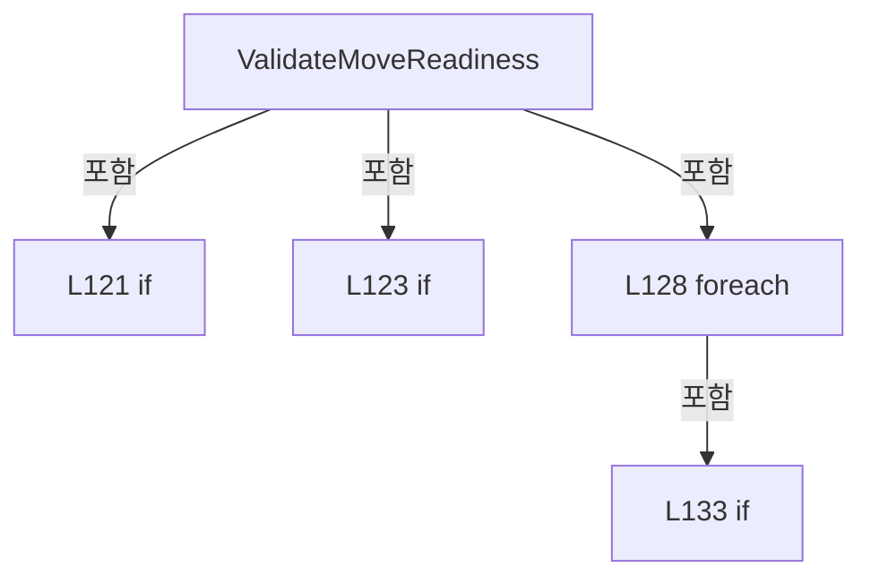

변경 전 점검: 입력/반환 타입, 위 호출자, 예외/취소 경로, 공유 상태와 저장·전송 소비자를 함께 확인합니다. 값의 단위나 물리 방향을 이름만으로 확정하지 않습니다.

### MethodDeclaration `ValidateIofReadiness` · L143–165

[Drilling.Common/Station/CStageReviewSequences.cs:143–165](https://github.com/kjuws10-rgb/A3Drilling/blob/5aee8e58439c9b455cae7c9593c9be986c3e682e/Drilling.Common/Station/CStageReviewSequences.cs#L143-L165)

| 항목 | 실제 추출 값 |
| --- | --- |
| 서명 | void Drilling.Common.Station.CStageReviewSequences.ValidateIofReadiness(int, int) |
| 접근/수식자 | Public / public |
| 반환/값 타입 | void |
| 소속 타입 | NamedType:Drilling.Common.Station.CStageReviewSequences |

입력 계약:

| 이름 | 타입 | 전달 | 선택/기본값 |
| --- | --- | --- | --- |
| deviceNo | int | None | False /  |
| pointCount | int | None | True / 0 |

정적 호출자로 확인된 위치:

| 호출 파일/행 | 호출 표현식 | 런타임 분기 가능 |
| --- | --- | --- |
| [Drilling.Common/Review/CReviewManager.cs:2360–2360](https://github.com/kjuws10-rgb/A3Drilling/blob/5aee8e58439c9b455cae7c9593c9be986c3e682e/Drilling.Common/Review/CReviewManager.cs#L2360-L2360) | interfaceManager.StageReviewSequences.ValidateIofReadiness | False |
| [Drilling.Common/Review/CReviewManager.cs:2483–2483](https://github.com/kjuws10-rgb/A3Drilling/blob/5aee8e58439c9b455cae7c9593c9be986c3e682e/Drilling.Common/Review/CReviewManager.cs#L2483-L2483) | interfaceManager.StageReviewSequences.ValidateIofReadiness | False |
| [Drilling.Common/Station/CStageReviewSequences.cs:756–756](https://github.com/kjuws10-rgb/A3Drilling/blob/5aee8e58439c9b455cae7c9593c9be986c3e682e/Drilling.Common/Station/CStageReviewSequences.cs#L756-L756) | _owner.ValidateIofReadiness | False |

호출하는 대상과 해석 범위:

| 원본 행 | 표현식 | 분석 상태 | 대상/소스 위치 |
| --- | --- | --- | --- |
| 146 | new ArgumentOutOfRangeException | resolved | System.ArgumentOutOfRangeException.ArgumentOutOfRangeException(string?, string?) |
| 146 | nameof | unresolved | None |
| 147 | interfaces.GetInterfaceCommunicationList(EN_EQP_MODULE.Melsec).SingleOrDefault | resolved | Drilling.Common.Interface.ST_INTERFACE_COMM_STATUS? System.Collections.Generic.IEnumerable<Drilling.Common.Interface.ST_INTERFACE_COMM_STATUS>.SingleOrDefault<Drilling.Common.Interface.ST_INTERFACE_COMM_STATUS>(System.Func<Drilling.Common.Interface.ST_INTERFACE_COMM_STATUS, bool>) |
| 147 | interfaces.GetInterfaceCommunicationList | resolved | System.Collections.Generic.IReadOnlyList<Drilling.Common.Interface.ST_INTERFACE_COMM_STATUS> Drilling.Common.Interface.CInterfaceManager.GetInterfaceCommunicationList(Drilling.Common.Interface.EN_EQP_MODULE?) · Drilling.Common/Interface/CInterfaceManager.cs:472 |
| 151 | new InvalidOperationException | resolved | System.InvalidOperationException.InvalidOperationException(string?) |
| 154 | interfaces.Melsec.Map.SingleOrDefault | resolved | Drilling.Common.Interface.ST_MELSEC_MAP_DATA? System.Collections.Generic.IEnumerable<Drilling.Common.Interface.ST_MELSEC_MAP_DATA>.SingleOrDefault<Drilling.Common.Interface.ST_MELSEC_MAP_DATA>(System.Func<Drilling.Common.Interface.ST_MELSEC_MAP_DATA, bool>) |
| 154 | item.Id.Equals | resolved | bool string.Equals(string?, System.StringComparison) |
| 157 | string.IsNullOrWhiteSpace | resolved | bool string.IsNullOrWhiteSpace(string?) |
| 157 | row.Address.Equals | resolved | bool string.Equals(string?, System.StringComparison) |
| 160 | interfaces.Melsec.GetDoubleArrayCapacity | resolved | int Drilling.Common.Interface.CMelsec.GetDoubleArrayCapacity(string) · Drilling.Common/Interface/Melsec/CMelsec.cs:2425 |
| 160 | Math.Max | resolved | int System.Math.Max(int, int) |
| 161 | new InvalidOperationException | resolved | System.InvalidOperationException.InvalidOperationException(string?) |

본문의 실제 연산·분기·예외·반환 순서(원문 위치 순):

| 원본 행 | 종류 | 주석 해설 |
| --- | --- | --- |
| 145 | if | 조건에 따라 분기합니다: if (pointCount < 0 &#124;&#124; pointCount > 500) |
| 146 | call | 함수·델리게이트 또는 객체 생성자를 호출합니다: new ArgumentOutOfRangeException(nameof(pointCount), "IOF 한 라인의 촬영 좌표는 최대 500개입니다.") |
| 146 | call | 함수·델리게이트 또는 객체 생성자를 호출합니다: nameof(pointCount) |
| 146 | throw | 예외를 발생/전달합니다: throw new ArgumentOutOfRangeException(nameof(pointCount), "IOF 한 라인의 촬영 좌표는 최대 500개입니다."); |
| 147 | call | 함수·델리게이트 또는 객체 생성자를 호출합니다: interfaces.GetInterfaceCommunicationList(EN_EQP_MODULE.Melsec).SingleOrDefault(item => item.Number == deviceNo) |
| 147 | call | 함수·델리게이트 또는 객체 생성자를 호출합니다: interfaces.GetInterfaceCommunicationList(EN_EQP_MODULE.Melsec) |
| 147 | local-declaration | 지역 변수를 선언합니다: var device = interfaces.GetInterfaceCommunicationList(EN_EQP_MODULE.Melsec).SingleOrDefault(item => item.Number == deviceNo); |
| 147 | variable-initializer | 변수의 초기값을 지정합니다: device = interfaces.GetInterfaceCommunicationList(EN_EQP_MODULE.Melsec).SingleOrDefault(item => item.Number == deviceNo) |
| 148 | if | 조건에 따라 분기합니다: if (device?.IsSimulation == true) |
| 149 | return | 호출자에게 값 또는 제어를 반환합니다: return; |
| 150 | if | 조건에 따라 분기합니다: if (device?.ConnectionState != EN_COMM_STATE.Online) |
| 151 | call | 함수·델리게이트 또는 객체 생성자를 호출합니다: new InvalidOperationException($"MELSEC_{deviceNo}가 연결되어 있지 않습니다.") |
| 151 | throw | 예외를 발생/전달합니다: throw new InvalidOperationException($"MELSEC_{deviceNo}가 연결되어 있지 않습니다."); |
| 152 | foreach | 컬렉션 요소를 순회합니다: foreach (var id in new[] { IofStart, IofAck, IofComplete, "IOF_SETTING", "IOF_TRIGGER_POINT_COUNT", "IOF_TRIGGER_ZERO_POINT_COUNT", "IOF_POS_ARRAY_1" }) |
| 154 | call | 함수·델리게이트 또는 객체 생성자를 호출합니다: interfaces.Melsec.Map.SingleOrDefault(item => item.Use && item.Id.Equals(id, StringComparison.OrdinalIgnoreCase)) |
| 154 | call | 함수·델리게이트 또는 객체 생성자를 호출합니다: item.Id.Equals(id, StringComparison.OrdinalIgnoreCase) |
| 154 | local-declaration | 지역 변수를 선언합니다: var row = interfaces.Melsec.Map.SingleOrDefault(item => item.Use && item.Id.Equals(id, StringComparison.OrdinalIgnoreCase)); |
| 154 | variable-initializer | 변수의 초기값을 지정합니다: row = interfaces.Melsec.Map.SingleOrDefault(item => item.Use && item.Id.Equals(id, StringComparison.OrdinalIgnoreCase)) |
| 155 | local-declaration | 지역 변수를 선언합니다: var input = id == IofComplete; |
| 155 | variable-initializer | 변수의 초기값을 지정합니다: input = id == IofComplete |
| 156 | local-declaration | 지역 변수를 선언합니다: var array = id == "IOF_POS_ARRAY_1"; |
| 156 | variable-initializer | 변수의 초기값을 지정합니다: array = id == "IOF_POS_ARRAY_1" |
| 157 | call | 함수·델리게이트 또는 객체 생성자를 호출합니다: string.IsNullOrWhiteSpace(row.Address) |
| 157 | call | 함수·델리게이트 또는 객체 생성자를 호출합니다: row.Address.Equals("UNASSIGNED", StringComparison.OrdinalIgnoreCase) |
| 157 | if | 조건에 따라 분기합니다: if (row is null &#124;&#124; row.DeviceNo != deviceNo &#124;&#124; string.IsNullOrWhiteSpace(row.Address) &#124;&#124; row.Address.Equals("UNASSIGNED", StringComparison.OrdinalIgnoreCase) &#124;&#124; row.Direction != (input ? EN_MELSEC_DIRECTION.In : EN_MELSEC_DI…) |
| 158 | conditional-expression | 조건에 따라 결과식을 선택합니다: input ? EN_MELSEC_DIRECTION.In : EN_MELSEC_DIRECTION.Out |
| 159 | conditional-expression | 조건에 따라 결과식을 선택합니다: input ? row.Access is not (EN_MELSEC_ACCESS.Read or EN_MELSEC_ACCESS.ReadWrite) : row.Access != EN_MELSEC_ACCESS.ReadWrite |
| 160 | call | 함수·델리게이트 또는 객체 생성자를 호출합니다: interfaces.Melsec.GetDoubleArrayCapacity(id) |
| 160 | call | 함수·델리게이트 또는 객체 생성자를 호출합니다: Math.Max(1, pointCount) |
| 160 | conditional-expression | 조건에 따라 결과식을 선택합니다: array ? row.DataType != EN_MELSEC_DATA_TYPE.Double &#124;&#124; interfaces.Melsec.GetDoubleArrayCapacity(id) < Math.Max(1, pointCount) : row.DataType is not (EN_MELSEC_DATA_TYPE.Word or EN_MELSEC_DATA_TYPE.DWord) |
| 161 | call | 함수·델리게이트 또는 객체 생성자를 호출합니다: new InvalidOperationException($"IOF 맵의 장치·주소·입출력·자료형·저장 크기를 확인해 주세요: {id}") |
| 161 | throw | 예외를 발생/전달합니다: throw new InvalidOperationException($"IOF 맵의 장치·주소·입출력·자료형·저장 크기를 확인해 주세요: {id}"); |

제어 구문의 포함 구조(실제 실행 순서/CFG가 아닌 구문 탐색 그림):

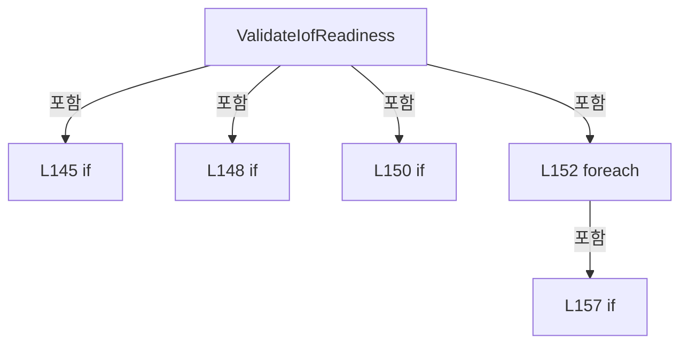

변경 전 점검: 입력/반환 타입, 위 호출자, 예외/취소 경로, 공유 상태와 저장·전송 소비자를 함께 확인합니다. 값의 단위나 물리 방향을 이름만으로 확정하지 않습니다.

### MethodDeclaration `MoveManualAxis` · L168–175

[Drilling.Common/Station/CStageReviewSequences.cs:168–175](https://github.com/kjuws10-rgb/A3Drilling/blob/5aee8e58439c9b455cae7c9593c9be986c3e682e/Drilling.Common/Station/CStageReviewSequences.cs#L168-L175)

| 항목 | 실제 추출 값 |
| --- | --- |
| 서명 | System.Threading.Tasks.Task Drilling.Common.Station.CStageReviewSequences.MoveManualAxis(int, Drilling.Common.Motion.EN_MANUAL_STAGE_AXIS, double, bool, double, System.Threading.CancellationToken) |
| 접근/수식자 | Public / public, async |
| 반환/값 타입 | System.Threading.Tasks.Task |
| 소속 타입 | NamedType:Drilling.Common.Station.CStageReviewSequences |

원본 XML 주석:

````xml
/// <summary>Manual ABS/REL uses the same permission, START, completion and release transaction as AUTO.</summary>
````

입력 계약:

| 이름 | 타입 | 전달 | 선택/기본값 |
| --- | --- | --- | --- |
| deviceNo | int | None | False /  |
| axis | Drilling.Common.Motion.EN_MANUAL_STAGE_AXIS | None | False /  |
| value | double | None | False /  |
| relative | bool | None | False /  |
| speed | double | None | False /  |
| token | System.Threading.CancellationToken | None | False /  |

정적 호출자로 확인된 위치:

| 호출 파일/행 | 호출 표현식 | 런타임 분기 가능 |
| --- | --- | --- |
| [Drilling.UI/Menu/Menus/CMenuManual.cs:3280–3280](https://github.com/kjuws10-rgb/A3Drilling/blob/5aee8e58439c9b455cae7c9593c9be986c3e682e/Drilling.UI/Menu/Menus/CMenuManual.cs#L3280-L3280) | interfaces.StageReviewSequences.MoveManualAxis | False |

호출하는 대상과 해석 범위:

| 원본 행 | 표현식 | 분석 상태 | 대상/소스 위치 |
| --- | --- | --- | --- |
| 170 | Enum.IsDefined | resolved | bool System.Enum.IsDefined<Drilling.Common.Motion.EN_MANUAL_STAGE_AXIS>(Drilling.Common.Motion.EN_MANUAL_STAGE_AXIS) |
| 170 | double.IsFinite | resolved | bool double.IsFinite(double) |
| 170 | double.IsFinite | resolved | bool double.IsFinite(double) |
| 171 | new ArgumentException | resolved | System.ArgumentException.ArgumentException(string?) |
| 172 | ValidateMoveReadiness | resolved | void Drilling.Common.Station.CStageReviewSequences.ValidateMoveReadiness(int) · Drilling.Common/Station/CStageReviewSequences.cs:118 |
| 173 | Open | resolved | Drilling.Common.Station.CStageReviewSequences.Session Drilling.Common.Station.CStageReviewSequences.Open(int, System.Func<bool>?, bool, bool) · Drilling.Common/Station/CStageReviewSequences.cs:177 |
| 174 | session.MoveAxis(axis, value, relative, speed, token).ConfigureAwait | resolved | System.Runtime.CompilerServices.ConfiguredTaskAwaitable System.Threading.Tasks.Task.ConfigureAwait(bool) |
| 174 | session.MoveAxis | resolved | System.Threading.Tasks.Task Drilling.Common.Station.CStageReviewSequences.Session.MoveAxis(Drilling.Common.Motion.EN_MANUAL_STAGE_AXIS, double, bool, double, System.Threading.CancellationToken) · Drilling.Common/Station/CStageReviewSequences.cs:511 |

본문의 실제 연산·분기·예외·반환 순서(원문 위치 순):

| 원본 행 | 종류 | 주석 해설 |
| --- | --- | --- |
| 170 | call | 함수·델리게이트 또는 객체 생성자를 호출합니다: Enum.IsDefined(axis) |
| 170 | call | 함수·델리게이트 또는 객체 생성자를 호출합니다: double.IsFinite(value) |
| 170 | call | 함수·델리게이트 또는 객체 생성자를 호출합니다: double.IsFinite(speed) |
| 170 | if | 조건에 따라 분기합니다: if (!Enum.IsDefined(axis) &#124;&#124; !double.IsFinite(value) &#124;&#124; !double.IsFinite(speed) &#124;&#124; speed <= 0) |
| 171 | call | 함수·델리게이트 또는 객체 생성자를 호출합니다: new ArgumentException("수동 이동 축·위치·속도를 확인해 주세요.") |
| 171 | throw | 예외를 발생/전달합니다: throw new ArgumentException("수동 이동 축·위치·속도를 확인해 주세요."); |
| 172 | call | 함수·델리게이트 또는 객체 생성자를 호출합니다: ValidateMoveReadiness(deviceNo) |
| 173 | call | 함수·델리게이트 또는 객체 생성자를 호출합니다: Open(deviceNo) |
| 173 | using-declaration | 정리할 자원을 선언합니다: using var session = Open(deviceNo); |
| 173 | variable-initializer | 변수의 초기값을 지정합니다: session = Open(deviceNo) |
| 174 | await | 비동기 완료를 기다립니다: await session.MoveAxis(axis, value, relative, speed, token).ConfigureAwait(false) |
| 174 | call | 함수·델리게이트 또는 객체 생성자를 호출합니다: session.MoveAxis(axis, value, relative, speed, token).ConfigureAwait(false) |
| 174 | call | 함수·델리게이트 또는 객체 생성자를 호출합니다: session.MoveAxis(axis, value, relative, speed, token) |

제어 구문의 포함 구조(실제 실행 순서/CFG가 아닌 구문 탐색 그림):

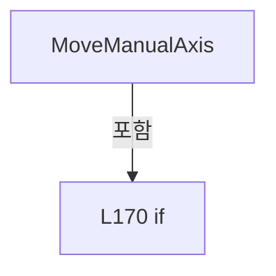

변경 전 점검: 입력/반환 타입, 위 호출자, 예외/취소 경로, 공유 상태와 저장·전송 소비자를 함께 확인합니다. 값의 단위나 물리 방향을 이름만으로 확정하지 않습니다.

### MethodDeclaration `Open` · L177–193

[Drilling.Common/Station/CStageReviewSequences.cs:177–193](https://github.com/kjuws10-rgb/A3Drilling/blob/5aee8e58439c9b455cae7c9593c9be986c3e682e/Drilling.Common/Station/CStageReviewSequences.cs#L177-L193)

| 항목 | 실제 추출 값 |
| --- | --- |
| 서명 | Drilling.Common.Station.CStageReviewSequences.Session Drilling.Common.Station.CStageReviewSequences.Open(int, System.Func<bool>?, bool, bool) |
| 접근/수식자 | Public / public |
| 반환/값 타입 | Drilling.Common.Station.CStageReviewSequences.Session |
| 소속 타입 | NamedType:Drilling.Common.Station.CStageReviewSequences |

입력 계약:

| 이름 | 타입 | 전달 | 선택/기본값 |
| --- | --- | --- | --- |
| deviceNo | int | None | False /  |
| stopRequested | System.Func<bool>? | None | True / null |
| reviewXOnly | bool | None | True / false |
| stageBufferOwner | bool | None | True / false |

정적 호출자로 확인된 위치:

| 호출 파일/행 | 호출 표현식 | 런타임 분기 가능 |
| --- | --- | --- |
| [Drilling.Common/Interface/CPowerMeasureRun.cs:277–277](https://github.com/kjuws10-rgb/A3Drilling/blob/5aee8e58439c9b455cae7c9593c9be986c3e682e/Drilling.Common/Interface/CPowerMeasureRun.cs#L277-L277) | Interfaces.StageReviewSequences.Open | False |
| [Drilling.Common/Review/CReviewManager.cs:2379–2379](https://github.com/kjuws10-rgb/A3Drilling/blob/5aee8e58439c9b455cae7c9593c9be986c3e682e/Drilling.Common/Review/CReviewManager.cs#L2379-L2379) | interfaceManager.StageReviewSequences.Open | False |
| [Drilling.Common/Station/CStageReviewSequences.cs:83–83](https://github.com/kjuws10-rgb/A3Drilling/blob/5aee8e58439c9b455cae7c9593c9be986c3e682e/Drilling.Common/Station/CStageReviewSequences.cs#L83-L83) | Open | False |
| [Drilling.Common/Station/CStageReviewSequences.cs:173–173](https://github.com/kjuws10-rgb/A3Drilling/blob/5aee8e58439c9b455cae7c9593c9be986c3e682e/Drilling.Common/Station/CStageReviewSequences.cs#L173-L173) | Open | False |
| [Drilling.Common/Station/CStationProcess.cs:3682–3682](https://github.com/kjuws10-rgb/A3Drilling/blob/5aee8e58439c9b455cae7c9593c9be986c3e682e/Drilling.Common/Station/CStationProcess.cs#L3682-L3682) | _interfaceManager.StageReviewSequences.Open | False |
| [Drilling.Common/Station/CStationProcess.cs:6163–6163](https://github.com/kjuws10-rgb/A3Drilling/blob/5aee8e58439c9b455cae7c9593c9be986c3e682e/Drilling.Common/Station/CStationProcess.cs#L6163-L6163) | interfaces.StageReviewSequences.Open | False |
| [Drilling.Common/Station/CStationProcess.cs:6272–6272](https://github.com/kjuws10-rgb/A3Drilling/blob/5aee8e58439c9b455cae7c9593c9be986c3e682e/Drilling.Common/Station/CStationProcess.cs#L6272-L6272) | interfaces.StageReviewSequences.Open | False |
| [Drilling.UI/Menu/Menus/CMenuCorrection.cs:3465–3465](https://github.com/kjuws10-rgb/A3Drilling/blob/5aee8e58439c9b455cae7c9593c9be986c3e682e/Drilling.UI/Menu/Menus/CMenuCorrection.cs#L3465-L3465) | manager.Interface().StageReviewSequences.Open | False |
| [Drilling.UI/Menu/Menus/CMenuCorrection.cs:3599–3599](https://github.com/kjuws10-rgb/A3Drilling/blob/5aee8e58439c9b455cae7c9593c9be986c3e682e/Drilling.UI/Menu/Menus/CMenuCorrection.cs#L3599-L3599) | manager.Interface().StageReviewSequences.Open | False |

호출하는 대상과 해석 범위:

| 원본 행 | 표현식 | 분석 상태 | 대상/소스 위치 |
| --- | --- | --- | --- |
| 179 | _cleanupFailures.ContainsKey | resolved | bool System.Collections.Concurrent.ConcurrentDictionary<int, byte>.ContainsKey(int) |
| 180 | new InvalidOperationException | resolved | System.InvalidOperationException.InvalidOperationException(string?) |
| 182 | _owners.TryAdd | resolved | bool System.Collections.Concurrent.ConcurrentDictionary<int, byte>.TryAdd(int, byte) |
| 183 | new InvalidOperationException | resolved | System.InvalidOperationException.InvalidOperationException(string?) |
| 186 | new | resolved | Drilling.Common.Station.CStageReviewSequences.Session.Session(Drilling.Common.Station.CStageReviewSequences, Drilling.Common.Interface.CInterfaceManager, int, System.Func<bool>, bool, bool, bool) · Drilling.Common/Station/CStageReviewSequences.cs:241 |
| 190 | _owners.TryRemove | resolved | bool System.Collections.Concurrent.ConcurrentDictionary<int, byte>.TryRemove(int, out byte) |

본문의 실제 연산·분기·예외·반환 순서(원문 위치 순):

| 원본 행 | 종류 | 주석 해설 |
| --- | --- | --- |
| 179 | call | 함수·델리게이트 또는 객체 생성자를 호출합니다: _cleanupFailures.ContainsKey(deviceNo) |
| 179 | if | 조건에 따라 분기합니다: if (_cleanupFailures.ContainsKey(deviceNo)) |
| 180 | call | 함수·델리게이트 또는 객체 생성자를 호출합니다: new InvalidOperationException("Stage 공통 시퀀스 정리가 실패했습니다. RESET에서 정지 및 STOP/요청/응답 OFF를 확인해 주세요.") |
| 180 | throw | 예외를 발생/전달합니다: throw new InvalidOperationException("Stage 공통 시퀀스 정리가 실패했습니다. RESET에서 정지 및 STOP/요청/응답 OFF를 확인해 주세요."); |
| 182 | call | 함수·델리게이트 또는 객체 생성자를 호출합니다: _owners.TryAdd(deviceNo, 0) |
| 182 | if | 조건에 따라 분기합니다: if (!_owners.TryAdd(deviceNo, 0)) |
| 183 | call | 함수·델리게이트 또는 객체 생성자를 호출합니다: new InvalidOperationException("Stage Process Move / IOF가 이미 사용 중입니다.") |
| 183 | throw | 예외를 발생/전달합니다: throw new InvalidOperationException("Stage Process Move / IOF가 이미 사용 중입니다."); |
| 184 | try | 예외 처리 범위입니다: try |
| 186 | call | 함수·델리게이트 또는 객체 생성자를 호출합니다: new(this, interfaces, deviceNo, stopRequested ?? (() => false), AutomaticSimulationReplies, reviewXOnly, stageBufferOwner) |
| 186 | return | 호출자에게 값 또는 제어를 반환합니다: return new(this, interfaces, deviceNo, stopRequested ?? (() => false), AutomaticSimulationReplies, reviewXOnly, stageBufferOwner); |
| 188 | catch | 지정 예외를 처리합니다: catch  |
| 190 | call | 함수·델리게이트 또는 객체 생성자를 호출합니다: _owners.TryRemove(deviceNo, out _) |
| 191 | throw | 예외를 발생/전달합니다: throw; |

제어 구문의 포함 구조(실제 실행 순서/CFG가 아닌 구문 탐색 그림):

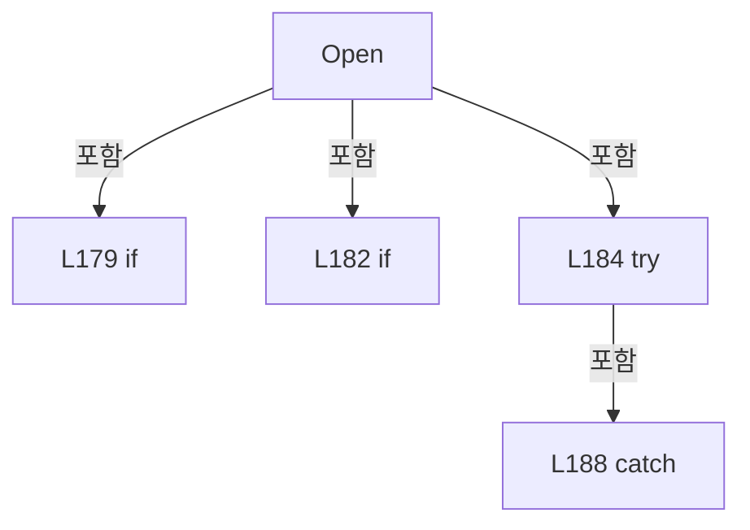

변경 전 점검: 입력/반환 타입, 위 호출자, 예외/취소 경로, 공유 상태와 저장·전송 소비자를 함께 확인합니다. 값의 단위나 물리 방향을 이름만으로 확정하지 않습니다.

### MethodDeclaration `Publish` · L195–216

[Drilling.Common/Station/CStageReviewSequences.cs:195–216](https://github.com/kjuws10-rgb/A3Drilling/blob/5aee8e58439c9b455cae7c9593c9be986c3e682e/Drilling.Common/Station/CStageReviewSequences.cs#L195-L216)

| 항목 | 실제 추출 값 |
| --- | --- |
| 서명 | void Drilling.Common.Station.CStageReviewSequences.Publish(int, string, double?, string) |
| 접근/수식자 | Private / private |
| 반환/값 타입 | void |
| 소속 타입 | NamedType:Drilling.Common.Station.CStageReviewSequences |

입력 계약:

| 이름 | 타입 | 전달 | 선택/기본값 |
| --- | --- | --- | --- |
| device | int | None | False /  |
| phase | string | None | False /  |
| value | double? | None | True / null |
| detail | string | None | True / "" |

정적 호출자로 확인된 위치:

| 호출 파일/행 | 호출 표현식 | 런타임 분기 가능 |
| --- | --- | --- |
| [Drilling.Common/Station/CStageReviewSequences.cs:236–236](https://github.com/kjuws10-rgb/A3Drilling/blob/5aee8e58439c9b455cae7c9593c9be986c3e682e/Drilling.Common/Station/CStageReviewSequences.cs#L236-L236) | _owner.Publish | False |
| [Drilling.Common/Station/CStageReviewSequences.cs:795–795](https://github.com/kjuws10-rgb/A3Drilling/blob/5aee8e58439c9b455cae7c9593c9be986c3e682e/Drilling.Common/Station/CStageReviewSequences.cs#L795-L795) | _owner.Publish | False |

호출하는 대상과 해석 범위:

| 원본 행 | 표현식 | 분석 상태 | 대상/소스 위치 |
| --- | --- | --- | --- |
| 197 | new ST_STAGE_FLOW_EVENT | resolved | Drilling.Common.Station.ST_STAGE_FLOW_EVENT.ST_STAGE_FLOW_EVENT(long, int, string, double?) · Drilling.Common/Station/CStageReviewSequences.cs:944 |
| 197 | Interlocked.Increment | resolved | long System.Threading.Interlocked.Increment(ref long) |
| 201 | .GetInvocationList | resolved · 동적 구현 선택 가능 | System.Delegate[] System.MulticastDelegate.GetInvocationList() |
| 204 | ((Action<ST_STAGE_FLOW_EVENT>)subscriber) | resolved · 동적 구현 선택 가능 | void System.Action<Drilling.Common.Station.ST_STAGE_FLOW_EVENT>.Invoke(Drilling.Common.Station.ST_STAGE_FLOW_EVENT) |
| 210 | System.Diagnostics.Trace.TraceError | resolved | void System.Diagnostics.Trace.TraceError(string?) |
| 210 | error.ToString | resolved · 동적 구현 선택 가능 | string System.Exception.ToString() |

본문의 실제 연산·분기·예외·반환 순서(원문 위치 순):

| 원본 행 | 종류 | 주석 해설 |
| --- | --- | --- |
| 197 | call | 함수·델리게이트 또는 객체 생성자를 호출합니다: Interlocked.Increment(ref _event) |
| 197 | call | 함수·델리게이트 또는 객체 생성자를 호출합니다: new ST_STAGE_FLOW_EVENT(Interlocked.Increment(ref _event), device, phase, value) { Detail = detail } |
| 197 | local-declaration | 지역 변수를 선언합니다: var item = new ST_STAGE_FLOW_EVENT(Interlocked.Increment(ref _event), device, phase, value) { Detail = detail }; |
| 197 | variable-initializer | 변수의 초기값을 지정합니다: item = new ST_STAGE_FLOW_EVENT(Interlocked.Increment(ref _event), device, phase, value) { Detail = detail } |
| 199 | assignment | 값을 대상에 대입합니다: Detail = detail |
| 201 | call | 함수·델리게이트 또는 객체 생성자를 호출합니다: .GetInvocationList() |
| 201 | foreach | 컬렉션 요소를 순회합니다: foreach (var subscriber in Trace?.GetInvocationList() ?? []) |
| 202 | try | 예외 처리 범위입니다: try |
| 204 | call | 함수·델리게이트 또는 객체 생성자를 호출합니다: ((Action<ST_STAGE_FLOW_EVENT>)subscriber)(item) |
| 206 | catch | 지정 예외를 처리합니다: catch (Exception error) |
| 208 | try | 예외 처리 범위입니다: try |
| 210 | call | 함수·델리게이트 또는 객체 생성자를 호출합니다: System.Diagnostics.Trace.TraceError(error.ToString()) |
| 210 | call | 함수·델리게이트 또는 객체 생성자를 호출합니다: error.ToString() |
| 212 | catch | 지정 예외를 처리합니다: catch  |

제어 구문의 포함 구조(실제 실행 순서/CFG가 아닌 구문 탐색 그림):

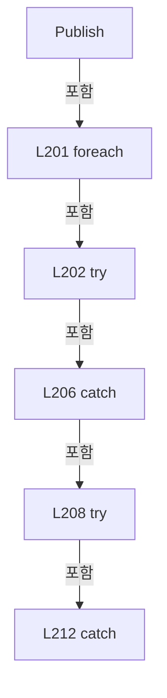

변경 전 점검: 입력/반환 타입, 위 호출자, 예외/취소 경로, 공유 상태와 저장·전송 소비자를 함께 확인합니다. 값의 단위나 물리 방향을 이름만으로 확정하지 않습니다.

### FieldDeclaration `_owner` · L220–220

[Drilling.Common/Station/CStageReviewSequences.cs:220–220](https://github.com/kjuws10-rgb/A3Drilling/blob/5aee8e58439c9b455cae7c9593c9be986c3e682e/Drilling.Common/Station/CStageReviewSequences.cs#L220-L220)

| 항목 | 실제 추출 값 |
| --- | --- |
| 서명 | Drilling.Common.Station.CStageReviewSequences Drilling.Common.Station.CStageReviewSequences.Session._owner |
| 접근/수식자 | Private / private, readonly |
| 반환/값 타입 | Drilling.Common.Station.CStageReviewSequences |
| 소속 타입 | NamedType:Drilling.Common.Station.CStageReviewSequences.Session |

현재 부분 분석에서 직접 연결된 호출자는 없습니다. XAML/이벤트/인터페이스·델리게이트·외부 진입을 추가 확인해야 하며, 미사용으로 판정한 것이 아닙니다.

변경 전 점검: 입력/반환 타입, 위 호출자, 예외/취소 경로, 공유 상태와 저장·전송 소비자를 함께 확인합니다. 값의 단위나 물리 방향을 이름만으로 확정하지 않습니다.

### FieldDeclaration `_interfaces` · L221–221

[Drilling.Common/Station/CStageReviewSequences.cs:221–221](https://github.com/kjuws10-rgb/A3Drilling/blob/5aee8e58439c9b455cae7c9593c9be986c3e682e/Drilling.Common/Station/CStageReviewSequences.cs#L221-L221)

| 항목 | 실제 추출 값 |
| --- | --- |
| 서명 | Drilling.Common.Interface.CInterfaceManager Drilling.Common.Station.CStageReviewSequences.Session._interfaces |
| 접근/수식자 | Private / private, readonly |
| 반환/값 타입 | Drilling.Common.Interface.CInterfaceManager |
| 소속 타입 | NamedType:Drilling.Common.Station.CStageReviewSequences.Session |

현재 부분 분석에서 직접 연결된 호출자는 없습니다. XAML/이벤트/인터페이스·델리게이트·외부 진입을 추가 확인해야 하며, 미사용으로 판정한 것이 아닙니다.

변경 전 점검: 입력/반환 타입, 위 호출자, 예외/취소 경로, 공유 상태와 저장·전송 소비자를 함께 확인합니다. 값의 단위나 물리 방향을 이름만으로 확정하지 않습니다.

### FieldDeclaration `_device` · L222–222

[Drilling.Common/Station/CStageReviewSequences.cs:222–222](https://github.com/kjuws10-rgb/A3Drilling/blob/5aee8e58439c9b455cae7c9593c9be986c3e682e/Drilling.Common/Station/CStageReviewSequences.cs#L222-L222)

| 항목 | 실제 추출 값 |
| --- | --- |
| 서명 | int Drilling.Common.Station.CStageReviewSequences.Session._device |
| 접근/수식자 | Private / private, readonly |
| 반환/값 타입 | int |
| 소속 타입 | NamedType:Drilling.Common.Station.CStageReviewSequences.Session |

현재 부분 분석에서 직접 연결된 호출자는 없습니다. XAML/이벤트/인터페이스·델리게이트·외부 진입을 추가 확인해야 하며, 미사용으로 판정한 것이 아닙니다.

변경 전 점검: 입력/반환 타입, 위 호출자, 예외/취소 경로, 공유 상태와 저장·전송 소비자를 함께 확인합니다. 값의 단위나 물리 방향을 이름만으로 확정하지 않습니다.

### FieldDeclaration `_stopRequested` · L223–223

[Drilling.Common/Station/CStageReviewSequences.cs:223–223](https://github.com/kjuws10-rgb/A3Drilling/blob/5aee8e58439c9b455cae7c9593c9be986c3e682e/Drilling.Common/Station/CStageReviewSequences.cs#L223-L223)

| 항목 | 실제 추출 값 |
| --- | --- |
| 서명 | System.Func<bool> Drilling.Common.Station.CStageReviewSequences.Session._stopRequested |
| 접근/수식자 | Private / private, readonly |
| 반환/값 타입 | System.Func<bool> |
| 소속 타입 | NamedType:Drilling.Common.Station.CStageReviewSequences.Session |

현재 부분 분석에서 직접 연결된 호출자는 없습니다. XAML/이벤트/인터페이스·델리게이트·외부 진입을 추가 확인해야 하며, 미사용으로 판정한 것이 아닙니다.

변경 전 점검: 입력/반환 타입, 위 호출자, 예외/취소 경로, 공유 상태와 저장·전송 소비자를 함께 확인합니다. 값의 단위나 물리 방향을 이름만으로 확정하지 않습니다.

### FieldDeclaration `_simulation` · L224–224

[Drilling.Common/Station/CStageReviewSequences.cs:224–224](https://github.com/kjuws10-rgb/A3Drilling/blob/5aee8e58439c9b455cae7c9593c9be986c3e682e/Drilling.Common/Station/CStageReviewSequences.cs#L224-L224)

| 항목 | 실제 추출 값 |
| --- | --- |
| 서명 | bool Drilling.Common.Station.CStageReviewSequences.Session._simulation |
| 접근/수식자 | Private / private, readonly |
| 반환/값 타입 | bool |
| 소속 타입 | NamedType:Drilling.Common.Station.CStageReviewSequences.Session |

현재 부분 분석에서 직접 연결된 호출자는 없습니다. XAML/이벤트/인터페이스·델리게이트·외부 진입을 추가 확인해야 하며, 미사용으로 판정한 것이 아닙니다.

변경 전 점검: 입력/반환 타입, 위 호출자, 예외/취소 경로, 공유 상태와 저장·전송 소비자를 함께 확인합니다. 값의 단위나 물리 방향을 이름만으로 확정하지 않습니다.

### FieldDeclaration `_automatic` · L224–224

[Drilling.Common/Station/CStageReviewSequences.cs:224–224](https://github.com/kjuws10-rgb/A3Drilling/blob/5aee8e58439c9b455cae7c9593c9be986c3e682e/Drilling.Common/Station/CStageReviewSequences.cs#L224-L224)

| 항목 | 실제 추출 값 |
| --- | --- |
| 서명 | bool Drilling.Common.Station.CStageReviewSequences.Session._automatic |
| 접근/수식자 | Private / private, readonly |
| 반환/값 타입 | bool |
| 소속 타입 | NamedType:Drilling.Common.Station.CStageReviewSequences.Session |

현재 부분 분석에서 직접 연결된 호출자는 없습니다. XAML/이벤트/인터페이스·델리게이트·외부 진입을 추가 확인해야 하며, 미사용으로 판정한 것이 아닙니다.

변경 전 점검: 입력/반환 타입, 위 호출자, 예외/취소 경로, 공유 상태와 저장·전송 소비자를 함께 확인합니다. 값의 단위나 물리 방향을 이름만으로 확정하지 않습니다.

### FieldDeclaration `_reviewXOnly` · L224–224

[Drilling.Common/Station/CStageReviewSequences.cs:224–224](https://github.com/kjuws10-rgb/A3Drilling/blob/5aee8e58439c9b455cae7c9593c9be986c3e682e/Drilling.Common/Station/CStageReviewSequences.cs#L224-L224)

| 항목 | 실제 추출 값 |
| --- | --- |
| 서명 | bool Drilling.Common.Station.CStageReviewSequences.Session._reviewXOnly |
| 접근/수식자 | Private / private, readonly |
| 반환/값 타입 | bool |
| 소속 타입 | NamedType:Drilling.Common.Station.CStageReviewSequences.Session |

현재 부분 분석에서 직접 연결된 호출자는 없습니다. XAML/이벤트/인터페이스·델리게이트·외부 진입을 추가 확인해야 하며, 미사용으로 판정한 것이 아닙니다.

변경 전 점검: 입력/반환 타입, 위 호출자, 예외/취소 경로, 공유 상태와 저장·전송 소비자를 함께 확인합니다. 값의 단위나 물리 방향을 이름만으로 확정하지 않습니다.

### FieldDeclaration `_stageBufferOwner` · L224–224

[Drilling.Common/Station/CStageReviewSequences.cs:224–224](https://github.com/kjuws10-rgb/A3Drilling/blob/5aee8e58439c9b455cae7c9593c9be986c3e682e/Drilling.Common/Station/CStageReviewSequences.cs#L224-L224)

| 항목 | 실제 추출 값 |
| --- | --- |
| 서명 | bool Drilling.Common.Station.CStageReviewSequences.Session._stageBufferOwner |
| 접근/수식자 | Private / private, readonly |
| 반환/값 타입 | bool |
| 소속 타입 | NamedType:Drilling.Common.Station.CStageReviewSequences.Session |

현재 부분 분석에서 직접 연결된 호출자는 없습니다. XAML/이벤트/인터페이스·델리게이트·외부 진입을 추가 확인해야 하며, 미사용으로 판정한 것이 아닙니다.

변경 전 점검: 입력/반환 타입, 위 호출자, 예외/취소 경로, 공유 상태와 저장·전송 소비자를 함께 확인합니다. 값의 단위나 물리 방향을 이름만으로 확정하지 않습니다.

### FieldDeclaration `_motion` · L225–225

[Drilling.Common/Station/CStageReviewSequences.cs:225–225](https://github.com/kjuws10-rgb/A3Drilling/blob/5aee8e58439c9b455cae7c9593c9be986c3e682e/Drilling.Common/Station/CStageReviewSequences.cs#L225-L225)

| 항목 | 실제 추출 값 |
| --- | --- |
| 서명 | Drilling.Common.Motion.CManualStageMotionSimulation? Drilling.Common.Station.CStageReviewSequences.Session._motion |
| 접근/수식자 | Private / private, readonly |
| 반환/값 타입 | Drilling.Common.Motion.CManualStageMotionSimulation? |
| 소속 타입 | NamedType:Drilling.Common.Station.CStageReviewSequences.Session |

현재 부분 분석에서 직접 연결된 호출자는 없습니다. XAML/이벤트/인터페이스·델리게이트·외부 진입을 추가 확인해야 하며, 미사용으로 판정한 것이 아닙니다.

변경 전 점검: 입력/반환 타입, 위 호출자, 예외/취소 경로, 공유 상태와 저장·전송 소비자를 함께 확인합니다. 값의 단위나 물리 방향을 이름만으로 확정하지 않습니다.

### FieldDeclaration `_lease` · L226–226

[Drilling.Common/Station/CStageReviewSequences.cs:226–226](https://github.com/kjuws10-rgb/A3Drilling/blob/5aee8e58439c9b455cae7c9593c9be986c3e682e/Drilling.Common/Station/CStageReviewSequences.cs#L226-L226)

| 항목 | 실제 추출 값 |
| --- | --- |
| 서명 | Drilling.Common.Motion.CManualStageMotionSimulation.MotionLease? Drilling.Common.Station.CStageReviewSequences.Session._lease |
| 접근/수식자 | Private / private, readonly |
| 반환/값 타입 | Drilling.Common.Motion.CManualStageMotionSimulation.MotionLease? |
| 소속 타입 | NamedType:Drilling.Common.Station.CStageReviewSequences.Session |

현재 부분 분석에서 직접 연결된 호출자는 없습니다. XAML/이벤트/인터페이스·델리게이트·외부 진입을 추가 확인해야 하며, 미사용으로 판정한 것이 아닙니다.

변경 전 점검: 입력/반환 타입, 위 호출자, 예외/취소 경로, 공유 상태와 저장·전송 소비자를 함께 확인합니다. 값의 단위나 물리 방향을 이름만으로 확정하지 않습니다.

### FieldDeclaration `_operation` · L227–227

[Drilling.Common/Station/CStageReviewSequences.cs:227–227](https://github.com/kjuws10-rgb/A3Drilling/blob/5aee8e58439c9b455cae7c9593c9be986c3e682e/Drilling.Common/Station/CStageReviewSequences.cs#L227-L227)

| 항목 | 실제 추출 값 |
| --- | --- |
| 서명 | System.Threading.SemaphoreSlim Drilling.Common.Station.CStageReviewSequences.Session._operation |
| 접근/수식자 | Private / private, readonly |
| 반환/값 타입 | System.Threading.SemaphoreSlim |
| 소속 타입 | NamedType:Drilling.Common.Station.CStageReviewSequences.Session |

현재 부분 분석에서 직접 연결된 호출자는 없습니다. XAML/이벤트/인터페이스·델리게이트·외부 진입을 추가 확인해야 하며, 미사용으로 판정한 것이 아닙니다.

호출하는 대상과 해석 범위:

| 원본 행 | 표현식 | 분석 상태 | 대상/소스 위치 |
| --- | --- | --- | --- |
| 227 | new | resolved | System.Threading.SemaphoreSlim.SemaphoreSlim(int, int) |

본문의 실제 연산·분기·예외·반환 순서(원문 위치 순):

| 원본 행 | 종류 | 주석 해설 |
| --- | --- | --- |
| 227 | call | 함수·델리게이트 또는 객체 생성자를 호출합니다: new(1, 1) |
| 227 | variable-initializer | 변수의 초기값을 지정합니다: _operation = new(1, 1) |

변경 전 점검: 입력/반환 타입, 위 호출자, 예외/취소 경로, 공유 상태와 저장·전송 소비자를 함께 확인합니다. 값의 단위나 물리 방향을 이름만으로 확정하지 않습니다.

### FieldDeclaration `_disposed` · L228–228

[Drilling.Common/Station/CStageReviewSequences.cs:228–228](https://github.com/kjuws10-rgb/A3Drilling/blob/5aee8e58439c9b455cae7c9593c9be986c3e682e/Drilling.Common/Station/CStageReviewSequences.cs#L228-L228)

| 항목 | 실제 추출 값 |
| --- | --- |
| 서명 | bool Drilling.Common.Station.CStageReviewSequences.Session._disposed |
| 접근/수식자 | Private / private, volatile |
| 반환/값 타입 | bool |
| 소속 타입 | NamedType:Drilling.Common.Station.CStageReviewSequences.Session |

현재 부분 분석에서 직접 연결된 호출자는 없습니다. XAML/이벤트/인터페이스·델리게이트·외부 진입을 추가 확인해야 하며, 미사용으로 판정한 것이 아닙니다.

변경 전 점검: 입력/반환 타입, 위 호출자, 예외/취소 경로, 공유 상태와 저장·전송 소비자를 함께 확인합니다. 값의 단위나 물리 방향을 이름만으로 확정하지 않습니다.

### FieldDeclaration `_moveOwned` · L229–229

[Drilling.Common/Station/CStageReviewSequences.cs:229–229](https://github.com/kjuws10-rgb/A3Drilling/blob/5aee8e58439c9b455cae7c9593c9be986c3e682e/Drilling.Common/Station/CStageReviewSequences.cs#L229-L229)

| 항목 | 실제 추출 값 |
| --- | --- |
| 서명 | bool Drilling.Common.Station.CStageReviewSequences.Session._moveOwned |
| 접근/수식자 | Private / private |
| 반환/값 타입 | bool |
| 소속 타입 | NamedType:Drilling.Common.Station.CStageReviewSequences.Session |

현재 부분 분석에서 직접 연결된 호출자는 없습니다. XAML/이벤트/인터페이스·델리게이트·외부 진입을 추가 확인해야 하며, 미사용으로 판정한 것이 아닙니다.

변경 전 점검: 입력/반환 타입, 위 호출자, 예외/취소 경로, 공유 상태와 저장·전송 소비자를 함께 확인합니다. 값의 단위나 물리 방향을 이름만으로 확정하지 않습니다.

### FieldDeclaration `_iofOwned` · L229–229

[Drilling.Common/Station/CStageReviewSequences.cs:229–229](https://github.com/kjuws10-rgb/A3Drilling/blob/5aee8e58439c9b455cae7c9593c9be986c3e682e/Drilling.Common/Station/CStageReviewSequences.cs#L229-L229)

| 항목 | 실제 추출 값 |
| --- | --- |
| 서명 | bool Drilling.Common.Station.CStageReviewSequences.Session._iofOwned |
| 접근/수식자 | Private / private |
| 반환/값 타입 | bool |
| 소속 타입 | NamedType:Drilling.Common.Station.CStageReviewSequences.Session |

현재 부분 분석에서 직접 연결된 호출자는 없습니다. XAML/이벤트/인터페이스·델리게이트·외부 진입을 추가 확인해야 하며, 미사용으로 판정한 것이 아닙니다.

변경 전 점검: 입력/반환 타입, 위 호출자, 예외/취소 경로, 공유 상태와 저장·전송 소비자를 함께 확인합니다. 값의 단위나 물리 방향을 이름만으로 확정하지 않습니다.

### FieldDeclaration `_moveMode` · L230–230

[Drilling.Common/Station/CStageReviewSequences.cs:230–230](https://github.com/kjuws10-rgb/A3Drilling/blob/5aee8e58439c9b455cae7c9593c9be986c3e682e/Drilling.Common/Station/CStageReviewSequences.cs#L230-L230)

| 항목 | 실제 추출 값 |
| --- | --- |
| 서명 | Drilling.Common.Station.EN_STAGE_MOVE_MODE Drilling.Common.Station.CStageReviewSequences.Session._moveMode |
| 접근/수식자 | Private / private |
| 반환/값 타입 | Drilling.Common.Station.EN_STAGE_MOVE_MODE |
| 소속 타입 | NamedType:Drilling.Common.Station.CStageReviewSequences.Session |

현재 부분 분석에서 직접 연결된 호출자는 없습니다. XAML/이벤트/인터페이스·델리게이트·외부 진입을 추가 확인해야 하며, 미사용으로 판정한 것이 아닙니다.

변경 전 점검: 입력/반환 타입, 위 호출자, 예외/취소 경로, 공유 상태와 저장·전송 소비자를 함께 확인합니다. 값의 단위나 물리 방향을 이름만으로 확정하지 않습니다.

### PropertyDeclaration `IsDisposed` · L231–231

[Drilling.Common/Station/CStageReviewSequences.cs:231–231](https://github.com/kjuws10-rgb/A3Drilling/blob/5aee8e58439c9b455cae7c9593c9be986c3e682e/Drilling.Common/Station/CStageReviewSequences.cs#L231-L231)

| 항목 | 실제 추출 값 |
| --- | --- |
| 서명 | bool Drilling.Common.Station.CStageReviewSequences.Session.IsDisposed |
| 접근/수식자 | Internal / internal |
| 반환/값 타입 | bool |
| 소속 타입 | NamedType:Drilling.Common.Station.CStageReviewSequences.Session |

현재 부분 분석에서 직접 연결된 호출자는 없습니다. XAML/이벤트/인터페이스·델리게이트·외부 진입을 추가 확인해야 하며, 미사용으로 판정한 것이 아닙니다.

변경 전 점검: 입력/반환 타입, 위 호출자, 예외/취소 경로, 공유 상태와 저장·전송 소비자를 함께 확인합니다. 값의 단위나 물리 방향을 이름만으로 확정하지 않습니다.

### FieldDeclaration `_iofPlanId` · L232–232

[Drilling.Common/Station/CStageReviewSequences.cs:232–232](https://github.com/kjuws10-rgb/A3Drilling/blob/5aee8e58439c9b455cae7c9593c9be986c3e682e/Drilling.Common/Station/CStageReviewSequences.cs#L232-L232)

| 항목 | 실제 추출 값 |
| --- | --- |
| 서명 | System.Guid Drilling.Common.Station.CStageReviewSequences.Session._iofPlanId |
| 접근/수식자 | Private / private |
| 반환/값 타입 | System.Guid |
| 소속 타입 | NamedType:Drilling.Common.Station.CStageReviewSequences.Session |

현재 부분 분석에서 직접 연결된 호출자는 없습니다. XAML/이벤트/인터페이스·델리게이트·외부 진입을 추가 확인해야 하며, 미사용으로 판정한 것이 아닙니다.

변경 전 점검: 입력/반환 타입, 위 호출자, 예외/취소 경로, 공유 상태와 저장·전송 소비자를 함께 확인합니다. 값의 단위나 물리 방향을 이름만으로 확정하지 않습니다.

### FieldDeclaration `_iofStartConfirmed` · L233–233

[Drilling.Common/Station/CStageReviewSequences.cs:233–233](https://github.com/kjuws10-rgb/A3Drilling/blob/5aee8e58439c9b455cae7c9593c9be986c3e682e/Drilling.Common/Station/CStageReviewSequences.cs#L233-L233)

| 항목 | 실제 추출 값 |
| --- | --- |
| 서명 | bool Drilling.Common.Station.CStageReviewSequences.Session._iofStartConfirmed |
| 접근/수식자 | Private / private |
| 반환/값 타입 | bool |
| 소속 타입 | NamedType:Drilling.Common.Station.CStageReviewSequences.Session |

현재 부분 분석에서 직접 연결된 호출자는 없습니다. XAML/이벤트/인터페이스·델리게이트·외부 진입을 추가 확인해야 하며, 미사용으로 판정한 것이 아닙니다.

변경 전 점검: 입력/반환 타입, 위 호출자, 예외/취소 경로, 공유 상태와 저장·전송 소비자를 함께 확인합니다. 값의 단위나 물리 방향을 이름만으로 확정하지 않습니다.

### FieldDeclaration `_iofAckConfirmed` · L233–233

[Drilling.Common/Station/CStageReviewSequences.cs:233–233](https://github.com/kjuws10-rgb/A3Drilling/blob/5aee8e58439c9b455cae7c9593c9be986c3e682e/Drilling.Common/Station/CStageReviewSequences.cs#L233-L233)

| 항목 | 실제 추출 값 |
| --- | --- |
| 서명 | bool Drilling.Common.Station.CStageReviewSequences.Session._iofAckConfirmed |
| 접근/수식자 | Private / private |
| 반환/값 타입 | bool |
| 소속 타입 | NamedType:Drilling.Common.Station.CStageReviewSequences.Session |

현재 부분 분석에서 직접 연결된 호출자는 없습니다. XAML/이벤트/인터페이스·델리게이트·외부 진입을 추가 확인해야 하며, 미사용으로 판정한 것이 아닙니다.

변경 전 점검: 입력/반환 타입, 위 호출자, 예외/취소 경로, 공유 상태와 저장·전송 소비자를 함께 확인합니다. 값의 단위나 물리 방향을 이름만으로 확정하지 않습니다.

### FieldDeclaration `_scenario` · L234–234

[Drilling.Common/Station/CStageReviewSequences.cs:234–234](https://github.com/kjuws10-rgb/A3Drilling/blob/5aee8e58439c9b455cae7c9593c9be986c3e682e/Drilling.Common/Station/CStageReviewSequences.cs#L234-L234)

| 항목 | 실제 추출 값 |
| --- | --- |
| 서명 | string Drilling.Common.Station.CStageReviewSequences.Session._scenario |
| 접근/수식자 | Private / private |
| 반환/값 타입 | string |
| 소속 타입 | NamedType:Drilling.Common.Station.CStageReviewSequences.Session |

현재 부분 분석에서 직접 연결된 호출자는 없습니다. XAML/이벤트/인터페이스·델리게이트·외부 진입을 추가 확인해야 하며, 미사용으로 판정한 것이 아닙니다.

본문의 실제 연산·분기·예외·반환 순서(원문 위치 순):

| 원본 행 | 종류 | 주석 해설 |
| --- | --- | --- |
| 234 | variable-initializer | 변수의 초기값을 지정합니다: _scenario = "PROCESS_MOVE" |

변경 전 점검: 입력/반환 타입, 위 호출자, 예외/취소 경로, 공유 상태와 저장·전송 소비자를 함께 확인합니다. 값의 단위나 물리 방향을 이름만으로 확정하지 않습니다.

### FieldDeclaration `_traceSession` · L235–235

[Drilling.Common/Station/CStageReviewSequences.cs:235–235](https://github.com/kjuws10-rgb/A3Drilling/blob/5aee8e58439c9b455cae7c9593c9be986c3e682e/Drilling.Common/Station/CStageReviewSequences.cs#L235-L235)

| 항목 | 실제 추출 값 |
| --- | --- |
| 서명 | string Drilling.Common.Station.CStageReviewSequences.Session._traceSession |
| 접근/수식자 | Private / private, readonly |
| 반환/값 타입 | string |
| 소속 타입 | NamedType:Drilling.Common.Station.CStageReviewSequences.Session |

현재 부분 분석에서 직접 연결된 호출자는 없습니다. XAML/이벤트/인터페이스·델리게이트·외부 진입을 추가 확인해야 하며, 미사용으로 판정한 것이 아닙니다.

호출하는 대상과 해석 범위:

| 원본 행 | 표현식 | 분석 상태 | 대상/소스 위치 |
| --- | --- | --- | --- |
| 235 | Guid.NewGuid().ToString | resolved | string System.Guid.ToString(string?) |
| 235 | Guid.NewGuid | resolved | System.Guid System.Guid.NewGuid() |

본문의 실제 연산·분기·예외·반환 순서(원문 위치 순):

| 원본 행 | 종류 | 주석 해설 |
| --- | --- | --- |
| 235 | call | 함수·델리게이트 또는 객체 생성자를 호출합니다: Guid.NewGuid().ToString("N") |
| 235 | call | 함수·델리게이트 또는 객체 생성자를 호출합니다: Guid.NewGuid() |
| 235 | variable-initializer | 변수의 초기값을 지정합니다: _traceSession = Guid.NewGuid().ToString("N") |

변경 전 점검: 입력/반환 타입, 위 호출자, 예외/취소 경로, 공유 상태와 저장·전송 소비자를 함께 확인합니다. 값의 단위나 물리 방향을 이름만으로 확정하지 않습니다.

### MethodDeclaration `Record` · L236–236

[Drilling.Common/Station/CStageReviewSequences.cs:236–236](https://github.com/kjuws10-rgb/A3Drilling/blob/5aee8e58439c9b455cae7c9593c9be986c3e682e/Drilling.Common/Station/CStageReviewSequences.cs#L236-L236)

| 항목 | 실제 추출 값 |
| --- | --- |
| 서명 | void Drilling.Common.Station.CStageReviewSequences.Session.Record(string, string, double?) |
| 접근/수식자 | Private / private |
| 반환/값 타입 | void |
| 소속 타입 | NamedType:Drilling.Common.Station.CStageReviewSequences.Session |

입력 계약:

| 이름 | 타입 | 전달 | 선택/기본값 |
| --- | --- | --- | --- |
| phase | string | None | False /  |
| detail | string | None | True / "" |
| value | double? | None | True / null |

정적 호출자로 확인된 위치:

| 호출 파일/행 | 호출 표현식 | 런타임 분기 가능 |
| --- | --- | --- |
| [Drilling.Common/Station/CStageReviewSequences.cs:312–312](https://github.com/kjuws10-rgb/A3Drilling/blob/5aee8e58439c9b455cae7c9593c9be986c3e682e/Drilling.Common/Station/CStageReviewSequences.cs#L312-L312) | Record | False |
| [Drilling.Common/Station/CStageReviewSequences.cs:332–332](https://github.com/kjuws10-rgb/A3Drilling/blob/5aee8e58439c9b455cae7c9593c9be986c3e682e/Drilling.Common/Station/CStageReviewSequences.cs#L332-L332) | Record | False |
| [Drilling.Common/Station/CStageReviewSequences.cs:346–346](https://github.com/kjuws10-rgb/A3Drilling/blob/5aee8e58439c9b455cae7c9593c9be986c3e682e/Drilling.Common/Station/CStageReviewSequences.cs#L346-L346) | Record | False |
| [Drilling.Common/Station/CStageReviewSequences.cs:350–350](https://github.com/kjuws10-rgb/A3Drilling/blob/5aee8e58439c9b455cae7c9593c9be986c3e682e/Drilling.Common/Station/CStageReviewSequences.cs#L350-L350) | Record | False |
| [Drilling.Common/Station/CStageReviewSequences.cs:354–354](https://github.com/kjuws10-rgb/A3Drilling/blob/5aee8e58439c9b455cae7c9593c9be986c3e682e/Drilling.Common/Station/CStageReviewSequences.cs#L354-L354) | Record | False |
| [Drilling.Common/Station/CStageReviewSequences.cs:361–361](https://github.com/kjuws10-rgb/A3Drilling/blob/5aee8e58439c9b455cae7c9593c9be986c3e682e/Drilling.Common/Station/CStageReviewSequences.cs#L361-L361) | Record | False |
| [Drilling.Common/Station/CStageReviewSequences.cs:375–375](https://github.com/kjuws10-rgb/A3Drilling/blob/5aee8e58439c9b455cae7c9593c9be986c3e682e/Drilling.Common/Station/CStageReviewSequences.cs#L375-L375) | Record | False |
| [Drilling.Common/Station/CStageReviewSequences.cs:396–396](https://github.com/kjuws10-rgb/A3Drilling/blob/5aee8e58439c9b455cae7c9593c9be986c3e682e/Drilling.Common/Station/CStageReviewSequences.cs#L396-L396) | Record | False |
| [Drilling.Common/Station/CStageReviewSequences.cs:400–400](https://github.com/kjuws10-rgb/A3Drilling/blob/5aee8e58439c9b455cae7c9593c9be986c3e682e/Drilling.Common/Station/CStageReviewSequences.cs#L400-L400) | Record | False |
| [Drilling.Common/Station/CStageReviewSequences.cs:411–411](https://github.com/kjuws10-rgb/A3Drilling/blob/5aee8e58439c9b455cae7c9593c9be986c3e682e/Drilling.Common/Station/CStageReviewSequences.cs#L411-L411) | Record | False |
| [Drilling.Common/Station/CStageReviewSequences.cs:422–422](https://github.com/kjuws10-rgb/A3Drilling/blob/5aee8e58439c9b455cae7c9593c9be986c3e682e/Drilling.Common/Station/CStageReviewSequences.cs#L422-L422) | Record | False |
| [Drilling.Common/Station/CStageReviewSequences.cs:430–430](https://github.com/kjuws10-rgb/A3Drilling/blob/5aee8e58439c9b455cae7c9593c9be986c3e682e/Drilling.Common/Station/CStageReviewSequences.cs#L430-L430) | Record | False |
| [Drilling.Common/Station/CStageReviewSequences.cs:449–449](https://github.com/kjuws10-rgb/A3Drilling/blob/5aee8e58439c9b455cae7c9593c9be986c3e682e/Drilling.Common/Station/CStageReviewSequences.cs#L449-L449) | Record | False |
| [Drilling.Common/Station/CStageReviewSequences.cs:458–458](https://github.com/kjuws10-rgb/A3Drilling/blob/5aee8e58439c9b455cae7c9593c9be986c3e682e/Drilling.Common/Station/CStageReviewSequences.cs#L458-L458) | Record | False |
| [Drilling.Common/Station/CStageReviewSequences.cs:462–462](https://github.com/kjuws10-rgb/A3Drilling/blob/5aee8e58439c9b455cae7c9593c9be986c3e682e/Drilling.Common/Station/CStageReviewSequences.cs#L462-L462) | Record | False |
| [Drilling.Common/Station/CStageReviewSequences.cs:466–466](https://github.com/kjuws10-rgb/A3Drilling/blob/5aee8e58439c9b455cae7c9593c9be986c3e682e/Drilling.Common/Station/CStageReviewSequences.cs#L466-L466) | Record | False |
| [Drilling.Common/Station/CStageReviewSequences.cs:487–487](https://github.com/kjuws10-rgb/A3Drilling/blob/5aee8e58439c9b455cae7c9593c9be986c3e682e/Drilling.Common/Station/CStageReviewSequences.cs#L487-L487) | Record | False |
| [Drilling.Common/Station/CStageReviewSequences.cs:561–561](https://github.com/kjuws10-rgb/A3Drilling/blob/5aee8e58439c9b455cae7c9593c9be986c3e682e/Drilling.Common/Station/CStageReviewSequences.cs#L561-L561) | Record | False |
| [Drilling.Common/Station/CStageReviewSequences.cs:605–605](https://github.com/kjuws10-rgb/A3Drilling/blob/5aee8e58439c9b455cae7c9593c9be986c3e682e/Drilling.Common/Station/CStageReviewSequences.cs#L605-L605) | Record | False |
| [Drilling.Common/Station/CStageReviewSequences.cs:684–684](https://github.com/kjuws10-rgb/A3Drilling/blob/5aee8e58439c9b455cae7c9593c9be986c3e682e/Drilling.Common/Station/CStageReviewSequences.cs#L684-L684) | Record | False |
| [Drilling.Common/Station/CStageReviewSequences.cs:697–697](https://github.com/kjuws10-rgb/A3Drilling/blob/5aee8e58439c9b455cae7c9593c9be986c3e682e/Drilling.Common/Station/CStageReviewSequences.cs#L697-L697) | Record | False |
| [Drilling.Common/Station/CStageReviewSequences.cs:716–716](https://github.com/kjuws10-rgb/A3Drilling/blob/5aee8e58439c9b455cae7c9593c9be986c3e682e/Drilling.Common/Station/CStageReviewSequences.cs#L716-L716) | Record | False |
| [Drilling.Common/Station/CStageReviewSequences.cs:731–731](https://github.com/kjuws10-rgb/A3Drilling/blob/5aee8e58439c9b455cae7c9593c9be986c3e682e/Drilling.Common/Station/CStageReviewSequences.cs#L731-L731) | Record | False |
| [Drilling.Common/Station/CStageReviewSequences.cs:765–765](https://github.com/kjuws10-rgb/A3Drilling/blob/5aee8e58439c9b455cae7c9593c9be986c3e682e/Drilling.Common/Station/CStageReviewSequences.cs#L765-L765) | Record | False |
| [Drilling.Common/Station/CStageReviewSequences.cs:878–878](https://github.com/kjuws10-rgb/A3Drilling/blob/5aee8e58439c9b455cae7c9593c9be986c3e682e/Drilling.Common/Station/CStageReviewSequences.cs#L878-L878) | Record | False |
| [Drilling.Common/Station/CStageReviewSequences.cs:896–896](https://github.com/kjuws10-rgb/A3Drilling/blob/5aee8e58439c9b455cae7c9593c9be986c3e682e/Drilling.Common/Station/CStageReviewSequences.cs#L896-L896) | Record | False |
| [Drilling.Common/Station/CStageReviewSequences.cs:905–905](https://github.com/kjuws10-rgb/A3Drilling/blob/5aee8e58439c9b455cae7c9593c9be986c3e682e/Drilling.Common/Station/CStageReviewSequences.cs#L905-L905) | Record | False |
| [Drilling.Common/Station/CStageReviewSequences.cs:910–910](https://github.com/kjuws10-rgb/A3Drilling/blob/5aee8e58439c9b455cae7c9593c9be986c3e682e/Drilling.Common/Station/CStageReviewSequences.cs#L910-L910) | Record | False |

호출하는 대상과 해석 범위:

| 원본 행 | 표현식 | 분석 상태 | 대상/소스 위치 |
| --- | --- | --- | --- |
| 236 | _owner.Publish | resolved | void Drilling.Common.Station.CStageReviewSequences.Publish(int, string, double?, string) · Drilling.Common/Station/CStageReviewSequences.cs:195 |

본문의 실제 연산·분기·예외·반환 순서(원문 위치 순):

| 원본 행 | 종류 | 주석 해설 |
| --- | --- | --- |
| 236 | call | 함수·델리게이트 또는 객체 생성자를 호출합니다: _owner.Publish(_device, phase, value, $"Flow={_traceSession}; Simulation={_simulation}; {detail}") |

변경 전 점검: 입력/반환 타입, 위 호출자, 예외/취소 경로, 공유 상태와 저장·전송 소비자를 함께 확인합니다. 값의 단위나 물리 방향을 이름만으로 확정하지 않습니다.

### PropertyDeclaration `IsSimulation` · L237–237

[Drilling.Common/Station/CStageReviewSequences.cs:237–237](https://github.com/kjuws10-rgb/A3Drilling/blob/5aee8e58439c9b455cae7c9593c9be986c3e682e/Drilling.Common/Station/CStageReviewSequences.cs#L237-L237)

| 항목 | 실제 추출 값 |
| --- | --- |
| 서명 | bool Drilling.Common.Station.CStageReviewSequences.Session.IsSimulation |
| 접근/수식자 | Public / public |
| 반환/값 타입 | bool |
| 소속 타입 | NamedType:Drilling.Common.Station.CStageReviewSequences.Session |

현재 부분 분석에서 직접 연결된 호출자는 없습니다. XAML/이벤트/인터페이스·델리게이트·외부 진입을 추가 확인해야 하며, 미사용으로 판정한 것이 아닙니다.

변경 전 점검: 입력/반환 타입, 위 호출자, 예외/취소 경로, 공유 상태와 저장·전송 소비자를 함께 확인합니다. 값의 단위나 물리 방향을 이름만으로 확정하지 않습니다.

### PropertyDeclaration `CurrentX` · L238–238

[Drilling.Common/Station/CStageReviewSequences.cs:238–238](https://github.com/kjuws10-rgb/A3Drilling/blob/5aee8e58439c9b455cae7c9593c9be986c3e682e/Drilling.Common/Station/CStageReviewSequences.cs#L238-L238)

| 항목 | 실제 추출 값 |
| --- | --- |
| 서명 | double Drilling.Common.Station.CStageReviewSequences.Session.CurrentX |
| 접근/수식자 | Public / public |
| 반환/값 타입 | double |
| 소속 타입 | NamedType:Drilling.Common.Station.CStageReviewSequences.Session |

현재 부분 분석에서 직접 연결된 호출자는 없습니다. XAML/이벤트/인터페이스·델리게이트·외부 진입을 추가 확인해야 하며, 미사용으로 판정한 것이 아닙니다.

호출하는 대상과 해석 범위:

| 원본 행 | 표현식 | 분석 상태 | 대상/소스 위치 |
| --- | --- | --- | --- |
| 238 | Feedback | resolved | double Drilling.Common.Station.CStageReviewSequences.Session.Feedback(string) · Drilling.Common/Station/CStageReviewSequences.cs:292 |

본문의 실제 연산·분기·예외·반환 순서(원문 위치 순):

| 원본 행 | 종류 | 주석 해설 |
| --- | --- | --- |
| 238 | call | 함수·델리게이트 또는 객체 생성자를 호출합니다: Feedback("MOTOR_CAMERA_X_CUR_POS") |

변경 전 점검: 입력/반환 타입, 위 호출자, 예외/취소 경로, 공유 상태와 저장·전송 소비자를 함께 확인합니다. 값의 단위나 물리 방향을 이름만으로 확정하지 않습니다.

### PropertyDeclaration `CurrentY` · L239–239

[Drilling.Common/Station/CStageReviewSequences.cs:239–239](https://github.com/kjuws10-rgb/A3Drilling/blob/5aee8e58439c9b455cae7c9593c9be986c3e682e/Drilling.Common/Station/CStageReviewSequences.cs#L239-L239)

| 항목 | 실제 추출 값 |
| --- | --- |
| 서명 | double Drilling.Common.Station.CStageReviewSequences.Session.CurrentY |
| 접근/수식자 | Public / public |
| 반환/값 타입 | double |
| 소속 타입 | NamedType:Drilling.Common.Station.CStageReviewSequences.Session |

현재 부분 분석에서 직접 연결된 호출자는 없습니다. XAML/이벤트/인터페이스·델리게이트·외부 진입을 추가 확인해야 하며, 미사용으로 판정한 것이 아닙니다.

호출하는 대상과 해석 범위:

| 원본 행 | 표현식 | 분석 상태 | 대상/소스 위치 |
| --- | --- | --- | --- |
| 239 | Feedback | resolved | double Drilling.Common.Station.CStageReviewSequences.Session.Feedback(string) · Drilling.Common/Station/CStageReviewSequences.cs:292 |

본문의 실제 연산·분기·예외·반환 순서(원문 위치 순):

| 원본 행 | 종류 | 주석 해설 |
| --- | --- | --- |
| 239 | call | 함수·델리게이트 또는 객체 생성자를 호출합니다: Feedback("MOTOR_STAGE_Y_CUR_POS") |

변경 전 점검: 입력/반환 타입, 위 호출자, 예외/취소 경로, 공유 상태와 저장·전송 소비자를 함께 확인합니다. 값의 단위나 물리 방향을 이름만으로 확정하지 않습니다.

### ConstructorDeclaration `.ctor` · L241–259

[Drilling.Common/Station/CStageReviewSequences.cs:241–259](https://github.com/kjuws10-rgb/A3Drilling/blob/5aee8e58439c9b455cae7c9593c9be986c3e682e/Drilling.Common/Station/CStageReviewSequences.cs#L241-L259)

| 항목 | 실제 추출 값 |
| --- | --- |
| 서명 | Drilling.Common.Station.CStageReviewSequences.Session.Session(Drilling.Common.Station.CStageReviewSequences, Drilling.Common.Interface.CInterfaceManager, int, System.Func<bool>, bool, bool, bool) |
| 접근/수식자 | Internal / internal |
| 반환/값 타입 | void |
| 소속 타입 | NamedType:Drilling.Common.Station.CStageReviewSequences.Session |

입력 계약:

| 이름 | 타입 | 전달 | 선택/기본값 |
| --- | --- | --- | --- |
| owner | Drilling.Common.Station.CStageReviewSequences | None | False /  |
| interfaces | Drilling.Common.Interface.CInterfaceManager | None | False /  |
| device | int | None | False /  |
| stop | System.Func<bool> | None | False /  |
| automatic | bool | None | False /  |
| reviewXOnly | bool | None | False /  |
| stageBufferOwner | bool | None | False /  |

정적 호출자로 확인된 위치:

| 호출 파일/행 | 호출 표현식 | 런타임 분기 가능 |
| --- | --- | --- |
| [Drilling.Common/Station/CStageReviewSequences.cs:73–73](https://github.com/kjuws10-rgb/A3Drilling/blob/5aee8e58439c9b455cae7c9593c9be986c3e682e/Drilling.Common/Station/CStageReviewSequences.cs#L73-L73) | new Session | False |
| [Drilling.Common/Station/CStageReviewSequences.cs:186–186](https://github.com/kjuws10-rgb/A3Drilling/blob/5aee8e58439c9b455cae7c9593c9be986c3e682e/Drilling.Common/Station/CStageReviewSequences.cs#L186-L186) | new | False |

호출하는 대상과 해석 범위:

| 원본 행 | 표현식 | 분석 상태 | 대상/소스 위치 |
| --- | --- | --- | --- |
| 250 | interfaces.GetInterfaceCommunicationList(EN_EQP_MODULE.Melsec).SingleOrDefault | resolved | Drilling.Common.Interface.ST_INTERFACE_COMM_STATUS? System.Collections.Generic.IEnumerable<Drilling.Common.Interface.ST_INTERFACE_COMM_STATUS>.SingleOrDefault<Drilling.Common.Interface.ST_INTERFACE_COMM_STATUS>(System.Func<Drilling.Common.Interface.ST_INTERFACE_COMM_STATUS, bool>) |
| 250 | interfaces.GetInterfaceCommunicationList | resolved | System.Collections.Generic.IReadOnlyList<Drilling.Common.Interface.ST_INTERFACE_COMM_STATUS> Drilling.Common.Interface.CInterfaceManager.GetInterfaceCommunicationList(Drilling.Common.Interface.EN_EQP_MODULE?) · Drilling.Common/Interface/CInterfaceManager.cs:472 |
| 253 | new InvalidOperationException | resolved | System.InvalidOperationException.InvalidOperationException(string?) |
| 256 | interfaces.GetStageMotionSimulation | resolved | Drilling.Common.Motion.CManualStageMotionSimulation Drilling.Common.Interface.CInterfaceManager.GetStageMotionSimulation(int?) · Drilling.Common/Interface/CInterfaceManager.cs:2162 |
| 257 | _motion.AcquireExclusiveMotion | resolved | Drilling.Common.Motion.CManualStageMotionSimulation.MotionLease Drilling.Common.Motion.CManualStageMotionSimulation.AcquireExclusiveMotion(bool) · Drilling.Common/Motion/CMotionManager.cs:1207 |

본문의 실제 연산·분기·예외·반환 순서(원문 위치 순):

| 원본 행 | 종류 | 주석 해설 |
| --- | --- | --- |
| 243 | assignment | 값을 대상에 대입합니다: _owner = owner |
| 244 | assignment | 값을 대상에 대입합니다: _interfaces = interfaces |
| 245 | assignment | 값을 대상에 대입합니다: _device = device |
| 246 | assignment | 값을 대상에 대입합니다: _stopRequested = stop |
| 247 | assignment | 값을 대상에 대입합니다: _automatic = automatic |
| 248 | assignment | 값을 대상에 대입합니다: _reviewXOnly = reviewXOnly |
| 249 | assignment | 값을 대상에 대입합니다: _stageBufferOwner = stageBufferOwner |
| 250 | call | 함수·델리게이트 또는 객체 생성자를 호출합니다: interfaces.GetInterfaceCommunicationList(EN_EQP_MODULE.Melsec).SingleOrDefault(item => item.Number == device) |
| 250 | call | 함수·델리게이트 또는 객체 생성자를 호출합니다: interfaces.GetInterfaceCommunicationList(EN_EQP_MODULE.Melsec) |
| 250 | local-declaration | 지역 변수를 선언합니다: var state = interfaces.GetInterfaceCommunicationList(EN_EQP_MODULE.Melsec).SingleOrDefault(item => item.Number == device); |
| 250 | variable-initializer | 변수의 초기값을 지정합니다: state = interfaces.GetInterfaceCommunicationList(EN_EQP_MODULE.Melsec).SingleOrDefault(item => item.Number == device) |
| 251 | assignment | 값을 대상에 대입합니다: _simulation = state?.IsSimulation ?? (interfaces.Devices.Count == 0 && interfaces.IsSimulation) |
| 252 | if | 조건에 따라 분기합니다: if (!_simulation && state?.ConnectionState != EN_COMM_STATE.Online) |
| 253 | call | 함수·델리게이트 또는 객체 생성자를 호출합니다: new InvalidOperationException($"MELSEC_{device}가 연결되어 있지 않습니다.") |
| 253 | throw | 예외를 발생/전달합니다: throw new InvalidOperationException($"MELSEC_{device}가 연결되어 있지 않습니다."); |
| 254 | if | 조건에 따라 분기합니다: if (_simulation) |
| 256 | assignment | 값을 대상에 대입합니다: _motion = interfaces.GetStageMotionSimulation(device) |
| 256 | call | 함수·델리게이트 또는 객체 생성자를 호출합니다: interfaces.GetStageMotionSimulation(device) |
| 257 | assignment | 값을 대상에 대입합니다: _lease = _motion.AcquireExclusiveMotion(allowStageYMoving: reviewXOnly &#124;&#124; stageBufferOwner) |
| 257 | call | 함수·델리게이트 또는 객체 생성자를 호출합니다: _motion.AcquireExclusiveMotion(allowStageYMoving: reviewXOnly &#124;&#124; stageBufferOwner) |

제어 구문의 포함 구조(실제 실행 순서/CFG가 아닌 구문 탐색 그림):

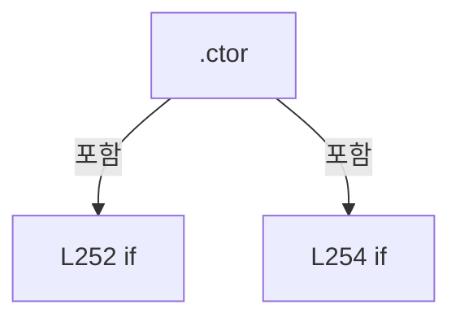

변경 전 점검: 입력/반환 타입, 위 호출자, 예외/취소 경로, 공유 상태와 저장·전송 소비자를 함께 확인합니다. 값의 단위나 물리 방향을 이름만으로 확정하지 않습니다.

### MethodDeclaration `Check` · L261–270

[Drilling.Common/Station/CStageReviewSequences.cs:261–270](https://github.com/kjuws10-rgb/A3Drilling/blob/5aee8e58439c9b455cae7c9593c9be986c3e682e/Drilling.Common/Station/CStageReviewSequences.cs#L261-L270)

| 항목 | 실제 추출 값 |
| --- | --- |
| 서명 | void Drilling.Common.Station.CStageReviewSequences.Session.Check(System.Threading.CancellationToken, bool) |
| 접근/수식자 | Private / private |
| 반환/값 타입 | void |
| 소속 타입 | NamedType:Drilling.Common.Station.CStageReviewSequences.Session |

입력 계약:

| 이름 | 타입 | 전달 | 선택/기본값 |
| --- | --- | --- | --- |
| token | System.Threading.CancellationToken | None | False /  |
| cleanup | bool | None | True / false |

정적 호출자로 확인된 위치:

| 호출 파일/행 | 호출 표현식 | 런타임 분기 가능 |
| --- | --- | --- |
| [Drilling.Common/Station/CStageReviewSequences.cs:305–305](https://github.com/kjuws10-rgb/A3Drilling/blob/5aee8e58439c9b455cae7c9593c9be986c3e682e/Drilling.Common/Station/CStageReviewSequences.cs#L305-L305) | Check | False |
| [Drilling.Common/Station/CStageReviewSequences.cs:316–316](https://github.com/kjuws10-rgb/A3Drilling/blob/5aee8e58439c9b455cae7c9593c9be986c3e682e/Drilling.Common/Station/CStageReviewSequences.cs#L316-L316) | Check | False |
| [Drilling.Common/Station/CStageReviewSequences.cs:329–329](https://github.com/kjuws10-rgb/A3Drilling/blob/5aee8e58439c9b455cae7c9593c9be986c3e682e/Drilling.Common/Station/CStageReviewSequences.cs#L329-L329) | Check | False |
| [Drilling.Common/Station/CStageReviewSequences.cs:417–417](https://github.com/kjuws10-rgb/A3Drilling/blob/5aee8e58439c9b455cae7c9593c9be986c3e682e/Drilling.Common/Station/CStageReviewSequences.cs#L417-L417) | Check | False |
| [Drilling.Common/Station/CStageReviewSequences.cs:484–484](https://github.com/kjuws10-rgb/A3Drilling/blob/5aee8e58439c9b455cae7c9593c9be986c3e682e/Drilling.Common/Station/CStageReviewSequences.cs#L484-L484) | Check | False |
| [Drilling.Common/Station/CStageReviewSequences.cs:559–559](https://github.com/kjuws10-rgb/A3Drilling/blob/5aee8e58439c9b455cae7c9593c9be986c3e682e/Drilling.Common/Station/CStageReviewSequences.cs#L559-L559) | Check | False |
| [Drilling.Common/Station/CStageReviewSequences.cs:645–645](https://github.com/kjuws10-rgb/A3Drilling/blob/5aee8e58439c9b455cae7c9593c9be986c3e682e/Drilling.Common/Station/CStageReviewSequences.cs#L645-L645) | Check | False |
| [Drilling.Common/Station/CStageReviewSequences.cs:666–666](https://github.com/kjuws10-rgb/A3Drilling/blob/5aee8e58439c9b455cae7c9593c9be986c3e682e/Drilling.Common/Station/CStageReviewSequences.cs#L666-L666) | Check | False |
| [Drilling.Common/Station/CStageReviewSequences.cs:760–760](https://github.com/kjuws10-rgb/A3Drilling/blob/5aee8e58439c9b455cae7c9593c9be986c3e682e/Drilling.Common/Station/CStageReviewSequences.cs#L760-L760) | Check | False |
| [Drilling.Common/Station/CStageReviewSequences.cs:847–847](https://github.com/kjuws10-rgb/A3Drilling/blob/5aee8e58439c9b455cae7c9593c9be986c3e682e/Drilling.Common/Station/CStageReviewSequences.cs#L847-L847) | Check | False |
| [Drilling.Common/Station/CStageReviewSequences.cs:883–883](https://github.com/kjuws10-rgb/A3Drilling/blob/5aee8e58439c9b455cae7c9593c9be986c3e682e/Drilling.Common/Station/CStageReviewSequences.cs#L883-L883) | Check | False |
| [Drilling.Common/Station/CStageReviewSequences.cs:889–889](https://github.com/kjuws10-rgb/A3Drilling/blob/5aee8e58439c9b455cae7c9593c9be986c3e682e/Drilling.Common/Station/CStageReviewSequences.cs#L889-L889) | Check | False |

호출하는 대상과 해석 범위:

| 원본 행 | 표현식 | 분석 상태 | 대상/소스 위치 |
| --- | --- | --- | --- |
| 263 | ObjectDisposedException.ThrowIf | resolved | void System.ObjectDisposedException.ThrowIf(bool, object) |
| 264 | token.ThrowIfCancellationRequested | resolved | void System.Threading.CancellationToken.ThrowIfCancellationRequested() |
| 265 | _stopRequested | resolved · 동적 구현 선택 가능 | bool System.Func<bool>.Invoke() |
| 266 | new OperationCanceledException | resolved | System.OperationCanceledException.OperationCanceledException(string?) |
| 267 | _interfaces.GetInterfaceCommunicationList(EN_EQP_MODULE.Melsec).SingleOrDefault | resolved | Drilling.Common.Interface.ST_INTERFACE_COMM_STATUS? System.Collections.Generic.IEnumerable<Drilling.Common.Interface.ST_INTERFACE_COMM_STATUS>.SingleOrDefault<Drilling.Common.Interface.ST_INTERFACE_COMM_STATUS>(System.Func<Drilling.Common.Interface.ST_INTERFACE_COMM_STATUS, bool>) |
| 267 | _interfaces.GetInterfaceCommunicationList | resolved | System.Collections.Generic.IReadOnlyList<Drilling.Common.Interface.ST_INTERFACE_COMM_STATUS> Drilling.Common.Interface.CInterfaceManager.GetInterfaceCommunicationList(Drilling.Common.Interface.EN_EQP_MODULE?) · Drilling.Common/Interface/CInterfaceManager.cs:472 |
| 269 | new InvalidOperationException | resolved | System.InvalidOperationException.InvalidOperationException(string?) |

본문의 실제 연산·분기·예외·반환 순서(원문 위치 순):

| 원본 행 | 종류 | 주석 해설 |
| --- | --- | --- |
| 263 | call | 함수·델리게이트 또는 객체 생성자를 호출합니다: ObjectDisposedException.ThrowIf(_disposed, this) |
| 264 | call | 함수·델리게이트 또는 객체 생성자를 호출합니다: token.ThrowIfCancellationRequested() |
| 265 | call | 함수·델리게이트 또는 객체 생성자를 호출합니다: _stopRequested() |
| 265 | if | 조건에 따라 분기합니다: if (!cleanup && _stopRequested()) |
| 266 | call | 함수·델리게이트 또는 객체 생성자를 호출합니다: new OperationCanceledException("Review Stop") |
| 266 | throw | 예외를 발생/전달합니다: throw new OperationCanceledException("Review Stop"); |
| 267 | call | 함수·델리게이트 또는 객체 생성자를 호출합니다: _interfaces.GetInterfaceCommunicationList(EN_EQP_MODULE.Melsec).SingleOrDefault(item => item.Number == _device) |
| 267 | call | 함수·델리게이트 또는 객체 생성자를 호출합니다: _interfaces.GetInterfaceCommunicationList(EN_EQP_MODULE.Melsec) |
| 267 | local-declaration | 지역 변수를 선언합니다: var state = _interfaces.GetInterfaceCommunicationList(EN_EQP_MODULE.Melsec).SingleOrDefault(item => item.Number == _device); |
| 267 | variable-initializer | 변수의 초기값을 지정합니다: state = _interfaces.GetInterfaceCommunicationList(EN_EQP_MODULE.Melsec).SingleOrDefault(item => item.Number == _device) |
| 268 | if | 조건에 따라 분기합니다: if (state is not null && (state.IsSimulation != _simulation &#124;&#124; !_simulation && state.ConnectionState != EN_COMM_STATE.Online)) |
| 269 | call | 함수·델리게이트 또는 객체 생성자를 호출합니다: new InvalidOperationException("Stage 동작 중 MELSEC 모드 또는 연결 상태가 변경되었습니다.") |
| 269 | throw | 예외를 발생/전달합니다: throw new InvalidOperationException("Stage 동작 중 MELSEC 모드 또는 연결 상태가 변경되었습니다."); |

제어 구문의 포함 구조(실제 실행 순서/CFG가 아닌 구문 탐색 그림):

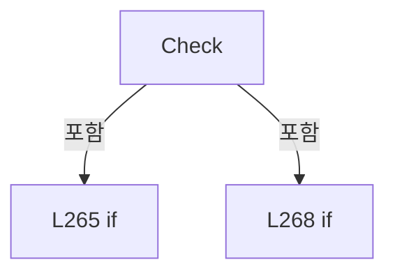

변경 전 점검: 입력/반환 타입, 위 호출자, 예외/취소 경로, 공유 상태와 저장·전송 소비자를 함께 확인합니다. 값의 단위나 물리 방향을 이름만으로 확정하지 않습니다.

### MethodDeclaration `Route` · L272–278

[Drilling.Common/Station/CStageReviewSequences.cs:272–278](https://github.com/kjuws10-rgb/A3Drilling/blob/5aee8e58439c9b455cae7c9593c9be986c3e682e/Drilling.Common/Station/CStageReviewSequences.cs#L272-L278)

| 항목 | 실제 추출 값 |
| --- | --- |
| 서명 | Drilling.Common.Interface.ST_MELSEC_MAP_DATA Drilling.Common.Station.CStageReviewSequences.Session.Route(string) |
| 접근/수식자 | Private / private |
| 반환/값 타입 | Drilling.Common.Interface.ST_MELSEC_MAP_DATA |
| 소속 타입 | NamedType:Drilling.Common.Station.CStageReviewSequences.Session |

입력 계약:

| 이름 | 타입 | 전달 | 선택/기본값 |
| --- | --- | --- | --- |
| id | string | None | False /  |

정적 호출자로 확인된 위치:

| 호출 파일/행 | 호출 표현식 | 런타임 분기 가능 |
| --- | --- | --- |
| [Drilling.Common/Station/CStageReviewSequences.cs:282–282](https://github.com/kjuws10-rgb/A3Drilling/blob/5aee8e58439c9b455cae7c9593c9be986c3e682e/Drilling.Common/Station/CStageReviewSequences.cs#L282-L282) | Route | False |
| [Drilling.Common/Station/CStageReviewSequences.cs:296–296](https://github.com/kjuws10-rgb/A3Drilling/blob/5aee8e58439c9b455cae7c9593c9be986c3e682e/Drilling.Common/Station/CStageReviewSequences.cs#L296-L296) | Route | False |
| [Drilling.Common/Station/CStageReviewSequences.cs:306–306](https://github.com/kjuws10-rgb/A3Drilling/blob/5aee8e58439c9b455cae7c9593c9be986c3e682e/Drilling.Common/Station/CStageReviewSequences.cs#L306-L306) | Route | False |
| [Drilling.Common/Station/CStageReviewSequences.cs:330–330](https://github.com/kjuws10-rgb/A3Drilling/blob/5aee8e58439c9b455cae7c9593c9be986c3e682e/Drilling.Common/Station/CStageReviewSequences.cs#L330-L330) | Route | False |
| [Drilling.Common/Station/CStageReviewSequences.cs:372–372](https://github.com/kjuws10-rgb/A3Drilling/blob/5aee8e58439c9b455cae7c9593c9be986c3e682e/Drilling.Common/Station/CStageReviewSequences.cs#L372-L372) | Route | False |
| [Drilling.Common/Station/CStageReviewSequences.cs:422–422](https://github.com/kjuws10-rgb/A3Drilling/blob/5aee8e58439c9b455cae7c9593c9be986c3e682e/Drilling.Common/Station/CStageReviewSequences.cs#L422-L422) | Route | False |
| [Drilling.Common/Station/CStageReviewSequences.cs:485–485](https://github.com/kjuws10-rgb/A3Drilling/blob/5aee8e58439c9b455cae7c9593c9be986c3e682e/Drilling.Common/Station/CStageReviewSequences.cs#L485-L485) | Route | False |
| [Drilling.Common/Station/CStageReviewSequences.cs:487–487](https://github.com/kjuws10-rgb/A3Drilling/blob/5aee8e58439c9b455cae7c9593c9be986c3e682e/Drilling.Common/Station/CStageReviewSequences.cs#L487-L487) | Route | False |
| [Drilling.Common/Station/CStageReviewSequences.cs:783–783](https://github.com/kjuws10-rgb/A3Drilling/blob/5aee8e58439c9b455cae7c9593c9be986c3e682e/Drilling.Common/Station/CStageReviewSequences.cs#L783-L783) | Route | False |
| [Drilling.Common/Station/CStageReviewSequences.cs:919–919](https://github.com/kjuws10-rgb/A3Drilling/blob/5aee8e58439c9b455cae7c9593c9be986c3e682e/Drilling.Common/Station/CStageReviewSequences.cs#L919-L919) | Route | False |

호출하는 대상과 해석 범위:

| 원본 행 | 표현식 | 분석 상태 | 대상/소스 위치 |
| --- | --- | --- | --- |
| 274 | _interfaces.Melsec.GetMapData | resolved | Drilling.Common.Interface.ST_MELSEC_MAP_DATA Drilling.Common.Interface.CMelsec.GetMapData(string) · Drilling.Common/Interface/Melsec/CMelsec.cs:309 |
| 276 | new InvalidOperationException | resolved | System.InvalidOperationException.InvalidOperationException(string?) |

본문의 실제 연산·분기·예외·반환 순서(원문 위치 순):

| 원본 행 | 종류 | 주석 해설 |
| --- | --- | --- |
| 274 | call | 함수·델리게이트 또는 객체 생성자를 호출합니다: _interfaces.Melsec.GetMapData(id) |
| 274 | local-declaration | 지역 변수를 선언합니다: var row = _interfaces.Melsec.GetMapData(id); |
| 274 | variable-initializer | 변수의 초기값을 지정합니다: row = _interfaces.Melsec.GetMapData(id) |
| 275 | if | 조건에 따라 분기합니다: if (!row.Use &#124;&#124; row.DeviceNo != _device) |
| 276 | call | 함수·델리게이트 또는 객체 생성자를 호출합니다: new InvalidOperationException($"Stage 공통 시퀀스 맵을 확인해 주세요: {id} / MELSEC_{_device}") |
| 276 | throw | 예외를 발생/전달합니다: throw new InvalidOperationException($"Stage 공통 시퀀스 맵을 확인해 주세요: {id} / MELSEC_{_device}"); |
| 277 | return | 호출자에게 값 또는 제어를 반환합니다: return row; |

제어 구문의 포함 구조(실제 실행 순서/CFG가 아닌 구문 탐색 그림):

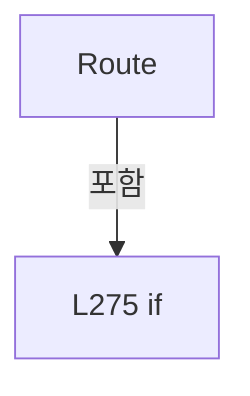

변경 전 점검: 입력/반환 타입, 위 호출자, 예외/취소 경로, 공유 상태와 저장·전송 소비자를 함께 확인합니다. 값의 단위나 물리 방향을 이름만으로 확정하지 않습니다.

### MethodDeclaration `Value` · L280–290

[Drilling.Common/Station/CStageReviewSequences.cs:280–290](https://github.com/kjuws10-rgb/A3Drilling/blob/5aee8e58439c9b455cae7c9593c9be986c3e682e/Drilling.Common/Station/CStageReviewSequences.cs#L280-L290)

| 항목 | 실제 추출 값 |
| --- | --- |
| 서명 | double Drilling.Common.Station.CStageReviewSequences.Session.Value(string) |
| 접근/수식자 | Private / private |
| 반환/값 타입 | double |
| 소속 타입 | NamedType:Drilling.Common.Station.CStageReviewSequences.Session |

입력 계약:

| 이름 | 타입 | 전달 | 선택/기본값 |
| --- | --- | --- | --- |
| id | string | None | False /  |

정적 호출자로 확인된 위치:

| 호출 파일/행 | 호출 표현식 | 런타임 분기 가능 |
| --- | --- | --- |
| [Drilling.Common/Station/CStageReviewSequences.cs:292–292](https://github.com/kjuws10-rgb/A3Drilling/blob/5aee8e58439c9b455cae7c9593c9be986c3e682e/Drilling.Common/Station/CStageReviewSequences.cs#L292-L292) | Value | False |
| [Drilling.Common/Station/CStageReviewSequences.cs:317–317](https://github.com/kjuws10-rgb/A3Drilling/blob/5aee8e58439c9b455cae7c9593c9be986c3e682e/Drilling.Common/Station/CStageReviewSequences.cs#L317-L317) | Value | False |
| [Drilling.Common/Station/CStageReviewSequences.cs:419–419](https://github.com/kjuws10-rgb/A3Drilling/blob/5aee8e58439c9b455cae7c9593c9be986c3e682e/Drilling.Common/Station/CStageReviewSequences.cs#L419-L419) | Value | False |
| [Drilling.Common/Station/CStageReviewSequences.cs:567–567](https://github.com/kjuws10-rgb/A3Drilling/blob/5aee8e58439c9b455cae7c9593c9be986c3e682e/Drilling.Common/Station/CStageReviewSequences.cs#L567-L567) | Value | False |
| [Drilling.Common/Station/CStageReviewSequences.cs:567–567](https://github.com/kjuws10-rgb/A3Drilling/blob/5aee8e58439c9b455cae7c9593c9be986c3e682e/Drilling.Common/Station/CStageReviewSequences.cs#L567-L567) | Value | False |
| [Drilling.Common/Station/CStageReviewSequences.cs:737–737](https://github.com/kjuws10-rgb/A3Drilling/blob/5aee8e58439c9b455cae7c9593c9be986c3e682e/Drilling.Common/Station/CStageReviewSequences.cs#L737-L737) | Value | False |
| [Drilling.Common/Station/CStageReviewSequences.cs:770–770](https://github.com/kjuws10-rgb/A3Drilling/blob/5aee8e58439c9b455cae7c9593c9be986c3e682e/Drilling.Common/Station/CStageReviewSequences.cs#L770-L770) | Value | False |
| [Drilling.Common/Station/CStageReviewSequences.cs:770–770](https://github.com/kjuws10-rgb/A3Drilling/blob/5aee8e58439c9b455cae7c9593c9be986c3e682e/Drilling.Common/Station/CStageReviewSequences.cs#L770-L770) | Value | False |

호출하는 대상과 해석 범위:

| 원본 행 | 표현식 | 분석 상태 | 대상/소스 위치 |
| --- | --- | --- | --- |
| 282 | Route | resolved | Drilling.Common.Interface.ST_MELSEC_MAP_DATA Drilling.Common.Station.CStageReviewSequences.Session.Route(string) · Drilling.Common/Station/CStageReviewSequences.cs:272 |
| 283 | _interfaces.Melsec.GetCachedValue | resolved | Drilling.Common.Interface.ST_MELSEC_CACHED_VALUE? Drilling.Common.Interface.CMelsec.GetCachedValue(string) · Drilling.Common/Interface/Melsec/CMelsec.cs:2568 |
| 285 | new InvalidOperationException | resolved | System.InvalidOperationException.InvalidOperationException(string?) |
| 285 | Describe | resolved | string Drilling.Common.Station.CStageReviewSequences.Session.Describe(string) · Drilling.Common/Station/CStageReviewSequences.cs:294 |
| 286 | Convert.ToDouble | resolved | double System.Convert.ToDouble(object?, System.IFormatProvider?) |
| 287 | double.IsFinite | resolved | bool double.IsFinite(double) |
| 288 | new InvalidOperationException | resolved | System.InvalidOperationException.InvalidOperationException(string?) |

본문의 실제 연산·분기·예외·반환 순서(원문 위치 순):

| 원본 행 | 종류 | 주석 해설 |
| --- | --- | --- |
| 282 | call | 함수·델리게이트 또는 객체 생성자를 호출합니다: Route(id) |
| 283 | call | 함수·델리게이트 또는 객체 생성자를 호출합니다: _interfaces.Melsec.GetCachedValue(id) |
| 283 | local-declaration | 지역 변수를 선언합니다: var sample = _interfaces.Melsec.GetCachedValue(id); |
| 283 | variable-initializer | 변수의 초기값을 지정합니다: sample = _interfaces.Melsec.GetCachedValue(id) |
| 284 | if | 조건에 따라 분기합니다: if (sample?.IsValid != true &#124;&#124; sample.Value is null) |
| 285 | call | 함수·델리게이트 또는 객체 생성자를 호출합니다: new InvalidOperationException($"Stage 신호가 유효하지 않습니다: {Describe(id)}") |
| 285 | call | 함수·델리게이트 또는 객체 생성자를 호출합니다: Describe(id) |
| 285 | throw | 예외를 발생/전달합니다: throw new InvalidOperationException($"Stage 신호가 유효하지 않습니다: {Describe(id)}"); |
| 286 | call | 함수·델리게이트 또는 객체 생성자를 호출합니다: Convert.ToDouble(sample.Value, CultureInfo.InvariantCulture) |
| 286 | local-declaration | 지역 변수를 선언합니다: var result = Convert.ToDouble(sample.Value, CultureInfo.InvariantCulture); |
| 286 | variable-initializer | 변수의 초기값을 지정합니다: result = Convert.ToDouble(sample.Value, CultureInfo.InvariantCulture) |
| 287 | call | 함수·델리게이트 또는 객체 생성자를 호출합니다: double.IsFinite(result) |
| 287 | if | 조건에 따라 분기합니다: if (!double.IsFinite(result)) |
| 288 | call | 함수·델리게이트 또는 객체 생성자를 호출합니다: new InvalidOperationException($"Stage 값이 유효하지 않습니다: {id}") |
| 288 | throw | 예외를 발생/전달합니다: throw new InvalidOperationException($"Stage 값이 유효하지 않습니다: {id}"); |
| 289 | return | 호출자에게 값 또는 제어를 반환합니다: return result; |

제어 구문의 포함 구조(실제 실행 순서/CFG가 아닌 구문 탐색 그림):

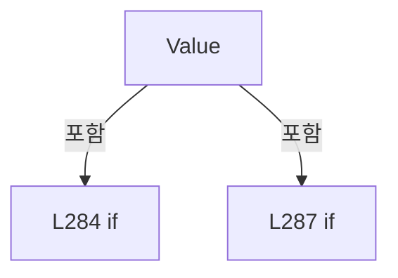

변경 전 점검: 입력/반환 타입, 위 호출자, 예외/취소 경로, 공유 상태와 저장·전송 소비자를 함께 확인합니다. 값의 단위나 물리 방향을 이름만으로 확정하지 않습니다.

### MethodDeclaration `Feedback` · L292–292

[Drilling.Common/Station/CStageReviewSequences.cs:292–292](https://github.com/kjuws10-rgb/A3Drilling/blob/5aee8e58439c9b455cae7c9593c9be986c3e682e/Drilling.Common/Station/CStageReviewSequences.cs#L292-L292)

| 항목 | 실제 추출 값 |
| --- | --- |
| 서명 | double Drilling.Common.Station.CStageReviewSequences.Session.Feedback(string) |
| 접근/수식자 | Private / private |
| 반환/값 타입 | double |
| 소속 타입 | NamedType:Drilling.Common.Station.CStageReviewSequences.Session |

입력 계약:

| 이름 | 타입 | 전달 | 선택/기본값 |
| --- | --- | --- | --- |
| id | string | None | False /  |

정적 호출자로 확인된 위치:

| 호출 파일/행 | 호출 표현식 | 런타임 분기 가능 |
| --- | --- | --- |
| [Drilling.Common/Station/CStageReviewSequences.cs:238–238](https://github.com/kjuws10-rgb/A3Drilling/blob/5aee8e58439c9b455cae7c9593c9be986c3e682e/Drilling.Common/Station/CStageReviewSequences.cs#L238-L238) | Feedback | False |
| [Drilling.Common/Station/CStageReviewSequences.cs:239–239](https://github.com/kjuws10-rgb/A3Drilling/blob/5aee8e58439c9b455cae7c9593c9be986c3e682e/Drilling.Common/Station/CStageReviewSequences.cs#L239-L239) | Feedback | False |
| [Drilling.Common/Station/CStageReviewSequences.cs:918–918](https://github.com/kjuws10-rgb/A3Drilling/blob/5aee8e58439c9b455cae7c9593c9be986c3e682e/Drilling.Common/Station/CStageReviewSequences.cs#L918-L918) | Feedback | False |

호출하는 대상과 해석 범위:

| 원본 행 | 표현식 | 분석 상태 | 대상/소스 위치 |
| --- | --- | --- | --- |
| 292 | _interfaces.GetStageMotionSimulationFeedback | resolved | System.Collections.Generic.IReadOnlyDictionary<string, double> Drilling.Common.Interface.CInterfaceManager.GetStageMotionSimulationFeedback(int?) · Drilling.Common/Interface/CInterfaceManager.cs:2168 |
| 292 | Value | resolved | double Drilling.Common.Station.CStageReviewSequences.Session.Value(string) · Drilling.Common/Station/CStageReviewSequences.cs:280 |

본문의 실제 연산·분기·예외·반환 순서(원문 위치 순):

| 원본 행 | 종류 | 주석 해설 |
| --- | --- | --- |
| 292 | call | 함수·델리게이트 또는 객체 생성자를 호출합니다: _interfaces.GetStageMotionSimulationFeedback(_device) |
| 292 | call | 함수·델리게이트 또는 객체 생성자를 호출합니다: Value(id) |
| 292 | conditional-expression | 조건에 따라 결과식을 선택합니다: _simulation ? _interfaces.GetStageMotionSimulationFeedback(_device)[id] : Value(id) |

변경 전 점검: 입력/반환 타입, 위 호출자, 예외/취소 경로, 공유 상태와 저장·전송 소비자를 함께 확인합니다. 값의 단위나 물리 방향을 이름만으로 확정하지 않습니다.

### MethodDeclaration `Describe` · L294–299

[Drilling.Common/Station/CStageReviewSequences.cs:294–299](https://github.com/kjuws10-rgb/A3Drilling/blob/5aee8e58439c9b455cae7c9593c9be986c3e682e/Drilling.Common/Station/CStageReviewSequences.cs#L294-L299)

| 항목 | 실제 추출 값 |
| --- | --- |
| 서명 | string Drilling.Common.Station.CStageReviewSequences.Session.Describe(string) |
| 접근/수식자 | Private / private |
| 반환/값 타입 | string |
| 소속 타입 | NamedType:Drilling.Common.Station.CStageReviewSequences.Session |

입력 계약:

| 이름 | 타입 | 전달 | 선택/기본값 |
| --- | --- | --- | --- |
| id | string | None | False /  |

정적 호출자로 확인된 위치:

| 호출 파일/행 | 호출 표현식 | 런타임 분기 가능 |
| --- | --- | --- |
| [Drilling.Common/Station/CStageReviewSequences.cs:285–285](https://github.com/kjuws10-rgb/A3Drilling/blob/5aee8e58439c9b455cae7c9593c9be986c3e682e/Drilling.Common/Station/CStageReviewSequences.cs#L285-L285) | Describe | False |
| [Drilling.Common/Station/CStageReviewSequences.cs:310–310](https://github.com/kjuws10-rgb/A3Drilling/blob/5aee8e58439c9b455cae7c9593c9be986c3e682e/Drilling.Common/Station/CStageReviewSequences.cs#L310-L310) | Describe | False |
| [Drilling.Common/Station/CStageReviewSequences.cs:312–312](https://github.com/kjuws10-rgb/A3Drilling/blob/5aee8e58439c9b455cae7c9593c9be986c3e682e/Drilling.Common/Station/CStageReviewSequences.cs#L312-L312) | Describe | False |
| [Drilling.Common/Station/CStageReviewSequences.cs:322–322](https://github.com/kjuws10-rgb/A3Drilling/blob/5aee8e58439c9b455cae7c9593c9be986c3e682e/Drilling.Common/Station/CStageReviewSequences.cs#L322-L322) | Describe | False |
| [Drilling.Common/Station/CStageReviewSequences.cs:323–323](https://github.com/kjuws10-rgb/A3Drilling/blob/5aee8e58439c9b455cae7c9593c9be986c3e682e/Drilling.Common/Station/CStageReviewSequences.cs#L323-L323) | Describe | False |
| [Drilling.Common/Station/CStageReviewSequences.cs:447–447](https://github.com/kjuws10-rgb/A3Drilling/blob/5aee8e58439c9b455cae7c9593c9be986c3e682e/Drilling.Common/Station/CStageReviewSequences.cs#L447-L447) | Describe | False |
| [Drilling.Common/Station/CStageReviewSequences.cs:449–449](https://github.com/kjuws10-rgb/A3Drilling/blob/5aee8e58439c9b455cae7c9593c9be986c3e682e/Drilling.Common/Station/CStageReviewSequences.cs#L449-L449) | Describe | False |
| [Drilling.Common/Station/CStageReviewSequences.cs:875–875](https://github.com/kjuws10-rgb/A3Drilling/blob/5aee8e58439c9b455cae7c9593c9be986c3e682e/Drilling.Common/Station/CStageReviewSequences.cs#L875-L875) | Describe | False |
| [Drilling.Common/Station/CStageReviewSequences.cs:924–924](https://github.com/kjuws10-rgb/A3Drilling/blob/5aee8e58439c9b455cae7c9593c9be986c3e682e/Drilling.Common/Station/CStageReviewSequences.cs#L924-L924) | Describe | False |

호출하는 대상과 해석 범위:

| 원본 행 | 표현식 | 분석 상태 | 대상/소스 위치 |
| --- | --- | --- | --- |
| 296 | Route | resolved | Drilling.Common.Interface.ST_MELSEC_MAP_DATA Drilling.Common.Station.CStageReviewSequences.Session.Route(string) · Drilling.Common/Station/CStageReviewSequences.cs:272 |
| 297 | _interfaces.Melsec.GetCachedValue | resolved | Drilling.Common.Interface.ST_MELSEC_CACHED_VALUE? Drilling.Common.Interface.CMelsec.GetCachedValue(string) · Drilling.Common/Interface/Melsec/CMelsec.cs:2568 |
| 298 | FormattableString.Invariant | resolved | string System.FormattableString.Invariant(System.FormattableString) |

본문의 실제 연산·분기·예외·반환 순서(원문 위치 순):

| 원본 행 | 종류 | 주석 해설 |
| --- | --- | --- |
| 296 | call | 함수·델리게이트 또는 객체 생성자를 호출합니다: Route(id) |
| 296 | local-declaration | 지역 변수를 선언합니다: var row = Route(id); |
| 296 | variable-initializer | 변수의 초기값을 지정합니다: row = Route(id) |
| 297 | call | 함수·델리게이트 또는 객체 생성자를 호출합니다: _interfaces.Melsec.GetCachedValue(id) |
| 297 | local-declaration | 지역 변수를 선언합니다: var sample = _interfaces.Melsec.GetCachedValue(id); |
| 297 | variable-initializer | 변수의 초기값을 지정합니다: sample = _interfaces.Melsec.GetCachedValue(id) |
| 298 | call | 함수·델리게이트 또는 객체 생성자를 호출합니다: FormattableString.Invariant($"{id}; Address={row.Address}; Value={sample?.Value}; State={sample?.State}; SampleAt={sample?.UpdatedAt:O}; AgeMs={(sample?.UpdatedAt is { } at ? (DateTimeOffset.UtcNow - at).TotalMillisecond… |
| 298 | conditional-expression | 조건에 따라 결과식을 선택합니다: sample?.UpdatedAt is { } at ? (DateTimeOffset.UtcNow - at).TotalMilliseconds : (double?)null |
| 298 | return | 호출자에게 값 또는 제어를 반환합니다: return FormattableString.Invariant($"{id}; Address={row.Address}; Value={sample?.Value}; State={sample?.State}; SampleAt={sample?.UpdatedAt:O}; AgeMs={(sample?.UpdatedAt is { } at ? (DateTimeOffset.UtcNow - at).TotalMilliseconds : |

변경 전 점검: 입력/반환 타입, 위 호출자, 예외/취소 경로, 공유 상태와 저장·전송 소비자를 함께 확인합니다. 값의 단위나 물리 방향을 이름만으로 확정하지 않습니다.

### MethodDeclaration `RefreshInputs` · L301–326

[Drilling.Common/Station/CStageReviewSequences.cs:301–326](https://github.com/kjuws10-rgb/A3Drilling/blob/5aee8e58439c9b455cae7c9593c9be986c3e682e/Drilling.Common/Station/CStageReviewSequences.cs#L301-L326)

| 항목 | 실제 추출 값 |
| --- | --- |
| 서명 | System.Threading.Tasks.Task Drilling.Common.Station.CStageReviewSequences.Session.RefreshInputs(System.Collections.Generic.IEnumerable<string>, System.Threading.CancellationToken, bool) |
| 접근/수식자 | Private / private, async |
| 반환/값 타입 | System.Threading.Tasks.Task |
| 소속 타입 | NamedType:Drilling.Common.Station.CStageReviewSequences.Session |

입력 계약:

| 이름 | 타입 | 전달 | 선택/기본값 |
| --- | --- | --- | --- |
| ids | System.Collections.Generic.IEnumerable<string> | None | False /  |
| token | System.Threading.CancellationToken | None | False /  |
| cleanup | bool | None | True / false |

정적 호출자로 확인된 위치:

| 호출 파일/행 | 호출 표현식 | 런타임 분기 가능 |
| --- | --- | --- |
| [Drilling.Common/Station/CStageReviewSequences.cs:418–418](https://github.com/kjuws10-rgb/A3Drilling/blob/5aee8e58439c9b455cae7c9593c9be986c3e682e/Drilling.Common/Station/CStageReviewSequences.cs#L418-L418) | RefreshInputs | False |
| [Drilling.Common/Station/CStageReviewSequences.cs:646–646](https://github.com/kjuws10-rgb/A3Drilling/blob/5aee8e58439c9b455cae7c9593c9be986c3e682e/Drilling.Common/Station/CStageReviewSequences.cs#L646-L646) | RefreshInputs | False |
| [Drilling.Common/Station/CStageReviewSequences.cs:667–667](https://github.com/kjuws10-rgb/A3Drilling/blob/5aee8e58439c9b455cae7c9593c9be986c3e682e/Drilling.Common/Station/CStageReviewSequences.cs#L667-L667) | RefreshInputs | False |
| [Drilling.Common/Station/CStageReviewSequences.cs:888–888](https://github.com/kjuws10-rgb/A3Drilling/blob/5aee8e58439c9b455cae7c9593c9be986c3e682e/Drilling.Common/Station/CStageReviewSequences.cs#L888-L888) | RefreshInputs | False |

호출하는 대상과 해석 범위:

| 원본 행 | 표현식 | 분석 상태 | 대상/소스 위치 |
| --- | --- | --- | --- |
| 303 | Task.WhenAll(ids.Distinct(StringComparer.OrdinalIgnoreCase).Select(async id => { Check(token, cleanup); Route(id); // A fresh central-poller read can recover Pending/Stale, but must not hide a known I/O failure. var before = _interfaces.Melsec.GetCachedValue(id); if (before?.State is EN_MELSEC_CACHE_STATE.Error or EN_MELSEC_CACHE_STATE.Offline) thr… | resolved | System.Runtime.CompilerServices.ConfiguredTaskAwaitable System.Threading.Tasks.Task.ConfigureAwait(bool) |
| 303 | Task.WhenAll | resolved | System.Threading.Tasks.Task System.Threading.Tasks.Task.WhenAll(System.Collections.Generic.IEnumerable<System.Threading.Tasks.Task>) |
| 303 | ids.Distinct(StringComparer.OrdinalIgnoreCase).Select | resolved | System.Collections.Generic.IEnumerable<System.Threading.Tasks.Task> System.Collections.Generic.IEnumerable<string>.Select<string, System.Threading.Tasks.Task>(System.Func<string, System.Threading.Tasks.Task>) |
| 303 | ids.Distinct | resolved | System.Collections.Generic.IEnumerable<string> System.Collections.Generic.IEnumerable<string>.Distinct<string>(System.Collections.Generic.IEqualityComparer<string>?) |
| 305 | Check | resolved | void Drilling.Common.Station.CStageReviewSequences.Session.Check(System.Threading.CancellationToken, bool) · Drilling.Common/Station/CStageReviewSequences.cs:261 |
| 306 | Route | resolved | Drilling.Common.Interface.ST_MELSEC_MAP_DATA Drilling.Common.Station.CStageReviewSequences.Session.Route(string) · Drilling.Common/Station/CStageReviewSequences.cs:272 |
| 308 | _interfaces.Melsec.GetCachedValue | resolved | Drilling.Common.Interface.ST_MELSEC_CACHED_VALUE? Drilling.Common.Interface.CMelsec.GetCachedValue(string) · Drilling.Common/Interface/Melsec/CMelsec.cs:2568 |
| 310 | new IOException | resolved | System.IO.IOException.IOException(string?) |
| 310 | Describe | resolved | string Drilling.Common.Station.CStageReviewSequences.Session.Describe(string) · Drilling.Common/Station/CStageReviewSequences.cs:294 |
| 312 | Record | resolved | void Drilling.Common.Station.CStageReviewSequences.Session.Record(string, string, double?) · Drilling.Common/Station/CStageReviewSequences.cs:236 |
| 312 | Describe | resolved | string Drilling.Common.Station.CStageReviewSequences.Session.Describe(string) · Drilling.Common/Station/CStageReviewSequences.cs:294 |
| 315 | _interfaces.Melsec.RefreshCachedValueAsync(id, token).ConfigureAwait | resolved | System.Runtime.CompilerServices.ConfiguredTaskAwaitable<Drilling.Common.Interface.ST_MELSEC_CACHED_VALUE> System.Threading.Tasks.Task<Drilling.Common.Interface.ST_MELSEC_CACHED_VALUE>.ConfigureAwait(bool) |
| 315 | _interfaces.Melsec.RefreshCachedValueAsync | resolved | System.Threading.Tasks.Task<Drilling.Common.Interface.ST_MELSEC_CACHED_VALUE> Drilling.Common.Interface.CMelsec.RefreshCachedValueAsync(string, System.Threading.CancellationToken) · Drilling.Common/Interface/Melsec/CMelsec.cs:2577 |
| 316 | Check | resolved | void Drilling.Common.Station.CStageReviewSequences.Session.Check(System.Threading.CancellationToken, bool) · Drilling.Common/Station/CStageReviewSequences.cs:261 |
| 317 | Value | resolved | double Drilling.Common.Station.CStageReviewSequences.Session.Value(string) · Drilling.Common/Station/CStageReviewSequences.cs:280 |
| 322 | new TimeoutException | resolved | System.TimeoutException.TimeoutException(string?, System.Exception?) |
| 322 | Describe | resolved | string Drilling.Common.Station.CStageReviewSequences.Session.Describe(string) · Drilling.Common/Station/CStageReviewSequences.cs:294 |
| 323 | new IOException | resolved | System.IO.IOException.IOException(string?, System.Exception?) |
| 323 | Describe | resolved | string Drilling.Common.Station.CStageReviewSequences.Session.Describe(string) · Drilling.Common/Station/CStageReviewSequences.cs:294 |

본문의 실제 연산·분기·예외·반환 순서(원문 위치 순):

| 원본 행 | 종류 | 주석 해설 |
| --- | --- | --- |
| 303 | call | 함수·델리게이트 또는 객체 생성자를 호출합니다: ids.Distinct(StringComparer.OrdinalIgnoreCase) |
| 303 | await | 비동기 완료를 기다립니다: await Task.WhenAll(ids.Distinct(StringComparer.OrdinalIgnoreCase).Select(async id => { Check(token, cleanup); Route(id); // A fresh central-poller read can recover Pending/Stale, but must not hide a known I/O failure. var before = |
| 303 | call | 함수·델리게이트 또는 객체 생성자를 호출합니다: Task.WhenAll(ids.Distinct(StringComparer.OrdinalIgnoreCase).Select(async id => { Check(token, cleanup); Route(id); // A fresh central-poller read can recover Pending/Stale, but must not hide a known I/O failure. var befo… |
| 303 | call | 함수·델리게이트 또는 객체 생성자를 호출합니다: Task.WhenAll(ids.Distinct(StringComparer.OrdinalIgnoreCase).Select(async id => { Check(token, cleanup); Route(id); // A fresh central-poller read can recover Pending/Stale, but must not hide a known I/O failure. var befo… |
| 303 | call | 함수·델리게이트 또는 객체 생성자를 호출합니다: ids.Distinct(StringComparer.OrdinalIgnoreCase).Select(async id => { Check(token, cleanup); Route(id); // A fresh central-poller read can recover Pending/Stale, but must not hide a known I/O failure. var before = _interfa… |
| 305 | call | 함수·델리게이트 또는 객체 생성자를 호출합니다: Check(token, cleanup) |
| 306 | call | 함수·델리게이트 또는 객체 생성자를 호출합니다: Route(id) |
| 308 | call | 함수·델리게이트 또는 객체 생성자를 호출합니다: _interfaces.Melsec.GetCachedValue(id) |
| 308 | local-declaration | 지역 변수를 선언합니다: var before = _interfaces.Melsec.GetCachedValue(id); |
| 308 | variable-initializer | 변수의 초기값을 지정합니다: before = _interfaces.Melsec.GetCachedValue(id) |
| 309 | if | 조건에 따라 분기합니다: if (before?.State is EN_MELSEC_CACHE_STATE.Error or EN_MELSEC_CACHE_STATE.Offline) |
| 310 | call | 함수·델리게이트 또는 객체 생성자를 호출합니다: new IOException("Stage 입력 수신 오류: " + Describe(id)) |
| 310 | call | 함수·델리게이트 또는 객체 생성자를 호출합니다: Describe(id) |
| 310 | throw | 예외를 발생/전달합니다: throw new IOException("Stage 입력 수신 오류: " + Describe(id)); |
| 311 | if | 조건에 따라 분기합니다: if (before?.IsValid != true) |
| 312 | call | 함수·델리게이트 또는 객체 생성자를 호출합니다: Record("SIGNAL_REFRESH_REQUIRED", Describe(id)) |
| 312 | call | 함수·델리게이트 또는 객체 생성자를 호출합니다: Describe(id) |
| 313 | try | 예외 처리 범위입니다: try |
| 315 | await | 비동기 완료를 기다립니다: await _interfaces.Melsec.RefreshCachedValueAsync(id, token).ConfigureAwait(false) |
| 315 | call | 함수·델리게이트 또는 객체 생성자를 호출합니다: _interfaces.Melsec.RefreshCachedValueAsync(id, token).ConfigureAwait(false) |
| 315 | call | 함수·델리게이트 또는 객체 생성자를 호출합니다: _interfaces.Melsec.RefreshCachedValueAsync(id, token) |
| 316 | call | 함수·델리게이트 또는 객체 생성자를 호출합니다: Check(token, cleanup) |
| 317 | assignment | 값을 대상에 대입합니다: _ = Value(id) |
| 317 | call | 함수·델리게이트 또는 객체 생성자를 호출합니다: Value(id) |
| 319 | catch | 지정 예외를 처리합니다: catch (Exception error) when (error is not OperationCanceledException) |
| 321 | if | 조건에 따라 분기합니다: if (error is TimeoutException) |
| 322 | call | 함수·델리게이트 또는 객체 생성자를 호출합니다: new TimeoutException("Stage 입력 갱신 시간 초과: " + Describe(id), error) |
| 322 | call | 함수·델리게이트 또는 객체 생성자를 호출합니다: Describe(id) |
| 322 | throw | 예외를 발생/전달합니다: throw new TimeoutException("Stage 입력 갱신 시간 초과: " + Describe(id), error); |
| 323 | call | 함수·델리게이트 또는 객체 생성자를 호출합니다: new IOException("Stage 입력 갱신 실패: " + Describe(id), error) |
| 323 | call | 함수·델리게이트 또는 객체 생성자를 호출합니다: Describe(id) |
| 323 | throw | 예외를 발생/전달합니다: throw new IOException("Stage 입력 갱신 실패: " + Describe(id), error); |

제어 구문의 포함 구조(실제 실행 순서/CFG가 아닌 구문 탐색 그림):

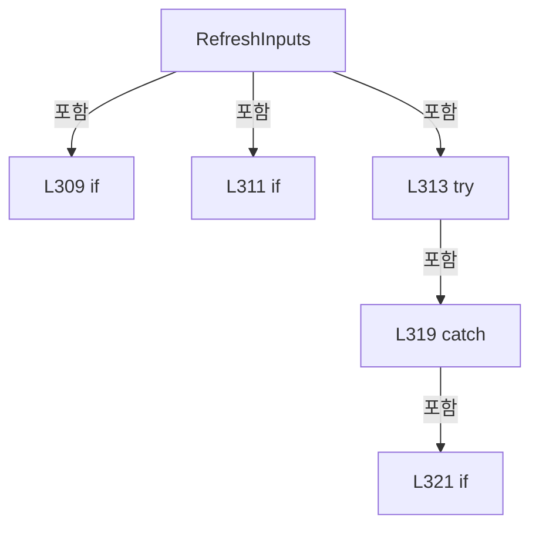

변경 전 점검: 입력/반환 타입, 위 호출자, 예외/취소 경로, 공유 상태와 저장·전송 소비자를 함께 확인합니다. 값의 단위나 물리 방향을 이름만으로 확정하지 않습니다.

### MethodDeclaration `Write` · L327–366

[Drilling.Common/Station/CStageReviewSequences.cs:327–366](https://github.com/kjuws10-rgb/A3Drilling/blob/5aee8e58439c9b455cae7c9593c9be986c3e682e/Drilling.Common/Station/CStageReviewSequences.cs#L327-L366)

| 항목 | 실제 추출 값 |
| --- | --- |
| 서명 | System.Threading.Tasks.Task Drilling.Common.Station.CStageReviewSequences.Session.Write(string, double, System.Threading.CancellationToken, bool) |
| 접근/수식자 | Private / private, async |
| 반환/값 타입 | System.Threading.Tasks.Task |
| 소속 타입 | NamedType:Drilling.Common.Station.CStageReviewSequences.Session |

입력 계약:

| 이름 | 타입 | 전달 | 선택/기본값 |
| --- | --- | --- | --- |
| id | string | None | False /  |
| value | double | None | False /  |
| token | System.Threading.CancellationToken | None | False /  |
| cleanup | bool | None | True / false |

정적 호출자로 확인된 위치:

| 호출 파일/행 | 호출 표현식 | 런타임 분기 가능 |
| --- | --- | --- |
| [Drilling.Common/Station/CStageReviewSequences.cs:571–571](https://github.com/kjuws10-rgb/A3Drilling/blob/5aee8e58439c9b455cae7c9593c9be986c3e682e/Drilling.Common/Station/CStageReviewSequences.cs#L571-L571) | Write | False |
| [Drilling.Common/Station/CStageReviewSequences.cs:572–572](https://github.com/kjuws10-rgb/A3Drilling/blob/5aee8e58439c9b455cae7c9593c9be986c3e682e/Drilling.Common/Station/CStageReviewSequences.cs#L572-L572) | Write | False |
| [Drilling.Common/Station/CStageReviewSequences.cs:573–573](https://github.com/kjuws10-rgb/A3Drilling/blob/5aee8e58439c9b455cae7c9593c9be986c3e682e/Drilling.Common/Station/CStageReviewSequences.cs#L573-L573) | Write | False |
| [Drilling.Common/Station/CStageReviewSequences.cs:574–574](https://github.com/kjuws10-rgb/A3Drilling/blob/5aee8e58439c9b455cae7c9593c9be986c3e682e/Drilling.Common/Station/CStageReviewSequences.cs#L574-L574) | Write | False |
| [Drilling.Common/Station/CStageReviewSequences.cs:575–575](https://github.com/kjuws10-rgb/A3Drilling/blob/5aee8e58439c9b455cae7c9593c9be986c3e682e/Drilling.Common/Station/CStageReviewSequences.cs#L575-L575) | Write | False |
| [Drilling.Common/Station/CStageReviewSequences.cs:576–576](https://github.com/kjuws10-rgb/A3Drilling/blob/5aee8e58439c9b455cae7c9593c9be986c3e682e/Drilling.Common/Station/CStageReviewSequences.cs#L576-L576) | Write | False |
| [Drilling.Common/Station/CStageReviewSequences.cs:590–590](https://github.com/kjuws10-rgb/A3Drilling/blob/5aee8e58439c9b455cae7c9593c9be986c3e682e/Drilling.Common/Station/CStageReviewSequences.cs#L590-L590) | Write | False |
| [Drilling.Common/Station/CStageReviewSequences.cs:609–609](https://github.com/kjuws10-rgb/A3Drilling/blob/5aee8e58439c9b455cae7c9593c9be986c3e682e/Drilling.Common/Station/CStageReviewSequences.cs#L609-L609) | Write | False |
| [Drilling.Common/Station/CStageReviewSequences.cs:610–610](https://github.com/kjuws10-rgb/A3Drilling/blob/5aee8e58439c9b455cae7c9593c9be986c3e682e/Drilling.Common/Station/CStageReviewSequences.cs#L610-L610) | Write | False |
| [Drilling.Common/Station/CStageReviewSequences.cs:613–613](https://github.com/kjuws10-rgb/A3Drilling/blob/5aee8e58439c9b455cae7c9593c9be986c3e682e/Drilling.Common/Station/CStageReviewSequences.cs#L613-L613) | Write | False |
| [Drilling.Common/Station/CStageReviewSequences.cs:691–691](https://github.com/kjuws10-rgb/A3Drilling/blob/5aee8e58439c9b455cae7c9593c9be986c3e682e/Drilling.Common/Station/CStageReviewSequences.cs#L691-L691) | Write | False |
| [Drilling.Common/Station/CStageReviewSequences.cs:692–692](https://github.com/kjuws10-rgb/A3Drilling/blob/5aee8e58439c9b455cae7c9593c9be986c3e682e/Drilling.Common/Station/CStageReviewSequences.cs#L692-L692) | Write | False |
| [Drilling.Common/Station/CStageReviewSequences.cs:693–693](https://github.com/kjuws10-rgb/A3Drilling/blob/5aee8e58439c9b455cae7c9593c9be986c3e682e/Drilling.Common/Station/CStageReviewSequences.cs#L693-L693) | Write | False |
| [Drilling.Common/Station/CStageReviewSequences.cs:698–698](https://github.com/kjuws10-rgb/A3Drilling/blob/5aee8e58439c9b455cae7c9593c9be986c3e682e/Drilling.Common/Station/CStageReviewSequences.cs#L698-L698) | Write | False |
| [Drilling.Common/Station/CStageReviewSequences.cs:704–704](https://github.com/kjuws10-rgb/A3Drilling/blob/5aee8e58439c9b455cae7c9593c9be986c3e682e/Drilling.Common/Station/CStageReviewSequences.cs#L704-L704) | Write | False |
| [Drilling.Common/Station/CStageReviewSequences.cs:705–705](https://github.com/kjuws10-rgb/A3Drilling/blob/5aee8e58439c9b455cae7c9593c9be986c3e682e/Drilling.Common/Station/CStageReviewSequences.cs#L705-L705) | Write | False |
| [Drilling.Common/Station/CStageReviewSequences.cs:725–725](https://github.com/kjuws10-rgb/A3Drilling/blob/5aee8e58439c9b455cae7c9593c9be986c3e682e/Drilling.Common/Station/CStageReviewSequences.cs#L725-L725) | Write | False |
| [Drilling.Common/Station/CStageReviewSequences.cs:726–726](https://github.com/kjuws10-rgb/A3Drilling/blob/5aee8e58439c9b455cae7c9593c9be986c3e682e/Drilling.Common/Station/CStageReviewSequences.cs#L726-L726) | Write | False |
| [Drilling.Common/Station/CStageReviewSequences.cs:727–727](https://github.com/kjuws10-rgb/A3Drilling/blob/5aee8e58439c9b455cae7c9593c9be986c3e682e/Drilling.Common/Station/CStageReviewSequences.cs#L727-L727) | Write | False |
| [Drilling.Common/Station/CStageReviewSequences.cs:728–728](https://github.com/kjuws10-rgb/A3Drilling/blob/5aee8e58439c9b455cae7c9593c9be986c3e682e/Drilling.Common/Station/CStageReviewSequences.cs#L728-L728) | Write | False |
| [Drilling.Common/Station/CStageReviewSequences.cs:730–730](https://github.com/kjuws10-rgb/A3Drilling/blob/5aee8e58439c9b455cae7c9593c9be986c3e682e/Drilling.Common/Station/CStageReviewSequences.cs#L730-L730) | Write | False |
| [Drilling.Common/Station/CStageReviewSequences.cs:776–776](https://github.com/kjuws10-rgb/A3Drilling/blob/5aee8e58439c9b455cae7c9593c9be986c3e682e/Drilling.Common/Station/CStageReviewSequences.cs#L776-L776) | Write | False |
| [Drilling.Common/Station/CStageReviewSequences.cs:777–777](https://github.com/kjuws10-rgb/A3Drilling/blob/5aee8e58439c9b455cae7c9593c9be986c3e682e/Drilling.Common/Station/CStageReviewSequences.cs#L777-L777) | Write | False |
| [Drilling.Common/Station/CStageReviewSequences.cs:797–797](https://github.com/kjuws10-rgb/A3Drilling/blob/5aee8e58439c9b455cae7c9593c9be986c3e682e/Drilling.Common/Station/CStageReviewSequences.cs#L797-L797) | Write | False |
| [Drilling.Common/Station/CStageReviewSequences.cs:807–807](https://github.com/kjuws10-rgb/A3Drilling/blob/5aee8e58439c9b455cae7c9593c9be986c3e682e/Drilling.Common/Station/CStageReviewSequences.cs#L807-L807) | Write | False |
| [Drilling.Common/Station/CStageReviewSequences.cs:808–808](https://github.com/kjuws10-rgb/A3Drilling/blob/5aee8e58439c9b455cae7c9593c9be986c3e682e/Drilling.Common/Station/CStageReviewSequences.cs#L808-L808) | Write | False |
| [Drilling.Common/Station/CStageReviewSequences.cs:812–812](https://github.com/kjuws10-rgb/A3Drilling/blob/5aee8e58439c9b455cae7c9593c9be986c3e682e/Drilling.Common/Station/CStageReviewSequences.cs#L812-L812) | Write | False |

호출하는 대상과 해석 범위:

| 원본 행 | 표현식 | 분석 상태 | 대상/소스 위치 |
| --- | --- | --- | --- |
| 329 | Check | resolved | void Drilling.Common.Station.CStageReviewSequences.Session.Check(System.Threading.CancellationToken, bool) · Drilling.Common/Station/CStageReviewSequences.cs:261 |
| 330 | Route | resolved | Drilling.Common.Interface.ST_MELSEC_MAP_DATA Drilling.Common.Station.CStageReviewSequences.Session.Route(string) · Drilling.Common/Station/CStageReviewSequences.cs:272 |
| 331 | Stopwatch.StartNew | resolved | System.Diagnostics.Stopwatch System.Diagnostics.Stopwatch.StartNew() |
| 332 | Record | resolved | void Drilling.Common.Station.CStageReviewSequences.Session.Record(string, string, double?) · Drilling.Common/Station/CStageReviewSequences.cs:236 |
| 332 | FormattableString.Invariant | resolved | string System.FormattableString.Invariant(System.FormattableString) |
| 334 | new InvalidOperationException | resolved | System.InvalidOperationException.InvalidOperationException(string?) |
| 335 | CancellationTokenSource.CreateLinkedTokenSource | resolved | System.Threading.CancellationTokenSource System.Threading.CancellationTokenSource.CreateLinkedTokenSource(System.Threading.CancellationToken) |
| 336 | limit.CancelAfter | resolved | void System.Threading.CancellationTokenSource.CancelAfter(System.TimeSpan) |
| 336 | TimeSpan.FromSeconds | resolved | System.TimeSpan System.TimeSpan.FromSeconds(long) |
| 339 | Task.Run(() => { if (row.DataType == EN_MELSEC_DATA_TYPE.Double) _interfaces.Melsec.WriteDouble(id, value, limit.Token); else _interfaces.Melsec.WriteWord(id, checked((int)value), limit.Token); }, limit.Token).ConfigureAwait | resolved | System.Runtime.CompilerServices.ConfiguredTaskAwaitable System.Threading.Tasks.Task.ConfigureAwait(bool) |
| 339 | Task.Run | resolved | System.Threading.Tasks.Task System.Threading.Tasks.Task.Run(System.Action, System.Threading.CancellationToken) |
| 342 | _interfaces.Melsec.WriteDouble | resolved | void Drilling.Common.Interface.CMelsec.WriteDouble(string, double, System.Threading.CancellationToken) · Drilling.Common/Interface/Melsec/CMelsec.cs:391 |
| 344 | _interfaces.Melsec.WriteWord | resolved | void Drilling.Common.Interface.CMelsec.WriteWord(string, double, System.Threading.CancellationToken) · Drilling.Common/Interface/Melsec/CMelsec.cs:371 |
| 346 | Record | resolved | void Drilling.Common.Station.CStageReviewSequences.Session.Record(string, string, double?) · Drilling.Common/Station/CStageReviewSequences.cs:236 |
| 347 | _interfaces.Melsec.RefreshCachedValueAsync(id, limit.Token).ConfigureAwait | resolved | System.Runtime.CompilerServices.ConfiguredTaskAwaitable<Drilling.Common.Interface.ST_MELSEC_CACHED_VALUE> System.Threading.Tasks.Task<Drilling.Common.Interface.ST_MELSEC_CACHED_VALUE>.ConfigureAwait(bool) |
| 347 | _interfaces.Melsec.RefreshCachedValueAsync | resolved | System.Threading.Tasks.Task<Drilling.Common.Interface.ST_MELSEC_CACHED_VALUE> Drilling.Common.Interface.CMelsec.RefreshCachedValueAsync(string, System.Threading.CancellationToken) · Drilling.Common/Interface/Melsec/CMelsec.cs:2577 |
| 348 | Math.Abs | resolved | double System.Math.Abs(double) |
| 348 | Convert.ToDouble | resolved | double System.Convert.ToDouble(object?, System.IFormatProvider?) |
| 348 | Math.Max | resolved | double System.Math.Max(double, double) |
| 348 | Math.Abs | resolved | double System.Math.Abs(double) |
| 349 | new IOException | resolved | System.IO.IOException.IOException(string?) |
| 350 | Record | resolved | void Drilling.Common.Station.CStageReviewSequences.Session.Record(string, string, double?) · Drilling.Common/Station/CStageReviewSequences.cs:236 |
| 354 | Record | resolved | void Drilling.Common.Station.CStageReviewSequences.Session.Record(string, string, double?) · Drilling.Common/Station/CStageReviewSequences.cs:236 |
| 355 | new TimeoutException | resolved | System.TimeoutException.TimeoutException(string?) |
| 356 | CSequenceFailureException.Signal | resolved | Drilling.Common.Alarm.CSequenceFailureException Drilling.Common.Alarm.CSequenceFailureException.Signal(string, string, bool, System.Exception) · Drilling.Common/Alarm/CAlarmManager.cs:645 |
| 361 | Record | resolved | void Drilling.Common.Station.CStageReviewSequences.Session.Record(string, string, double?) · Drilling.Common/Station/CStageReviewSequences.cs:236 |
| 363 | CSequenceFailureException.Signal | resolved | Drilling.Common.Alarm.CSequenceFailureException Drilling.Common.Alarm.CSequenceFailureException.Signal(string, string, bool, System.Exception) · Drilling.Common/Alarm/CAlarmManager.cs:645 |

본문의 실제 연산·분기·예외·반환 순서(원문 위치 순):

| 원본 행 | 종류 | 주석 해설 |
| --- | --- | --- |
| 329 | call | 함수·델리게이트 또는 객체 생성자를 호출합니다: Check(token, cleanup) |
| 330 | call | 함수·델리게이트 또는 객체 생성자를 호출합니다: Route(id) |
| 330 | local-declaration | 지역 변수를 선언합니다: var row = Route(id); |
| 330 | variable-initializer | 변수의 초기값을 지정합니다: row = Route(id) |
| 331 | call | 함수·델리게이트 또는 객체 생성자를 호출합니다: Stopwatch.StartNew() |
| 331 | local-declaration | 지역 변수를 선언합니다: var clock = Stopwatch.StartNew(); |
| 331 | variable-initializer | 변수의 초기값을 지정합니다: clock = Stopwatch.StartNew() |
| 332 | call | 함수·델리게이트 또는 객체 생성자를 호출합니다: Record("OUTPUT_REQUEST", FormattableString.Invariant($"{id}; Address={row.Address}; Logical={value}; ReadScale={row.ReadScale}; WriteScale={row.WriteScale}; Cleanup={cleanup}")) |
| 332 | call | 함수·델리게이트 또는 객체 생성자를 호출합니다: FormattableString.Invariant($"{id}; Address={row.Address}; Logical={value}; ReadScale={row.ReadScale}; WriteScale={row.WriteScale}; Cleanup={cleanup}") |
| 333 | if | 조건에 따라 분기합니다: if (row.Direction != EN_MELSEC_DIRECTION.Out &#124;&#124; row.Access != EN_MELSEC_ACCESS.ReadWrite) |
| 334 | call | 함수·델리게이트 또는 객체 생성자를 호출합니다: new InvalidOperationException("가공 PC 출력 항목이 아닙니다: " + id) |
| 334 | throw | 예외를 발생/전달합니다: throw new InvalidOperationException("가공 PC 출력 항목이 아닙니다: " + id); |
| 335 | call | 함수·델리게이트 또는 객체 생성자를 호출합니다: CancellationTokenSource.CreateLinkedTokenSource(token) |
| 335 | using-declaration | 정리할 자원을 선언합니다: using var limit = CancellationTokenSource.CreateLinkedTokenSource(token); |
| 335 | variable-initializer | 변수의 초기값을 지정합니다: limit = CancellationTokenSource.CreateLinkedTokenSource(token) |
| 336 | call | 함수·델리게이트 또는 객체 생성자를 호출합니다: limit.CancelAfter(TimeSpan.FromSeconds(5)) |
| 336 | call | 함수·델리게이트 또는 객체 생성자를 호출합니다: TimeSpan.FromSeconds(5) |
| 337 | try | 예외 처리 범위입니다: try |
| 339 | await | 비동기 완료를 기다립니다: await Task.Run(() => { if (row.DataType == EN_MELSEC_DATA_TYPE.Double) _interfaces.Melsec.WriteDouble(id, value, limit.Token); else _interfaces.Melsec.WriteWord(id, checked((int)value), limit.Token); }, limit.Token).ConfigureAwait |
| 339 | call | 함수·델리게이트 또는 객체 생성자를 호출합니다: Task.Run(() => { if (row.DataType == EN_MELSEC_DATA_TYPE.Double) _interfaces.Melsec.WriteDouble(id, value, limit.Token); else _interfaces.Melsec.WriteWord(id, checked((int)value), limit.Token); }, limit.Token).ConfigureA… |
| 339 | call | 함수·델리게이트 또는 객체 생성자를 호출합니다: Task.Run(() => { if (row.DataType == EN_MELSEC_DATA_TYPE.Double) _interfaces.Melsec.WriteDouble(id, value, limit.Token); else _interfaces.Melsec.WriteWord(id, checked((int)value), limit.Token); }, limit.Token) |
| 341 | if | 조건에 따라 분기합니다: if (row.DataType == EN_MELSEC_DATA_TYPE.Double) |
| 342 | call | 함수·델리게이트 또는 객체 생성자를 호출합니다: _interfaces.Melsec.WriteDouble(id, value, limit.Token) |
| 343 | else | 앞 조건이 거짓인 경로입니다: else |
| 344 | call | 함수·델리게이트 또는 객체 생성자를 호출합니다: _interfaces.Melsec.WriteWord(id, checked((int)value), limit.Token) |
| 346 | call | 함수·델리게이트 또는 객체 생성자를 호출합니다: Record("OUTPUT_SENT", $"{id}; ElapsedMs={clock.ElapsedMilliseconds}") |
| 347 | await | 비동기 완료를 기다립니다: await _interfaces.Melsec.RefreshCachedValueAsync(id, limit.Token).ConfigureAwait(false) |
| 347 | call | 함수·델리게이트 또는 객체 생성자를 호출합니다: _interfaces.Melsec.RefreshCachedValueAsync(id, limit.Token).ConfigureAwait(false) |
| 347 | call | 함수·델리게이트 또는 객체 생성자를 호출합니다: _interfaces.Melsec.RefreshCachedValueAsync(id, limit.Token) |
| 347 | local-declaration | 지역 변수를 선언합니다: var sample = await _interfaces.Melsec.RefreshCachedValueAsync(id, limit.Token).ConfigureAwait(false); |
| 347 | variable-initializer | 변수의 초기값을 지정합니다: sample = await _interfaces.Melsec.RefreshCachedValueAsync(id, limit.Token).ConfigureAwait(false) |
| 348 | call | 함수·델리게이트 또는 객체 생성자를 호출합니다: Math.Abs(Convert.ToDouble(sample.Value, CultureInfo.InvariantCulture) - value) |
| 348 | call | 함수·델리게이트 또는 객체 생성자를 호출합니다: Convert.ToDouble(sample.Value, CultureInfo.InvariantCulture) |
| 348 | call | 함수·델리게이트 또는 객체 생성자를 호출합니다: Math.Max(1e-8, Math.Abs(row.ReadScale) / 2 + 1e-9) |
| 348 | call | 함수·델리게이트 또는 객체 생성자를 호출합니다: Math.Abs(row.ReadScale) |
| 348 | if | 조건에 따라 분기합니다: if (!sample.IsValid &#124;&#124; sample.Value is null &#124;&#124; Math.Abs(Convert.ToDouble(sample.Value, CultureInfo.InvariantCulture) - value) > Math.Max(1e-8, Math.Abs(row.ReadScale) / 2 + 1e-9)) |
| 349 | call | 함수·델리게이트 또는 객체 생성자를 호출합니다: new IOException("Stage 출력 읽기 확인 실패: " + id) |
| 349 | throw | 예외를 발생/전달합니다: throw new IOException("Stage 출력 읽기 확인 실패: " + id); |
| 350 | call | 함수·델리게이트 또는 객체 생성자를 호출합니다: Record(id, $"OUTPUT_CONFIRMED; Address={row.Address}; ElapsedMs={clock.ElapsedMilliseconds}; SampleAt={sample.UpdatedAt:O}", value) |
| 352 | catch | 지정 예외를 처리합니다: catch (OperationCanceledException) when (!token.IsCancellationRequested && limit.IsCancellationRequested) |
| 354 | call | 함수·델리게이트 또는 객체 생성자를 호출합니다: Record("OUTPUT_FAILED", $"{id}; Timeout; ElapsedMs={clock.ElapsedMilliseconds}") |
| 355 | call | 함수·델리게이트 또는 객체 생성자를 호출합니다: new TimeoutException("Stage 출력 확인 시간 초과: " + id) |
| 355 | local-declaration | 지역 변수를 선언합니다: var failure = new TimeoutException("Stage 출력 확인 시간 초과: " + id); |
| 355 | variable-initializer | 변수의 초기값을 지정합니다: failure = new TimeoutException("Stage 출력 확인 시간 초과: " + id) |
| 356 | call | 함수·델리게이트 또는 객체 생성자를 호출합니다: CSequenceFailureException.Signal(_scenario, id, true, failure) |
| 356 | if | 조건에 따라 분기합니다: if (id is MoveStart or MoveAck or IofStart or IofAck) |
| 356 | throw | 예외를 발생/전달합니다: throw CSequenceFailureException.Signal(_scenario, id, true, failure); |
| 357 | throw | 예외를 발생/전달합니다: throw failure; |
| 359 | catch | 지정 예외를 처리합니다: catch (Exception error) |
| 361 | call | 함수·델리게이트 또는 객체 생성자를 호출합니다: Record("OUTPUT_FAILED", $"{id}; ElapsedMs={clock.ElapsedMilliseconds}; {error}") |
| 362 | if | 조건에 따라 분기합니다: if (error is OperationCanceledException) |
| 362 | throw | 예외를 발생/전달합니다: throw; |
| 363 | call | 함수·델리게이트 또는 객체 생성자를 호출합니다: CSequenceFailureException.Signal(_scenario, id, error is TimeoutException, error) |
| 363 | if | 조건에 따라 분기합니다: if (id is MoveStart or MoveAck or IofStart or IofAck) |
| 363 | throw | 예외를 발생/전달합니다: throw CSequenceFailureException.Signal(_scenario, id, error is TimeoutException, error); |
| 364 | throw | 예외를 발생/전달합니다: throw; |

제어 구문의 포함 구조(실제 실행 순서/CFG가 아닌 구문 탐색 그림):

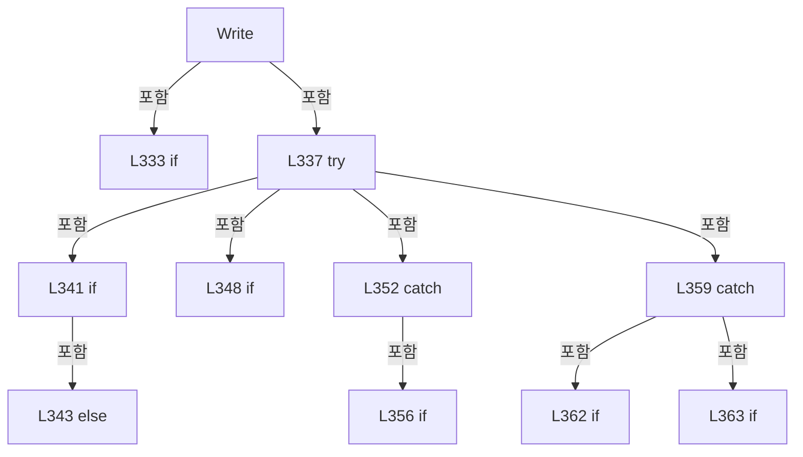

변경 전 점검: 입력/반환 타입, 위 호출자, 예외/취소 경로, 공유 상태와 저장·전송 소비자를 함께 확인합니다. 값의 단위나 물리 방향을 이름만으로 확정하지 않습니다.

### MethodDeclaration `Stage` · L368–376

[Drilling.Common/Station/CStageReviewSequences.cs:368–376](https://github.com/kjuws10-rgb/A3Drilling/blob/5aee8e58439c9b455cae7c9593c9be986c3e682e/Drilling.Common/Station/CStageReviewSequences.cs#L368-L376)

| 항목 | 실제 추출 값 |
| --- | --- |
| 서명 | System.Threading.Tasks.Task Drilling.Common.Station.CStageReviewSequences.Session.Stage(string, int, System.Threading.CancellationToken) |
| 접근/수식자 | Private / private, async |
| 반환/값 타입 | System.Threading.Tasks.Task |
| 소속 타입 | NamedType:Drilling.Common.Station.CStageReviewSequences.Session |

입력 계약:

| 이름 | 타입 | 전달 | 선택/기본값 |
| --- | --- | --- | --- |
| id | string | None | False /  |
| value | int | None | False /  |
| token | System.Threading.CancellationToken | None | False /  |

정적 호출자로 확인된 위치:

| 호출 파일/행 | 호출 표현식 | 런타임 분기 가능 |
| --- | --- | --- |
| [Drilling.Common/Station/CStageReviewSequences.cs:569–569](https://github.com/kjuws10-rgb/A3Drilling/blob/5aee8e58439c9b455cae7c9593c9be986c3e682e/Drilling.Common/Station/CStageReviewSequences.cs#L569-L569) | Stage | False |
| [Drilling.Common/Station/CStageReviewSequences.cs:580–580](https://github.com/kjuws10-rgb/A3Drilling/blob/5aee8e58439c9b455cae7c9593c9be986c3e682e/Drilling.Common/Station/CStageReviewSequences.cs#L580-L580) | Stage | False |
| [Drilling.Common/Station/CStageReviewSequences.cs:599–599](https://github.com/kjuws10-rgb/A3Drilling/blob/5aee8e58439c9b455cae7c9593c9be986c3e682e/Drilling.Common/Station/CStageReviewSequences.cs#L599-L599) | Stage | False |
| [Drilling.Common/Station/CStageReviewSequences.cs:611–611](https://github.com/kjuws10-rgb/A3Drilling/blob/5aee8e58439c9b455cae7c9593c9be986c3e682e/Drilling.Common/Station/CStageReviewSequences.cs#L611-L611) | Stage | False |
| [Drilling.Common/Station/CStageReviewSequences.cs:694–694](https://github.com/kjuws10-rgb/A3Drilling/blob/5aee8e58439c9b455cae7c9593c9be986c3e682e/Drilling.Common/Station/CStageReviewSequences.cs#L694-L694) | Stage | False |
| [Drilling.Common/Station/CStageReviewSequences.cs:706–706](https://github.com/kjuws10-rgb/A3Drilling/blob/5aee8e58439c9b455cae7c9593c9be986c3e682e/Drilling.Common/Station/CStageReviewSequences.cs#L706-L706) | Stage | False |
| [Drilling.Common/Station/CStageReviewSequences.cs:772–772](https://github.com/kjuws10-rgb/A3Drilling/blob/5aee8e58439c9b455cae7c9593c9be986c3e682e/Drilling.Common/Station/CStageReviewSequences.cs#L772-L772) | Stage | False |
| [Drilling.Common/Station/CStageReviewSequences.cs:773–773](https://github.com/kjuws10-rgb/A3Drilling/blob/5aee8e58439c9b455cae7c9593c9be986c3e682e/Drilling.Common/Station/CStageReviewSequences.cs#L773-L773) | Stage | False |
| [Drilling.Common/Station/CStageReviewSequences.cs:774–774](https://github.com/kjuws10-rgb/A3Drilling/blob/5aee8e58439c9b455cae7c9593c9be986c3e682e/Drilling.Common/Station/CStageReviewSequences.cs#L774-L774) | Stage | False |
| [Drilling.Common/Station/CStageReviewSequences.cs:799–799](https://github.com/kjuws10-rgb/A3Drilling/blob/5aee8e58439c9b455cae7c9593c9be986c3e682e/Drilling.Common/Station/CStageReviewSequences.cs#L799-L799) | Stage | False |
| [Drilling.Common/Station/CStageReviewSequences.cs:800–800](https://github.com/kjuws10-rgb/A3Drilling/blob/5aee8e58439c9b455cae7c9593c9be986c3e682e/Drilling.Common/Station/CStageReviewSequences.cs#L800-L800) | Stage | False |
| [Drilling.Common/Station/CStageReviewSequences.cs:801–801](https://github.com/kjuws10-rgb/A3Drilling/blob/5aee8e58439c9b455cae7c9593c9be986c3e682e/Drilling.Common/Station/CStageReviewSequences.cs#L801-L801) | Stage | False |
| [Drilling.Common/Station/CStageReviewSequences.cs:810–810](https://github.com/kjuws10-rgb/A3Drilling/blob/5aee8e58439c9b455cae7c9593c9be986c3e682e/Drilling.Common/Station/CStageReviewSequences.cs#L810-L810) | Stage | False |

호출하는 대상과 해석 범위:

| 원본 행 | 표현식 | 분석 상태 | 대상/소스 위치 |
| --- | --- | --- | --- |
| 372 | Route | resolved | Drilling.Common.Interface.ST_MELSEC_MAP_DATA Drilling.Common.Station.CStageReviewSequences.Session.Route(string) · Drilling.Common/Station/CStageReviewSequences.cs:272 |
| 373 | _interfaces.Melsec.SetStageFlowSimulationValue | resolved | void Drilling.Common.Interface.CMelsec.SetStageFlowSimulationValue(string, int) · Drilling.Common/Interface/Melsec/CMelsec.cs:3092 |
| 374 | _interfaces.Melsec.RefreshCachedValueAsync(id, token).ConfigureAwait | resolved | System.Runtime.CompilerServices.ConfiguredTaskAwaitable<Drilling.Common.Interface.ST_MELSEC_CACHED_VALUE> System.Threading.Tasks.Task<Drilling.Common.Interface.ST_MELSEC_CACHED_VALUE>.ConfigureAwait(bool) |
| 374 | _interfaces.Melsec.RefreshCachedValueAsync | resolved | System.Threading.Tasks.Task<Drilling.Common.Interface.ST_MELSEC_CACHED_VALUE> Drilling.Common.Interface.CMelsec.RefreshCachedValueAsync(string, System.Threading.CancellationToken) · Drilling.Common/Interface/Melsec/CMelsec.cs:2577 |
| 375 | Record | resolved | void Drilling.Common.Station.CStageReviewSequences.Session.Record(string, string, double?) · Drilling.Common/Station/CStageReviewSequences.cs:236 |

본문의 실제 연산·분기·예외·반환 순서(원문 위치 순):

| 원본 행 | 종류 | 주석 해설 |
| --- | --- | --- |
| 370 | if | 조건에 따라 분기합니다: if (!_simulation &#124;&#124; !_automatic) |
| 371 | return | 호출자에게 값 또는 제어를 반환합니다: return; |
| 372 | call | 함수·델리게이트 또는 객체 생성자를 호출합니다: Route(id) |
| 373 | call | 함수·델리게이트 또는 객체 생성자를 호출합니다: _interfaces.Melsec.SetStageFlowSimulationValue(id, value) |
| 374 | await | 비동기 완료를 기다립니다: await _interfaces.Melsec.RefreshCachedValueAsync(id, token).ConfigureAwait(false) |
| 374 | call | 함수·델리게이트 또는 객체 생성자를 호출합니다: _interfaces.Melsec.RefreshCachedValueAsync(id, token).ConfigureAwait(false) |
| 374 | call | 함수·델리게이트 또는 객체 생성자를 호출합니다: _interfaces.Melsec.RefreshCachedValueAsync(id, token) |
| 375 | call | 함수·델리게이트 또는 객체 생성자를 호출합니다: Record(id, "SIMULATED_STAGE_REPLY", value) |

제어 구문의 포함 구조(실제 실행 순서/CFG가 아닌 구문 탐색 그림):

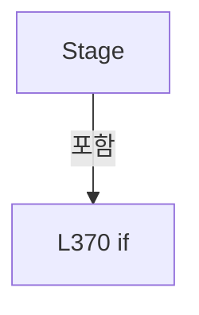

변경 전 점검: 입력/반환 타입, 위 호출자, 예외/취소 경로, 공유 상태와 저장·전송 소비자를 함께 확인합니다. 값의 단위나 물리 방향을 이름만으로 확정하지 않습니다.

### MethodDeclaration `RecordIofSnapshot` · L379–402

[Drilling.Common/Station/CStageReviewSequences.cs:379–402](https://github.com/kjuws10-rgb/A3Drilling/blob/5aee8e58439c9b455cae7c9593c9be986c3e682e/Drilling.Common/Station/CStageReviewSequences.cs#L379-L402)

| 항목 | 실제 추출 값 |
| --- | --- |
| 서명 | void Drilling.Common.Station.CStageReviewSequences.Session.RecordIofSnapshot(string, string) |
| 접근/수식자 | Private / private |
| 반환/값 타입 | void |
| 소속 타입 | NamedType:Drilling.Common.Station.CStageReviewSequences.Session |

입력 계약:

| 이름 | 타입 | 전달 | 선택/기본값 |
| --- | --- | --- | --- |
| phase | string | None | False /  |
| reason | string | None | False /  |

정적 호출자로 확인된 위치:

| 호출 파일/행 | 호출 표현식 | 런타임 분기 가능 |
| --- | --- | --- |
| [Drilling.Common/Station/CStageReviewSequences.cs:412–412](https://github.com/kjuws10-rgb/A3Drilling/blob/5aee8e58439c9b455cae7c9593c9be986c3e682e/Drilling.Common/Station/CStageReviewSequences.cs#L412-L412) | RecordIofSnapshot | False |
| [Drilling.Common/Station/CStageReviewSequences.cs:438–438](https://github.com/kjuws10-rgb/A3Drilling/blob/5aee8e58439c9b455cae7c9593c9be986c3e682e/Drilling.Common/Station/CStageReviewSequences.cs#L438-L438) | RecordIofSnapshot | False |
| [Drilling.Common/Station/CStageReviewSequences.cs:448–448](https://github.com/kjuws10-rgb/A3Drilling/blob/5aee8e58439c9b455cae7c9593c9be986c3e682e/Drilling.Common/Station/CStageReviewSequences.cs#L448-L448) | RecordIofSnapshot | False |

호출하는 대상과 해석 범위:

| 원본 행 | 표현식 | 분석 상태 | 대상/소스 위치 |
| --- | --- | --- | --- |
| 384 | _interfaces.Melsec.GetCachedSnapshot | resolved | System.Collections.Generic.IReadOnlyDictionary<string, Drilling.Common.Interface.ST_MELSEC_CACHED_VALUE> Drilling.Common.Interface.CMelsec.GetCachedSnapshot(System.Collections.Generic.IEnumerable<string>, out System.Collections.Generic.IReadOnlyList<Drilling.Common.Interface.ST_MELSEC_MAP_DATA>) · Drilling.Common/Interface/Melsec/CMelsec.cs:2550 |
| 386 | ids.Select | resolved | System.Collections.Generic.IEnumerable<string> System.Collections.Generic.IEnumerable<string>.Select<string, string>(System.Func<string, string>) |
| 388 | map.SingleOrDefault | resolved | Drilling.Common.Interface.ST_MELSEC_MAP_DATA? System.Collections.Generic.IEnumerable<Drilling.Common.Interface.ST_MELSEC_MAP_DATA>.SingleOrDefault<Drilling.Common.Interface.ST_MELSEC_MAP_DATA>(System.Func<Drilling.Common.Interface.ST_MELSEC_MAP_DATA, bool>) |
| 388 | item.Id.Equals | resolved | bool string.Equals(string?, System.StringComparison) |
| 389 | values.GetValueOrDefault | resolved | Drilling.Common.Interface.ST_MELSEC_CACHED_VALUE? System.Collections.Generic.IReadOnlyDictionary<string, Drilling.Common.Interface.ST_MELSEC_CACHED_VALUE>.GetValueOrDefault<string, Drilling.Common.Interface.ST_MELSEC_CACHED_VALUE>(string) |
| 392 | Convert.ToDouble | resolved | double System.Convert.ToDouble(object?, System.IFormatProvider?) |
| 394 | FormattableString.Invariant | resolved | string System.FormattableString.Invariant(System.FormattableString) |
| 396 | Record | resolved | void Drilling.Common.Station.CStageReviewSequences.Session.Record(string, string, double?) · Drilling.Common/Station/CStageReviewSequences.cs:236 |
| 396 | string.Join | resolved | string string.Join(string?, System.Collections.Generic.IEnumerable<string?>) |
| 400 | Record | resolved | void Drilling.Common.Station.CStageReviewSequences.Session.Record(string, string, double?) · Drilling.Common/Station/CStageReviewSequences.cs:236 |

본문의 실제 연산·분기·예외·반환 순서(원문 위치 순):

| 원본 행 | 종류 | 주석 해설 |
| --- | --- | --- |
| 381 | try | 예외 처리 범위입니다: try |
| 383 | local-declaration | 지역 변수를 선언합니다: var ids = new[] { IofStart, IofAck, IofComplete, IofRead, IofRun, "IOF_SETTING", "IOF_TRIGGER_POINT_COUNT", "IOF_TRIGGER_ZERO_POINT_COUNT", "MOTOR_CAMERA_X_BUSY", "MOTOR_STAGE_Y_BUSY" }; |
| 383 | variable-initializer | 변수의 초기값을 지정합니다: ids = new[] { IofStart, IofAck, IofComplete, IofRead, IofRun, "IOF_SETTING", "IOF_TRIGGER_POINT_COUNT", "IOF_TRIGGER_ZERO_POINT_COUNT", "MOTOR_CAMERA_X_BUSY", "MOTOR_STAGE_Y_BUSY" } |
| 384 | call | 함수·델리게이트 또는 객체 생성자를 호출합니다: _interfaces.Melsec.GetCachedSnapshot(ids, out var map) |
| 384 | local-declaration | 지역 변수를 선언합니다: var values = _interfaces.Melsec.GetCachedSnapshot(ids, out var map); |
| 384 | variable-initializer | 변수의 초기값을 지정합니다: values = _interfaces.Melsec.GetCachedSnapshot(ids, out var map) |
| 385 | local-declaration | 지역 변수를 선언합니다: var now = DateTimeOffset.UtcNow; |
| 385 | variable-initializer | 변수의 초기값을 지정합니다: now = DateTimeOffset.UtcNow |
| 386 | call | 함수·델리게이트 또는 객체 생성자를 호출합니다: ids.Select(id => { var row = map.SingleOrDefault(item => item.Id.Equals(id, StringComparison.OrdinalIgnoreCase)); var sample = values.GetValueOrDefault(id); // The cache stores scaled values, not raw received words. Labe… |
| 386 | local-declaration | 지역 변수를 선언합니다: var signals = ids.Select(id => { var row = map.SingleOrDefault(item => item.Id.Equals(id, StringComparison.OrdinalIgnoreCase)); var sample = values.GetValueOrDefault(id); // The cache stores scaled values, not raw received words.  |
| 386 | variable-initializer | 변수의 초기값을 지정합니다: signals = ids.Select(id => { var row = map.SingleOrDefault(item => item.Id.Equals(id, StringComparison.OrdinalIgnoreCase)); var sample = values.GetValueOrDefault(id); // The cache stores scaled values, not raw received words. Labe |
| 388 | call | 함수·델리게이트 또는 객체 생성자를 호출합니다: map.SingleOrDefault(item => item.Id.Equals(id, StringComparison.OrdinalIgnoreCase)) |
| 388 | call | 함수·델리게이트 또는 객체 생성자를 호출합니다: item.Id.Equals(id, StringComparison.OrdinalIgnoreCase) |
| 388 | local-declaration | 지역 변수를 선언합니다: var row = map.SingleOrDefault(item => item.Id.Equals(id, StringComparison.OrdinalIgnoreCase)); |
| 388 | variable-initializer | 변수의 초기값을 지정합니다: row = map.SingleOrDefault(item => item.Id.Equals(id, StringComparison.OrdinalIgnoreCase)) |
| 389 | call | 함수·델리게이트 또는 객체 생성자를 호출합니다: values.GetValueOrDefault(id) |
| 389 | local-declaration | 지역 변수를 선언합니다: var sample = values.GetValueOrDefault(id); |
| 389 | variable-initializer | 변수의 초기값을 지정합니다: sample = values.GetValueOrDefault(id) |
| 391 | conditional-expression | 조건에 따라 결과식을 선택합니다: sample?.Value is not null && row is { ReadScale: not 0 } ? Convert.ToDouble(sample.Value, CultureInfo.InvariantCulture) / row.ReadScale : (double?)null |
| 391 | local-declaration | 지역 변수를 선언합니다: var rawDerived = sample?.Value is not null && row is { ReadScale: not 0 } ? Convert.ToDouble(sample.Value, CultureInfo.InvariantCulture) / row.ReadScale : (double?)null; |
| 391 | variable-initializer | 변수의 초기값을 지정합니다: rawDerived = sample?.Value is not null && row is { ReadScale: not 0 } ? Convert.ToDouble(sample.Value, CultureInfo.InvariantCulture) / row.ReadScale : (double?)null |
| 392 | call | 함수·델리게이트 또는 객체 생성자를 호출합니다: Convert.ToDouble(sample.Value, CultureInfo.InvariantCulture) |
| 393 | conditional-expression | 조건에 따라 결과식을 선택합니다: sample?.UpdatedAt is { } at ? (now - at).TotalMilliseconds : (double?)null |
| 393 | local-declaration | 지역 변수를 선언합니다: var age = sample?.UpdatedAt is { } at ? (now - at).TotalMilliseconds : (double?)null; |
| 393 | variable-initializer | 변수의 초기값을 지정합니다: age = sample?.UpdatedAt is { } at ? (now - at).TotalMilliseconds : (double?)null |
| 394 | call | 함수·델리게이트 또는 객체 생성자를 호출합니다: FormattableString.Invariant($"{id}[Address={row?.Address}; Type={row?.DataType}; Length={row?.Length}; ReadScale={row?.ReadScale}; WriteScale={row?.WriteScale}; Value={sample?.Value}; RawDerived={rawDerived}; State={samp… |
| 394 | return | 호출자에게 값 또는 제어를 반환합니다: return FormattableString.Invariant($"{id}[Address={row?.Address}; Type={row?.DataType}; Length={row?.Length}; ReadScale={row?.ReadScale}; WriteScale={row?.WriteScale}; Value={sample?.Value}; RawDerived={rawDerived}; State={sample? |
| 396 | call | 함수·델리게이트 또는 객체 생성자를 호출합니다: Record("IOF_SNAPSHOT", $"Plan={_iofPlanId}; Phase={phase}; Reason={reason}; StartConfirmed={_iofStartConfirmed}; AckConfirmed={_iofAckConfirmed}; DriverLastReadAt={_interfaces.Melsec.LastSuccessfulReadAt:O}; DriverReadCo… |
| 396 | call | 함수·델리게이트 또는 객체 생성자를 호출합니다: string.Join(" &#124; ", signals) |
| 398 | catch | 지정 예외를 처리합니다: catch (Exception error) |
| 400 | call | 함수·델리게이트 또는 객체 생성자를 호출합니다: Record("IOF_DIAGNOSTIC_FAILED", $"Plan={_iofPlanId}; Phase={phase}; Reason={reason}; {error.Message}") |

제어 구문의 포함 구조(실제 실행 순서/CFG가 아닌 구문 탐색 그림):

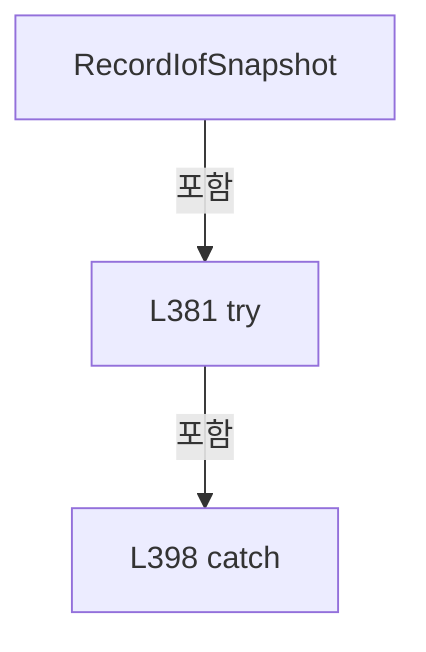

변경 전 점검: 입력/반환 타입, 위 호출자, 예외/취소 경로, 공유 상태와 저장·전송 소비자를 함께 확인합니다. 값의 단위나 물리 방향을 이름만으로 확정하지 않습니다.

### MethodDeclaration `Wait` · L404–453

[Drilling.Common/Station/CStageReviewSequences.cs:404–453](https://github.com/kjuws10-rgb/A3Drilling/blob/5aee8e58439c9b455cae7c9593c9be986c3e682e/Drilling.Common/Station/CStageReviewSequences.cs#L404-L453)

| 항목 | 실제 추출 값 |
| --- | --- |
| 서명 | System.Threading.Tasks.Task Drilling.Common.Station.CStageReviewSequences.Session.Wait(string, int, System.Threading.CancellationToken, System.TimeSpan?, string?) |
| 접근/수식자 | Private / private, async |
| 반환/값 타입 | System.Threading.Tasks.Task |
| 소속 타입 | NamedType:Drilling.Common.Station.CStageReviewSequences.Session |

입력 계약:

| 이름 | 타입 | 전달 | 선택/기본값 |
| --- | --- | --- | --- |
| id | string | None | False /  |
| expected | int | None | False /  |
| token | System.Threading.CancellationToken | None | False /  |
| timeout | System.TimeSpan? | None | True / null |
| iofPhase | string? | None | True / null |

정적 호출자로 확인된 위치:

| 호출 파일/행 | 호출 표현식 | 런타임 분기 가능 |
| --- | --- | --- |
| [Drilling.Common/Station/CStageReviewSequences.cs:570–570](https://github.com/kjuws10-rgb/A3Drilling/blob/5aee8e58439c9b455cae7c9593c9be986c3e682e/Drilling.Common/Station/CStageReviewSequences.cs#L570-L570) | Wait | False |
| [Drilling.Common/Station/CStageReviewSequences.cs:588–588](https://github.com/kjuws10-rgb/A3Drilling/blob/5aee8e58439c9b455cae7c9593c9be986c3e682e/Drilling.Common/Station/CStageReviewSequences.cs#L588-L588) | Wait | False |
| [Drilling.Common/Station/CStageReviewSequences.cs:602–602](https://github.com/kjuws10-rgb/A3Drilling/blob/5aee8e58439c9b455cae7c9593c9be986c3e682e/Drilling.Common/Station/CStageReviewSequences.cs#L602-L602) | Wait | False |
| [Drilling.Common/Station/CStageReviewSequences.cs:612–612](https://github.com/kjuws10-rgb/A3Drilling/blob/5aee8e58439c9b455cae7c9593c9be986c3e682e/Drilling.Common/Station/CStageReviewSequences.cs#L612-L612) | Wait | False |
| [Drilling.Common/Station/CStageReviewSequences.cs:775–775](https://github.com/kjuws10-rgb/A3Drilling/blob/5aee8e58439c9b455cae7c9593c9be986c3e682e/Drilling.Common/Station/CStageReviewSequences.cs#L775-L775) | Wait | False |
| [Drilling.Common/Station/CStageReviewSequences.cs:802–802](https://github.com/kjuws10-rgb/A3Drilling/blob/5aee8e58439c9b455cae7c9593c9be986c3e682e/Drilling.Common/Station/CStageReviewSequences.cs#L802-L802) | Wait | False |
| [Drilling.Common/Station/CStageReviewSequences.cs:811–811](https://github.com/kjuws10-rgb/A3Drilling/blob/5aee8e58439c9b455cae7c9593c9be986c3e682e/Drilling.Common/Station/CStageReviewSequences.cs#L811-L811) | Wait | False |

호출하는 대상과 해석 범위:

| 원본 행 | 표현식 | 분석 상태 | 대상/소스 위치 |
| --- | --- | --- | --- |
| 406 | Stopwatch.StartNew | resolved | System.Diagnostics.Stopwatch System.Diagnostics.Stopwatch.StartNew() |
| 407 | CancellationTokenSource.CreateLinkedTokenSource | resolved | System.Threading.CancellationTokenSource System.Threading.CancellationTokenSource.CreateLinkedTokenSource(System.Threading.CancellationToken) |
| 408 | limit.CancelAfter | resolved | void System.Threading.CancellationTokenSource.CancelAfter(System.TimeSpan) |
| 410 | TimeSpan.FromSeconds | resolved | System.TimeSpan System.TimeSpan.FromSeconds(long) |
| 411 | Record | resolved | void Drilling.Common.Station.CStageReviewSequences.Session.Record(string, string, double?) · Drilling.Common/Station/CStageReviewSequences.cs:236 |
| 412 | RecordIofSnapshot | resolved | void Drilling.Common.Station.CStageReviewSequences.Session.RecordIofSnapshot(string, string) · Drilling.Common/Station/CStageReviewSequences.cs:379 |
| 417 | Check | resolved | void Drilling.Common.Station.CStageReviewSequences.Session.Check(System.Threading.CancellationToken, bool) · Drilling.Common/Station/CStageReviewSequences.cs:261 |
| 418 | RefreshInputs([id], limit.Token).ConfigureAwait | resolved | System.Runtime.CompilerServices.ConfiguredTaskAwaitable System.Threading.Tasks.Task.ConfigureAwait(bool) |
| 418 | RefreshInputs | resolved | System.Threading.Tasks.Task Drilling.Common.Station.CStageReviewSequences.Session.RefreshInputs(System.Collections.Generic.IEnumerable<string>, System.Threading.CancellationToken, bool) · Drilling.Common/Station/CStageReviewSequences.cs:301 |
| 419 | Value | resolved | double Drilling.Common.Station.CStageReviewSequences.Session.Value(string) · Drilling.Common/Station/CStageReviewSequences.cs:280 |
| 422 | Record | resolved | void Drilling.Common.Station.CStageReviewSequences.Session.Record(string, string, double?) · Drilling.Common/Station/CStageReviewSequences.cs:236 |
| 422 | Route | resolved | Drilling.Common.Interface.ST_MELSEC_MAP_DATA Drilling.Common.Station.CStageReviewSequences.Session.Route(string) · Drilling.Common/Station/CStageReviewSequences.cs:272 |
| 427 | new InvalidDataException | resolved | System.IO.InvalidDataException.InvalidDataException(string?) |
| 430 | Record | resolved | void Drilling.Common.Station.CStageReviewSequences.Session.Record(string, string, double?) · Drilling.Common/Station/CStageReviewSequences.cs:236 |
| 435 | new TimeoutException | resolved | System.TimeoutException.TimeoutException(string?) |
| 438 | RecordIofSnapshot | resolved | void Drilling.Common.Station.CStageReviewSequences.Session.RecordIofSnapshot(string, string) · Drilling.Common/Station/CStageReviewSequences.cs:379 |
| 439 | TimeSpan.FromSeconds | resolved | System.TimeSpan System.TimeSpan.FromSeconds(long) |
| 441 | Task.Delay(20, limit.Token).ConfigureAwait | resolved | System.Runtime.CompilerServices.ConfiguredTaskAwaitable System.Threading.Tasks.Task.ConfigureAwait(bool) |
| 441 | Task.Delay | resolved | System.Threading.Tasks.Task System.Threading.Tasks.Task.Delay(int, System.Threading.CancellationToken) |
| 446 | _stopRequested | resolved · 동적 구현 선택 가능 | bool System.Func<bool>.Invoke() |
| 447 | new TimeoutException | resolved | System.TimeoutException.TimeoutException(string?, System.Exception?) |
| 447 | Describe | resolved | string Drilling.Common.Station.CStageReviewSequences.Session.Describe(string) · Drilling.Common/Station/CStageReviewSequences.cs:294 |
| 448 | RecordIofSnapshot | resolved | void Drilling.Common.Station.CStageReviewSequences.Session.RecordIofSnapshot(string, string) · Drilling.Common/Station/CStageReviewSequences.cs:379 |
| 449 | Record | resolved | void Drilling.Common.Station.CStageReviewSequences.Session.Record(string, string, double?) · Drilling.Common/Station/CStageReviewSequences.cs:236 |
| 449 | Describe | resolved | string Drilling.Common.Station.CStageReviewSequences.Session.Describe(string) · Drilling.Common/Station/CStageReviewSequences.cs:294 |
| 451 | CSequenceFailureException.Signal | resolved | Drilling.Common.Alarm.CSequenceFailureException Drilling.Common.Alarm.CSequenceFailureException.Signal(string, string, bool, System.Exception) · Drilling.Common/Alarm/CAlarmManager.cs:645 |

본문의 실제 연산·분기·예외·반환 순서(원문 위치 순):

| 원본 행 | 종류 | 주석 해설 |
| --- | --- | --- |
| 406 | call | 함수·델리게이트 또는 객체 생성자를 호출합니다: Stopwatch.StartNew() |
| 406 | local-declaration | 지역 변수를 선언합니다: var clock = Stopwatch.StartNew(); |
| 406 | variable-initializer | 변수의 초기값을 지정합니다: clock = Stopwatch.StartNew() |
| 407 | call | 함수·델리게이트 또는 객체 생성자를 호출합니다: CancellationTokenSource.CreateLinkedTokenSource(token) |
| 407 | using-declaration | 정리할 자원을 선언합니다: using var limit = CancellationTokenSource.CreateLinkedTokenSource(token); |
| 407 | variable-initializer | 변수의 초기값을 지정합니다: limit = CancellationTokenSource.CreateLinkedTokenSource(token) |
| 408 | call | 함수·델리게이트 또는 객체 생성자를 호출합니다: limit.CancelAfter(timeout ?? _owner._signalTimeout) |
| 409 | local-declaration | 지역 변수를 선언합니다: double? previous = null; |
| 409 | variable-initializer | 변수의 초기값을 지정합니다: previous = null |
| 410 | call | 함수·델리게이트 또는 객체 생성자를 호출합니다: TimeSpan.FromSeconds(5) |
| 410 | local-declaration | 지역 변수를 선언합니다: var nextDiagnostic = TimeSpan.FromSeconds(5); |
| 410 | variable-initializer | 변수의 초기값을 지정합니다: nextDiagnostic = TimeSpan.FromSeconds(5) |
| 411 | call | 함수·델리게이트 또는 객체 생성자를 호출합니다: Record("WAIT_BEGIN", $"{id}; Expected={expected}; TimeoutMs={(timeout ?? _owner._signalTimeout).TotalMilliseconds}; IofPhase={iofPhase}") |
| 412 | call | 함수·델리게이트 또는 객체 생성자를 호출합니다: RecordIofSnapshot(iofPhase, "WAIT_BEGIN") |
| 412 | if | 조건에 따라 분기합니다: if (iofPhase is not null) |
| 413 | try | 예외 처리 범위입니다: try |
| 415 | while | 조건을 먼저 확인하며 반복합니다: while (true) |
| 417 | call | 함수·델리게이트 또는 객체 생성자를 호출합니다: Check(limit.Token) |
| 418 | await | 비동기 완료를 기다립니다: await RefreshInputs([id], limit.Token).ConfigureAwait(false) |
| 418 | call | 함수·델리게이트 또는 객체 생성자를 호출합니다: RefreshInputs([id], limit.Token).ConfigureAwait(false) |
| 418 | call | 함수·델리게이트 또는 객체 생성자를 호출합니다: RefreshInputs([id], limit.Token) |
| 419 | call | 함수·델리게이트 또는 객체 생성자를 호출합니다: Value(id) |
| 419 | local-declaration | 지역 변수를 선언합니다: var number = Value(id); |
| 419 | variable-initializer | 변수의 초기값을 지정합니다: number = Value(id) |
| 420 | if | 조건에 따라 분기합니다: if (previous != number) |
| 422 | call | 함수·델리게이트 또는 객체 생성자를 호출합니다: Record("SIGNAL_OBSERVED", $"{id}; Address={Route(id).Address}", number) |
| 422 | call | 함수·델리게이트 또는 객체 생성자를 호출합니다: Route(id) |
| 423 | assignment | 값을 대상에 대입합니다: previous = number |
| 426 | if | 조건에 따라 분기합니다: if (number is not (0 or 1)) |
| 427 | call | 함수·델리게이트 또는 객체 생성자를 호출합니다: new InvalidDataException("Stage 신호는 READ_SCALE 적용 후 0/1이어야 합니다: " + id) |
| 427 | throw | 예외를 발생/전달합니다: throw new InvalidDataException("Stage 신호는 READ_SCALE 적용 후 0/1이어야 합니다: " + id); |
| 428 | if | 조건에 따라 분기합니다: if (number == expected) |
| 430 | call | 함수·델리게이트 또는 객체 생성자를 호출합니다: Record("WAIT_MATCH", $"{id}; Expected={expected}; ElapsedMs={clock.ElapsedMilliseconds}; IofPhase={iofPhase}") |
| 431 | return | 호출자에게 값 또는 제어를 반환합니다: return; |
| 434 | if | 조건에 따라 분기합니다: if (clock.Elapsed > (timeout ?? _owner._signalTimeout)) |
| 435 | call | 함수·델리게이트 또는 객체 생성자를 호출합니다: new TimeoutException($"Stage 신호 대기 시간 초과: {id}={expected}; Actual={number}; IofPhase={iofPhase}; StartConfirmed={_iofStartConfirmed}; AckConfirmed={_iofAckConfirmed}") |
| 435 | throw | 예외를 발생/전달합니다: throw new TimeoutException($"Stage 신호 대기 시간 초과: {id}={expected}; Actual={number}; IofPhase={iofPhase}; StartConfirmed={_iofStartConfirmed}; AckConfirmed={_iofAckConfirmed}"); |
| 436 | if | 조건에 따라 분기합니다: if (iofPhase is not null && clock.Elapsed >= nextDiagnostic) |
| 438 | call | 함수·델리게이트 또는 객체 생성자를 호출합니다: RecordIofSnapshot(iofPhase, $"WAITING; ElapsedMs={clock.ElapsedMilliseconds}") |
| 439 | assignment | 값을 대상에 대입합니다: nextDiagnostic = clock.Elapsed + TimeSpan.FromSeconds(5) |
| 439 | call | 함수·델리게이트 또는 객체 생성자를 호출합니다: TimeSpan.FromSeconds(5) |
| 441 | await | 비동기 완료를 기다립니다: await Task.Delay(20, limit.Token).ConfigureAwait(false) |
| 441 | call | 함수·델리게이트 또는 객체 생성자를 호출합니다: Task.Delay(20, limit.Token).ConfigureAwait(false) |
| 441 | call | 함수·델리게이트 또는 객체 생성자를 호출합니다: Task.Delay(20, limit.Token) |
| 444 | catch | 지정 예외를 처리합니다: catch (Exception error) |
| 446 | call | 함수·델리게이트 또는 객체 생성자를 호출합니다: _stopRequested() |
| 446 | if | 조건에 따라 분기합니다: if (error is OperationCanceledException && !token.IsCancellationRequested && !_stopRequested() && limit.IsCancellationRequested) |
| 447 | assignment | 값을 대상에 대입합니다: error = new TimeoutException($"Stage 신호 대기 시간 초과: {id}={expected}; IofPhase={iofPhase}; StartConfirmed={_iofStartConfirmed}; AckConfirmed={_iofAckConfirmed}; {Describe(id)}", error) |
| 447 | call | 함수·델리게이트 또는 객체 생성자를 호출합니다: new TimeoutException($"Stage 신호 대기 시간 초과: {id}={expected}; IofPhase={iofPhase}; StartConfirmed={_iofStartConfirmed}; AckConfirmed={_iofAckConfirmed}; {Describe(id)}", error) |
| 447 | call | 함수·델리게이트 또는 객체 생성자를 호출합니다: Describe(id) |
| 448 | call | 함수·델리게이트 또는 객체 생성자를 호출합니다: RecordIofSnapshot(iofPhase, error is OperationCanceledException ? "WAIT_CANCELED" : "WAIT_FAILED") |
| 448 | conditional-expression | 조건에 따라 결과식을 선택합니다: error is OperationCanceledException ? "WAIT_CANCELED" : "WAIT_FAILED" |
| 448 | if | 조건에 따라 분기합니다: if (iofPhase is not null) |
| 449 | call | 함수·델리게이트 또는 객체 생성자를 호출합니다: Record("WAIT_FAILED", $"{Describe(id)}; Expected={expected}; Actual={previous}; IofPhase={iofPhase}; ElapsedMs={clock.ElapsedMilliseconds}; {error}") |
| 449 | call | 함수·델리게이트 또는 객체 생성자를 호출합니다: Describe(id) |
| 450 | if | 조건에 따라 분기합니다: if (error is OperationCanceledException) |
| 450 | throw | 예외를 발생/전달합니다: throw; |
| 451 | call | 함수·델리게이트 또는 객체 생성자를 호출합니다: CSequenceFailureException.Signal(_scenario, id, error is TimeoutException, error) |
| 451 | throw | 예외를 발생/전달합니다: throw CSequenceFailureException.Signal(_scenario, id, error is TimeoutException, error); |

제어 구문의 포함 구조(실제 실행 순서/CFG가 아닌 구문 탐색 그림):

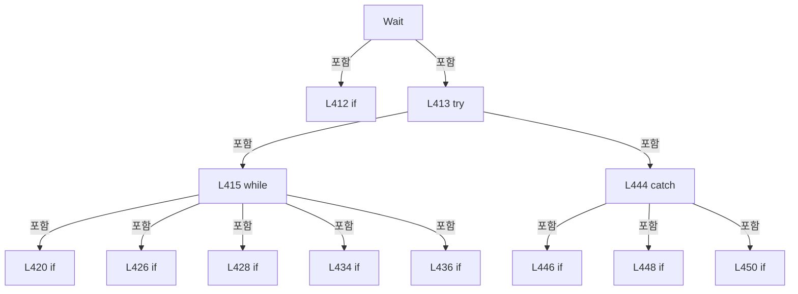

변경 전 점검: 입력/반환 타입, 위 호출자, 예외/취소 경로, 공유 상태와 저장·전송 소비자를 함께 확인합니다. 값의 단위나 물리 방향을 이름만으로 확정하지 않습니다.

### MethodDeclaration `Step` · L455–472

[Drilling.Common/Station/CStageReviewSequences.cs:455–472](https://github.com/kjuws10-rgb/A3Drilling/blob/5aee8e58439c9b455cae7c9593c9be986c3e682e/Drilling.Common/Station/CStageReviewSequences.cs#L455-L472)

| 항목 | 실제 추출 값 |
| --- | --- |
| 서명 | System.Threading.Tasks.Task Drilling.Common.Station.CStageReviewSequences.Session.Step(string, System.Func<System.Threading.Tasks.Task>) |
| 접근/수식자 | Private / private, async |
| 반환/값 타입 | System.Threading.Tasks.Task |
| 소속 타입 | NamedType:Drilling.Common.Station.CStageReviewSequences.Session |

입력 계약:

| 이름 | 타입 | 전달 | 선택/기본값 |
| --- | --- | --- | --- |
| id | string | None | False /  |
| work | System.Func<System.Threading.Tasks.Task> | None | False /  |

정적 호출자로 확인된 위치:

| 호출 파일/행 | 호출 표현식 | 런타임 분기 가능 |
| --- | --- | --- |
| [Drilling.Common/Station/CStageReviewSequences.cs:562–577](https://github.com/kjuws10-rgb/A3Drilling/blob/5aee8e58439c9b455cae7c9593c9be986c3e682e/Drilling.Common/Station/CStageReviewSequences.cs#L562-L577) | Step | False |
| [Drilling.Common/Station/CStageReviewSequences.cs:578–606](https://github.com/kjuws10-rgb/A3Drilling/blob/5aee8e58439c9b455cae7c9593c9be986c3e682e/Drilling.Common/Station/CStageReviewSequences.cs#L578-L606) | Step | False |
| [Drilling.Common/Station/CStageReviewSequences.cs:607–615](https://github.com/kjuws10-rgb/A3Drilling/blob/5aee8e58439c9b455cae7c9593c9be986c3e682e/Drilling.Common/Station/CStageReviewSequences.cs#L607-L615) | Step | False |
| [Drilling.Common/Station/CStageReviewSequences.cs:616–616](https://github.com/kjuws10-rgb/A3Drilling/blob/5aee8e58439c9b455cae7c9593c9be986c3e682e/Drilling.Common/Station/CStageReviewSequences.cs#L616-L616) | Step | False |
| [Drilling.Common/Station/CStageReviewSequences.cs:766–803](https://github.com/kjuws10-rgb/A3Drilling/blob/5aee8e58439c9b455cae7c9593c9be986c3e682e/Drilling.Common/Station/CStageReviewSequences.cs#L766-L803) | Step | False |
| [Drilling.Common/Station/CStageReviewSequences.cs:804–814](https://github.com/kjuws10-rgb/A3Drilling/blob/5aee8e58439c9b455cae7c9593c9be986c3e682e/Drilling.Common/Station/CStageReviewSequences.cs#L804-L814) | Step | False |

호출하는 대상과 해석 범위:

| 원본 행 | 표현식 | 분석 상태 | 대상/소스 위치 |
| --- | --- | --- | --- |
| 457 | Stopwatch.StartNew | resolved | System.Diagnostics.Stopwatch System.Diagnostics.Stopwatch.StartNew() |
| 458 | Record | resolved | void Drilling.Common.Station.CStageReviewSequences.Session.Record(string, string, double?) · Drilling.Common/Station/CStageReviewSequences.cs:236 |
| 461 | _owner.Actions.RunAsync(id, work).ConfigureAwait | resolved | System.Runtime.CompilerServices.ConfiguredTaskAwaitable System.Threading.Tasks.Task.ConfigureAwait(bool) |
| 461 | _owner.Actions.RunAsync | resolved | System.Threading.Tasks.Task Drilling.Common.Station.CSequenceActionStatusStore.RunAsync(string, System.Func<System.Threading.Tasks.Task>, bool) · Drilling.Common/Station/CStationManager.cs:201 |
| 462 | Record | resolved | void Drilling.Common.Station.CStageReviewSequences.Session.Record(string, string, double?) · Drilling.Common/Station/CStageReviewSequences.cs:236 |
| 466 | Record | resolved | void Drilling.Common.Station.CStageReviewSequences.Session.Record(string, string, double?) · Drilling.Common/Station/CStageReviewSequences.cs:236 |
| 468 | CSequenceFailureException.Action | resolved | Drilling.Common.Alarm.CSequenceFailureException Drilling.Common.Alarm.CSequenceFailureException.Action(string, System.Exception) · Drilling.Common/Alarm/CAlarmManager.cs:643 |
| 469 | _owner.ReportFailure | resolved | void Drilling.Common.Station.CStageReviewSequences.ReportFailure(Drilling.Common.Alarm.CSequenceFailureException) · Drilling.Common/Station/CStageReviewSequences.cs:23 |

본문의 실제 연산·분기·예외·반환 순서(원문 위치 순):

| 원본 행 | 종류 | 주석 해설 |
| --- | --- | --- |
| 457 | call | 함수·델리게이트 또는 객체 생성자를 호출합니다: Stopwatch.StartNew() |
| 457 | local-declaration | 지역 변수를 선언합니다: var clock = Stopwatch.StartNew(); |
| 457 | variable-initializer | 변수의 초기값을 지정합니다: clock = Stopwatch.StartNew() |
| 458 | call | 함수·델리게이트 또는 객체 생성자를 호출합니다: Record(id + ":RUNNING") |
| 459 | try | 예외 처리 범위입니다: try |
| 461 | await | 비동기 완료를 기다립니다: await _owner.Actions.RunAsync(id, work).ConfigureAwait(false) |
| 461 | call | 함수·델리게이트 또는 객체 생성자를 호출합니다: _owner.Actions.RunAsync(id, work).ConfigureAwait(false) |
| 461 | call | 함수·델리게이트 또는 객체 생성자를 호출합니다: _owner.Actions.RunAsync(id, work) |
| 462 | call | 함수·델리게이트 또는 객체 생성자를 호출합니다: Record(id + ":DONE", $"ElapsedMs={clock.ElapsedMilliseconds}") |
| 464 | catch | 지정 예외를 처리합니다: catch (Exception error) |
| 466 | call | 함수·델리게이트 또는 객체 생성자를 호출합니다: Record(id + (error is OperationCanceledException ? ":CANCELED" : ":FAILED"), $"ElapsedMs={clock.ElapsedMilliseconds}; {error}") |
| 466 | conditional-expression | 조건에 따라 결과식을 선택합니다: error is OperationCanceledException ? ":CANCELED" : ":FAILED" |
| 467 | if | 조건에 따라 분기합니다: if (error is OperationCanceledException) |
| 467 | throw | 예외를 발생/전달합니다: throw; |
| 468 | call | 함수·델리게이트 또는 객체 생성자를 호출합니다: CSequenceFailureException.Action(id, error) |
| 468 | local-declaration | 지역 변수를 선언합니다: var failure = CSequenceFailureException.Action(id, error); |
| 468 | variable-initializer | 변수의 초기값을 지정합니다: failure = CSequenceFailureException.Action(id, error) |
| 469 | call | 함수·델리게이트 또는 객체 생성자를 호출합니다: _owner.ReportFailure(failure) |
| 470 | throw | 예외를 발생/전달합니다: throw failure; |

제어 구문의 포함 구조(실제 실행 순서/CFG가 아닌 구문 탐색 그림):

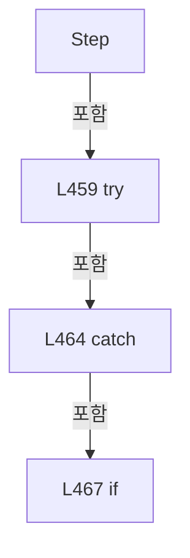

변경 전 점검: 입력/반환 타입, 위 호출자, 예외/취소 경로, 공유 상태와 저장·전송 소비자를 함께 확인합니다. 값의 단위나 물리 방향을 이름만으로 확정하지 않습니다.

### MethodDeclaration `InitialRead` · L474–491

[Drilling.Common/Station/CStageReviewSequences.cs:474–491](https://github.com/kjuws10-rgb/A3Drilling/blob/5aee8e58439c9b455cae7c9593c9be986c3e682e/Drilling.Common/Station/CStageReviewSequences.cs#L474-L491)

| 항목 | 실제 추출 값 |
| --- | --- |
| 서명 | System.Threading.Tasks.Task Drilling.Common.Station.CStageReviewSequences.Session.InitialRead(System.Collections.Generic.IEnumerable<string>, System.Threading.CancellationToken) |
| 접근/수식자 | Private / private, async |
| 반환/값 타입 | System.Threading.Tasks.Task |
| 소속 타입 | NamedType:Drilling.Common.Station.CStageReviewSequences.Session |

입력 계약:

| 이름 | 타입 | 전달 | 선택/기본값 |
| --- | --- | --- | --- |
| ids | System.Collections.Generic.IEnumerable<string> | None | False /  |
| token | System.Threading.CancellationToken | None | False /  |

정적 호출자로 확인된 위치:

| 호출 파일/행 | 호출 표현식 | 런타임 분기 가능 |
| --- | --- | --- |
| [Drilling.Common/Station/CStageReviewSequences.cs:514–514](https://github.com/kjuws10-rgb/A3Drilling/blob/5aee8e58439c9b455cae7c9593c9be986c3e682e/Drilling.Common/Station/CStageReviewSequences.cs#L514-L514) | InitialRead | False |
| [Drilling.Common/Station/CStageReviewSequences.cs:517–517](https://github.com/kjuws10-rgb/A3Drilling/blob/5aee8e58439c9b455cae7c9593c9be986c3e682e/Drilling.Common/Station/CStageReviewSequences.cs#L517-L517) | InitialRead | False |
| [Drilling.Common/Station/CStageReviewSequences.cs:532–532](https://github.com/kjuws10-rgb/A3Drilling/blob/5aee8e58439c9b455cae7c9593c9be986c3e682e/Drilling.Common/Station/CStageReviewSequences.cs#L532-L532) | InitialRead | False |
| [Drilling.Common/Station/CStageReviewSequences.cs:534–534](https://github.com/kjuws10-rgb/A3Drilling/blob/5aee8e58439c9b455cae7c9593c9be986c3e682e/Drilling.Common/Station/CStageReviewSequences.cs#L534-L534) | InitialRead | False |
| [Drilling.Common/Station/CStageReviewSequences.cs:564–564](https://github.com/kjuws10-rgb/A3Drilling/blob/5aee8e58439c9b455cae7c9593c9be986c3e682e/Drilling.Common/Station/CStageReviewSequences.cs#L564-L564) | InitialRead | False |
| [Drilling.Common/Station/CStageReviewSequences.cs:736–736](https://github.com/kjuws10-rgb/A3Drilling/blob/5aee8e58439c9b455cae7c9593c9be986c3e682e/Drilling.Common/Station/CStageReviewSequences.cs#L736-L736) | InitialRead | False |
| [Drilling.Common/Station/CStageReviewSequences.cs:768–768](https://github.com/kjuws10-rgb/A3Drilling/blob/5aee8e58439c9b455cae7c9593c9be986c3e682e/Drilling.Common/Station/CStageReviewSequences.cs#L768-L768) | InitialRead | False |

호출하는 대상과 해석 범위:

| 원본 행 | 표현식 | 분석 상태 | 대상/소스 위치 |
| --- | --- | --- | --- |
| 478 | _interfaces.Connect(EN_EQP_MODULE.Melsec, _device, cancellationToken: token).ConfigureAwait | resolved | System.Runtime.CompilerServices.ConfiguredTaskAwaitable System.Threading.Tasks.Task.ConfigureAwait(bool) |
| 478 | _interfaces.Connect | resolved | System.Threading.Tasks.Task Drilling.Common.Interface.CInterfaceManager.Connect(Drilling.Common.Interface.EN_EQP_MODULE, int, bool, System.Threading.CancellationToken) · Drilling.Common/Interface/CInterfaceManager.cs:262 |
| 479 | CancellationTokenSource.CreateLinkedTokenSource | resolved | System.Threading.CancellationTokenSource System.Threading.CancellationTokenSource.CreateLinkedTokenSource(System.Threading.CancellationToken) |
| 480 | limit.CancelAfter | resolved | void System.Threading.CancellationTokenSource.CancelAfter(System.TimeSpan) |
| 480 | TimeSpan.FromSeconds | resolved | System.TimeSpan System.TimeSpan.FromSeconds(long) |
| 482 | Task.WhenAll(ids.Distinct(StringComparer.OrdinalIgnoreCase).Select(async id => { Check(token); Route(id); var sample = await _interfaces.Melsec.RefreshCachedValueAsync(id, limit.Token).ConfigureAwait(false); Record("SIGNAL_INITIAL", $"{id}; Address={Route(id).Address}; State={sample.State}; Value={Convert.ToString(sample.Value, CultureInfo.Invarian… | resolved | System.Runtime.CompilerServices.ConfiguredTaskAwaitable System.Threading.Tasks.Task.ConfigureAwait(bool) |
| 482 | Task.WhenAll | resolved | System.Threading.Tasks.Task System.Threading.Tasks.Task.WhenAll(System.Collections.Generic.IEnumerable<System.Threading.Tasks.Task>) |
| 482 | ids.Distinct(StringComparer.OrdinalIgnoreCase).Select | resolved | System.Collections.Generic.IEnumerable<System.Threading.Tasks.Task> System.Collections.Generic.IEnumerable<string>.Select<string, System.Threading.Tasks.Task>(System.Func<string, System.Threading.Tasks.Task>) |
| 482 | ids.Distinct | resolved | System.Collections.Generic.IEnumerable<string> System.Collections.Generic.IEnumerable<string>.Distinct<string>(System.Collections.Generic.IEqualityComparer<string>?) |
| 484 | Check | resolved | void Drilling.Common.Station.CStageReviewSequences.Session.Check(System.Threading.CancellationToken, bool) · Drilling.Common/Station/CStageReviewSequences.cs:261 |
| 485 | Route | resolved | Drilling.Common.Interface.ST_MELSEC_MAP_DATA Drilling.Common.Station.CStageReviewSequences.Session.Route(string) · Drilling.Common/Station/CStageReviewSequences.cs:272 |
| 486 | _interfaces.Melsec.RefreshCachedValueAsync(id, limit.Token).ConfigureAwait | resolved | System.Runtime.CompilerServices.ConfiguredTaskAwaitable<Drilling.Common.Interface.ST_MELSEC_CACHED_VALUE> System.Threading.Tasks.Task<Drilling.Common.Interface.ST_MELSEC_CACHED_VALUE>.ConfigureAwait(bool) |
| 486 | _interfaces.Melsec.RefreshCachedValueAsync | resolved | System.Threading.Tasks.Task<Drilling.Common.Interface.ST_MELSEC_CACHED_VALUE> Drilling.Common.Interface.CMelsec.RefreshCachedValueAsync(string, System.Threading.CancellationToken) · Drilling.Common/Interface/Melsec/CMelsec.cs:2577 |
| 487 | Record | resolved | void Drilling.Common.Station.CStageReviewSequences.Session.Record(string, string, double?) · Drilling.Common/Station/CStageReviewSequences.cs:236 |
| 487 | Route | resolved | Drilling.Common.Interface.ST_MELSEC_MAP_DATA Drilling.Common.Station.CStageReviewSequences.Session.Route(string) · Drilling.Common/Station/CStageReviewSequences.cs:272 |
| 487 | Convert.ToString | resolved | string? System.Convert.ToString(object?, System.IFormatProvider?) |
| 489 | new IOException | resolved | System.IO.IOException.IOException(string?) |

본문의 실제 연산·분기·예외·반환 순서(원문 위치 순):

| 원본 행 | 종류 | 주석 해설 |
| --- | --- | --- |
| 477 | if | 조건에 따라 분기합니다: if (_simulation && !_interfaces.Melsec.IsRunning) |
| 478 | await | 비동기 완료를 기다립니다: await _interfaces.Connect(EN_EQP_MODULE.Melsec, _device, cancellationToken: token).ConfigureAwait(false) |
| 478 | call | 함수·델리게이트 또는 객체 생성자를 호출합니다: _interfaces.Connect(EN_EQP_MODULE.Melsec, _device, cancellationToken: token).ConfigureAwait(false) |
| 478 | call | 함수·델리게이트 또는 객체 생성자를 호출합니다: _interfaces.Connect(EN_EQP_MODULE.Melsec, _device, cancellationToken: token) |
| 479 | call | 함수·델리게이트 또는 객체 생성자를 호출합니다: CancellationTokenSource.CreateLinkedTokenSource(token) |
| 479 | using-declaration | 정리할 자원을 선언합니다: using var limit = CancellationTokenSource.CreateLinkedTokenSource(token); |
| 479 | variable-initializer | 변수의 초기값을 지정합니다: limit = CancellationTokenSource.CreateLinkedTokenSource(token) |
| 480 | call | 함수·델리게이트 또는 객체 생성자를 호출합니다: limit.CancelAfter(TimeSpan.FromSeconds(5)) |
| 480 | call | 함수·델리게이트 또는 객체 생성자를 호출합니다: TimeSpan.FromSeconds(5) |
| 482 | call | 함수·델리게이트 또는 객체 생성자를 호출합니다: ids.Distinct(StringComparer.OrdinalIgnoreCase) |
| 482 | await | 비동기 완료를 기다립니다: await Task.WhenAll(ids.Distinct(StringComparer.OrdinalIgnoreCase).Select(async id => { Check(token); Route(id); var sample = await _interfaces.Melsec.RefreshCachedValueAsync(id, limit.Token).ConfigureAwait(false); Record("SIGNAL_I |
| 482 | call | 함수·델리게이트 또는 객체 생성자를 호출합니다: Task.WhenAll(ids.Distinct(StringComparer.OrdinalIgnoreCase).Select(async id => { Check(token); Route(id); var sample = await _interfaces.Melsec.RefreshCachedValueAsync(id, limit.Token).ConfigureAwait(false); Record("SIGN… |
| 482 | call | 함수·델리게이트 또는 객체 생성자를 호출합니다: Task.WhenAll(ids.Distinct(StringComparer.OrdinalIgnoreCase).Select(async id => { Check(token); Route(id); var sample = await _interfaces.Melsec.RefreshCachedValueAsync(id, limit.Token).ConfigureAwait(false); Record("SIGN… |
| 482 | call | 함수·델리게이트 또는 객체 생성자를 호출합니다: ids.Distinct(StringComparer.OrdinalIgnoreCase).Select(async id => { Check(token); Route(id); var sample = await _interfaces.Melsec.RefreshCachedValueAsync(id, limit.Token).ConfigureAwait(false); Record("SIGNAL_INITIAL", … |
| 484 | call | 함수·델리게이트 또는 객체 생성자를 호출합니다: Check(token) |
| 485 | call | 함수·델리게이트 또는 객체 생성자를 호출합니다: Route(id) |
| 486 | await | 비동기 완료를 기다립니다: await _interfaces.Melsec.RefreshCachedValueAsync(id, limit.Token).ConfigureAwait(false) |
| 486 | call | 함수·델리게이트 또는 객체 생성자를 호출합니다: _interfaces.Melsec.RefreshCachedValueAsync(id, limit.Token).ConfigureAwait(false) |
| 486 | call | 함수·델리게이트 또는 객체 생성자를 호출합니다: _interfaces.Melsec.RefreshCachedValueAsync(id, limit.Token) |
| 486 | local-declaration | 지역 변수를 선언합니다: var sample = await _interfaces.Melsec.RefreshCachedValueAsync(id, limit.Token).ConfigureAwait(false); |
| 486 | variable-initializer | 변수의 초기값을 지정합니다: sample = await _interfaces.Melsec.RefreshCachedValueAsync(id, limit.Token).ConfigureAwait(false) |
| 487 | call | 함수·델리게이트 또는 객체 생성자를 호출합니다: Record("SIGNAL_INITIAL", $"{id}; Address={Route(id).Address}; State={sample.State}; Value={Convert.ToString(sample.Value, CultureInfo.InvariantCulture)}; SampleAt={sample.UpdatedAt:O}") |
| 487 | call | 함수·델리게이트 또는 객체 생성자를 호출합니다: Route(id) |
| 487 | call | 함수·델리게이트 또는 객체 생성자를 호출합니다: Convert.ToString(sample.Value, CultureInfo.InvariantCulture) |
| 488 | if | 조건에 따라 분기합니다: if (!sample.IsValid) |
| 489 | call | 함수·델리게이트 또는 객체 생성자를 호출합니다: new IOException("Stage 초기 상태 읽기 실패: " + id) |
| 489 | throw | 예외를 발생/전달합니다: throw new IOException("Stage 초기 상태 읽기 실패: " + id); |

제어 구문의 포함 구조(실제 실행 순서/CFG가 아닌 구문 탐색 그림):

```mermaid
flowchart TD
 M["InitialRead"]
 N0["L477 if"]
 M -->|포함| N0
 N1["L488 if"]
 M -->|포함| N1
```

변경 전 점검: 입력/반환 타입, 위 호출자, 예외/취소 경로, 공유 상태와 저장·전송 소비자를 함께 확인합니다. 값의 단위나 물리 방향을 이름만으로 확정하지 않습니다.

### MethodDeclaration `Stop` · L493–498

[Drilling.Common/Station/CStageReviewSequences.cs:493–498](https://github.com/kjuws10-rgb/A3Drilling/blob/5aee8e58439c9b455cae7c9593c9be986c3e682e/Drilling.Common/Station/CStageReviewSequences.cs#L493-L498)

| 항목 | 실제 추출 값 |
| --- | --- |
| 서명 | void Drilling.Common.Station.CStageReviewSequences.Session.Stop() |
| 접근/수식자 | Public / public |
| 반환/값 타입 | void |
| 소속 타입 | NamedType:Drilling.Common.Station.CStageReviewSequences.Session |

정적 호출자로 확인된 위치:

| 호출 파일/행 | 호출 표현식 | 런타임 분기 가능 |
| --- | --- | --- |
| [Drilling.Common/Review/CReviewManager.cs:2412–2412](https://github.com/kjuws10-rgb/A3Drilling/blob/5aee8e58439c9b455cae7c9593c9be986c3e682e/Drilling.Common/Review/CReviewManager.cs#L2412-L2412) | _session.Stop | False |
| [Drilling.Common/Station/CStageReviewSequences.cs:504–504](https://github.com/kjuws10-rgb/A3Drilling/blob/5aee8e58439c9b455cae7c9593c9be986c3e682e/Drilling.Common/Station/CStageReviewSequences.cs#L504-L504) | Stop | False |
| [Drilling.Common/Station/CStageReviewSequences.cs:685–685](https://github.com/kjuws10-rgb/A3Drilling/blob/5aee8e58439c9b455cae7c9593c9be986c3e682e/Drilling.Common/Station/CStageReviewSequences.cs#L685-L685) | Stop | False |

호출하는 대상과 해석 범위:

| 원본 행 | 표현식 | 분석 상태 | 대상/소스 위치 |
| --- | --- | --- | --- |
| 495 | .Stop | resolved | void Drilling.Common.Motion.CManualStageMotionSimulation.Stop(Drilling.Common.Motion.EN_MANUAL_STAGE_AXIS) · Drilling.Common/Motion/CMotionManager.cs:1296 |
| 497 | .Stop | resolved | void Drilling.Common.Motion.CManualStageMotionSimulation.Stop(Drilling.Common.Motion.EN_MANUAL_STAGE_AXIS) · Drilling.Common/Motion/CMotionManager.cs:1296 |

본문의 실제 연산·분기·예외·반환 순서(원문 위치 순):

| 원본 행 | 종류 | 주석 해설 |
| --- | --- | --- |
| 495 | call | 함수·델리게이트 또는 객체 생성자를 호출합니다: .Stop(EN_MANUAL_STAGE_AXIS.ReviewX) |
| 496 | if | 조건에 따라 분기합니다: if (!_reviewXOnly && !_stageBufferOwner) |
| 497 | call | 함수·델리게이트 또는 객체 생성자를 호출합니다: .Stop(EN_MANUAL_STAGE_AXIS.StageY) |

제어 구문의 포함 구조(실제 실행 순서/CFG가 아닌 구문 탐색 그림):

```mermaid
flowchart TD
 M["Stop"]
 N0["L496 if"]
 M -->|포함| N0
```

변경 전 점검: 입력/반환 타입, 위 호출자, 예외/취소 경로, 공유 상태와 저장·전송 소비자를 함께 확인합니다. 값의 단위나 물리 방향을 이름만으로 확정하지 않습니다.

### MethodDeclaration `Dispose` · L500–509

[Drilling.Common/Station/CStageReviewSequences.cs:500–509](https://github.com/kjuws10-rgb/A3Drilling/blob/5aee8e58439c9b455cae7c9593c9be986c3e682e/Drilling.Common/Station/CStageReviewSequences.cs#L500-L509)

| 항목 | 실제 추출 값 |
| --- | --- |
| 서명 | void Drilling.Common.Station.CStageReviewSequences.Session.Dispose() |
| 접근/수식자 | Public / public |
| 반환/값 타입 | void |
| 소속 타입 | NamedType:Drilling.Common.Station.CStageReviewSequences.Session |

정적 호출자로 확인된 위치:

| 호출 파일/행 | 호출 표현식 | 런타임 분기 가능 |
| --- | --- | --- |
| [Drilling.Common/Interface/CPowerMeasureRun.cs:416–416](https://github.com/kjuws10-rgb/A3Drilling/blob/5aee8e58439c9b455cae7c9593c9be986c3e682e/Drilling.Common/Interface/CPowerMeasureRun.cs#L416-L416) | .Dispose | False |
| [Drilling.Common/Review/CReviewManager.cs:2413–2413](https://github.com/kjuws10-rgb/A3Drilling/blob/5aee8e58439c9b455cae7c9593c9be986c3e682e/Drilling.Common/Review/CReviewManager.cs#L2413-L2413) | _session.Dispose | False |
| [Drilling.Common/Station/CStageReviewSequences.cs:75–75](https://github.com/kjuws10-rgb/A3Drilling/blob/5aee8e58439c9b455cae7c9593c9be986c3e682e/Drilling.Common/Station/CStageReviewSequences.cs#L75-L75) | session.Dispose | False |
| [Drilling.Common/Station/CStationProcess.cs:3615–3615](https://github.com/kjuws10-rgb/A3Drilling/blob/5aee8e58439c9b455cae7c9593c9be986c3e682e/Drilling.Common/Station/CStationProcess.cs#L3615-L3615) | .Dispose | False |
| [Drilling.Common/Station/CStationProcess.cs:6473–6473](https://github.com/kjuws10-rgb/A3Drilling/blob/5aee8e58439c9b455cae7c9593c9be986c3e682e/Drilling.Common/Station/CStationProcess.cs#L6473-L6473) | .Dispose | False |

호출하는 대상과 해석 범위:

| 원본 행 | 표현식 | 분석 상태 | 대상/소스 위치 |
| --- | --- | --- | --- |
| 504 | Stop | resolved | void Drilling.Common.Station.CStageReviewSequences.Session.Stop() · Drilling.Common/Station/CStageReviewSequences.cs:493 |
| 505 | .Dispose | resolved | void Drilling.Common.Motion.CManualStageMotionSimulation.MotionLease.Dispose() · Drilling.Common/Motion/CMotionManager.cs:1383 |
| 507 | _owner._cleanupFailures.ContainsKey | resolved | bool System.Collections.Concurrent.ConcurrentDictionary<int, byte>.ContainsKey(int) |
| 508 | _owner._owners.TryRemove | resolved | bool System.Collections.Concurrent.ConcurrentDictionary<int, byte>.TryRemove(int, out byte) |

본문의 실제 연산·분기·예외·반환 순서(원문 위치 순):

| 원본 행 | 종류 | 주석 해설 |
| --- | --- | --- |
| 502 | if | 조건에 따라 분기합니다: if (_disposed) |
| 503 | return | 호출자에게 값 또는 제어를 반환합니다: return; |
| 504 | call | 함수·델리게이트 또는 객체 생성자를 호출합니다: Stop() |
| 505 | call | 함수·델리게이트 또는 객체 생성자를 호출합니다: .Dispose() |
| 506 | assignment | 값을 대상에 대입합니다: _disposed = true |
| 507 | call | 함수·델리게이트 또는 객체 생성자를 호출합니다: _owner._cleanupFailures.ContainsKey(_device) |
| 507 | if | 조건에 따라 분기합니다: if (!_owner._cleanupFailures.ContainsKey(_device)) |
| 508 | call | 함수·델리게이트 또는 객체 생성자를 호출합니다: _owner._owners.TryRemove(_device, out _) |

제어 구문의 포함 구조(실제 실행 순서/CFG가 아닌 구문 탐색 그림):

```mermaid
flowchart TD
 M["Dispose"]
 N0["L502 if"]
 M -->|포함| N0
 N1["L507 if"]
 M -->|포함| N1
```

변경 전 점검: 입력/반환 타입, 위 호출자, 예외/취소 경로, 공유 상태와 저장·전송 소비자를 함께 확인합니다. 값의 단위나 물리 방향을 이름만으로 확정하지 않습니다.

### MethodDeclaration `MoveAxis` · L511–524

[Drilling.Common/Station/CStageReviewSequences.cs:511–524](https://github.com/kjuws10-rgb/A3Drilling/blob/5aee8e58439c9b455cae7c9593c9be986c3e682e/Drilling.Common/Station/CStageReviewSequences.cs#L511-L524)

| 항목 | 실제 추출 값 |
| --- | --- |
| 서명 | System.Threading.Tasks.Task Drilling.Common.Station.CStageReviewSequences.Session.MoveAxis(Drilling.Common.Motion.EN_MANUAL_STAGE_AXIS, double, bool, double, System.Threading.CancellationToken) |
| 접근/수식자 | Internal / internal, async |
| 반환/값 타입 | System.Threading.Tasks.Task |
| 소속 타입 | NamedType:Drilling.Common.Station.CStageReviewSequences.Session |

입력 계약:

| 이름 | 타입 | 전달 | 선택/기본값 |
| --- | --- | --- | --- |
| axis | Drilling.Common.Motion.EN_MANUAL_STAGE_AXIS | None | False /  |
| value | double | None | False /  |
| relative | bool | None | False /  |
| speed | double | None | False /  |
| token | System.Threading.CancellationToken | None | False /  |

정적 호출자로 확인된 위치:

| 호출 파일/행 | 호출 표현식 | 런타임 분기 가능 |
| --- | --- | --- |
| [Drilling.Common/Station/CStageReviewSequences.cs:174–174](https://github.com/kjuws10-rgb/A3Drilling/blob/5aee8e58439c9b455cae7c9593c9be986c3e682e/Drilling.Common/Station/CStageReviewSequences.cs#L174-L174) | session.MoveAxis | False |

호출하는 대상과 해석 범위:

| 원본 행 | 표현식 | 분석 상태 | 대상/소스 위치 |
| --- | --- | --- | --- |
| 514 | InitialRead(["MOTOR_CAMERA_X_BUSY", "MOTOR_STAGE_Y_BUSY"], token).ConfigureAwait | resolved | System.Runtime.CompilerServices.ConfiguredTaskAwaitable System.Threading.Tasks.Task.ConfigureAwait(bool) |
| 514 | InitialRead | resolved | System.Threading.Tasks.Task Drilling.Common.Station.CStageReviewSequences.Session.InitialRead(System.Collections.Generic.IEnumerable<string>, System.Threading.CancellationToken) · Drilling.Common/Station/CStageReviewSequences.cs:474 |
| 515 | WaitStopped(token, mode).ConfigureAwait | resolved | System.Runtime.CompilerServices.ConfiguredTaskAwaitable System.Threading.Tasks.Task.ConfigureAwait(bool) |
| 515 | WaitStopped | resolved | System.Threading.Tasks.Task Drilling.Common.Station.CStageReviewSequences.Session.WaitStopped(System.Threading.CancellationToken, Drilling.Common.Station.EN_STAGE_MOVE_MODE, bool) · Drilling.Common/Station/CStageReviewSequences.cs:637 |
| 517 | InitialRead(["MOTOR_CAMERA_X_CUR_POS", "MOTOR_STAGE_Y_CUR_POS"], token).ConfigureAwait | resolved | System.Runtime.CompilerServices.ConfiguredTaskAwaitable System.Threading.Tasks.Task.ConfigureAwait(bool) |
| 517 | InitialRead | resolved | System.Threading.Tasks.Task Drilling.Common.Station.CStageReviewSequences.Session.InitialRead(System.Collections.Generic.IEnumerable<string>, System.Threading.CancellationToken) · Drilling.Common/Station/CStageReviewSequences.cs:474 |
| 521 | Move(new(axis == EN_MANUAL_STAGE_AXIS.ReviewX ? target : x, axis == EN_MANUAL_STAGE_AXIS.StageY ? target : y, speed, speed, Mode: mode), token).ConfigureAwait | resolved | System.Runtime.CompilerServices.ConfiguredTaskAwaitable System.Threading.Tasks.Task.ConfigureAwait(bool) |
| 521 | Move | resolved | System.Threading.Tasks.Task Drilling.Common.Station.CStageReviewSequences.Session.Move(Drilling.Common.Station.ST_STAGE_MOVE_TARGET, System.Threading.CancellationToken) · Drilling.Common/Station/CStageReviewSequences.cs:538 |
| 521 | new | resolved | Drilling.Common.Station.ST_STAGE_MOVE_TARGET.ST_STAGE_MOVE_TARGET(double, double, double, double, double, Drilling.Common.Station.EN_STAGE_MOVE_MODE) · Drilling.Common/Station/CStageReviewSequences.cs:941 |

본문의 실제 연산·분기·예외·반환 순서(원문 위치 순):

| 원본 행 | 종류 | 주석 해설 |
| --- | --- | --- |
| 513 | conditional-expression | 조건에 따라 결과식을 선택합니다: axis == EN_MANUAL_STAGE_AXIS.ReviewX ? EN_STAGE_MOVE_MODE.ReviewX : EN_STAGE_MOVE_MODE.StageY |
| 513 | local-declaration | 지역 변수를 선언합니다: var mode = axis == EN_MANUAL_STAGE_AXIS.ReviewX ? EN_STAGE_MOVE_MODE.ReviewX : EN_STAGE_MOVE_MODE.StageY; |
| 513 | variable-initializer | 변수의 초기값을 지정합니다: mode = axis == EN_MANUAL_STAGE_AXIS.ReviewX ? EN_STAGE_MOVE_MODE.ReviewX : EN_STAGE_MOVE_MODE.StageY |
| 514 | await | 비동기 완료를 기다립니다: await InitialRead(["MOTOR_CAMERA_X_BUSY", "MOTOR_STAGE_Y_BUSY"], token).ConfigureAwait(false) |
| 514 | call | 함수·델리게이트 또는 객체 생성자를 호출합니다: InitialRead(["MOTOR_CAMERA_X_BUSY", "MOTOR_STAGE_Y_BUSY"], token).ConfigureAwait(false) |
| 514 | call | 함수·델리게이트 또는 객체 생성자를 호출합니다: InitialRead(["MOTOR_CAMERA_X_BUSY", "MOTOR_STAGE_Y_BUSY"], token) |
| 515 | await | 비동기 완료를 기다립니다: await WaitStopped(token, mode).ConfigureAwait(false) |
| 515 | call | 함수·델리게이트 또는 객체 생성자를 호출합니다: WaitStopped(token, mode).ConfigureAwait(false) |
| 515 | call | 함수·델리게이트 또는 객체 생성자를 호출합니다: WaitStopped(token, mode) |
| 517 | await | 비동기 완료를 기다립니다: await InitialRead(["MOTOR_CAMERA_X_CUR_POS", "MOTOR_STAGE_Y_CUR_POS"], token).ConfigureAwait(false) |
| 517 | call | 함수·델리게이트 또는 객체 생성자를 호출합니다: InitialRead(["MOTOR_CAMERA_X_CUR_POS", "MOTOR_STAGE_Y_CUR_POS"], token).ConfigureAwait(false) |
| 517 | call | 함수·델리게이트 또는 객체 생성자를 호출합니다: InitialRead(["MOTOR_CAMERA_X_CUR_POS", "MOTOR_STAGE_Y_CUR_POS"], token) |
| 518 | local-declaration | 지역 변수를 선언합니다: var x = CurrentX; |
| 518 | variable-initializer | 변수의 초기값을 지정합니다: x = CurrentX |
| 519 | local-declaration | 지역 변수를 선언합니다: var y = CurrentY; |
| 519 | variable-initializer | 변수의 초기값을 지정합니다: y = CurrentY |
| 520 | conditional-expression | 조건에 따라 결과식을 선택합니다: relative ? (axis == EN_MANUAL_STAGE_AXIS.ReviewX ? x : y) + value : value |
| 520 | conditional-expression | 조건에 따라 결과식을 선택합니다: axis == EN_MANUAL_STAGE_AXIS.ReviewX ? x : y |
| 520 | local-declaration | 지역 변수를 선언합니다: var target = relative ? (axis == EN_MANUAL_STAGE_AXIS.ReviewX ? x : y) + value : value; |
| 520 | variable-initializer | 변수의 초기값을 지정합니다: target = relative ? (axis == EN_MANUAL_STAGE_AXIS.ReviewX ? x : y) + value : value |
| 521 | conditional-expression | 조건에 따라 결과식을 선택합니다: axis == EN_MANUAL_STAGE_AXIS.ReviewX ? target : x |
| 521 | await | 비동기 완료를 기다립니다: await Move(new(axis == EN_MANUAL_STAGE_AXIS.ReviewX ? target : x, axis == EN_MANUAL_STAGE_AXIS.StageY ? target : y, speed, speed, Mode: mode), token).ConfigureAwait(false) |
| 521 | call | 함수·델리게이트 또는 객체 생성자를 호출합니다: Move(new(axis == EN_MANUAL_STAGE_AXIS.ReviewX ? target : x, axis == EN_MANUAL_STAGE_AXIS.StageY ? target : y, speed, speed, Mode: mode), token).ConfigureAwait(false) |
| 521 | call | 함수·델리게이트 또는 객체 생성자를 호출합니다: Move(new(axis == EN_MANUAL_STAGE_AXIS.ReviewX ? target : x, axis == EN_MANUAL_STAGE_AXIS.StageY ? target : y, speed, speed, Mode: mode), token) |
| 521 | call | 함수·델리게이트 또는 객체 생성자를 호출합니다: new(axis == EN_MANUAL_STAGE_AXIS.ReviewX ? target : x, axis == EN_MANUAL_STAGE_AXIS.StageY ? target : y, speed, speed, Mode: mode) |
| 522 | conditional-expression | 조건에 따라 결과식을 선택합니다: axis == EN_MANUAL_STAGE_AXIS.StageY ? target : y |

변경 전 점검: 입력/반환 타입, 위 호출자, 예외/취소 경로, 공유 상태와 저장·전송 소비자를 함께 확인합니다. 값의 단위나 물리 방향을 이름만으로 확정하지 않습니다.

### MethodDeclaration `ReadStationaryPosition` · L526–536

[Drilling.Common/Station/CStageReviewSequences.cs:526–536](https://github.com/kjuws10-rgb/A3Drilling/blob/5aee8e58439c9b455cae7c9593c9be986c3e682e/Drilling.Common/Station/CStageReviewSequences.cs#L526-L536)

| 항목 | 실제 추출 값 |
| --- | --- |
| 서명 | System.Threading.Tasks.Task<double> Drilling.Common.Station.CStageReviewSequences.Session.ReadStationaryPosition(Drilling.Common.Motion.EN_MANUAL_STAGE_AXIS, System.Threading.CancellationToken) |
| 접근/수식자 | Public / public, async |
| 반환/값 타입 | System.Threading.Tasks.Task<double> |
| 소속 타입 | NamedType:Drilling.Common.Station.CStageReviewSequences.Session |

입력 계약:

| 이름 | 타입 | 전달 | 선택/기본값 |
| --- | --- | --- | --- |
| axis | Drilling.Common.Motion.EN_MANUAL_STAGE_AXIS | None | False /  |
| token | System.Threading.CancellationToken | None | False /  |

정적 호출자로 확인된 위치:

| 호출 파일/행 | 호출 표현식 | 런타임 분기 가능 |
| --- | --- | --- |
| [Drilling.Common/Review/CReviewManager.cs:2406–2406](https://github.com/kjuws10-rgb/A3Drilling/blob/5aee8e58439c9b455cae7c9593c9be986c3e682e/Drilling.Common/Review/CReviewManager.cs#L2406-L2406) | _session.ReadStationaryPosition | False |
| [Drilling.Common/Station/CStationProcess.cs:3513–3513](https://github.com/kjuws10-rgb/A3Drilling/blob/5aee8e58439c9b455cae7c9593c9be986c3e682e/Drilling.Common/Station/CStationProcess.cs#L3513-L3513) | stage.ReadStationaryPosition | False |
| [Drilling.Common/Station/CStationProcess.cs:3550–3550](https://github.com/kjuws10-rgb/A3Drilling/blob/5aee8e58439c9b455cae7c9593c9be986c3e682e/Drilling.Common/Station/CStationProcess.cs#L3550-L3550) | stage!.ReadStationaryPosition | False |
| [Drilling.Common/Station/CStationProcess.cs:6172–6172](https://github.com/kjuws10-rgb/A3Drilling/blob/5aee8e58439c9b455cae7c9593c9be986c3e682e/Drilling.Common/Station/CStationProcess.cs#L6172-L6172) | session.ReadStationaryPosition | False |

호출하는 대상과 해석 범위:

| 원본 행 | 표현식 | 분석 상태 | 대상/소스 위치 |
| --- | --- | --- | --- |
| 528 | Enum.IsDefined | resolved | bool System.Enum.IsDefined<Drilling.Common.Motion.EN_MANUAL_STAGE_AXIS>(Drilling.Common.Motion.EN_MANUAL_STAGE_AXIS) |
| 528 | new ArgumentOutOfRangeException | resolved | System.ArgumentOutOfRangeException.ArgumentOutOfRangeException(string?) |
| 528 | nameof | unresolved | None |
| 532 | InitialRead([busy], token).ConfigureAwait | resolved | System.Runtime.CompilerServices.ConfiguredTaskAwaitable System.Threading.Tasks.Task.ConfigureAwait(bool) |
| 532 | InitialRead | resolved | System.Threading.Tasks.Task Drilling.Common.Station.CStageReviewSequences.Session.InitialRead(System.Collections.Generic.IEnumerable<string>, System.Threading.CancellationToken) · Drilling.Common/Station/CStageReviewSequences.cs:474 |
| 533 | WaitStopped(token, stageY ? EN_STAGE_MOVE_MODE.StageY : EN_STAGE_MOVE_MODE.ReviewX).ConfigureAwait | resolved | System.Runtime.CompilerServices.ConfiguredTaskAwaitable System.Threading.Tasks.Task.ConfigureAwait(bool) |
| 533 | WaitStopped | resolved | System.Threading.Tasks.Task Drilling.Common.Station.CStageReviewSequences.Session.WaitStopped(System.Threading.CancellationToken, Drilling.Common.Station.EN_STAGE_MOVE_MODE, bool) · Drilling.Common/Station/CStageReviewSequences.cs:637 |
| 534 | InitialRead([position], token).ConfigureAwait | resolved | System.Runtime.CompilerServices.ConfiguredTaskAwaitable System.Threading.Tasks.Task.ConfigureAwait(bool) |
| 534 | InitialRead | resolved | System.Threading.Tasks.Task Drilling.Common.Station.CStageReviewSequences.Session.InitialRead(System.Collections.Generic.IEnumerable<string>, System.Threading.CancellationToken) · Drilling.Common/Station/CStageReviewSequences.cs:474 |

본문의 실제 연산·분기·예외·반환 순서(원문 위치 순):

| 원본 행 | 종류 | 주석 해설 |
| --- | --- | --- |
| 528 | call | 함수·델리게이트 또는 객체 생성자를 호출합니다: Enum.IsDefined(axis) |
| 528 | call | 함수·델리게이트 또는 객체 생성자를 호출합니다: new ArgumentOutOfRangeException(nameof(axis)) |
| 528 | call | 함수·델리게이트 또는 객체 생성자를 호출합니다: nameof(axis) |
| 528 | if | 조건에 따라 분기합니다: if (!Enum.IsDefined(axis)) |
| 528 | throw | 예외를 발생/전달합니다: throw new ArgumentOutOfRangeException(nameof(axis)); |
| 529 | local-declaration | 지역 변수를 선언합니다: var stageY = axis == EN_MANUAL_STAGE_AXIS.StageY; |
| 529 | variable-initializer | 변수의 초기값을 지정합니다: stageY = axis == EN_MANUAL_STAGE_AXIS.StageY |
| 530 | conditional-expression | 조건에 따라 결과식을 선택합니다: stageY ? "MOTOR_STAGE_Y_BUSY" : "MOTOR_CAMERA_X_BUSY" |
| 530 | local-declaration | 지역 변수를 선언합니다: var busy = stageY ? "MOTOR_STAGE_Y_BUSY" : "MOTOR_CAMERA_X_BUSY"; |
| 530 | variable-initializer | 변수의 초기값을 지정합니다: busy = stageY ? "MOTOR_STAGE_Y_BUSY" : "MOTOR_CAMERA_X_BUSY" |
| 531 | conditional-expression | 조건에 따라 결과식을 선택합니다: stageY ? "MOTOR_STAGE_Y_CUR_POS" : "MOTOR_CAMERA_X_CUR_POS" |
| 531 | local-declaration | 지역 변수를 선언합니다: var position = stageY ? "MOTOR_STAGE_Y_CUR_POS" : "MOTOR_CAMERA_X_CUR_POS"; |
| 531 | variable-initializer | 변수의 초기값을 지정합니다: position = stageY ? "MOTOR_STAGE_Y_CUR_POS" : "MOTOR_CAMERA_X_CUR_POS" |
| 532 | await | 비동기 완료를 기다립니다: await InitialRead([busy], token).ConfigureAwait(false) |
| 532 | call | 함수·델리게이트 또는 객체 생성자를 호출합니다: InitialRead([busy], token).ConfigureAwait(false) |
| 532 | call | 함수·델리게이트 또는 객체 생성자를 호출합니다: InitialRead([busy], token) |
| 533 | await | 비동기 완료를 기다립니다: await WaitStopped(token, stageY ? EN_STAGE_MOVE_MODE.StageY : EN_STAGE_MOVE_MODE.ReviewX).ConfigureAwait(false) |
| 533 | call | 함수·델리게이트 또는 객체 생성자를 호출합니다: WaitStopped(token, stageY ? EN_STAGE_MOVE_MODE.StageY : EN_STAGE_MOVE_MODE.ReviewX).ConfigureAwait(false) |
| 533 | call | 함수·델리게이트 또는 객체 생성자를 호출합니다: WaitStopped(token, stageY ? EN_STAGE_MOVE_MODE.StageY : EN_STAGE_MOVE_MODE.ReviewX) |
| 533 | conditional-expression | 조건에 따라 결과식을 선택합니다: stageY ? EN_STAGE_MOVE_MODE.StageY : EN_STAGE_MOVE_MODE.ReviewX |
| 534 | await | 비동기 완료를 기다립니다: await InitialRead([position], token).ConfigureAwait(false) |
| 534 | call | 함수·델리게이트 또는 객체 생성자를 호출합니다: InitialRead([position], token).ConfigureAwait(false) |
| 534 | call | 함수·델리게이트 또는 객체 생성자를 호출합니다: InitialRead([position], token) |
| 535 | conditional-expression | 조건에 따라 결과식을 선택합니다: stageY ? CurrentY : CurrentX |
| 535 | return | 호출자에게 값 또는 제어를 반환합니다: return stageY ? CurrentY : CurrentX; |

제어 구문의 포함 구조(실제 실행 순서/CFG가 아닌 구문 탐색 그림):

```mermaid
flowchart TD
 M["ReadStationaryPosition"]
 N0["L528 if"]
 M -->|포함| N0
```

변경 전 점검: 입력/반환 타입, 위 호출자, 예외/취소 경로, 공유 상태와 저장·전송 소비자를 함께 확인합니다. 값의 단위나 물리 방향을 이름만으로 확정하지 않습니다.

### MethodDeclaration `Move` · L538–631

[Drilling.Common/Station/CStageReviewSequences.cs:538–631](https://github.com/kjuws10-rgb/A3Drilling/blob/5aee8e58439c9b455cae7c9593c9be986c3e682e/Drilling.Common/Station/CStageReviewSequences.cs#L538-L631)

| 항목 | 실제 추출 값 |
| --- | --- |
| 서명 | System.Threading.Tasks.Task Drilling.Common.Station.CStageReviewSequences.Session.Move(Drilling.Common.Station.ST_STAGE_MOVE_TARGET, System.Threading.CancellationToken) |
| 접근/수식자 | Public / public, async |
| 반환/값 타입 | System.Threading.Tasks.Task |
| 소속 타입 | NamedType:Drilling.Common.Station.CStageReviewSequences.Session |

입력 계약:

| 이름 | 타입 | 전달 | 선택/기본값 |
| --- | --- | --- | --- |
| target | Drilling.Common.Station.ST_STAGE_MOVE_TARGET | None | False /  |
| token | System.Threading.CancellationToken | None | False /  |

정적 호출자로 확인된 위치:

| 호출 파일/행 | 호출 표현식 | 런타임 분기 가능 |
| --- | --- | --- |
| [Drilling.Common/Review/CReviewManager.cs:2401–2401](https://github.com/kjuws10-rgb/A3Drilling/blob/5aee8e58439c9b455cae7c9593c9be986c3e682e/Drilling.Common/Review/CReviewManager.cs#L2401-L2401) | _session.Move | False |
| [Drilling.Common/Review/CReviewManager.cs:2408–2408](https://github.com/kjuws10-rgb/A3Drilling/blob/5aee8e58439c9b455cae7c9593c9be986c3e682e/Drilling.Common/Review/CReviewManager.cs#L2408-L2408) | _session.Move | False |
| [Drilling.Common/Station/CStageReviewSequences.cs:521–523](https://github.com/kjuws10-rgb/A3Drilling/blob/5aee8e58439c9b455cae7c9593c9be986c3e682e/Drilling.Common/Station/CStageReviewSequences.cs#L521-L523) | Move | False |
| [Drilling.Common/Station/CStationProcess.cs:3689–3690](https://github.com/kjuws10-rgb/A3Drilling/blob/5aee8e58439c9b455cae7c9593c9be986c3e682e/Drilling.Common/Station/CStationProcess.cs#L3689-L3690) | stage.Move | False |
| [Drilling.Common/Station/CStationProcess.cs:6193–6193](https://github.com/kjuws10-rgb/A3Drilling/blob/5aee8e58439c9b455cae7c9593c9be986c3e682e/Drilling.Common/Station/CStationProcess.cs#L6193-L6193) | session.Move | False |
| [Drilling.UI/Menu/Menus/CMenuCorrection.cs:3602–3602](https://github.com/kjuws10-rgb/A3Drilling/blob/5aee8e58439c9b455cae7c9593c9be986c3e682e/Drilling.UI/Menu/Menus/CMenuCorrection.cs#L3602-L3602) | stage.Move | False |

호출하는 대상과 해석 범위:

| 원본 행 | 표현식 | 분석 상태 | 대상/소스 위치 |
| --- | --- | --- | --- |
| 542 | new InvalidOperationException | resolved | System.InvalidOperationException.InvalidOperationException(string?) |
| 543 | new[] { target.X, target.Y, target.SpeedX, target.SpeedY, target.AccelerationX }.Any | resolved | bool System.Collections.Generic.IEnumerable<double>.Any<double>(System.Func<double, bool>) |
| 550 | double.IsFinite | resolved | bool double.IsFinite(double) |
| 550 | Enum.IsDefined | resolved | bool System.Enum.IsDefined<Drilling.Common.Station.EN_STAGE_MOVE_MODE>(Drilling.Common.Station.EN_STAGE_MOVE_MODE) |
| 551 | new ArgumentException | resolved | System.ArgumentException.ArgumentException(string?) |
| 552 | _operation.WaitAsync(token).ConfigureAwait | resolved | System.Runtime.CompilerServices.ConfiguredTaskAwaitable System.Threading.Tasks.Task.ConfigureAwait(bool) |
| 552 | _operation.WaitAsync | resolved | System.Threading.Tasks.Task System.Threading.SemaphoreSlim.WaitAsync(System.Threading.CancellationToken) |
| 553 | CancellationTokenSource.CreateLinkedTokenSource | resolved | System.Threading.CancellationTokenSource System.Threading.CancellationTokenSource.CreateLinkedTokenSource(System.Threading.CancellationToken) |
| 559 | Check | resolved | void Drilling.Common.Station.CStageReviewSequences.Session.Check(System.Threading.CancellationToken, bool) · Drilling.Common/Station/CStageReviewSequences.cs:261 |
| 560 | _owner.Actions.ResetToWaiting | resolved | void Drilling.Common.Station.CSequenceActionStatusStore.ResetToWaiting(System.Collections.Generic.IEnumerable<string>) · Drilling.Common/Station/CStationManager.cs:175 |
| 561 | Record | resolved | void Drilling.Common.Station.CStageReviewSequences.Session.Record(string, string, double?) · Drilling.Common/Station/CStageReviewSequences.cs:236 |
| 561 | FormattableString.Invariant | resolved | string System.FormattableString.Invariant(System.FormattableString) |
| 562 | Step("MOVE_TARGETS", async () => { await InitialRead([MoveStart, MoveAck, MoveComplete, MoveAble], token).ConfigureAwait(false); await WaitStopped(token, target.Mode).ConfigureAwait(false); // Never start over an old peer completion or unacknowledged request. if (Value(MoveStart) != 0 &#124;&#124; Value(MoveAck) != 0) throw new InvalidOperationException("이전 … | resolved | System.Runtime.CompilerServices.ConfiguredTaskAwaitable System.Threading.Tasks.Task.ConfigureAwait(bool) |
| 562 | Step | resolved | System.Threading.Tasks.Task Drilling.Common.Station.CStageReviewSequences.Session.Step(string, System.Func<System.Threading.Tasks.Task>) · Drilling.Common/Station/CStageReviewSequences.cs:455 |
| 564 | InitialRead([MoveStart, MoveAck, MoveComplete, MoveAble], token).ConfigureAwait | resolved | System.Runtime.CompilerServices.ConfiguredTaskAwaitable System.Threading.Tasks.Task.ConfigureAwait(bool) |
| 564 | InitialRead | resolved | System.Threading.Tasks.Task Drilling.Common.Station.CStageReviewSequences.Session.InitialRead(System.Collections.Generic.IEnumerable<string>, System.Threading.CancellationToken) · Drilling.Common/Station/CStageReviewSequences.cs:474 |
| 565 | WaitStopped(token, target.Mode).ConfigureAwait | resolved | System.Runtime.CompilerServices.ConfiguredTaskAwaitable System.Threading.Tasks.Task.ConfigureAwait(bool) |
| 565 | WaitStopped | resolved | System.Threading.Tasks.Task Drilling.Common.Station.CStageReviewSequences.Session.WaitStopped(System.Threading.CancellationToken, Drilling.Common.Station.EN_STAGE_MOVE_MODE, bool) · Drilling.Common/Station/CStageReviewSequences.cs:637 |
| 567 | Value | resolved | double Drilling.Common.Station.CStageReviewSequences.Session.Value(string) · Drilling.Common/Station/CStageReviewSequences.cs:280 |
| 567 | Value | resolved | double Drilling.Common.Station.CStageReviewSequences.Session.Value(string) · Drilling.Common/Station/CStageReviewSequences.cs:280 |
| 568 | new InvalidOperationException | resolved | System.InvalidOperationException.InvalidOperationException(string?) |
| 569 | Stage(MoveComplete, 0, token).ConfigureAwait | resolved | System.Runtime.CompilerServices.ConfiguredTaskAwaitable System.Threading.Tasks.Task.ConfigureAwait(bool) |
| 569 | Stage | resolved | System.Threading.Tasks.Task Drilling.Common.Station.CStageReviewSequences.Session.Stage(string, int, System.Threading.CancellationToken) · Drilling.Common/Station/CStageReviewSequences.cs:368 |
| 570 | Wait(MoveComplete, 0, token).ConfigureAwait | resolved | System.Runtime.CompilerServices.ConfiguredTaskAwaitable System.Threading.Tasks.Task.ConfigureAwait(bool) |
| 570 | Wait | resolved | System.Threading.Tasks.Task Drilling.Common.Station.CStageReviewSequences.Session.Wait(string, int, System.Threading.CancellationToken, System.TimeSpan?, string?) · Drilling.Common/Station/CStageReviewSequences.cs:404 |
| 571 | Write("PROCESS_REVIEW_STOP_SIGNAL", 0, token).ConfigureAwait | resolved | System.Runtime.CompilerServices.ConfiguredTaskAwaitable System.Threading.Tasks.Task.ConfigureAwait(bool) |
| 571 | Write | resolved | System.Threading.Tasks.Task Drilling.Common.Station.CStageReviewSequences.Session.Write(string, double, System.Threading.CancellationToken, bool) · Drilling.Common/Station/CStageReviewSequences.cs:327 |
| 572 | Write("PROCESS_REVIEW_CONTROL_MODE", (int)target.Mode, token).ConfigureAwait | resolved | System.Runtime.CompilerServices.ConfiguredTaskAwaitable System.Threading.Tasks.Task.ConfigureAwait(bool) |
| 572 | Write | resolved | System.Threading.Tasks.Task Drilling.Common.Station.CStageReviewSequences.Session.Write(string, double, System.Threading.CancellationToken, bool) · Drilling.Common/Station/CStageReviewSequences.cs:327 |
| 573 | Write("PROCESS_REVIEW_COMMAND_POSITION_X", target.X, token).ConfigureAwait | resolved | System.Runtime.CompilerServices.ConfiguredTaskAwaitable System.Threading.Tasks.Task.ConfigureAwait(bool) |
| 573 | Write | resolved | System.Threading.Tasks.Task Drilling.Common.Station.CStageReviewSequences.Session.Write(string, double, System.Threading.CancellationToken, bool) · Drilling.Common/Station/CStageReviewSequences.cs:327 |
| 574 | Write("PROCESS_REVIEW_COMMAND_POSITION_Y", target.Y, token).ConfigureAwait | resolved | System.Runtime.CompilerServices.ConfiguredTaskAwaitable System.Threading.Tasks.Task.ConfigureAwait(bool) |
| 574 | Write | resolved | System.Threading.Tasks.Task Drilling.Common.Station.CStageReviewSequences.Session.Write(string, double, System.Threading.CancellationToken, bool) · Drilling.Common/Station/CStageReviewSequences.cs:327 |
| 575 | Write("PROCESS_REVIEW_COMMAND_SPEED_X", target.SpeedX, token).ConfigureAwait | resolved | System.Runtime.CompilerServices.ConfiguredTaskAwaitable System.Threading.Tasks.Task.ConfigureAwait(bool) |
| 575 | Write | resolved | System.Threading.Tasks.Task Drilling.Common.Station.CStageReviewSequences.Session.Write(string, double, System.Threading.CancellationToken, bool) · Drilling.Common/Station/CStageReviewSequences.cs:327 |
| 576 | Write("PROCESS_REVIEW_COMMAND_SPEED_Y", target.SpeedY, token).ConfigureAwait | resolved | System.Runtime.CompilerServices.ConfiguredTaskAwaitable System.Threading.Tasks.Task.ConfigureAwait(bool) |
| 576 | Write | resolved | System.Threading.Tasks.Task Drilling.Common.Station.CStageReviewSequences.Session.Write(string, double, System.Threading.CancellationToken, bool) · Drilling.Common/Station/CStageReviewSequences.cs:327 |
| 578 | Step("MOVE_SETTLE", async () => { await Stage(MoveAble, 1, token).ConfigureAwait(false); // Spec 0.08 (PROCESS_REVIEW_MOVE_START, row 193) and the // Review scenario define WC124 -> W8029 -> WC128 -> W8021. // WC120/WC122 describe axis control availability, but are not // additional gates of this Process Move transaction. In the // field WC120 can … | resolved | System.Runtime.CompilerServices.ConfiguredTaskAwaitable System.Threading.Tasks.Task.ConfigureAwait(bool) |
| 578 | Step | resolved | System.Threading.Tasks.Task Drilling.Common.Station.CStageReviewSequences.Session.Step(string, System.Func<System.Threading.Tasks.Task>) · Drilling.Common/Station/CStageReviewSequences.cs:455 |
| 580 | Stage(MoveAble, 1, token).ConfigureAwait | resolved | System.Runtime.CompilerServices.ConfiguredTaskAwaitable System.Threading.Tasks.Task.ConfigureAwait(bool) |
| 580 | Stage | resolved | System.Threading.Tasks.Task Drilling.Common.Station.CStageReviewSequences.Session.Stage(string, int, System.Threading.CancellationToken) · Drilling.Common/Station/CStageReviewSequences.cs:368 |
| 588 | Wait(MoveAble, 1, token).ConfigureAwait | resolved | System.Runtime.CompilerServices.ConfiguredTaskAwaitable System.Threading.Tasks.Task.ConfigureAwait(bool) |
| 588 | Wait | resolved | System.Threading.Tasks.Task Drilling.Common.Station.CStageReviewSequences.Session.Wait(string, int, System.Threading.CancellationToken, System.TimeSpan?, string?) · Drilling.Common/Station/CStageReviewSequences.cs:404 |
| 590 | Write(MoveStart, 1, token).ConfigureAwait | resolved | System.Runtime.CompilerServices.ConfiguredTaskAwaitable System.Threading.Tasks.Task.ConfigureAwait(bool) |
| 590 | Write | resolved | System.Threading.Tasks.Task Drilling.Common.Station.CStageReviewSequences.Session.Write(string, double, System.Threading.CancellationToken, bool) · Drilling.Common/Station/CStageReviewSequences.cs:327 |
| 595 | _lease!.Move | resolved | void Drilling.Common.Motion.CManualStageMotionSimulation.MotionLease.Move(Drilling.Common.Motion.EN_MANUAL_STAGE_AXIS, double, double, double?) · Drilling.Common/Motion/CMotionManager.cs:1364 |
| 597 | _lease!.Move | resolved | void Drilling.Common.Motion.CManualStageMotionSimulation.MotionLease.Move(Drilling.Common.Motion.EN_MANUAL_STAGE_AXIS, double, double, double?) · Drilling.Common/Motion/CMotionManager.cs:1364 |
| 598 | WaitArrival(target, token).ConfigureAwait | resolved | System.Runtime.CompilerServices.ConfiguredTaskAwaitable System.Threading.Tasks.Task.ConfigureAwait(bool) |
| 598 | WaitArrival | resolved | System.Threading.Tasks.Task Drilling.Common.Station.CStageReviewSequences.Session.WaitArrival(Drilling.Common.Station.ST_STAGE_MOVE_TARGET, System.Threading.CancellationToken) · Drilling.Common/Station/CStageReviewSequences.cs:658 |
| 599 | Stage(MoveComplete, 1, token).ConfigureAwait | resolved | System.Runtime.CompilerServices.ConfiguredTaskAwaitable System.Threading.Tasks.Task.ConfigureAwait(bool) |
| 599 | Stage | resolved | System.Threading.Tasks.Task Drilling.Common.Station.CStageReviewSequences.Session.Stage(string, int, System.Threading.CancellationToken) · Drilling.Common/Station/CStageReviewSequences.cs:368 |
| 602 | Wait(MoveComplete, 1, token).ConfigureAwait | resolved | System.Runtime.CompilerServices.ConfiguredTaskAwaitable System.Threading.Tasks.Task.ConfigureAwait(bool) |
| 602 | Wait | resolved | System.Threading.Tasks.Task Drilling.Common.Station.CStageReviewSequences.Session.Wait(string, int, System.Threading.CancellationToken, System.TimeSpan?, string?) · Drilling.Common/Station/CStageReviewSequences.cs:404 |
| 603 | WaitArrival(target, token).ConfigureAwait | resolved | System.Runtime.CompilerServices.ConfiguredTaskAwaitable System.Threading.Tasks.Task.ConfigureAwait(bool) |
| 603 | WaitArrival | resolved | System.Threading.Tasks.Task Drilling.Common.Station.CStageReviewSequences.Session.WaitArrival(Drilling.Common.Station.ST_STAGE_MOVE_TARGET, System.Threading.CancellationToken) · Drilling.Common/Station/CStageReviewSequences.cs:658 |
| 605 | Record | resolved | void Drilling.Common.Station.CStageReviewSequences.Session.Record(string, string, double?) · Drilling.Common/Station/CStageReviewSequences.cs:236 |
| 605 | FormattableString.Invariant | resolved | string System.FormattableString.Invariant(System.FormattableString) |
| 607 | Step("MOVE_RELEASE", async () => { await Write(MoveStart, 0, token).ConfigureAwait(false); await Write(MoveAck, 1, token).ConfigureAwait(false); await Stage(MoveComplete, 0, token).ConfigureAwait(false); await Wait(MoveComplete, 0, token).ConfigureAwait(false); await Write(MoveAck, 0, token).ConfigureAwait(false); _moveOwned = false; }).ConfigureAw… | resolved | System.Runtime.CompilerServices.ConfiguredTaskAwaitable System.Threading.Tasks.Task.ConfigureAwait(bool) |
| 607 | Step | resolved | System.Threading.Tasks.Task Drilling.Common.Station.CStageReviewSequences.Session.Step(string, System.Func<System.Threading.Tasks.Task>) · Drilling.Common/Station/CStageReviewSequences.cs:455 |
| 609 | Write(MoveStart, 0, token).ConfigureAwait | resolved | System.Runtime.CompilerServices.ConfiguredTaskAwaitable System.Threading.Tasks.Task.ConfigureAwait(bool) |
| 609 | Write | resolved | System.Threading.Tasks.Task Drilling.Common.Station.CStageReviewSequences.Session.Write(string, double, System.Threading.CancellationToken, bool) · Drilling.Common/Station/CStageReviewSequences.cs:327 |
| 610 | Write(MoveAck, 1, token).ConfigureAwait | resolved | System.Runtime.CompilerServices.ConfiguredTaskAwaitable System.Threading.Tasks.Task.ConfigureAwait(bool) |
| 610 | Write | resolved | System.Threading.Tasks.Task Drilling.Common.Station.CStageReviewSequences.Session.Write(string, double, System.Threading.CancellationToken, bool) · Drilling.Common/Station/CStageReviewSequences.cs:327 |
| 611 | Stage(MoveComplete, 0, token).ConfigureAwait | resolved | System.Runtime.CompilerServices.ConfiguredTaskAwaitable System.Threading.Tasks.Task.ConfigureAwait(bool) |
| 611 | Stage | resolved | System.Threading.Tasks.Task Drilling.Common.Station.CStageReviewSequences.Session.Stage(string, int, System.Threading.CancellationToken) · Drilling.Common/Station/CStageReviewSequences.cs:368 |
| 612 | Wait(MoveComplete, 0, token).ConfigureAwait | resolved | System.Runtime.CompilerServices.ConfiguredTaskAwaitable System.Threading.Tasks.Task.ConfigureAwait(bool) |
| 612 | Wait | resolved | System.Threading.Tasks.Task Drilling.Common.Station.CStageReviewSequences.Session.Wait(string, int, System.Threading.CancellationToken, System.TimeSpan?, string?) · Drilling.Common/Station/CStageReviewSequences.cs:404 |
| 613 | Write(MoveAck, 0, token).ConfigureAwait | resolved | System.Runtime.CompilerServices.ConfiguredTaskAwaitable System.Threading.Tasks.Task.ConfigureAwait(bool) |
| 613 | Write | resolved | System.Threading.Tasks.Task Drilling.Common.Station.CStageReviewSequences.Session.Write(string, double, System.Threading.CancellationToken, bool) · Drilling.Common/Station/CStageReviewSequences.cs:327 |
| 616 | Step("MOVE_XREADY", () => Task.CompletedTask).ConfigureAwait | resolved | System.Runtime.CompilerServices.ConfiguredTaskAwaitable System.Threading.Tasks.Task.ConfigureAwait(bool) |
| 616 | Step | resolved | System.Threading.Tasks.Task Drilling.Common.Station.CStageReviewSequences.Session.Step(string, System.Func<System.Threading.Tasks.Task>) · Drilling.Common/Station/CStageReviewSequences.cs:455 |
| 620 | Abort(move: true).ConfigureAwait | resolved | System.Runtime.CompilerServices.ConfiguredTaskAwaitable System.Threading.Tasks.Task.ConfigureAwait(bool) |
| 620 | Abort | resolved | System.Threading.Tasks.Task Drilling.Common.Station.CStageReviewSequences.Session.Abort(bool) · Drilling.Common/Station/CStageReviewSequences.cs:682 |
| 622 | CSequenceFailureException.Action | resolved | Drilling.Common.Alarm.CSequenceFailureException Drilling.Common.Alarm.CSequenceFailureException.Action(string, System.Exception) · Drilling.Common/Alarm/CAlarmManager.cs:643 |
| 623 | _owner.ReportFailure | resolved | void Drilling.Common.Station.CStageReviewSequences.ReportFailure(Drilling.Common.Alarm.CSequenceFailureException) · Drilling.Common/Station/CStageReviewSequences.cs:23 |
| 628 | _owner._moveStops.TryRemove | resolved | bool System.Collections.Concurrent.ConcurrentDictionary<int, System.Threading.CancellationTokenSource>.TryRemove(int, out System.Threading.CancellationTokenSource) |
| 629 | _operation.Release | resolved | int System.Threading.SemaphoreSlim.Release() |

본문의 실제 연산·분기·예외·반환 순서(원문 위치 순):

| 원본 행 | 종류 | 주석 해설 |
| --- | --- | --- |
| 540 | assignment | 값을 대상에 대입합니다: _scenario = "PROCESS_MOVE" |
| 541 | if | 조건에 따라 분기합니다: if ((_reviewXOnly &#124;&#124; _stageBufferOwner) && target.Mode != EN_STAGE_MOVE_MODE.ReviewX) |
| 542 | call | 함수·델리게이트 또는 객체 생성자를 호출합니다: new InvalidOperationException("Review X 선대기/0선 소유자는 Main Y를 이동할 수 없습니다.") |
| 542 | throw | 예외를 발생/전달합니다: throw new InvalidOperationException("Review X 선대기/0선 소유자는 Main Y를 이동할 수 없습니다."); |
| 543 | call | 함수·델리게이트 또는 객체 생성자를 호출합니다: new[] { target.X, target.Y, target.SpeedX, target.SpeedY, target.AccelerationX }.Any(value => !double.IsFinite(value)) |
| 543 | if | 조건에 따라 분기합니다: if (new[] { target.X, target.Y, target.SpeedX, target.SpeedY, target.AccelerationX }.Any(value => !double.IsFinite(value)) &#124;&#124; target.SpeedX <= 0 &#124;&#124; target.SpeedY <= 0 &#124;&#124; target.AccelerationX <= 0 &#124;&#124; !Enum.IsDefined(target.Mo…) |
| 550 | call | 함수·델리게이트 또는 객체 생성자를 호출합니다: double.IsFinite(value) |
| 550 | call | 함수·델리게이트 또는 객체 생성자를 호출합니다: Enum.IsDefined(target.Mode) |
| 551 | call | 함수·델리게이트 또는 객체 생성자를 호출합니다: new ArgumentException("Stage 목표 위치·속도·가속도·모드를 확인해 주세요.") |
| 551 | throw | 예외를 발생/전달합니다: throw new ArgumentException("Stage 목표 위치·속도·가속도·모드를 확인해 주세요."); |
| 552 | await | 비동기 완료를 기다립니다: await _operation.WaitAsync(token).ConfigureAwait(false) |
| 552 | call | 함수·델리게이트 또는 객체 생성자를 호출합니다: _operation.WaitAsync(token).ConfigureAwait(false) |
| 552 | call | 함수·델리게이트 또는 객체 생성자를 호출합니다: _operation.WaitAsync(token) |
| 553 | call | 함수·델리게이트 또는 객체 생성자를 호출합니다: CancellationTokenSource.CreateLinkedTokenSource(token) |
| 553 | using-declaration | 정리할 자원을 선언합니다: using var stop = CancellationTokenSource.CreateLinkedTokenSource(token); |
| 553 | variable-initializer | 변수의 초기값을 지정합니다: stop = CancellationTokenSource.CreateLinkedTokenSource(token) |
| 554 | assignment | 값을 대상에 대입합니다: _owner._moveStops[_device] = stop |
| 555 | assignment | 값을 대상에 대입합니다: token = stop.Token |
| 556 | assignment | 값을 대상에 대입합니다: _moveMode = target.Mode |
| 557 | try | 예외 처리 범위입니다: try |
| 559 | call | 함수·델리게이트 또는 객체 생성자를 호출합니다: Check(token) |
| 560 | call | 함수·델리게이트 또는 객체 생성자를 호출합니다: _owner.Actions.ResetToWaiting(MoveActions) |
| 561 | call | 함수·델리게이트 또는 객체 생성자를 호출합니다: Record("MOVE_PLAN", FormattableString.Invariant($"Mode={target.Mode}; TargetX={target.X}; TargetY={target.Y}; SpeedX={target.SpeedX}; SpeedY={target.SpeedY}; AccX={target.AccelerationX}")) |
| 561 | call | 함수·델리게이트 또는 객체 생성자를 호출합니다: FormattableString.Invariant($"Mode={target.Mode}; TargetX={target.X}; TargetY={target.Y}; SpeedX={target.SpeedX}; SpeedY={target.SpeedY}; AccX={target.AccelerationX}") |
| 562 | await | 비동기 완료를 기다립니다: await Step("MOVE_TARGETS", async () => { await InitialRead([MoveStart, MoveAck, MoveComplete, MoveAble], token).ConfigureAwait(false); await WaitStopped(token, target.Mode).ConfigureAwait(false); // Never start over an old peer co |
| 562 | call | 함수·델리게이트 또는 객체 생성자를 호출합니다: Step("MOVE_TARGETS", async () => { await InitialRead([MoveStart, MoveAck, MoveComplete, MoveAble], token).ConfigureAwait(false); await WaitStopped(token, target.Mode).ConfigureAwait(false); // Never start over an old pee… |
| 562 | call | 함수·델리게이트 또는 객체 생성자를 호출합니다: Step("MOVE_TARGETS", async () => { await InitialRead([MoveStart, MoveAck, MoveComplete, MoveAble], token).ConfigureAwait(false); await WaitStopped(token, target.Mode).ConfigureAwait(false); // Never start over an old pee… |
| 564 | await | 비동기 완료를 기다립니다: await InitialRead([MoveStart, MoveAck, MoveComplete, MoveAble], token).ConfigureAwait(false) |
| 564 | call | 함수·델리게이트 또는 객체 생성자를 호출합니다: InitialRead([MoveStart, MoveAck, MoveComplete, MoveAble], token).ConfigureAwait(false) |
| 564 | call | 함수·델리게이트 또는 객체 생성자를 호출합니다: InitialRead([MoveStart, MoveAck, MoveComplete, MoveAble], token) |
| 565 | await | 비동기 완료를 기다립니다: await WaitStopped(token, target.Mode).ConfigureAwait(false) |
| 565 | call | 함수·델리게이트 또는 객체 생성자를 호출합니다: WaitStopped(token, target.Mode).ConfigureAwait(false) |
| 565 | call | 함수·델리게이트 또는 객체 생성자를 호출합니다: WaitStopped(token, target.Mode) |
| 567 | call | 함수·델리게이트 또는 객체 생성자를 호출합니다: Value(MoveStart) |
| 567 | call | 함수·델리게이트 또는 객체 생성자를 호출합니다: Value(MoveAck) |
| 567 | if | 조건에 따라 분기합니다: if (Value(MoveStart) != 0 &#124;&#124; Value(MoveAck) != 0) |
| 568 | call | 함수·델리게이트 또는 객체 생성자를 호출합니다: new InvalidOperationException("이전 SDC 이동 요청/응답이 복귀되지 않았습니다.") |
| 568 | throw | 예외를 발생/전달합니다: throw new InvalidOperationException("이전 SDC 이동 요청/응답이 복귀되지 않았습니다."); |
| 569 | await | 비동기 완료를 기다립니다: await Stage(MoveComplete, 0, token).ConfigureAwait(false) |
| 569 | call | 함수·델리게이트 또는 객체 생성자를 호출합니다: Stage(MoveComplete, 0, token).ConfigureAwait(false) |
| 569 | call | 함수·델리게이트 또는 객체 생성자를 호출합니다: Stage(MoveComplete, 0, token) |
| 570 | await | 비동기 완료를 기다립니다: await Wait(MoveComplete, 0, token).ConfigureAwait(false) |
| 570 | call | 함수·델리게이트 또는 객체 생성자를 호출합니다: Wait(MoveComplete, 0, token).ConfigureAwait(false) |
| 570 | call | 함수·델리게이트 또는 객체 생성자를 호출합니다: Wait(MoveComplete, 0, token) |
| 571 | await | 비동기 완료를 기다립니다: await Write("PROCESS_REVIEW_STOP_SIGNAL", 0, token).ConfigureAwait(false) |
| 571 | call | 함수·델리게이트 또는 객체 생성자를 호출합니다: Write("PROCESS_REVIEW_STOP_SIGNAL", 0, token).ConfigureAwait(false) |
| 571 | call | 함수·델리게이트 또는 객체 생성자를 호출합니다: Write("PROCESS_REVIEW_STOP_SIGNAL", 0, token) |
| 572 | await | 비동기 완료를 기다립니다: await Write("PROCESS_REVIEW_CONTROL_MODE", (int)target.Mode, token).ConfigureAwait(false) |
| 572 | call | 함수·델리게이트 또는 객체 생성자를 호출합니다: Write("PROCESS_REVIEW_CONTROL_MODE", (int)target.Mode, token).ConfigureAwait(false) |
| 572 | call | 함수·델리게이트 또는 객체 생성자를 호출합니다: Write("PROCESS_REVIEW_CONTROL_MODE", (int)target.Mode, token) |
| 573 | await | 비동기 완료를 기다립니다: await Write("PROCESS_REVIEW_COMMAND_POSITION_X", target.X, token).ConfigureAwait(false) |
| 573 | call | 함수·델리게이트 또는 객체 생성자를 호출합니다: Write("PROCESS_REVIEW_COMMAND_POSITION_X", target.X, token).ConfigureAwait(false) |
| 573 | call | 함수·델리게이트 또는 객체 생성자를 호출합니다: Write("PROCESS_REVIEW_COMMAND_POSITION_X", target.X, token) |
| 574 | await | 비동기 완료를 기다립니다: await Write("PROCESS_REVIEW_COMMAND_POSITION_Y", target.Y, token).ConfigureAwait(false) |
| 574 | call | 함수·델리게이트 또는 객체 생성자를 호출합니다: Write("PROCESS_REVIEW_COMMAND_POSITION_Y", target.Y, token).ConfigureAwait(false) |
| 574 | call | 함수·델리게이트 또는 객체 생성자를 호출합니다: Write("PROCESS_REVIEW_COMMAND_POSITION_Y", target.Y, token) |
| 575 | await | 비동기 완료를 기다립니다: await Write("PROCESS_REVIEW_COMMAND_SPEED_X", target.SpeedX, token).ConfigureAwait(false) |
| 575 | call | 함수·델리게이트 또는 객체 생성자를 호출합니다: Write("PROCESS_REVIEW_COMMAND_SPEED_X", target.SpeedX, token).ConfigureAwait(false) |
| 575 | call | 함수·델리게이트 또는 객체 생성자를 호출합니다: Write("PROCESS_REVIEW_COMMAND_SPEED_X", target.SpeedX, token) |
| 576 | await | 비동기 완료를 기다립니다: await Write("PROCESS_REVIEW_COMMAND_SPEED_Y", target.SpeedY, token).ConfigureAwait(false) |
| 576 | call | 함수·델리게이트 또는 객체 생성자를 호출합니다: Write("PROCESS_REVIEW_COMMAND_SPEED_Y", target.SpeedY, token).ConfigureAwait(false) |
| 576 | call | 함수·델리게이트 또는 객체 생성자를 호출합니다: Write("PROCESS_REVIEW_COMMAND_SPEED_Y", target.SpeedY, token) |
| 578 | await | 비동기 완료를 기다립니다: await Step("MOVE_SETTLE", async () => { await Stage(MoveAble, 1, token).ConfigureAwait(false); // Spec 0.08 (PROCESS_REVIEW_MOVE_START, row 193) and the // Review scenario define WC124 -> W8029 -> WC128 -> W8021. // WC120/WC122 de |
| 578 | call | 함수·델리게이트 또는 객체 생성자를 호출합니다: Step("MOVE_SETTLE", async () => { await Stage(MoveAble, 1, token).ConfigureAwait(false); // Spec 0.08 (PROCESS_REVIEW_MOVE_START, row 193) and the // Review scenario define WC124 -> W8029 -> WC128 -> W8021. // WC120/WC12… |
| 578 | call | 함수·델리게이트 또는 객체 생성자를 호출합니다: Step("MOVE_SETTLE", async () => { await Stage(MoveAble, 1, token).ConfigureAwait(false); // Spec 0.08 (PROCESS_REVIEW_MOVE_START, row 193) and the // Review scenario define WC124 -> W8029 -> WC128 -> W8021. // WC120/WC12… |
| 580 | await | 비동기 완료를 기다립니다: await Stage(MoveAble, 1, token).ConfigureAwait(false) |
| 580 | call | 함수·델리게이트 또는 객체 생성자를 호출합니다: Stage(MoveAble, 1, token).ConfigureAwait(false) |
| 580 | call | 함수·델리게이트 또는 객체 생성자를 호출합니다: Stage(MoveAble, 1, token) |
| 588 | await | 비동기 완료를 기다립니다: await Wait(MoveAble, 1, token).ConfigureAwait(false) |
| 588 | call | 함수·델리게이트 또는 객체 생성자를 호출합니다: Wait(MoveAble, 1, token).ConfigureAwait(false) |
| 588 | call | 함수·델리게이트 또는 객체 생성자를 호출합니다: Wait(MoveAble, 1, token) |
| 589 | assignment | 값을 대상에 대입합니다: _moveOwned = true |
| 590 | await | 비동기 완료를 기다립니다: await Write(MoveStart, 1, token).ConfigureAwait(false) |
| 590 | call | 함수·델리게이트 또는 객체 생성자를 호출합니다: Write(MoveStart, 1, token).ConfigureAwait(false) |
| 590 | call | 함수·델리게이트 또는 객체 생성자를 호출합니다: Write(MoveStart, 1, token) |
| 591 | if | 조건에 따라 분기합니다: if (_simulation) |
| 594 | if | 조건에 따라 분기합니다: if (target.Mode != EN_STAGE_MOVE_MODE.ReviewX) |
| 595 | call | 함수·델리게이트 또는 객체 생성자를 호출합니다: _lease!.Move(EN_MANUAL_STAGE_AXIS.StageY, target.Y, target.SpeedY) |
| 596 | if | 조건에 따라 분기합니다: if (target.Mode != EN_STAGE_MOVE_MODE.StageY) |
| 597 | call | 함수·델리게이트 또는 객체 생성자를 호출합니다: _lease!.Move(EN_MANUAL_STAGE_AXIS.ReviewX, target.X, target.SpeedX, target.AccelerationX) |
| 598 | await | 비동기 완료를 기다립니다: await WaitArrival(target, token).ConfigureAwait(false) |
| 598 | call | 함수·델리게이트 또는 객체 생성자를 호출합니다: WaitArrival(target, token).ConfigureAwait(false) |
| 598 | call | 함수·델리게이트 또는 객체 생성자를 호출합니다: WaitArrival(target, token) |
| 599 | await | 비동기 완료를 기다립니다: await Stage(MoveComplete, 1, token).ConfigureAwait(false) |
| 599 | call | 함수·델리게이트 또는 객체 생성자를 호출합니다: Stage(MoveComplete, 1, token).ConfigureAwait(false) |
| 599 | call | 함수·델리게이트 또는 객체 생성자를 호출합니다: Stage(MoveComplete, 1, token) |
| 602 | await | 비동기 완료를 기다립니다: await Wait(MoveComplete, 1, token).ConfigureAwait(false) |
| 602 | call | 함수·델리게이트 또는 객체 생성자를 호출합니다: Wait(MoveComplete, 1, token).ConfigureAwait(false) |
| 602 | call | 함수·델리게이트 또는 객체 생성자를 호출합니다: Wait(MoveComplete, 1, token) |
| 603 | await | 비동기 완료를 기다립니다: await WaitArrival(target, token).ConfigureAwait(false) |
| 603 | call | 함수·델리게이트 또는 객체 생성자를 호출합니다: WaitArrival(target, token).ConfigureAwait(false) |
| 603 | call | 함수·델리게이트 또는 객체 생성자를 호출합니다: WaitArrival(target, token) |
| 605 | call | 함수·델리게이트 또는 객체 생성자를 호출합니다: Record("MOVE_ARRIVAL_CONFIRMED", FormattableString.Invariant($"TargetX={target.X}; TargetY={target.Y}; Mode={target.Mode}; PositionTolerance=0.0005; Busy=0 on participating axes")) |
| 605 | call | 함수·델리게이트 또는 객체 생성자를 호출합니다: FormattableString.Invariant($"TargetX={target.X}; TargetY={target.Y}; Mode={target.Mode}; PositionTolerance=0.0005; Busy=0 on participating axes") |
| 607 | await | 비동기 완료를 기다립니다: await Step("MOVE_RELEASE", async () => { await Write(MoveStart, 0, token).ConfigureAwait(false); await Write(MoveAck, 1, token).ConfigureAwait(false); await Stage(MoveComplete, 0, token).ConfigureAwait(false); await Wait(MoveCompl |
| 607 | call | 함수·델리게이트 또는 객체 생성자를 호출합니다: Step("MOVE_RELEASE", async () => { await Write(MoveStart, 0, token).ConfigureAwait(false); await Write(MoveAck, 1, token).ConfigureAwait(false); await Stage(MoveComplete, 0, token).ConfigureAwait(false); await Wait(MoveC… |
| 607 | call | 함수·델리게이트 또는 객체 생성자를 호출합니다: Step("MOVE_RELEASE", async () => { await Write(MoveStart, 0, token).ConfigureAwait(false); await Write(MoveAck, 1, token).ConfigureAwait(false); await Stage(MoveComplete, 0, token).ConfigureAwait(false); await Wait(MoveC… |
| 609 | await | 비동기 완료를 기다립니다: await Write(MoveStart, 0, token).ConfigureAwait(false) |
| 609 | call | 함수·델리게이트 또는 객체 생성자를 호출합니다: Write(MoveStart, 0, token).ConfigureAwait(false) |
| 609 | call | 함수·델리게이트 또는 객체 생성자를 호출합니다: Write(MoveStart, 0, token) |
| 610 | await | 비동기 완료를 기다립니다: await Write(MoveAck, 1, token).ConfigureAwait(false) |
| 610 | call | 함수·델리게이트 또는 객체 생성자를 호출합니다: Write(MoveAck, 1, token).ConfigureAwait(false) |
| 610 | call | 함수·델리게이트 또는 객체 생성자를 호출합니다: Write(MoveAck, 1, token) |
| 611 | await | 비동기 완료를 기다립니다: await Stage(MoveComplete, 0, token).ConfigureAwait(false) |
| 611 | call | 함수·델리게이트 또는 객체 생성자를 호출합니다: Stage(MoveComplete, 0, token).ConfigureAwait(false) |
| 611 | call | 함수·델리게이트 또는 객체 생성자를 호출합니다: Stage(MoveComplete, 0, token) |
| 612 | await | 비동기 완료를 기다립니다: await Wait(MoveComplete, 0, token).ConfigureAwait(false) |
| 612 | call | 함수·델리게이트 또는 객체 생성자를 호출합니다: Wait(MoveComplete, 0, token).ConfigureAwait(false) |
| 612 | call | 함수·델리게이트 또는 객체 생성자를 호출합니다: Wait(MoveComplete, 0, token) |
| 613 | await | 비동기 완료를 기다립니다: await Write(MoveAck, 0, token).ConfigureAwait(false) |
| 613 | call | 함수·델리게이트 또는 객체 생성자를 호출합니다: Write(MoveAck, 0, token).ConfigureAwait(false) |
| 613 | call | 함수·델리게이트 또는 객체 생성자를 호출합니다: Write(MoveAck, 0, token) |
| 614 | assignment | 값을 대상에 대입합니다: _moveOwned = false |
| 616 | await | 비동기 완료를 기다립니다: await Step("MOVE_XREADY", () => Task.CompletedTask).ConfigureAwait(false) |
| 616 | call | 함수·델리게이트 또는 객체 생성자를 호출합니다: Step("MOVE_XREADY", () => Task.CompletedTask).ConfigureAwait(false) |
| 616 | call | 함수·델리게이트 또는 객체 생성자를 호출합니다: Step("MOVE_XREADY", () => Task.CompletedTask) |
| 618 | catch | 지정 예외를 처리합니다: catch (Exception error) |
| 620 | await | 비동기 완료를 기다립니다: await Abort(move: true).ConfigureAwait(false) |
| 620 | call | 함수·델리게이트 또는 객체 생성자를 호출합니다: Abort(move: true).ConfigureAwait(false) |
| 620 | call | 함수·델리게이트 또는 객체 생성자를 호출합니다: Abort(move: true) |
| 621 | if | 조건에 따라 분기합니다: if (error is OperationCanceledException) |
| 621 | throw | 예외를 발생/전달합니다: throw; |
| 622 | call | 함수·델리게이트 또는 객체 생성자를 호출합니다: CSequenceFailureException.Action("MOVE_TARGETS", error) |
| 622 | local-declaration | 지역 변수를 선언합니다: var failure = CSequenceFailureException.Action("MOVE_TARGETS", error); |
| 622 | variable-initializer | 변수의 초기값을 지정합니다: failure = CSequenceFailureException.Action("MOVE_TARGETS", error) |
| 623 | call | 함수·델리게이트 또는 객체 생성자를 호출합니다: _owner.ReportFailure(failure) |
| 624 | throw | 예외를 발생/전달합니다: throw failure; |
| 626 | finally | 종료 정리 구간입니다: finally |
| 628 | call | 함수·델리게이트 또는 객체 생성자를 호출합니다: _owner._moveStops.TryRemove(_device, out _) |
| 629 | call | 함수·델리게이트 또는 객체 생성자를 호출합니다: _operation.Release() |

제어 구문의 포함 구조(실제 실행 순서/CFG가 아닌 구문 탐색 그림):

```mermaid
flowchart TD
 M["Move"]
 N0["L541 if"]
 M -->|포함| N0
 N1["L543 if"]
 M -->|포함| N1
 N2["L557 try"]
 M -->|포함| N2
 N3["L567 if"]
 N2 -->|포함| N3
 N4["L591 if"]
 N2 -->|포함| N4
 N5["L594 if"]
 N4 -->|포함| N5
 N6["L596 if"]
 N4 -->|포함| N6
 N7["L618 catch"]
 N2 -->|포함| N7
 N8["L621 if"]
 N7 -->|포함| N8
 N9["L626 finally"]
 N2 -->|포함| N9
```

변경 전 점검: 입력/반환 타입, 위 호출자, 예외/취소 경로, 공유 상태와 저장·전송 소비자를 함께 확인합니다. 값의 단위나 물리 방향을 이름만으로 확정하지 않습니다.

### MethodDeclaration `FeedbackIds` · L633–635

[Drilling.Common/Station/CStageReviewSequences.cs:633–635](https://github.com/kjuws10-rgb/A3Drilling/blob/5aee8e58439c9b455cae7c9593c9be986c3e682e/Drilling.Common/Station/CStageReviewSequences.cs#L633-L635)

| 항목 | 실제 추출 값 |
| --- | --- |
| 서명 | string[] Drilling.Common.Station.CStageReviewSequences.Session.FeedbackIds(Drilling.Common.Station.EN_STAGE_MOVE_MODE, bool) |
| 접근/수식자 | Private / private, static |
| 반환/값 타입 | string[] |
| 소속 타입 | NamedType:Drilling.Common.Station.CStageReviewSequences.Session |

입력 계약:

| 이름 | 타입 | 전달 | 선택/기본값 |
| --- | --- | --- | --- |
| mode | Drilling.Common.Station.EN_STAGE_MOVE_MODE | None | False /  |
| positions | bool | None | True / false |

정적 호출자로 확인된 위치:

| 호출 파일/행 | 호출 표현식 | 런타임 분기 가능 |
| --- | --- | --- |
| [Drilling.Common/Station/CStageReviewSequences.cs:646–646](https://github.com/kjuws10-rgb/A3Drilling/blob/5aee8e58439c9b455cae7c9593c9be986c3e682e/Drilling.Common/Station/CStageReviewSequences.cs#L646-L646) | FeedbackIds | False |
| [Drilling.Common/Station/CStageReviewSequences.cs:647–647](https://github.com/kjuws10-rgb/A3Drilling/blob/5aee8e58439c9b455cae7c9593c9be986c3e682e/Drilling.Common/Station/CStageReviewSequences.cs#L647-L647) | FeedbackIds | False |
| [Drilling.Common/Station/CStageReviewSequences.cs:667–667](https://github.com/kjuws10-rgb/A3Drilling/blob/5aee8e58439c9b455cae7c9593c9be986c3e682e/Drilling.Common/Station/CStageReviewSequences.cs#L667-L667) | FeedbackIds | False |
| [Drilling.Common/Station/CStageReviewSequences.cs:668–668](https://github.com/kjuws10-rgb/A3Drilling/blob/5aee8e58439c9b455cae7c9593c9be986c3e682e/Drilling.Common/Station/CStageReviewSequences.cs#L668-L668) | FeedbackIds | False |

호출하는 대상과 해석 범위:

| 원본 행 | 표현식 | 분석 상태 | 대상/소스 위치 |
| --- | --- | --- | --- |
| 634 | (mode == EN_STAGE_MOVE_MODE.ReviewX ? Array.Empty<string>() : new[] { "MOTOR_STAGE_Y_BUSY" }.Concat(positions ? ["MOTOR_STAGE_Y_CUR_POS"] : [])) .Concat(mode == EN_STAGE_MOVE_MODE.StageY ? Array.Empty<string>() : new[] { "MOTOR_CAMERA_X_BUSY" }.Concat(positions ? ["MOTOR_CAMERA_X_CUR_POS"] : [])).ToArray | resolved | string[] System.Collections.Generic.IEnumerable<string>.ToArray<string>() |
| 634 | (mode == EN_STAGE_MOVE_MODE.ReviewX ? Array.Empty<string>() : new[] { "MOTOR_STAGE_Y_BUSY" }.Concat(positions ? ["MOTOR_STAGE_Y_CUR_POS"] : [])) .Concat | resolved | System.Collections.Generic.IEnumerable<string> System.Collections.Generic.IEnumerable<string>.Concat<string>(System.Collections.Generic.IEnumerable<string>) |
| 634 | Array.Empty<string> | resolved | string[] System.Array.Empty<string>() |
| 634 | new[] { "MOTOR_STAGE_Y_BUSY" }.Concat | resolved | System.Collections.Generic.IEnumerable<string> System.Collections.Generic.IEnumerable<string>.Concat<string>(System.Collections.Generic.IEnumerable<string>) |
| 635 | Array.Empty<string> | resolved | string[] System.Array.Empty<string>() |
| 635 | new[] { "MOTOR_CAMERA_X_BUSY" }.Concat | resolved | System.Collections.Generic.IEnumerable<string> System.Collections.Generic.IEnumerable<string>.Concat<string>(System.Collections.Generic.IEnumerable<string>) |

본문의 실제 연산·분기·예외·반환 순서(원문 위치 순):

| 원본 행 | 종류 | 주석 해설 |
| --- | --- | --- |
| 634 | call | 함수·델리게이트 또는 객체 생성자를 호출합니다: Array.Empty<string>() |
| 634 | call | 함수·델리게이트 또는 객체 생성자를 호출합니다: new[] { "MOTOR_STAGE_Y_BUSY" }.Concat(positions ? ["MOTOR_STAGE_Y_CUR_POS"] : []) |
| 634 | conditional-expression | 조건에 따라 결과식을 선택합니다: mode == EN_STAGE_MOVE_MODE.ReviewX ? Array.Empty<string>() : new[] { "MOTOR_STAGE_Y_BUSY" }.Concat(positions ? ["MOTOR_STAGE_Y_CUR_POS"] : []) |
| 634 | conditional-expression | 조건에 따라 결과식을 선택합니다: positions ? ["MOTOR_STAGE_Y_CUR_POS"] : [] |
| 634 | call | 함수·델리게이트 또는 객체 생성자를 호출합니다: (mode == EN_STAGE_MOVE_MODE.ReviewX ? Array.Empty<string>() : new[] { "MOTOR_STAGE_Y_BUSY" }.Concat(positions ? ["MOTOR_STAGE_Y_CUR_POS"] : [])) .Concat(mode == EN_STAGE_MOVE_MODE.StageY ? Array.Empty<string>() : new[] {… |
| 634 | call | 함수·델리게이트 또는 객체 생성자를 호출합니다: (mode == EN_STAGE_MOVE_MODE.ReviewX ? Array.Empty<string>() : new[] { "MOTOR_STAGE_Y_BUSY" }.Concat(positions ? ["MOTOR_STAGE_Y_CUR_POS"] : [])) .Concat(mode == EN_STAGE_MOVE_MODE.StageY ? Array.Empty<string>() : new[] {… |
| 635 | call | 함수·델리게이트 또는 객체 생성자를 호출합니다: Array.Empty<string>() |
| 635 | call | 함수·델리게이트 또는 객체 생성자를 호출합니다: new[] { "MOTOR_CAMERA_X_BUSY" }.Concat(positions ? ["MOTOR_CAMERA_X_CUR_POS"] : []) |
| 635 | conditional-expression | 조건에 따라 결과식을 선택합니다: mode == EN_STAGE_MOVE_MODE.StageY ? Array.Empty<string>() : new[] { "MOTOR_CAMERA_X_BUSY" }.Concat(positions ? ["MOTOR_CAMERA_X_CUR_POS"] : []) |
| 635 | conditional-expression | 조건에 따라 결과식을 선택합니다: positions ? ["MOTOR_CAMERA_X_CUR_POS"] : [] |

변경 전 점검: 입력/반환 타입, 위 호출자, 예외/취소 경로, 공유 상태와 저장·전송 소비자를 함께 확인합니다. 값의 단위나 물리 방향을 이름만으로 확정하지 않습니다.

### MethodDeclaration `WaitStopped` · L637–654

[Drilling.Common/Station/CStageReviewSequences.cs:637–654](https://github.com/kjuws10-rgb/A3Drilling/blob/5aee8e58439c9b455cae7c9593c9be986c3e682e/Drilling.Common/Station/CStageReviewSequences.cs#L637-L654)

| 항목 | 실제 추출 값 |
| --- | --- |
| 서명 | System.Threading.Tasks.Task Drilling.Common.Station.CStageReviewSequences.Session.WaitStopped(System.Threading.CancellationToken, Drilling.Common.Station.EN_STAGE_MOVE_MODE, bool) |
| 접근/수식자 | Private / private, async |
| 반환/값 타입 | System.Threading.Tasks.Task |
| 소속 타입 | NamedType:Drilling.Common.Station.CStageReviewSequences.Session |

입력 계약:

| 이름 | 타입 | 전달 | 선택/기본값 |
| --- | --- | --- | --- |
| token | System.Threading.CancellationToken | None | False /  |
| mode | Drilling.Common.Station.EN_STAGE_MOVE_MODE | None | True / 0 |
| cleanup | bool | None | True / false |

정적 호출자로 확인된 위치:

| 호출 파일/행 | 호출 표현식 | 런타임 분기 가능 |
| --- | --- | --- |
| [Drilling.Common/Station/CStageReviewSequences.cs:515–515](https://github.com/kjuws10-rgb/A3Drilling/blob/5aee8e58439c9b455cae7c9593c9be986c3e682e/Drilling.Common/Station/CStageReviewSequences.cs#L515-L515) | WaitStopped | False |
| [Drilling.Common/Station/CStageReviewSequences.cs:533–533](https://github.com/kjuws10-rgb/A3Drilling/blob/5aee8e58439c9b455cae7c9593c9be986c3e682e/Drilling.Common/Station/CStageReviewSequences.cs#L533-L533) | WaitStopped | False |
| [Drilling.Common/Station/CStageReviewSequences.cs:565–565](https://github.com/kjuws10-rgb/A3Drilling/blob/5aee8e58439c9b455cae7c9593c9be986c3e682e/Drilling.Common/Station/CStageReviewSequences.cs#L565-L565) | WaitStopped | False |
| [Drilling.Common/Station/CStageReviewSequences.cs:696–696](https://github.com/kjuws10-rgb/A3Drilling/blob/5aee8e58439c9b455cae7c9593c9be986c3e682e/Drilling.Common/Station/CStageReviewSequences.cs#L696-L696) | WaitStopped | False |
| [Drilling.Common/Station/CStageReviewSequences.cs:729–729](https://github.com/kjuws10-rgb/A3Drilling/blob/5aee8e58439c9b455cae7c9593c9be986c3e682e/Drilling.Common/Station/CStageReviewSequences.cs#L729-L729) | WaitStopped | False |
| [Drilling.Common/Station/CStageReviewSequences.cs:769–769](https://github.com/kjuws10-rgb/A3Drilling/blob/5aee8e58439c9b455cae7c9593c9be986c3e682e/Drilling.Common/Station/CStageReviewSequences.cs#L769-L769) | WaitStopped | False |

호출하는 대상과 해석 범위:

| 원본 행 | 표현식 | 분석 상태 | 대상/소스 위치 |
| --- | --- | --- | --- |
| 639 | CancellationTokenSource.CreateLinkedTokenSource | resolved | System.Threading.CancellationTokenSource System.Threading.CancellationTokenSource.CreateLinkedTokenSource(System.Threading.CancellationToken) |
| 640 | limit.CancelAfter | resolved | void System.Threading.CancellationTokenSource.CancelAfter(System.TimeSpan) |
| 645 | Check | resolved | void Drilling.Common.Station.CStageReviewSequences.Session.Check(System.Threading.CancellationToken, bool) · Drilling.Common/Station/CStageReviewSequences.cs:261 |
| 646 | RefreshInputs(FeedbackIds(mode), limit.Token, cleanup).ConfigureAwait | resolved | System.Runtime.CompilerServices.ConfiguredTaskAwaitable System.Threading.Tasks.Task.ConfigureAwait(bool) |
| 646 | RefreshInputs | resolved | System.Threading.Tasks.Task Drilling.Common.Station.CStageReviewSequences.Session.RefreshInputs(System.Collections.Generic.IEnumerable<string>, System.Threading.CancellationToken, bool) · Drilling.Common/Station/CStageReviewSequences.cs:301 |
| 646 | FeedbackIds | resolved | string[] Drilling.Common.Station.CStageReviewSequences.Session.FeedbackIds(Drilling.Common.Station.EN_STAGE_MOVE_MODE, bool) · Drilling.Common/Station/CStageReviewSequences.cs:633 |
| 647 | FeedbackIds(mode).Select(Feedback).ToArray | resolved | double[] System.Collections.Generic.IEnumerable<double>.ToArray<double>() |
| 647 | FeedbackIds(mode).Select | resolved | System.Collections.Generic.IEnumerable<double> System.Collections.Generic.IEnumerable<string>.Select<string, double>(System.Func<string, double>) |
| 647 | FeedbackIds | resolved | string[] Drilling.Common.Station.CStageReviewSequences.Session.FeedbackIds(Drilling.Common.Station.EN_STAGE_MOVE_MODE, bool) · Drilling.Common/Station/CStageReviewSequences.cs:633 |
| 648 | busy.All | resolved | bool System.Collections.Generic.IEnumerable<double>.All<double>(System.Func<double, bool>) |
| 649 | Task.Delay(20, limit.Token).ConfigureAwait | resolved | System.Runtime.CompilerServices.ConfiguredTaskAwaitable System.Threading.Tasks.Task.ConfigureAwait(bool) |
| 649 | Task.Delay | resolved | System.Threading.Tasks.Task System.Threading.Tasks.Task.Delay(int, System.Threading.CancellationToken) |
| 652 | _stopRequested | resolved · 동적 구현 선택 가능 | bool System.Func<bool>.Invoke() |
| 653 | new TimeoutException | resolved | System.TimeoutException.TimeoutException(string?, System.Exception?) |

본문의 실제 연산·분기·예외·반환 순서(원문 위치 순):

| 원본 행 | 종류 | 주석 해설 |
| --- | --- | --- |
| 639 | call | 함수·델리게이트 또는 객체 생성자를 호출합니다: CancellationTokenSource.CreateLinkedTokenSource(token) |
| 639 | using-declaration | 정리할 자원을 선언합니다: using var limit = CancellationTokenSource.CreateLinkedTokenSource(token); |
| 639 | variable-initializer | 변수의 초기값을 지정합니다: limit = CancellationTokenSource.CreateLinkedTokenSource(token) |
| 640 | call | 함수·델리게이트 또는 객체 생성자를 호출합니다: limit.CancelAfter(_owner._signalTimeout) |
| 641 | try | 예외 처리 범위입니다: try |
| 643 | while | 조건을 먼저 확인하며 반복합니다: while (true) |
| 645 | call | 함수·델리게이트 또는 객체 생성자를 호출합니다: Check(limit.Token, cleanup) |
| 646 | await | 비동기 완료를 기다립니다: await RefreshInputs(FeedbackIds(mode), limit.Token, cleanup).ConfigureAwait(false) |
| 646 | call | 함수·델리게이트 또는 객체 생성자를 호출합니다: RefreshInputs(FeedbackIds(mode), limit.Token, cleanup).ConfigureAwait(false) |
| 646 | call | 함수·델리게이트 또는 객체 생성자를 호출합니다: RefreshInputs(FeedbackIds(mode), limit.Token, cleanup) |
| 646 | call | 함수·델리게이트 또는 객체 생성자를 호출합니다: FeedbackIds(mode) |
| 646 | if | 조건에 따라 분기합니다: if (!_simulation) |
| 647 | call | 함수·델리게이트 또는 객체 생성자를 호출합니다: FeedbackIds(mode).Select(Feedback).ToArray() |
| 647 | call | 함수·델리게이트 또는 객체 생성자를 호출합니다: FeedbackIds(mode).Select(Feedback) |
| 647 | call | 함수·델리게이트 또는 객체 생성자를 호출합니다: FeedbackIds(mode) |
| 647 | local-declaration | 지역 변수를 선언합니다: var busy = FeedbackIds(mode).Select(Feedback).ToArray(); |
| 647 | variable-initializer | 변수의 초기값을 지정합니다: busy = FeedbackIds(mode).Select(Feedback).ToArray() |
| 648 | call | 함수·델리게이트 또는 객체 생성자를 호출합니다: busy.All(value => value == 0) |
| 648 | if | 조건에 따라 분기합니다: if (busy.All(value => value == 0)) |
| 648 | return | 호출자에게 값 또는 제어를 반환합니다: return; |
| 649 | await | 비동기 완료를 기다립니다: await Task.Delay(20, limit.Token).ConfigureAwait(false) |
| 649 | call | 함수·델리게이트 또는 객체 생성자를 호출합니다: Task.Delay(20, limit.Token).ConfigureAwait(false) |
| 649 | call | 함수·델리게이트 또는 객체 생성자를 호출합니다: Task.Delay(20, limit.Token) |
| 652 | call | 함수·델리게이트 또는 객체 생성자를 호출합니다: _stopRequested() |
| 652 | catch | 지정 예외를 처리합니다: catch (OperationCanceledException error) when (!token.IsCancellationRequested && !(!cleanup && _stopRequested()) && limit.IsCancellationRequested) |
| 653 | call | 함수·델리게이트 또는 객체 생성자를 호출합니다: new TimeoutException("Stage / Review 정지 확인 시간 초과", error) |
| 653 | throw | 예외를 발생/전달합니다: throw new TimeoutException("Stage / Review 정지 확인 시간 초과", error); |

제어 구문의 포함 구조(실제 실행 순서/CFG가 아닌 구문 탐색 그림):

```mermaid
flowchart TD
 M["WaitStopped"]
 N0["L641 try"]
 M -->|포함| N0
 N1["L643 while"]
 N0 -->|포함| N1
 N2["L646 if"]
 N1 -->|포함| N2
 N3["L648 if"]
 N1 -->|포함| N3
 N4["L652 catch"]
 N0 -->|포함| N4
```

변경 전 점검: 입력/반환 타입, 위 호출자, 예외/취소 경로, 공유 상태와 저장·전송 소비자를 함께 확인합니다. 값의 단위나 물리 방향을 이름만으로 확정하지 않습니다.

### MethodDeclaration `VerifyArrival` · L656–656

[Drilling.Common/Station/CStageReviewSequences.cs:656–656](https://github.com/kjuws10-rgb/A3Drilling/blob/5aee8e58439c9b455cae7c9593c9be986c3e682e/Drilling.Common/Station/CStageReviewSequences.cs#L656-L656)

| 항목 | 실제 추출 값 |
| --- | --- |
| 서명 | System.Threading.Tasks.Task Drilling.Common.Station.CStageReviewSequences.Session.VerifyArrival(Drilling.Common.Station.ST_STAGE_MOVE_TARGET, System.Threading.CancellationToken) |
| 접근/수식자 | Internal / internal |
| 반환/값 타입 | System.Threading.Tasks.Task |
| 소속 타입 | NamedType:Drilling.Common.Station.CStageReviewSequences.Session |

입력 계약:

| 이름 | 타입 | 전달 | 선택/기본값 |
| --- | --- | --- | --- |
| target | Drilling.Common.Station.ST_STAGE_MOVE_TARGET | None | False /  |
| token | System.Threading.CancellationToken | None | False /  |

정적 호출자로 확인된 위치:

| 호출 파일/행 | 호출 표현식 | 런타임 분기 가능 |
| --- | --- | --- |
| [Drilling.Common/Review/CReviewManager.cs:2409–2409](https://github.com/kjuws10-rgb/A3Drilling/blob/5aee8e58439c9b455cae7c9593c9be986c3e682e/Drilling.Common/Review/CReviewManager.cs#L2409-L2409) | _session.VerifyArrival | False |

호출하는 대상과 해석 범위:

| 원본 행 | 표현식 | 분석 상태 | 대상/소스 위치 |
| --- | --- | --- | --- |
| 656 | WaitArrival | resolved | System.Threading.Tasks.Task Drilling.Common.Station.CStageReviewSequences.Session.WaitArrival(Drilling.Common.Station.ST_STAGE_MOVE_TARGET, System.Threading.CancellationToken) · Drilling.Common/Station/CStageReviewSequences.cs:658 |

본문의 실제 연산·분기·예외·반환 순서(원문 위치 순):

| 원본 행 | 종류 | 주석 해설 |
| --- | --- | --- |
| 656 | call | 함수·델리게이트 또는 객체 생성자를 호출합니다: WaitArrival(target, token) |

변경 전 점검: 입력/반환 타입, 위 호출자, 예외/취소 경로, 공유 상태와 저장·전송 소비자를 함께 확인합니다. 값의 단위나 물리 방향을 이름만으로 확정하지 않습니다.

### MethodDeclaration `WaitArrival` · L658–680

[Drilling.Common/Station/CStageReviewSequences.cs:658–680](https://github.com/kjuws10-rgb/A3Drilling/blob/5aee8e58439c9b455cae7c9593c9be986c3e682e/Drilling.Common/Station/CStageReviewSequences.cs#L658-L680)

| 항목 | 실제 추출 값 |
| --- | --- |
| 서명 | System.Threading.Tasks.Task Drilling.Common.Station.CStageReviewSequences.Session.WaitArrival(Drilling.Common.Station.ST_STAGE_MOVE_TARGET, System.Threading.CancellationToken) |
| 접근/수식자 | Private / private, async |
| 반환/값 타입 | System.Threading.Tasks.Task |
| 소속 타입 | NamedType:Drilling.Common.Station.CStageReviewSequences.Session |

입력 계약:

| 이름 | 타입 | 전달 | 선택/기본값 |
| --- | --- | --- | --- |
| target | Drilling.Common.Station.ST_STAGE_MOVE_TARGET | None | False /  |
| token | System.Threading.CancellationToken | None | False /  |

정적 호출자로 확인된 위치:

| 호출 파일/행 | 호출 표현식 | 런타임 분기 가능 |
| --- | --- | --- |
| [Drilling.Common/Station/CStageReviewSequences.cs:598–598](https://github.com/kjuws10-rgb/A3Drilling/blob/5aee8e58439c9b455cae7c9593c9be986c3e682e/Drilling.Common/Station/CStageReviewSequences.cs#L598-L598) | WaitArrival | False |
| [Drilling.Common/Station/CStageReviewSequences.cs:603–603](https://github.com/kjuws10-rgb/A3Drilling/blob/5aee8e58439c9b455cae7c9593c9be986c3e682e/Drilling.Common/Station/CStageReviewSequences.cs#L603-L603) | WaitArrival | False |
| [Drilling.Common/Station/CStageReviewSequences.cs:656–656](https://github.com/kjuws10-rgb/A3Drilling/blob/5aee8e58439c9b455cae7c9593c9be986c3e682e/Drilling.Common/Station/CStageReviewSequences.cs#L656-L656) | WaitArrival | False |

호출하는 대상과 해석 범위:

| 원본 행 | 표현식 | 분석 상태 | 대상/소스 위치 |
| --- | --- | --- | --- |
| 660 | CancellationTokenSource.CreateLinkedTokenSource | resolved | System.Threading.CancellationTokenSource System.Threading.CancellationTokenSource.CreateLinkedTokenSource(System.Threading.CancellationToken) |
| 661 | limit.CancelAfter | resolved | void System.Threading.CancellationTokenSource.CancelAfter(System.TimeSpan) |
| 666 | Check | resolved | void Drilling.Common.Station.CStageReviewSequences.Session.Check(System.Threading.CancellationToken, bool) · Drilling.Common/Station/CStageReviewSequences.cs:261 |
| 667 | RefreshInputs(FeedbackIds(target.Mode, positions: true), limit.Token).ConfigureAwait | resolved | System.Runtime.CompilerServices.ConfiguredTaskAwaitable System.Threading.Tasks.Task.ConfigureAwait(bool) |
| 667 | RefreshInputs | resolved | System.Threading.Tasks.Task Drilling.Common.Station.CStageReviewSequences.Session.RefreshInputs(System.Collections.Generic.IEnumerable<string>, System.Threading.CancellationToken, bool) · Drilling.Common/Station/CStageReviewSequences.cs:301 |
| 667 | FeedbackIds | resolved | string[] Drilling.Common.Station.CStageReviewSequences.Session.FeedbackIds(Drilling.Common.Station.EN_STAGE_MOVE_MODE, bool) · Drilling.Common/Station/CStageReviewSequences.cs:633 |
| 668 | FeedbackIds(target.Mode).Select(Feedback).ToArray | resolved | double[] System.Collections.Generic.IEnumerable<double>.ToArray<double>() |
| 668 | FeedbackIds(target.Mode).Select | resolved | System.Collections.Generic.IEnumerable<double> System.Collections.Generic.IEnumerable<string>.Select<string, double>(System.Func<string, double>) |
| 668 | FeedbackIds | resolved | string[] Drilling.Common.Station.CStageReviewSequences.Session.FeedbackIds(Drilling.Common.Station.EN_STAGE_MOVE_MODE, bool) · Drilling.Common/Station/CStageReviewSequences.cs:633 |
| 669 | busy.All | resolved | bool System.Collections.Generic.IEnumerable<double>.All<double>(System.Func<double, bool>) |
| 671 | Math.Abs | resolved | double System.Math.Abs(double) |
| 671 | Math.Abs | resolved | double System.Math.Abs(double) |
| 672 | new InvalidOperationException | resolved | System.InvalidOperationException.InvalidOperationException(string?) |
| 675 | Task.Delay(20, limit.Token).ConfigureAwait | resolved | System.Runtime.CompilerServices.ConfiguredTaskAwaitable System.Threading.Tasks.Task.ConfigureAwait(bool) |
| 675 | Task.Delay | resolved | System.Threading.Tasks.Task System.Threading.Tasks.Task.Delay(int, System.Threading.CancellationToken) |
| 678 | _stopRequested | resolved · 동적 구현 선택 가능 | bool System.Func<bool>.Invoke() |
| 679 | new TimeoutException | resolved | System.TimeoutException.TimeoutException(string?, System.Exception?) |

본문의 실제 연산·분기·예외·반환 순서(원문 위치 순):

| 원본 행 | 종류 | 주석 해설 |
| --- | --- | --- |
| 660 | call | 함수·델리게이트 또는 객체 생성자를 호출합니다: CancellationTokenSource.CreateLinkedTokenSource(token) |
| 660 | using-declaration | 정리할 자원을 선언합니다: using var limit = CancellationTokenSource.CreateLinkedTokenSource(token); |
| 660 | variable-initializer | 변수의 초기값을 지정합니다: limit = CancellationTokenSource.CreateLinkedTokenSource(token) |
| 661 | call | 함수·델리게이트 또는 객체 생성자를 호출합니다: limit.CancelAfter(_owner._signalTimeout) |
| 662 | try | 예외 처리 범위입니다: try |
| 664 | while | 조건을 먼저 확인하며 반복합니다: while (true) |
| 666 | call | 함수·델리게이트 또는 객체 생성자를 호출합니다: Check(limit.Token) |
| 667 | await | 비동기 완료를 기다립니다: await RefreshInputs(FeedbackIds(target.Mode, positions: true), limit.Token).ConfigureAwait(false) |
| 667 | call | 함수·델리게이트 또는 객체 생성자를 호출합니다: RefreshInputs(FeedbackIds(target.Mode, positions: true), limit.Token).ConfigureAwait(false) |
| 667 | call | 함수·델리게이트 또는 객체 생성자를 호출합니다: RefreshInputs(FeedbackIds(target.Mode, positions: true), limit.Token) |
| 667 | call | 함수·델리게이트 또는 객체 생성자를 호출합니다: FeedbackIds(target.Mode, positions: true) |
| 667 | if | 조건에 따라 분기합니다: if (!_simulation) |
| 668 | call | 함수·델리게이트 또는 객체 생성자를 호출합니다: FeedbackIds(target.Mode).Select(Feedback).ToArray() |
| 668 | call | 함수·델리게이트 또는 객체 생성자를 호출합니다: FeedbackIds(target.Mode).Select(Feedback) |
| 668 | call | 함수·델리게이트 또는 객체 생성자를 호출합니다: FeedbackIds(target.Mode) |
| 668 | local-declaration | 지역 변수를 선언합니다: var busy = FeedbackIds(target.Mode).Select(Feedback).ToArray(); |
| 668 | variable-initializer | 변수의 초기값을 지정합니다: busy = FeedbackIds(target.Mode).Select(Feedback).ToArray() |
| 669 | call | 함수·델리게이트 또는 객체 생성자를 호출합니다: busy.All(value => value == 0) |
| 669 | if | 조건에 따라 분기합니다: if (busy.All(value => value == 0)) |
| 671 | call | 함수·델리게이트 또는 객체 생성자를 호출합니다: Math.Abs(CurrentY - target.Y) |
| 671 | call | 함수·델리게이트 또는 객체 생성자를 호출합니다: Math.Abs(CurrentX - target.X) |
| 671 | if | 조건에 따라 분기합니다: if ((target.Mode != EN_STAGE_MOVE_MODE.ReviewX && Math.Abs(CurrentY - target.Y) > .0005) &#124;&#124; (target.Mode != EN_STAGE_MOVE_MODE.StageY && Math.Abs(CurrentX - target.X) > .0005)) |
| 672 | call | 함수·델리게이트 또는 객체 생성자를 호출합니다: new InvalidOperationException("Stage / Review가 목표 위치에 도착하기 전에 정지되었습니다.") |
| 672 | throw | 예외를 발생/전달합니다: throw new InvalidOperationException("Stage / Review가 목표 위치에 도착하기 전에 정지되었습니다."); |
| 673 | return | 호출자에게 값 또는 제어를 반환합니다: return; |
| 675 | await | 비동기 완료를 기다립니다: await Task.Delay(20, limit.Token).ConfigureAwait(false) |
| 675 | call | 함수·델리게이트 또는 객체 생성자를 호출합니다: Task.Delay(20, limit.Token).ConfigureAwait(false) |
| 675 | call | 함수·델리게이트 또는 객체 생성자를 호출합니다: Task.Delay(20, limit.Token) |
| 678 | call | 함수·델리게이트 또는 객체 생성자를 호출합니다: _stopRequested() |
| 678 | catch | 지정 예외를 처리합니다: catch (OperationCanceledException error) when (!token.IsCancellationRequested && !_stopRequested() && limit.IsCancellationRequested) |
| 679 | call | 함수·델리게이트 또는 객체 생성자를 호출합니다: new TimeoutException("Stage / Review 도착 확인 시간 초과", error) |
| 679 | throw | 예외를 발생/전달합니다: throw new TimeoutException("Stage / Review 도착 확인 시간 초과", error); |

제어 구문의 포함 구조(실제 실행 순서/CFG가 아닌 구문 탐색 그림):

```mermaid
flowchart TD
 M["WaitArrival"]
 N0["L662 try"]
 M -->|포함| N0
 N1["L664 while"]
 N0 -->|포함| N1
 N2["L667 if"]
 N1 -->|포함| N2
 N3["L669 if"]
 N1 -->|포함| N3
 N4["L671 if"]
 N3 -->|포함| N4
 N5["L678 catch"]
 N0 -->|포함| N5
```

변경 전 점검: 입력/반환 타입, 위 호출자, 예외/취소 경로, 공유 상태와 저장·전송 소비자를 함께 확인합니다. 값의 단위나 물리 방향을 이름만으로 확정하지 않습니다.

### MethodDeclaration `Abort` · L682–719

[Drilling.Common/Station/CStageReviewSequences.cs:682–719](https://github.com/kjuws10-rgb/A3Drilling/blob/5aee8e58439c9b455cae7c9593c9be986c3e682e/Drilling.Common/Station/CStageReviewSequences.cs#L682-L719)

| 항목 | 실제 추출 값 |
| --- | --- |
| 서명 | System.Threading.Tasks.Task Drilling.Common.Station.CStageReviewSequences.Session.Abort(bool) |
| 접근/수식자 | Private / private, async |
| 반환/값 타입 | System.Threading.Tasks.Task |
| 소속 타입 | NamedType:Drilling.Common.Station.CStageReviewSequences.Session |

입력 계약:

| 이름 | 타입 | 전달 | 선택/기본값 |
| --- | --- | --- | --- |
| move | bool | None | False /  |

정적 호출자로 확인된 위치:

| 호출 파일/행 | 호출 표현식 | 런타임 분기 가능 |
| --- | --- | --- |
| [Drilling.Common/Station/CStageReviewSequences.cs:620–620](https://github.com/kjuws10-rgb/A3Drilling/blob/5aee8e58439c9b455cae7c9593c9be986c3e682e/Drilling.Common/Station/CStageReviewSequences.cs#L620-L620) | Abort | False |
| [Drilling.Common/Station/CStageReviewSequences.cs:819–819](https://github.com/kjuws10-rgb/A3Drilling/blob/5aee8e58439c9b455cae7c9593c9be986c3e682e/Drilling.Common/Station/CStageReviewSequences.cs#L819-L819) | Abort | False |

호출하는 대상과 해석 범위:

| 원본 행 | 표현식 | 분석 상태 | 대상/소스 위치 |
| --- | --- | --- | --- |
| 684 | Record | resolved | void Drilling.Common.Station.CStageReviewSequences.Session.Record(string, string, double?) · Drilling.Common/Station/CStageReviewSequences.cs:236 |
| 685 | Stop | resolved | void Drilling.Common.Station.CStageReviewSequences.Session.Stop() · Drilling.Common/Station/CStageReviewSequences.cs:493 |
| 686 | new CancellationTokenSource | resolved | System.Threading.CancellationTokenSource.CancellationTokenSource(System.TimeSpan) |
| 686 | TimeSpan.FromSeconds | resolved | System.TimeSpan System.TimeSpan.FromSeconds(long) |
| 691 | Write("PROCESS_REVIEW_STOP_SIGNAL", 1, cleanup.Token, cleanup: true).ConfigureAwait | resolved | System.Runtime.CompilerServices.ConfiguredTaskAwaitable System.Threading.Tasks.Task.ConfigureAwait(bool) |
| 691 | Write | resolved | System.Threading.Tasks.Task Drilling.Common.Station.CStageReviewSequences.Session.Write(string, double, System.Threading.CancellationToken, bool) · Drilling.Common/Station/CStageReviewSequences.cs:327 |
| 692 | Write(MoveStart, 0, cleanup.Token, cleanup: true).ConfigureAwait | resolved | System.Runtime.CompilerServices.ConfiguredTaskAwaitable System.Threading.Tasks.Task.ConfigureAwait(bool) |
| 692 | Write | resolved | System.Threading.Tasks.Task Drilling.Common.Station.CStageReviewSequences.Session.Write(string, double, System.Threading.CancellationToken, bool) · Drilling.Common/Station/CStageReviewSequences.cs:327 |
| 693 | Write(MoveAck, 0, cleanup.Token, cleanup: true).ConfigureAwait | resolved | System.Runtime.CompilerServices.ConfiguredTaskAwaitable System.Threading.Tasks.Task.ConfigureAwait(bool) |
| 693 | Write | resolved | System.Threading.Tasks.Task Drilling.Common.Station.CStageReviewSequences.Session.Write(string, double, System.Threading.CancellationToken, bool) · Drilling.Common/Station/CStageReviewSequences.cs:327 |
| 694 | Stage(MoveComplete, 0, cleanup.Token).ConfigureAwait | resolved | System.Runtime.CompilerServices.ConfiguredTaskAwaitable System.Threading.Tasks.Task.ConfigureAwait(bool) |
| 694 | Stage | resolved | System.Threading.Tasks.Task Drilling.Common.Station.CStageReviewSequences.Session.Stage(string, int, System.Threading.CancellationToken) · Drilling.Common/Station/CStageReviewSequences.cs:368 |
| 696 | WaitStopped(cleanup.Token, _moveMode, cleanup: true).ConfigureAwait | resolved | System.Runtime.CompilerServices.ConfiguredTaskAwaitable System.Threading.Tasks.Task.ConfigureAwait(bool) |
| 696 | WaitStopped | resolved | System.Threading.Tasks.Task Drilling.Common.Station.CStageReviewSequences.Session.WaitStopped(System.Threading.CancellationToken, Drilling.Common.Station.EN_STAGE_MOVE_MODE, bool) · Drilling.Common/Station/CStageReviewSequences.cs:637 |
| 697 | Record | resolved | void Drilling.Common.Station.CStageReviewSequences.Session.Record(string, string, double?) · Drilling.Common/Station/CStageReviewSequences.cs:236 |
| 698 | Write(MoveStop, 0, cleanup.Token, cleanup: true).ConfigureAwait | resolved | System.Runtime.CompilerServices.ConfiguredTaskAwaitable System.Threading.Tasks.Task.ConfigureAwait(bool) |
| 698 | Write | resolved | System.Threading.Tasks.Task Drilling.Common.Station.CStageReviewSequences.Session.Write(string, double, System.Threading.CancellationToken, bool) · Drilling.Common/Station/CStageReviewSequences.cs:327 |
| 704 | Write(IofStart, 0, cleanup.Token, cleanup: true).ConfigureAwait | resolved | System.Runtime.CompilerServices.ConfiguredTaskAwaitable System.Threading.Tasks.Task.ConfigureAwait(bool) |
| 704 | Write | resolved | System.Threading.Tasks.Task Drilling.Common.Station.CStageReviewSequences.Session.Write(string, double, System.Threading.CancellationToken, bool) · Drilling.Common/Station/CStageReviewSequences.cs:327 |
| 705 | Write(IofAck, 0, cleanup.Token, cleanup: true).ConfigureAwait | resolved | System.Runtime.CompilerServices.ConfiguredTaskAwaitable System.Threading.Tasks.Task.ConfigureAwait(bool) |
| 705 | Write | resolved | System.Threading.Tasks.Task Drilling.Common.Station.CStageReviewSequences.Session.Write(string, double, System.Threading.CancellationToken, bool) · Drilling.Common/Station/CStageReviewSequences.cs:327 |
| 706 | Stage(IofComplete, 0, cleanup.Token).ConfigureAwait | resolved | System.Runtime.CompilerServices.ConfiguredTaskAwaitable System.Threading.Tasks.Task.ConfigureAwait(bool) |
| 706 | Stage | resolved | System.Threading.Tasks.Task Drilling.Common.Station.CStageReviewSequences.Session.Stage(string, int, System.Threading.CancellationToken) · Drilling.Common/Station/CStageReviewSequences.cs:368 |
| 714 | _owner.Actions.SetError | resolved | void Drilling.Common.Station.CSequenceActionStatusStore.SetError(string, string) · Drilling.Common/Station/CStationManager.cs:189 |
| 715 | _owner.ReportFailure | resolved | void Drilling.Common.Station.CStageReviewSequences.ReportFailure(Drilling.Common.Alarm.CSequenceFailureException) · Drilling.Common/Station/CStageReviewSequences.cs:23 |
| 715 | CSequenceFailureException.Action | resolved | Drilling.Common.Alarm.CSequenceFailureException Drilling.Common.Alarm.CSequenceFailureException.Action(string, System.Exception) · Drilling.Common/Alarm/CAlarmManager.cs:643 |
| 716 | Record | resolved | void Drilling.Common.Station.CStageReviewSequences.Session.Record(string, string, double?) · Drilling.Common/Station/CStageReviewSequences.cs:236 |
| 716 | error.ToString | resolved · 동적 구현 선택 가능 | string System.Exception.ToString() |
| 717 | System.Diagnostics.Trace.TraceError | resolved | void System.Diagnostics.Trace.TraceError(string?) |
| 717 | error.ToString | resolved · 동적 구현 선택 가능 | string System.Exception.ToString() |

본문의 실제 연산·분기·예외·반환 순서(원문 위치 순):

| 원본 행 | 종류 | 주석 해설 |
| --- | --- | --- |
| 684 | call | 함수·델리게이트 또는 객체 생성자를 호출합니다: Record("CLEANUP_BEGIN", $"Move={move}; MoveOwned={_moveOwned}; IofOwned={_iofOwned}") |
| 685 | call | 함수·델리게이트 또는 객체 생성자를 호출합니다: Stop() |
| 686 | call | 함수·델리게이트 또는 객체 생성자를 호출합니다: new CancellationTokenSource(TimeSpan.FromSeconds(3)) |
| 686 | call | 함수·델리게이트 또는 객체 생성자를 호출합니다: TimeSpan.FromSeconds(3) |
| 686 | using-declaration | 정리할 자원을 선언합니다: using var cleanup = new CancellationTokenSource(TimeSpan.FromSeconds(3)); |
| 686 | variable-initializer | 변수의 초기값을 지정합니다: cleanup = new CancellationTokenSource(TimeSpan.FromSeconds(3)) |
| 687 | try | 예외 처리 범위입니다: try |
| 689 | if | 조건에 따라 분기합니다: if (move && _moveOwned) |
| 691 | await | 비동기 완료를 기다립니다: await Write("PROCESS_REVIEW_STOP_SIGNAL", 1, cleanup.Token, cleanup: true).ConfigureAwait(false) |
| 691 | call | 함수·델리게이트 또는 객체 생성자를 호출합니다: Write("PROCESS_REVIEW_STOP_SIGNAL", 1, cleanup.Token, cleanup: true).ConfigureAwait(false) |
| 691 | call | 함수·델리게이트 또는 객체 생성자를 호출합니다: Write("PROCESS_REVIEW_STOP_SIGNAL", 1, cleanup.Token, cleanup: true) |
| 692 | await | 비동기 완료를 기다립니다: await Write(MoveStart, 0, cleanup.Token, cleanup: true).ConfigureAwait(false) |
| 692 | call | 함수·델리게이트 또는 객체 생성자를 호출합니다: Write(MoveStart, 0, cleanup.Token, cleanup: true).ConfigureAwait(false) |
| 692 | call | 함수·델리게이트 또는 객체 생성자를 호출합니다: Write(MoveStart, 0, cleanup.Token, cleanup: true) |
| 693 | await | 비동기 완료를 기다립니다: await Write(MoveAck, 0, cleanup.Token, cleanup: true).ConfigureAwait(false) |
| 693 | call | 함수·델리게이트 또는 객체 생성자를 호출합니다: Write(MoveAck, 0, cleanup.Token, cleanup: true).ConfigureAwait(false) |
| 693 | call | 함수·델리게이트 또는 객체 생성자를 호출합니다: Write(MoveAck, 0, cleanup.Token, cleanup: true) |
| 694 | await | 비동기 완료를 기다립니다: await Stage(MoveComplete, 0, cleanup.Token).ConfigureAwait(false) |
| 694 | call | 함수·델리게이트 또는 객체 생성자를 호출합니다: Stage(MoveComplete, 0, cleanup.Token).ConfigureAwait(false) |
| 694 | call | 함수·델리게이트 또는 객체 생성자를 호출합니다: Stage(MoveComplete, 0, cleanup.Token) |
| 696 | await | 비동기 완료를 기다립니다: await WaitStopped(cleanup.Token, _moveMode, cleanup: true).ConfigureAwait(false) |
| 696 | call | 함수·델리게이트 또는 객체 생성자를 호출합니다: WaitStopped(cleanup.Token, _moveMode, cleanup: true).ConfigureAwait(false) |
| 696 | call | 함수·델리게이트 또는 객체 생성자를 호출합니다: WaitStopped(cleanup.Token, _moveMode, cleanup: true) |
| 697 | call | 함수·델리게이트 또는 객체 생성자를 호출합니다: Record("MOVE_STOP_CONFIRMED", $"Mode={_moveMode}; Busy=0; releasing STOP") |
| 698 | await | 비동기 완료를 기다립니다: await Write(MoveStop, 0, cleanup.Token, cleanup: true).ConfigureAwait(false) |
| 698 | call | 함수·델리게이트 또는 객체 생성자를 호출합니다: Write(MoveStop, 0, cleanup.Token, cleanup: true).ConfigureAwait(false) |
| 698 | call | 함수·델리게이트 또는 객체 생성자를 호출합니다: Write(MoveStop, 0, cleanup.Token, cleanup: true) |
| 699 | assignment | 값을 대상에 대입합니다: _moveOwned = false |
| 702 | if | 조건에 따라 분기합니다: if (!move && _iofOwned) |
| 704 | await | 비동기 완료를 기다립니다: await Write(IofStart, 0, cleanup.Token, cleanup: true).ConfigureAwait(false) |
| 704 | call | 함수·델리게이트 또는 객체 생성자를 호출합니다: Write(IofStart, 0, cleanup.Token, cleanup: true).ConfigureAwait(false) |
| 704 | call | 함수·델리게이트 또는 객체 생성자를 호출합니다: Write(IofStart, 0, cleanup.Token, cleanup: true) |
| 705 | await | 비동기 완료를 기다립니다: await Write(IofAck, 0, cleanup.Token, cleanup: true).ConfigureAwait(false) |
| 705 | call | 함수·델리게이트 또는 객체 생성자를 호출합니다: Write(IofAck, 0, cleanup.Token, cleanup: true).ConfigureAwait(false) |
| 705 | call | 함수·델리게이트 또는 객체 생성자를 호출합니다: Write(IofAck, 0, cleanup.Token, cleanup: true) |
| 706 | await | 비동기 완료를 기다립니다: await Stage(IofComplete, 0, cleanup.Token).ConfigureAwait(false) |
| 706 | call | 함수·델리게이트 또는 객체 생성자를 호출합니다: Stage(IofComplete, 0, cleanup.Token).ConfigureAwait(false) |
| 706 | call | 함수·델리게이트 또는 객체 생성자를 호출합니다: Stage(IofComplete, 0, cleanup.Token) |
| 707 | assignment | 값을 대상에 대입합니다: _iofOwned = false |
| 710 | catch | 지정 예외를 처리합니다: catch (Exception error) |
| 712 | assignment | 값을 대상에 대입합니다: _owner._cleanupFailures[_device] = 0 |
| 713 | assignment | 값을 대상에 대입합니다: _owner._failedSessions[_device] = this |
| 714 | call | 함수·델리게이트 또는 객체 생성자를 호출합니다: _owner.Actions.SetError(move ? "MOVE_RELEASE" : "IOF_SIGNALS_CLEAR", "Stage 정리 실패: " + error.Message) |
| 714 | conditional-expression | 조건에 따라 결과식을 선택합니다: move ? "MOVE_RELEASE" : "IOF_SIGNALS_CLEAR" |
| 715 | call | 함수·델리게이트 또는 객체 생성자를 호출합니다: _owner.ReportFailure(CSequenceFailureException.Action(move ? "MOVE_RELEASE" : "IOF_SIGNALS_CLEAR", error)) |
| 715 | call | 함수·델리게이트 또는 객체 생성자를 호출합니다: CSequenceFailureException.Action(move ? "MOVE_RELEASE" : "IOF_SIGNALS_CLEAR", error) |
| 715 | conditional-expression | 조건에 따라 결과식을 선택합니다: move ? "MOVE_RELEASE" : "IOF_SIGNALS_CLEAR" |
| 716 | call | 함수·델리게이트 또는 객체 생성자를 호출합니다: Record("CLEANUP_ERROR", error.ToString()) |
| 716 | call | 함수·델리게이트 또는 객체 생성자를 호출합니다: error.ToString() |
| 717 | call | 함수·델리게이트 또는 객체 생성자를 호출합니다: System.Diagnostics.Trace.TraceError(error.ToString()) |
| 717 | call | 함수·델리게이트 또는 객체 생성자를 호출합니다: error.ToString() |

제어 구문의 포함 구조(실제 실행 순서/CFG가 아닌 구문 탐색 그림):

```mermaid
flowchart TD
 M["Abort"]
 N0["L687 try"]
 M -->|포함| N0
 N1["L689 if"]
 N0 -->|포함| N1
 N2["L702 if"]
 N0 -->|포함| N2
 N3["L710 catch"]
 N0 -->|포함| N3
```

변경 전 점검: 입력/반환 타입, 위 호출자, 예외/취소 경로, 공유 상태와 저장·전송 소비자를 함께 확인합니다. 값의 단위나 물리 방향을 이름만으로 확정하지 않습니다.

### MethodDeclaration `RecoverStoppedOutputs` · L721–732

[Drilling.Common/Station/CStageReviewSequences.cs:721–732](https://github.com/kjuws10-rgb/A3Drilling/blob/5aee8e58439c9b455cae7c9593c9be986c3e682e/Drilling.Common/Station/CStageReviewSequences.cs#L721-L732)

| 항목 | 실제 추출 값 |
| --- | --- |
| 서명 | System.Threading.Tasks.Task Drilling.Common.Station.CStageReviewSequences.Session.RecoverStoppedOutputs(System.Threading.CancellationToken) |
| 접근/수식자 | Internal / internal, async |
| 반환/값 타입 | System.Threading.Tasks.Task |
| 소속 타입 | NamedType:Drilling.Common.Station.CStageReviewSequences.Session |

입력 계약:

| 이름 | 타입 | 전달 | 선택/기본값 |
| --- | --- | --- | --- |
| token | System.Threading.CancellationToken | None | False /  |

정적 호출자로 확인된 위치:

| 호출 파일/행 | 호출 표현식 | 런타임 분기 가능 |
| --- | --- | --- |
| [Drilling.Common/Station/CStageReviewSequences.cs:74–74](https://github.com/kjuws10-rgb/A3Drilling/blob/5aee8e58439c9b455cae7c9593c9be986c3e682e/Drilling.Common/Station/CStageReviewSequences.cs#L74-L74) | session.RecoverStoppedOutputs | False |
| [Drilling.Common/Station/CStageReviewSequences.cs:739–739](https://github.com/kjuws10-rgb/A3Drilling/blob/5aee8e58439c9b455cae7c9593c9be986c3e682e/Drilling.Common/Station/CStageReviewSequences.cs#L739-L739) | RecoverStoppedOutputs | False |

호출하는 대상과 해석 범위:

| 원본 행 | 표현식 | 분석 상태 | 대상/소스 위치 |
| --- | --- | --- | --- |
| 723 | CancellationTokenSource.CreateLinkedTokenSource | resolved | System.Threading.CancellationTokenSource System.Threading.CancellationTokenSource.CreateLinkedTokenSource(System.Threading.CancellationToken) |
| 724 | limit.CancelAfter | resolved | void System.Threading.CancellationTokenSource.CancelAfter(System.TimeSpan) |
| 724 | TimeSpan.FromSeconds | resolved | System.TimeSpan System.TimeSpan.FromSeconds(long) |
| 725 | Write(MoveStart, 0, limit.Token, cleanup: true).ConfigureAwait | resolved | System.Runtime.CompilerServices.ConfiguredTaskAwaitable System.Threading.Tasks.Task.ConfigureAwait(bool) |
| 725 | Write | resolved | System.Threading.Tasks.Task Drilling.Common.Station.CStageReviewSequences.Session.Write(string, double, System.Threading.CancellationToken, bool) · Drilling.Common/Station/CStageReviewSequences.cs:327 |
| 726 | Write(MoveAck, 0, limit.Token, cleanup: true).ConfigureAwait | resolved | System.Runtime.CompilerServices.ConfiguredTaskAwaitable System.Threading.Tasks.Task.ConfigureAwait(bool) |
| 726 | Write | resolved | System.Threading.Tasks.Task Drilling.Common.Station.CStageReviewSequences.Session.Write(string, double, System.Threading.CancellationToken, bool) · Drilling.Common/Station/CStageReviewSequences.cs:327 |
| 727 | Write(IofStart, 0, limit.Token, cleanup: true).ConfigureAwait | resolved | System.Runtime.CompilerServices.ConfiguredTaskAwaitable System.Threading.Tasks.Task.ConfigureAwait(bool) |
| 727 | Write | resolved | System.Threading.Tasks.Task Drilling.Common.Station.CStageReviewSequences.Session.Write(string, double, System.Threading.CancellationToken, bool) · Drilling.Common/Station/CStageReviewSequences.cs:327 |
| 728 | Write(IofAck, 0, limit.Token, cleanup: true).ConfigureAwait | resolved | System.Runtime.CompilerServices.ConfiguredTaskAwaitable System.Threading.Tasks.Task.ConfigureAwait(bool) |
| 728 | Write | resolved | System.Threading.Tasks.Task Drilling.Common.Station.CStageReviewSequences.Session.Write(string, double, System.Threading.CancellationToken, bool) · Drilling.Common/Station/CStageReviewSequences.cs:327 |
| 729 | WaitStopped(limit.Token, cleanup: true).ConfigureAwait | resolved | System.Runtime.CompilerServices.ConfiguredTaskAwaitable System.Threading.Tasks.Task.ConfigureAwait(bool) |
| 729 | WaitStopped | resolved | System.Threading.Tasks.Task Drilling.Common.Station.CStageReviewSequences.Session.WaitStopped(System.Threading.CancellationToken, Drilling.Common.Station.EN_STAGE_MOVE_MODE, bool) · Drilling.Common/Station/CStageReviewSequences.cs:637 |
| 730 | Write(MoveStop, 0, limit.Token, cleanup: true).ConfigureAwait | resolved | System.Runtime.CompilerServices.ConfiguredTaskAwaitable System.Threading.Tasks.Task.ConfigureAwait(bool) |
| 730 | Write | resolved | System.Threading.Tasks.Task Drilling.Common.Station.CStageReviewSequences.Session.Write(string, double, System.Threading.CancellationToken, bool) · Drilling.Common/Station/CStageReviewSequences.cs:327 |
| 731 | Record | resolved | void Drilling.Common.Station.CStageReviewSequences.Session.Record(string, string, double?) · Drilling.Common/Station/CStageReviewSequences.cs:236 |

본문의 실제 연산·분기·예외·반환 순서(원문 위치 순):

| 원본 행 | 종류 | 주석 해설 |
| --- | --- | --- |
| 723 | call | 함수·델리게이트 또는 객체 생성자를 호출합니다: CancellationTokenSource.CreateLinkedTokenSource(token) |
| 723 | using-declaration | 정리할 자원을 선언합니다: using var limit = CancellationTokenSource.CreateLinkedTokenSource(token); |
| 723 | variable-initializer | 변수의 초기값을 지정합니다: limit = CancellationTokenSource.CreateLinkedTokenSource(token) |
| 724 | call | 함수·델리게이트 또는 객체 생성자를 호출합니다: limit.CancelAfter(TimeSpan.FromSeconds(5)) |
| 724 | call | 함수·델리게이트 또는 객체 생성자를 호출합니다: TimeSpan.FromSeconds(5) |
| 725 | await | 비동기 완료를 기다립니다: await Write(MoveStart, 0, limit.Token, cleanup: true).ConfigureAwait(false) |
| 725 | call | 함수·델리게이트 또는 객체 생성자를 호출합니다: Write(MoveStart, 0, limit.Token, cleanup: true).ConfigureAwait(false) |
| 725 | call | 함수·델리게이트 또는 객체 생성자를 호출합니다: Write(MoveStart, 0, limit.Token, cleanup: true) |
| 726 | await | 비동기 완료를 기다립니다: await Write(MoveAck, 0, limit.Token, cleanup: true).ConfigureAwait(false) |
| 726 | call | 함수·델리게이트 또는 객체 생성자를 호출합니다: Write(MoveAck, 0, limit.Token, cleanup: true).ConfigureAwait(false) |
| 726 | call | 함수·델리게이트 또는 객체 생성자를 호출합니다: Write(MoveAck, 0, limit.Token, cleanup: true) |
| 727 | await | 비동기 완료를 기다립니다: await Write(IofStart, 0, limit.Token, cleanup: true).ConfigureAwait(false) |
| 727 | call | 함수·델리게이트 또는 객체 생성자를 호출합니다: Write(IofStart, 0, limit.Token, cleanup: true).ConfigureAwait(false) |
| 727 | call | 함수·델리게이트 또는 객체 생성자를 호출합니다: Write(IofStart, 0, limit.Token, cleanup: true) |
| 728 | await | 비동기 완료를 기다립니다: await Write(IofAck, 0, limit.Token, cleanup: true).ConfigureAwait(false) |
| 728 | call | 함수·델리게이트 또는 객체 생성자를 호출합니다: Write(IofAck, 0, limit.Token, cleanup: true).ConfigureAwait(false) |
| 728 | call | 함수·델리게이트 또는 객체 생성자를 호출합니다: Write(IofAck, 0, limit.Token, cleanup: true) |
| 729 | await | 비동기 완료를 기다립니다: await WaitStopped(limit.Token, cleanup: true).ConfigureAwait(false) |
| 729 | call | 함수·델리게이트 또는 객체 생성자를 호출합니다: WaitStopped(limit.Token, cleanup: true).ConfigureAwait(false) |
| 729 | call | 함수·델리게이트 또는 객체 생성자를 호출합니다: WaitStopped(limit.Token, cleanup: true) |
| 730 | await | 비동기 완료를 기다립니다: await Write(MoveStop, 0, limit.Token, cleanup: true).ConfigureAwait(false) |
| 730 | call | 함수·델리게이트 또는 객체 생성자를 호출합니다: Write(MoveStop, 0, limit.Token, cleanup: true).ConfigureAwait(false) |
| 730 | call | 함수·델리게이트 또는 객체 생성자를 호출합니다: Write(MoveStop, 0, limit.Token, cleanup: true) |
| 731 | call | 함수·델리게이트 또는 객체 생성자를 호출합니다: Record("MOVE_STOP_RECOVERED", "Disposed failed owner; fresh XY Busy=0; STOP/START/ACK/IOF outputs OFF confirmed") |

변경 전 점검: 입력/반환 타입, 위 호출자, 예외/취소 경로, 공유 상태와 저장·전송 소비자를 함께 확인합니다. 값의 단위나 물리 방향을 이름만으로 확정하지 않습니다.

### MethodDeclaration `RecoverRetainedStop` · L734–740

[Drilling.Common/Station/CStageReviewSequences.cs:734–740](https://github.com/kjuws10-rgb/A3Drilling/blob/5aee8e58439c9b455cae7c9593c9be986c3e682e/Drilling.Common/Station/CStageReviewSequences.cs#L734-L740)

| 항목 | 실제 추출 값 |
| --- | --- |
| 서명 | System.Threading.Tasks.Task Drilling.Common.Station.CStageReviewSequences.Session.RecoverRetainedStop(System.Threading.CancellationToken) |
| 접근/수식자 | Internal / internal, async |
| 반환/값 타입 | System.Threading.Tasks.Task |
| 소속 타입 | NamedType:Drilling.Common.Station.CStageReviewSequences.Session |

입력 계약:

| 이름 | 타입 | 전달 | 선택/기본값 |
| --- | --- | --- | --- |
| token | System.Threading.CancellationToken | None | False /  |

정적 호출자로 확인된 위치:

| 호출 파일/행 | 호출 표현식 | 런타임 분기 가능 |
| --- | --- | --- |
| [Drilling.Common/Station/CStageReviewSequences.cs:84–84](https://github.com/kjuws10-rgb/A3Drilling/blob/5aee8e58439c9b455cae7c9593c9be986c3e682e/Drilling.Common/Station/CStageReviewSequences.cs#L84-L84) | session.RecoverRetainedStop | False |

호출하는 대상과 해석 범위:

| 원본 행 | 표현식 | 분석 상태 | 대상/소스 위치 |
| --- | --- | --- | --- |
| 736 | InitialRead([MoveStop], token).ConfigureAwait | resolved | System.Runtime.CompilerServices.ConfiguredTaskAwaitable System.Threading.Tasks.Task.ConfigureAwait(bool) |
| 736 | InitialRead | resolved | System.Threading.Tasks.Task Drilling.Common.Station.CStageReviewSequences.Session.InitialRead(System.Collections.Generic.IEnumerable<string>, System.Threading.CancellationToken) · Drilling.Common/Station/CStageReviewSequences.cs:474 |
| 737 | Value | resolved | double Drilling.Common.Station.CStageReviewSequences.Session.Value(string) · Drilling.Common/Station/CStageReviewSequences.cs:280 |
| 738 | new InvalidDataException | resolved | System.IO.InvalidDataException.InvalidDataException(string?) |
| 739 | RecoverStoppedOutputs(token).ConfigureAwait | resolved | System.Runtime.CompilerServices.ConfiguredTaskAwaitable System.Threading.Tasks.Task.ConfigureAwait(bool) |
| 739 | RecoverStoppedOutputs | resolved | System.Threading.Tasks.Task Drilling.Common.Station.CStageReviewSequences.Session.RecoverStoppedOutputs(System.Threading.CancellationToken) · Drilling.Common/Station/CStageReviewSequences.cs:721 |

본문의 실제 연산·분기·예외·반환 순서(원문 위치 순):

| 원본 행 | 종류 | 주석 해설 |
| --- | --- | --- |
| 736 | await | 비동기 완료를 기다립니다: await InitialRead([MoveStop], token).ConfigureAwait(false) |
| 736 | call | 함수·델리게이트 또는 객체 생성자를 호출합니다: InitialRead([MoveStop], token).ConfigureAwait(false) |
| 736 | call | 함수·델리게이트 또는 객체 생성자를 호출합니다: InitialRead([MoveStop], token) |
| 737 | call | 함수·델리게이트 또는 객체 생성자를 호출합니다: Value(MoveStop) |
| 737 | local-declaration | 지역 변수를 선언합니다: var stop = Value(MoveStop); |
| 737 | variable-initializer | 변수의 초기값을 지정합니다: stop = Value(MoveStop) |
| 738 | call | 함수·델리게이트 또는 객체 생성자를 호출합니다: new InvalidDataException("Review STOP은 0/1이어야 합니다.") |
| 738 | if | 조건에 따라 분기합니다: if (stop is not (0 or 1)) |
| 738 | throw | 예외를 발생/전달합니다: throw new InvalidDataException("Review STOP은 0/1이어야 합니다."); |
| 739 | await | 비동기 완료를 기다립니다: await RecoverStoppedOutputs(token).ConfigureAwait(false) |
| 739 | call | 함수·델리게이트 또는 객체 생성자를 호출합니다: RecoverStoppedOutputs(token).ConfigureAwait(false) |
| 739 | call | 함수·델리게이트 또는 객체 생성자를 호출합니다: RecoverStoppedOutputs(token) |
| 739 | if | 조건에 따라 분기합니다: if (stop == 1) |

제어 구문의 포함 구조(실제 실행 순서/CFG가 아닌 구문 탐색 그림):

```mermaid
flowchart TD
 M["RecoverRetainedStop"]
 N0["L738 if"]
 M -->|포함| N0
 N1["L739 if"]
 M -->|포함| N1
```

변경 전 점검: 입력/반환 타입, 위 호출자, 예외/취소 경로, 공유 상태와 저장·전송 소비자를 함께 확인합니다. 값의 단위나 물리 방향을 이름만으로 확정하지 않습니다.

### MethodDeclaration `PrepareIof` · L742–829

[Drilling.Common/Station/CStageReviewSequences.cs:742–829](https://github.com/kjuws10-rgb/A3Drilling/blob/5aee8e58439c9b455cae7c9593c9be986c3e682e/Drilling.Common/Station/CStageReviewSequences.cs#L742-L829)

| 항목 | 실제 추출 값 |
| --- | --- |
| 서명 | System.Threading.Tasks.Task<Drilling.Common.Station.ST_STAGE_IOF_PLAN> Drilling.Common.Station.CStageReviewSequences.Session.PrepareIof(System.Collections.Generic.IReadOnlyList<Drilling.Common.Station.ST_STAGE_IOF_POINT>, bool, System.Threading.CancellationToken) |
| 접근/수식자 | Public / public, async |
| 반환/값 타입 | System.Threading.Tasks.Task<Drilling.Common.Station.ST_STAGE_IOF_PLAN> |
| 소속 타입 | NamedType:Drilling.Common.Station.CStageReviewSequences.Session |

입력 계약:

| 이름 | 타입 | 전달 | 선택/기본값 |
| --- | --- | --- | --- |
| points | System.Collections.Generic.IReadOnlyList<Drilling.Common.Station.ST_STAGE_IOF_POINT> | None | False /  |
| zeroLine | bool | None | False /  |
| token | System.Threading.CancellationToken | None | False /  |

정적 호출자로 확인된 위치:

| 호출 파일/행 | 호출 표현식 | 런타임 분기 가능 |
| --- | --- | --- |
| [Drilling.Common/Review/CReviewManager.cs:2411–2411](https://github.com/kjuws10-rgb/A3Drilling/blob/5aee8e58439c9b455cae7c9593c9be986c3e682e/Drilling.Common/Review/CReviewManager.cs#L2411-L2411) | _session.PrepareIof | False |
| [Drilling.Common/Station/CStationProcess.cs:6279–6279](https://github.com/kjuws10-rgb/A3Drilling/blob/5aee8e58439c9b455cae7c9593c9be986c3e682e/Drilling.Common/Station/CStationProcess.cs#L6279-L6279) | _stage.PrepareIof | False |

호출하는 대상과 해석 범위:

| 원본 행 | 표현식 | 분석 상태 | 대상/소스 위치 |
| --- | --- | --- | --- |
| 746 | new InvalidOperationException | resolved | System.InvalidOperationException.InvalidOperationException(string?) |
| 747 | points.Any | resolved | bool System.Collections.Generic.IEnumerable<Drilling.Common.Station.ST_STAGE_IOF_POINT>.Any<Drilling.Common.Station.ST_STAGE_IOF_POINT>(System.Func<Drilling.Common.Station.ST_STAGE_IOF_POINT, bool>) |
| 747 | double.IsFinite | resolved | bool double.IsFinite(double) |
| 747 | double.IsFinite | resolved | bool double.IsFinite(double) |
| 748 | new ArgumentException | resolved | System.ArgumentException.ArgumentException(string?) |
| 750 | new ArgumentException | resolved | System.ArgumentException.ArgumentException(string?) |
| 752 | new ArgumentException | resolved | System.ArgumentException.ArgumentException(string?) |
| 756 | _owner.ValidateIofReadiness | resolved | void Drilling.Common.Station.CStageReviewSequences.ValidateIofReadiness(int, int) · Drilling.Common/Station/CStageReviewSequences.cs:143 |
| 757 | _operation.WaitAsync(token).ConfigureAwait | resolved | System.Runtime.CompilerServices.ConfiguredTaskAwaitable System.Threading.Tasks.Task.ConfigureAwait(bool) |
| 757 | _operation.WaitAsync | resolved | System.Threading.Tasks.Task System.Threading.SemaphoreSlim.WaitAsync(System.Threading.CancellationToken) |
| 760 | Check | resolved | void Drilling.Common.Station.CStageReviewSequences.Session.Check(System.Threading.CancellationToken, bool) · Drilling.Common/Station/CStageReviewSequences.cs:261 |
| 761 | _owner.Actions.ResetToWaiting | resolved | void Drilling.Common.Station.CSequenceActionStatusStore.ResetToWaiting(System.Collections.Generic.IEnumerable<string>) · Drilling.Common/Station/CStationManager.cs:175 |
| 762 | new ST_STAGE_IOF_PLAN | resolved | Drilling.Common.Station.ST_STAGE_IOF_PLAN.ST_STAGE_IOF_PLAN(System.Guid, bool, System.Collections.Generic.IReadOnlyList<Drilling.Common.Station.ST_STAGE_IOF_POINT>) · Drilling.Common/Station/CStageReviewSequences.cs:943 |
| 762 | Guid.NewGuid | resolved | System.Guid System.Guid.NewGuid() |
| 762 | Array.AsReadOnly | resolved | System.Collections.ObjectModel.ReadOnlyCollection<Drilling.Common.Station.ST_STAGE_IOF_POINT> System.Array.AsReadOnly<Drilling.Common.Station.ST_STAGE_IOF_POINT>(Drilling.Common.Station.ST_STAGE_IOF_POINT[]) |
| 762 | points.ToArray | resolved | Drilling.Common.Station.ST_STAGE_IOF_POINT[] System.Collections.Generic.IEnumerable<Drilling.Common.Station.ST_STAGE_IOF_POINT>.ToArray<Drilling.Common.Station.ST_STAGE_IOF_POINT>() |
| 765 | Record | resolved | void Drilling.Common.Station.CStageReviewSequences.Session.Record(string, string, double?) · Drilling.Common/Station/CStageReviewSequences.cs:236 |
| 765 | string.Join | resolved | string string.Join(string?, System.Collections.Generic.IEnumerable<string?>) |
| 765 | points.Select | resolved | System.Collections.Generic.IEnumerable<string> System.Collections.Generic.IEnumerable<Drilling.Common.Station.ST_STAGE_IOF_POINT>.Select<Drilling.Common.Station.ST_STAGE_IOF_POINT, string>(System.Func<Drilling.Common.Station.ST_STAGE_IOF_POINT, int, string>) |
| 765 | FormattableString.Invariant | resolved | string System.FormattableString.Invariant(System.FormattableString) |
| 766 | Step("IOF_PLAN", async () => { await InitialRead([IofStart, IofAck, IofComplete], token).ConfigureAwait(false); await WaitStopped(token).ConfigureAwait(false); if (Value(IofStart) != 0 &#124;&#124; Value(IofAck) != 0) throw new InvalidOperationException("이전 IOF 요청/응답이 복귀되지 않았습니다."); await Stage(IofComplete, 0, token).ConfigureAwait(false); await Stage(IofRea… | resolved | System.Runtime.CompilerServices.ConfiguredTaskAwaitable System.Threading.Tasks.Task.ConfigureAwait(bool) |
| 766 | Step | resolved | System.Threading.Tasks.Task Drilling.Common.Station.CStageReviewSequences.Session.Step(string, System.Func<System.Threading.Tasks.Task>) · Drilling.Common/Station/CStageReviewSequences.cs:455 |
| 768 | InitialRead([IofStart, IofAck, IofComplete], token).ConfigureAwait | resolved | System.Runtime.CompilerServices.ConfiguredTaskAwaitable System.Threading.Tasks.Task.ConfigureAwait(bool) |
| 768 | InitialRead | resolved | System.Threading.Tasks.Task Drilling.Common.Station.CStageReviewSequences.Session.InitialRead(System.Collections.Generic.IEnumerable<string>, System.Threading.CancellationToken) · Drilling.Common/Station/CStageReviewSequences.cs:474 |
| 769 | WaitStopped(token).ConfigureAwait | resolved | System.Runtime.CompilerServices.ConfiguredTaskAwaitable System.Threading.Tasks.Task.ConfigureAwait(bool) |
| 769 | WaitStopped | resolved | System.Threading.Tasks.Task Drilling.Common.Station.CStageReviewSequences.Session.WaitStopped(System.Threading.CancellationToken, Drilling.Common.Station.EN_STAGE_MOVE_MODE, bool) · Drilling.Common/Station/CStageReviewSequences.cs:637 |
| 770 | Value | resolved | double Drilling.Common.Station.CStageReviewSequences.Session.Value(string) · Drilling.Common/Station/CStageReviewSequences.cs:280 |
| 770 | Value | resolved | double Drilling.Common.Station.CStageReviewSequences.Session.Value(string) · Drilling.Common/Station/CStageReviewSequences.cs:280 |
| 771 | new InvalidOperationException | resolved | System.InvalidOperationException.InvalidOperationException(string?) |
| 772 | Stage(IofComplete, 0, token).ConfigureAwait | resolved | System.Runtime.CompilerServices.ConfiguredTaskAwaitable System.Threading.Tasks.Task.ConfigureAwait(bool) |
| 772 | Stage | resolved | System.Threading.Tasks.Task Drilling.Common.Station.CStageReviewSequences.Session.Stage(string, int, System.Threading.CancellationToken) · Drilling.Common/Station/CStageReviewSequences.cs:368 |
| 773 | Stage(IofRead, 0, token).ConfigureAwait | resolved | System.Runtime.CompilerServices.ConfiguredTaskAwaitable System.Threading.Tasks.Task.ConfigureAwait(bool) |
| 773 | Stage | resolved | System.Threading.Tasks.Task Drilling.Common.Station.CStageReviewSequences.Session.Stage(string, int, System.Threading.CancellationToken) · Drilling.Common/Station/CStageReviewSequences.cs:368 |
| 774 | Stage(IofRun, 0, token).ConfigureAwait | resolved | System.Runtime.CompilerServices.ConfiguredTaskAwaitable System.Threading.Tasks.Task.ConfigureAwait(bool) |
| 774 | Stage | resolved | System.Threading.Tasks.Task Drilling.Common.Station.CStageReviewSequences.Session.Stage(string, int, System.Threading.CancellationToken) · Drilling.Common/Station/CStageReviewSequences.cs:368 |
| 775 | Wait(IofComplete, 0, token, iofPhase: "INITIAL_COMPLETE_OFF").ConfigureAwait | resolved | System.Runtime.CompilerServices.ConfiguredTaskAwaitable System.Threading.Tasks.Task.ConfigureAwait(bool) |
| 775 | Wait | resolved | System.Threading.Tasks.Task Drilling.Common.Station.CStageReviewSequences.Session.Wait(string, int, System.Threading.CancellationToken, System.TimeSpan?, string?) · Drilling.Common/Station/CStageReviewSequences.cs:404 |
| 776 | Write("IOF_SETTING", zeroLine ? 1 : 0, token).ConfigureAwait | resolved | System.Runtime.CompilerServices.ConfiguredTaskAwaitable System.Threading.Tasks.Task.ConfigureAwait(bool) |
| 776 | Write | resolved | System.Threading.Tasks.Task Drilling.Common.Station.CStageReviewSequences.Session.Write(string, double, System.Threading.CancellationToken, bool) · Drilling.Common/Station/CStageReviewSequences.cs:327 |
| 777 | Write(zeroLine ? "IOF_TRIGGER_ZERO_POINT_COUNT" : "IOF_TRIGGER_POINT_COUNT", points.Count, token).ConfigureAwait | resolved | System.Runtime.CompilerServices.ConfiguredTaskAwaitable System.Threading.Tasks.Task.ConfigureAwait(bool) |
| 777 | Write | resolved | System.Threading.Tasks.Task Drilling.Common.Station.CStageReviewSequences.Session.Write(string, double, System.Threading.CancellationToken, bool) · Drilling.Common/Station/CStageReviewSequences.cs:327 |
| 782 | points.Select(p => zeroLine ? p.Y : p.X).ToArray | resolved | double[] System.Collections.Generic.IEnumerable<double>.ToArray<double>() |
| 782 | points.Select | resolved | System.Collections.Generic.IEnumerable<double> System.Collections.Generic.IEnumerable<Drilling.Common.Station.ST_STAGE_IOF_POINT>.Select<Drilling.Common.Station.ST_STAGE_IOF_POINT, double>(System.Func<Drilling.Common.Station.ST_STAGE_IOF_POINT, double>) |
| 783 | Route | resolved | Drilling.Common.Interface.ST_MELSEC_MAP_DATA Drilling.Common.Station.CStageReviewSequences.Session.Route(string) · Drilling.Common/Station/CStageReviewSequences.cs:272 |
| 784 | _interfaces.Melsec.GetDoubleArrayCapacity | resolved | int Drilling.Common.Interface.CMelsec.GetDoubleArrayCapacity(string) · Drilling.Common/Interface/Melsec/CMelsec.cs:2425 |
| 785 | new InvalidOperationException | resolved | System.InvalidOperationException.InvalidOperationException(string?) |
| 786 | Task.Run(() => _interfaces.Melsec.WriteDoubleArray("IOF_POS_ARRAY_1", packed, token), token).ConfigureAwait | resolved | System.Runtime.CompilerServices.ConfiguredTaskAwaitable System.Threading.Tasks.Task.ConfigureAwait(bool) |
| 786 | Task.Run | resolved | System.Threading.Tasks.Task System.Threading.Tasks.Task.Run(System.Action, System.Threading.CancellationToken) |
| 786 | _interfaces.Melsec.WriteDoubleArray | resolved | void Drilling.Common.Interface.CMelsec.WriteDoubleArray(string, System.Collections.Generic.IReadOnlyList<double>, System.Threading.CancellationToken) · Drilling.Common/Interface/Melsec/CMelsec.cs:2456 |
| 787 | Task.Run(() => _interfaces.Melsec.ReadDoubleArray("IOF_POS_ARRAY_1", packed.Length, token), token).ConfigureAwait | resolved | System.Runtime.CompilerServices.ConfiguredTaskAwaitable<System.Collections.Generic.IReadOnlyList<double>> System.Threading.Tasks.Task<System.Collections.Generic.IReadOnlyList<double>>.ConfigureAwait(bool) |
| 787 | Task.Run | resolved | System.Threading.Tasks.Task<System.Collections.Generic.IReadOnlyList<double>> System.Threading.Tasks.Task.Run<System.Collections.Generic.IReadOnlyList<double>>(System.Func<System.Collections.Generic.IReadOnlyList<double>>, System.Threading.CancellationToken) |
| 787 | _interfaces.Melsec.ReadDoubleArray | resolved | System.Collections.Generic.IReadOnlyList<double> Drilling.Common.Interface.CMelsec.ReadDoubleArray(string, int, System.Threading.CancellationToken) · Drilling.Common/Interface/Melsec/CMelsec.cs:2462 |
| 788 | readback.Zip(packed).Any | resolved | bool System.Collections.Generic.IEnumerable<(double First, double Second)>.Any<(double First, double Second)>(System.Func<(double First, double Second), bool>) |
| 788 | readback.Zip | resolved | System.Collections.Generic.IEnumerable<(double First, double Second)> System.Collections.Generic.IEnumerable<double>.Zip<double, double>(System.Collections.Generic.IEnumerable<double>) |
| 788 | Math.Abs | resolved | double System.Math.Abs(double) |
| 789 | new IOException | resolved | System.IO.IOException.IOException(string?) |
| 791 | Volatile.Write | resolved | void System.Threading.Volatile.Write(ref int, int) |
| 794 | Volatile.Write | resolved | void System.Threading.Volatile.Write<Drilling.Common.Station.ST_STAGE_IOF_PLAN?>(ref Drilling.Common.Station.ST_STAGE_IOF_PLAN?, Drilling.Common.Station.ST_STAGE_IOF_PLAN?) |
| 795 | _owner.Publish | resolved | void Drilling.Common.Station.CStageReviewSequences.Publish(int, string, double?, string) · Drilling.Common/Station/CStageReviewSequences.cs:195 |
| 797 | Write(IofStart, 1, token).ConfigureAwait | resolved | System.Runtime.CompilerServices.ConfiguredTaskAwaitable System.Threading.Tasks.Task.ConfigureAwait(bool) |
| 797 | Write | resolved | System.Threading.Tasks.Task Drilling.Common.Station.CStageReviewSequences.Session.Write(string, double, System.Threading.CancellationToken, bool) · Drilling.Common/Station/CStageReviewSequences.cs:327 |
| 799 | Stage(IofRead, 1, token).ConfigureAwait | resolved | System.Runtime.CompilerServices.ConfiguredTaskAwaitable System.Threading.Tasks.Task.ConfigureAwait(bool) |
| 799 | Stage | resolved | System.Threading.Tasks.Task Drilling.Common.Station.CStageReviewSequences.Session.Stage(string, int, System.Threading.CancellationToken) · Drilling.Common/Station/CStageReviewSequences.cs:368 |
| 800 | Stage(IofRun, 1, token).ConfigureAwait | resolved | System.Runtime.CompilerServices.ConfiguredTaskAwaitable System.Threading.Tasks.Task.ConfigureAwait(bool) |
| 800 | Stage | resolved | System.Threading.Tasks.Task Drilling.Common.Station.CStageReviewSequences.Session.Stage(string, int, System.Threading.CancellationToken) · Drilling.Common/Station/CStageReviewSequences.cs:368 |
| 801 | Stage(IofComplete, 1, token).ConfigureAwait | resolved | System.Runtime.CompilerServices.ConfiguredTaskAwaitable System.Threading.Tasks.Task.ConfigureAwait(bool) |
| 801 | Stage | resolved | System.Threading.Tasks.Task Drilling.Common.Station.CStageReviewSequences.Session.Stage(string, int, System.Threading.CancellationToken) · Drilling.Common/Station/CStageReviewSequences.cs:368 |
| 802 | Wait(IofComplete, 1, token, iofPhase: "REQUEST_COMPLETE_ON").ConfigureAwait | resolved | System.Runtime.CompilerServices.ConfiguredTaskAwaitable System.Threading.Tasks.Task.ConfigureAwait(bool) |
| 802 | Wait | resolved | System.Threading.Tasks.Task Drilling.Common.Station.CStageReviewSequences.Session.Wait(string, int, System.Threading.CancellationToken, System.TimeSpan?, string?) · Drilling.Common/Station/CStageReviewSequences.cs:404 |
| 804 | Step("IOF_SIGNALS_CLEAR", async () => { // Release START before ACK: Stage clears COMPLETE only after both conditions. await Write(IofStart, 0, token).ConfigureAwait(false); await Write(IofAck, 1, token).ConfigureAwait(false); _iofAckConfirmed = true; await Stage(IofComplete, 0, token).ConfigureAwait(false); await Wait(IofComplete, 0, token, iofPha… | resolved | System.Runtime.CompilerServices.ConfiguredTaskAwaitable System.Threading.Tasks.Task.ConfigureAwait(bool) |
| 804 | Step | resolved | System.Threading.Tasks.Task Drilling.Common.Station.CStageReviewSequences.Session.Step(string, System.Func<System.Threading.Tasks.Task>) · Drilling.Common/Station/CStageReviewSequences.cs:455 |
| 807 | Write(IofStart, 0, token).ConfigureAwait | resolved | System.Runtime.CompilerServices.ConfiguredTaskAwaitable System.Threading.Tasks.Task.ConfigureAwait(bool) |
| 807 | Write | resolved | System.Threading.Tasks.Task Drilling.Common.Station.CStageReviewSequences.Session.Write(string, double, System.Threading.CancellationToken, bool) · Drilling.Common/Station/CStageReviewSequences.cs:327 |
| 808 | Write(IofAck, 1, token).ConfigureAwait | resolved | System.Runtime.CompilerServices.ConfiguredTaskAwaitable System.Threading.Tasks.Task.ConfigureAwait(bool) |
| 808 | Write | resolved | System.Threading.Tasks.Task Drilling.Common.Station.CStageReviewSequences.Session.Write(string, double, System.Threading.CancellationToken, bool) · Drilling.Common/Station/CStageReviewSequences.cs:327 |
| 810 | Stage(IofComplete, 0, token).ConfigureAwait | resolved | System.Runtime.CompilerServices.ConfiguredTaskAwaitable System.Threading.Tasks.Task.ConfigureAwait(bool) |
| 810 | Stage | resolved | System.Threading.Tasks.Task Drilling.Common.Station.CStageReviewSequences.Session.Stage(string, int, System.Threading.CancellationToken) · Drilling.Common/Station/CStageReviewSequences.cs:368 |
| 811 | Wait(IofComplete, 0, token, iofPhase: "ACK_COMPLETE_OFF").ConfigureAwait | resolved | System.Runtime.CompilerServices.ConfiguredTaskAwaitable System.Threading.Tasks.Task.ConfigureAwait(bool) |
| 811 | Wait | resolved | System.Threading.Tasks.Task Drilling.Common.Station.CStageReviewSequences.Session.Wait(string, int, System.Threading.CancellationToken, System.TimeSpan?, string?) · Drilling.Common/Station/CStageReviewSequences.cs:404 |
| 812 | Write(IofAck, 0, token).ConfigureAwait | resolved | System.Runtime.CompilerServices.ConfiguredTaskAwaitable System.Threading.Tasks.Task.ConfigureAwait(bool) |
| 812 | Write | resolved | System.Threading.Tasks.Task Drilling.Common.Station.CStageReviewSequences.Session.Write(string, double, System.Threading.CancellationToken, bool) · Drilling.Common/Station/CStageReviewSequences.cs:327 |
| 819 | Abort(move: false).ConfigureAwait | resolved | System.Runtime.CompilerServices.ConfiguredTaskAwaitable System.Threading.Tasks.Task.ConfigureAwait(bool) |
| 819 | Abort | resolved | System.Threading.Tasks.Task Drilling.Common.Station.CStageReviewSequences.Session.Abort(bool) · Drilling.Common/Station/CStageReviewSequences.cs:682 |
| 821 | CSequenceFailureException.Action | resolved | Drilling.Common.Alarm.CSequenceFailureException Drilling.Common.Alarm.CSequenceFailureException.Action(string, System.Exception) · Drilling.Common/Alarm/CAlarmManager.cs:643 |
| 822 | _owner.ReportFailure | resolved | void Drilling.Common.Station.CStageReviewSequences.ReportFailure(Drilling.Common.Alarm.CSequenceFailureException) · Drilling.Common/Station/CStageReviewSequences.cs:23 |
| 827 | _operation.Release | resolved | int System.Threading.SemaphoreSlim.Release() |

본문의 실제 연산·분기·예외·반환 순서(원문 위치 순):

| 원본 행 | 종류 | 주석 해설 |
| --- | --- | --- |
| 744 | assignment | 값을 대상에 대입합니다: _scenario = "IOF" |
| 745 | if | 조건에 따라 분기합니다: if (_reviewXOnly) |
| 746 | call | 함수·델리게이트 또는 객체 생성자를 호출합니다: new InvalidOperationException("Review X 선대기 소유자는 IOF Buffer를 갱신할 수 없습니다.") |
| 746 | throw | 예외를 발생/전달합니다: throw new InvalidOperationException("Review X 선대기 소유자는 IOF Buffer를 갱신할 수 없습니다."); |
| 747 | call | 함수·델리게이트 또는 객체 생성자를 호출합니다: points.Any(point => !double.IsFinite(point.X) &#124;&#124; !double.IsFinite(point.Y)) |
| 747 | call | 함수·델리게이트 또는 객체 생성자를 호출합니다: double.IsFinite(point.X) |
| 747 | call | 함수·델리게이트 또는 객체 생성자를 호출합니다: double.IsFinite(point.Y) |
| 747 | if | 조건에 따라 분기합니다: if (points.Count == 0 &#124;&#124; points.Any(point => !double.IsFinite(point.X) &#124;&#124; !double.IsFinite(point.Y))) |
| 748 | call | 함수·델리게이트 또는 객체 생성자를 호출합니다: new ArgumentException("IOF 촬영 위치를 확인해 주세요.") |
| 748 | throw | 예외를 발생/전달합니다: throw new ArgumentException("IOF 촬영 위치를 확인해 주세요."); |
| 749 | if | 조건에 따라 분기합니다: if (zeroLine && points.Count is not (2 or 4)) |
| 750 | call | 함수·델리게이트 또는 객체 생성자를 호출합니다: new ArgumentException("0선방어 촬영 개수는 2 또는 4개여야 합니다.") |
| 750 | throw | 예외를 발생/전달합니다: throw new ArgumentException("0선방어 촬영 개수는 2 또는 4개여야 합니다."); |
| 751 | if | 조건에 따라 분기합니다: if (points.Count > 500) |
| 752 | call | 함수·델리게이트 또는 객체 생성자를 호출합니다: new ArgumentException("IOF 한 라인의 촬영 좌표는 최대 500개입니다. (W8300~W86E7)") |
| 752 | throw | 예외를 발생/전달합니다: throw new ArgumentException("IOF 한 라인의 촬영 좌표는 최대 500개입니다. (W8300~W86E7)"); |
| 755 | if | 조건에 따라 분기합니다: if (!_simulation) |
| 756 | call | 함수·델리게이트 또는 객체 생성자를 호출합니다: _owner.ValidateIofReadiness(_device, points.Count) |
| 757 | await | 비동기 완료를 기다립니다: await _operation.WaitAsync(token).ConfigureAwait(false) |
| 757 | call | 함수·델리게이트 또는 객체 생성자를 호출합니다: _operation.WaitAsync(token).ConfigureAwait(false) |
| 757 | call | 함수·델리게이트 또는 객체 생성자를 호출합니다: _operation.WaitAsync(token) |
| 758 | try | 예외 처리 범위입니다: try |
| 760 | call | 함수·델리게이트 또는 객체 생성자를 호출합니다: Check(token) |
| 761 | call | 함수·델리게이트 또는 객체 생성자를 호출합니다: _owner.Actions.ResetToWaiting(IofActions) |
| 762 | call | 함수·델리게이트 또는 객체 생성자를 호출합니다: new ST_STAGE_IOF_PLAN(Guid.NewGuid(), zeroLine, Array.AsReadOnly(points.ToArray())) |
| 762 | call | 함수·델리게이트 또는 객체 생성자를 호출합니다: Guid.NewGuid() |
| 762 | call | 함수·델리게이트 또는 객체 생성자를 호출합니다: Array.AsReadOnly(points.ToArray()) |
| 762 | call | 함수·델리게이트 또는 객체 생성자를 호출합니다: points.ToArray() |
| 762 | local-declaration | 지역 변수를 선언합니다: var plan = new ST_STAGE_IOF_PLAN(Guid.NewGuid(), zeroLine, Array.AsReadOnly(points.ToArray())); |
| 762 | variable-initializer | 변수의 초기값을 지정합니다: plan = new ST_STAGE_IOF_PLAN(Guid.NewGuid(), zeroLine, Array.AsReadOnly(points.ToArray())) |
| 763 | assignment | 값을 대상에 대입합니다: _iofPlanId = plan.Id |
| 764 | assignment | 값을 대상에 대입합니다: _iofStartConfirmed = _iofAckConfirmed = false |
| 764 | assignment | 값을 대상에 대입합니다: _iofAckConfirmed = false |
| 765 | call | 함수·델리게이트 또는 객체 생성자를 호출합니다: Record("IOF_PLAN_CAPTURED", $"Plan={plan.Id}; ZeroLine={zeroLine}; Count={points.Count}; Points=" + string.Join(";", points.Select((point, index) => FormattableString.Invariant($"{index + 1}:X={point.X},Y={point.Y}")))) |
| 765 | call | 함수·델리게이트 또는 객체 생성자를 호출합니다: string.Join(";", points.Select((point, index) => FormattableString.Invariant($"{index + 1}:X={point.X},Y={point.Y}"))) |
| 765 | call | 함수·델리게이트 또는 객체 생성자를 호출합니다: points.Select((point, index) => FormattableString.Invariant($"{index + 1}:X={point.X},Y={point.Y}")) |
| 765 | call | 함수·델리게이트 또는 객체 생성자를 호출합니다: FormattableString.Invariant($"{index + 1}:X={point.X},Y={point.Y}") |
| 766 | await | 비동기 완료를 기다립니다: await Step("IOF_PLAN", async () => { await InitialRead([IofStart, IofAck, IofComplete], token).ConfigureAwait(false); await WaitStopped(token).ConfigureAwait(false); if (Value(IofStart) != 0 &#124;&#124; Value(IofAck) != 0) throw new Invali |
| 766 | call | 함수·델리게이트 또는 객체 생성자를 호출합니다: Step("IOF_PLAN", async () => { await InitialRead([IofStart, IofAck, IofComplete], token).ConfigureAwait(false); await WaitStopped(token).ConfigureAwait(false); if (Value(IofStart) != 0 &#124;&#124; Value(IofAck) != 0) throw new In… |
| 766 | call | 함수·델리게이트 또는 객체 생성자를 호출합니다: Step("IOF_PLAN", async () => { await InitialRead([IofStart, IofAck, IofComplete], token).ConfigureAwait(false); await WaitStopped(token).ConfigureAwait(false); if (Value(IofStart) != 0 &#124;&#124; Value(IofAck) != 0) throw new In… |
| 768 | await | 비동기 완료를 기다립니다: await InitialRead([IofStart, IofAck, IofComplete], token).ConfigureAwait(false) |
| 768 | call | 함수·델리게이트 또는 객체 생성자를 호출합니다: InitialRead([IofStart, IofAck, IofComplete], token).ConfigureAwait(false) |
| 768 | call | 함수·델리게이트 또는 객체 생성자를 호출합니다: InitialRead([IofStart, IofAck, IofComplete], token) |
| 769 | await | 비동기 완료를 기다립니다: await WaitStopped(token).ConfigureAwait(false) |
| 769 | call | 함수·델리게이트 또는 객체 생성자를 호출합니다: WaitStopped(token).ConfigureAwait(false) |
| 769 | call | 함수·델리게이트 또는 객체 생성자를 호출합니다: WaitStopped(token) |
| 770 | call | 함수·델리게이트 또는 객체 생성자를 호출합니다: Value(IofStart) |
| 770 | call | 함수·델리게이트 또는 객체 생성자를 호출합니다: Value(IofAck) |
| 770 | if | 조건에 따라 분기합니다: if (Value(IofStart) != 0 &#124;&#124; Value(IofAck) != 0) |
| 771 | call | 함수·델리게이트 또는 객체 생성자를 호출합니다: new InvalidOperationException("이전 IOF 요청/응답이 복귀되지 않았습니다.") |
| 771 | throw | 예외를 발생/전달합니다: throw new InvalidOperationException("이전 IOF 요청/응답이 복귀되지 않았습니다."); |
| 772 | await | 비동기 완료를 기다립니다: await Stage(IofComplete, 0, token).ConfigureAwait(false) |
| 772 | call | 함수·델리게이트 또는 객체 생성자를 호출합니다: Stage(IofComplete, 0, token).ConfigureAwait(false) |
| 772 | call | 함수·델리게이트 또는 객체 생성자를 호출합니다: Stage(IofComplete, 0, token) |
| 773 | await | 비동기 완료를 기다립니다: await Stage(IofRead, 0, token).ConfigureAwait(false) |
| 773 | call | 함수·델리게이트 또는 객체 생성자를 호출합니다: Stage(IofRead, 0, token).ConfigureAwait(false) |
| 773 | call | 함수·델리게이트 또는 객체 생성자를 호출합니다: Stage(IofRead, 0, token) |
| 774 | await | 비동기 완료를 기다립니다: await Stage(IofRun, 0, token).ConfigureAwait(false) |
| 774 | call | 함수·델리게이트 또는 객체 생성자를 호출합니다: Stage(IofRun, 0, token).ConfigureAwait(false) |
| 774 | call | 함수·델리게이트 또는 객체 생성자를 호출합니다: Stage(IofRun, 0, token) |
| 775 | await | 비동기 완료를 기다립니다: await Wait(IofComplete, 0, token, iofPhase: "INITIAL_COMPLETE_OFF").ConfigureAwait(false) |
| 775 | call | 함수·델리게이트 또는 객체 생성자를 호출합니다: Wait(IofComplete, 0, token, iofPhase: "INITIAL_COMPLETE_OFF").ConfigureAwait(false) |
| 775 | call | 함수·델리게이트 또는 객체 생성자를 호출합니다: Wait(IofComplete, 0, token, iofPhase: "INITIAL_COMPLETE_OFF") |
| 776 | await | 비동기 완료를 기다립니다: await Write("IOF_SETTING", zeroLine ? 1 : 0, token).ConfigureAwait(false) |
| 776 | call | 함수·델리게이트 또는 객체 생성자를 호출합니다: Write("IOF_SETTING", zeroLine ? 1 : 0, token).ConfigureAwait(false) |
| 776 | call | 함수·델리게이트 또는 객체 생성자를 호출합니다: Write("IOF_SETTING", zeroLine ? 1 : 0, token) |
| 776 | conditional-expression | 조건에 따라 결과식을 선택합니다: zeroLine ? 1 : 0 |
| 777 | await | 비동기 완료를 기다립니다: await Write(zeroLine ? "IOF_TRIGGER_ZERO_POINT_COUNT" : "IOF_TRIGGER_POINT_COUNT", points.Count, token).ConfigureAwait(false) |
| 777 | call | 함수·델리게이트 또는 객체 생성자를 호출합니다: Write(zeroLine ? "IOF_TRIGGER_ZERO_POINT_COUNT" : "IOF_TRIGGER_POINT_COUNT", points.Count, token).ConfigureAwait(false) |
| 777 | call | 함수·델리게이트 또는 객체 생성자를 호출합니다: Write(zeroLine ? "IOF_TRIGGER_ZERO_POINT_COUNT" : "IOF_TRIGGER_POINT_COUNT", points.Count, token) |
| 777 | conditional-expression | 조건에 따라 결과식을 선택합니다: zeroLine ? "IOF_TRIGGER_ZERO_POINT_COUNT" : "IOF_TRIGGER_POINT_COUNT" |
| 782 | call | 함수·델리게이트 또는 객체 생성자를 호출합니다: points.Select(p => zeroLine ? p.Y : p.X).ToArray() |
| 782 | call | 함수·델리게이트 또는 객체 생성자를 호출합니다: points.Select(p => zeroLine ? p.Y : p.X) |
| 782 | conditional-expression | 조건에 따라 결과식을 선택합니다: zeroLine ? p.Y : p.X |
| 782 | local-declaration | 지역 변수를 선언합니다: var packed = points.Select(p => zeroLine ? p.Y : p.X).ToArray(); |
| 782 | variable-initializer | 변수의 초기값을 지정합니다: packed = points.Select(p => zeroLine ? p.Y : p.X).ToArray() |
| 783 | call | 함수·델리게이트 또는 객체 생성자를 호출합니다: Route("IOF_POS_ARRAY_1") |
| 783 | local-declaration | 지역 변수를 선언합니다: var buffer = Route("IOF_POS_ARRAY_1"); |
| 783 | variable-initializer | 변수의 초기값을 지정합니다: buffer = Route("IOF_POS_ARRAY_1") |
| 784 | call | 함수·델리게이트 또는 객체 생성자를 호출합니다: _interfaces.Melsec.GetDoubleArrayCapacity(buffer.Id) |
| 784 | if | 조건에 따라 분기합니다: if (buffer.DataType != EN_MELSEC_DATA_TYPE.Double &#124;&#124; packed.Length > _interfaces.Melsec.GetDoubleArrayCapacity(buffer.Id)) |
| 785 | call | 함수·델리게이트 또는 객체 생성자를 호출합니다: new InvalidOperationException("IOF 좌표 배열 맵의 자료형·저장 크기를 확인해 주세요.") |
| 785 | throw | 예외를 발생/전달합니다: throw new InvalidOperationException("IOF 좌표 배열 맵의 자료형·저장 크기를 확인해 주세요."); |
| 786 | await | 비동기 완료를 기다립니다: await Task.Run(() => _interfaces.Melsec.WriteDoubleArray("IOF_POS_ARRAY_1", packed, token), token).ConfigureAwait(false) |
| 786 | call | 함수·델리게이트 또는 객체 생성자를 호출합니다: Task.Run(() => _interfaces.Melsec.WriteDoubleArray("IOF_POS_ARRAY_1", packed, token), token).ConfigureAwait(false) |
| 786 | call | 함수·델리게이트 또는 객체 생성자를 호출합니다: Task.Run(() => _interfaces.Melsec.WriteDoubleArray("IOF_POS_ARRAY_1", packed, token), token) |
| 786 | call | 함수·델리게이트 또는 객체 생성자를 호출합니다: _interfaces.Melsec.WriteDoubleArray("IOF_POS_ARRAY_1", packed, token) |
| 787 | await | 비동기 완료를 기다립니다: await Task.Run(() => _interfaces.Melsec.ReadDoubleArray("IOF_POS_ARRAY_1", packed.Length, token), token).ConfigureAwait(false) |
| 787 | call | 함수·델리게이트 또는 객체 생성자를 호출합니다: Task.Run(() => _interfaces.Melsec.ReadDoubleArray("IOF_POS_ARRAY_1", packed.Length, token), token).ConfigureAwait(false) |
| 787 | call | 함수·델리게이트 또는 객체 생성자를 호출합니다: Task.Run(() => _interfaces.Melsec.ReadDoubleArray("IOF_POS_ARRAY_1", packed.Length, token), token) |
| 787 | call | 함수·델리게이트 또는 객체 생성자를 호출합니다: _interfaces.Melsec.ReadDoubleArray("IOF_POS_ARRAY_1", packed.Length, token) |
| 787 | local-declaration | 지역 변수를 선언합니다: var readback = await Task.Run(() => _interfaces.Melsec.ReadDoubleArray("IOF_POS_ARRAY_1", packed.Length, token), token).ConfigureAwait(false); |
| 787 | variable-initializer | 변수의 초기값을 지정합니다: readback = await Task.Run(() => _interfaces.Melsec.ReadDoubleArray("IOF_POS_ARRAY_1", packed.Length, token), token).ConfigureAwait(false) |
| 788 | call | 함수·델리게이트 또는 객체 생성자를 호출합니다: readback.Zip(packed).Any(pair => Math.Abs(pair.First - pair.Second) > .000051) |
| 788 | call | 함수·델리게이트 또는 객체 생성자를 호출합니다: readback.Zip(packed) |
| 788 | call | 함수·델리게이트 또는 객체 생성자를 호출합니다: Math.Abs(pair.First - pair.Second) |
| 788 | if | 조건에 따라 분기합니다: if (readback.Count != packed.Length &#124;&#124; readback.Zip(packed).Any(pair => Math.Abs(pair.First - pair.Second) > .000051)) |
| 789 | call | 함수·델리게이트 또는 객체 생성자를 호출합니다: new IOException("IOF 좌표 배열 읽기 확인 실패") |
| 789 | throw | 예외를 발생/전달합니다: throw new IOException("IOF 좌표 배열 읽기 확인 실패"); |
| 790 | if | 조건에 따라 분기합니다: if (zeroLine) |
| 791 | call | 함수·델리게이트 또는 객체 생성자를 호출합니다: Volatile.Write(ref _owner._zeroSegments, 0) |
| 794 | call | 함수·델리게이트 또는 객체 생성자를 호출합니다: Volatile.Write(ref _owner._lastPlan, plan) |
| 795 | call | 함수·델리게이트 또는 객체 생성자를 호출합니다: _owner.Publish(_device, "IOF_COORDINATES_READY", points.Count) |
| 796 | assignment | 값을 대상에 대입합니다: _iofOwned = true |
| 797 | await | 비동기 완료를 기다립니다: await Write(IofStart, 1, token).ConfigureAwait(false) |
| 797 | call | 함수·델리게이트 또는 객체 생성자를 호출합니다: Write(IofStart, 1, token).ConfigureAwait(false) |
| 797 | call | 함수·델리게이트 또는 객체 생성자를 호출합니다: Write(IofStart, 1, token) |
| 798 | assignment | 값을 대상에 대입합니다: _iofStartConfirmed = true |
| 799 | await | 비동기 완료를 기다립니다: await Stage(IofRead, 1, token).ConfigureAwait(false) |
| 799 | call | 함수·델리게이트 또는 객체 생성자를 호출합니다: Stage(IofRead, 1, token).ConfigureAwait(false) |
| 799 | call | 함수·델리게이트 또는 객체 생성자를 호출합니다: Stage(IofRead, 1, token) |
| 800 | await | 비동기 완료를 기다립니다: await Stage(IofRun, 1, token).ConfigureAwait(false) |
| 800 | call | 함수·델리게이트 또는 객체 생성자를 호출합니다: Stage(IofRun, 1, token).ConfigureAwait(false) |
| 800 | call | 함수·델리게이트 또는 객체 생성자를 호출합니다: Stage(IofRun, 1, token) |
| 801 | await | 비동기 완료를 기다립니다: await Stage(IofComplete, 1, token).ConfigureAwait(false) |
| 801 | call | 함수·델리게이트 또는 객체 생성자를 호출합니다: Stage(IofComplete, 1, token).ConfigureAwait(false) |
| 801 | call | 함수·델리게이트 또는 객체 생성자를 호출합니다: Stage(IofComplete, 1, token) |
| 802 | await | 비동기 완료를 기다립니다: await Wait(IofComplete, 1, token, iofPhase: "REQUEST_COMPLETE_ON").ConfigureAwait(false) |
| 802 | call | 함수·델리게이트 또는 객체 생성자를 호출합니다: Wait(IofComplete, 1, token, iofPhase: "REQUEST_COMPLETE_ON").ConfigureAwait(false) |
| 802 | call | 함수·델리게이트 또는 객체 생성자를 호출합니다: Wait(IofComplete, 1, token, iofPhase: "REQUEST_COMPLETE_ON") |
| 804 | await | 비동기 완료를 기다립니다: await Step("IOF_SIGNALS_CLEAR", async () => { // Release START before ACK: Stage clears COMPLETE only after both conditions. await Write(IofStart, 0, token).ConfigureAwait(false); await Write(IofAck, 1, token).ConfigureAwait(false |
| 804 | call | 함수·델리게이트 또는 객체 생성자를 호출합니다: Step("IOF_SIGNALS_CLEAR", async () => { // Release START before ACK: Stage clears COMPLETE only after both conditions. await Write(IofStart, 0, token).ConfigureAwait(false); await Write(IofAck, 1, token).ConfigureAwait(f… |
| 804 | call | 함수·델리게이트 또는 객체 생성자를 호출합니다: Step("IOF_SIGNALS_CLEAR", async () => { // Release START before ACK: Stage clears COMPLETE only after both conditions. await Write(IofStart, 0, token).ConfigureAwait(false); await Write(IofAck, 1, token).ConfigureAwait(f… |
| 807 | await | 비동기 완료를 기다립니다: await Write(IofStart, 0, token).ConfigureAwait(false) |
| 807 | call | 함수·델리게이트 또는 객체 생성자를 호출합니다: Write(IofStart, 0, token).ConfigureAwait(false) |
| 807 | call | 함수·델리게이트 또는 객체 생성자를 호출합니다: Write(IofStart, 0, token) |
| 808 | await | 비동기 완료를 기다립니다: await Write(IofAck, 1, token).ConfigureAwait(false) |
| 808 | call | 함수·델리게이트 또는 객체 생성자를 호출합니다: Write(IofAck, 1, token).ConfigureAwait(false) |
| 808 | call | 함수·델리게이트 또는 객체 생성자를 호출합니다: Write(IofAck, 1, token) |
| 809 | assignment | 값을 대상에 대입합니다: _iofAckConfirmed = true |
| 810 | await | 비동기 완료를 기다립니다: await Stage(IofComplete, 0, token).ConfigureAwait(false) |
| 810 | call | 함수·델리게이트 또는 객체 생성자를 호출합니다: Stage(IofComplete, 0, token).ConfigureAwait(false) |
| 810 | call | 함수·델리게이트 또는 객체 생성자를 호출합니다: Stage(IofComplete, 0, token) |
| 811 | await | 비동기 완료를 기다립니다: await Wait(IofComplete, 0, token, iofPhase: "ACK_COMPLETE_OFF").ConfigureAwait(false) |
| 811 | call | 함수·델리게이트 또는 객체 생성자를 호출합니다: Wait(IofComplete, 0, token, iofPhase: "ACK_COMPLETE_OFF").ConfigureAwait(false) |
| 811 | call | 함수·델리게이트 또는 객체 생성자를 호출합니다: Wait(IofComplete, 0, token, iofPhase: "ACK_COMPLETE_OFF") |
| 812 | await | 비동기 완료를 기다립니다: await Write(IofAck, 0, token).ConfigureAwait(false) |
| 812 | call | 함수·델리게이트 또는 객체 생성자를 호출합니다: Write(IofAck, 0, token).ConfigureAwait(false) |
| 812 | call | 함수·델리게이트 또는 객체 생성자를 호출합니다: Write(IofAck, 0, token) |
| 813 | assignment | 값을 대상에 대입합니다: _iofOwned = false |
| 815 | return | 호출자에게 값 또는 제어를 반환합니다: return plan; |
| 817 | catch | 지정 예외를 처리합니다: catch (Exception error) |
| 819 | await | 비동기 완료를 기다립니다: await Abort(move: false).ConfigureAwait(false) |
| 819 | call | 함수·델리게이트 또는 객체 생성자를 호출합니다: Abort(move: false).ConfigureAwait(false) |
| 819 | call | 함수·델리게이트 또는 객체 생성자를 호출합니다: Abort(move: false) |
| 820 | if | 조건에 따라 분기합니다: if (error is OperationCanceledException) |
| 820 | throw | 예외를 발생/전달합니다: throw; |
| 821 | call | 함수·델리게이트 또는 객체 생성자를 호출합니다: CSequenceFailureException.Action("IOF_PLAN", error) |
| 821 | local-declaration | 지역 변수를 선언합니다: var failure = CSequenceFailureException.Action("IOF_PLAN", error); |
| 821 | variable-initializer | 변수의 초기값을 지정합니다: failure = CSequenceFailureException.Action("IOF_PLAN", error) |
| 822 | call | 함수·델리게이트 또는 객체 생성자를 호출합니다: _owner.ReportFailure(failure) |
| 823 | throw | 예외를 발생/전달합니다: throw failure; |
| 825 | finally | 종료 정리 구간입니다: finally |
| 827 | call | 함수·델리게이트 또는 객체 생성자를 호출합니다: _operation.Release() |

제어 구문의 포함 구조(실제 실행 순서/CFG가 아닌 구문 탐색 그림):

```mermaid
flowchart TD
 M["PrepareIof"]
 N0["L745 if"]
 M -->|포함| N0
 N1["L747 if"]
 M -->|포함| N1
 N2["L749 if"]
 M -->|포함| N2
 N3["L751 if"]
 M -->|포함| N3
 N4["L755 if"]
 M -->|포함| N4
 N5["L758 try"]
 M -->|포함| N5
 N6["L770 if"]
 N5 -->|포함| N6
 N7["L784 if"]
 N5 -->|포함| N7
 N8["L788 if"]
 N5 -->|포함| N8
 N9["L790 if"]
 N5 -->|포함| N9
 N10["L817 catch"]
 N5 -->|포함| N10
 N11["L820 if"]
 N10 -->|포함| N11
 N12["L825 finally"]
 N5 -->|포함| N12
```

변경 전 점검: 입력/반환 타입, 위 호출자, 예외/취소 경로, 공유 상태와 저장·전송 소비자를 함께 확인합니다. 값의 단위나 물리 방향을 이름만으로 확정하지 않습니다.

### MethodDeclaration `InitializeZeroLineReadyY` · L831–836

[Drilling.Common/Station/CStageReviewSequences.cs:831–836](https://github.com/kjuws10-rgb/A3Drilling/blob/5aee8e58439c9b455cae7c9593c9be986c3e682e/Drilling.Common/Station/CStageReviewSequences.cs#L831-L836)

| 항목 | 실제 추출 값 |
| --- | --- |
| 서명 | void Drilling.Common.Station.CStageReviewSequences.Session.InitializeZeroLineReadyY(double) |
| 접근/수식자 | Public / public |
| 반환/값 타입 | void |
| 소속 타입 | NamedType:Drilling.Common.Station.CStageReviewSequences.Session |

입력 계약:

| 이름 | 타입 | 전달 | 선택/기본값 |
| --- | --- | --- | --- |
| position | double | None | False /  |

정적 호출자로 확인된 위치:

| 호출 파일/행 | 호출 표현식 | 런타임 분기 가능 |
| --- | --- | --- |
| [Drilling.Common/Station/CStationProcess.cs:6277–6277](https://github.com/kjuws10-rgb/A3Drilling/blob/5aee8e58439c9b455cae7c9593c9be986c3e682e/Drilling.Common/Station/CStationProcess.cs#L6277-L6277) | _stage.InitializeZeroLineReadyY | False |

호출하는 대상과 해석 범위:

| 원본 행 | 표현식 | 분석 상태 | 대상/소스 위치 |
| --- | --- | --- | --- |
| 834 | new InvalidOperationException | resolved | System.InvalidOperationException.InvalidOperationException(string?) |
| 835 | _lease!.SetReportedPosition | resolved | void Drilling.Common.Motion.CManualStageMotionSimulation.MotionLease.SetReportedPosition(Drilling.Common.Motion.EN_MANUAL_STAGE_AXIS, double) · Drilling.Common/Motion/CMotionManager.cs:1366 |

본문의 실제 연산·분기·예외·반환 순서(원문 위치 순):

| 원본 행 | 종류 | 주석 해설 |
| --- | --- | --- |
| 833 | if | 조건에 따라 분기합니다: if (!_simulation &#124;&#124; !_stageBufferOwner) |
| 834 | call | 함수·델리게이트 또는 객체 생성자를 호출합니다: new InvalidOperationException("0선 Stage 시뮬레이션 소유권이 필요합니다.") |
| 834 | throw | 예외를 발생/전달합니다: throw new InvalidOperationException("0선 Stage 시뮬레이션 소유권이 필요합니다."); |
| 835 | call | 함수·델리게이트 또는 객체 생성자를 호출합니다: _lease!.SetReportedPosition(EN_MANUAL_STAGE_AXIS.StageY, position) |

제어 구문의 포함 구조(실제 실행 순서/CFG가 아닌 구문 탐색 그림):

```mermaid
flowchart TD
 M["InitializeZeroLineReadyY"]
 N0["L833 if"]
 M -->|포함| N0
```

변경 전 점검: 입력/반환 타입, 위 호출자, 예외/취소 경로, 공유 상태와 저장·전송 소비자를 함께 확인합니다. 값의 단위나 물리 방향을 이름만으로 확정하지 않습니다.

### MethodDeclaration `BeginZeroLineSimulation` · L843–855

[Drilling.Common/Station/CStageReviewSequences.cs:843–855](https://github.com/kjuws10-rgb/A3Drilling/blob/5aee8e58439c9b455cae7c9593c9be986c3e682e/Drilling.Common/Station/CStageReviewSequences.cs#L843-L855)

| 항목 | 실제 추출 값 |
| --- | --- |
| 서명 | void Drilling.Common.Station.CStageReviewSequences.Session.BeginZeroLineSimulation(Drilling.Common.Review.ST_ZERO_LINE_CYCLE_PLAN, System.Threading.CancellationToken) |
| 접근/수식자 | Public / public |
| 반환/값 타입 | void |
| 소속 타입 | NamedType:Drilling.Common.Station.CStageReviewSequences.Session |

원본 XML 주석:

````xml
/// <summary>
        /// Starts the Stage-owned scan only in automatic simulation. Real Stage
        /// travel and triggers are owned by the PLC after IOF preparation; this
        /// method neither moves Review X nor compares individual capture positions.
        /// </summary>
````

입력 계약:

| 이름 | 타입 | 전달 | 선택/기본값 |
| --- | --- | --- | --- |
| plan | Drilling.Common.Review.ST_ZERO_LINE_CYCLE_PLAN | None | False /  |
| token | System.Threading.CancellationToken | None | False /  |

정적 호출자로 확인된 위치:

| 호출 파일/행 | 호출 표현식 | 런타임 분기 가능 |
| --- | --- | --- |
| [Drilling.Common/Station/CStationProcess.cs:6298–6298](https://github.com/kjuws10-rgb/A3Drilling/blob/5aee8e58439c9b455cae7c9593c9be986c3e682e/Drilling.Common/Station/CStationProcess.cs#L6298-L6298) | _stage.BeginZeroLineSimulation | False |

호출하는 대상과 해석 범위:

| 원본 행 | 표현식 | 분석 상태 | 대상/소스 위치 |
| --- | --- | --- | --- |
| 846 | new InvalidOperationException | resolved | System.InvalidOperationException.InvalidOperationException(string?) |
| 847 | Check | resolved | void Drilling.Common.Station.CStageReviewSequences.Session.Check(System.Threading.CancellationToken, bool) · Drilling.Common/Station/CStageReviewSequences.cs:261 |
| 853 | _lease!.Move | resolved | void Drilling.Common.Motion.CManualStageMotionSimulation.MotionLease.Move(Drilling.Common.Motion.EN_MANUAL_STAGE_AXIS, double, double, double?) · Drilling.Common/Motion/CMotionManager.cs:1364 |

본문의 실제 연산·분기·예외·반환 순서(원문 위치 순):

| 원본 행 | 종류 | 주석 해설 |
| --- | --- | --- |
| 845 | if | 조건에 따라 분기합니다: if (!_stageBufferOwner) |
| 846 | call | 함수·델리게이트 또는 객체 생성자를 호출합니다: new InvalidOperationException("0선 Stage Buffer 소유권이 필요합니다.") |
| 846 | throw | 예외를 발생/전달합니다: throw new InvalidOperationException("0선 Stage Buffer 소유권이 필요합니다."); |
| 847 | call | 함수·델리게이트 또는 객체 생성자를 호출합니다: Check(token) |
| 848 | if | 조건에 따라 분기합니다: if (_simulation && _automatic) |
| 852 | local-declaration | 지역 변수를 선언합니다: var simulatedEndY = plan.Motion.StageStartY + plan.Motion.StageDirection * (plan.Motion.StageStroke + .0001); |
| 852 | variable-initializer | 변수의 초기값을 지정합니다: simulatedEndY = plan.Motion.StageStartY + plan.Motion.StageDirection * (plan.Motion.StageStroke + .0001) |
| 853 | call | 함수·델리게이트 또는 객체 생성자를 호출합니다: _lease!.Move(EN_MANUAL_STAGE_AXIS.StageY, simulatedEndY, plan.Motion.StageSpeed, plan.Motion.StageAcceleration) |

제어 구문의 포함 구조(실제 실행 순서/CFG가 아닌 구문 탐색 그림):

```mermaid
flowchart TD
 M["BeginZeroLineSimulation"]
 N0["L845 if"]
 M -->|포함| N0
 N1["L848 if"]
 M -->|포함| N1
```

변경 전 점검: 입력/반환 타입, 위 호출자, 예외/취소 경로, 공유 상태와 저장·전송 소비자를 함께 확인합니다. 값의 단위나 물리 방향을 이름만으로 확정하지 않습니다.

### MethodDeclaration `WaitZeroLineEndPosition` · L858–913

[Drilling.Common/Station/CStageReviewSequences.cs:858–913](https://github.com/kjuws10-rgb/A3Drilling/blob/5aee8e58439c9b455cae7c9593c9be986c3e682e/Drilling.Common/Station/CStageReviewSequences.cs#L858-L913)

| 항목 | 실제 추출 값 |
| --- | --- |
| 서명 | System.Threading.Tasks.Task Drilling.Common.Station.CStageReviewSequences.Session.WaitZeroLineEndPosition(Drilling.Common.Review.ST_ZERO_LINE_CYCLE_PLAN, System.Threading.CancellationToken) |
| 접근/수식자 | Public / public, async |
| 반환/값 타입 | System.Threading.Tasks.Task |
| 소속 타입 | NamedType:Drilling.Common.Station.CStageReviewSequences.Session |

원본 XML 주석:

````xml
/// <summary>After machining, wait for a stop beyond the target in the scan direction.</summary>
````

입력 계약:

| 이름 | 타입 | 전달 | 선택/기본값 |
| --- | --- | --- | --- |
| plan | Drilling.Common.Review.ST_ZERO_LINE_CYCLE_PLAN | None | False /  |
| token | System.Threading.CancellationToken | None | False /  |

정적 호출자로 확인된 위치:

| 호출 파일/행 | 호출 표현식 | 런타임 분기 가능 |
| --- | --- | --- |
| [Drilling.Common/Station/CStationProcess.cs:6315–6315](https://github.com/kjuws10-rgb/A3Drilling/blob/5aee8e58439c9b455cae7c9593c9be986c3e682e/Drilling.Common/Station/CStationProcess.cs#L6315-L6315) | _stage.WaitZeroLineEndPosition | False |

호출하는 대상과 해석 범위:

| 원본 행 | 표현식 | 분석 상태 | 대상/소스 위치 |
| --- | --- | --- | --- |
| 861 | new InvalidOperationException | resolved | System.InvalidOperationException.InvalidOperationException(string?) |
| 863 | double.IsFinite | resolved | bool double.IsFinite(double) |
| 864 | new InvalidDataException | resolved | System.IO.InvalidDataException.InvalidDataException(string?) |
| 867 | new InvalidDataException | resolved | System.IO.InvalidDataException.InvalidDataException(string?) |
| 868 | Stopwatch.StartNew | resolved | System.Diagnostics.Stopwatch System.Diagnostics.Stopwatch.StartNew() |
| 869 | CancellationTokenSource.CreateLinkedTokenSource | resolved | System.Threading.CancellationTokenSource System.Threading.CancellationTokenSource.CreateLinkedTokenSource(System.Threading.CancellationToken) |
| 870 | limit.CancelAfter | resolved | void System.Threading.CancellationTokenSource.CancelAfter(System.TimeSpan) |
| 878 | Record | resolved | void Drilling.Common.Station.CStageReviewSequences.Session.Record(string, string, double?) · Drilling.Common/Station/CStageReviewSequences.cs:236 |
| 878 | FormattableString.Invariant | resolved | string System.FormattableString.Invariant(System.FormattableString) |
| 883 | Check | resolved | void Drilling.Common.Station.CStageReviewSequences.Session.Check(System.Threading.CancellationToken, bool) · Drilling.Common/Station/CStageReviewSequences.cs:261 |
| 888 | RefreshInputs(ids, limit.Token).ConfigureAwait | resolved | System.Runtime.CompilerServices.ConfiguredTaskAwaitable System.Threading.Tasks.Task.ConfigureAwait(bool) |
| 888 | RefreshInputs | resolved | System.Threading.Tasks.Task Drilling.Common.Station.CStageReviewSequences.Session.RefreshInputs(System.Collections.Generic.IEnumerable<string>, System.Threading.CancellationToken, bool) · Drilling.Common/Station/CStageReviewSequences.cs:301 |
| 889 | Check | resolved | void Drilling.Common.Station.CStageReviewSequences.Session.Check(System.Threading.CancellationToken, bool) · Drilling.Common/Station/CStageReviewSequences.cs:261 |
| 890 | _interfaces.Melsec.GetCachedSnapshot | resolved | System.Collections.Generic.IReadOnlyDictionary<string, Drilling.Common.Interface.ST_MELSEC_CACHED_VALUE> Drilling.Common.Interface.CMelsec.GetCachedSnapshot(System.Collections.Generic.IEnumerable<string>, out System.Collections.Generic.IReadOnlyList<Drilling.Common.Interface.ST_MELSEC_MAP_DATA>) · Drilling.Common/Interface/Melsec/CMelsec.cs:2550 |
| 891 | ZeroLineFeedback | resolved | double Drilling.Common.Station.CStageReviewSequences.Session.ZeroLineFeedback(string, System.Collections.Generic.IReadOnlyDictionary<string, Drilling.Common.Interface.ST_MELSEC_CACHED_VALUE>?) · Drilling.Common/Station/CStageReviewSequences.cs:915 |
| 892 | ZeroLineFeedback | resolved | double Drilling.Common.Station.CStageReviewSequences.Session.ZeroLineFeedback(string, System.Collections.Generic.IReadOnlyDictionary<string, Drilling.Common.Interface.ST_MELSEC_CACHED_VALUE>?) · Drilling.Common/Station/CStageReviewSequences.cs:915 |
| 896 | Record | resolved | void Drilling.Common.Station.CStageReviewSequences.Session.Record(string, string, double?) · Drilling.Common/Station/CStageReviewSequences.cs:236 |
| 896 | FormattableString.Invariant | resolved | string System.FormattableString.Invariant(System.FormattableString) |
| 899 | Task.Delay(20, limit.Token).ConfigureAwait | resolved | System.Runtime.CompilerServices.ConfiguredTaskAwaitable System.Threading.Tasks.Task.ConfigureAwait(bool) |
| 899 | Task.Delay | resolved | System.Threading.Tasks.Task System.Threading.Tasks.Task.Delay(int, System.Threading.CancellationToken) |
| 902 | _stopRequested | resolved · 동적 구현 선택 가능 | bool System.Func<bool>.Invoke() |
| 904 | Evidence | resolved | string Evidence() · Drilling.Common/Station/CStageReviewSequences.cs:872 |
| 905 | Record | resolved | void Drilling.Common.Station.CStageReviewSequences.Session.Record(string, string, double?) · Drilling.Common/Station/CStageReviewSequences.cs:236 |
| 906 | new TimeoutException | resolved | System.TimeoutException.TimeoutException(string?, System.Exception?) |
| 910 | Record | resolved | void Drilling.Common.Station.CStageReviewSequences.Session.Record(string, string, double?) · Drilling.Common/Station/CStageReviewSequences.cs:236 |
| 910 | Evidence | resolved | string Evidence() · Drilling.Common/Station/CStageReviewSequences.cs:872 |

본문의 실제 연산·분기·예외·반환 순서(원문 위치 순):

| 원본 행 | 종류 | 주석 해설 |
| --- | --- | --- |
| 860 | if | 조건에 따라 분기합니다: if (!_stageBufferOwner) |
| 861 | call | 함수·델리게이트 또는 객체 생성자를 호출합니다: new InvalidOperationException("0선 Stage Buffer 소유권이 필요합니다.") |
| 861 | throw | 예외를 발생/전달합니다: throw new InvalidOperationException("0선 Stage Buffer 소유권이 필요합니다."); |
| 862 | local-declaration | 지역 변수를 선언합니다: var endY = plan.Motion.StageStartY + plan.Motion.StageDirection * plan.Motion.StageStroke; |
| 862 | variable-initializer | 변수의 초기값을 지정합니다: endY = plan.Motion.StageStartY + plan.Motion.StageDirection * plan.Motion.StageStroke |
| 863 | call | 함수·델리게이트 또는 객체 생성자를 호출합니다: double.IsFinite(endY) |
| 863 | if | 조건에 따라 분기합니다: if (!double.IsFinite(endY)) |
| 864 | call | 함수·델리게이트 또는 객체 생성자를 호출합니다: new InvalidDataException("0선 Stage Y 가공 완료 위치가 유효하지 않습니다.") |
| 864 | throw | 예외를 발생/전달합니다: throw new InvalidDataException("0선 Stage Y 가공 완료 위치가 유효하지 않습니다."); |
| 865 | local-declaration | 지역 변수를 선언합니다: var direction = plan.Motion.StageDirection; |
| 865 | variable-initializer | 변수의 초기값을 지정합니다: direction = plan.Motion.StageDirection |
| 866 | if | 조건에 따라 분기합니다: if (direction is not (-1 or 1)) |
| 867 | call | 함수·델리게이트 또는 객체 생성자를 호출합니다: new InvalidDataException("0선 Stage Y 가공 방향은 -1 또는 +1이어야 합니다.") |
| 867 | throw | 예외를 발생/전달합니다: throw new InvalidDataException("0선 Stage Y 가공 방향은 -1 또는 +1이어야 합니다."); |
| 868 | call | 함수·델리게이트 또는 객체 생성자를 호출합니다: Stopwatch.StartNew() |
| 868 | local-declaration | 지역 변수를 선언합니다: var clock = Stopwatch.StartNew(); |
| 868 | variable-initializer | 변수의 초기값을 지정합니다: clock = Stopwatch.StartNew() |
| 869 | call | 함수·델리게이트 또는 객체 생성자를 호출합니다: CancellationTokenSource.CreateLinkedTokenSource(token) |
| 869 | using-declaration | 정리할 자원을 선언합니다: using var limit = CancellationTokenSource.CreateLinkedTokenSource(token); |
| 869 | variable-initializer | 변수의 초기값을 지정합니다: limit = CancellationTokenSource.CreateLinkedTokenSource(token) |
| 870 | call | 함수·델리게이트 또는 객체 생성자를 호출합니다: limit.CancelAfter(_owner._signalTimeout) |
| 871 | local-declaration | 지역 변수를 선언합니다: var ids = new[] { "MOTOR_STAGE_Y_CUR_POS", "MOTOR_STAGE_Y_BUSY" }; |
| 871 | variable-initializer | 변수의 초기값을 지정합니다: ids = new[] { "MOTOR_STAGE_Y_CUR_POS", "MOTOR_STAGE_Y_BUSY" } |
| 878 | call | 함수·델리게이트 또는 객체 생성자를 호출합니다: Record("ZERO_LINE_STAGE_END_WAIT", FormattableString.Invariant($"TargetY={endY}; Direction={direction}; Required=PassedTarget AND Busy=0")) |
| 878 | call | 함수·델리게이트 또는 객체 생성자를 호출합니다: FormattableString.Invariant($"TargetY={endY}; Direction={direction}; Required=PassedTarget AND Busy=0") |
| 879 | try | 예외 처리 범위입니다: try |
| 881 | while | 조건을 먼저 확인하며 반복합니다: while (true) |
| 883 | call | 함수·델리게이트 또는 객체 생성자를 호출합니다: Check(limit.Token) |
| 887 | if | 조건에 따라 분기합니다: if (!_simulation) |
| 888 | await | 비동기 완료를 기다립니다: await RefreshInputs(ids, limit.Token).ConfigureAwait(false) |
| 888 | call | 함수·델리게이트 또는 객체 생성자를 호출합니다: RefreshInputs(ids, limit.Token).ConfigureAwait(false) |
| 888 | call | 함수·델리게이트 또는 객체 생성자를 호출합니다: RefreshInputs(ids, limit.Token) |
| 889 | call | 함수·델리게이트 또는 객체 생성자를 호출합니다: Check(limit.Token) |
| 890 | call | 함수·델리게이트 또는 객체 생성자를 호출합니다: _interfaces.Melsec.GetCachedSnapshot(ids, out _) |
| 890 | conditional-expression | 조건에 따라 결과식을 선택합니다: _simulation ? null : _interfaces.Melsec.GetCachedSnapshot(ids, out _) |
| 890 | local-declaration | 지역 변수를 선언합니다: var values = _simulation ? null : _interfaces.Melsec.GetCachedSnapshot(ids, out _); |
| 890 | variable-initializer | 변수의 초기값을 지정합니다: values = _simulation ? null : _interfaces.Melsec.GetCachedSnapshot(ids, out _) |
| 891 | call | 함수·델리게이트 또는 객체 생성자를 호출합니다: ZeroLineFeedback(ids[0], values) |
| 891 | local-declaration | 지역 변수를 선언합니다: var y = ZeroLineFeedback(ids[0], values); |
| 891 | variable-initializer | 변수의 초기값을 지정합니다: y = ZeroLineFeedback(ids[0], values) |
| 892 | call | 함수·델리게이트 또는 객체 생성자를 호출합니다: ZeroLineFeedback(ids[1], values) |
| 892 | local-declaration | 지역 변수를 선언합니다: var busy = ZeroLineFeedback(ids[1], values); |
| 892 | variable-initializer | 변수의 초기값을 지정합니다: busy = ZeroLineFeedback(ids[1], values) |
| 893 | conditional-expression | 조건에 따라 결과식을 선택합니다: direction < 0 ? y < endY : y > endY |
| 893 | local-declaration | 지역 변수를 선언합니다: var passedTarget = direction < 0 ? y < endY : y > endY; |
| 893 | variable-initializer | 변수의 초기값을 지정합니다: passedTarget = direction < 0 ? y < endY : y > endY |
| 894 | if | 조건에 따라 분기합니다: if (passedTarget && busy == 0) |
| 896 | call | 함수·델리게이트 또는 객체 생성자를 호출합니다: Record("ZERO_LINE_STAGE_END_STOPPED", FormattableString.Invariant($"TargetY={endY}; ActualY={y}; Direction={direction}; PassedTarget=True; Busy={busy}; ElapsedMs={clock.ElapsedMilliseconds}")) |
| 896 | call | 함수·델리게이트 또는 객체 생성자를 호출합니다: FormattableString.Invariant($"TargetY={endY}; ActualY={y}; Direction={direction}; PassedTarget=True; Busy={busy}; ElapsedMs={clock.ElapsedMilliseconds}") |
| 897 | return | 호출자에게 값 또는 제어를 반환합니다: return; |
| 899 | await | 비동기 완료를 기다립니다: await Task.Delay(20, limit.Token).ConfigureAwait(false) |
| 899 | call | 함수·델리게이트 또는 객체 생성자를 호출합니다: Task.Delay(20, limit.Token).ConfigureAwait(false) |
| 899 | call | 함수·델리게이트 또는 객체 생성자를 호출합니다: Task.Delay(20, limit.Token) |
| 902 | call | 함수·델리게이트 또는 객체 생성자를 호출합니다: _stopRequested() |
| 902 | catch | 지정 예외를 처리합니다: catch (OperationCanceledException error) when (!token.IsCancellationRequested && !_stopRequested() && limit.IsCancellationRequested) |
| 904 | call | 함수·델리게이트 또는 객체 생성자를 호출합니다: Evidence() |
| 904 | local-declaration | 지역 변수를 선언합니다: var detail = "0선 Stage Y 목표 통과 후 정지 대기 시간 초과: " + Evidence(); |
| 904 | variable-initializer | 변수의 초기값을 지정합니다: detail = "0선 Stage Y 목표 통과 후 정지 대기 시간 초과: " + Evidence() |
| 905 | call | 함수·델리게이트 또는 객체 생성자를 호출합니다: Record("ZERO_LINE_STAGE_END_FAILED", detail) |
| 906 | call | 함수·델리게이트 또는 객체 생성자를 호출합니다: new TimeoutException(detail, error) |
| 906 | throw | 예외를 발생/전달합니다: throw new TimeoutException(detail, error); |
| 908 | catch | 지정 예외를 처리합니다: catch (Exception error) |
| 910 | call | 함수·델리게이트 또는 객체 생성자를 호출합니다: Record(error is OperationCanceledException ? "ZERO_LINE_STAGE_END_CANCELED" : "ZERO_LINE_STAGE_END_FAILED", Evidence() + "; " + error.Message) |
| 910 | call | 함수·델리게이트 또는 객체 생성자를 호출합니다: Evidence() |
| 910 | conditional-expression | 조건에 따라 결과식을 선택합니다: error is OperationCanceledException ? "ZERO_LINE_STAGE_END_CANCELED" : "ZERO_LINE_STAGE_END_FAILED" |
| 911 | throw | 예외를 발생/전달합니다: throw; |

제어 구문의 포함 구조(실제 실행 순서/CFG가 아닌 구문 탐색 그림):

```mermaid
flowchart TD
 M["WaitZeroLineEndPosition"]
 N0["L860 if"]
 M -->|포함| N0
 N1["L863 if"]
 M -->|포함| N1
 N2["L866 if"]
 M -->|포함| N2
 N3["L879 try"]
 M -->|포함| N3
 N4["L881 while"]
 N3 -->|포함| N4
 N5["L887 if"]
 N4 -->|포함| N5
 N6["L894 if"]
 N4 -->|포함| N6
 N7["L902 catch"]
 N3 -->|포함| N7
 N8["L908 catch"]
 N3 -->|포함| N8
```

변경 전 점검: 입력/반환 타입, 위 호출자, 예외/취소 경로, 공유 상태와 저장·전송 소비자를 함께 확인합니다. 값의 단위나 물리 방향을 이름만으로 확정하지 않습니다.

### LocalFunctionStatement `Evidence` · L872–877

[Drilling.Common/Station/CStageReviewSequences.cs:872–877](https://github.com/kjuws10-rgb/A3Drilling/blob/5aee8e58439c9b455cae7c9593c9be986c3e682e/Drilling.Common/Station/CStageReviewSequences.cs#L872-L877)

| 항목 | 실제 추출 값 |
| --- | --- |
| 서명 | string Evidence() |
| 접근/수식자 | Private /  |
| 반환/값 타입 | string |
| 소속 타입 | NamedType:Drilling.Common.Station.CStageReviewSequences.Session |

정적 호출자로 확인된 위치:

| 호출 파일/행 | 호출 표현식 | 런타임 분기 가능 |
| --- | --- | --- |
| [Drilling.Common/Station/CStageReviewSequences.cs:904–904](https://github.com/kjuws10-rgb/A3Drilling/blob/5aee8e58439c9b455cae7c9593c9be986c3e682e/Drilling.Common/Station/CStageReviewSequences.cs#L904-L904) | Evidence | False |
| [Drilling.Common/Station/CStageReviewSequences.cs:910–910](https://github.com/kjuws10-rgb/A3Drilling/blob/5aee8e58439c9b455cae7c9593c9be986c3e682e/Drilling.Common/Station/CStageReviewSequences.cs#L910-L910) | Evidence | False |

호출하는 대상과 해석 범위:

| 원본 행 | 표현식 | 분석 상태 | 대상/소스 위치 |
| --- | --- | --- | --- |
| 872 | FormattableString.Invariant | resolved | string System.FormattableString.Invariant(System.FormattableString) |
| 873 | string.Join | resolved | string string.Join(string?, System.Collections.Generic.IEnumerable<string?>) |
| 873 | ids.Select | resolved | System.Collections.Generic.IEnumerable<string> System.Collections.Generic.IEnumerable<string>.Select<string, string>(System.Func<string, string>) |
| 875 | Describe | resolved | string Drilling.Common.Station.CStageReviewSequences.Session.Describe(string) · Drilling.Common/Station/CStageReviewSequences.cs:294 |

본문의 실제 연산·분기·예외·반환 순서(원문 위치 순):

| 원본 행 | 종류 | 주석 해설 |
| --- | --- | --- |
| 872 | call | 함수·델리게이트 또는 객체 생성자를 호출합니다: FormattableString.Invariant($"Direction={direction}; TargetY={endY}; ElapsedMs={clock.ElapsedMilliseconds}; ") |
| 873 | call | 함수·델리게이트 또는 객체 생성자를 호출합니다: string.Join(" &#124; ", ids.Select(id => { try { return Describe(id); } catch (Exception error) { return $"{id}; DiagnosticUnavailable={error.Message}"; } })) |
| 873 | call | 함수·델리게이트 또는 객체 생성자를 호출합니다: ids.Select(id => { try { return Describe(id); } catch (Exception error) { return $"{id}; DiagnosticUnavailable={error.Message}"; } }) |
| 875 | call | 함수·델리게이트 또는 객체 생성자를 호출합니다: Describe(id) |
| 875 | return | 호출자에게 값 또는 제어를 반환합니다: return Describe(id); |
| 875 | try | 예외 처리 범위입니다: try |
| 876 | catch | 지정 예외를 처리합니다: catch (Exception error) |
| 876 | return | 호출자에게 값 또는 제어를 반환합니다: return $"{id}; DiagnosticUnavailable={error.Message}"; |

제어 구문의 포함 구조(실제 실행 순서/CFG가 아닌 구문 탐색 그림):

```mermaid
flowchart TD
 M["Evidence"]
 N0["L875 try"]
 M -->|포함| N0
 N1["L876 catch"]
 N0 -->|포함| N1
```

변경 전 점검: 입력/반환 타입, 위 호출자, 예외/취소 경로, 공유 상태와 저장·전송 소비자를 함께 확인합니다. 값의 단위나 물리 방향을 이름만으로 확정하지 않습니다.

### MethodDeclaration `ZeroLineFeedback` · L915–929

[Drilling.Common/Station/CStageReviewSequences.cs:915–929](https://github.com/kjuws10-rgb/A3Drilling/blob/5aee8e58439c9b455cae7c9593c9be986c3e682e/Drilling.Common/Station/CStageReviewSequences.cs#L915-L929)

| 항목 | 실제 추출 값 |
| --- | --- |
| 서명 | double Drilling.Common.Station.CStageReviewSequences.Session.ZeroLineFeedback(string, System.Collections.Generic.IReadOnlyDictionary<string, Drilling.Common.Interface.ST_MELSEC_CACHED_VALUE>?) |
| 접근/수식자 | Private / private |
| 반환/값 타입 | double |
| 소속 타입 | NamedType:Drilling.Common.Station.CStageReviewSequences.Session |

입력 계약:

| 이름 | 타입 | 전달 | 선택/기본값 |
| --- | --- | --- | --- |
| id | string | None | False /  |
| values | System.Collections.Generic.IReadOnlyDictionary<string, Drilling.Common.Interface.ST_MELSEC_CACHED_VALUE>? | None | True / null |

정적 호출자로 확인된 위치:

| 호출 파일/행 | 호출 표현식 | 런타임 분기 가능 |
| --- | --- | --- |
| [Drilling.Common/Station/CStageReviewSequences.cs:891–891](https://github.com/kjuws10-rgb/A3Drilling/blob/5aee8e58439c9b455cae7c9593c9be986c3e682e/Drilling.Common/Station/CStageReviewSequences.cs#L891-L891) | ZeroLineFeedback | False |
| [Drilling.Common/Station/CStageReviewSequences.cs:892–892](https://github.com/kjuws10-rgb/A3Drilling/blob/5aee8e58439c9b455cae7c9593c9be986c3e682e/Drilling.Common/Station/CStageReviewSequences.cs#L892-L892) | ZeroLineFeedback | False |

호출하는 대상과 해석 범위:

| 원본 행 | 표현식 | 분석 상태 | 대상/소스 위치 |
| --- | --- | --- | --- |
| 918 | Feedback | resolved | double Drilling.Common.Station.CStageReviewSequences.Session.Feedback(string) · Drilling.Common/Station/CStageReviewSequences.cs:292 |
| 919 | Route | resolved | Drilling.Common.Interface.ST_MELSEC_MAP_DATA Drilling.Common.Station.CStageReviewSequences.Session.Route(string) · Drilling.Common/Station/CStageReviewSequences.cs:272 |
| 920 | _interfaces.Melsec.GetCachedValue | resolved | Drilling.Common.Interface.ST_MELSEC_CACHED_VALUE? Drilling.Common.Interface.CMelsec.GetCachedValue(string) · Drilling.Common/Interface/Melsec/CMelsec.cs:2568 |
| 920 | values.GetValueOrDefault | resolved | Drilling.Common.Interface.ST_MELSEC_CACHED_VALUE? System.Collections.Generic.IReadOnlyDictionary<string, Drilling.Common.Interface.ST_MELSEC_CACHED_VALUE>.GetValueOrDefault<string, Drilling.Common.Interface.ST_MELSEC_CACHED_VALUE>(string) |
| 922 | string.IsNullOrWhiteSpace | resolved | bool string.IsNullOrWhiteSpace(string?) |
| 922 | row.Address.Equals | resolved | bool string.Equals(string?, System.StringComparison) |
| 923 | TimeSpan.FromSeconds | resolved | System.TimeSpan System.TimeSpan.FromSeconds(long) |
| 924 | new InvalidOperationException | resolved | System.InvalidOperationException.InvalidOperationException(string?) |
| 924 | Describe | resolved | string Drilling.Common.Station.CStageReviewSequences.Session.Describe(string) · Drilling.Common/Station/CStageReviewSequences.cs:294 |
| 925 | Convert.ToDouble | resolved | double System.Convert.ToDouble(object?, System.IFormatProvider?) |
| 926 | double.IsFinite | resolved | bool double.IsFinite(double) |
| 927 | new InvalidDataException | resolved | System.IO.InvalidDataException.InvalidDataException(string?) |

본문의 실제 연산·분기·예외·반환 순서(원문 위치 순):

| 원본 행 | 종류 | 주석 해설 |
| --- | --- | --- |
| 917 | if | 조건에 따라 분기합니다: if (_simulation) |
| 918 | call | 함수·델리게이트 또는 객체 생성자를 호출합니다: Feedback(id) |
| 918 | return | 호출자에게 값 또는 제어를 반환합니다: return Feedback(id); |
| 919 | call | 함수·델리게이트 또는 객체 생성자를 호출합니다: Route(id) |
| 919 | local-declaration | 지역 변수를 선언합니다: var row = Route(id); |
| 919 | variable-initializer | 변수의 초기값을 지정합니다: row = Route(id) |
| 920 | call | 함수·델리게이트 또는 객체 생성자를 호출합니다: _interfaces.Melsec.GetCachedValue(id) |
| 920 | call | 함수·델리게이트 또는 객체 생성자를 호출합니다: values.GetValueOrDefault(id) |
| 920 | conditional-expression | 조건에 따라 결과식을 선택합니다: values is null ? _interfaces.Melsec.GetCachedValue(id) : values.GetValueOrDefault(id) |
| 920 | local-declaration | 지역 변수를 선언합니다: var sample = values is null ? _interfaces.Melsec.GetCachedValue(id) : values.GetValueOrDefault(id); |
| 920 | variable-initializer | 변수의 초기값을 지정합니다: sample = values is null ? _interfaces.Melsec.GetCachedValue(id) : values.GetValueOrDefault(id) |
| 921 | if | 조건에 따라 분기합니다: if (row.Direction != EN_MELSEC_DIRECTION.In &#124;&#124; row.Access is not (EN_MELSEC_ACCESS.Read or EN_MELSEC_ACCESS.ReadWrite) &#124;&#124; string.IsNullOrWhiteSpace(row.Address) &#124;&#124; row.Address.Equals("UNASSIGNED", StringComparison.OrdinalIgn…) |
| 922 | call | 함수·델리게이트 또는 객체 생성자를 호출합니다: string.IsNullOrWhiteSpace(row.Address) |
| 922 | call | 함수·델리게이트 또는 객체 생성자를 호출합니다: row.Address.Equals("UNASSIGNED", StringComparison.OrdinalIgnoreCase) |
| 923 | call | 함수·델리게이트 또는 객체 생성자를 호출합니다: TimeSpan.FromSeconds(2) |
| 924 | call | 함수·델리게이트 또는 객체 생성자를 호출합니다: new InvalidOperationException("0선 위치/상태의 유효한 최신 MELSEC 입력 스냅샷이 필요합니다: " + Describe(id)) |
| 924 | call | 함수·델리게이트 또는 객체 생성자를 호출합니다: Describe(id) |
| 924 | throw | 예외를 발생/전달합니다: throw new InvalidOperationException("0선 위치/상태의 유효한 최신 MELSEC 입력 스냅샷이 필요합니다: " + Describe(id)); |
| 925 | call | 함수·델리게이트 또는 객체 생성자를 호출합니다: Convert.ToDouble(sample.Value, CultureInfo.InvariantCulture) |
| 925 | local-declaration | 지역 변수를 선언합니다: var result = Convert.ToDouble(sample.Value, CultureInfo.InvariantCulture); |
| 925 | variable-initializer | 변수의 초기값을 지정합니다: result = Convert.ToDouble(sample.Value, CultureInfo.InvariantCulture) |
| 926 | call | 함수·델리게이트 또는 객체 생성자를 호출합니다: double.IsFinite(result) |
| 926 | if | 조건에 따라 분기합니다: if (!double.IsFinite(result)) |
| 927 | call | 함수·델리게이트 또는 객체 생성자를 호출합니다: new InvalidDataException("0선 위치/상태 값이 유효하지 않습니다: " + id) |
| 927 | throw | 예외를 발생/전달합니다: throw new InvalidDataException("0선 위치/상태 값이 유효하지 않습니다: " + id); |
| 928 | return | 호출자에게 값 또는 제어를 반환합니다: return result; |

제어 구문의 포함 구조(실제 실행 순서/CFG가 아닌 구문 탐색 그림):

```mermaid
flowchart TD
 M["ZeroLineFeedback"]
 N0["L917 if"]
 M -->|포함| N0
 N1["L921 if"]
 M -->|포함| N1
 N2["L926 if"]
 M -->|포함| N2
```

변경 전 점검: 입력/반환 타입, 위 호출자, 예외/취소 경로, 공유 상태와 저장·전송 소비자를 함께 확인합니다. 값의 단위나 물리 방향을 이름만으로 확정하지 않습니다.

### EnumMemberDeclaration `XY` · L936–936

[Drilling.Common/Station/CStageReviewSequences.cs:936–936](https://github.com/kjuws10-rgb/A3Drilling/blob/5aee8e58439c9b455cae7c9593c9be986c3e682e/Drilling.Common/Station/CStageReviewSequences.cs#L936-L936)

| 항목 | 실제 추출 값 |
| --- | --- |
| 서명 | Drilling.Common.Station.EN_STAGE_MOVE_MODE.XY |
| 접근/수식자 | Public /  |
| 반환/값 타입 | Drilling.Common.Station.EN_STAGE_MOVE_MODE |
| 소속 타입 | NamedType:Drilling.Common.Station.EN_STAGE_MOVE_MODE |

현재 부분 분석에서 직접 연결된 호출자는 없습니다. XAML/이벤트/인터페이스·델리게이트·외부 진입을 추가 확인해야 하며, 미사용으로 판정한 것이 아닙니다.

변경 전 점검: 입력/반환 타입, 위 호출자, 예외/취소 경로, 공유 상태와 저장·전송 소비자를 함께 확인합니다. 값의 단위나 물리 방향을 이름만으로 확정하지 않습니다.

### EnumMemberDeclaration `ReviewX` · L937–937

[Drilling.Common/Station/CStageReviewSequences.cs:937–937](https://github.com/kjuws10-rgb/A3Drilling/blob/5aee8e58439c9b455cae7c9593c9be986c3e682e/Drilling.Common/Station/CStageReviewSequences.cs#L937-L937)

| 항목 | 실제 추출 값 |
| --- | --- |
| 서명 | Drilling.Common.Station.EN_STAGE_MOVE_MODE.ReviewX |
| 접근/수식자 | Public /  |
| 반환/값 타입 | Drilling.Common.Station.EN_STAGE_MOVE_MODE |
| 소속 타입 | NamedType:Drilling.Common.Station.EN_STAGE_MOVE_MODE |

현재 부분 분석에서 직접 연결된 호출자는 없습니다. XAML/이벤트/인터페이스·델리게이트·외부 진입을 추가 확인해야 하며, 미사용으로 판정한 것이 아닙니다.

변경 전 점검: 입력/반환 타입, 위 호출자, 예외/취소 경로, 공유 상태와 저장·전송 소비자를 함께 확인합니다. 값의 단위나 물리 방향을 이름만으로 확정하지 않습니다.

### EnumMemberDeclaration `StageY` · L938–938

[Drilling.Common/Station/CStageReviewSequences.cs:938–938](https://github.com/kjuws10-rgb/A3Drilling/blob/5aee8e58439c9b455cae7c9593c9be986c3e682e/Drilling.Common/Station/CStageReviewSequences.cs#L938-L938)

| 항목 | 실제 추출 값 |
| --- | --- |
| 서명 | Drilling.Common.Station.EN_STAGE_MOVE_MODE.StageY |
| 접근/수식자 | Public /  |
| 반환/값 타입 | Drilling.Common.Station.EN_STAGE_MOVE_MODE |
| 소속 타입 | NamedType:Drilling.Common.Station.EN_STAGE_MOVE_MODE |

현재 부분 분석에서 직접 연결된 호출자는 없습니다. XAML/이벤트/인터페이스·델리게이트·외부 진입을 추가 확인해야 하며, 미사용으로 판정한 것이 아닙니다.

변경 전 점검: 입력/반환 타입, 위 호출자, 예외/취소 경로, 공유 상태와 저장·전송 소비자를 함께 확인합니다. 값의 단위나 물리 방향을 이름만으로 확정하지 않습니다.

### PropertyDeclaration `Detail` · L946–946

[Drilling.Common/Station/CStageReviewSequences.cs:946–946](https://github.com/kjuws10-rgb/A3Drilling/blob/5aee8e58439c9b455cae7c9593c9be986c3e682e/Drilling.Common/Station/CStageReviewSequences.cs#L946-L946)

| 항목 | 실제 추출 값 |
| --- | --- |
| 서명 | string Drilling.Common.Station.ST_STAGE_FLOW_EVENT.Detail |
| 접근/수식자 | Public / public |
| 반환/값 타입 | string |
| 소속 타입 | NamedType:Drilling.Common.Station.ST_STAGE_FLOW_EVENT |

현재 부분 분석에서 직접 연결된 호출자는 없습니다. XAML/이벤트/인터페이스·델리게이트·외부 진입을 추가 확인해야 하며, 미사용으로 판정한 것이 아닙니다.

변경 전 점검: 입력/반환 타입, 위 호출자, 예외/취소 경로, 공유 상태와 저장·전송 소비자를 함께 확인합니다. 값의 단위나 물리 방향을 이름만으로 확정하지 않습니다.

### GetAccessorDeclaration `get_Detail` · L946–946

[Drilling.Common/Station/CStageReviewSequences.cs:946–946](https://github.com/kjuws10-rgb/A3Drilling/blob/5aee8e58439c9b455cae7c9593c9be986c3e682e/Drilling.Common/Station/CStageReviewSequences.cs#L946-L946)

| 항목 | 실제 추출 값 |
| --- | --- |
| 서명 | string Drilling.Common.Station.ST_STAGE_FLOW_EVENT.Detail.get |
| 접근/수식자 | Public / get |
| 반환/값 타입 | string |
| 소속 타입 | NamedType:Drilling.Common.Station.ST_STAGE_FLOW_EVENT |

현재 부분 분석에서 직접 연결된 호출자는 없습니다. XAML/이벤트/인터페이스·델리게이트·외부 진입을 추가 확인해야 하며, 미사용으로 판정한 것이 아닙니다.

변경 전 점검: 입력/반환 타입, 위 호출자, 예외/취소 경로, 공유 상태와 저장·전송 소비자를 함께 확인합니다. 값의 단위나 물리 방향을 이름만으로 확정하지 않습니다.

### InitAccessorDeclaration `set_Detail` · L946–946

[Drilling.Common/Station/CStageReviewSequences.cs:946–946](https://github.com/kjuws10-rgb/A3Drilling/blob/5aee8e58439c9b455cae7c9593c9be986c3e682e/Drilling.Common/Station/CStageReviewSequences.cs#L946-L946)

| 항목 | 실제 추출 값 |
| --- | --- |
| 서명 | void Drilling.Common.Station.ST_STAGE_FLOW_EVENT.Detail.init |
| 접근/수식자 | Public / init |
| 반환/값 타입 | void |
| 소속 타입 | NamedType:Drilling.Common.Station.ST_STAGE_FLOW_EVENT |

입력 계약:

| 이름 | 타입 | 전달 | 선택/기본값 |
| --- | --- | --- | --- |
| value | string | None | False /  |

현재 부분 분석에서 직접 연결된 호출자는 없습니다. XAML/이벤트/인터페이스·델리게이트·외부 진입을 추가 확인해야 하며, 미사용으로 판정한 것이 아닙니다.

변경 전 점검: 입력/반환 타입, 위 호출자, 예외/취소 경로, 공유 상태와 저장·전송 소비자를 함께 확인합니다. 값의 단위나 물리 방향을 이름만으로 확정하지 않습니다.

## 구문·바인딩 한계

전체 WPF/벤더 SDK/프로젝트별 빌드 조건을 로드한 정식 빌드가 아닙니다. `resolved`는 이 부분 컴파일에서의 심볼 연결이며 virtual/interface/delegate/이벤트/Reflection/XAML의 실제 런타임 구현을 확정하지 않습니다. `candidate`와 `unresolved`는 후속 확인 대상으로 남깁니다.

## 원문 전체 주석 해설본

[원본 모든 행과 행별 해설 보기](../../../annotated/Drilling.Common/Station/CStageReviewSequences.cs.annotated.txt)

원본을 빠뜨리거나 임의로 줄이지 않았습니다. `L000001 |` 표시는 원본 행 번호, `// 해설`은 별도 설명입니다. 실행용 소스가 아닌 문서입니다.

## 수정·재검증 체크

- 원본 Commit과 현재 작업 파일 SHA가 같은지 먼저 확인합니다. 다르면 이 문서를 과거 버전 자료로 취급합니다.
- 선언·직접 호출·이벤트/인터페이스 경계·설정 소비를 함께 확인합니다. 정적 연결의 빈 곳을 정상 경로로 추정하지 않습니다.
- 저장 형식/단위/식별자·재시도·취소·예외·롤백에 영향을 주는 변경은 상세 해설장과 호출자를 다시 검토합니다.
- 도구의 구문 추출과 별도 정적 추적 해설, 실제 빌드·시뮬레이션·실장비 검증 결과를 분리합니다.
